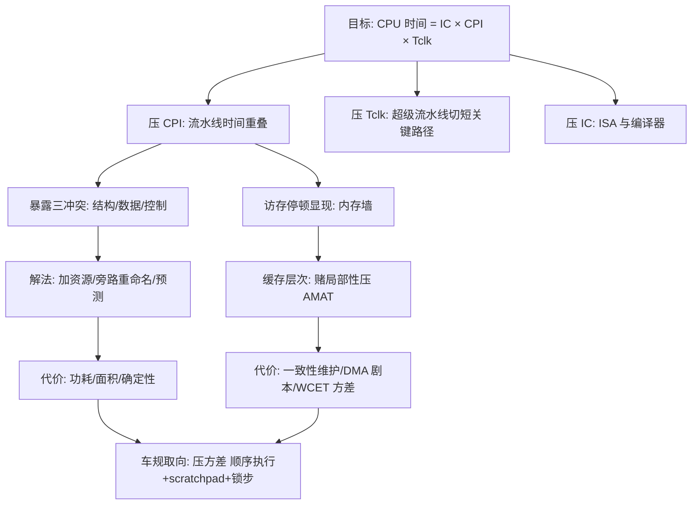

# SoC 精读 · 第2章 处理器子系统（上篇：2.1 体系结构 + 2.2 缓存）

> 目的驱动型精读 · 阶段 01 阶段总结。路线与假设表见 [[SoC_Book_00_学习路线与问题地图]]。
> 原书素材：[[../../../99_Attachments_附件/IC_Design_芯片设计/SoC设计基础教程_系统架构/full.md]]（第2章 2.1-2.2，full.md:560-1097）。
> 下篇（2.3 处理器系统 / 2.4 调试与跟踪 / 2.5 ARM）属阶段 02，完成后并入本文档。

## 背景

车规 MCU 工程师读《SoC设计基础教程——系统架构》第 2 章，目的不是成为 SoC 设计工程师，而是获得读 TC3xx/S32E2/Cortex-M7 原厂手册的"元能力"，并把处理器性能机制映射到 WCET、cache 维护、DMA 一致性等日常工程问题。本文档是阶段 01（2.1+2.2）的沉淀，按 purpose-driven-book-study 技能产出。

## 核心问题

**处理器的性能从哪来？数据喂不上时怎么办？**

拆解为四个子问题：

1. 微架构技术各自压缩性能公式的哪一项？彼此怎么牵制？
2. 流水线提高的是延迟还是吞吐？三冲突的本质和解法谱系是什么？
3. "改进型哈佛"混合结构的本质是什么？怎么用它判定一颗真实芯片（TC3xx）？
4. 缓存凭什么存在（局部性）？地址映射/策略/层级各自在权衡什么？软件能干预的接口是什么？

## 结论

**一句话**：处理器性能 = IC × CPI × Tclk，本章上半的所有技术都在压这三项且三项互相牵制；缓存压制的是 CPI 里的访存停顿项（AMAT）。车规 MCU 的设计哲学不是压均值，而是**压各项的方差**（确定性优先）。

五条骨干结论：

1. **流水线本质是时间重叠**：不改任何一级电路的速度，靠各级同时为不同指令工作，把 CPI 和 Tclk 同时拿到优；单条指令延迟不变（甚至略增），提高的是吞吐；级数 = 渐近加速比上限。
2. **三冲突是"重叠"暴露的依赖**：结构冲突→加资源（哈佛结构是其特例）；数据冲突→旁路/重命名/调度；控制冲突→预测+flush。每种解法都在性能公式里有对应项、有对应代价。
3. **改进型哈佛的本质是"地址空间学冯·诺依曼，通路学哈佛"**：可操作判据不是"存储器分不分开"，而是"取指与取数能否并行"（需端口分离**且**目标分离双条件）。
4. **缓存是用 SRAM 的贵换 DRAM 的慢的赌博**：赌局部性，AMAT = 命中时间 + 缺失率 × 缺失代价；缺失率差几个点，平均访存时间差近一倍。
5. **车规微架构做减法是主动选择**：顺序执行、scratchpad、cache locking 都是在压缩 CPI 各项的方差，换取 WCET 可界定——不是技术落后。

## 关键机制

### 1. 性能铁律（本阶段的第一性原理锚点，书上未明写）

```text
CPU 时间 = IC × CPI × Tclk

完全展开：
CPU 时间 = IC × [ 1/w + 结构/数据/控制停顿 + (每条指令访存次数 × 缺失率 × 缺失代价) ] × (关键路径 + 寄存器开销)
           │        │         │                      │                                  │
          ISA     超标量     流水线冲突解法          缓存 + 存储层次 + 总线            超级流水线 + 工艺
          编译器  (发射宽度)  (§2.1)                (§2.2 + 第3/4章)                 (深度/电压/工艺)
```

- IC 是**动态**执行条数（循环要乘迭代次数）；CISC 压 IC 抬 CPI，RISC 反之；x86 靠内部翻译 µops 两头占。
- 单发射五级 CPI_理想 = 1；w 发射超标量 CPI_理想 = 1/w（即 IPC ≤ w）。
- Tclk ≥ 关键路径延迟 + 寄存器建立时间 + 偏斜余量；超级流水线切短关键路径提频，但寄存器开销占比与分支误预测惩罚同步上涨 → P4 三十一级流水翻车案例。
- **提频加厚内存墙**：内存延迟是固定纳秒数，折成拍数 = 延迟 × 频率——频率越高，缺失代价的拍数越大。
- 公式边界：不含功耗（P ≈ C·V²·f 另算）、不含多核（Amdahl 接管）、**是平均值模型，管不了 WCET**。
- 频率谬误算例：主频高 20% 但 CPI 高 50% → 实际慢 25%（时间比 = 1.5/1.2 = 1.25）。

### 2. 存储结构三形态与"可操作判据"

| 结构 | 做法 | 收益/代价 | 代表 |
|------|------|----------|------|
| 冯·诺依曼 | 指令/数据同存同总线，分时复用 | 简单；取指取数不能同拍 | Cortex-A、PC |
| 哈佛 | 两个存储器两条总线 | 同拍并行；可靠性和确定性好 | Cortex-M、DSP |
| 改进型哈佛 | 外部冯氏（统一地址空间）+ 内部哈佛（分离 I/D Cache/TCM） | 兼得 | 现代处理器实际形态 |

**本阶段推演得出的可操作判据**（超出原书）：判一颗芯片不问"存储器分不分开"，问三件事——地址空间统一吗？取指/取数端口分开吗？目标撞车时谁仲裁？

TC3xx 判定结果（三层）：

```text
核内 L1：哈佛（P-Cache / D-Cache 分离）
核内紧耦合 RAM：哈佛（PSPR / DSPR 分离，且 DSPR 有本地/全局两条访问路径）
系统级：冯·诺依曼（统一 32 位地址空间，SRI crossbar 互连）
```

- DSPR 双路径：本地段地址（0xD000_0000）走核内专用口，确定性；全局 SRI 地址供 DMA/他核访问，核自己绕全局口会更慢且与他主抢道。链接脚本把本地 RAM 链到全局地址是真实工程坑。
- 反例（边界条件）：const 常量表放 PFLASH 时，取指与读常量在 PFLASH 目标口撞车——端口分开了但目标没分开，哈佛并行破产。热点数据/代码要进 DSPR/PSPR。
- 佐证：TC3xx UM 指出 DSPR/DCache/DLMU/PSPR/PCache 为本地单周期路径，Local PFlash 为多周期路径（引自 [[Core_Comparison_CPU_Pipeline_M7_TC3xx_Engineering]] §9.2，待 UM 原文复核）。

### 3. 流水线：Why → What → How → 演化

**Why**：单周期（CPI=1 但 Tclk 被最慢指令绑架）与多周期（Tclk 短但 CPI=级数、硬件利用率 1/5）卡在公式两端；流水线靠时间重叠两头拿优。k 级流水 n 条指令：k·n 拍 → n+k−1 拍，渐近加速比 = k。

**What**：三要素——分阶段、级间流水线寄存器（唯一新增硬件）、统一节拍（被最慢级即关键路径绑架）。直觉模型是总装线：工位=流水级、传送带=级间寄存器、节拍=时钟周期；**单辆车下线时间没变，单位时间下线数量变了**（延迟 vs 吞吐之别是本节最容易混淆的点）。充满/稳态/排空/气泡四状态。

**How（三冲突与解法谱系）**：

| 冲突 | 本质 | 解法（按代价） | 关键认知 |
|------|------|--------------|---------|
| 结构 | 同拍竞争同一资源 | 加资源（哈佛/双口/crossbar） | TC3xx PI/DI 双主口 + SRI 是系统级实现 |
| 数据 | 后继要用未产生的结果 | 停顿/冒泡 → **旁路转发**（EXE→EXE 直通）→ 编译器调度 → 寄存器重命名 | 旁路只救 RAW；WAR/WAW 是名字撞车（假相关），靠重命名消除；五级顺序流水中读在 ID 写在 WB，天然无 WAR/WAW |
| 控制 | 分支去向解析前未知 | 阻塞 → 延迟分支 → **分支预测**（静态/动态） | 预测错不算错结果只丢时间，但比不预测更慢；惩罚 ≈ 流水深度 |

**演化与终局**：深（超级流水线，提频，P4 翻车）/ 宽（超标量，面积换性能，受程序 ILP 天花板）/ 乱（OoO，硬件动态调度，功耗与不可预测代价）/ 静（VLIW，编译器调度，通用计算失败、DSP 存活）。三堵墙（功耗墙/ILP 墙/内存墙）后，"同时干更多事"的思想升维：TLP（多核）、DLP（SIMD）、DSA（脉动阵列 = 二维流水线）、chiplet；安全侧回摆（Spectre 让推测执行背债；车规回流顺序执行+锁步）。

**RISC 与流水线的因缘**：RISC 赢在定长、格式少、load/store 专用——天生好切流水；x86 自 Pentium Pro 起外译 µops 内跑 RISC 式流水，至今如此。

### 4. 缓存：存在理由 → 结构 → 映射 → 策略 → 维护 → 层级

**存在理由**：内存墙（寄存器 1 拍 / L1 约 3-4 拍 / 内存约 120-240 拍，书上表 2.2 为教科书典型值 ❓ 具体芯片差异大）。AMAT = 命中时间 + 缺失率 × 缺失代价——缺失率 5%→2%，平均访存时间近减半。成立依据是时空局部性（缓存是一场胜率 90%+ 的赌博）。

**结构**：内存按块 = 缓存按行；CPU↔缓存按字、缓存↔内存按整行（32B 一次搬，行本身即硬件预取）；条目 = Tag（这行是谁的）+ Valid + Dirty + 数据块；"32KB 缓存"只算数据块。

**映射三法（停车场类比）**：

| 映射 | 策略 | 优势 | 劣势 | 现实地位 |
|------|------|------|------|---------|
| 全相联 | 任意车位，全场并行比牌 | 命中率/空间利用高 | 比较器=行数，贵 | 只用于 TLB 等微型结构 |
| 直接映射 | 取模定位，一号一位 | 快、简单 | 冲突抖动（thrashing） | 大缓存几乎不用 |
| 组相联 | 固定区、区内任意位（N 路） | 折中 | 比较器 N 个 | **主流 4-16 路** |

地址三段式 `[Tag | Index(组号) | Offset(块内)]`；组数 = 缓存容量 ÷ (路数 × 行大小)。书上的"区号+组内块号"就是 Tag 的拆开说法。

**策略矩阵（四问八案）**：读请求先问谁（Look Through 主流 / Look Aside）；写命中（**写回 WB** 置脏位替换时才回内存，省带宽有一致性窗口 / **写通 WT** 双写，简单一致需写缓冲）；写缺失（**WA** 先读进行再写 / **NWA** 直写内存）；替换（Random/FIFO/LFU/LRU，实际芯片多用伪 LRU 或 Random）。经典搭配 WB+WA、WT+NWA 的因果：WB 的价值在"同一行多次写被吸收"，必须先 WA 才有吸收对象；WT 配 WA 无收益。

**缓存维护（软件唯一入口，ARMv8 三操作）**：Invalidate（丢行，DMA 写入后 CPU 读前必做）、Clean（脏行回写，CPU 写后交 DMA 前必做）、Zero（预清零加速 memset）。

DMA 一致性两剧本（写回式 D-Cache）：

```text
剧本1：CPU 写 buf → DMA 发送读内存
       坑：脏数据在 D-Cache，内存是旧值 → DMA 发垃圾
       药方：启动 DMA 前 Clean buf 所在缓存行
剧本2：DMA 写 buf → 中断通知 CPU 读
       坑：旧副本在缓存 → CPU 读到上一包
       药方：读前 Invalidate buf 所在缓存行
```

隐形考点：MMIO 必须 non-cacheable（否则写被"吸收"、读是旧值）；DMA buffer 需按行（32B）对齐独占整行，否则 Clean/Invalidate 误伤共享行的邻居变量。TC3xx 第三条路：非缓存地址别名段（0x8/0x9 走缓存、0xA/0xB 绕开，段号以 UM 为准）——拿平均性能换免维护确定性。

**层级**：SRAM 大↔快物理互斥 → L1/L2/L3 套娃，每层为上层挡流量；包含（Inclusive，利一致性监听）/排他（Exclusive，容量最大化）/NINE。车规对照：M7 只有 L1+TCM，TC3xx 用 scratchpad 替代深缓存层——不要"平均快的层级"，要"确定的单层"。

### 因果总图



## 关键章节地图

| 小节 | 角色 | 状态 | 一句话理解 | 证据类型 | 工作关联 |
|------|------|------|-----------|---------|---------|
| 2.1 引言（ISA） | 定义合同层 | ✅ 已读 | ISA 是软件合同，微架构是施工实现 | 概念型 | 理解 TRM 分层 |
| 2.1 三种结构 | 系统结构判据 | ✅ 已读+推演 | 判据是"取指取数能否并行" | 概念型 | TC3xx 三层判定、链接脚本坑 |
| 2.1.1 微架构/流水线 | 性能机制核心 | ✅ 已读+深挖 | 时间重叠；级数=加速比上限 | 概念+简化计数推导 | 读 TRM 流水线章节的元能力 |
| 2.1.2 流水线冲突 | 代价与解法谱系 | ✅ 已读+深挖 | 三冲突各有因果与价码 | 概念型 | WCET、编译器优化理解 |
| 2.2.1-2.2.2 缓存结构/寻址 | 缓存硬件基础 | ✅ 已读 | 行/组/路 + Tag 三段式 | 概念+算例 | 看 M7 cache 配置 |
| 2.2.3 缓存策略 | 四组权衡 | ✅ 已读 | WB/WT、WA/NWA、替换算法 | 概念型 | MPU 区域属性配置 |
| 2.2.4 缓存操作 | 软件接口 | ✅ 已读+迁移 | Clean/Invalidate/Zero | 概念+ARMv8 定义 | DMA 一致性两剧本 |
| 2.2.5 缓存层级 | 层次折中 | ✅ 已读 | 大↔快互斥的套娃 | 概念+典型值表 | 理解 MCU 为何无 L2/L3 |

## 证据与限制

- 本书为经验型（培训讲义改编）：概念框架可信，数值（表 2.2 拍数、"命中率 90%+"）为教科书典型值，❓ 具体芯片以原厂手册为准。
- 🟡 流水线加速比按 4 级举例（4n→n+3）与前文五级模型不一致——级数 k 任意，记住"级数=渐近上限"即可（full.md:663 vs :621-641）。
- 🟡 "Cortex-M 系列都是顺序执行"（:819）表述不全——M7 是 6 级双发射**顺序**超标量，且是 M 系首个带动态分支预测的核（已获 TRM 佐证，见 [[Core_Comparison_CPU_Pipeline_M7_TC3xx_Engineering]] §9.1）。
- 🟡 "全相联适合小缓存、直接映射适合大缓存"（:866）误导——现实主流是组相联，直接映射大缓存几乎不用。
- 🟡 "超级流水线提高指令并行性但不是并行处理"（:674）表述含混——准确说是"提高时间重叠度，空间并行度不变"。
- ❓ 待查证：TC3xx 非缓存别名段号（0xA/0xB）；DLMU 本地路径细节；M7 cache 4 路 32B 行参数——均回原厂 UM/TRM 核实。
- 原书不含：功耗维度、多核 Amdahl、WCET 分析——本笔记已补充，但属扩展内容而非原书观点。

## 应用场景（工作迁移：车规 MCU）

| 书上机制 | 车规落地 | 动作 |
|---------|---------|------|
| 性能公式三因子 | WCET 要的是上界不是均值 | 关键路径用 scratchpad + cache locking 压方差 |
| 改进型哈佛 | TC3xx 三层结构 | 本地 RAM 用本地段地址链接；热点代码进 PSPR |
| 目标分离双条件 | PFLASH 单目标撞车 | const 热表搬 DSPR；识别 PFLASH 读写竞争 |
| 缓存策略 | M7 MPU 区域属性 | MMIO 配 Device/non-cacheable；DMA 区配 WT 或非缓存 |
| 缓存维护 | DMA 两剧本 | Clean/Invalidate + barrier + doorbell 顺序固定化 |
| 缓存行 | 32B 行 | DMA buffer 32B 对齐独占行 |
| 冲突/停顿 | ISR 延迟长尾 | 测 max 不测 average；冷/热 cache 分开测 |
| 测量 | DWT（M7）/ CCTL 计数器（TC3xx） | 详见 [[Core_Comparison_CPU_Pipeline_M7_TC3xx_Engineering]] §11 |

**延伸工程文档**（本阶段重要发现）：[[Core_Comparison_CPU_Pipeline_M7_TC3xx_Engineering]] 是一份以 M7 TRM / TC3xx UM 为证据源的流水线工程分析（Why/What/How/Feature + 五个工作案例 + 测量方法 + 诊断树），深度和证据等级超过本书 2.1，作为本阶段的工程扩展读本；已整理入 `01_Core/03_Comparison/`。

## 讨论点与验证状态

复述验收题（布置于会话，⏳ 待用户作答）：

1. 单周期/多周期/流水线的 CPI×Tclk 各是什么水平？流水线赢在哪？
2. 为什么旁路只能救 RAW，救不了 WAR/WAW？
3. 为什么 const 常量表放 PFLASH 会让哈佛并行破产？
4. 同一段 C 在 x86/ARM 上，三因子哪个必然不同？总时间为何可能接近？
5. 为什么"提频但内存不变"收益递减（内存墙加厚）？
6. 为什么 PSPR 比更高主频更能保实时性（方差视角）？
7. MMIO 被 WB 缓存的事故机制（写吸收 + 读旧值）？
8. DMA buffer 不独占缓存行的误伤机制？
9. 为 Random 替换做 WCET 辩护？

✅ 已在对话中实质覆盖：第 2、3、5、6 题的核心逻辑（讨论中用户已自答大半）。

## 本阶段产出

- 路线文档：[[SoC_Book_00_学习路线与问题地图]]
- 本阶段总结：本文档
- Kimi 移动端精读项目指令（含已对齐知识锚点）
- 学习记录：LRN-20260815-001（对话不渲染 LaTeX/Mermaid → 聊天用纯文本/ASCII，笔记不受限）

## 待补充问题

- 2.3.5 高速缓存一致性（MESI 类协议）与本节"DMA 两剧本"的软件维护是什么关系？→ 阶段 02 回答
- M7 的 BTAC/分支预测对 WCET 的具体影响量级？→ 查 TRM + 实测
- TC3xx 非缓存别名段号、DLMU 本地路径细节 → 查 UM 后回填"证据与限制"节
- 验证题 1-9 的完整作答沉淀

## 关联笔记

- [[SoC_Book_00_学习路线与问题地图]]
- [[Core_Comparison_CPU_Pipeline_M7_TC3xx_Engineering]]（流水线工程扩展读本）
- [[ARM_M7_Core_Manual_Detailed_Mermaid]]
- [[ARM_M7_Core_FAULTMASK_Hardware_Mechanism_Use_Cases]]
- [[AURIX_TC3xx_Core_Manual_Detailed_Mermaid]]
- [[HW_Mem_RAM_Shmoo_VFT_Validation]]、[[TC3xx_Mem_RAM_DSPR_Read_Write_VFT_Shmoo]]（时序/ shmoo 测量相关）
- 原书：[[../../../99_Attachments_附件/IC_Design_芯片设计/SoC设计基础教程_系统架构/full.md]]

## 标签

#SoC #精读 #处理器 #流水线 #缓存 #车规MCU #Cortex-M7 #AURIX-TC3xx

## Agent 整理记录

- 2026-08-15：阶段 01 总结。会话覆盖：§2.1 八步法精读（提问/立场/机制/证据/边界/挑战/迁移/验证）、流水线 why/what/how/future 重讲、性能铁律详讲、§2.2 缓存导读、TC3xx 存储结构讨论（改进型哈佛三层判定/DSPR 双路径/PFLASH 目标撞车）。验证题 1-9 已布置，部分已由对话覆盖。下篇（2.3-2.5）属阶段 02。
