# AURIX TC3xx 内核手册详细版（介绍稿，含 Mermaid 图）

> 版本定位：**详细介绍版 / 手册底稿版**
>
> 说明：
> 1. 本文面向 **AURIX TC3xx / TriCore TC1.6.2P(含 TC1.62P 类实现) 的内核与 CPU Subsystem**，按“车规 MCU 内核手册”思路组织。
> 2. 目标不是把 Infineon 原厂手册逐页复写成中文，而是把**架构、实现、软件接口、异常、保护、启动、安全、调试**整理成一份可直接继续扩写的中文内核手册底稿。
> 3. 文中严格区分两层：
>    - **TriCore 架构层**：寄存器模型、指令集、CSA、Trap、中断、保护等；
>    - **TC3xx 平台实现层**：多核、局部存储器、启动固件、锁步、安全机制、OCDS/MCDS、Boot/Reset/低功耗等。
> 4. 涉及**容量、核数、缓存大小、锁步核数量、本地 PFlash Bank 分布**等项目时，均应以**具体型号 Appendix / Data Sheet**为准。本文默认站在 **TC3xx family 级别** 叙述，必要时补充“高端器件/TC39x 类示例”。
> 5. 文中大量使用 Mermaid 仅用于**概念表达和软件视角建模**，不替代芯片官方时序图与真实硬件框图。

---

# 目录

- [1. 文档说明](#1-文档说明)
- [2. AURIX TC3xx 与 TriCore 总览](#2-aurix-tc3xx-与-tricore-总览)
- [3. 编程模型](#3-编程模型)
- [4. 指令系统总览](#4-指令系统总览)
- [5. 微架构与执行引擎](#5-微架构与执行引擎)
- [6. 存储器体系与地址空间](#6-存储器体系与地址空间)
- [7. 中断系统](#7-中断系统)
- [8. Trap / 异常 / 错误体系](#8-trap--异常--错误体系)
- [9. 保护与隔离机制](#9-保护与隔离机制)
- [10. 启动、Boot、复位与低功耗](#10-启动boot复位与低功耗)
- [11. 调试、追踪与性能监控](#11-调试追踪与性能监控)
- [12. 功能安全与安全机制协同](#12-功能安全与安全机制协同)
- [13. 软件工程落地建议](#13-软件工程落地建议)
- [14. 常见误区与排查路径](#14-常见误区与排查路径)
- [15. 正式手册继续扩写建议](#15-正式手册继续扩写建议)
- [16. 参考依据（非逐条引注）](#16-参考依据非逐条引注)

---

# 1. 文档说明

## 1.1 文档目的

本文用于从**软件可见**和**系统可落地**的角度，系统介绍 AURIX TC3xx 的内核子系统，包括：

- TriCore 架构特征
- CPU 子系统实现
- 编程模型与系统寄存器
- 上下文与 CSA
- 中断 / Trap / 异常
- 存储器体系与地址空间
- 保护、ENDINIT、Safety ENDINIT
- Boot / Reset / 低功耗
- 调试 / Trace / 性能监控
- 安全机制与 ISO 26262 集成注意事项

它主要服务于以下工作：

- 启动代码与 Boot 适配
- OS / AUTOSAR Classic 集成
- MCAL / 驱动 / Complex Driver 开发
- Trap / Fault 框架设计
- 链接脚本与存储器布局设计
- 性能调优与时序分析
- 功能安全配置与验证

## 1.2 适用范围

本文适用于 AURIX TC3xx family 的内核与 CPU 子系统理解，包含但不限于：

- TC39x / TC38x / TC37x / TC36x / TC35x / TC33x / TC32x / TC3Ex 等 family 级器件
- TriCore TC1.6.2P / TC1.62P 类实现
- 带或不带锁步核的不同平台实例

不直接覆盖以下内容的完整寄存器细节：

- 每个外设模块的寄存器位定义
- 全部型号的容量差异表
- BootROM 内部未公开细节
- HSM 安全文档细节
- MCDS 采集格式的工具专用内容

## 1.3 读者对象

本文默认读者包括：

- 底层驱动工程师
- MCAL / BSW / AUTOSAR Classic 工程师
- OS / 调度 / 上下文切换工程师
- 编译器 / 汇编 / ABI 适配工程师
- 功能安全工程师
- 嵌入式测试与验证工程师
- 调试与量产工具工程师
- MCU 架构与系统工程师

## 1.4 建议配套阅读文档

建议配套以下原厂文档：

1. **TriCore Core Architecture Manual Vol.1**
2. **TriCore Instruction Set Manual Vol.2**
3. **AURIX TC3xx User Manual (Family)**
4. **AURIX TC3xx Device Appendix**
5. **AURIX TC3xx Safety Manual**
6. **TC39x/TC38x/其他具体型号 Data Sheet**
7. 编译器 EABI / ABI 手册
8. 勘误表 / 步进说明 / PCN

## 1.5 术语约定

本文统一使用以下术语：

- **CPU / Core**：TriCore CPU 实例
- **CSA**：Context Save Area，上下文保存区
- **PCXI**：Previous Context Information and Pointer Register
- **FCX / LCX**：空闲 CSA 链头 / 近耗尽指针
- **BIV / BTV**：中断 / Trap 向量表基址
- **ISP**：Interrupt Stack Pointer
- **PSW**：Program Status Word
- **SRN / SRPN**：Service Request / Service Request Priority Number
- **DSPR / PSPR**：Data / Program Scratch-Pad RAM
- **DLMU / LMU**：Distributed / Local Memory Unit
- **P-Cache / D-Cache**：程序缓存 / 数据缓存
- **ENDINIT / Safety ENDINIT**：初始化结束写保护 / 安全初始化结束写保护
- **SSW / CHSW / BSL**：Startup Software / Checker Software / Bootstrap Loader
- **OCDS / MCDS**：片上调试支持 / 多核调试追踪系统
- **SMU**：Safety Management Unit

---

# 2. AURIX TC3xx 与 TriCore 总览

## 2.1 一句话理解 AURIX TC3xx

AURIX TC3xx 不是“一个单核 TriCore 芯片”，而是一个**基于多个 TriCore CPU 构成的车规 MCU 平台**。  
TriCore 本身是 **32 位 MCU-DSP 混合架构**；TC3xx 在此基础上叠加了：

- 多核
- 本地 scratchpad + 本地/分布式存储
- 片上互连
- 启动固件
- 功能安全
- 调试追踪
- 锁步与自检
- Flash / Overlay / 量产启动能力

所以在写“内核手册”时，必须同时覆盖：

- **架构层**：TriCore 的“核是什么”
- **平台层**：TC3xx 的“这个核被怎么接到 SoC 里”

## 2.2 TriCore 架构层与 TC3xx 实现层

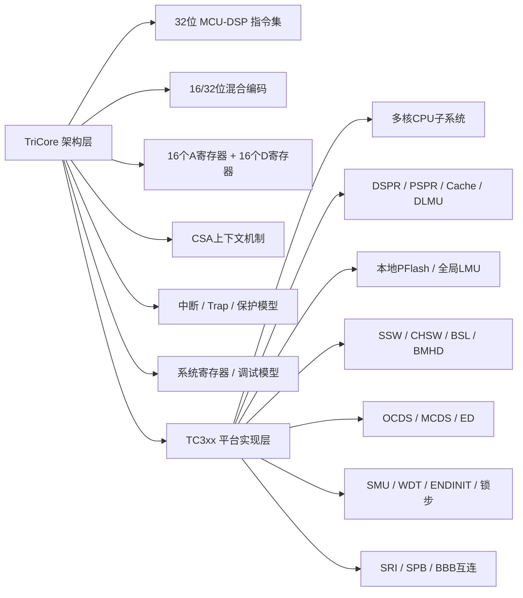

## 2.3 设计目标

TC3xx 的典型设计目标可概括为：

- 面向车规实时控制
- 多核并行但仍强调确定性
- 对控制算法友好
- 中断响应快
- 对 AUTOSAR / OS / 安全软件友好
- 具备强保护、强诊断、强调试能力
- 支持量产启动、标定、在线升级与安全启动流程

## 2.4 核心特征摘要

### 2.4.1 架构层

- 32 位统一处理器核心
- 16 位与 32 位混合指令编码
- 16 个地址寄存器 A0~A15
- 16 个数据寄存器 D0~D15
- 程序状态字 PSW
- PC、PCXI、ICR、ISP、BIV、BTV、FCX、LCX 等系统寄存器
- 支持中断与 Trap
- 支持代码 / 数据保护
- 支持 DSP / MAC / 位处理 / CRC / 乘除法等扩展
- 支持可选 FPU 能力（具体依实现）

### 2.4.2 TC3xx 实现层

- family 级多核平台
- 高端变体可见 CPU0~CPU5 等多个 CPU 实例
- 每核具备本地 scratchpad / cache / 本地接口
- 支持 DLMU / LMU 共享与分布式访问
- 本地 PFlash bank 贴近 CPU
- 启动由 BootROM 中的 SSW 统一拉起
- 具有 Checker Software / BSL / SOTA 支持
- 有 OCDS / MCDS / ED 等调试追踪资源
- 有 WDT / ENDINIT / Safety ENDINIT / SMU / Lockstep / BIST 等安全机制

## 2.5 平台级概念框图

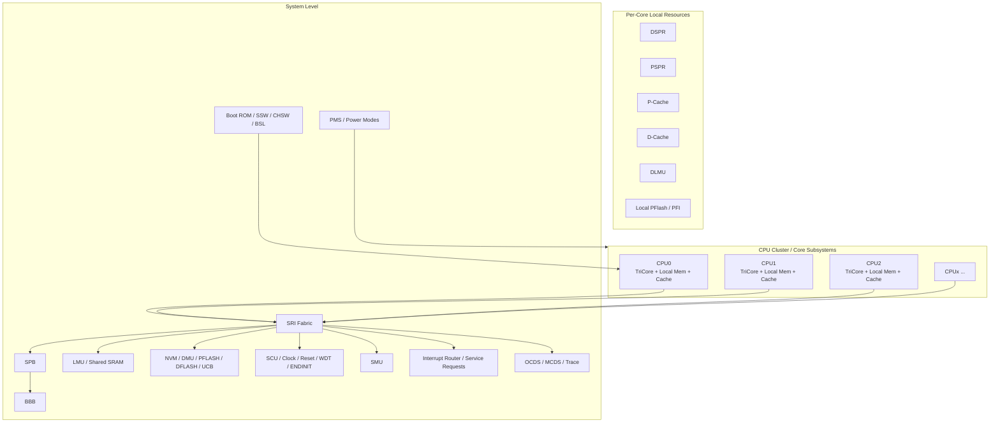

## 2.6 family 视角下的“不要误解”

### 2.6.1 不要把 TriCore 当成“只有寄存器和指令集的 CPU”

在 TC3xx 上，TriCore 必须结合以下实现理解：

- 本地 scratchpad
- cache / PMA 属性
- local PFlash 接口
- service request 体系
- BootROM 启动固件
- WDT / ENDINIT
- 调试与锁步

### 2.6.2 不要把 TC3xx 当成“只是一颗大 MCU”

从软件角度看，它更像：

- 多核 CPU + 多层次存储
- 固件驱动的启动平台
- 带安全监管和保护的片上系统

---

# 3. 编程模型

## 3.1 运行状态与权限模型

TriCore/TC3xx 的 CPU 需要从三个维度看状态：

1. **执行状态**
   - 普通运行
   - 中断服务
   - Trap 服务
   - 调试暂停 / 单步
2. **权限状态**
   - User-0
   - User-1
   - Supervisor
3. **上下文状态**
   - 当前上下文
   - 历史上下文（PCXI 链）
   - 空闲 CSA 链（FCX）

### 3.1.1 User-0 / User-1 / Supervisor

TriCore 的特权模型比很多传统 MCU 更细：

| 模式 | 典型能力 | 说明 |
|---|---|---|
| User-0 | 最受限 | 面向普通任务 |
| User-1 | 中间权限 | 可允许访问部分外设；是否允许控制中断还可由 SYSCON 限制 |
| Supervisor | 最高软件权限 | 可访问系统寄存器、关键控制寄存器、所有外设，且可控制中断 |

### 3.1.2 User-1 的价值

User-1 模式是 TriCore 很有辨识度的点。它允许系统在**不完全切到 Supervisor** 的情况下，让一部分软件拥有比 User-0 更高的 I/O 可见性。  
在车规软件里，这有助于：

- 降低大量“必须进 Supervisor 才能访问外设”的切换成本
- 做更细粒度的软件隔离
- 给 OS / 中间件设计更多权限层次

### 3.1.3 SYSCON 与模式控制

SYSCON 提供了若干关键控制位：

- Trap/Interrupt handler 的初始状态设置
- Memory Protection Enable
- Temporal Protection Enable
- User-1 IO 行为控制
- Boot Halt 状态与释放
- FCD 粘滞状态

---

## 3.2 通用寄存器模型

TriCore GPR 分为两组：

- **地址寄存器**：A0~A15
- **数据寄存器**：D0~D15

这是理解 TriCore 汇编、ABI、Load/Store 以及上下文机制的基础。

### 3.2.1 地址寄存器 A0~A15

地址寄存器主要用于：

- 指针
- 地址运算
- 栈
- 基址 + 偏移访问
- 某些隐式架构角色

其中常见重点寄存器包括：

- **A10**：软件栈指针 SP
- **A11**：返回地址 RA（在调用、Trap、RFE 返回流程中地位重要）

### 3.2.2 数据寄存器 D0~D15

数据寄存器主要承担：

- 整数算术逻辑运算
- 比较、位操作
- DSP 指令数据承载
- Trap 信息的部分承载（如某些 Trap TIN 放入 D15）

### 3.2.3 E 寄存器概念

很多指令说明中会看到 `E[c]`。  
它不是独立物理寄存器组，而是把偶奇对的数据寄存器视为 64 位组合使用，用于：

- 64 位结果
- 乘法 / 除法准备与展开
- MAC / DSP 计算
- 原子类扩展场景

---

## 3.3 栈与上下文：TriCore 的关键特色

TriCore 既有“普通软件栈”，又有“CSA 上下文链”，同时还存在“中断栈”。

### 3.3.1 A10 私有栈

- A10 作为 SP 使用
- 常由 RTOS 或启动代码初始化
- 适合任务私有栈

### 3.3.2 ISP 中断栈

- ISP 是独立中断栈指针
- 当中断进入且当前任务在用私有栈（PSW.IS=0）时，A10 会自动切到 ISP
- 若中断/Trap 进入时本来已在 interrupt stack（PSW.IS=1），则继续沿用当前中断栈

这意味着：

- TriCore 不是“每次异常都机械压栈到同一硬件栈”
- 它对中断栈与任务栈做了架构级分离支持

### 3.3.3 CSA：Context Save Area

CSA 是 TriCore 最有代表性的机制之一。  
它不是普通栈帧，而是**固定大小的上下文块链表**。

一个 CSA 块大小固定为 **16 个 word = 64 字节**。

其核心思想：

- 硬件上下文保存 / 恢复并不总依赖 SP 压栈
- CPU 使用 FCX、PCXI、LCX 等寄存器在“空闲链”和“历史链”之间搬运上下文
- 中断、Trap、函数调用的上半上下文保存可以非常高效

### 3.3.4 Upper / Lower Context

TriCore 将上下文分成两部分：

- **Upper Context**
  - A10~A15
  - D8~D15
  - PSW
  - PCXI
- **Lower Context**
  - A2~A7
  - D0~D7
  - A11（RA）
  - PCXI 等相关内容

架构规则：

- **上半上下文**在 call / interrupt / trap 时会被自动保存
- **下半上下文**需要通过指令显式保存 / 恢复（如 `SVLCX` / `RSLCX`），`BISR` 也会保存 lower context

### 3.3.5 CSA 链表示意

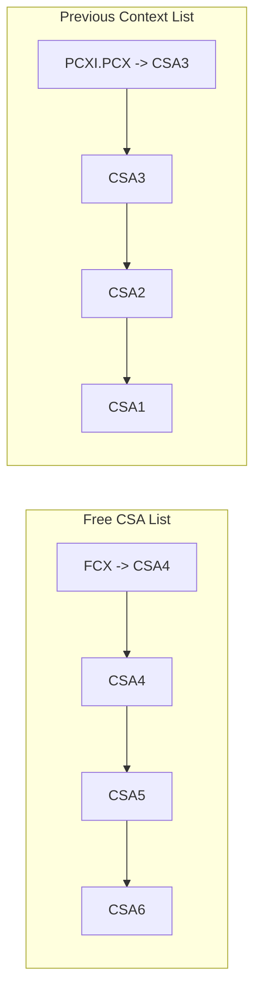

### 3.3.6 FCX / LCX / PCXI 的角色

| 寄存器 | 作用 | 说明 |
|---|---|---|
| FCX | 空闲 CSA 链头 | 指向下一个可用 CSA |
| LCX | 近耗尽阈值 | 用于提前发现 free list 快耗尽 |
| PCXI | 前一上下文信息与指针 | 包含前一优先级、前一 IE、UL 标记以及 PCX 指针 |

### 3.3.7 PCXI 中最关键的字段

- **PCPN**：被打断任务的优先级
- **PIE**：被打断任务的中断使能状态
- **UL**：当前保存的是 upper 还是 lower context
- **PCX**：指向上一个上下文的 CSA

### 3.3.8 LCX 与 FCD Trap

若一次上下文保存用到了 LCX 指向的那一项，操作会完成，但随即触发 **FCD（Free Context List Depletion）** Trap，提醒系统“空闲链几乎耗尽”。  
这对 OS 很重要，因为它意味着：

- 递归过深
- 中断嵌套过深
- 任务/CSA 配置不合理
- Trap handler 本身可能再消耗 CSA

### 3.3.9 上下文切换流程概念图

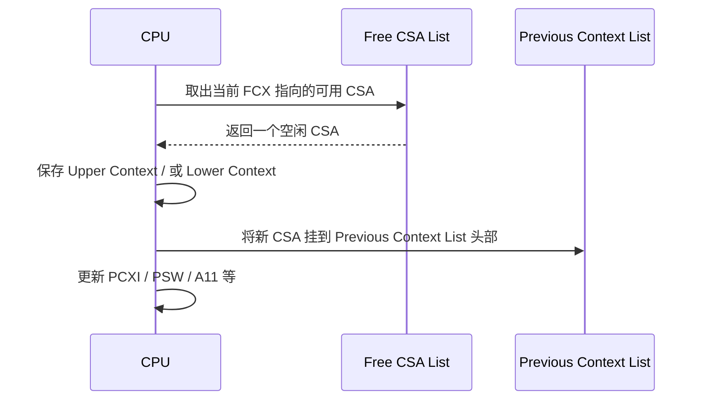

### 3.3.10 软件视角的结论

从软件工程角度看，TriCore 的上下文管理可以概括为：

- **不是纯栈压栈架构**
- **不是纯寄存器窗口架构**
- 是一种“**CSA + 栈 + 显式 lower context 管理**”的混合体系

这直接影响：

- OS 任务切换设计
- Trap / ISR 框架
- 调试器回溯
- 递归与深调用风险分析
- SBST / 安全自检代码写法

---

## 3.4 系统寄存器模型

建议从“功能分组”理解，而不要一开始就掉进“寄存器表海洋”。

### 3.4.1 控制类

- SYSCON
- CPU_ID
- CORE_ID（实现相关）
- PMA0 / PMA1 / PMA2
- PCON / DCON / DCON2 等

### 3.4.2 中断 / Trap 类

- ICR
- BIV
- BTV
- ISP
- Trap 信息寄存器

### 3.4.3 上下文管理类

- PCXI
- FCX
- LCX

### 3.4.4 调试类

- DBGSR
- DBGTCR
- 各类 trigger / event / debug 寄存器

### 3.4.5 性能监控类

- CCTRL
- CCNT
- ICNT
- M1CNT / M2CNT / M3CNT

---

## 3.5 关键系统寄存器速览

| 寄存器 | 作用 | 备注 |
|---|---|---|
| PSW | 程序状态字 | 条件码、保护集、模式相关状态 |
| ICR | 中断控制 | IE、CCPN 等 |
| BIV | 中断向量表基址 | 可选 8B / 32B 间距 |
| BTV | Trap 向量表基址 | Trap 向量固定按 8 words 间距 |
| ISP | 中断栈指针 | ENDINIT 保护 |
| PCXI | 前一上下文信息 | 含前一优先级 / 前一IE / UL / PCX |
| FCX | 空闲 CSA 链头 | 上下文分配关键 |
| LCX | 近耗尽阈值 | FCD 判断关键 |
| SYSCON | 系统控制 | BOOT HALT、PROTEN、TPROTEN 等 |

---

# 4. 指令系统总览

## 4.1 指令集风格

TriCore 指令集具有以下特征：

- 16 位与 32 位混合编码
- 兼顾 MCU 控制与 DSP 算法
- 强位操作能力
- 丰富乘法 / MAC / 打包运算
- 明确的系统指令
- 原子与同步类指令
- 支持特定扩展能力（如 CRC、半精度转换等实现增强）

## 4.2 指令类别

建议按下面几类理解：

1. 数据传送
2. 整数运算
3. 逻辑与位操作
4. 分支与流程控制
5. Load / Store
6. 原子与同步
7. 系统控制
8. DSP / Packed / MAC
9. 浮点
10. 调试 / 协处理 / 特权相关

## 4.3 16/32 位混合编码的意义

16 位编码的价值在于：

- 提高代码密度
- 改善 Flash / cache 带宽利用
- 对控制流密集型代码较友好

32 位编码则承载：

- 更复杂的操作数形式
- 更丰富的功能
- DSP / 系统类操作

## 4.4 常见软件最关心的指令类

### 4.4.1 Load / Store / 地址形成

TriCore 强调 A 寄存器与多种 addressing mode：

- Base + Offset
- 预增 / 后增
- 循环地址
- 位反转地址
- 绝对地址
- PC 相对分支（而数据并不直接走典型 PC-relative data 模式）

### 4.4.2 原子访问

常见原子能力包括：

- `SWAP.W`
- `LDMST`
- `ST.T`
- `CMPSWAP.W`
- `SWAPMSK.W`

这对多核共享资源、自旋锁、原子位更新非常重要。

### 4.4.3 系统控制

包括但不限于：

- `MFCR` / `MTCR`
- `ISYNC` / `DSYNC`
- `RFE`
- `BISR`
- `WAIT`
- `SVLCX` / `RSLCX`
- `STUCX` / `LDUCX`
- `STLCX` / `LDLCX`

### 4.4.4 DSP / MAC / Packed

TriCore 有明显 DSP 气质，适合：

- 定点控制算法
- 乘加
- 饱和运算
- 打包 half-word 运算
- Q-format 运算

### 4.4.5 CRC / 位操作增强

TC3xx 还增强了若干适合车规控制与通信处理的能力，例如 CRC / bit manipulation 等，适合：

- 通信帧校验
- 安全软件数据检查
- 驱动级位域操作

## 4.5 指令级需要注意的约束

### 4.5.1 非法 / 未实现指令

- `IOPC`：Illegal Opcode
- `UOPC`：Unimplemented Opcode

原厂还特别说明，在 AURIX 设备中 `0x36` 对所有 TC1.6.2P CPU 都是非法 opcode；若空白程序区填充 `0x36363636`，错误执行会触发 IOPC Trap。

### 4.5.2 特权指令

某些系统指令只能 Supervisor 执行，否则触发 `PRIV` Trap。

### 4.5.3 CSFR 访问方式

访问 Core SFR 应优先使用 `MTCR/MFCR`；若用普通内存方式错误访问 local CSFR 空间，可能触发 `MEM` / `CAC` 等错误行为。

### 4.5.4 栅栏指令的重要性

多核共享、posted write、store buffer、调试可见性、cache/overlay 操作后都要关注：

- `DSYNC`
- `ISYNC`

---

# 5. 微架构与执行引擎

## 5.1 总体理解

TriCore 并不是“只要会汇编就能精确推所有时序”的简单核。  
在 TC3xx 中，性能与时序同时受到以下因素影响：

- 本地 scratchpad 是否命中
- 是否走 cache
- 是否走 local PFlash / PFI
- 是否跨 SRI 访问
- store buffer / read buffer 行为
- speculative fetch
- posted write
- interrupt / trap / debug 干扰
- protection / ENDINIT / trap flush

因此，正式手册建议始终把 **架构保证** 与 **实现相关性能** 分开叙述。

## 5.2 执行资源与流水线认知

从软件角度可将其抽象为：

- 取指路径
- 分支处理路径
- 整数执行路径
- Load / Store 路径
- 可选浮点 / DSP 扩展路径
- 系统寄存器 / 控制路径

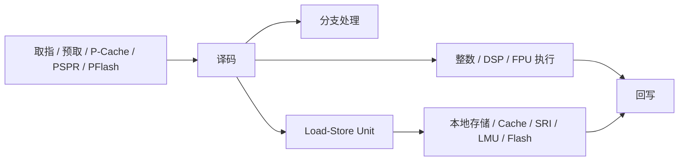

## 5.3 取指、预取与程序侧访问

### 5.3.1 程序侧典型路径

程序取指可来自：

- PSPR
- P-Cache
- 本地 PFlash / PFI
- BROM
- 通过系统互连可执行区域（受属性与保护约束）

### 5.3.2 Speculative Fetch

TC1.6.2P 允许**必要取指**和**投机取指**，官方说明可在预测路径上**最多投机取指 64 字节**。  
但它：

- **不做 speculative instruction execution**
- **不做 speculative write**
- **不对外设空间做 speculative access**

这对调试和保护设计很关键：  
“发生了取指访问”不等于“那条指令一定执行了”。

## 5.4 数据侧访问与 LSU

### 5.4.1 数据访问来源

Load/Store 可能命中：

- DSPR
- D-Cache
- DLMU
- LMU
- 外设空间
- Flash / BROM（特殊场景）
- 通过 SRI 可见的全局资源

### 5.4.2 Store Buffer

TC1.6.2P 实现包含 store buffer，且：

- 最多可容纳 **6 个 store operation 的数据**
- 会合并某些连续写：
  - 同半字内连续 byte write
  - 同字内连续 half-word write
  - 同双字内连续 word write

这对性能好，但也带来两个工程含义：

1. **写出去的时间**不完全等于“程序写指令发出的时间”
2. 某些调试、外设同步、共享内存协议需要 `DSYNC`

### 5.4.3 Posted Write

对于部分 SFR/CSFR 或 SRI 路径，存在 posted write / silent complete 行为。  
从软件视角，意味着：

- “写指令结束”并不一定等于“硬件状态已经稳定可观察”
- 必要时要读回 / 插入同步 / 采用推荐序列

## 5.5 Cache、Read Buffer 与访存抖动

### 5.5.1 P-Cache / D-Cache

具体大小依型号而异。高端器件中常见到：

- 32 KB P-Cache
- 16 KB D-Cache
- 64 KB DLMU

但这不是对所有型号的统一保证，正式手册必须标注“以具体 derivative 为准”。

### 5.5.2 Data Read Buffer / Cache Event

CPU 还提供诸如：

- `DRB_HIT`
- `DRB_MISS`
- `DCACHE_HIT`
- `DCACHE_MISS_CLEAN`
- `DCACHE_MISS_DIRTY`
- `PCACHE_HIT`
- `PCACHE_MISS`

这意味着 TC3xx 性能优化不能只盯 cycle count，必须结合 memory event 分析。

## 5.6 Fast Interrupt

TC1.6.2P 实现了 **Fast Interrupt System**。  
它的关键思路是：如果在 `RFE` 过程中正好有更高优先级中断到来，那么不必先“恢复上文”，再“立刻保存回去”，而是直接做更快的状态替换。

官方说明给出的软件可感知结论：

- 普通 `RFE + interrupt` 组合最小约 **8 cycles**
- Fast interrupt 可把这一段替换为 **最小 1 cycle 量级**的关键状态装载

### 5.6.1 Fast Interrupt 触发条件（软件视角）

通常要同时满足：

- 有 pending interrupt
- 正在执行 `RFE`
- pending interrupt 优先级高于即将恢复回去的优先级
- `PCXI.PIE == 1`
- pipeline 中没有阻断 fast interrupt 的特定 MTCR / context 操作

### 5.6.2 工程意义

- 减少中断尾部 + 新中断头部的冗余开销
- 提高中断密集场景的实时性
- 但也意味着对 `RFE`、优先级、上下文状态的理解要足够精确

## 5.7 性能计数器

典型寄存器：

- `CCTRL`
- `CCNT`
- `ICNT`
- `M1CNT`
- `M2CNT`
- `M3CNT`

典型事件包括：

- `PCACHE_HIT / MISS`
- `DCACHE_HIT / MISS`
- `TOTAL_BRANCH`
- `PMEM_STALL`
- `DMEM_STALL`
- `MULTI_ISSUE`
- `IP/LS/LP_DISPATCH_STALL`

### 5.7.1 推荐使用方法

建议采用“三层分析法”：

1. **宏观**：总 cycle / 指令数 / CPI
2. **访存**：P-Cache / D-Cache / stall / DRB
3. **控制流**：branch / interrupt / trap / flush

---

# 6. 存储器体系与地址空间

## 6.1 理解 TC3xx 存储器的正确方式

建议不要把 TC3xx 简单理解为“Flash + SRAM + 外设”。

更准确的心智模型是：

- **每核本地程序侧资源**
- **每核本地数据侧资源**
- **共享 SRAM / LMU**
- **本地或贴近核的 PFlash**
- **DFLASH / UCB / BROM**
- **系统互连统一地址空间**
- **缓存属性 / PMA / protection / ENDINIT / overlay 一起起作用**

## 6.2 Family 级地址段概念

根据 TC3xx family memory map：

- **Segment 1 和 3~7**：CPU 的 PSPR / DSPR / Cache / Tag SRAM 等
- **Segment 8**：cached access to PFlash / BROM
- **Segment 9**：cached access to LMU / EMEM
- **Segment 10**：non-cached access to PFlash / DFlash / BROM
- **Segment 11**：non-cached access to LMU / EMEM
- **Segment 15**：低 128MB 为 SPB， 高 128MB 为 SRI

此外，每个 TriCore 还有**私有内部视图**：

- PSPR：`C000_0000H`
- DSPR：`D000_0000H`

这两个是**core internal/private view**，与系统总线统一地址图不同。

## 6.3 段视图示意图

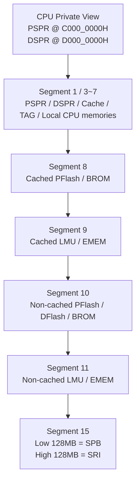

## 6.4 本地 Scratch-Pad：PSPR 与 DSPR

### 6.4.1 PSPR

PSPR 是程序 scratch-pad，适合：

- 高频 ISR
- 关键控制环
- 对确定性要求高的例程
- 启动代码、异常向量入口
- SBST/测试例程

### 6.4.2 DSPR

DSPR 是数据 scratch-pad，适合：

- 热数据
- ISR 私有数据
- OS 核心数据
- per-core runtime state
- 高速缓冲

### 6.4.3 软件放置原则

- **最关键代码**优先放 PSPR / 本地 PFlash
- **最关键数据**优先放 DSPR
- 跨核共享数据不要无脑放各核 DSPR
- 大块共享缓冲优先考虑 DLMU / LMU

## 6.5 Cache 与 Tag SRAM

### 6.5.1 Cache SRAM 不是普通 SRAM

官方明确指出：

- Cache/TAG SRAM 并非一般意义可任意使用的通用 SRAM
- 访问通常受 cache disable、对齐、访问宽度等条件限制
- TAG SRAM 只能在特定条件下访问，且通常需要 64-bit aligned 访问

### 6.5.2 Cache 访问要点

- 程序与数据两侧可分别配置 cacheable / non-cacheable 属性
- 属性通过 PMA 类寄存器控制
- 这会直接影响性能、可预测性以及一致性责任

## 6.6 DLMU / LMU / DAM

### 6.6.1 DLMU

DLMU 可理解为**分布式但又具全局可见性**的局部共享 RAM 资源。  
它既有本核访问优势，也可被其他 master 访问。

### 6.6.2 LMU

LMU 是更典型的系统共享 SRAM。适合：

- 多核共享通信区
- DMA 缓冲
- 大块中间结果
- OS 共享对象
- 日志区、trace buffer

### 6.6.3 DAM / 其他共享 RAM

部分变体还有 DAM 等默认应用内存。  
正式手册应分清：

- family 级共性
- derivative 级有无该 RAM
- reset / ECC / 初始化要求

## 6.7 PFlash / DFlash / BROM / UCB

### 6.7.1 PFlash

PFlash 用于程序代码与常量，TC3xx 高端变体通常具有**贴近 CPU 的本地 PFlash bank** 与 PFI，目的是：

- 减少延迟
- 提高带宽
- 与本核程序执行路径耦合更紧

### 6.7.2 DFlash

DFlash 更适合：

- EEPROM 仿真
- 标定数据
- 配置数据
- UCB / 启动相关配置

### 6.7.3 BROM

BROM 中包含平台固件入口，尤其是：

- SSW
- BSL 相关流程
- 启动前期控制逻辑

### 6.7.4 UCB

UCB 是用户配置块，承载：

- BMHD
- RAM 初始化相关配置
- 启动 / 安全 / 保护配置
- 某些量产模式信息

## 6.8 访问属性与 PMA

PMA 寄存器控制：

- 数据侧 cacheability
- 程序侧 cacheability
- 外设空间属性

软件上需要明确：

- 哪些区要 cached
- 哪些区要 non-cached
- 哪些区用于强实时，需要避免 cache 抖动
- 哪些区用于 DMA 共享，需要避免 cache 一致性问题

## 6.9 Overlay（标定/重定向）

TC3xx 提供强大的 per-core overlay 能力，是标定场景的重要基础。

### 6.9.1 关键点

- 每核有 **32 个 overlay block**
- 通过 `RABR / OTAR / OMASK / OSEL` 配置
- Block 大小可从 **32 Byte 到 128 KByte**
- 还存在全局控制寄存器 `OVCENABLE / OVCCON`

### 6.9.2 概念模型

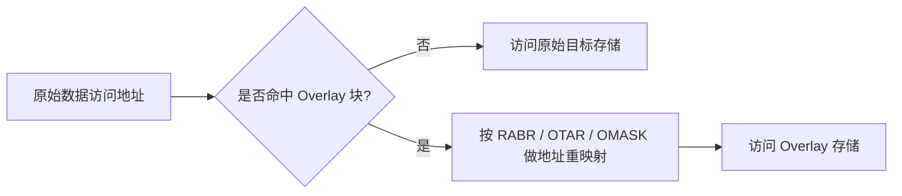

### 6.9.3 多重命中风险

官方明确指出：

- 如果一个访问同时命中多个启用的 overlay block，不支持并发命中
- **load** 多命中 -> `DSE`
- **store** 多命中 -> `DAE`

这意味着 overlay 不是“配上就好”，而是必须做严格配置管理。

### 6.9.4 软件建议

- overlay block 规划必须全局唯一
- 标定工程与底层驱动要共享地址规划
- cache 与 overlay 交互需要一起考虑
- 切换 overlay 前后最好配合 cache invalidate / sync

## 6.10 访存错误与完整性

### 6.10.1 错误类型来源

可能来自：

- ECC 单错/双错
- local memory integrity error
- SRI / SPB / BBB bus error
- overlay error
- alignment error
- protection violation
- segment crossing
- invalid local memory access

### 6.10.2 错误信息寄存器

常见用于定位的寄存器包括：

- DSTR / DATR
- DEADD
- PIEAR / PIETR
- DIEAR / DIETR
- 相关 module-specific error info

---

# 7. 中断系统

## 7.1 总体认识

TriCore 的中断体系不是 ARM M 系列那种 NVIC 风格；它是：

- **外围产生 Service Request**
- 中断系统按优先级选择
- CPU 通过 **BIV + priority** 形成中断向量入口
- 上下文切换与 CSA 强绑定

## 7.2 中断请求来源

中断可来自：

- 外设
- 外部事件
- 软件强制
- 调试/系统事件
- 安全相关模块通过路由触发

而且 service request 可以被路由到**任意 CPU**（取决于中断路由配置）。

## 7.3 优先级模型

中断系统会对 service requests 做：

- pending 判断
- target CPU 判断
- priority 排序

最高优先级请求被送入 CPU 成为当前 interrupt。

## 7.4 中断向量表与 BIV

### 7.4.1 BIV 的作用

CPU 在响应中断时，不是从固定地址表项取“中断号 -> handler 地址”，而是利用：

- 中断优先级号
- BIV
- 向量间距配置

计算出真正的 vector PC。

### 7.4.2 向量间距

官方说明 `BIV[0]` 可选择：

- **32 Bytes**
- **8 Bytes**

所以链接脚本和向量表布局必须与此一致。

## 7.5 中断进入流程

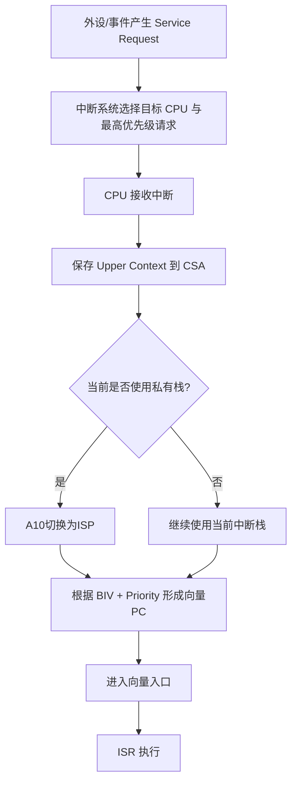

## 7.6 中断栈行为

- 若进入中断时 `PSW.IS == 0`，说明之前在私有栈上运行，则自动切换到 `ISP`
- 若已在 interrupt stack（`PSW.IS == 1`），则继续沿用当前中断栈

这与“每次异常都推同一硬件栈”的架构明显不同。

## 7.7 ICR 与中断控制

ICR 负责中断核心状态，例如：

- IE：全局中断使能
- CCPN：当前 CPU 优先级号
- PIPN：pending interrupt priority（实现/状态相关）

软件必须清楚：

- 进入 ISR 后何时允许重新开中断
- 嵌套时如何设置优先级门槛
- 与 OS 的 ISR2 / category 管理如何协同

## 7.8 BISR 的作用

`BISR`（Begin Interrupt Service Routine）很关键，因为它做两件重要事：

1. 允许修改 `CCPN`
2. 以与 `SVLCX` 相同的方式保存 lower context

所以很多 ISR 不是“进来就干活”，而是需要按规范决定：

- 是否 `BISR`
- 是否保存 lower context
- 是否允许嵌套
- 哪些寄存器交给编译器框架处理

## 7.9 Fast Interrupt 对 ISR 的影响

Fast Interrupt 会影响：

- `RFE` 的尾部时序
- 高优先级中断抢占行为
- 对“中断尾延迟”的估算

因此在做 Worst-Case Interrupt Latency 分析时：

- 不能只看普通 entry latency
- 还要看 `RFE` 邻近的抢占情形

## 7.10 中断工程建议

### 7.10.1 向量入口尽量短

推荐模式：

- 向量入口做最小化动作
- 快速跳转到真正 ISR 主体
- 便于统一补丁、调试和版本管理

### 7.10.2 热路径 ISR 放本地资源

高频 ISR 推荐优先放：

- 向量入口：PSPR / 本地 PFlash
- 热数据：DSPR

### 7.10.3 对共享状态使用原子/同步

多核下 ISR 与任务共享对象必须考虑：

- 原子访问
- cache 可见性
- `DSYNC`
- 禁中断临界区
- OS spinlock / resource

---

# 8. Trap / 异常 / 错误体系

## 8.1 总体认识

TriCore 中，Trap 是比“普通中断”更基础、更结构化的异常入口。  
它覆盖：

- 指令错误
- 保护违规
- 对齐错误
- 总线/外设错误
- 上下文错误
- 断言
- 系统调用
- NMI

且同步 / 异步区别非常重要。

## 8.2 Trap 向量与 BTV

Trap vector table 由 `BTV` 指向。  
官方说明：Trap vectors 由若干**短代码段**组成，按 **8 words** 等间距排列。

若 handler 很短，可以直接写在 vector slot 内；  
若较长，则 vector 内只放最小入口与跳转。

## 8.3 同步 Trap 与异步 Trap

### 8.3.1 同步 Trap

同步 Trap 与特定指令直接相关：

- 哪条指令引发是明确的
- Trap 在越过该指令前立即被服务
- 易定位

例如：

- Illegal Opcode
- Invalid Operand
- Alignment
- Memory Protection Execute
- MEM

### 8.3.2 异步 Trap

异步 Trap 常与延后可见的事件相关：

- store 路径错误
- 写回错误
- 异步总线错误
- 数据完整性异步检测
- NMI
- 时间异常

其特点是：

- 不一定能一一映射到“当前正在执行的那条指令”
- 通常要依赖 trap info register 做定位

## 8.4 Trap Class 总表

## 8.4.1 预定义 Trap Class

| Class | 名称 | 典型内容 |
|---|---|---|
| 0 | MMU | VAF / VAP |
| 1 | Internal Protection | PRIV / MPR / MPW / MPX / MPP / MPN / GRWP |
| 2 | Instruction Errors | IOPC / UOPC / OPD / ALN / MEM |
| 3 | Context Management | FCD / CDO / CDU / FCU / CSU / CTYP / NEST |
| 4 | System Bus and Peripheral Errors | PSE / DSE / DAE / CAE / PIE / DIE / TAE |
| 5 | Assertion | OVF / SOVF |
| 6 | System Call | `SYSCALL imm8` |
| 7 | NMI | Non-Maskable Interrupt |

## 8.4.2 形象化理解

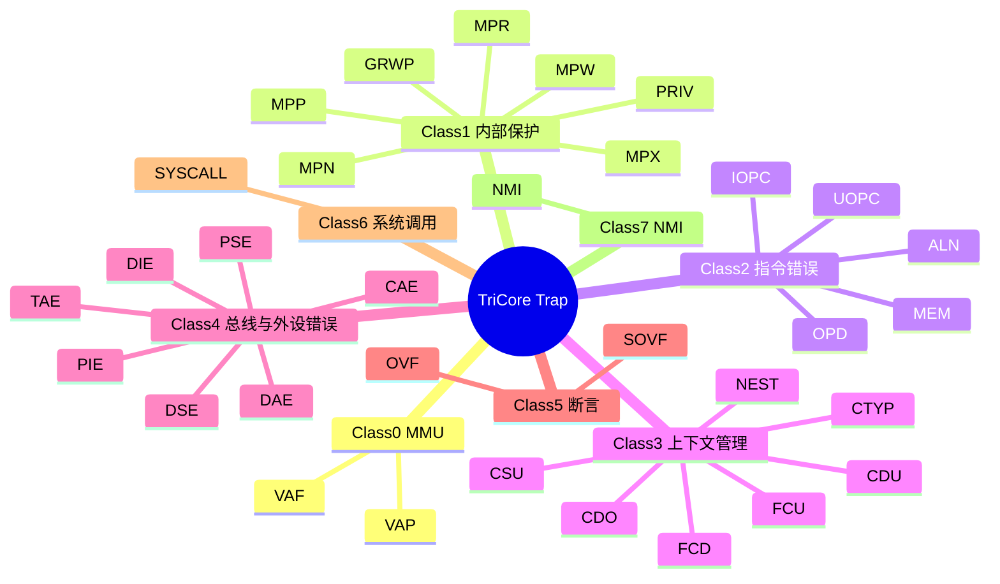

## 8.5 常用 Trap 逐项解释

### 8.5.1 `PRIV`

在 User 模式下执行特权指令，会触发 `PRIV`。  
这是最基础的“权限违规”。

### 8.5.2 `MPR / MPW / MPX`

- `MPR`：数据读不被允许
- `MPW`：数据写不被允许
- `MPX`：指令执行区域不被允许

它们是代码/数据保护机制的核心反馈。

### 8.5.3 `ALN`

未对齐数据访问导致的对齐 Trap。  
对 driver、寄存器访问、packed structure 非常关键。

### 8.5.4 `MEM`

`MEM` 不是简单“空地址”，而是“违反架构或实现约束的内存访问”，例如：

- base+offset 结果跨 segment
- 数据跨 segment 边界
- 用普通 memory access 去碰 CSFR
- CSA 放在实现不允许的位置
- scratch range error

### 8.5.5 `FCD / FCU / CSU / CTYP / NEST`

这是 TriCore 上下文体系最需要重视的一组 Trap：

- `FCD`：free list 快耗尽
- `FCU`：free list underflow
- `CSU`：call stack underflow
- `CTYP`：恢复的上下文类型不匹配
- `NEST`：在 call depth / return from exception 相关路径上的嵌套错误

### 8.5.6 `DSE / DAE`

- `DSE`：同步数据访问错误
- `DAE`：异步数据访问错误

典型来源：

- bus error
- out-of-range local memory access
- posted write failure
- overlay store/load error
- cache writeback/flush error

### 8.5.7 `PIE / DIE`

- `PIE`：程序存储完整性错误
- `DIE`：数据存储完整性错误

它们通常与 uncorrectable ECC / integrity error 相关。

### 8.5.8 `OVF / SOVF`

这是软件断言类 Trap：

- 溢出
- sticky overflow

适合 DSP / 定点安全检查。

### 8.5.9 `SYS`

由 `SYSCALL` 指令触发，TIN 来自指令立即数。  
对 OS / SVC 类服务入口很有用。

### 8.5.10 `NMI`

不可屏蔽中断入口，用于严重故障、关键安全事件等。

---

## 8.6 Trap 进入与返回

### 8.6.1 Trap 进入的核心点

Trap 与 interrupt 类似，也会触发上下文保存；但一个重要区别是：

- **Trap 不改变 CPU 中断优先级号**
- `ICR.CCPN` 不按普通 interrupt 那样更新

### 8.6.2 Trap 向量入口编写建议

建议 vector slot 只做：

1. 最小诊断抓取
2. 跳到公共 trap dispatcher
3. 按 class / TIN 分发

### 8.6.3 `RFE`

`RFE` 用于从中断或 Trap 返回。  
它会：

- 依据 `PCXI` 找到被保存的 upper context
- 恢复 upper context 与 PSW
- 跳回 `A11` 指定的返回地址

因此，`A11` 在异常返回中非常关键。

## 8.7 Trap 诊断寄存器

工程中最常用的诊断路径之一，就是在 Trap handler 中读取：

- `DSTR`
- `DATR`
- `DEADD`
- `PIEAR / PIETR`
- `DIEAR / DIETR`
- CPUx trapping operand / PC / opcode 辅助寄存器
- SCU / SMU 相关错误状态

### 8.7.1 DATR 示例可见字段

DATR 中可见的信息包括：

- Segment Crossing Error
- CSFR Access Error
- Memory Protection Error
- Context Location Error
- Alignment Error
- Store Bus Error
- Cache Writeback Error
- Store Overlay Error

这使得 DAE 的定位远比“只知道出错了”更具体。

## 8.8 Trap 软件框架建议

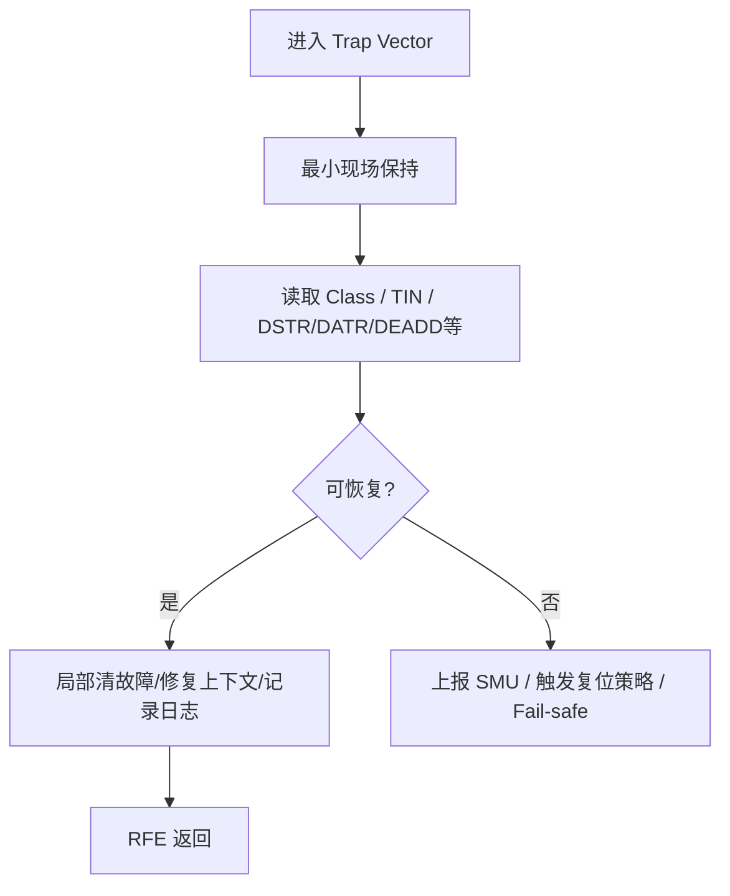

---

# 9. 保护与隔离机制

## 9.1 总体理解

TC3xx 的保护不是单一 MPU，而是多层保护叠加：

- CPU 特权
- User-1 / Supervisor I/O 权限
- Code/Data Memory Protection
- Peripheral access restriction
- ENDINIT / Safety ENDINIT
- ACCEN / master-based access control
- Startup protection
- Safety watchdog / register monitor / SMU

## 9.2 保护层次图

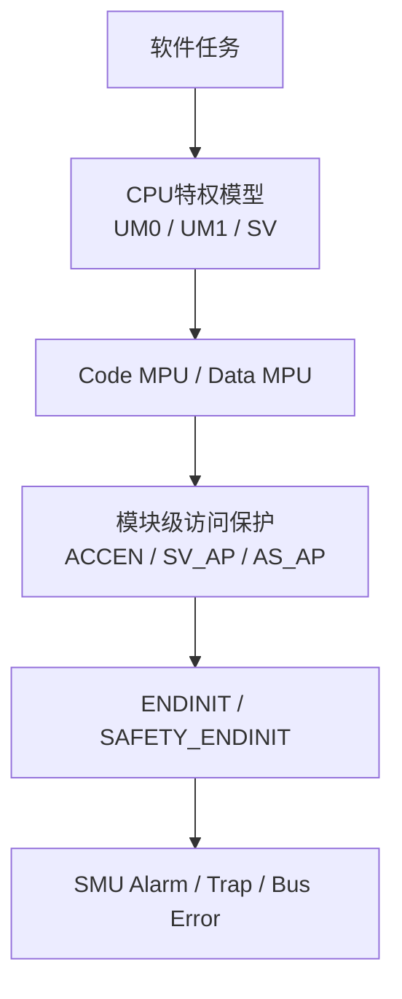

## 9.3 Code / Data Protection

### 9.3.1 TC1.6.2P 的保护集

CPU Subsystem 文档指出：

- 每 CPU 有 **6 个 Memory Protection Register Sets**
- `PSW.PRS` 选择当前正在使用的 set
- 每 CPU 实现：
  - **18 个数据 range comparator**
  - **10 个代码 range comparator**
- granularity：
  - 数据：**8 Byte**
  - 代码：**32 Byte**

### 9.3.2 覆盖范围

TC1.6.2P 实现相较更早 TriCore 的一个关键增强点是：

- **保护覆盖整个地址空间**
- 不再只是 memory，不包括 peripheral
- **peripheral space 也在保护体系考虑范围内**

### 9.3.3 边界判断注意点

官方还提醒：

- 检查的是 access/fetch 的**base address**
- 并不检查整个访问“全长是否都处在合法区间”

因此可能出现一种现象：

- 指令/数据访问起始地址合法
- 但操作范围延伸到非法区
- 未必触发 trap

这对严谨的安全分区设计是非常重要的“边界模型差异”。

## 9.4 I/O 权限保护

TriCore 架构有专门的 I/O privilege 概念。  
TC3xx 又结合外设接口上的安全机制，把权限继续细化为：

- User mode level checks
- Supervisor privilege checks
- Address-space based checks
- module ACCEN / master TAG 约束

## 9.5 ENDINIT 与 Safety ENDINIT

这是 TC3xx 最有代表性的系统级写保护机制之一。

### 9.5.1 为什么需要 ENDINIT

有些寄存器只应在初始化时配置一次，例如：

- 中断/Trap 向量基址
- PMA / cache / protection 关键寄存器
- 时钟 / 电源 / 系统关键控制
- 某些外设安全配置
- start-up protected SFRs

仅靠 Supervisor 并不足够，因此增加 ENDINIT。

### 9.5.2 基本规则

写 ENDINIT 保护寄存器时必须满足：

- 对应 `ENDINIT = 0`
- 当前在 Supervisor
- 通过正确 watchdog password + guard bits 流程
- 在允许时间窗内完成
- 完成后重新置回 ENDINIT

### 9.5.3 ENDINIT 类型

根据 family 文档的写访问标识，可分为：

- `CEy`：CPU critical，某个 CPUy 的 WDT ENDINIT 控制
- `E`：System critical，任意 CPU WDT ENDINIT 或 EICON 可控
- `SE`：Safety critical，仅 Safety WDT ENDINIT 或 SEICON 可控

### 9.5.4 ENDINIT 解锁概念流程

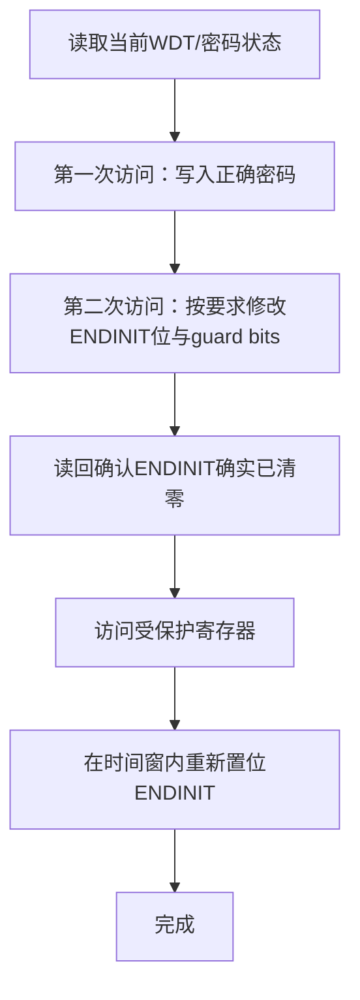

### 9.5.5 为什么强调“读回确认”

官方特别提醒：

- 清 ENDINIT 不是“写下去立刻生效”
- 访问受保护寄存器前，应先**读回 ENDINIT 位确认已清零**

### 9.5.6 ENDINIT 失败后会发生什么

如果：

- 密码错误
- guard bits 错误
- 超时未重新上锁

都会触发 watchdog / SMU alarm，系统可进一步配置：

- interrupt
- trap
- reset
- fail-safe reaction

## 9.6 Safety ENDINIT

Safety ENDINIT 用于保护**安全关键**寄存器，比普通 ENDINIT 更严格。

- 与 Safety WDT 绑定
- 与 SCU 安全配置耦合更紧
- 典型只有“安全 CPU”或受许可 master 能操作

## 9.7 Startup Protection

Safety Manual 还定义了 **STARTUP PROTECTION** 概念：

- SSW 在启动后会设置 `SCU_STCON.STP = 1`
- 防止应用软件误改启动保护寄存器
- 一旦误改，会触发 SPB bus error，进而产生 SMU alarm

这说明 TC3xx 的“启动配置”不是只靠 BootROM，而是还有一层**运行态防篡改保护**。

## 9.8 Overlay 与安全保护的交叉点

Overlay 并不是安全域外的“调试特权小通道”。  
它同样受：

- privilege
- module register protection
- Safety Register Protection
- SMU / Trap feedback

约束。  
配置错误还可能直接造成 DSE/DAE。

## 9.9 保护配置建议

### 9.9.1 启动阶段

- 初始化 ISP / BIV / BTV / protection sets
- 设置 PMA / cache 属性
- 初始化 CSA
- 再开启 PROTEN / TPROTEN
- 最后收紧 ENDINIT / Safety ENDINIT

### 9.9.2 OS 运行阶段

- 利用 `PSW.PRS` 切换保护集
- 按任务域隔离 code/data window
- 共享区专门留合法范围
- ISR / Trap 有单独执行与数据窗口

### 9.9.3 量产模式

- 默认不开“过宽”的 User-1 IO 能力
- 默认关闭不必要的 debug / overlay 通道
- 所有访问保护告警都应有明确 reaction

---

# 10. 启动、Boot、复位与低功耗

## 10.1 启动总体链路

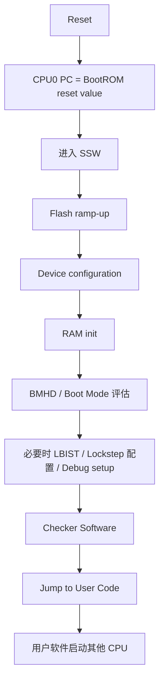

## 10.2 SSW：启动软件

官方明确：

- **SSW 是 reset 后第一段执行的软件**
- 在 TC3xx 上，**SSW 运行在 CPU0**
- 其他 CPU 在 boot 期间保持 **halt-state**
- SSW reset entry 在 BootROM，CPU0 reset 后第一条指令从此获取

这意味着：

- CPU0 是平台启动主控核
- 其余 CPU 不是“上电一起跑”
- 多核 bring-up 是先 firmware / 再 user software 的模式

## 10.3 Platform Firmware 的组成

从用户视角，TC3xx Platform Firmware 包括：

- Startup Software（SSW）
- Checker Software（CHSW）
- Bootstrap Loaders（BSL）
- Shutdown request handler
- Power Supply Friendly Debug Monitor

## 10.4 SSW 主流程

官方给出的 SSW 主流程可概括为：

1. Flash Rampup
2. Chip configuration
3. Startup Mode evaluation
4. RAM initialization
5. Lockstep configuration
6. ESR0 handling
7. Checker Software
8. Debug system setup / HARR handling
9. Jump to User Code

## 10.5 BMHD：Boot Mode Header

SSW 会顺序评估 **最多 4 个 BMHD**。  
每个 BMHD 还有：

- Original
- Copy

因此启动配置不是单点，而是有冗余与选择逻辑。

## 10.6 当没有有效 BMHD 时

若所有 BMHD 校验都失败，SSW 不会直接运行用户代码。  
它会把器件准备到一种“可救援 / 可接管 / 可重新烧录”的状态，例如：

- Generic BSL
- Halt after reset
- 或进入某种无用户代码配置状态

这对量产救砖、引导恢复、工装调试非常重要。

## 10.7 启动信息反馈

SSW 会把一些启动结果写入状态寄存器（如 STMEM1 / STMEM2 等），包括：

- BMI_VALID
- BOOT_PIN
- BMHD_INDEX
- BOOT_CFG
- BOOTMODE_CONFIGURED
- HARR
- SWAP_CFG
- user start address 等

这给应用层、HSM、调试器提供了“上一次启动究竟选了什么”的可观测性。

## 10.8 多核启动模型

### 10.8.1 基本原则

- CPU0：由 SSW 拉起
- 其他 CPU：默认 boot-halt / halt-state
- 用户软件：在合适时机释放其他 CPU 的 boot halt

### 10.8.2 BHALT

SYSCON 中有 `BHALT` 位：

- reset 后 CPU 可被立即置于 halt
- `BHALT=1` 表示该 CPU 处于 boot halt
- 写 `0` 后开始从 PC 指定位置执行

### 10.8.3 多核启动示意图

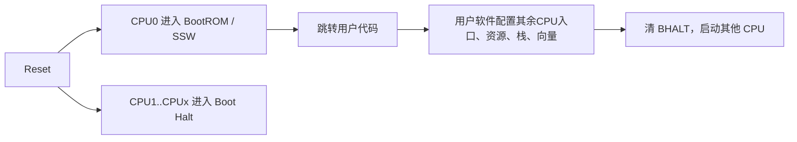

## 10.9 Lockstep 配置时机

SSW 流程中包含 lockstep configuration。  
这意味着某些 CPU 是否处于 lockstep，不应被简单理解为“上电天然就完全固定”，而是要结合启动流程、配置位、具体器件能力理解。

## 10.10 复位类型

### 10.10.1 平台固件视角

Platform Firmware 明确区分至少三类触发 SSW 的 reset 事件：

- Cold (initial) power-on reset
- System reset
- Application reset

### 10.10.2 软件工程视角

可以把 TC3xx 复位分为：

- **冷上电类**：电源/上电过程主导
- **系统类**：整机级重新启动
- **应用类**：相对温和，重点让应用重新拉起
- **局部/核级**：具体由实现与控制逻辑决定
- **调试/特殊复位**：受 OCDS / debug / PMS / RCU 交互影响

> 注：不同 reset 对寄存器、RAM、SMU alarm group、cache/tag、局部模块的影响不完全相同，正式手册必须配 reset retention matrix。

## 10.11 低功耗与 CPU 状态

### 10.11.1 PMCSRx.REQSLP

可请求：

- `00B`：Run
- `01B`：CPU Idle
- `10B`：System Sleep
- `11B`：System Standby

### 10.11.2 一个容易误解的点

官方说明：  
复位后所有 CPU 在 PMST 上可显示为“Normal Run Mode”，但**这不意味着所有 CPU 都在执行代码**。  
因为除 CPU0 外，其它 CPU 的默认状态往往仍属于 **halt/未运行用户代码**。

### 10.11.3 CPU 状态简图

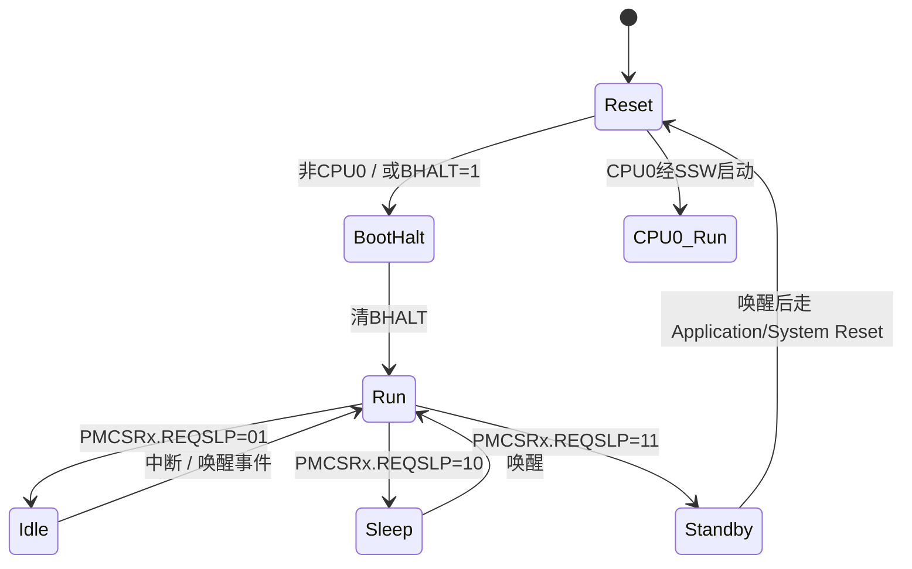

---

# 11. 调试、追踪与性能监控

## 11.1 调试体系总览

TC3xx 的调试不只是“JTAG 接进去看寄存器”，而是一个平台级体系：

- Core debug controller
- OCDS
- MCDS
- Emulation Device
- DAP / JTAG 接口
- DAS 工具链支持
- Boot halt / halt-after-reset
- trace source multiplexer

## 11.2 OCDS

OCDS 是片上调试支持总框架，提供：

- halt / run-control
- single-step
- 断点/观察点
- 调试访问
- 与 CPU debug state 的交互

## 11.3 MCDS

MCDS 用于多核调试与追踪，适合：

- 程序流 trace
- 事件采集
- 总线观察
- 多核时序关联
- 复杂 bug / 性能问题复盘

## 11.4 Emulation Device（ED）

AURIX family 文档还专门讨论 ED / Trace Source Multiplexer / DAPE 等。  
这说明对高端开发、验证、工具链而言，TC3xx 不是“有无 trace”这么简单，而是支持更复杂的：

- trace source 选择
- 并行 trace 场景
- 调试资源复用

## 11.5 DAS / 工具接口建议

Family 文档还给出 Tool Interface Recommendations 和 DAS。  
工程上可理解为：

- 调试器不是随便接就完
- 启动模式、HARR、BHALT、保护状态、上电方式都会影响 attach 行为

## 11.6 Boot Halt / Halt-After-Reset

调试时经常用到：

- **Boot Halt**：CPU 还没跑用户代码就停住
- **HARR**：Halt after reset request

这在 bring-up、量产、启动失败排查中特别有价值。

## 11.7 性能计数器复述

TC3xx 的性能分析推荐同时看：

- `CCNT`：总时钟
- `ICNT`：指令数
- `M1CNT/M2CNT/M3CNT`：定制事件
- `PMEM_STALL / DMEM_STALL`
- `PCACHE_HIT / MISS`
- `DCACHE_HIT / MISS`
- `TOTAL_BRANCH`

## 11.8 调试与保护的关系

必须注意：

- 调试访问不等于运行态 CPU 访问
- 某些寄存器在调试态可见，但运行态受特权 / ENDINIT 限制
- 某些 safety / startup protected 寄存器被误改会触发 bus error / SMU
- 调试流程应明确区分“观察”和“介入”

---

# 12. 功能安全与安全机制协同

## 12.1 Safety Manual 对 TC3xx 的定位

Safety Manual 明确指出：

- TC3xx 作为 **ISO 26262 SEooC**
- 目标可支撑到 **ASIL D**
- 但最终应用达到什么 ASIL 是系统集成者责任
- 必须满足 Safety Manual 的 assumptions of use

## 12.2 CPU 相关安全机制总览

TC3xx 与 CPU 直接相关的安全机制，软件最常关心的包括：

- CPU lockstep
- CPU exception time monitor
- code/data MPU
- privilege level monitoring
- ENDINIT / Safety ENDINIT
- WDT / Safety WDT
- SRAM ECC / error management
- startup protection
- LBIST / MBIST / MONBIST / PBIST
- SMU alarm 路径

## 12.3 Lockstep

Safety Manual 说明 lockstep 的本质是：

- master TriCore CPU + checker TriCore CPU
- 同输入、同操作、逐周期比较功能输出
- 软件执行模型对应用透明
- 另有专门机制降低 common cause fault

### 12.3.1 软件工程理解

Lockstep 对应用软件通常“透明”，但对系统工程不透明，因为你仍需处理：

- 哪些 CPU 是 LS
- 哪些 memory 归属 LS / non-LS
- 发生 lockstep comparator error 后怎么反应
- startup / lockstep config 时机
- SBST / self-test / SMU alarm 配置

## 12.4 CPU Exception Time Monitor / TPS

Safety Manual 还定义了 CPU exception handling 的时间监控机制：

- 异常请求进入后开始计时
- 一旦进入 handler 停表
- 若超过上限，产生 alarm
- 软件可通过 `TPS_EXTIM` 等配置时间窗口

这说明 TC3xx 不只是“发生异常就处理”，而是连“**异常是否在期望时间内被接住**”都能硬件监管。

## 12.5 Watchdog 与 ENDINIT 的协同

SCU 文档与 Safety Manual 一起看时，可以把 WDT 理解为同时承担两类职责：

1. 经典 watchdog：监控软件是否按期服务
2. 保护支点：守护 ENDINIT / Safety ENDINIT 解锁窗口

这比很多 MCU 的 watchdog 更“系统级”。

## 12.6 Startup Monitoring

Safety Manual 对 MCU startup 也提出要求，例如：

- 监控 LBIST 完成时间
- 可通过 ESR0 / ESR1 等外部观测辅助判断启动是否卡死
- 若超时可通过 PORST 外部拉复位

这说明量产级安全设计里，**启动本身就是安全对象**，不能只盯运行期。

## 12.7 RAM/ECC/Reset 关系

Safety Manual 还对：

- RAM 初始化后/未初始化时的 ECCD / FAULTSTS
- Application reset / System reset / warm reset 后的状态

给出了大量 appendix matrix。  
对软件来说，这意味着：

- 不能脱离“reset 类型”讨论 ECC / RAM 行为
- trap / SMU 处理逻辑要和 reset retention matrix 对齐

## 12.8 安全故障反应路径

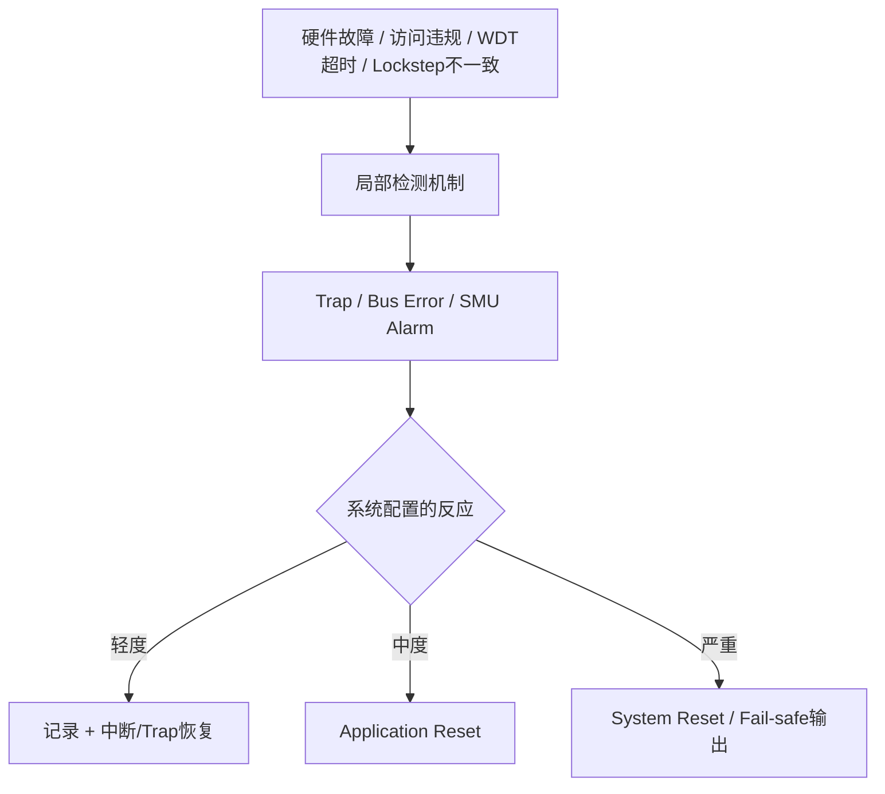

## 12.9 系统集成者必须补上的东西

即便 TC3xx 本身安全能力很强，系统集成者仍然需要：

- 定义每类 alarm 的 reaction
- 定义 external watchdog / error monitor / FSP 使用方式
- 定义启动超时监测
- 定义 trap handler 与 SMU handler 的联动
- 定义 reset escalation 策略
- 定义 software plausibility monitor

---

# 13. 软件工程落地建议

## 13.1 启动代码建议

启动代码最少应完成：

1. 初始化 CSA 区域与 FCX / LCX
2. 初始化 A10 私有栈与 ISP
3. 配置 BIV / BTV
4. 配置 PMA / cache 策略
5. 配置 code/data protection sets
6. 必要时打开 PROTEN / TPROTEN
7. 完成 watchdog / ENDINIT 初始化
8. 再启动 OS 或应用主循环

## 13.2 链接脚本建议

链接脚本至少要明确：

- 向量表放置位置
- 高频 ISR 放 PSPR / 本地 PFlash
- 热数据放 DSPR
- 共享区放 LMU / DLMU
- non-cacheable DMA buffer 区
- calibration / overlay 目标区
- boot / startup / sbst / safety monitor 区

## 13.3 OS 集成建议

TriCore OS 集成的难点不在“开中断”，而在：

- CSA 管理
- lower context 保存策略
- protection set 切换
- trap 与 ISR 的区分
- BISR / nesting 的使用策略
- 任务栈与 interrupt stack 的分离

## 13.4 AUTOSAR Classic 集成建议

### 13.4.1 MCAL 驱动

MCAL/底层驱动必须统一处理：

- ENDINIT 开窗与关窗
- Supervisor / User 权限
- SFR posted write + readback
- cache / sync
- SMU / trap 错误路径

### 13.4.2 OS / SchM / 临界区

要清楚区分：

- 关中断临界区
- 优先级门限临界区
- 原子操作
- 跨核自旋锁
- cache coherent handshake

## 13.5 调试与测试建议

建议建立统一 debug checklist：

- 当前 reset 原因
- STMEM 启动信息
- BMHD 是否有效
- CPU 是否仍在 BHALT
- BIV / BTV / ISP / FCX / LCX 是否已初始化
- DSTR / DATR / DEADD / PIEAR / DIEAR 是否有残留
- WDT/ENDINIT 是否卡住
- protection 是否过早开启

## 13.6 性能调优建议

性能调优不要只看 C 代码结构，而要同时看：

- 是否本地 memory 命中
- cache miss/stall
- branch 密度
- ISR 抖动
- overlay/cached 属性
- store buffer / sync 点
- Flash wait / PFI 本地性

## 13.7 安全软件建议

- Trap handler 分级：可恢复 / 不可恢复
- SMU alarm 必须有设计反应
- 违反 access protection 不能“静默忽略”
- 启动超时必须可观察
- 对 safety RAM / non-LS memory 做额外数据完整性监控

---

# 14. 常见误区与排查路径

## 14.1 误区：TriCore 也就是“一个有中断的 CPU”

错误。  
它是 **CSA + 特权 + protection sets + boot firmware + local memory + safety** 一整套系统。

## 14.2 误区：中断 = 向量表跳过去就行

错误。  
TriCore 中断体系与：

- BIV spacing
- ICR priority
- CSA save
- ISP
- BISR
- Fast Interrupt

强相关。

## 14.3 误区：异常返回就是“弹栈回来”

不准确。  
TriCore 大量依赖 `PCXI + CSA + RFE` 恢复 upper context，不是典型 ARM 异常栈帧思路。

## 14.4 误区：ENDINIT 只是“写个 bit 关掉再开”

错误。  
它是：

- watchdog 密码保护
- guard bits 检查
- time window 监控
- SMU alarm 联动

## 14.5 误区：DSPR/PSPR/Cache/LMU 只是不同名字的 RAM

错误。  
它们的：

- 访问路径
- 延迟
- 可见性
- 共享性
- cache 属性
- reset / ECC / safety 处理

都不同。

## 14.6 误区：其他 CPU 上电后就跟 CPU0 一样跑

错误。  
SSW 在 CPU0 上执行；其他 CPU 初始常处于 halt/boot-halt，需由用户软件按流程释放。

## 14.7 误区：Overlay 就是“把地址换一下”

错误。  
还涉及：

- per-core block
- global enable
- cache 交互
- multiple match risk
- DSE/DAE 异常
- 安全保护

---

# 15. 正式手册继续扩写建议

如果你准备把本文继续扩成“正式版内核手册”，建议下一步补齐以下内容：

## 15.1 必补表格

1. **寄存器总表**
   - PSW / ICR / BIV / BTV / ISP / PCXI / FCX / LCX / SYSCON
2. **Trap Class + TIN 总表**
3. **Reset retention matrix**
4. **CPU local memory / cache / local flash variant matrix**
5. **ENDINIT 保护寄存器范围表**
6. **Protection set 使用约定表**
7. **启动阶段状态寄存器说明表**
8. **性能计数事件表**

## 15.2 必补图

1. CPU 子系统框图
2. CSA 保存/恢复图
3. Interrupt entry/exit 时序图
4. Trap 进入与诊断图
5. Segment 视图图
6. Startup/Boot flow 图
7. Reset escalation 图
8. Protection layer 图
9. Lockstep + SMU reaction 图

## 15.3 建议再拆分成三册

- 《TriCore Core Manual（架构层）》
- 《TC3xx CPU Subsystem Manual（实现层）》
- 《Boot / Safety / Debug / Trace Supplement》

---

# 16. 参考依据（非逐条引注）

本文整理时主要依据以下文档进行交叉归纳：

1. **TriCore TC1.6.2 Core Architecture Manual Volume 1**
2. **TriCore TC1.6.2 Instruction Set Manual Volume 2**
3. **AURIX TC3xx User Manual (Family)**
4. **AURIX TC3xx Safety Manual**
5. **TC39x-B / TC39x 相关 Appendix / Data Sheet**

---

# 结语

如果把 AURIX TC3xx 压缩成一句工程化结论，可以这样理解：

> **TriCore 解决“核怎么执行”，TC3xx 解决“这颗核怎样在车规多核平台里被安全地启动、保护、调试、追踪和协同使用”。**

因此，真正能把 TC3xx 用好的团队，不是只会写驱动或者只会看寄存器表，而是要同时掌握：

- 编程模型
- 上下文与异常
- 存储层次
- 权限与保护
- 启动与复位
- 调试与性能
- 安全机制与系统反应

这也正是“车规 MCU 内核手册”存在的价值。
