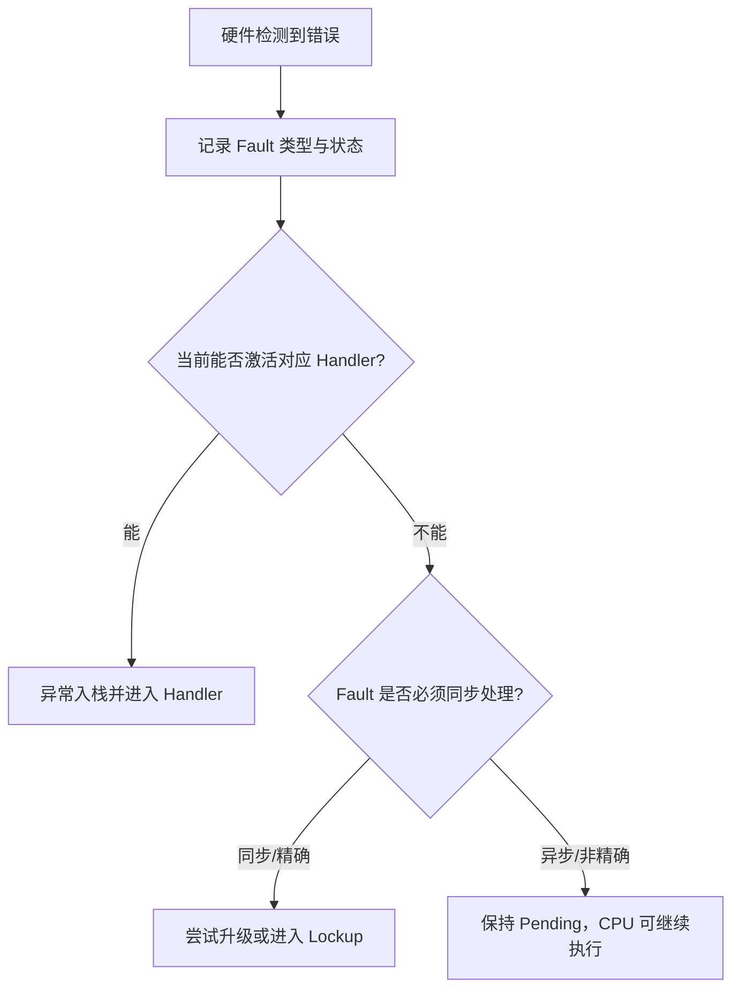
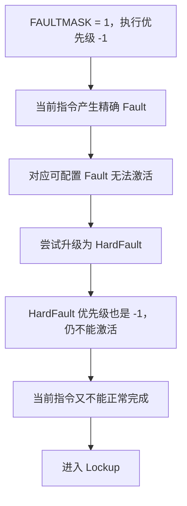
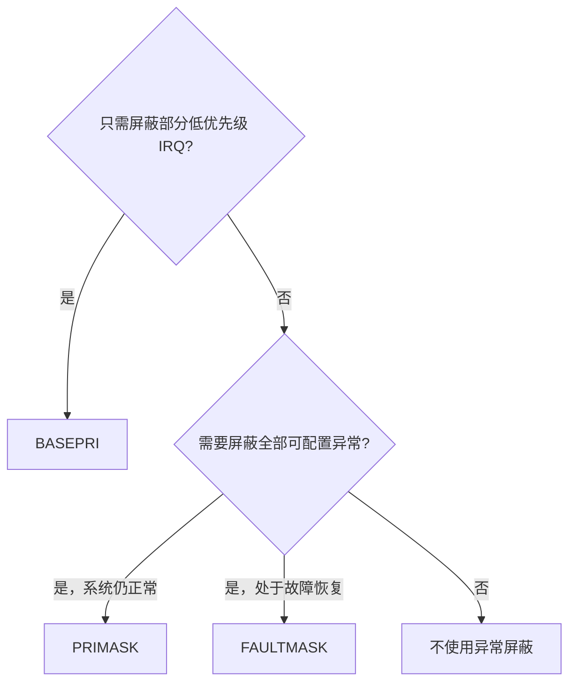
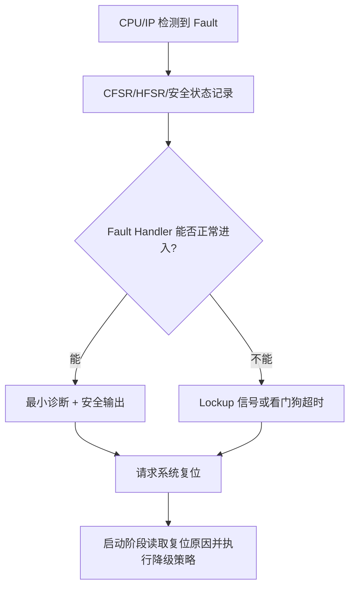

# Cortex-M7 FAULTMASK：硬件机制、设计动机与应用场景

> 适用范围：Armv7-M 架构，重点面向 Cortex-M7。  
> 核心问题：`FAULTMASK` 做了什么、为什么这样设计、发生 Fault 后硬件如何演进，以及工程中什么时候应该或不应该使用。

---

## 1. 先给出结论

`FAULTMASK` 是 Cortex-M 异常体系中的最高等级软件屏蔽机制。置位后，它把处理器当前执行优先级提升到 HardFault 的固定优先级 `-1`：

- 普通 IRQ、SysTick、PendSV、SVC 以及所有可配置 Fault 都不能激活；
- HardFault 也不能抢占，因为它的优先级同样是 `-1`；
- 只有优先级更高的 NMI（`-2`）以及 Reset（`-3`）仍然有效；
- Fault 检测并没有被关闭，CFSR/HFSR 等状态仍可能更新；
- 同步、必须立即处理的 Fault 通常导致 Lockup；
- 异步 BusFault 可以先进入 Pending，不会仅因暂时无法响应而立即 Lockup；
- 从除 NMI 外的异常执行 Exception Return 时，硬件自动清除 `FAULTMASK`；
- `MPU_CTRL.HFNMIENA` 和 `SCB_CCR.BFHFNMIGN` 可以改变优先级 `-1/-2` 下的 MPU 与数据 BusFault 行为。

因此，`FAULTMASK` 的设计定位不是普通临界区，而是：

> 为极短、受控的故障恢复代码提供接近 HardFault 级别的执行环境，只允许 NMI 或复位机制介入。

工程上可用一句话记忆：

> `BASEPRI` 用于 RTOS 临界区，`PRIMASK` 用于普通全局关中断，`FAULTMASK` 用于系统已经异常之后的最后一级受控处理。

---

## 2. 理解 FAULTMASK 前，先建立异常优先级模型

### 2.1 Cortex-M 的固定优先级

Cortex-M 的异常优先级数值越小，实际优先级越高：

| 异常 | 固定优先级 | 能否软件屏蔽 | 典型用途 |
|---|---:|---:|---|
| Reset | `-3` | 否 | 重新建立处理器初始状态 |
| NMI | `-2` | 否 | 最后一级紧急事件、安全故障、时钟故障等 |
| HardFault | `-1` | 会受到 `FAULTMASK` 形成的执行优先级限制 | 无法由其他 Fault Handler 正常处理的故障 |
| MemManage、BusFault、UsageFault、SVC、IRQ 等 | `0` 及更大的可配置值 | 是 | 常规异常和中断处理 |

这里要区分两个概念：

- **异常自身优先级**：例如 HardFault 固定为 `-1`。
- **当前执行优先级**：由当前 Active 异常以及 `BASEPRI`、`PRIMASK`、`FAULTMASK` 共同决定。

异常只有在其优先级高于当前执行优先级时，才可以从 Pending 转为 Active 并进入 Handler。

### 2.2 FAULTMASK 不是“禁用 HardFault”寄存器

`FAULTMASK=1` 的本质是：

```text
当前执行优先级 = min(原执行优先级, -1)
```

如果原先在 Thread 模式运行，置位后执行优先级从基础级提升到 `-1`。此时：

```text
HardFault 优先级       = -1
当前软件执行优先级     = -1

HardFault 并不高于当前执行优先级
→ HardFault 不能抢占并激活
```

所以，从异常仲裁角度看，结果像是“HardFault 被屏蔽”；但硬件内部仍然检测 Fault、记录状态，并根据 Fault 类型决定 Pending、忽略或者 Lockup。

### 2.3 与优先级分组的关系

`AIRCR.PRIGROUP` 主要影响可配置优先级的抢占优先级和子优先级划分。

`FAULTMASK=1` 直接把执行优先级提升到固定优先级 `-1`，因此不依赖 `PRIGROUP` 的具体配置。无论优先级如何分组，可配置异常都低于 `-1`。

---

## 3. FAULTMASK 的基本硬件特征

| 硬件特征 | 架构行为 | 为什么这样设计 | 对应场景 |
|---|---|---|---|
| 仅 1 bit | `0` 无影响，`1` 提升执行优先级到 `-1` | 这是一个最终级开关，不需要像 `BASEPRI` 那样表达阈值 | 故障恢复的短保护窗口 |
| 仅特权软件可写 | 非特权访问为 RAZ/WI，即读零/写忽略 | 防止普通任务屏蔽整个异常体系 | RTOS 内核、启动代码、Fault Handler |
| HardFault/NMI 中不能再把它从 0 置 1 | 只有当前执行优先级数值大于等于 `0` 的特权软件才能置位，也就是实际优先级低于 HardFault 的环境 | 已经处于 `-1/-2` 时，再提升没有意义，也避免状态语义混乱 | 通常由 Thread、IRQ 或可配置 Fault Handler 置位 |
| 只阻止异常激活 | 不等于关闭 Fault 检测，也不保证状态位不更新 | 错误信息仍需留给诊断与恢复流程 | 读取 CFSR/HFSR，复位后分析 |
| 仅 NMI 可抢占 | NMI 固定优先级 `-2` | 保留一个不受软件屏蔽的最后求生通道 | 安全监控、紧急关断、请求复位 |
| Reset 始终有效 | Reset 优先级最高且不依赖普通异常入口 | 即使 CPU Lockup，系统仍必须能重新初始化 | 外部复位、独立看门狗复位 |
| 异常返回通常自动清零 | 除 NMI 外，任何 Exception Return 都清 `FAULTMASK` | 防止 Handler 忘记清除，导致屏蔽状态泄漏回 Thread 模式 | Fault Handler 临时提升优先级 |
| 复位值为 0 | Reset 清除所有屏蔽寄存器 | 确保复位入口不继承不可控屏蔽状态 | 上电、系统复位 |

访问方式包括：

```c
uint32_t old = __get_FAULTMASK();
__set_FAULTMASK(1U);
__set_FAULTMASK(0U);

__disable_fault_irq();   /* CPSID f，FAULTMASK = 1 */
__enable_fault_irq();    /* CPSIE f，FAULTMASK = 0 */
```

汇编形式：

```asm
CPSID f     ; FAULTMASK = 1
CPSIE f     ; FAULTMASK = 0
MRS   r0, FAULTMASK
MSR   FAULTMASK, r0
```

---

## 4. 为什么 ARM 还需要 FAULTMASK？

### 4.1 BASEPRI 和 PRIMASK 仍然保留了 HardFault 通道

正常系统希望：即使关掉普通中断，严重错误仍能进入 HardFault，而不是静默继续执行。因此：

- `BASEPRI` 只屏蔽某一优先级阈值及以下的可配置异常；
- `PRIMASK` 屏蔽全部可配置优先级异常，但保留 HardFault 和 NMI；
- `FAULTMASK` 才把执行优先级提升到 HardFault 等级，只留下 NMI。

这三级机制对应三种完全不同的工程意图：

| 机制 | 工程意图 |
|---|---|
| `BASEPRI` | 系统正常运行，只需保护共享数据或 RTOS 内核结构 |
| `PRIMASK` | 系统正常运行，但某段极短操作不能被任何普通中断打断 |
| `FAULTMASK` | 系统已进入特殊或故障处理阶段，需要临时获得最高的软件执行等级 |

### 4.2 允许可配置 Fault Handler 临时“升级”

假设 BusFault Handler 的可配置优先级为 2。它在保存诊断数据、关闭危险输出或修复系统状态期间，可能被更高优先级 IRQ 抢占，也可能再次发生其他 Fault。

Handler 可以置位 `FAULTMASK`：

```text
BusFault Handler，执行优先级 2
              ↓ FAULTMASK = 1
执行优先级提升为 -1
              ↓
IRQ、其他可配置 Fault、HardFault 均不能激活
              ↓
只允许 NMI 或 Reset 介入
```

这提供了一个非常短的、不受普通异常打断的恢复窗口。

### 4.3 为什么不直接把所有 Fault Handler 都设计成不可抢占？

因为大多数 Fault 并不一定致命。例如 MPU 隔离违规、可恢复的总线访问问题或某些 UsageFault，可以由软件记录、终止当前任务并继续运行。如果所有 Fault Handler 都固定为最高优先级，会增加中断延迟，也降低系统灵活性。

ARM 的选择是：

1. 平时让 MemManage、BusFault、UsageFault 使用可配置优先级；
2. 只有进入极端恢复阶段时，由软件显式设置 `FAULTMASK`；
3. 通过异常返回自动清零，尽量把提升限制在当前 Handler 生命周期内。

这是一种“默认可调度、必要时临时升级”的设计。

---

## 5. 置位 FAULTMASK 后，Fault 检测与 Fault 响应必须分开理解

很多误解来自把“检测到 Fault”和“进入 Fault Handler”当成一件事。

实际上硬件通常经历以下阶段：



`FAULTMASK` 影响的是第三步的异常激活和当前执行优先级，不会把第一步的错误检测电路关闭。

这也解释了两个看似矛盾的现象：

- `FAULTMASK=1` 时发生精确 Fault，可能立即 Lockup；
- `FAULTMASK=1` 时发生异步 BusFault，却可能只 Pending，CPU 继续执行。

---

## 6. 同步/精确 Fault：为什么 Handler 进不去就会 Lockup？

### 6.1 “同步”是什么意思

同步 Fault 与正在执行的具体指令存在确定因果关系。处理器必须在该指令边界处理错误，不能把这条指令当作成功完成后继续运行。

例如：

```asm
LDR   r0, [r1]      ; r1 指向一个返回精确总线错误的地址
ADD   r2, r2, #1
```

`LDR` 无法正常完成时，处理器需要立即选择：

1. 进入 BusFault；
2. 若 BusFault 不能处理，则升级进入 HardFault；
3. 若当前已经处于优先级 `-1/-2`，没有可合法激活的 Fault Handler，则进入 Lockup。

### 6.2 FAULTMASK 下的演进过程



常见同步 Fault 包括：

- 指令取指 BusFault；
- `LDR` 产生的精确数据 BusFault；
- MPU 指令访问或数据访问违规；
- 未定义指令；
- 非法状态或非法异常返回；
- 开启陷阱后的除零与非对齐访问；
- 在优先级 `-1/-2` 执行 `SVC`；
- 异常入栈或出栈期间发生的特定错误。

因此，`FAULTMASK` 保护区中的代码必须比普通临界区更严格：代码、栈、数据地址以及控制流都必须可信。

---

## 7. 异步 BusFault：为什么能 Pending 而不立即 Lockup？

### 7.1 Cortex-M7 存储错误可能晚于 STR 指令报告

Cortex-M7 存在写缓冲、总线桥、Cache 等硬件路径。一次存储操作可能先被处理器接受，之后下游才返回错误：

```asm
STR   r0, [r1]      ; 写请求进入缓冲或下游总线
ADD   r2, r2, #1    ; CPU 已继续执行
SUB   r3, r3, #1
                     ; 此时才收到前面写请求的错误响应
```

Cortex-M7 Devices Generic User Guide 给出的实现说明是：

- 处理器 Load 引起的 BusFault 为同步；
- 处理器 Store 引起的 BusFault 为异步，包括对 Device 和 Strongly-ordered 区域的 Store；
- Cache maintenance 也可能产生异步 BusFault。

### 7.2 FAULTMASK 下的硬件行为

异步错误到达时，导致错误的指令可能早已退休。处理器没有一个安全、精确的回滚点，因此架构采用：

```text
记录 BFSR.IMPRECISERR
           ↓
BusFault Handler 已使能：BusFault 进入 Pending
BusFault Handler 未使能：HardFault 进入 Pending
           ↓
FAULTMASK = 1，Pending 异常不能 Active
           ↓
CPU 继续执行当前指令流
           ↓
FAULTMASK 清零后再按优先级进入 Handler
```

官方明确说明：由异步 BusFault 形成的 HardFault 不会仅因无法立即激活而升级为 Lockup。

### 7.3 “CPU 继续执行”不代表系统功能仍可信

需要区分：

| 层面 | 状态 |
|---|---|
| CPU 架构执行 | 仍按架构规则取指、译码、执行，不是随机运行 |
| 软件功能语义 | 可能已经不可信，因为某次写入没有真正到达目标 |
| 外设状态 | 可能与软件状态机不一致 |
| 故障定位 | 通常不能从堆栈 PC 精确定位原始 `STR`，BFAR 也通常无效 |

例如，软件认为已经配置外设，再执行使能：

```c
PERIPH->CFG = cfg;       /* 实际写失败，但错误稍后到达 */
PERIPH->CTRL = ENABLE;   /* 软件继续运行 */
state = RUNNING;         /* 软件状态与硬件状态可能分裂 */
```

所以异步 Fault Pending 期间的正确理解是：

> 体系结构允许 CPU 继续前进，但功能安全系统应认为结果已经可疑，并在异常获得响应后进入诊断、安全状态或复位流程。

### 7.4 DSB 的价值与边界

在关键存储或 Cache maintenance 操作之后执行 `DSB`，可以要求前面的显式内存访问完成，并缩短异步错误跨越大量后续代码甚至跨越上下文边界的窗口。

```c
critical_register_write();
__DSB();
```

但 `DSB` 不能把所有非精确错误神奇地变成可恢复的精确 Fault，也不能保证 BFAR 一定有效。它的主要价值是：

- 约束内存操作完成顺序；
- 让相关错误尽早被观察；
- 避免在确认写入完成前继续依赖该写入结果。

---

## 8. Lockup：它到底是什么状态？

### 8.1 架构定义

当处理器在优先级 `-1` 或更高等级执行时发生大多数无法处理的同步 Fault，标准异常入口不再适用，处理器进入 Lockup。

从软件可观察角度看：

- 正常指令流停止推进；
- 处理器不会正常进入期望的 Fault Handler；
- 调试状态可指示 Lockup；
- SoC 可能把内核 Lockup 信号接入安全管理模块、复位控制器或看门狗逻辑。

Armv7-M 架构以“从固定 Lockup 地址重复取指”描述其底层模型；Cortex-M7 用户指南从用户视角概括为处理器不再执行正常指令。两种描述指向同一工程结论：正常程序已经终止。

### 8.2 可能退出 Lockup 的方式

| 方式 | 是否适合作为量产恢复策略 | 说明 |
|---|---:|---|
| 系统 Reset | 是 | 最常见，通常由独立看门狗或安全管理模块触发 |
| NMI | 有条件 | 只有 Lockup 发生在优先级 `-1` 时，NMI 才可能介入 |
| 调试器 Halt | 仅开发阶段 | 可修改 PC、xPSR、`FAULTMASK` 或错误条件 |
| 外部修复瞬态总线错误 | 不应依赖 | 架构允许，但系统级可控性很差 |

如果 Lockup 已发生在 NMI 优先级 `-2`，后续 NMI 不能再救援，只能依靠 Reset 或调试机制。

ARM 明确建议应用把 Lockup 视为执行终止并复位，而不是设计复杂的软件恢复路径。

### 8.3 为什么使用 FAULTMASK 必须有硬件复位兜底

`FAULTMASK=1` 后普通看门狗中断也不能激活。如果安全兜底只依赖“看门狗先产生 IRQ，由 ISR 决定复位”，那么该 IRQ 也可能被屏蔽。

可靠设计应确保至少存在一种不依赖普通异常入口的机制：

- 看门狗超时直接产生系统复位；
- 外部 PMIC/SBC 看门狗复位；
- 安全管理模块检测 Lockup 后请求复位；
- 外部 Reset 管脚。

---

## 9. 为什么异常返回会自动清除 FAULTMASK？

### 9.1 硬件规则

从任何异常执行 Exception Return 时，硬件清除 `FAULTMASK`，但从 NMI 返回除外。

| 返回场景 | `FAULTMASK` 结果 |
|---|---|
| IRQ、SysTick、PendSV、SVC 返回 | 自动清零 |
| MemManage、BusFault、UsageFault 返回 | 自动清零 |
| HardFault 返回 | 自动清零 |
| NMI 返回 | 保持原值 |
| 普通 C 函数返回 | 不变 |

这里的“异常返回”不是任意 `BX LR`，而是使用特殊 `EXC_RETURN` 值执行 Cortex-M 异常返回流程。

### 9.2 设计动机

典型用法是在某个可配置 Fault Handler 中临时提升优先级：

```text
进入 BusFault Handler
        ↓
FAULTMASK = 1
        ↓
执行短暂恢复或安全动作
        ↓
Exception Return
        ↓
硬件自动 FAULTMASK = 0
```

如果没有自动清零，Handler 忘记恢复 `FAULTMASK` 后，Thread 模式会长期处于仅允许 NMI 的状态。后续同步 Fault 还可能直接 Lockup。自动清零相当于一个硬件生命周期保护。

### 9.3 为什么 NMI 返回不自动清零？

NMI 可能抢占一个已经设置 `FAULTMASK=1` 的执行上下文：

```text
BusFault Handler 设置 FAULTMASK = 1
                 ↓
NMI 抢占
                 ↓
NMI 返回
                 ↓
继续执行原 BusFault Handler
```

如果 NMI 返回时自动清零，就会意外破坏被抢占代码的保护状态。因此 NMI 返回保持原值。

这也带来一个风险：NMI Handler 自身不能把 `FAULTMASK` 从 0 置 1，但如果 NMI 抢占前 `FAULTMASK` 已经是 1，NMI 返回会保留这个值。若 NMI 直接返回被抢占的 Thread 上下文，该 Thread 仍处于 `FAULTMASK=1`，后续必须由原软件路径显式恢复。

### 9.4 嵌套异常示例

```text
BusFault Handler：FAULTMASK = 1
          ↓
NMI Active
          ↓
NMI Exception Return：FAULTMASK 仍为 1
          ↓
继续 BusFault Handler
          ↓
BusFault Exception Return：FAULTMASK 自动清零
```

---

## 10. 配套特征一：MPU_CTRL.HFNMIENA

### 10.1 硬件行为

`MPU_CTRL.HFNMIENA` 决定 MPU 在 HardFault、NMI 和 `FAULTMASK` 提升后的优先级 `-1/-2` 环境中是否继续生效。

| `MPU_CTRL.ENABLE` | `HFNMIENA` | 优先级 `-1/-2` 下的 MPU 行为 |
|---:|---:|---|
| 1 | 0 | MPU 在该执行优先级下不启用，访问按默认内存映射等架构规则处理 |
| 1 | 1 | MPU 继续启用，仍按 Region 权限和属性检查 |
| 0 | 1 | 架构定义为不可预测，应避免该组合 |

注意：`HFNMIENA=0` 不代表“所有地址都绝对可以访问”。默认内存映射、固定 XN 约束、总线从设备响应以及 SoC 级防火墙仍然可能限制访问或产生 BusFault。

### 10.2 为什么这样设计

如果系统因为错误 MPU 配置把恢复代码、诊断区或关键控制寄存器隔离，Fault Handler 可能连修复资源都无法访问。允许优先级 `-1/-2` 暂时绕过 MPU，可以提供一条恢复通道。

另一方面，在安全系统中也可能要求即使 HardFault/NMI 仍不能突破 MPU 隔离，这时应设置 `HFNMIENA=1`。

### 10.3 两种设计取向

| 设计取向 | 推荐配置 | 优点 | 风险 |
|---|---:|---|---|
| 恢复优先 | `HFNMIENA=0` | 故障恢复代码可使用默认内存映射访问被 MPU 隔离的资源 | 恢复代码权限扩大，错误指针影响面更大 |
| 隔离优先 | `HFNMIENA=1` | NMI/HardFault/FAULTMASK 环境仍受 MPU 约束 | MPU 配置或恢复代码地址出错时更容易 Lockup |

### 10.4 适用场景

- RTOS MPU 配置损坏后的最小诊断；
- 读取故障任务的受保护上下文；
- 修改错误 MPU Region 后立即复位；
- 访问专用安全日志区或复位原因区；
- 启动阶段对 MPU 配置进行受控修复。

必须把恢复代码、MSP、向量表、诊断缓冲区和复位寄存器放在已验证的安全存储区域中。

---

## 11. 配套特征二：SCB_CCR.BFHFNMIGN

### 11.1 硬件行为

`SCB->CCR.BFHFNMIGN=1` 允许执行优先级为 `-1/-2` 的 Handler 忽略由显式 Load/Store 数据访问引起的 BusFault。它适用于：

- HardFault Handler；
- NMI Handler；
- 通过 `FAULTMASK=1` 提升到优先级 `-1` 的代码。

| `BFHFNMIGN` | 优先级 `-1/-2` 下精确数据 BusFault 的结果 |
|---:|---|
| 0 | 通常 Lockup |
| 1 | 更新相应 BFSR 状态，但忽略异常入口，继续执行 |

### 11.2 为什么这样设计

底层固件有时需要探测一个可能不存在、未使能或控制路径异常的桥和设备。如果每次探测失败都在 HardFault 级环境中 Lockup，自动配置和诊断无法继续。

ARM 官方给出的典型用途正是：

- 自动配置总线桥或设备；
- 探测被禁用或不存在的硬件单元；
- 检测控制路径问题并尝试修复。

### 11.3 它不是“忽略所有 Fault”

`BFHFNMIGN` 的边界非常重要：

- 只针对数据 Load/Store 导致的 BusFault；
- 不消除 Fault 状态记录；
- 不保证失败 Load 得到有意义的数据；
- 不适用于指令取指错误；
- 不应假设能掩盖异常入栈/出栈错误；
- 不处理 UsageFault；
- 不处理 MPU 产生的 MemManage Fault；
- 不能替代 SoC 安全机制或地址白名单。

因此其正常用途不是“出错也继续跑业务”，而是：

```text
清除旧 Fault 状态
       ↓
进入优先级 -1/-2 的受控探测环境
       ↓
访问一个候选硬件地址
       ↓
检查 BFSR，判定设备是否可用
       ↓
恢复 CCR 和 FAULTMASK
```

### 11.4 安全前提

Cortex-M7 官方手册要求，设置该位前必须确认 Handler 的代码和数据位于绝对安全的内存中。

原因是：如果执行代码、栈或诊断变量本身也位于不可靠总线区域，BusFault 被忽略后程序可能继续使用无效数据，产生更严重的不可控行为。

---

## 12. 硬件特征与推荐应用场景映射

### 12.1 场景 A：Fault Handler 中执行最小安全动作

这是最符合 `FAULTMASK` 定位的场景。

目标不是恢复所有业务，而是保证以下动作不被普通异常打断：

1. 记录最小故障快照；
2. 关闭功率输出、PWM 或危险执行器；
3. 把系统置为定义好的安全状态；
4. 写入复位原因；
5. 请求系统复位或等待独立看门狗。

```c
void BusFault_Handler(void)
{
    /* 这里访问的栈、代码和数据必须已验证可靠。 */
    __disable_fault_irq();
    __DSB();
    __ISB();

    Safety_DisableDangerousOutputs();
    Fault_SaveMinimalSnapshot();
    ResetReason_Set(RESET_CAUSE_BUSFAULT);

    __DSB();
    NVIC_SystemReset();

    for (;;) {
        /* 等待复位，不再返回不可信的软件现场。 */
    }
}
```

风险点：这些函数不能调用动态内存、日志格式化、RTOS API、SVC 或访问不确定地址；否则同步 Fault 可能直接 Lockup。

### 12.2 场景 B：受控硬件探测

适合 Boot ROM、启动固件、芯片验证软件或平台自动配置，且必须与 `BFHFNMIGN` 配合。

伪代码示意：

```c
bool ProbeRegister(uintptr_t address, uint32_t *value)
{
    uint32_t old_faultmask = __get_FAULTMASK();
    uint32_t old_ccr = SCB->CCR;

    /* CFSR 位通常写 1 清除；实际掩码应按平台 CMSIS 头文件确认。 */
    SCB->CFSR = SCB_CFSR_PRECISERR_Msk |
                SCB_CFSR_BFARVALID_Msk;

    SCB->CCR = old_ccr | SCB_CCR_BFHFNMIGN_Msk;
    __DSB();
    __ISB();

    __disable_fault_irq();
    __DSB();

    uint32_t probe = *(volatile uint32_t *)address;

    __DSB();
    bool failed = ((SCB->CFSR & SCB_CFSR_PRECISERR_Msk) != 0U);

    SCB->CCR = old_ccr;
    __DSB();
    __ISB();

    if (old_faultmask == 0U) {
        __enable_fault_irq();
        __ISB();
    }

    if (!failed) {
        *value = probe;
    }
    return !failed;
}
```

这只是机制示意。真实实现还必须确认：

- SoC 总线是否把访问报告为精确 BusFault；
- 失败 Load 的目标寄存器值是否可忽略；
- 编译器是否可能重排或删除访问；
- CFSR 中需要清理和检查哪些状态；
- 探测地址是否可能触发外设副作用；
- 多核或 DMA 是否也会访问同一资源；
- 安全监控模块是否把该错误独立升级为 Reset。

### 12.3 场景 C：修复或绕过错误 MPU 配置

当 `MPU_CTRL.HFNMIENA=0` 时，`FAULTMASK=1` 形成的优先级 `-1` 环境不使用 MPU Region 检查。恢复代码可以访问默认内存映射允许的资源，修正 MPU 配置或保存诊断数据。

推荐流程：

```text
发现 MPU 配置异常
      ↓
切换到已验证 MSP 和安全代码区
      ↓
FAULTMASK = 1
      ↓
读取现场、修正 MPU 或写入故障记录
      ↓
DSB + ISB
      ↓
请求系统复位
```

不建议修复后直接恢复复杂业务，因为故障发生期间的任务、外设和共享状态可能已经不一致。

### 12.4 场景 D：延迟高优先级异常直到当前 Handler 完整返回

由于除 NMI 外的异常返回会自动清除 `FAULTMASK`，理论上可以在 Handler 中：

1. 置位 `FAULTMASK`；
2. 让另一个异常进入 Pending；
3. 完成当前 Handler；
4. Exception Return 自动清零；
5. Pending 异常随后获得响应。

这是架构机制允许的高级技巧，但很少是最佳设计。一般优先通过中断优先级、PendSV、事件队列或 RTOS 调度实现，避免把系统暴露在 `FAULTMASK=1` 的同步 Fault 风险中。

### 12.5 场景 E：芯片验证中的异常体系测试

在硅前/硅后验证中，可用 `FAULTMASK` 验证：

- 固定优先级仲裁；
- 同步 Fault 到 Lockup 的路径；
- 异步 BusFault Pending 路径；
- NMI 对优先级 `-1` 的抢占；
- Exception Return 自动清零；
- `HFNMIENA` 与 `BFHFNMIGN` 的组合行为；
- Lockup 信号到安全管理模块或 Reset 控制器的连通性。

这类测试必须使用独立测试镜像、外部看门狗或调试器恢复，不能直接放入量产正常业务路径。

---

## 13. 哪些场景不应该使用 FAULTMASK？

### 13.1 普通 RTOS 临界区

RTOS 临界区通常只需屏蔽会调用内核 API 的中断，应使用 `BASEPRI`。使用 `FAULTMASK` 会额外屏蔽 HardFault，显著扩大风险。

### 13.2 一般外设初始化或寄存器配置

即使需要避免 IRQ 插入，通常使用 `PRIMASK` 即可。普通初始化代码访问外设总线时恰恰可能产生 BusFault，不适合处于优先级 `-1`。

### 13.3 长时间计算、轮询或等待

禁止在 `FAULTMASK=1` 期间执行：

- 长循环；
- 等待外设状态；
- `WFI/WFE` 依赖普通中断唤醒的流程；
- `printf`、日志格式化；
- `malloc/free`；
- RTOS 队列、信号量、事件组；
- 可能阻塞的驱动调用。

### 13.4 SVC 或依赖 SVC 的服务

在执行优先级 `-1` 时执行 `SVC` 属于不可恢复异常情形，可能直接 Lockup。因此 `FAULTMASK` 区域不能调用依赖 SVC 进入内核的 API。

### 13.5 用来“隐藏”不稳定总线或坏地址访问

`BFHFNMIGN` 只适合明确受控的探测，不应把正常业务中的 BusFault 静默忽略。否则软件可能继续使用无效读值或假设写入成功，系统语义更加不可信。

### 13.6 单纯为了防止任务切换

任务切换通常由 PendSV 和 SysTick 驱动。只需使用 RTOS 已定义的 `BASEPRI` 临界区。直接设置 `FAULTMASK` 还会屏蔽诊断 Fault，违背分层设计。

---

## 14. BASEPRI、PRIMASK、FAULTMASK 的选择方法

| 需求 | 推荐机制 | 原因 |
|---|---|---|
| 保护 RTOS 内核对象，同时允许最高优先级实时中断 | `BASEPRI` | 可按优先级阈值选择性屏蔽 |
| 极短时间禁止所有普通 IRQ 和可配置 Fault | `PRIMASK` | 仍保留 HardFault 和 NMI |
| Fault Handler 内执行最后一级安全动作 | `FAULTMASK` | 只允许 NMI/Reset 介入 |
| 探测可能产生数据 BusFault 的设备 | `FAULTMASK + BFHFNMIGN` | 允许在受控条件下记录并忽略该类 BusFault |
| MPU 配置损坏后访问恢复资源 | `FAULTMASK + HFNMIENA=0`，谨慎使用 | 在优先级 `-1` 下按默认映射访问 |
| 常规任务中保护共享变量 | 通常 `BASEPRI` 或 RTOS 临界区 | 不应屏蔽 HardFault |

选择顺序建议：



基本原则是使用满足需求的最弱屏蔽机制。

---

## 15. FAULTMASK 代码设计模板

### 15.1 正常代码中的最短保护模板

只有在需求确实超过 `PRIMASK` 时才考虑：

```c
static void CriticalRecoveryOperation(void)
{
    uint32_t old_faultmask = __get_FAULTMASK();

    __disable_fault_irq();
    __DSB();
    __ISB();

    /*
     * 仅允许：
     * - 确定不会 Fault 的短操作
     * - 已验证的代码、栈和数据访问
     * - 不调用 SVC、RTOS、日志、堆或不确定外设
     */
    DoBoundedRecoveryStep();

    __DSB();

    if (old_faultmask == 0U) {
        __enable_fault_irq();
        __ISB();
    }
}
```

保存旧值是为了避免函数在调用前已经处于 `FAULTMASK=1` 时错误清除外层保护状态。

### 15.2 Fault Handler 中的推荐思路

车规或安全相关系统通常不从严重、非精确 Fault 返回，而是：

```text
进入 Fault Handler
   ↓
确认使用可靠 MSP/栈空间
   ↓
必要时设置 FAULTMASK
   ↓
保存最小诊断信息
   ↓
关闭危险输出并建立安全状态
   ↓
触发复位或等待独立看门狗
```

不建议在 `FAULTMASK=1` 后做完整 Core Dump，因为完整转储访问范围大、执行时间长、二次 Fault 概率高。更合理的是先保存最小关键寄存器和错误状态，把复杂诊断留到复位后的启动阶段。

### 15.3 不要只依赖 C 语言作用域自动恢复

如果保护区发生同步 Fault，程序可能 Lockup，根本不会执行作用域退出代码。因此：

- 必须有独立复位兜底；
- 不要把“finally 会清除”当作可靠恢复机制；
- 如果 Handler 正常 Exception Return，硬件自动清零可作为额外保护；
- 仍建议代码逻辑显式表达恢复条件。

---

## 16. 车规 MCU 中的推荐安全架构

`FAULTMASK` 本身不能构成完整安全机制，建议把它放在分层故障处理链中：



建议：

1. 把 NMI Handler、Fault Handler、向量表和 MSP 放在高可靠存储区；
2. 确保安全输出控制寄存器访问路径不依赖可能故障的复杂总线；
3. 让看门狗能够直接 Reset，而不是只产生可被屏蔽的 IRQ；
4. 将 Lockup 输出接入 SMU/RCU/安全管理模块（若 SoC 提供）；
5. 故障快照采用固定大小、无动态分配、无复杂格式化的结构；
6. 复位后验证快照完整性，再决定降级、上报或禁止再次启动危险功能；
7. 对 `HFNMIENA` 和 `BFHFNMIGN` 的配置纳入安全分析，避免默认值被误解。

---

## 17. 建议的系统验证测试矩阵

执行可能导致 Lockup 的 Case 前，应先准备：

- 调试器 Halt 恢复；
- 独立看门狗或外部 Reset；
- Reset cause 记录；
- GPIO Marker 或外部逻辑分析仪；
- 独立测试固件，避免影响正常镜像。

| Case | 配置与刺激 | 预期硬件行为 | 关键观测点 |
|---|---|---|---|
| FM-01 | Reset 后读取 `FAULTMASK` | 值为 0 | `MRS FAULTMASK` |
| FM-02 | 非特权 Thread 写 `FAULTMASK=1` | 写入无效 | 写前/写后读回，权限状态 |
| FM-03 | 特权 Thread 设置 `FAULTMASK=1`，触发普通 IRQ | IRQ Pending，不 Active | `ISPR/IABR`、GPIO Marker |
| FM-04 | `FAULTMASK=1`，触发 NMI | NMI 可抢占 | NMI GPIO Marker、堆栈现场 |
| FM-05 | `FAULTMASK=1`，执行精确非法 Load | 通常进入 Lockup | Lockup 信号、调试状态、看门狗 Reset |
| FM-06 | `FAULTMASK=1`，制造异步 Store BusFault | BusFault 或 HardFault Pending，不立即 Lockup | `BFSR.IMPRECISERR`、Pending 状态 |
| FM-07 | FM-06 后清 `FAULTMASK` | Pending Fault 随后 Active | Handler Marker、CFSR/HFSR |
| FM-08 | 普通异常 Handler 内置位 `FAULTMASK` 后正常返回 | Exception Return 自动清零 | 返回 Thread 后读 `FAULTMASK` |
| FM-09 | NMI 返回前保持 `FAULTMASK=1` | NMI 返回不自动清零 | 返回上下文读取 `FAULTMASK` |
| FM-10 | `HFNMIENA=0`，`FAULTMASK=1`，访问 MPU 禁止区 | MPU Region 检查在该优先级下不启用；仍受默认映射/总线约束 | MMFSR、访问结果 |
| FM-11 | `HFNMIENA=1`，同样访问 | MPU 继续检查，违规可能 Lockup | MMFSR、Lockup、Reset cause |
| FM-12 | `BFHFNMIGN=0`，优先级 `-1` 做精确坏地址数据访问 | Lockup | Lockup 与看门狗链路 |
| FM-13 | `BFHFNMIGN=1`，同样访问 | BFSR 记录，访问 Fault 被忽略，代码继续 | BFSR、后续 GPIO Marker |
| FM-14 | `BFHFNMIGN=1`，执行坏地址取指 | 不能被该位豁免，仍可能 Lockup | IBUSERR、Lockup |
| FM-15 | `FAULTMASK=1` 后执行 SVC | 不可恢复异常路径，通常 Lockup | UFSR/HFSR、Lockup |

### 17.1 异步 BusFault Case 的特殊要求

制造异步错误时，应避免把错误与后续上下文混在一起：

```c
BadAsyncStore();
__DSB();              /* 尽早观察错误，缩短跨上下文窗口 */
ObserveFaultState();
```

同时验证两种配置：

- `SHCSR.BUSFAULTENA=1`：BusFault Pending；
- `SHCSR.BUSFAULTENA=0`：HardFault Pending。

### 17.2 Lockup Case 的判定

不要仅凭“程序没打印”判定 Lockup。建议组合观测：

- PC 是否停留在架构定义的 Lockup 地址或故障相关地址；
- 调试状态中的 Lockup 指示；
- 内核 Lockup 输出是否送达安全模块；
- 看门狗是否按预期复位；
- Reset cause 是否正确记录；
- NMI 在优先级 `-1` Lockup 时能否介入；
- NMI 自身 Lockup 时是否只能复位。

---

## 18. 常见误区纠正

### 误区 1：FAULTMASK 会关闭 Fault 检测

错误。它主要阻止异常激活并提高执行优先级。Fault 状态仍可能记录，异步 Fault 仍可能 Pending。

### 误区 2：HardFault 不能进入就一定立刻 Lockup

不完整。同步/精确 Fault 通常会 Lockup；异步 BusFault 可以先 Pending，CPU 继续执行。

### 误区 3：CPU 继续执行说明系统仍正常

错误。异步写失败后，软件状态与硬件状态可能已分裂。架构执行仍确定，不等于功能结果可信。

### 误区 4：NMI 一定能救出所有 Lockup

错误。NMI 只能抢占优先级 `-1` 的 Lockup。若已经在 NMI 优先级 `-2` Lockup，后续 NMI 无法救援。

### 误区 5：从任何函数返回都会自动清 FAULTMASK

错误。只有真正的 Exception Return 才触发硬件自动清除，而且 NMI 返回例外。

### 误区 6：HFNMIENA=0 等于所有内存访问都允许

错误。只是 MPU Region 检查在优先级 `-1/-2` 下不启用。默认内存映射、固定属性、总线错误和 SoC 级访问控制仍然存在。

### 误区 7：BFHFNMIGN 可以忽略任何 BusFault

错误。它针对优先级 `-1/-2` 下显式数据 Load/Store 产生的 BusFault，不覆盖所有取指、栈操作、MPU Fault 和 UsageFault。

---

## 19. 最终使用检查表

准备设置 `FAULTMASK=1` 前，逐项确认：

- [ ] `BASEPRI` 或 `PRIMASK` 是否已经足够？
- [ ] 当前代码是否为特权代码？
- [ ] 保护窗口是否严格有界且足够短？
- [ ] 代码、MSP、数据和向量表是否位于可靠存储区？
- [ ] 是否避免 SVC、RTOS API、日志、堆和阻塞调用？
- [ ] 所有访问地址是否确定有效？
- [ ] 如果要探测坏地址，是否明确配置并限制 `BFHFNMIGN`？
- [ ] 是否明确 `HFNMIENA` 对 MPU 的影响？
- [ ] 是否使用必要的 `DSB/ISB` 保证配置和访问顺序？
- [ ] 是否保存旧 `FAULTMASK`，避免错误破坏外层状态？
- [ ] 正常路径是否显式恢复，异常返回路径是否符合自动清零规则？
- [ ] NMI 返回后的 `FAULTMASK` 状态是否经过设计？
- [ ] 是否存在不依赖普通 IRQ 的硬件复位兜底？
- [ ] Lockup 到 SMU/Reset/Watchdog 的链路是否经过测试？

只要其中一项无法确认，就不应在该路径使用 `FAULTMASK`。

---

## 20. 总结

`FAULTMASK` 是 Armv7-M 为极端异常处理保留的执行优先级提升机制。它的设计逻辑可以概括为：

1. **通过执行优先级 `-1` 提供最高级软件保护窗口**，防止普通中断和 Fault Handler 打断恢复动作；
2. **保留 NMI 和 Reset**，确保系统仍有最后一级外部或安全介入通道；
3. **不关闭 Fault 检测**，让同步 Fault、异步 BusFault 和状态寄存器仍遵循架构规则；
4. **同步 Fault 无法处理时 Fail-stop 到 Lockup**，避免在无法定义的指令状态下假装正常运行；
5. **异步 BusFault允许 Pending**，因为原始指令已经退休，处理器不存在精确回滚点；
6. **异常返回自动清零**，把危险的提升状态尽量限制在当前 Handler 生命周期；
7. **配合 HFNMIENA 和 BFHFNMIGN**，为 MPU 恢复与受控硬件探测提供特殊能力。

最合理的应用不是“让正常代码更不容易被打断”，而是：

> 当系统已经进入故障处理阶段，用最短、最可信的代码保存最小信息、关闭危险输出、建立安全状态，然后由硬件复位重新建立可信运行环境。

---

## 21. 官方资料依据

### Armv7-M Architecture Reference Manual，ARM DDI 0403E.e

- §B1.4.3：Special-purpose mask registers，`FAULTMASK` 访问与异常返回清零规则；
- §B1.5.4：Execution priority、Priority boosting、Priority escalation；
- §B1.5.14：Fault behavior；
- §B1.5.15：Unrecoverable exception cases、Lockup、优先级低于 0 时各种 Fault 的行为；
- §B3.2：CCR.BFHFNMIGN、CFSR/BFSR；
- §B3.5：MPU_CTRL.HFNMIENA。

### Cortex-M7 Devices Generic User Guide，ARM DUI 0646C

- §2.1：Exception mask registers、Fault Mask Register；
- §2.4.2：Fault escalation and hard faults；
- §2.4.3：Synchronous and Asynchronous bus faults；
- §2.4.5：Lockup；
- §4.3.7：Configuration and Control Register，`BFHFNMIGN`；
- §4.6.2：MPU Control Register，`HFNMIENA`；
- §4.8.6：Cache maintenance 引起的异步 BusFault 与 DSB 建议。

### Cortex-M7 Processor Technical Reference Manual，ARM DDI 0489F

- Cortex-M7 异常模型的实现补充，包括 HardFault/NMI 之间异常入栈、出栈错误导致 Lockup 的实现行为。
