# ARM Cortex-M7 内核手册详细版（介绍稿，含 Mermaid 图）

> 版本定位：**详细介绍版 / 手册底稿版**
>
> 说明：
> 1. 本文按“车规 MCU 内核手册”的组织方式，对 **ARM Cortex-M7 内核**进行系统化展开，重点强调**软件可见行为、系统集成边界、工程落地与验证要点**。  
> 2. 文中严格区分两层：  
>    - **Cortex-M7 架构层**：ARMv7E-M、Thumb-2、异常模型、MPU、FPU、CoreSight、Cache/TCM 等；  
>    - **M7-based SoC 实现层**：Flash / SRAM / TCM 容量、BootROM、复位树、多核拓扑、调试权限、安全岛、外设路由、量产安全策略等。  
> 3. 由于 Cortex-M7 与 AURIX TriCore 在编程模型上并不等价，凡是 AURIX 风格大纲中涉及 **CSA / Trap Class / ENDINIT / Overlay / 固有多核** 的项目，本文都会明确标注：  
>    - **M7 架构等价机制是什么**  
>    - **哪些内容并非 M7 内核架构定义，而是 SoC 集成项**  
> 4. 本文目标不是逐字翻译 ARM TRM，而是整理成一份可直接继续扩写的**中文内核手册底稿**。  
> 5. 文中 Mermaid 仅用于**概念建模、软件理解和工程沟通**，不替代官方时序与寄存器定义图。

---

# 目录

- [1. 文档说明](#1-文档说明)
- [2. Cortex-M7 与 M7-based SoC 总览](#2-cortex-m7-与-m7-based-soc-总览)
- [3. 编程模型](#3-编程模型)
- [4. 指令系统总览](#4-指令系统总览)
- [5. 微架构与执行引擎](#5-微架构与执行引擎)
- [6. 存储器体系与地址空间](#6-存储器体系与地址空间)
- [7. 中断系统](#7-中断系统)
- [8. 异常 / Fault / 错误体系](#8-异常--fault--错误体系)
- [9. 保护与隔离机制](#9-保护与隔离机制)
- [10. 启动、Boot、复位与停机](#10-启动boot复位与停机)
- [11. 多核子系统](#11-多核子系统)
- [12. 调试、追踪与标定](#12-调试追踪与标定)
- [13. 功耗、时钟与运行模式（内核视角）](#13-功耗时钟与运行模式内核视角)
- [14. 安全机制与诊断（内核相关）](#14-安全机制与诊断内核相关)
- [15. 寄存器章节编写规范](#15-寄存器章节编写规范)
- [16. 软件开发与移植指南](#16-软件开发与移植指南)
- [17. 验证、测试与可测性建议](#17-验证测试与可测性建议)
- [18. 典型时序与用例](#18-典型时序与用例)
- [19. 附录](#19-附录)
- [20. 对 AURIX 风格大纲的映射说明](#20-对-aurix-风格大纲的映射说明)
- [21. 最小可落地版本建议](#21-最小可落地版本建议)
- [22. 参考依据（建议配套官方文档）](#22-参考依据建议配套官方文档)
- [23. 结语](#23-结语)

---

# 1. 文档说明

## 1.1 文档目的

本文用于从**内核架构、系统接口、软件工程与验证**四个维度说明 Cortex-M7：

- M7 到底定义了什么
- 哪些能力是 SoC 集成后才成立
- 软件写启动、OS、驱动、Fault 框架时真正要关心什么
- 在车规 MCU 场景下，哪些点会影响确定性、可测试性与功能安全

它主要服务于：

- 启动代码与 BSP 设计
- OS / RTOS / AUTOSAR Classic 适配
- MCAL / 驱动 / 中断框架实现
- MPU 保护设计
- Fault 处理框架设计
- 链接脚本与内存布局设计
- 调试追踪与性能优化
- 验证与安全分析

## 1.2 适用范围

本文适用于基于 **ARMv7E-M 架构的 Cortex-M7** 内核。  
文中内容分为两类：

### 1.2.1 架构定义项

这部分可认为是“只要是 Cortex-M7，就普遍成立”的内容：

- Thumb-2 指令集
- Thread Mode / Handler Mode
- Privileged / Unprivileged
- MSP / PSP 双栈模型
- xPSR / CONTROL / PRIMASK / BASEPRI / FAULTMASK
- NVIC / SysTick / SCB
- MPU
- 可选 FPU
- 可选 Cache / TCM
- CoreSight 基本调试与追踪组件
- Fault / Exception 处理模型

### 1.2.2 实现相关项

这部分不属于 M7 架构必然定义，而是 MCU 厂商 SoC 设计决定：

- Flash / SRAM / ITCM / DTCM 容量
- Cache 大小与是否带 ECC
- 外部中断数量与路由器结构
- AXI / AHB 总线矩阵组织
- BootROM / BSL / 安全启动
- 复位树与低功耗电源域
- 多核数量与核间通信机制
- 调试权限控制与量产锁定
- 锁步、安全岛、BIST、ECC 注入、故障上报路径

## 1.3 读者对象

本文默认读者包括：

- 底层驱动与 BSP 工程师
- OS / RTOS / 调度工程师
- AUTOSAR Classic / MCAL 工程师
- 编译器与汇编适配工程师
- 调试与量产工具工程师
- 验证工程师
- 功能安全工程师
- MCU 系统工程师

## 1.4 文档分层关系

建议配套阅读以下文档：

1. Cortex-M7 Technical Reference Manual / Generic User Guide  
2. ARMv7-M / ARMv7E-M Architecture Reference Manual  
3. MCU SoC 总体手册  
4. Memory Map / Flash / SRAM / TCM 手册  
5. Reset / Clock / Power / BootROM 手册  
6. CoreSight / Debug / Trace 集成说明  
7. 功能安全手册 / 安全分析说明  
8. 数据手册、勘误表、步进差异说明

## 1.5 术语约定

本文统一使用如下术语：

- **Thread Mode**：线程态，普通代码运行态
- **Handler Mode**：异常处理态
- **Privileged / Unprivileged**：特权 / 非特权
- **MSP / PSP**：主栈 / 进程栈
- **xPSR**：程序状态集合寄存器
- **SCB**：System Control Block
- **NVIC**：Nested Vectored Interrupt Controller
- **MPU**：Memory Protection Unit
- **FPU**：Floating Point Unit
- **ITCM / DTCM**：紧耦合指令 / 数据存储体
- **I-Cache / D-Cache**：指令 / 数据缓存
- **FPB / DWT / ITM / ETM / TPIU / CTI**：CoreSight 调试追踪组件
- **Fault**：Fault 类异常，通常指 HardFault / MemManage / BusFault / UsageFault 等
- **Exception**：广义异常，含系统异常与外部中断

## 1.6 文字与寄存器表示约定

- 默认采用十六进制地址表示，如 `0xE000ED08`
- 位域采用 `REG.FIELD` 形式描述
- 优先级值遵循 Cortex-M 习惯：**数值越小，优先级越高**
- 对“实现相关 / 可选特性 / 非架构定义”会显式标注
- 对“应以具体芯片手册为准”的地方，会单独提醒

## 1.7 寄存器访问属性说明

正式手册建议统一说明以下访问属性：

- `RO`：只读
- `WO`：只写
- `RW`：读写
- `W1C`：写 1 清除
- `RAZ/WI`：Read-As-Zero / Write-Ignored
- `IMPLEMENTATION DEFINED`：实现相关
- `OPTIONAL`：可选实现

除核心寄存器外，SCB / MPU / FPU / DWT / ITM / FPB 寄存器可能同时受以下因素限制：

- 特权级限制
- 调试态可见性限制
- 字访问对齐要求
- 未实现位写入无效或产生不可预期副作用

## 1.8 复位值与未定义行为说明

Cortex-M7 架构只对一部分上电后行为给出清晰定义，例如：

- 初始 MSP 从向量表第 0 项装载
- 初始 PC 从向量表第 1 项装载
- 复位后以 Thumb 状态执行

但许多系统寄存器和可选模块的复位值，仍然需要以**具体实现手册**为准。  
对以下行为，应在正式产品手册中明确单列：

- 未实现位写入行为
- 保留位写 0 / 读值语义
- 非法异常返回
- 未对齐访问
- 未使能协处理器却执行相关指令
- Fault 未使能时的升级路径

## 1.9 版本管理与修订记录

正式发布版建议记录至少以下内容：

- M7 内核版本 / rXpY
- 是否实现 MPU / FPU / Cache / TCM / ETM / CTI
- 步进差异
- 勘误影响的软件规避策略
- 与上一版相比的异常行为变化

---

# 2. Cortex-M7 与 M7-based SoC 总览

## 2.1 一句话理解 Cortex-M7

Cortex-M7 不是“一颗 MCU”，而是一个**面向高性能实时控制的 M-profile CPU 内核**。  
它定义了：

- 处理器状态机
- Thumb-2 指令集
- Fault / Exception 模型
- NVIC / SysTick / MPU / FPU / CoreSight 等核心能力

但它**不直接等于**某家芯片里的完整“CPU 子系统”。  
真正的车规 MCU 还需要厂商补齐：

- Boot
- Reset
- Clock / Power
- Flash / SRAM / ECC
- Interrupt Router
- 多核互连
- 调试安全
- 安全岛 / 安全监控 / 量产策略

## 2.2 架构层与 SoC 实现层

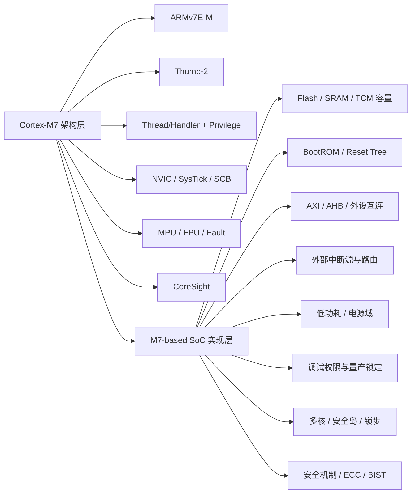

## 2.3 设计目标

Cortex-M7 的典型目标可概括为：

- 在 Cortex-M 生态中提供更高整数性能与 DSP 性能
- 兼顾**低中断延迟**与**更高吞吐**
- 保持适合 C 语言 / RTOS / CMSIS 的软件模型
- 在需要时引入 TCM 与 Cache，以兼顾确定性和峰值性能
- 支持工业、汽车控制、音频、电机控制、通信协议、轻量信号处理等工作负载

## 2.4 核心特征摘要

### 2.4.1 架构层关键点

- 基于 **ARMv7E-M**
- 使用 **Thumb-2** 指令集，16/32 位混合编码
- **6 级 superscalar 流水线**，带分支预测
- 支持一定条件下的**双发射**
- 32 位通用寄存器模型：`R0-R15`
- 双栈模型：`MSP` / `PSP`
- 统一异常模型：系统异常 + 外部中断
- 通过 `MPU` 实现区域级保护
- 可选 `FPU`
- 可选 `I-Cache / D-Cache / ITCM / DTCM`
- CoreSight 调试追踪生态完整

### 2.4.2 工程视角关键点

- 与 Cortex-M4 相比，性能更高，但行为也更“系统化”
- Cache/TCM/总线接口引入后，必须认真处理：
  - 内存属性
  - DMA 一致性
  - Barrier
  - 中断最坏时延
  - 调试与性能计数解读
- 对车规 MCU 而言，M7 只解决“核能力”；系统安全与确定性仍大量依赖 SoC 集成

## 2.5 M7 典型组成概念图

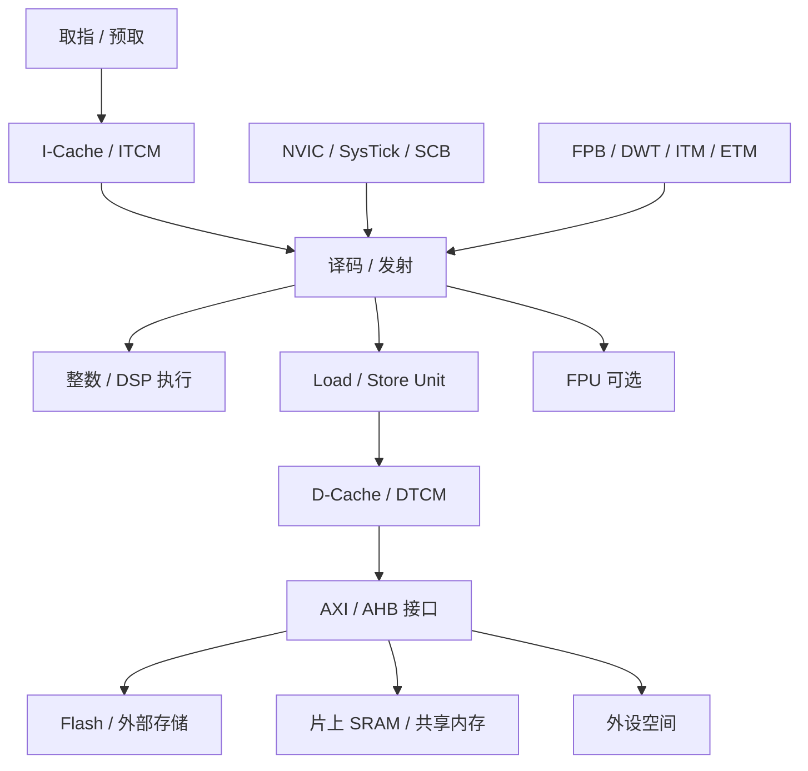

## 2.6 family 视角下的“不要误解”

### 2.6.1 不要把 Cortex-M7 只看成“更快的 M4”

M7 不是单纯的主频提升。真正影响软件行为的差异包括：

- 分支预测
- 更复杂的访存路径
- Cache / TCM 的可选组合
- 更强的总线接口
- Barrier 要求更明确
- DMA 一致性问题更容易暴露

### 2.6.2 不要把 MCU 的系统行为都归因于 M7 内核

下列问题很多并不是 M7 内核本身决定的：

- 上电后为什么先跑 BootROM
- 复位后向量表为什么不在 0 地址
- 为什么某些寄存器调试器能看、某些看不到
- 为什么某些外设中断能路由到某核、某些不能
- 为什么某低功耗模式下 SRAM 保持、TCM 不保持

这些都属于 SoC 实现层。

---

# 3. 编程模型

## 3.1 运行状态与权限模型

Cortex-M7 的软件执行模型由两个正交维度构成：

1. **模式维度**：Thread Mode / Handler Mode  
2. **权限维度**：Privileged / Unprivileged

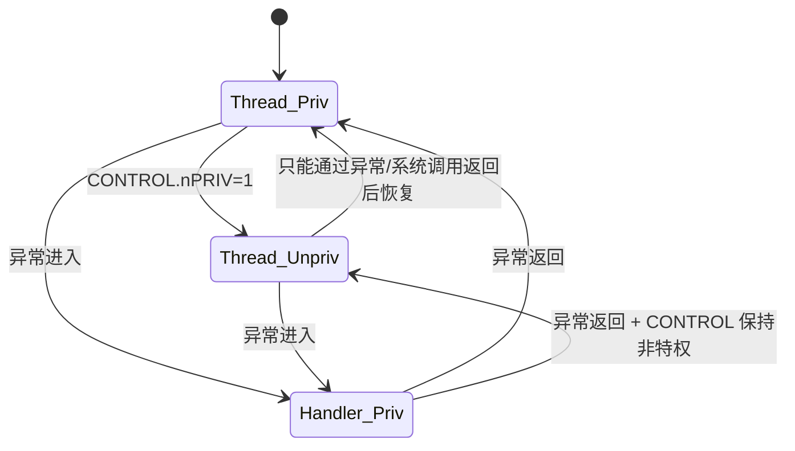

### 3.1.1 Thread Mode / Handler Mode

- **Thread Mode**：普通应用代码、任务代码运行模式
- **Handler Mode**：异常处理代码运行模式

只要进入异常，处理器就切到 Handler Mode；Handler Mode 总是特权态。

### 3.1.2 Privileged / Unprivileged

- **Privileged**：可访问系统控制寄存器，可配置中断屏蔽、MPU、异常控制等
- **Unprivileged**：受限，只能访问普通指令与允许的系统接口

常见设计模式：

- 内核 / BSP / Fault / SVC / 上下文切换：Privileged
- 用户任务：Unprivileged（若启用任务隔离）

### 3.1.3 M7 没有 AURIX 式多级 I/O 特权模型

Cortex-M7 不像 TriCore 一样存在 User-0 / User-1 / Supervisor 以及 I/O 特权分层。  
对 M7 来说，通常只有：

- 普通执行权限控制
- MPU 区域保护
- SoC 级外设防火墙

因此在把 AURIX 风格大纲映射到 M7 时，要避免照搬“多级 I/O 特权”的写法。

## 3.2 通用寄存器模型

Cortex-M7 使用 16 个核心寄存器：

- `R0-R12`：通用寄存器
- `R13`：栈指针 `SP`
- `R14`：链接寄存器 `LR`
- `R15`：程序计数器 `PC`

### 3.2.1 R0-R12

这些寄存器既承担数据计算，也承担地址计算。  
典型用途：

- `R0-R3`：函数参数 / 返回值
- `R4-R11`：被调用者保存寄存器
- `R12`：临时寄存器（intra-procedure call scratch）

### 3.2.2 SP / LR / PC

- `SP`：当前活动栈指针，底层可能映射为 MSP 或 PSP
- `LR`：普通调用返回地址；异常返回时承载 `EXC_RETURN`
- `PC`：当前执行位置；Cortex-M7 仅支持 Thumb 状态执行

### 3.2.3 FPU 寄存器（可选）

若实现带 FPU，则还存在浮点寄存器组：

- `S0-S31`：单精度视图
- `D0-D15`：双精度视图（若实现 DP）

注意：很多 MCU 虽然基于 M7，但实际只实现单精度 FPU，甚至不带 FPU。

## 3.3 程序状态字与控制寄存器

### 3.3.1 xPSR

`xPSR` 是 `APSR + IPSR + EPSR` 的组合视图，主要包括：

- `N / Z / C / V / Q`：运算状态标志
- `IPSR`：当前活动异常号
- `EPSR.T`：Thumb 状态相关位
- 其他保留或执行相关位

### 3.3.2 CONTROL

`CONTROL` 控制以下语义：

- `nPRIV`：Thread Mode 是否非特权
- `SPSEL`：Thread Mode 使用 MSP 还是 PSP
- `FPCA`：浮点上下文活动状态（若带 FPU）

### 3.3.3 PRIMASK / BASEPRI / FAULTMASK

这是 M7 异常屏蔽的核心三件套：

- `PRIMASK`：全局屏蔽大多数可屏蔽异常
- `BASEPRI`：设置优先级门限，屏蔽“优先级不够高”的异常
- `FAULTMASK`：屏蔽除 NMI 外的大多数异常

其中最工程化、最适合 RTOS 临界区的是 `BASEPRI`。

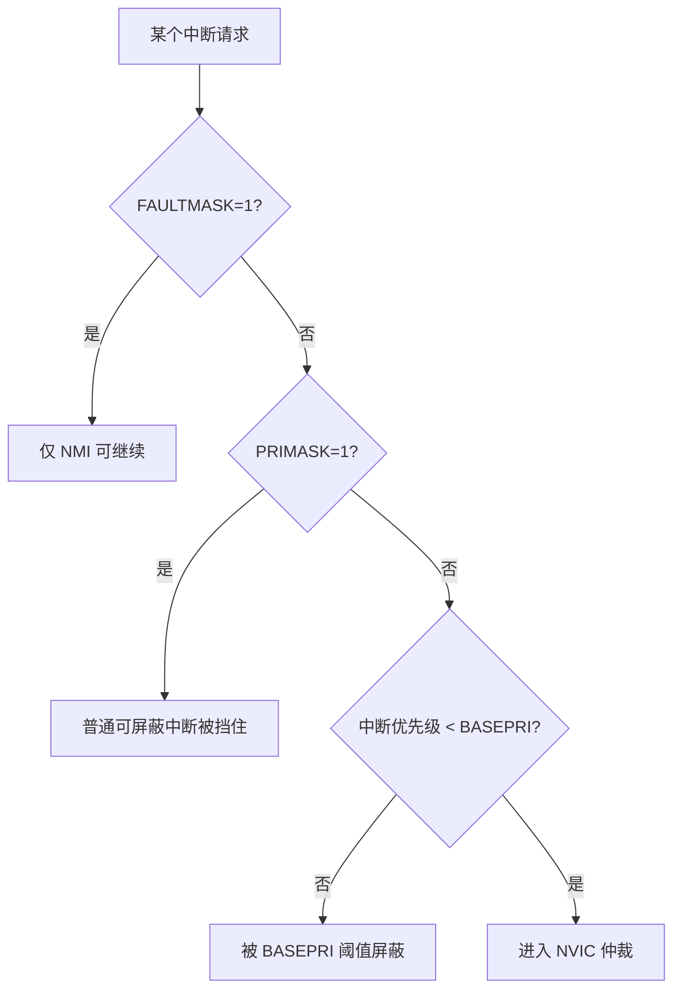

## 3.4 栈模型：MSP 与 PSP

这是 Cortex-M7 与 TriCore 最明显的不同之一。  
TriCore 的关键字是 **CSA**；M7 的关键字是 **双栈 + 异常自动压栈**。

### 3.4.1 MSP

Main Stack Pointer。通常用于：

- 复位后初始栈
- Handler Mode
- 裸机工程默认栈

### 3.4.2 PSP

Process Stack Pointer。通常用于：

- RTOS 任务栈
- 用户态任务独立栈
- Thread Mode 下的任务隔离

### 3.4.3 基本规则

- Handler Mode 一律使用 `MSP`
- Thread Mode 可通过 `CONTROL.SPSEL` 选择 `MSP` 或 `PSP`

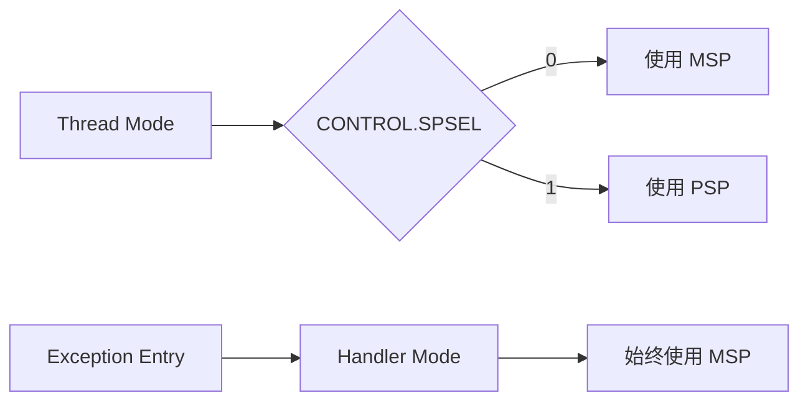

## 3.5 上下文模型

### 3.5.1 普通函数调用上下文

遵循 AAPCS / EABI：

- 参数尽量走寄存器
- 不够再走栈
- `R4-R11` 通常由被调用者保存
- `LR` 记录返回地址

### 3.5.2 异常自动保存上下文

异常进入时，硬件自动压入**基本异常帧**：

- `R0`
- `R1`
- `R2`
- `R3`
- `R12`
- `LR`
- `PC`
- `xPSR`

### 3.5.3 FPU 扩展上下文

若带 FPU，则异常帧可能进一步包含浮点寄存器。  
同时还存在 **lazy stacking** 机制，目的是降低未用 FPU 时的异常进入开销，但它也会带来：

- 调试时理解门槛更高
- 中断中使用 FPU 时栈行为更复杂
- WCET 与异常延迟分析更谨慎

### 3.5.4 M7 无硬件 CSA 链

这一点必须明确：

- **M7 不存在 CSA**
- **M7 不存在 PCXI / FCX / LCX**
- **M7 的上下文资源消耗，直接等价为“栈空间消耗”**

所以对 M7 来说：

- 递归过深
- 中断嵌套过深
- 任务栈配置过小
- FPU 上下文叠加

都会直接体现为**栈溢出风险**

### 3.5.5 异常上下文概念图

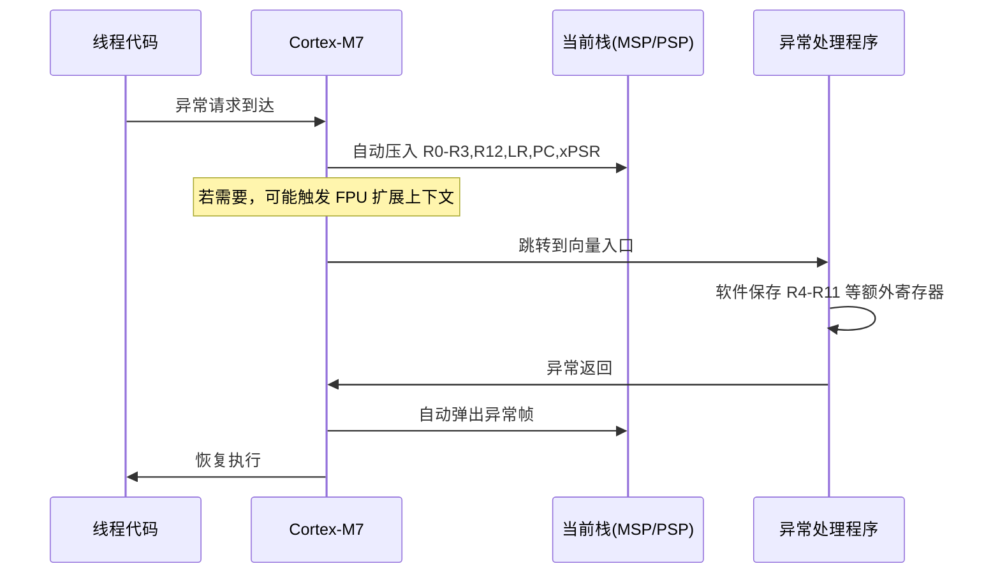

## 3.6 系统寄存器模型

可按软件职责分组理解：

### 3.6.1 控制与异常管理类

- `ICSR`
- `AIRCR`
- `SCR`
- `CCR`
- `SHCSR`

### 3.6.2 Fault 状态与诊断类

- `CFSR`
- `HFSR`
- `DFSR`
- `MMFAR`
- `BFAR`
- `AFSR`

### 3.6.3 中断控制类

- NVIC 使能寄存器
- 挂起寄存器
- 优先级寄存器
- 可选 `STIR`

### 3.6.4 保护类

- `MPU_TYPE`
- `MPU_CTRL`
- `MPU_RNR`
- `MPU_RBAR`
- `MPU_RASR`
- 新版实现还可能包含别名寄存器组

### 3.6.5 浮点类

- `CPACR`
- `FPCCR`
- `FPCAR`
- `FPDSCR`
- `MVFRx`

### 3.6.6 调试与追踪类

- `DEMCR`
- `DWT` 计数器 / 比较器
- `ITM`
- `FPB`
- `TPIU`
- `ETM`（若实现）
- `CTI`（若实现）

## 3.7 数据类型、对齐与字节序

### 3.7.1 字节序

Cortex-M7 在 MCU 场景下通常以**小端**使用。

### 3.7.2 数据宽度

常见软件可见数据宽度：

- 8 bit
- 16 bit
- 32 bit
- 64 bit（组合操作 / FPU / 某些访存）

### 3.7.3 对齐规则

对齐是 M7 工程上非常关键的点：

- 某些未对齐访问可被硬件支持
- 某些访问会带来额外周期
- 某些访问会产生 Fault
- 对系统寄存器、MPU 寄存器等往往还存在“只能字访问”的约束

所以正式手册应明确区分：

- 普通 SRAM 未对齐访问
- 外设区访问
- 系统寄存器访问
- TCM / Cache line / DMA 相关对齐

## 3.8 地址模型

Cortex-M7 面向 4GB 统一线性地址空间。  
地址解释主要依赖：

- 固定的 Cortex-M 逻辑区间划分
- SoC 的物理映射
- MPU 的属性与访问许可

## 3.9 ABI 与工具链接口约束

工程上建议明确：

- 编译选项 `-mcpu=cortex-m7 -mthumb`
- FPU 相关选项必须和实际实现一致
- 栈 8 字节对齐
- 向量表符号命名与弱符号覆盖方式
- `SystemInit()`、`Reset_Handler`、`__libc_init_array()` 等启动流程接口
- RTOS 切换时对 `EXC_RETURN` / PSP / BASEPRI 的管理责任

---

# 4. 指令系统总览

## 4.1 指令集风格

Cortex-M7 采用 **Thumb-2**，也就是：

- 16 位与 32 位混合编码
- 既强调代码密度，也提供高性能扩展
- 绝大多数 C 语言代码可直接高效映射

M7 不支持 ARM state，只支持 Thumb state 执行。

## 4.2 指令类别

从软件使用角度，可将 M7 指令粗分为：

- 数据传送与访存
- 整数算术
- 逻辑与位操作
- 比较与分支
- 系统控制与异常控制
- 独占访问与同步
- DSP / SIMD
- 浮点（可选）

## 4.3 16/32 位混合编码的意义

混合编码意味着：

- 常见短操作可获得较高代码密度
- 复杂立即数、扩展访存和更大分支范围通过 32 位指令实现
- 对反汇编、单步调试、Fault 后 PC 解码要有正确认识

对验证与 Fault 框架而言，这一点特别重要：  
**不要想当然地把“当前指令长度”固定理解为 2 字节。**

## 4.4 常见软件最关心的指令类

### 4.4.1 数据传送与访存

包括：

- `LDR / STR`
- `LDRB / STRB`
- `LDRH / STRH`
- `LDM / STM`
- `PUSH / POP`
- `LDRD / STRD`（受对齐与实现约束影响）
- 栈基 / 基址 + 偏移 / PC 相对寻址

### 4.4.2 整数算术与逻辑

包括：

- 加减乘除
- 比较
- 饱和算术
- 绝对值 / 符号扩展 / 零扩展
- 前导零计数
- 旋转 / 反转 / 字节交换

### 4.4.3 分支与流程控制

包括：

- `B / BL / BX`
- 条件分支
- `CBZ / CBNZ`
- `SVC`
- 异常返回相关 `BX LR`

### 4.4.4 系统控制与同步

包括：

- `MRS / MSR`
- `CPSID / CPSIE`
- `WFI / WFE / SEV`
- `DMB / DSB / ISB`

### 4.4.5 独占访问

包括：

- `LDREX`
- `STREX`
- `CLREX`

用于锁、队列、共享计数器等原子同步。

### 4.4.6 DSP / SIMD

M7 的 DSP 扩展是其与普通控制核拉开差距的重要来源之一。  
常见能力包括：

- 饱和加减
- 乘加
- 打包 8/16 bit SIMD 运算
- 部分字节/半字并行操作

### 4.4.7 浮点

若实现带 FPU，可支持：

- 单精度浮点
- 某些实现下的双精度浮点
- 浮点比较、转换、乘除、平方根等

## 4.5 特权指令与受限指令

M7 中很多“敏感能力”并不是靠单独的 I/O 特权模型，而是通过**特权态访问限制**完成。  
通常以下操作应视为特权域内容：

- 修改异常屏蔽寄存器
- 修改 `CONTROL`
- 修改 `VTOR`
- 修改 `AIRCR`
- 修改 `MPU`
- 修改 `CPACR`
- 大部分调试控制寄存器访问

## 4.6 Barrier 指令为什么在 M7 上格外重要

在简单 Cortex-M 内核上，很多代码即使忘了 Barrier，看上去也“似乎能跑”。  
但在 M7 上，由于：

- 总线接口更复杂
- 写缓冲更强
- Cache / TCM / 设备属性更复杂
- 可能存在 DMA / 其他主设备

所以 `DMB / DSB / ISB` 的使用要更严谨。

### 4.6.1 DMB

保证内存访问顺序可见性，常用于共享变量、多主设备同步。

### 4.6.2 DSB

确保前面的访存事务真正完成，常用于：

- 外设控制寄存器写后立即等待状态变化
- Cache / MPU / 系统控制修改后
- 进入低功耗前

### 4.6.3 ISB

刷新流水线，保证后续取指在新控制状态下进行，常用于：

- 更新 `CONTROL`
- 更新 `VTOR`
- 更新 `MPU`
- 切换异常屏蔽或系统控制状态后

## 4.7 非法 / 未实现指令与协处理器相关 Fault

以下情况可能触发 UsageFault 或升级为 HardFault：

- 执行未定义指令
- 进入非 Thumb 状态
- FPU 未使能却执行浮点指令
- 执行不满足架构约束的系统控制指令序列

## 4.8 指令性能理解的正确方式

对于 M7，不建议用“每条指令固定几周期”的思路来指导系统设计。  
真正影响周期的往往是：

- 双发射是否成立
- 分支是否命中预测
- 指令是否命中 I-Cache / ITCM
- 数据是否命中 D-Cache / DTCM
- 是否跨总线访问
- 外设 / Flash 等待状态
- 屏障与同步开销

---

# 5. 微架构与执行引擎

## 5.1 总体认识

Cortex-M7 是 Cortex-M 家族里明显更重视**执行吞吐 + 实时响应 + 存储系统能力**平衡的内核。  
从官方公开资料看，它具备：

- 6 级流水线
- superscalar 执行框架
- 分支预测
- 更宽的系统接口
- 可选 TCM
- 可选 I/D Cache

## 5.2 执行资源与流水线认知

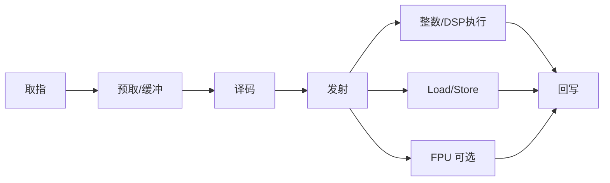

软件应采用如下理解方式：

- **不要假定所有指令都能双发射**
- **不要把双发射当作可编程显式规则**
- **把性能重点放在“代码布局 + 数据布局 + 热路径存放 + 分支与访存局部性”**

## 5.3 取指、预取与分支预测

### 5.3.1 指令来源

对 M7 而言，指令可能来自：

- ITCM
- I-Cache 命中的外部存储
- 片上 Flash
- 外部 XIP 存储
- SRAM 可执行区

### 5.3.2 分支预测

M7 引入分支预测后，循环和分支密集代码的平均性能会更好。  
但从车规实时角度要注意：

- 平均性能更高 ≠ 最坏时延更小
- 若系统非常强调可预测性，关键闭环代码仍更适合放入 ITCM / 局部确定性存储

## 5.4 Load / Store 子系统

### 5.4.1 访存路径比低端 M 内核更复杂

数据访问可能走：

- DTCM
- D-Cache
- 片上 SRAM
- 外设区
- 外部总线 / 外部存储

### 5.4.2 写缓冲

M7 的写缓冲能力比更简单的 M-profile 内核更强。  
这意味着：

- 某些写操作对程序流看似“已执行”，但对系统其他主设备未必立即可见
- 某些外设控制顺序必须配合 `DSB`
- 某些共享内存同步必须配合 `DMB`

### 5.4.3 对软件的直接影响

最常见的误区是：

- 写完外设寄存器就立刻假设状态已生效
- 启动 DMA 前未做 cache clean
- 读取 DMA 更新区前未做 cache invalidate
- 更新 MPU 后未做 `DSB+ISB`

## 5.5 TCM、Cache 与实时性

### 5.5.1 ITCM / DTCM 的价值

TCM 的本质价值不是“容量大”，而是：

- 路径短
- 访问确定性更好
- 不依赖 cache 命中
- 更适合中断入口、内核关键路径和控制环关键数据

### 5.5.2 Cache 的价值与代价

Cache 提高平均性能，但也引入：

- 抖动
- 一致性负担
- 维护操作开销
- 自修改代码 / Boot / DMA 场景复杂度

### 5.5.3 车规 MCU 常见分工建议

- **ITCM**：ISR 入口、调度器关键路径、紧急控制环代码
- **DTCM**：栈、热点控制变量、强实时共享变量
- **Flash/I-Cache**：一般代码
- **SRAM/D-Cache**：普通数据与缓冲区
- **Non-cacheable SRAM**：DMA 共享区、设备描述符、通信 ring buffer

## 5.6 确定性与最坏执行时间

M7 若以“平均性能”为目标，Cache 很有价值；  
若以“中断最坏响应、控制闭环抖动、ASIL 分析简化”为目标，则要更强调：

- 热代码放 TCM
- 热数据放 TCM
- 非关键缓冲区使用 Cache
- DMA 共享区明确 non-cacheable
- 中断入口避免走高等待态 Flash

## 5.7 性能监控与事件计数器

M7 常见的性能观测路径包括：

- `DWT->CYCCNT`
- 事件计数器
- Trace 时间戳
- ETM / ITM 事件分析

对工程团队最实用的方式通常是：

1. 用 `CYCCNT` 做微基准  
2. 用 GPIO / Trace 对齐中断入口与出口  
3. 对 Cache / MPU / TCM 配置做 A/B 对比  
4. 把“峰值性能”和“最坏时延”分别测，而不是混在一起

---

# 6. 存储器体系与地址空间

## 6.1 地址空间总览

Cortex-M7 面向统一 4GB 地址空间。  
典型 Cortex-M 逻辑区间可按如下理解：

- `0x0000_0000` 附近：代码区 / 启动区 / 向量表初始映射
- `0x2000_0000` 附近：SRAM 区
- `0x4000_0000` 附近：外设区
- `0x6000_0000` 附近：外部 RAM / 外部存储区
- `0xA000_0000` 附近：外部设备区
- `0xE000_0000` 附近：PPB / System Control / CoreSight

> 注：具体映射、重定向、镜像和别名仍取决于芯片实现。

## 6.2 典型地址空间概念图

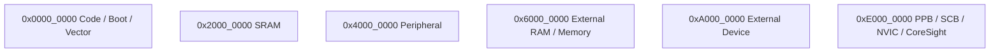

## 6.3 ITCM / DTCM

### 6.3.1 ITCM

适合放：

- Reset / 向量表附近热点代码
- 高频 ISR
- 调度器关键函数
- 电机控制 / 快环算法热路径

### 6.3.2 DTCM

适合放：

- MSP / PSP 栈
- 任务控制块
- 中断共享小数据
- 时间关键型控制变量

### 6.3.3 TCM 的边界

TCM 的以下属性通常属于实现相关：

- 容量
- 是否可由 DMA 访问
- 是否带 ECC
- 启动后是否默认使能
- 地址窗口
- 是否支持运行时重映射

## 6.4 Cache 体系

### 6.4.1 I-Cache

典型作用：

- 提高 Flash/XIP 的代码执行效率
- 缓解 wait state 影响
- 提高平均吞吐

### 6.4.2 D-Cache

典型作用：

- 提高一般数据区访问效率
- 降低重复读取成本
- 配合 AXI 总线提高系统带宽利用

### 6.4.3 软件必须承担的一致性责任

如果有 DMA / 外设 / 其他主设备访问同一片内存，则软件必须明确：

- CPU 写后，DMA 要看到新值 → `clean`
- DMA 写后，CPU 要看到新值 → `invalidate`
- 描述符区 / 共享 ring buffer 是否应直接配成 non-cacheable

## 6.5 MPU 与内存属性

MPU 是 M7 存储器体系里非常关键的“语义层”。  
它决定的不只是“能不能访问”，还包括：

- 是否可执行
- 是否可缓存
- 是否缓冲
- 是否 shareable
- 访问权限
- 区域边界

### 6.5.1 为什么 MPU 不是可有可无

即便系统没有做严格任务隔离，MPU 仍然值得启用，因为它能帮助：

- 防止 SRAM 被误执行
- 防止任务越界访问
- 区分 DMA 共享区与 cacheable 区
- 让 Fault 更可诊断，而不是沉默破坏数据

## 6.6 原子访问与共享变量

### 6.6.1 独占访问的用途

M7 通过 `LDREX/STREX` 提供原子更新机制。  
适合用于：

- 自旋锁
- 引用计数
- 事件标志
- 无锁队列中的小型同步原语

### 6.6.2 不能误以为“原子指令自动解决所有共享问题”

还需要同时考虑：

- Shareable 属性
- Barrier
- Cache 一致性
- 多核 / 多主设备是否真的共享同一个可见域

## 6.7 存储器错误处理

M7 架构层能看到的常见错误包括：

- MPU 保护违规 → MemManage Fault
- 总线访问错误 → BusFault
- 非法取指 / 状态错误 → UsageFault / HardFault

而更底层的 ECC / parity / external abort 上报路径，很多取决于 SoC。

## 6.8 Overlay / 标定支持

必须明确：

- **Overlay 不是 Cortex-M7 架构标准能力**
- **在线标定 / 地址重映射 / 调试替换** 通常属于 SoC 扩展或调试模块功能
- 若项目有 A2L/标定需求，应在“平台手册”而不是“内核架构手册”中描述

---

# 7. 中断系统

## 7.1 总体认识

Cortex-M7 的中断体系核心是 **NVIC + 统一异常模型**。  
从软件视角，最关键的几个特性是：

- 优先级可配置
- 支持抢占
- 支持嵌套
- 支持挂起 / 激活区分
- 支持 tail-chaining
- 支持 late arrival
- 向量表可重定位

## 7.2 异常与中断的统一编号体系

在 Cortex-M 中，系统异常与外部中断共享一套向量表，只是编号区间不同：

- 负号范围：系统异常
- 非负范围：外部中断号

这比很多传统 MCU 的“系统异常另起一套模型”更统一。

## 7.3 优先级模型

### 7.3.1 数值方向

优先级值越小，优先级越高。

### 7.3.2 分组

通过 `AIRCR.PRIGROUP`，可把优先级字段划分为：

- 抢占优先级
- 子优先级

工程上要注意：  
**优先级位数的物理实现并不一定与寄存器宽度等同。**

### 7.3.3 与 BASEPRI 的关系

`BASEPRI` 屏蔽的是“优先级数值不够高”的异常。  
因此一套好的 RTOS 设计会同时定义：

- 内核可抢占优先级范围
- syscall-safe ISR 范围
- 绝对高优先级硬中断范围

## 7.4 向量表与 VTOR

### 7.4.1 向量表内容

向量表的前两项最关键：

1. 初始 MSP
2. Reset 入口地址

后续依次是系统异常和外部中断入口。

### 7.4.2 VTOR 的作用

`VTOR` 用于向量表重定位。  
典型用途包括：

- BootROM 跳转到应用后改向量表
- App 从 Flash 切到 SRAM 向量表
- 多镜像升级场景切换中断入口

### 7.4.3 软件要求

更新 `VTOR` 后，通常应配合 `DSB + ISB`，并保证：

- 新表已准备好
- 表地址满足对齐约束
- 新表中的入口全为 Thumb 地址

## 7.5 中断响应流程

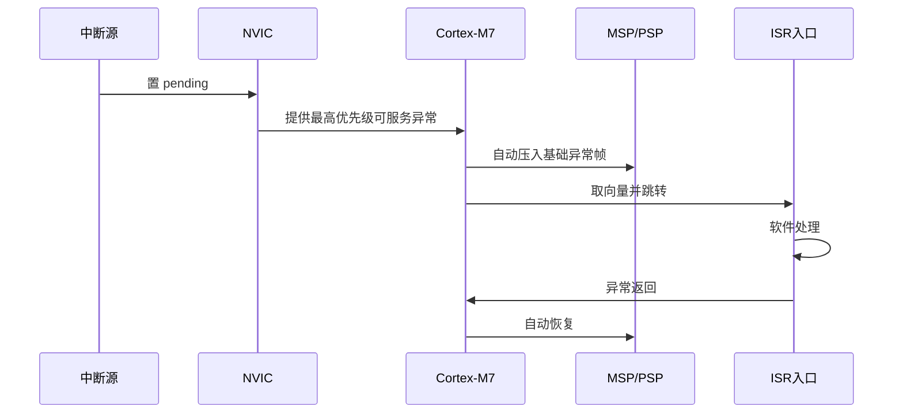

## 7.6 tail-chaining 与 late arrival

### 7.6.1 tail-chaining

当一个异常刚要退出，另一个更高或可立即服务的异常已 pending 时，处理器可直接切换，减少不必要的出栈/入栈开销。

### 7.6.2 late arrival

当异常进入过程中，出现更高优先级异常，处理器可改为响应更高优先级异常。  
这会影响你对“固定中断延迟”的朴素理解。

## 7.7 中断屏蔽策略建议

### 7.7.1 裸机小系统

可以使用 `PRIMASK` 简化关键区。

### 7.7.2 RTOS / AUTOSAR 类系统

更推荐用 `BASEPRI`，这样：

- 关键高优先级 ISR 仍可打断
- 内核关键区不会把系统全部锁死
- 语义更适合分层驱动和调度器

### 7.7.3 一般不推荐滥用 FAULTMASK

`FAULTMASK` 太强，容易把本应观察到的异常也压掉，仅适合极少数底层场景。

## 7.8 软件触发中断

可通过 NVIC 相关寄存器置 pending；若实现有 `STIR`，也可用于软件注入 IRQ。  
常见用途：

- 测试 ISR 路径
- 任务间软中断
- 驱动内部延迟处理机制

## 7.9 中断与调试的交互

需要明确几个问题：

- halt 时 pending 中断是否继续积累
- 单步跨异常边界时行为如何
- vector catch 是否启用
- 调试态是否冻结 SysTick / DWT / 外设定时器

这些常由调试器设置、DEMCR 配置和 SoC 外设 freeze 机制共同决定。

## 7.10 中断设计建议

- ISR 入口尽量短小
- 热 ISR 放 ITCM
- 避免在高优先级 ISR 中直接做复杂缓存维护
- 不在普通 ISR 中随意使用 FPU，除非已设计好栈与上下文策略
- RTOS 下明确哪些 ISR 可调用 OS API、哪些不可

---

# 8. 异常 / Fault / 错误体系

## 8.1 正确术语：M7 更适合说 Exception / Fault

AURIX 常说 Trap；  
对 Cortex-M7，更准确的术语是：

- **Exception**
- **Fault**
- **Interrupt**

正式手册中建议保留“异常 / Fault”写法，而不是直接套 TriCore Trap Class 体系。

## 8.2 异常类别总览

M7 典型异常包括：

- Reset
- NMI
- HardFault
- MemManage
- BusFault
- UsageFault
- SVCall
- DebugMonitor
- PendSV
- SysTick
- 外部 IRQ

## 8.3 Fault 升级路径

这是 M7 异常体系最容易被误解的地方之一。  
某些 Fault 若未使能或在特定上下文下不可独立处理，会升级为 HardFault。

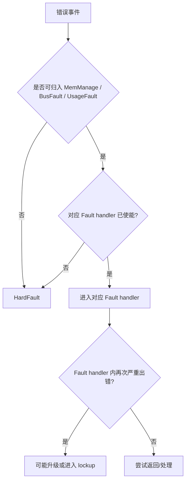

## 8.4 NMI

### 8.4.1 语义

NMI 不受普通异常屏蔽控制影响，优先级极高，仅次于 Reset。

### 8.4.2 常见用途

- 外部安全监控告警
- 电源异常
- 时钟严重故障
- 外部硬件故障引脚
- 某些安全控制器上报

### 8.4.3 设计建议

NMI handler 应保持极简，优先做：

- 采样关键状态
- 记录诊断
- 切安全态 / 复位 / 通知安全监控

不要在 NMI 里做复杂业务处理。

## 8.5 统一向量表，而不是独立 Trap 表

Cortex-M7 没有 AURIX 那种“BTV 单独控制 Trap 表”的机制。  
所有异常都在统一向量表里，靠异常号索引。

## 8.6 异常现场保存与返回

### 8.6.1 自动压栈内容

基础异常帧由硬件自动保存。

### 8.6.2 `EXC_RETURN`

异常返回并不是“普通函数 return”。  
`LR` 中的 `EXC_RETURN` 告诉处理器：

- 返回到 Thread 还是 Handler
- 使用 MSP 还是 PSP
- 是否带浮点上下文

### 8.6.3 调试与 Fault 诊断时的关键点

Fault 框架必须学会：

- 从 MSP/PSP 找到异常帧
- 解码 `EXC_RETURN`
- 解码 `PC` 所在指令与内存属性
- 结合 `CFSR/HFSR/BFAR/MMFAR` 判断根因

## 8.7 异常信息寄存器

### 8.7.1 CFSR

组合状态寄存器，包含：

- MemManage Fault 状态
- BusFault 状态
- UsageFault 状态

### 8.7.2 HFSR

HardFault 状态寄存器，用于判断：

- 强制升级
- 向量读取故障等

### 8.7.3 BFAR / MMFAR

给出故障地址，但要先检查对应地址有效位。

### 8.7.4 DFSR / AFSR

与调试事件和辅助错误信息相关。

## 8.8 常见异常逐项说明

### 8.8.1 非法指令 / 未实现指令

常见根因：

- 跳到错误地址
- 非 Thumb 地址
- 代码损坏
- 未使能 FPU 却执行 FPU 指令
- 反汇编误判当前指令宽度

### 8.8.2 特权违规

常见根因：

- 非特权线程直接写系统寄存器
- 错误调用 `MSR CONTROL`
- 任务代码擅自改中断屏蔽 / MPU

### 8.8.3 存储保护异常

常见根因：

- XN 区执行
- 只读区写入
- 用户任务访问内核区
- 栈越界触碰 MPU guard region

### 8.8.4 数据对齐异常

常见根因：

- 强制类型转换导致未对齐访问
- packed 结构体直接字/双字访问
- 对系统寄存器做半字/字节访问

### 8.8.5 同步数据错误 / 异步数据错误

常见根因：

- 外部总线从设备错误
- Flash / SRAM / 外设返回错误
- imprecise bus fault（调试上更棘手）

### 8.8.6 程序完整性错误 / 数据完整性错误

M7 核本身不直接提供完整的软件签名校验。  
工程上通常由以下模块负责：

- BootROM / Secure Boot
- Flash ECC / parity
- 外部安全监控
- SoC 错误聚合器

### 8.8.7 “上下文链耗尽 / 下溢”在 M7 中不适用

这是从 AURIX / TriCore 大纲迁移过来的条目。  
M7 应等价替换为：

- 栈溢出
- PSP / MSP 使用错误
- 异常帧破坏
- lazy stacking 相关问题

### 8.8.8 系统调用

通过 `SVC` 进入，典型用途：

- 用户态请求特权服务
- RTOS 系统调用
- 受控上下文切换入口

## 8.9 Fault 软件框架建议

建议所有 M7 项目都建立标准 Fault 框架，至少做到：

1. 捕获 `MSP/PSP`
2. 获取基础异常帧
3. 读取 `SCB` Fault 状态寄存器
4. 区分可恢复 / 不可恢复
5. 输出统一日志结构
6. 决定：
   - 继续运行
   - 终止当前任务
   - 软复位
   - 进入安全态

---

# 9. 保护与隔离机制

## 9.1 保护架构总览

M7 的保护体系核心不是 ENDINIT，而是：

- 特权级
- Handler/Thread 模式分离
- MPU 区域保护
- Fault 上报
- SoC 级总线防火墙（若有）

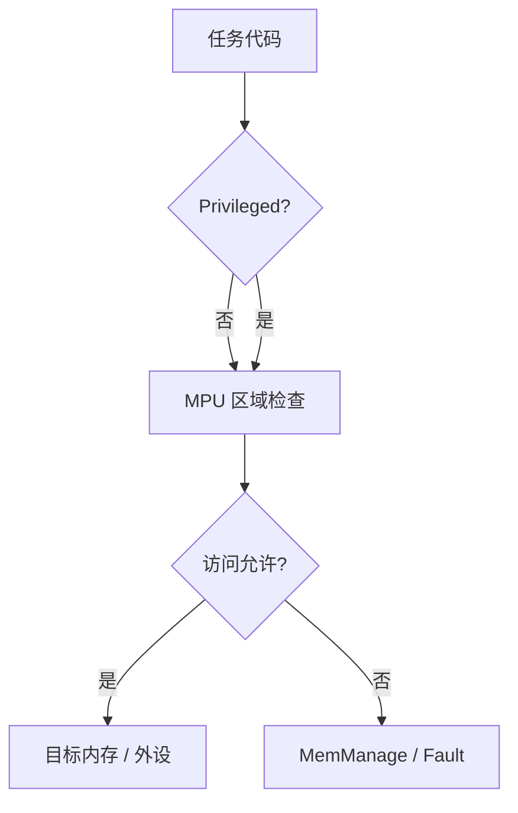

## 9.2 特权保护

M7 中很多关键控制面都应限制在特权态：

- 中断屏蔽
- 向量表重定位
- MPU 配置
- FPU 访问权限配置
- 系统复位请求

## 9.3 I/O 权限保护

### 9.3.1 架构层结论

M7 没有 TriCore 式独立 I/O 特权等级。

### 9.3.2 工程层做法

若要隔离外设访问，通常使用：

- MPU 把外设窗口分区域
- SoC 外设访问控制器
- TrustZone-M（注意：这不是 M7，自身不适用）
- 外围安全管理器

## 9.4 代码保护

建议至少完成以下基线配置：

- Flash / ROM：可执行、只读
- SRAM：默认不可执行（XN）
- 外设区：不可执行
- BootROM / 安全区：按需求限制读访问

## 9.5 数据保护

建议至少区分：

- 任务私有栈区
- 内核数据区
- DMA 共享区
- 只读常量区
- 驱动寄存器映射区

## 9.6 保护集 / 任务保护上下文

M7 没有 AURIX 那种“任务保护集硬件上下文切换模型”。  
其等价工程做法通常是：

- RTOS 在任务切换时切换 MPU 区域配置
- 通过 PSP 区分任务栈
- 通过 SVC / PendSV 统一进入特权切换路径

## 9.7 外设与系统寄存器访问保护

### 9.7.1 系统寄存器

通过特权限制 + 地址空间位置 + 访问位宽要求共同保护。

### 9.7.2 普通外设

更多依赖 SoC 地址映射和总线访问控制。

## 9.8 ENDINIT / Safety ENDINIT：M7 架构不适用

这一条需要非常明确：

- **Cortex-M7 内核架构没有 ENDINIT**
- **也没有 Safety ENDINIT**
- 与之最接近的软件工程等价物是：**
  - 特权控制
  - MPU 保护
  - 某些 SoC 的写保护寄存器解锁序列
  - Debug Lock / Option bytes / 安全状态机
  - 受控的系统控制寄存器写入序列（含 barrier）

因此如果你的项目是“M7-based 车规 MCU”，而芯片厂商又提供类似受保护关键寄存器写入机制，那么那是**SoC 手册内容**，不是 M7 核心架构内容。

## 9.9 本地存储器安全保护

M7 仅从架构上定义 MPU 与内存属性。  
至于：

- TCM 是否支持外部主设备访问
- SRAM 是否存在安全分区
- 调试口是否能旁路访问
- DMA 是否能访问任务私有区

都依赖 SoC。

## 9.10 调试访问保护

调试访问保护主要表现为 SoC 集成问题：

- SWD/JTAG 是否默认开
- 量产是否锁定
- 某些核心寄存器在 non-invasive 模式是否可读
- ETM/ITM 是否对量产关闭
- 安全生命周期是否改变调试可见性

## 9.11 保护异常与告警路径

M7 架构层能保证的是“Fault 可见”。  
但是否进一步：

- 产生安全告警
- 输出错误引脚
- 请求系统复位
- 上报给安全岛

取决于 SoC 安全集成。

## 9.12 软件配置建议

建议的 M7 基线保护策略：

1. 复位后尽快配置向量表和栈
2. 尽快开启基础 MPU
3. 默认将 SRAM 设为 XN
4. 为任务栈添加 guard region
5. 将 DMA 共享区独立建区
6. 明确用户态与内核态边界
7. 将 Fault handler 标准化

---

# 10. 启动、Boot、复位与停机

## 10.1 启动与复位总体说明

必须区分：

- **M7 内核架构最小定义**
- **SoC 启动链实际实现**

### 10.1.1 架构最小定义

从内核视角，复位后最关键的动作只有：

1. 从向量表取初始 MSP
2. 从向量表取 Reset Handler 地址
3. 进入 Thumb 状态开始执行

### 10.1.2 SoC 实际启动链

真实 MCU 上常常是：

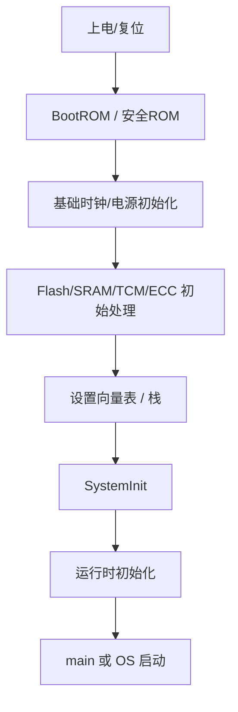

BootROM 是否存在、做了多少事，**不是 M7 核本身规定的**。

## 10.2 复位分类

### 10.2.1 M7 架构直接相关

- 核心复位后回到向量表入口
- 可通过系统控制请求某些复位行为

### 10.2.2 SoC 级常见分类

- 上电复位
- 外部复位
- 看门狗复位
- 软件系统复位
- 域复位 / 模块复位
- 安全复位
- 调试复位

具体分类、保持性矩阵、复位原因寄存器都属于 SoC 文档。

## 10.3 各类复位影响矩阵

对 M7-based MCU 正式手册，建议至少做如下矩阵：

| 对象 | 上电复位 | 软件系统复位 | 外设域复位 | 调试复位 |
|---|---|---:|---:|---:|
| M7 内核寄存器 | 清除 | 通常清除 | 实现相关 | 实现相关 |
| MSP/PC 初值 | 重新装载 | 重新装载 | 通常否 | 实现相关 |
| ITCM/DTCM 内容 | 实现相关 | 实现相关 | 实现相关 | 实现相关 |
| SRAM 内容 | 实现相关 | 实现相关 | 实现相关 | 实现相关 |
| Flash 内容 | 保持 | 保持 | 保持 | 保持 |
| 调试连接 | 断开或保持 | 实现相关 | 实现相关 | 实现相关 |

## 10.4 Boot 模式选择

**Boot 模式选择不是 M7 架构标准能力。**  
常见由 SoC 实现：

- 引脚采样
- OTP / option bytes / eFuse
- BootROM 状态机
- 安全生命周期配置
- 双镜像选择

## 10.5 BootROM / 固件流程

### 10.5.1 M7 架构层

没有规定必须有 BootROM。

### 10.5.2 SoC 常见行为

BootROM 可能负责：

- 基础时钟上电
- RAM / ECC 初始覆盖
- 启动镜像选择
- 镜像校验
- 安全启动
- 回退到下载模式

## 10.6 次核启动流程

### 10.6.1 架构层结论

**Cortex-M7 本身是单核内核。**  
“次核启动”不是 M7 内核固有问题，而是多核 SoC 问题。

### 10.6.2 多核 M7-based MCU 中的常见模式

- 主核先完成系统初始化
- 配置从核入口地址
- 解除从核 reset / hold
- 通过 mailbox / flag 同步

## 10.7 无有效启动头时的处理

这完全属于 SoC / BootROM 设计问题。  
可能的系统行为包括：

- 进入串口下载
- 进入调试等待
- 回退镜像
- 死循环
- 触发安全状态

## 10.8 Bootstrap Loader

是否存在串口 / CAN / USB / 以太网 BSL，完全不是 M7 核心定义。  
正式手册中应明确写成：

- **M7 内核：不定义 BSL**
- **本产品 SoC：若提供，则在 BootROM / 安全启动手册中描述**

## 10.9 软件复位与停机请求

### 10.9.1 软件复位

M7 常见软件复位路径是通过系统控制块请求系统复位。  
但“这是核复位、系统复位还是电源域复位”，要看 SoC 实现。

### 10.9.2 停机 / shutdown

M7 架构本身没有像某些汽车 MCU 那样定义完整 shutdown 状态机。  
对 M7 而言，软件更常见的“停机类语义”是：

- `WFI`
- `WFE`
- 请求进入 sleep / deep sleep
- 等待 SoC 电源管理器接管

## 10.10 Boot 与安全机制交互

M7 内核本身提供的安全基础有限，真正的安全启动一般依赖：

- BootROM
- Flash 控制器
- 密钥存储
- 安全状态机
- 外部安全监控

## 10.11 调试模式下的启动差异

常见差异包括：

- Reset halt
- Vector catch
- 调试器提前接管 `VTOR`
- 跳过部分 BootROM 延时
- 调试模式下维持部分时钟 / 电源域

这同样不是 M7 架构独立规定，而是调试组件 + SoC 共同实现。

---

# 11. 多核子系统

## 11.1 先给结论：M7 内核本身不是多核架构定义

这是最重要的前置结论。  
如果一颗芯片里有 2 个或更多 M7 核，那么多核行为属于 **M7-based SoC**，而不是 M7 内核本身固有定义。

## 11.2 多核拓扑结构（实现相关）

多核 M7 SoC 常见资源组织：

- 每核私有寄存器
- 每核私有 ITCM / DTCM
- 共享 SRAM / 外设 / Flash
- 共享调试 fabric
- 可选硬件 mailbox / semaphore

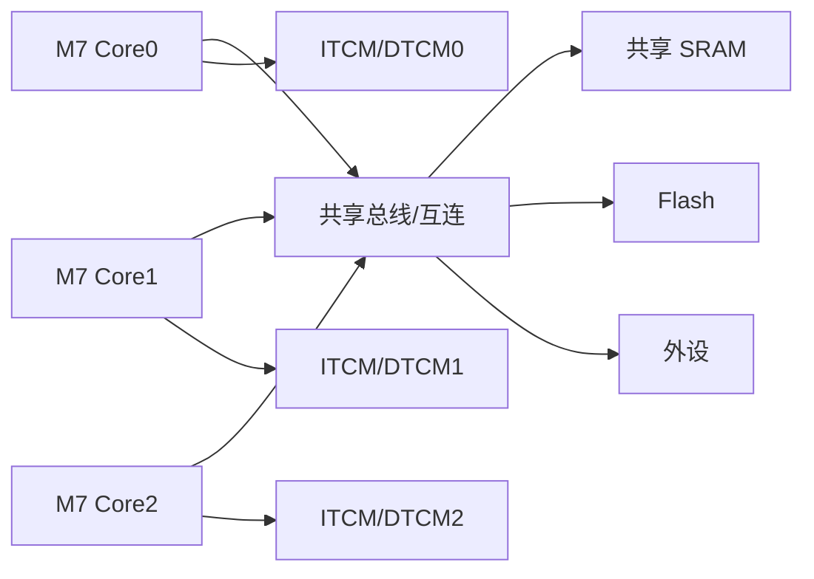

## 11.3 核间启动与生命周期管理

架构不定义；SoC 典型做法是：

- 由主核 / 系统控制器释放从核
- 由共享寄存器提供 boot address
- 由 mailbox / flag 做启动握手

## 11.4 核间通信机制

多核 M7 系统常见 IPC 方式：

- 共享内存 + 中断
- mailbox
- 事件寄存器
- 硬件 semaphore
- 软件 ring buffer

## 11.5 核间同步机制

常用手段：

- `LDREX/STREX`
- 自旋锁
- `DMB/DSB/ISB`
- cache maintenance
- 非缓存共享区

## 11.6 共享资源仲裁

对于共享 Flash / SRAM / 总线 / 调试带宽，必须考虑：

- 峰值吞吐冲突
- 最坏延迟增加
- 调试时被其他核污染的时间分析
- DMA 与 CPU 的竞争

## 11.7 多核中断路由

这是 SoC 级问题，不是 M7 标准功能。  
正式芯片手册应说明：

- 外设中断是否能选核
- 中断是否广播
- 中断是否聚合
- 跨核软中断怎么做

## 11.8 多核调试与追踪

常见能力包括：

- 单核 halt
- 全核同步 halt
- 交叉触发
- 多核 trace 时间对齐

## 11.9 Freedom from Interference 视角

多核 M7 系统做 ISO 26262 分析时，应单独分析：

- 时序干扰
- 空间干扰
- 通信干扰
- 调试干扰
- 共享缓存 / 共享 SRAM 干扰
- 共享时钟 / 电源域干扰

---

# 12. 调试、追踪与标定

## 12.1 调试架构总览

M7 的调试生态属于 CoreSight 体系。  
典型组件包括：

- SWD / JTAG 接口
- FPB
- DWT
- ITM
- ETM（可选）
- TPIU
- CTI（可选）

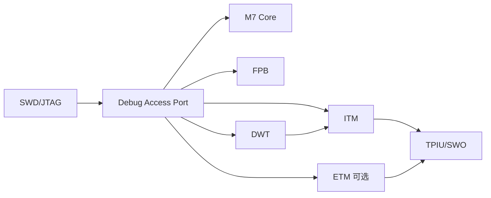

## 12.2 外部调试接口

### 12.2.1 SWD

车规 MCU 中非常常见，管脚少，工具兼容性好。

### 12.2.2 JTAG

部分产品仍保留，用于边界扫描或更复杂调试场景。

### 12.2.3 量产限制

是否允许量产态使用调试接口，属于 SoC 安全生命周期设计问题。

## 12.3 Run-Control

M7 支持常规调试控制：

- halt
- resume
- single-step
- 读写寄存器
- 读写内存
- reset halt
- attach / detach

## 12.4 断点与观察点

### 12.4.1 FPB

Flash Patch and Breakpoint。  
用于：

- 硬件断点
- 某些场景下的代码 patch

### 12.4.2 DWT

Data Watchpoint and Trace。  
用于：

- 数据观察点
- 计数器
- 周期统计
- PC 采样（视实现）

## 12.5 触发与交叉触发

若实现带 CTI，可支持：

- 一个核断点触发另一个核 halt
- ETM/ITM/外部 trace 同步
- 安全调试中的复合触发条件

## 12.6 Trace 体系

### 12.6.1 ITM

适合软件事件、轻量 printf、事件戳点。

### 12.6.2 ETM

提供指令级 trace，适合：

- 还原执行路径
- 调查异常跳转
- 复杂时序分析

### 12.6.3 TPIU / SWO

承载 trace 输出，带宽与封装 / 芯片实现密切相关。

## 12.7 性能分析支持

建议优先使用：

- `DWT->CYCCNT`
- trace 时间戳
- GPIO 示波对齐
- ETM 还原热点路径

## 12.8 Overlay / 在线标定支持

需要再次强调：

- Overlay **不是 M7 架构标准件**
- 如果 M7-based 车规 MCU 提供在线标定，往往是厂商在 SoC 调试 fabric 或存储控制器上做的增强
- 对这类能力，建议单独出《标定与在线替换手册》，不要混写成“内核固有能力”

## 12.9 调试安全

调试安全典型问题包括：

- 是否允许 invasive debug
- 是否允许 memory readout
- 是否允许 trace
- 量产锁定后如何恢复
- 安全生命周期下哪些核寄存器仍可见

## 12.10 调试器使用建议

- 启动阶段先确认向量表与栈
- Fault 调试优先读取异常帧与 SCB 寄存器
- 带 Cache 系统调试 DMA 问题时，先排除一致性
- 单步观察异常返回时，注意 `EXC_RETURN` 语义
- 调试低功耗问题时，分清内核睡眠与 SoC 电源域休眠

---

# 13. 功耗、时钟与运行模式（内核视角）

## 13.1 时钟体系对内核的影响

从内核视角，最关心的是：

- 当前工作频率
- TCM / Cache / 总线时钟关系
- SysTick / DWT 计数是否随核心时钟变化
- 进入低功耗时哪些计数停止

这些大多需要结合 SoC 时钟树来说明。

## 13.2 运行模式

M7 从架构上最核心的模式变化，与其说是“功耗模式”，不如说是：

- 正常执行
- Sleep
- Deep Sleep（通过 `SCR.SLEEPDEEP` 与 SoC 联动）
- 调试 halt

## 13.3 WFI / WFE / SEV

### 13.3.1 WFI

Wait For Interrupt。典型用于等待中断唤醒。

### 13.3.2 WFE

Wait For Event。典型用于等待事件，适合某些轻量同步。

### 13.3.3 SEV

Send Event。可用于唤醒等待事件的执行流。

## 13.4 状态图

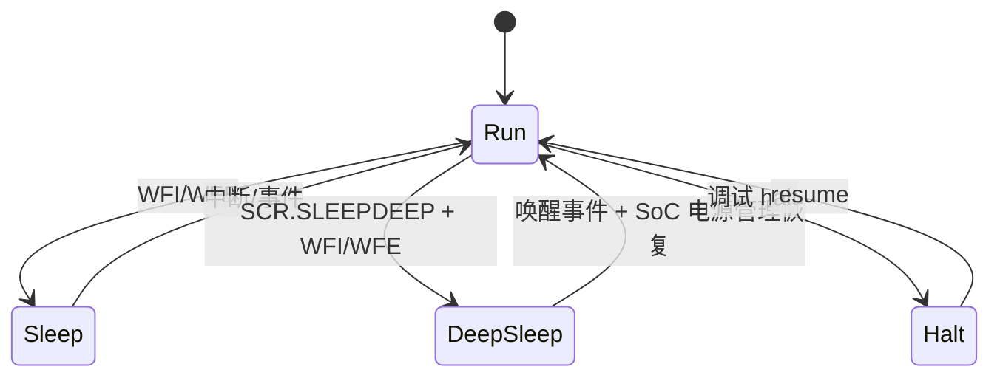

## 13.5 唤醒源

从 M7 内核视角，唤醒通常来自：

- 可唤醒的中断
- 事件
- 调试恢复

但真正哪些中断能唤醒 deep sleep，取决于 SoC 电源与唤醒控制器。

## 13.6 低功耗模式下的保持性

以下内容都不是 M7 内核独立规定：

- SRAM 是否保持
- TCM 是否保持
- Cache tag/data 是否保持
- 调试连接是否保持
- SysTick / DWT 是否继续运行

## 13.7 低功耗与安全机制

低功耗设计中常被忽视的点包括：

- 唤醒后是否需要重新初始化 MPU / Cache
- 调试态下低功耗是否被禁止
- 安全监控在低功耗时是否仍在线
- 看门狗在 sleep/deep sleep 中是否继续工作

---

# 14. 安全机制与诊断（内核相关）

## 14.1 先给结论：M7 不是“自带完整车规安全架构”的内核

M7 能提供安全分析基础，但不能独立构成完整车规安全方案。  
它能提供的主要“内核级安全基础设施”包括：

- Fault 机制
- 特权级隔离
- MPU
- 调试与追踪可观察性
- 可选 ECC 支持接口（视 TCM/Cache 实现）
- 可选 lockstep 实现基础（但通常不是标准产品默认语义）

## 14.2 故障模型

从内核相关角度，可重点分析：

- 指令流错误
- 数据访问错误
- 特权与保护错误
- 栈损坏
- 错误异常返回
- 调试误介入
- Cache / TCM / 总线可见性错误

## 14.3 错误检测机制

M7 架构侧较明确的检测手段包括：

- UsageFault
- BusFault
- MemManage Fault
- HardFault
- Debug event
- MPU 拒绝访问

## 14.4 自检机制

M7 核本身不定义完整的 BIST 控制流程。  
常见自检更多由 SoC 提供：

- CPU LBIST
- SRAM ECC / MBIST
- Flash ECC 检查
- 时钟监控
- 电源监控

## 14.5 锁步机制（如有）

需要非常谨慎地写：

- **M7 可以被集成为 lockstep 方案的一部分**
- 但“是否有锁步、锁步粒度如何、Cache/TCM 是否共享、比较点在哪里”属于 SoC 实现
- 不能把“锁步”写成 Cortex-M7 架构固有属性

## 14.6 安全告警接口

内核层错误通常需经 SoC 聚合后才能转化为：

- NMI
- Error pin
- 安全控制器告警
- 系统复位请求

## 14.7 故障处理策略

建议区分三类：

1. **可诊断后恢复**：例如某些用户任务 MPU 越界  
2. **可控降级**：关闭部分功能，系统继续运行  
3. **必须安全停机 / 复位**：例如 HardFault 进入不可恢复上下文

## 14.8 软件 Assumptions of Use

如果要把 M7-based MCU 用于功能安全项目，软件通常必须承担：

- 启动时完成最小保护配置
- 定义 Fault handler 策略
- 管理 Cache / DMA 一致性
- 评估中断和低功耗路径
- 评估多核干扰（若有）
- 评估调试端口对量产态的影响

## 14.9 安全使用建议

- 尽早启用 MPU
- SRAM 默认 XN
- 关键栈区做 guard
- Fault handler 不能空实现
- 对带 FPU 项目，明确 ISR 是否允许用 FPU
- 对 DMA 共享区，明确 cache 策略
- 调试态与量产态分开验证

---

# 15. 寄存器章节编写规范

## 15.1 为什么要单独写这一章

很多“内核手册”之所以后期不好维护，不是因为知识不够，而是因为**寄存器章节写法不统一**。  
对 M7 来说，寄存器来源既有：

- Core register
- SCB
- NVIC
- SysTick
- MPU
- FPU
- DWT / ITM / FPB / ETM

如果不统一模板，后续很难扩成正式手册。

## 15.2 建议的章节组织

建议按模块分章：

1. 核心寄存器  
2. 异常与系统控制  
3. NVIC  
4. SysTick  
5. MPU  
6. FPU  
7. 调试与追踪  
8. SoC 扩展寄存器（单独成册更合适）

## 15.3 单寄存器描述模板

建议每个寄存器按以下模板写：

- 名称
- 地址
- 访问属性
- 复位值
- 功能概述
- 字段表
- 字段约束
- 写副作用
- 读副作用
- 异常 / Fault 关系
- 使用建议

## 15.4 访问限制说明

必须明确写清：

- 是否仅特权可写
- 是否仅字访问
- 未实现位是否 RAZ/WI
- 调试态访问是否允许
- 是否必须在关中断 / barrier 下修改

## 15.5 寄存器副作用说明

对下面这些寄存器，必须强调副作用：

- `AIRCR`
- `VTOR`
- `CCR`
- `SHCSR`
- `CPACR`
- `MPU_CTRL / MPU_RBAR / MPU_RASR`
- `DWT` 控制类寄存器

## 15.6 寄存器分组建议

建议把“架构内核寄存器”和“SoC 系统控制寄存器”彻底分开，避免把芯片厂商自定义复位时钟寄存器写成“Cortex-M7 内核寄存器”。

---

# 16. 软件开发与移植指南

## 16.1 启动代码要求

建议启动代码完成以下最小动作：

1. 建立初始栈
2. 设置向量表（若需重定位）
3. 可选：初始化 TCM
4. 可选：初始化 Cache
5. 初始化 `SystemCoreClock`
6. 配置 FPU 访问权限（若需要）
7. 建立最小 MPU
8. 进入 C 运行时初始化与主程序

## 16.2 链接脚本要求

对 M7 项目，链接脚本往往比低端内核更关键。  
建议显式分区：

- `.isr_vector`
- `.text.fast`（ITCM）
- `.rodata`
- `.data`
- `.bss`
- `.stack_msp`
- `.stack_psp`
- `.dma_buffer`（non-cacheable）
- `.noinit`
- `.ramfunc`

## 16.3 编译器注意事项

### 16.3.1 FPU 选项必须与硬件一致

最常见错误之一，就是编译选项与芯片 FPU 实现不匹配。

### 16.3.2 优化等级会显著改变 M7 性能行为

在 M7 上，代码布局、内联、循环展开、访存重排影响比简单 MCU 更明显。

### 16.3.3 CMSIS 应作为最小抽象基线

建议统一使用 CMSIS：

- 启动文件
- 核心寄存器访问
- 内建函数 / barrier / 专用 intrinsic
- NVIC / SysTick / MPU 接口封装

## 16.4 OS 适配建议

### 16.4.1 RTOS 核心点

- PendSV 做上下文切换
- SVC 做系统调用
- SysTick 做 tick 或改用独立计时器
- PSP 承载任务栈
- MSP 承载异常栈

### 16.4.2 AUTOSAR Classic 场景

虽然 AUTOSAR Classic 常见于 AURIX / RH850 等平台，但若在 M7-based 车规 MCU 上使用，也应重点明确：

- SchM 临界区用 `BASEPRI` 还是 `PRIMASK`
- ISR 分类
- 栈模型
- MPU 与 OS-Application 隔离
- 驱动访问特权资源的策略

## 16.5 多核软件建议

如果 SoC 是多核 M7：

- 不要把 LDREX/STREX 当成“跨一切共享路径都天然正确”
- 明确共享区属性
- 明确 cache policy
- 明确核间 mailbox / 中断触发机制
- 明确主从核启动顺序

## 16.6 Fault 软件框架建议

建议将 Fault 框架做成统一基础设施，而不是每个项目临时手搓。  
至少应统一：

- 异常帧结构
- 日志格式
- SCB 状态寄存器解码
- 栈选择逻辑
- 输出接口（串口 / Trace / 黑匣子 RAM / NVM）

## 16.7 驱动开发注意事项

- 外设寄存器访问不要随意缓存
- 对关键控制寄存器写后补 `DSB`
- 对启动类、时钟类寄存器修改后补 `ISB`
- DMA 缓冲区要么 non-cacheable，要么严格维护 cache
- 中断 handler 不要随意使用浮点

## 16.8 性能调优建议

- 先用 `CYCCNT` 建立量化闭环
- 关键代码放 ITCM
- 关键数据放 DTCM
- 减少跨总线热点访问
- 降低分支不可预测性
- 合理设置 cacheable / non-cacheable 边界

---

# 17. 验证、测试与可测性建议

## 17.1 架构一致性验证点

建议验证：

- MSP/PC 复位装载
- VTOR 重定位
- Privileged/Unprivileged 切换
- PSP/MSP 使用规则
- 异常进入基本帧保存
- `EXC_RETURN` 行为

## 17.2 启动与复位验证点

建议验证：

- 上电到 Reset_Handler 链路
- SystemInit 后时钟与缓存状态
- 软复位后向量表是否重新生效
- 调试 reset-halt 行为

## 17.3 中断 / Fault 验证点

建议覆盖：

- 抢占
- 嵌套
- pending / active 区分
- tail-chaining
- late arrival
- MemManage / BusFault / UsageFault / HardFault 注入

## 17.4 保护机制验证点

建议覆盖：

- SRAM XN
- 只读区写入
- 用户态访问系统寄存器
- 任务栈 guard region
- DMA 共享区 cache 策略

## 17.5 调试与追踪验证点

建议覆盖：

- HW breakpoint / watchpoint
- DWT CYCCNT
- ITM 输出
- 向量捕获
- Fault 现场调试可见性

## 17.6 安全机制验证点

若项目走功能安全，应验证：

- Fault handler 路径可靠性
- NMI 入口可达性
- 低功耗与安全监控兼容性
- 量产锁定后是否仍满足诊断需求

## 17.7 量产可测性说明

建议正式手册说明：

- 最小可测接口
- 调试锁定后的残余诊断能力
- 工厂测试是否需要特殊 boot 模式
- 是否需要 RAM/Flash/ECC BIST 协作

---

# 18. 典型时序与用例

## 18.1 上电到用户代码运行时序

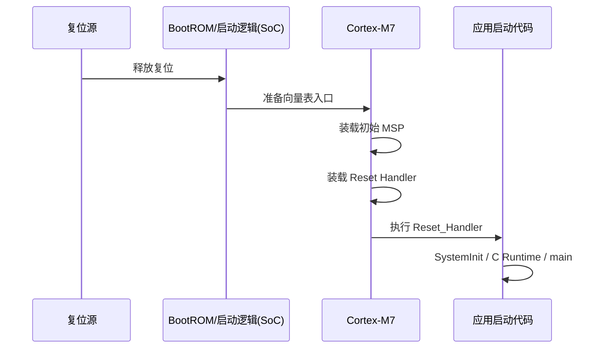

## 18.2 中断响应时序

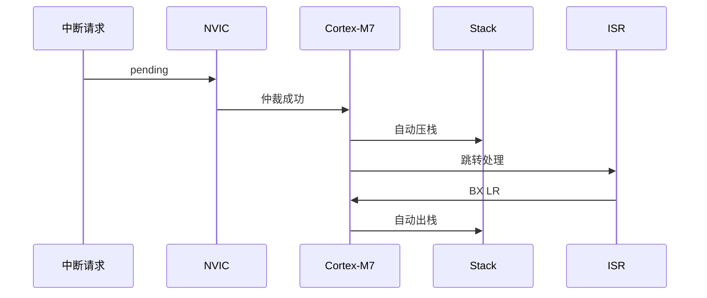

## 18.3 Fault 进入与返回时序

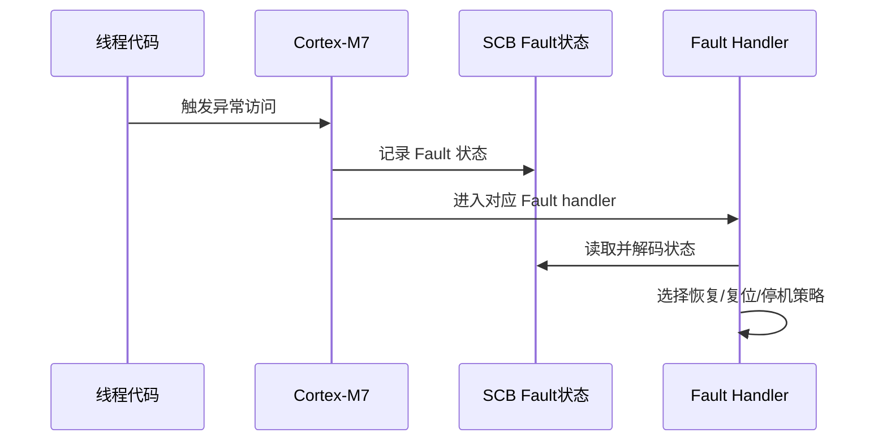

## 18.4 多核启动时序（仅适用于多核 M7 SoC）

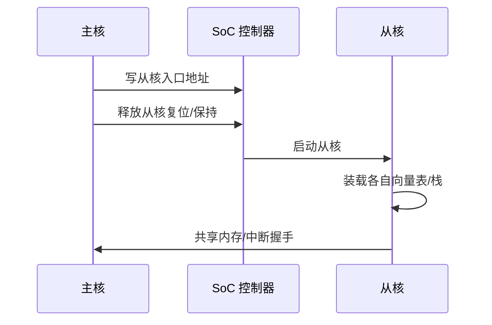

## 18.5 保护寄存器更新时序（M7 等价写法）

> 对应 AURIX 大纲中的“ENDINIT 保护寄存器写入时序”，在 M7 中应替换为：  
> **特权切换 + 系统寄存器更新 + barrier 时序**

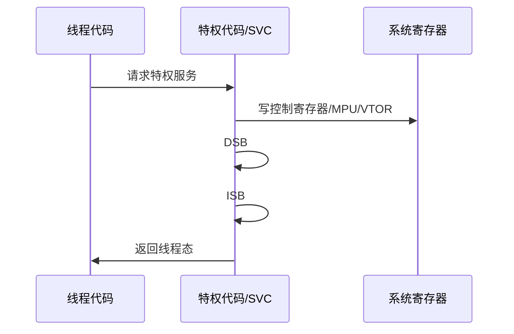

## 18.6 Overlay 生效时序（M7 架构不适用）

M7 内核架构**无标准 Overlay**。  
若某具体 SoC 支持地址重定向 / 标定替换，应在平台手册中给出对应时序。

## 18.7 软件复位 / 核复位时序

```mermaid
sequenceDiagram
    participant SW as 软件
    participant SCB as SCB/AIRCR
    participant SOC as SoC 复位逻辑
    participant CPU as Cortex-M7

    SW->>SCB: 发起系统复位请求
    SCB->>SOC: 转发复位意图
    SOC->>CPU: 复位核心
    CPU->>CPU: 重新装载 MSP/PC
```

---

# 19. 附录

## 19.1 内核寄存器索引（建议正式版补表）

正式版建议给出以下索引表：

- Core Register
- Special Register
- SCB
- NVIC
- SysTick
- MPU
- FPU
- FPB
- DWT
- ITM
- ETM / TPIU / CTI（如有）

## 19.2 异常索引（建议正式版补表）

建议至少列：

- 异常号
- 名称
- 默认优先级属性
- 是否可屏蔽
- 入口函数
- 典型用途
- 常见根因

## 19.3 中断索引

属于 SoC 层，应由芯片厂商手册给出。  
不建议写进纯 M7 内核架构手册。

## 19.4 复位原因索引

属于 SoC 层，应由 Reset / PMU / Boot 手册给出。

## 19.5 性能计数器事件索引

正式版建议按 DWT / ETM / Trace 工具支持情况补表。

## 19.6 安全机制索引

建议分为：

- 架构内核基础
- SoC 安全集成
- 软件责任

## 19.7 术语表

建议在正式版补齐：

- Thread / Handler
- Privilege
- Exception / Fault / IRQ
- TCM / Cache / Shareable / Device memory
- Barrier
- Vector catch
- Lazy stacking

## 19.8 勘误与限制列表

正式版必须预留这一章，因为 M7-based 产品的实际问题经常出在：

- 特定步进的 cache/TCM 异常
- 调试态与低功耗冲突
- 某些 Fault 状态位与真实根因不完全一致
- 工具链与 FPU 配置不一致

---

# 20. 对 AURIX 风格大纲的映射说明

## 20.1 可以直接保留的章节

以下章节与 AURIX 风格大纲可直接兼容：

- 文档说明
- 内核总览
- 编程模型
- 指令系统
- 微架构
- 存储器体系
- 中断系统
- 异常 / 错误体系
- 保护与隔离机制
- 调试与追踪
- 软件开发与验证

## 20.2 需要改名的章节

建议把 AURIX 风格里的：

- `Trap` → `Exception / Fault`
- `CSA` → `MSP/PSP + 自动压栈`
- `ENDINIT` → `MPU/特权保护/SoC 写保护`
- `CPU Local Reset` → `SoC Reset Topology`
- `Overlay` → `SoC 可选标定能力`

## 20.3 建议标记为“不适用 / 实现相关”的项

以下项目不应写成 M7 架构固有属性：

- Boot 模式头 / BMHD
- 固有多核拓扑
- Overlay
- ENDINIT / Safety ENDINIT
- 锁步默认存在
- 统一安全管理单元
- 固有核本地 Flash / SRAM 组织

---

# 21. 最小可落地版本建议

## 21.1 若先服务软件团队

优先补齐：

- 编程模型
- 中断 / Fault
- 启动代码
- MPU 基线配置
- Cache/TCM 使用规范
- 链接脚本模板

## 21.2 若先服务验证团队

优先补齐：

- 异常注入点
- 中断与 Fault 时序
- Reset 保持性矩阵
- Debug / Trace 可见性
- 保护违规预期行为

## 21.3 若先服务功能安全团队

优先补齐：

- 故障模型
- Assumptions of Use
- Fault detection coverage 边界
- 多核干扰分析（若有）
- 调试口生命周期限制
- 低功耗与安全监控协同

---

# 22. 参考依据（建议配套官方文档）

建议正式项目至少配套以下官方资料：

1. **Arm Cortex-M7 Processor Technical Reference Manual**
2. **Arm Cortex-M7 Generic User Guide**
3. **ARMv7-M / ARMv7E-M Architecture Reference Manual**
4. **CoreSight 组件文档（DWT / ITM / FPB / ETM / TPIU / CTI）**
5. **具体 MCU 的 SoC 手册 / 数据手册 / 勘误表**
6. **启动与安全启动文档**
7. **功能安全手册**
8. **编译器与 ABI 文档**
9. **CMSIS Core 文档**

---

# 23. 结语

把 Cortex-M7 写成一份真正可用的“车规 MCU 内核手册”，关键不是把 ARM 原文翻成中文，而是要持续区分三件事：

1. **什么是 M7 架构必然成立的**
2. **什么是 M7-based SoC 厂商实现的**
3. **什么必须由软件和系统工程来补齐**

如果这个边界分清楚了，那么：

- 启动代码更稳
- Fault 更容易定位
- MPU 更容易落地
- Cache / DMA 问题更少
- 多核与安全分析更容易形成闭环

这也是本文的核心目的。
