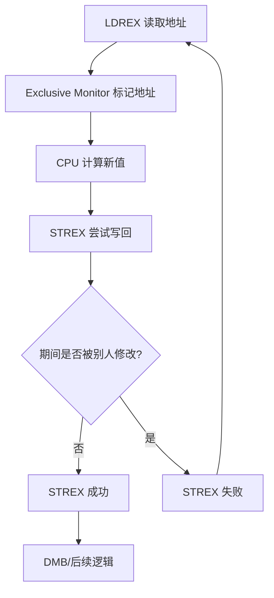
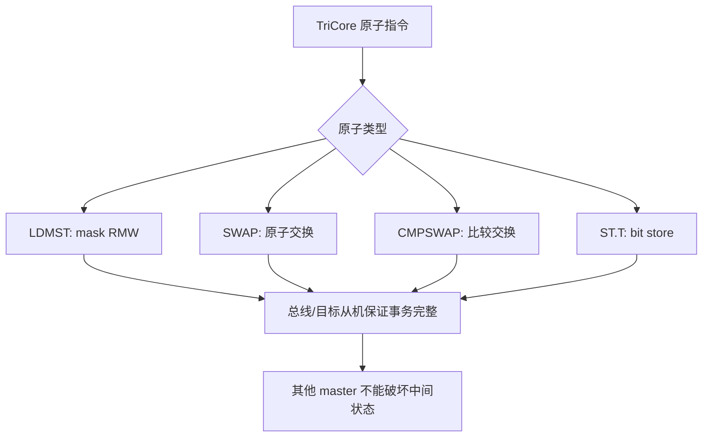
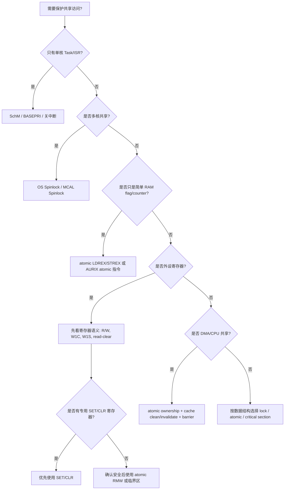

# ARM 与 AURIX 原子操作机制总结：Why / What / How

> 适用视角：车规 MCU 系统工程、AUTOSAR/MCAL、RTOS、多核共享资源、外设寄存器访问、DMA/CPU 共享内存。  
> 核心问题：**为什么需要原子操作？什么是原子操作？ARM 和 AURIX 分别怎么实现？工程上怎么选？**

---

## 0. 总览结论

一句话总结：

> **ARM Cortex-M 类内核的典型原子机制是 `LDREX/STREX` 独占访问 + 软件重试；AURIX TriCore 更偏向提供 `LDMST/SWAP/CMPSWAP` 等单指令级原子读改写能力。工程上不能把 atomic、关中断、spinlock、SchM、memory barrier 混为一谈。**

---

## 1. Why：为什么需要原子操作？

普通 C 代码中的一行：

```c
x = x + 1;
```

在机器层面通常不是一个不可分割动作，而是：

```text
load x
add 1
store x
```

如果中间被其他 CPU、ISR、DMA 或外设主机打断，就可能发生数据竞争。

---

### 1.1 典型竞争场景

| 场景 | 竞争对象 | 风险 |
|---|---|---|
| 多核共享变量 | Core0/Core1 同时修改 flag/counter | 丢更新、状态不一致 |
| Task 与 ISR 并发 | Task 正在 RMW，ISR 插入修改 | ISR 或 Task 的修改被覆盖 |
| MCAL Driver 状态 | Driver state、channel state、job queue | 状态机错乱 |
| 外设寄存器 bit 修改 | 控制寄存器、状态寄存器 | 误清 bit、误置 bit、触发副作用 |
| Spinlock/Mutex | lock variable | 两个核同时拿到锁 |
| DMA/CPU 共享 buffer | ownership flag、ready flag | buffer 所有权混乱 |
| ENDINIT / Safety 保护区 | WDT ENDINIT clear/set 过程 | 多任务/多核重入导致保护区异常 |

---

### 1.2 原子操作解决的本质问题

原子操作不是为了“更快”，而是为了保证：

```text
读 -> 改 -> 写
```

这一组动作对其他观察者表现为不可分割。

也就是说：

```text
要么完整发生
要么完全没有发生
不能只看到中间状态
```

---

## 2. What：什么是原子操作？

### 2.1 定义

**原子操作 = 在并发观察者看来不可分割的操作。**

这里的“不可分割”不是说物理上只占用一个 CPU cycle，而是说在系统一致性语义上，其他 master 不能观察到半完成状态，也不能在关键 RMW 序列中插入破坏性修改。

---

### 2.2 常见原子操作类型

| 类型 | 典型操作 | 作用 |
|---|---|---|
| 原子读改写 RMW | set bit / clear bit / OR / AND / XOR | 修改 flag、寄存器 bit |
| 原子加减 | atomic add/sub | 计数器、引用计数 |
| 原子交换 | swap | 拿锁、释放锁、状态切换 |
| 原子比较交换 | compare-and-swap, CAS | lock-free 状态机、spinlock |
| 原子 test-and-set | test lock then set lock | 自旋锁 |
| 原子 bit 操作 | set/clear/test one bit | 位图、资源分配 |

---

## 3. ARM Cortex-M7 原子机制

ARM Cortex-M7 典型使用 **Exclusive Access** 机制。

核心指令是：

| 指令 / intrinsic | 作用 |
|---|---|
| `LDREXB` / `LDREXH` / `LDREXW` | 独占读 8/16/32 bit |
| `STREXB` / `STREXH` / `STREXW` | 独占写 8/16/32 bit |
| `CLREX` | 清除 exclusive monitor |
| `DMB` | 数据内存屏障，保证内存访问顺序 |
| `DSB` | 数据同步屏障，等待访问完成 |
| `ISB` | 指令同步屏障，刷新指令流水线语义 |

---

### 3.1 ARM 原子操作基本流程

典型 atomic OR：

```c
uint32_t atomic_or_u32(volatile uint32_t *addr, uint32_t mask)
{
    uint32_t old_val;
    uint32_t new_val;
    uint32_t status;

    do {
        old_val = __LDREXW(addr);
        new_val = old_val | mask;
        status = __STREXW(new_val, addr);
    } while (status != 0U);

    __DMB();

    return old_val;
}
```

执行逻辑：

```text
1. LDREX 读取目标地址，并建立 exclusive monitor
2. CPU 在寄存器中计算新值
3. STREX 尝试写回
4. 如果期间目标地址被其他 master 修改，STREX 失败
5. 软件循环重试
```

---

### 3.2 ARM 的机制特点

| 特点 | 说明 |
|---|---|
| 模型 | Load-Exclusive / Store-Exclusive |
| 是否单条完成 | 否，通常是两条指令加软件循环 |
| 是否可能失败 | 是，`STREX` 可能返回失败 |
| 失败处理 | 软件必须 retry |
| 适合对象 | RAM 中的锁变量、状态变量、计数器 |
| 慎用对象 | 外设寄存器、有副作用寄存器 |
| 多核依赖 | 需要总线/内存系统支持 global exclusive monitor |
| M7 注意点 | 常见支持 8/16/32 bit，不要假设天然支持 64 bit CAS |

---

### 3.3 ARM 原子机制示意



---

## 4. AURIX TriCore 原子机制

AURIX / TriCore 提供多种更直接的原子操作指令，常见包括：

| 指令 / 形式 | 典型含义 | 用途 |
|---|---|---|
| `LDMST` | Load-Modify-Store，按 mask 修改 bit | 原子置位/清位 |
| `SWAP.W` | 32-bit 原子交换 | spinlock、状态交换 |
| `CMPSWAP.W` | compare-and-swap | lock-free 状态切换 |
| `ST.T` | bit store | 单 bit 操作 |
| `SWAPMSK.W` | 带 mask 的 swap | 位域更新、受保护状态修改 |

---

### 4.1 AURIX 的基本思想

AURIX 更偏向：

```text
CPU 发出一条原子 RMW 指令
↓
总线/目标从机保证该事务不可被其他 master 插入破坏
↓
操作完成
```

也就是它更接近“单指令级原子 RMW 事务”。

---

### 4.2 AURIX 常见原子形式区别

| 原子形式 | 作用 | 优点 | 注意点 |
|---|---|---|---|
| `LDMST` | 按 mask 读改写 | 很适合 bit set/clear | 要确认目标地址支持该类访问 |
| `SWAP.W` | 整字交换 | 适合 spinlock | 需要约定 lock 值语义 |
| `CMPSWAP.W` | 比较后交换 | 适合 CAS、lock-free 状态机 | 需要处理比较失败路径 |
| `ST.T` | 单 bit 写 | 对 bit 操作友好 | 要理解目标寄存器 bit 语义 |
| `SWAPMSK.W` | 带 mask 交换 | 适合位域更新 | 复杂度更高，需谨慎封装 |

---

### 4.3 AURIX 原子机制示意



---

## 5. ARM 与 AURIX 核心区别

| 对比项 | ARM Cortex-M7 | AURIX TriCore |
|---|---|---|
| 原子模型 | `LDREX/STREX` 独占访问 | `LDMST/SWAP/CMPSWAP` 等单指令原子操作 |
| 操作形态 | 读独占 + 条件写 | 指令直接表达 RMW/SWAP/CAS |
| 是否需要循环 | 通常需要 | 多数原子指令本身完成，但 CAS 仍需处理失败 |
| 失败语义 | `STREX` 返回成功/失败 | `CMPSWAP` 根据比较结果决定是否交换 |
| 软件复杂度 | 需要 retry loop + barrier | 指令语义更直接 |
| 对总线依赖 | 依赖 exclusive monitor 支持 | 依赖目标总线/从机支持原子事务 |
| 适合对象 | RAM lock/state/counter | RAM、部分支持原子访问的目标 |
| 外设寄存器 | 慎用 exclusive | 可用原子 bit/RMW，但必须看寄存器副作用 |
| 多核支持 | 需要 global exclusive monitor | 多核场景下更直接，但仍需遵守 OS/MCAL 规范 |
| AUTOSAR 常见封装 | SchM、OS Spinlock、atomic primitive | SchM、OS Spinlock、MCAL atomic primitive |

---

## 6. How：工程上怎么用？

## 6.1 单核 Task/ISR 并发

如果是单核系统，竞争主要来自 ISR 抢占。

优先考虑：

```text
SchM_Enter/Exit
SuspendAllInterrupts/ResumeAllInterrupts
BASEPRI 临界区
PRIMASK 临界区
```

典型场景：

```c
SchM_Enter_Can_CAN_EXCLUSIVE_AREA_0();
/* 修改 CAN driver 全局状态 */
SchM_Exit_Can_CAN_EXCLUSIVE_AREA_0();
```

判断原则：

| 场景 | 推荐方式 |
|---|---|
| Task 与 ISR 共享变量 | 关中断 / BASEPRI / SchM |
| RTOS 内核对象 | 使用 RTOS API |
| 简单 flag | volatile + 临界区 |
| 高频 counter | atomic 或临界区，按性能选择 |

---

## 6.2 多核共享变量

多核场景下，**关本核中断不能阻止其他 core**。

错误理解：

```text
Core0 关中断
所以共享变量安全
```

实际问题：

```text
Core0 关中断只能阻止 Core0 上的 ISR
Core1 仍然可以访问同一个共享变量
DMA/HSM/其他 master 也可能访问
```

多核优先级：

```text
OS Spinlock / MCAL Spinlock
    >
原子指令
    >
关本核中断
```

典型使用：

| 场景 | 推荐方式 |
|---|---|
| 多核 Driver 全局状态 | OS Spinlock / MCAL Spinlock |
| 多核共享 counter | atomic add / CAS |
| 多核共享 queue | spinlock 或 lock-free 结构 |
| 多核初始化状态 | spinlock + 状态机 |
| ENDINIT 保护区 | spinlock + SchM + 尽快 set 回去 |

---

## 6.3 外设寄存器 bit 操作

这是最容易踩坑的地方。

### 6.3.1 普通 R/W 寄存器

如果寄存器是普通 R/W 类型：

```text
read old
modify bits
write new
```

可以考虑：

```text
atomic bit set/clear
LDMST
bit-band 类机制
专用 SET/CLR 寄存器
```

### 6.3.2 有副作用寄存器

下面这些寄存器不能简单套用普通 RMW 逻辑：

| 寄存器类型 | 风险 |
|---|---|
| W1C：write 1 clear | RMW 可能误清状态 |
| W1S：write 1 set | RMW 可能误置状态 |
| read-clear | 读动作本身会清状态 |
| FIFO/data register | 读写会改变 FIFO 指针 |
| command trigger register | 写入会触发硬件动作 |
| status latch register | 读/写顺序有硬件语义 |

核心原则：

> **原子操作不能替代对寄存器语义的理解。**

---

## 6.4 DMA/CPU 共享 buffer

原子操作只能解决 ownership flag 的并发问题，不能自动解决 cache 一致性问题。

典型流程：

```text
CPU 写 buffer
↓
Clean DCache
↓
DMB/DSB
↓
atomic 设置 ownership = DMA
↓
DMA 读取 buffer
```

DMA 写回后：

```text
DMA 完成
↓
ISR/CPU 检测完成 flag
↓
Invalidate DCache
↓
CPU 读取 buffer
```

关键点：

| 问题 | 处理方式 |
|---|---|
| ownership flag 竞争 | atomic / 临界区 |
| buffer 数据可见性 | cache clean/invalidate |
| 访问顺序 | DMB/DSB |
| DMA 与 cacheable region | 必须维护 cache 一致性 |
| descriptor 与 payload | descriptor 更适合 non-cacheable 或强制维护 |

---

## 6.5 AUTOSAR / MCAL 中怎么映射？

| AUTOSAR/MCAL 场景 | 推荐机制 |
|---|---|
| Driver Init/DeInit 状态 | SchM Exclusive Area |
| Channel 状态切换 | SchM 或 atomic CAS |
| 多核共享 Driver Object | OS Spinlock / MCAL Spinlock |
| ISR 与 Task 共享 flag | SchM / Suspend interrupt / atomic bit |
| Job Queue index | spinlock / atomic add / CAS |
| DMA ownership | atomic flag + cache maintenance + barrier |
| ENDINIT clear/set | SchM + spinlock + 最小临界区 |
| 外设寄存器 bit set/clear | 优先专用 SET/CLR 寄存器，其次确认语义后使用 atomic RMW |
| W1C/W1S/status 寄存器 | 避免普通 RMW，按手册语义写 |

---

## 7. atomic、volatile、barrier、critical section 的区别

这是工程中最容易混淆的一组概念。

| 概念 | 解决什么问题 | 不解决什么问题 |
|---|---|---|
| `volatile` | 防止编译器优化掉访问 | 不保证原子性，不保证多核同步 |
| atomic 指令 | 保证某个 RMW 操作不可分割 | 不自动保证 cache 一致性，不等于锁 |
| memory barrier | 保证访问顺序和可见性顺序 | 不保证互斥 |
| critical section | 防止本核 ISR/任务抢占 | 不一定防止其他 core |
| spinlock | 多核互斥 | 不自动处理 cache/DMA 数据一致性 |
| SchM | AUTOSAR 临界区抽象 | 具体能力取决于底层实现 |
| OS Resource | RTOS/AUTOSAR OS 资源保护 | 不适合所有低层寄存器/多主机场景 |

---

## 8. 工程选择决策树



---

## 9. 典型错误理解

| 错误理解 | 正确理解 |
|---|---|
| `volatile` 就是原子 | `volatile` 只限制编译器优化，不保证 RMW 原子 |
| 关中断就能保护多核变量 | 关本核中断不能阻止其他 core |
| atomic 能解决所有并发问题 | atomic 只解决特定内存操作的不可分割问题 |
| memory barrier 等于锁 | barrier 只管顺序，不管互斥 |
| 外设寄存器都能 RMW | W1C/read-clear/FIFO 等寄存器不能随便 RMW |
| DMA flag 原子了，数据就一致 | 还需要 cache clean/invalidate 和 barrier |
| ARM `STREX` 一定成功 | `STREX` 可能失败，必须检查返回值 |
| AURIX 原子指令任何地址都能用 | 需要确认目标地址/总线/从机支持该类事务 |

---

## 10. 面向车规 MCU 系统工程师的关注点

作为车规 MCU 系统工程师，关注点不只是“CPU 有哪些原子指令”，而是系统级闭环：

```text
CPU 指令
↓
Cache/MPU 属性
↓
总线协议
↓
目标从机是否支持原子事务
↓
多核/多主机场景
↓
OS/MCAL 封装
↓
外设寄存器语义
↓
功能安全与异常恢复
```

---

### 10.1 需求定义时需要问的问题

| 维度 | 需要确认的问题 |
|---|---|
| CPU 指令 | 是否支持 atomic RMW、CAS、SWAP？宽度是多少？ |
| 多核 | 是否有 global exclusive monitor 或等价机制？ |
| 总线 | 原子事务如何编码？是否支持跨 bridge？ |
| 从机 | SRAM/PeriBus/Flash/LMU/DSPR 是否都支持 atomic？ |
| 外设 | 是否提供 SET/CLR/TOGGLE 寄存器？ |
| Cache | atomic 操作对 cacheable memory 的一致性语义是什么？ |
| DMA | DMA 是否会破坏 exclusive monitor？ |
| MPU | non-cacheable / device memory 下是否允许 exclusive？ |
| OS | AUTOSAR Spinlock/SchM 如何映射到底层？ |
| 安全 | 原子操作失败、死锁、超时如何诊断？ |

---

## 11. 最终结论

### 11.1 总结口径

> **ARM M7 的原子操作本质是独占访问协议：`LDREX` 建立监视，`STREX` 条件写回，失败后软件重试。AURIX TriCore 的原子操作更偏单指令级 RMW：如 `LDMST`、`SWAP.W`、`CMPSWAP.W` 等，由指令和总线事务共同保证不可分割。**

### 11.2 工程原则

1. **单核 Task/ISR：优先 SchM、BASEPRI、关中断。**
2. **多核共享：优先 OS Spinlock / MCAL Spinlock。**
3. **简单 RAM flag/counter：可用 atomic。**
4. **外设寄存器：先看寄存器语义，再决定是否允许 RMW。**
5. **DMA 共享内存：atomic 只管 flag，不管 cache 数据一致性。**
6. **barrier 不是锁，volatile 不是 atomic。**
7. **车规 MCU 需求定义要把 CPU、总线、Cache、MPU、从机、OS/MCAL 串起来看。**

---

## 12. 一句话记忆

```text
ARM：LDREX/STREX，独占访问，失败重试。
AURIX：LDMST/SWAP/CMPSWAP，指令级原子 RMW。
单核靠临界区，多核靠 spinlock，寄存器先看副作用，DMA 还要管 cache。
```
