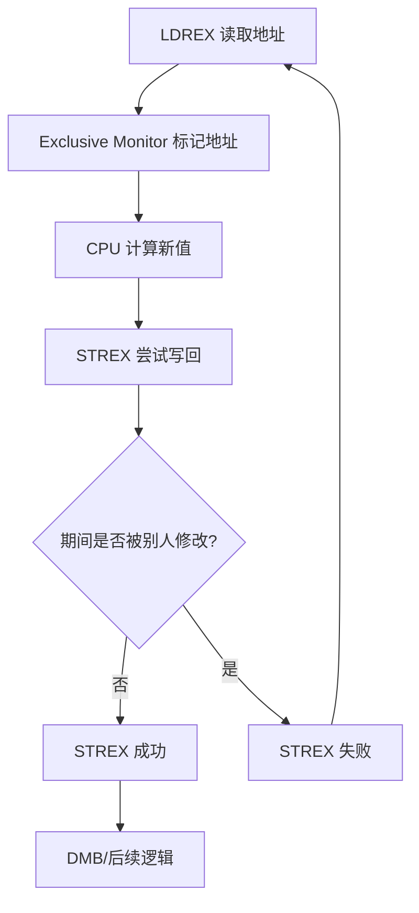
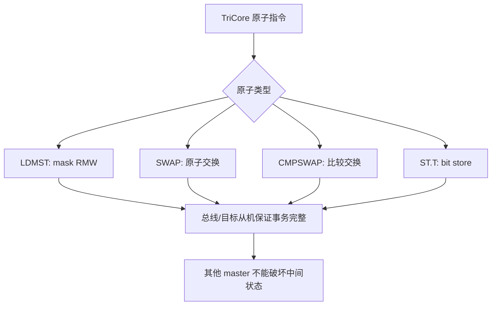
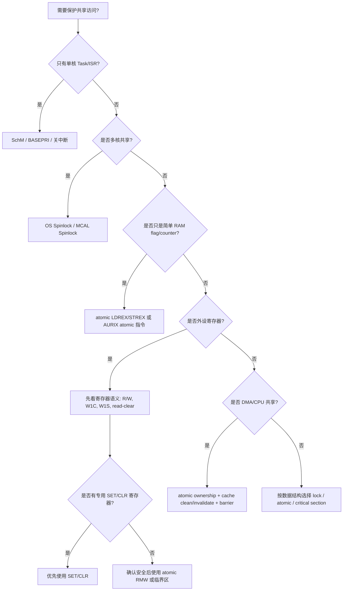

# ARM 与 AURIX 原子操作机制总结：Why / What / How

> 适用视角：车规 MCU 系统工程、AUTOSAR/MCAL、RTOS、多核共享资源、外设寄存器访问、DMA/CPU 共享内存。  
> 核心问题：**为什么需要原子操作？什么是原子操作？ARM 和 AURIX 分别怎么实现？工程上怎么选？**

---

## 0. 总览结论

一句话总结：

> **ARM Cortex-M 类内核的典型原子机制是 `LDREX/STREX` 独占访问 + 软件重试；AURIX TriCore 更偏向提供 `LDMST/SWAP/CMPSWAP` 等单指令级原子读改写能力。工程上不能把 atomic、关中断、spinlock、SchM、memory barrier 混为一谈。**

---

## 1. Why：为什么需要原子操作？

普通 C 代码中的一行：

```c
x = x + 1;
```

在机器层面通常不是一个不可分割动作，而是：

```text
load x
add 1
store x
```

如果中间被其他 CPU、ISR、DMA 或外设主机打断，就可能发生数据竞争。

---

### 1.1 典型竞争场景

| 场景 | 竞争对象 | 风险 |
|---|---|---|
| 多核共享变量 | Core0/Core1 同时修改 flag/counter | 丢更新、状态不一致 |
| Task 与 ISR 并发 | Task 正在 RMW，ISR 插入修改 | ISR 或 Task 的修改被覆盖 |
| MCAL Driver 状态 | Driver state、channel state、job queue | 状态机错乱 |
| 外设寄存器 bit 修改 | 控制寄存器、状态寄存器 | 误清 bit、误置 bit、触发副作用 |
| Spinlock/Mutex | lock variable | 两个核同时拿到锁 |
| DMA/CPU 共享 buffer | ownership flag、ready flag | buffer 所有权混乱 |
| ENDINIT / Safety 保护区 | WDT ENDINIT clear/set 过程 | 多任务/多核重入导致保护区异常 |

---

### 1.2 原子操作解决的本质问题

原子操作不是为了“更快”，而是为了保证：

```text
读 -> 改 -> 写
```

这一组动作对其他观察者表现为不可分割。

也就是说：

```text
要么完整发生
要么完全没有发生
不能只看到中间状态
```

---

## 2. What：什么是原子操作？

### 2.1 定义

**原子操作 = 在并发观察者看来不可分割的操作。**

这里的“不可分割”不是说物理上只占用一个 CPU cycle，而是说在系统一致性语义上，其他 master 不能观察到半完成状态，也不能在关键 RMW 序列中插入破坏性修改。

---

### 2.2 常见原子操作类型

| 类型 | 典型操作 | 作用 |
|---|---|---|
| 原子读改写 RMW | set bit / clear bit / OR / AND / XOR | 修改 flag、寄存器 bit |
| 原子加减 | atomic add/sub | 计数器、引用计数 |
| 原子交换 | swap | 拿锁、释放锁、状态切换 |
| 原子比较交换 | compare-and-swap, CAS | lock-free 状态机、spinlock |
| 原子 test-and-set | test lock then set lock | 自旋锁 |
| 原子 bit 操作 | set/clear/test one bit | 位图、资源分配 |

---

## 3. ARM Cortex-M7 原子机制

ARM Cortex-M7 典型使用 **Exclusive Access** 机制。

核心指令是：

| 指令 / intrinsic | 作用 |
|---|---|
| `LDREXB` / `LDREXH` / `LDREXW` | 独占读 8/16/32 bit |
| `STREXB` / `STREXH` / `STREXW` | 独占写 8/16/32 bit |
| `CLREX` | 清除 exclusive monitor |
| `DMB` | 数据内存屏障，保证内存访问顺序 |
| `DSB` | 数据同步屏障，等待访问完成 |
| `ISB` | 指令同步屏障，刷新指令流水线语义 |

---

### 3.1 ARM 原子操作基本流程

典型 atomic OR：

```c
uint32_t atomic_or_u32(volatile uint32_t *addr, uint32_t mask)
{
    uint32_t old_val;
    uint32_t new_val;
    uint32_t status;

    do {
        old_val = __LDREXW(addr);
        new_val = old_val | mask;
        status = __STREXW(new_val, addr);
    } while (status != 0U);

    __DMB();

    return old_val;
}
```

执行逻辑：

```text
1. LDREX 读取目标地址，并建立 exclusive monitor
2. CPU 在寄存器中计算新值
3. STREX 尝试写回
4. 如果期间目标地址被其他 master 修改，STREX 失败
5. 软件循环重试
```

---

### 3.2 ARM 的机制特点

| 特点 | 说明 |
|---|---|
| 模型 | Load-Exclusive / Store-Exclusive |
| 是否单条完成 | 否，通常是两条指令加软件循环 |
| 是否可能失败 | 是，`STREX` 可能返回失败 |
| 失败处理 | 软件必须 retry |
| 适合对象 | RAM 中的锁变量、状态变量、计数器 |
| 慎用对象 | 外设寄存器、有副作用寄存器 |
| 多核依赖 | 需要总线/内存系统支持 global exclusive monitor |
| M7 注意点 | 常见支持 8/16/32 bit，不要假设天然支持 64 bit CAS |

---

### 3.3 ARM 原子机制示意



---

## 4. AURIX TriCore 原子机制

AURIX / TriCore 提供多种更直接的原子操作指令，常见包括：

| 指令 / 形式 | 典型含义 | 用途 |
|---|---|---|
| `LDMST` | Load-Modify-Store，按 mask 修改 bit | 原子置位/清位 |
| `SWAP.W` | 32-bit 原子交换 | spinlock、状态交换 |
| `CMPSWAP.W` | compare-and-swap | lock-free 状态切换 |
| `ST.T` | bit store | 单 bit 操作 |
| `SWAPMSK.W` | 带 mask 的 swap | 位域更新、受保护状态修改 |

---

### 4.1 AURIX 的基本思想

AURIX 更偏向：

```text
CPU 发出一条原子 RMW 指令
↓
总线/目标从机保证该事务不可被其他 master 插入破坏
↓
操作完成
```

也就是它更接近“单指令级原子 RMW 事务”。

---

### 4.2 AURIX 常见原子形式区别

| 原子形式 | 作用 | 优点 | 注意点 |
|---|---|---|---|
| `LDMST` | 按 mask 读改写 | 很适合 bit set/clear | 要确认目标地址支持该类访问 |
| `SWAP.W` | 整字交换 | 适合 spinlock | 需要约定 lock 值语义 |
| `CMPSWAP.W` | 比较后交换 | 适合 CAS、lock-free 状态机 | 需要处理比较失败路径 |
| `ST.T` | 单 bit 写 | 对 bit 操作友好 | 要理解目标寄存器 bit 语义 |
| `SWAPMSK.W` | 带 mask 交换 | 适合位域更新 | 复杂度更高，需谨慎封装 |

---

### 4.3 AURIX 原子机制示意



---

## 5. ARM 与 AURIX 核心区别

| 对比项 | ARM Cortex-M7 | AURIX TriCore |
|---|---|---|
| 原子模型 | `LDREX/STREX` 独占访问 | `LDMST/SWAP/CMPSWAP` 等单指令原子操作 |
| 操作形态 | 读独占 + 条件写 | 指令直接表达 RMW/SWAP/CAS |
| 是否需要循环 | 通常需要 | 多数原子指令本身完成，但 CAS 仍需处理失败 |
| 失败语义 | `STREX` 返回成功/失败 | `CMPSWAP` 根据比较结果决定是否交换 |
| 软件复杂度 | 需要 retry loop + barrier | 指令语义更直接 |
| 对总线依赖 | 依赖 exclusive monitor 支持 | 依赖目标总线/从机支持原子事务 |
| 适合对象 | RAM lock/state/counter | RAM、部分支持原子访问的目标 |
| 外设寄存器 | 慎用 exclusive | 可用原子 bit/RMW，但必须看寄存器副作用 |
| 多核支持 | 需要 global exclusive monitor | 多核场景下更直接，但仍需遵守 OS/MCAL 规范 |
| AUTOSAR 常见封装 | SchM、OS Spinlock、atomic primitive | SchM、OS Spinlock、MCAL atomic primitive |

---

## 6. How：工程上怎么用？

## 6.1 单核 Task/ISR 并发

如果是单核系统，竞争主要来自 ISR 抢占。

优先考虑：

```text
SchM_Enter/Exit
SuspendAllInterrupts/ResumeAllInterrupts
BASEPRI 临界区
PRIMASK 临界区
```

典型场景：

```c
SchM_Enter_Can_CAN_EXCLUSIVE_AREA_0();
/* 修改 CAN driver 全局状态 */
SchM_Exit_Can_CAN_EXCLUSIVE_AREA_0();
```

判断原则：

| 场景 | 推荐方式 |
|---|---|
| Task 与 ISR 共享变量 | 关中断 / BASEPRI / SchM |
| RTOS 内核对象 | 使用 RTOS API |
| 简单 flag | volatile + 临界区 |
| 高频 counter | atomic 或临界区，按性能选择 |

---

## 6.2 多核共享变量

多核场景下，**关本核中断不能阻止其他 core**。

错误理解：

```text
Core0 关中断
所以共享变量安全
```

实际问题：

```text
Core0 关中断只能阻止 Core0 上的 ISR
Core1 仍然可以访问同一个共享变量
DMA/HSM/其他 master 也可能访问
```

多核优先级：

```text
OS Spinlock / MCAL Spinlock
    >
原子指令
    >
关本核中断
```

典型使用：

| 场景 | 推荐方式 |
|---|---|
| 多核 Driver 全局状态 | OS Spinlock / MCAL Spinlock |
| 多核共享 counter | atomic add / CAS |
| 多核共享 queue | spinlock 或 lock-free 结构 |
| 多核初始化状态 | spinlock + 状态机 |
| ENDINIT 保护区 | spinlock + SchM + 尽快 set 回去 |

---

## 6.3 外设寄存器 bit 操作

这是最容易踩坑的地方。

### 6.3.1 普通 R/W 寄存器

如果寄存器是普通 R/W 类型：

```text
read old
modify bits
write new
```

可以考虑：

```text
atomic bit set/clear
LDMST
bit-band 类机制
专用 SET/CLR 寄存器
```

### 6.3.2 有副作用寄存器

下面这些寄存器不能简单套用普通 RMW 逻辑：

| 寄存器类型 | 风险 |
|---|---|
| W1C：write 1 clear | RMW 可能误清状态 |
| W1S：write 1 set | RMW 可能误置状态 |
| read-clear | 读动作本身会清状态 |
| FIFO/data register | 读写会改变 FIFO 指针 |
| command trigger register | 写入会触发硬件动作 |
| status latch register | 读/写顺序有硬件语义 |

核心原则：

> **原子操作不能替代对寄存器语义的理解。**

---

## 6.4 DMA/CPU 共享 buffer

原子操作只能解决 ownership flag 的并发问题，不能自动解决 cache 一致性问题。

典型流程：

```text
CPU 写 buffer
↓
Clean DCache
↓
DMB/DSB
↓
atomic 设置 ownership = DMA
↓
DMA 读取 buffer
```

DMA 写回后：

```text
DMA 完成
↓
ISR/CPU 检测完成 flag
↓
Invalidate DCache
↓
CPU 读取 buffer
```

关键点：

| 问题 | 处理方式 |
|---|---|
| ownership flag 竞争 | atomic / 临界区 |
| buffer 数据可见性 | cache clean/invalidate |
| 访问顺序 | DMB/DSB |
| DMA 与 cacheable region | 必须维护 cache 一致性 |
| descriptor 与 payload | descriptor 更适合 non-cacheable 或强制维护 |

---

## 6.5 AUTOSAR / MCAL 中怎么映射？

| AUTOSAR/MCAL 场景 | 推荐机制 |
|---|---|
| Driver Init/DeInit 状态 | SchM Exclusive Area |
| Channel 状态切换 | SchM 或 atomic CAS |
| 多核共享 Driver Object | OS Spinlock / MCAL Spinlock |
| ISR 与 Task 共享 flag | SchM / Suspend interrupt / atomic bit |
| Job Queue index | spinlock / atomic add / CAS |
| DMA ownership | atomic flag + cache maintenance + barrier |
| ENDINIT clear/set | SchM + spinlock + 最小临界区 |
| 外设寄存器 bit set/clear | 优先专用 SET/CLR 寄存器，其次确认语义后使用 atomic RMW |
| W1C/W1S/status 寄存器 | 避免普通 RMW，按手册语义写 |

---

## 7. atomic、volatile、barrier、critical section 的区别

这是工程中最容易混淆的一组概念。

| 概念 | 解决什么问题 | 不解决什么问题 |
|---|---|---|
| `volatile` | 防止编译器优化掉访问 | 不保证原子性，不保证多核同步 |
| atomic 指令 | 保证某个 RMW 操作不可分割 | 不自动保证 cache 一致性，不等于锁 |
| memory barrier | 保证访问顺序和可见性顺序 | 不保证互斥 |
| critical section | 防止本核 ISR/任务抢占 | 不一定防止其他 core |
| spinlock | 多核互斥 | 不自动处理 cache/DMA 数据一致性 |
| SchM | AUTOSAR 临界区抽象 | 具体能力取决于底层实现 |
| OS Resource | RTOS/AUTOSAR OS 资源保护 | 不适合所有低层寄存器/多主机场景 |

---

## 8. 工程选择决策树



---

## 9. 典型错误理解

| 错误理解 | 正确理解 |
|---|---|
| `volatile` 就是原子 | `volatile` 只限制编译器优化，不保证 RMW 原子 |
| 关中断就能保护多核变量 | 关本核中断不能阻止其他 core |
| atomic 能解决所有并发问题 | atomic 只解决特定内存操作的不可分割问题 |
| memory barrier 等于锁 | barrier 只管顺序，不管互斥 |
| 外设寄存器都能 RMW | W1C/read-clear/FIFO 等寄存器不能随便 RMW |
| DMA flag 原子了，数据就一致 | 还需要 cache clean/invalidate 和 barrier |
| ARM `STREX` 一定成功 | `STREX` 可能失败，必须检查返回值 |
| AURIX 原子指令任何地址都能用 | 需要确认目标地址/总线/从机支持该类事务 |

---

## 10. 面向车规 MCU 系统工程师的关注点

作为车规 MCU 系统工程师，关注点不只是“CPU 有哪些原子指令”，而是系统级闭环：

```text
CPU 指令
↓
Cache/MPU 属性
↓
总线协议
↓
目标从机是否支持原子事务
↓
多核/多主机场景
↓
OS/MCAL 封装
↓
外设寄存器语义
↓
功能安全与异常恢复
```

---

### 10.1 需求定义时需要问的问题

| 维度 | 需要确认的问题 |
|---|---|
| CPU 指令 | 是否支持 atomic RMW、CAS、SWAP？宽度是多少？ |
| 多核 | 是否有 global exclusive monitor 或等价机制？ |
| 总线 | 原子事务如何编码？是否支持跨 bridge？ |
| 从机 | SRAM/PeriBus/Flash/LMU/DSPR 是否都支持 atomic？ |
| 外设 | 是否提供 SET/CLR/TOGGLE 寄存器？ |
| Cache | atomic 操作对 cacheable memory 的一致性语义是什么？ |
| DMA | DMA 是否会破坏 exclusive monitor？ |
| MPU | non-cacheable / device memory 下是否允许 exclusive？ |
| OS | AUTOSAR Spinlock/SchM 如何映射到底层？ |
| 安全 | 原子操作失败、死锁、超时如何诊断？ |

---

## 11. 最终结论

### 11.1 总结口径

> **ARM M7 的原子操作本质是独占访问协议：`LDREX` 建立监视，`STREX` 条件写回，失败后软件重试。AURIX TriCore 的原子操作更偏单指令级 RMW：如 `LDMST`、`SWAP.W`、`CMPSWAP.W` 等，由指令和总线事务共同保证不可分割。**

### 11.2 工程原则

1. **单核 Task/ISR：优先 SchM、BASEPRI、关中断。**
2. **多核共享：优先 OS Spinlock / MCAL Spinlock。**
3. **简单 RAM flag/counter：可用 atomic。**
4. **外设寄存器：先看寄存器语义，再决定是否允许 RMW。**
5. **DMA 共享内存：atomic 只管 flag，不管 cache 数据一致性。**
6. **barrier 不是锁，volatile 不是 atomic。**
7. **车规 MCU 需求定义要把 CPU、总线、Cache、MPU、从机、OS/MCAL 串起来看。**

---


---

# 13. 原子操作在多核 IPC 通信中的工程应用

> IPC = Inter-Processor Communication，多核 MCU 中常见于 Core0/Core1/Core2 之间通信，也常见于 CPU 与 HSM、CPU 与安全岛、CPU 与 DMA 描述符队列之间的同步。  
> 原子操作在 IPC 里的核心价值不是“搬运数据”，而是**安全地转移 buffer 所有权、更新队列索引、抢占 mailbox、设置事件 flag、实现无锁或低锁通信协议**。

---

## 13.1 多核 IPC 的基本模型

典型车规 MCU 多核 IPC 通信由四部分组成：

```text
Core A
  │
  │ 1. 写共享内存 payload / descriptor
  │
  ▼
Shared Memory
  ├─ payload buffer
  ├─ descriptor
  ├─ state / ownership flag
  ├─ head / tail index
  └─ event / interrupt flag
  ▲
  │ 2. Core B 读取 descriptor / payload
  │
Core B
```

IPC 通常不是只靠一个变量完成，而是组合使用：

| 组成 | 作用 |
|---|---|
| Shared memory | 存放 message、descriptor、ring buffer |
| Atomic variable | 保护状态切换、队列索引、ownership |
| Memory barrier | 保证 payload 与 flag 的可见顺序 |
| Cache maintenance | 保证多核或 DMA 看到最新数据 |
| Doorbell interrupt | 通知对方 core 有新消息 |
| Timeout / error path | 防止对方 core 卡死导致 IPC 永久阻塞 |

---

## 13.2 原子操作在 IPC 中到底保护什么？

原子操作主要保护的是**控制面**，不是数据面。

```text
数据面：payload、buffer、message body
控制面：state、lock、head、tail、sequence、ownership、event flag
```

### 13.2.1 原子操作适合保护的对象

| IPC 对象 | 是否适合 atomic | 说明 |
|---|---:|---|
| mailbox state | 是 | EMPTY / BUSY / READY / DONE 状态切换 |
| ownership flag | 是 | CPU owned / DMA owned / HSM owned |
| ring buffer head/tail | 是 | 多生产者或多消费者时尤其需要 |
| event bitmap | 是 | 多个 core 同时 set event bit |
| spinlock variable | 是 | 保护复杂临界区 |
| reference count | 是 | buffer 生命周期管理 |
| payload buffer | 否 | payload 本身通常靠顺序、cache、ownership 保证 |
| 外设 doorbell 寄存器 | 谨慎 | 必须看寄存器是否 W1C/W1S/read-clear |

---

## 13.3 IPC 中最核心的顺序问题

IPC 最常见的 bug 不是 atomic 指令写错，而是顺序错。

错误示例：

```text
Core0:
    state = READY
    write payload

Core1:
    if state == READY:
        read payload
```

这个顺序是错的。Core1 可能先看到 `READY`，但 payload 还没完全写完或还没从 cache 写出。

正确顺序应该是：

```text
Core0:
    write payload
    clean cache if needed
    DMB/DSB
    atomic state = READY
    trigger interrupt

Core1:
    receive interrupt
    atomic/read state == READY
    DMB/DSB
    invalidate cache if needed
    read payload
```

---

## 13.4 IPC 中 atomic、barrier、cache 的分工

| 机制 | 解决的问题 | 不解决的问题 |
|---|---|---|
| atomic | state/head/tail 更新不可被并发破坏 | 不保证 payload 已对对方可见 |
| DMB/DSB | 保证内存访问顺序 | 不负责 cache line 写回 |
| cache clean | 让本核写入的数据进入共享可见层级 | 不提供互斥 |
| cache invalidate | 丢弃本核旧 cache，重新从内存取 | 不提供 ownership |
| spinlock | 保护复杂共享结构 | 不自动处理 cache 一致性 |
| interrupt/doorbell | 通知对方 core | 不表示数据一定已正确可见 |

工程上必须把它们组合起来：

```text
atomic 解决“谁拥有”
barrier 解决“先后顺序”
cache 解决“对方能不能看见”
interrupt 解决“对方什么时候来处理”
timeout 解决“对方不处理怎么办”
```

---

# 14. IPC 典型模式一：单槽 Mailbox

## 14.1 场景

单槽 mailbox 适合低吞吐、强确定性的 IPC，例如：

| 场景 | 示例 |
|---|---|
| Core0 请求 Core1 执行服务 | safety monitor command |
| Application Core 请求 HSM 服务 | crypto request |
| 主核通知从核状态切换 | mode switch |
| Boot core 与 secondary core 握手 | startup sync |

---

## 14.2 Mailbox 状态机

```text
EMPTY
  │ sender 抢占 mailbox
  ▼
WRITING
  │ sender 写 payload 完成
  ▼
READY
  │ receiver 读取并处理
  ▼
PROCESSING
  │ receiver 处理完成
  ▼
DONE
  │ sender 读取结果并释放
  ▼
EMPTY
```

也可以简化为：

```text
EMPTY -> READY -> EMPTY
```

但工程上建议至少区分：

| 状态 | 含义 |
|---|---|
| EMPTY | mailbox 空，可写 |
| WRITING | sender 正在写，receiver 不可读 |
| READY | sender 写完，receiver 可读 |
| PROCESSING | receiver 已取走，正在处理 |
| DONE | receiver 已完成，sender 可取结果 |
| ERROR | timeout、参数错误、对方 core 异常 |

---

## 14.3 单槽 Mailbox 数据结构

```c
typedef enum
{
    IPC_MBOX_EMPTY      = 0u,
    IPC_MBOX_WRITING    = 1u,
    IPC_MBOX_READY      = 2u,
    IPC_MBOX_PROCESSING = 3u,
    IPC_MBOX_DONE       = 4u,
    IPC_MBOX_ERROR      = 5u
} IpcMboxState_t;

typedef struct
{
    volatile uint32_t state;
    volatile uint32_t seq;
    volatile uint32_t cmd;
    volatile uint32_t len;
    uint8_t payload[256];
    volatile uint32_t result;
} IpcMailbox_t;
```

注意：

| 字段 | 说明 |
|---|---|
| `state` | 必须 atomic 更新 |
| `seq` | 用于区分新旧消息，避免重复处理 |
| `cmd` / `len` | descriptor，需要和 payload 顺序一致 |
| `payload` | 数据体，不靠 atomic 保护 |
| `result` | 回复状态，也需要顺序保证 |

---

## 14.4 Sender 侧流程

```text
1. CAS state: EMPTY -> WRITING
2. 写 cmd / len / payload
3. clean DCache，如果共享区是 cacheable
4. DMB/DSB，保证 payload 先于 state 可见
5. atomic store state = READY
6. DMB
7. trigger doorbell interrupt to receiver
8. 等待 DONE / ERROR / timeout
9. invalidate cache，读取 result
10. CAS 或 store state = EMPTY
```

伪代码：

```c
int Ipc_Send(IpcMailbox_t *mbox,
             uint32_t cmd,
             const uint8_t *data,
             uint32_t len,
             uint32_t timeout)
{
    uint32_t old;

    /* 1. 抢占 mailbox */
    old = IPC_MBOX_EMPTY;
    if (!Atomic_CompareExchange(&mbox->state, &old, IPC_MBOX_WRITING))
    {
        return IPC_E_BUSY;
    }

    /* 2. 写 descriptor + payload */
    mbox->cmd = cmd;
    mbox->len = len;
    memcpy((void *)mbox->payload, data, len);
    mbox->seq++;

    /* 3. cache maintenance */
    Ipc_CleanDCache(mbox, sizeof(IpcMailbox_t));

    /* 4. release barrier */
    Ipc_Dmb();

    /* 5. 发布消息 */
    Atomic_StoreRelease(&mbox->state, IPC_MBOX_READY);

    /* 6. doorbell 通知对方 core */
    Ipc_TriggerRemoteInterrupt();

    /* 7. 等待处理完成 */
    while (timeout--)
    {
        uint32_t state = Atomic_LoadAcquire(&mbox->state);

        if (state == IPC_MBOX_DONE)
        {
            Ipc_InvalidateDCache(mbox, sizeof(IpcMailbox_t));
            uint32_t result = mbox->result;

            Atomic_StoreRelease(&mbox->state, IPC_MBOX_EMPTY);
            return (int)result;
        }

        if (state == IPC_MBOX_ERROR)
        {
            Atomic_StoreRelease(&mbox->state, IPC_MBOX_EMPTY);
            return IPC_E_REMOTE;
        }
    }

    return IPC_E_TIMEOUT;
}
```

---

## 14.5 Receiver 侧流程

```text
1. doorbell ISR 或轮询发现 READY
2. acquire barrier
3. invalidate DCache，如果共享区是 cacheable
4. CAS state: READY -> PROCESSING
5. 读取 cmd / len / payload
6. 执行服务
7. 写 result
8. clean DCache
9. DMB/DSB
10. atomic store state = DONE
11. 通知 sender
```

伪代码：

```c
void Ipc_ReceiverHandler(IpcMailbox_t *mbox)
{
    uint32_t old = IPC_MBOX_READY;

    if (!Atomic_CompareExchange(&mbox->state, &old, IPC_MBOX_PROCESSING))
    {
        return;
    }

    Ipc_Dmb();
    Ipc_InvalidateDCache(mbox, sizeof(IpcMailbox_t));

    uint32_t cmd = mbox->cmd;
    uint32_t len = mbox->len;

    if (len > sizeof(mbox->payload))
    {
        mbox->result = IPC_E_PARAM;
        Ipc_CleanDCache(mbox, sizeof(IpcMailbox_t));
        Ipc_Dmb();
        Atomic_StoreRelease(&mbox->state, IPC_MBOX_ERROR);
        Ipc_TriggerRemoteInterrupt();
        return;
    }

    int result = Ipc_ProcessCommand(cmd, mbox->payload, len);

    mbox->result = (uint32_t)result;

    Ipc_CleanDCache(mbox, sizeof(IpcMailbox_t));
    Ipc_Dmb();

    Atomic_StoreRelease(&mbox->state, IPC_MBOX_DONE);
    Ipc_TriggerRemoteInterrupt();
}
```

---

## 14.6 为什么这里需要 CAS？

如果两个 sender 同时发消息：

```text
Core0 Sender A: 看到 EMPTY
Core0 Sender B: 也看到 EMPTY
```

没有 CAS 时，两者都可能写 mailbox，payload 被互相覆盖。

CAS 保证：

```text
只有一个 sender 能把 EMPTY 改成 WRITING
另一个 sender 看到失败，返回 BUSY 或进入等待
```

---

# 15. IPC 典型模式二：Ring Buffer / Queue

单槽 mailbox 简单，但吞吐量低。更常见的工程方案是共享 ring buffer。

## 15.1 Ring Buffer 适用场景

| 场景 | 说明 |
|---|---|
| Core0 向 Core1 高频发送事件 | event queue |
| 多个 producer 向一个 consumer 提交任务 | MPSC queue |
| CPU 向 HSM 提交 crypto job | request descriptor ring |
| DMA descriptor queue | descriptor producer/consumer |
| Logging/trace | 多核日志缓冲 |

---

## 15.2 Ring Buffer 数据结构

```c
#define IPC_RING_SIZE 64u

typedef struct
{
    volatile uint32_t state;
    volatile uint32_t seq;
    uint32_t cmd;
    uint32_t len;
    uint8_t payload[64];
} IpcDesc_t;

typedef struct
{
    volatile uint32_t head;  /* producer 更新 */
    volatile uint32_t tail;  /* consumer 更新 */
    IpcDesc_t desc[IPC_RING_SIZE];
} IpcRing_t;
```

---

## 15.3 SPSC：单生产者单消费者

如果只有一个 producer 和一个 consumer，可以不使用复杂 CAS。

```text
Producer 只写 head
Consumer 只写 tail
双方只读对方 index
```

生产者流程：

```text
1. read head, tail
2. 判断 ring 是否 full
3. 写 desc[head]
4. clean cache
5. DMB
6. 更新 head
7. doorbell
```

消费者流程：

```text
1. read tail, head
2. 判断 ring 是否 empty
3. DMB
4. invalidate cache
5. 读 desc[tail]
6. 更新 tail
```

SPSC 的关键是：

```text
head 只有 producer 写
tail 只有 consumer 写
```

所以不一定需要 CAS，但仍需要 barrier 和 cache maintenance。

---

## 15.4 MPSC：多生产者单消费者

多个 producer 会同时抢 `head`，这时必须使用 atomic。

典型方式：

```text
producer 使用 atomic fetch_add 或 CAS 抢一个 slot
consumer 独占更新 tail
```

伪代码：

```c
uint32_t Ipc_ReserveSlot(IpcRing_t *ring)
{
    uint32_t old_head;
    uint32_t new_head;
    uint32_t tail;

    do
    {
        old_head = Atomic_LoadAcquire(&ring->head);
        tail = Atomic_LoadAcquire(&ring->tail);

        new_head = (old_head + 1u) % IPC_RING_SIZE;

        if (new_head == tail)
        {
            return IPC_RING_FULL;
        }

    } while (!Atomic_CompareExchange(&ring->head, &old_head, new_head));

    return old_head;
}
```

生产者拿到 slot 后：

```text
1. CAS 抢 head，获得 slot index
2. 写 desc[slot]
3. clean cache
4. DMB
5. desc[slot].state = READY
6. doorbell
```

---

## 15.5 为什么不能只 atomic 更新 head？

这是 ring buffer 常见坑。

错误流程：

```text
1. producer atomic head++
2. producer 写 desc
```

consumer 可能看到 head 已经前进，于是读取 desc，但 desc 还没写完。

正确流程需要 slot state 或 sequence：

```text
1. producer 抢 slot
2. desc[slot].state = WRITING
3. 写 desc
4. clean cache
5. DMB
6. desc[slot].state = READY
7. doorbell
```

consumer 不能只看 head，还要看 desc state/sequence。

---

## 15.6 Slot 级状态机

```text
FREE -> WRITING -> READY -> READING -> FREE
```

| 状态 | 写入者 | 读取者 |
|---|---|---|
| FREE | consumer 释放 | producer 可抢 |
| WRITING | producer 设置 | consumer 不可读 |
| READY | producer 发布 | consumer 可读 |
| READING | consumer 设置 | producer 不可覆盖 |

---

# 16. IPC 典型模式三：Event Bitmap

## 16.1 场景

多个 core 或 ISR 同时通知事件：

```text
bit0 = RX message
bit1 = TX complete
bit2 = error
bit3 = wakeup
bit4 = HSM done
```

如果多个写入者直接写：

```c
event_flags |= EVENT_RX;
event_flags |= EVENT_ERROR;
```

可能丢事件，因为 `|=` 是 RMW。

---

## 16.2 原子 OR 设置事件

```c
void Ipc_SetEvent(uint32_t event)
{
    Atomic_Or(&g_ipc_event_flags, event);
    Ipc_Dmb();
    Ipc_TriggerRemoteInterrupt();
}
```

接收侧：

```c
uint32_t Ipc_FetchAndClearEvents(void)
{
    uint32_t old;

    do
    {
        old = Atomic_LoadAcquire(&g_ipc_event_flags);
    } while (!Atomic_CompareExchange(&g_ipc_event_flags, &old, 0u));

    return old;
}
```

或者如果平台支持 atomic exchange：

```c
events = Atomic_Exchange(&g_ipc_event_flags, 0u);
```

---

## 16.3 Event Bitmap 的优势与限制

| 项目 | 说明 |
|---|---|
| 优势 | 简单、开销低、适合事件通知 |
| 限制 | 不能携带大量 payload |
| 风险 | 同一 bit 多次触发会合并 |
| 适合 | level/event flag |
| 不适合 | 必须逐条保留的消息流 |

如果事件不能丢，应该使用 queue，而不是 bitmap。

---

# 17. IPC 典型模式四：Spinlock 保护复杂共享结构

## 17.1 什么时候需要 Spinlock？

当共享结构更新不是一个简单变量，而是多个字段必须保持一致时，atomic 单点操作不够。

例如：

```c
typedef struct
{
    uint32_t head;
    uint32_t tail;
    uint32_t count;
    IpcDesc_t desc[64];
} SharedQueue_t;
```

如果更新过程是：

```text
修改 head
修改 count
写 desc
修改 state
```

此时可以用 spinlock 包住复杂临界区。

---

## 17.2 Spinlock 基本实现

ARM 风格：

```c
void SpinLock(volatile uint32_t *lock)
{
    uint32_t status;

    do
    {
        while (*lock != 0u)
        {
            /* optional: WFE/backoff */
        }

        status = __STREXW(1u, lock);

    } while (status != 0u);

    __DMB();
}

void SpinUnlock(volatile uint32_t *lock)
{
    __DMB();
    *lock = 0u;
}
```

更完整的 ARM 版本应该是：

```c
void SpinLock(volatile uint32_t *lock)
{
    uint32_t old;
    uint32_t status;

    do
    {
        do
        {
            old = __LDREXW(lock);
        } while (old != 0u);

        status = __STREXW(1u, lock);

    } while (status != 0u);

    __DMB();
}
```

AURIX 风格可以用 `SWAP.W` 或 `CMPSWAP.W` 实现：

```text
old = SWAP(lock, 1)
if old == 0:
    lock acquired
else:
    retry
```

---

## 17.3 Spinlock 使用注意点

| 问题 | 建议 |
|---|---|
| 临界区过长 | 拆分或改用消息队列 |
| 高优先级 ISR 中拿锁 | 谨慎，可能死锁或延迟过大 |
| 持锁期间触发对方 core 回调 | 避免，容易锁反转 |
| 多个锁嵌套 | 必须定义锁顺序 |
| 对方 core 异常复位 | 必须有 timeout / lock recovery |
| cacheable lock variable | 必须确认多核一致性语义 |
| 单核临界区 | spinlock 不一定优于关中断 |

---

# 18. IPC 与 Cache 一致性

## 18.1 最推荐的共享内存属性

工程上，多核 IPC shared memory 有两种策略：

| 策略 | 优点 | 缺点 |
|---|---|---|
| Non-cacheable shared memory | 简单，避免 cache 维护 | 性能低 |
| Cacheable + 显式 clean/invalidate | 性能高 | 容易出错 |

对控制结构，如 mailbox descriptor、head/tail、state，建议优先考虑：

```text
non-cacheable
或
cacheable 但严格按 cache line 对齐并维护
```

对大 payload：

```text
cacheable + clean/invalidate
```

---

## 18.2 Cache line 对齐要求

共享 IPC 结构建议：

```text
state/head/tail/lock 各自独占 cache line
payload 按 cache line 对齐
不同 core 高频写的字段不要放同一个 cache line
```

原因是避免 false sharing。

错误布局：

```c
typedef struct
{
    volatile uint32_t core0_flag;
    volatile uint32_t core1_flag;
} BadLayout_t;
```

如果两个 flag 在同一个 cache line，Core0 和 Core1 分别频繁写，会导致 cache line 反复失效或写回。

推荐布局：

```c
typedef struct
{
    volatile uint32_t core0_flag;
    uint8_t pad0[60];

    volatile uint32_t core1_flag;
    uint8_t pad1[60];
} GoodLayout_t;
```

假设 cache line 是 64B。

---

## 18.3 IPC 发布数据的标准顺序

Sender：

```text
write payload
clean DCache for payload/descriptor
DMB/DSB
atomic store state = READY
DMB
trigger interrupt
```

Receiver：

```text
interrupt received
atomic load state
DMB
invalidate DCache for payload/descriptor
read payload
```

Reply 方向同理。

---

## 18.4 Cache 维护范围

Cache clean/invalidate 必须覆盖完整 cache line。

```text
addr 向下对齐到 cache line
size 向上扩展到 cache line 边界
```

否则可能出现：

| 错误 | 后果 |
|---|---|
| 起始地址未向下对齐 | 前半个 cache line 未处理 |
| size 未向上补齐 | 末尾 cache line 未处理 |
| descriptor 与其他变量共 line | invalidate 误丢其他变量 |
| payload 跨多个 line | 只维护一个 line 导致部分数据旧 |

---

# 19. IPC 与 Doorbell Interrupt

## 19.1 Doorbell 的角色

Doorbell interrupt 只是通知机制：

```text
我已经发布了消息，你可以来取
```

它不等价于：

```text
payload 一定已经对你可见
```

所以必须保证：

```text
payload 写入 + cache clean + barrier
先于
doorbell interrupt
```

---

## 19.2 Doorbell 中断处理原则

ISR 中建议只做轻量操作：

```text
1. 读取 IPC event/status
2. ack/clear interrupt
3. 唤醒 IPC task
4. 不在 ISR 中长时间处理 payload
```

典型结构：

```text
Remote Core Doorbell ISR
    ↓
clear interrupt source
    ↓
set local RTOS event / semaphore
    ↓
IPC task drain mailbox/ring
```

---

## 19.3 Doorbell 寄存器注意点

Doorbell 通常是特殊外设寄存器，可能具有：

| 类型 | 说明 |
|---|---|
| W1S | 写 1 置位触发 |
| W1C | 写 1 清除中断 |
| read-clear | 读状态即清除 |
| level-sensitive | 需要清状态后再退出 ISR |
| edge-sensitive | 注意重复触发丢失 |

因此 doorbell 寄存器不应随便做普通 RMW。

---

# 20. IPC 与超时、错误恢复

多核 IPC 不能假设对方 core 永远正常。

## 20.1 必须设计 timeout

典型 timeout 点：

| 阶段 | timeout 目的 |
|---|---|
| 抢 mailbox | 防止长时间 BUSY |
| 等待 READY 被消费 | 防止 receiver 不响应 |
| 等待 DONE | 防止服务执行卡死 |
| 获取 spinlock | 防止锁持有者异常 |
| ring buffer full | 防止 producer 永久阻塞 |
| HSM BUSY | 防止安全岛无响应 |

---

## 20.2 IPC 错误状态

建议定义明确错误码：

| 错误码 | 含义 |
|---|---|
| `IPC_E_BUSY` | mailbox/ring 当前忙 |
| `IPC_E_TIMEOUT` | 等待超时 |
| `IPC_E_PARAM` | 参数错误 |
| `IPC_E_FULL` | queue 满 |
| `IPC_E_EMPTY` | queue 空 |
| `IPC_E_REMOTE` | 对方 core 返回错误 |
| `IPC_E_SEQ` | sequence 不匹配 |
| `IPC_E_CRC` | payload 校验失败 |
| `IPC_E_STATE` | 状态机非法跳转 |

---

## 20.3 恢复策略

| 问题 | 恢复策略 |
|---|---|
| mailbox 卡在 WRITING | sender 超时后回滚 EMPTY 或标记 ERROR |
| mailbox 卡在 PROCESSING | 上报远端 core 异常，触发 reset/reinit |
| spinlock 长期不释放 | lock timeout + owner 诊断 |
| ring full | backpressure、丢弃低优先级消息、扩容 |
| seq 不匹配 | 丢弃旧消息，重新同步 |
| remote core reset | 清 IPC shared memory，重新握手 |

---

# 21. IPC 中的 Sequence Counter 与 ABA 问题

## 21.1 为什么需要 sequence？

单看 state 可能无法区分：

```text
上一条消息的 READY
还是下一条消息的 READY
```

尤其在轮询、丢中断、快速收发时容易出错。

加入 sequence：

```text
每发送一条消息 seq++
receiver 记录 last_seq
如果 seq 没变，说明不是新消息
```

---

## 21.2 ABA 问题

典型 ABA：

```text
Core0 看到 state = EMPTY
Core1: EMPTY -> READY -> EMPTY
Core0 再 CAS EMPTY -> WRITING 成功
```

从 state 看还是 EMPTY，但中间已经发生过一次完整变化。

解决方式：

```text
state + seq
或
versioned state
```

例如：

```c
typedef struct
{
    uint16_t state;
    uint16_t version;
} IpcVersionedState_t;
```

CAS 比较整个 32-bit：

```text
old = {state=EMPTY, version=N}
new = {state=WRITING, version=N+1}
```

---

# 22. ARM 与 AURIX 在 IPC 实现上的差异

## 22.1 ARM Cortex-M7 风格

ARM M7 上典型 IPC primitive：

| primitive | 实现 |
|---|---|
| CAS | `LDREXW/STREXW` loop |
| atomic OR | `LDREXW/STREXW` loop |
| atomic exchange | `LDREXW/STREXW` loop |
| spinlock | `LDREXW/STREXW` |
| release/acquire | `DMB` |
| cache 维护 | `SCB_CleanDCache_by_Addr` / `SCB_InvalidateDCache_by_Addr` |

重点注意：

```text
LDREX/STREX 只能保证控制变量的原子更新
不能自动 clean payload cache
不能替代 DMB/DSB
不能乱用于有副作用外设寄存器
```

---

## 22.2 AURIX TriCore 风格

AURIX 上可以更直接使用：

| primitive | 可能实现 |
|---|---|
| atomic bit set/clear | `LDMST` |
| spinlock | `SWAP.W` |
| CAS | `CMPSWAP.W` |
| event flag | `LDMST` / atomic OR |
| state transition | `CMPSWAP.W` |
| bit store | `ST.T` |

重点注意：

```text
AURIX 原子指令表达更直接
但仍要确认目标地址所在 memory/bus/slave 是否支持 atomic transaction
外设寄存器仍然必须看 W1C/W1S/read-clear 等副作用语义
```

---

# 23. 多核 IPC 的工程设计模板

## 23.1 推荐分层

```text
Ipc_Hw
  ├─ trigger remote interrupt
  ├─ clear local interrupt
  ├─ get remote core status
  └─ cache/barrier primitive

Ipc_Atomic
  ├─ CompareExchange
  ├─ Exchange
  ├─ Or
  ├─ And
  └─ LoadAcquire / StoreRelease

Ipc_Shared
  ├─ mailbox layout
  ├─ ring buffer layout
  ├─ sequence counter
  └─ shared memory alignment

Ipc_Service
  ├─ Send
  ├─ Receive
  ├─ RequestSync
  ├─ RequestAsync
  └─ Poll/Process

Ipc_Diag
  ├─ timeout counter
  ├─ busy counter
  ├─ max latency
  ├─ seq error
  └─ remote reset counter
```

---

## 23.2 IPC API 示例

```c
typedef enum
{
    IPC_CH_HSM = 0,
    IPC_CH_CORE1,
    IPC_CH_SAFETY,
    IPC_CH_DIAG
} Ipc_Channel_t;

typedef enum
{
    IPC_MODE_SYNC,
    IPC_MODE_ASYNC
} Ipc_Mode_t;

typedef struct
{
    uint32_t cmd;
    uint32_t tx_len;
    const uint8_t *tx_buf;
    uint32_t rx_len;
    uint8_t *rx_buf;
    uint32_t timeout_us;
} Ipc_Request_t;

int Ipc_Request(Ipc_Channel_t ch,
                const Ipc_Request_t *req,
                Ipc_Mode_t mode);
```

---

## 23.3 IPC 状态监控指标

| 指标 | 说明 |
|---|---|
| send_count | 发送次数 |
| recv_count | 接收次数 |
| busy_count | mailbox/ring 忙次数 |
| timeout_count | 超时次数 |
| seq_error_count | sequence 错误 |
| full_count | ring full 次数 |
| max_latency | 最大 IPC 往返延迟 |
| avg_latency | 平均 IPC 往返延迟 |
| remote_error_count | 远端返回错误次数 |
| lock_retry_max | spinlock 最大重试次数 |
| dropped_event_count | 丢弃事件次数 |

这些指标对硅前 CV、系统压力测试、HSM mailbox queue full/BUSY/timeout 类 case 很有价值。

---

# 24. IPC 测试用例设计

## 24.1 基础功能测试

| Case | 目的 | 预期 |
|---|---|---|
| 单条同步消息 | 验证 request/response | 返回正确 |
| 多条连续消息 | 验证 seq/head/tail | 不丢不乱 |
| payload 边界 | 0/1/max/max+1 | 边界处理正确 |
| mailbox busy | 多 sender 同抢 | 只有一个成功 |
| ring full | 写满 queue | 返回 FULL 或 backpressure |
| ring empty | 空读 | 返回 EMPTY |
| doorbell interrupt | 远端通知 | ISR/Task 被唤醒 |

---

## 24.2 并发压力测试

| Case | 方法 | 关注点 |
|---|---|---|
| 多核同时 send | Core0/Core1 同时抢 mailbox | CAS 是否正确 |
| ISR + Task 同发 | ISR 和 Task 竞争 IPC | 临界区是否正确 |
| 高频 event bitmap | 多源同时 set event | 是否丢 bit |
| ring wrap around | head/tail 多次回绕 | seq 是否正确 |
| cacheable payload | payload 位于 cacheable SRAM | clean/invalidate 是否正确 |
| false sharing | 故意让 flag 同 line | 观察性能/一致性问题 |
| remote busy | 远端延迟处理 | timeout/backpressure |
| remote reset | 远端 core 复位 | IPC 能否 reinit |

---

## 24.3 故障注入测试

| 故障 | 注入方式 | 预期 |
|---|---|---|
| sender 写一半卡死 | 停在 WRITING | receiver 不误读 |
| receiver 处理卡死 | 停在 PROCESSING | sender timeout |
| 丢 doorbell | 屏蔽中断 | 轮询/timeout 生效 |
| cache 不 clean | 关闭 clean | 能暴露 payload stale |
| cache 不 invalidate | 关闭 invalidate | 能暴露旧数据 |
| seq 错乱 | 手动改 seq | 检测到 IPC_E_SEQ |
| lock 不释放 | 故意持锁 | timeout + diag |
| ring index 破坏 | 手动改 head/tail | 状态机检测异常 |

---

# 25. 多核 IPC 设计检查表

| 检查项 | 是否必须确认 |
|---|---:|
| shared memory 位于所有 core 都可访问的地址空间 | 是 |
| shared memory 的 cache/MPU 属性定义清楚 | 是 |
| 控制变量是否 cache line 对齐 | 是 |
| state/head/tail 是否有明确 owner | 是 |
| 多 writer 是否使用 CAS/fetch_add/spinlock | 是 |
| payload 发布前是否 clean cache | 是，如果 cacheable |
| payload 读取前是否 invalidate cache | 是，如果 cacheable |
| state 更新前后是否有 DMB/DSB | 是 |
| doorbell 是否在数据发布后触发 | 是 |
| doorbell ack 是否符合寄存器语义 | 是 |
| 是否有 timeout | 是 |
| 是否有 remote reset/reinit 流程 | 是 |
| 是否有 seq/version 防旧消息 | 建议 |
| 是否有统计计数器 | 建议 |
| 是否覆盖 ring wrap/full/empty | 是 |
| 是否避免 ISR 中长时间持锁 | 是 |
| 是否定义多锁嵌套顺序 | 是 |
| 是否区分 atomic 与 volatile | 是 |

---

# 26. IPC 工程结论

## 26.1 最重要的理解

> **多核 IPC 不是“写共享内存 + 发中断”这么简单。真正可靠的 IPC 必须同时解决 ownership、顺序、可见性、通知、超时和恢复。**

## 26.2 原子操作在 IPC 中的定位

```text
atomic 负责状态不可分割
barrier 负责顺序不可乱
cache maintenance 负责数据可见
doorbell interrupt 负责通知对方
timeout/recovery 负责异常闭环
```

## 26.3 最推荐的工程口径

```text
单槽 mailbox：
    用 CAS 抢 mailbox state
    用 release/acquire 保证 payload 与 state 顺序
    用 doorbell interrupt 通知对方
    用 timeout 防止远端卡死

ring buffer：
    SPSC 可用 head/tail owner 规则降低 atomic 复杂度
    MPSC/MPMC 必须使用 CAS/fetch_add 或 spinlock
    slot 必须有 state/seq，不能只看 head/tail

event bitmap：
    用 atomic OR 设置事件
    用 atomic exchange 或 CAS 清事件
    不能表达逐条消息，不能用于不可丢事件流

spinlock：
    用于保护复杂共享结构
    临界区必须短
    必须考虑 timeout、锁顺序、远端异常恢复
```

---

## 12. 一句话记忆

```text
ARM：LDREX/STREX，独占访问，失败重试。
AURIX：LDMST/SWAP/CMPSWAP，指令级原子 RMW。
单核靠临界区，多核靠 spinlock，寄存器先看副作用，DMA 还要管 cache。
```
