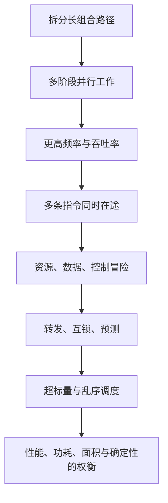
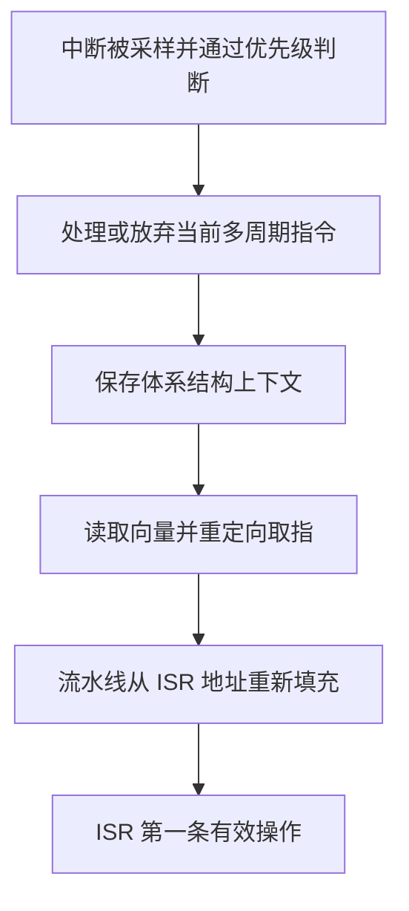

# CPU 流水线：从 Why / What / How / Feature 到车规 MCU 性能诊断

> 面向场景：Cortex-M7 类自研车规 MCU、AURIX TC3xx、Flash/TCM/SRAM、外设轮询、ISR、DMA、Cache、RAM Shmoo 与性能计数器。
>
> 文档目标：不是背诵“IF-ID-EX-MEM-WB”，而是建立一条可以用于解释、测量和定位问题的因果链。

---

## 0. 本文要解决的工程问题

学完后，应当能够回答这些问题：

1. CPU 为什么要做流水线？它提高的是单条指令延迟，还是指令吞吐率？
2. 为什么“多数指令 1 cycle”不等于一条指令只经过一个流水级？
3. stall、bubble、flush 分别是什么？它们之间是什么关系？
4. 数据相关、结构冲突和分支为什么会破坏理想流水线？
5. 转发、互锁、预取、分支预测、超标量和乱序执行分别在解决什么问题？
6. Cortex-M7、TC3xx 与教材中的五级流水线、服务器乱序 CPU 有哪些本质差异？
7. 如何把这些概念用于 QSPI 轮询、ISR 延迟、RAM Shmoo、CPU/DMA 共享内存和 WCET 分析？

### 一句话总纲

流水线通过让多条指令在不同阶段重叠来提高吞吐率；一旦相邻指令争用资源、等待数据或尚不知道下一条 PC，重叠就会被打断，形成 stall、bubble 或 flush。转发和预测是在减少空槽，超标量是在增加每周期的槽位，乱序执行则是在当前指令被卡住时，从后面寻找独立指令填槽。

本文把信息分成四层：第 9 节是平台手册直接支持的 source claim；第 1-8 节是基于教材和手册重建的机制解释；第 10、12、14 节是对当前工作场景的工程 extension；第 11 节给出用于验证或证伪这些判断的方法。



---

## 1. Why：为什么需要流水线

### 1.1 如果不做流水线

假设一条指令需要依次完成：

1. 取指；
2. 译码和读寄存器；
3. ALU 运算；
4. 访问数据存储器；
5. 写回寄存器。

如果所有工作都放在一个时钟周期内，时钟周期必须覆盖整条最长组合路径：

\[
T_{clk} \ge T_{IF}+T_{ID}+T_{EX}+T_{MEM}+T_{WB}+T_{margin}
\]

问题不是硬件不会算，而是必须等最慢路径走完才能打下一拍。频率很难提高，而且同一时刻大量硬件处于空闲状态。

### 1.2 流水线做了什么

在各阶段之间加入流水寄存器，把长组合路径切成较短的若干段：

\[
T_{clk} \ge \max(T_{stage_i}) + T_{pipeline\_reg}
\]

当第一条指令进入译码阶段时，第二条指令可以同时进入取指阶段。流水线填满后，理想情况下每拍都能完成一条指令。

这里必须区分：

- 延迟（latency）：一条指令从进入到产生可用结果需要多久；
- 吞吐率（throughput）：单位时间内能完成多少条指令；
- 重复率（repeat rate）：同类指令能够以多大间隔连续发射；
- 结果延迟（result latency）：结果何时能被后继依赖指令使用。

流水线主要改善吞吐率，不保证降低单条指令的端到端延迟。加入流水寄存器本身还有建立时间、时钟偏斜和功耗成本。

### 1.3 一个定量例子

假设五个阶段各需要 2 ns：

- 非流水实现：一条指令约 10 ns，10 条指令约 100 ns；
- 五级流水实现：时钟约 2 ns；不考虑流水寄存器开销和冒险时，10 条指令约需要 \((5+10-1)\times2=28\) ns。

对于深度为 \(K\) 的理想单发射流水线，执行 \(N\) 条指令：

\[
Cycles_{ideal}=K+N-1
\]

当 \(N\) 很大时，填充和排空开销被摊薄；当代码很短、频繁跳转或频繁进出异常时，填充、排空和重定向的成本就更明显。

### 1.4 为什么不能无限加深流水线

更深的流水线可能缩短单级关键路径、提高频率，但代价包括：

- 流水寄存器数量、时钟树负载、动态功耗和面积增加；
- 数据要跨更多级转发，互锁逻辑更复杂；
- 分支判定越晚，误预测时需要丢弃的在途工作越多；
- 异常、调试、精确状态恢复更复杂；
- 频率提高不一定弥补更高的 CPI 和存储系统等待。

因此，“流水级越深越快”不是成立于所有工作负载的结论。

---

## 2. What：流水线到底是什么

### 2.1 ISA、微架构和流水级不是同一层

| 层次 | 回答的问题 | 示例 |
|---|---|---|
| ISA | 软件可见什么 | `LDR`、`ADD`、异常模型、寄存器、内存属性 |
| 微架构 | 硬件怎样实现 ISA | 流水线、Cache、BTAC、Issue FIFO、Store Buffer |
| SoC 集成 | 核外部怎样供给指令和数据 | Flash wait state、TCM、总线桥、仲裁、ECC、DMA |
| 软件实现 | 编译器和程序产生怎样的指令流 | 指令顺序、分支布局、访存模式、优化等级 |

同一 ISA 可以有完全不同的流水线深度、发射宽度和分支预测器。因此，Armv7-M 只规定软件可见行为时，不能仅凭 ISA 手册推导出某颗芯片的精确 cycle 数。

### 2.2 教材五级模型是因果模型，不是 Cortex-M7 的硬件框图

经典五级模型：

| 阶段 | 主要工作 | 常见阻塞来源 |
|---|---|---|
| IF | 根据 PC 取指 | I-Cache miss、Flash wait state、取指重定向 |
| ID | 译码、读寄存器、依赖检查 | 前条指令结果未就绪、指令配对限制 |
| EX | ALU、比较、地址生成 | 多周期乘除、执行单元占用 |
| MEM | Load/Store 访问 | D-Cache miss、TCM/SRAM 等待、总线仲裁、外设响应 |
| WB | 写回体系结构状态 | 写口冲突、精确异常/提交约束 |

真实 M7 和 TC3xx 会把这些工作重新分组、并行化或增加队列。五级模型的价值是帮助判断“谁在等谁”，而不是拿五级表逐拍套真实芯片。

### 2.3 理想重叠

| 指令 / 周期 | 1 | 2 | 3 | 4 | 5 | 6 | 7 | 8 |
|---|---:|---:|---:|---:|---:|---:|---:|---:|
| I1 | IF | ID | EX | MEM | WB |  |  |  |
| I2 |  | IF | ID | EX | MEM | WB |  |  |
| I3 |  |  | IF | ID | EX | MEM | WB |  |
| I4 |  |  |  | IF | ID | EX | MEM | WB |

从周期 5 开始，各阶段都在为不同指令工作。这个状态叫流水线满载，但它要求：

- 前端每拍能持续供给指令；
- 指令之间没有未解决依赖；
- 执行资源和寄存器端口足够；
- 访存能按期返回；
- 控制流预测正确。

现实系统几乎总有一个条件被破坏。

---

## 3. How：一条指令怎样穿过流水线

考虑：

```asm
LDR   r1, [r0]       ; 从内存读 x
ADD   r2, r1, r3     ; y = x + r3
STR   r2, [r4]       ; 写回 y
```

硬件大致做这些事：

1. 前端根据 PC 取回一段指令，并把 Thumb 指令对齐、拆分；
2. 译码器识别 `LDR/ADD/STR`，读取源寄存器并建立依赖关系；
3. LSU 计算 `r0` 或 `r4` 对应的有效地址，ALU 完成加法；
4. Load 请求进入 TCM、D-Cache、AXI/AHB 或片上总线；
5. 返回的数据通过转发路径直接送给依赖的 `ADD`，或先写入寄存器文件；
6. Store 在体系结构上提交后，仍可能先进入 Store Buffer，再在目标端口可用时真正写出。

最后一点非常重要：一条 Store 离开执行流水线，不等于其他总线主设备已经看见新数据。

---

## 4. Feature：理解流水线时必须一起看的硬件特征

| 特征 | 它解决的问题 | 不能解决的问题 |
|---|---|---|
| Forwarding / bypass | 结果尚未写回时，直接给后继指令使用 | 数据本身尚未从慢存储器返回 |
| Interlock | 检测依赖并自动暂停，保证正确性 | 不会凭空提高吞吐率 |
| Prefetch queue | 解耷取指和执行的短期波动 | 长时间 I-Cache miss 或 Flash 拥塞 |
| Branch predictor | 提前猜下一 PC，减少控制冒险 | 不可预测数据、异常/中断到来 |
| BTB/BTAC | 缓存分支目标，减少等到译码后才得到目标的气泡 | 首次遇到或目标频繁变化的间接分支 |
| Superscalar | 每拍给多个执行通道发射指令 | 指令依赖、配对限制、单一资源瓶颈 |
| Out-of-order | 当前指令等待时，执行后面的独立指令 | 没有足够独立指令、ROB 窗口之外的延迟 |
| Store Buffer | 让 CPU 不必等待每个写事务真正完成 | CPU-DMA 可见性、设备访问顺序、Cache 一致性 |
| Cache / TCM | 缩短或稳定取指、数据访问时间 | 错误的内存属性、DMA 维护、最坏情况分析 |

这些机制都在“减少空槽”，但作用层次不同。不能把 Store Buffer 导致的可见性问题都叫“CPU 乱序执行”，也不能把分支预测等同于通用乱序执行。

---

## 5. 流水线冒险：为什么理想重叠会失败

### 5.1 结构冒险：两条指令同时要同一个硬件资源

经典例子：若取指和数据访问共用单端口存储器，某个周期中 `IF` 和 `MEM` 都想访问它，只能让一个请求先走。

现代 MCU 常用 Harvard 结构、独立 I/D Cache、多个 TCM 端口或多端口寄存器文件来降低冲突，但结构冒险没有消失：

- 两条指令可能同时需要同一个乘法器、除法器或 FPU；
- 双发射核存在合法配对限制，不是任意两条指令都能同拍发射；
- 两个 Load 可能竞争同一 SRAM bank、Cache 端口或总线出口；
- CPU 与 DMA 同时访问同一 SRAM/总线从设备，会在核外仲裁处排队；
- Flash 正在执行擦写时，取指路径可能被阻塞。

工程判断：结构冒险的核心问题是“资源数量和端口是否够”，不是“前后指令是否使用同一个寄存器”。

### 5.2 数据冒险：后继指令需要前驱结果

#### 5.2.1 RAW：真正的数据依赖

```asm
ADD r1, r0, #1
SUB r2, r1, #2      ; 必须读到新 r1
```

这是 Read After Write。转发可以把 `ADD` 的结果从执行级直接送到 `SUB`，不必等它写回寄存器文件。

#### 5.2.2 Load-use：转发也救不了“尚未返回”的数据

```asm
LDR r1, [r0]
ADD r2, r1, r3
```

在一个抽象五级流水线中，Load 数据到 MEM 末尾才出现，而紧随其后的 ADD 在更早的 EX 入口就需要数据，因此至少形成一个空拍：

| 指令 / 周期 | 1 | 2 | 3 | 4 | 5 | 6 | 7 |
|---|---:|---:|---:|---:|---:|---:|---:|
| `LDR` | IF | ID | EX | MEM | WB |  |  |
| `ADD` |  | IF | ID | stall | EX | MEM | WB |
| EX 通道 |  |  | `LDR` | bubble | `ADD` |  |  |

真实芯片的停顿数取决于：数据来自 DTCM、D-Cache hit、SRAM、Flash、外设还是外部存储器；还取决于对齐、总线等待和具体转发点。上表只用于理解因果关系，不能直接当作 Cortex-M7 的周期表。

#### 5.2.3 WAR 和 WAW：为什么常与乱序、长延迟联系在一起

- WAR：前面的指令还没读旧值，后面的指令就写了新值；
- WAW：两条指令写同一逻辑寄存器，后写的反而先完成。

在简单、严格顺序读写的流水线中，WAR/WAW 通常不会成为实际冒险；当允许乱序执行、多发射或不同执行延迟时，它们才需要寄存器重命名和顺序提交机制处理。

这也是一个常见误区：教材把 RAW/WAR/WAW 都列为数据相关类型，不代表每一种都会在 Cortex-M7 的顺序发射流水线上以同样方式出现。

### 5.3 控制冒险：下一条 PC 还不知道

```c
if (fault == 0U) {
    control_loop();
} else {
    safe_state();
}
```

若条件要到执行级才判定，前端有三种选择：

1. 等结果：正确但流水线空转；
2. 固定规则猜测：例如向后跳预测 taken、向前跳预测 not-taken；
3. 根据历史动态预测方向和目标，沿预测路径继续取指。

预测正确，气泡被隐藏；预测错误，则错误路径上的年轻指令必须被取消，并把取指 PC 重定向到正确目标。这个动作称为 flush 或 recovery。

---

## 6. Stall、bubble、flush：三个容易混淆的词

| 术语 | 本质 | 典型原因 | 硬件动作 |
|---|---|---|---|
| stall | 某一级暂时不能向前推进 | Load 未返回、资源忙、下游背压 | 冻结相关级或阻止新指令发射 |
| bubble | 某个流水槽中没有有效指令 | stall 向下游传播、发射宽度没填满 | 空槽随流水线向后移动 |
| flush | 已进入流水线的年轻指令被判定无效 | 分支误预测、异常、取指重定向 | 清除无效状态并从正确 PC 重填 |

### 6.1 三者之间的关系

- stall 是原因或控制动作；
- bubble 是流水资源未做有效工作的表现；
- flush 是主动杀掉错误或不再需要的在途指令。

例如 Load-use 冒险中，译码级把 ADD 暂停一拍，同时在执行通道插入 bubble；分支误预测则不是简单等待，而是 flush 错误路径并重新取指。

bubble 通常是硬件内部的“valid=0”流水槽，不等于软件显式执行了一条 `NOP`。`NOP` 是真实指令，仍要被取指、译码和退休；bubble 没有体系结构效果，也不计作一条完成的指令。

对抽象单发射流水线，可用下面的分解建立直觉：

\[
Cycles \approx K+N-1+S_{struct}+S_{data}+S_{control}+S_{memory}
\]

真实机器中几类等待可能重叠，不能把各 PMU 事件无条件相加；但这个式子适合先建立性能预算，再用计数器修正模型。

### 6.2 “CPU 停顿”不等于“整个芯片停钟”

流水线 stall 时，可能只有某个发射通道或某几个流水级停止推进：

- 其他独立执行通道仍可能工作；
- Store Buffer 可能继续向总线排空；
- Cache linefill 可能继续；
- DMA 和其他核仍在访问系统总线；
- 外设仍按自己的时钟运行。

这对调试超时、WDT、DMA 竞争尤其重要。CPU 在等总线，不代表 WDT 或外设也在等。

---

## 7. 分支预测：用历史换取前端连续供给

### 7.1 预测器要回答两个问题

1. 方向：条件分支 taken 还是 not-taken？
2. 目标：taken 后从哪个地址继续取指？

BTB/BTAC 主要缓存分支目标；方向预测器根据局部或全局历史判断 taken/not-taken。返回地址还可能使用专门的返回栈结构。不同内核实现差异很大。

### 7.2 一个车规软件中的典型分支

```c
if (unlikely(error_flags != 0U)) {
    enter_safe_state();
}
normal_control_path();
```

稳态运行时，错误分支几乎总是不走，预测器容易学会；真正发生故障时，第一次方向翻转可能误预测，但这条路径本来就不是高频平均性能路径。

编译器的 `likely/unlikely` 主要影响代码布局和静态信息，不能保证动态预测器一定按它执行。对实时系统更重要的是：正常路径和故障路径是否都满足各自 deadline，而不是平均预测准确率好不好看。

### 7.3 什么时候分支难预测

- 输入近似随机的 `if`；
- 每次调用目标变化的函数指针、虚函数或大 `switch`；
- 短循环的退出次数频繁变化；
- 中断改变共享状态，使控制流历史不稳定；
- 多个分支映射到有限预测表的同一项，相互污染。

### 7.4 “改成无分支”不一定更快

branchless 写法可能：

- 增加总指令数；
- 拉长 RAW 依赖链；
- 同时计算本来不需要的两条路径；
- 增加寄存器压力和代码体积；
- 对 MMIO 产生本来不该发生的访问。

在分支高度可预测的 MCU 控制代码中，一条预测良好的分支可能优于复杂的掩码运算。必须看反汇编和计数器，而不是按口号修改 C 代码。

---

## 8. 从流水线到超标量，再到乱序执行

### 8.1 三个正交维度

| 概念 | 核心问题 | 可以独立存在吗 |
|---|---|---|
| 流水线 | 不同指令能否在时间上重叠 | 可以，单发射顺序流水线最常见 |
| 超标量 | 一拍最多能发射多少条指令 | 可以是顺序超标量，如 Cortex-M7 |
| 乱序执行 | 被阻塞指令后面的独立指令能否先执行 | 通常配合超标量，但不是超标量的定义 |

因此：双发射不等于乱序；有分支预测也不等于通用乱序执行。

### 8.2 乱序执行为什么出现

考虑：

```asm
LDR  r1, [slow_memory]   ; I1：长延迟
ADD  r2, r1, r3          ; I2：依赖 I1
ADD  r4, r5, r6          ; I3：独立
MUL  r7, r8, r9          ; I4：独立
STR  r2, [r10]           ; I5：依赖 I2
```

顺序发射核走到 I2 后，必须等待 I1 的数据。即使 I3、I4 完全独立，也不能越过 I2 发射。

乱序核会：

1. 把已译码指令放入调度窗口；
2. 跟踪源操作数是否 ready；
3. 当 I1/I2 在等待时，先执行 I3、I4；
4. 通过寄存器重命名消除 WAR/WAW 假相关；
5. 把结果暂存于重排序缓冲区等结构；
6. 最终仍按程序顺序退休，以维持精确异常和正确体系结构状态。

乱序改变的是内部执行顺序，不允许最终程序结果随意改变。

### 8.3 必须区分五种“顺序”

| 顺序 | 含义 |
|---|---|
| 程序顺序 | 汇编中指令出现的顺序 |
| 发射顺序 | 指令被送入执行单元的顺序 |
| 执行/完成顺序 | 运算真正开始和产生结果的顺序 |
| 退休/提交顺序 | 结果成为体系结构状态的顺序 |
| 外部可见顺序 | 其他核、DMA、外设观察到读写的顺序 |

“核是顺序发射”只约束其中一部分。即使没有通用 OOO，Store Buffer、Cache、多个总线接口和互连也可能让外部可见时刻不同于 C 语句顺序。

### 8.4 为什么车规 MCU 常选择较受控的执行模型

通用乱序执行需要较大的调度窗口、物理寄存器、重命名表、Load/Store Queue 和 ROB，会增加：

- 面积和动态功耗；
- 验证状态空间；
- 时序侧信道攻击面；
- 平均性能与最坏执行时间之间的差距；
- 故障诊断和安全分析复杂度。

车规 MCU 并不拒绝性能技术，而是更重视性能、实时性、功耗、成本和可验证性的平衡。顺序超标量、TCM、局部存储器、分支预测和有限队列，往往能以更可控的复杂度获得较好性能。

---

## 9. 平台落地：Cortex-M7 与 AURIX TC3xx

### 9.1 Cortex-M7：顺序发射的超标量核

Arm Cortex-M7 TRM 明确给出的关键点：

- in-order issue、super-scalar pipeline、dynamic branch prediction；
- 多种指令可以双发射，包括某些 load/load 和 load/store 组合；
- DPU 有两个 ALU，并提供大量转发逻辑以减少 interlock；
- 单 MAC 流水线的结果延迟为 2 cycle、吞吐率可达每 cycle 一条 MAC；
- PFU 具有 64-bit 取指带宽、4 x 64-bit 预取队列和 BTAC；
- TRM 说明分支预测器始终启用，普通 `CCR.BP` 不是一个通用的预测软件开关；
- LSU 有双 32-bit Load 通道；
- Store Buffer 可在写离开 Load/Store 流水线并提交后继续处理实际写事务；
- DWT 可统计 CYCCNT、CPI 附加周期、LSU 周期、异常开销和 folded 指令等。

关键边界：M7 是顺序发射，不是通用 OOO 核。双发射能力也不意味着任意相邻两条指令都能配对。具体配对、延迟和 SoC 存储系统时序必须结合芯片实现、反汇编和实测判断。

### 9.2 TC3xx TC1.6.2P：Integer + Load/Store 双发射，Loop 为特殊第三通道

AURIX TC3xx 用户手册给出的实现特征：

- 指令由 64-bit PMI 预取、对齐后进入最多容纳 6 条指令的 Issue FIFO；
- Integer Pipeline、Load/Store Pipeline 和 Loop Pipeline 并行；
- 普通双发射是 Integer 与 Load/Store 配对；Loop Pipeline 是零开销循环的特殊第三通道；
- 执行单元中指令经过 decode 和两个 execute stage，并使用 forwarding 减少 stall；
- 动态分支预测下，分支为 1、2 或 3 cycle；更详细的最佳条件时序中，误预测 LS 分支恢复罚时为 3 cycle、IP 分支为 4 cycle；
- `ADD` 的结果延迟/重复率为 1/1，`MUL` 为 2/1，普通 `MADD` 为 3/1，但相似累加指令之间的 accumulator forwarding 可把依赖延迟降为 1；
- 对单周期目标，`LD.W` 结果延迟为 2、重复率为 1；
- DSPR、DCache、DLMU、PSPR、PCache 是本地单周期路径，Local PFlash 是多周期路径。

这组数据很好地说明：

> latency = 2、repeat rate = 1 表示第一条结果两拍后可用，但流水线每拍都能接收一条新的独立同类指令。延迟和吞吐率不是同一个量。

### 9.3 分支预测、推测取指和推测执行不是一回事

| 机制 | Cortex-M7 | TC3xx TC1.6.2P |
|---|---|---|
| 动态分支预测 | 有 | 有 |
| 沿预测路径预取 | 有 | 有，最多可向当前 PC 前方推测取指 64 bytes |
| 推测数据读 | Normal Memory 可能发生；Device/Strongly-ordered 不发生 | 缓存数据访问可读整条 Cache line |
| 推测写 | 不发生 | 不发生 |
| 通用推测指令执行 | TRM 重点规定推测访问边界，不应自行外推成服务器式 OOO | 手册明确说明不执行 speculative instruction execution |
| 外设空间 | 应使用 Device/Strongly-ordered、XN 等正确属性；AHBP 不做推测读 | Peripheral space 不做推测访问 |

工程上要把“错误路径被取到 Cache/队列中”和“错误路径指令真的进入执行并产生暂存结果”分开分析。

---

## 10. 五个贴合工作场景的完整案例

### 案例一：QSPI 状态轮询为什么慢

```c
while ((QSPI->STATUS & QSPI_RX_READY_Msk) == 0U) {
    /* bounded polling */
}
data = QSPI->RXDATA;
```

#### 流水线视角

每次循环包含：

1. 从 Device/MMIO 读取状态；
2. 对返回值做掩码/比较；
3. 条件分支回到循环头。

这是一条非常紧的依赖链：Load 返回之前，比较不能得到结果；比较结果出来之前，分支不能最终确定。对于 Cortex-M7 这种顺序发射核，后面即使存在独立指令，也难以像 OOO 核那样跨过当前阻塞寻找工作。

#### 分支预测视角

若编译器把循环生成“条件满足则回跳”的分支，等待期间该分支通常连续 taken，容易预测；事件到来时方向变为 not-taken，退出那一次可能发生误预测。编译器也可能采用相反布局，所以最终方向应以反汇编为准。很多情况下，真正的大头不是退出时的一次误预测，而是每轮 MMIO 读取的总线延迟。

#### 系统视角

- `volatile` 只约束编译器真实产生访问，不负责 Cache 属性、屏障或硬件推测规则；
- 外设区必须使用正确的 Device/peripheral、non-cacheable、XN 属性；
- 不要为了“无分支”同时读取多个有副作用的 MMIO 寄存器；
- 长时间等待更适合中断或 DMA；若必须轮询，要有超时上界，避免 WDT/任务调度失控。

#### 可验证方法

同时测量循环总 cycle、每次轮询的总线等待和退出分支的变化。若把同样的状态变量放到 DTCM/DSPR 后性能大幅改善，瓶颈主要在 MMIO 路径，而不是分支指令本身。

### 案例二：为什么 ISR 延迟不是“固定若干拍”

中断到第一条 ISR 有效指令之间至少包含：



影响因素包括：

- 当前指令是否可中止；
- 栈位于 DTCM、DSPR、Cache 命中 SRAM 还是慢速存储器；
- 向量表和 ISR 位于 ITCM/PSPR 还是 Flash；
- I-Cache/预取队列是冷还是热；
- 更高优先级异常、tail-chaining、late arrival；
- FPU 是否启用、是否触发 lazy stacking；
- DMA/其他主设备是否正占用总线。

Cortex-M7 为降低中断延迟，可以放弃大多数正在执行的多周期指令；但从 Device/Strongly-ordered memory 的 Load，以及 AXI 上某些共享 exclusive store 是例外。这意味着一条慢外设读取可能直接扩大中断延迟尾部。

#### 工作建议

- 测 average 不能代替测 max；
- 分别测冷 Cache、热 Cache、总线空闲、DMA 压力、FPU 首次使用等条件；
- 高确定性路径可考虑把向量、关键 ISR 和栈/数据放入 TCM 或本地 scratchpad；
- 用 GPIO 边沿观察端到端延迟，用 cycle counter 拆分核内执行时间。

### 案例三：RAM Shmoo 中频率、电压与流水线是什么关系

芯片正确工作的基本时序条件可抽象为：

\[
T_{clk}=\frac{1}{f} \ge T_{comb}(V,T,P)+T_{setup}+T_{skew}+T_{margin}
\]

降低内核电压通常会减弱晶体管驱动能力、增加逻辑和 SRAM 路径延迟；提高频率则缩短每拍可用时间。因此低电压和高频率的组合更容易越过 timing margin。温度影响还与工艺节点、路径类型和电压区间有关，不能在所有 corner 上简单假定单调关系，所以 Shmoo 要覆盖冷热角。

#### 与 stall 的边界

- 合法工作点内，Flash/SRAM/总线通过 wait state 告诉 CPU “还没准备好”，这会形成可解释的流水线 stall；
- 超出规格导致 setup/hold 或 SRAM 读写失败，是电气时序失效，不是“多插几个 bubble 就会自动恢复”；
- ECC 可检测或纠正部分位错误，但不能把越界工作点变成合格工作点。

#### 如何避免测试程序把 RAM 问题测歪

1. 固定测试代码位置和取指条件，最好把执行代码放到独立 TCM/PSPR，避免被测 RAM 同时承担取指；
2. 固定 Cache、prefetch、Flash wait state 和编译选项；
3. 分开设计 latency test 与 bandwidth test：
   - 指针追逐或严格依赖 Load 链测访问延迟；
   - 多个独立地址流测可持续吞吐率；
4. 区分 CPU 单主设备与 CPU + DMA 竞争条件；
5. 统计错误地址、bit pattern、ECC syndrome、读写方向和首错时间；
6. 长循环要扣除分支、地址更新和计数器开销；短循环还要考虑流水线预热。

这能解释一个常见现象：某个 RAM 测试“频率升高后更快”，只说明 wall time 变短；是否逼近 SRAM/总线路径极限，要看每次访问的 cycle、wait state 和错误边界，而不是只看总耗时。

### 案例四：CPU 写了 DMA descriptor，为什么 DMA 仍读到旧值

```c
desc->src = src;
desc->dst = dst;
desc->len = len;
DMA->START = 1U;
```

源码顺序看似明确，但底层可能发生：

1. descriptor 写入 D-Cache，尚未到达 DMA 的一致性点；
2. Store 已从执行流水线提交，但仍留在 Store Buffer；
3. 启动寄存器走 Device 总线，而 descriptor 走另一个存储接口；
4. DMA 先看见 doorbell，却仍从 SRAM 读到旧 descriptor。

这不是一句“CPU 乱序执行”就能解释完的问题，而是 Cache 维护、Store Buffer、不同主接口排序和外部可见性的组合。

典型发送路径的逻辑顺序是：

```text
写 descriptor
-> 若为 write-back cache，clean 到 DMA 可见的一致性点
-> 按架构/SoC 要求执行 DMB/DSB 或平台同步操作
-> 写 Device doorbell
```

DMA 写回数据后，CPU 读取前通常还要等待完成事件，并按共享属性进行 invalidate。具体 barrier 和 Cache 维护序列必须以芯片互连、一致性域和 DMA 手册为准。

平台对应关系：

- Cortex-M7：TRM 明确指出不同 master interface 之间的顺序，没有 barrier 就不保证；
- TC3xx：Store Buffer 用于把写操作与 CPU 执行解耦，必要时可用 `DSYNC` 刷新，但跨核、DMA 和 Cache 的完整协议仍要结合目标存储区与互连规则。

### 案例五：MAC/CRC 循环为什么“换顺序”可能变快

```c
for (uint32_t i = 0; i < n; ++i) {
    acc += a[i] * b[i];
}
```

一轮包含两个 Load、一个 Multiply/MAC、地址更新、循环控制；`acc` 还形成跨迭代 RAW 依赖链。

性能可能受四类因素限制：

- 前端：代码是否连续、是否命中 I-Cache/PCache；
- Load：数据 bank、对齐和带宽是否支持持续供给；
- 执行：MAC 的 latency 与 repeat rate；
- 控制：循环分支是否可预测，是否支持零开销循环。

可尝试多个累加器来增加 ILP：

```c
acc0 += a[i]     * b[i];
acc1 += a[i + 1] * b[i + 1];
```

但不能机械套用：

- TC1.6.2P 普通 MADD latency 为 3、repeat rate 为 1，但相似累加指令有专门 accumulator forwarding，依赖延迟可降到 1；
- Cortex-M7 的 MAC 流水线结果延迟为 2、吞吐率为每拍一条，但实际代码还受双发射配对和 Load 路径影响；
- 多累加器会改变整数溢出、定点饱和或浮点舍入次序；
- 编译器可能已经展开、合并或使用 DSP 指令。

正确流程是：看优化后反汇编 -> 画依赖链 -> 查 latency/repeat rate -> 用计数器验证。

---

## 11. 怎样测：把“感觉卡住”变成证据

### 11.1 三个核心指标

\[
CPI=\frac{CPU\ cycles}{instructions}, \qquad IPC=\frac{instructions}{CPU\ cycles}
\]

对单发射流水线，理想稳态 CPI 接近 1；对双发射流水线，理想 IPC 上限可能接近 2，但只有指令组合、依赖和资源都允许时才能接近。TC3xx 的特殊 Loop 通道不能简单理解为任意代码 IPC 都能达到 3。

对宽度为 \(W\) 的处理器，\(IPC \le W\)。实际 IPC 与上限的差值，可以理解为结构冲突、依赖、前端断供和错误路径恢复共同造成的 lost issue slots。

仅有 CPI 仍不足以定位原因，还要看：

- 指令取值是否断粮；
- LSU 是否等待；
- 分支是否频繁重定向；
- Cache miss、Flash wait state 或总线仲裁是否增加；
- 异常和睡眠周期是否混入窗口。

### 11.2 Cortex-M7：DWT 建议用法

DWT 可提供：

- `CYCCNT`：总周期；
- `CPICNT`：除每条指令第一个周期外的附加执行周期；
- `LSUCNT`：Load/Store 单元附加周期；
- `EXCCNT`：异常开销；
- `SLEEPCNT`：睡眠周期；
- `FOLDCNT`：folded 指令。

典型 CMSIS 初始化框架：

```c
static void cycle_counter_init(void)
{
    CoreDebug->DEMCR |= CoreDebug_DEMCR_TRCENA_Msk;
    DWT->CYCCNT = 0U;
    DWT->CTRL |= DWT_CTRL_CYCCNTENA_Msk;
}
```

注意：

- 先确认芯片实现了对应 DWT 功能，安全/调试配置没有锁住访问；
- 计数器读取本身有开销，先测空窗口并扣除基线；
- 是否关中断取决于问题：测纯函数可隔离中断，测真实 WCET 不应把合法干扰全部关掉；
- `DSB/ISB` 会改变测量对象。测试纯计算、设备完成顺序和取指上下文时，屏障放置策略不同；
- 防止编译器删掉、常量折叠或把测试循环整体搬移，最终必须检查反汇编。

### 11.3 TC3xx：Core Performance Counters

TC3xx 的 Core Performance Measurement 可统计 CPU clocks、instruction count、I-Cache/D-Cache hit/miss 等。常用基线：

1. 禁用计数；
2. 清零 `CCNT/ICNT/MxCNT`；
3. 通过 `CCTRL` 选择事件并使能；
4. 执行测量窗口；
5. 禁用后读取差值和 sticky overflow；
6. 同时报告代码/数据位置、Cache 状态、编译选项和中断条件。

手册提醒计数器启动与某个特定流水级并不精确同步，因此极短代码片段要重复多次、扣除测量壳开销；31-bit 计数部分会回绕，bit 31 为 sticky overflow。

### 11.4 六组最值得做的微实验

| 实验 | 只改变什么 | 主要观测 | 预期用途 |
|---|---|---|---|
| 依赖 ADD 链 vs 4 个独立累加器 | ILP | cycles/instruction | 暴露结果延迟与发射宽度 |
| 连续 Load vs 指针追逐 | memory-level parallelism | LSU cycles、总 cycles | 区分带宽和延迟 |
| 高度偏置分支 vs 随机分支 | 可预测性 | 总 cycles、分布尾部 | 观察控制冒险 |
| Flash vs ITCM/PSPR | 取指路径 | cold/warm cycles | 暴露前端和 Flash 等待 |
| DTCM/DSPR vs SRAM/LMU | 数据路径 | load-use penalty | 暴露本地存储与总线差异 |
| CPU 单独 vs CPU+DMA 压力 | 仲裁 | 平均/最大 cycles | 验证核外结构冲突 |

测试结果要用分布而不是单个数字：最小值接近硬件最佳路径，长尾通常暴露 Cache、仲裁、中断或刷新行为。

---

## 12. 从现象反推原因的诊断树

### 12.1 CPI 升高时

1. 指令数是否同时变化？
   - 是：先看编译器优化、代码路径和内联；
   - 否：继续看等待来源。
2. LSU 相关计数是否升高？
   - 是：查数据位置、Cache miss、对齐、MMIO、总线争用；
   - 否：继续。
3. 换到 TCM/PSPR 后是否恢复？
   - 是：前端/存储系统瓶颈；
   - 否：继续。
4. 改变输入分布后波动是否明显？
   - 是：分支预测或不同控制路径；
   - 否：查指令依赖、执行单元配对和多周期指令。

### 12.2 延迟偶发长尾时

优先排查：

- 中断抢占和异常嵌套；
- Cache miss / linefill / writeback；
- DMA 或其他核的总线仲裁；
- Flash 后台操作；
- Store Buffer 排空和同步指令；
- 调试器、trace 和 WDT suspend 配置；
- ECC 纠错事件。

流水线冒险通常是可重复的局部代价；系统级共享资源更容易形成输入相关或时间相关的长尾。

---

## 13. 工程上最容易混淆的结论

| 原认识 | 更准确的认识 |
|---|---|
| 一条指令 1 cycle，就是只有一级流水线 | 多数时候指吞吐率或结果/流延迟，不代表内部只经历一拍 |
| 双发射就是乱序执行 | Cortex-M7 就是顺序发射的超标量反例 |
| 有分支预测就一定会推测执行错误路径 | 可以只预测并预取；TC1.6.2P 明确不做通用推测指令执行 |
| forwarding 能消除所有 RAW | 数据尚未从存储器返回时仍必须等待 |
| volatile 能解决 CPU/DMA 顺序 | volatile 只约束编译器访问，不能替代 Cache 维护和 barrier |
| pipeline stall 时芯片都停了 | DMA、总线、Cache fill、外设和 WDT 可能继续运行 |
| branchless 一定更快 | 可预测分支可能更便宜，branchless 还可能增加依赖和非法 MMIO 访问 |
| 平均 cycle 低就说明实时性好 | WCET/高分位还受 Cache、仲裁、异常和存储器状态影响 |
| 降频只是执行变慢 | 在 Shmoo 中它还放宽每级组合逻辑和 SRAM 路径的时序预算 |
| 所有“乱序可见”都来自 OOO core | Store Buffer、Cache、互连和多 master interface 也会改变外部可见顺序 |

---

## 14. 一套可复用的分析方法

遇到任何“这段代码为什么多了几十拍”的问题，按以下顺序分析：

1. 固定观察边界：测的是纯核内、含存储器、含 DMA，还是端到端外设响应？
2. 看反汇编：真实指令、地址、对齐、循环和分支是什么？
3. 画依赖链：谁读取谁的结果，关键 RAW 链有多长？
4. 标注资源：每条指令去 Integer、LSU、FPU、MAC 还是分支通道？
5. 标注存储区：Flash、I/D Cache、ITCM/DTCM、PSPR/DSPR、LMU、MMIO？
6. 查 latency 与 repeat rate：不要只看“单周期指令”。
7. 识别前端风险：分支目标、预测、取指跨界、Cache miss、代码布局。
8. 识别核外风险：Store Buffer、Cache 一致性、总线仲裁、DMA、ECC。
9. 设计单变量实验：一次只改变一个机制。
10. 用计数器证伪：没有计数器证据时，不把猜测写成结论。

---

## 15. 原始资料、观点与适用边界

| 观点 | 原始资料位置 | 本文如何使用 | 边界 |
|---|---|---|---|
| 五级流水线、结构/数据/控制冒险、转发、OOO、超标量和预测的通用模型 | 《Performance Analysis and Tuning on Modern CPUs》中文版，第 3 章，PDF pp.31-36 | 建立通用因果链 | 原书重点是现代高性能 CPU，不能直接当 MCU 时序手册 |
| 五级 MIPS 数据通路、数据冒险、控制冒险、高级流水线与 ILP | 《计算机组成与设计：硬件/软件接口》第 5 版，第 4.3-4.10 节，书页 pp.182-240 | 用于逐拍时序和冒险教学模型 | 经典 MIPS 模型不等于 M7/TC3xx 实现 |
| 顺序/乱序超标量、分支预测、寄存器重命名、发射结构 | 《超标量处理器设计》，第 1、4、7、8 章 | 解释从流水线到宽发射和 OOO 的机制递进 | 侧重超标量 RISC 设计，具体结构不是车规 MCU 的规范要求 |
| M7 为 in-order superscalar，动态分支预测，DPU/PFU/LSU、BTAC、forwarding、Store Buffer | Cortex-M7 TRM DDI 0489F，1.1、1.2.1-1.2.3、1.2.8、4.1.1 | Cortex-M7 平台事实 | SoC 可选项和存储器集成由芯片实现决定 |
| M7 的 Normal memory 可发生推测访问；Device/Strongly-ordered、AHBP 和写访问的边界 | Cortex-M7 TRM DDI 0489F，5.2 | 解释 MPU 属性与 MMIO 安全 | 推测范围不应假设固定，系统必须按手册做健壮设计 |
| DWT 的 cycle、CPI、LSU、exception、sleep、folded 计数器 | Cortex-M7 TRM DDI 0489F，11.2-11.3 | 构建测量闭环 | 某些 DWT 功能是实现可选的 |
| TC1.6.2P 的 Issue FIFO、三条功能流水线、forwarding、分支预测 | AURIX TC3xx User's Manual Part 1 V2.0.0，5.2.2-5.2.3 | TC3xx 平台结构 | 第三通道只用于 loop，不等于任意三发射 |
| TC1.6.2P 不做 speculative instruction execution；取指可向前 64 bytes | 同上，5.3.4.8-5.3.4.9 | 区分预测、预取和推测执行 | 结论针对该实现版本 |
| TC3xx latency、repeat rate、分支恢复、Load 和本地存储器时序 | 同上，5.3.5-5.3.6 | 把抽象概念落到 cycle | 表中多为最佳条件，假设单周期存储、无 miss/待处理 store |
| TC3xx 性能计数器、Cache hit/miss、CCNT/ICNT | TriCore TC1.6.2 Architecture Manual Vol.1，12.10-12.11 | 建立 TC3xx 测量方法 | 可测事件有实现相关性，短窗口有启动不同步误差 |

### 资料分工

- 深读：Cortex-M7 TRM 1.1、1.2、5.2、11；TC3xx User Manual 5.2、5.3.4、5.3.5；
- 支撑阅读：性能书第 3 章、组成原理第 4 章；
- 专题查阅：《超标量处理器设计》第 4、7、8 章；
- 暂缓：服务器级 TAGE、ROB/LSQ 实现细节和复杂一致性协议；当工作进入高性能应用核、MPU/Cache 一致性或多核共享内存专题时再深入。

---

## 16. 本阶段形成的工作结论

### 16.1 可立即应用

- 性能问题先区分依赖、资源、控制和存储系统四类来源；
- 对 M7 使用 DWT，把总周期与 LSU、异常等附加周期拆开；
- 对 TC3xx 同时记录 `CCNT/ICNT` 与 Cache 事件，并结合 5.3.5 的 latency/repeat rate；
- RAM Shmoo 固定取指和 Cache 条件，分开 latency test 与 throughput test；
- ISR 测试覆盖冷/热 Cache、DMA 压力和慢 Device 访问；
- CPU-DMA 共享缓冲区按“Cache 维护 + barrier + doorbell”验证外部可见顺序。

### 16.2 可复用的方法

把每个性能现象还原成这条链：

```text
C/汇编指令流
-> 依赖图与执行通道
-> 流水线发射/停顿/清空
-> Cache/TCM/总线响应
-> 外部可见行为
-> counter 与端到端测量
```

### 16.3 下一阶段建议

下一阶段最值得继续的是“Cortex-M7 与 TC3xx 的实际指令时序实验”：选一段现有 SRAM 测试或控制循环，保留反汇编、链接地址、DWT/PMU 计数和不同存储区结果，逐条构建真实性能模型。这样可以把本章的概念从解释框架变成你们芯片自己的 timing database。
