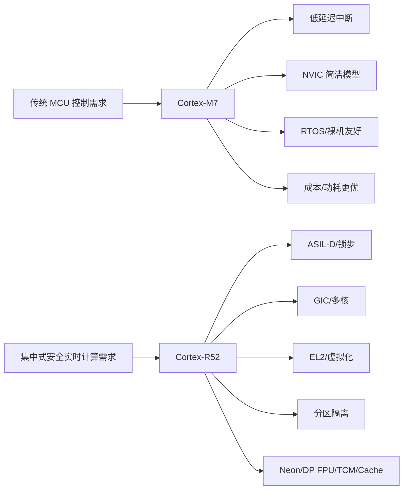

# Cortex-R52 对比 Cortex-M7 的改动点及 NXP S32E2/S32Z2 选用 R52 的工程分析

> 版本：v1.0  
> 面向对象：车规 MCU / 实时处理器系统工程师、MCAL/BSW/OS/安全软件开发人员  
> 分析对象：Arm Cortex-R52 vs Arm Cortex-M7；NXP S32E2/S32Z2 平台选用 Cortex-R52 的原因  
> 重点维度：架构定位、异常/中断、特权级、虚拟化、MPU/隔离、Cache/TCM、安全机制、实时性、多核、软件迁移、车规应用场景  
> 术语说明：本文中的 “NXP E2” 按 **NXP S32E2/S32Z2** 系列理解。  
> 资料边界：R52 内核能力以 Arm Cortex-R52 TRM 为主；M7 内核能力以 Arm Cortex-M7 TRM/DGUG 为主；S32E2/S32Z2 的芯片级集成能力以 NXP S32E2 RM 为主。不同芯片厂对同一内核的配置可能不同，本文会区分“Arm 内核可配置能力”和“NXP S32E2 实际集成能力”。

---

## 0. 核心结论

### 0.1 一句话判断

**Cortex-R52 不是 Cortex-M7 的简单性能升级版，而是从 M-profile MCU 内核路线切换到 R-profile 实时处理器路线。**

- **M7**：高性能 MCU 内核，优势是中断低延迟、模型简单、CMSIS/RTOS/MCAL 生态成熟，适合传统车身、网关、普通电机控制、BMS 从控、执行器控制等 MCU 场景。
- **R52**：实时处理器内核，优势是功能安全、锁步、多核、虚拟化、分区隔离、强实时算力，适合底盘/制动/动力域控/HEV/EV 集成控制/安全监督器等高 ASIL、高集成度场景。

### 0.2 最重要的差异

| 维度 | Cortex-M7 | Cortex-R52 | 工程意义 |
|---|---|---|---|
| 架构 Profile | M-profile，Armv7E-M / Armv7-M 系列 | R-profile，Armv8-R AArch32 | R52 面向实时处理器，不是传统 MCU core |
| 中断控制器 | NVIC | GIC | R52 更适合多核、虚拟中断、分区化系统 |
| 特权模型 | Thread / Handler；Privileged / Unprivileged | EL0 / EL1 / EL2 等异常级模型 | R52 可支持 Hypervisor 和强隔离 |
| 虚拟化 | 基本不是核心目标 | 支持虚拟化，EL2 管理 guest contexts | 适合多 OS / 多应用 / 混合关键等级 |
| 存储保护 | MPU，常见 8/16 区域，芯片相关 | PMSAv8 MPU，EL1/EL2 两阶段保护 | R52 更适合分区隔离和虚拟化 |
| 安全机制 | 可集成 ECC/MPU/外部锁步，取决于芯片 | DCLS / Split-Lock / Comparator / MBIST / error reporting 等更核心 | 更适合 ASIL-D 随机硬件故障诊断 |
| 多核扩展 | 可多核，但系统化程度依赖芯片厂 | 1–4 core cluster，可 split-lock | 更适合集成式实时控制平台 |
| SIMD/FPU | DSP extension，FPU 可选 | Advanced SIMD / FP 可选；S32E2 集成 Neon / DP FPU | 更适合控制算法、估算算法、实时信号处理 |
| 软件复杂度 | 低 | 高 | R52 需要 GIC、EL2、MPU、XRDC、cache/TCM/lockstep 管理 |
| 典型芯片 | S32K3、STM32H7、部分高端 MCU | S32E2/S32Z2、R52 实时处理器平台 | 产品定位不同 |

### 0.3 对 NXP S32E2/S32Z2 的核心解释

S32E2/S32Z2 不是传统意义的低成本 MCU，而是面向 **ASIL-D、高性能实时控制、动力/底盘/制动/域控集成** 的实时处理器平台。  
它选用 Cortex-R52，主要是为了获得：

1. **高安全等级**：锁步、冗余、错误检测、MBIST、故障上报。
2. **高实时算力**：R52 cluster + TCM + Cache + Neon/DP FPU。
3. **多核扩展**：Split-Lock 下可在性能和安全之间切换。
4. **分区/虚拟化**：XRDC + GIC + EL2/MPU 适合多应用隔离。
5. **集中式 E/E 架构适配**：把多个传统 ECU 功能集中到一个实时控制平台。

---

## 1. Cortex-M7 与 Cortex-R52 的定位差异

### 1.1 Cortex-M7 的定位

Cortex-M7 是 Arm 面向 **microcontroller market** 的高性能 32-bit processor。它强调：

- 高性能嵌入式计算；
- 快速中断处理；
- 低成本 debug/trace；
- Thumb-2 高代码密度；
- 低功耗；
- 可选 MPU；
- 可选 FPU；
- Harvard I/D cache；
- TCM 接口；
- NVIC 紧耦合中断模型。

典型应用：

- 高端车规 MCU；
- 电机控制 MCU；
- BMS 主控/从控；
- 网关/车身控制；
- 工业控制；
- 高性能裸机/RTOS 场景。

### 1.2 Cortex-R52 的定位

Cortex-R52 是 Arm 面向 **automotive and industrial real-time applications** 的中高性能 in-order superscalar 实时处理器。它强调：

- Armv8-R AArch32；
- 1~4 cores；
- 实时确定性；
- GIC；
- 虚拟化；
- PMSA contexts；
- DCLS / Split-Lock；
- TCM；
- I/D cache；
- Advanced SIMD / floating-point；
- MBIST；
- PMU；
- CoreSight debug/trace；
- Error reporting；
- AXI/LLPP/Flash 等系统接口。

典型应用：

- 制动控制；
- 底盘域控；
- 动力域控；
- HEV/EV 集成控制；
- 安全监督器；
- 高 ASIL 实时控制；
- 多分区实时系统；
- 多核实时 RTOS/Hypervisor 系统。

### 1.3 定位示意图



---

## 2. 架构 Profile 与编程模型差异

### 2.1 M-profile vs R-profile

| 项目 | Cortex-M7 | Cortex-R52 |
|---|---|---|
| Profile | M-profile | R-profile |
| 架构 | Armv7E-M / Armv7-M | Armv8-R AArch32 |
| 典型抽象 | MCU core | Real-time processor core |
| 指令状态 | Thumb / Thumb-2 | A32 + T32 |
| 异常入口 | 硬件自动压栈、向量表直接入口 | R-profile 异常模型，异常级/模式更复杂 |
| OS 模型 | RTOS / AUTOSAR Classic / 裸机 | RTOS + Hypervisor + 多分区 |
| 安全目标 | 可做安全，但内核本身偏 MCU | 原生更偏高安全实时系统 |

### 2.2 指令集差异

#### Cortex-M7

- Thumb / Thumb-2；
- 16-bit/32-bit mixed encoding；
- 高代码密度；
- MCU 编译器、CMSIS、RTOS 生态成熟；
- 支持 DSP extension；
- 可选 FPU；
- 不支持 A32 ARM state。

#### Cortex-R52

- A32：32-bit word-aligned；
- T32：16-bit/32-bit halfword-aligned；
- 支持 Advanced SIMD / floating-point 可选；
- 更适合高性能实时 OS、Hypervisor、复杂系统软件。

### 2.3 编程模型差异

#### Cortex-M7 的典型模型

```text
Reset_Handler
  └─ SystemInit()
      └─ main()
          ├─ Bare-metal loop
          ├─ RTOS scheduler
          └─ NVIC ISR
```

核心寄存器关注点：

- R0-R15；
- xPSR；
- CONTROL；
- PRIMASK；
- BASEPRI；
- FAULTMASK；
- MSP / PSP；
- VTOR；
- SCB / NVIC / SysTick；
- MPU registers；
- FPU registers；
- DWT / ITM / ETM。

#### Cortex-R52 的典型模型

```text
Boot / Reset
  └─ EL2 initialization / Safety supervisor / Hypervisor
      ├─ GIC initialization
      ├─ MPU / memory attribute initialization
      ├─ TCM / Cache initialization
      ├─ Lockstep / Split-lock setup
      ├─ XRDC / partition setup
      └─ EL1 guest / RTOS / application partitions
```

核心关注点：

- EL2 / EL1 / EL0；
- GIC Distributor / Redistributor / CPU interface；
- EL1-controlled MPU；
- EL2-controlled MPU；
- Generic Timer；
- PMU；
- TCM / cache；
- virtualization traps；
- split-lock / DCLS；
- safety error reporting；
- MBIST / SBIST；
- debug / trace / CTI / ETM。

---

## 3. 异常与中断：NVIC vs GIC

### 3.1 Cortex-M7 的 NVIC 模型

M7 的中断体系是 MCU 友好型：

- NVIC 与 core 紧耦合；
- 中断入口硬件自动保存上下文；
- 支持优先级抢占；
- 支持 tail-chaining；
- 支持 late-arrival；
- 支持 SysTick、PendSV、SVC 等 RTOS 关键异常；
- 中断向量表简单；
- ISR 编写简单。

典型 M7 异常路径：

```text
IRQ pending
  ↓
NVIC priority arbitration
  ↓
Automatic stacking
  ↓
Load vector
  ↓
ISR execution
  ↓
Automatic unstacking / tail-chaining
```

### 3.2 Cortex-R52 的 GIC 模型

R52 使用 GIC，更偏多核/多 OS/虚拟化平台：

- GIC Distributor：全局中断分发、优先级、目标 core；
- GIC Redistributor：SGI/PPI 等 per-core 资源；
- GIC CPU interface：向 core 呈现中断；
- 支持 virtualization interrupt；
- 支持更复杂的中断路由和分区管理；
- 更适合多核实时处理器。

典型 R52 中断路径：

```text
Peripheral interrupt
  ↓
GIC Distributor
  ↓
Redistributor / routing
  ↓
CPU interface
  ↓
EL2 / EL1 interrupt handling
  ↓
Guest OS / partition ISR
```

### 3.3 NVIC 与 GIC 的工程对比

| 维度 | NVIC / M7 | GIC / R52 |
|---|---|---|
| 目标 | MCU 快速中断 | 多核实时处理器中断基础设施 |
| 编程复杂度 | 低 | 高 |
| 中断路由 | 相对简单 | 支持多核目标、虚拟中断、复杂路由 |
| RTOS 移植 | 成熟简单 | 需要 GIC driver、EL 配置、可能需要 hypervisor |
| 典型异常 | SVC/PendSV/SysTick/HardFault/BusFault | IRQ/FIQ/SError/EL 异常模型，具体依架构和实现 |
| 虚拟化 | 基本无 | 可支持虚拟中断 |
| 适合 | 单 MCU 控制 | 多核、多分区、域控 |

### 3.4 对 AUTOSAR/OS 的影响

| 软件层 | M7 关注点 | R52 关注点 |
|---|---|---|
| OS port | PendSV/SysTick/SVC/BASEPRI | GIC、Generic Timer、EL1/EL2、context switch |
| ISR | NVIC vector + ISR function | GIC ID + routing + priority + target core |
| MCAL | 配置 NVIC channel | 配置中断路由、domain、peripheral access |
| Safety OS | MPU + stack guard | EL2/MPU/XRDC/GIC/partition |
| 多核 OS | 芯片厂自定义多核启动/中断 | 更系统化的 GIC + cluster 模型 |

---

## 4. 特权级、虚拟化与分区隔离

### 4.1 M7 的权限模型

M7 主要是：

```text
Thread mode:
  - Privileged
  - Unprivileged

Handler mode:
  - Always privileged
```

M7 可以用 MPU 做任务级隔离：

- task A 只能访问自己的 RAM；
- task B 不能访问 task A 的区域；
- 外设寄存器可配置为 privileged-only；
- RTOS 在 privileged mode 管理任务切换。

但 M7 的隔离更偏 **单 OS 内部隔离**，不是天然面向 **多个 OS / 多个虚拟机 / 多供应商软件分区**。

### 4.2 R52 的 EL 模型

R52 的关键价值是支持 EL2：

```text
EL2: Hypervisor / Safety Supervisor / Platform Manager
EL1: RTOS / AUTOSAR OS / Guest OS
EL0: Application task / user code
```

典型用途：

- EL2 配置物理资源；
- EL2 管控 EL1 guest；
- EL2 处理虚拟化陷入；
- EL2 配置二阶段 MPU；
- EL2 配置 GIC 虚拟中断；
- EL2 做安全监控和隔离策略。

### 4.3 两阶段 MPU 的意义

R52 不使用 MMU，所以仍然保持实时确定性；但它支持更强的 MPU 分层控制：

```text
EL1 MPU:
  - guest OS / application 视角的内存保护

EL2 MPU:
  - hypervisor / platform 视角的全局资源保护
```

工程意义：

- guest OS 即便配置错 MPU，也不能越过 EL2 限制；
- 安全关键分区和非安全分区可硬隔离；
- 不同供应商的软件模块可放在不同 partition；
- 错误访问可以被捕获并上报；
- 满足 freedom from interference 的设计诉求。

### 4.4 S32E2 的芯片级分区

NXP S32E2/S32Z2 不只靠 R52 内核本身，还通过芯片级 XRDC 等机制实现分区：

```text
Application / Partition
  ↓
Domain ID
  ↓
XRDC
  ↓
Memory / Peripheral / IO / Interconnect Access Permission
```

典型效果：

- App1 只能访问自己的 RAM、watchdog、NETC port；
- App2 可共享 R52 core，但访问自己的外设；
- FlexCAN/FlexLLCE 等通信资源可按 partition 分配；
- 越权访问触发错误；
- 支持把整个应用或应用内功能段隔离开。

---

## 5. 存储系统：TCM、Cache、MPU、总线接口

### 5.1 Cortex-M7 存储系统特点

M7 常见结构：

```text
Cortex-M7
  ├─ I-Cache
  ├─ D-Cache
  ├─ ITCM
  ├─ DTCM
  ├─ AXIM
  ├─ AHBP/AHBS
  ├─ PPB
  └─ MPU
```

优势：

- ITCM/DTCM 可提供确定性低延迟；
- I/D cache 提高外部 Flash / SRAM 访问性能；
- MPU 做基本保护；
- AXIM/AHB 接口适合 MCU 总线系统；
- 编程模型相对成熟。

典型风险：

- D-cache coherency；
- DMA 与 cache 维护；
- MPU region 配置错误；
- speculative access；
- Flash wait-state；
- TCM 容量有限；
- cacheable / bufferable attribute 设置影响外设访问。

### 5.2 Cortex-R52 存储系统特点

R52 典型结构：

```text
Cortex-R52 Core
  ├─ L1 I-cache
  ├─ L1 D-cache
  ├─ ATCM / BTCM / CTCM
  ├─ EL1-controlled MPU
  ├─ EL2-controlled MPU
  ├─ AXI master / AXI slave
  ├─ LLPP
  ├─ Flash interface
  ├─ RAM protection
  └─ error reporting
```

优势：

- 多 TCM，更适合代码/数据/栈/关键控制环隔离；
- PMSA + EL2 MPU 适合分区；
- AXI / LLPP / Flash 接口更适合实时处理器平台；
- 可选 RAM protection；
- 可配合 MBIST/SBIST；
- 支持 PMU 进行性能监控；
- 支持 MRP 用于 calibration/emulation。

### 5.3 NXP S32E2 中的 R52 存储配置要点

S32E2/S32Z2 典型配置可抽象为：

```text
每个 Cortex-R52 core:
  ├─ Neon / DP FPU
  ├─ 3x TCM: 64 KB / 16 KB / 16 KB
  ├─ 32 KB L1 I-cache
  └─ 16 KB L1 D-cache

每个 cluster:
  ├─ 1 MB data RAM
  ├─ 7 MB code RAM
  ├─ 1 MB L2 cache / reusable as code RAM
  └─ RTU subsystem resources
```

### 5.4 对实时性的影响

| 存储位置 | 实时性 | 容量 | 典型用途 |
|---|---:|---:|---|
| TCM | 最强 | 小 | 高频控制环、ISR、栈、关键数据 |
| L1 Cache | 高，但有 miss 抖动 | 小 | 热点代码/数据 |
| L2 Cache / Code RAM | 中高 | 较大 | 次关键代码、算法库 |
| SRAM | 中 | 较大 | 普通数据、共享 buffer |
| Flash / LPDDR-F | 取决于 wait-state/cache | 大 | 大代码镜像、OTA、非高频代码 |
| LPDDR DRAM | 抖动较大 | 大 | 临时大 buffer、非严格实时数据 |

---

## 6. 功能安全机制对比

### 6.1 M7 的安全能力边界

M7 可用于车规安全系统，但很多安全能力依赖芯片厂集成：

- MPU；
- Cache ECC；
- TCM 外部 ECC；
- Bus error；
- Lockstep 可能由芯片厂实现，也可能没有；
- Safety monitor；
- FCCU/ERM/SMU；
- WDG；
- Clock monitor；
- Flash/RAM ECC；
- BIST。

M7 的优势是简单、可预测、生态成熟。  
劣势是内核原生分区/虚拟化/多核安全协同不如 R52。

### 6.2 R52 的安全机制

R52 更强调安全实时应用：

- DCLS：Dual-Core Lock-Step；
- Split-Lock；
- redundant core logic；
- comparator；
- RAM protection；
- bus protection；
- error reporting；
- MBIST interface；
- PMU；
- CTI；
- ETM trace；
- GIC virtualization；
- EL2-based isolation；
- PMSA contexts。

### 6.3 DCLS 与 Split-Lock

#### DCLS

```text
Functional Core
  ↓ same input
Redundant Core Logic
  ↓
Comparator
  ↓
Mismatch -> fault report
```

作用：

- 检测 transient fault；
- 检测 permanent fault；
- 提高随机硬件故障诊断覆盖率；
- 适合 ASIL-D。

#### Split-Lock

```text
Lock mode:
  Core0 + shadow Core1 -> 1 usable safe core pair

Split mode:
  Core0, Core1 independent -> 2 usable performance cores
```

工程取舍：

| 模式 | 优点 | 缺点 | 适合任务 |
|---|---|---|---|
| Lock mode | 高安全诊断覆盖 | 可用算力减少 | 制动、转向、安全监督 |
| Split mode | 可用 core 数增加 | 锁步诊断减少 | 非最高 ASIL 任务、通信、算法并行 |
| Mixed mode | 性能与安全折中 | 配置复杂 | 域控平台 |

### 6.4 S32E2 的安全价值

S32E2/S32Z2 的定位是 **ASIL-D + 高性能实时应用**。  
它不是只靠 R52，而是整体安全平台：

```text
R52 Split-Lock Cluster
  + M33 System Manager
  + HSE
  + XRDC
  + ECC
  + EIM
  + VFCCU/FCCU
  + MBIST/PMC
  + watchdog
  + clock monitor
  + debug/trace control
```

---

## 7. 性能能力对比

### 7.1 M7 的性能优势

M7 对 MCU 来说已经非常强：

- 6-stage pipeline；
- in-order superscalar；
- dynamic branch prediction；
- dual issue 部分场景；
- DSP extension；
- hardware divide；
- FPU 可选；
- I/D cache；
- TCM；
- fast interrupt response；
- 代码密度高。

适合：

- 电机 FOC；
- 控制算法；
- 周期任务；
- CAN/LIN/SPI/I2C 通信；
- RTOS；
- 中断密集型应用。

### 7.2 R52 的性能优势

R52 的性能不只是单核 IPC，而是系统级实时算力：

- 1~4 cores；
- 8-stage in-order superscalar；
- branch prediction；
- Advanced SIMD；
- SP/DP FPU；
- TCM；
- L1 I/D cache；
- PMU；
- Split-Lock；
- GIC；
- cluster 级资源；
- S32E2 可达多 core / 多 cluster 组合。

适合：

- 多任务并发实时控制；
- 高 ASIL 控制；
- 向量/浮点计算；
- 电驱/混动/底盘协调；
- safety checker；
- gateway + domain control；
- 多控制器合一。

### 7.3 性能不是唯一指标

对 S32E2 来说，更关键的是：

```text
性能 = 实时算力 + 安全诊断 + 分区隔离 + 多核可扩展 + 外设/通信平台化
```

而不是单纯看 Dhrystone/CoreMark。

---

## 8. NXP S32E2/S32Z2 为什么选 Cortex-R52

### 8.1 产品目标决定

S32E2/S32Z2 面向：

- Braking control；
- HEV/EV integrated system control；
- Safety；
- Discrete domain control；
- Hosted function domain control；
- Chassis domain control；
- ADAS/VCU safety checker；
- Propulsion domain controller；
- Battery management integration；
- Inverter / transmission / DC-DC / OBC / ICE strategy integration。

这些场景的共同点：

```text
高实时性
+ 高安全等级
+ 高算力
+ 多功能集成
+ 多分区隔离
+ 多通信接口
+ OTA / 安全启动 / 安全管理
```

M7 可以做其中某些功能，但很难自然承担整个 **安全实时域控平台**。

### 8.2 S32E2 对 R52 的实际利用

| S32E2 需求 | R52 提供的能力 | 芯片级配合 |
|---|---|---|
| ASIL-D | DCLS / Split-Lock / error reporting | VFCCU / EIM / ECC / watchdog / clock monitor |
| 多实时任务 | 多 core / GIC / TCM / cache | RTU0/RTU1 cluster、NoC/NIC |
| 高算力控制 | superscalar + Neon + DP FPU | MATH/ML acceleration、GTM、ADC、PWM |
| 分区隔离 | EL2 / MPU / GIC virtualization | XRDC domain、partition、peripheral protection |
| 通信集中 | core + GIC + DMA | FlexLLCE、CAN XL、FlexCAN FD、Ethernet/NETC |
| OTA | 大容量 flash / LPDDR-F / partition | zero-downtime OTA 支持 |
| 安全监督 | lockstep pair + PMU + fault reporting | M33 system manager / HSE / safety monitor |

### 8.3 为什么不是继续用 M7

#### 不是 M7 不够好，而是 S32E2 的平台定位变了

M7 适合：

```text
单 ECU / 单功能 / 单 RTOS / 外设控制 / 成本敏感
```

S32E2 目标是：

```text
多 ECU 功能集中
+ 多安全等级任务共存
+ 高实时计算
+ 高功能安全
+ 分区/虚拟化
+ 大通信吞吐
+ 域控级集成
```

这已经超过传统 M-profile MCU 的舒适区。

### 8.4 为什么不是 Cortex-A

Cortex-A 有 MMU、Linux、强应用生态，但在制动/底盘/电驱这类硬实时安全控制里有问题：

| 问题 | Cortex-A | Cortex-R52 |
|---|---|---|
| 实时确定性 | 较弱，需要复杂 RT patch / safety island | 强 |
| MMU/TLB 抖动 | 有 | 无 MMU，PMSA 模型 |
| 安全认证复杂度 | 高 | 更适合 ISO 26262 实时安全 |
| 中断/调度抖动 | 可能较大 | 更可控 |
| 控制环适配 | 不自然 | 自然 |
| Linux 生态 | 强 | 不是重点 |

所以 R52 是中间路线：

```text
比 M7 更适合域控和高安全分区
比 Cortex-A 更适合硬实时安全控制
```

---

## 9. S32E2/S32Z2 的典型应用场景

### 9.1 制动控制 Braking Control

特点：

- 极低延迟；
- 高 ASIL；
- 传感器采样 + 执行器控制；
- 故障快速检测；
- 冗余控制策略；
- 不能被非安全任务干扰。

为什么 R52 合适：

- Lockstep；
- TCM 放关键 ISR/control loop；
- GIC 管理多源中断；
- XRDC 隔离非制动任务；
- PMU/trace 便于性能验证；
- fault reporting 便于安全反应。

### 9.2 底盘域控 Chassis Domain Control

功能可能包括：

- braking；
- steering；
- throttle；
- suspension；
- vehicle dynamics；
- sensor fusion for chassis；
- actuator coordination。

为什么 R52 合适：

- 多核并行；
- 分区隔离；
- safety critical 与 QM/ASIL-B 功能共存；
- Split-Lock 平衡算力和安全；
- 高速通信和实时调度。

### 9.3 HEV/EV 集成控制

功能可能包括：

- hybrid control unit；
- inverter control；
- battery management；
- transmission control；
- DC/DC；
- on-board charger；
- internal combustion engine strategy；
- torque and energy strategy。

为什么 R52 合适：

- Neon / FPU 支持控制算法；
- 多核支持多控制域；
- TCM 支持确定性控制环；
- 通信资源支持多节点协调；
- 分区隔离支持供应商/功能隔离；
- ASIL-D 支持整车安全目标。

### 9.4 ADAS/VCU Safety Checker

R52 可作为主处理器的安全监督器：

```text
Main ADAS / VCU processor
  ↓ calculation result
S32Z2/S32E2 Safety Checker
  ↓ independent real-time comparison
Fault reaction / limp home / safe state
```

优势：

- 独立实时计算；
- lockstep 安全执行；
- 可对主处理器结果做 cross-check；
- 故障可上报并进入安全状态。

### 9.5 Hosted Function Domain Control

“Hosted function” 的含义更接近：在一个实时安全平台上承载多个原本分散的 ECU 功能。

适合原因：

- 分区；
- 虚拟化；
- 多核；
- 外设归属管理；
- 通信资源复用；
- OTA；
- 安全等级隔离。

---

## 10. 对工程开发的影响

### 10.1 启动流程变化

#### M7 启动

```text
Vector table
  ↓
Reset_Handler
  ↓
SystemInit
  ↓
C runtime init
  ↓
main / OS
```

#### R52/S32E2 启动

```text
BootROM / Secure Boot
  ↓
System Manager / Safety init
  ↓
R52 cluster reset release
  ↓
EL2 / platform initialization
  ├─ GIC
  ├─ EL1/EL2 MPU
  ├─ TCM/cache
  ├─ XRDC partitions
  ├─ watchdog
  ├─ safety monitor
  └─ timers
      ↓
EL1 RTOS / AUTOSAR OS / applications
```

### 10.2 OS Porting 关注点

| 项目 | M7 | R52 |
|---|---|---|
| Tick source | SysTick / STM | Generic Timer / STM |
| 中断控制 | NVIC | GIC |
| 上下文切换 | PendSV/SVC | EL 异常 + OS port + GIC |
| 任务隔离 | MPU | EL1/EL2 MPU + XRDC |
| 栈模型 | MSP/PSP | EL-specific stack / mode-specific stack |
| FPU 保存 | lazy stacking 等 | VFP/Neon context management |
| 多核启动 | vendor-specific | cluster/core release + GIC routing |
| safety partition | MPU/OS memory protection | hypervisor/domain/partition |

### 10.3 MCAL/BSW 关注点

对于 MCAL/BSW，R52/S32E2 下关注点会显著增加：

- 外设访问是否属于当前 domain；
- XRDC 权限是否允许；
- 中断是否正确 route 到目标 core；
- DMA master 的 domain ID 是否正确；
- cache 维护是否覆盖 DMA buffer；
- TCM/SRAM/LPDDR 属性是否正确；
- 安全外设是否需要 unlock/key sequence；
- fault 是否进入 VFCCU/FCCU；
- 多 partition 下外设是否独占或共享；
- shared peripheral 是否有 arbitration；
- core reset/fence/drain 是否安全；
- lockstep fault 后如何 quiesce core；
- warm reset 是否影响 RTU 其余部分。

### 10.4 调试与性能分析

M7 常用：

- DWT CYCCNT；
- ITM printf；
- ETM trace；
- HardFault stack frame；
- NVIC pending/active；
- SCB fault status；
- cache/TCM placement 测试。

R52/S32E2 增加：

- PMU；
- GIC state；
- EL1/EL2 exception state；
- XRDC violation；
- VFCCU/FCCU fault；
- lockstep comparator fault；
- MBIST/SBIST result；
- NoC/NIC debug；
- trace aggregation；
- fence-and-drain 状态；
- per-core WFI/WFE/WARMRSTREQ 状态。

---

## 11. R52 对 M7 的“改动点”详细清单

### 11.1 架构层面

| 编号 | 改动点 | M7 | R52 | 专业解读 |
|---:|---|---|---|---|
| 1 | Profile | M-profile | R-profile | 目标从 MCU 控制转向实时处理器 |
| 2 | ISA | Thumb-2 | A32/T32 | R52 更接近 Armv8-R 实时处理器软件模型 |
| 3 | 异常级 | Thread/Handler | EL0/EL1/EL2 | R52 支持 hypervisor/safety supervisor |
| 4 | 虚拟化 | 非核心能力 | 核心能力之一 | R52 支持多个 PMSA context |
| 5 | 安全状态 | v7-M，无 TrustZone-M | R52 不实现 TrustZone，但可通过 EL2/MPU/XRDC 实现隔离 | 不要把 R52 隔离误解成 TrustZone |

### 11.2 中断层面

| 编号 | 改动点 | M7 | R52 | 专业解读 |
|---:|---|---|---|---|
| 1 | 控制器 | NVIC | GIC | 从 MCU 中断转为多核处理器中断 |
| 2 | 虚拟中断 | 基本无 | 支持 | 适合 guest OS/partition |
| 3 | 路由能力 | 简单 | 强 | 支持多 core target |
| 4 | 中断入口 | 硬件自动压栈 | R-profile 异常模型 | OS port 完全不同 |
| 5 | RTOS tick | SysTick 常见 | Generic timer/SoC timer | 移植需重写底层 tick |

### 11.3 存储与保护层面

| 编号 | 改动点 | M7 | R52 | 专业解读 |
|---:|---|---|---|---|
| 1 | MPU | 可选 MPU | EL1/EL2 MPU | R52 隔离层级更强 |
| 2 | MMU | 无 | 无 | R52 保持实时确定性，不是 Cortex-A |
| 3 | TCM | ITCM/DTCM | 3x TCM per core 可配置 | 适合关键代码/数据/栈分离 |
| 4 | Cache | I/D cache 可选 | I/D cache 可选，S32E2 有 32K I + 16K D | R52 面向更大代码/算法 |
| 5 | RAM protection | 依芯片实现 | R52 配置项强调 RAM protection | 更适合安全诊断 |
| 6 | Bus protection | 依芯片实现 | AXI/LLPP/Flash 可选 bus protection | 更适合高安全 interconnect |

### 11.4 安全机制层面

| 编号 | 改动点 | M7 | R52 | 专业解读 |
|---:|---|---|---|---|
| 1 | Lockstep | 可由芯片厂实现，也可没有 | DCLS/Split-Lock 为核心卖点 | ASIL-D 关键 |
| 2 | Comparator | 芯片级可选 | 与 DCLS 绑定 | 检测 core logic mismatch |
| 3 | MBIST | 芯片级 | R52 有 MBIST interface | 支持 boot/scheduled memory test |
| 4 | Error reporting | 芯片级 | 内核接口支持 | 便于接入 FCCU/VFCCU |
| 5 | PMU | M7 性能计数能力有限 | PMUv3 support | 更利于性能和时序证据 |
| 6 | MRP | M7 无类似核心卖点 | R52 支持 Memory Reconstruction Port | calibration/emulation 友好 |

### 11.5 多核层面

| 编号 | 改动点 | M7 | R52 | 专业解读 |
|---:|---|---|---|---|
| 1 | 多核设计 | 芯片厂组合多个 M7 | R52 原生 1~4 core cluster | R52 更像处理器 cluster |
| 2 | 中断协同 | 多 NVIC/中断路由依 SoC | GIC 统一管理 | 多核 OS/partition 更自然 |
| 3 | 安全/性能切换 | 不自然 | Split-Lock | 可按产品配置调安全 vs 算力 |
| 4 | core quiesce | 依 SoC | S32E2 有 fence-and-drain | lockstep fault 后安全 reset 更自然 |

---

## 12. 选型建议

### 12.1 选 M7 的情况

适合 M7：

- 单功能或少功能 ECU；
- 强实时但不需要复杂分区；
- 成本敏感；
- 功耗敏感；
- 软件生态希望简单；
- AUTOSAR Classic 单 OS；
- 中断密集外设控制；
- ASIL-B/C 或通过芯片级安全机制满足；
- 电机控制但不是大规模域控。

典型：

- 车身控制器；
- 普通网关；
- 单电机控制器；
- BMS 从控；
- 门窗座椅控制；
- 普通传感器执行器节点；
- 中低端 VCU。

### 12.2 选 R52 的情况

适合 R52：

- ASIL-D；
- 制动/转向/底盘；
- 多安全等级任务共存；
- 多核实时计算；
- 需要 lockstep；
- 需要 Hypervisor/partition；
- 多供应商软件隔离；
- 高速通信集中；
- HEV/EV 动力域集成；
- safety checker；
- hosted function domain control；
- OTA 与安全管理复杂。

典型：

- Chassis domain controller；
- Braking controller；
- Steering controller；
- Propulsion domain controller；
- HEV/EV system controller；
- ADAS/VCU safety checker；
- 高端动力/底盘一体控制器。

---

## 13. 对自研车规 MCU/实时处理器的启发

如果你们自研 MCU 对标 AURIX TC3xx 或更高端平台，R52/S32E2 提供几个方向：

### 13.1 内核手册需要补充的章节

- Core overview；
- ISA/programming model；
- privilege/exception level；
- interrupt controller；
- context management；
- memory protection；
- TCM/cache；
- bus interface；
- debug/trace；
- performance monitor；
- functional safety；
- lockstep/split-lock；
- MBIST/SBIST；
- error reporting；
- startup/reset；
- low power；
- OS porting；
- virtualization/partition；
- safety manual linkage；
- register access protection；
- multicore coherency/ordering；
- DMA/cache coherency；
- fault reaction。

### 13.2 如果只做 M7 级 MCU

重点应该是：

- NVIC；
- low-latency interrupt；
- MPU；
- cache/TCM；
- DMA coherency；
- FPU context；
- startup；
- fault；
- debug；
- MCAL integration；
- AUTOSAR Classic；
- ISO 26262 safety mechanisms。

### 13.3 如果要做 R52 级平台

必须强化：

- GIC；
- EL2/hypervisor；
- partition/domain；
- lockstep；
- split-lock；
- interconnect protection；
- memory protection；
- safety monitor；
- core reset isolation；
- error injection；
- MBIST；
- PMU；
- NoC/NIC；
- large code/data memory；
- OTA；
- multi-OS support；
- freedom from interference evidence。

---

## 14. 专业风险与误区

### 14.1 误区 1：R52 是 M7 的加强版

错误。  
R52 与 M7 分属不同 profile，软件模型、中断模型、保护模型、安全机制都不同。R52 更像“实时安全处理器”。

### 14.2 误区 2：R52 有虚拟化，所以可以像 A-core 跑 Linux

错误。  
R52 无 MMU，采用 PMSA/MPU 模型。它适合实时 RTOS/hypervisor/partition，不适合通用 Linux 主处理器定位。

### 14.3 误区 3：有 lockstep 就不需要软件安全机制

错误。  
Lockstep 主要覆盖一类硬件随机故障。仍需要：

- 软件监控；
- watchdog；
- plausibility check；
- deadline monitoring；
- control flow monitoring；
- memory test；
- CRC；
- end-to-end protection；
- fault reaction；
- safety manual assumptions。

### 14.4 误区 4：R52 一定比 M7 中断更快

不一定。  
M7 的 NVIC + 自动压栈在简单 MCU ISR 场景非常强。R52 的优势是系统级实时性、安全、多核和隔离，不是所有单点中断延迟都一定优于 M7。

### 14.5 误区 5：S32E2 选 R52 只是因为性能

不完整。  
S32E2 选 R52 更关键是 **ASIL-D + 多核 + 分区 + 虚拟化 + 安全实时域控**，性能只是其中一部分。

---

## 15. 工程迁移检查清单：从 M7 到 R52/S32E2

### 15.1 架构与启动

- [ ] 是否明确 EL2/EL1/EL0 分工？
- [ ] 是否定义每个 core 的启动顺序？
- [ ] 是否定义 lockstep/split mode？
- [ ] 是否配置 GIC Distributor/Redistributor/CPU interface？
- [ ] 是否配置 generic timer？
- [ ] 是否配置 EL1/EL2 MPU？
- [ ] 是否配置 TCM/cache 属性？
- [ ] 是否配置 XRDC domain？
- [ ] 是否配置 safety fault reaction？

### 15.2 中断

- [ ] 每个中断的 GIC ID 是否明确？
- [ ] target core 是否明确？
- [ ] priority/group 是否明确？
- [ ] 虚拟中断是否需要？
- [ ] 中断是否跨 partition？
- [ ] ISR 是否访问受保护外设？
- [ ] ISR stack 是否隔离？
- [ ] 中断响应时间是否测量并形成证据？

### 15.3 存储

- [ ] TCM 放哪些代码/数据？
- [ ] Cacheable/bufferable/shareable 属性是否正确？
- [ ] DMA buffer 是否 non-cacheable 或做 cache maintenance？
- [ ] 多 core shared memory 是否定义一致性策略？
- [ ] 外设寄存器是否 Device memory？
- [ ] XRDC 是否允许当前 domain 访问？
- [ ] MPU region 是否覆盖所有空洞/非法区域？

### 15.4 安全

- [ ] Lockstep fault 后如何处理？
- [ ] 是否需要 fence-and-drain？
- [ ] VFCCU/FCCU fault line 是否配置？
- [ ] Watchdog 是否按 partition/core 配置？
- [ ] MBIST/SBIST 策略是什么？
- [ ] Error injection 测试是否覆盖？
- [ ] PMU/trace 是否用于 timing evidence？
- [ ] Safety manual assumptions 是否逐项追踪？

### 15.5 软件架构

- [ ] 是否有 Hypervisor？
- [ ] AUTOSAR Classic 是否作为 EL1 guest？
- [ ] 多应用是否用 partition 隔离？
- [ ] MCAL 是否需要 domain-aware？
- [ ] 中断/外设/时钟/复位驱动是否支持多 core？
- [ ] 通信栈是否与 FlexLLCE/NETC 资源分区对齐？
- [ ] OTA 是否影响 code RAM/flash partition？
- [ ] Debug 权限是否受安全策略限制？

---

## 16. 总结

### 16.1 Cortex-M7 的价值

M7 是非常优秀的高性能 MCU core：

- 简洁；
- 低延迟；
- 低成本；
- 生态成熟；
- 适合 AUTOSAR Classic；
- 适合外设控制和控制算法；
- 适合大量车规 MCU 应用。

### 16.2 Cortex-R52 的价值

R52 是面向高安全实时处理器的 core：

- 多核；
- lockstep；
- split-lock；
- EL2；
- GIC；
- 虚拟化；
- 分区隔离；
- TCM/cache；
- Neon/FPU；
- MBIST/error reporting；
- 更适合 ASIL-D 和域控级集成。

### 16.3 NXP S32E2/S32Z2 的选型逻辑

NXP S32E2/S32Z2 选 R52，是因为它的目标不是“做一个更快的 MCU”，而是：

```text
做一个能承载多个高实时、高安全、高算力控制任务的车规实时处理器平台。
```

在制动、底盘、动力、HEV/EV 集成控制、ADAS/VCU safety checker、hosted function domain control 这些场景里，R52 相比 M7 的优势是系统级的：  
**安全隔离 + 锁步诊断 + 多核算力 + 虚拟化 + 实时确定性。**

---

## 17. 参考资料

1. Arm Cortex-R52 Processor Technical Reference Manual, Document ID: 100026_0104_01_en, Issue 01.
2. Arm Cortex-M7 Processor Technical Reference Manual, ARM DDI 0489F.
3. Arm Cortex-M7 Devices Generic User Guide, ARM DUI 0646C.
4. NXP S32E2 Reference Manual, S32E27RM, Rev. 5, 2025-01-28.
5. NXP S32K3xx Reference Manual, Rev. 11, 2025-07-11，用于 Cortex-M7 在 NXP 车规 MCU 中的配置对比。
