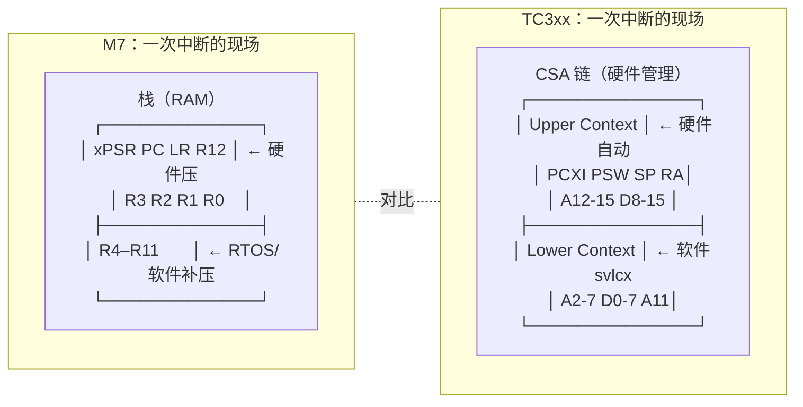
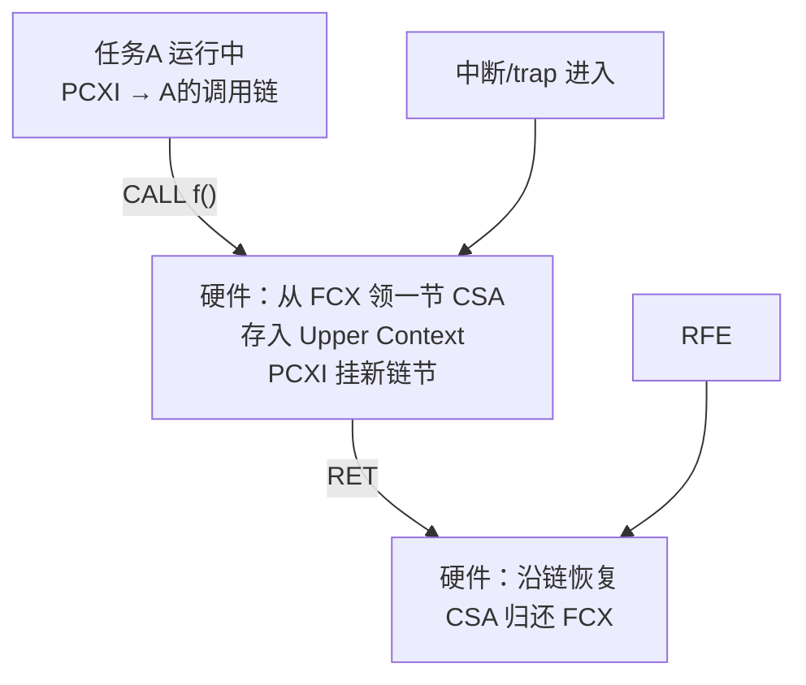

# Core 对比：Cortex-M7 vs TriCore TC3xx 异常模型与调用栈机制

## 核心问题

Cortex-M7 和 TriCore TC3xx 在"异常/中断如何发生、函数调用现场如何保存"这两件事上的硬件机制分别是什么？差异如何决定 FreeRTOS 两个 port 的不同写法？

## 结论

一句话心智模型：

- **Cortex-M7：一切都在栈上。** 异常进入时硬件把 8 个寄存器（R0–R3、R12、LR、PC、xPSR）压进当前栈；向量表里存的是**处理函数的地址**；函数调用用 LR 寄存器记返回地址、必要时压栈。
- **TriCore TC3xx：一切都在 CSA 链上。** 中断/trap/函数 CALL 进入时硬件把 Upper Context（16 字）存进 CSA 并挂链（PCXI）；向量表里存的是**可执行代码**（跳转指令）；函数调用的返回地址在 A11 寄存器+CSA 链里，**数据栈根本不参与返回地址保存**。

这张差异表直接解释了：为什么 M7 的 FreeRTOS port 用 PendSV + 手工压栈，而 TC3 port 用 syscall trap + CSA 链头切换。

## 背景

- 写作时机：FreeRTOS × TC397 学习路线 SP Port 深潜期间，为理解 port 层代码提供硬件地基。
- 阅读对象：正在读 `OS/FreeRTOS/portable/Tasking/TC3/port.c` 的学习者（见 [[FreeRTOS_Port_TC3xx_PortLayer_Full_Walkthrough]]）。
- 知识定位：本文是**架构对比参考**（机制层事实），不是某一芯片的寄存器手册；寄存器级细节以各芯片用户手册为准。

## 关键机制

### 1. Cortex-M7 异常模型

#### 1.1 异常类型与向量表

向量表（首地址由 VTOR 指定，复位默认 0x00000000）**每个表项是 4 字节地址**：

```text
[0]  初始 MSP 值（不是函数！）
[1]  Reset 处理函数地址
[2]  NMI            [3]  HardFault      [4]  MemManage
[5]  BusFault       [6]  UsageFault     [11] SVCall
[14] PendSV         [15] SysTick        [16+] 外部中断 IRQ0..IRQn
```

- Reset/NMI/HardFault 优先级固定为 -3/-2/-1（最高），其余可编程。
- **关键点：表里是地址，CPU 取出地址直接跳转。**

#### 1.2 NVIC 与优先级

- 优先级**数值小 = 高**（0 最高）；8 位字段实际实现位数取决于芯片（M7 通常 3~4 位有效）。
- 优先级分组（PRIGROUP）：把优先级位拆成"抢占优先级 + 子优先级"——只有抢占级能打断正在运行的中断。
- 硬件嵌套加速：**咬尾（tail-chaining）**省掉连续两次中断之间的出栈/压栈；**迟到（late-arrival）**让高优先级中断抢占"正在压栈"的低优先级中断。

#### 1.3 异常进入/退出的硬件动作

进入（硬件自动完成，约 12 个周期）：

```text
把 8 个字压入当前栈（异常帧）：
  R0 R1 R2 R3 R12 LR PC xPSR
LR ← EXC_RETURN 魔法值（编码"返回哪个模式/用哪个栈"）
PC ← 向量表里的处理函数地址
```

退出：把 EXC_RETURN 值 BX 出去 → 硬件识别后自动弹出 8 字帧恢复现场。

FPU 扩展帧（S0–S15 + FPSCR）按需叠加，支持 **lazy stacking**（先只预留空间，ISR 真用了 FPU 才真压）。

#### 1.4 屏蔽三件套

| 寄存器 | 作用 |
|---|---|
| PRIMASK | 1 = 关掉一切可屏蔽异常（全开关） |
| BASEPRI | **阈值屏蔽**：只屏蔽优先级数值 ≥ 阈值的中断（FreeRTOS 临界区靠它：关低优先级、放行高优先级） |
| FAULTMASK | 连 HardFault 之外的所有异常都关（用法见 [[ARM_M7_Core_FAULTMASK_Hardware_Mechanism_Use_Cases]]） |

### 2. Cortex-M7 调用栈（AAPCS）

- 两个栈指针：**MSP**（复位默认、Handler 模式用）/ **PSP**（线程模式，RTOS 任务用 PSP）。
- 栈全递减、8 字节对齐。
- 寄存器分工：R0–R3 传参/返回值/ scratch，R4–R11 被调者保存，R12 过渡 scratch，R13=SP，R14=LR（返回地址），R15=PC。
- 函数调用：BL 指令把返回地址写进 LR；函数若要再调用别人，先把 LR 压栈。**返回地址是否占栈由编译器按需决定。**



### 3. TriCore TC3xx 陷阱与中断模型

#### 3.1 两张向量表，内容是代码

| | Trap 表（BTV） | 中断表（BIV） |
|---|---|---|
| 基址寄存器 | BTV | BIV |
| 表项内容 | **可执行代码**（每项 32 字节，放跳转指令） | **可执行代码**（每项至多 32 字节） |
| 索引方式 | trap 类别号 ×32 | 中断优先级号 × 表项间距 |

与 M7 的本质差异：**表里不是地址而是指令**——CPU 跳进去直接执行（通常第一条就是 jump 到真处理函数）。

#### 3.2 Trap 分类（8 类）

| Class | 内容 |
|---|---|
| 0 | MMU（TC3xx 基本不用） |
| 1 | 内部保护（如非法特权访问） |
| 2 | 指令错误（非法 opcode 等） |
| 3 | **上下文管理**（含 FCD：CSA 空闲链耗尽——LCX 警戒触发） |
| 4 | 系统总线/外设错误 |
| 5 | 断言类 |
| 6 | **系统调用 SYSCALL**（FreeRTOS 的任务级 yield 用它） |
| 7 | NMI / 调试 |

#### 3.3 中断仲裁（与 NVIC 方向相反）

- 每个中断源对应一个 **SRN**（Service Request Node），其 SRC 寄存器含：SRPN（优先级号 1–255）、TOS（路由给哪个核）、SRE（使能）、SRR（挂起标志）、SETR/CLRR（软件触发/清除）。
- **SRPN 数值大 = 优先级高**（0 = 该中断被禁用）。
- CPU 侧：ICR.CCPN = 当前核正在服务的优先级；**只有 SRPN > CCPN 的新中断才能抢入**——CCPN 天然形成动态阈值（不需 M7 的 BASEPRI 这种单独寄存器）。
- ICR.IE = 全局中断使能位（相当于 PRIMASK）。

#### 3.4 进入/退出的硬件动作

进入中断或 trap：**硬件自动把 Upper Context（PCXI、PSW、A10=SP、A11=RA、A12–A15、D8–D15）存入从 FCX 领取的 CSA，并挂到 PCXI 链**。数据栈不参与。
退出：RFE 指令 → 硬件从 CSA 链恢复 Upper Context，CSA 归还空闲池。

### 4. TriCore 调用机制（CSA 链）

- A10 = SP，A11 = 返回地址寄存器（RA）。
- **CALL 指令**：硬件自动存 Upper Context 到 CSA（从 FCX 领取），返回地址进 A11——**普通函数调用不压数据栈**。
- **RET**：硬件恢复 Upper Context，CSA 归还 FCX。
- Lower Context（A2–A7、D0–D7）：编译器按需用 `svlcx`/`rslcx` 存取（函数序言）。
- 参数传递：数据参数 D4–D7、地址参数 A4–A7，返回值 D2（标量）/ A2（地址）。（FreeRTOS 任务参数经 A4 传入，见 port.c 注解 3.1 节。）
- 三件套：`FCX`（空闲链头）/ `PCXI`（当前调用链头）/ `LCX`（耗尽警戒线，触发 FCD trap）。



### 5. 正面对比总表

| 维度 | Cortex-M7 | TriCore TC3xx |
|---|---|---|
| 异常现场保存位置 | 当前栈（RAM） | CSA（专用硬件区+链表） |
| 硬件自动保存内容 | 8 字帧（R0–R3/R12/LR/PC/xPSR） | Upper Context（16 字，含 PCXI/PSW/SP/RA） |
| 软件补存 | R4–R11（RTOS 切换时） | Lower Context（svlcx，切换/深层调用时） |
| 返回地址载体 | LR 寄存器，必要时压栈 | A11 寄存器 + CSA 链 |
| 向量表内容 | 处理函数**地址** | **可执行代码**（跳转指令） |
| 向量表数量 | 一张（VTOR，异常+中断合一） | 两张（BTV trap 表 + BIV 中断表） |
| 优先级方向 | 数值小 = 高 | **数值大 = 高**（最易踩的坑） |
| 优先级硬件 | NVIC（分组、咬尾、迟到） | SRN 仲裁（SRPN vs CCPN） |
| 屏蔽机制 | PRIMASK / BASEPRI（阈值）/ FAULTMASK | ICR.IE（全开关）+ CCPN 动态阈值 |
| 函数调用开销 | BL + 按需压栈 | CALL 硬件存 Upper（约 1 次访存换 16 字现场） |
| 系统调用 | SVC 指令 → SVCall | SYSCALL 指令 → Trap class 6 |
| RTOS 切换触发 | PendSV 异常 | syscall trap（任务级）+ 借用 SRN（ISR 级） |
| 栈指针 | MSP / PSP 双栈 | 每任务 A10 + 全局 CSA 池（FCX/PCXI/LCX） |

### 6. 对 FreeRTOS port 的含义（本路线的直接落点）

| port 动作 | M7 port 的做法 | TC3xx port 的做法（你的工程） |
|---|---|---|
| 任务级切换 | 触发 PendSV，ISR 里手工压 R4–R11 到任务栈、换 PSP | `__syscall(0)` → trap class6 → 换 PCXI 链头（port.c 3.6 节） |
| tick | SysTick 异常 | STM0 比较中断（无 SysTick 可用） |
| 临界区 | BASEPRI 屏蔽 ≤ 某优先级的中断（高优先级仍可用 FromISR API） | ICR.IE=0 全关 + 嵌套计数（实现简单，临界区内一切中断延迟） |
| 任务出生 | 在栈上伪造 8 字硬件帧 + R4–R11 软件帧 | 领 2 个 CSA 伪造 Upper/Lower 现场 |
| 内存消耗模型 | 只看任务栈 | 任务栈 **+ CSA 池**（每任务至少 2 节 + 调用深度占用） |

## 应用场景

- **读 port 代码**：M7 与 TC3xx 的对照表让 `port.c` 每个动作都能回答"硬件上对应什么"。
- **跨平台排障**：从 ARM 平台转 TC3xx 时，优先级方向、屏蔽语义、栈/CSA 双资源这三处是故障高发区。
- **面试/评审**：能用一句话讲清"为什么 TriCore 的 RTOS 切换比 ARM 快"（硬件存现场 vs 软件压栈）。

## 待补充问题

1. TC3xx trap class 3（上下文管理）各 TIN 细分（FCD/FCU/…）与 LCX 配置实践——S4 内存阶段补。
2. M7 的 FPU lazy stacking 与 FreeRTOS FPU 任务支持细节——涉及 FPU 时补。
3. Cortex-R52 的异常模型（EL 分级、GIC）与两者的三方对比——后续扩展。

## 关联笔记

- [[FreeRTOS_Port_TC3xx_PortLayer_Full_Walkthrough]]（port.c 逐行注解，本文的直接应用对象）
- [[FreeRTOS_Port_TC3xx_Context_Switch_CSA]]（SP 第 1 课）
- [[ARM_M7_Core_FAULTMASK_Hardware_Mechanism_Use_Cases]]（M7 屏蔽机制的深挖）
- [[Core_Comparison_CPU_Pipeline_M7_TC3xx_Engineering]]（流水线视角的对比）
- `01_Hardware_硬件层/01_Core/01_AURIX_TC3xx/`（TC3xx 内核手册各章）

## 标签

#Cortex-M7 #TriCore #TC3xx #异常模型 #调用栈 #CSA #NVIC #架构对比 #FreeRTOS移植

## Agent 整理记录

- 2026-08-31 创建。应用户要求整理"ARM/M7 异常模型与调用栈细节及与 TriCore 的区别"，为 SP Port 深潜提供硬件地基。
- 内容以架构机制层事实为主（两架构公开技术参考手册的通行描述）；TC3xx port 侧引用均已对照工程实际代码（commit f588fb5）。
