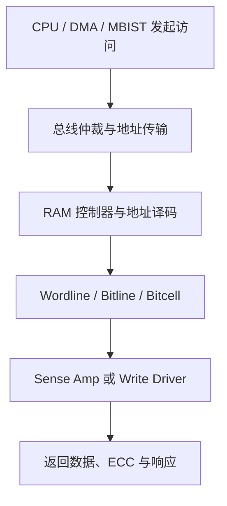

# RAM Shmoo 测试原理与 V-F-T 验证方法

> 适用场景：车规 MCU / SoC 硅后验证、RAM IP 表征、PVT 边界摸底与量产规格支撑  
> 核心对象：片上 SRAM，以及 CPU—总线—RAM 控制器—SRAM 宏组成的完整访问路径

---

## 1. 先直接回答三个问题

### 1.1 你们说的“shomoo”是什么？

行业中的标准拼写是 **Shmoo**，常见表达包括：

- Shmoo test；
- Shmoo plot；
- Shmoo sweep；
- V-F Shmoo，即 Voltage-Frequency Shmoo；
- V-F-T characterization，即电压—频率—温度表征。

Shmoo 的本质是：选择两个或多个可控条件，对每一个条件组合执行同一套测试，并把结果画成 Pass/Fail 工作窗口。

例如在固定温度下：

- X 轴：内核或 RAM 供电电压；
- Y 轴：CPU、总线或 RAM 工作频率；
- 每一个格点：执行 RAM 写入、读取和比较；
- 绿色：通过；
- 红色：失败。

在多个温度点分别执行 V-F Shmoo，就得到了 V-F-T 三维工作空间。

### 1.2 Shmoo 是不是行业测试标准？

严谨地说：

> **Shmoo 是半导体行业通用的参数表征方法和结果表达方式，但通常不是一个规定了统一电压范围、频率步长、温度点、RAM 算法和样本量的单一标准。**

AEC-Q100 是车规 IC 的可靠性资格认证框架；AEC-Q003 给出了 IC 电气性能表征的指导思想；AEC-Q100-009用于电气参数分布评估。这些文件要求供应商在电压、温度、频率等工作极限上证明器件满足规格，但某一颗 MCU 的 RAM Shmoo 网格通常仍需由以下内容共同定义：

1. 芯片 datasheet 和用户规格；
2. RAM IP/macro characterization report；
3. SoC 时钟、电源与工作模式规格；
4. 公司内部 DV/PV/CHAR 测试规范；
5. 客户任务场景和安全裕量要求；
6. AEC/JEDEC 等资格认证框架。

因此，不能仅凭“做了 V-F-T 扫描”就判断测试符合行业要求。还必须回答：

- 扫描范围是否覆盖规格上下限及合理 guardband？
- 实际测到的是哪一路电压，而不是电源设备的设定值？
- 频率到底是 CPU 时钟、总线时钟还是 RAM macro 时钟？
- 温度是箱体温度、环境温度、封装温度还是结温？
- RAM 测试算法能否覆盖目标故障模型？
- 样片和工艺分布是否有代表性？
- Pass/Fail 判据是否会被 Cache、ECC 或重试机制掩盖？

### 1.3 实际应用中内核电压不是固定的吗？为什么还要扫电压？

一句话概括：

> **软件配置和 PMIC 标称值可以是固定的，但晶体管真正看到的瞬时局部电压从来不是一个绝对固定值。**

实际芯片中至少存在以下四个不同概念：

| 电压概念 | 含义 | 是否等于芯片局部实际电压 |
| --- | --- | --- |
| PMIC 设定值 | 软件或电阻配置的目标值 | 不一定 |
| 芯片电源引脚电压 | 板级测量到的 VDD | 已包含部分板级压降，但仍不等于片内局部电压 |
| 芯片内部全局电源网电压 | 经过封装、Bump/Pad 和片内电源网后的电压 | 更接近真实值 |
| RAM 局部瞬时电压 | RAM 正在翻转时，其局部电源网的动态电压 | 晶体管真正承受的工作电压 |

即使 PMIC 一直设为 0.90 V，RAM 局部电压也可能因静态压降和动态压降瞬间低于 0.90 V。因此，扫电压是在验证芯片是否具备足够的**系统裕量**，而不仅是在模拟用户故意修改电压。

---

## 2. Shmoo 在整个芯片验证体系中的位置

Shmoo 更接近 **characterization（表征）和 margin test（裕量测试）**，它与“规格点功能验证”并不相同。

| 测试类型 | 主要问题 | 典型输出 |
| --- | --- | --- |
| 规格点功能验证 | 在 datasheet 规定条件下能否正确工作？ | Pass/Fail、功能覆盖率 |
| Shmoo/表征 | 离开标称点后，真正的失效边界在哪里？ | V-F-T 工作窗口、Vmin、Fmax |
| 可靠性资格认证 | 温度、时间、电压等应力后是否仍满足要求？ | AEC-Q100 等试验结果 |
| 量产测试 | 每一颗出货芯片是否满足出厂判据？ | ATE bin、良率、参数分布 |

Shmoo 的价值不只是证明“能工作”，还包括：

1. 确认规格矩形完全落在通过区域内；
2. 测量规格边界外还有多少设计裕量；
3. 比较不同温度、Lot、Wafer、Die 和 Revision 的差异；
4. 找出 Vmin、Fmax 受哪个硬件模块限制；
5. 为 datasheet、量产测试限值和电源设计提供数据；
6. 发现仿真模型没有覆盖的硅后异常；
7. 为老化、动态压降和测量误差预留 guardband。

理想情况下，datasheet 允许工作区是 Shmoo Pass 区内部的一个“安全矩形”，而不应刚好贴着硅片失效边界。

---

## 3. 为什么标称固定的内核电压仍会变化

### 3.1 电源器件本身存在误差

PMIC、LDO 或 DC/DC 的输出并不是数学意义上的定值，通常包含：

- 初始精度；
- 负载调整率；
- 线性调整率；
- 温漂；
- 反馈电阻误差；
- 输出纹波；
- 瞬态响应误差。

datasheet 中所谓 0.90 V，实际对应的通常是一个允许窗口，而不是精确的 0.900000 V。

### 3.2 板级、封装和片内存在 IR Drop

电流经过电阻就产生压降：

\[
\Delta V_{IR}=I\times R
\]

这里的电阻来自：

- PCB 电源走线和过孔；
- 封装引线、Ball、Bump；
- 芯片 Pad；
- 片内电源网格；
- RAM macro 周围的局部电源支路。

当 CPU、DMA、总线和多个 RAM Bank 同时高翻转时，电流增大，局部 IR Drop 也会增大。

### 3.3 快速电流变化产生动态压降

电源网络还包含电感。负载电流快速变化时会产生：

\[
\Delta V_L=L\frac{di}{dt}
\]

例如多个核、总线和 RAM 同时从空闲转为高活动度，片内瞬时电流陡增，可能出现 supply droop。去耦电容可以缓冲，但不可能完全消除。

因此，电压最危险的时刻往往不是静态测量时，而是：

- 时钟门控同时打开；
- 多个 Master 同时访问 RAM；
- RAM 多 Bank 同时读写；
- CPU 从 WFI 唤醒；
- PLL 切换或频率提升；
- 大量逻辑在同一时钟沿翻转。

### 3.4 工艺、温度与老化会改变“同一电压”的效果

相同的 0.90 V 加在不同晶体管上，能够提供的驱动能力并不完全相同：

- Process：晶体管快慢、阈值电压、失配不同；
- Voltage：实际局部电压不同；
- Temperature：迁移率、阈值和漏电不同；
- Aging：BTI/HCI 等会随时间改变阈值和速度。

这就是 PVT，再叠加 aging 和动态噪声，才是车辆全寿命周期中的真实条件。

### 3.5 有些芯片确实存在多个电压工作点

部分 MCU/SoC 支持 DVFS、低功耗模式或不同性能档位。即使不支持连续调压，也可能存在：

- Run/High-performance 模式；
- Low-power Run 模式；
- Standby/Retention 电压；
- RAM array 与 peripheral 分离供电；
- 外部主电源加片内 LDO 的二级供电。

所以验证前必须先确认：测试设备所调的“内核电压”，最终影响的是 CPU 逻辑、RAM 外围、RAM bitcell，还是只影响其中一部分。

---

## 4. 为什么降电压会让电路变慢

这是“低频可以容忍更低电压”的硬件基础。

### 4.1 CMOS 门的本质是给电容充放电

一个 CMOS 门驱动下一级时，需要给负载电容充电或放电：

\[
Q=C_LV_{DD}
\]

完成充放电需要晶体管提供电流，因此门延迟可以做如下直观近似：

\[
t_{pd}\approx\frac{C_LV_{DD}}{I_{drive}}
\]

降低 VDD 时，所需电荷量虽然也下降，但晶体管驱动电流下降得更快，尤其当 VDD 接近阈值电压 Vth 时。因此，总体结果是传播延迟明显增大。

### 4.2 电压降低为什么会使驱动电流大幅下降

晶体管能否强力导通，关键取决于栅源电压超过阈值电压的部分：

\[
V_{overdrive}=V_{GS}-V_{th}
\]

对于由 VDD 驱动的数字电路，可用 α-power law 做工程近似：

\[
I_{drive}\propto(V_{DD}-V_{th})^\alpha
\]

进而：

\[
t_{pd}\propto\frac{V_{DD}}{(V_{DD}-V_{th})^\alpha}
\]

其中 α 与工艺有关，常用于解释趋势，而不能代替具体工艺的 SPICE/STA/硅后数据。

关键不在于 VDD 下降了多少百分比，而在于 **VDD−Vth 的过驱动余量缩小了多少**。

举一个只用于说明趋势的例子：

- Vth = 0.35 V；
- VDD 从 0.90 V 降到 0.70 V；
- VDD 只下降约 22%；
- 但过驱动电压从 0.55 V 降到 0.35 V，下降约 36%。

驱动电流按过驱动电压的幂次下降，所以关键路径延迟会显著增加。越靠近阈值区，这种非线性越明显。

### 4.3 从晶体管延迟到系统时序失败

一条同步时序路径必须满足：

\[
t_{cq}+t_{logic}+t_{wire}+t_{setup}+t_{skew}+t_{jitter}<T_{clk}
\]

其中：

- \(t_{cq}\)：源触发器 Clock-to-Q；
- \(t_{logic}\)：组合逻辑延迟；
- \(t_{wire}\)：互连延迟；
- \(t_{setup}\)：目的触发器建立时间；
- \(t_{skew}\)：时钟偏斜；
- \(t_{jitter}\)：时钟抖动裕量；
- \(T_{clk}=1/f\)：时钟周期。

电压降低后，前面几项通常变大；如果时钟周期不变，slack 逐步减小，直到出现 setup violation。

---

## 5. 为什么频率越低，通常可以使用更低电压

### 5.1 降频不是让晶体管变快，而是给慢晶体管更多时间

频率下降后，时钟周期增加：

| 频率 | 时钟周期 |
| ---: | ---: |
| 400 MHz | 2.5 ns |
| 200 MHz | 5 ns |
| 100 MHz | 10 ns |

假设某条 RAM 读路径在低电压下需要 3.2 ns：

- 400 MHz 时，一个周期只有 2.5 ns，单周期访问失败；
- 200 MHz 时，一个周期有 5 ns，同样的硬件延迟可能满足时序。

因此，在以**动态时序**为主导的区域，最大频率和最低电压存在对应关系：

\[
f_{max}(V,T)\approx\frac{1}{t_{critical}(V,T)+t_{margin}}
\]

电压越低，关键路径越慢，允许的最大频率越低；反过来说，目标频率越低，对最低工作电压的要求通常越宽松。

这就是 V-F Shmoo 边界通常呈斜坡状的根本原因。

### 5.2 更精确的表达

不要简单说“频率越低，需要的电压越低”，更准确的说法是：

> 当失效由有限周期内完成充放电、译码、位线建立、感放判决或数据传输等动态时序限制主导时，降低频率增加了可用时间，因此可降低满足时序所需的最低电压。

### 5.3 降频不能解决所有低电压故障

SRAM 还存在与频率弱相关甚至无关的静态极限：

- 数据保持电压 DRV；
- Hold Static Noise Margin；
- Read Static Noise Margin；
- 读扰动导致的 bitcell 翻转；
- 极低电压下感放不能可靠判决；
- 晶体管失配造成的特定位失效；
- 电源监控、复位或 LDO 已离开合法区间。

如果 VDD 已低到 SRAM 单元连 0/1 都保持不住，把频率从 400 MHz 降到 1 MHz 也不能恢复正确性。

因此，Vmin 至少应区分：

| Vmin 类型 | 含义 | 降频能否改善 |
| --- | --- | --- |
| Retention Vmin / DRV | 不访问时仍能保持数据的最低电压 | 基本不能靠降频改善 |
| Read Vmin | 能无扰动地读出并正确判决的最低电压 | 动态部分可改善，静态读稳定性不一定 |
| Write Vmin | 能在规定写窗口内改写单元的最低电压 | 延长写脉宽可能改善，静态写能力极限未必 |
| System Vmin | CPU、总线、控制器和 RAM 整体正确工作的最低电压 | 常明显受频率影响 |

### 5.4 一个容易忽略的重要前提：你降低的到底是哪一个频率？

CPU 主频下降不一定等于 RAM 内部访问窗口变长。

必须核对时钟树和 RAM 控制器设计：

- RAM clock 是否由 CPU clock 分频得到？
- AHB/AXI/内部 Bus clock 是否同步下降？
- RAM macro 是同步时序还是 self-timed？
- Wordline pulse width 是否随时钟周期缩放？
- Sense amplifier enable 是否由固定 delay chain 产生？
- RAM 控制器是否自动插入 wait state？
- CPU 降频时，RAM 仍是否工作在固定独立时钟？

如果 SRAM macro 使用固定内部延迟或固定时钟，而只是 CPU 降频，那么改善的可能只是 CPU/总线接口时序，RAM bitcell 的内部读写窗口并没有同比增加。

所以 Shmoo 报告中不应只写“Frequency = 200 MHz”，而应写清：

| 时钟对象 | 频率/分频 | 是否随扫描变化 |
| --- | ---: | --- |
| CPU clock | 例如 200 MHz | 是 |
| Bus clock | 例如 100 MHz | 是/否 |
| RAM controller clock | 例如 100 MHz | 是/否 |
| RAM macro clock | 例如 100 MHz | 是/否 |
| MBIST clock | 例如 50 MHz | 是/否 |

---

## 6. SRAM 一次读写在硬件中发生了什么

理解 RAM Shmoo，必须把“RAM 测试程序”拆到硬件访问链路。

### 6.1 读取过程

典型同步 SRAM 读取可抽象为：

1. 控制器锁存地址和读命令；
2. 行列译码器选择目标单元；
3. Bitline 预充电完成；
4. Wordline 拉高，access transistor 导通；
5. 存储节点使 BL/BLB 产生微小差分；
6. Sense amplifier 在规定时刻使能并放大差分；
7. 列选择、ECC 和输出 MUX 处理数据；
8. 数据经过总线返回 CPU/DMA。

电压降低后可能发生：

- 译码器变慢，Wordline 到达变晚；
- access transistor 驱动减弱；
- Bitline 放电变慢，差分建立时间增加；
- sense amplifier 速度下降且 offset 影响变大；
- ECC/XOR 树和输出 MUX 变慢；
- 数据未在采样沿前稳定，出现错误或总线超时。

这部分故障通常具有明显的频率相关性。

但读取还有一个静态稳定性问题：Wordline 打开后，预充高电平的 Bitline 会抬高 bitcell 内原本为 0 的节点。如果 cell ratio、失配或低压噪声裕量不够，读取动作本身可能把单元翻转。这是 read disturb，单纯降频不一定有利；Wordline 打开更久有时反而会增加扰动风险。

### 6.2 写入过程

典型写入过程为：

1. 写数据进入 write driver；
2. BL/BLB 被强制为互补电平；
3. Wordline 拉高；
4. access transistor 把位线电平传入 cell；
5. write driver/access transistor 必须压过交叉耦合反相器的反馈；
6. 存储节点翻转并稳定；
7. Wordline 关闭，cell 保持新数据。

写成功不仅要求“能翻转”，还要求在有限写脉宽内完成翻转。低电压时：

- write driver 和 access transistor 变弱；
- bitcell 内部反馈也变弱；
- 两者减弱速度并不完全一致；
- 工艺失配会使某些 cell 特别难写；
- 所需 critical write time 增加。

因此，延长写脉宽或降 RAM clock 可能降低动态 Write Vmin，但在极低电压下仍会遇到真正的写能力极限。

### 6.3 保持过程

6T SRAM 依靠两个交叉耦合反相器形成正反馈来保持数据。电压降低后：

- 逻辑高低电平间距减小；
- 静态噪声容限下降；
- 随机失配相对于有效信号变得更突出；
- 漏电与噪声更容易破坏较弱的单元。

当低于 Data Retention Voltage 时，单元即使完全不访问也可能丢失数据。这一极限不是通过降低时钟频率就能消除的。

---

## 7. 温度为什么必须和电压、频率一起扫描

温度同时改变多个方向相反的器件参数，所以“高温一定最差”并不总成立。

### 7.1 高温的典型影响

- 载流子迁移率下降，晶体管驱动能力通常减弱；
- 金属互连电阻增加，RC 延迟增大；
- 亚阈值漏电和结漏电增加；
- Bitline 泄漏累积，可能影响小差分读取；
- 自热和 IR Drop 更明显；
- Vth 通常下降，对驱动电流有一定补偿作用。

在常规高于阈值的高速工作区，热角经常是逻辑最大延迟的重要 corner，但必须以实际工艺模型和硅后数据确认。

### 7.2 低温也可能成为低压最差角

低温时迁移率通常提高，但 Vth 也会提高。当 VDD 已经很低、接近 Vth 时，更高的 Vth 会显著压缩 overdrive：

\[
V_{overdrive}=V_{DD}-V_{th}
\]

这可能导致：

- 低压启动困难；
- 某些 SRAM cell 难写；
- 低压读出速度或感放判决异常；
- POR/BOR/LDO/PLL 等模拟电路先出现限制。

### 7.3 温度反转效应

在某些先进工艺和近阈值工作区，低温未必比高温快，这通常称为 temperature inversion。其根本原因是迁移率提高和 Vth 提高之间的竞争关系随电压区间改变。

因此，RAM V-F Shmoo 至少需要覆盖规格要求的冷、常温和热温点；不能只在 25°C 得出 Vmin 结论，也不能预设所有失效都必然先出现在最高温。

---

## 8. 如何读懂 V-F Shmoo 图形

在常见画法中：

- 横轴从左到右：电压升高；
- 纵轴从下到上：频率升高；
- 右下区域：高电压、低频，最容易通过；
- 左上区域：低电压、高频，最容易失败。

### 8.1 典型斜坡边界

如果 Pass/Fail 边界随频率升高而需要更高电压，通常说明是动态时序限制：

- RAM access time；
- 总线关键路径；
- ECC 路径；
- 地址译码；
- 时钟偏斜或 setup margin。

### 8.2 近似竖直的边界

如果在很宽的频率范围内都在几乎相同电压失败，优先怀疑：

- SRAM retention/read stability/write ability 的静态 Vmin；
- sense amplifier 的最低可靠电压；
- 片内 LDO 或电源域掉压阈值；
- POR/BOR/PVD 触发；
- 电平转换器最低工作电压；
- PLL 或其他模拟模块的最低电压。

此时降频帮助有限。

### 8.3 近似水平的边界

如果到某一频率以上几乎不受电压影响，优先检查：

- 时钟源/PLL 极限；
- RAM wait state 配置错误；
- 测试代码或总线固定超时；
- Flash 取指路径而非 RAM 路径先失效；
- 测试仪器、接口或采样带宽限制。

### 8.4 Pass 区内部出现孤岛、孔洞或锯齿

真实硅片边界可能有离散性，但大面积不连续通常需要先排除测试伪影：

- 电压未充分 settle；
- 温度未 soak；
- 扫描过程中结温持续变化；
- PLL 偶发失锁；
- 复位序列不一致；
- Cache 命中导致并未真正访问目标 RAM；
- ECC 修正掩盖部分错误；
- 测试顺序造成残留数据或 hysteresis；
- 通信链路丢包被误判为 RAM fail；
- RAM 测试程序自身运行在被测 RAM 中。

### 8.5 正扫和反扫边界不一致

建议至少比较：

- 电压从高到低与从低到高；
- 频率从低到高与从高到低；
- 每个点复位与连续不复位；
- 固定扫描顺序与随机化顺序。

明显 hysteresis 可能来自电源稳定时间、温度、自热、PLL 锁定、复位阈值、LDO 模式切换或测试状态未清理。

---

## 9. RAM Shmoo 应该怎样设计才有工程意义

### 9.1 先定义测试对象

“测试 RAM”至少有三种不同范围：

| 测试范围 | 访问方式 | 能覆盖什么 |
| --- | --- | --- |
| Bitcell/macro 层 | MBIST、DFT test mode | cell、译码、感放、write driver，较少受系统软件影响 |
| IP/控制器层 | RAM 控制器接口 | macro 加控制器、ECC、时序配置 |
| 系统功能层 | CPU/DMA 经总线访问 | CPU、Cache/MPU、总线、控制器、RAM 完整链路 |

最好至少保留 MBIST 与 CPU functional test 两组结果：

- MBIST 与 CPU 测试同时失败：更像 RAM macro 或共用供电/时钟问题；
- MBIST 通过而 CPU 测试失败：更像总线、控制器、ECC、Cache、时序或测试软件问题；
- 只有某个 Master 失败：检查该 Master 到 RAM 的独立路径和桥接逻辑。

### 9.2 明确 V-F-T 三个轴的真实含义

每个测试点至少记录：

| 项目 | 建议记录内容 |
| --- | --- |
| 电源设定值 | 电源设备/PMIC 目标值 |
| 引脚实测值 | 静态 DMM 值及纹波 |
| 动态 droop | 示波器捕获的最小值、带宽和探测位置 |
| 片内监测值 | 若有 ADC/PVT monitor/voltage monitor，记录原始码与换算值 |
| CPU/Bus/RAM 时钟 | 各时钟源、分频、实测频率 |
| 温度 | 箱温、板温、封装温度或估算结温，以及 soak 时间 |
| 工作负载 | 单 Bank/多 Bank、CPU/DMA、读写比例、活动度 |

### 9.3 电压扫描范围

建议分两层：

1. **规格覆盖层**：完整覆盖 datasheet 的 Vmin_spec 到 Vmax_spec；
2. **边界摸底层**：在不违反绝对最大额定值和实验安全约束的前提下，向规格外延伸，找到真实失败边界。

不要把 absolute maximum rating 当作可工作的扫描目标。绝对最大额定值是损伤边界，不是功能保证区。

在失效边界附近应使用更细电压步长；远离边界可使用粗步长或边界搜索算法提高效率。

### 9.4 频率扫描范围

频率至少应覆盖：

- 规格最低频率或代表性低频；
- 所有正式工作档位；
- 规格最高频率；
- 在安全前提下适度 overclock，用于观察真实 Fmax 边界。

同时固定或记录：

- PLL 配置和锁定状态；
- Flash wait state；
- 总线分频；
- RAM wait state；
- ECC pipeline；
- Cache 策略；
- 是否执行自 RAM、Flash 或 TCM。

否则所谓“RAM Fmax”可能实际测到的是 Flash、PLL 或 CPU 关键路径的 Fmax。

### 9.5 温度扫描与稳定性

每个温度点应：

1. 达到目标箱温；
2. 预留足够 soak 时间；
3. 确认器件温度已经稳定；
4. 在高活动测试时关注结温高于箱温；
5. 记录测试顺序，防止自热使后测点系统性变差。

如果条件允许，可在边界点记录芯片功耗和封装温度，用于识别“频率升高造成自热，再由自热推高 Vmin”的二阶效应。

### 9.6 RAM 数据背景与算法

只写一次固定数再读回来，覆盖率远远不够。建议根据阶段组合使用：

- all-0；
- all-1；
- checkerboard；
- inverse checkerboard；
- walking-1 / walking-0；
- 地址作为数据及其反码；
- LFSR/伪随机数据；
- March C- 或公司已有的 March 算法；
- 连续同地址读写；
- 相邻地址交替读写；
- Bank 间交错访问；
- Read-after-Write；
- Write-after-Read；
- 不同访问宽度和 byte enable；
- CPU、DMA 和其他 Master 并发访问；
- 写后降压保持，再升压读取的 retention 测试。

不同模式对应不同故障：

| 模式 | 更容易暴露的问题 |
| --- | --- |
| all-0/all-1 | stuck-at、整体写读能力 |
| checkerboard | 相邻 cell、耦合和物理背景敏感性 |
| walking bit | 数据线、位选择和局部耦合 |
| 地址作数据 | 地址译码、别名和短路 |
| March | stuck-at、transition、address decoder、部分 coupling fault |
| 多 Bank 并发 | IR Drop、总线、Bank 冲突和电源噪声 |
| retention | DRV、漏电、弱 cell |

### 9.7 防止 Cache、ECC 和冗余机制掩盖错误

系统级 RAM 测试常见的假通过来源包括：

- CPU 读到的是 D-Cache，而不是 SRAM；
- 写数据仍停在 write buffer；
- ECC 自动修正了单比特错误，但软件只比较最终数据；
- RAM redundancy 已替换弱 cell，导致看不到原始 macro 分布；
- 总线自动 retry，使偶发错误被恢复。

建议：

- 被测区域设为 non-cacheable，或严格执行 clean/invalidate 和屏障；
- 每轮测试明确 write completion；
- 若设计允许，分别测试 ECC On/Off；
- ECC 无法关闭时，读取并清零 SBE/DBE 计数器；
- 将“出现 Correctable Error”作为 margin degradation，而不只是最终数据 Pass；
- 测试代码、栈、向量表和日志缓冲尽量放在非被测 RAM；
- 记录 bus fault、timeout、ECC syndrome 和失败地址。

### 9.8 Pass/Fail 判据

一个点不能只输出一个布尔值。建议至少分级：

| 等级 | 判据示例 |
| --- | --- |
| Clean Pass | 数据全对，无 ECC、Fault、Timeout、重试 |
| Marginal Pass | 数据最终正确，但有 ECC SBE、重试或偶发性能异常 |
| Functional Fail | 数据错误、DBE、BusFault、timeout、死机 |
| Infrastructure Fail | PLL 未锁、温度/电压未稳、通信失败，不能归因于 RAM |

这样可以避免把“ECC 已经开始频繁纠错”的危险区域画成完全健康的绿色区域。

### 9.9 样本和统计问题

SRAM 容量越大，越容易包含随机失配导致的弱 bit。单颗样片的 Vmin 不能直接代表量产总体。

样本选择应尽量覆盖：

- 不同 wafer；
- 不同 lot；
- wafer 中心和边缘；
- 不同 speed bin；
- typical/slow/fast 代表样片；
- 不同封装或板级条件；
- 老化前后样片。

表征目标不是只找到“这一颗芯片能跑多低”，而是建立边界分布，并据此确定可量产、可保证的规格。

---

## 10. 从 Shmoo 边界推导产品规格

测得的硅片失败边界不能直接等于 datasheet 的保证边界。规格需要覆盖：

- Die-to-die 与 Wafer-to-wafer 分布；
- 温度范围；
- 电源精度和纹波；
- 板级、封装和片内 IR Drop；
- 动态 \(Ldi/dt\) droop；
- 时钟 jitter/skew；
- 测量不确定度；
- 生命周期老化；
- 目标失效率与安全等级；
- 未覆盖使用场景。

概念上可以理解为：

\[
V_{spec,min}(f,T)>V_{silicon\ boundary}(f,T)+V_{guardband}
\]

但实际不能把所有 margin 机械相加，因为不同分量之间可能相关，温度和工艺也可能已被样本覆盖。最终 guardband 应由设计、STA、IR Drop、可靠性、统计表征和产品安全目标共同确定。

对于固定电压 MCU，最终通常把连续 V-F 边界收敛成若干保证工作点：

| 性能档位 | 保证频率 | 允许电压窗口 | 温度等级 |
| --- | ---: | ---: | ---: |
| High Performance | F1 | V1_min～V1_max | Tmin～Tmax |
| Normal Run | F2 | V2_min～V2_max | Tmin～Tmax |
| Low-power Run | F3 | V3_min～V3_max | Tmin～Tmax |
| Retention | 不执行访问 | Vret_min～Vret_max | Tmin～Tmax |

即使产品只发布一个标称电压，也应保证整个电压容差窗口内的最大规定频率，而不是只保证标称点。

---

## 11. 推荐的 RAM Shmoo 验证流程

### 阶段 1：规格和硬件路径澄清

1. 明确 RAM 类型、容量、Bank、端口和 ECC；
2. 画出 CPU/DMA/MBIST 到 RAM 的访问路径；
3. 明确 array、peripheral、controller 的供电域；
4. 明确 CPU、Bus、RAM、MBIST 的时钟关系；
5. 确认 wait state、self-timed path 和内部固定脉宽；
6. 收集 RAM macro 的 read/write/retention Vmin 与 access time 数据。

### 阶段 2：建立基线

1. 在常温、标称电压、标称频率运行完整测试；
2. 确认 Cache/ECC/编译优化不会造成假结果；
3. 验证失败日志、ECC 日志和硬件 Fault 捕获有效；
4. 用人为注错或已知故障验证判据能真正报错。

### 阶段 3：单变量初扫

1. 固定标称 F/T，扫描 V；
2. 固定标称 V/T，扫描 F；
3. 固定标称 V/F，扫描 T；
4. 找到合理边界范围，排除基础设施限制。

### 阶段 4：V-F 二维细扫

1. 先用粗网格找边界；
2. 在边界附近用细网格；
3. 每个点多次重复；
4. 对边界点执行正扫、反扫和复位重测；
5. 记录 Clean Pass、Marginal Pass 和 Fail，而非只有 0/1。

### 阶段 5：多个温度与负载条件

1. 冷、常温、热分别执行 V-F Shmoo；
2. CPU 单独访问、DMA 单独访问、多 Master 并发分别执行；
3. 单 Bank 与多 Bank 高翻转分别执行；
4. 静态保持测试与动态访问测试分开执行。

### 阶段 6：失效归因

对失败点进行最小化和分层复测：

| 对比方法 | 可能得到的结论 |
| --- | --- |
| MBIST vs CPU functional | 区分 macro 与系统路径 |
| ECC Off vs On | 区分 raw bit fail 与系统可见错误 |
| Cache Off vs On | 排除 Cache 假通过/一致性问题 |
| 单 Bank vs 多 Bank | 识别电源 droop/并发影响 |
| 低频 vs 高频 | 区分静态 Vmin 与动态时序 |
| 冷 vs 热 | 识别 Vth、迁移率、漏电和模拟 IP corner |
| 每点复位 vs 连续运行 | 识别状态残留、PLL/POR 和 hysteresis |

### 阶段 7：形成可审计结论

最终报告不应只贴一张彩色表格，而应明确：

1. 规格工作区是否全部通过；
2. 最近失效边界距离规格点有多少 margin；
3. 最差温度、样片、数据背景和访问模式是什么；
4. 失败首先发生在 RAM cell、控制器、总线还是电源/时钟基础设施；
5. ECC 是否在功能错误之前已经开始纠错；
6. 边界是否可重复、是否存在 hysteresis；
7. 是否满足样本量和统计置信要求；
8. 对 datasheet、量产测试和应用电源设计有何建议。

---

## 12. 建议的 Shmoo 原始数据格式

不要只保留截图，建议每个点都保留结构化数据：

| 字段 | 示例说明 |
| --- | --- |
| Device/Lot/Wafer/Die | 样片追踪信息 |
| Revision | 芯片版本 |
| Temp_set/Temp_meas | 设定温度与实测温度 |
| V_set/V_pin/V_min | 电源设定、引脚静态值、动态最低值 |
| F_CPU/F_BUS/F_RAM/F_MBIST | 各层真实频率 |
| RAM bank/address range | 被测 Bank 和地址范围 |
| Algorithm/pattern | March、checkerboard、LFSR 等 |
| Master | CPU、DMA、MBIST |
| Cache/MPU/ECC mode | 系统配置 |
| Loop count | 重复次数 |
| Error count | 数据错误数量 |
| First fail address/data | 首个失败地址、期望值、实际值 |
| ECC SBE/DBE | 可纠正/不可纠正错误数量 |
| Fault/timeout/reset cause | 系统错误状态 |
| PLL/power status | 基础设施状态 |
| Result class | Clean/Marginal/Fail/Invalid |

有了原始数据，后续才能做：

- Vmin/Fmax 自动提取；
- 不同样片分布；
- 不同温度边界叠加；
- Revision 对比；
- 弱地址聚类；
- 规格 guardband 评估；
- 异常孔洞和非单调边界检测。

---

## 13. 最终建立一条完整因果链

把整个问题串起来，可以得到下面这条逻辑：

1. SRAM 和外围逻辑由 CMOS 晶体管组成；
2. 降低 VDD 会减小晶体管 overdrive；
3. 驱动电流下降，内部节点和 Bitline 充放电变慢；
4. 地址译码、Wordline、Bitline、Sense Amp、ECC 和总线返回的总延迟增加；
5. 高频意味着时钟周期短，允许完成读写的时间少；
6. 当总延迟超过可用周期时，出现动态读写失败；
7. 降频增加了时间预算，所以在动态时序主导区可以容忍更低电压；
8. 但 SRAM 还有保持、读稳定性、写能力和感放最低电压等静态极限；
9. 低于这些极限后，降频也无法挽救；
10. 温度、工艺、老化、IR Drop 和动态 droop 会移动上述边界；
11. 因此必须用 V-F-T Shmoo 找到整个工作窗口，而不能只验证标称点；
12. 最终产品规格必须位于硅片 Pass 区内部，并保留覆盖量产分布和车辆寿命的 guardband。

最简洁的结论是：

> **配置上，内核电压可以是固定的；物理上，RAM 局部电压始终存在偏差和瞬态变化。低频不是降低了 SRAM 对电压的所有要求，而是放宽了动态时序要求。Shmoo 的作用就是把动态时序极限与静态 Vmin 极限一起测出来，并确认产品规格与真实失效边界之间有足够裕量。**

---

## 14. 参考资料

1. [AEC-Q100 Rev. J1：Failure Mechanism Based Stress Test Qualification for Packaged Integrated Circuits](https://www.aecouncil.com/files/Documents/AEC%20Q100-Rev%20J1.pdf)
2. [AEC-Q003：Guideline for Characterization of Integrated Circuits](https://www.aecouncil.com/Documents/AEC_Q003.pdf)
3. [AEC-Q100-009 Rev. B：Electrical Distribution Assessment](https://www.aecouncil.com/Documents/AEC_Q100-009B.pdf)
4. [AEC 官方文件目录](https://www.aecouncil.com/AECDocuments.html)
5. [System and Method for Generating a Shmoo Plot，Shmoo 的参数扫描与 Pass/Fail 工作区定义](https://patents.google.com/patent/US6820027B2/en)
6. [Banerjee et al., A Reverse Write Assist Circuit for SRAM Dynamic Write VMIN Tracking Using Canary SRAMs](https://research.nvidia.com/sites/default/files/pubs/2014-03_A-Reverse-Write/ISQED14.pdf)
7. [Sakurai & Newton, Alpha-Power Law MOSFET Model and Its Applications to CMOS Inverter Delay](https://doi.org/10.1109/4.52187)

> 注：α-power law 用于解释电压—延迟趋势；实际产品的 Vmin/Fmax 必须以目标工艺的器件模型、RAM macro characterization、STA/IR Drop 分析和硅后统计数据为准。
