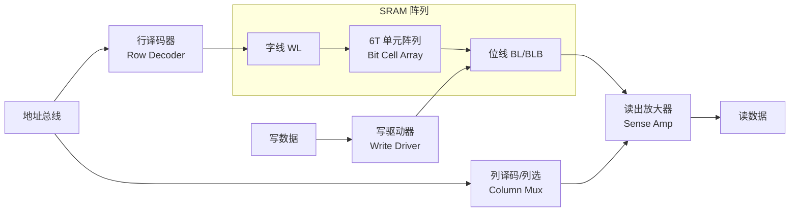

# SRAM 物理结构、故障模型与测试算法系统解析

## 核心问题

车规 MCU 的 SRAM（Static Random Access Memory，静态随机存取存储器）在制造和使用中会以哪些方式失效（故障模型）？针对每一类故障，应该用什么测试算法去激发和观测？为什么棋盘（CheckerBoard）、March-C、保持测试（Retention Test）这些算法被设计成这个样子？

## 结论

**RAM 测试算法是"故障模型驱动"的**：每一类物理失效对应一个故障模型（Fault Model），每个故障模型要求特定的"激励-观测对"才能暴露，测试算法 = 用最少读写步数覆盖目标故障集的序列。核心结论：

1. **没有万能单算法**：写 0xAA 读回只能抓 SAF（固定值故障）；TF（转换故障）要求"跳变后立即读"；CF（耦合故障）要求 ↑/↓ 双向寻址；DRF（保持故障）要求"写入后延时再读"——时间维度任何 March 序列都替代不了。
2. **March C-（10n）是工程甜点**：覆盖 SAF / TF / 非链接 CF / AF，是车规 SRAM 启动测试的主流选择；更高覆盖选 March B（17n）/ March SS（22n）。
3. **车规分层策略**：上电用破坏性 MBIST（Memory Built-In Self-Test，存储器内建自测）抓永久故障，运行期靠 ECC（Error Correction Code，纠错码）抓软错误和潜伏故障，两者拼出 ISO 26262 要求的诊断覆盖率。
4. **两个高频实操坑**：① ECC 会"静默修复"单 bit 故障，软件经正常读路径测 ECC RAM 可能测不到故障（掩盖效应）；② 逻辑地址 ≠ 物理布局，软件跑棋盘图案必须先搞清地址扰码（Address Scrambling）。

## 背景

### SRAM 6T 单元结构

主流 SRAM 位单元（Bit Cell）由 6 个晶体管（6T）构成：两个交叉耦合的反相器（PU1+PD1、PU2+PD2）形成双稳态锁存器，两个访问管（PG1/PG2）由字线控制通断：

```text
            VDD                    VDD
             │                      │
            PU1                    PU2            ← PMOS 上拉管
             │                      │
   BL ──PG1──● Q          QB ●──PG2── BLB         ← PG1/PG2: NMOS 访问管
             │           (交叉耦合)   │              栅极接 WL
            PD1                    PD2            ← NMOS 下拉管
             │                      │
            GND                    GND

  · 交叉耦合: Q 接 PU2/PD2 的栅极, QB 接 PU1/PD1 的栅极 → 双稳态
  · WL (Word Line, 字线): 行选信号, 控制访问管 PG1/PG2
  · BL/BLB (Bit Line / Bit Line Bar, 位线/反相位线): 列方向的差分数据通路
```

**读操作**：位线预充电 → WL 拉高 → 单元把 BL/BLB 拉开微小压差 → Sense Amplifier（读出放大器）放大判 0/1。
**写操作**：写驱动器（Write Driver）把 BL/BLB 强拉到目标值 → WL 拉高 → 强制翻转锁存器。

### 阵列组织与外围电路



外围电路（译码器、写驱动、读出放大器、预充电路）同样是故障高发区，测试时必须一并考虑——这就是 AF（译码故障）等模型的物理来源。

### 两个关键工程事实

1. **地址扰码（Address Scrambling）**：逻辑地址到物理行/列的映射经过扰码和位交织（bit interleaving）。**逻辑上相邻的地址在物理阵列里可能相隔很远**。对任何依赖"物理相邻"的测试（棋盘、耦合应力），软件必须拿到 scramble map 才有效；硬件 MBIST 按物理寻址遍历，天然规避此问题。
2. **ECC 阵列**：车规 SRAM 普遍带 SECDED（Single Error Correction, Double Error Detection，纠一检二）ECC。校验位本身也存储在 SRAM 阵列（ECC array）中，是独立的被测对象。

## 关键机制

### 1. 故障模型（Fault Models）

测试的对象不是"芯片坏没坏"，而是以下一组被精确定义的抽象故障。每个模型都对应明确的物理失效机理：

#### 1.1 SAF — Stuck-At Fault，固定值故障

- **表现**：某 bit 无论写什么，读回永远是 0（SA0）或 1（SA1）
- **物理成因**：栅氧击穿、金属连线桥接短路到 VDD/GND、开路后浮空被钳位
- **检测条件**：每个单元必须**写过 0 也写过 1，且每次写后读回验证**

#### 1.2 TF — Transition Fault，转换故障

- **表现**：单元能稳定保持 0 和 1，但 0→1（↑TF）或 1→0（↓TF）的**跳变做不动**（单向失效）
- **物理成因**：驱动管部分开路、单元驱动能力弱（写入竞争打不过锁存器当前状态）
- **检测条件**：每个单元必须**经历两个方向的跳变，且每次跳变后立即读**。只写不跳变（如棋盘初始化）测不出
- **易混淆点**：SAF 是 TF 的特例（两个方向都跳不动），但单向 TF 会被"只写一种值"的测试漏掉

#### 1.3 CF — Coupling Fault，耦合故障

- **表现**：对"侵略者"（Aggressor）单元的操作改变了"受害者"（Victim）单元的内容
- **物理成因**：相邻单元间寄生电容、衬底漏电流；阵列密度越高越严重，先进工艺下车规 SRAM 的主要潜伏风险
- **三个子类型**：
  - **CFin（Inversion CF，反相耦合）**：侵略者的跳变把受害者的值**取反**
  - **CFid（Idempotent CF，幂等耦合）**：侵略者的跳变把受害者**强制成固定值**（0 或 1）
  - **CFst（State CF，状态耦合）**：侵略者**处于某个状态**（不需要跳变）就迫使受害者取某值
- **链接 CF（Linked CF）**：多个耦合同时作用、或耦合与 TF 复合，检测条件苛刻得多
- **检测条件**：对每个受害者，侵略者必须做 ↑/↓ 跳变，同时受害者保持 0 和保持 1 各应力一遍，之后读受害者。这就是 March 算法 **↑（升序）/ ↓（降序）必须成对出现**的根本原因——升序只覆盖"低地址侵略高地址"，反向场景必须降序再跑

#### 1.4 AF — Address Decoder Fault，地址译码故障

- **四种表现**：
  1. 某地址**访问不到任何单元**（选中落空）
  2. 某单元**没有任何地址能访问到**（孤岛）
  3. **一个地址同时选中多个单元**（多选，写入互相打架）
  4. **多个地址映射到同一单元**（别名，以为写了两处其实是一处）
- **物理成因**：译码器/字线开路、短路
- **检测条件**：March 类算法的 ↑/↓ 双向遍历天然覆盖大部分简单 AF；**显式应力用 address-as-data**（每个地址写入自己的地址值，译码错立刻现形），成本极低

#### 1.5 DRF — Data Retention Fault，数据保持故障

- **表现**：写入时正常，**过一段时间后数据丢失**
- **物理成因**：单元漏电流过大（栅氧漏电、结漏电），高温下指数恶化
- **检测条件**：**写图案 → 延时等待 → 读回**。这是唯一需要"时间"维度的故障模型，March 序列再长也替代不了；量产测试在高温拐点（85°C/125°C）做

#### 1.6 SOF — Stuck-Open Fault，开路故障

- **表现**：单元/位线开路后，读出放大器读到的是**上一次操作的残留值**，行为上容易伪装成 TF
- **检测条件**：要求特定的"写后立即读"排序约束，March C- 不能保证全覆盖，**March B 及以上才覆盖**

#### 1.7 RDF — Read Destructive Fault，读破坏故障

- **表现**：读操作本身把单元内容翻转（读扰动）
- **物理成因**：访问管与下拉管尺寸比（Cell Ratio）失配，读时 BL 电压抬升 Q 点超过翻转阈值
- **检测条件**：读后**再读一次**校验（r, r 序列），March SS / March LR 类覆盖

#### 1.8 NPSF — Neighborhood Pattern Sensitive Fault，邻域图案敏感故障

- **表现**：单元能否正常读写**取决于周围邻居的数据图案**
- **检测**：需要 GalPat / Walking 类 O(n²) 算法，成本极高，量产一般不做，靠 March + 多数据背景近似覆盖

#### 1.9 SEU — Single Event Upset，单粒子翻转（软错误）

- **表现**：α 粒子 / 中子轰击使单元瞬态翻转，**单元本身没有物理损坏**
- **关键区分**：这是**运行期随机事件，不是制造缺陷，任何测试算法都抓不到**——靠 ECC / 奇偶校验兜底，是 ISO 26262 里"测试 + ECC"分层设计的理论依据

#### 1.10 外围电路故障

译码器（→AF）、位线短路（→表现为相邻列同值，棋盘/多背景可抓）、写驱动器卡死（→整列 SAF 表象）、读出放大器失调（→读特定图案出错）。这些通过上述算法的数据图案多样性间接覆盖。

### 2. 测试算法

#### 2.1 March 记号法

March 算法用统一记号描述，读懂记号才能读懂所有算法：

| 记号 | 含义 |
|------|------|
| `↑` | 按地址**升序**遍历所有单元 |
| `↓` | 按地址**降序**遍历所有单元 |
| `↕` | 遍历顺序任意 |
| `r0` / `r1` | 读单元，**期望**读到 0 / 1（期望不符即故障） |
| `w0` / `w1` | 向单元写 0 / 1 |
| `(r0, w1)` | 一个 March 元素：对每个单元依次"读 0、写 1"再走到下一单元 |

复杂度用 **n**（单元总数）度量：`(r0, w1)` 每单元 2 次操作 = 2n。

#### 2.2 算法族谱（按覆盖能力递增）

**① 0/1 测试（Zero-One，4n）**：全写 0 → 全读 0 → 全写 1 → 全读 1。
只抓 SAF。**为什么不够**：无跳变后即时读（漏 TF）、无双向遍历（漏 CF/AF）、单一背景（漏图案敏感）。

**② CheckerBoard / INVCheckerBoard（棋盘/反棋盘，4n）**：物理相邻单元写相反值（0101…），读回校验；再整体反相重复。
- 抓：SAF + **相邻单元静态耦合的最大应力**（每个单元四周全是反值）
- 漏：TF（无跳变激励）、动态耦合、AF 不可靠
- **INV（反相）的必要性**：每个单元必须在"自身为 0 邻居为 1"和"自身为 1 邻居为 0"两种极性下各应力一遍
- ⚠️ 软件实现必须先解决地址扰码，否则逻辑棋盘 ≠ 物理棋盘

**③ MATS 族（4n~8n）**：MATS / MATS+ / MATS++，只保证 SAF（MATS++ 部分 TF），已淘汰为教学用途。

**④ March X（6n）**：
```text
{ ↕(w0); ↑(r0,w1); ↓(r1,w0); ↕(r0) }
```
SAF + TF + 部分 CF，无 AF 保证。覆盖不全，仅作理解 March 设计思想的入门。

**⑤ March C-（10n）—— 工程主流**：
```text
{ ↕(w0);               ← M0: 初始化全 0
  ↑(r0, w1);           ← M1: 升序, 读0→写1
  ↑(r1, w0);           ← M2: 升序, 读1→写0
  ↓(r0, w1);           ← M3: 降序, 读0→写1
  ↓(r1, w0);           ← M4: 降序, 读1→写0
  ↕(r0) }              ← M5: 终读全 0
```
逐元素设计意图：

| 元素 | 在抓什么 | 为什么这样设计 |
|------|---------|---------------|
| M1 `↑(r0,w1)` | SAF + ↑TF | r0 验证初值（SAF），w1 施加 0→1 跳变（TF） |
| M2 `↑(r1,w0)` | ↓TF + CF | 紧随 M1 读 1：若 M1 的写跳变被邻居耦合破坏，此处读立刻暴露；w0 施加 1→0 跳变 |
| M3/M4（降序镜像） | 反向 CF | 耦合有方向性：升序只覆盖"低地址侵略高地址"，降序覆盖另一半 |
| M5 `↕(r0)` | 终态确认 | 确认整个序列结束后数据未被扰动 |

覆盖：**SAF、TF、非链接 CF（CFin/CFid）、大部分简单 AF**。与 March C（11n）相比去掉一个冗余元素，覆盖不变，是覆盖率/时间比的最优点。

**⑥ March A（15n）**：
```text
{ ↕(w0); ↑(r0,w1,w0,w1); ↑(r1,w0,w1); ↓(r0,w1,w1,w0); ↓(r1,w0,w1,w0); ↕(r0) }
```
元素内连续多次写跳变 → 覆盖更多 CF 组合 + 部分链接 CF。

**⑦ March B（17n）**：
```text
{ ↕(w0); ↑(r0,w1,r1,w0,w1); ↑(r1,w0,w1); ↓(r0,w1,w1,w0); ↓(r1,w0,w1,w0); ↕(r0) }
```
加入 r 夹在 w 之间的元素 → 覆盖 **SOF**、链接 CF。ASIL 等级高、失效率目标严时的选择。

**⑧ March SS（22n）**：静态单生故障全覆盖（含链接 CF、SOF、部分 RDF），量产高端选项。

**⑨ Walking 1/0、GalPat（GALloping PATtern，步进图案，O(n²)）**：一个单元取反值、其余全为背景值，逐单元走一遍。理论覆盖最狠（含 NPSF），但 n² 复杂度对 MB 级 SRAM 不可行，仅用于小容量验证和故障定位。

**⑩ Retention Test（保持测试，2n + 延时）**：写图案 → **延时（秒级，高温加速）** → 读回 → 反相图案重复。**唯一抓 DRF 的手段**。

#### 2.3 数据背景（Data Background）策略

算法给序列，背景给数据。同一 March 算法用不同背景跑，覆盖不同：

| 背景 | 值 | 应力目标 |
|------|-----|---------|
| Solid 0 | 0x00 | SA1、↓跳变 |
| Solid 1 | 0xFF | SA0、↑跳变 |
| 字内棋盘 | 0x55 / 0xAA | **字内相邻 bit 间耦合/短路**（0101 与 1010 互补） |
| address-as-data | 地址值 | **AF 译码故障的显式杀手** |

**字向（WORD） vs 位向（BIT）算法**：字向 March 整字同时写同值背景 → 字内 bit 永远同值，**字内耦合零应力**，但速度快、匹配总线宽度；位向 March 按 bit 粒度操作，能抓字内 CF，代价是步数多、需要 bit 写掩码。工程上两者配合：**WORD 版出主力覆盖 + BIT 版补字内盲区 + 0/5/A/F 四背景补数据敏感性**。

#### 2.4 MISR 是响应压缩硬件，不是测试算法

MISR（Multiple-Input Signature Register，多输入签名寄存器）是基于 LFSR（Linear Feedback Shift Register，线性反馈移位寄存器）的压缩电路：MBIST 跑 March 时把每个读出的字压进签名寄存器，最后只比对最终签名（go/no-go）。

- **动机**：逐字比较的硬件代价大，签名压缩把观测逻辑缩到几十 bit
- **代价**：只能报"过/不过"，**定位不到具体坏 bit**（需诊断模式重跑）
- 所以"MISR-C"类说法的正确拆解 = March C 提供激励序列 + MISR 负责压缩观测结果

### 3. 算法-故障覆盖矩阵

| 算法 | 复杂度 | SAF | TF | CF(非链接) | CF(链接) | AF | SOF | RDF | DRF |
|------|--------|-----|----|-----------|---------|----|----|-----|-----|
| 0/1 测试 | 4n | ✅ | ❌ | ❌ | ❌ | ❌ | ❌ | ❌ | ❌ |
| CheckerBoard + INV | 4n | ✅ | ❌ | 🟡 静态相邻 | ❌ | 🟡 | ❌ | ❌ | ❌ |
| MATS+ | 6n | ✅ | ❌ | ❌ | ❌ | ❌ | ❌ | ❌ | ❌ |
| March X | 6n | ✅ | ✅ | 🟡 | ❌ | ❌ | ❌ | ❌ | ❌ |
| **March C-** | **10n** | ✅ | ✅ | ✅ | ❌ | ✅ | 🟡 | ❌ | ❌ |
| March A | 15n | ✅ | ✅ | ✅ | 🟡 | ✅ | 🟡 | ❌ | ❌ |
| March B | 17n | ✅ | ✅ | ✅ | 🟡 | ✅ | ✅ | ❌ | ❌ |
| March SS | 22n | ✅ | ✅ | ✅ | ✅ | ✅ | ✅ | 🟡 | ❌ |
| Walking/GalPat | O(n²) | ✅ | ✅ | ✅ | ✅ | ✅ | ✅ | 🟡 | ❌ |
| Retention Test | 2n+延时 | — | — | — | — | — | — | — | ✅ |

**读表要点**：任何不含延时的算法（整张表前九行）都**结构性漏 DRF**——这是算法家族的公共盲区，必须用保持测试单独补。

### 4. ECC 相关测试的三个层次

测试带 ECC 的 SRAM 时，必须分清三个不同被测对象：

1. **数据阵列**：上述 March/棋盘算法的主战场
2. **ECC 校验位阵列（ECC array）**：校验位存储单元同样有 SAF/TF。校验位卡死会导致**误纠错**（把好数据改坏）或**误报警**——比数据位故障更隐蔽，必须独立测
3. **ECC 编解码逻辑**：靠**错误注入**（Error Injection，故意制造单 bit/双 bit 错，验证是否纠正/报警）验证，阵列测试抓不到逻辑缺陷

⚠️ **ECC 掩盖效应（最高频踩坑点）**：软件经正常读路径测 ECC RAM 时，**单 bit SAF 会被 ECC 静默纠正，测试看到的数据永远是对的**。等于测了但什么也没测到。对策三选一：

- 测试期间关闭 ECC 纠正功能，读原始数据
- 观测 ECC 错误计数器 / syndrome（校正子）寄存器，把"发生纠正"本身作为故障证据
- 用硬件 MBIST 在阵列级测试，绕过纠正路径

## 应用场景

### 1. 车规分层测试架构（ISO 26262 视角）

| 时机 | 手段 | 性质 | 抓什么 |
|------|------|------|--------|
| **上电启动** | MBIST（TC3xx 为 MTU，Memory Test Unit）或软件 March | 破坏性 | 永久性制造缺陷、老化失效（在 C 环境初始化 `.data/.bss` 之前跑） |
| **运行期** | ECC（SECDED） | 非破坏、实时 | SEU 软错误 + 运行期新发永久故障 |
| **运行期周期自检** | Transparent Test（透明测试：分块备份→测试→恢复） | 非破坏性 | 补充 ECC 覆盖不到的逻辑 |
| **量产 CP/FT** | 全套 March + 棋盘 + Retention（高温拐点）+ VFT Shmoo | 破坏性 | 筛除制造缺陷，划定失效边界 |

ISO 26262 的逻辑闭环：启动 March 覆盖**永久故障**，ECC 覆盖**瞬态+潜伏故障**，两者拼接满足 ASIL（Automotive Safety Integrity Level，汽车安全完整性等级）C/D 对潜伏故障 DC（Diagnostic Coverage，诊断覆盖率）≥90%/99% 的要求。

### 2. 实测案例：某车规 SRAM 测试套件分析

实际执行的五项测试及其定位：

| 测试项 | 覆盖故障 | 角色 |
|--------|---------|------|
| March-C WORD | SAF、TF、字间 CF、AF | 主力覆盖，整字操作吃满总线宽度 |
| March-C BIT | 字内 bit 间耦合、单 bit SAF/TF | 补 WORD 版的字内盲区 |
| 0/5/A/F 四背景 | 数据背景敏感 CF、字内相邻 bit 短路 | 补数据图案维度 |
| ECC array | 校验位单元 SAF/TF | 防误纠错/误报警 |
| CheckerBoard / INV | SAF、相邻单元静态耦合最大应力 | 快速应力筛选 |

**缺口分析**：
- ❌ **Retention Test 缺失**：无延时维度，DRF 完全未覆盖——高温老化场景最先暴露的恰是这类故障，**补齐优先级最高**
- 🟡 **address-as-data 未用**：AF 靠 March-C 隐式覆盖，加一组地址作为数据的测试可显化，成本极低
- 🟡 **链接 CF / SOF**：March-C 不保证，是否升级 March B/SS 取决于 ASIL 等级与失效率目标
- ❓ ECC 测试的观测路径需确认：若经正常读路径，存在掩盖效应，需确认是否关了纠正或观测了 syndrome

### 3. 实操陷阱清单

1. **地址扰码**：软件棋盘/耦合测试前必须拿到 scramble map，否则"物理相邻"前提不成立
2. **ECC 掩盖**：见「关键机制 §4」，先确认观测层再谈覆盖率
3. **温度依赖**：CF 和 DRF 在高温下暴露率显著升高，常温 pass ≠ 车规温度范围 pass
4. **VFT 联动**：March 测试配合电压/频率扫参画 Shmoo 图，比单点 go/no-go 信息量大得多（见关联笔记 VFT Shmoo 篇）
5. **MISR 只能 go/no-go**：需要定位坏 bit 时走诊断模式逐字比较重跑

## 关联笔记

- [TC3xx_Mem_RAM_DSPR_Structure_Bus_Interface_CPU_Mapping.md](TC3xx_Mem_RAM_DSPR_Structure_Bus_Interface_CPU_Mapping.md) — DSPR 物理结构与总线映射（地址扰码的芯片级背景）
- [TC3xx_Mem_RAM_Timing_ECC_Access_Width.md](TC3xx_Mem_RAM_Timing_ECC_Access_Width.md) — ECC 机制与访问宽度（ECC 掩盖效应的芯片级细节）
- [TC3xx_Mem_RAM_DSPR_Read_Write_VFT_Shmoo.md](TC3xx_Mem_RAM_DSPR_Read_Write_VFT_Shmoo.md) — VFT Shmoo 实测（算法+扫参的落地方法）
- [AURIX_TC3xx_Mem_RAM_Reset_Init_Report.md](../AURIX_TC3xx_Mem_RAM_Reset_Init_Report.md) — RAM 复位初始化（启动测试的时序上下文）

## 待补充问题

- ❓ TC3xx MTU 硬件支持的算法清单、可配置数据背景与 SSH（Shared SRAM Hub）配置细节——需查 TC3xx User Manual MTU 章节
- ❓ TC3xx 各 SRAM 实例的地址扰码 map 获取途径（User Manual / 厂商支持）
- ❓ TC3xx ECC 错误注入的具体寄存器与操作流程（用于验证 ECC 编解码逻辑）
- ❓ March SS 确切元素序列与链接 CF 覆盖的严格证明——参考 A.J. van de Goor《Testing Semiconductor Memories: Theory and Practice》
- ❓ Flash 的故障模型体系（电荷流失、Program/Erase Disturb、耐久度）与 SRAM 完全不同，应单独立笔记
- ❓ DRAM（如外挂 LPDDR）的刷新故障、Row Hammer 等特有模型，本笔记未覆盖

## 标签

#SRAM #RAM测试 #March算法 #MBIST #故障模型 #ECC #CheckerBoard #Retention #车规MCU #ISO26262 #AURIX_TC3xx #DFT

## Agent 整理记录

- **2026-08-05**：由 Claude Code 基于与用户的三轮对话整理创建：
  1. RAM 测试通用方法论（故障模型 → 算法的第一性原理推导）
  2. 用户实测套件（March-C WORD/BIT、0/5/A/F、ECC array、CheckerBoard/INV）的逐项映射与缺口分析
  3. 用户要求系统化落盘，并明确要求展开解释学术缩写（SAF/TF/CF/AF 等均含英文全称+中文名+物理成因）
- 遵循 9 段式笔记模板；命名 `HW_Mem_` 前缀（Hardware/Memory 层，非芯片特定内容故不用 `{MCU}_Mem_` 前缀）
