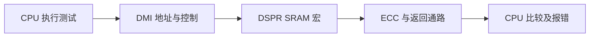
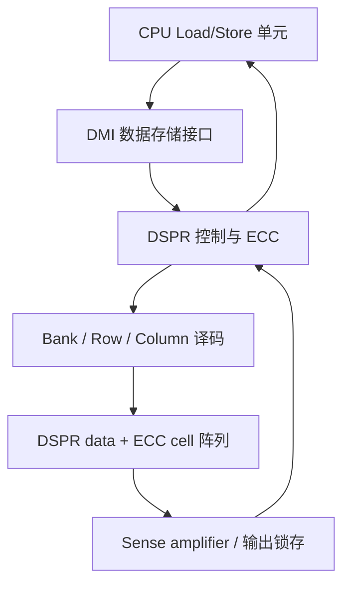
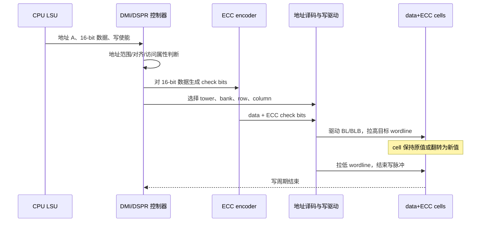
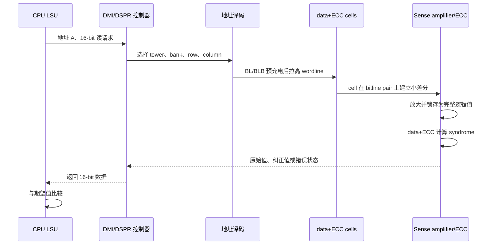

# DSPR RAM 完整读写过程与 V-F-T Shmoo 分析

> 目标：不讨论 Cache、LMU 和远程总线访问，只以“单个 CPU 核访问本地 DSPR”为例，解释一次 RAM 测试期间硬件内部发生了什么，以及内核电压、频率和温度为什么会改变 Shmoo 测试结果。
>
> 本文将两类信息明确分开：
>
> - **TC3xx 手册可确认的事实**：CPU 通过 DMI 访问本地 DSPR；DSPR 是本地单周期数据存储体；ECC 以 16 bit 为保护粒度；byte write 在 DMI 内部转成 16-bit Read-Modify-Write。
> - **通用 SRAM 宏工程模型**：bank、row decoder、wordline、bitline、write driver、sense amplifier 和 6T SRAM cell 的物理动作。TC3xx 手册没有公开 SRAM 宏的晶体管级实现和各子阶段精确时间。

---

## 1. 先看这张 Shmoo 表说明了什么

以下分析暂按：**行 = 内核电压 mV，列 = 频率 MHz**。如果两个轴的含义不同，结论需要相应调整。

### 1.1 从表中提取出的临界点

| 频率 | 最高 FAIL 电压 | 最低 PASS 电压 | 当前可确定的通过边界 |
|---:|---:|---:|---|
| 32 MHz | 未测到 | 1080 mV | `Vmin < 1080 mV` |
| 64 MHz | 未测到 | 1080 mV | `Vmin < 1080 mV` |
| 96 MHz | 1110 mV | 1120 mV | `1110 mV < Vmin ≤ 1120 mV` |
| 120 MHz | 1110 mV | 1120 mV | `1110 mV < Vmin ≤ 1120 mV` |
| 132 MHz | 1130 mV | 1140 mV | `1130 mV < Vmin ≤ 1140 mV` |
| 144 MHz | 1160 mV | 1170 mV | `1160 mV < Vmin ≤ 1170 mV` |

也可以从“给定电压下已经验证的最高通过频率”来看：

| 电压范围 | 已验证 PASS 的最高频率 | 下一档已经观察到的 FAIL |
|---:|---:|---:|
| 1080–1110 mV | 64 MHz | 96 MHz |
| 1120–1130 mV | 120 MHz | 132 MHz |
| 1140–1160 mV | 132 MHz | 144 MHz |
| ≥1170 mV | 144 MHz | 未继续向上测频率 |

### 1.2 这张图的第一判断

FAIL 区域从右下角开始，随着频率提高向更高电压扩展，而且边界满足以下特征：

- 连续；
- 单调；
- 呈阶梯状；
- 没有散落在 PASS 区域中的随机 FAIL 点；
- 没有某一整行或整列异常。

因此，**第一优先级假设是低电压、高频率组合下，某条动态访问路径的时序裕量不足**。这比“某几个 SRAM cell 存在永久硬缺陷”更符合图形特征。

但是，目前还不能直接说是 SRAM cell 本身导致，因为软件观察到的 PASS/FAIL 覆盖了整条路径：



其中任何一个模块在低压高频下先失效，最终都可能显示为同一个 `FAIL`。

### 1.3 当前表格还没有测出的边界

- 32 MHz 和 64 MHz 在 1080 mV 仍然 PASS，因此这两列只得到“`Vmin < 1080 mV`”，没有找到真实 Vmin。
- 1170 mV 及以上时 144 MHz 全部 PASS，但没有继续提高频率，因此没有找到高电压区真实 Fmax。
- 96 MHz 和 120 MHz 的边界相同，可能是这两档确实具有相近裕量，也可能只是 10 mV 的电压步进不足以分辨两条边界。
- 原表中 `1199、1188、1200、1190` 的电压行顺序不是严格单调。由于这些点均 PASS，不影响本次临界值判断，但建议原始数据按实际施加电压重新排序。

---

## 2. DSPR 在硬件中的位置

TC3xx 本核数据访问 DSPR 的简化路径如下：



这里没有 Cache，也不经过 SRI crossbar。TC3xx 用户手册明确给出：

- DSPR 是本地 data operation 的 single-cycle memory；
- 本核 DSPR 内容不会被本核 DCache 缓存；
- DSPR 由多个 memory tower 组成；
- CPU 可从任意 16-bit 对齐地址取得最多 64 bit 数据；
- DSPR 的 ECC 保护粒度为 16 bit；
- half-word 及以上写入时，data 和对应 ECC check bits 并行写入；
- byte write 会在 DMI 内部转换为 16-bit Read-Modify-Write。

“single-cycle memory”表示 SRAM 接口访问被安排在一个相应的存储器时序窗口内，不等于一条 C 语言 load 从发射到结果可用只有一个 CPU 周期。例如 TC1.6.2P 的最佳情况 load 指令结果延迟还包括 CPU pipeline 阶段。

---

## 3. 一次完整 RAM 测试，软件层面做了什么

最简单的 RAM 测试通常是：

1. 向一段地址写入测试背景；
2. 逐地址读取；
3. 与期望值比较；
4. 换成相反背景再重复。

例如只看一个 16-bit 地址 `A`：

```c
*(volatile uint16_t *)A = 0x5555u;
barrier_or_separate_read_phase();

uint16_t actual = *(volatile uint16_t *)A;
if (actual != 0x5555u) {
    report_fail(A, 0x5555u, actual);
}
```

只用 `0x0000` 和 `0xFFFF` 不能充分激活相邻 bitline 和 cell 间的耦合。更合理的背景至少包括：

- `0x0000 / 0xFFFF`；
- `0x5555 / 0xAAAA`；
- walking 1 / walking 0；
- 地址数据模式，例如 `data = address` 和 `data = ~address`；
- March 算法的升序、降序读写组合。

一个完整的软件测试点，本质上会重复数万到数百万次下面的“写入物理动作 + 读取物理动作 + CPU 比较动作”。

---

## 4. 写一个 16-bit 数据时，硬件内部发生了什么

以本核执行一个自然对齐 half-word store 为例。由于 16 bit 正好等于 DSPR 的 ECC 保护粒度，不需要为了 ECC 读取旧值。

### 4.1 控制与数据通路



### 4.2 SRAM cell 层的实际物理动作

以通用 6T SRAM cell 为工程模型，一个 bit 由以下晶体管组成：

- 两个交叉耦合反相器，构成能保持 `Q/QB` 状态的双稳态锁存器；
- 两个 access transistor，在 wordline 有效时把内部节点连接到 `BL/BLB`。

写入时：

1. write driver 先把 `BL/BLB` 强制成互补电平；
2. row decoder 拉高目标 wordline；
3. access transistor 导通；
4. 强写驱动通过 bitline 压过 cell 原来的反馈状态；
5. 如果写入值与原值不同，交叉耦合锁存器翻转；
6. wordline 拉低，cell 与 bitline 隔离；
7. cell 靠自身正反馈保持新值，bitline 进入下一次预充电/恢复状态。

写成功必须同时满足两个条件：

- **静态写能力足够**：access transistor 和 write driver 有能力压过 cell 内部原状态；
- **动态写时间足够**：wordline 有效和 bitline 驱动持续时间足够长，cell 必须在写窗口结束前越过翻转点并稳定。

### 4.3 如果写的是 byte

DSPR 的 ECC word 是 16 bit，因此 byte write 不能只更新 8 个 data bits 而保留旧 ECC。DMI 需要执行：

1. 读出原 16-bit data 和 ECC；
2. ECC 检查/纠正旧数据；
3. 替换其中目标 8 bit；
4. 对新的 16-bit data 重算 ECC；
5. 将新 data + ECC 写回。

因此 byte write 同时包含一次读路径和一次写路径。在 Shmoo 测试中，如果目的是尽量单独观察最基本的 DSPR 宏读写能力，优先使用与 ECC 粒度一致的 16-bit 访问；byte 测试应作为独立测试项。

---

## 5. 读一个 16-bit 数据时，硬件内部发生了什么

### 5.1 完整读取路径



### 5.2 bitline 为什么只形成“小差分”

SRAM 阵列中的 bitline 很长，连接很多 cell，等效电容较大。读之前 `BL/BLB` 通常先被预充电并均衡。wordline 打开后，存储 `0` 的一侧通过 cell 的读取电流使某条 bitline 略微下降；另一条保持较高电位。

为了速度和功耗，控制器通常不会等待 bitline 一侧完全放电到 0 V，而是在差分达到 sense amplifier 可可靠判决的范围后就开始放大。因此读操作的关键不是“bitline 是否最终能到 0/1”，而是：

> 在采样时刻到来之前，bitline 差分是否已经大于 sense amplifier 的失调、噪声及所需安全裕量。

可用一个概念式理解 bitline 差分建立：

\[
\Delta V_{BL} \approx \frac{I_{read} \cdot t_{develop}}{C_{BL}}
\]

其中：

- `Iread`：cell 读电流；
- `tdevelop`：从 wordline 打开到 sense amplifier 判决之间的时间；
- `CBL`：bitline 等效电容。

电压下降会显著减小 `Iread`；频率提高会缩短 `tdevelop`。两者同时发生时，`ΔVBL` 最容易小到无法可靠判决，这正是低压高频 Shmoo 右下角首先 FAIL 的核心物理原因之一。

### 5.3 ECC 对测试结果的影响

TC3xx DSPR 使用 SECDED ECC，可纠正 single-bit error、检测 double-bit error。如果只判断 CPU 最终读到的数据是否等于期望值，则一次 raw SBE 可能已经被 ECC 在线纠正，软件比较仍然显示 PASS。

所以 RAM Shmoo 至少应同时记录：

- 数据 compare PASS/FAIL；
- correctable error 数量或 CE 标志；
- uncorrectable error、trap 或 UCE 标志；
- 首个错误地址及错误类型。

如果只输出一个 PASS/FAIL，得到的是“带 ECC 的系统级可见边界”，不是 SRAM raw bitcell 的原始失效边界。

---

## 6. 频率到底压缩了哪个时间窗口

当前表格各频率对应的理想时钟周期为：

| 频率 | 周期 |
|---:|---:|
| 32 MHz | 31.25 ns |
| 64 MHz | 15.625 ns |
| 96 MHz | 10.417 ns |
| 120 MHz | 8.333 ns |
| 132 MHz | 7.576 ns |
| 144 MHz | 6.944 ns |

SRAM 宏不一定能使用整个 CPU 周期。一次读访问的概念性时序约束是：

\[
T_{available} \geq
t_{addr}+t_{decode}+t_{WL}+t_{BL}+t_{SA}+t_{ECC}+t_{return}+t_{setup}+t_{margin}
\]

一次写访问则需要满足：

\[
T_{available} \geq
t_{addr}+t_{decode}+t_{ECCenc}+t_{writeDriver}+t_{cellFlip}+t_{recovery}+t_{margin}
\]

频率升高不会直接改变 SRAM cell 中存储的逻辑值，但会缩短控制器留给以下动作的时间：

- 地址译码稳定；
- wordline 脉冲宽度；
- bitline 预充电、放电和恢复；
- sense amplifier 判决；
- ECC 编码/译码；
- 数据返回和寄存器 setup time。

因此，高频 FAIL 本质是“同样的物理动作没有在规定采样边沿之前完成”。

---

## 7. 内核电压为什么会改变 RAM 读写边界

### 7.1 电压降低会让数字路径变慢

MOS 管的驱动能力与栅源过驱动电压有关。用常见的 alpha-power 近似，可把延迟趋势写成：

\[
t_{pd} \propto \frac{V_{DD}}{(V_{DD}-V_{TH})^{\alpha}}
\]

当 `VDD` 接近 `VTH` 时，电压再降低一点，延迟可能急剧增加，而不是线性增加。因此 Shmoo 边界在低压区通常会明显弯曲或快速退化。

### 7.2 对读操作的影响

低 VDD 会同时造成：

- cell 读电流下降；
- bitline 差分建立变慢；
- sense amplifier 的增益、速度和可用电压余量下降；
- row/column decoder、wordline driver 和输出 mux 变慢；
- ECC decoder 与数据返回逻辑变慢；
- read static noise margin 通常减小，读扰动风险增加。

### 7.3 对写操作的影响

低 VDD 下：

- write driver 和 access transistor 的驱动力下降；
- cell 需要更长时间才能翻转；
- process mismatch 对最弱 cell 的影响变得更明显；
- 可能出现“写脉冲结束时 cell 尚未跨过翻转点”的动态写失败；
- 也可能出现即使延长写时间仍难以翻转的静态 write-margin 失败。

### 7.4 对保持状态的影响

当 VDD 继续降低，即使不读也不写，cell 的 hold static noise margin 会下降。低于 data-retention voltage 后，cell 可能仅因失配、噪声或泄漏而失去状态。这类边界通常对访问频率不太敏感，更接近一条“固定电压竖线”。

### 7.5 高电压也不等于永远更安全

提高电压通常能加快晶体管和增加读写裕量，但同时动态功耗近似满足：

\[
P_{dynamic} \propto C V^2 f
\]

高电压、高频率可能增大瞬态电流，引起片上 IR drop、供电纹波和自发热。若外部测得 1.20 V，但 RAM 宏切换瞬间的本地 VDD 明显下陷，真正决定时序的是宏附近的瞬时电压，而不是电源表的静态设定值。

---

## 8. 温度为什么不是简单的“越高越差”

温度会同时改变 mobility、threshold voltage、leakage 和器件失配的相对影响，因此必须区分失效类型。

### 8.1 高温常见影响

- 载流子 mobility 下降，decoder、wordline driver、cell read current、sense amplifier 和 ECC 路径可能变慢；
- leakage 增大，低压下内部节点和 bitline 更容易受到泄漏影响；
- 自发热叠加供电 IR drop，可能使高频边界进一步恶化；
- threshold voltage 会下降，在某些宏中反而可能改善静态写入能力。

所以“高温可能让访问时间变差，但某些 cell 的静态 writeability 可能变好”并不矛盾。

### 8.2 低温常见影响

- mobility 通常提高，很多逻辑路径和读电流会变快；
- threshold voltage 上升，低电压下的有效过驱动未必更有利；
- cell 内部反馈可能更强，使弱 write driver 更难压过原状态，某些设计的写入最差角可能出现在低温；
- PLL、电源和模拟判决电路也可能出现与 SRAM cell 不同的温度最差角。

因此不能先验规定“高温一定是 RAM 最差角”或“低温一定最好”。应分别建立 cold、room、hot 三张 V-F Shmoo，再观察失败边界如何移动。

### 8.3 用温度位移反推失效类型

| 观察到的变化 | 更值得怀疑的机制 |
|---|---|
| 高温时 Fmax 普遍下降 | 访问时间、读电流、外围逻辑、泄漏或供电下陷 |
| 低温时主要出现写失败 | cell 太强、writeability 或 write-assist 边界 |
| 各温度都在近似相同电压突然失效 | retention Vmin、UV monitor/reset 或固定模拟阈值 |
| 温度越高，随机 CE 越多但 compare 仍 PASS | marginal cell、泄漏/噪声增加，ECC 正在掩盖 raw SBE |

这些只是定位方向，不是仅凭温度现象即可确认根因的充分条件。

---

## 9. 这张 Shmoo 表最可能对应哪类问题

### 9.1 当前最合理的假设

当前边界非常像动态时序限制：

> 电压下降 → transistor drive 下降 → 地址译码、wordline、bitline、sense amplifier、ECC 或返回路径变慢；频率升高 → 可用时间缩短；两者共同导致高频列必须提高最低工作电压。

144 MHz 在 1160 mV FAIL、1170 mV PASS，说明在当前测试条件、当前样片和当前判定方式下，10 mV 的变化已经跨过某条临界路径的可用裕量。这一结果可视为该测试点的 **dynamic Vmin**，不是 retention Vmin。

### 9.2 目前不能排除的对象

按建议排查顺序：

1. DSPR SRAM 宏读取路径：decoder → wordline → bitline → sense amplifier；
2. DSPR 写路径：ECC encoder → write driver → cell flip；
3. DSPR 外围与 DMI 控制/返回路径；
4. ECC decoder 的组合逻辑时序；
5. CPU pipeline、比较代码或测试程序所用的其他 RAM；
6. PLL/clock tree、片上电源 IR drop、低压监控或 reset；
7. 测试机设定电压与芯片内部实际电压之间的偏差。

一次普通的“写完再读并比较”会把读失败和写失败混在一起，无法仅凭 FAIL 单元格区分二者。

---

## 10. 怎样把读失败、写失败和保持失败拆开

### 10.1 Read Shmoo

目的：主要观察 read path。

1. 在安全电压、低频率下写入背景并校验；
2. 保持 RAM 供电和内容；
3. 切换到目标 V/F 点；
4. 只读，不在被测区写入；
5. 记录 compare、CE/UCE、首错地址和 actual XOR expected。

如果该模式失败而 write-only 隔离测试不失败，优先关注 bitline develop、sense amplifier、ECC decode 和返回路径。

### 10.2 Write Shmoo

目的：主要观察 write path。

1. 在目标 V/F 点执行写入；
2. 完成写操作后回到一个已知安全的读条件；
3. 在安全条件下读取并比较。

这样能减少 read path 在目标 V/F 点对结果的干扰。前提是电压/频率切换过程不会复位、破坏 SRAM 内容或触发额外访问。

### 10.3 Retention Shmoo

目的：观察 cell 静态保持能力。

1. 在安全条件下写入并校验；
2. 降到目标保持电压，禁止对被测 RAM 访问；
3. 保持规定 dwell time；
4. 回到安全读条件；
5. 读取并比较。

保持失败主要随电压、温度和保持时间变化，不应强烈依赖访问频率。

### 10.4 Full March Shmoo

目的：获得系统功能边界。

在每个 V/F/T 点运行统一的 March C- 或项目规定算法，输出整体通过边界。它最接近量产/系统功能结果，但不能单独完成物理根因定位，应与前三类隔离测试配合。

---

## 11. 建议你下一版 Shmoo 增加的观测量

仅记录 PASS/FAIL 可以做边界筛查，但很难判断究竟是哪一段失效。建议每个点至少记录：

| 分类 | 建议字段 |
|---|---|
| 条件 | die ID、lot、温度、设定 VDD、实测 VDD、频率、等待稳定时间 |
| 测试 | 算法、访问宽度、背景、地址范围、升序/降序、读/写/保持阶段 |
| 错误 | 首错地址、期望值、实际值、XOR、累计错误数、重复次数 |
| ECC | CE 次数、UCE/DBE、错误地址记录、是否在线纠正 |
| 系统 | trap 类型、reset 原因、PLL lock、低压监控状态、测试超时 |
| 电源 | 平均电流、瞬态 droop 或片上 VMON、测试前后结温 |

尤其建议将 FAIL 再细分成：

- `DATA_MISMATCH`；
- `ECC_CE_ONLY`；
- `ECC_UCE/TRAP`；
- `CPU_EXCEPTION`；
- `RESET/BROWNOUT`；
- `TIMEOUT/HANG`。

这些 FAIL 的物理含义完全不同，不应全部涂成同一种红色后再一起解释。

---

## 12. 测试实现中最容易污染结果的地方

### 12.1 测试程序自身也使用了被测 DSPR

如果 stack、局部变量、错误计数器或测试控制块本身放在被测 DSPR 中，一旦这些位置先出错，程序可能跑飞、误判或复位，最终只看到一个笼统 FAIL。

建议：

- 明确排除测试程序正在使用的 stack 和数据区；或
- 将测试控制数据、stack 放到另一块独立 RAM；
- 测试代码从不依赖被测 DSPR 的存储体执行；
- 关闭或隔离会访问被测区域的中断、DMA 和其他 master。

### 12.2 写后立即读没有真正验证 cell

CPU 实现可能存在 store buffer、写后读转发或其他顺序机制。若要确认整个写 sweep 已经到达 SRAM：

- 使用芯片架构规定的 memory barrier/synchronization；
- 将写 sweep 与读 sweep分开；
- 不依赖编译器普通变量访问，使用 `volatile` 和必要的 barrier；
- 检查反汇编，确认访问宽度与预期一致。

对于 TC3xx，应结合 `DSYNC` 及实际测试结构保证 store 已经完成；不要仅以 C 语句执行结束作为 RAM cell 已更新的证明。

### 12.3 ECC 掩盖了 raw failure

如果 CE 没有纳入 FAIL 条件，则表中的 PASS 区可能已经存在被在线纠正的 raw bit error。建议至少生成两张图：

- 功能 Shmoo：只有不可纠正错误或 compare mismatch 算 FAIL；
- 裕量 Shmoo：出现任何 CE 就标成 MARGINAL，UCE/compare mismatch 标成 FAIL。

### 12.4 每个点只运行一次

临界区的错误可能具有概率性。建议在边界附近重复多次，并输出每个点的失败概率，而不是只给一次二值结果。例如：

\[
P_{fail}=\frac{N_{failed\ runs}}{N_{total\ runs}}
\]

确定性阶梯边界更像固定 critical path；重复运行才偶发的散点更像噪声、droop、marginal cell 或测试条件不稳定。

---

## 13. 怎样继续验证当前这张表的判断

建议按下面顺序执行，信息增益最高：

1. **在临界区缩小步进**：重点测 1100–1180 mV，电压步进改为 2–5 mV；频率在 96、120、132、144 MHz 之间增加中间点。
2. **每点重复**：至少记录通过次数/总次数，观察边界是确定性还是概率性。
3. **拆读写**：分别生成 Read Shmoo、Write Shmoo 和 Retention Shmoo。
4. **记录 CE/UCE**：确认 PASS 区是否已经发生 ECC correction。
5. **记录首错地址与 XOR**：观察是否固定在相同 tower/bank/row/bit，还是地址随机。
6. **做数据背景分组**：`0000/FFFF`、`5555/AAAA`、walking bit 分别出图。
7. **做三温**：cold、room、hot 使用相同流程和稳定时间。
8. **测内部实际电压**：尽量获取片上 monitor 或靠近芯片的高速测量，排除高频大电流造成的本地 droop。
9. **区分运行失败类型**：数据错误、ECC、异常、复位、超时分别统计。

如果后续结果显示：

- 首错地址和 bit 位高度重复，倾向于 weakest cell / 局部阵列路径；
- 地址分散但只随频率变化，倾向于公共 decoder、sense timing、ECC 或返回路径；
- 高活动背景更差且伴随 VDD droop，倾向于供电完整性；
- read-only 失败而 write-isolated 通过，倾向于读路径；
- write-isolated 失败而安全条件读取稳定，倾向于写能力或写时间；
- 静态保持也失败且频率影响很小，倾向于 retention Vmin。

---

## 14. 对当前表格的阶段性结论

目前最稳妥的工程结论是：

> 当前样片的 RAM 软件测试呈现出清晰的 V-F 相关动态失效边界。随着频率从 120 MHz 提高到 132 MHz、144 MHz，最低通过电压从约 1.12 V 上移到约 1.14 V、1.17 V，符合低电压导致 SRAM 宏及其外围路径延迟增加、而高频缩短可用访问时间的基本规律。

但现有 PASS/FAIL 表还不足以确认瓶颈属于 bitcell read、bitcell write、sense amplifier、ECC、DMI/CPU 路径或供电 droop。要把“系统 RAM 测试边界”收敛为“RAM 宏物理根因”，下一步最关键的是拆分 Read/Write/Retention Shmoo，并同时记录 ECC CE/UCE、首错地址、错误位图和实际片上电压。

---

## 15. 参考依据

### 15.1 用户提供的 TC3xx 官方手册

- `TC3xx User Manual part1.pdf`
  - Section 5.3.5.2.3：load instruction timing；
  - Section 5.3.6：本地 DSPR 为 single-cycle data memory；
  - Section 5.3.6.2.2，印刷页 5-76：DSPR 以 half-word 为 ECC 保护粒度，byte write 转换为 half-word RMW；
  - Section 5.3.6.4，印刷页 5-85 至 5-86：DMI、DSPR towers、16-bit 对齐和最多 64-bit 数据访问。
- `AURIXTC3xxSafetyManualv2.0.pdf`
  - Section 6.67，印刷页 193：DSPR SECDED ECC，SBE correction 与 DBE detection。
- `TC39xB_DS.pdf`
  - Table 3-3，印刷页 1-402 至 1-403：TC39xB 规定工作条件示例，包括最大 CPU 频率、VDD 和结温范围。该表只用于说明官方 PVT 规格形式，不代表用户当前被测芯片的规格。

### 15.2 SRAM 稳定性通用原理

- A. Carlson et al., “SRAM Read/Write Margin Enhancements Using FinFETs,” IEEE Transactions on VLSI Systems：讨论 SRAM 阵列必须同时满足 read stability、hold stability、writeability 和规定时间内完成访问等不同裕量。[论文链接](https://people.eecs.berkeley.edu/~bora/Journals/2010/TVLSI-10.pdf)
- Infineon AURIX TC3xx Family User's Manual Part 1 在线版本：[官方手册](https://www.infineon.com/assets/row/public/documents/10/44/infineon-aurix-tc3xx-part1-usermanual-en.pdf)

