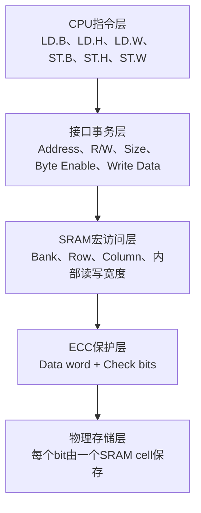
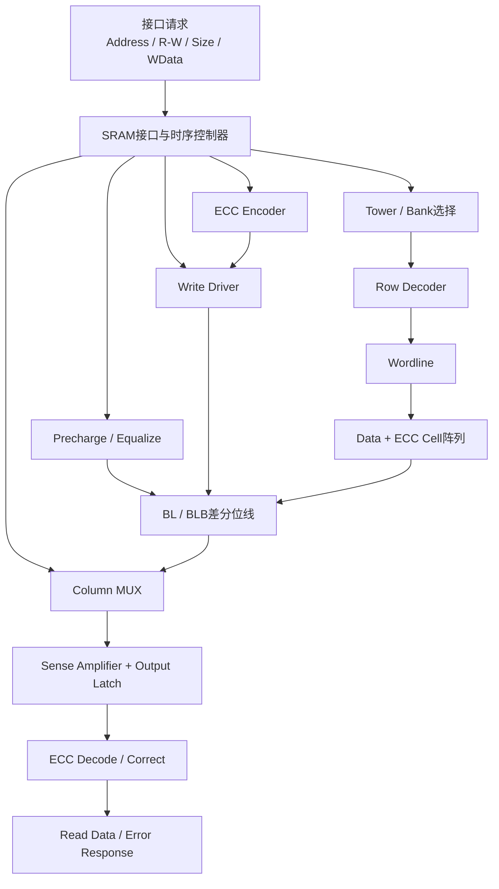
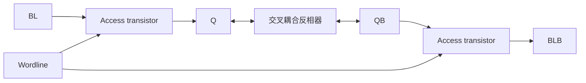
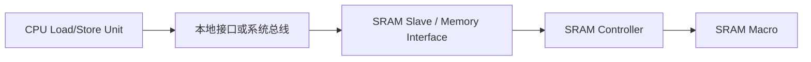
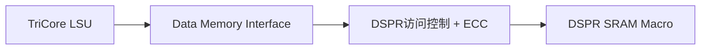
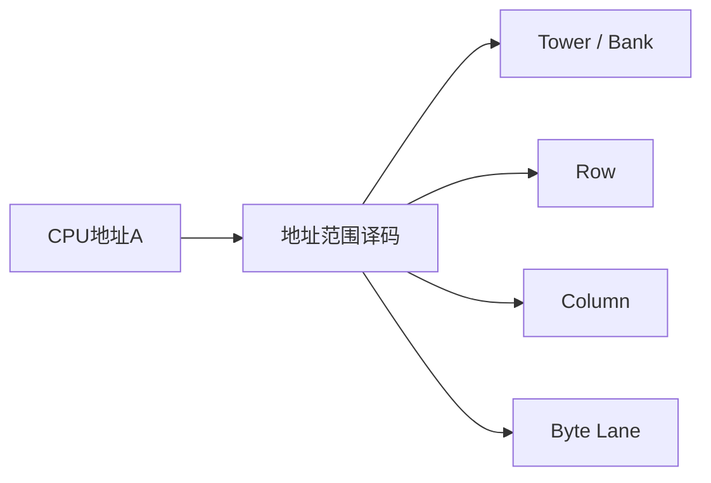
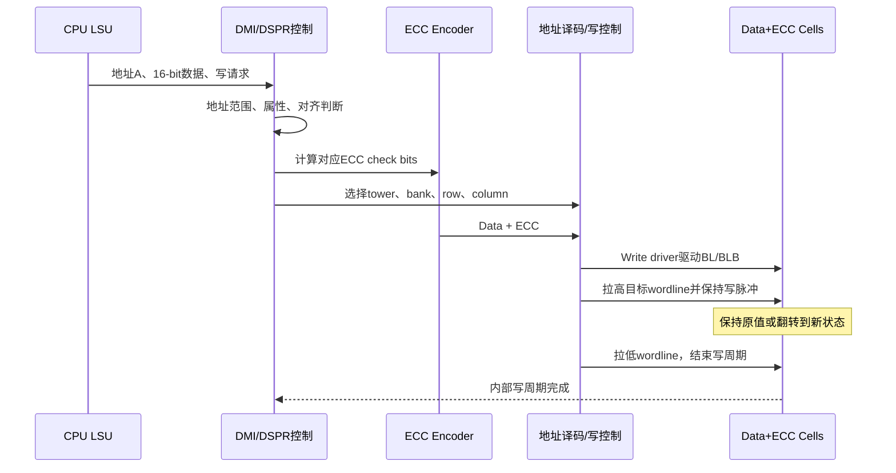
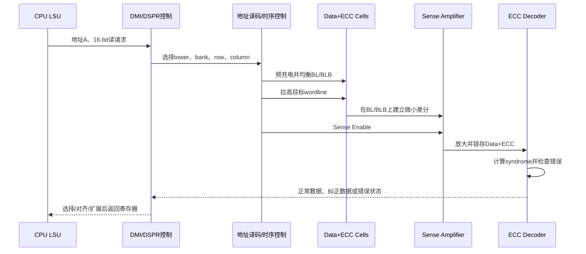
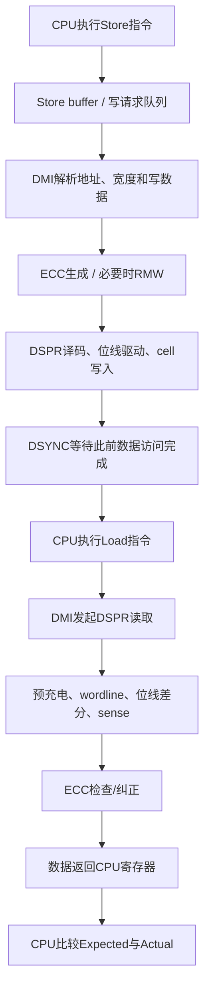
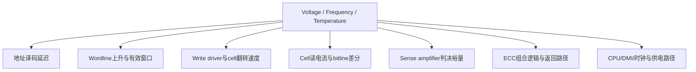

# TC3xx DSPR：SRAM结构、总线接口与CPU读写的硬件映射

> 适用范围：以 AURIX TC3xx 中“本核 CPU 访问本核 DSPR”为主线，不展开 Cache、LMU 和远程 SRI 访问。
>
> 目标：从硬件角度回答三个问题：
>
> 1. MCU 中的 SRAM 到底由哪些部分组成？
> 2. SRAM 如何连接 CPU/总线？
> 3. CPU 执行一条 load/store 后，SRAM 控制器、外围电路和 SRAM cell 分别发生了什么？

---

## 1. 先建立正确的四层模型

理解 MCU RAM 访问时，必须把下面四层分开：



因此：

> **CPU访问宽度 ≠ 接口传输宽度 ≠ SRAM宏物理读写宽度 ≠ ECC保护宽度。**

例如，CPU执行一次8-bit写，并不一定意味着SRAM内部只访问8个cell。以TC3xx DSPR为例，由于ECC保护粒度是16 bit，byte写需要在内部执行一次16-bit Read-Modify-Write。

---

## 2. MCU中SRAM的整体结构

### 2.1 SRAM不是单纯的“cell数组”

一个可被CPU访问的SRAM模块，通常由三部分构成：

1. **接口与控制部分**：接收地址、读写命令、访问宽度和写数据；产生完成或错误响应。
2. **SRAM宏外围电路**：地址译码、预充电、列选择、写驱动、sense amplifier、时序控制和ECC。
3. **存储阵列**：大量SRAM cell，分别保存data bit和ECC check bit。



### 2.2 主要硬件模块分别做什么

| 模块 | 主要输入 | 主要输出/动作 | 存在的原因 |
|---|---|---|---|
| SRAM接口控制器 | 地址、R/W、访问宽度、写数据 | 内部访问控制、完成/错误响应 | 把CPU或总线事务转换成SRAM宏动作 |
| Timing Controller | 时钟、读写命令 | precharge、wordline、sense enable、write pulse | 保证内部动作按正确时间顺序发生 |
| Tower/Bank选择 | 地址高位 | 选中局部阵列 | 缩短字线/位线，降低电容，提高速度 |
| Row Decoder | 行地址 | 激活一根wordline | 选中目标行 |
| Column MUX | 列地址、宏读出数据 | 选择目标data word | 从一整行中取出CPU所需的列 |
| Precharge/Equalize | 读周期控制 | 预充电并均衡BL/BLB | 给下一次读取建立统一初始条件 |
| Sense Amplifier | BL/BLB上的微小差分 | 完整逻辑0/1 | SRAM cell无法快速驱动长位线到完整电平 |
| Write Driver | 写数据、写使能 | 强制BL/BLB形成互补电平 | 压过cell原状态并写入新状态 |
| ECC Encoder | 待写data | ECC check bits | 写入与data匹配的校验码 |
| ECC Decoder | 读出的data和check bits | syndrome、纠正数据、错误指示 | 检测/纠正存储错误 |
| SRAM Cell | wordline、BL/BLB | 保存或输出1 bit | 真正保存数据 |

### 2.3 为什么要拆成Tower和Bank

如果把整个DSPR做成一块巨大的矩形阵列：

- wordline会很长，RC延迟增大；
- bitline连接的cell数量更多，电容增大；
- 读差分建立更慢；
- 写驱动需要更强；
- 动态功耗和泄漏管理更困难。

因此实际SRAM通常会拆成多个较小的局部阵列。地址的一部分选择tower/bank，另一部分选择row和column。

可以用下面的逻辑关系理解：

\[
\text{CPU Address}
\rightarrow
\{\text{Tower/Bank},\ \text{Row},\ \text{Column},\ \text{Byte Lane}\}
\]

TC3xx手册会描述DSPR由多个memory tower构成，但不会公开每个tower内部的晶体管版图、真实bank数量或每个内部脉冲的精确宽度。

---

## 3. SRAM cell的基本物理结构

### 3.1 通用6T SRAM cell模型

SRAM常用6T cell来解释：

- 两个交叉耦合反相器形成双稳态锁存器；
- 内部节点为`Q`与`QB`；
- 两个access transistor由wordline控制；
- access transistor把内部节点连接到`BL/BLB`。



当wordline为低时，cell与位线断开，交叉耦合反相器利用正反馈持续保持`Q/QB`状态。

> 说明：6T cell是通用SRAM工程模型。TC3xx公开手册没有披露DSPR所用foundry SRAM bitcell的具体晶体管实现，因此不能把6T结构写成已由Infineon公开确认的TC3xx内部细节。

### 3.2 SRAM中的“一个字”并不是一个cell

一个cell只保存1 bit。软件看到的16-bit、32-bit或64-bit数据，实际上由多个cell和外围电路组合而成。

例如一个受ECC保护的数据单元，在逻辑上可以理解为：

```text
[Data bit 0 ... Data bit N-1] + [ECC check bits]
```

data cells和ECC cells可能位于同一宏的不同行/列或不同物理lane中，具体版图通常不会在用户手册中公开。

---

## 4. SRAM如何连接MCU总线

### 4.1 通用MCU连接方式

CPU不会直接控制wordline和bitline。CPU的Load/Store Unit先发出一个存储器访问请求，再由互连和SRAM从接口接收。



典型接口信息如下。不同芯片的真实信号名可能不同，但功能概念相同。

| 接口信息 | 含义 | SRAM侧如何使用 |
|---|---|---|
| Address | 目标存储器地址 | 分解为tower/bank/row/column/byte lane |
| Read/Write | 读还是写 | 选择sense path或write path |
| Transfer Size | 8/16/32/64 bit等 | 决定数据选择、byte enable及是否需要RMW |
| Byte Enable | 哪些byte有效 | 控制目标写lane；若ECC粒度更大，可能触发RMW |
| Write Data | 要写入的数据 | 送入合并逻辑和ECC encoder |
| Request/Valid | 当前请求有效 | 启动一次内部访问 |
| Ready/Complete | 访问已接受或完成 | 控制CPU继续执行或等待 |
| Read Data | 读回数据 | 返回CPU寄存器 |
| Error | 访问或ECC错误 | 形成错误响应、alarm或trap |

### 4.2 TC3xx本核访问本核DSPR

对TC3xx而言，本核CPU访问本核DSPR时，可简化为：



这是一条本地数据访问路径，不需要先经过全局SRI Crossbar。DMI一侧完成或参与以下工作：

- 识别地址是否命中本核DSPR；
- 解析访问宽度和有效byte lane；
- 组织DSPR访问；
- 完成ECC生成、检查和纠错相关处理；
- 将读取结果按CPU指令要求进行选择、对齐和扩展；
- 处理byte write对应的16-bit Read-Modify-Write。

TC3xx手册可确认的关键点包括：

- DSPR由多个memory tower构成；
- 本核通过DMI快速访问本核DSPR；
- DSPR支持从16-bit对齐地址获取最多64-bit数据；
- DSPR的ECC保护粒度为16 bit；
- byte write在DMI内部转换为16-bit Read-Modify-Write。

### 4.3 地址到硬件资源的映射

CPU发出的是一个线性地址，但SRAM控制器会把地址拆成不同字段：



因此，CPU地址递增1 byte，并不一定意味着物理版图上就是移动到紧邻的cell。宏内部可能存在bank interleave、列复用、冗余行/列修复和地址重映射。

---

## 5. CPU写操作如何映射为硬件行为

以下使用一个自然对齐的16-bit写作为主例，因为16 bit与TC3xx DSPR的ECC保护粒度一致。

```c
*(volatile uint16_t *)A = 0x5555u;
```

编译器通常会生成相应的half-word store指令。下面只关注该store到达DMI之后的硬件行为。

### 5.1 16-bit写入的控制时序



### 5.2 写入时SRAM宏内部逐步发生什么

1. **选择目标阵列**：高位地址选中tower/bank。
2. **选择目标行列**：row decoder准备激活目标wordline，column/写lane选择目标数据位置。
3. **生成ECC**：ECC encoder根据新的16-bit data产生与之匹配的check bits。
4. **建立写位线电平**：write driver把每对`BL/BLB`驱动成目标互补状态。
5. **打开cell**：wordline拉高，目标行cell接入位线。
6. **写入或保持**：
   - 新数据与旧数据相同时，cell维持原状态；
   - 新数据与旧数据不同时，位线驱动力压过cell内部反馈，使其翻转。
7. **结束写脉冲**：wordline拉低，cell与位线断开。
8. **恢复外围电路**：位线和控制电路为下一次访问恢复初始状态。

### 5.3 一个cell为什么能够被“写翻转”

cell本身的交叉耦合反相器会努力保持旧状态。要写入相反值，write driver必须通过access transistor把内部节点推过锁存器的翻转点。

一次写成功同时需要满足：

- **写能力裕量**：write driver和access transistor必须足够强，能够压过cell内部保持能力；
- **写时间裕量**：wordline和写位线必须保持足够时间，使cell完成翻转并进入稳定状态。

如果电压降低或内部写窗口缩短，可能出现：

- cell完全没有翻转；
- cell翻转过慢，在wordline关闭前未稳定；
- data写成功但某个ECC check bit写失败；
- 只有特定数据方向或特定cell失败。

### 5.4 为什么8-bit写更复杂

```c
*(volatile uint8_t *)A = 0x55u;
```

CPU层面是一条byte store，但TC3xx DSPR的ECC保护粒度是16 bit。只修改8个data bits而保留旧ECC，会让data与ECC不再匹配。

因此DMI需要执行：


这就是Read-Modify-Write，意味着一次`ST.B`同时使用了：

- SRAM读路径；
- sense amplifier；
- ECC decode/correct；
- 数据合并逻辑；
- ECC encoder；
- SRAM写路径。

因此在V/F/T Shmoo中，byte write失败不能简单解释为“纯写路径失败”。若要先观察最基础的DSPR写能力，16-bit自然对齐写更容易隔离变量；byte写应作为单独测试项。

---

## 6. CPU读操作如何映射为硬件行为

以自然对齐的16-bit读为例：

```c
uint16_t value = *(volatile uint16_t *)A;
```

### 6.1 16-bit读取的控制时序



### 6.2 读取时SRAM宏内部逐步发生什么

1. **预充电与均衡**：读周期开始前，使`BL/BLB`处于接近且一致的初始电位。
2. **地址译码**：选中目标tower/bank/row/column。
3. **打开目标行**：wordline拉高，目标行cell连接到位线。
4. **建立位线差分**：cell在其中一条位线上产生稍强的放电，`BL/BLB`出现小电压差。
5. **Sense判决**：达到预定时间后，sense amplifier使能，将小差分放大并锁存为完整逻辑0/1。
6. **ECC检查**：data和check bits一起进入ECC decoder并计算syndrome。
7. **数据返回**：正常或可纠正情况下，DMI将目标half-word返回CPU；不可纠正错误则同时进入芯片定义的错误处理路径。
8. **阵列恢复**：wordline关闭，位线恢复，为下一次访问做准备。

### 6.3 为什么读取不是等位线完全变成0/1

位线连接大量cell，等效电容较大。为了速度，SRAM不会等待某条位线从高电平完全下降到0 V，而是只等待足够可靠的小差分，再由sense amplifier快速放大。

可以用下面的概念式理解位线差分建立：

\[
\Delta V_{BL} \approx \frac{I_{read}\cdot t_{develop}}{C_{BL}}
\]

其中：

- \(I_{read}\)：cell提供的有效读电流；
- \(t_{develop}\)：wordline打开到sense判决之间的时间；
- \(C_{BL}\)：位线等效电容。

因此：

- 电压降低会使cell读电流减小；
- 频率提高可能压缩内部差分建立时间；
- 高温通常降低载流子迁移率，但同时也会改变阈值电压和泄漏；
- 当采样时刻的差分不足以覆盖sense amplifier失调、噪声和PVT裕量时，就可能读错。

### 6.4 SRAM读取是否会改变原数据

正常设计条件下，SRAM读是非破坏性的：读完之后cell仍保持原状态。

但是读操作会把内部节点连接到已预充电的位线，因此会对cell状态产生扰动。若电压过低、cell读稳定性不足或器件失配严重，读扰动可能导致cell发生翻转，这属于read stability failure。

---

## 7. 不同CPU访问宽度对应的DSPR硬件行为

以下表格是面向硬件行为的简化模型。更宽访问可能由多个tower/lane并行完成，也可能在微架构内部被组织为多个子操作；不能只凭C语言类型反推出唯一的物理阵列动作。

| CPU访问 | CPU要求 | DSPR/ECC侧的典型行为 | 主要观察路径 |
|---|---|---|---|
| 8-bit read | 返回目标byte | 读出所在16-bit ECC保护单元，ECC检查后选择目标byte | 读路径 + ECC + byte select |
| 8-bit write | 修改目标byte | 读16-bit旧值 → ECC检查 → 合并8 bit → 重算ECC → 写回完整保护单元 | 读路径 + 写路径 + RMW |
| 16-bit read | 返回half-word | 读取一个16-bit ECC保护单元并检查ECC | 基础读路径 |
| 16-bit write | 写入half-word | 对新数据生成ECC并写入完整保护单元 | 基础写路径 |
| 32-bit read/write | word访问 | 涉及两个16-bit ECC保护单元，可能由内部lane/tower并行组织 | 多lane及ECC并行路径 |
| 64-bit read/write | double-word访问 | 涉及四个16-bit ECC保护单元，并受对齐和内部资源组织影响 | 更宽数据通路和多tower/lane |

### 7.1 对齐为什么重要

自然对齐访问更容易映射到一个或一组规则的内部数据lane。非对齐访问可能：

- 跨越两个ECC保护单元；
- 跨越两个内部word或bank边界；
- 被CPU/DMI拆成多个内部访问；
- 产生额外周期；
- 使一次软件访问的原子性和错误归因更复杂。

因此，建立SRAM基础Shmoo时，建议先使用自然对齐、与ECC保护粒度一致的访问，再逐步加入byte和非对齐访问。

---

## 8. 一次完整RAM写后读测试，硬件发生了什么

典型测试代码可抽象为：

```c
write_test_pattern();
__dsync();
read_and_compare();
```

完整硬件路径如下：



### 8.1 为什么“C语句执行结束”不等于“cell已经写完”

CPU微架构可能包含store buffer。store指令进入或被store buffer接受后，流水线可以继续推进，而实际SRAM访问仍在完成。

因此必须区分：

1. store指令已被CPU发射；
2. 写请求已被缓冲；
3. 写请求已到达DSPR控制逻辑；
4. SRAM宏写周期已经完成；
5. 后续load重新从目标DSPR位置取得数据。

测试中使用`DSYNC`的目标，是保证此前数据访问在体系结构规定的意义上完成并建立正确顺序。不要只依赖C语言语句先后顺序。

### 8.2 一次“PASS”实际证明了什么

如果软件最终得到`actual == expected`，它至少说明在该测试条件和覆盖范围内：

- CPU成功执行了测试程序；
- 地址和访问属性路径工作；
- 写请求最终使目标存储状态可被后续读取；
- 读路径返回了与期望相同的数据；
- ECC未产生软件可见的不可纠正错误；
- CPU比较和结果上报路径工作。

但它不能单独证明：

- 没有发生过被ECC纠正的raw single-bit error；
- 失败裕量一定来自或一定不来自cell；
- 所有地址、所有数据背景和所有读写方向均已覆盖；
- 测试代码、栈和控制变量没有受到被测区域的影响。

---

## 9. 如何把读失败和写失败拆开

普通“写入后读取比较”把写路径和读路径串在一起：


最终数据不匹配可能来自：

- cell没有成功写入；
- 写入成功，但读取判决错误；
- data正确而ECC check bit错误；
- ECC或返回路径失败；
- 地址译码到了错误位置；
- 测试程序或供电系统先失效。

建议将测试拆成以下类型：

| 测试类型 | 基本方法 | 主要隔离目标 |
|---|---|---|
| Write Shmoo | 在稳健条件写入，改变目标V/F/T执行写，再回到稳健条件读 | 主要观察写入能力 |
| Read Shmoo | 在稳健条件写入，改变目标V/F/T只执行读和比较 | 主要观察读取路径 |
| Retention Shmoo | 稳健条件写入，目标电压/温度下保持一段时间，再稳健读取 | 主要观察静态保持能力 |
| Dynamic R/W Shmoo | 目标V/F/T下循环写、读、比较 | 观察完整系统动态边界 |
| ECC监控Shmoo | 同步记录CE/UCE、syndrome或alarm | 区分raw错误与软件最终数据错误 |

---

## 10. RAM测试软件的实现检查项

为了让软件结果能够更准确地对应到硬件，建议至少确认以下内容：

- 被测区域与测试代码、栈、CSA、异常上下文、日志缓冲区互不重叠；
- 使用`volatile`或汇编，避免写读被优化器删除、合并或重排；
- 检查反汇编，确认实际使用的访问宽度；
- 写阶段和读阶段明确分开；
- 在需要的边界使用`DSYNC`；
- 首先使用16-bit自然对齐访问建立DSPR基础边界；
- byte write单独测试，因为其包含16-bit RMW；
- 分别测试`0x0000/0xFFFF`、`0x5555/0xAAAA`、walking 1/0及地址背景；
- 记录首错地址、expected、actual和`expected XOR actual`；
- 同步记录ECC可纠正错误、不可纠正错误、alarm/trap及复位原因；
- 区分数据mismatch、程序跑飞、超时、低压复位和测试通信失败；
- 固定或记录测试顺序、升压/降压方向、稳压等待时间和芯片结温。

---

## 11. 与V/F/T Shmoo的直接关系

当频率、电压或温度变化时，受影响的不只是cell本身，而是整条访问路径：



所以软件测得的Shmoo边界更准确的名称是：

> **CPU—DMI—DSPR—ECC—CPU比较整条路径的软件可见动态Vmin/Fmax边界。**

只有通过read/write/retention拆分、ECC记录、错误位图和供电测量，才能逐步判断失败主要来自：

- SRAM cell写能力；
- SRAM cell读稳定性；
- bitline/sense路径；
- 地址译码和控制时序；
- ECC/DMI外围逻辑；
- CPU、时钟或电源完整性。

---

## 12. 最终心智模型

### 写操作

```text
CPU Store
→ DMI解析地址/宽度
→ 必要时读取旧ECC保护单元并合并
→ 生成新ECC
→ 选择tower/bank/row/column
→ write driver建立BL/BLB
→ wordline打开
→ cell保持或翻转
→ wordline关闭
→ 写周期完成
```

### 读操作

```text
CPU Load
→ DMI解析地址/宽度
→ 选择tower/bank/row/column
→ BL/BLB预充电与均衡
→ wordline打开
→ cell建立位线小差分
→ sense amplifier判决并锁存
→ ECC检查/纠正
→ 数据选择、对齐与扩展
→ 返回CPU寄存器
```

最核心的结论是：

> CPU执行的是“访问某个地址”的体系结构操作；真正完成存储的是DMI/DSPR控制逻辑、地址译码、写驱动、预充电电路、sense amplifier、ECC逻辑以及SRAM cell阵列共同组成的完整硬件系统。

---

## 13. 资料边界与参考文档

### TC3xx公开资料能够确认

- 本核CPU与本核DSPR之间的DMI访问关系；
- DSPR的memory tower组织概念；
- DSPR访问宽度、对齐规则和ECC保护粒度；
- byte write对应的16-bit Read-Modify-Write；
- ECC能力、错误上报和体系结构可见行为。

### 公开用户手册通常不会披露

- DSPR采用的具体bitcell晶体管结构；
- 每个tower的晶体管级版图；
- wordline、sense enable和write pulse的真实内部波形；
- SRAM compiler的内部assist技术；
- 各内部子阶段的真实时间预算与PVT表征数据。

本文涉及wordline、bitline、precharge、sense amplifier、write driver和6T cell的部分，是用于解释TC3xx可见行为的**通用SRAM工程模型**，不是对未公开芯片实现的反向断言。

参考资料：

1. Infineon, *AURIX TC3xx User's Manual, Part 1*，CPU/DMI/DSPR与ECC相关章节。
2. Infineon, *AURIX TC3xx Architecture Manual, Volume 1/2*，Load/Store、同步和存储器访问相关章节。
3. Infineon, *AURIX TC39xB Data Sheet*，片上存储器组织、工作条件和时序相关章节。

