# AURIX TC3xx RAM 读写时序、ECC 与不同访问宽度详解

> 适用范围：AURIX TC3xx / TC1.6.2P，重点讨论 TC39xB 的 DSPR、DLMU、PSPR、全局 LMU，以及与 DCache/PCache、SRI、DMI/PMI、SSH/MTU 的关系。
>
> 依据：用户提供的 AURIX TC3xx 官方 Architecture Manual、User's Manual、TC39xB Data Sheet、TC39x-B Appendix 和 Safety Manual。

---

## 0. 先给结论

理解 TC3xx RAM 读写，必须把下面五种“宽度”分开：

1. **C 语言对象宽度**：如 `uint8_t/uint16_t/uint32_t/uint64_t`。
2. **TriCore 指令访问宽度**：如 `LD.B/LD.H/LD.W/LD.D`、`ST.B/ST.H/ST.W/ST.D`。
3. **SRI 数据通路宽度**：SRI 是 64-bit 数据总线，但一次事务可以表示 byte、half-word、word、double-word，也可以是 burst。
4. **SRAM 宏/控制器数据宽度**：例如 DLMU 和 LMU 内部按 64-bit word 组织；DSPR 可从任意 16-bit 对齐地址向 CPU 提供最多 64 bit。
5. **ECC 保护粒度**：ECC 每次计算、存储和校验的数据块宽度。DSPR 是 16 bit；DLMU、PSPR、LMU 是 64 bit。

最重要的一句话是：

> **CPU 写入宽度不等于 SRAM cell 阵列的实际改写宽度；是否需要 Read-Modify-Write（RMW），由 ECC 保护粒度和 SRAM 宏的最小可写粒度决定。**

典型结果如下：

| 存储体 | 功能接口/物理组织要点 | ECC 粒度 | 小于 ECC 粒度的写入 |
|---|---:|---:|---|
| DSPR | 可从任意 16-bit 对齐地址向本地 CPU 提供最多 64 bit | 16 bit | 仅 byte 写需要 16-bit RMW |
| DCache data RAM | 256-bit cache line，按 half-word 检查错误 | 16 bit | byte 写需要 16-bit RMW |
| PSPR | 程序侧 64-bit 保护；数据写经总线/PMI | 64 bit | `<64 bit` 或 64-bit 非自然对齐写需要 64-bit RMW |
| PCache data RAM | 256-bit cache line，按 64-bit 保护 | 64 bit | cache 控制器按 line/64-bit 分块处理 |
| DLMU | 内部 64-bit 宽 | 64 bit | `<64 bit` 或 64-bit 非自然对齐写需要 64-bit RMW |
| 全局 LMU | 内部 64-bit word，不支持 SRAM 宏的 sub-word 直接写 | 64 bit | byte/half-word/word 写均触发内部 64-bit iRMW |

还要特别注意：

- TC1.6.2P 有最多容纳 **6 个 store** 的 store buffer。CPU 执行完 `ST.W`，不等于 RAM cell 已经完成改写。
- store buffer 会合并连续写：byte→half-word、half-word→word、word→double-word。
- 正常模式下，不相关的 load 可以越过尚未排空的 store；`SMACON.IODT=1` 才强制按程序顺序并关闭 store buffer。
- 对 segment 9 的 cacheable LMU 地址进行写操作时，若 DCache 命中，首先改变的是 **DCache SRAM**，不是 LMU SRAM；LMU cell 要等到 cache line write-back。
- ECC 正确的 SBE 会由 SECDED 逻辑纠正并产生 CE 路径；DBE 不可纠正，读事务会返回错误/产生相应 trap 和 SMU 告警。
- 未初始化 RAM 中的数据位和 ECC 位没有有效对应关系。对 64-bit ECC RAM 做 `ST.B/ST.H/ST.W` 会先读旧 64-bit ECC word，因此可能在 RMW 的 read phase 就报错并取消写阶段。

---

## 1. 先把“RAM 控制器”拆开

在 TC3xx 中，“RAM 控制器”不是一个全芯片共用的单一模块。对 CPU 本地 RAM 和全局 LMU，应分别看待：

- **DMI（Data Memory Interface）**：管理 DSPR、DCache、DTag、DLMU，并连接 SRI/FPI。
- **PMI（Program Memory Interface）**：管理 PSPR、PCache、PTag，并连接本地 PFlash 和 SRI。
- **LMU controller**：作为 SRI slave，完成全局 LMU 的访问保护、64-bit SRAM 访问、内部 RMW、ECC、错误返回等。
- **SSH（SRAM Support Hardware）**：每个 SRAM 周围的安全支持逻辑，负责 ECC/EDC 控制、错误追踪、地址监控、MBIST、初始化及向 MTU/SMU 发送 CE/UCE/ME 通知。
- **MTU（Memory Test Unit）**：通过 SPB 给软件提供统一的 SSH 配置和测试入口。它不是正常 CPU load/store 数据通路上的“转发控制器”。

### 1.1 TC39xB 的主要 RAM 资源

TC39xB 典型配置为：

| 资源 | 规模 |
|---|---:|
| CPU0/CPU1 DSPR | 各 240 KiB |
| 其余 CPU DSPR | 各 96 KiB |
| 每核 PSPR | 64 KiB |
| 每核 DLMU | 64 KiB |
| 每核 PCache | 32 KiB |
| 每核 DCache | 16 KiB |
| 全局 LMU | 3 × 256 KiB = 768 KiB |

### 1.2 整体数据通路结构

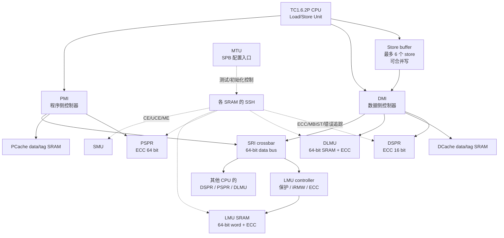

### 1.3 本地访问与 SRI 访问不是一回事

| 访问场景 | 实际路径 | 是否经过 SRI |
|---|---|---:|
| CPU0 数据读写 CPU0 DSPR | CPU0 LSU → DMI → DSPR | 否 |
| CPU0 数据读写 CPU0 DLMU | CPU0 LSU → DMI → DLMU | 否 |
| CPU0 从 CPU0 PSPR 取指 | Fetch → PMI → PSPR | 否 |
| CPU0 把 CPU0 PSPR 当数据读写 | DMI → SRI master → CPU0 PMI SRI slave → PSPR | 是 |
| CPU1 访问 CPU0 DSPR/DLMU/PSPR | CPU1 DMI → SRI → CPU0 slave interface | 是 |
| 任意 CPU 访问全局 LMU | CPU DMI/PMI → SRI → LMU controller | 是 |

因此，“总线→RAM 控制器→RAM cell”的图主要适用于远程本地 RAM 或全局 LMU；本核 DSPR/DLMU 的快路径绕过 SRI crossbar。

---

## 2. 一个带 ECC 的 SRAM 到底长什么样

下面是能够用于理解 TC3xx 的工程级结构图。数据阵列和 ECC 阵列可能由同一个 SRAM 宏的不同列实现，也可能表现为组合后的宽字；官方手册确认的是“数据与 ECC 位一起存取”，并未公开具体 bitcell floorplan。

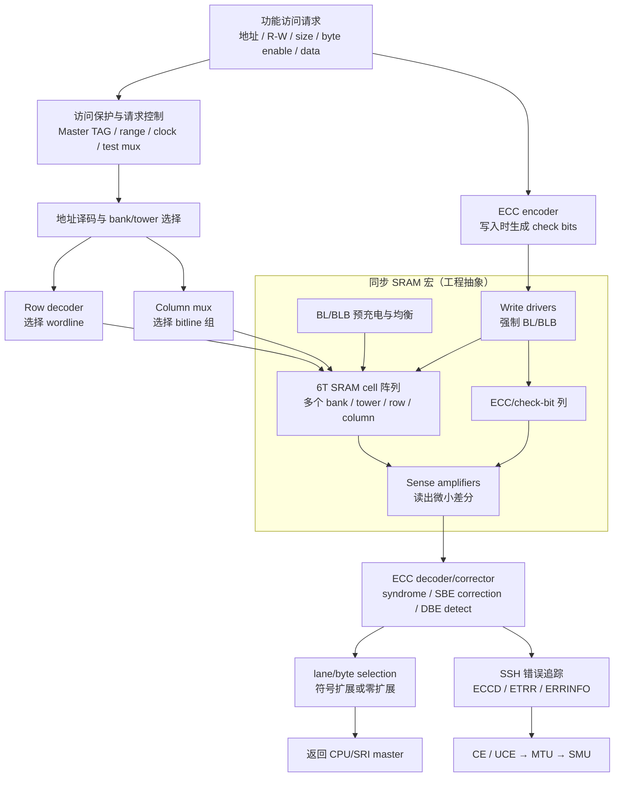

### 2.1 结构层次

可以把一块 SRAM 理解为：

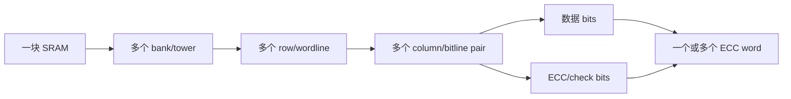

这里三个概念不能混淆：

- **物理 SRAM word**：一次 wordline/column mux 选出的宏内部宽字。
- **ECC word**：一次 ECC 编码/校验覆盖的数据宽度。
- **CPU requested word**：指令请求的 8/16/32/64 bit。

一个物理 SRAM word 可能包含多个 ECC word。例如官方 MTU 文档将“ECC granularity”定义为一个 physical SRAM block 中的 ECC word 数量；这和软件中的 `word=32 bit` 不是同一个概念。

### 2.2 SRAM cell 层的写入动作（通用 6T SRAM 工程模型）

这部分是通用 SRAM 宏行为，不是英飞凌公开的晶体管级实现承诺。

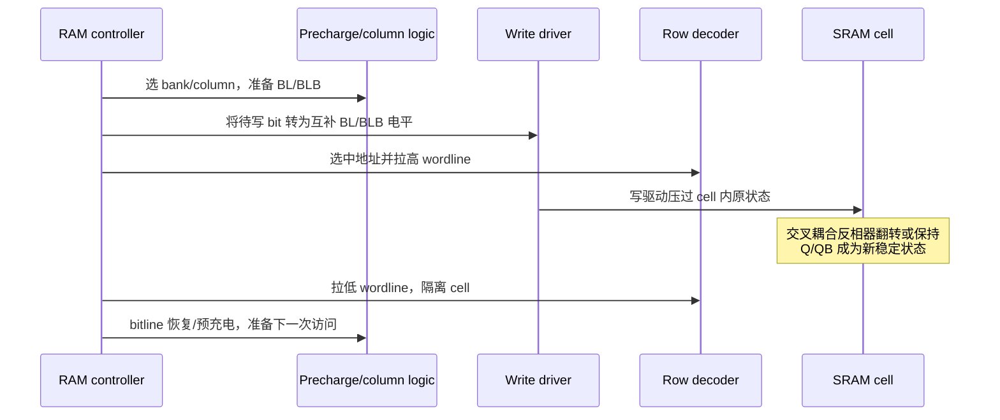

写 0/1 的物理含义是：write driver 把一对互补 bitline 强制到相反电平，wordline 打开两个 access transistor，bitline 驱动力压过交叉耦合 latch，使 cell 稳定在新状态。

### 2.3 SRAM cell 层的读取动作（通用工程模型）

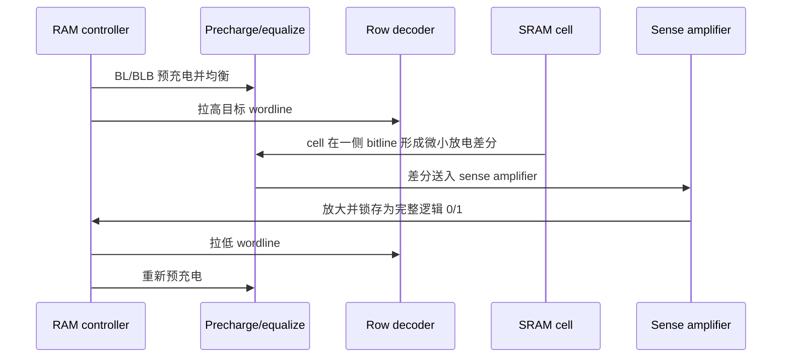

正常 SRAM read 是非破坏性的：cell 的交叉耦合状态不应被读取动作改变。TC3xx 的 ECC decoder 位于读出数据通路上，对 data bits 和同时读出的 ECC bits 进行 syndrome 计算。

---

## 3. CPU 执行一次 store，在总线出现之前发生了什么

### 3.1 store buffer 的真实影响

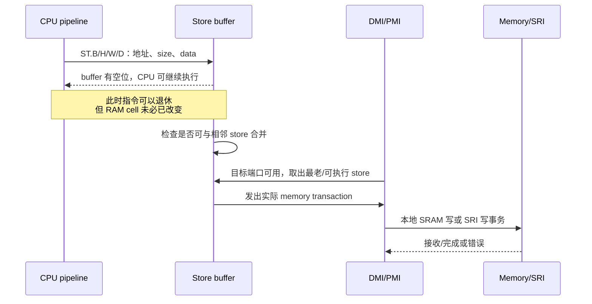

TC1.6.2P 的规则：

- 所有 CPU store 先进入 store buffer。
- buffer 最多保存 6 个 store。
- 默认优先服务 load，以减小 load 延迟；不相关 load 可以越过 store。
- buffer full、外设空间顺序要求或 RMW 操作会限制这种越过。
- `DSYNC` 可用于排空 CPU store buffer。
- 对 SRI/SPB 目标，若要求确认目标 slave 已实际收到前面的写，官方建议 `DSYNC` 后再从目标 slave 地址范围执行一次 read-back。

### 3.2 store 合并会改变后端事务宽度

| CPU 原始写序列 | store buffer 可能形成的后端写 |
|---|---|
| 同一 half-word 内连续两个 byte 写 | 1 个 half-word 写 |
| 同一 word 内连续两个 half-word 写 | 1 个 word 写 |
| 同一 double-word 内连续两个 word 写 | 1 个 double-word 写 |

这意味着：连续两个 `ST.B` 写 DSPR，有可能在真正到达 DMI 时已经是一个 16-bit 写，从而避免 byte RMW；连续两个 `ST.W` 写同一个自然对齐 64-bit DLMU/LMU word，也可能被合并成一个 64-bit direct write，从而避免两次 64-bit RMW。是否合并取决于地址、顺序、buffer 状态和目标可用性，软件不能把它当成功能正确性的前提。

---

## 4. 写入时序一：完整 ECC word 直接写

以自然对齐的 64-bit 写 DLMU/PSPR/LMU 为例。对 DSPR，half-word 及以上写会对涉及的每个 16-bit ECC word 分别编码并并行写入，逻辑类似。

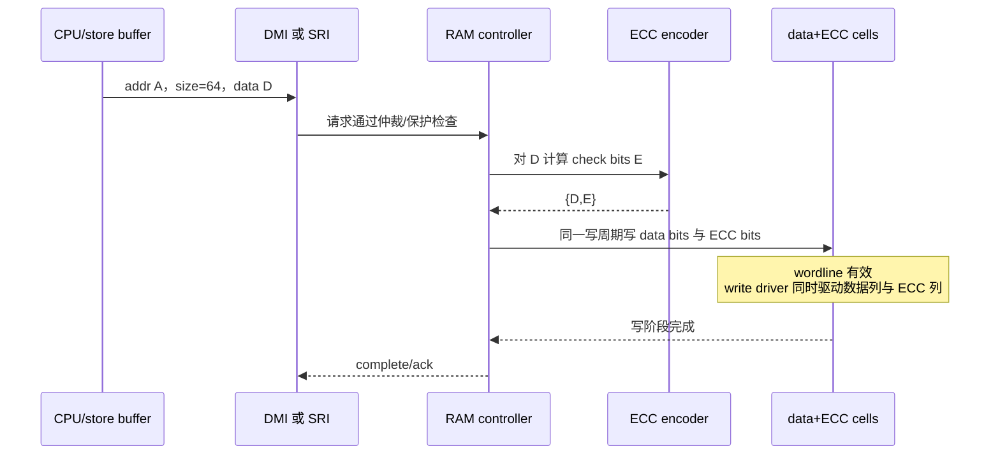

关键点：

- ECC 不是软件先算好再写；正常功能写由硬件 ECC encoder 自动产生。
- data 和 ECC bits 必须作为同一个一致性单元更新。
- 对完整 ECC word，无须读取旧值，因此即使该地址此前未初始化，完整写仍可建立一组新的有效 data+ECC。
- CPU 可更早在 store buffer 接收处继续执行，不能把“指令退休”当成“cell 写完”。

---

## 5. 写入时序二：sub-width 写触发 RMW

### 5.1 通用 64-bit RMW

`ST.B/ST.H/ST.W` 写 DLMU、PSPR、LMU，或非自然对齐的 `ST.D`，都可能进入如下路径：

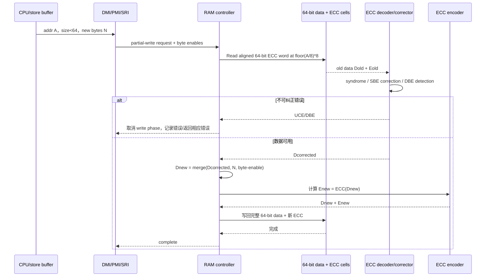

逻辑公式为：

```text
aligned_base = address & ~0x7
mask         = 根据 address[2:0] 和访问 size 生成
new64        = (old64 & ~mask) | (write_data_shifted & mask)
new_ecc      = ECC(new64)
write {new64, new_ecc}
```

### 5.2 为什么不能只更新 byte lane

假设 64-bit 旧数据为：

```text
地址 A+7 ... A+0
数据 77 66 55 44 33 22 11 00
ECC = ECC(0x7766554433221100)
```

执行 `ST.B [A+2] = 0xAA` 后，目标应为：

```text
77 66 55 44 33 AA 11 00
```

旧 ECC 是针对整个 `0x7766554433221100` 计算的，不能继续使用；控制器必须先得到其余 7 个旧 byte，合并 `AA`，然后重新计算完整 64-bit ECC。

### 5.3 未初始化 RAM 为什么最容易在 partial write 时出问题

冷上电后，SRAM data bits 与 ECC bits 都可能是任意状态。此时：

1. 完整 ECC-word 写不依赖旧值，可以一次建立新的合法 data+ECC。
2. partial write 必须先读取旧 ECC word。
3. 旧 data+ECC 很可能无法通过 ECC 校验。
4. RMW 的 read phase 产生 UCE，控制器为避免“把潜在错误旧数据重新包装成一个看似合法的新 ECC word”，取消 write phase。

TC3xx 官方手册明确要求 DLMU、DSPR、PSPR 等 RAM 在使用前完整初始化；可由启动软件、固件配置或 MTU/SSH 初始化完成。`MCONTROL.SRAM_CLR` 会把完整 SRAM 填充为 ECC 正确的零值。

---

## 6. DSPR 为什么特殊：ECC 是 16 bit，而不是 64 bit

DSPR 由多个 memory tower 组织，能够从任意 16-bit 对齐地址向本地 CPU 访问最多 64 bit；但其 ECC 保护是 **per half-word**。

### 6.1 byte 写 DSPR：16-bit RMW

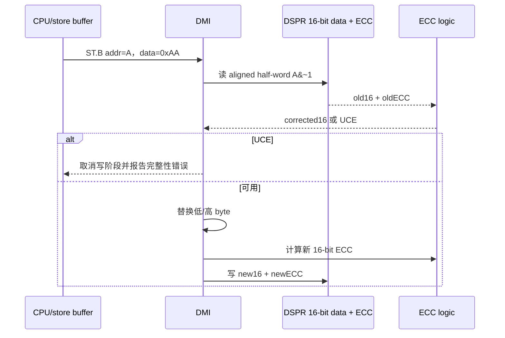

### 6.2 half-word/word/double-word 写 DSPR

| CPU 写宽度 | 涉及的 DSPR ECC word 数 | 是否因 ECC 必然 RMW |
|---:|---:|---:|
| 8 bit | 1 × 16 bit | 是 |
| 16 bit | 1 × 16 bit | 否，直接产生该 half-word 的 ECC |
| 32 bit | 2 × 16 bit | 否，各 half-word 分别产生 ECC，可并行写 |
| 64 bit | 4 × 16 bit | 否，各 half-word 分别产生 ECC，可并行写 |

“不因 ECC 必然 RMW”不代表任何地址都只需一个 SRI transaction。若是远程 SRI 访问且 32/64-bit 数据没有自然对齐，CPU 可能把它拆成多个 SRI 事务。

### 6.3 本地 DSPR 时序与性能

官方性能表给出的非冲突最小/最大 stall 结果中：

- 本地 CPU 读 DSPR：0 stall。
- 本地 CPU 写 DSPR：0 stall。
- 同一 SRI domain 通过 SRI 读 DSPR：7 stall。
- 同一 SRI domain 通过 SRI 写 DSPR：首个/连续流水写约 5/3 stall（表中标记 pipelining）。

这里的 0 stall 表示 CPU 可在流水线时序上无等待完成，不表示 wordline、bitline、ECC encoder 等完全不耗费物理时间；这些动作被包含在单周期本地接口和流水化实现内。

---

## 7. DLMU、PSPR 与 LMU 的写入差异

### 7.1 DLMU

- 本核数据访问：CPU → DMI → DLMU，本地单周期读路径，不经过 SRI。
- 远程 master：SRI → 本核 DMI slave → DLMU。
- 内部宽度和 ECC 粒度：64 bit。
- `<64 bit` 写、或 64-bit 非自然对齐写：RMW。
- 本地 CPU 读：0 stall；写：官方表列 2 stall。

### 7.2 PSPR

- 本核取指：Fetch → PMI → PSPR，0 stall。
- CPU fetch unit 只读 PSPR，不能从程序取指端写。
- 数据读写 PSPR：通过 SRI slave interface/PMI 路径。
- ECC 粒度：64 bit。
- `<64 bit` 或 64-bit 非自然对齐写：RMW。
- RMW read phase 检测到完整性错误时，不执行 write phase。

### 7.3 全局 LMU

- LMU 是 SRI slave，没有某个 CPU 的本地 LSU 直连快路径。
- 每个 TC39xB LMU instance 为 256 KiB，共 3 个 instance。
- SRAM 内部按 64-bit word 组织，宏本身没有 sub-word direct write。
- byte/half-word/word 写由 LMU controller 透明转换为 64-bit iRMW。
- iRMW read phase 的不可纠正 ECC 错误会设置 `MEMCON.RMWERR`、通知 SMU，并在正常模式下取消写阶段。
- `MEMCON.ERRDIS=1` 是测试/初始化相关行为，不应当作为正常应用绕过完整性错误的方式。

### 7.4 三者对比

| 特性 | DLMU | PSPR | 全局 LMU |
|---|---|---|---|
| 本核直接访问 | 数据侧 DMI | 仅取指侧 PMI | 无 |
| 远程/数据访问 | SRI slave | SRI slave | SRI slave |
| ECC 粒度 | 64 bit | 64 bit | 64 bit |
| sub-64 写 | RMW | RMW | iRMW |
| 典型用途 | 本核确定性全局数据 | 本核确定性代码 | 核间共享/全局数据/overlay |

---

## 8. SRI 读写：总线阶段与 RAM 阶段如何连接

SRI crossbar 对每个 slave 有独立 arbiter，可让访问不同 slave 的多个事务并行。SRI 把 request/address phase 与 data phase 分开并支持流水化。

### 8.1 SRI 读 LMU 的逻辑时序

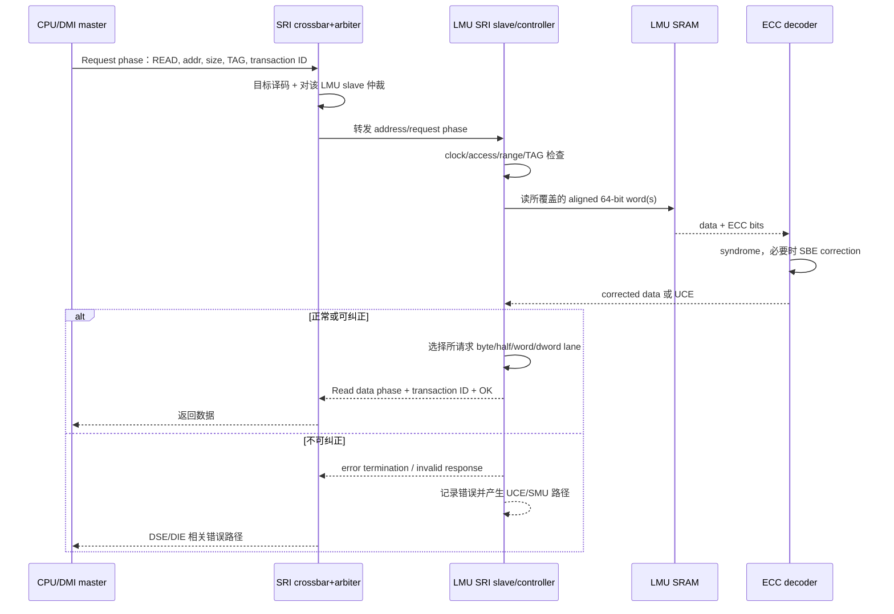

### 8.2 SRI 写 LMU 的逻辑时序

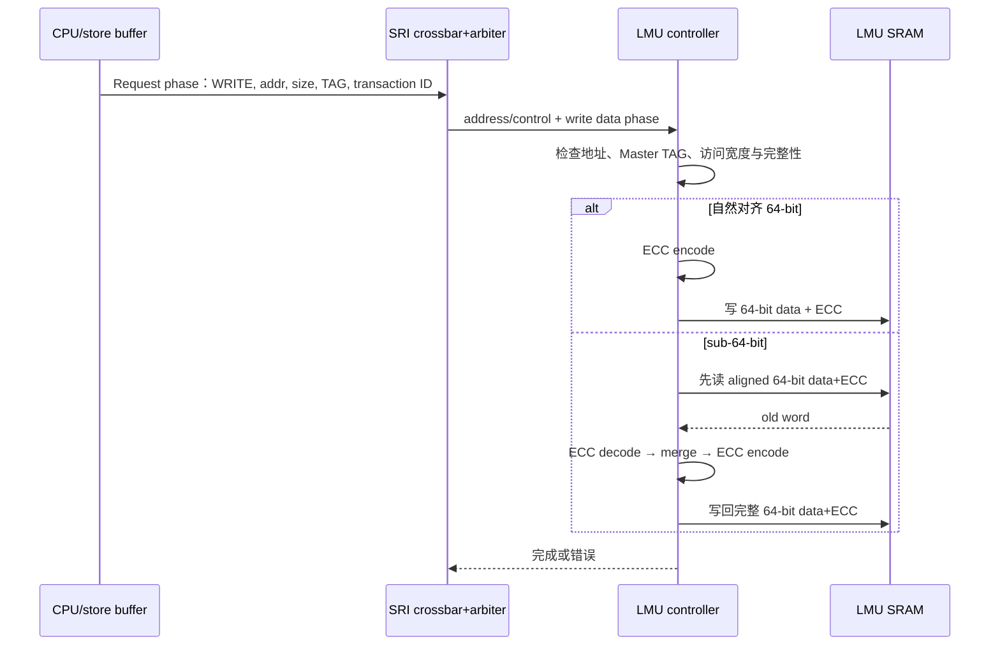

### 8.3 为什么不能把上图当成逐引脚时序图

公开 TC3xx User's Manual 给出了：

- request phase、address phase、read/write data phase的结构；
- SRI 为 64-bit data bus；
- 资源访问的 CPU stall cycle；
- 支持的 transaction type、对齐要求、错误行为和 pipelining。

但手册没有公开每块 SRAM 宏的 wordline、sense enable、write-enable 等内部信号相对于 `fCPU/fSRI/module clock` 的逐拍波形。因此本文的 sequence diagram 是**协议和控制状态级时序**；不应拿它代替 RTL 仿真波形或 SRAM compiler timing model。

---

## 9. 读取时，CPU 请求宽度和 SRAM 实际读出宽度的关系

### 9.1 核心规则

读操作通常不需要 RMW，但 ECC decoder 必须拿到完整 ECC word 才能校验。因此：

- `LD.B` 读 DSPR：至少读取包含目标 byte 的 16-bit data+ECC，然后选 byte。
- `LD.B/LD.H/LD.W` 读 DLMU/PSPR/LMU：至少读取包含目标数据的 64-bit data+ECC，然后 lane select。
- 访问跨过 ECC-word 边界时，需要读取两个或更多 ECC word，并分别校验。
- 从 SRI 返回给 CPU 的只是 requested data lanes；内部没有必要把完整 64-bit 结果暴露给软件。

### 9.2 正常读取

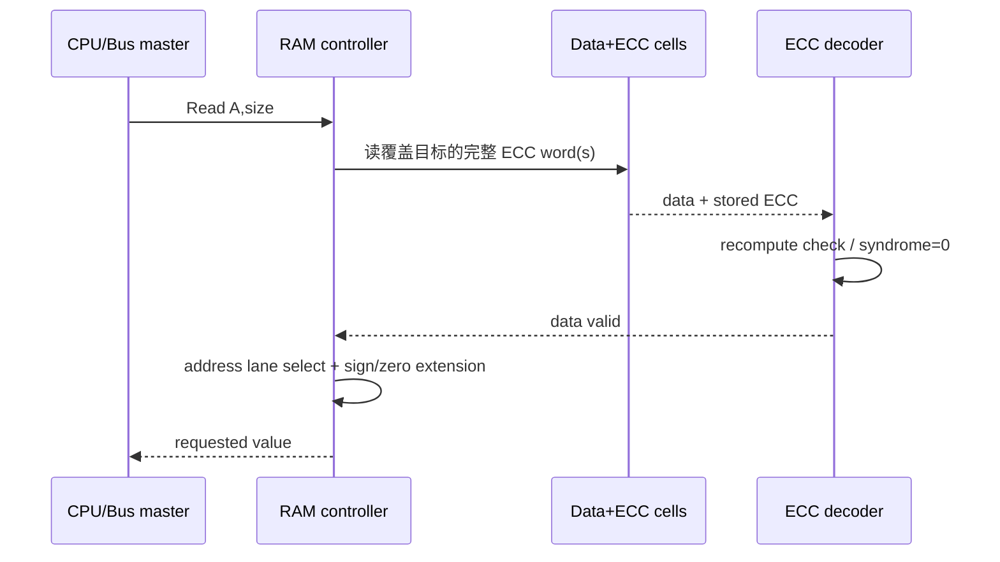

### 9.3 SBE：数据被纠正后交给 CPU

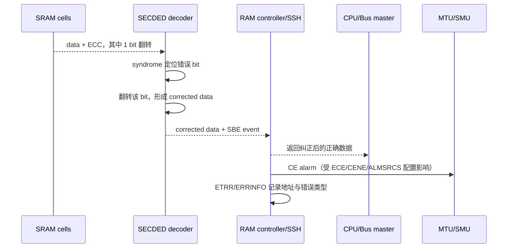

注意：正常功能读中的 ECC correction 不等价于自动 scrub。手册明确确认“返回数据被纠正”和“产生纠错事件”；是否会自动把 corrected data 回写到 cell，不能在没有具体存储体文档依据时一概而论。系统若要求消除潜伏的单比特错误，应设计受控 scrub/重写策略。

### 9.4 DBE：无法纠正

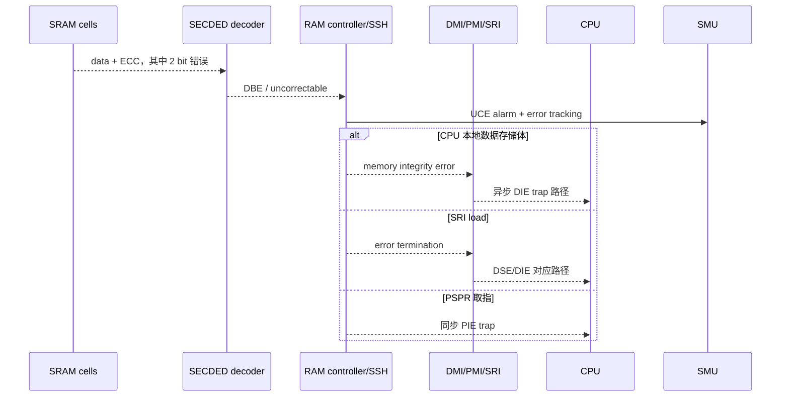

TC1.6.2P 的 trap 语义要分开：

| 场景 | 主要 CPU 反应 |
|---|---|
| PSPR/PCache/总线取指遇到不可纠正完整性错误 | PIE，和错误指令同步 |
| 本地数据 RAM 或 SRI 数据访问遇到不可纠正完整性错误 | DIE，手册定义为异步 |
| 普通 load 遇到 SRI bus error | DSE，同步数据访问错误 |
| store/cache 管理访问遇到 bus error | DAE，异步数据访问错误 |

具体最终 trap 取决于错误发生层次：SRAM ECC、SRI data integrity、slave error response 或 CPU 本地 DMI/PMI 检测，不能只根据“读/写”二字判断。

---

## 10. CPU 不同宽度读写的完整矩阵

### 10.1 DSPR

| 指令宽度 | 读操作的内部 ECC 覆盖 | 写操作 | 跨界/对齐影响 |
|---:|---|---|---|
| 8 bit | 读 1 个 16-bit ECC word，再选 byte | 16-bit RMW | byte 可任意对齐 |
| 16 bit | 读 1 个 16-bit ECC word | 直接写 16 data + ECC | 需 2-byte 对齐 |
| 32 bit | 读 2 个 16-bit ECC word | 两个 16-bit ECC word 直接更新 | 本地允许 2-byte 对齐；远程 SRI 非自然对齐可能拆事务 |
| 64 bit | 读 4 个 16-bit ECC word | 四个 16-bit ECC word 直接更新 | 本地 DSPR 支持 16-bit 对齐；远程 SRI 非自然对齐可拆成最多 3 个事务 |

### 10.2 DLMU / PSPR / 全局 LMU

| 指令宽度 | 读操作 | 写操作 | 备注 |
|---:|---|---|---|
| 8 bit | 读覆盖目标的完整 64-bit ECC word，选 1 byte | 64-bit RMW | 未初始化 RAM 风险最高 |
| 16 bit | 读 64-bit ECC word，选 2 byte | 64-bit RMW | 自然 2-byte 对齐 |
| 32 bit，自然 4-byte 对齐且不跨 8-byte 边界 | 读 1 个 64-bit ECC word | 64-bit RMW | SRI 通常 1 个事务 |
| 32 bit，仅 2-byte 对齐 | 可能覆盖 1 或 2 个 64-bit ECC word | 每个受影响 ECC word 分别 RMW | SRI 可能 1–2 个事务 |
| 64 bit，自然 8-byte 对齐 | 读 1 个 64-bit ECC word | 直接 64-bit+ECC 写 | 最有效率 |
| 64 bit，2/4/6-byte 偏移 | 覆盖 2 个 64-bit ECC word | 两个目标 word 的局部更新/RMW | SRI 可拆成最多 3 个事务，且不保证跨事务原子性 |

### 10.3 TriCore 对齐规则与 SRI 事务数

对非外设空间，TC1.6.2P 允许 data-register word/double-word 只按 2-byte 对齐：

| 访问 | 最低地址对齐 | SRI min/max transaction 数 |
|---|---:|---:|
| byte | 1 byte | 1/1 |
| half-word | 2 byte | 1/1 |
| word | 2 byte | 1/2 |
| double-word | 2 byte | 1/3 |

自然对齐 word/double-word 在 SRI 上是一个事务，能保持从其他 bus master 观察到的单事务原子性；非自然对齐访问若被拆成多个事务，其他 master 可能在事务之间插入访问。

这还会产生一个“二次放大”：

> 一个非自然对齐的 `ST.D` 可能先被 CPU 拆成多个 SRI transaction；每个落到 64-bit ECC RAM 的 partial transaction 又可能在 slave 内部触发一次 iRMW。

因此它比“一个 64-bit 写”昂贵得多，也不应被用于多核共享数据的无锁原子发布。

---

## 11. Cacheable LMU：有时 RAM cell 根本没有被访问

LMU 同时存在 cacheable segment 9 和 non-cacheable segment B 地址。以数据访问为例：

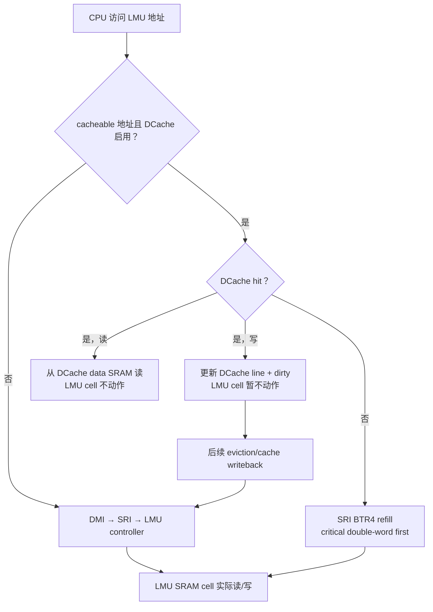

DCache line 为 256 bit；refill 和 write-back 都是四个 64-bit transfer 的 SRI BTR4。由此得到：

- `*(volatile uint32_t *)0x9... = x` 即使是 volatile，也不能单凭 `volatile` 推断 LMU cell 立即改变；cacheability 与 store buffer 仍然存在。
- 多核/DMA 共享内存必须处理 cache coherency：clean、invalidate、non-cacheable alias、所有权协议和同步屏障。
- 对 cell 级时序验证，应优先选 non-cacheable alias，并在必要时使用 `DSYNC + target read-back` 确认写已到达 slave。

---

## 12. 典型访问延迟：哪些是手册给出的，哪些不是

TC3xx User's Manual 的资源访问表给出非冲突情况下的 CPU stall cycles：

| 资源操作 | Local CPU | Local SRI domain | Remote SRI domain |
|---|---:|---:|---:|
| DSPR read | 0 | 7 | 10 |
| DSPR write | 0 | 5 / 3（流水） | 5 / 4（流水） |
| DLMU read | 0 | 7 | 10 |
| DLMU write | 2 | 5 / 3（流水） | 5 / 4（流水） |
| PSPR instruction fetch | 0 | 7 | 10 |
| PSPR data read | 经 local SRI | 7 | 10 |
| LMU data read | n.a. | 7 | 10 |
| LMU data write | n.a. | 5 / 3（流水） | 5 / 4（流水） |

解释这些数字时要注意：

1. load/fetch 数值是完成访问的最小 CPU stall。
2. write 数值是非冲突连续写的最大 stall；短写序列可能被 store buffer 隐藏到 0 stall。
3. 竞争、跨 SRI domain、bridge、目标模块时钟、RMW、ECC correction、cache miss 等都会增加延迟。
4. 表格没有把“第几拍拉 wordline、第几拍开 sense amplifier”公开出来，所以不能从 7 stall 反推出唯一 SRAM 宏波形。

一个用于性能分析的符号模型可以写成：

```text
T_read = T_store/load_issue
       + T_master_queue
       + T_SRI_arbitration_and_route
       + T_slave_check
       + T_SRAM_array_read
       + T_ECC_decode
       + T_response_route

T_partial_write = T_request
                + T_SRAM_read
                + T_ECC_decode
                + T_merge
                + T_ECC_encode
                + T_SRAM_write
                + T_complete
```

---

## 13. ECC 错误在不同层次的传播

不要把以下三种 ECC 混为一谈：

| 层次 | 保护对象 | 典型检测者 | 典型结果 |
|---|---|---|---|
| SRAM ECC | cell 中的数据和 check bits | SRAM/SSH ECC decoder | SBE correction、DBE/UCE、ETRR/ERRINFO、SMU |
| 内部传输寄存器 ECC | RAM 与 SRI interface 之间的内部寄存器 | LMU/DMI/PMI 内部逻辑 | `MEMCON.INTERR` 或相关内部错误告警 |
| SRI EDC/ECC | SRI address/data/control phase | master/slave interface、SRI fabric | transaction ID/protocol/data phase error、bus error/SMU |

以 LMU read 为例，错误可能发生在：

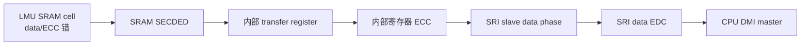

三个保护层都可能把“CPU 最后没有得到有效数据”作为外部现象，但诊断寄存器和恢复策略不同。

---

## 14. RMW、原子性与多核并发

### 14.1 内部 ECC RMW 不是软件原子指令

控制器为了更新 ECC 而执行的 iRMW，是一种实现机制。软件不能据此推导：

- 它等价于 `LDMST/SWAP/CMPSWAP`；
- 它能替代 spinlock；
- 多个 master 对同一共享 word 的 byte 写一定不会丢失更新；
- 跨两个 64-bit ECC word 的访问是整体原子的。

架构手册明确保证的是：一个 CPU access 若只形成一个 SRI transaction，则从其他 bus master 观察时保持该事务的数据原子性；若一个访问形成多个 SRI transaction，其他 master 可以在事务之间访问目标位置。

### 14.2 一个典型丢失更新风险

假设 CPU0 和 CPU1 同时修改同一 64-bit LMU word 的不同 byte。如果 slave 没有把两个 partial write 作为严格串行的完整事务处理，就可能出现经典 RMW 丢失更新。实际 LMU slave 会进行仲裁和内部控制，但软件仍不应依赖隐藏 iRMW 构造并发协议；应使用架构提供的原子指令、锁或单写者所有权。

### 14.3 正确同步至少考虑三件事

1. **原子性**：访问是否单 SRI transaction，是否使用硬件原子指令。
2. **顺序性**：store buffer 是否已排空，是否需要 `DSYNC`。
3. **可见性**：写是否仍停留在 DCache，是否 clean 到 LMU，其他核是否 invalidate。

---

## 15. 面向系统验证的测试用例

### 15.1 宽度与 ECC 粒度测试

| CASE | 条件 | 步骤 | 预期结果 |
|---|---|---|---|
| DSPR byte RMW | DSPR 已初始化 | 对同一 half-word 分别写低/高 byte | 未写 byte 保持；最终 half-word 正确；无 UCE |
| DSPR half-word direct | DSPR 已初始化 | 连续 `ST.H`，记录 stall/波形 | 不需要读取旧 half-word 才能生成 ECC |
| DLMU word RMW | non-cacheable、本核 DLMU | 先写 64-bit pattern，再 `ST.W` | 未覆盖 32 bit 保持，整 64-bit ECC 重新有效 |
| LMU byte RMW | segment B | 对 8 个 byte 逐个写并逐次读回 | 每次都得到合并后的正确 64-bit word |
| LMU 64-bit direct | 8-byte 对齐 | `ST.D` 写新地址 | 无旧值依赖，可用于初始化完整 ECC word |
| PSPR partial write | 数据侧经 SRI | `ST.W` 后从 PSPR 取指/读回 | PMI 内部完成 64-bit RMW，代码内容一致 |

### 15.2 未初始化与错误注入测试

| CASE | 条件 | 步骤 | 预期结果 |
|---|---|---|---|
| 未初始化 LMU partial write | 冷启动且未清 RAM | 首次操作为 `ST.B/ST.W` | 可能在 iRMW read phase 报 ECC；写阶段被取消；`RMWERR`/SMU 路径可见 |
| 未初始化 LMU full write | 冷启动 | 对每个 8-byte aligned word 执行完整 64-bit 写 | 建立合法 data+ECC，随后读不报 ECC |
| SBE read | 通过 ECCMAP/测试流程注入 1 bit | 正常读目标 | 返回纠正数据；CE/CERR 和 ETRR/ERRINFO 更新 |
| DBE read | 注入 2 bit | 本地/远程/取指分别访问 | UCE；根据路径产生 DIE、PIE 或 bus error 相关反应 |
| RMW read-phase DBE | 在 64-bit word 注入 DBE 后执行 `ST.B` | 观察 cell 和状态寄存器 | write phase 不执行，旧错误 word 不被“重新合法化” |

### 15.3 Cache 与 store buffer 测试

| CASE | 配置 | 观察点 |
|---|---|---|
| cacheable LMU hit write | segment 9 + DCache enabled | `ST.W` 后 LMU cell/另一 master 可能尚不可见；clean 后可见 |
| non-cacheable LMU write | segment B | store buffer 排空后事务直接到 LMU |
| store merge | 同一 64-bit word 连续两个 `ST.W` | 后端可能合并为 64-bit write，RMW/吞吐与单独写不同 |
| `DSYNC` | 写前后插入 marker | `DSYNC` 前后比较 CPU stall 和总线事务完成点 |
| target read-back | `DSYNC` 后读同一 LMU slave | read 返回后可确认此前写已经到达该 slave 的顺序点 |

### 15.4 建议观察的硬件/软件信号

- CPU 指令地址与 `ST.B/H/W/D` 类型。
- store buffer full/empty、合并前后 transaction size（若仿真环境可见）。
- DMI/PMI local request、SRI request/address/data phase、transaction ID。
- slave accept/complete/error。
- RAM macro `CE/WE/address/write-data/read-data` 抽象信号。
- ECC encoder input/output、decoder syndrome、SBE/DBE。
- `MCi_ECCD.CERR/UCERR`、`ETRR`、`ERRINFO`、`FAULTSTS`。
- LMU `MEMCON.RMWERR/INTERR/ERRDIS`。
- CPU `DSTR/DATR/DIETR/PIETR` 与对应 trap。
- SMU alarm group/status 与配置的 alarm reaction。

---

## 16. 常见误区

### 误区 1：`ST.W` 就是向 RAM cell 写 32 根数据线

错误。写 DLMU/LMU/PSPR 时，`ST.W` 通常是 64-bit read → 合并 32 bit → 重新算 ECC → 写 64 bit+ECC。

### 误区 2：SRI 是 64-bit，所以所有 64-bit CPU access 都是一个事务

错误。自然对齐 64-bit 通常是一个事务；TriCore 对非外设空间允许 2-byte 对齐的 double-word，非自然对齐时可能拆成最多 3 个 SRI transaction。

### 误区 3：CPU 执行到下一条指令，RAM 已经写完

错误。store buffer 可先接收写并让 CPU 继续；cacheable 写还可能只更新 DCache。

### 误区 4：ECC 只在读操作发挥作用

错误。写时 ECC encoder 必须生成并存储 check bits；partial write 还会因 ECC 粒度触发 RMW。

### 误区 5：SBE 被纠正后，cell 一定已经自动修复

不能一概而论。手册保证读数据纠正和错误事件通知；是否自动 write-back/scrub 必须看具体存储体实现说明。

### 误区 6：内部 iRMW 可以当成多核原子操作

错误。它是为保持 ECC 一致性服务的控制器行为，不是软件并发原语。

### 误区 7：SSH/MTU 位于每次普通 load/store 的主数据通路中

不准确。ECC/错误监控逻辑围绕 SRAM 工作，但 MTU 主要提供 SPB 配置、测试和初始化控制；正常功能访问由 DMI/PMI/LMU 等控制器处理。

---

## 17. 最终心智模型

对任何一次 TC3xx RAM 访问，都按下面顺序分析：

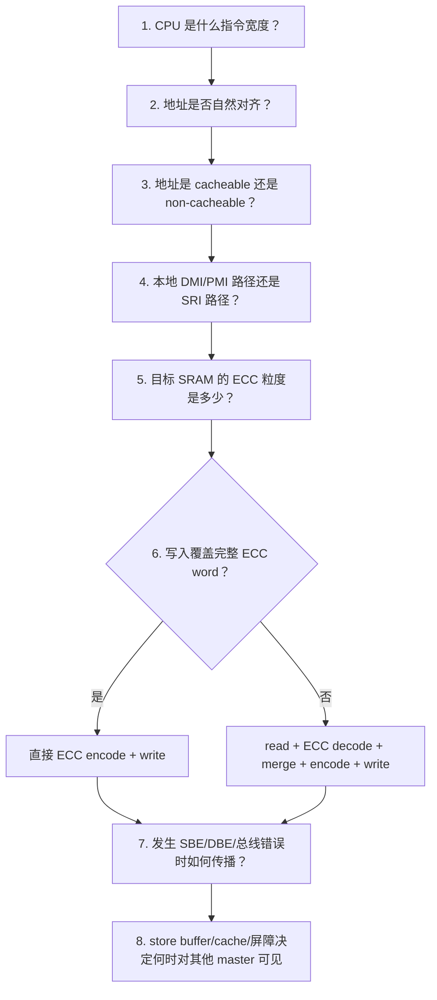

如果这八个问题回答清楚，TC3xx RAM 读写时序就不会再被“CPU 位宽”“总线位宽”“RAM 位宽”和“ECC 位宽”混在一起。

---

## 18. 官方资料依据

以下页码优先给出文档印刷页码，并附 PDF 物理页便于定位：

1. **AURIX TC3xx User's Manual Part 1, CPU Subsystem**
   - 5.3.4.3 Store Buffers，页 5-11～5-12（PDF 242～243）：store buffer、最多 6 个 store、写合并、`DSYNC`、IODT。
   - 5.3.4.10 Atomicity of Data Accesses，页 5-15～5-16（PDF 246～247）：非外设空间对齐、SRI min/max transaction 数、多事务非原子。
   - 5.3.6.2 Memory Integrity Error Handling，页 5-75～5-78（PDF 306～309）：PSPR/DSPR/DCache/DLMU ECC 粒度、RMW 和错误反应。
   - 5.3.6.3/5.3.6.4 PMI/DMI，页 5-80～5-87（PDF 311～318）：PSPR 64-bit ECC、DSPR tower 与 16-bit ECC、DCache line、DLMU 64-bit 组织。

2. **AURIX TC3xx User's Manual Part 1, SRI Fabric**
   - 4.3 Operational Overview，页 4-5～4-6：request phase、data phase、每 slave arbiter 与 crossbar 并行结构。
   - 4.8 Resource Access Times，页 4-31～4-33（PDF 185～187）：本地 DSPR/DLMU/PSPR、local SRI、remote SRI 的 stall cycles。

3. **AURIX TC3xx User's Manual Part 1, Local Memory Unit**
   - 7.1/7.2.1，页 7-1（PDF 575）：LMU 64-bit word、支持 byte/half/word/double-word、sub-64 iRMW、RMW read-phase ECC error。
   - 7.2.4.7，页 7-3（PDF 577）：`MEMCON.RMWERR` 和错误时取消写阶段。
   - 7.2.5/7.2.6：ECC correction logic 冗余、内部 transfer register ECC。

4. **AURIX TC3xx User's Manual Part 1, MTU**
   - 13.1～13.3，页 13-1～13-3（PDF 1204～1206）：MTU、SSH、SRAM 的系统关系。
   - 13.3.5.1.5，页 13-7：`SRAM_CLR` 初始化为 ECC-correct zero。
   - 13.5.1.1，页 13-41（PDF 1244）：写时 ECC encode、读时 ECC decode、SECDED/DED、CE/UCE。
   - 13.5.2，页 13-43～13-46：CERR/UCERR、ETRR/ERRINFO 与 SMU 通知。

5. **TriCore TC1.6.2 Core Architecture Manual, Volume 1**
   - 2.2.1 Alignment Requirements，页 2-4（PDF 18）：byte/half/word/double-word 对齐规则和 little-endian 语义。

6. **TC39xB Data Sheet**
   - Product Feature Overview（PDF 7～9）：每核 PSPR/DSPR/DLMU、cache 与全局 LMU 容量。

7. **TC39x-B User's Manual Appendix**
   - Memory Map / LMU：3×256 KiB LMU、cached/non-cached 地址范围。
   - MTU Table 64 SSH instances：CPU DMEM/PMEM/DLMU 与 LMU SRAM 使用的 SECDED/DED 类型及实例配置。

8. **AURIX TC3xx Safety Manual v2.0**
   - `SM[HW]:CPU.*:ERROR_CORRECTION` 与 `SM[HW]:LMU.RAM:ERROR_CORRECTION`：SRAM SECDED 在 read 时纠正 SBE、检测 DBE，并分别进入 correctable/uncorrectable alarm 路径。

---

## 附录 A：几个可直接用于汇编测试的访问例子

```asm
; A0 指向已初始化、non-cacheable RAM

st.b    [a0]0, d0      ; 8-bit 写
st.h    [a0]0, d0      ; 16-bit 写
st.w    [a0]0, d0      ; 32-bit 写
st.d    [a0]0, e0      ; 64-bit 写，e0 = d0/d1

ld.bu   d2, [a0]0      ; 8-bit zero-extend 读
ld.hu   d2, [a0]0      ; 16-bit zero-extend 读
ld.w    d2, [a0]0      ; 32-bit 读
ld.d    e2, [a0]0      ; 64-bit 读

dsync                   ; 排空本核 store buffer
ld.w    d3, [a0]0      ; 目标范围 read-back，建立到达 slave 的确认点
```

测试时应分别选择：

- 本核 DSPR 地址；
- 本核 DLMU non-cacheable alias；
- 本核 PSPR 的数据访问地址；
- 全局 LMU segment B；
- 全局 LMU segment 9，并分别配置 DCache hit/miss；
- 另一 CPU 的 DSPR/DLMU，以覆盖 remote SRI domain。

## 附录 B：本文刻意没有声称的内容

由于公开手册没有提供 SRAM compiler 的 transistor/netlist 和逐拍 macro timing，本文没有声称：

- TC39xB SRAM cell 一定是某个特定 foundry 的标准 6T cell；
- wordline、sense-enable、write-enable 分别固定在某个绝对 CPU clock 边沿；
- 每个存储体 SBE correction 都会自动 write-back scrub；
- 所有内部 iRMW 对所有 master 都具备架构级 lock 语义；
- 所有 TC3xx derivative 的 RAM 容量、SRI domain 和 SSH instance 编号都与 TC39xB 完全相同。

这些问题若要做到 RTL/sign-off 级确认，需要结合芯片内部设计规范、SRI interface specification、SRAM compiler datasheet、RTL 仿真或门级波形。
