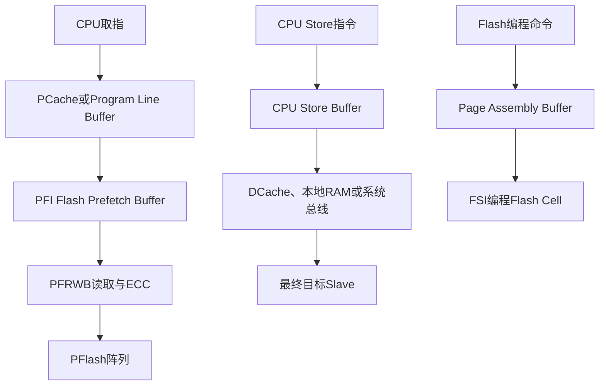

# Flash 预取、读缓冲与写缓冲：Why / What / How及系统需求推导

> 适用对象：车规 MCU 系统工程师、SoC 架构师、Flash/CPU/总线子系统设计与验证人员  
> 参考实例：Infineon AURIX™ TC3xx / TriCore™ TC1.6.2P  
> 文档目的：理解 Flash 读取加速和 CPU 写入解耦机制，并将机制风险转化为可评审、可验证的 MCU 系统需求。

---

## 1. 核心结论

Flash 预取、Cache、读行缓冲、CPU Store Buffer 的共同目标，是解决 CPU 与慢速存储器/总线之间的速度差异：

- **预取（Prefetch）**：提前读取 CPU 可能即将需要的数据；
- **Cache**：保留已经读取的数据，以便后续重复使用；
- **读行缓冲（Read Line Buffer）**：保留最近一次或少数几次宽粒度读取结果；
- **Store Buffer**：CPU 先提交写操作，后台再把数据写到最终目标；
- **Flash Assembly Buffer**：收集一个编程 Page 的数据，然后由 Flash 状态机统一编程。

这些结构位于不同层级，不能混为一谈：



最重要的三个工程判断是：

1. **CPU执行完一条Store指令，不等于数据已经到达最终Slave。**
2. **访问non-cached地址，不一定等于绕过全部下游预取/读缓冲。**
3. **DSYNC、Cache Write-back、Cache Invalidate和Slave Read-back解决的是不同问题。**

---

## 2. Why：为什么需要这些Buffer

### 2.1 CPU与PFlash存在明显速度差

以高性能车规 MCU 为例，CPU可能工作在数百MHz，而PFlash一次读取通常包含：

1. Flash阵列译码；
2. Wordline/Bitline建立；
3. 存储单元感应；
4. ECC检测及纠正；
5. 数据跨接口传输；
6. CPU取指对齐与分发。

TC39xB数据手册给出的PFlash访问延迟参数上限为30 ns、PFlash ECC延迟参数上限为10 ns。实际CPU看到的stall还与时钟比、wait-state配置、Cache状态、Bank冲突和总线争用有关。

若每次取指都直接等待Flash阵列，CPU流水线将频繁出现Program Memory Stall。

### 2.2 程序具有空间局部性

绝大多数代码按地址顺序执行：

```text
0x8000_1000 → 0x8000_1002 → 0x8000_1004 → 0x8000_1008 ...
```

因此硬件可以根据当前访问，推测性读取后续地址：

```text
CPU当前需要X
    ↓
Flash接口读取包含X的一组数据
    ↓
同时或随后提前读取X之后的数据
    ↓
后续访问命中Prefetch Buffer
```

连续执行时，Flash访问延迟被预取过程隐藏；跳转、随机访问或多Master争用时，预取命中率下降。

### 2.3 Store也会使CPU等待

CPU执行Store时，目标可能是：

- 本地DSPR/DLMU；
- DCache；
- SRI上的远端RAM；
- SPB/BBB外设；
- 跨时钟域总线桥后的寄存器；
- DMU Flash命令接口。

如果CPU必须等到每一笔写真正到达目标后才能继续，写外设和远端资源将严重拖慢流水线。因此需要Store Buffer和posted write机制将“CPU提交写”与“最终目标完成写”解耦。

---

## 3. What：不同缓冲结构分别是什么

| 结构 | 所在层级 | 保存内容 | 主要目标 | 典型风险 |
|---|---|---|---|---|
| CPU Issue FIFO | CPU取指单元 | 已取回、待分发的指令 | 解耦取指和执行 | 分支后需丢弃错误路径指令 |
| PCache | CPU PMI | 过去访问过的程序Cache Line | 重用和低延迟取指 | 自修改代码、一致性、首次miss |
| Program Line Buffer | CPU PMI | 一条程序数据行 | PCache bypass/non-cache时减少重复读取 | 容易被误认为“完全无缓存” |
| Flash Prefetch Buffer | PFI | 推测性读取的PFlash数据 | 隐藏连续Flash读取延迟 | 无用预取、功耗、Bank争用 |
| Data Read Line Buffer | PFI | 最近读取的PFlash page/line | 优化常量和小块数据读取 | 内容更新后的陈旧数据 |
| CPU Store Buffer | CPU DMI/写路径 | 尚未排出的Store事务 | 解耦Store与CPU执行 | 顺序、可见性、异步错误 |
| DCache Dirty Line | CPU DCache | 已修改但可能未写回RAM的数据 | 提高数据访问性能 | DMA/多核看不到最新值 |
| Bridge Write Buffer | SRI/SPB/BBB桥 | posted write事务 | 跨总线、跨时钟域解耦 | CPU侧完成但Slave侧尚未完成 |
| Flash Assembly Buffer | DMU/FSI | 一个Page或Burst的编程数据 | 组织Flash编程粒度 | 写宽度/顺序不符产生命令错误 |

---

## 4. How：TC3xx PFlash读取路径

### 4.1 总体数据流

TC3xx的PFlash读取路径大致为：

```text
TriCore Instruction Fetch Unit
           ↓
PMI：PCache / Program Line Buffer
           ↓
PFI：Demand Path / Prefetch Path / DRLB
           ↓
PFRWB：Flash读取、ECC检测与纠正
           ↓
PFlash Bank
```

每个PFlash Bank通过PFI与对应本地CPU建立低延迟点到点连接，同时也允许其他Master通过系统互连访问。

### 4.2 Demand Path

Demand Path处理当前Master已经明确需要的数据：

```text
CPU或其他Master发出读取
        ↓
Prefetch Buffer/DRLB不能命中
        ↓
Demand Path访问PFlash
        ↓
等待配置的Flash读取周期和ECC周期
        ↓
返回数据
```

对于BTR4，TC3xx支持critical double-word first：CPU当前最急需的64-bit先返回，其余数据继续填充。这可以降低“第一条可执行指令”的等待时间，而不必等待整个256-bit数据行全部返回。

### 4.3 PCache

TC39x的每个TC1.6.2P CPU具有32 KB、2-way set associative PCache，替换策略为LRU；每条Cache Line保存256-bit指令数据及ECC。

PCache miss时：

1. PMI发起BTR4；
2. 每次返回64-bit；
3. 共返回4个double-word；
4. critical double-word优先；
5. 支持refill过程中的instruction streaming。

需要特别注意：

> PCache refill只填充当前Cache Line，不会由PCache控制器继续预取下一条Cache Line。

这并不代表PFlash接口没有预取。PFI内部仍存在独立的Flash Prefetch Buffer。

### 4.4 Program Line Buffer

当访问non-cacheable程序地址，或者通过`PCON0.PCBYP`绕过PCache时，PMI使用256-bit Program Line Buffer。

它相当于一条单行缓冲：

- 请求仍以BTR4方式读取一整行；
- 仍采用critical double-word first；
- 后续命中同一行时不必再次访问总线；
- 可通过`PCON1.PBINV`失效。

因此“PCache bypass”并不是“CPU每取一条16-bit/32-bit指令都直接访问Flash”。

### 4.5 Flash Prefetch Buffer

PFI的Prefetch Path负责推测性读取。如果BTR4请求命中FPB，数据直接由FPB返回。

TC3xx每个PFI实现5个FPB：

- `FPB0`：永久分配给本地CPU的PMBI Master Tag；
- `FPB1～FPB4`：通过`CPUx_FLASHCON0.TAG1～TAG4`分配给片上Master；
- 把FPB配置为保留Master Tag，可关闭该FPB；
- 同一个Master最多建议分配两个相邻FPB。

分配两个相邻FPB的意义是：一个Buffer向CPU提供当前数据时，另一个Buffer可以准备后续数据，从而提高线性取指吞吐率。

### 4.6 Data Read Line Buffer

PFlash也用于保存常量：

```c
const uint32_t calibration_table[] = { /* ... */ };
```

TC3xx的DRLB保存PFlash page数据和地址，用于提高SDTD和BTR2读取效率。如果后续访问命中DRLB，则不再访问PFlash阵列。

FPB和DRLB的区别可概括为：

- FPB偏向推测性、流式读取；
- DRLB偏向已访问数据的短期局部复用。

### 4.7 Cached与Non-cached地址别名

TC3xx PFlash具有不同地址别名：

| 地址窗口 | 含义 |
|---|---|
| `0x8000_0000...` | Program Flash cached address space |
| `0xA000_0000...` | Program Flash non-cached address space |

必须区分：

1. 地址Cache属性；
2. PCache是否bypass；
3. Program Line Buffer是否命中；
4. PFI FPB/DRLB是否启用；
5. PFlash Bank当前是否busy。

访问`0xA...`只能说明该地址按照non-cached属性处理，不能自动推导所有下游Buffer都被关闭。如果测试需要测量纯Demand Path，应同时控制PCache/PLB、PFI Demand Mode和FPB分配。

---

## 5. How：TC3xx Store Buffer

### 5.1 基本工作方式

TC1.6.2P将CPU发出的Store先放入Store Buffer：

```text
CPU执行ST
   ↓
地址、数据和访问属性进入Store Buffer
   ↓
CPU继续执行无依赖指令
   ↓
目标存储器或总线可用后，后台排出Store
```

TC1.6.2P Store Buffer最多保存6个Store操作。

正常情况下CPU优先处理Load，以下情况除外：

- Store Buffer已满；
- Store Buffer中存在外设空间写，同时CPU发起外设空间读；
- 当前访问属于read-modify-write操作。

### 5.2 Store合并

TC1.6.2P可以合并：

- 同一half-word内连续byte写；
- 同一word内连续half-word写；
- 同一double-word内连续word写。

例如：

```c
*(volatile uint32_t *)0x1000 = data0;
*(volatile uint32_t *)0x1004 = data1;
```

两笔32-bit写可能被合并为一笔64-bit事务。

这可以提高性能，但会影响以下接口：

- 写宽度本身具有语义的命令端口；
- 必须观察到两次独立写边沿的外设；
- Load Page等要求固定写宽度和顺序的Flash命令；
- 某些W1C/W1S、FIFO和触发型寄存器。

### 5.3 禁用Store Buffer

设置`SMACON.IODT=1`后：

- Load需要等待前序Store排出；
- CPU Store Buffer被禁用；
- 数据事务更接近严格顺序；
- 性能会明显下降。

该配置适合诊断、性能对比和特定安全场景，不宜作为普通运行模式下的默认性能方案。

### 5.4 DSYNC语义

TriCore `DSYNC`提供数据内存屏障：

> 语义上位于DSYNC之前的数据访问完成后，DSYNC之后的数据访问才可以发起。

对于本地存储器，DSYNC可用于排空Store Buffer。但对于SRI/SPB目标，仍需要区分：

1. Store是否已经离开CPU Store Buffer；
2. Store是否进入SRI/SPB接口；
3. Store是否仍停留在Bridge Write Buffer；
4. Store是否已经被最终Slave接收；
5. Slave内部动作是否已经真正完成。

因此TC3xx手册建议，对SRI/SPB地址范围在DSYNC之后再读取目标Slave地址范围中的安全可读寄存器：

```c
TARGET_REG = value;
__dsync();
dummy = TARGET_STATUS_REG;
```

Read-back用于把“写已经离开CPU”进一步推进到“前序写已经到达目标Slave”。如果Slave内部操作仍是异步的，还需要轮询对应BUSY/DONE状态。

### 5.5 volatile不能代替DSYNC

`volatile`约束的是编译器：

- 不得删除访问；
- 不得把访问完全保存在普通寄存器中；
- 按语言和编译器规则生成相应Load/Store。

它不能直接完成：

- 排空硬件Store Buffer；
- 清理DCache Dirty Line；
- 穿透posted write桥；
- 保证DMA和其他CPU立刻看到新值。

### 5.6 Store Buffer与DCache的关系

对于cacheable内存，可能发生：

```text
CPU Store
   ↓
Store Buffer
   ↓
DCache Line被修改为Dirty
   ↓
未来某时刻Write-back到RAM
```

`DSYNC`不会自动invalidate DCache，也不能替代显式Cache维护。

| 操作 | 解决的问题 |
|---|---|
| `volatile` | 编译器是否真实生成访问 |
| `DSYNC` | CPU数据访问顺序和Store Buffer排出 |
| DCache Write-back | 把Dirty Line写回RAM |
| DCache Invalidate | 防止CPU继续读取旧Cache副本 |
| 原子指令 | 保证read-modify-write不可被其他Master插入 |
| Slave Read-back | 推进posted write到达目标Slave |
| BUSY/DONE轮询 | 等待Slave内部异步动作完成 |

---

## 6. Flash编程路径中的“写Buffer”

### 6.1 Flash不能像RAM一样直接写

以下普通Store不能直接完成Flash Cell编程：

```c
*(uint32_t *)flash_address = value;
```

TC3xx典型Flash编程路径为：

```text
Clear Status
   ↓
Enter Page Mode
   ↓
Load Page：数据写入Assembly Buffer
   ↓
Write Page
   ↓
FSI执行编程电压和时序
   ↓
等待BUSY清零并检查错误状态
```

PFlash支持32-byte Page快速编程，并支持256-byte Burst编程；DFlash Page粒度与PFlash不同。

### 6.2 Store合并为何会破坏Load Page

同一个Page的Load Page传输要求统一使用32-bit或统一使用64-bit宽度。

如果软件执行：

```text
ST 0x55F0
ST 0x55F4
```

CPU Store Buffer可能将两笔32-bit Store合并为一笔64-bit Store，导致DMU观察到的写宽度/命令顺序与软件表面代码不同。

TC3xx手册给出的防御性序列为：

```c
__dsync();

*(volatile uint32_t *)0x55F0 = data0;
__dsync();

*(volatile uint32_t *)0x55F4 = data1;
__dsync();
```

或者使用满足规范的统一64-bit Load Page接口。

### 6.3 Flash编程的其他关键约束

- Flash命令周期必须使用non-cached地址；
- PFlash编程/擦除代码不应从正在操作的同一PFlash执行；
- 修改PFlash后，相关FPB和DRLB需要失效；TC3xx对此提供自动失效；
- `Write Page`之后必须等待操作真正启动、等待规定延时、等待BUSY清零；
- 必须检查sequence、protection、operation和verify错误；
- Safety ENDINIT和Master访问权限必须满足；
- 需要评估操作期间其他Master读取同一Bank时是stall还是bus error；
- 更新安全相关代码后应执行完整性检查。

---

## 7. Buffer对异常和故障定位的影响

### 7.1 写错误可能是异步错误

Load通常需要等待数据返回，因此读错误容易与当前Load建立对应关系。Store可能已经离开CPU流水线，之后才在总线或目标Slave发现错误。

在TC3xx中：

- Load访问错误通常表现为DSE等同步错误；
- Store或Cache管理操作错误可能表现为DAE等异步错误；
- posted write跨桥后发生错误，错误未必能够沿原路径返回CPU；
- 某些桥由目标侧BCU/SMU/中断负责报告错误。

因此“发生Trap时的PC”不一定就是最初发出错误Store的指令地址。

### 7.2 Prefetch错误不一定等于已执行错误代码

预取属于推测访问：硬件可能读取CPU最终没有执行的地址。

系统必须明确：

- 推测性读取发现ECC错误时是否产生Trap或SMU Alarm；
- 错误数据是否允许进入FPB；
- 后续真实Demand访问是否重新读取并正常报告错误；
- 错误地址记录是否会被无用预取污染。

TC3xx会丢弃内部预取中检测到的错误数据，不把错误数据存入FPB。系统设计仍需分别验证“仅被预取”和“被实际Demand/执行”两类错误场景。

---

## 8. 从机制推导MCU系统需求的方法

### 8.1 推导链

系统需求不应从寄存器名称直接抄写，而应沿下面的链条推导：


示例：

```text
场景：CPU从PFlash连续执行
风险：Flash延迟导致流水线stall
机制：PCache + PFI FPB + critical-word-first
配置：FPB Master Tag、Demand Mode、wait-state
系统需求：规定连续取指吞吐率和最大stall
验证：关闭/开启FPB，对大于PCache的线性代码测周期
```

### 8.2 需求写法

一条合格系统需求应包含：

- 主体：哪个模块或整个MCU；
- 行为：必须实现什么；
- 条件：在哪些模式、频率、电压、温度下；
- 量化指标：延迟、吞吐率、深度或时间；
- 异常行为：错误时如何报告；
- 可验证性：寄存器检查、仿真、波形或软件测试。

本文需求中的`<待定参数>`必须在具体芯片项目中结合产品指标、Flash Macro特性和时钟树进行量化，不能原样带入正式SRS。

---

## 9. 系统需求基线：PFlash读取与预取

### 9.1 功能和配置需求

| ID | 系统需求 | Why | 主要验证方法 |
|---|---|---|---|
| SYS-FLS-RD-001 | MCU应为高性能PFlash读取提供独立于Demand Path的推测性Prefetch Path。 | 隐藏连续取指延迟 | RTL仿真、线性代码性能测试 |
| SYS-FLS-RD-002 | 当Prefetch未命中、被禁用或访问不适合预取时，MCU应通过Demand Path正确完成读取。 | 保证功能完整性 | 关闭预取后执行代码/读取常量 |
| SYS-FLS-RD-003 | PFlash块读取应支持critical data first，并允许在剩余数据返回期间向CPU流式提供已到达数据。 | 降低首次miss penalty | 总线波形、PMEM stall计数 |
| SYS-FLS-RD-004 | 程序Cache Line、Flash读取宽度、ECC计算粒度和总线Burst粒度应协同设计，并在TRM中明确。 | 防止宽度不匹配造成额外RMW/传输 | 架构评审、总线波形 |
| SYS-FLS-RD-005 | PFlash预取资源应支持按Master分配或提供等效的Master隔离机制。 | 多核/多Master公平性 | 多Master并发访问测试 |
| SYS-FLS-RD-006 | 软件应能够逐Master或逐Buffer关闭预取，且关闭行为不得破坏Demand读取。 | 功耗、确定性和诊断 | 配置寄存器测试 |
| SYS-FLS-RD-007 | MCU应提供全局Demand模式或等效机制，以禁止新的PFlash推测性读取。 | 测试、低功耗、确定性 | 模式切换及总线监测 |
| SYS-FLS-RD-008 | 禁用预取后，已在Buffer中的有效数据是否仍可交付必须定义并文档化。 | 避免模式切换语义模糊 | RTL状态切换测试 |
| SYS-FLS-RD-009 | MCU应为PFlash数据常量读取提供DRLB或等效机制，并明确其命中、替换和失效规则。 | 优化常量读取 | 连续/重复数据读取测试 |
| SYS-FLS-RD-010 | cached alias、non-cached alias、Cache bypass、line buffer和PFI预取之间的关系必须在地址映射和TRM中明确。 | 防止软件误判访问路径 | 文档评审、地址别名测试 |
| SYS-FLS-RD-011 | 软件应能够显式失效PCache、Program Line Buffer和可软件控制的PFlash读缓冲，或硬件应提供等效自动机制。 | 内容更新后一致性 | Flash更新后读取测试 |
| SYS-FLS-RD-012 | PFlash编程/擦除成功后，与目标地址范围相关的Prefetch Buffer和Data Read Line Buffer应自动失效。 | 防止读取旧内容 | 编程后不复位立即回读 |

### 9.2 性能和确定性需求

| ID | 系统需求 | Why | 主要验证方法 |
|---|---|---|---|
| SYS-FLS-PERF-001 | 在`<工作频率/电压/温度>`范围内，本地CPU从本地PFlash线性执行时应达到`<最小持续取指带宽>`。 | 产品算力指标 | 大于PCache的线性代码测试 |
| SYS-FLS-PERF-002 | PFlash首次Demand读取的最大响应延迟应不超过`<最大周期数>`，并覆盖ECC纠正和配置的wait-state。 | WCET分析 | 最差PVT仿真、硅后测量 |
| SYS-FLS-PERF-003 | PFlash Buffer命中时的响应延迟应不超过`<命中周期数>`。 | 定义加速收益 | 命中/未命中对比测试 |
| SYS-FLS-PERF-004 | 分支导致预取失效后的最大重新取指延迟应可计算并文档化。 | 实时性/WCET | 随机分支测试 |
| SYS-FLS-PERF-005 | 多Master并发访问同一PFlash Bank时应采用无饥饿仲裁，任一授权Master的最大等待时间不超过`<上限>`。 | Freedom from Interference | 多核+DMA压力测试 |
| SYS-FLS-PERF-006 | 预取流量不得无限阻塞Demand读取；Demand读取应具有更高优先级或有界响应保证。 | 防止推测流量影响真实请求 | 人工制造持续预取冲突 |
| SYS-FLS-PERF-007 | Flash wait-state配置必须覆盖所有允许的系统时钟、FSI/FSI2时钟及PVT组合。 | wait不足可能读出错误数据 | STA、PVT仿真、频率切换测试 |
| SYS-FLS-PERF-008 | 系统时钟升频前应先配置满足新频率的Flash wait-state；降频后的wait-state收缩顺序应被定义。 | 防止时钟切换窗口出错 | 启动代码评审、动态变频测试 |
| SYS-FLS-PERF-009 | MCU应提供能够区分PCache hit/miss、程序存储器stall和总周期的性能计数能力，或提供等效观测接口。 | 性能归因和验收 | Counter一致性测试 |

---

## 10. 系统需求基线：Store Buffer与写顺序

### 10.1 Store Buffer功能需求

| ID | 系统需求 | Why | 主要验证方法 |
|---|---|---|---|
| SYS-STRBUF-001 | CPU应实现Store Buffer或等效机制，以将普通Store指令执行与目标总线完成解耦。 | 提高写性能 | 连续写周期测量 |
| SYS-STRBUF-002 | Store Buffer深度应不小于`<项目定义深度>`，并满足`<连续写吞吐指标>`；深度和满条件必须文档化。 | 性能/WCET | 连续1～N笔Store测试 |
| SYS-STRBUF-003 | Store Buffer满时，CPU应以可预测方式stall，不得丢失、重复或破坏Store事务。 | 数据完整性 | 背压压力测试 |
| SYS-STRBUF-004 | Store Buffer允许的byte/half-word/word合并规则、对齐限制和地址属性限制必须文档化。 | 命令端口正确性 | 不同宽度/地址组合波形 |
| SYS-STRBUF-005 | 对Device/Peripheral属性地址，不得实施改变寄存器语义的写合并；如支持合并，必须提供禁止机制。 | 防止触发型寄存器异常 | W1C/FIFO/command寄存器测试 |
| SYS-STRBUF-006 | MCU应提供软件可执行的数据同步屏障，用于等待前序数据访问达到架构定义的完成点。 | 顺序和可见性 | 屏障前后总线波形 |
| SYS-STRBUF-007 | 数据屏障的完成点必须分别定义本地存储器、Cache、SRI/SPB接口和跨桥Slave语义。 | 避免“完成”定义模糊 | 架构/TRM评审 |
| SYS-STRBUF-008 | MCU应提供严格顺序模式或等效调试配置，使Load不得绕过前序Store。 | 诊断和特殊安全场景 | 开关模式性能/顺序对比 |

### 10.2 外设与posted write需求

| ID | 系统需求 | Why | 主要验证方法 |
|---|---|---|---|
| SYS-WRORD-001 | 同一Master对Device/Peripheral空间的前序写和后序读应保持规定顺序。 | 寄存器编程正确性 | 写控制+读状态测试 |
| SYS-WRORD-002 | 跨总线桥的posted write行为、Buffer深度、满时背压和排出顺序必须文档化。 | WCET和故障定位 | 桥级压力仿真 |
| SYS-WRORD-003 | MCU应提供read-back或等效机制，使软件能够确认前序posted write已到达目标Slave。 | 配置生效确认 | DSYNC+read-back测试 |
| SYS-WRORD-004 | 若posted write在目标侧失败且错误不能同步返回Master，目标侧必须通过Trap、SMU、BCU、中断或状态寄存器报告。 | 避免silent corruption | 注入目标写错误 |
| SYS-WRORD-005 | 异步写错误必须记录足够的Master、目标、错误类型和地址信息，或明确无法精确定位的限制。 | 故障诊断 | DAE/桥错误注入 |
| SYS-WRORD-006 | 进入复位、Standby或安全关机前，系统应请求CPU和关键总线桥排空写Buffer；超时行为必须定义。 | 保证RAM/外设状态完整性 | 写压力下复位/低功耗测试 |
| SYS-WRORD-007 | 复位状态寄存器应能指示CPU是否在复位前成功排空写Buffer并进入idle，或提供等效诊断信息。 | 判断保留RAM可信度 | 强制超时复位测试 |

### 10.3 Cache和共享内存需求

| ID | 系统需求 | Why | 主要验证方法 |
|---|---|---|---|
| SYS-COH-001 | 数据屏障不得被描述为Cache clean/invalidate的替代品；二者语义应在架构手册中分别定义。 | 防止软件误用 | 文档和指令测试 |
| SYS-COH-002 | MCU应提供按地址范围进行DCache write-back和invalidate的能力。 | DMA/多核一致性 | CPU-DMA双向一致性测试 |
| SYS-COH-003 | 对非硬件一致性系统，软件手册应定义CPU→DMA、DMA→CPU和CPU→CPU的完整屏障及Cache维护序列。 | 系统集成 | 参考软件和压力测试 |
| SYS-COH-004 | Store Buffer、DCache、总线桥和目标Slave各层的可见性边界必须可区分。 | 根因定位 | 架构评审、系统级波形 |

---

## 11. 系统需求基线：Flash编程与擦除

| ID | 系统需求 | Why | 主要验证方法 |
|---|---|---|---|
| SYS-NVM-PRG-001 | MCU应提供受保护的Flash命令接口和Page Assembly Buffer，不允许普通存储器Store直接改变Flash Cell。 | 防止误写 | 非法普通写测试 |
| SYS-NVM-PRG-002 | Load Page允许的访问宽度、地址、顺序和Page边界必须定义；混合宽度应产生可诊断错误。 | 防止错误Page数据 | 混合32/64-bit负向测试 |
| SYS-NVM-PRG-003 | CPU写合并不得使符合软件接口规范的Load Page序列产生错误；系统应通过接口规范、DSYNC或硬件属性解决。 | Store Buffer与DMU接口兼容 | 开启/关闭合并对比 |
| SYS-NVM-PRG-004 | Flash命令序列应使用non-cached命令地址，且该地址窗口不得被数据Cache吸收。 | 保证命令到达和顺序 | cached/non-cached负向测试 |
| SYS-NVM-PRG-005 | 对正在编程/擦除的PFlash Bank，其他Master读取时的stall/error行为应可配置或明确规定。 | 并行执行和OTA | Bank busy读取测试 |
| SYS-NVM-PRG-006 | 软件应能够从独立Bank或RAM执行Flash驱动，且链接和运行约束必须文档化。 | 避免同Bank取指死锁 | 同Bank/异Bank/RAM执行测试 |
| SYS-NVM-PRG-007 | 编程/擦除操作应提供BUSY、operation started、完成中断和错误状态。 | 异步操作管理 | 正常/超时/错误路径测试 |
| SYS-NVM-PRG-008 | Flash驱动应对BUSY永久不清零设置软件超时，并定义安全反应。 | 防止硬件故障导致无限等待 | 故障注入 |
| SYS-NVM-PRG-009 | 编程完成后应支持read-back、verify及ECC状态检查。 | 数据正确性 | 不同数据模式编程验证 |
| SYS-NVM-PRG-010 | PFlash修改后必须自动或由软件失效全部可能保存旧内容的PCache、PLB、FPB和DRLB；责任边界应明确。 | 防止执行旧代码 | 在线更新后立即执行新代码 |
| SYS-NVM-PRG-011 | PFlash program/erase命令应受Safety ENDINIT、Master访问控制和区域保护机制保护。 | 防止非授权修改 | 权限矩阵负向测试 |
| SYS-NVM-PRG-012 | 系统应支持对安全相关Flash更新执行更新完整性检查，并在失败时阻止新映像成为活动映像。 | OTA/安全启动 | 掉电、篡改和回滚测试 |

---

## 12. 系统需求基线：功能安全与诊断

### 12.1 PFlash数据和读取路径

| ID | 系统需求 | Why | 主要验证方法 |
|---|---|---|---|
| SYS-FLS-SAFE-001 | PFlash应按与读取/编程粒度一致的块提供ECC；目标纠错/检错能力应满足芯片安全目标。TC3xx参考实现为256-bit数据块DEC-TED。 | 数据完整性 | ECC故障注入 |
| SYS-FLS-SAFE-002 | PFlash ECC纠正逻辑应具有在线监控或等效诊断，防止错误纠正逻辑把正确数据改坏。 | 覆盖ECC逻辑自身故障 | 在线checker故障注入 |
| SYS-FLS-SAFE-003 | PFlash EDC检测逻辑应具有冗余比较或等效机制，防止检测器自身故障静默化。 | 潜伏故障覆盖 | EDC comparator注入 |
| SYS-FLS-SAFE-004 | PFlash读取控制路径应提供控制冗余/lockstep或满足目标ASIL的等效机制。 | 读取控制路径完整性 | 控制路径故障注入 |
| SYS-FLS-SAFE-005 | PFlash读取路径比较器应支持周期自检或在FTTI内完成的定期测试。 | 比较器潜伏故障 | SCC/BIST覆盖率验证 |
| SYS-FLS-SAFE-006 | Flash wait-state配置应受ECC、冗余编码或等效机制保护；检测到非法变化时应报告SMU Alarm。 | wait不足可能返回错误数据 | 位翻转注入 |
| SYS-FLS-SAFE-007 | Flash应检测非预期program/erase操作，并在FTTI内报告安全故障。 | 防止意外修改代码 | 非预期操作注入 |
| SYS-FLS-SAFE-008 | Flash关键配置寄存器应采用ENDINIT、冗余编码、写保护和运行时监控中的适当组合。 | 防止配置被意外改变 | 寄存器故障注入 |
| SYS-FLS-SAFE-009 | PFlash可纠正和不可纠正错误应分类记录，并支持记录故障地址、错误类型及Buffer溢出状态。 | 维护与失效预测 | SBAB/DBAB/MBAB类测试 |
| SYS-FLS-SAFE-010 | 安全相关软件开始从PFlash执行前，以及每次PFlash内容更新后，应执行完整性检查。 | 检测潜伏内容错误 | 启动/更新流程测试 |

### 12.2 推测访问错误语义

| ID | 系统需求 | Why | 主要验证方法 |
|---|---|---|---|
| SYS-FLS-SAFE-011 | 推测性预取检测到不可纠正错误时，错误数据不得作为有效数据进入FPB/Cache。 | 防止后续使用错误数据 | 仅预取错误地址测试 |
| SYS-FLS-SAFE-012 | “仅被推测读取”和“被Demand读取/实际执行”的错误报告策略必须分别定义。 | 避免无用预取引起错误风暴或漏报 | 控制流绕过/进入故障行测试 |
| SYS-FLS-SAFE-013 | 若推测错误不写入错误地址Buffer或不触发SMU，后续Demand访问必须重新检查并按正常策略报告。 | 防止错误永久隐藏 | Prefetch后Demand测试 |
| SYS-FLS-SAFE-014 | FPB/DRLB/PLB中的地址、有效位和数据应具备满足安全目标的奇偶校验、ECC或冗余保护。 | Buffer自身可能发生软错误 | Buffer故障注入 |

### 12.3 Store Buffer诊断

| ID | 系统需求 | Why | 主要验证方法 |
|---|---|---|---|
| SYS-STRBUF-SAFE-001 | 非锁步CPU若承担安全相关功能，应在诊断测试间隔内测试Store Buffer、内部FIFO及CPU到SRI/DLMU/PSPR写路径。 | Store Buffer内部故障可能破坏数据 | 启动和周期内部总线测试 |
| SYS-STRBUF-SAFE-002 | Store Buffer诊断应覆盖至少不同宽度、不同Buffer位置、排出顺序和读回比较。 | 提高结构覆盖率 | 诊断程序覆盖率分析 |
| SYS-STRBUF-SAFE-003 | 执行内部FIFO/Store Buffer诊断期间应控制中断和并发访问，避免测试被非确定性打断。 | 保证诊断有效性 | 中断开/关负向测试 |
| SYS-STRBUF-SAFE-004 | Store Buffer诊断失败应触发与CPU核心安全目标一致的故障反应。 | 防止故障CPU继续控制系统 | 故障注入和SMU反应测试 |

TC3xx Safety Manual给出的非锁步CPU内部总线监控参考条件包括：使用对齐的PSPR和DLMU测试区域，测试CPU Store Buffer、SRI接口和内部总线连接，并在测试期间关闭中断。具体芯片项目应根据自身CPU和Memory Map重新定义测试区域。

---

## 13. 系统需求基线：低功耗、复位与模式切换

| ID | 系统需求 | Why | 主要验证方法 |
|---|---|---|---|
| SYS-FLS-PM-001 | 软件应能够关闭未使用Master的FPB，以降低无用推测访问和动态功耗。 | 功耗优化 | 功耗和总线流量对比 |
| SYS-FLS-PM-002 | PFlash应支持无访问时的Dynamic Idle或等效低功耗机制，并规定唤醒延迟。 | 静态/动态功耗 | 空闲进入退出测试 |
| SYS-FLS-PM-003 | Cranking/低电压模式下应使用独立且安全的Flash wait-state配置，并可禁止预取。 | 低电压下Flash变慢 | 电压扫描测试 |
| SYS-FLS-PM-004 | 进入Flash Sleep前应完成正在进行的read burst，并定义BUSY和新访问响应。 | 避免半事务 | burst中切换Sleep |
| SYS-FLS-PM-005 | 复位后PCache、PLB、FPB、DRLB的有效状态必须确定；可能含旧内容的Buffer应视为invalid。 | 防止复位后旧数据 | 各类复位测试 |
| SYS-FLS-PM-006 | 从Sleep/Standby/Cranking返回Operation Mode后，PFlash读取必须在规定的恢复时间内可靠工作。 | 启动和唤醒 | PVT唤醒测试 |
| SYS-FLS-PM-007 | 进入Standby或系统复位前，应协调Flash operation、CPU Store Buffer、总线Bridge和RAM保持策略。 | 系统一致性 | 复位/掉电窗口测试 |

---

## 14. 软件和文档配套需求

| ID | 系统需求 | Why | 主要验证方法 |
|---|---|---|---|
| SYS-SW-001 | 启动软件应在提高系统频率前配置正确的Flash wait-state，并在启用Cache/Prefetch前完成必要初始化。 | 启动可靠性 | 启动代码审查 |
| SYS-SW-002 | MCAL/Flash Driver应封装规定的ENDINIT、Load Page宽度、DSYNC、BUSY等待和错误检查序列。 | 防止应用层重复犯错 | API单元和集成测试 |
| SYS-SW-003 | MCAL应提供安全的Cache/Buffer失效接口，并明确哪些Buffer由硬件自动失效。 | 在线更新一致性 | Flash更新集成测试 |
| SYS-SW-004 | TRM应提供“Store完成点”示例，区分CPU Buffer、Cache、Bridge和Slave内部完成。 | 降低集成误用 | 文档评审 |
| SYS-SW-005 | TRM应提供寄存器写后需要DSYNC、read-back或BUSY轮询的分类表。 | 外设驱动一致性 | 文档与IP规范追踪 |
| SYS-SW-006 | Safety Manual应列出与PFlash读取、Store Buffer、wait-state和Cache一致性有关的AoU及故障反应。 | ISO 26262集成 | Safety case评审 |
| SYS-SW-007 | 芯片应提供可控故障注入或测试模式，用于验证ECC、read-path monitor、wait-state monitor和异步写错误。 | 安全机制可验证性 | FMEDA关联故障注入 |
| SYS-SW-008 | Errata应明确说明影响Flash配置监控、wait-state保护、Prefetch、Cache和Store Buffer的已知问题及规避措施。 | 避免量产已知风险 | Errata闭环评审 |

---

## 15. 建议的系统验证方案

### 15.1 Flash预取性能测试

#### CASE-FLS-PF-01：线性取指

**条件**

- 测试代码大于PCache容量；
- 固定CPU/SRI/FSI2频率和wait-state；
- 禁止中断或记录中断干扰；
- 分别开启和关闭PFI prefetch。

**步骤**

1. 执行大规模线性指令序列；
2. 记录CPU总周期、指令数、PMEM_STALL、PCache hit/miss；
3. 切换Demand Mode后重复；
4. 比较本地Bank和远端Bank。

**预期结果**

- 开启FPB时线性执行stall显著下降；
- Demand Mode下功能正确但性能下降；
- 所有结果满足系统需求中定义的上限。

#### CASE-FLS-PF-02：随机分支

使用相同指令数量但随机化目标地址，比较线性代码与随机分支代码。该测试用于量化FPB失配和分支重定向代价。

#### CASE-FLS-PF-03：多Master争用

多个CPU和DMA/其他Master同时访问同一PFlash Bank：

- 本地CPU连续取指；
- 远端CPU随机读取常量；
- 其他Master发起Burst。

检查Demand访问不被Prefetch饿死，并测量最大等待时间。

### 15.2 Store Buffer测试

#### CASE-STRBUF-01：深度和stall

连续向高延迟目标执行1～N笔Store，通过性能计数或GPIO时间戳观察：

- 前几笔Store是否近似零stall；
- Buffer满后何时出现stall；
- 关闭Store Buffer后性能差异。

#### CASE-STRBUF-02：写合并

依次执行：

- 相邻byte写；
- 相邻half-word写；
- 相邻word写；
- 非相邻写；
- 跨自然对齐边界写；
- Device与Normal Memory属性写。

从总线波形检查事务是否合并以及合并规则是否符合规范。

#### CASE-STRBUF-03：DSYNC和read-back

```c
REG_CTRL = START;
__dsync();
dummy = REG_STATUS;
```

与无DSYNC、无read-back场景比较，验证CPU Store Buffer、Bridge posted write和最终Slave的完成边界。

#### CASE-STRBUF-04：异步写错误

向无权限地址、未实现地址或故障Slave发出Store，验证：

- CPU是否产生DAE；
- 错误是否由目标BCU/SMU报告；
- 是否记录Master、地址和错误类型；
- Trap PC是否可能晚于原始Store。

### 15.3 Flash编程测试

#### CASE-NVM-01：Load Page写宽度

- 全32-bit Load Page；
- 全64-bit Load Page；
- 混合32/64-bit；
- 32-bit相邻写但不加DSYNC；
- 32-bit相邻写且每笔后加DSYNC。

验证Store合并是否会改变DMU看到的写宽度，以及错误标志是否正确。

#### CASE-NVM-02：更新后Buffer失效

1. 读取目标PFlash内容，使数据进入PCache/FPB/DRLB；
2. 从RAM或其他Bank修改目标内容；
3. 不复位直接重新读取/执行；
4. 检查所有路径均返回新内容。

#### CASE-NVM-03：Bank Busy访问

在一个Master编程PFlash Bank时，由其他CPU读取同一Bank和不同Bank，检查stall/error、最大等待时间及系统实时性。

### 15.4 安全机制测试

| Case | 故障注入 | 预期 |
|---|---|---|
| CASE-SAFE-01 | PFlash 1-bit/2-bit/多bit错误 | 按设计纠正、记录地址、触发对应Alarm/Trap |
| CASE-SAFE-02 | ECC纠正逻辑故障 | Online Checker报警 |
| CASE-SAFE-03 | EDC检测器不一致 | EDC Comparator报警 |
| CASE-SAFE-04 | wait-state配置位翻转 | 配置保护报警并进入安全设定 |
| CASE-SAFE-05 | 非预期program/erase | Incorrect Operation报警 |
| CASE-SAFE-06 | 只预取但不执行错误地址 | 错误数据不进入有效FPB；报告策略符合规范 |
| CASE-SAFE-07 | 后续Demand访问同一错误地址 | 正常执行ECC检查并按Demand策略报告 |
| CASE-SAFE-08 | Store Buffer内部路径故障 | 周期内部总线监控在DTI内发现故障 |

---

## 16. 常见错误认识

### 误区1：non-cached就是完全不经过任何Buffer

错误。non-cached通常只明确CPU Cache属性，仍可能经过Program Line Buffer、PFI FPB、DRLB或总线桥Buffer。

### 误区2：执行完Store后外设已经收到数据

错误。Store可能仍在CPU Store Buffer或Bridge Write Buffer中。

### 误区3：volatile能够保证硬件访问顺序

错误。volatile主要约束编译器；硬件顺序需要DSYNC、Cache维护和read-back等机制。

### 误区4：DSYNC会把DCache全部写回并失效

错误。DSYNC不是Cache clean/invalidate操作。

### 误区5：Flash的PFRWB就是CPU Store Buffer

错误。PFRWB位于PFlash读取/ECC接口附近；CPU Store Buffer位于CPU写路径；Flash Page Assembly Buffer位于编程路径。

### 误区6：PCache手册说“不预取下一行”，所以TC3xx没有Flash预取

错误。那句话描述的是PCache refill策略；PFI仍具有独立的Flash Prefetch Buffer。

### 误区7：只测一个小循环就能评价Flash预取性能

错误。小循环很快全部命中PCache，测到的主要是PCache性能而不是PFlash/FPB性能。

---

## 17. 系统工程师评审清单

### 架构

- [ ] CPU、PCache、PLB、PFI FPB、DRLB、PFRWB和Flash Macro的边界是否明确？
- [ ] Cache Line、ECC粒度、Flash读取宽度和总线Burst是否匹配？
- [ ] 本地Bank与远端Bank路径是否分别定义？
- [ ] Demand请求是否能够抢占或有界等待于Prefetch请求？
- [ ] 多Master是否可能饥饿？

### 性能

- [ ] 连续取指吞吐率是否量化？
- [ ] 首次miss、分支miss和Bank冲突最大延迟是否量化？
- [ ] Flash wait-state是否覆盖全部PVT和动态变频？
- [ ] 是否提供足够的性能计数器？

### 一致性与顺序

- [ ] Store Buffer深度和合并规则是否明确？
- [ ] Device地址是否禁止危险写合并？
- [ ] DSYNC完成点是否明确？
- [ ] posted write如何read-back？
- [ ] DCache维护是否与DSYNC分开定义？
- [ ] 多核/DMA一致性序列是否有官方模板？

### Flash编程

- [ ] Load Page宽度和顺序是否明确？
- [ ] Flash Driver是否处理Store合并？
- [ ] 编程代码执行位置是否受控？
- [ ] Bank Busy时其他Master行为是否明确？
- [ ] 更新后所有读Buffer是否正确失效？
- [ ] 掉电/复位/超时/verify错误是否闭环？

### 功能安全

- [ ] PFlash ECC能力是否满足安全目标？
- [ ] ECC纠正器和检测器自身是否被监控？
- [ ] read-path control是否有冗余？
- [ ] wait-state和关键配置是否运行时保护？
- [ ] 推测访问错误策略是否明确？
- [ ] 非锁步CPU的Store Buffer/FIFO是否周期诊断？
- [ ] 所有Alarm是否有ASIL相关反应？

---

## 18. 参考资料

1. *AURIX™ TC3xx User's Manual Part 1*, CPU Chapter：
   - 5.3.4.3 Store Buffers；
   - 5.3.6.3 Program Memory Interface、PCache、Program Line Buffer；
   - 5.3.4.21 Performance Counter。
2. *AURIX™ TC3xx User's Manual Part 1*, NVM/DMU/PFI Chapter：
   - 6.5.2.2.8 Performing Flash Operations；
   - Flushing the CPU buffer when using NVM commands；
   - 6.5.2.8 Flash Prefetch Buffers、Demand Mode、Cranking Mode；
   - 6.6.2 Demand Path、DRLB、Flash Prefetch Buffer。
3. *TriCore™ TC1.6.2 Core Architecture Manual Volume 2*：
   - 2.12.2 Synchronization Primitives；
   - DSYNC instruction。
4. *AURIX™ TC3xx Safety Manual v2.0*：
   - ESM[SW]:CPU:INTERNAL_BUS_MONITOR；
   - SM[HW]:CPU:CONTROL_REDUNDANCY；
   - SM[HW]:NVM.PFLASH:ECC_ONLINE_CHECKER；
   - SM[HW]:NVM.PFLASH:EDC_COMPARATOR；
   - SM[HW]:NVM.PFLASH:CONTROL_REDUNDANCY；
   - SM[HW]:NVM.PFLASH:WAIT_STATE_PROTECTION；
   - SM[HW]:NVM.PFLASH:INCORRECT_OPERATION_PROTECTION。
5. *AURIX™ TC39xB Data Sheet*：PFlash Access Delay、PFlash ECC Delay及NVM相关电气参数。

---

## 19. 总结

从产品定义角度看，Flash预取和Store Buffer不能只写成“支持预取”“支持写缓冲”两条功能需求，而应完整覆盖：

1. **性能**：连续吞吐、首次延迟、分支代价、多Master最坏等待；
2. **配置**：按Master分配、Demand Mode、Cache bypass、失效机制；
3. **顺序**：Store Buffer、写合并、DSYNC、posted write和read-back；
4. **一致性**：PCache/DCache/PLB/FPB/DRLB在内容更新后的处理；
5. **Flash操作**：Load Page宽度、命令顺序、Bank Busy、执行位置；
6. **功能安全**：ECC、read-path冗余、wait-state保护、错误地址记录；
7. **低功耗与复位**：Buffer排空、无效化、Cranking和Sleep转换；
8. **可验证性**：性能计数器、错误注入、内部FIFO/Store Buffer诊断。

真正合格的系统需求，应让IC设计知道“需要实现什么”，让软件知道“如何正确使用”，让验证团队知道“怎样证明它满足要求”，同时让功能安全团队能够把机制映射到FMEDA、AoU和安全反应。
