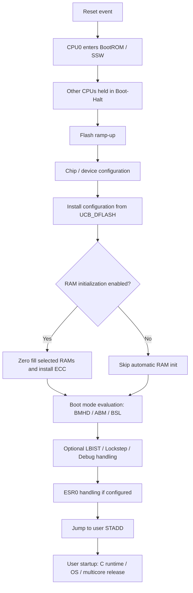
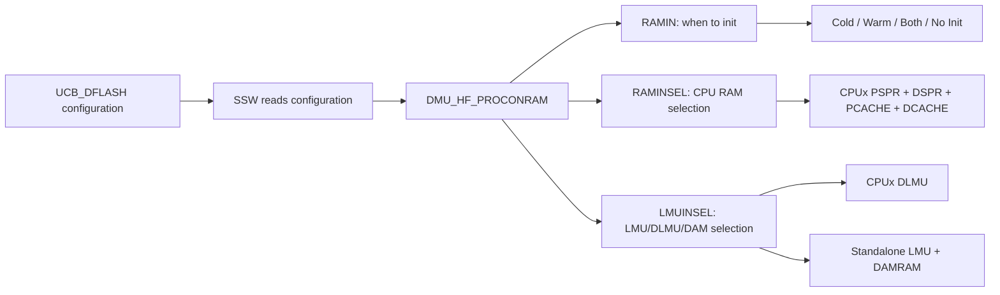
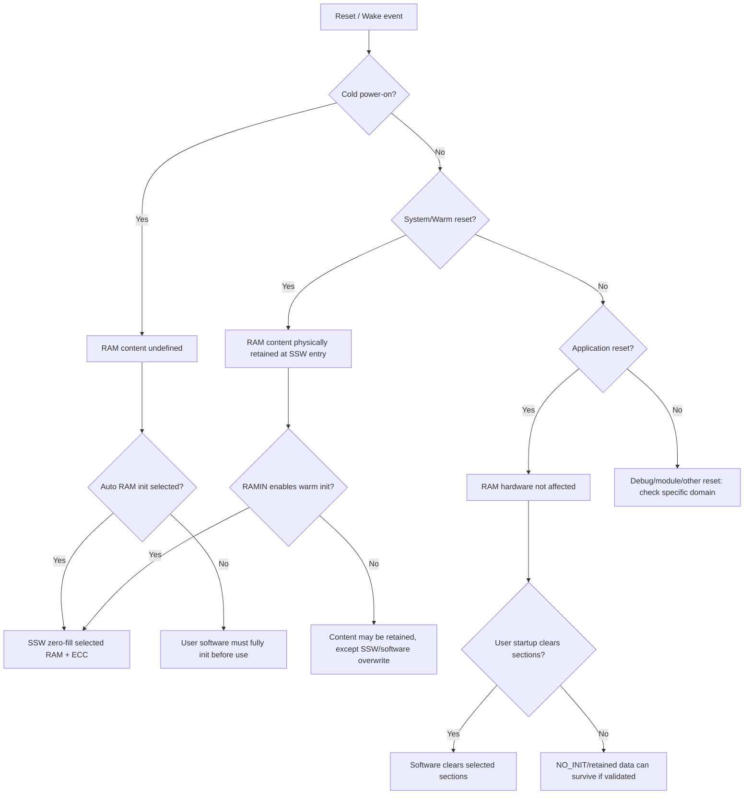
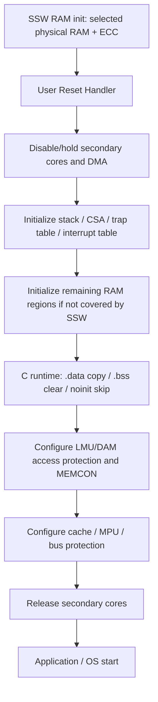
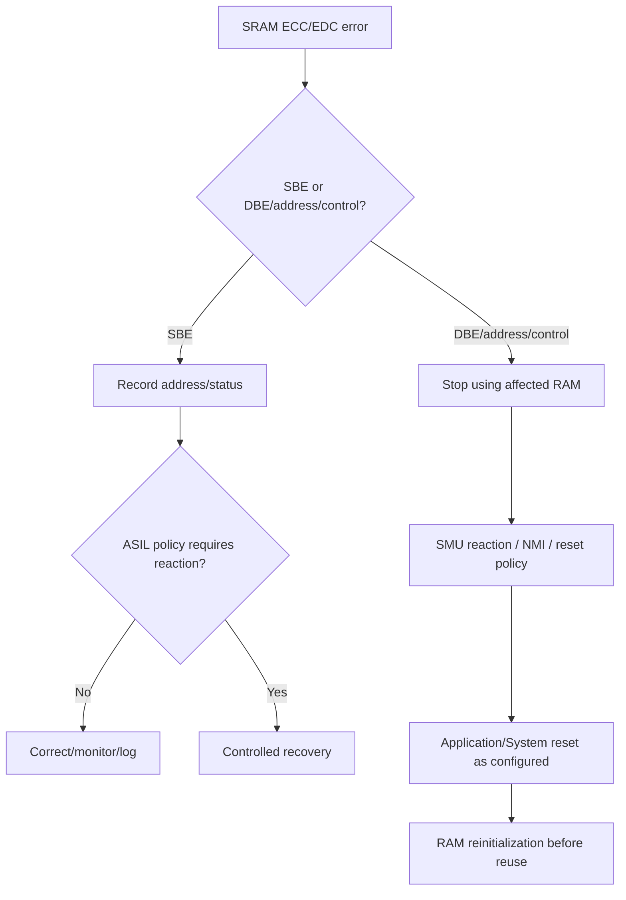

# AURIX TC3xx DSPR / PSPR / DLMU / LMU / DAM 在不同复位类型下的初始化流程与受影响程度总结报告

> 适用对象：AURIX™ TC3xx 平台，重点参考 TC39x-B 集成形态。  
> 关注范围：DSPR、PSPR、DLMU、LMU、DAM/DAMRAM 的 **复位影响、RAM 初始化、ECC 有效性、启动流程与工程使用建议**。  
> 说明：AURIX 家族文档为 superset，不同 derivative 的 RAM 容量、实例数量、地址映射可能不同；TC39x-B 相关地址和容量仅作为典型高端 TC3xx 示例。

---

## 1. 结论摘要

### 1.1 最关键结论

1. **Cold Power-on Reset 后，SRAM 内容未定义，所有要使用的 DSPR / PSPR / DLMU / LMU / DAMRAM 都必须完成初始化，至少要建立正确 ECC。**  
   TC3xx 手册明确要求 DLMU、DSPR、PSPR、LPB 在使用前必须完整初始化，以避免伪 ECC 错误；初始化可以由软件或硬件自动完成。fileciteturn5file4

2. **System Reset / Warm POR 不是简单“清 RAM”。**  
   从 SSW 视角，System Reset/Warm POR 启动时 RAM 内容与触发复位前相同，但 SSW 仍可能根据 `DMU_HF_PROCONRAM` 配置对选定 RAM 执行零填充和 ECC 初始化。fileciteturn7file1 fileciteturn8file3

3. **Application Reset 对 RAM 内容和 RAM surrounding logic 本身不产生复位影响。**  
   手册说明 Application Reset 下，Flash 保持 read mode，RAMs and surrounding logic、clock system、system-reset 域寄存器不受影响。fileciteturn7file1 但用户启动代码/C runtime 仍可能清 `.bss`、拷贝 `.data`，这属于软件行为，不是硬件复位行为。

4. **CPU0 DSPR 和 CPU0 PSPR 存在 SSW 覆盖风险。**  
   启动过程可覆盖 CPU0 DSPR 起始最多 8 KiB、CPU0 PSPR 起始最多 1 KiB。因此不要把需要跨复位保留的数据或代码放在这些区域。fileciteturn7file2

5. **DSPR/PSPR 按 CPU RAM 选择初始化，DLMU/LMU/DAMRAM 按 LMU RAM 选择初始化。**  
   `DMU_HF_PROCONRAM.RAMINSEL` 选择 CPUx 的 PSPR/DSPR/PCACHE/DCACHE；`LMUINSEL` 选择 CPUx LMU/DLMU 以及 standalone LMU + DAMRAM。fileciteturn9file4

6. **“寄存器复位”与“RAM 内容复位”必须分开看。**  
   例如 DAM 的 SFR 为 Application Reset 复位，但 DAMRAM 内容是否被清零取决于 RAM initialization 配置或软件初始化，不应把 DAM 寄存器 reset value 等同于 DAMRAM 数据内容被清除。fileciteturn6file15 fileciteturn9file4

---

## 2. 术语与存储区域关系

| 名称 | 全称/定位 | 所属/访问视角 | 典型用途 | 是否 ECC/EDC 相关 | 初始化核心原因 |
|---|---|---|---|---|---|
| DSPR | Data Scratch-Pad RAM | CPU 本地数据 RAM，也可经 SRI slave 被其他 master 访问 | 栈、CSA、实时数据、关键算法数据 | 是，DSPR ECC 保护 | 避免未初始化 ECC；建立确定数据内容 |
| PSPR | Program Scratch-Pad RAM | CPU 本地程序 RAM | 关键代码、bootloader 下载代码、低延迟 ISR/函数 | 是，PSPR/PCACHE 侧受 SRAM monitor/ECC 机制覆盖 | 避免取指/读写 ECC 错误；建立可执行代码内容 |
| DLMU | Distributed LMU | 每个 CPU 关联的 LMU RAM，SRI cached/non-cached 地址可访问 | 核间共享、小块共享数据、局部共享 RAM | 是，DLMU 64-bit basis ECC | 避免 load/store ECC 错误；支持共享访问一致性 |
| LMU | Local Memory Unit standalone LMU RAM | 全局共享 RAM | 多核共享数据、DMA buffer、大块 RAM | 是，LMU RAM 受 SRAM safety mechanisms 监控 | 建立 ECC 和确定内容 |
| DAM / DAMRAM | Default Application Memory | 属于 LMU/DAM 类共享应用 RAM；TC39x-B 中 DAM0/1 各 64 KiB | 默认应用共享 RAM、可保护区域 | 是，MEMCON 可监控 ECC/SMU signalling | 建立 ECC；配置访问保护与错误响应 |

### 2.1 TC3xx 典型容量

TC3xx 家族内存映射章节列出：CPU0/CPU1 通常各含 64 KiB PSPR、240 KiB DSPR、32 KiB P-cache、16 KiB D-cache、64 KiB DLMU；CPU2~CPU5 通常各含 64 KiB PSPR、96 KiB DSPR、相同 cache 配置和 64 KiB DLMU。LMU 侧包含 LMU SRAM 和 DAM SRAM。fileciteturn3file7

以 TC39x-B 为例，CPU0 的 DSPR 地址为 `0x7000_0000~0x7003_BFFF`，PSPR 地址为 `0x7010_0000~0x7010_FFFF`，CPU0 DLMU cached/non-cached 地址分别为 `0x9000_0000` / `0xB000_0000`；CPU1~CPU5 也有各自 DSPR/PSPR/DLMU 映射。fileciteturn9file2 standalone LMU0/1/2 分别为 256 KiB，典型地址区间为 `0x9004_0000~0x900F_FFFF`；DAM0/1 在 TC39x-B 中每实例 64 KiB，cached 地址为 `0x9040_0000`、`0x9041_0000`，non-cached 地址为 `0xB040_0000`、`0xB041_0000`。fileciteturn9file10 fileciteturn6file0

---

## 3. TC3xx 复位类型与对 RAM 的总体影响

### 3.1 复位类型定义

| 复位类型 | 定义 | 是否包含其他复位域 | 对 RAM 内容的直接语义 |
|---|---|---|---|
| Power-on Reset | 初始化完整系统到定义状态 | 同时产生 Debug Reset、System Reset、Application Reset | Cold POR 后 RAM 内容未定义；Warm POR/System Reset 时 RAM 可保留，但受启动 RAM 初始化配置影响 |
| System Reset | 初始化完整系统，但不复位 power subsystem、debug subsystem、reset configuration registers | 同时产生 Application Reset | RAM 内容在 SSW 入口通常保持复位前状态，但可被 SSW RAM init 改写 |
| Debug Reset | 初始化 debug system | 不等同于 application/system reset | 不用于 RAM 初始化；一般不改变应用 RAM 内容 |
| Application Reset | 初始化 application system：peripherals、CPUs、部分 SCU | 不复位 system reset 域 | RAMs and surrounding logic 不受影响；内容保持，除非软件/C runtime 清除 |
| Module Reset | 单模块复位 | 不影响系统其他部分 | 仅影响被复位模块；LMU 无 module reset capability；CPU module reset 仅影响对应 CPU |

TC3xx 手册对 Power-on/System/Debug/Application/Module reset 作了明确分类；其中 Power-on reset 会生成 Debug/System/Application Reset，System Reset 会生成 Application Reset，Application Reset 覆盖 peripherals、CPUs 和部分 SCU。fileciteturn6file14

### 3.2 Reset trigger 与 reset type 的对应

| Trigger | Application Reset | Debug Reset | System Reset | 备注 |
|---|---:|---:|---:|---|
| PORST | Activated | Activated | Activated | 可为 cold 或 warm PORST，取决于供电/时序状态 |
| STBYR / SWD / EVRC / EVR33 | Activated | Activated | Activated | 电源/监控相关，通常进入 power-on reset 路径 |
| ESR0 / ESR1 | Configurable | Not Activated | Configurable | 外部系统请求，可配置 application/system reset 或 NMI 等行为 |
| SMU | Configurable | Not Activated | Configurable | 安全报警可配置 reset reaction |
| STMx | Configurable | Not Activated | Configurable | 定时器触发复位 |
| SW | Configurable | Not Activated | Configurable | 软件触发复位 |
| Cerberus RSTCL0 | Activated | Not Activated | Activated | OCDS/CBS 相关 |
| Cerberus RSTCL1 | Not Activated | Activated | Not Activated | Debug reset 路径 |
| Cerberus RSTCL3 | Activated | Not Activated | Not Activated | Application reset 路径 |
| Module reset | Not Activated | Not Activated | Not Activated | 单模块局部 reset |

该触发关系来自 SCU reset source overview。fileciteturn6file14

---

## 4. 启动软件 SSW 与 RAM 初始化流程

### 4.1 SSW 基本启动路径

TC3xx 的 Startup Software（SSW）是芯片复位后首先执行的软件，运行在 CPU0 上；其他 CPU 在 boot 阶段保持 Halt-state，之后由用户软件启动。SSW 起始地址来自 CPU0 PC reset value 对应的 BootROM 入口，最后一条 SSW 指令跳转到用户代码第一条指令。fileciteturn7file0

SSW 主流程可概括为：fileciteturn8file3



### 4.2 Cold POR / System Reset / Application Reset 下 SSW 入口状态

| 事件 | SSW 入口时 RAM 内容 | Flash 状态 | Clock 状态 | SSW 流程特征 |
|---|---|---|---|---|
| Cold initial power-on reset | RAM 内容 undefined | Flash under reset，不可直接读/擦/写 | 初始状态 | 流程最长，执行最多准备动作 |
| System reset / warm power-on | RAM 内容与 reset 触发前相同 | Flash under reset | 初始状态 | 类似 warm power-on 路径 |
| Application reset | RAMs and surrounding logic 不受影响 | Flash in read mode | clock 不变 | 最快；但仍会进入 SSW 并按相关路径处理 |

这些状态来自 SSW event handling 描述。fileciteturn7file0 fileciteturn7file1

### 4.3 SSW RAM initialization 的本质

SSW 支持基于 UCB_DFLASH 配置的 RAM 初始化，启动时将配置安装到 `DMU_HF_PROCONRAM`。该初始化过程会把选定 RAM 填充为全 0，并安装正确 ECC bits，使后续访问不会因为未初始化 ECC 而产生 uncorrectable ECC error。fileciteturn8file3



### 4.4 `DMU_HF_PROCONRAM` 初始化选择

#### 4.4.1 RAMIN：何时初始化

| RAMIN 编码 | 含义 | 工程评价 |
|---|---|---|
| `00B` | cold and warm power-on reset 后初始化 | 最保守；会破坏 warm reset 保留数据 |
| `01B` | warm power-on reset 后初始化，不在 cold power-on 后初始化 | 手册标注 not recommended；通常不建议 |
| `10B` | cold power-on reset 后初始化 | 常用：冷启动建立 ECC，warm reset 可保留 RAM |
| `11B` | no RAM initialization | 仅在软件明确负责完整初始化/ECC 时使用 |

`RAMIN` 模式和选择位由 `HF_PROCONRAM` 提供。fileciteturn9file4

#### 4.4.2 RAMINSEL：CPU RAM 选择

`RAMINSEL` 的每个 bit 选择一个 CPU 的本地 RAM 组；每个 bit 为 `0` 时选择对应 CPU 的 RAM 进行初始化。每个 CPU 选择项覆盖：

- PSPR
- DSPR
- PCACHE
- DCACHE

手册表述为：CPUx 的 RAMs（PSPR, DSPR, PCACHE and DCACHE）被选择初始化。fileciteturn9file4

#### 4.4.3 LMUINSEL：LMU/DLMU/DAM 选择

`LMUINSEL` 的每个 bit 为 `0` 时选择对应 LMU 类 RAM：

| LMUINSEL bit 含义 | 被选择 RAM |
|---|---|
| CPU0 LMU | CPU0 DLMU |
| CPU1 LMU | CPU1 DLMU |
| CPU2 LMU | CPU2 DLMU |
| CPU3 LMU | CPU3 DLMU |
| CPU4 LMU | CPU4 DLMU |
| CPU5 LMU | CPU5 DLMU |
| Standalone LMU and DAMRAM | LMU0/1/2 等 standalone LMU RAM + DAMRAM |

该选择来自 `HF_PROCONRAM.LMUINSEL` 描述。fileciteturn9file4

---

## 5. 不同复位类型下的影响矩阵

### 5.1 影响等级定义

| 等级 | 含义 |
|---|---|
| 高 | 内容未定义、被自动初始化、被启动流程覆盖，或必须重新建立 ECC/内容 |
| 中 | 硬件可能保留内容，但寄存器/CPU 状态变化或 SSW/软件可能改写，必须由软件判定 reset cause 和初始化策略 |
| 低 | 硬件基本不影响内容，但需要注意 C runtime、cache、一致性、安全机制配置 |
| 无 | 该 reset path 对该 RAM/模块无直接影响 |

### 5.2 总体影响矩阵

| 复位类型 | DSPR | PSPR | DLMU | LMU | DAMRAM | 关键说明 |
|---|---|---|---|---|---|---|
| Cold Power-on Reset | 高 | 高 | 高 | 高 | 高 | RAM 内容 undefined；若 `RAMIN`/选择位启用，则 SSW 零填充并建立 ECC；否则必须由软件完整初始化 |
| Warm POR / System Reset | 中~高 | 中~高 | 中~高 | 中~高 | 中~高 | 入口 RAM 内容通常保留；但若配置 warm/both init，则被 SSW 初始化；CPU0 DSPR/PSPR 起始区域仍可能被 SSW 覆盖 |
| Application Reset | 低~中 | 低~中 | 低 | 低 | 低~中 | 硬件不影响 RAMs and surrounding logic；但 CPU/peripheral/DAM SFR 等 application reset 域寄存器会复位；用户 startup 可能清 RAM 段 |
| Debug Reset | 无 | 无 | 无 | 无 | 无 | 初始化 debug system；一般不触发 RAM init 或用户启动流程 |
| CPUx Module Reset | 中 | 中 | 低~中 | 无 | 无 | 对单 CPU 类似 application reset，不全局初始化；CPU0 复位后跳 application start，其他 CPU halt；本地 RAM 内容不应假设被清除 |
| 外设 Module Reset | 无 | 无 | 无 | 无/模块相关 | 无/模块相关 | 仅影响被复位模块；LMU 无 module reset capability；DAM 是否作为独立 module reset 应按具体 integration/register 手册确认 |
| Standby wake-up | 低~中 | 低~中 | 低/特殊 | 低~中 | 低~中 | 若 CPU0/CPU1 DLMU 在 standby 供电保持，SSW 即使配置也不会在 wake-up 后初始化对应 DLMU |

### 5.3 Reset cause 对“是否保留 RAM”的决策树



---

## 6. 分存储区域详细分析

## 6.1 DSPR

### 6.1.1 定位与访问特性

DSPR 是 CPU 本地 Data Scratch-Pad RAM，为 CPU 提供快速、确定性的数据访问，适合性能关键数据、栈、CSA 和实时控制数据。DSPR 也可以通过 SRI slave interface 被其他 bus master 读写。fileciteturn5file1

DSPR 支持 16-bit aligned unaligned access 无额外 penalty；DSPR 以 multiple memory towers 组织，允许 CPU 从任意 16-bit aligned 地址访问 64-bit 数据。fileciteturn5file1

### 6.1.2 ECC 与未初始化访问风险

DSPR ECC 以 16-bit data 为粒度。半字及以上写入会并行计算并写入 ECC；byte write 会转化为 read-modify-write。如果 byte write 访问未初始化 DSPR，read phase 会检测到 ECC error，write phase 不执行。fileciteturn5file1

因此工程上不能用零散 byte write 作为未初始化 DSPR 的第一访问方式。推荐路径是：

1. 使用 SSW/硬件 RAM initialization；或
2. 使用启动软件按合适访问宽度完整写全物理 DSPR；或
3. 使用 MTU/SSH 机制执行初始化/测试后再交给应用。

### 6.1.3 不同复位下 DSPR 行为

| 复位类型 | DSPR 内容 | DSPR 控制/CPU 状态 | 工程结论 |
|---|---|---|---|
| Cold POR | undefined，除非 SSW 按 `RAMINSEL` 初始化 | CPU/寄存器初始；CPU0 执行 SSW | 必须初始化；不可读取未初始化 DSPR |
| System Reset / Warm POR | 物理内容通常保留；若 warm init 选择则清零+ECC | system/application reset 域恢复 | 可用于 reset-retention，但要避开 CPU0 DSPR 起始 8 KiB，并校验 magic/CRC |
| Application Reset | 硬件 RAM 不受影响 | CPU 被 application reset，startup 重新执行 | RAM 可保留，但 C startup 可能清 `.bss`；NO_INIT 段需单独配置 |
| CPUx Module Reset | 对该 CPU 类似 application reset | CPU0 跳 app start；其他 CPU halt | 本地 DSPR 不应假设被清除；重新初始化栈/CSA/上下文 |
| Debug Reset | 不影响 | debug system reset | 不改变 DSPR 内容 |

### 6.1.4 CPU0 DSPR 保留区限制

SSW 可能覆盖 **CPU0 DSPR 起始最多 8 KiB**。该区域不应放置跨 reset 保留数据。fileciteturn7file2

建议 linker 规划：

```ld
/* 示例，仅表达布局原则 */
CPU0_DSPR_SSW_RESERVED : ORIGIN = 0x70000000, LENGTH = 8K
CPU0_DSPR_APP          : ORIGIN = 0x70002000, LENGTH = 232K
```

---

## 6.2 PSPR

### 6.2.1 定位与访问特性

PSPR 是 Program Scratch-Pad RAM，通常用于低延迟执行代码、启动下载代码、关键 ISR/函数等。TC3xx 各 CPU 典型含 64 KiB PSPR。fileciteturn3file7

TriCore 还有私有视角访问：PSPR 可通过 `C000_0000H` 访问，DSPR 可通过 `D000_0000H` 访问；这与系统总线地址视图并存。fileciteturn3file7

### 6.2.2 与 Bootloader 的关系

在 Bootstrap Loader 模式下，SSW 可通过 ASC/CAN 等方式下载代码或数据到 CPU0 PSPR，并将用户 start address 设置为 PSPR 起始地址。fileciteturn7file3

### 6.2.3 不同复位下 PSPR 行为

| 复位类型 | PSPR 内容 | 取指风险 | 工程结论 |
|---|---|---|---|
| Cold POR | undefined，除非 SSW/软件初始化或 BSL 下载 | 未初始化 PSPR 取指不可用，可能触发错误 | 若从 PSPR 执行，必须先下载/拷贝代码并建立 ECC |
| System Reset / Warm POR | 物理内容通常保留；若选择 warm init 则被清零 | 如果 STADD 指向 PSPR，需确认内容仍有效 | reset-retained PSPR 代码要配合版本/magic/CRC 校验 |
| Application Reset | 硬件 PSPR 不受影响 | CPU 重新启动流程可能不再从原 PSPR 位置执行 | 若需要从 PSPR 运行，startup 要重新建立跳转/拷贝策略 |
| CPUx Module Reset | 本地 PSPR 内容通常不因 CPU reset 被清除 | CPU PC/状态重置 | 需重新设置 PC/boot release；不可依赖旧执行上下文 |
| Debug Reset | 不影响 | 无直接影响 | 调试器可读写但需注意 CPU halt/boot-halt 状态 |

### 6.2.4 CPU0 PSPR 保留区限制

SSW 可覆盖 **CPU0 PSPR 起始最多 1 KiB**。该区域不应用于跨 reset 保留代码。手册同时说明，这里的 CPU0 PSPR overwrite 不包括 BSL 下载例程，BSL 代码会被正确处理。fileciteturn7file2

---

## 6.3 DLMU

### 6.3.1 定位与访问方式

DLMU 是 Distributed LMU SRAM，每个 CPU 实例通常有 64 KiB。它同时可作为本 CPU 较近的共享 RAM，也可通过 SRI cached/non-cached 地址被其他 master 访问。TC39x-B 中 CPU0 DLMU 典型映射为：cached `0x9000_0000`，non-cached `0xB000_0000`。fileciteturn9file2

### 6.3.2 ECC 与访问风险

DLMU 按 64-bit basis 进行 ECC 保护。CPU 对 DLMU load 时若检测到 uncorrectable error，会向 CPU 报告并触发 asynchronous DIE trap；总线接口访问检测到 uncorrectable error 时会返回 bus error，并向 SMU 产生独立 alarm。fileciteturn5file4

DLMU 小于 double-word 的写入会转化为 read-modify-write，因此如果目标位置未初始化，也可能在 RMW read phase 暴露 ECC 错误。fileciteturn5file4

### 6.3.3 不同复位下 DLMU 行为

| 复位类型 | DLMU 内容 | 特殊点 | 工程结论 |
|---|---|---|---|
| Cold POR | undefined，除非 `LMUINSEL` 选中并初始化 | 每 CPU DLMU 由 LMUINSEL 独立选择 | 必须初始化后使用 |
| System Reset / Warm POR | 通常保留，除非 RAMIN 配置 warm/both init | 可作为 warm reset retained RAM | 必须用 reset cause + magic/CRC 判定数据有效性 |
| Application Reset | 硬件不影响 | CPU/外设状态变化，但 DLMU 内容保留 | 可用于跨 application reset 保留数据 |
| CPUx Module Reset | 一般不清 DLMU 内容 | CPUx 状态复位，不等于 DLMU 清零 | 重新建立访问保护/cache策略 |
| Standby wake-up | CPU0/CPU1 DLMU 可能保持供电 | 若 standby RAM supplied，SSW 不初始化 CPU0/CPU1 DLMU | 适合作 retention RAM，但必须校验内容 |

SSW 对 CPU0_DLMU、CPU1_DLMU 有 standby 例外：如果这些 RAM 在 standby 中保持供电，即使 `DMU_HF_PROCONRAM` 选择初始化，wake-up 后也不会初始化。fileciteturn8file3

---

## 6.4 LMU

### 6.4.1 定位

LMU 是全局共享 SRAM，适合多核共享数据、DMA buffer、系统级缓冲区。TC39x-B 中 standalone LMU0/1/2 各 256 KiB，典型地址为：

| 实例 | 地址范围 | 大小 |
|---|---|---|
| LMU0 | `0x9004_0000~0x9007_FFFF` | 256 KiB |
| LMU1 | `0x9008_0000~0x900B_FFFF` | 256 KiB |
| LMU2 | `0x900C_0000~0x900F_FFFF` | 256 KiB |

地址映射见 TC39x-B memory map。fileciteturn9file10

### 6.4.2 初始化选择

Standalone LMU 与 DAMRAM 在 `LMUINSEL` 中作为一个选择项：`Standalone LMU and DAMRAM is selected for initialization`。每个选择 bit 为 `0` 时表示选中初始化。fileciteturn9file4

### 6.4.3 复位影响

| 复位类型 | LMU 内容 | LMU 配置/保护寄存器 | 工程结论 |
|---|---|---|---|
| Cold POR | undefined，除非 SSW 选中 standalone LMU + DAMRAM 初始化 | 相关 SFR/保护配置进入 reset state | 所有共享 buffer 使用前必须初始化 |
| System Reset / Warm POR | 通常保留，除非配置 warm/both init | system/application 域配置可能复位 | warm retained LMU 需要完整数据有效性校验 |
| Application Reset | RAM 内容不受影响 | 部分 SFR/保护配置可能为 application reset 域，需重配 | 共享内存内容可保留，但访问保护/SMU/cache 策略要重建 |
| Debug Reset | 不影响 RAM | debug system 影响可见性/访问能力 | 一般不清 RAM |
| Module Reset | LMU 无 module reset capability | 不适用 | 不能通过普通 module reset 清 LMU |

SCU 的 module reset 表中明确 LMU 无 module reset capability。fileciteturn9file1

### 6.4.4 多核和 DMA 使用注意

LMU 是多 master 共享 RAM。工程上需要额外关注：

- 使用 cached 地址还是 non-cached 地址；
- CPU cache 与 DMA/其他 CPU 的一致性；
- 初始化完成前禁止其他 core/DMA 访问；
- 跨 reset retained 数据必须带 magic、version、length、CRC；
- 发生 ECC DBE 或 address error 后，不能只清错误标志继续使用，应按安全目标决定 reset/reinitialize。

---

## 6.5 DAM / DAMRAM

### 6.5.1 定位与 TC39x-B 典型配置

DAM 是 Default Application Memory。TC39x-B 中 DAM 每实例 64 KiB，DAM0/DAM1 分别提供 cached/non-cached RAM 地址和 SFR 地址空间。fileciteturn6file0

| 实例 | Cached RAM | Non-cached RAM | SFR 地址空间 | RAM size |
|---|---|---|---|---|
| DAM0 | `0x9040_0000~0x9040_FFFF` | `0xB040_0000~0xB040_FFFF` | `0xF850_0000~0xF850_7FFF` | 64 KiB |
| DAM1 | `0x9041_0000~0x9041_FFFF` | `0xB041_0000~0xB041_FFFF` | `0xF851_0000~0xF851_7FFF` | 64 KiB |

### 6.5.2 DAM SFR reset 与 DAMRAM 内容不是一回事

DAM 的寄存器表显示 CLC、MODID、ACCEN0/1、MEMCON、区域地址/访问控制寄存器等均为 Application Reset reset class；这些寄存器 supervisor only，并受 EndInit/Safety EndInit 类保护。fileciteturn6file15

这意味着：

- **Application Reset 会复位 DAM SFR 配置。**
- **Application Reset 不代表 DAMRAM 数据内容被清零。**
- 如果 Application Reset 后继续使用 DAMRAM，需要重新配置 DAM 访问权限、region、MEMCON 等 SFR，再校验 RAM 内容是否有效。

### 6.5.3 DAM MEMCON 与错误监控

DAM `MEMCON` 提供 memory integrity checking 和向 SMU error signalling 的监控能力。字段包括 `INTERR`、`RMWERR`、`DATAERR`、`ADDERR`、`PMIC`、`ERRDIS` 等，`MEMCON` reset value 为 `0x0000_0000`，reset class 为 Application Reset。fileciteturn6file13

### 6.5.4 不同复位下 DAM 行为

| 复位类型 | DAMRAM 内容 | DAM SFR | 工程结论 |
|---|---|---|---|
| Cold POR | undefined，除非 standalone LMU + DAMRAM 初始化选中 | reset state | 必须初始化 DAMRAM 并重配 DAM SFR |
| System Reset / Warm POR | 通常保留，除非 RAM init 选择 warm/both | 取决于 reset class，Application Reset 域 SFR 会复位 | 若保留 DAMRAM，启动后必须重配 SFR 并校验内容 |
| Application Reset | 内容不受硬件清除 | DAM SFR 为 Application Reset | 典型风险：数据还在，但访问保护/MEMCON 恢复默认 |
| Debug Reset | 内容不受影响 | debug reset 不等于 DAM application reset | 调试访问需考虑保护配置 |
| Module Reset | 未在通用 SCU module reset 表中作为 LMU 类清 RAM 手段 | 需按具体 DAM integration 确认 | 不应假设可用 module reset 清 DAMRAM |

---

## 7. 自动初始化、软件初始化与 C Runtime 初始化的边界

### 7.1 三类初始化不要混淆

| 初始化类型 | 执行者 | 发生阶段 | 目标 | 是否建立 ECC | 是否受 linker 影响 |
|---|---|---|---|---|---|
| SSW/硬件 RAM initialization | BootROM/SSW + DMU/MTU/SSH | 用户代码前 | 选定物理 RAM 全零 + ECC | 是 | 否，按 UCB/PROCONRAM 选择 |
| 用户 startup 软件初始化 | 用户 startup / BSP / MCAL | SSW 跳转后 | 未被硬件初始化的 RAM、MPU/cache、trap/interrupt、stack/CSA 等 | 取决于实现 | 是 |
| C runtime 段初始化 | C library/startup | main 前 | `.data` 拷贝、`.bss` 清零、构造函数等 | 通常只写逻辑内容，依赖底层 ECC 已有效或写满 | 是 |

### 7.2 推荐启动阶段分层



### 7.3 NO_INIT / reset-retained 数据建议

如果需要跨 Application Reset 或 Warm Reset 保留数据，建议：

1. 放入专门 `NO_INIT` section；
2. 避开 CPU0 DSPR 起始 8 KiB 和 CPU0 PSPR 起始 1 KiB；
3. 使用 magic + version + length + CRC；
4. 记录 reset cause；
5. 首次 cold POR 或 ECC error 后强制重建；
6. 若使用 DLMU standby retention，结合 `PMS_PMSWSTAT2.STBYRAM` 或等效状态确认供电保持；
7. 在任何共享 retained 区被多个 CPU/DMA 使用前，重新建立访问保护和 cache 一致性策略。

---

## 8. ECC / EDC 与安全机制影响

### 8.1 为什么未初始化 RAM 不能直接读

TC3xx 的 DSPR、PSPR、DLMU、LMU、DAMRAM 等 SRAM 均处在 SRAM safety mechanism 管理范围内。Safety Manual 将 CPU DSPR、PSPR、DLMU、LMU RAM、AMU LMU_DAM 等列为功能块 SRAM，并说明 SRAM 数据可受永久硬件故障、soft error、写入错误、读出错误影响，硬件通过 ECC/EDC、地址监控、控制逻辑监控等机制检测。fileciteturn5file9

对于未初始化 RAM，数据位和 ECC/check bits 不匹配是常见风险。因此：

- 首次访问未初始化 RAM 可能触发 ECC error；
- RMW 类型写入可能在 read phase 触发错误，导致 write phase 不执行；
- CPU 访问可能进入 DIE/PIE trap；
- bus master 访问可能返回 bus error，并触发 SMU alarm。

### 8.2 安全应用中的错误响应

Safety Manual 对 SRAM error handling 给出原则：SBE correction 的 alarm 可按配置不反应；DBE、address error、ETRR overflow 等事件的反应取决于 RAM 所承载功能的 ASIL 要求。对 ASIL 功能，出现首次事件后通常应执行 Application Reset 并在重新使用 RAM 前完成 reinitialization。fileciteturn5file9

工程建议：



---

## 9. 复位类型下的推荐软件策略

### 9.1 Cold Power-on Reset

**目标：建立完整确定初始状态。**

推荐动作：

1. 通过 UCB/`DMU_HF_PROCONRAM` 选择必须初始化的 CPU RAM 和 LMU/DAMRAM；
2. 对未被 SSW 覆盖的 RAM，由用户 startup/MTU 执行完整初始化；
3. 初始化 stack/CSA 前，确保所在 DSPR 已建立 ECC；
4. 不读取任何未初始化 RAM；
5. 初始化 LMU/DAMRAM 后再释放 DMA 和 secondary CPUs；
6. DAM/LMU 访问保护、MEMCON、ACCEN、region protection 在用户 startup 中重新配置；
7. 如果使用 BSL，明确 CPU0_PSPR 被下载内容占用，不要与应用布局冲突。

### 9.2 System Reset / Warm POR

**目标：根据 reset cause 决定保留还是重建。**

推荐动作：

1. 读取并保存 reset status；
2. 判断 `RAMIN` 是否会对 warm reset 触发初始化；
3. 对 retained 区执行 magic/version/CRC 校验；
4. 对 CPU0_DSPR/PSPR 起始 SSW 覆盖区域一律不作为 retained 区；
5. 对 shared LMU/DAM 重新配置访问保护和 cache 策略；
6. 对安全相关 RAM，若 reset 前存在 ECC/SMU 错误，应强制 reinit，不做保留。

### 9.3 Application Reset

**目标：快速恢复 application domain，同时显式管理 RAM 保留。**

硬件层面 Application Reset 不影响 RAM 内容和 RAM surrounding logic。fileciteturn7file1 但软件层面通常会重新进入用户 startup，可能执行 `.bss` 清零、`.data` 拷贝、OS/BSP 初始化。

推荐动作：

1. linker 中把需要保留的数据放 `NO_INIT`；
2. startup 中根据 reset cause 跳过 retained section 清零；
3. 重新初始化所有 CPU 运行上下文：stack、CSA、trap table、interrupt table；
4. 重新配置 DAM/LMU 的 ACCEN、region、MEMCON；
5. 如果 CPU 从 PSPR 执行关键代码，确认 PSPR 内容仍有效，否则从 Flash 重新拷贝；
6. 对多核系统，secondary cores 先保持 halt/idle，待共享 RAM 状态恢复后再 release。

### 9.4 CPUx Module Reset

SCU 章节说明 CPU module reset 对单个 CPU 的效果类似 Application Reset，但不会完整重新初始化 CPU 外部的其他系统元素；CPU0 module reset 后跳 application start，其他 CPUs module reset 后处于 HALT mode。fileciteturn9file1

推荐动作：

1. 对被 reset CPU 重新建立 stack/CSA/PC/PSW/上下文；
2. 不假设该 CPU 的 DSPR/PSPR/DLMU 被清零；
3. 如果 CPUx 本地 RAM 承载运行栈或关键状态，应由该 CPU reset handler 或 master CPU 重新初始化；
4. 若其他 CPU/DMA 正在访问 CPUx DLMU，需要 reset 协议或锁保护；
5. 清读 `CPUx_KRST.STAT` 后记录原因，再按应用策略清除。

### 9.5 Debug Reset

Debug Reset 只初始化 debug system，不应作为 RAM 初始化手段。调试器读写 RAM 时应注意：

- CPU 是否在 Boot-Halt / Debug-Halt / idle；
- cacheable 地址下调试器看到的数据是否与 CPU cache 一致；
- 对未初始化 ECC RAM 的调试访问也可能触发错误；
- reset 后寄存器刷新不等于 RAM 内容被清除。

---

## 10. 工程检查清单

### 10.1 Bring-up 阶段

| 检查项 | 目的 | 建议观测 |
|---|---|---|
| reset cause 读取 | 区分 cold/system/application reset | SCU reset status |
| `HF_PROCONRAM` 实际配置 | 确认 RAMIN/RAMINSEL/LMUINSEL | UCB 与运行态寄存器读回 |
| CPU0 DSPR/PSPR 起始区域 | 避免误作为 retained 区 | linker map 审查 |
| 首次 RAM 全面写入 | 建立 ECC | MTU/SSH 状态、SMU alarm |
| LMU/DAMRAM init 完成后再 release DMA/core | 避免未初始化访问 | boot log + barrier |
| DAM SFR 重配 | Application Reset 后恢复访问策略 | CLC/MEMCON/ACCEN/region 寄存器 |
| retained RAM 校验 | 防止使用旧数据/坏数据 | magic/version/CRC/reset counter |

### 10.2 Linker/Startup 阶段

| 区域 | 建议 section 策略 |
|---|---|
| CPU0_DSPR first 8 KiB | reserved，不放 retained 数据 |
| CPU0_PSPR first 1 KiB | reserved，不放 retained code |
| DSPR stack/CSA | cold boot 强制初始化，application reset 重新建立 |
| PSPR code | 每次 reset 后确认是否重新拷贝或校验 |
| DLMU retained data | `NO_INIT` + CRC + reset cause 判断 |
| LMU shared buffer | 启动时统一初始化；DMA 使用 non-cached 或 cache maintenance |
| DAMRAM | 与 standalone LMU 一起考虑初始化；Application Reset 后重配 DAM SFR |

---

## 11. 可直接用于自研 MCU 对标设计的抽象规则

如果自研车规 MCU 对标 TC3xx，建议在规格书中明确以下规则，避免软件集成阶段反复争议：

1. **Reset domain 与 RAM data retention 分离描述**  
   每种 reset 应分别说明：CPU register、module SFR、RAM array、ECC bits、RAM wrapper、cache/tag、debug state 是否受影响。

2. **启动 RAM 初始化由可配置策略控制**  
   提供类似 `RAMIN`、`CPU_RAM_INIT_SEL`、`SHARED_RAM_INIT_SEL` 的配置字段，明确 cold/warm/application reset 下是否执行。

3. **明确 startup software 会覆盖哪些 RAM 地址**  
   类似 TC3xx 的 CPU0 DSPR first 8 KiB、CPU0 PSPR first 1 KiB，应在手册和 linker example 中固定标出。

4. **明确 ECC 首次访问约束**  
   说明未初始化 RAM 的读、byte write、sub-word write、RMW 行为，以及可能产生的 fault/alarm。

5. **明确 retained RAM 软件契约**  
   硬件只保证供电/不清除，不保证数据语义有效。软件必须使用 magic/CRC/version/reset cause 判断。

6. **明确 Application Reset 与 C Runtime 的边界**  
   硬件不清 RAM 不等于应用数据保留；startup/linker 才决定 `.bss`、`.data`、`NO_INIT` 的处理。

7. **明确共享 RAM 的 cache coherency 责任**  
   对 LMU/DAM/DLMU 这类共享 RAM，文档应说明 cached/non-cached alias、DMA/多核一致性、barrier/cache maintenance 要求。

---

## 12. 参考依据

| 主题 | 依据 |
|---|---|
| SSW 入口、CPU0 执行、其他 CPU halt、Cold POR 条件 | fileciteturn7file0 |
| System Reset / Application Reset 下 RAM、Flash、clock 条件 | fileciteturn7file1 |
| CPU0 DSPR/PSPR 启动覆盖范围 | fileciteturn7file2 |
| SSW 主流程与 RAM initialization 机制 | fileciteturn8file3 |
| Reset type 与 reset trigger 关系 | fileciteturn6file14 |
| CPU module reset 行为、LMU 无 module reset capability | fileciteturn9file1 |
| TC3xx MEMMAP 中 DSPR/PSPR/DLMU/LMU/DAM 概览 | fileciteturn3file7 |
| TC39x-B CPU RAM/DLMU 地址示例 | fileciteturn9file2 fileciteturn9file6 |
| TC39x-B LMU/DAM 地址示例 | fileciteturn9file10 fileciteturn6file0 |
| `HF_PROCONRAM` RAMIN/RAMINSEL/LMUINSEL | fileciteturn9file4 |
| DSPR/DLMU ECC 与初始化要求 | fileciteturn5file1 fileciteturn5file4 |
| DAM SFR reset class 与 MEMCON 错误监控 | fileciteturn6file15 fileciteturn6file13 |
| SRAM safety mechanism 与 ECC/EDC 概念 | fileciteturn5file9 |
| 典型 reset/boot timing，device/step dependent | fileciteturn8file13 |

---

## 13. 附：一页式总结表

| Memory | Cold POR | System/Warm Reset | Application Reset | CPU Module Reset | 主要风险 | 推荐策略 |
|---|---|---|---|---|---|---|
| DSPR | undefined；可被 SSW init | 保留或被 warm init；CPU0 first 8 KiB 可被 SSW 覆盖 | 内容保留；startup 可清段 | CPU 状态复位，RAM 不保证清零 | 未初始化 byte write 触发 ECC/RMW 错误 | cold init；reserved first 8 KiB；NO_INIT + CRC |
| PSPR | undefined；BSL 可下载到 CPU0 PSPR | 保留或被 warm init；CPU0 first 1 KiB 可被覆盖 | 内容保留但执行路径需重建 | PC/状态复位，PSPR 内容不等于有效代码 | 从无效 PSPR 取指 | 启动后重新拷贝/校验；reserved first 1 KiB |
| DLMU | undefined；由 LMUINSEL CPUx 选择初始化 | 保留或被 warm init | 内容保留 | CPU reset 不清共享内容 | sub-64-bit RMW、ECC、跨核一致性 | full init；non-cached/shared policy；retention 校验 |
| LMU | undefined；standalone LMU 选择初始化 | 保留或被 warm init | 内容保留，配置可能需重建 | 不受 CPU reset 直接影响 | 多核/DMA/cache一致性、ECC | init before release cores/DMA；CRC；barrier/cache maintenance |
| DAMRAM | undefined；与 standalone LMU + DAMRAM 选择项初始化 | 保留或被 warm init | 内容保留，但 DAM SFR application reset | 不受 CPU reset 直接影响 | SFR reset 后权限/MEMCON丢失；数据仍在但保护默认 | reset 后重配 DAM SFR；校验 DAMRAM；明确 cached/non-cached |

