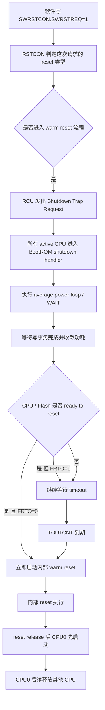
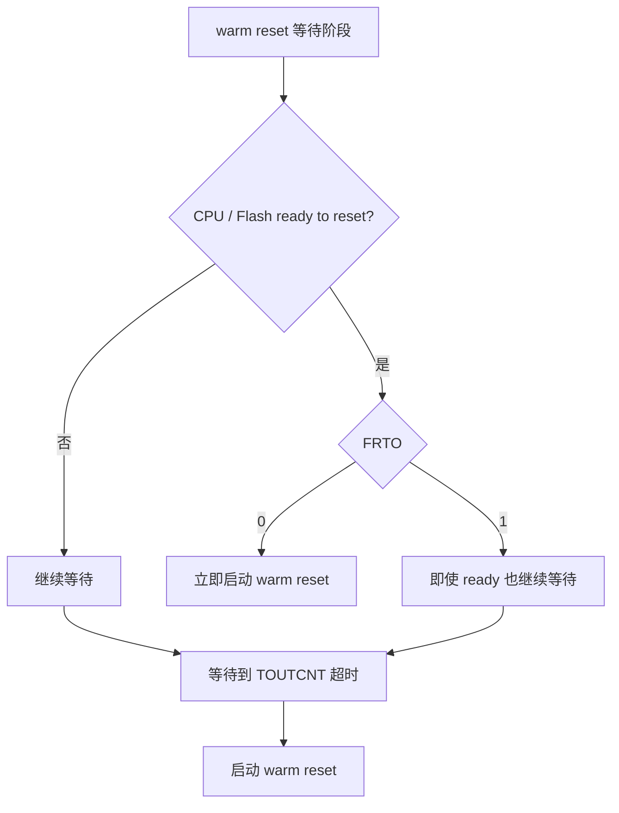
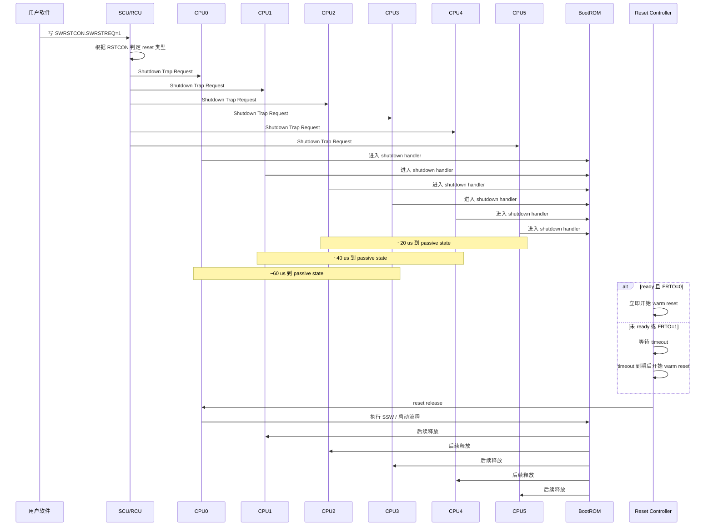

# AURIX TC3xx 软件请求复位整理

## 1. 文档目的

本文整理 AURIX TC3xx 中与 **SCU 软件请求复位**相关的几个核心问题：

1. 软件请求复位后，6 个核分别是怎么进入复位流程的
2. 20 us / 40 us / 60 us / 180 us 分别代表什么
3. Shutdown Trap Request 与 BootROM shutdown handler 是什么关系
4. 这个过程中用户软件需不需要介入
5. `RSTCON2.FRTO` 的作用是什么
6. reset 触发、reset 执行、reset 后启动释放，这三件事如何区分

---

# 2. 先说结论

## 2.1 SCU 软件复位不是“6 个核各自单独复位”

当软件通过 `SWRSTCON.SWRSTREQ=1` 发起软件复位请求时：

- `SWRSTREQ` 只是**提出一次软件复位请求**
- 这次请求最终落成 **Application Reset** 还是 **System Reset**，由 `RSTCON` 对应的软件复位配置决定
- 一旦进入 warm reset 路径，本质上是**芯片级 reset 控制流程**，而不是 6 个核各自独立执行“单核软件复位”

也就是说：

- **不是** CPU0、CPU1、CPU2……一个个被分别 software reset
- **而是** reset controller 统一管理一次 warm reset
- 不同 CPU 的差别主要体现在：**进入 shutdown / passive state 的时间不同**

---

## 2.2 20 / 40 / 60 us 不是 reset 时间，而是各核进入 passive state 的时间

如果 6 个核当时都处于 active 状态，则 warm reset 触发后，它们进入 BootROM shutdown 路径并到达 passive state 的典型时间为：

| CPU | 到达 passive state 时间 |
|---|---:|
| CPU2 / CPU5 | 20 us |
| CPU1 / CPU4 | 40 us |
| CPU0 / CPU3 | 60 us |

因此：

- 最快到达 passive state：CPU2 / CPU5
- 最慢到达 passive state：CPU0 / CPU3

这表示的是 **pre-reset shutdown 收敛时间**，不是“哪个核先被内部 reset”。

---

## 2.3 180 us 不是 NMI 时间

180 us 的本质是：

> warm reset 路径里的一个 **最长等待上限 timeout**。

含义是：

- 如果 CPU / Flash 很快都 ready to reset，则 **内部 reset 可以提前开始**
- 如果迟迟没有都 ready，则最晚等到 timeout 到期（约 180 us）后，**强制启动内部 reset**

所以：

- 180 us **不是** NMI 持续时间
- 180 us **不是** NMI 延迟
- 180 us **不是** “必须先等够 180 us 才能 reset”

它只是 reset controller 的**兜底等待上限**。

---

## 2.4 Shutdown Trap Request -> BootROM shutdown handler 一般不需要用户软件接管

warm reset 触发后：

- RCU 会向 CPU 发送 **Shutdown Trap Request**
- 当前 active 的 CPU 会**无条件进入 BootROM 的 shutdown handler**
- 这条路径本质上是 **硬件 + BootROM 固件自动完成**

所以一般情况下：

- 不需要用户自己写一个 shutdown trap handler 去接管
- 不需要依赖用户应用代码在这个 trap 里再做大量收尾

用户软件真正需要做的是：

> 在写 `SWRSTCON.SWRSTREQ=1` 之前，把应用级收尾动作做完。

---

## 2.5 `FRTO` 用来决定“ready 后立即 reset”还是“强制等 timeout 再 reset”

`RSTCON2.FRTO` 可以记成：

> **Force Reset Timeout**

其含义：

- `FRTO = 0`：一旦 CPU / Flash 都 ready to reset，就**立即启动 warm reset**
- `FRTO = 1`：即使 CPU / Flash 已经 ready，也**不立即 reset**，而是强制等到 `TOUTCNT` 超时后再启动 warm reset

一句话：

- `FRTO=0`：**ready 即 reset**
- `FRTO=1`：**强制等 timeout 再 reset**

---

# 3. 软件请求复位的触发逻辑

## 3.1 两层概念一定要分开

### 第一层：提出软件复位请求

软件写：

```c
SWRSTCON.SWRSTREQ = 1;
```

这表示：

- 发起一次软件复位请求
- 但还不能单独决定这次最终是什么 reset 类型

### 第二层：由 `RSTCON` 决定复位类型

`RSTCON` 里对应的软件复位配置会决定这次请求最终落成：

- Application Reset
- System Reset
- 或其他配置结果

所以：

- `SWRSTREQ` = “发起请求”
- `RSTCON` = “决定结果”

---

# 4. warm reset 的整体流程

## 4.1 逻辑流程图



---

## 4.2 更形象的 ASCII 时序图

```text
t0: 软件写 SWRSTREQ=1
    |
    |--> RCU 判定 warm reset 路径
    |--> pads 进入 reset state
    |--> 给 active CPU 发 Shutdown Trap Request
    |
    |--> CPU2 / CPU5 约 20us 到 passive state
    |--> CPU1 / CPU4 约 40us 到 passive state
    |--> CPU0 / CPU3 约 60us 到 passive state
    |
    |--> 如果此时 CPU/Flash 都已 ready 且 FRTO=0
    |        -> 立即开始内部 reset
    |
    |--> 如果还没 ready，或者 FRTO=1
    |        -> 继续等待
    |
    |--> 最晚约 180us timeout 到期
             -> 强制开始内部 warm reset
```

---

# 5. 6 核在这个过程里的真实角色

## 5.1 不是“谁先 reset”，而是“谁先收敛到 passive”

很多人会下意识地问：

- CPU0 先复位？
- CPU1 后复位？
- 6 个核是不是分批 reset？

更准确的理解应该是：

1. 所有 active CPU 被拉入 shutdown 路径
2. 每个 CPU 到 passive state 的时间不同
3. 当 reset controller 判定条件满足后，统一执行内部 reset

所以关键不是“谁先 reset”，而是：

> **谁先进入 shutdown / passive state。**

---

## 5.2 如果有核已经 halt 或 idle 呢？

如果某些 CPU 在 warm reset 触发时已经处于 halt 或 idle，则它们不会再像 active CPU 那样去跑完整的 shutdown handler 收敛路径。

因此，前面说的 20 / 40 / 60 us，主要对应的是：

> 当这些核当时是 **active** 状态时，它们到 passive state 的典型时间。

---

# 6. 180 us 与 NMI 的关系

## 6.1 为什么会看到 NMI 被提到

因为 BootROM 的 shutdown handler 中会执行 `WAIT`。

从普通架构直觉出发：

- `WAIT` 可能会被中断或 NMI 唤醒

但在这个特殊的 shutdown 流程中，手册描述的重点恰恰是：

> interrupt 和 NMI **不会**在 shutdown routine 期间把 CPU 再唤醒。

所以这里提到 NMI，并不是说：

- 先发 NMI 180 us
- 或者 reset 是由 NMI 驱动

真正含义是：

> **即使来了 NMI，这条 shutdown 路径也不会被打断。**

---

## 6.2 一句话总结

- 20 / 40 / 60 us：各核进入 passive state 的时间
- 180 us：warm reset 的 timeout 上限
- NMI：在这条 shutdown 流程里不会把 CPU 再唤醒

---

# 7. Shutdown Trap Request 与用户软件的关系

## 7.1 用户软件一般不需要“管这段 trap”

当 warm reset 已经进入 RCU -> Shutdown Trap -> BootROM shutdown handler 这条路径后：

- 这不是普通应用中断/异常处理逻辑
- 不是让用户去编写一个业务层 trap handler
- 也不应依赖这段时间再去做复杂业务补救

因此一般不需要：

- 自己写 shutdown trap ISR/handler
- 试图在这段路径中继续跑复杂应用逻辑
- 指望再用普通中断或 NMI 抢回执行权

---

## 7.2 用户软件真正应该做什么

用户软件真正该做的是：

### 在发起软件 reset 之前，把应用级收尾做完

典型包括：

1. 停止业务任务
2. 多核同步，停止共享资源继续被改写
3. 功率输出进入安全态
4. 必要状态保存到 NVM / retention RAM / standby RAM
5. 停止外设发送或停止外部交互
6. 最后再写 `SWRSTCON.SWRSTREQ=1`

---

## 7.3 推荐的软件封装方式

建议将软件复位封装成“安全复位接口”：

```c
void SafeSoftwareReset(void)
{
    /* 1. 应用级收尾 */
    /* 2. 多核同步 */
    /* 3. 输出进入安全态 */
    /* 4. 保存关键状态 */

    /* 5. 最后触发 SCU 软件复位 */
    SCU_SWRSTCON.B.SWRSTREQ = 1U;
}
```

不要把设计思路放在：

> “触发 reset 后，我再在 shutdown trap 里面慢慢处理剩余逻辑。”

这通常不是正确用法。

---

# 8. `RSTCON2.FRTO` 的作用

## 8.1 核心定义

`RSTCON2.FRTO` 控制的是：

> **下一次 warm reset 到底是 ready 后立即开始，还是故意拖到 timeout 再开始。**

---

## 8.2 两种模式对比

| FRTO | 行为 |
|---|---|
| 0 | CPU / Flash 一旦 ready to reset，立即启动 warm reset |
| 1 | 即使 CPU / Flash 已经 ready，也强制等 `TOUTCNT` 超时后才启动 warm reset |

---

## 8.3 逻辑图



---

## 8.4 工程化理解

如果从工程视角看：

- `FRTO=0`：更偏向**尽快完成 warm reset**
- `FRTO=1`：更偏向**强制保留完整等待窗口**

可以把它理解为 warm reset 的一个**时序策略位**。

---

# 9. `RSTCON2.CSSx` 的理解

`RSTCON2.CSSx` 可以理解成：

> 用来记录上一次 warm reset 前，各 CPU 是否成功完成 shutdown / flush 并到达 idle/passive 状态。

所以它的价值主要在于：

- reset 之后做状态复盘
- 判断上一次 warm reset 前，各核是否正常收敛

与之对应：

- `FRTO`：决定 **什么时候真正打 reset**
- `CSSx`：记录 **上一次 reset 前各核是否成功收敛**

---

# 10. “复位执行”与“复位后启动释放”要分开理解

## 10.1 复位执行阶段

在 SCU 软件复位触发后：

- active CPU 进入 BootROM shutdown handler
- reset controller 在满足条件或 timeout 后启动内部 reset

这个阶段叫：

> **复位执行阶段**

---

## 10.2 reset release 后的启动阶段

内部 reset 结束以后，并不是 6 个核同时开始跑用户程序。

通常的理解是：

1. **CPU0 先被释放**
2. CPU0 进入 SSW / BootROM 启动流程
3. 其他 CPU 先保持默认启动状态
4. 再由 CPU0 或启动流程后续释放其他 CPU

所以这又是另一个概念：

> **谁先从 reset 后启动起来**

这通常是 **CPU0 先起来**。

但这不等于：

> “CPU0 是最先被 reset 的核”。

---

# 11. 一张总图把关系串起来



---

# 12. FAQ

## Q1：SCU 软件复位是不是 6 个核分别复位？

不是。它本质上是一次统一的 warm reset 控制流程，只是各核进入 passive state 的时间不同。

## Q2：20 / 40 / 60 us 是 reset 时间吗？

不是。这些是各 active CPU 到达 passive state 的典型时间。

## Q3：180 us 是 NMI 时间吗？

不是。180 us 是 warm reset 的最长等待上限 timeout。

## Q4：Shutdown Trap Request 来了以后，用户软件要不要自己写 handler？

一般不需要。这条路径由硬件 + BootROM 自动处理。

## Q5：用户软件应该做什么？

在发起 `SWRSTREQ` 之前完成应用级收尾，而不是依赖 shutdown trap 期间再慢慢处理。

## Q6：`FRTO` 是干什么的？

决定 warm reset 是“ready 即 reset”还是“强制等 timeout 再 reset”。

## Q7：`CSSx` 是干什么的？

用于记录上一次 warm reset 前各 CPU 是否成功到达 shutdown / idle/passive 状态。

---

# 13. 工程上最值得记住的 6 句话

1. `SWRSTCON.SWRSTREQ=1` 只是**发起软件复位请求**。
2. 最终是 Application Reset 还是 System Reset，要看 `RSTCON` 配置。
3. SCU 软件复位不是 6 核逐个独立 software reset，而是统一的 warm reset 流程。
4. 20 / 40 / 60 us 表示各 CPU 进入 passive state 的时间，不是 reset 执行时间。
5. 180 us 是 warm reset 的 timeout 上限，不是 NMI 时间。
6. `FRTO=0` 表示 ready 即 reset，`FRTO=1` 表示强制等 timeout 再 reset。

---

# 14. 推荐的软件设计建议

## 14.1 封装统一的软件复位入口

建议不要在工程里到处直接写 `SWRSTREQ=1`，而是统一封装：

```c
void Mcu_RequestSafeSoftwareReset(void)
{
    /* 1. 进入受控上下文 */
    /* 2. 停业务任务 */
    /* 3. 多核同步 */
    /* 4. 输出安全化 */
    /* 5. 保存必要状态 */

    SCU_SWRSTCON.B.SWRSTREQ = 1U;
}
```

---

## 14.2 如果是带功率输出的系统

在触发 software reset 前尤其应注意：

- 关闭 PWM 输出或桥臂使能
- 关闭继电器/驱动使能
- 确保外设输出进入 fail-safe 状态
- 必要时等待硬件确认状态稳定后再发 reset

---

## 14.3 如果是多核共享资源场景

在触发 software reset 前，建议至少考虑：

- 停止其他核继续写共享 RAM
- 停止 DMA / 外设后台搬运
- 停止共享日志/trace 缓冲写入
- 必要时设置“即将 reset”全局标志做同步

---

# 15. 本文对应的参考资料

以下资料用于支撑本文整理：

1. **AURIX TC3xx User Manual Part 1 / Part 2**
2. **TC39x-B User Manual Appendix**
3. **AURIX TC3xx Safety Manual v2.0**
4. **TC39xB Data Sheet / Target Specification**
5. **TriCore TC1.6.2 Architecture Manual Vol.1 / Vol.2**

其中与本文最直接相关的通常是：

- TC3xx User Manual 中的 reset controller / firmware / shutdown request handler 相关章节
- TC39x-B Appendix 中的器件特定补充说明
- Safety Manual 中关于 reset / startup / safe state 的系统级约束说明

---

# 16. 结尾总结

AURIX TC3xx 的 SCU 软件请求复位，真正要抓住的是下面这条主线：

> **软件发起 reset 请求 -> reset controller 组织 warm reset 收敛 -> active CPU 进入 BootROM shutdown handler -> 各核在不同时间到达 passive state -> 根据 ready 条件或 timeout 启动内部 reset -> reset release 后 CPU0 先启动，再释放其余核。**

因此工程上最重要的不是去纠结“6 个核谁先被 reset”，而是：

- reset 前应用是否完成收尾
- 各核是否正常收敛到 passive state
- `FRTO` 是否符合你的 reset 时序策略
- reset 后启动与多核重新拉起是否符合软件架构预期

