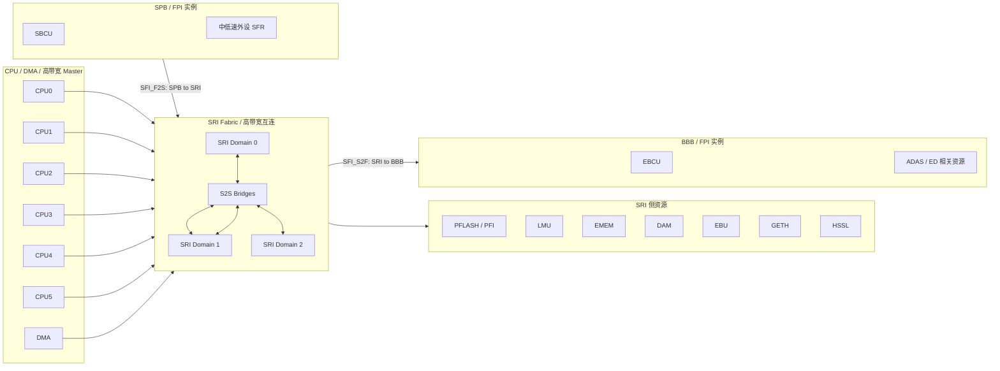
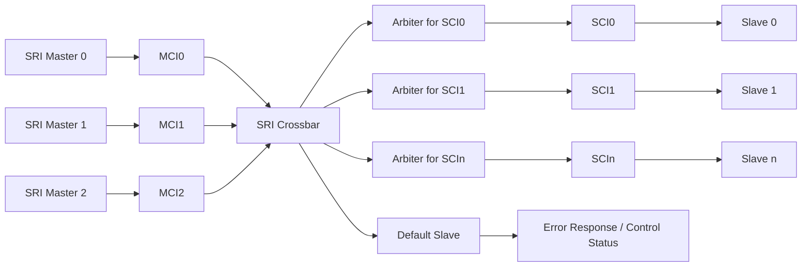
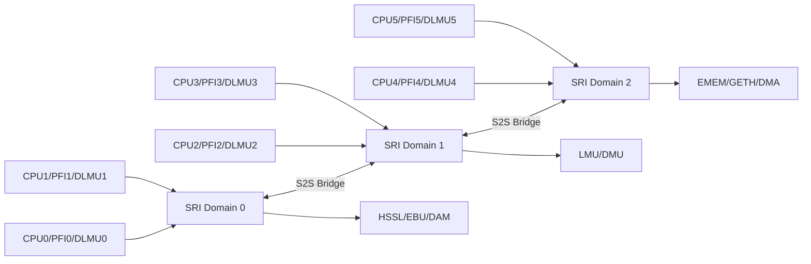
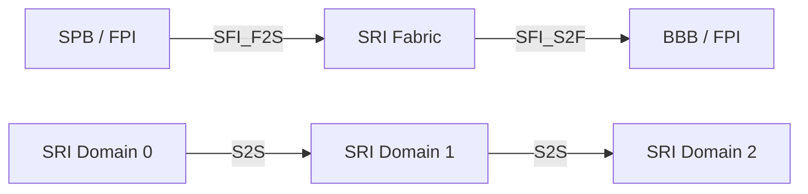
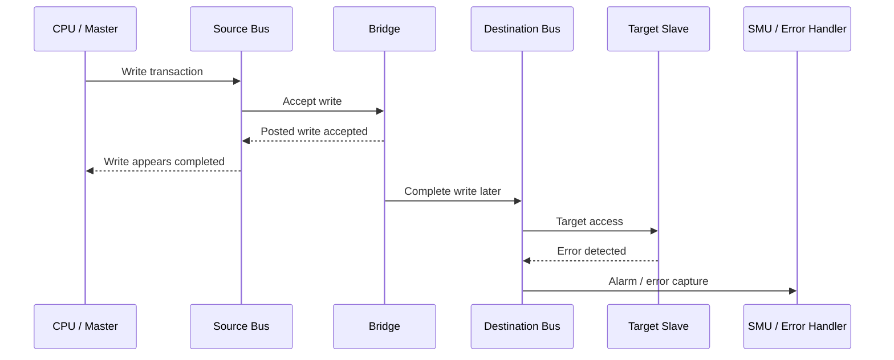
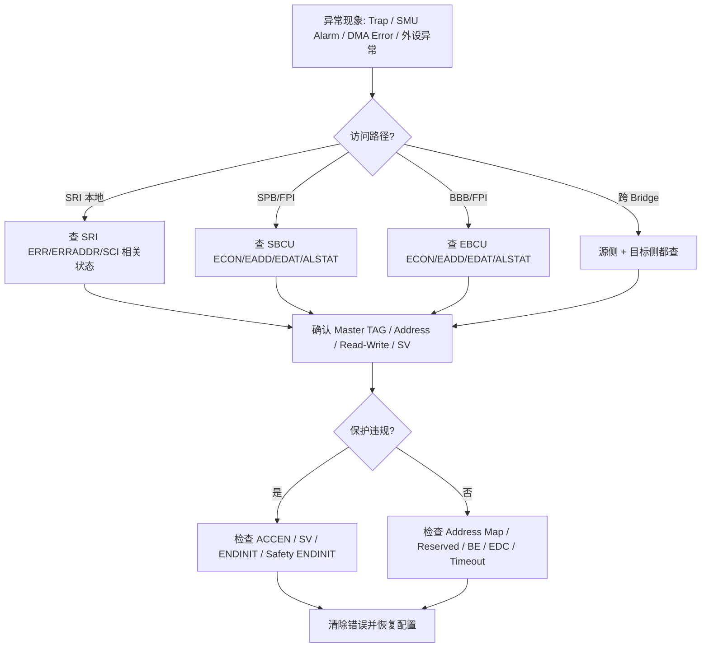
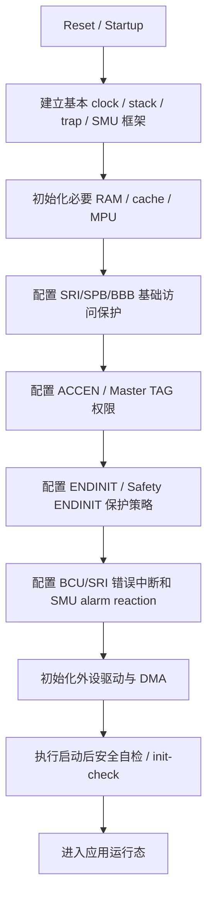
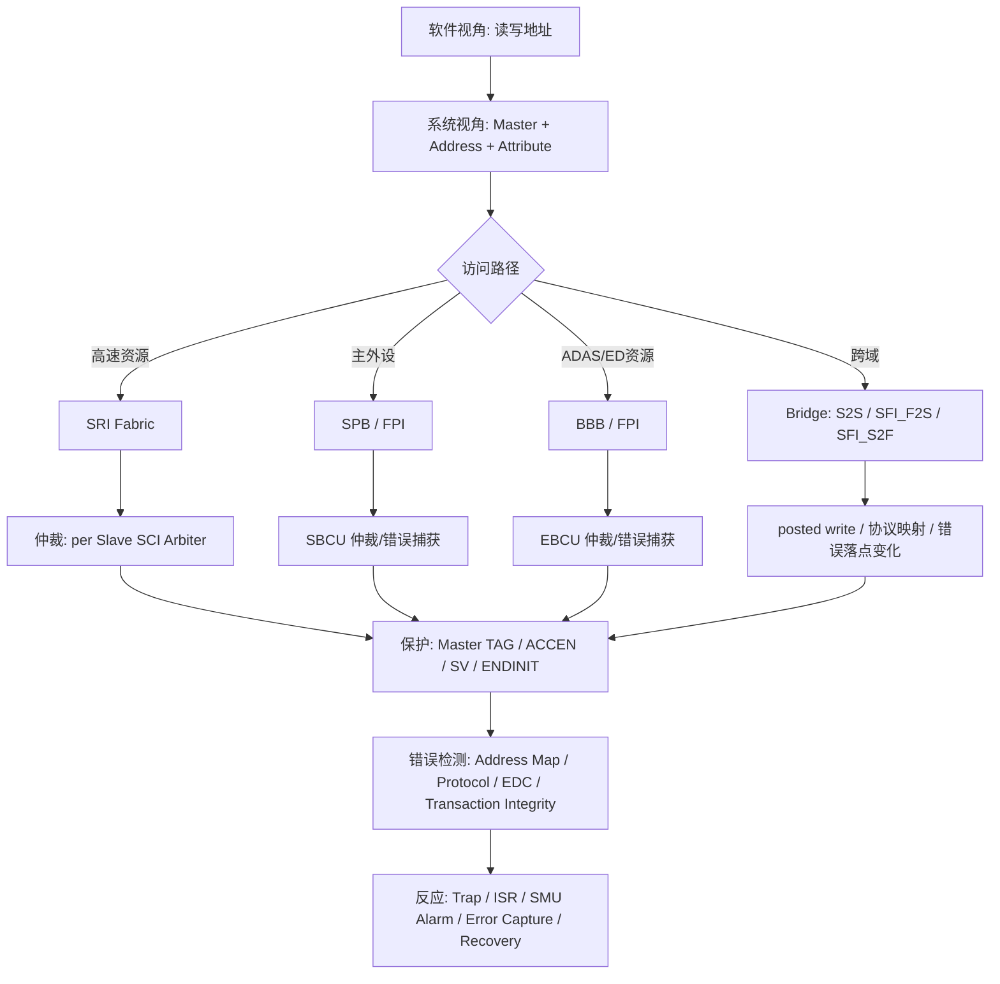

# AURIX TC3xx 总线系统详解：系统工程师与测试验证工程师视角

> 适用对象：车规 MCU 系统工程师、MCAL/底层软件工程师、芯片验证/模块测试工程师。  
> 讲解主线：**总 — 分 — 总**。先建立整体认知，再拆解 SRI / SPB / BBB / FPI / Bridge / 保护与错误机制，最后回到系统集成与测试验证方法论。

---

## 0. 先给结论：AURIX TC3xx 的“总线”到底要怎么看？

从应用软件视角看，CPU 只是“读写一个地址”；但从系统工程师和测试验证工程师视角看，每一次读写背后至少包含：

```text
发起者 Master
  ↓
地址译码 / Master TAG / 权限属性 / Supervisor 属性
  ↓
互连网络：SRI / SPB / BBB / Bridge
  ↓
仲裁：谁先访问同一个 Slave
  ↓
目标 Slave：Flash / LMU / EMEM / 外设寄存器 / EBU / DAM / GTM / CAN 等
  ↓
错误响应：Bus Error / SMU Alarm / Trap / ISR / Error Capture Register
```

所以，AURIX TC3xx 的总线不是单纯的“数据搬运通道”，而是芯片级的：

| 维度 | 对系统工程师意味着什么 | 对测试验证工程师意味着什么 |
|---|---|---|
| 互连路径 | CPU/DMA/外设访问资源的路径规划 | 要验证 CPU→外设、DMA→RAM、SPB→SRI、SRI→BBB 等典型路径 |
| 性能 | 访问延迟、带宽、仲裁竞争、posted write 行为 | 要做无冲突/有冲突、读/写、单核/多核/DMA 并发测试 |
| 保护 | Master TAG、ACCEN、SV、ENDINIT、Safety ENDINIT | 要做非法 Master、非法权限、非法地址、保护写入测试 |
| 安全 | SRI/FPI 地址监控、事务完整性、协议错误、SMU 告警 | 要验证 SMU alarm、错误捕获寄存器、错误清除与恢复 |
| 调试 | OCDS、BCU debug、trace、error capture | 要设计可观测性：不仅看 CPU 返回，还要看 BCU/SMU/Trap |

---

## 1. 总：TC3xx 总线系统的总体结构

AURIX TC3xx 平台主要有三类片上连接资源：

1. **SRI Fabric / System Resource Interconnect**  
   面向高带宽访问，连接 TriCore CPU、DMA、高带宽外设、Flash 接口、LMU、EMEM、EBU、HSSL、GETH 等资源。

2. **SPB / System Peripheral Bus**  
   面向中低速外设寄存器访问，是典型外设控制寄存器访问路径，例如 PORT、SCU、SMU、STM、QSPI、ASCLIN、I2C、CAN、GTM 等外设区域。

3. **BBB / Back Bone Bus**  
   主要面向 ADAS / Emulation 相关资源，在高端/ADAS/仿真器件中更重要。部分资源可通过 SRI/Bridge 或 BBB 侧访问。

这三者之间通过 Bridge 连接：



### 1.1 一句话区分 SRI / SPB / BBB / FPI

| 名称 | 本质 | 典型用途 | 关键验证关注点 |
|---|---|---|---|
| SRI | 高带宽片上互连 Fabric | CPU/DMA/高速 Master 访问 Flash、LMU、EMEM、EBU、HSSL、GETH 等 | 多 Master 并发、仲裁、S2S bridge、EDC、错误传播 |
| SPB | FPI 协议的一个 Bus Instance | 主系统外设寄存器访问 | 外设 SFR 访问、ACCEN、SV、ENDINIT、SBCU 错误捕获 |
| BBB | FPI 协议的另一个 Bus Instance | ADAS / Emulation / 部分高端资源 | EBCU、ADAS 资源访问、SRI→BBB bridge、错误处理 |
| FPI | SPB/BBB 使用的总线协议/互连机制 | 中低速外设访问协议基础 | 32-bit 数据/地址、等待状态、timeout、atomic 操作、EDC |
| SFI_F2S | FPI/SPB 到 SRI 的桥 | SPB Master 访问 SRI 资源 | posted write、错误不回传发起侧 |
| SFI_S2F | SRI 到 FPI/BBB 的桥 | SRI Master 访问 BBB 资源 | posted write、EBCU/SMU 告警 |
| S2S | SRI Domain 之间的桥 | 跨 SRI domain 访问 | posted write、跨域错误定位 |

---

## 2. 分：先理解总线中的几个基础概念

### 2.1 Master 与 Slave

在总线系统中，**Master** 是发起访问的一方，**Slave** 是响应访问的一方。

典型 Master：

- TriCore CPU0 ~ CPU5
- DMA
- HSM / HSSL / GETH / 其他具备主机访问能力的模块
- 部分外设内部 DMA 或专用数据搬运单元

典型 Slave：

- PFLASH / DFLASH / DMU
- LMU / EMEM / DAM / DLMU / DSPR / PSPR 的可访问接口
- 外设 SFR，例如 SCU、SMU、STM、PORT、GTM、QSPI、ASCLIN、I2C、CAN 等
- EBU 外部总线控制器
- Bridge 的目标接口

工程含义：

```text
不是“CPU 访问寄存器”这么简单，而是：
哪个 Master，以什么权限，通过哪条 Bus Path，访问哪个 Slave。
```

### 2.2 Master TAG ID

AURIX TC3xx 的片上总线事务中带有 **Master TAG ID**。这个 TAG 用于标识当前访问来自哪个 Master。

它主要用于：

1. **访问保护**：某些寄存器或存储区域只允许特定 Master 写入。
2. **安全隔离**：防止非授权 CPU/DMA/HSM/Debug Master 改写关键配置。
3. **错误诊断**：Bus Error 或 Debug Trigger 时，可以定位是哪一个 Master 发起的访问。

测试时不要只问“这个地址能不能写”，还要问：

```text
CPU0 能不能写？
CPU1 能不能写？
DMA 能不能写？
User Mode 能不能写？
Supervisor Mode 能不能写？
ENDINIT 未解锁能不能写？
Safety ENDINIT 未解锁能不能写？
```

### 2.3 Address Map

AURIX 的地址空间不是一张简单线性 RAM 表，而是通过 segment、cached/non-cached alias、bus instance、bridge 映射到不同资源。

从验证角度，地址表至少要拆成：

| 地址类型 | 验证关注点 |
|---|---|
| 有效地址，读写均 OK | 基础功能 |
| 有效地址，只读 | 写入是否被拒绝，是否产生错误/告警 |
| 有效地址，只写 | 读取行为是否符合手册定义 |
| Reserved 但读写标为 ok | 不一定产生 Bus Error，需按手册处理 |
| Reserved 且标为 BE | 应触发 Bus Error / SMU Alarm / Trap / Error Capture |
| cached alias | 可能受 cache 影响，性能/一致性测试需要考虑 |
| non-cached alias | 常用于外设、DMA buffer、可观测性测试 |
| bridge range | 错误传播路径与本地总线不同 |

### 2.4 读访问与写访问差异

这是验证中最容易漏的点。

- **Read** 往往需要返回数据，因此错误更容易同步反馈给发起 Master。
- **Write** 可能被写缓冲或 Bridge 以 posted write 方式完成，CPU 侧可能认为写已经完成，但目标侧稍后才发现错误。

因此：

```text
验证 Bus Error 时，读错误和写错误必须分开测。
尤其是跨 Bridge 写错误，不能只看 CPU 是否 Trap；还要看目标 Bus 的 BCU/SMU/Error Capture。
```

---

## 3. 分：SRI Fabric 详解

### 3.1 SRI 的定位

SRI 是 TC3xx 内部的高带宽互连。它解决的问题是：多个高速 Master 同时访问多个高速资源时，如何完成路由、仲裁、保护、错误诊断。

典型 SRI 访问包括：

| 访问场景 | 典型路径 |
|---|---|
| CPU 执行 Flash 代码 | CPU → PFI/PFLASH，部分路径可能是本地 fetch path |
| CPU 访问 LMU | CPU → SRI → LMU |
| CPU 访问远端 Core 的局部/全局可见内存 | CPU → SRI/S2S → 目标内存接口 |
| DMA 搬运 LMU/EMEM 数据 | DMA → SRI → LMU/EMEM |
| Ethernet/HSSL 等高速模块访问内存 | GETH/HSSL → SRI → LMU/EMEM/DMU |
| SRI Master 访问 BBB 资源 | SRI → SFI_S2F → BBB |

> 注意：具体路径取决于 device variant、address alias、local/global 地址、cache 配置、linker map 与 memory map。测试时不能只看 C 指针地址，要回到手册的 MEMMAP 与 map 文件确认。

### 3.2 SRI 的基本组成：MCI / SCI / Arbiter / Default Slave



| 组件 | 作用 | 工程含义 |
|---|---|---|
| MCI | Master Connection Interface | Master 接入 SRI 的入口 |
| SCI | Slave Connection Interface | Slave 接入 SRI 的入口 |
| Slave Arbiter | 每个 Slave 侧一个仲裁器 | 同一个 Slave 被多个 Master 访问时决定谁先访问 |
| Default Slave | 默认从设备 | 对未匹配地址返回错误，同时提供 SRI 控制/状态寄存器访问 |
| Access Enable | Master TAG 权限控制 | 限制哪个 Master 能写 SRI 控制状态寄存器 |

### 3.3 SRI Domain 与 S2S Bridge

TC3xx 高端器件中，SRI 可分为多个 domain，例如 SRI0 / SRI1 / SRI2。不同 CPU、PFLASH、LMU、DAM、EMEM、GETH、DMA 等资源分布在不同 domain 或接口上。

S2S Bridge 用于 SRI domain 之间互通。



系统工程含义：

- 同一个 CPU 访问本地资源和远端资源，延迟可能不同。
- 多核共享 LMU/EMEM 时，实际瓶颈可能在目标 Slave 仲裁，而不在 CPU 本身。
- S2S bridge 的 write 可能是 posted write，跨域错误不一定同步返回源域。

### 3.4 SRI 仲裁机制

SRI 的仲裁重点不是“全局谁优先”，而是 **每个 SCI/Slave 各自仲裁**。

简化理解：

```text
CPU0 和 CPU1 同时访问 LMU0 → LMU0 对应 SCI 仲裁。
CPU0 访问 LMU0，CPU1 访问 EMEM → 可以并行程度更高。
```

SRI 仲裁具备以下特点：

1. **Slave 侧仲裁**：每个 Slave 对自己的请求做仲裁。
2. **Round-robin 基础机制**：避免某个 Master 永久饥饿。
3. **高/低优先级增强**：可针对每个 Slave 配置不同 Master 的优先级。
4. **High Priority Round Share**：高优先级可以获得连续 grant 份额。
5. **诊断支持**：协议错误时可捕获相关事务信息。

测试验证关注点：

| 测试点 | 目的 |
|---|---|
| 多 CPU 同时访问同一 LMU/EMEM | 验证仲裁公平性、无死锁、延迟可控 |
| CPU + DMA 同时访问同一 Slave | 验证 DMA 高负载下 CPU 是否异常阻塞 |
| 修改 Priority 配置后重复测试 | 验证优先级配置是否生效 |
| 高优先级持续请求 + 低优先级请求 | 验证低优先级不会永久饥饿 |
| 跨 SRI domain 并发访问 | 验证 S2S bridge 与目标 SCI 的组合行为 |

### 3.5 SRI 错误类型

SRI 相关错误大体包括：

| 错误类型 | 含义 | 测试方法 |
|---|---|---|
| Address Map Error | 地址不属于任何有效 Slave 或访问类型非法 | 访问 BE 区域 / 非法 alias |
| Protocol Error | 总线协议层错误 | 依赖硬件错误注入或 BCU/EDC 注入机制 |
| Transaction ID Error | 事务 ID 不匹配或异常 | 多事务/Bridge/错误注入场景 |
| EDC / Integrity Error | 地址相位或数据相位完整性错误 | 使用 EDC error injection 或安全机制测试接口 |
| Access Protection Error | Master TAG / SV / ENDINIT 等保护违规 | 配置禁止 Master 后访问 |

### 3.6 SRI 访问保护

SRI 控制和状态寄存器有基于 Master TAG ID 的访问保护。典型机制是 ACCEN1/0：

- 控制哪些 Master TAG ID 允许写 SRI 控制状态寄存器。
- ACCEN 本身受 Safety ENDINIT 保护。
- reset 后通常默认使能，需要系统软件按安全要求重新配置。

验证建议：

| 场景 | 预期 |
|---|---|
| 允许 Master 写 SRI 控制寄存器 | 写入成功，读回一致 |
| 禁止 Master 写 SRI 控制寄存器 | 写入不生效，错误响应/SMU alarm/错误捕获符合配置 |
| 未解 Safety ENDINIT 修改 ACCEN | 写入不生效，并触发相应保护机制 |
| 多核并发修改保护寄存器 | 必须由系统设计限制；测试应验证不会出现未授权窗口 |

---

## 4. 分：FPI / SPB / BBB 详解

### 4.1 FPI 是什么？

FPI 可以理解为 TC3xx 中用于中低速外设访问的总线协议/互连机制。SPB 和 BBB 都是 FPI 类型的 Bus Instance。

FPI 的典型能力：

| 能力 | 说明 |
|---|---|
| 32-bit address / data bus | 面向外设 SFR 和中低速数据访问 |
| 8/16/32-bit transfer | 支持 byte、half-word、word 访问 |
| 64/128/256-bit block transfer | 支持块传输，提高效率 |
| Slave wait-state | Slave 可插入等待状态 |
| Timeout detection | 超时可被检测并处理 |
| Atomic CPU operation support | 支持 LDMST、ST.T、SWAP.W、CMPSWP、SWPMSK 等原子类访问 |
| Flexible arbitration | 支持 priority、round-robin、starvation prevention |
| Default slave | 未实现地址由 default slave 接管并报错 |
| Debug support | 可捕获 timeout/bus error 时的事务信息 |
| TAG/SV 信息 | Address phase 中包含 Master TAG ID 和 Supervisor Mode 信息 |
| Integrity support | 覆盖地址相位、读写数据和控制信号 |

### 4.2 SPB：主系统外设总线

SPB 连接主系统中低速外设。软件中大量 `MODULE_xxx` SFR 访问，本质是 SPB/FPI 访问。

典型 SPB 侧资源：

- SCU / SMU / STM / PORT
- QSPI / ASCLIN / I2C / CAN
- GTM / EVADC / DSADC / SENT / MSC
- MTU / HSM 相关寄存器
- 其他低中速外设寄存器区域

SPB 的控制单元通常为 **SBCU**。

SBCU 对测试很关键，因为它提供：

| 寄存器/能力 | 用途 |
|---|---|
| SBCU_PRIOH / SBCU_PRIOL | 仲裁优先级配置 |
| SBCU_ECON | Bus Error 控制/捕获信息 |
| SBCU_EADD | Bus Error 地址捕获 |
| SBCU_EDAT | Bus Error 数据捕获 |
| SBCU_DBCNTL / DBADR / DBBOS 等 | OCDS/debug 触发与捕获 |
| SBCU_ALSTATx / ALCLRx | EDC alarm 状态与清除 |
| FEGEN / ALCTRL | FPI 错误生成与 EDC 控制相关 |
| ACCEN0/1 | Master TAG 访问保护 |

### 4.3 BBB：Back Bone Bus

BBB 也是 FPI Bus Instance，但定位更偏 ADAS、Emulation Device、扩展资源等。

BBB 的控制单元通常为 **EBCU**。

EBCU 与 SBCU 结构类似，也包含：

- Priority registers
- Error capture registers
- Debug trigger/capture registers
- EDC alarm status/clear registers
- ACCEN 访问控制

系统工程师需要注意：

- 并非所有 TC3xx variant 都有相同 BBB/ADAS 资源。
- BBB 资源的访问可能经 SRI→SFI_S2F→BBB。
- SRI Master 访问 BBB 资源时，写错误可能只在 BBB/EBCU/SMU 侧体现，不一定同步反馈给 CPU。

---

## 5. 分：Bridge 是理解 TC3xx 总线错误传播的核心

### 5.1 为什么 Bridge 重要？

因为 TC3xx 不是一条总线把所有东西串起来，而是多个互连域通过 Bridge 相连：



Bridge 带来两个工程问题：

1. **协议转换**：FPI 32-bit 总线事务与 SRI 64-bit 总线事务之间需要映射。
2. **错误传播变化**：尤其是 posted write，错误不一定回到源 Master。

### 5.2 SFI_F2S：SPB 到 SRI

SFI_F2S 用于 SPB/FPI Master 访问 SRI 资源。

典型场景：

```text
SPB Master → SPB → SFI_F2S → SRI → LMU/EMEM/DMU/其他 SRI Slave
```

关键点：

- 地址和 Master TAG 对 Bridge 来说是透明传递的。
- 写事务为提高性能可能采用 posted write。
- posted write 可在 SPB 侧先完成，Bridge 后续再完成 SRI 侧写入。
- 如果 SRI 侧写失败，错误不回传 SPB 发起侧，而由接收 SRI Slave 中断/告警。

### 5.3 SFI_S2F：SRI 到 BBB

SFI_S2F 用于 SRI Master 访问 BBB 资源。

典型场景：

```text
CPU/DMA/SRI Master → SRI → SFI_S2F → BBB → ADAS/ED/BBB Slave
```

关键点：

- 写事务也可能 posted。
- BBB 侧错误通常由 BBB 控制逻辑/EBCU 检测，再通过中断或 SMU alarm 表达。
- CPU 侧不一定同步得到错误。

### 5.4 S2S：SRI domain 之间

S2S 负责不同 SRI domain 之间的访问。

测试重点：

| 场景 | 关注点 |
|---|---|
| CPU0 访问同 domain LMU | baseline latency |
| CPU0 访问跨 domain EMEM/LMU | S2S latency 与错误传播 |
| DMA 跨 domain 搬运 | 吞吐、仲裁、错误捕获 |
| 跨 domain posted write 到非法地址 | 错误在目标 domain 表达，不一定源域同步表达 |

### 5.5 Bridge 相关测试必须区分 Read / Write



这类场景下，如果测试用例只判断 CPU 写指令是否返回，就会漏检。

正确验证点：

1. CPU 侧是否同步 trap：不一定。
2. 目标 Bus 的 BCU/EBCU/SRI 错误寄存器是否记录：必须检查。
3. SMU alarm 是否触发：必须检查。
4. 错误是否可清除，清除后是否恢复正常访问：必须检查。

---

## 6. 分：总线访问保护机制

### 6.1 保护机制分类

| 保护类型 | 作用 | 典型触发条件 | 测试关注点 |
|---|---|---|---|
| Master TAG access protection | 限制指定 Master 写寄存器或访问区域 | 禁止 CPU/DMA/HSM Master 访问 | 写不生效 + alarm/error |
| Supervisor privilege | 限制只有 SV mode 可写 | User mode 写 SV-only 寄存器 | trap/alarm/写不生效 |
| ENDINIT | 保护初始化后不应随意改的 SFR | 未解 CPU ENDINIT 写保护寄存器 | 写不生效 + alarm/error |
| Safety ENDINIT | 保护更高安全等级 SFR | 未解 Safety ENDINIT 写保护寄存器 | 写不生效 + alarm/error |
| Address map monitoring | 地址不属于有效 Slave 或访问类型非法 | 访问 BE 区域 / 非法读写 | bus error/alarm |
| Memory region access protection | 限制内存区域 Master 访问 | 禁止 Master 访问某 EMEM/LMU region | alarm/error |

### 6.2 ACCEN 的工程意义

ACCEN0/1 通常表示：哪些 Master TAG ID 可以写模块控制寄存器。

系统设计时：

- 启动阶段可以较开放，便于初始化。
- 初始化完成后应收紧，只允许指定 CPU、安全任务、HSM 或 DMA 通道访问关键资源。
- 安全相关模块，例如 SMU、SCU、SRI/FPI 控制寄存器，更应配置严格的 Master 访问策略。

测试设计时：

| Case | 操作 | 预期 |
|---|---|---|
| ACCEN allow | 允许 CPU0 写目标寄存器 | 写入成功 |
| ACCEN deny | 禁止 CPU0 写目标寄存器 | 写不生效，错误/告警产生 |
| DMA deny | 禁止 DMA 写目标寄存器 | DMA 传输失败或错误上报 |
| Multi-master isolation | CPU0 允许、CPU1 禁止 | CPU0 成功、CPU1 失败 |
| Protection persistence | reset 后检查默认值和初始化配置 | 符合手册和启动软件设计 |

### 6.3 ENDINIT / Safety ENDINIT 与 Bus Error 的关系

ENDINIT/Safety ENDINIT 本质上是对关键 SFR 写操作的保护。非法写入时：

- 目标寄存器不应被改写。
- 应触发对应 bus/protection error 或 SMU alarm。
- 具体错误归属可能落在 SPB/BBB/FPI 侧，因为很多 SFR 在 FPI 外设地址空间。

验证时应同时检查：

```text
寄存器值是否保持不变
错误状态是否记录
SMU alarm 是否触发
错误清除后是否可恢复正常访问
解锁后写入是否成功
重新上锁后非法写是否再次被拦截
```

---

## 7. 分：总线错误与安全机制

### 7.1 SRI 安全机制

SRI 相关安全机制可归纳为：

| 机制 | 作用 |
|---|---|
| SRI_ADDRESS_MAP_MONITORING | 检查事务地址是否属于目标 Slave 地址空间 |
| SRI_TRANSACTION_INTEGRITY | 检测地址/数据相位完整性错误 |
| SRI_ERROR_HANDLING | SRI 协议错误时触发 SMU alarm / ISR |
| SRI_SWAP_CONFIGURATION_PROTECTION | 监控 SOTA/SWAP 配置 |
| SV_AP / TAG-based AP | 检查 Supervisor / Master TAG 权限 |

典型 SMU 观测：

| Alarm | 含义 |
|---|---|
| ALM7[17] | SRI0 Bus Error Event |
| ALM7[18] | SRI1 Bus Error Event |
| ALM7[19] | SRI2 Bus Error Event |
| ALM11[x] | SRI 地址相位、写数据相位、读数据相位、SOTA swap、DMU/LMU/HSSL 等完整性错误映射 |

### 7.2 FPI / SPB / BBB 安全机制

FPI 相关安全机制可归纳为：

| 机制 | 作用 |
|---|---|
| FPI_ADDRESS_MAP_MONITORING | 检查访问地址是否在连接 Slave 范围内，读写类型是否合法 |
| FPI_CFG_AS_AP | 检查 Master TAG 是否允许访问 Segment F 中 SFR |
| FPI_ENDINIT | 检查 ENDINIT 保护 |
| FPI_SAFETY_ENDINIT | 检查 Safety ENDINIT 保护 |
| FPI_SV_AP | 检查 Supervisor 权限 |
| FPI_TRANSACTION_INTEGRITY | 检查地址/数据相位完整性 |
| FPI_ERROR_HANDLING | FPI 协议错误时向 SMU 报警 |

典型 SMU 观测：

| Alarm | 含义 |
|---|---|
| ALM7[20] | SPB Bus Error Event |
| ALM7[21] | BBB Bus Error Event |

### 7.3 错误定位路径



---

## 8. 分：性能与并发访问

### 8.1 为什么总线会影响性能？

即使 CPU 频率很高，实际程序性能仍可能被总线限制：

- 访问 Flash 时受 PFLASH/PFI、cache、prefetch、wait state 影响。
- 访问 LMU/EMEM 时受 SRI 仲裁、目标 Slave 带宽影响。
- 多核访问共享资源时，瓶颈在目标 Slave 的 SCI arbiter。
- DMA 大块搬运可能影响 CPU 访问同一 RAM 或外设。
- SPB 外设访问通常慢于本地 RAM/SRI 高速资源访问。
- 跨 Bridge 访问有额外延迟，写入还可能 posted。

### 8.2 典型访问路径性能等级

以下是工程上的相对判断，不替代具体芯片手册 access time 表：

| 访问路径 | 性能直觉 | 主要风险 |
|---|---|---|
| CPU 本地 PSPR/DSPR | 通常最快 | linker 放置错误、局部/全局地址别名混淆 |
| CPU 本地 PFLASH fetch + cache 命中 | 较快 | cache miss、wait state、分支/跳转影响 |
| CPU → LMU | 中高 | 多核/DMA 竞争 |
| CPU → EMEM | 中高/视实现而定 | domain/bridge/cache alias 影响 |
| CPU → SPB 外设 SFR | 较慢 | 外设 wait state、ENDINIT、SV 保护 |
| CPU → SRI→BBB | 更复杂 | bridge latency、posted write、EBCU 错误定位 |
| DMA → LMU/EMEM | 高吞吐 | 影响 CPU 实时性、目标仲裁拥塞 |

### 8.3 性能测试建议

| 测试项 | 方法 | 指标 |
|---|---|---|
| 单 Master baseline | CPU 单独访问 RAM/SFR | 平均/最大访问周期 |
| 多核同 Slave | 多核同时访问 LMU/EMEM | jitter、最大延迟、吞吐 |
| CPU + DMA 竞争 | DMA 连续搬运，CPU 同时读写目标 RAM | CPU latency 增量 |
| SRI priority 影响 | 修改 SRI/BCU priority 后重复测试 | 高优先级延迟是否降低 |
| SPB 外设访问延迟 | 读写外设 SFR 循环测量 | wait-state 与 timeout 行为 |
| posted write flush | 连续写 + 随后读回/屏障/状态检查 | 写完成语义是否符合预期 |
| cache alias 对比 | cached vs non-cached 地址访问 | 一致性和速度差异 |

> 测量方式建议：优先使用 STM 时间戳、Lauterbach Trace/OCDS、硬件事件计数能力或工具链支持的 cycle counter。不要用普通 GPIO 翻转粗略替代所有片内访问时序，除非测试目标就是端到端时序。

---

## 9. 系统工程师视角：如何把总线纳入 MCU 系统设计？

### 9.1 建议使用“五元组”描述每个关键访问

```text
<Master, Address/Slave, Bus Path, Protection, Error Reaction>
```

示例：

| 访问 | Master | Slave | Path | Protection | Error Reaction |
|---|---|---|---|---|---|
| CPU0 配置 SMU | CPU0 | SMU SFR | SPB/FPI | SV + ENDINIT/Safety ENDINIT + ACCEN | SPB Bus Error / SMU alarm |
| DMA 搬运 LMU 到外设 FIFO | DMA | LMU + 外设 | SRI + SPB | DMA Master TAG + region protection | DMA error + SRI/SPB alarm |
| CPU1 访问 EMEM | CPU1 | EMEM | SRI/S2S | EMEM region ACCEN | SRI alarm / EMEM alarm |
| CPU0 访问 BBB ADAS 资源 | CPU0 | BBB Slave | SRI→SFI_S2F→BBB | EBCU/Slave AP | BBB alarm，不一定 CPU 同步报错 |
| SPB Master 写 SRI 资源 | SPB Master | SRI Slave | SPB→SFI_F2S→SRI | SRI Slave AP | 目标 SRI alarm，不一定回传 SPB |

### 9.2 系统架构阶段要明确的设计问题

| 问题 | 为什么重要 |
|---|---|
| 哪些 CPU 核运行安全相关任务？ | 决定 Master TAG、ACCEN、SV 配置 |
| 哪些 RAM 作为共享内存？ | 决定 SRI 仲裁、cache/non-cache、DMA 一致性 |
| DMA 是否访问安全相关 RAM/SFR？ | 需要配置 DMA Master 权限和错误反应 |
| 外设驱动运行在哪个核？ | 避免多核同时配置同一个外设 SFR |
| SMU/SCU/Clock/Reset 谁能写？ | 关键系统寄存器必须限制写 Master |
| 是否存在 SPB→SRI 或 SRI→BBB 访问？ | posted write 改变错误观察点 |
| Bus Error 后系统策略是什么？ | reset、降级、记录 DTC、进入 safe state |
| Debug/Trace 是否影响实时性？ | OCDS/OLDA/Trace 本身可能引入访问或观测限制 |

### 9.3 推荐的系统初始化顺序



### 9.4 系统集成时的底线

1. **不要让所有 Master 默认可写所有关键 SFR。**
2. **不要只依赖 CPU trap 判断总线错误。**
3. **不要忽略 posted write 的异步错误。**
4. **不要把 cached/non-cached 地址混用给 DMA buffer。**
5. **不要让多个核无保护地同时配置同一外设。**
6. **不要在没有 SMU reaction 的情况下做保护违规测试。**

---

## 10. 测试验证工程师视角：怎么测 TC3xx 总线？

### 10.1 测试目标不是“测所有地址”，而是覆盖总线行为模型

推荐从以下模型拆解：

```text
Master 类型 × Bus Path × Access Type × Protection Attribute × Error Reaction × Reset/Runtime 状态
```

| 维度 | 取值示例 |
|---|---|
| Master 类型 | CPUx、DMA、HSM、Debug Master、外设 Master |
| Bus Path | local、SRI、SRI→S2S→SRI、SPB、SPB→SRI、SRI→BBB |
| Access Type | read、write、RMW、atomic、block transfer |
| 数据宽度 | 8-bit、16-bit、32-bit、64-bit、block |
| 权限属性 | ACCEN allow/deny、SV/User、ENDINIT locked/unlocked、Safety ENDINIT locked/unlocked |
| 地址属性 | valid、reserved-ok、reserved-BE、cached、non-cached、bridge range |
| 错误反应 | trap、SMU alarm、SBCU/EBCU/SRI ERR、DMA error、无同步返回 |
| 时序状态 | init、runtime、reset 后、并发压力下 |

### 10.2 推荐测试分组

#### Group A：基础地址可达性测试

| Case | 目的 | 方法 | 预期 |
|---|---|---|---|
| A1 | SRI 有效资源读写 | 访问 LMU/EMEM/DAM 测试区 | 数据一致，无 error |
| A2 | SPB 外设 SFR 读写 | 选择非副作用可写寄存器或测试寄存器 | 写读一致 |
| A3 | BBB 资源读写 | 访问 variant 支持的 BBB 资源 | 数据一致，无 error |
| A4 | SRI→BBB 访问 | CPU/DMA 通过 SRI bridge 访问 BBB | 访问成功，路径符合预期 |
| A5 | SPB→SRI 访问 | SPB Master 或等效场景访问 SRI 资源 | 访问成功，bridge 行为符合预期 |

#### Group B：Address Map / Reserved / Default Slave

| Case | 目的 | 方法 | 预期 |
|---|---|---|---|
| B1 | 非法 SRI 地址 | 读 BE 区域 | SRI Bus Error / SMU alarm / ERRADDR 捕获 |
| B2 | 非法 SPB 地址 | 读/写 SPB BE 区域 | SPB Bus Error / SBCU 捕获 |
| B3 | 非法 BBB 地址 | 读/写 BBB BE 区域 | BBB Bus Error / EBCU 捕获 |
| B4 | reserved-ok 区域 | 访问手册标 ok 的 reserved 区域 | 不应误判为错误 |
| B5 | default slave 行为 | 访问无 Slave 响应区域 | 默认从设备返回错误，错误路径符合手册 |

#### Group C：访问保护测试

| Case | 目的 | 方法 | 预期 |
|---|---|---|---|
| C1 | ACCEN allow | 允许 CPUx 写模块寄存器 | 写成功 |
| C2 | ACCEN deny | 禁止 CPUx 写模块寄存器 | 写不生效 + error/alarm |
| C3 | DMA Master deny | 禁止 DMA 写目标 SFR/RAM | DMA/Bus error 正确上报 |
| C4 | SV protection | User mode 写 SV-only 寄存器 | 写不生效 + trap/alarm |
| C5 | ENDINIT protection | 未解 ENDINIT 写保护寄存器 | 写不生效 + alarm/error |
| C6 | Safety ENDINIT protection | 未解 Safety ENDINIT 写保护寄存器 | 写不生效 + alarm/error |
| C7 | HSM/Debug 访问限制 | 根据 variant 配置测试 | 权限行为符合手册 |

#### Group D：Bridge / posted write 测试

| Case | 目的 | 方法 | 预期 |
|---|---|---|---|
| D1 | S2S posted write | 跨 SRI domain 写非法/受保护目标 | 源侧不一定 trap，目标侧 error/alarm 捕获 |
| D2 | SFI_F2S posted write | SPB→SRI 写非法目标 | SPB 写完成不代表目标成功，SRI 侧需报警 |
| D3 | SFI_S2F posted write | SRI→BBB 写非法目标 | BBB/EBCU/SMU 侧报警 |
| D4 | read error propagation | 跨 bridge 读非法目标 | 错误更可能同步回发起侧，同时目标侧记录 |
| D5 | RMW 写阶段错误 | RMW 的 write cycle 触发错误 | 按 write posted 规则验证错误落点 |

#### Group E：仲裁与并发性能

| Case | 目的 | 方法 | 预期 |
|---|---|---|---|
| E1 | 单 Master baseline | CPU 单独访问 LMU/EMEM/SFR | 得到基准延迟 |
| E2 | 多 CPU 同 Slave | 多核同时访问 LMU/EMEM | 无死锁，延迟符合预期 |
| E3 | CPU + DMA 冲突 | DMA 高频搬运，CPU 同时访问 | CPU 延迟上升但系统正常 |
| E4 | priority 生效 | 修改 PRIOH/PRIOL 或 SRI priority | 高优先级 Master 延迟改善 |
| E5 | starvation prevention | 高优先级持续访问，低优先级周期访问 | 低优先级不应永久饿死 |
| E6 | 外设 wait-state | 访问慢外设 SFR 或 FIFO | timeout 不误触发，等待行为正常 |

#### Group F：错误注入与安全机制

| Case | 目的 | 方法 | 预期 |
|---|---|---|---|
| F1 | FPI transaction integrity | 使用 EDC/error injection 能力 | ALSTAT/SMU 正确上报 |
| F2 | SRI transaction integrity | 使用 SRI/Slave EDC 机制 | ALM11 等正确上报 |
| F3 | Protocol error handling | 通过支持的错误注入/测试模式触发 | BCU/SRI 错误捕获，SMU reaction 正确 |
| F4 | Error clear | 清除 ALSTAT/ERR/SMU alarm | 状态可恢复，后续正常访问 |
| F5 | Error lock/release | 错误寄存器锁定后重复触发 | 首次错误保持或按手册更新，释放后可捕获新错误 |

### 10.3 Bus 测试的推荐检查项

每个负向测试用例至少检查：

```text
1. 目标寄存器/目标 RAM 是否被错误改写
2. CPU 是否产生 trap 或返回错误状态
3. SMU alarm 是否触发，alarm group/bit 是否正确
4. SBCU/EBCU/SRI error capture 寄存器是否记录 Master/Address/Data/Operation
5. 错误清除流程是否有效
6. 清除后正常访问是否恢复
7. posted write 场景下，源侧与目标侧错误表现是否符合预期
```

### 10.4 测试时要避免的误区

| 误区 | 后果 | 正确做法 |
|---|---|---|
| 只用 CPU 读写寄存器判断 Bus 功能 | 覆盖不到 DMA/Bridge/Master TAG | 加入 DMA、跨域、跨 bridge 测试 |
| 只测 read，不测 write | 漏掉 posted write 异步错误 | read/write 分开建模 |
| 把所有 reserved 地址都当成 BE | 误判 | 严格按 MEMMAP 表中 ok/BE 标识 |
| 只看 trap，不看 SMU | 漏掉目标侧报警 | 同时查 SMU、BCU、SRI ERR |
| 在功能代码区做非法访问 | 可能导致不可控崩溃 | 使用受控测试地址和 trap/SMU handler |
| 不清除错误状态直接跑下一个 case | 用例互相污染 | 每个负向 case 做 error clear 和 recovery check |
| 忽略 cache/non-cache alias | DMA/CPU 看到数据不一致 | 明确 buffer 属性和 cache maintenance 策略 |

---

## 11. 如果映射到“BUS 模块”测试需求，建议怎么写？

BUS 不是应用直接调用型外设，更像系统基础设施。因此测试需求不建议按寄存器字段机械拆，而应按应用/系统行为串起来。

### 11.1 推荐测试需求主线

```text
BUS_REQ_01：系统启动后，片上主总线和外设总线应建立正确的地址可达性。
BUS_REQ_02：不同 Master 访问相同资源时，总线仲裁应保证无死锁、无饥饿，并满足优先级配置。
BUS_REQ_03：总线应对非法地址、非法访问类型、未授权 Master、权限不足访问进行检测和阻断。
BUS_REQ_04：总线错误应能被硬件捕获，并通过 Trap/SMU/BCU/SRI Error 寄存器提供可诊断信息。
BUS_REQ_05：跨 Bus Bridge 的读写事务应符合协议映射要求，尤其 posted write 错误应在目标侧正确上报。
BUS_REQ_06：总线在多核和 DMA 并发压力下应保持数据一致性、访问完整性和系统可恢复性。
BUS_REQ_07：总线相关安全机制应支持初始化检查、运行期监控、错误清除和恢复。
```

### 11.2 推荐测试方案层级

| 层级 | 内容 |
|---|---|
| LL 层 | 寄存器访问、BCU/SRI error status、ACCEN、priority、error clear、EDC injection |
| Im 层 | Bus diagnostic API、access check API、error snapshot API、test mode API |
| TestCase 层 | 以“访问路径 + 权限 + 错误反应 + 并发压力”为主线设计测试 |

### 11.3 BUS 是否需要 IM 层？

从 AURIX 这类 MCU 看，BUS 本身不是典型应用外设，应用层很少直接调用“Bus API”。但在自研 MCU 或平台化测试中，可以设计一个非常薄的 IM 层，定位不是应用驱动，而是：

```text
系统诊断抽象层 / 测试适配层 / 安全机制封装层
```

建议 IM 层只封装：

- Error snapshot：读取 SBCU/EBCU/SRI 错误状态。
- Error clear：清除 bus error / alarm 状态。
- Access protection config：配置 ACCEN / priority / test hook。
- Fault injection：仅在测试构建中启用。
- Path test helper：提供受控访问指定地址/宽度/类型的接口。

不建议 IM 层封装成“普通业务读写 API”，否则反而掩盖真实总线路径和寄存器语义。

---

## 12. 总：最终把 AURIX TC3xx 总线记成这一张图



### 12.1 对系统工程师的最终结论

AURIX TC3xx 总线设计的核心不是“把 CPU 和外设连起来”，而是：

```text
在多核、多 Master、高带宽、高安全等级场景下，
让每一次访问都能被路由、仲裁、保护、监控、诊断和恢复。
```

系统设计必须围绕：

- Master 归属
- Bus path
- 权限配置
- 错误反应
- 性能瓶颈
- 多核/DMA 并发
- 安全机制闭环

### 12.2 对测试验证工程师的最终结论

BUS 测试不能停留在“读写寄存器成功”。应重点覆盖：

```text
合法访问是否成功
非法访问是否阻断
错误是否正确上报
错误信息是否可诊断
错误是否可清除恢复
跨 Bridge / posted write 是否按目标侧错误模型处理
多 Master 并发是否无死锁、无饥饿、性能可接受
```

一句话：

> **AURIX TC3xx 的总线验证，本质是验证片上访问路径的正确性、权限边界的有效性、错误监控的完整性，以及多核/DMA 并发下的确定性。**

---

## 13. 资料依据与建议继续阅读

建议阅读顺序：

1. **TC3xx User Manual part1**  
   - Chapter 2：Memory Maps
   - Chapter 4：On-Chip System Connectivity and Bridges
   - Chapter 4.3：SRI Fabric
   - Chapter 4.6 / 4.7：SFI_F2S / SFI_S2F Bridge
   - Chapter 4.10：FPI Interconnect / SBCU / EBCU

2. **TC39x-B User Manual Appendix**  
   - Chapter 2：TC39x-B memory map for SRI / SPB / BBB
   - Chapter 4：TC39x-B specific interconnection matrix and BCU registers

3. **AURIX TC3xx Safety Manual v2.0**  
   - MCU Interconnect: SRI / FPI monitoring concept
   - SRI safety mechanisms
   - FPI safety mechanisms
   - SMU alarm mapping

