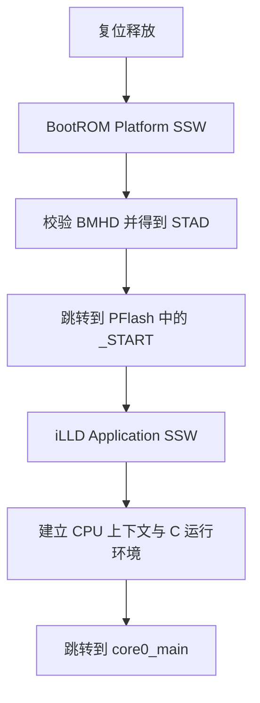
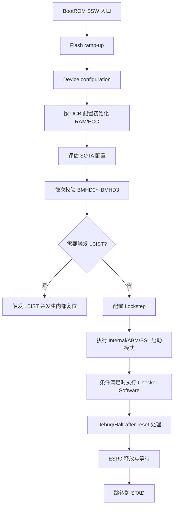
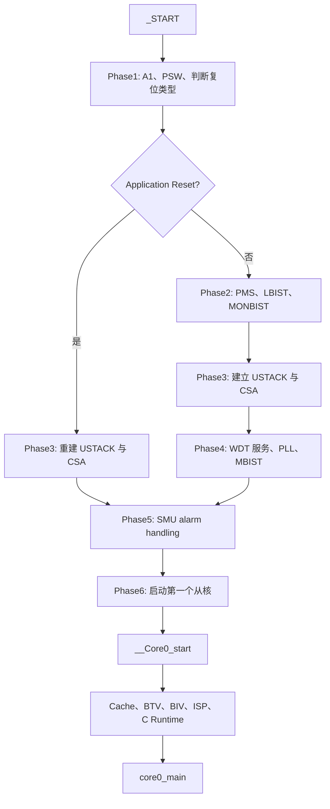
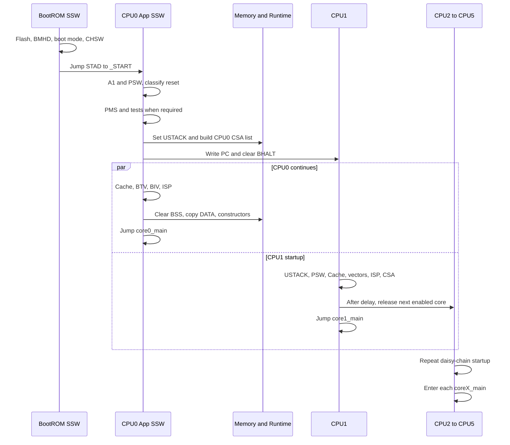

# AURIX TC3xx 从复位、`_START` 到 `coreX_main` 的完整启动过程

> 目标：把 TC3xx 启动过程拆成硬件复位、BootROM Platform SSW、用户工程 iLLD SSW、C 运行时初始化和多核启动五层，说明每一步做了什么、为什么必须这样做、依赖哪些寄存器和链接符号，以及顺序错误会产生什么后果。

---

## 0. 先给出结论：`_START` 不是芯片复位后的第一条指令

AURIX TC3xx 中存在两层容易混淆的“SSW”：

1. **BootROM Platform SSW**
   - 固化在芯片 BootROM 中；
   - 是复位后 CPU0 真正执行的第一段软件；
   - 负责 Flash ramp-up、芯片基础配置、可选 RAM/ECC 初始化、BMHD 校验、启动模式选择、LBIST/Lockstep、调试接口和 ESR0 等；
   - 最后从有效 BMHD 得到用户启动地址 `STAD`，跳转到用户代码。

2. **用户工程里的 iLLD Startup Software**
   - 典型文件为 `Ifx_Ssw_Tc0.c`、`Ifx_Ssw_Tc1.c` 等；
   - CPU0 的入口符号是 `_START`，其他核是 `_START1`～`_START5`；
   - 负责建立 C 程序运行环境：USTACK、CSA、Cache、BTV、BIV、ISP、小数据基址、C 数据初始化、C++ 构造函数以及多核启动；
   - 最后进入 `core0_main()`、`core1_main()` 等。

所以完整控制流是：



本文重点展开 `_START → coreX_main`，但先保留 BootROM SSW 这一层，否则无法解释 `_START` 的地址从哪里来、为什么只有 CPU0 先运行，以及 Application Reset 为什么走短路径。

---

# 1. 分析基线与适用范围

本文以以下材料为基线：

- AURIX TC39xB / TC397 六核产品；
- Infineon 官方 `AURIX_code_examples` 中 TC397 示例工程；
- 示例 SSW 文件标记的 iLLD 版本为 `iLLD_1_0_1_17_0_1`；
- 以 GNU/Tasking 链接脚本中的实际符号和值辅助说明；
- 芯片架构依据 TC1.6.2 Architecture Manual；
- 芯片 BootROM 行为依据 TC3xx Family User's Manual 的 Platform Firmware 章节。

不同 TC3xx 型号、iLLD 版本、编译器和项目配置会造成以下差异：

- CPU 核数不同；
- PFlash、DSPR、PSPR 地址和大小不同；
- USTACK、ISTACK、CSA 大小不同；
- 是否启用 PMS、PLL、LBIST、MONBIST、MBIST、SMU、EMEM callout 不同；
- C 初始化由 CPU0 统一执行还是各核独立执行不同；
- `main` 的名字可能是 `core0_main`、`main` 或由 AUTOSAR/OS 接管。

因此，本文给出的**启动依赖关系和硬件原理是通用的**，具体地址和开关值要以目标工程的 map 文件、链接脚本和 `Ifx_Cfg_Ssw.h` 为准。

---

# 2. 链接脚本先准备了什么

SSW 源码里的 `__USTACK(0)`、`__CSA(0)`、`__TRAPTAB(0)` 并不是硬件寄存器，而是链接脚本生成的符号。

## 2.1 TC397 示例中的关键配置

| 项目 | CPU0 示例值 | 作用 |
|---|---:|---|
| CSA 大小 | 8 KiB | 保存 Upper/Lower Context，共 128 个 64-byte CSA |
| USTACK 大小 | 2 KiB | CPU0 普通 C 函数栈 |
| ISTACK 大小 | 1 KiB | CPU0 中断/Trap 共用栈 |
| `_START` 地址 | `0xA0000000` | CPU0 用户启动入口，PFlash non-cached alias |
| Trap Table | `0x80000100` | CPU0 `BTV` 目标 |
| Interrupt Table | `0x802FE000` | CPU0 `BIV` 目标 |

从核入口示例为：

| CPU | `_STARTx` non-cached 地址 |
|---:|---:|
| CPU0 | `0xA0000000` |
| CPU1 | `0xA0300100` |
| CPU2 | `0xA0600100` |
| CPU3 | `0xA0900100` |
| CPU4 | `0xA0C00100` |
| CPU5 | `0xA0F00100` |

这些值不是 TC3xx 架构强制值，而是该 TC397 示例工程的链接布局。

## 2.2 为什么 `_START` 放在 non-cached PFlash alias

TC3xx PFlash 可以通过 cached 和 non-cached 地址窗口访问。示例将最早期入口放在 `0xA...` non-cached alias，核心考虑是：

- 此时应用自己的 PCache 配置还没有完成；
- 不希望最早期启动依赖 Cache 当前状态；
- 先用确定性的 non-cached 取指执行启动代码；
- 之后在 `__Core0_start()` 中配置 `PCON0.PCBYP`，再进入常规程序。

这属于从源码布局推导出的工程意图，不代表架构强制 `_START` 必须位于 `0xA...`。

## 2.3 USTACK、ISTACK、CSA 都来自链接布局

链接脚本通常在每个 CPU 的本地 DSPR 中预留：

```text
低地址
  普通变量/堆
  USTACK
  保护间隔
  ISTACK
  保护间隔
  CSA，64-byte 对齐
高地址
```

并生成类似符号：

```text
__USTACK0
__ISTACK0
__CSA0
__CSA0_END
__TRAPTAB_CPU0
__INTTAB_CPU0
__START0
```

SSW 只负责把这些链接结果装入 A10、ISP、FCX、LCX、BTV 和 BIV；内存区域本身由链接脚本分配。

---

# 3. `_START` 之前：BootROM Platform SSW

## 3.1 复位后的第一执行主体

TC3xx 复位后：

- CPU0 的 PC 从芯片规定的 BootROM SSW 入口开始；
- CPU1～CPU5 保持在 Halt/Boot Halt 状态；
- BootROM SSW 只在 CPU0 上执行；
- 最后由用户软件启动其他 CPU。

因此，BMHD 里的 `STAD=0xA0000000` 不是“CPU0 硬件复位向量”，而是 BootROM SSW 完成工作后跳转的**用户入口地址**。

## 3.2 BootROM SSW 主流程



### 这层为什么必须存在

此时芯片还不能假设 PFlash、时钟、RAM ECC、启动配置和调试权限处于应用可用状态。BootROM SSW 的目标不是建立 C 语言环境，而是把芯片从“复位硬件状态”带到“可以安全获取并执行用户入口”的状态。

## 3.3 BMHD 如何决定 `_START`

TC3xx 最多评估四组 BMHD，每组有 Original 和 Copy。核心字段如下：

| 字段 | 含义 |
|---|---|
| `BMI` | 启动模式、引脚选择、Lockstep、LBIST、CHSW 等配置 |
| `BMHDID` | 固定标识，合法值为 `0xB359` |
| `STAD` | 用户启动地址或 ABM Header 地址 |
| `CRCBMHD` | BMI、BMHDID、STAD 的 CRC |
| `CRCBMHD_N` | CRC 反码 |
| Confirmation | UCB 确认码 |

BootROM SSW 至少会检查：

1. UCB 状态是否合法；
2. `BMHDID` 是否正确；
3. BMI 编码是否合法；
4. `STAD` 是否位于 PFlash 且 word-aligned；
5. CRC 与反码是否同时正确；
6. 应采用 BMI 还是 HWCFG 引脚选择；
7. 最终启动模式及 `BOOT_ADDR`。

TC397 示例 BMHD 采用：

```text
BMI      = 0x00FE
BMHDID   = 0xB359
STAD     = 0xA0000000
```

链接脚本又把 `.start` 段固定在 `0xA0000000`，所以 BootROM 的最后跳转正好落到 `_START`。

## 3.4 冷启动、System Reset 和 Application Reset 的差别

| 项目 | Cold Power-on | System Reset | Application Reset |
|---|---|---|---|
| Flash 初始状态 | 复位，需 ramp-up | 复位，需 ramp-up | 保持 read mode |
| RAM 内容 | 未定义 | 一般保留复位前内容 | 保留 |
| 时钟 | 初始安全时钟 | 回到初始安全时钟 | 保持复位前状态 |
| BootROM SSW 路径 | 最完整 | 类似 warm power-on | 最短 |
| 用户 SSW 是否应重配 PMS/PLL | 通常需要 | 通常需要 | 通常跳过 |

这就是 iLLD 后面要再次识别 Application Reset 的原因：应用层 SSW 不能在 Application Reset 后无条件重做所有电源、时钟和 BIST 操作。

---

# 4. BootROM 跳到 `_START` 时，应用还缺什么

到达 `_START` 只说明用户指令已经可以被取到，不代表 C 程序已经可以正常运行。

| 资源 | `_START` 时是否可直接依赖 | 原因 |
|---|---:|---|
| CPU0 指令执行 | 是 | BootROM 已跳到 STAD |
| A10/USTACK | 否 | 尚未装入应用链接脚本给出的栈顶 |
| CSA Free List | 否 | 应用自己的 FCX/LCX 尚未建立 |
| 普通 `CALL` | 不应假设可用 | `CALL` 需要有效 CSA |
| A0/A1/A8/A9 | 不完整 | 小数据基址尚未全部建立 |
| BTV/BIV | 否 | 尚未指向应用 Trap/中断表 |
| ISP | 否 | 尚未指向应用 ISTACK |
| `.bss` | 否 | C clear table 尚未执行 |
| `.data` | 否 | ROM→RAM copy table 尚未执行 |
| C++ 全局对象 | 否 | 构造函数尚未执行 |
| 多核应用 | 否 | CPU1～CPU5 仍处于 Boot Halt |

所以 `_START` 之后最早期代码具有以下约束：

> 不能像普通 C 函数一样随意使用栈、全局变量和普通函数调用。

iLLD 为此使用：

- `ji`：只跳转，不创建 CALL/RET 上下文；
- `jli` + `ji a11`：只通过 A11 建立轻量返回链，不使用 CSA；
- 强制较高优化，尽量避免编译器生成栈帧；
- 在源码中明确要求早期 callout 不应实现成普通函数调用路径；
- 尽早建立 A10 和 CSA，之后才允许常规 C 调用。

这也是为什么不能随便在 `_START` 或 Phase2 中插入日志函数、复杂局部变量或普通驱动调用。

---

# 5. CPU0：`_START → __StartUpSoftware`

CPU0 `_START` 被放在链接脚本的 `.start` 段中，其逻辑只有一个目的：

```text
_START
   └─ ji __StartUpSoftware
```

它不是普通 C 函数调用，没有返回需求，也不应该消耗 CSA。

## 5.1 为什么使用 `ji` 而不是 `CALL`

`CALL` 会自动从 FCX 取一个 CSA 保存 Upper Context，但这时应用 CSA 还没有初始化。若直接执行普通 `CALL`，可能出现：

- FCX 指向无效区域；
- 产生 FCU Trap；
- Trap Table、ISP 和 CSA 又尚未就绪；
- 启动过程直接进入不可恢复状态。

使用 `ji` 不保存返回上下文，也不依赖 FCX，非常适合作为不可返回的启动阶段跳转。

---

# 6. CPU0 Application SSW 总流程



需要注意源码函数名 `Phase3PowerOnResetPath` 容易让人误解。实际分支条件是“是否为 Application Reset”，所以非 Application Reset 分支通常同时覆盖 Cold Power-on 和 System Reset。

---

# 7. Phase1：建立最小可执行环境并判断复位类型

入口函数为：

```text
__StartUpSoftware()
```

## 7.1 设置 A1 小数据基址

第一步建立：

```text
A1 = __SDATA2(0)
```

A1 通常作为 literal/constant small-data base。早期代码可能需要读取编译期常量和配置表，因此先建立 A1，而 A0/A8/A9 可以等到后面的完整 Core0 初始化阶段。

## 7.2 把 PSW 写成确定状态，并清除 `PSW.IS`

SSW 写入：

```text
PSW = IFX_CFG_SSW_PSW_DEFAULT
默认配置值 = 0x00000980
```

主要目的：

- warm start 时不继承不可预测的软件状态；
- 把权限、Call Depth 等字段恢复为 SSW 期望值；
- 明确清除 `PSW.IS`；
- 表示后续 A10 将作为 User Stack 使用。

此时 A10 还没有装入 USTACK，因此早期代码仍必须保持 stackless。写 `PSW.IS=0` 本身不会自动装载 A10。

## 7.3 判断是否为 Application Reset

`Ifx_Ssw_isApplicationReset()` 主要依据：

- `SCU_RSTSTAT` 中的 reset source；
- `SCU_RSTCON` 对该 reset source 配置的 reset type；
- 固定属于 Application Reset 的 CB3；
- CPU0 Kernel Reset 状态。

分支结果：

```text
非 Application Reset
    → Phase2 → Phase3 PowerOn path → Phase4

Application Reset
    → Phase3 Application path → 跳过 Phase2/Phase4
```

## 7.4 为什么 Application Reset 跳过 PMS 和 PLL

Application Reset 的硬件语义是：

- Flash 保持 read mode；
- RAM 保持；
- 时钟系统保持；
- 大量系统级配置保持。

如果应用层 SSW 无条件重新执行 PMS/PLL/BIST：

- 会显著延长恢复时间；
- 可能扰动正在保持的时钟和电源状态；
- 某些测试可能再次触发内部复位；
- 不符合 Application Reset 作为快速恢复路径的设计目的。

---

# 8. Phase2：电源和早期自检

Phase2 只在非 Application Reset 路径执行。

## 8.1 PMS/EVR 初始化

典型 callout：

```text
PMS/EVR init → read-back/check
```

目的不是重复 BootROM 的最低限度上电动作，而是把电源和监控配置从“芯片可启动状态”转换到“应用目标工作状态”。例如：

- EVR 工作点；
- 电压监控阈值；
- 应用要求的电源初始化序列；
- 配置结果回读检查。

电源状态必须先稳定，后面才适合提高 PLL/CPU 频率或执行大规模 RAM 测试。

## 8.2 LBIST

LBIST 用于逻辑自检，常见特点是：

- 通常只在 Cold Power-on 路径触发；
- 执行结束可能触发一次内部复位；
- 再次启动时通过 done 状态避免无限重复触发；
- 结果要由后续软件评估并决定故障反应。

BootROM BMHD 也能控制 LBIST，应用 SSW 又提供 LBIST callout。量产集成时必须统一测试责任，避免两套策略无意识叠加。

## 8.3 MONBIST

MONBIST 用于电压监控等模拟监控路径的自检。它通常涉及：

- 临时调整监控及报警配置；
- 避免测试期间误触发 FSP/中断；
- 启动测试并等待完成；
- 检查 `TSTOK/SMUERR/PMSERR` 等结果；
- 恢复监控环境。

## 8.4 为什么这一阶段不用普通 CALL

这时应用 CSA 尚未建立。iLLD 使用 `jli` 建立 A11 返回链接，并要求早期 callout 采用可内联、无栈或专门编写的启动实现。

源码中的“callout 不应实现为普通函数调用”是硬件依赖，不只是编码风格。如果把一个会生成 `CALL`、大量局部变量或嵌套调用的普通驱动直接塞进 Phase2，就可能在 FCX 尚未建立时破坏启动。

在官方 TC397 示例中，PMS 关键初始化函数采用 inline 实现，正是为了满足这一约束。

---

# 9. Phase3：建立 USTACK 和 CSA

这是 Application SSW 的关键分界点：

> Phase3 之前只能运行受严格限制的启动代码；Phase3 完成后，常规函数调用才有了应用自己的栈和 CSA 基础。

## 9.1 装载 User Stack

CPU0 执行：

```text
A10 = __USTACK0
DSYNC
```

此后：

```text
PSW.IS = 0
A10    = CPU0 USTACK top
```

二者逻辑一致，当前代码正式运行在 CPU0 User Stack 上。

## 9.2 初始化 CSA Free List

输入范围：

```text
__CSA0 ～ __CSA0_END
```

算法可以抽象为：

```c
n = (CSA_END - CSA_BEGIN) / 64;

for each CSA[i]:
    encode CSA[i] address to CX pointer;

FCX = pointer(CSA[0]);
CSA[0].link = pointer(CSA[1]);
CSA[1].link = pointer(CSA[2]);
...
CSA[n-1].link = 0;

LCX = pointer(CSA[n-3]);
DSYNC;
```

结果为：

```text
FCX
 ↓
CSA0 → CSA1 → CSA2 → ... → CSA[n-3] → CSA[n-2] → CSA[n-1] → NULL
                             ↑
                            LCX
```

## 9.3 为什么 LCX 指向倒数第三个 CSA

当一次上下文保存发现 `FCX == LCX` 时：

- 当前保存仍会完成；
- 随后触发 FCD Trap；
- FCD Trap 自身还需要一个 CSA；
- 在 FCD 处理中还可能出现异步 Trap，再需要一个 CSA。

因此 iLLD 把 LCX 放在倒数第三个 CSA，保留两个额外 CSA 作为异常余量。

TC397 示例每核 CSA 为 8 KiB：

```text
8192 / 64 = 128 个 CSA
```

但 128 个 CSA 并不等于可以有 128 层普通函数调用，因为中断、Trap、`BISR/SVLCX`、RTOS 上下文和保护余量也会消耗 CSA。

## 9.4 `DSYNC` 和 `ISYNC` 的意义

- `DSYNC`：确保 CSA 链表写入、FCX/LCX 相关数据操作在后续上下文使用前完成；
- `ISYNC`：清理/同步指令执行状态，使此前对控制寄存器和执行环境的修改在后续指令中可见。

屏障不是“延时指令”，而是建立硬件可观察的先后关系。

---

# 10. Phase4：时钟前的 WDT 服务、PLL 和 MBIST

Phase4 只在非 Application Reset 路径执行。

## 10.1 先读取并服务 CPU0 WDT 与 Safety WDT

PMS、PLL 和 MBIST 可能耗时，WDT 又默认处于使能状态。因此 SSW 在长操作前：

1. 获取 CPU0 WDT 密码；
2. 获取 Safety WDT 密码；
3. 更新/服务 CPU0 WDT；
4. 更新/服务 Safety WDT。

设计思想是：

> 先保证启动时间预算，再进入不可预测地较长的时钟锁定和内存测试。

## 10.2 初始化 PLL 和 Clock Tree

PLL 初始化把芯片从安全默认时钟切换到应用目标频率，通常涉及：

- 振荡器输入选择；
- PLL 分频和倍频；
- VCO lock 等待；
- K2 ramp；
- SRI/SPB/STM 等总线分频；
- Flash wait state 与频率关系；
- 时钟切换后的状态检查。

顺序上必须先保证供电和 Flash 访问条件，再提高频率。

## 10.3 MBIST

MBIST 用于目标 RAM 的硬件自检。它可能：

- 暂停目标 RAM 的正常访问；
- 破坏 RAM 原内容；
- 产生/清除 ECC 和 MBIST 告警；
- 需要与 CPU、LMU、DMA、HSM 等资源所有权协调。

因此 MBIST 适合放在应用和从核全面运行之前，并且必须根据 reset type 和数据保留需求选择性执行。

---

# 11. Phase5：SMU Alarm Handling

Phase5 在两条 reset 路径上都会经过：

```text
Power-on/System path ─┐
                     ├→ Phase5 SMU → Phase6
Application path ────┘
```

该 callout 用于：

- 检查 BootROM、PMS、LBIST、MONBIST、MBIST 等阶段遗留的 Alarm；
- 清除允许清除的启动期状态；
- 配置 Alarm reaction；
- 对不可接受故障执行停机、复位或安全状态；
- 避免带着不明确的安全告警进入多核应用。

官方示例中该 callout 默认可以为空；量产安全项目通常需要由安全启动策略补齐。

---

# 12. Phase6：以 Daisy-chain 启动其他 CPU

CPU0 不会一次性同时释放所有从核。典型策略是：

```text
CPU0 启动第一个启用的从核
CPU1 延时后启动 CPU2
CPU2 延时后启动 CPU3
...
```

`Ifx_Ssw_startCore()` 的核心动作是：

1. 把 `_STARTx` 地址右移一位，写入 `CPUx_PC.PC`；
2. 读取 `CPUx_SYSCON`；
3. 如果 `BHALT=1`，清除 `BHALT`；
4. 对应 CPU 从 `_STARTx` 开始取指。

地址右移一位是因为 `CPUx_PC.PC` 按半字地址编码，实际指令地址最低 bit 不直接存入字段。

## 12.1 为什么使用 Daisy-chain

主要考虑：

- 避免多个 CPU 同时从 Halt 释放造成瞬时电流阶跃；
- 给电源、时钟和 Flash/总线一定稳定时间；
- 减小所有 CPU 同时初始化 DSPR、Cache 和总线资源的争用；
- 让启动顺序可预测；
- 某个中间 CPU 未启用时，前一核可以直接启动后面的第一个有效 CPU。

官方实现中每个从核进入后，等待至少约 `100 us`，再释放下一个核。

## 12.2 CPU0 在启动从核后做什么

Phase6 启动第一个从核后，不等待整个链完成，而是立即跳转：

```text
__Core0_start
```

因此从这时起，CPU0 初始化和从核初始化可能并行执行。

---

# 13. `__Core0_start()`：建立完整 CPU0 运行环境

Phase3 只是让普通 CALL 成为可能，`__Core0_start()` 才把 CPU0 配置成可以进入应用的完整状态。

## 13.1 重新读取 WDT 密码

源码重新获取 CPU0 WDT 和 Safety WDT 密码，而不依赖前面阶段的局部值。

原因是启动过程跨越了多个跳转、callout 和可能修改寄存器的流程，重新获取当前密码比假设旧值仍然有效更稳妥。

## 13.2 打开 CPU ENDINIT 窗口

```text
clear CPU0 ENDINIT
```

随后配置受 CPU ENDINIT 保护的 CPU 控制状态。完成后立即重新置位 ENDINIT，缩小保护窗口。

## 13.3 配置 Program Cache

SSW 根据：

```text
IFX_CFG_SSW_ENABLE_TRICORE0_PCACHE
```

设置 `PCON0.PCBYP`：

| 配置 | `PCBYP` | 含义 |
|---|---:|---|
| Enable PCache | 0 | 非 bypass，允许使用 Program Cache |
| Disable PCache | 1 | bypass |

写 `PCON0` 后执行 `ISYNC`，确保后续取指看到新的 Cache 控制状态。

## 13.4 配置 Data Cache

类似地通过 `DCON0.DCBYP` 选择 Data Cache 是否 bypass。

这一阶段源码假设 Cache 处于无有效旧数据的初始化状态。若项目是特殊 warm-start、Bootloader 跳转或不经过标准 reset 的场景，必须额外检查 Cache invalidation 和内存一致性责任。

## 13.5 初始化 A0、A8、A9

此时建立完整的小数据寻址环境：

```text
A0 = __SDATA1(0)
A1 = __SDATA2(0)    // 早期已建立
A8 = __SDATA3(0)
A9 = __SDATA4(0)
```

这些寄存器是 Global Address Registers，不会随 CALL、中断或 Trap 自动保存恢复，所以必须在每个 CPU 启动时设置为该核编译/链接环境期望的值。

## 13.6 配置 BTV、BIV、ISP

CPU0 写入：

```text
BTV = __TRAPTAB_CPU0
BIV = __INTTAB_CPU0
ISP = __ISTACK0
```

作用分别为：

| 寄存器 | 作用 |
|---|---|
| `BTV` | Trap Class 向量表基地址 |
| `BIV` | 中断向量表基地址 |
| `ISP` | 当 `PSW.IS=0` 时首次进入中断/Trap所加载的 ISTACK 栈顶 |

这一步必须在允许中断、运行复杂 C 初始化和用户构造函数之前完成，否则一个早期 Trap 可能跳到错误向量或使用错误 ISTACK。

但仅有 BTV/BIV/ISP 仍不够，前面还必须已经有：

- 有效 FCX/LCX；
- 有效 USTACK；
- 正确的 `PSW.IS=0`。

## 13.7 可选 EMEM 初始化

如果目标是带 EMEM 的 Emulation Device，可通过 callout：

- 打开 EMEM 时钟；
- 执行解锁序列；
- 使后续调试/追踪或应用代码能够访问 EMEM。

## 13.8 关闭 ENDINIT 窗口

```text
set CPU0 ENDINIT
```

从这一点开始，CPU0 关键控制寄存器已经回到写保护状态。

## 13.9 暂时禁用 CPU0 WDT 和 Safety WDT

源码明确说明：C 初始化函数不会周期服务 WDT。因此标准示例在执行清零、复制和 C++ 构造函数前暂时禁用两类 WDT。

工程含义是：

- `.bss/.data` 较大时，C init 时间可能明显增长；
- C++ 构造函数耗时更加不确定；
- 启动阶段若不提供专门的 WDT service point，可能在到达 main 前复位。

量产安全软件不一定应该照搬“禁用 WDT”。更稳妥的策略可能是：

- 计算最坏 C init 时间并配置足够窗口；
- 在 copy/clear 循环中受控服务 WDT；
- 保持 Safety WDT 的安全策略；
- 将 WDT 管理纳入启动状态机和安全需求。

## 13.10 `hardware_init_hook()`

执行时机：

```text
USTACK/CSA/Cache/BTV/BIV/ISP 已完成
C 全局数据尚未初始化
```

因此它适合：

- 不依赖 `.data/.bss` 的板级硬件扩展；
- 编译器运行库前的低级硬件准备；
- 必须先于全局构造函数完成的硬件动作。

不适合直接依赖：

- 已初始化全局变量；
- 零初始化静态变量；
- C++ 全局对象；
- 尚未复制到 RAM 的代码或数据。

## 13.11 C Runtime 和 C++ 初始化

```text
Ifx_Ssw_doCppInit()
```

内部主要执行：

1. clear table；
2. copy table；
3. 编译器对应的 C/C++ 初始化入口；
4. C++ 静态对象构造函数。

后面单独展开。

## 13.12 `software_init_hook()`

此时 C 数据和构造函数已经完成，因此该 Hook 可以正常使用：

- 全局变量；
- 静态变量；
- C++ 对象；
- 常规库函数；
- 已建立的应用软件状态。

这就是 hardware hook 和 software hook 的关键边界。

## 13.13 恢复 WDT 策略并进入 main

标准源码随后：

1. 重新使能 Safety WDT；
2. 若 CPU0 被配置为不用，则请求 CPU0 Idle；
3. 重新使能 CPU0 WDT；
4. 跳转到 `core0_main()`。

默认路径使用不可返回的 `ji`，而不是普通 `CALL`：

```text
__Core0_start → ji core0_main
```

因为嵌入式主函数通常不应返回。若定义 `IFX_CFG_SSW_RETURN_FROM_MAIN`，则允许 main 返回，并执行 C++ exit/destructor 逻辑，最终仍进入无限循环。

---

# 14. C Runtime 到底初始化了哪些内存

这是 BootROM RAM 初始化和 C 初始化最容易混淆的地方。

## 14.1 clear table

链接器生成 `__clear_table`，每个条目包含：

```text
目标地址 + 长度
```

SSW 遍历表项，把对应区域清零，典型对象是：

```text
.bss
未显式初始化的全局变量
未显式初始化的 static 变量
```

终止条目的长度为 `0xFFFFFFFF`。

## 14.2 copy table

链接器生成 `__copy_table`，每个条目包含：

```text
Load Address + Run Address + Length
```

SSW 把初值从 PFlash 复制到 RAM，典型对象是：

```c
uint32 g_value = 0x12345678;
```

其初始镜像位于 PFlash，运行实体位于 DSPR/LMU。

## 14.3 各类区域是否会被 C init 修改

| 区域 | 默认 C init 行为 |
|---|---|
| `.bss` | 清零 |
| `.data` | 从 Load Address 复制到 Run Address |
| `.rodata` | 通常直接留在 PFlash，不复制 |
| `.noinit` / retained section | 不应进入 clear/copy table |
| USTACK | 不整体清零，只设置栈顶 |
| ISTACK | 不整体清零，只设置 ISP |
| CSA | 只写每个 CSA 的 Link Word 建链，不清整个 64-byte 内容 |
| Heap | 一般不整体清零，由运行库管理 |

## 14.4 BootROM RAM 初始化与 C init 的本质区别

| 对比项 | BootROM Platform SSW RAM init | iLLD C Runtime init |
|---|---|---|
| 控制来源 | UCB/`DMU_HF_PROCONRAM` | 链接器 clear/copy table |
| 目标 | 选定的物理 RAM | 选定的 C section |
| 主要目的 | 建立已知 RAM/ECC 状态 | 满足 C/C++ 语言初始化语义 |
| 是否处理 ECC | 是，写入数据并建立正确 ECC | 通过正常写入间接更新所访问单元 ECC |
| 是否覆盖整个 RAM | 取决于 UCB 配置 | 否，只处理表中的 section |
| reset type | 可针对 cold/warm 配置 | 每次走到 C init 通常都会执行 |

因此你之前在用户启动代码里没看到“所有 RAM 初始化”是正常的：

> TC3xx 的全 RAM/ECC 初始化可以在 BootROM Platform SSW 层由 UCB 配置完成；用户 iLLD SSW 主要只完成 C section 初始化。

## 14.5 Application Reset 下的数据保留陷阱

Application Reset 虽然硬件保留 RAM，但标准 iLLD 重新进入 C init 后仍可能：

- 把 `.bss` 再次清零；
- 把 `.data` 恢复为 PFlash 初值；
- 重建 USTACK；
- 重建 CSA Free List；
- 重新执行 C++ 构造函数。

所以需要跨 Application Reset 保留的数据必须：

- 放进 `.noinit`/retention section；
- 不出现在 clear/copy table；
- 确保 BootROM RAM init 配置不会覆盖对应物理 RAM；
- 增加 magic、CRC、version 和 reset reason 校验；
- 不保存并继续使用旧 CSA Call Chain 或旧栈帧。

---

# 15. 从核：`_STARTx → __Corex_start → coreX_main`

CPU1～CPU5 的启动结构相近。以 CPU1 为例：

```text
CPU0 写 CPU1_PC = __START1 >> 1
CPU0 清 CPU1_SYSCON.BHALT
CPU1 从 _START1 取指
_START1 → ji __Core1_start
```

## 15.1 从核初始化顺序

1. 读取 STM0 起始时间，用于后续至少 100 us 间隔；
2. 获取本核 CPU WDT 密码；
3. `A10 = __USTACK(core)`；
4. `DSYNC`；
5. 写入默认 PSW，清 `PSW.IS`；
6. 清本核 CPU ENDINIT；
7. 配置本核 PCache；
8. 配置本核 DCache；
9. 配置本核 BTV；
10. 配置本核 BIV；
11. 配置本核 ISP；
12. 恢复本核 CPU ENDINIT；
13. 设置 A0/A1/A8/A9；
14. 建立本核 CSA Free List 和 LCX；
15. `ISYNC`；
16. 等待与前一核释放至少约 100 us；
17. 启动 Daisy-chain 中的下一核；
18. 根据配置决定是否执行本核独立 C init；
19. 跳转 `coreX_main()`。

## 15.2 为什么每个核都有自己的 USTACK、ISTACK 和 CSA

这些资源都是 CPU 上下文的一部分：

- A10 是每核私有 GPR；
- BTV/BIV/ISP 是每核 CSFR；
- FCX/LCX/PCXI 是每核上下文链；
- 中断由目标 CPU 独立响应；
- 普通函数 CALL 由当前 CPU 消耗本核 CSA。

因此不能让多个 CPU 共用同一条 CSA Free List。ISTACK 也通常按核划分，而不是六个 CPU 共用一块中断栈。

## 15.3 从核何时执行 C init

默认：

```text
IFX_CFG_SSW_ENABLE_INDIVIDUAL_C_INIT = 0
```

通常由 CPU0 统一执行共享 clear/copy table 和构造函数，从核不重复初始化。

如果启用 individual C init，则每核可能执行自己的 Hook 和 C 初始化，但其具体 section 所有权和工具链支持必须核对，不能让多个核同时清零或复制同一共享区域。

---

# 16. 多核启动时序图



这个时序揭示了一个重要事实：

> CPU0 启动 CPU1 后，CPU0 的 C init 和 CPU1 的本地初始化可能并行。

因此生产软件必须定义明确的全局初始化完成屏障。

---

# 17. 多核 C 初始化的竞态风险

假设 CPU0 正在执行：

```text
clear .bss
copy .data
run constructors
```

而 CPU1 已经进入 `core1_main()`，开始访问共享全局变量，就可能出现：

- CPU1 读到 C init 前的 RAM 残值；
- CPU1 写入的变量随后又被 CPU0 clear table 清零；
- CPU1 读取 `.data` 时，CPU0 还没有完成复制；
- 多核同步变量本身被 C init 重写；
- Cache 可见性和内存屏障不足。

推荐的软件策略是：

1. CPU0 在完成 C init 后设置 `C_INIT_DONE`；
2. 标志放在不会被后续 clear table 重写的位置，或保证设置时机晚于 clear；
3. 设置标志前执行合适的数据同步屏障；
4. 从核在访问任何共享 C 数据前等待该标志；
5. 再执行多核应用级 barrier；
6. 对 Cacheable shared data 明确一致性策略。

示意：

```c
/* CPU0, after C init */
shared_init_done = 1;
dsync();

/* Secondary core, before shared globals */
while (shared_init_done == 0) {
    /* wait */
}
dsync();
```

具体变量属性、Cache 策略和屏障应按编译器、内存区域和 OS 架构进一步设计，不能只依赖 `volatile`。

---

# 18. 关键寄存器在启动过程中的变化

| 阶段 | PC | A10 | PSW.IS | FCX/LCX | BTV/BIV/ISP | A0/A1/A8/A9 | C 数据 |
|---|---|---|---:|---|---|---|---|
| 复位后 | BootROM SSW | 不能依赖应用值 | 复位状态 | 不能依赖应用链 | 复位/BootROM 状态 | 不能依赖应用值 | 未初始化 |
| BootROM 结束 | `STAD` | 仍非应用最终值 | 不应假设 | 应用链未建立 | 应用值未建立 | 应用值未完整建立 | 未初始化 |
| Phase1 | App SSW | 仍不得常规使用 | 0 | 未建立 | 未建立 | A1 已设置 | 未初始化 |
| Phase3 后 | App SSW | USTACK top | 0 | FCX/LCX 已建立 | 未全部建立 | A1 已设置 | 未初始化 |
| Core0 基础配置后 | App SSW | USTACK 当前值 | 0 | 可用 | BTV/BIV/ISP 已设置 | 全部建立 | 未初始化 |
| C init 后 | App SSW | USTACK 当前值 | 0 | 可用 | 可用 | 可用 | `.bss/.data` 和构造函数完成 |
| `core0_main` | 用户程序 | USTACK | 0 | 正常消耗/回收 | 已配置 | 已配置 | 可用 |

`PCXI` 的前一上下文链头依赖复位状态和后续 CALL；`Ifx_Ssw_initCSA()` 明确建立的是 FCX、LCX 和 Free List Link Word，不应误认为它把所有 CSA 内容以及所有 PCXI 字段整体清零。

---

# 19. 为什么这个顺序不能随意调整

| 顺序约束 | 硬件原因 | 违反后的典型后果 |
|---|---|---|
| `_START` 前由 BootROM 校验 BMHD | 必须先确认启动模式和入口合法 | 无法进入用户代码或进入 BSL/NOP loop |
| 早期使用 `ji/jli`，避免普通 CALL | CALL 依赖 FCX/CSA | FCU Trap、上下文写入非法地址 |
| 先设置 USTACK，再运行常规 C | C 编译器可能生成栈帧 | A10 指向未知区域，破坏 RAM |
| 先建 CSA，再允许普通函数调用 | CALL/Trap/IRQ 都会消耗 CSA | FCU/CSU/CTYP 等 Context Trap |
| 先 PMS，再提高 PLL | 高频需要可靠供电 | 时序失败、监控告警、不可预测运行 |
| 长操作前处理 WDT | PLL/BIST/C init 可能超时 | 启动途中反复复位 |
| 先配 BTV/BIV/ISP，再允许复杂运行 | 早期异常需要有效入口和栈 | Trap 二次失败、错误跳转 |
| C init 后再使用全局变量 | C 语言初值尚未建立 | 读到残值或被后续清零 |
| 多核访问共享数据前建立 barrier | CPU0 与从核并行启动 | 全局初始化竞态 |
| Main 前恢复 ENDINIT | 缩小关键寄存器写窗口 | 关键安全配置可被意外修改 |

---

# 20. 与 PSW.IS、USTACK、ISTACK、CSA 串起来理解

启动结束准备进入 `core0_main` 时，CPU0 的关键状态是：

```text
PSW.IS = 0
A10    = CPU0 USTACK current SP
ISP    = CPU0 ISTACK top
FCX    = CPU0 Free CSA List head
LCX    = CPU0 CSA depletion threshold
BTV    = CPU0 Trap Table
BIV    = CPU0 Interrupt Table
```

此时发生第一层中断：

1. 硬件从 FCX 取 CSA；
2. 保存任务 Upper Context，其中包括 A10 和旧 PSW；
3. A11 写入返回 PC；
4. 发现旧 `PSW.IS=0`；
5. 执行 `A10=ISP`；
6. 设置 `PSW.IS=1`；
7. 从 BIV 进入 ISR。

因此 SSW 中的 USTACK、CSA、BIV 和 ISP 初始化不是四件独立小事，而是在共同构造一条完整异常链：

```text
被中断任务栈 A10
        ↓ 保存到
Upper CSA ← FCX
        ↓
A10 切换到 ISP
        ↓
BIV/BTV 找到 Handler
```

缺少任何一项，main 中一旦开启中断或发生 Trap，异常处理都可能失效。

---

# 21. 标准示例中哪些功能默认开关

以本文使用的 TC397 官方示例配置为例：

| 功能 | 默认状态 |
|---|---:|
| PMS/EVR Init | 开启 |
| PMS 配置检查 | 开启 |
| PLL Init | 开启 |
| LBIST callout | 关闭 |
| MONBIST callout | 关闭 |
| MBIST callout | 关闭 |
| SMU callout | 关闭 |
| EMEM Init | 关闭 |
| CPU0～CPU5 | 开启 |
| 各核 PCache | 默认开启 |
| 各核 DCache | 默认开启 |
| Individual C Init | 默认关闭 |

这说明官方 SSW 是一个**启动框架**，并不代表完整量产安全启动策略已经自动实现。尤其是 MBIST、SMU、WDT、Alarm reaction、reset reason 和数据保持策略，需要项目自己定义。

---

# 22. 调试 `_START → main` 的推荐断点

## 22.1 CPU0 断点顺序

```text
1. _START
2. __StartUpSoftware
3. __StartUpSoftware_Phase2
4. __StartUpSoftware_Phase3PowerOnResetPath
5. __StartUpSoftware_Phase3ApplicationResetPath
6. __StartUpSoftware_Phase4
7. __StartUpSoftware_Phase5
8. __StartUpSoftware_Phase6
9. __Core0_start
10. Ifx_Ssw_doCppInit
11. core0_main
```

## 22.2 从核断点

```text
_START1 → __Core1_start → core1_main
_START2 → __Core2_start → core2_main
...
```

## 22.3 每个阶段建议观察的寄存器

| 断点 | 建议检查 |
|---|---|
| `_START` | PC 是否等于 BMHD.STAD、RSTSTAT、STMEM1/2 |
| Phase1 后 | A1、PSW、PSW.IS、reset path |
| Phase3 后 | A10、FCX、LCX、CSA 首尾 Link Word |
| Phase4 前后 | WDT 状态、PLL lock、CCUCON、STM 频率 |
| `__Core0_start` | ENDINIT、PCON0、DCON0 |
| Vector 配置后 | BTV、BIV、ISP |
| C init 前后 | `.bss`、`.data`、clear/copy table |
| `core0_main` | A0/A1/A8/A9、A10、FCX、LCX、ICR.IE |
| 从核启动失败 | `CPUx_PC.PC`、`CPUx_SYSCON.BHALT`、从核 PC |

SSW 本身通常不会替应用打开普通中断。官方示例是在 `core0_main()` 开头调用中断使能接口。因此 BIV/ISP/CSA 配好与 ICR.IE 真正置位是两个不同时间点。

---

# 23. 常见故障与定位路径

## 23.1 完全进不了 `_START`

优先检查：

- BMHD UCB 状态是否 Confirmed/Unlocked；
- `BMHDID` 是否为 `0xB359`；
- STAD 是否与 `.start` 链接地址一致；
- BMHD CRC 与反码是否正确；
- 启动模式是否被 HWCFG 引脚覆盖；
- 是否进入 BSL、ABM 或 no-boot NOP loop；
- Debug Interface 是否被锁；
- 是否请求 Halt After Reset。

## 23.2 命中 `_START`，但早期跑飞

优先检查：

- 是否在 Phase3 前新增了普通函数调用；
- 编译器是否为早期函数生成了栈帧；
- A1 小数据基址是否与链接脚本一致；
- `IFX_CFG_SSW_PSW_DEFAULT` 是否正确；
- 自定义 PMS/BIST callout 是否满足 stackless/inline 约束。

## 23.3 出现 Class 3 Context Trap

| Trap | 重点检查 |
|---|---|
| FCD | CSA 余量不足、LCX 设置、递归/中断嵌套过深 |
| FCU | FCX 为 0、CSA 链未初始化、链表损坏 |
| CSU | PCXI.PCX 为 0 却执行恢复 |
| CTYP | PCXI.UL 与 RET/RFE/RSLCX 预期不一致 |

## 23.4 在 C init 或 main 前反复复位

检查：

- CPU/Safety WDT 是否被正确处理；
- C init 数据量和最坏时间；
- PLL 切换是否失败；
- PMS/MBIST 是否进入错误分支；
- SMU 是否配置了立即复位 reaction；
- Application Reset 是否形成复位循环。

## 23.5 从核不启动

检查：

- `IFX_CFG_SSW_ENABLE_TRICOREx`；
- `_STARTx` 链接地址；
- `CPUx_PC.PC` 是否写入地址右移一位后的值；
- `CPUx_SYSCON.BHALT` 是否清零；
- 从核 WDT/ENDINIT 状态；
- 从核本地 DSPR 中 USTACK/ISTACK/CSA 布局；
- Daisy-chain 中前一核是否在启动下一核前卡死。

## 23.6 Application Reset 后保留数据丢失

检查：

- 数据是否仍在 `.bss` 或 `.data`；
- 是否被 `__clear_table` 或 `__copy_table` 覆盖；
- 是否被 BootROM RAM init 配置覆盖；
- 所在 RAM 是否真的由 Application Reset 保持；
- 是否缺少 magic/CRC/reset reason 校验；
- Cache 是否在复位边界存在未写回数据。

---

# 24. 建议的系统级验证用例

## 24.1 链接一致性测试

从 ELF/map 文件提取并核对：

```text
BMHD.STAD == _START 地址
__USTACKx 位于对应 CPU DSPR
__ISTACKx 位于对应 CPU DSPR
__CSAx 64-byte 对齐
BTV 满足 Trap Table 对齐
BIV 满足中断向量模式和对齐
```

## 24.2 Reset Matrix

分别执行：

- Cold Power-on；
- System Reset；
- Application Reset；
- CPU Kernel Reset；
- WDT 触发的不同 reset reaction。

记录每种情况下：

- BootROM SSW 路径；
- iLLD Phase 分支；
- PLL/PMS 是否重配；
- RAM 是否保留；
- `.bss/.data` 是否重新初始化；
- USTACK/CSA 是否重建；
- main 到达时间。

## 24.3 CSA 构造测试

Phase3 后验证：

- FCX 指向第一块 CSA；
- 每个 Link Word 指向下一块；
- 最后一块 Link Word 为 0；
- LCX 指向倒数第三块；
- CSA 数量等于 size/64；
- 连续 CALL/RET 后 FCX 和 PCXI 链能够正确回收。

## 24.4 异常环境测试

在完成 BTV/BIV/ISP/CSA 配置后，主动制造：

- SYSCALL；
- 对齐 Trap；
- 软件中断；
- 嵌套中断。

验证：

- Upper CSA 地址；
- A10 从 USTACK 切换到 ISTACK；
- `PSW.IS` 从 0 变为 1；
- `RFE` 后 A10、PSW、PCXI 恢复。

不要在 BTV/ISP/CSA 尚未完整建立时故意注入 Trap，除非测试目标就是早期启动失效安全路径。

## 24.5 多核启动与共享数据测试

- 记录每核 `_STARTx` 和 `coreX_main` 时间戳；
- 验证相邻从核释放间隔；
- 在 CPU0 C init 期间让从核等待显式 barrier；
- 检查 CPU0 清零 `.bss` 不会覆盖已被从核使用的同步标志；
- 验证各核 A0/A1/A8/A9、BTV/BIV/ISP、FCX/LCX 均为本核值。

---

# 25. 最终形成一条完整心智链

```text
硬件复位
  ↓
CPU0 从 BootROM SSW 入口执行，其他 CPU 保持 Halt
  ↓
Flash ramp-up、设备配置、RAM/ECC、BMHD、启动模式、CHSW
  ↓
BMHD.STAD 指向用户工程 _START
  ↓
_START 使用 ji，避免尚未建立的 CSA
  ↓
A1 + PSW，识别 Application Reset
  ↓
必要时执行 PMS、LBIST、MONBIST
  ↓
A10 = USTACK，建立 FCX/LCX 和 CSA Free List
  ↓
必要时服务 WDT、配置 PLL、执行 MBIST
  ↓
处理 SMU Alarm
  ↓
CPU0 释放第一个从核，形成 Daisy-chain
  ↓
CPU0 配置 Cache、A0/A8/A9、BTV、BIV、ISP
  ↓
处理 WDT，执行 clear table、copy table、C++ 构造函数
  ↓
software_init_hook
  ↓
跳转 core0_main

从核并行：
_STARTx → USTACK/PSW → Cache/BTV/BIV/ISP → A0/A1/A8/A9 → CSA
        → 延时后启动下一核 → coreX_main
```

从系统设计角度，SSW 的本质不是“把几个寄存器初始化一下”，而是逐层解除依赖：

```text
先保证芯片可取指
→ 再保证早期无栈代码可执行
→ 再建立函数调用上下文
→ 再建立异常处理环境
→ 再建立 C 语言内存语义
→ 最后才允许多核应用和中断全面运行
```

---

# 26. 参考资料与源码定位

## Infineon 手册

1. [TC3xx Family User's Manual Part 1](sandbox:/workspace/scratch/5d403d1bfad4/project_sources/05-TC3xx-User-Manual-part1.pdf)
   - Chapter 3：AURIX TC3xx Platform Firmware；
   - 3.1.1：BootROM Startup Software；
   - 3.1.1.6：BMHD Evaluation；
   - 3.1.1.7：SSW Main Flow；
   - 3.1.1.7.9：Jump to User Code。

2. [TC3xx Architecture Vol.1](sandbox:/workspace/scratch/5d403d1bfad4/project_sources/01-TC3xx-Architecture-vol1.pdf)
   - Chapter 3：GPR、PSW、A10、ISP；
   - Chapter 4：CSA、FCX、LCX、PCXI；
   - Chapter 5：Interrupt Entry；
   - Chapter 6：Trap Entry。

## Infineon 官方源码

- [AURIX_code_examples 官方仓库](https://github.com/Infineon/AURIX_code_examples)
- [TC397 `Ifx_Ssw_Tc0.c`](https://github.com/Infineon/AURIX_code_examples/blob/cdab098f0a4fdcbf107d6186826f9bbf86cb7e00/code_examples/ADC_Filtering_1_KIT_TC397_TFT/Libraries/Infra/Ssw/TC39B/Tricore/Ifx_Ssw_Tc0.c)
- [TC397 `Ifx_Ssw_Tc1.c`](https://github.com/Infineon/AURIX_code_examples/blob/cdab098f0a4fdcbf107d6186826f9bbf86cb7e00/code_examples/ADC_Filtering_1_KIT_TC397_TFT/Libraries/Infra/Ssw/TC39B/Tricore/Ifx_Ssw_Tc1.c)
- [TC397 `Ifx_Ssw_Infra.h`](https://github.com/Infineon/AURIX_code_examples/blob/cdab098f0a4fdcbf107d6186826f9bbf86cb7e00/code_examples/ADC_Filtering_1_KIT_TC397_TFT/Libraries/Infra/Ssw/TC39B/Tricore/Ifx_Ssw_Infra.h)
- [TC397 `Ifx_Ssw_CompilersGcc.h`](https://github.com/Infineon/AURIX_code_examples/blob/cdab098f0a4fdcbf107d6186826f9bbf86cb7e00/code_examples/ADC_Filtering_1_KIT_TC397_TFT/Libraries/Infra/Ssw/TC39B/Tricore/Ifx_Ssw_CompilersGcc.h)
- [TC397 BMHD 配置](https://github.com/Infineon/AURIX_code_examples/blob/cdab098f0a4fdcbf107d6186826f9bbf86cb7e00/code_examples/ADC_Filtering_1_KIT_TC397_TFT/Configurations/Ifx_Cfg_SswBmhd.c)
- [TC397 GNU 链接脚本](https://github.com/Infineon/AURIX_code_examples/blob/cdab098f0a4fdcbf107d6186826f9bbf86cb7e00/code_examples/ADC_Filtering_1_KIT_TC397_TFT/Lcf_Gnuc_Tricore_Tc.lsl)

---

## 附：读源码时最值得盯住的函数链

```text
BootROM SSW
  └─ jump BMHD.STAD
      └─ _START
          └─ __StartUpSoftware
              ├─ __StartUpSoftware_Phase2
              ├─ __StartUpSoftware_Phase3PowerOnResetPath
              ├─ __StartUpSoftware_Phase3ApplicationResetPath
              ├─ __StartUpSoftware_Phase4
              ├─ __StartUpSoftware_Phase5
              └─ __StartUpSoftware_Phase6
                  ├─ start first secondary core
                  └─ __Core0_start
                      ├─ Cache/BTV/BIV/ISP
                      ├─ hardware_init_hook
                      ├─ Ifx_Ssw_doCppInit
                      │   ├─ clear table
                      │   ├─ copy table
                      │   └─ C++ constructors
                      ├─ software_init_hook
                      └─ core0_main

Secondary core:
_STARTx
  └─ __Corex_start
      ├─ USTACK/PSW
      ├─ Cache/BTV/BIV/ISP
      ├─ A0/A1/A8/A9
      ├─ CSA
      ├─ start next core
      └─ coreX_main
```
