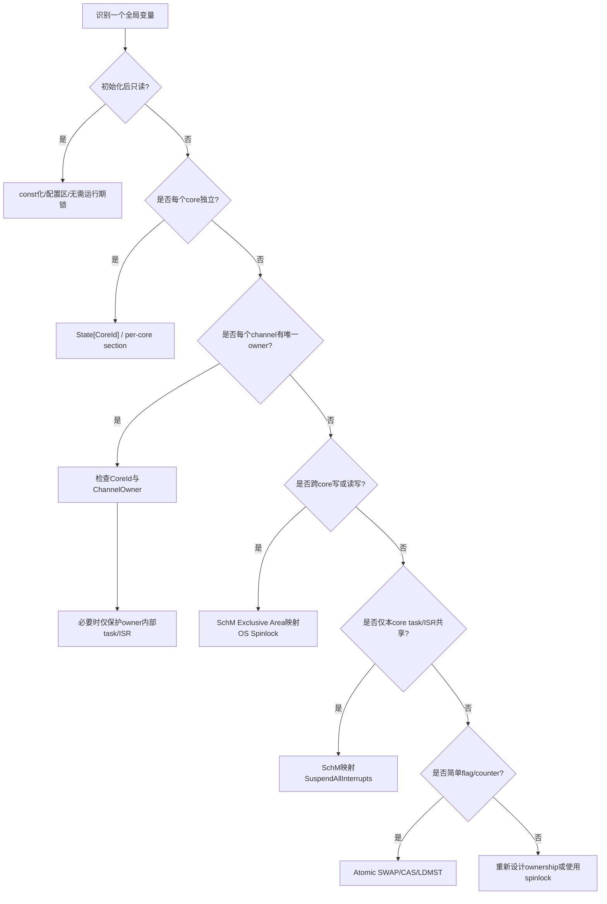

# AURIX TC3xx MCAL 全局变量多核保护设计说明

> 讲解主线：**Why → What → How**  
> 适用对象：AURIX TC3xx / TriCore 多核平台上的 AUTOSAR Classic MCAL、复杂驱动、底层驱动、Boot/Startup 及安全相关驱动开发。  
> 说明：本文以 AURIX TC3xx 硬件机制和 AUTOSAR MCAL 工程习惯为基础，给出系统化设计方法。具体函数名、模块名前缀、SchM 映射、Spinlock 名称需以项目使用的 MCAL 版本、OS 配置和代码生成结果为准。

---

## 0. 核心结论

AURIX TC3xx 的 MCAL 对全局变量的多核保护，不是简单地“所有 global 都加锁”，而是按变量共享属性分层处理：

```text
能不共享 → 不共享
必须共享 → 明确 owner / core / channel / partition
必须并发访问 → SchM Exclusive Area / OS Spinlock / MCAL Spinlock
简单原子标志 → TriCore atomic instruction / compiler intrinsic
只防本核 ISR → Suspend/Resume interrupt
涉及 DMA/cache/外设寄存器 → ownership + barrier/cache 维护 + SchM
```

最重要的工程判断：

```text
关中断只能保护当前 core 内的 task/ISR 竞争，不能保护其他 core。
ENDINIT/SE/ACCEN/MPU 是访问保护，不是互斥锁。
volatile 只能抑制编译器优化，不提供原子性，也不提供多核互斥。
```

---

## 1. WHY：为什么 MCAL 全局变量需要多核保护

### 1.1 AURIX TC3xx 是多核共享资源架构

TC3xx 高端器件包含多个 TriCore CPU。多个 core 可以访问：

- 全局 RAM：LMU、DLMU、部分共享 RAM；
- 外设寄存器：QSPI、MCMCAN、GTM、EVADC、CCU6、DMA、SCU 等；
- 中断控制与服务请求节点；
- DMA buffer、通信 buffer、driver runtime state；
- 软件全局状态：driver state、job state、sequence state、channel owner、callback pointer 等。

因此，MCAL 中的一个 `static` 全局变量，只要被两个 core 同时访问，就可能出现竞态。

---

### 1.2 典型竞态问题

#### 1.2.1 Lost update：读改写丢失

```c
/* Core0 */
Module_Counter = Module_Counter + 1U;

/* Core1 */
Module_Counter = Module_Counter + 1U;
```

如果两个 core 同时读到旧值 `10`，最后可能都写回 `11`，而不是期望的 `12`。

---

#### 1.2.2 状态机被交叉破坏

```text
Core0: Module_State = BUSY
Core1: Module_State = IDLE
Core0: 写寄存器启动传输
Core1: 认为模块空闲并重新配置
```

这种问题在 SPI/QSPI、ADC、PWM、GTM、CAN、FLS 异步驱动里很常见。

---

#### 1.2.3 软件 shadow 与硬件寄存器不一致

很多 MCAL 不会每次都从寄存器读完整状态，而会维护 shadow：

```c
static uint32 Port_OutputShadow[PORT_GROUP_COUNT];
static Spi_SeqResultType Spi_SeqResult[SPI_SEQUENCE_COUNT];
static Can_ControllerStateType Can_ControllerState[CAN_CONTROLLER_COUNT];
```

如果 shadow 更新和真实寄存器写入没有放在同一个临界区，可能出现：

```text
软件认为已经配置完成
硬件实际还没配置 / 被另一个 core 改掉 / 中途被 ISR 打断
```

---

#### 1.2.4 同一外设被多个 core 同时操作

例如一个 QSPI hardware unit 被两个 core 同时发起异步传输：

```text
Core0: Spi_AsyncTransmit(Seq0)
Core1: Spi_AsyncTransmit(Seq1)
```

如果没有 core ownership 或 spinlock：

- TX FIFO 可能被混写；
- Job/Sequence 状态可能覆盖；
- ISR 回调归属不清；
- DMA channel 配置可能互相覆盖；
- 传输完成状态可能误判。

---

### 1.3 为什么不能只靠 `SuspendAllInterrupts()`

`SuspendAllInterrupts()` 或关中断只影响**当前执行 core**。例如：

```text
Core0: SuspendAllInterrupts();
Core0: 修改 GlobalState

Core1: 仍然可以运行
Core1: 仍然可以修改 GlobalState
```

所以：

| 场景 | 关中断是否足够 |
|---|---:|
| 同一 core 内 task 与 ISR 共享变量 | 通常够 |
| 同一 core 内多个 ISR 共享变量 | 取决于中断屏蔽等级 |
| Core0 task 与 Core1 task 共享变量 | 不够 |
| Core0 ISR 与 Core1 task 共享变量 | 不够 |
| Core0 与 DMA 共享 buffer | 不够 |
| Core0 与 HSM/DMA/其他 bus master 共享资源 | 不够 |

---

### 1.4 为什么不能所有全局变量都加锁

全部加锁虽然简单，但不适合 MCAL：

| 问题 | 影响 |
|---|---|
| 中断延迟变大 | CAN/SPI/ADC/GPT 等实时路径变差 |
| Spinlock 自旋 | 多核互相等待，浪费 CPU 时间 |
| 锁粒度过大 | 无关通道被串行化 |
| 死锁风险 | 回调、ISR、嵌套 Exclusive Area 易出问题 |
| 安全分析困难 | 锁顺序、超时、异常路径都要证明 |

所以 MCAL 更推荐：

```text
优先数据隔离，其次 ownership，最后才用锁。
```

---

## 2. WHAT：MCAL 里哪些全局变量需要关注

### 2.1 全局变量分类

| 类型 | 典型变量 | 是否需要多核保护 | 推荐策略 |
|---|---|---:|---|
| 只读配置 | `ConfigPtr`、Post-build config、channel config | 通常不需要 | 初始化后只读；配置指针切换需保护 |
| driver 初始化状态 | `InitStatus`、`DriverState` | 视是否跨核共享 | per-core 或 spinlock |
| channel 状态 | `ChannelState[]` | 高概率需要 | channel owner + per-channel lock/SchM |
| job/sequence 状态 | `Spi_JobResult[]`、`Spi_SeqResult[]` | 需要 | SchM / spinlock |
| controller 状态 | CAN controller mode、ADC group state | 需要 | owner core + SchM |
| shadow register | PORT/DIO/GTM/PWM shadow | 需要 | shadow 和寄存器写放同一临界区 |
| ISR flag | `IsrFlag`、`TransferDone` | 视 ISR/core 分布 | 本核关中断；跨核 spinlock/atomic |
| callback 指针 | Notification callback table | 需要谨慎 | 更新加锁，调用前复制，退出锁后回调 |
| DMA buffer 状态 | buffer owner、write/read index | 需要 | owner + barrier/cache 维护 |
| 锁变量本身 | spinlock word | 必须原子 | atomic swap/CAS，放 non-cacheable shared RAM |

---

### 2.2 哪些不是“互斥保护”

| 机制 | 能做什么 | 不能做什么 |
|---|---|---|
| `volatile` | 防止编译器缓存变量 | 不保证原子性，不防多核并发 |
| ENDINIT / Safety ENDINIT | 保护关键 SFR 非授权写 | 不保护 RAM global 竞态 |
| ACCEN / bus MPU | 限制 master 是否有访问权限 | 不保证访问互斥 |
| Supervisor mode | 限制特权访问 | 不解决多个特权 core 同时访问 |
| DMA channel priority | 控制仲裁优先级 | 不保证软件状态一致 |
| cache inhibit | 解决可见性一部分问题 | 不提供锁 |

---

## 3. HOW：如何设计 MCAL 全局变量多核保护

### 3.1 总体决策流程



---

### 3.2 Step 1：先做变量 ownership 设计

对每个全局变量建立 ownership 表：

| 字段 | 说明 |
|---|---|
| Variable | 全局变量名 |
| Writer | 哪些 core/task/ISR/DMA 会写 |
| Reader | 哪些 core/task/ISR/DMA 会读 |
| Update frequency | 高频/低频 |
| Atomic requirement | 是否必须原子更新 |
| Consistency group | 是否和其他变量/寄存器组成一致性组 |
| Protection | per-core / SchM / spinlock / atomic / local interrupt |
| Memory section | DSPR / LMU / DLMU cached / DLMU non-cache / no-cache section |

示例：

| Variable | Writer | Reader | Consistency group | Protection |
|---|---|---|---|---|
| `Spi_SeqResult[]` | QSPI ISR / API | Application / SPI API | Job/Seq state | Spinlock/SchM |
| `Can_ControllerState[]` | Can_SetControllerMode / ISR | Can_GetControllerMode / CanIf | Controller register | SchM |
| `Adc_GroupStatus[]` | Adc_StartGroupConversion / ISR | Adc_ReadGroup / Adc_GetStatus | Result buffer | SchM + ownership |
| `Port_OutputShadow[]` | Port/Dio write API | Dio readback / debug | Port OUT register | SchM |
| `Fls_JobState` | Fls_MainFunction / Fls API | Fee / NvM | DMU operation | SchM |

---

### 3.3 Step 2：优先 per-core 数据，而不是加锁

#### 适用场景

- 每个 core 有独立 driver 实例；
- 每个 core 只操作自己绑定的 channel；
- 状态变量不会被其他 core 写；
- 其他 core 最多只读诊断信息。

#### 设计模板

```c
typedef struct
{
    boolean InitDone;
    uint8 ActiveJob;
    uint8 ErrorState;
} Spi_CoreRuntimeType;

#define SPI_MAX_CORE_COUNT  (6U)

static Spi_CoreRuntimeType Spi_Runtime[SPI_MAX_CORE_COUNT];

static inline uint32 Spi_GetCoreIdLocal(void)
{
    return Mcal_GetCoreId();
}

Std_ReturnType Spi_InitCoreLocal(const Spi_ConfigType *ConfigPtr)
{
    uint32 coreId = Spi_GetCoreIdLocal();

    Spi_Runtime[coreId].InitDone = TRUE;
    Spi_Runtime[coreId].ActiveJob = SPI_INVALID_JOB;
    Spi_Runtime[coreId].ErrorState = 0U;

    return E_OK;
}
```

#### 优点

- 无 spinlock 等待；
- 可预测性好；
- 容易做安全分析；
- ISR 只访问本 core runtime，路径更短。

#### 风险

如果其他 core 也会写 `Spi_Runtime[coreId]`，这个模型就被破坏。需要通过：

```c
if (Spi_ChannelCoreMap[Channel] != Mcal_GetCoreId())
{
    return E_NOT_OK;
}
```

来强制 owner 检查。

---

### 3.4 Step 3：按 channel / hardware unit 做 ownership

MCAL 最常见的工程策略是：

```text
不是让所有 core 都自由访问外设，
而是配置时把 channel / hardware unit 分配给指定 core。
```

#### 示例：QSPI channel owner

```c
typedef struct
{
    uint8 HwUnit;
    uint8 OwnerCore;
    uint8 TxDmaChannel;
    uint8 RxDmaChannel;
} Spi_ChannelAssignmentType;

static const Spi_ChannelAssignmentType Spi_ChannelMap[SPI_CHANNEL_COUNT] =
{
    /* Channel, HwUnit, OwnerCore, TxDma, RxDma */
    { 0U, 0U, 0U, 10U, 11U },
    { 1U, 1U, 1U, 12U, 13U }
};

static boolean Spi_IsChannelOwnedByCurrentCore(Spi_ChannelType Channel)
{
    return (Spi_ChannelMap[Channel].OwnerCore == Mcal_GetCoreId()) ? TRUE : FALSE;
}
```

#### API 入口检查

```c
Std_ReturnType Spi_AsyncTransmit(Spi_SequenceType Sequence)
{
    Spi_ChannelType channel;
    Std_ReturnType ret = E_NOT_OK;

    channel = Spi_GetFirstChannelOfSequence(Sequence);

    if (Spi_IsChannelOwnedByCurrentCore(channel) == FALSE)
    {
        /* DET: SPI_E_PARAM_CORE / SPI_E_UNINIT / project-specific error */
        return E_NOT_OK;
    }

    SchM_Enter_Spi_SPI_EXCLUSIVE_AREA_0();

    if (Spi_SeqResult[Sequence] == SPI_SEQ_OK)
    {
        Spi_SeqResult[Sequence] = SPI_SEQ_PENDING;
        Spi_SetupHwTransferInternal(Sequence);
        ret = E_OK;
    }

    SchM_Exit_Spi_SPI_EXCLUSIVE_AREA_0();

    return ret;
}
```

---

### 3.5 Step 4：必须共享时，用 SchM Exclusive Area

AUTOSAR MCAL 通常不在驱动里直接写 OS API，而是调用 SchM：

```c
SchM_Enter_<Module>_<ExclusiveArea>();
/* critical section */
SchM_Exit_<Module>_<ExclusiveArea>();
```

SchM 可以在集成层映射为：

#### 单核 / 仅本核 ISR 保护

```c
#define SchM_Enter_Adc_ADC_EXCLUSIVE_AREA_0()   SuspendAllInterrupts()
#define SchM_Exit_Adc_ADC_EXCLUSIVE_AREA_0()    ResumeAllInterrupts()
```

#### 多核共享资源保护

```c
#define SchM_Enter_Spi_SPI_EXCLUSIVE_AREA_0()   GetSpinlock(Spi_Spinlock)
#define SchM_Exit_Spi_SPI_EXCLUSIVE_AREA_0()    ReleaseSpinlock(Spi_Spinlock)
```

#### 更细粒度的多锁设计

```c
#define SchM_Enter_Can_ControllerState()        GetSpinlock(Can_ControllerStateLock)
#define SchM_Exit_Can_ControllerState()         ReleaseSpinlock(Can_ControllerStateLock)

#define SchM_Enter_Can_MsgObjState()            GetSpinlock(Can_MsgObjStateLock)
#define SchM_Exit_Can_MsgObjState()             ReleaseSpinlock(Can_MsgObjStateLock)
```

---

### 3.6 Step 5：设计锁粒度

| 锁粒度 | 示例 | 优点 | 缺点 |
|---|---|---|---|
| module-level lock | 整个 SPI 一个锁 | 简单 | 并发差 |
| hardware-unit lock | QSPI0/QSPI1 分锁 | 并发较好 | 锁管理多 |
| channel-level lock | 每个 channel 一个锁 | 并发最好 | 复杂、内存多 |
| state-group lock | job state / buffer state 分锁 | 可控 | 要定义锁顺序 |

推荐原则：

```text
初始化/反初始化：module-level lock
运行期高频通道操作：hardware-unit 或 channel-level lock
状态数组更新：state-group lock
寄存器 + shadow 一致性：同一把锁保护
```

---

## 4. HOW：各种典型场景处理方法

### 4.1 场景 A：初始化后只读配置

#### 典型变量

```c
static const Spi_ConfigType *Spi_ConfigPtr;
static const Can_ConfigType *Can_ConfigPtr;
```

#### 问题

配置指针初始化时可能被多个 core 同时写。

#### 推荐处理

- `Init()` 阶段加锁；
- 初始化完成后只读；
- 不允许 runtime 随意切换 config；
- 若支持 re-init，必须先 DeInit 并确认无 active job。

#### 模板

```c
void Spi_Init(const Spi_ConfigType *ConfigPtr)
{
    SchM_Enter_Spi_SPI_EXCLUSIVE_AREA_INIT();

    if (Spi_DriverState == SPI_UNINIT)
    {
        Spi_ConfigPtr = ConfigPtr;
        Spi_DriverState = SPI_IDLE;
    }

    SchM_Exit_Spi_SPI_EXCLUSIVE_AREA_INIT();
}
```

---

### 4.2 场景 B：每核独立初始化状态

#### 典型变量

```c
static boolean Mcal_ModuleInitDone[MCAL_MAX_CORE_COUNT];
```

#### 推荐处理

```c
void Adc_Init(const Adc_ConfigType *ConfigPtr)
{
    uint32 coreId = Mcal_GetCoreId();

    if (Adc_InitDone[coreId] == FALSE)
    {
        Adc_InitCoreLocal(ConfigPtr, coreId);
        Adc_InitDone[coreId] = TRUE;
    }
}
```

#### 注意

如果 `Adc_InitDone[]` 只被对应 core 写，可以不加多核锁。若有其他 core 会执行全局 DeInit 清它，则 DeInit 要拿全局锁。

---

### 4.3 场景 C：同一 core 内 task/ISR 共享变量

#### 典型变量

```c
static volatile boolean Spi_TxDoneFlag[SPI_HW_UNIT_COUNT];
```

#### 推荐处理

如果 ISR 和 task 一定在同一个 core：

```c
SchM_Enter_Spi_SPI_EXCLUSIVE_AREA_LOCAL();
flag = Spi_TxDoneFlag[HwUnit];
Spi_TxDoneFlag[HwUnit] = FALSE;
SchM_Exit_Spi_SPI_EXCLUSIVE_AREA_LOCAL();
```

SchM 可以映射为本核关中断。

#### 不适用

如果 ISR 绑定在 Core0，task 在 Core1 读 flag，则本核关中断无效。此时需要：

- spinlock；或
- 原子 flag；或
- 通过 OS event / inter-core notification 传递。

---

### 4.4 场景 D：跨核读写同一状态变量

#### 典型变量

```c
static Spi_StatusType Spi_GlobalStatus;
```

#### 推荐处理

```c
Spi_StatusType Spi_GetStatus(void)
{
    Spi_StatusType status;

    SchM_Enter_Spi_SPI_EXCLUSIVE_AREA_STATE();
    status = Spi_GlobalStatus;
    SchM_Exit_Spi_SPI_EXCLUSIVE_AREA_STATE();

    return status;
}

void Spi_SetStatusInternal(Spi_StatusType status)
{
    SchM_Enter_Spi_SPI_EXCLUSIVE_AREA_STATE();
    Spi_GlobalStatus = status;
    SchM_Exit_Spi_SPI_EXCLUSIVE_AREA_STATE();
}
```

#### 只读是否也要加锁？

看数据一致性：

| 情况 | 只读是否加锁 |
|---|---:|
| 8/16/32-bit aligned 单变量，只要求读到旧值或新值 | 可不加锁，但要 `volatile`/barrier 视场景 |
| 多字段结构体，需要一致快照 | 要加锁 |
| 读状态后立即做决策并写其他状态 | 要加锁 |
| 和寄存器 shadow 成组一致 | 要加锁 |

---

### 4.5 场景 E：多个变量组成一致性组

#### 典型变量

```c
static Spi_SeqResultType Spi_SeqResult[SPI_SEQUENCE_COUNT];
static Spi_JobResultType Spi_JobResult[SPI_JOB_COUNT];
static Spi_SequenceType Spi_ActiveSequence;
```

#### 错误写法

```c
Spi_ActiveSequence = Seq;
Spi_SeqResult[Seq] = SPI_SEQ_PENDING;
Spi_JobResult[Job] = SPI_JOB_PENDING;
```

如果中间被其他 core 或 ISR 读取，会看到不完整状态。

#### 推荐写法

```c
SchM_Enter_Spi_SPI_EXCLUSIVE_AREA_STATE();

Spi_ActiveSequence = Seq;
Spi_SeqResult[Seq] = SPI_SEQ_PENDING;
Spi_JobResult[Job] = SPI_JOB_PENDING;

SchM_Exit_Spi_SPI_EXCLUSIVE_AREA_STATE();
```

---

### 4.6 场景 F：shadow register 与真实寄存器一起保护

#### 典型变量

```c
static uint32 Dio_PortOutputShadow[DIO_PORT_COUNT];
```

#### 推荐写法

```c
void Dio_WriteChannel(Dio_ChannelType Channel, Dio_LevelType Level)
{
    uint32 portId;
    uint32 bitMask;
    uint32 shadow;

    portId = Dio_GetPortId(Channel);
    bitMask = Dio_GetBitMask(Channel);

    SchM_Enter_Dio_DIO_EXCLUSIVE_AREA_PORT();

    shadow = Dio_PortOutputShadow[portId];

    if (Level == STD_HIGH)
    {
        shadow |= bitMask;
    }
    else
    {
        shadow &= ~bitMask;
    }

    Dio_PortOutputShadow[portId] = shadow;
    DIO_PORT_REG[portId].OUT.U = shadow;

    SchM_Exit_Dio_DIO_EXCLUSIVE_AREA_PORT();
}
```

#### 关键点

```text
shadow 更新和寄存器写必须在同一临界区。
否则其他 core 可能基于旧 shadow 写回，覆盖当前 core 的修改。
```

---

### 4.7 场景 G：简单 flag 使用 atomic

#### 适用

- lock word；
- once flag；
- bit semaphore；
- 简单 owner 抢占。

#### 不适用

- 多字段结构体；
- 复杂状态机；
- 需要同步寄存器操作；
- 涉及回调、DMA、FIFO 的流程。

#### 伪代码

```c
#define MCAL_UNLOCKED  (0U)
#define MCAL_LOCKED    (1U)

static volatile uint32 Mcal_LockWord;

void Mcal_Lock(void)
{
    uint32 oldValue;

    do
    {
        oldValue = Mcal_AtomicSwapWord(&Mcal_LockWord, MCAL_LOCKED);
    } while (oldValue == MCAL_LOCKED);
}

void Mcal_Unlock(void)
{
    Mcal_DataSyncBarrier();
    Mcal_LockWord = MCAL_UNLOCKED;
}
```

#### 注意

- lock word 必须 word aligned；
- 建议放在 shared non-cacheable RAM；
- release 前需要 data barrier；
- atomic lock 不要长时间持有；
- ISR 中使用 spinlock 要非常谨慎，避免优先级反转和死锁。

---

### 4.8 场景 H：DMA buffer / 外设 buffer

#### 问题

DMA 与 CPU 并发访问 RAM，风险包括：

- CPU cache 中有旧数据；
- DMA 写完但 CPU 未看到；
- CPU 修改 buffer 后 DMA 读到旧数据；
- write index/read index 被多方同时改；
- buffer ownership 不清。

#### 推荐策略

```text
1. 定义 buffer owner：CPU / DMA / peripheral
2. owner 转移时使用状态变量保护
3. buffer 放 non-cacheable section，或做 cache clean/invalidate
4. CPU 启动 DMA 前 DSYNC
5. DMA 完成 ISR 中更新状态后，必要时 DSYNC
6. 应用读取前确认状态，不直接读未完成 buffer
```

#### 示例

```c
typedef enum
{
    BUFFER_OWNER_CPU = 0,
    BUFFER_OWNER_DMA = 1
} BufferOwnerType;

static volatile BufferOwnerType Spi_RxBufferOwner[SPI_HW_UNIT_COUNT];

Std_ReturnType Spi_StartDmaTransfer(uint8 HwUnit)
{
    Std_ReturnType ret = E_NOT_OK;

    SchM_Enter_Spi_SPI_EXCLUSIVE_AREA_DMA();

    if (Spi_RxBufferOwner[HwUnit] == BUFFER_OWNER_CPU)
    {
        Spi_RxBufferOwner[HwUnit] = BUFFER_OWNER_DMA;
        Mcal_Dsync();
        Spi_ProgramDmaRegisters(HwUnit);
        ret = E_OK;
    }

    SchM_Exit_Spi_SPI_EXCLUSIVE_AREA_DMA();

    return ret;
}

void Spi_DmaRxIsr(uint8 HwUnit)
{
    SchM_Enter_Spi_SPI_EXCLUSIVE_AREA_DMA();
    Mcal_Dsync();
    Spi_RxBufferOwner[HwUnit] = BUFFER_OWNER_CPU;
    SchM_Exit_Spi_SPI_EXCLUSIVE_AREA_DMA();
}
```

---

### 4.9 场景 I：callback 指针与 notification

#### 错误风险

```c
SchM_Enter_Module();
Module_Callback();
SchM_Exit_Module();
```

如果 callback 里再次调用 MCAL API，可能死锁。

#### 推荐写法

```c
typedef void (*Module_NotificationType)(void);

static Module_NotificationType Module_Callback;

void Module_SetCallback(Module_NotificationType cb)
{
    SchM_Enter_Module_EXCLUSIVE_AREA_CALLBACK();
    Module_Callback = cb;
    SchM_Exit_Module_EXCLUSIVE_AREA_CALLBACK();
}

void Module_Isr(void)
{
    Module_NotificationType cb;

    SchM_Enter_Module_EXCLUSIVE_AREA_CALLBACK();
    cb = Module_Callback;
    SchM_Exit_Module_EXCLUSIVE_AREA_CALLBACK();

    if (cb != NULL_PTR)
    {
        cb();
    }
}
```

#### 原则

```text
锁内复制 callback 指针，锁外执行 callback。
```

---

### 4.10 场景 J：ENDINIT / Safety ENDINIT 保护寄存器

#### 结论

ENDINIT 不是多核互斥锁。它只是 SFR 写保护。

#### 正确流程

```text
SchM/Spinlock 保护软件一致性
    ↓
清 ENDINIT / Safety ENDINIT
    ↓
写受保护 SFR
    ↓
读回确认或等待硬件状态
    ↓
重新置 ENDINIT / Safety ENDINIT
    ↓
释放 SchM/Spinlock
```

#### 示例：Mcu 修改受 ENDINIT 保护的 CLC/PLL/Clock 相关寄存器

```c
void Mcu_EnablePeripheralClock(uint8 ModuleId)
{
    SchM_Enter_Mcu_MCU_EXCLUSIVE_AREA_CLOCK();

    Mcal_ResetENDINIT();

    Mcu_ModuleReg[ModuleId]->CLC.U &= ~MCU_CLC_DISR_MASK;
    (void)Mcu_ModuleReg[ModuleId]->CLC.U; /* readback to ensure write completion */

    Mcal_SetENDINIT();

    SchM_Exit_Mcu_MCU_EXCLUSIVE_AREA_CLOCK();
}
```

#### 为什么 SchM 要包住 ENDINIT 窗口

如果两个 core 同时执行：

```text
Core0: 清 ENDINIT
Core1: 清 ENDINIT
Core0: 写寄存器 A
Core1: 写寄存器 B
Core0: 置 ENDINIT
Core1: 仍以为窗口打开
```

就可能造成 ENDINIT 窗口管理混乱。因此全局关键寄存器配置一般要串行化。

---

### 4.11 场景 K：DeInit / ReInit 并发

#### 典型风险

```text
Core0: 正在 Spi_AsyncTransmit
Core1: Spi_DeInit
```

可能导致：

- ISR 访问已清空的状态；
- DMA 仍在运行但配置被复位；
- callback 指针被清；
- hardware unit 被 disable。

#### 推荐流程

```c
Std_ReturnType Spi_DeInit(void)
{
    Std_ReturnType ret = E_NOT_OK;

    SchM_Enter_Spi_SPI_EXCLUSIVE_AREA_INIT();

    if (Spi_GlobalStatus == SPI_IDLE)
    {
        Spi_DisableInterruptsInternal();
        Spi_StopAllDmaInternal();
        Spi_ResetRuntimeStateInternal();
        Spi_ConfigPtr = NULL_PTR;
        Spi_DriverState = SPI_UNINIT;
        ret = E_OK;
    }

    SchM_Exit_Spi_SPI_EXCLUSIVE_AREA_INIT();

    return ret;
}
```

---

### 4.12 场景 L：读状态 API 是否需要锁

#### 示例：`Spi_GetSequenceResult()`

```c
Spi_SeqResultType Spi_GetSequenceResult(Spi_SequenceType Sequence)
{
    Spi_SeqResultType result;

    SchM_Enter_Spi_SPI_EXCLUSIVE_AREA_STATE();
    result = Spi_SeqResult[Sequence];
    SchM_Exit_Spi_SPI_EXCLUSIVE_AREA_STATE();

    return result;
}
```

如果 `Spi_SeqResult[Sequence]` 是单字节或单字状态，理论上读写原子性可能够，但 MCAL 工程中通常仍倾向通过 Exclusive Area 形成统一一致性边界，尤其当状态更新与 job 状态、callback、hardware 状态关联时。

---

## 5. AURIX TC3xx 相关硬件机制如何影响 MCAL 设计

### 5.1 TriCore atomic 指令

TriCore 支持用于原子读改写的指令，例如：

- `LDMST`
- `SWAP.W`
- `ST.T`
- `CMPSWAP.W`
- `SWAPMSK.W`

这些适合构建底层 spinlock、bit semaphore 或简单 atomic flag。但要注意：

```text
atomic 指令适合保护一个 word 或 bit 级别的同步原语，
不等价于保护复杂 MCAL 状态机。
```

---

### 5.2 对齐和访问原子性

工程建议：

| 数据类型 | 建议 |
|---|---|
| lock word | 32-bit aligned |
| state enum | 尽量 32-bit 对齐，避免非对齐访问 |
| 多字段状态 | 不依赖硬件原子性，用锁保护 |
| register RMW | 注意寄存器 clear-on-write / write-1-clear 属性 |

注意：某些外设寄存器对 atomic RMW 指令有特殊说明，尤其是写 1 清除类状态位。对于这类寄存器，优先使用直接写寄存器，不要盲目用 RMW atomic 指令。

---

### 5.3 DSYNC / ISYNC

推荐使用场景：

| 指令 | 典型场景 |
|---|---|
| `DSYNC` | DMA 启动前、共享变量 release 前、外设寄存器配置顺序要求、跨 core 可见性要求 |
| `ISYNC` | 修改 CSFR、保护配置、cache/MMU/MPU 类影响后续取指或访问规则的配置 |

示例：

```c
Mcal_Dsync();
Dma_Channel->CHCSR.U = DMA_START;
```

```c
Mcal_WriteCsfr(...);
Mcal_Isync();
```

---

### 5.4 LMU / DLMU / cacheable 与 non-cacheable

共享变量推荐策略：

| 变量类型 | 推荐放置 |
|---|---|
| spinlock word | shared non-cacheable RAM |
| 跨核状态变量 | LMU/DLMU non-cache 或 cache 一致性可控区域 |
| DMA buffer | non-cacheable 或显式 cache clean/invalidate |
| per-core 高频状态 | 本 core DSPR / local RAM |
| 大型只读配置 | Flash / const section |

TC39x-B 的地址表中可以看到 DLMU 同时存在 cached 与 non-cached interface。工程上要避免一个 core 通过 cached alias 访问，另一个 core 通过 non-cached alias 访问同一份共享状态，否则很容易出现可见性问题。

---

### 5.5 ACCEN / MPU / VM_AS_AP 与多核保护的关系

这些机制用于限制“谁可以访问”：

```text
Core0/DMA/HSM/其他 master 是否允许访问某个 SFR 或 RAM 区域
```

它们不是互斥锁，但可用于加强系统级隔离：

| 目标 | 机制 |
|---|---|
| 禁止非 owner core 写某外设 SFR | ACCEN / bus access protection |
| 禁止非授权 master 写共享 RAM 区 | VM_AS_AP / MPU |
| 禁止用户态写关键寄存器 | Supervisor privilege protection |
| 防止运行期误写关键 SFR | ENDINIT / Safety ENDINIT |

推荐组合：

```text
ownership 负责软件设计边界
spinlock 负责互斥
ACCEN/MPU 负责硬件访问隔离
ENDINIT 负责关键寄存器写保护
```

---

## 6. 实际 MCAL 模块例子

> 以下例子是基于 AUTOSAR MCAL 常见模块行为和 AURIX TC3xx 外设特征整理的“工程级例子”。具体命名、API、配置项以项目 MCAL 版本为准。

---

### 6.1 SPI / QSPI：`Spi_17_Qspi`

#### 常见全局变量

```c
static Spi_StatusType Spi_Status;
static Spi_SeqResultType Spi_SeqResult[SPI_SEQUENCE_COUNT];
static Spi_JobResultType Spi_JobResult[SPI_JOB_COUNT];
static Spi_HWUnitStateType Spi_HwUnitState[SPI_HW_UNIT_COUNT];
static Spi_SequenceType Spi_ActiveSeq[SPI_HW_UNIT_COUNT];
```

#### 风险点

| 风险 | 说明 |
|---|---|
| 多 core 同时调用 `Spi_AsyncTransmit` | sequence/job 状态冲突 |
| QSPI ISR 与 API 同时更新状态 | complete/pending 状态被覆盖 |
| DMA 与 CPU 同时访问 buffer | cache/ownership 问题 |
| callback 在锁内执行 | 可能死锁 |

#### 推荐保护

| 变量 | 保护方式 |
|---|---|
| `Spi_Status` | SchM/spinlock |
| `Spi_SeqResult[]` | SchM/spinlock |
| `Spi_JobResult[]` | SchM/spinlock |
| `Spi_HwUnitState[]` | per-HwUnit lock |
| EB/IB buffer 状态 | buffer owner + SchM + cache/barrier |

#### 典型流程

```c
Std_ReturnType Spi_AsyncTransmit(Spi_SequenceType Sequence)
{
    Std_ReturnType ret = E_NOT_OK;
    uint8 hwUnit;

    hwUnit = Spi_GetHwUnitOfSequence(Sequence);

    if (Spi_IsHwUnitOwnedByCurrentCore(hwUnit) == FALSE)
    {
        return E_NOT_OK;
    }

    SchM_Enter_Spi_SPI_EXCLUSIVE_AREA_HWUNIT();

    if (Spi_HwUnitState[hwUnit] == SPI_HW_IDLE)
    {
        Spi_HwUnitState[hwUnit] = SPI_HW_BUSY;
        Spi_ActiveSeq[hwUnit] = Sequence;
        Spi_SeqResult[Sequence] = SPI_SEQ_PENDING;
        Spi_MarkJobsPendingInternal(Sequence);

        Mcal_Dsync();
        Spi_StartTransferInternal(hwUnit, Sequence);

        ret = E_OK;
    }

    SchM_Exit_Spi_SPI_EXCLUSIVE_AREA_HWUNIT();

    return ret;
}
```

ISR 完成：

```c
void Spi_IsrHandler(uint8 HwUnit)
{
    Spi_SequenceType seq;
    Spi_NotificationType cb;

    SchM_Enter_Spi_SPI_EXCLUSIVE_AREA_HWUNIT();

    seq = Spi_ActiveSeq[HwUnit];
    Spi_SeqResult[seq] = SPI_SEQ_OK;
    Spi_HwUnitState[HwUnit] = SPI_HW_IDLE;
    cb = Spi_GetSequenceNotification(seq);

    SchM_Exit_Spi_SPI_EXCLUSIVE_AREA_HWUNIT();

    if (cb != NULL_PTR)
    {
        cb();
    }
}
```

---

### 6.2 CAN / MCMCAN：`Can_17_McmCan`

#### 常见全局变量

```c
static Can_ControllerStateType Can_ControllerState[CAN_CONTROLLER_COUNT];
static Can_PduModeType Can_ControllerPduMode[CAN_CONTROLLER_COUNT];
static Can_HwObjectStateType Can_HohState[CAN_HOH_COUNT];
```

#### 风险点

- Core0 正在 `Can_SetControllerMode(CAN_CS_STARTED)`；
- Core1 同时 `Can_SetControllerMode(CAN_CS_STOPPED)`；
- ISR 正在处理 TX confirmation 或 RX indication；
- CanIf 读取 controller mode 时读到中间状态。

#### 推荐策略

```text
Controller 级 ownership：一个 controller 归属一个 core。
Controller mode 改变：加 controller lock。
HOH 状态：按 Message RAM / HOH lock 保护。
Callback：锁内复制信息，锁外调用 CanIf。
```

#### 示例

```c
Std_ReturnType Can_SetControllerMode(uint8 Controller, Can_ControllerStateType Transition)
{
    Std_ReturnType ret = E_NOT_OK;

    if (Can_ControllerOwner[Controller] != Mcal_GetCoreId())
    {
        return E_NOT_OK;
    }

    SchM_Enter_Can_CAN_EXCLUSIVE_AREA_CONTROLLER();

    if (Can_IsTransitionValid(Can_ControllerState[Controller], Transition) == TRUE)
    {
        Can_ControllerState[Controller] = CAN_CS_TRANSITION;
        Can_ProgramControllerModeInternal(Controller, Transition);
        Can_ControllerState[Controller] = Transition;
        ret = E_OK;
    }

    SchM_Exit_Can_CAN_EXCLUSIVE_AREA_CONTROLLER();

    return ret;
}
```

---

### 6.3 ADC / EVADC：`Adc`

#### 常见全局变量

```c
static Adc_StatusType Adc_DriverState;
static Adc_GroupStatusType Adc_GroupStatus[ADC_GROUP_COUNT];
static Adc_ValueGroupType *Adc_ResultBufferPtr[ADC_GROUP_COUNT];
```

#### 风险点

- group conversion 正在运行时修改 group config；
- ISR 写 result buffer，API 读 result buffer；
- 多 core 同时 start/stop 同一个 group；
- result buffer ownership 不清。

EVADC 配置寄存器有大量“运行中修改会产生中间状态或错误结果”的注意点，因此软件状态保护要和硬件 inactive/busy 检查结合。

#### 推荐策略

```text
Group owner core
Group state lock
Result buffer owner
运行中禁止修改关键配置
ISR/API 通过 SchM 保护 group status
```

#### 示例

```c
Std_ReturnType Adc_StartGroupConversion(Adc_GroupType Group)
{
    Std_ReturnType ret = E_NOT_OK;

    if (Adc_GroupOwner[Group] != Mcal_GetCoreId())
    {
        return E_NOT_OK;
    }

    SchM_Enter_Adc_ADC_EXCLUSIVE_AREA_GROUP();

    if (Adc_GroupStatus[Group] == ADC_IDLE)
    {
        Adc_GroupStatus[Group] = ADC_BUSY;
        Mcal_Dsync();
        Adc_StartHwGroupInternal(Group);
        ret = E_OK;
    }

    SchM_Exit_Adc_ADC_EXCLUSIVE_AREA_GROUP();

    return ret;
}
```

---

### 6.4 PORT / DIO

#### PORT

PORT 配置通常是初始化或低频 runtime 修改：

```c
static Port_PinModeType Port_PinModeShadow[PORT_PIN_COUNT];
```

推荐：

- 初始化期间串行化；
- runtime 改 pin mode 时加锁；
- ENDINIT/SE 保护寄存器时，SchM 包住解锁窗口；
- 不允许多个 core 同时改同一个 port/pin。

#### DIO

DIO 运行期高频写 pin。如果一个 port 的输出寄存器由多个 channel 共享，且软件通过 shadow 做 RMW，则必须保护：

```c
SchM_Enter_Dio_DIO_EXCLUSIVE_AREA_PORT();
Dio_PortShadow[port] = newValue;
DIO_PORT[port].OUT.U = newValue;
SchM_Exit_Dio_DIO_EXCLUSIVE_AREA_PORT();
```

如果使用硬件 set/clear 寄存器且每次只操作单 bit，锁需求可能降低，但仍要结合 port 是否跨 core 共用判断。

---

### 6.5 GPT / STM / GTM Timer

#### 常见全局变量

```c
static Gpt_ChannelStateType Gpt_ChannelState[GPT_CHANNEL_COUNT];
static Gpt_ValueType Gpt_TargetTime[GPT_CHANNEL_COUNT];
static Gpt_NotificationType Gpt_Notification[GPT_CHANNEL_COUNT];
```

#### 风险点

- Core0 StartTimer，Core1 StopTimer；
- ISR 到达时 API 正在修改 notification；
- target time shadow 与 compare register 不一致。

#### 推荐策略

```text
Channel owner core
Start/Stop/EnableNotification/DisableNotification 同一 channel lock
ISR 中只做短临界区，回调锁外执行
```

---

### 6.6 PWM / GTM / CCU6

#### 常见全局变量

```c
static Pwm_ChannelStateType Pwm_ChannelState[PWM_CHANNEL_COUNT];
static Pwm_DutyCycleType Pwm_DutyShadow[PWM_CHANNEL_COUNT];
static Pwm_PeriodType Pwm_PeriodShadow[PWM_CHANNEL_COUNT];
```

#### 关键点

PWM/GTM/CCU6 通常存在 shadow transfer、period/duty 同步更新机制。软件应保证：

```text
Period shadow
Duty shadow
硬件 shadow register
trigger shadow transfer
```

在一个一致性边界内完成。

#### 示例

```c
void Pwm_SetPeriodAndDuty(Pwm_ChannelType Channel,
                          Pwm_PeriodType Period,
                          Pwm_DutyCycleType Duty)
{
    SchM_Enter_Pwm_PWM_EXCLUSIVE_AREA_CHANNEL();

    Pwm_PeriodShadow[Channel] = Period;
    Pwm_DutyShadow[Channel] = Duty;

    Pwm_WriteHwPeriodShadow(Channel, Period);
    Pwm_WriteHwDutyShadow(Channel, Duty);
    Pwm_TriggerShadowTransfer(Channel);

    SchM_Exit_Pwm_PWM_EXCLUSIVE_AREA_CHANNEL();
}
```

---

### 6.7 FLS / DMU：`Fls_17_Dmu`

#### 常见全局变量

```c
static Fls_StatusType Fls_Status;
static Fls_JobType Fls_CurrentJob;
static Fls_AddressType Fls_JobAddress;
static Fls_LengthType Fls_JobLength;
static const uint8 *Fls_WriteDataPtr;
```

#### 风险点

- Flash erase/program 是长操作；
- Fls_MainFunction 与 Fls API 并发；
- Fee/NvM 上层调用与中断/错误处理交叉；
- 多 core 同时请求 Fls job。

#### 推荐策略

```text
FLS 通常设计为全局单 job 状态机。
所有 job 入口、cancel、mainfunction 状态推进都要共享同一个 job lock。
长时间 flash 操作不要一直持有 spinlock，只保护状态切换点。
```

#### 示例

```c
Std_ReturnType Fls_Erase(Fls_AddressType TargetAddress, Fls_LengthType Length)
{
    Std_ReturnType ret = E_NOT_OK;

    SchM_Enter_Fls_FLS_EXCLUSIVE_AREA_JOB();

    if (Fls_Status == MEMIF_IDLE)
    {
        Fls_Status = MEMIF_BUSY;
        Fls_CurrentJob = FLS_JOB_ERASE;
        Fls_JobAddress = TargetAddress;
        Fls_JobLength = Length;
        ret = E_OK;
    }

    SchM_Exit_Fls_FLS_EXCLUSIVE_AREA_JOB();

    return ret;
}
```

---

### 6.8 MCU / Clock / Reset

#### 常见全局变量

```c
static Mcu_StatusType Mcu_DriverState;
static Mcu_ClockSettingType Mcu_CurrentClockSetting;
static Mcu_RamStateType Mcu_RamState;
```

#### 风险点

- PLL/clock 配置通常影响全芯片；
- CLC、reset、PMS、SCU 等寄存器可能受 ENDINIT/SE 保护；
- 多 core 同时改 clock/reset 是高风险行为。

#### 推荐策略

```text
Mcu_InitClock / Mcu_DistributePllClock / Mcu_PerformReset 必须全局串行化。
ENDINIT 解锁窗口必须受 SchM/spinlock 保护。
修改后需要 readback / wait status / timeout。
```

---

### 6.9 CRC 模块

CRC 模块如果只是同步计算，且每个 channel/core 使用独立硬件通道或软件上下文，保护较简单。

#### 典型变量

```c
static Crc_ChannelStateType Crc_ChannelState[CRC_CHANNEL_COUNT];
static Crc_JobResultType Crc_JobResult[CRC_CHANNEL_COUNT];
```

#### 推荐策略

| 场景 | 保护方式 |
|---|---|
| 纯软件 CRC，无全局状态 | 不需要锁 |
| 硬件 CRC 单实例 | 全局 lock |
| 硬件 CRC 多 channel | channel owner + channel lock |
| continuous mode 保存 seed/state | per-channel state lock |

---

## 7. 推荐代码结构

### 7.1 变量定义分区

```c
#define SPI_START_SEC_VAR_CLEARED_32
#include "Spi_MemMap.h"

static Spi_StatusType Spi_Status;
static Spi_SeqResultType Spi_SeqResult[SPI_SEQUENCE_COUNT];

#define SPI_STOP_SEC_VAR_CLEARED_32
#include "Spi_MemMap.h"
```

跨核共享变量可单独放 section：

```c
#define SPI_START_SEC_VAR_SHARED_NO_CACHE_32
#include "Spi_MemMap.h"

static volatile uint32 Spi_HwUnitLock[SPI_HW_UNIT_COUNT];

#define SPI_STOP_SEC_VAR_SHARED_NO_CACHE_32
#include "Spi_MemMap.h"
```

---

### 7.2 SchM 包装层

```c
#define SPI_EXCLUSIVE_AREA_INIT       0U
#define SPI_EXCLUSIVE_AREA_HWUNIT     1U
#define SPI_EXCLUSIVE_AREA_STATE      2U
#define SPI_EXCLUSIVE_AREA_DMA        3U

void Spi_EnterExclusiveArea(uint8 Area)
{
    switch (Area)
    {
        case SPI_EXCLUSIVE_AREA_INIT:
            SchM_Enter_Spi_SPI_EXCLUSIVE_AREA_INIT();
            break;

        case SPI_EXCLUSIVE_AREA_HWUNIT:
            SchM_Enter_Spi_SPI_EXCLUSIVE_AREA_HWUNIT();
            break;

        default:
            SchM_Enter_Spi_SPI_EXCLUSIVE_AREA_STATE();
            break;
    }
}
```

---

### 7.3 锁顺序规则

为了避免死锁，必须定义锁顺序：

```text
INIT_LOCK
  → HWUNIT_LOCK
      → STATE_LOCK
          → DMA_LOCK
```

禁止反向拿锁：

```text
DMA_LOCK 内不能再拿 HWUNIT_LOCK
STATE_LOCK 内不能调用可能拿 INIT_LOCK 的 API
锁内不能调用上层 callback
```

---

## 8. 测试与验证建议

### 8.1 静态检查表

| 检查项 | 结果 |
|---|---|
| 每个 global 是否有 ownership 说明 | □ |
| 每个 global 是否列出 writer/reader | □ |
| 跨核写变量是否有 spinlock/atomic | □ |
| shadow + register 是否同一临界区 | □ |
| callback 是否锁外调用 | □ |
| ENDINIT 窗口是否被串行化 | □ |
| DMA buffer 是否有 owner/cache/barrier 设计 | □ |
| SchM 是否正确映射到 local interrupt 或 OS spinlock | □ |
| 锁顺序是否文档化 | □ |
| ISR 是否不会长时间持锁 | □ |

---

### 8.2 动态测试建议

| 测试项 | 方法 | 预期 |
|---|---|---|
| 双 core 同时 Init | Core0/Core1 同时调用 Init | 只有一次成功或状态一致 |
| 双 core 同时启动同一 channel | 并发调用 Start/AsyncTransmit | 一个成功，一个返回 busy/error |
| ISR/API 并发 | 强制在 API 临界点触发 ISR | 状态不破坏 |
| callback 重入 | callback 中调用同模块 API | 不死锁，按规范返回 |
| DMA buffer 可见性 | DMA 写后 CPU 读 | 数据一致 |
| ENDINIT 并发 | 两 core 同时配置受保护 SFR | 串行执行，无 WDT/SMU 异常 |
| DeInit 与 active job 并发 | job 运行时 DeInit | DeInit 拒绝或安全停止 |
| 多 core stress | 长时间随机 API 调用 | 无状态卡死/错误回调 |

---

## 9. 自研 MCAL 的推荐规范写法

### 9.1 每个全局变量旁边写并发注释

```c
/*
 * Variable: Spi_SeqResult
 * Writer  : Spi_AsyncTransmit(), Spi_IsrHandler()
 * Reader  : Spi_GetSequenceResult(), Spi_GetStatus()
 * Core    : Multi-core shared
 * Protect : SchM_Enter_Spi_SPI_EXCLUSIVE_AREA_STATE()
 * Note    : Must be updated together with Spi_JobResult and Spi_ActiveSeq.
 */
static Spi_SeqResultType Spi_SeqResult[SPI_SEQUENCE_COUNT];
```

---

### 9.2 API 设计模板

```c
Std_ReturnType Module_DoSomething(Module_ChannelType Channel)
{
    Std_ReturnType ret = E_NOT_OK;

#if (MODULE_DEV_ERROR_DETECT == STD_ON)
    if (Module_IsValidChannel(Channel) == FALSE)
    {
        Module_ReportDet(MODULE_E_PARAM_CHANNEL);
        return E_NOT_OK;
    }
#endif

    if (Module_ChannelOwner[Channel] != Mcal_GetCoreId())
    {
        return E_NOT_OK;
    }

    SchM_Enter_Module_EXCLUSIVE_AREA_CHANNEL();

    if (Module_ChannelState[Channel] == MODULE_IDLE)
    {
        Module_ChannelState[Channel] = MODULE_BUSY;
        Module_ProgramHw(Channel);
        ret = E_OK;
    }

    SchM_Exit_Module_EXCLUSIVE_AREA_CHANNEL();

    return ret;
}
```

---

### 9.3 ISR 设计模板

```c
void Module_Isr(uint8 Channel)
{
    Module_NotificationType cb;

    SchM_Enter_Module_EXCLUSIVE_AREA_CHANNEL();

    Module_ClearHwInterrupt(Channel);
    Module_ChannelState[Channel] = MODULE_IDLE;
    cb = Module_ChannelNotification[Channel];

    SchM_Exit_Module_EXCLUSIVE_AREA_CHANNEL();

    if (cb != NULL_PTR)
    {
        cb();
    }
}
```

---

## 10. 总结口诀

```text
配置只读，运行隔离；
每核一份，通道归属；
共享状态，SchM 包住；
跨核互斥，Spinlock 负责；
简单标志，Atomic 可用；
只关中断，只护本核；
ENDINIT 防误写，不防并发；
DMA/cache，owner + barrier；
锁内改状态，锁外做回调。
```

---

## 11. 参考依据

- TriCore TC1.6.2 Core Architecture Manual：Memory Model、Semaphores and Atomic Operations。
- TriCore TC1.6.2 Instruction Set Manual：DSYNC、ISYNC、CSFR 访问同步说明。
- AURIX TC3xx User Manual：CPU Subsystem、ENDINIT、Safety ENDINIT、外设寄存器访问注意事项。
- AURIX TC3xx Safety Manual：ENDINIT、Safety ENDINIT、Access Protection、VM_AS_AP、LMU/DLMU/SRAM safety mechanisms。
- AUTOSAR Classic MCAL 工程习惯：SchM Exclusive Area、OS Spinlock、module/channel ownership、ISR/API 并发约束。
