# 12 内核调试控制器

> 本章用于描述 CPU 内核侧调试控制逻辑，包括调试架构位置、调试使能、运行控制、调试事件、触发器、调试动作、Debug Monitor、性能计数器以及安全限制。  
> 本章重点聚焦 **Core Debug Controller** 本身；Trace 属于相邻的调试观测系统，不建议混入 Core Debug Controller 主体。第 12 章仅说明 Core Debug Controller 与 Trace System 的接口关系，Trace 详细机制建议单独放入第 13 章。

---

## 12.1 概述

### 12.1.1 功能定位

- 内核调试控制器用于支持 CPU 内核级调试、运行控制、断点、观察点、调试事件处理和性能测量。
- 该模块面向软件开发、系统调试、性能优化和故障定位。
- 该模块应支持实时系统下的低侵入式调试能力。
- 该模块通常不是外部调试接口本身，而是 CPU Core 内部的调试事件、触发条件和动作控制单元。

### 12.1.2 主要功能

- CPU Halt / Restart / Single-step。
- 软件断点和硬件断点。
- 数据读/写观察点。
- 地址范围触发。
- 调试事件状态记录。
- Debug Monitor 支持。
- 性能计数器控制。
- 与 SoC 级调试系统进行 Break / Suspend / Trigger 交互。
- 为 Trace System 提供事件触发、状态同步或交叉触发输出。

### 12.1.3 章节边界

- 本章描述 CPU Core 内部调试控制能力。
- DAP/JTAG 等外部物理调试接口属于 SoC Debug Access 章节。
- MCDS/ETM/Trace Buffer/Trace Port 等跟踪系统属于 Trace System 或 Debug & Trace 章节。
- SNOOPer-like 变量采样、在线波形、DAQ-like 数据采集建议放入 Trace 与在线观测系统章节。
- 调试安全锁和量产关闭策略应结合 Security / Life-cycle / BootROM 章节描述。

---

## 12.2 调试架构位置

### 12.2.1 Debugger / Probe / DAP / OCDS / Core Debug Controller 的关系

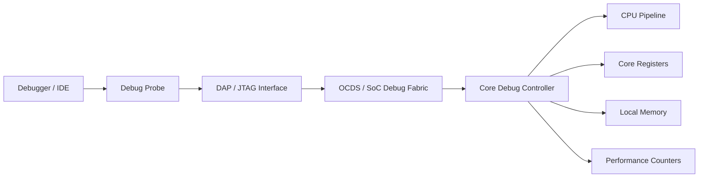

### 12.2.2 分层说明

| 层级 | 典型组件 | 职责 |
|---|---|---|
| 上位机调试层 | Debugger / IDE | 设置断点、读写寄存器、单步、下载程序、显示变量曲线 |
| 调试探针层 | Debug Probe | 协议转换、时序驱动、连接目标板 |
| 物理访问接口 | DAP / JTAG | 芯片外部调试访问入口 |
| SoC 调试系统 | OCDS / Debug Fabric | 多核调试、交叉触发、系统访问、Trace 路由 |
| 内核调试控制器 | Core Debug Controller | 内核级事件、触发器、动作、运行控制 |
| CPU 内核 | Pipeline / Register File / Local Memory | 实际执行和被调试对象 |
| Trace 系统 | MCDS / Trace Buffer / Trace Port | 程序流、数据访问、总线访问和事件时序记录 |

### 12.2.3 与多核系统的关系

- 每个 CPU Core 可具有独立的 Core Debug Controller。
- SoC 级调试系统可协调多个 Core 的 Halt、Resume、Suspend 和 Cross-trigger。
- 多核同步调试不应只依赖单核调试控制器，需要 SoC Debug Fabric 配合。
- Trace System 通常位于 SoC 级调试系统中，可采集来自多个 CPU、总线、DMA、外设或事件源的跟踪信息。

### 12.2.4 Core Debug Controller 与 Trace System 的架构关系

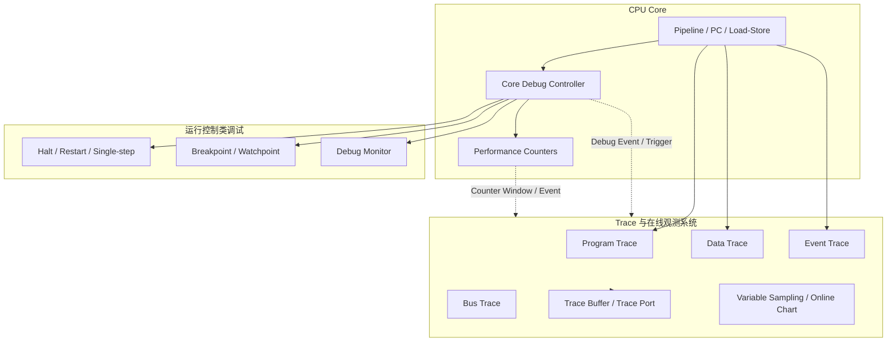

---

## 12.3 调试使能与权限控制

### 12.3.1 Debug Enable

- Debug Enable 是内核调试控制器的总使能。
- 当 Debug Enable 关闭时，硬件断点、观察点、软件调试指令等调试功能应被禁止或降级为无副作用行为。
- 当 Debug Enable 打开时，CPU 可进入 Debug Mode，并响应调试事件和调试动作。
- Debug Enable 的写入权限、复位默认值、低功耗保持行为应由芯片安全策略明确规定。

### 12.3.2 安全锁

调试安全锁用于限制非授权调试访问，典型设计包括：

- Debug authentication。
- Password / challenge-response。
- Device life-cycle state。
- BootROM Debug policy。
- 安全区域和普通区域分级访问。
- HSM / Secure Core 隔离。
- Debug unlock 后是否擦除密钥、用户代码或安全配置。

### 12.3.3 量产关闭策略

量产阶段通常应支持：

- 完全关闭调试口。
- 仅允许受限调试。
- 仅允许非侵入式 Trace 或受控 Trace。
- 禁止访问安全密钥、HSM 内存、安全寄存器。
- Debug unlock 触发擦除敏感数据。
- Debug lock 状态可被 BootROM / Security Controller 固化。
- Trace 输出口、Trace Buffer 和变量采样功能同样需要纳入量产安全策略。

---

## 12.4 运行控制

### 12.4.1 Halt

- Halt 表示 CPU 停止正常取指执行。
- Halt 可由调试器直接请求，也可由调试事件触发。
- Halt 状态下调试器可读取 CPU 寄存器、局部内存和系统状态。
- Halt 对实时系统影响最大，应在安全关键场景谨慎使用。

### 12.4.2 Restart

- Restart / Resume 表示 CPU 从 Halt 状态恢复执行。
- 恢复点通常为 Halt 发生时保存的 PC 或调试器修改后的 PC。
- 多核系统中可支持单核 Restart 或多核同步 Restart。
- Resume 后已 pending 的中断、异常或调试事件如何处理应在架构中明确。

### 12.4.3 Single-step

- Single-step 表示 CPU 执行一条或有限条指令后再次进入 Halt。
- 适用于启动代码、异常入口、上下文切换、汇编代码和保护访问流程调试。
- 单步执行应明确对中断、异常、流水线和调试事件的处理规则。
- 单步过程中是否允许中断进入，需要在调试控制策略中定义。

### 12.4.4 运行控制状态机

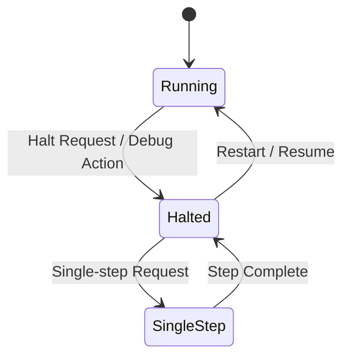

### 12.4.5 与调试动作的关系

```text
Debug Trigger 命中
  ↓
Debug Event 产生
  ↓
Debug Action 选择 Halt
  ↓
Run Control 状态从 Running 进入 Halted
```

运行控制是调试动作的最终执行效果之一，不是调试触发条件本身。

---

## 12.5 调试事件

### 12.5.1 调试事件定义

调试事件表示 Core Debug Controller 识别到某个调试相关条件成立。调试事件本身不等于 CPU Halt，最终行为由调试动作决定。

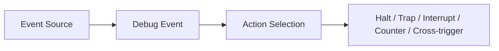

### 12.5.2 外部调试事件

- 来源于 SoC 调试系统或外部 Debugger。
- 可用于手动暂停 CPU、系统级触发、多核同步调试。
- 典型输入包括 Break-In、Suspend-In 或 SoC Debug Fabric 的事件输入。

### 12.5.3 软件调试指令事件

- 来源于专用软件调试指令。
- 常用于软件断点、调试插桩、启动流程 checkpoint。
- 当 Debug Enable 关闭时，该指令可设计为 NOP 或受限行为。
- 适合在 BootROM、Startup、异常处理路径中放置可控调试钩子。

### 12.5.4 系统寄存器访问事件

- 来源于访问 Core Control / Status Register 的特殊指令。
- 可用于监控关键控制寄存器的读写行为。
- 适合定位异常修改中断控制、保护配置、状态寄存器等问题。
- 应明确哪些寄存器访问会产生事件，哪些调试专用寄存器访问不产生事件，避免递归触发。

### 12.5.5 地址触发事件

- 来源于 Debug Trigger 的地址或上下文条件匹配。
- 包括指令地址断点、数据读观察点、数据写观察点、地址范围触发等。
- 地址比较对象应明确为虚拟地址、物理地址还是总线地址。

### 12.5.6 调试事件优先级

当多个调试事件同时发生时，应定义：

- 外部事件与内部事件的优先级。
- 指令地址事件与数据访问事件的优先级。
- 多个 Trigger 同时命中的优先级。
- 流水线中不同阶段事件的处理顺序。
- Posted Event 或延后事件的处理规则。
- 与异常、NMI、中断、Reset 请求之间的优先级边界。

---

## 12.6 调试触发器

### 12.6.1 调试触发器定义

调试触发器用于判断某个可编程条件是否成立。一旦条件成立，触发器向调试事件逻辑产生 Debug Event。

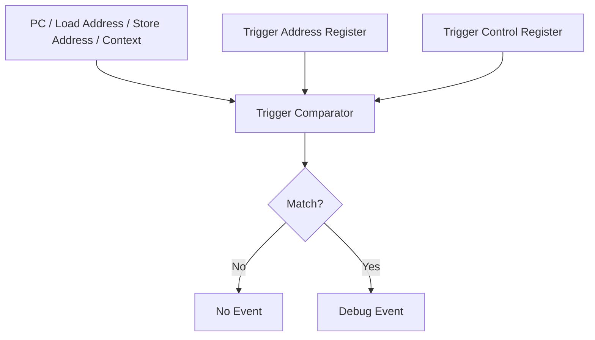

### 12.6.2 指令地址断点

- 监控 CPU 即将执行的 PC / 指令地址。
- 用于函数入口断点、异常入口断点、指定代码段执行监控。
- 应明确断点命中发生在取指、译码、提交还是执行完成阶段。

### 12.6.3 数据读观察点

- 监控 CPU Load 地址。
- 用于定位“谁读取了某个变量或寄存器”。
- 应明确是否覆盖 cache hit、cache miss、非缓存访问、外设访问和原子读改写访问。

### 12.6.4 数据写观察点

- 监控 CPU Store 地址。
- 用于定位“谁修改了某个变量或寄存器”。
- 应明确写缓冲、store buffer、posted write、cache write-back 对触发时机的影响。

### 12.6.5 地址范围触发

- 监控某一段代码区或数据区。
- 可用于 buffer 访问监控、非法区域访问监控、特定函数范围执行监控。

```text
Range_Start <= Address < Range_End
```

### 12.6.6 任务 / 上下文相关触发

- 触发条件可绑定当前任务、特权级、地址空间 ID、CPU 模式或安全上下文。
- 适合 RTOS 场景下只对指定任务生效，降低公共函数断点的噪声。
- 需要说明上下文 ID 的来源，例如 OS context、ASID、privilege level、security domain 或 Debug Context Register。

### 12.6.7 Trigger 到 Event 的关系

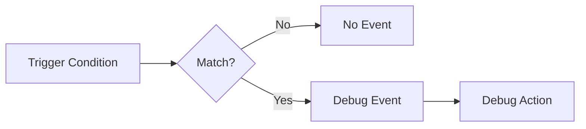

---

## 12.7 调试动作

### 12.7.1 调试动作定义

调试动作表示 Debug Event 发生后 Core Debug Controller 需要执行的响应。

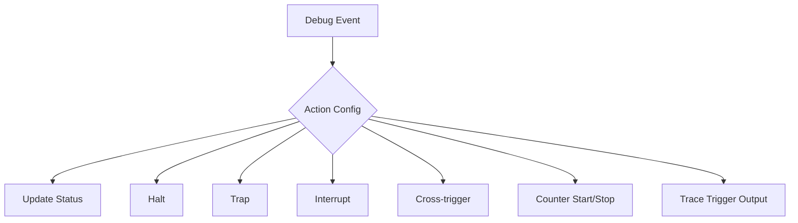

### 12.7.2 更新状态寄存器

- 记录事件来源。
- 记录是否存在 posted event。
- 记录当前 suspend / halt 状态。
- 供调试器或 Debug Monitor 查询。
- 可提供 sticky status，用于记录曾经发生但已处理的调试事件。

### 12.7.3 Halt

- 使 CPU 进入 Halt 状态。
- 适合传统断点调试。
- 对实时性影响最大。
- 多核系统中应明确是否只 Halt 当前 Core，还是通过 Cross-trigger 影响其他 Core。

### 12.7.4 Trap

- 触发 Debug Trap，进入 Debug Monitor。
- 通常需要保存调试上下文。
- 适合软件化调试服务、断点处理和现场采集。
- 需要考虑 Debug Monitor 重入保护和上下文覆盖风险。

### 12.7.5 Interrupt

- 触发 Breakpoint Interrupt。
- 服从中断优先级模型。
- 适合实时系统低侵入式调试，允许高优先级安全 ISR 继续执行。
- 若当前 CPU 优先级高于 Breakpoint Interrupt，可设计为 posted event，延后进入 Debug Monitor。

### 12.7.6 Cross-trigger

- 将本 Core 的调试事件输出给 SoC Debug Fabric。
- 可触发其他 Core、Trace 单元、总线监控器、外设观察模块同步响应。
- 多核系统中常用于冻结多个 CPU 的一致现场。
- Cross-trigger 通常不是 Core Debug Controller 单独完成，而是 Core Debug Controller 与 SoC Debug Fabric 协同完成。

### 12.7.7 性能计数器控制

- Debug Event 可用于启动、停止或翻转性能计数器。
- 适合测量某个函数、任务或代码窗口的 cycle、instruction、cache miss、stall 等指标。
- 应明确计数器启动/停止与流水线提交点、异常入口、上下文切换之间的关系。

### 12.7.8 Trace Trigger 输出

- 若架构支持，Debug Event 可作为 Trace Start / Stop / Marker / Filter 条件。
- 例如：函数入口触发 Trace Start，函数出口触发 Trace Stop。
- 例如：数据写观察点命中后，通过 Cross-trigger 通知 Trace System 捕获前后窗口。
- 该小节只描述 Core Debug Controller 向 Trace System 输出触发信息的能力，Trace 数据采集细节放入第 13 章。

### 12.7.9 Event → Action 关系

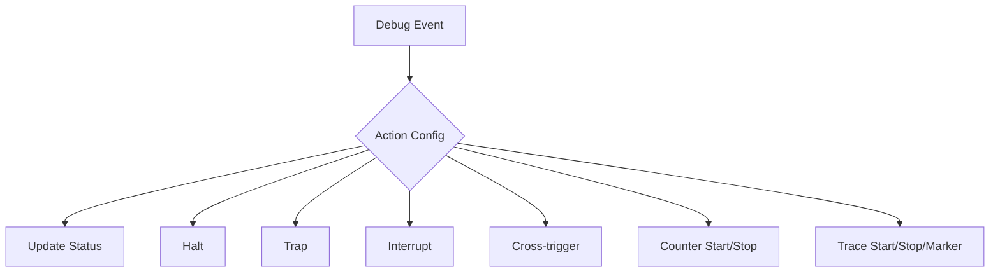

---

## 12.8 Debug Monitor 支持

### 12.8.1 Monitor 入口

- Debug Monitor 是调试事件触发后可跳转执行的软件服务程序。
- 入口地址应由专用寄存器或表项指定。
- Monitor 通常运行在特权模式或 Debug Mode。
- Monitor 入口代码应尽量短小、确定性强，并避免再次触发相同调试事件。

### 12.8.2 Context 保存

进入 Debug Monitor 前应保存必要上下文，例如：

- PC。
- 状态寄存器。
- 返回地址。
- 栈指针。
- 调试原因。
- 部分通用寄存器。
- 当前任务或上下文 ID。

### 12.8.3 重入保护

- Debug Monitor 应防止嵌套进入造成上下文覆盖。
- 可设置 Debug Trap Active 或 Monitor Active 标志。
- 嵌套调试事件可选择屏蔽、延后或升级处理。
- 若只提供一个 Debug Context Save Area，必须明确第二次 Debug Trap 的处理策略。

### 12.8.4 返回机制

- Debug Monitor 处理完成后，应可返回被调试程序。
- 返回机制需恢复上下文和执行状态。
- 返回前应清除或确认调试事件状态。
- 返回后是否重新执行触发指令，需要由架构明确。

---

## 12.9 性能计数器

### 12.9.1 Cycle Counter

- 统计 CPU 时钟周期数。
- 用于计算代码执行耗时、CPI、实时任务执行预算。
- 应明确 Halt、Sleep、Debug Mode、低功耗模式下是否继续计数。

### 12.9.2 Instruction Counter

- 统计已执行指令数。
- 可与 Cycle Counter 结合计算 CPI。
- 应明确统计的是提交指令、译码指令还是取指数量。

### 12.9.3 Event Counter

可统计实现定义的微架构事件，例如：

- I-cache hit / miss。
- D-cache hit / miss。
- Branch。
- Load / Store。
- Pipeline stall。
- Bus stall。
- Flash wait。
- TCM / SRAM / Peripheral access。
- Exception / Interrupt entry。

### 12.9.4 Overflow 行为

- 计数器应定义溢出方式。
- 可采用 wrapping counter。
- 可提供 sticky overflow bit。
- 可选择是否产生中断或调试事件。

### 12.9.5 性能测量窗口

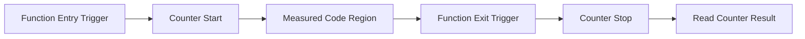

---

## 12.10 与 Trace 系统的关系

### 12.10.1 章节定位

Core Debug Controller 与 Trace System 都属于调试体系，但职责不同：

| 模块 | 核心职责 | 典型能力 |
|---|---|---|
| Core Debug Controller | 控制 CPU 调试事件、触发器、动作和运行状态 | Halt、Restart、Single-step、Breakpoint、Watchpoint、Trap、Interrupt |
| Trace System | 不停机或低侵入记录执行轨迹、数据访问和系统事件 | Program Trace、Data Trace、Bus Trace、Event Trace、Timestamp |
| 变量采样 / DAQ-like 机制 | 周期性采集变量值并画曲线 | SNOOPer-like sampling、Online Chart、Plot |

因此，Trace 不应作为 Core Debug Controller 的主体功能展开，而应单独成章。第 12 章只需要说明二者的接口关系。

### 12.10.2 Core Debug Controller 与 Trace System 的边界

```text
Core Debug Controller 关注：
- 什么时候产生调试事件
- 事件来了做什么动作
- CPU 是否 Halt / Trap / Interrupt
- 性能计数器何时启动/停止

Trace System 关注：
- 记录哪些执行流、数据访问、总线访问和事件
- 如何过滤 Trace 数据
- Trace 数据写入哪里
- Trace Buffer 溢出如何处理
- Trace 数据如何导出和解码
```

### 12.10.3 Debug Event 作为 Trace Trigger

- Debug Trigger 命中后，可产生 Debug Event。
- Debug Event 可作为 Trace Start、Trace Stop、Trace Marker 或 Trace Filter 条件。
- 例如：进入目标函数时启动 Program Trace，退出函数时停止 Trace。
- 例如：写某个安全变量时输出 Trace Marker，便于在 Trace 时间线上定位异常点。

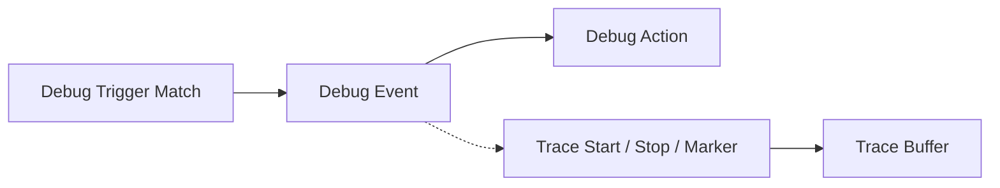

### 12.10.4 Breakpoint / Watchpoint 与 Data Trace 的关系

| 机制 | 作用 | 是否记录历史轨迹 | 典型问题 |
|---|---|---|---|
| Breakpoint | 指令地址命中后触发动作 | 否，除非配合 Trace | 程序是否执行到这里 |
| Watchpoint | 数据读/写地址命中后触发动作 | 否，除非配合 Trace | 谁访问了这个地址 |
| Data Trace | 记录数据访问事件序列 | 是 | 某变量在一段时间内被谁读写 |
| 变量采样 | 周期性读取变量值 | 是，但为采样序列 | 某变量随时间如何变化 |

### 12.10.5 Performance Counter 与 Trace 的配合

- Performance Counter 可用于统计某个 Trace 窗口内的周期数、指令数或微架构事件。
- Trace 可提供执行路径，Counter 可提供定量性能指标。
- 二者组合适合分析：函数路径、周期抖动、cache miss、总线等待和中断干扰。

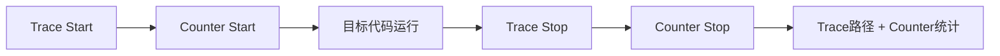

### 12.10.6 变量采样 / SNOOPer-like 功能的归属

- 变量采样通常通过调试器周期性读取内存变量实现。
- 它可在工具侧显示为曲线、波形或趋势图。
- 它广义上可称为 Trace，但严格硬件架构上更接近在线数据采集或采样型观测。
- 若芯片不提供专用硬件 Data Trace，仍可通过 DAP runtime memory access 实现低速变量采样。
- 若需要记录每一次读写访问、访问 PC 和时间戳，应使用硬件 Data Trace。

### 12.10.7 Trace Buffer / Trace Port 的归属

- Trace Buffer、Trace Port、高速 Trace 输出接口属于 SoC 级 Trace System。
- Core Debug Controller 可提供触发条件或事件输出，但不负责 Trace 数据压缩、缓存、导出和解码。
- 若手册需要详细描述 Trace Buffer、溢出策略、带宽限制和导出接口，应放入第 13 章。

---

## 12.11 调试限制与安全注意事项

### 12.11.1 Cycle Stealing

- 调试访问可能占用系统总线、内存接口或内部资源。
- 即使 CPU 未 Halt，也可能对实时性产生轻微扰动。
- 应说明哪些访问是低侵入式，哪些访问会明显影响运行时间。

### 12.11.2 实时性影响

- Halt 会停止 CPU 执行，对实时系统影响最大。
- Breakpoint Interrupt 相对更适合实时系统，但仍会引入中断开销。
- Trace 相对低侵入，但可能占用带宽和 Trace Buffer。
- 周期性变量采样可能占用 DAP、总线或内存访问资源，在高采样频率下会影响实时性。

### 12.11.3 保护区访问

- Debug Mode 下是否绕过 MPU / Memory Protection / Security Protection 必须明确。
- Debug Monitor 的代码区和上下文保存区是否享有特殊访问权限必须明确。
- 安全区域、密钥区域、HSM 区域应有独立限制。
- Trace 和变量采样是否允许观测安全区域数据必须明确。

### 12.11.4 低功耗 / 复位期间调试行为

- 低功耗模式下 Debug Controller 是否保留状态。
- Halt 状态下时钟是否关闭。
- Reset 后 Debug Enable、断点、Trace 配置是否保留。
- 是否支持 Reset Halt / Boot Halt。
- 低功耗或 Reset 期间 Trace Buffer 是否保持、清空或冻结。

### 12.11.5 量产 Debug Lock

- 量产状态应支持关闭调试访问。
- Debug unlock 可与擦除敏感数据绑定。
- Trace 输出应防止泄露安全数据。
- Debug Lock 状态应可由生命周期管理或安全启动策略控制。
- 若允许量产 Trace，应限制 Trace 源、Trace 带宽、Trace 导出权限和敏感地址范围。

### 12.11.6 Trace 带宽、Buffer 溢出与采样扰动

- Trace 数据量可能超过 Trace Buffer 或 Trace Port 带宽。
- Buffer 溢出时应明确丢弃策略、停止策略或状态标志。
- Program Trace、Data Trace、Bus Trace 同时开启时更容易发生带宽瓶颈。
- 变量采样频率过高时，会造成 DAP 或总线访问压力。

---

## 12.12 寄存器描述

### 12.12.1 寄存器列表

| 寄存器 | 类型 | 描述 |
|---|---|---|
| DBG_STATUS | Debug Status | 调试状态、事件来源、Halt/Suspend 状态 |
| DBG_CTRL | Debug Control | 调试使能、运行控制、单步控制 |
| EXT_EVT | Event Config | 外部调试事件配置 |
| SW_EVT | Event Config | 软件调试指令事件配置 |
| REG_EVT | Event Config | 系统寄存器访问事件配置 |
| TRIGn_CTRL | Trigger Config | 第 n 个触发器类型、使能、动作配置 |
| TRIGn_ADDR | Trigger Address | 第 n 个触发器地址 |
| TRIG_ACC | Trigger Accumulator | Trigger 命中累计状态 |
| DBG_MON_ENTRY | Debug Monitor | Monitor 入口地址 |
| DBG_MON_CTX | Debug Monitor | Monitor 上下文保存区 |
| DBG_MON_CTRL | Debug Monitor | Monitor 重入保护和返回控制 |
| CYCLE_CNT | Performance | 周期计数器 |
| INST_CNT | Performance | 指令计数器 |
| EVT_CNTn | Performance | 事件计数器 |
| PERF_CTRL | Performance | 性能计数器控制 |
| DBG_TRACE_TRIG | Debug/Trace Interface | 向 Trace System 输出 Trigger / Marker / Start / Stop 条件 |

### 12.12.2 寄存器描述要求

每个寄存器至少描述：

- Offset / Address。
- Reset Value。
- Access Type。
- Bit Field。
- Field Description。
- Write behavior。
- Read side effect。
- Debug Lock 影响。
- Reset / Low-power 影响。
- 多核访问约束。
- 安全访问约束。
- 是否可被 Trace System 或 SoC Debug Fabric 访问。

---

## 12.13 推荐术语表

| 英文 | 中文建议 |
|---|---|
| Core Debug Controller | 内核调试控制器 |
| Run Control | 运行控制 |
| Halt | 停机 / 挂起执行 |
| Restart / Resume | 恢复执行 |
| Single-step | 单步执行 |
| Debug Event | 调试事件 |
| Debug Trigger | 调试触发器 |
| Breakpoint | 断点 |
| Watchpoint | 观察点 |
| Breakpoint Trap | 断点陷入 / 断点 Trap |
| Breakpoint Interrupt | 断点中断 |
| Debug Monitor | 调试监控程序 |
| Cross-trigger | 交叉触发 |
| Trace | 跟踪 / 轨迹采集 |
| Program Trace | 程序流跟踪 / 指令流跟踪 |
| Data Trace | 数据访问跟踪 |
| Bus Trace | 总线访问跟踪 |
| Variable Sampling | 变量采样 |
| Online Chart | 在线曲线 / 在线波形 |
| Performance Counter | 性能计数器 |
| Cycle Counter | 周期计数器 |
| Instruction Counter | 指令计数器 |

---

# 13 Trace 与在线观测系统

> 本章建议作为第 12 章的相邻章节，用于系统描述 Trace、变量采样、在线波形和低侵入式运行观测能力。  
> 若目标手册只计划编写“内核调试控制器”章节，可先保留第 12.10 节；若目标手册需要完整覆盖车规 MCU 调试体系，建议新增本章。

---

## 13.1 概述

### 13.1.1 Trace 定义

Trace 是在 CPU 不停机或低侵入条件下，对程序执行流、数据访问、总线访问和事件时序进行记录的硬件或工具链辅助观测机制。

### 13.1.2 Trace 与 Debug 的区别

| 对比项 | Debug / Breakpoint | Trace |
|---|---|---|
| 核心目的 | 停下来观察现场 | 不停机记录运行轨迹 |
| 是否打断 CPU | 经常 Halt / Trap / Interrupt | 通常不 Halt |
| 主要输出 | 某一刻寄存器、变量、内存 | 一段时间内的执行路径、访问事件、时间线 |
| 典型问题 | 现在停在哪里 | 刚才怎么跑到这里 |
| 实时性影响 | 较大 | 较小，但受带宽和 Buffer 影响 |

### 13.1.3 Trace 与变量采样的区别

| 机制 | 本质 | 数据形态 | 典型用途 |
|---|---|---|---|
| Program Trace | 事件记录 | 执行路径、分支、异常入口 | 还原程序流 |
| Data Trace | 事件记录 | 地址、数据、读写类型、PC、时间戳 | 查谁读写变量 |
| Bus Trace | 事件记录 | Master、Slave、地址、访问类型 | 查总线访问与冲突 |
| Variable Sampling | 周期采样 | value-time 曲线 | 看变量趋势、控制量波形 |

---

## 13.2 Trace 在调试架构中的位置

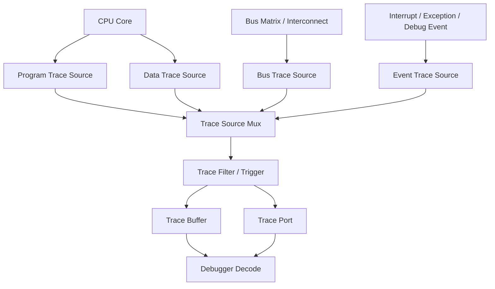

### 13.2.1 Trace Source

Trace Source 是 Trace 数据的来源，可来自：

- CPU Pipeline。
- Load / Store Unit。
- Local Memory Interface。
- Bus Matrix / Interconnect。
- DMA / 外设 Master。
- Interrupt / Exception Controller。
- Core Debug Controller。
- Performance Counter 或事件计数器。

### 13.2.2 Trace Mux

Trace Mux 用于选择 Trace Source，决定当前采集哪些源的数据。

### 13.2.3 Trace Filter / Trigger

Trace Filter / Trigger 用于控制 Trace 的采集范围：

- 地址过滤。
- 数据访问过滤。
- 事件过滤。
- 任务 / 上下文过滤。
- Start / Stop 条件。
- 前后窗口捕获。

### 13.2.4 Trace Buffer / Trace Port

- Trace Buffer 用于片上缓存 Trace 数据。
- Trace Port 用于将 Trace 数据导出到外部工具。
- 若 Trace 数据量超过带宽，应定义溢出策略和状态标志。

---

## 13.3 Trace 类型

### 13.3.1 Program Trace

Program Trace 用于记录 CPU 执行流，包括：

- 分支。
- 跳转。
- 函数调用与返回。
- 异常入口与返回。
- 中断嵌套。
- 多核执行流对齐。

适合排查：

- 程序如何跑到异常点。
- 某个错误路径是否执行。
- 异常前最后执行的函数序列。
- 中断嵌套顺序是否符合预期。

### 13.3.2 Data Trace

Data Trace 用于记录数据访问事件，包括：

- Load / Store 地址。
- 访问类型。
- 访问数据值，若实现支持。
- 访问 PC，若实现支持。
- 时间戳。
- 访问源 Core 或 Master。

适合排查：

- 谁写坏了变量。
- 谁读了安全敏感数据。
- 某个 buffer 是否越界访问。
- 多核共享变量是否存在竞态。

### 13.3.3 Bus Trace

Bus Trace 用于记录总线级访问，包括：

- Master ID。
- Slave ID。
- 地址。
- 访问类型。
- 访问长度。
- 响应状态。
- 等待周期或 stall 信息。

适合排查：

- DMA 与 CPU 访问冲突。
- 总线拥塞。
- Flash / SRAM / 外设访问瓶颈。
- 错误地址访问。

### 13.3.4 Event Trace

Event Trace 用于记录系统事件，包括：

- Interrupt。
- Exception / Trap。
- Debug Event。
- Reset Request。
- Safety Alarm。
- OS Task Switch。
- User Marker。

### 13.3.5 Timestamp Trace

Timestamp Trace 用于给 Trace 事件打时间戳，便于：

- 多核事件排序。
- Trace 数据跨源对齐。
- 分析中断延迟。
- 分析任务周期抖动。

### 13.3.6 Performance Trace

Performance Trace 用于分析性能事件，例如：

- Cache miss。
- Branch miss。
- Pipeline stall。
- Bus stall。
- Flash wait。
- Memory contention。

---

## 13.4 Trace Trigger 与 Filter

### 13.4.1 地址触发

- 指定代码地址进入时启动 Trace。
- 指定代码地址退出时停止 Trace。
- 指定数据地址被读写时插入 Trace Marker。

### 13.4.2 数据访问触发

- 对某变量读写时触发。
- 对某地址范围访问时触发。
- 可选择只记录读、只记录写或读写均记录。

### 13.4.3 事件触发

- 中断进入触发。
- 异常进入触发。
- Safety Alarm 触发。
- Debug Event 触发。
- 软件 Marker 触发。

### 13.4.4 任务 / 上下文过滤

- 只记录指定任务。
- 只记录指定特权级。
- 只记录指定安全域。
- 只记录指定 Core。

### 13.4.5 前后窗口捕获


适合偶发故障：在故障触发点前后保存一段 Trace 数据，便于回放分析。

---

## 13.5 Trace Buffer 与导出接口

### 13.5.1 On-chip Trace Buffer

- 存储容量有限。
- 适合短窗口 Trace。
- 可支持循环缓冲。
- 可在触发事件后冻结。

### 13.5.2 External Trace Port

- 适合长时间或高带宽 Trace。
- 需要额外引脚和外部 Trace Probe。
- 需要定义输出协议、时钟、带宽和电气参数。

### 13.5.3 Buffer Overflow 行为

应明确：

- 溢出后覆盖旧数据还是停止采集。
- 是否设置 overflow flag。
- 是否产生中断或调试事件。
- 是否记录丢包数量或丢包区间。

---

## 13.6 Trace 调试案例

### 13.6.1 偶发变量被写坏

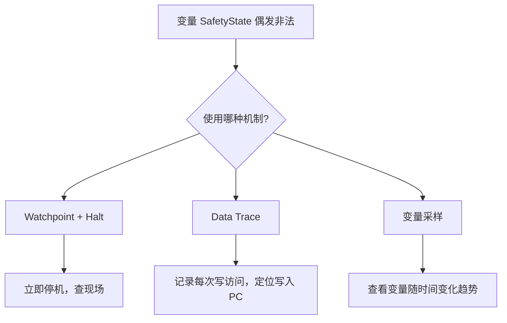

### 13.6.2 中断嵌套顺序分析

- 使用 Program Trace 记录中断入口和返回。
- 使用 Timestamp Trace 对齐事件时间。
- 使用 Event Trace 标记关键异常和 Safety Alarm。

### 13.6.3 控制环变量波形分析

- 使用变量采样记录转速、电流、PI 输出和 PWM duty。
- 通过在线曲线观察振荡、饱和、突变和异常限幅。

### 13.6.4 多核竞态分析

- 使用 Data Trace 记录共享变量访问。
- 使用 Timestamp Trace 对齐 CPU0 / CPU1 / DMA 的访问顺序。
- 使用 Bus Trace 分析总线仲裁和访问冲突。

### 13.6.5 性能瓶颈分析

- 使用 Program Trace 还原执行路径。
- 使用 Performance Counter 统计周期、指令和 stall。
- 使用 Bus Trace 定位存储访问瓶颈。

---

## 13.7 Trace 限制与安全注意事项

### 13.7.1 Trace 带宽限制

- Program Trace、Data Trace 和 Bus Trace 同时开启时数据量巨大。
- 应支持 Trace Filter 缩小采集范围。
- 应说明不同 Trace Source 的最大输出速率。

### 13.7.2 Buffer 溢出

- 片上 Trace Buffer 容量有限。
- 高频数据访问会快速填满 Buffer。
- 应定义溢出标志和数据丢失策略。

### 13.7.3 采样扰动

- 变量采样可能占用 DAP、总线或内存访问带宽。
- 采样频率越高，对实时性的影响越大。
- 对高速控制环变量，应评估采样周期、采样点数量和总线访问开销。

### 13.7.4 安全与量产限制

- Trace 可能泄露代码路径、数据值、密钥相关访问和安全状态。
- 量产阶段应限制 Trace Source、Trace Port、Trace Buffer 读取权限。
- 对安全区域、HSM 区域、密钥区域应禁止或脱敏 Trace。

---

## 13.8 推荐术语表

| 英文 | 中文建议 |
|---|---|
| Trace | 跟踪 / 轨迹采集 |
| Trace Source | 跟踪源 |
| Trace Sink | 跟踪接收端 |
| Trace Buffer | 跟踪缓冲区 |
| Trace Port | 跟踪输出接口 |
| Program Trace | 程序流跟踪 / 指令流跟踪 |
| Data Trace | 数据访问跟踪 |
| Bus Trace | 总线访问跟踪 |
| Event Trace | 事件跟踪 |
| Timestamp Trace | 时间戳跟踪 |
| Trace Trigger | 跟踪触发条件 |
| Trace Filter | 跟踪过滤器 |
| Variable Sampling | 变量采样 |
| Online Chart | 在线曲线 / 在线波形 |
| Data Acquisition | 数据采集 |
| Marker | 标记事件 |
