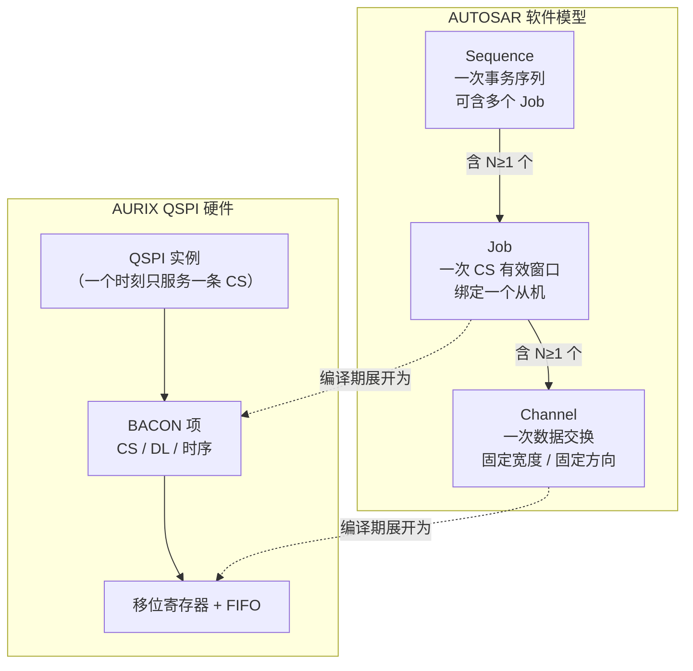
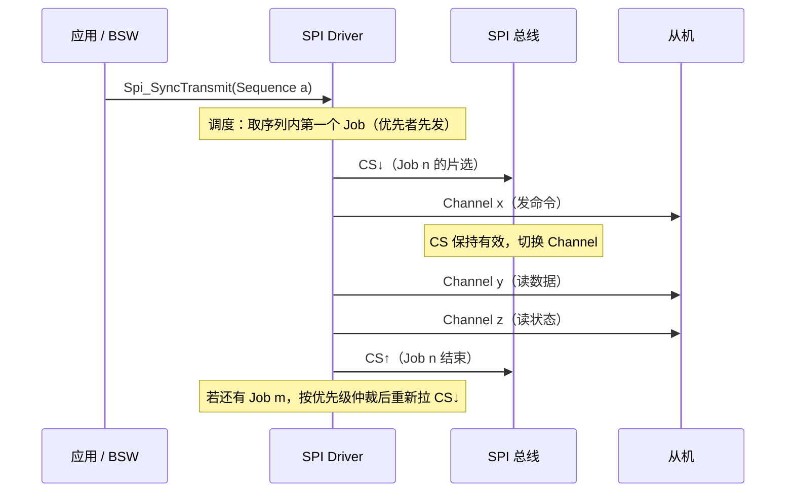
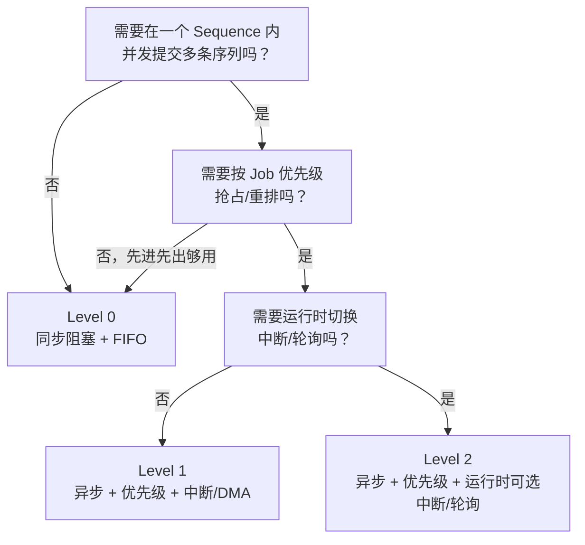

# SPI MCAL 需求模型：Channel / Job / Sequence 与三个 Level

> 系列第 1 篇。本系列从 **AUTOSAR SWS 需求**出发，再落到 AURIX QSPI 硬件、EB MCAL 代码组织与配置选型。
>
> **版本基线**（后续各篇均以此为准）
>
> | 项 | 值 | 取证位置 |
> |---|---|---|
> | MCAL 包 | Infineon AURIX2G SPI MCAL **V10.0.0**（2018-09-03，Variant PB） | `BaseSw/Infra/Spi/ssc/inc/Spi.h` 文件头 |
> | 目标规范 | **AUTOSAR Release 4.2.2** | 同上 `SPECIFICATION(S)` 行 |
> | 规范原件 | `AUTOSAR_SWS_SPIHandlerDriver`，Document ID 038，105 页，Final | `D:\AUTOSAR_MCAL\docs\AUTOSAR_SWS_SPIHandlerDriver_R4.2.2.pdf` |
> | 平台 | AURIX2G（TC3xx） | 同上 |

## 核心问题

AUTOSAR 为什么要把"发一次 SPI"拆成 Channel / Job / Sequence 三层？这三层的边界由什么决定？`SpiLevelDelivered` 的三个值实际改变了什么？

## 结论

1. **三层不是软件分层，是硬件事实的映射**：一个 SPI 控制器同一时刻只能服务一个从机（CS 唯一有效），但一个从机的一次事务可能包含多段数据交换（命令+地址+数据），多个从机又需要排队。三层分别对应"一次数据交换 / 一次片选窗口 / 一次事务序列"。
2. **CS 属于 Job，不属于 Channel**——这是 SWS 的硬性规定（`SWS_Spi_00066`、`SWS_Spi_00263`），因为片选生命周期跨越 Job 内的所有 Channel。
3. **Level 决定的是"谁在推进传输"**：Level 0 由调用者阻塞推进（FIFO 策略），Level 1/2 由中断/DMA + 优先级队列推进（Priority 策略），Level 2 额外允许运行时在中断与轮询之间选择。

## 背景

SPI 只有四根线：CLOCK、MOSI、MISO、CS。这个物理事实决定了软件抽象的上限——没有地址、没有事务 ID、没有应答，一切靠"片选拉低 → 打时钟 → 片选释放"来界定。

因此 AUTOSAR 不去发明协议层，而是把"多从机、多段数据、并发访问"这三个现实问题，映射成三层配置对象。

## 关键机制

### 1. 三层抽象与硬件的一一对应

三层的判定依据：

| 层 | 判定依据 | 典型例子 |
|---|---|---|
| **Channel** | 宽度和方向都不变的**一段**数据 | 发 1 个 16-bit 命令字；收 4 个 8-bit 状态字节 |
| **Job** | 一次片选有效期间完成的**全部**数据交换 | "发命令 + 读回数据"这一整个片选窗口 |
| **Sequence** | 由上层按顺序提交的**一组** Job | 上电初始化序列：配置 A → 配置 B → 校验 |

### 2. SWS 定义的三层约束（需求原文）

| 需求 ID | 约束 | 工程含义 |
|---|---|---|
| `SWS_Spi_00041` / `00034` | 接口基于 Channel / Job / Sequence | 三层是规范强制，不是厂商自选 |
| `SWS_Spi_00065` | 一个 Job 至少含 1 个 Channel | 空 Job 非法 |
| `SWS_Spi_00368` | Channel 有索引，索引决定它在 Job 内的**顺序** | 同一 Channel 可被多个 Job 复用，顺序由引用时的索引决定 |
| `SWS_Spi_00262` | Job 内所有 Channel **共享 Job 属性**、静态链接 | Job 内不能改时钟/片选 |
| `SWS_Spi_00003` | 一个 Sequence 至少含 1 个 Job | 空序列非法 |
| `SWS_Spi_00236` | Sequence 内 Job 共享 Sequence 属性、静态链接 | 序列内不能改优先级 |
| `SWS_Spi_00066` | **CS 绑定在 Job 上** | 片选不是 Channel 的属性 |
| `SWS_Spi_00263` | CS 在 Job 传输期间保持，结束时释放 | 片选生命周期 = Job 生命周期 |
| `SWS_Spi_00370` | CS 可由硬件自主管理，或由驱动当 DIO 显式驱动 | 对应 `SpiCsSelection`，见第 5 篇 |

### 3. 为什么 CS 必须属于 Job（时序推导）

关键点：**Channel 之间不能抬 CS**，否则从机会把命令和数据当成两次独立事务。这就是 `SWS_Spi_00066` 把 CS 绑在 Job 上的物理原因——片选必须覆盖"一个从机的一次完整对话"。

反过来，**Job 之间必须释放 CS**（`SWS_Spi_00263`），因为不同 Job 可能指向不同从机，同一时刻只能有一个从机被选中。

### 4. IB 与 EB：缓冲区归谁管

| 类型 | 缓冲区位置 | 谁分配 | 适用 | SWS 条件 |
|---|---|---|---|---|
| **IB**（Internal Buffer） | 驱动内部（配置生成的内存） | MCAL 生成 | 固定报文、周期发送、无需应用参与 | 需 `SpiChannelBuffersAllowed = 0 或 2` |
| **EB**（External Buffer） | 应用提供指针 | 调用者 | 变长/大数据、流式收发 | 需 `SpiChannelBuffersAllowed = 1 或 2` |

本工程 `SPI_CHANNEL_BUFFERS_ALLOWED = 0`，即**只允许 IB**，这直接决定了 `Spi_WriteIB` / `Spi_ReadIB` 是唯一的取数方式，`Spi_SetupEB` 不可用。

> 注意：`SpiChannelBuffersAllowed` 的取值含义是 **`IB = 0; EB = 1; IB/EB = 2`**（SWS ECUC_Spi_00227 原文），即 0 = 仅 IB、1 = 仅 EB、2 = 两者都允许。本工程取 0，所以只有 IB 通道可用。

### 5. 三个 Level：改变的是"谁来推进传输"

SWS 原文（§7.1）：

| Level | SWS 原文要点 | 策略 | 推进者 |
|---|---|---|---|
| **0** Simple Synchronous | "synchronous handling with a **FIFO policy** to handle multiple accesses" | FIFO | 调用者阻塞，直到整条序列完成 |
| **1** Basic Asynchronous | "asynchronous behavior and with a **Priority policy**" | Priority | 中断 / DMA；`Spi_MainFunction_Handling` 收尾 |
| **2** Enhanced | "asynchronous or synchronous … using either **interrupts or polling selectable during execution time**" + Priority policy | Priority | 运行时可选中断或轮询 |

两条硬约束：

- `SWS_Spi_00109`：Level 必须在**预编译期**静态选定（为了最大程度裁剪代码）。
- `SWS_Spi_00110`：`SpiLevelDelivered` 只能取 0 / 1 / 2。

**本工程配置为 `SPI_LEVEL_DELIVERED = 0`**，因此：

- 只有 `Spi_SyncTransmit` 可用；`Spi_AsyncTransmit` 被 `#if (SPI_LEVEL_DELIVERED != 0U)` **整体排除在固件之外**，不是"编译进来但不让调用"（详见第 3/4 篇）
- 源码中的 `Spi_QueueType`、`Spi_RuntimeKernelType` 等结构被 `#if (SPI_LEVEL_DELIVERED != 0U)` 整体裁掉
- 无优先级调度、无 DMA 链、无序列可打断

### 6. 数据宽度与缓冲类型：SWS 的补齐规则

硬件帧宽（`SpiDataWidth`）常与调用者用的 C 数据类型不一致（例如 12-bit 帧 vs `uint16` 缓冲）。SWS 规定：

| 需求 ID | 规则 |
|---|---|
| `SWS_Spi_00149` | 驱动负责处理"帧宽"与"访问类型宽度"的差异 |
| `SWS_Spi_00289` | 宽度完全一致时，直接收发，不做位变换 |
| `SWS_Spi_00290` | 访问宽度 **大于** 帧宽时：**发送取低半部、接收低位补零** |
| `SWS_Spi_00437` | 缓冲区按 `uint8/uint16/uint32` 访问，由 `SpiDataWidth` 决定 |

这条规则对应的 MCAL 实现是 `Spi_lGetChannelDataWidth()` 与 `Spi_lIBCopyData()`（第 4 篇详述）。它解释了为什么 12-bit 通道的缓冲区必须按 16-bit 访问、且高位是零。

## 应用场景（配置选型）

| 场景 | 推荐 Level | 理由 |
|---|---|---|
| 上电初始化：按序配置几颗外设，之后不再变化 | 0 | 顺序固定、无需并发、代码最小 |
| 周期采样：多个传感器轮流读，主循环驱动 | 0 | FIFO 策略即可，避免中断开销 |
| 安全监控：关键报文优先级高于普通报文 | 1 | 需要优先级仲裁 |
| 大数据流：外部 Flash 读、音频/传感器 FIFO | 1 或 2 | DMA 链 + 异步 |
| 混合负载：既要周期读又要突发大块 | 2 | 需要按负载在中断与轮询间切换 |
| 多核分区共享同一 SPI 硬件 | 2 | 需要跨核仲裁与序列可打断 |

## 关联笔记

- 同系列后续篇：概念→硬件映射、Level 0 运行时、Level 1/2 运行时、EB 配置、调试
- [AUTOSAR 多核数据一致性与多核间通信](../../07_System/AUTOSAR_Sys_Multicore_Data_Consistency_and_Communication.md)——SPI 的多核访问与 `Spi_lCheckCoreVar` 相关
- QSPI 硬件侧：[HW_Periph_Comm_QSPI_Study_Atlas.html](../../../../01_Hardware_硬件层/05_Peripherals/01_Communication/01_SPI/HW_Periph_Comm_QSPI_Study_Atlas.html)

## 待补充问题

1. `SpiChannelBuffersAllowed` 的 0/1/2 在 SWS 与 ECUC 中的精确定义（第 5 篇核对）。
2. Level 2 的"interrupt or polling selectable during execution time"与 `Spi_SetAsyncMode` 的对应关系（第 4 篇）。
3. 4.2.2 与后续版本（4.3.0+）在 Level 2 语义上的差异，是否影响本 MCAL 的移植。

## 标签

`#AUTOSAR` `#SPI` `#MCAL` `#需求分析` `#TC3xx` `#4.2.2`

## Agent 整理记录

- 2026-11-02：建立。版本基线与 SWS 需求 ID 均从 `Spi.h` 文件头与 R4.2.2 SWS 原文取证，未引用二手资料。
