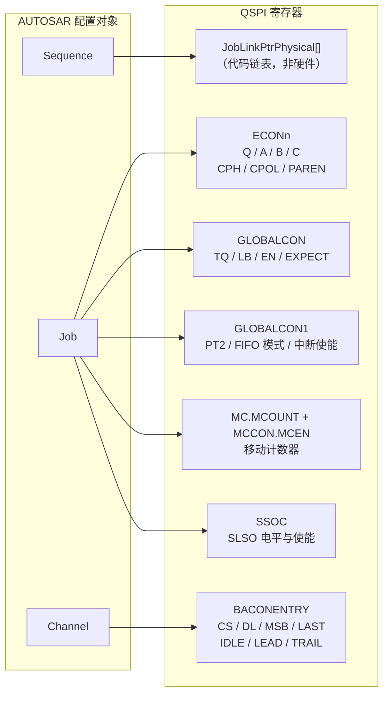
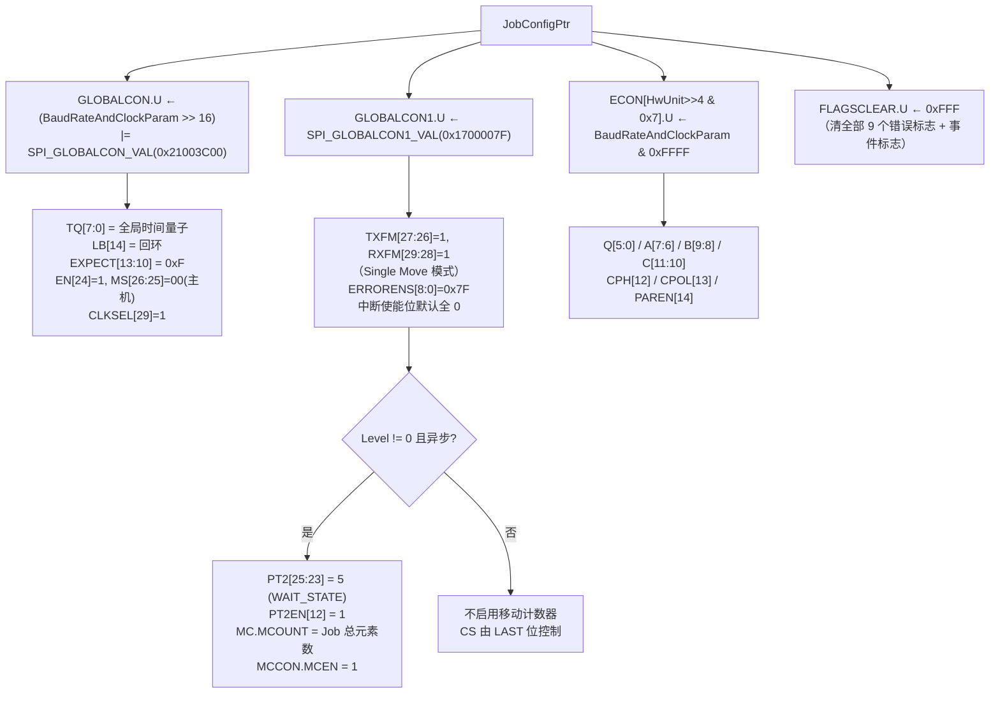
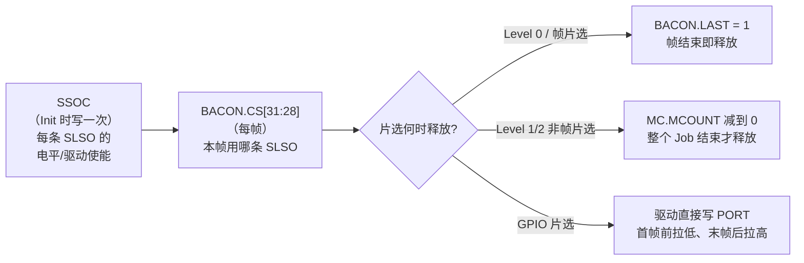

# SPI MCAL 概念到硬件映射：三层抽象如何落到 QSPI 寄存器

> 系列第 2 篇。第 1 篇说明了 Channel / Job / Sequence 的**需求来源**；本篇说明它们在 AURIX QSPI 上**具体落到哪些寄存器**，以及为什么必须这样切分。

## 核心问题

一个 AUTOSAR 概念（Channel / Job / Sequence）在 TC3xx QSPI 上，究竟对应哪一个寄存器、哪一级硬件资源？为什么时钟类参数必须属于 Job，而帧长类参数必须属于 Channel？

## 结论

1. **Job → ECON + GLOBALCON + GLOBALCON1 + MC/MCCON + SSOC**：一次片选窗口内不变的量（波特率、相位极性、奇偶校验、移动计数器、片选电平）。
2. **Channel → BACON**：每一帧可以变的量（帧长 DL、位序 MSB、选中哪条 SLSO、前导/尾随延时、帧结束标志 LAST）。
3. **Sequence → 代码里的 Job 链表**：硬件没有序列概念，它只是 `JobLinkPtrPhysical[]` 的一次顺序遍历（Level 0）或一次优先级入队（Level 1/2）。
4. 三层的分界线就是**硬件的"帧"边界**：ECON 在一帧之内不生效变化，BACON 可以逐帧不同。

## 背景

TC3xx QSPI 有两级配置寄存器，这不是随意设计：

- **ECON0..ECON7** 是 8 个"通道时序配置"，但硬件通道有 16 条（SLSO0..15）。`SPI_QSPI_ECON_CH_MASK = 0x7` 说明 **通道 8..15 复用 ECON0..7**。
- **BACONENTRY** 是 FIFO 入口，每写一次就产生**一帧**，帧参数（DL/MSB/CS/延时）随帧携带。

因此"哪些参数能逐帧变"完全由硬件决定：能进 BACON 的才能逐 Channel 变，只能进 ECON 的必然被提升到 Job 级。AUTOSAR 的 `SWS_Spi_00262`（Job 内 Channel 共享 Job 属性）不是软件约束，是**硬件约束的转述**。

## 关键机制

### 1. 三层 → 寄存器的完整映射



| 层 | 硬件载体 | 生效时机 | 代码位置 |
|---|---|---|---|
| Sequence | `JobLinkPtrPhysical[]` + `SPI_JOB_DELIMITER(0xFFFF)` | 每次 API 调用 | `Spi_lSyncTransmit` / `Spi_lInsertSeqInQueue` |
| Job | ECON、GLOBALCON、GLOBALCON1、MC、SSOC | Job 开始时一次性写 | `Spi_lHwSetJobConfig` ([Spi.c:8034](D:/AUTOSAR_MCAL/EB_MCAL_Project/ty.os/BaseSw/Infra/Spi/ssc/src/Spi.c)) |
| Channel | BACON | 每帧（每元素）前写 | `Spi_lHwSetChannelConfig` ([Spi.c:8182](D:/AUTOSAR_MCAL/EB_MCAL_Project/ty.os/BaseSw/Infra/Spi/ssc/src/Spi.c)) |

### 2. Job 级：`Spi_lHwSetJobConfig` 逐寄存器拆解



两个必须说清的点：

1. **`ECON[HwUnit>>4 & 0x7]`**：`HwUnit` 低 4 位是 QSPI 模块号，高 4 位是硬件通道号。通道 8..15 经 `& 0x7` 折回 ECON0..7——**SLSO8 与 SLSO0 共用同一份时序配置**。
2. **移动计数器只在异步 + 非帧片选时启用**。同步模式（本工程）不写 MC/MCCON，片选释放完全靠 BACON.LAST。这是 Level 0 与 Level 1 在片选语义上的第一条分水岭。

### 3. Channel 级：`Spi_lHwSetChannelConfig` 逐位拆解

```c
BaconReg.U            = JobConfigPtr->IdleLeadTrailDelay;   /* [31:0] 基值 */
BaconReg.B.PARTYP     = JobConfigPtr->ParitySupport;        /* [19] 覆盖 */
BaconReg.B.CS         = JobConfigPtr->HwUnit >> 4;          /* [31:28] SLSO 号 */
BaconReg.B.MSB        = ChannelConfigPtr->DataConfig >> 7;  /* [21] */
BaconReg.B.DL         = (ChannelConfigPtr->DataConfig & 0x7F) - 1U; /* [27:23] */
BaconReg.B.LAST       = ToggleCs;                           /* [0] 帧片选标志 */
BaconReg.B.BYTE       = 0U;                                 /* [22] */
BaconReg.B.UINT       = 1U;                                 /* [20] */
```

| BACON 位域 | 位 | 来源 | 为什么在这一级 |
|---|---|---|---|
| `LAST` | [0] | `JobConfigPtr->FramebasedCs`（末元素时强制 1） | 决定本帧结束是否抬片选 |
| `IPRE/IDLE` | [3:1]/[6:4] | Job 的 `IdleLeadTrailDelay` | 帧前空闲段 |
| `LPRE/LEAD` | [9:7]/[12:10] | 同上 | 片选到首时钟 |
| `TPRE/TRAIL` | [15:13]/[18:16] | 同上 | 末时钟到抬片选 |
| `PARTYP` | [19] | **Job 的 `ParitySupport`**（覆盖基值） | 奇偶类型 |
| `UINT` | [20] | 恒 1 | PT1 时产生用户中断 |
| `MSB` | [21] | `DataConfig[7]` | 位序 |
| `BYTE` | [22] | 恒 0 | 非字节访问 |
| `DL` | [27:23] | `DataConfig[6:0] - 1` | 帧长 = DL+1 |
| `CS` | [31:28] | `HwUnit >> 4` | 选中哪条 SLSO |

> **⚠ 配置陷阱**：EB 生成的 `Spi_IdleLeadTrailParam(..., PARTYP)` 第 7 个参数写进了 `IdleLeadTrailDelay` 的 bit19，但驱动随后用 `ParitySupport` **无条件覆盖**。改 `Spi_IdleLeadTrailParam` 的 PARTYP 参数不会生效，必须改 Job 的 `SpiParitySupport`。

> **ℹ `BYTE=0, UINT=1`**：`BYTE=0` 表示 BACON 描述"数据单元"而非字节流；`UINT=1` 表示在 PT1 事件产生用户中断。这两项是固定写法，不对应任何 EB 参数。

### 4. 参数打包：两个宏就是全部

EB 生成器不生成"字段赋值代码"，而是把配置压成两个 `uint32` 常量：

```c
/* ECON 低 16 位 + GLOBALCON 高 16 位 */
#define Spi_BaudRateAndClockParam(TQ,LB,Q,A,B,C,CPH,CPOL,PAREN)  \
    ( ((uint32)TQ << 16U) | ((uint32)LB << 30U) | ((uint32)Q)    \
    | ((uint32)A << 6U)  | ((uint32)B << 8U)  | ((uint32)C << 10U) \
    | ((uint32)CPH << 12U) | ((uint32)CPOL << 13U) | ((uint32)PAREN << 14U) )

/* BACON[19:1] */
#define Spi_IdleLeadTrailParam(IPRE,IDLE,LPRE,LEAD,TPRE,TRAIL,PARTYP) \
    ( ((uint32)IPRE << 1U)  | ((uint32)IDLE << 4U)  \
    | ((uint32)LPRE << 7U)  | ((uint32)LEAD << 10U) \
    | ((uint32)TPRE << 13U) | ((uint32)TRAIL << 16U) \
    | ((uint32)PARTYP << 19U) )
```

位偏移与 `Ifx_QSPI_ECON_Bits` / `Ifx_QSPI_BACON_Bits` 的寄存器定义逐位对齐，**没有隐藏转换**。看懂这两个宏，就看懂了 EB 配置界面的每一个输入框。

### 5. 用真实配置验算一遍

本工程 `HB_JOB1` 的生成结果（[Spi_PBcfg.c:590](D:/AUTOSAR_MCAL/EB_MCAL_Project/ty.os/MCAL_CFG/src/Spi_PBcfg.c)）：

```c
Spi_BaudRateAndClockParam( (0x02U), (0x00U),      /* TQ, LoopBack */
                           (0x0aU), (0x01U),      /* Q , A */
                           (0x00U), (0x01U),      /* B , C */
                           (0x01U), (0x00U),      /* CPH, CPOL */
                           (0x00U) )              /* PAREN */
```

**ECON 计算**（低 16 位）：

```text
Q=10  → [5:0]  = 0x0A
A=1   → [7:6]  = 0x40
B=0   → [9:8]  = 0x00
C=1   → [11:10]= 0x400
CPH=1 → [12]   = 0x1000
CPOL=0→ [13]   = 0
PAREN=0→[14]   = 0
ECON = 0x144A
```

**GLOBALCON 计算**（高 16 位）：`TQ=2` → GLOBALCON[7:0] = 0x02。

**波特率验算**（TC3xx 公式）：

```text
f_SCLK = f_PER / [ (TQ+1) × (Q+1) × (A+1+B+C) ]
       = 80 MHz / [ 3 × 11 × 3 ]
       = 80 000 000 / 99
       = 808 080.8 Hz
```

生成文件里的注释正是 `Baudrate = 808080.808080808Hz`。**反推可得本工程 QSPI0 的 `f_PER` = 80 MHz**——这是配置表里没有直接写出、但必须知道的一个事实。

同理可验 **BACON**：`IPRE=0, IDLE=1, LPRE=0, LEAD=7, TPRE=0, TRAIL=5`，则

```text
IDLE  = (0+1) × TQz
LEAD  = (0+1) × TQz × ... 见第 1 篇延时公式
TRAIL = (0+1) × TQz
```

具体以 UM 的延时展开公式为准，此处只做位域落位验证：`IDLE` 落在 BACON[6:4]=1，`LEAD` 落在 [12:10]=7，`TRAIL` 落在 [18:16]=5。

### 6. 片选的三层控制（最易误解的部分）



注意 `LAST` 的赋值来源是 `FramebasedCs`（EB 的 "Frame based CS" 选项），不是"是否最后一个 Channel"。驱动在**最后一个 Channel 的最后一个元素**前，会强制用 `ToggleCs=1` 重算一次 BACON，保证最后必定释放片选（[Spi.c:8360](D:/AUTOSAR_MCAL/EB_MCAL_Project/ty.os/BaseSw/Infra/Spi/ssc/src/Spi.c)）。

## 应用场景（映射关系怎么用）

| 需求 | 应该改哪一层 | 不能改哪一层 | 原因 |
|---|---|---|---|
| 改波特率 | Job | — | 波特率在 ECON，Job 级 |
| 改 CPOL/CPHA | Job | — | ECON 位 |
| 同一从机内不同帧长度 | Channel | — | DL 在 BACON |
| 同一从机内换 SLSO | Channel | — | CS 在 BACON（但通常一个 Job 一条片选） |
| Job 内换片选 | — | Job 内不可变 | `SWS_Spi_00262`：片选绑定 Job |
| 换从机 | 新建 Job | 不能在 Sequence 内换 | CS 属于 Job |
| 调 IDLE/LEAD/TRAIL | Job（配置项）| Channel | 虽然落在 BACON，但配置源是 Job |

最后一行是个**反直觉但重要**的结论：`IDLE/LEAD/TRAIL` 物理上在 BACON（逐帧寄存器），但 EB 把它们放在 **Job** 配置下。原因是这三个延时描述的是"片选前后的总线空闲行为"，属于从机电气特性，不属于单帧数据格式。

## 关联笔记

- 上一篇：[需求模型](AUTOSAR_Comm_SPI_MCAL_01_Requirement_Model.md)
- 下一篇：Level 0 运行时（同步传输的寄存器级跟踪）
- QSPI 硬件细节：BACON/ECON 位域与延时公式见 [AURIX_TC3xx_QSPI_Study_Atlas.html](../../../../AURIX_TC3xx_QSPI_Study_Atlas.html) 第 03 章

## 待补充问题

1. `SPI_GLOBALCON1_VAL = 0x1700007F` 的 PT1 字段：驱动注释写"PT1 set for EOF event, 5"，但按位拆解得到的是 PT2=6、PT1=0，两者矛盾，需对照 UM 确认（不影响 Level 0 行为）。
2. `SSOC` 的 `AOL/OEN` 位在 EB 中对应哪个参数（`SpiCsSelection` 的 HW 分支）。

## 标签

`#AUTOSAR` `#SPI` `#MCAL` `#TC3xx` `#QSPI` `#寄存器映射`

## Agent 整理记录

- 2026-11-02：建立。寄存器位域取自 `IfxQspi_regdef.h`（TC39xB），打包宏取自 `Spi_PBcfg.c`，函数体取自 `Spi.c`。波特率反算与生成注释一致，可交叉验证。
- 发现并记录：`Spi_IdleLeadTrailParam` 的 `PARTYP` 参数被驱动覆盖，属实际配置陷阱。
