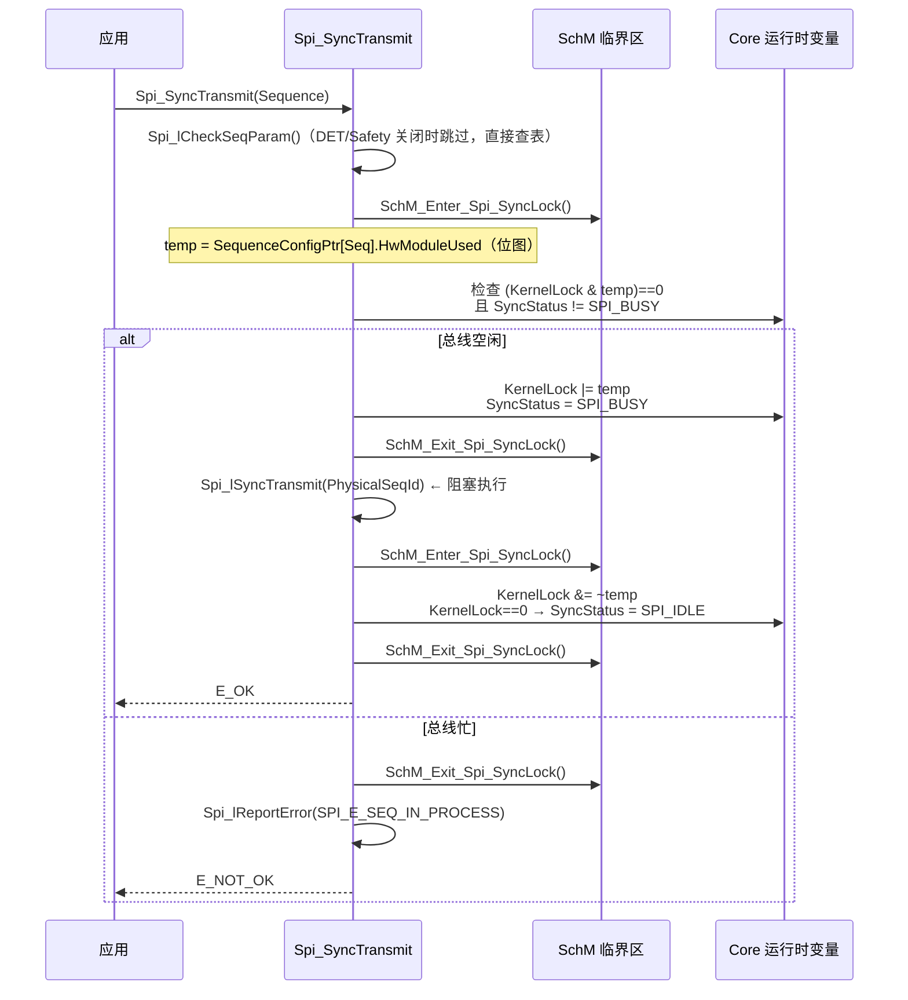
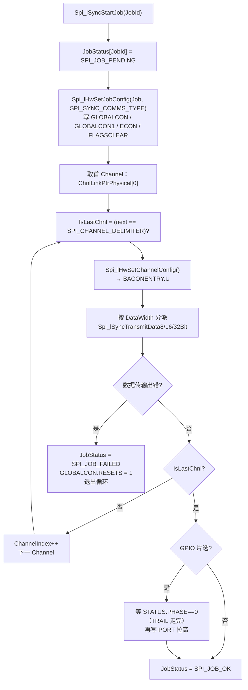
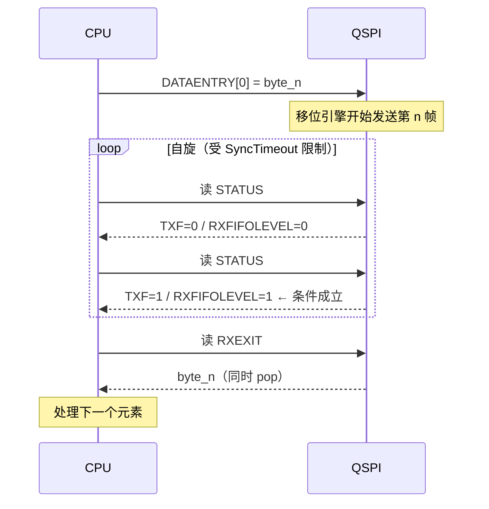
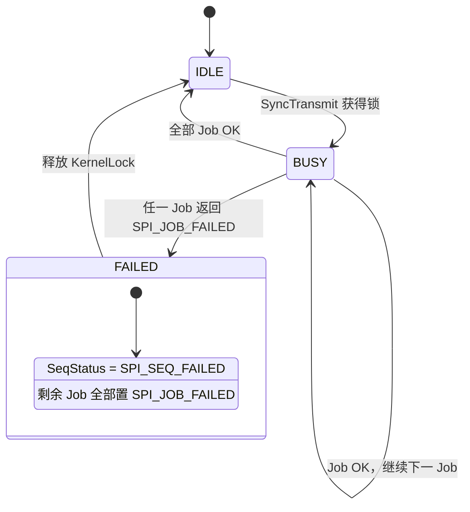

# SPI MCAL Level 0 运行时：同步传输的寄存器级跟踪

> 系列第 3 篇。本工程配置为 `SPI_LEVEL_DELIVERED = 0`，本篇是**实际在跑的代码路径**。

## 核心问题

一次 `Spi_SyncTransmit(Seq)` 调用，从 API 入口到最后一个字节进出 FIFO，代码到底做了什么？驱动凭什么保证数据不丢、片选不错、错误可查？

## 结论

1. **Level 0 是"调用者推动"的逐元素循环**：写 1 个元素进 TX FIFO → 自旋等待 → 读 1 个元素出 RX FIFO → 下一个。没有 DMA、没有中断、没有队列。
2. **等待条件是精确的两位组合**：`(STATUS & 0x00380200) == 0x00080200`，即 **TXF=1（发送侧已空到阈值）且 RXFIFOLEVEL=1（接收侧恰好 1 个）**。这个条件天然把流水深度锁死在 1。
3. **错误处理是"整 Job 失败 + 硬件复位"**：任何错误标志置位 → 该 Job 标 `SPI_JOB_FAILED` → 写 `GLOBALCON.RESETS=1` 复位 QSPI 状态机 → 序列剩余 Job 全部标记失败。
4. **片选释放有两条路径**：硬件片选靠末帧 BACON.LAST=1；GPIO 片选靠驱动在末帧后**等 PHASE 归零**再拉高电平。

## 背景

Level 0 的 SWS 定义是："synchronous handling with a **FIFO policy** to handle multiple accesses"。注意用词——它没说"用硬件 FIFO 做流水"，只说"用 FIFO 策略处理多次访问"。本实现把 FIFO 策略实现成了**严格的一进一出**。

## 关键机制

### 1. API 层：锁、状态、临界区



三个设计要点：

| 机制 | 作用 | 本工程取值 |
|---|---|---|
| `KernelLock`（**位图**） | 记录哪些 QSPI 模块正被占用 | 每个 Sequence 的 `HwModuleUsed` 是模块位图 |
| `SyncStatus` | 全局忙碌标志 | `SPI_SUPPORT_CONCURRENT_SYNC_TRANSMIT = STD_OFF` → 任一模块忙则全部拒绝 |
| `SchM_Enter_Spi_SyncLock()` | 保护上述两个变量的读改写 | 只保护判断与更新，**不覆盖传输过程** |

> **关键**：临界区在 `Spi_lSyncTransmit()` **之前**就退出了。也就是说，整个传输过程中中断是开着的，只是 SPI 驱动自己拒绝第二个同步请求。这与"关中断传输"是两回事。

### 2. 序列层：链表遍历

```c
do {
    Spi_lSyncStartJob(JobId);
    if (JobStatus[JobId] == SPI_JOB_FAILED) {
        SeqStatus[Sequence] = SPI_SEQ_FAILED;
        /* 把本序列剩余所有 Job 也标为 FAILED */
    } else {
        JobIndex++;
        JobId = SeqConfigPtr->JobLinkPtrPhysical[JobIndex];
    }
} while (JobId != SPI_JOB_DELIMITER);   /* 0xFFFF */
```

`JobLinkPtrPhysical[]` 是**物理 Job 索引**数组，以 `SPI_JOB_DELIMITER` 结尾。Sequence 不知道下一个 Job 属于哪个 QSPI——Level 0 里它甚至不检查，因为 `HwModuleUsed` 已在 API 层校验过。

### 3. Job 层：一次片选窗口的建立与拆除



**Job 开始时就写 ECON/GLOBALCON**，意味着同一 QSPI 上相邻两个 Job 如果参数不同，中间必然有一段重配置开销。这是 Level 0 无法流水化的第二个原因（第一个是逐元素等待）。

### 4. 元素层：8-bit 通道的完整循环

这是 Level 0 的心脏，[Spi.c:8268](D:/AUTOSAR_MCAL/EB_MCAL_Project/ty.os/BaseSw/Infra/Spi/ssc/src/Spi.c)：

```c
/* 1. 解析指针；NULL 则退化为默认数据 / 哑读 */
Src8BitPtr  = ChannelBufPointers[ChannelId].SrcPtr;   /* IB 槽位 */
Dest8BitPtr = ChannelBufPointers[ChannelId].DestPtr;
if (Dest8BitPtr == NULL) { Dest8BitPtr = &SyncDummyRead; }
if (Src8BitPtr  == NULL) { Src8BitPtr  = &ChannelConfigPtr->Defaultdata; }

TransferCount = ChannelBufPointers[ChannelId].TransferLength;

/* 2. 首 Channel 且 GPIO 片选 → 拉低 */
if (CSPortPin != SPI_CS_VIA_HW_OR_NONE && IsFirstChnl) Spi_lSetCsViaGpio(...);

/* 3. 逐元素 */
do {
    if (TransferCount == 1U && IsLastChnl == 1U) {
        lBacon = Spi_lHwSetChannelConfig(ChannelId, JobConfigPtr, 1U); /* LAST=1 */
        ModulePtr->BACONENTRY.U = lBacon.U;
    }
    ModulePtr->FLAGSCLEAR.U = (1U << RXC_C) | (1U << TXC_C);

    ModulePtr->DATAENTRY[0].U = (uint32)*Src8BitPtr;   /* 推入 TX FIFO */

    RetVal = Spi_lSynTransErrCheck(ModulePtr);          /* ← 自旋等待 */
    if (RetVal == E_OK) {
        *Dest8BitPtr = (uint8)ModulePtr->RXEXIT.U;      /* 弹出 RX FIFO */
        Dest8BitPtr++; Src8BitPtr++; TransferCount--;
    } else break;
} while (TransferCount > 0U);
```

### 5. 等待条件：一个整数说清全部

```c
/* Spi_lSynTransErrCheck */
uint32 LoopCounter = Spi_kGlobalConfigPtr->SyncTimeout;
while (((ModulePtr->STATUS.U & 0x00380200U) != 0x00080200U) && (LoopCounter != 0U)) {
    if ((ModulePtr->STATUS.U & 0x0000007FU) != 0U) { RetVal = E_NOT_OK; break; }
    LoopCounter--;
}
```

按 `Ifx_QSPI_STATUS_Bits` 拆开掩码：

| 位 | 字段 | 掩码贡献 | 期望值 | 含义 |
|---|---|---|---|---|
| 9 | `TXF` | 0x00000200 | **1** | 发送事件成立（TX FIFO 已降到阈值以下） |
| [18:16] | `TXFIFOLEVEL` | — | 不检查 | 发送侧剩余量不参与判断 |
| [21:19] | `RXFIFOLEVEL` | 0x00380000 | **1** | 接收 FIFO 恰好 1 个元素 |
| [31:28] | `PHASE` | — | 不检查 | 相位不参与判断 |



**为什么必须锁死深度 1**：如果先连写 4 个元素再读，RXFIFOLEVEL 会到 4，`== 1` 的条件永远不成立，直接超时失败。这不是保守写法，而是**当前条件表达式的必然结果**。

**代价**：每帧都要经历一次"发送完成 + 接收完成"的往返延迟。总线时钟 808 kHz 时单帧 16 bit ≈ 19.8 µs，而 CPU 自旋与 STATUS 读的开销叠加在每一帧上。这是 Level 0 只适合低频配置类通信的根本原因。

### 6. 状态机与错误传播



错误标志用 `0x7F`（`ERRORFLAGS[6:0]`）判断，而硬件实际是 `ERRORFLAGS[8:0]`（9 位）。**高 2 位错误标志不被驱动捕获**——如果现场出现"传输异常但驱动报成功"，应优先怀疑这两位。

`SPI_CANCEL_API = STD_OFF`，所以 `SPI_SEQ_CANCELED` 分支在编译期就被裁掉，运行时不存在"传输中途取消"。

### 7. 宽度分派：8/16/32 三条并行路径

| 函数 | 触发条件 | 指针类型 | 关键差异 |
|---|---|---|---|
| `Spi_lSyncTransmitData8Bit` | `DataWidth == 1` | `uint8*` | 每次写 `DATAENTRY[0]` 低 8 位 |
| `Spi_lSyncTransmitData16Bit` | `DataWidth == 2` | `uint16*` | 一次写 16 位，硬件按 ECON 决定实际帧长 |
| `Spi_lSyncTransmitData32Bit` | `DataWidth == 4` | `uint32*` | 一次写 32 位，DL 必须 ≥ 32 才有效 |

三者结构完全相同，只有指针类型和 `Spi_lGetChannelDataWidth()` 的返回值不同。`DataWidth` 来自 `ChannelConfigPtr->DataConfig & 0x7F`，由 EB 的 `SpiDataWidth` 生成。

> **宽度不是帧长**：`DataConfig` 同时编码了 MSB 和宽度，驱动用它决定**按几字节访问缓冲区**；真正的线上帧长是 `BACON.DL + 1`。两者在多数配置下相等，但 SWS 允许 `SpiDataWidth=12` 而缓冲按 16 位访问——此时靠 `SWS_Spi_00290` 的"取低半部/补零"规则桥接。

## 应用场景

| 场景 | Level 0 是否合适 | 说明 |
|---|---|---|
| 上电配置外部器件（TLF35584、SBC） | ✅ 最佳 | 顺序固定、频率低、代码量小 |
| 周期读传感器（≤ 1 kHz） | ✅ 合适 | 阻塞时间可接受 |
| 主循环内读取 | ⚠ 注意 | 会阻塞整个主循环，需评估单次耗时 |
| 中断上下文调用 | ❌ 禁止 | 自旋等待会长时间占用 ISR |
| 大数据块（> 64 字节） | ❌ 不合适 | 逐元素往返，CPU 占用极高 |
| 需要优先级仲裁 | ❌ 不可用 | Level 0 无队列 |

## 关联笔记

- 上一篇：[概念到硬件映射](AUTOSAR_Comm_SPI_MCAL_02_Concept_To_Hardware_Mapping.md)
- 下一篇：Level 1/2 运行时（队列、DMA、PT2）
- QSPI FIFO 与背压：[HW_Periph_Comm_QSPI_Study_Atlas.html](../../../../01_Hardware_硬件层/05_Peripherals/01_Communication/01_SPI/HW_Periph_Comm_QSPI_Study_Atlas.html) 第 06/07 章

## 待补充问题

1. `SyncTimeout` 的配置来源与默认值（`SPI_DELAY_TIMEOUT = 0xFFFFFFFE` 是否就是它）。
2. 32 位通道在 `DataWidth==4` 但 `DL < 31` 时的实际行为（硬件截断还是驱动补充）。
3. 高 2 位错误标志（`ERRORFLAGS[8:7]`）的具体定义与漏检风险量化。

## 标签

`#AUTOSAR` `#SPI` `#MCAL` `#Level0` `#运行时` `#TC3xx`

## Agent 整理记录

- 2026-11-02：建立。等待条件、掩码分解、错误复位路径均从 `Spi.c` 源码与 `IfxQspi_regdef.h` 逐位核对。
