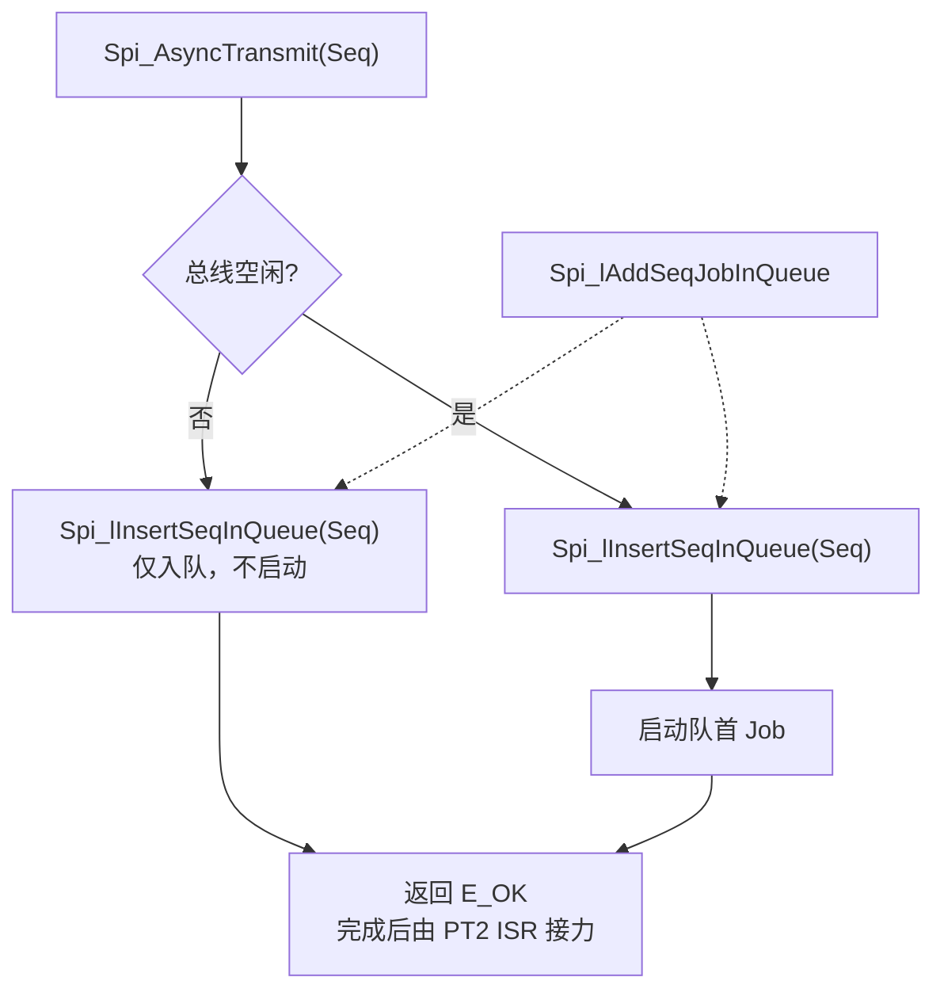
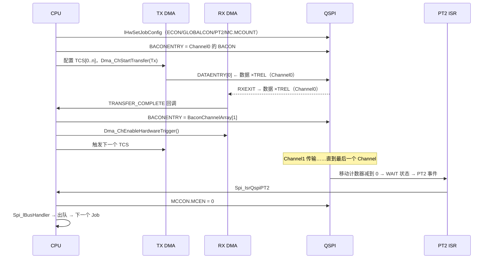
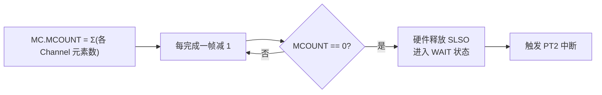
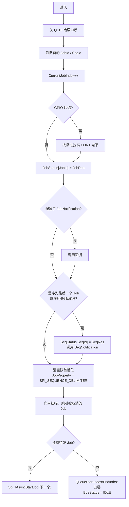
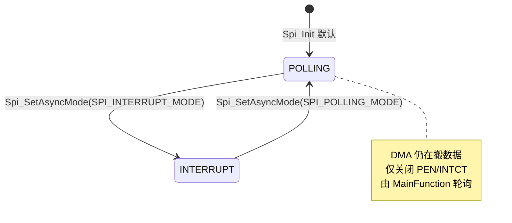

# SPI MCAL Level 1/2 运行时：优先级队列、DMA 链与 PT2 中断

> 系列第 4 篇。本工程未启用 Level 1/2（`SPI_LEVEL_DELIVERED = 0`），本篇讲的是**同一份源码中另一条编译分支**——理解它才能回答"什么时候该换 Level"。

## 核心问题

异步模式下，谁来推动传输？Job 之间怎么排优先级？一个 Job 内的多个 Channel 怎么在不抬片选的前提下连续发送？

## 结论

1. **推动者是 DMA + 两级中断**：RX DMA 完成一个 Channel → 回调写下一 Channel 的 BACON 并触发 TX DMA；帧结束时 PT2 中断 → 总线处理函数启动队列中的下一个 Job。
2. **优先级是"插队"而不是"抢占"**：新序列的 Job 按优先级插入队列，但**正在传输的 Job 不会被打断**（除非序列被配置为可打断）。SWS 的 Priority policy 指的是队列排序策略。
3. **片选由硬件移动计数器托管**：`MC.MCOUNT` 预置为整个 Job 的总元素数，减到 0 时自动释放 SLSO。软件因此完全不需要在 Channel 之间碰片选。
4. **`Spi_MainFunction_Handling` 只在 Level 2 的轮询模式下有实质工作**，中断模式下它是空转（见源码 `#if (SPI_LEVEL_DELIVERED == 2U)` 与 `SPI_ASYNC_MODE == SPI_POLLING_MODE` 双重条件）。

## 背景

Level 0 的瓶颈是"每元素一次 CPU 往返"。要提速有两条路：

- **DMA 搬数据**：CPU 只配置一次，剩下由 DMA 把缓冲区内容推进 DATAENTRY。
- **硬件管片选**：CPU 不必在最后一个元素前改写 BACON，由移动计数器自动结束 Job。

这两条都要求"软件提前知道整个 Job 有多少元素、每个 Channel 多长"——而这正是 Job/Channel 静态配置提供的。**Level 1/2 不是 Level 0 的优化，是另一套执行模型**。

## 关键机制

### 1. 队列的数据结构：一个 16-bit 打包了什么

```c
typedef struct {
    Spi_JobType QueueJobId;   /* 物理 Job 索引 */
    uint16      JobProperty;  /* 打包字段 */
} Spi_JobAndSeqQueueType;
```

`JobProperty` 的位分配（源码注释原文）：

| 位 | 字段 | 含义 |
|---|---|---|
| [7:0] | Sequence ID | 该 Job 属于哪个序列（用于回调与状态回写） |
| [9:8] | Job Priority | 0..3，**数值越大优先级越高** |
| [12] | Interruptible | 0 = 不可打断，1 = 可打断 |
| [15] | Skip | 序列被取消时置位，总线处理时跳过 |

示例（源码注释）：序列 S1（ID=16）中的 Job J1（ID=8）、优先级 2、不可打断 →

```text
QueueJobId  = 0x0008
JobProperty = 0x0210      /* 0b0000_0010_0001_0000 */
              │││└─[7:0]  = 0x10 (Seq 16)
              │└─[9:8]    = 0b10 (Priority 2)
              └─[12]      = 0    (Non-Interruptible)
```

每个 QSPI 模块有**一条独立的循环队列**，长度由 `SPI_JOB_QUEUE_LENGTH_QSPIx` 决定（本工程各模块 2，但 Level 0 下整个结构被 `#if` 裁掉）。

### 2. 入队：按优先级插入



插入规则（`Spi_lCheckForJobInsert`）：

```c
if ((JobPriority <= PrioOfJobInQ) && (JobPriority > PrioOfNextJobInQ))  insert = TRUE;
if ((JobPriority >  PrioOfJobInQ) && (JobPriority > PrioOfNextJobInQ)) insert = TRUE;
```

即：**找到第一个"优先级严格低于新 Job"的位置插进去**。优先级 0 走快速路径——直接追加到队尾（源码注释明确写 "jobs have least priority - insert in last"）。

> **优先级语义校正**：0 是**最低**优先级，不是最高。这与很多人的直觉相反，也是配置错误的常见来源。

### 3. 执行：DMA 链 + 两级中断



#### 3.1 TCS 链：一个 Channel 一套

```c
typedef struct {
  Ifx_DMA_CH_RDCRCR DmaRDCRC;  /* CRC */
  Ifx_DMA_CH_SDCRCR DmaSDCRC;
  Ifx_DMA_CH_SADR   DmaSADR;   /* 源地址 */
  Ifx_DMA_CH_DADR   DmaDADR;   /* 目的地址 */
  Ifx_DMA_CH_ADICR  DmaADICR;  /* 地址增量 / 中断控制 */
  Ifx_DMA_CH_CHCFGR DmaCHCFGR; /* 传输长度 TREL / 数据宽度 CHDW */
  Ifx_DMA_CH_SHADR  DmaSHADR;  /* 指向下一个 TCS（链表） */
  Ifx_DMA_CH_CHCSR  DmaCHCSR;  /* 状态 */
} Spi_DmaTCSType;   /* 必须 32 字节对齐 */
```

| 字段 | TX 侧取值 | RX 侧取值 |
|---|---|---|
| `SADR` | 应用缓冲区 / `Defaultdata` | `&RXEXIT`（固定） |
| `DADR` | `&DATAENTRY[0]`（固定） | 应用缓冲区 / `DummyRead` |
| `TREL` | Channel 元素数 | 同左 |
| `CHDW` | `DataWidth - 1`（8/16/32 → 0/1/2） | 同左 |
| `ADICR` | 源地址递增，目的地址固定 | 目的地址递增，源地址固定 |
| `SHADR` | `&TCS[i+1]`；最后一个为 `NULL` | 同左 |

`Spi_lSetDmaTcs` 遍历 Job 的 Channel 链表，逐个填 TCS 并串成链表（[Spi.c:10014](D:/AUTOSAR_MCAL/EB_MCAL_Project/ty.os/BaseSw/Infra/Spi/ssc/src/Spi.c)）。

#### 3.2 为什么 Channel 切换要写 BACON

DMA 只搬数据，**它不会写 BACONENTRY**。所以每完成一个 Channel，必须在 RX DMA 回调里补写下一个 Channel 的 BACON：

```c
/* Spi_lIsrDmaQspiRx */
ChnlIndex = CurrentChannelIndex + 1;
ChnlId = JobConfigPtr->ChnlLinkPtrPhysical[ChnlIndex];
if (ChnlId != SPI_CHANNEL_DELIMITER) {
    CurrentChannelIndex++;
    Dma_ChEnableHardwareTrigger(DMARxChannel);
    ModulePtr->BACONENTRY.U = Spi_BaconChannelArray[ChnlIndex].U;  /* ← 关键 */
    /* 触发 TX DMA */
}
```

这解释了 `Spi_BaconChannelArray` 的存在：Job 开始时把 Channel1..n 的 BACON 全部预先算好放在数组里，回调里只做一次赋值。**首 Channel 的 BACON 直接写进 BACONENTRY**，后续的存数组。

#### 3.3 移动计数器：Job 级片选的生命周期

```c
if ((ToggleCs == 0U) && (IsAsynchronous == 1U)) {   /* 非帧片选 + 异步 */
    GlobalCon1Reg.B.PT2   = SPI_WAIT_STATE;          /* PT2 = 5 */
    GlobalCon1Reg.B.PT2EN = SPI_TRIGGER_ENABLE;
    ModulePtr->MC.B.MCOUNT = Spi_lGetTotalBytesOfJob(JobConfigPtr);  /* 所有 Channel 之和 */
    ModulePtr->MCCON.B.MCEN = 1;
}
```



**这是 Job 与 Channel 关系最硬的证据**：移动计数器只能被配置成"整个 Job 的总帧数"，硬件因此天然知道片选应覆盖到哪里。SWS 说"CS 绑定 Job"，在 AURIX 上就体现为这个计数器。

> **硬上限**：`MC.MCOUNT` 只有 **13 位**（`[12:0]`，见 `Ifx_QSPI_MC_Bits`），单次可装载 0..8191。因此 `Spi_lGetTotalBytesOfJob()` 的求和结果必须 ≤ 8191，否则高位被截断，片选会**提前释放**——这是异步模式下一个容易漏掉的配置约束。每个元素的计数单位由 `CHDW` 决定，不是字节数。

### 4. 总线处理函数：一次中断做完所有出队动作

`Spi_lBusHandler(Module, SeqRes, JobRes)` 的顺序（[Spi.c:6147](D:/AUTOSAR_MCAL/EB_MCAL_Project/ty.os/BaseSw/Infra/Spi/ssc/src/Spi.c)）：



注意三件事：

1. **`CurrentJobIndex` 在这里自增，`CurrentChannelIndex` 在 DMA 回调里自增**——两个游标分别属于 Job 层和 Channel 层。
2. **回调在中断上下文执行**（PT2 是 ISR）。`JobNotification` / `SeqNotification` 里不能做耗时操作，也不能调用 SPI API。
3. **整个出队/入队过程包在 `SchM_Enter_Spi_Queue_Update()` 里**——因为 `Spi_AsyncTransmit` 可能同时在另一个上下文插入 Job。

### 5. Level 1 vs Level 2：只差一个运行时开关

| 特性 | Level 1 | Level 2 |
|---|---|---|
| 异步 + 优先级队列 | ✅ | ✅ |
| 序列可打断 | 配置决定 | 配置决定 |
| **运行时切换中断/轮询** | ❌ 不支持 | ✅ `Spi_SetAsyncMode` |
| `Spi_MainFunction_Handling` | 编译掉 | 存在（仅轮询模式生效） |
| 同步 API | ❌ 编译掉 | ✅ 保留 |

Level 2 的轮询模式做的事（`Spi_lHwSetJobConfig` 内）：

```c
if (Spi_RuntimeCoreVar[CoreId]->Spi_AsyncMode == SPI_POLLING_MODE) {
    GlobalCon1Reg.B.ERRORENS = 0U;        /* 关错误中断 */
    SpiDmaTCSPtr[i].DmaADICR.B.INTCT = SPI_DMA_DISABLE_INTR;  /* 关 DMA 完成中断 */
}
```

即：**轮询模式不是"CPU 查状态"，而是"关掉中断源、由 MainFunction 主动检查"**。DMA 仍在工作，只是完成事件不产生中断。



### 6. 错误路径

`Spi_IsrQspiError` → `Spi_lErrorHandler`：

```c
GlobalConReg.U = SPI_HW_MODULE[Module].GLOBALCON.U;
GlobalConReg.B.RESETS = 1;                    /* 复位 QSPI 状态机 */
SPI_RUNTIME_WRITESAFETYENDINITPROTREG(&GLOBALCON, GlobalConReg.U);
/* 队列中所有未完成 Job 置 FAILED，对应 Sequence 置 FAILED */
```

与 Level 0 的差别：Level 0 是在**调用者上下文**里发现错误并退出；Level 1/2 是在**中断上下文**里发现错误，需要遍历队列把受影响的序列全部标记失败，并重新仲裁下一个 Job。

## 应用场景

| 场景 | 推荐 | 理由 |
|---|---|---|
| 多条序列竞争同一 QSPI，且有轻重缓急 | Level 1 | 优先级入队即可解决 |
| 大块数据（外部 Flash 读、ADC 流） | Level 1 | DMA 搬运，CPU 零参与 |
| 负载在"突发"和"空闲"间切换 | Level 2 | 运行时切换中断/轮询 |
| 需要在中断与主循环间动态取舍功耗 | Level 2 | 轮询模式可减少中断开销 |
| 只有上电配置与低频轮询 | Level 0 | 不需要队列与 DMA，代码最小 |

## 关联笔记

- 上一篇：[Level 0 运行时](AUTOSAR_Comm_SPI_MCAL_03_Level0_Runtime.md)
- 下一篇：EB 配置与代码生成
- DMA 与总线：[HW_Sys_Bus 多主访问与写保护](../../../../01_Hardware_硬件层/03_System/04_Bus/HW_Sys_Bus_MultiMaster_Access_Protection.md)
- QSPI 移动计数器与 PT2：[HW_Periph_Comm_QSPI_Study_Atlas.html](../../../../01_Hardware_硬件层/05_Peripherals/01_Communication/01_SPI/HW_Periph_Comm_QSPI_Study_Atlas.html) 第 05/10 章

## 待补充问题

1. `SPI_SUPPORT_CONCURRENT_SYNC_TRANSMIT` 与 Level 2 同步 API 的交互（Level 2 下同步与异步能否并发）。
2. 序列可打断（`SPI_INTERRUPTIBLE_SEQ_ALLOWED`）时 `Spi_lInsertSeqInQueue` 的复杂重排逻辑，需单独一篇。
3. TC3xx 移动计数器在 Channel 数据宽度不一致时的计数单位（帧还是字节）——源码用 `TransferLength` 求和，需对照 UM 确认单位。

## 标签

`#AUTOSAR` `#SPI` `#MCAL` `#Level1` `#Level2` `#DMA` `#TC3xx`

## Agent 整理记录

- 2026-11-02：建立。队列打包、优先级比较、TCS 字段、BusHandler 流程、轮询模式实现均逐段核对源码。
