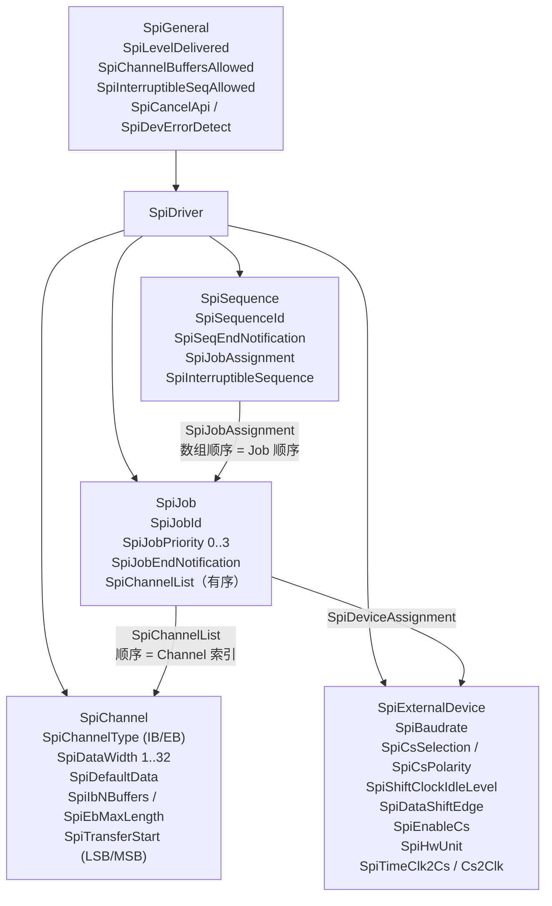
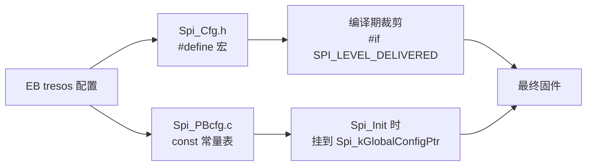
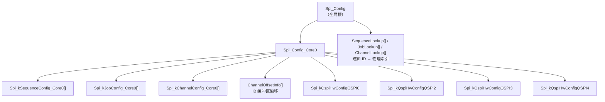
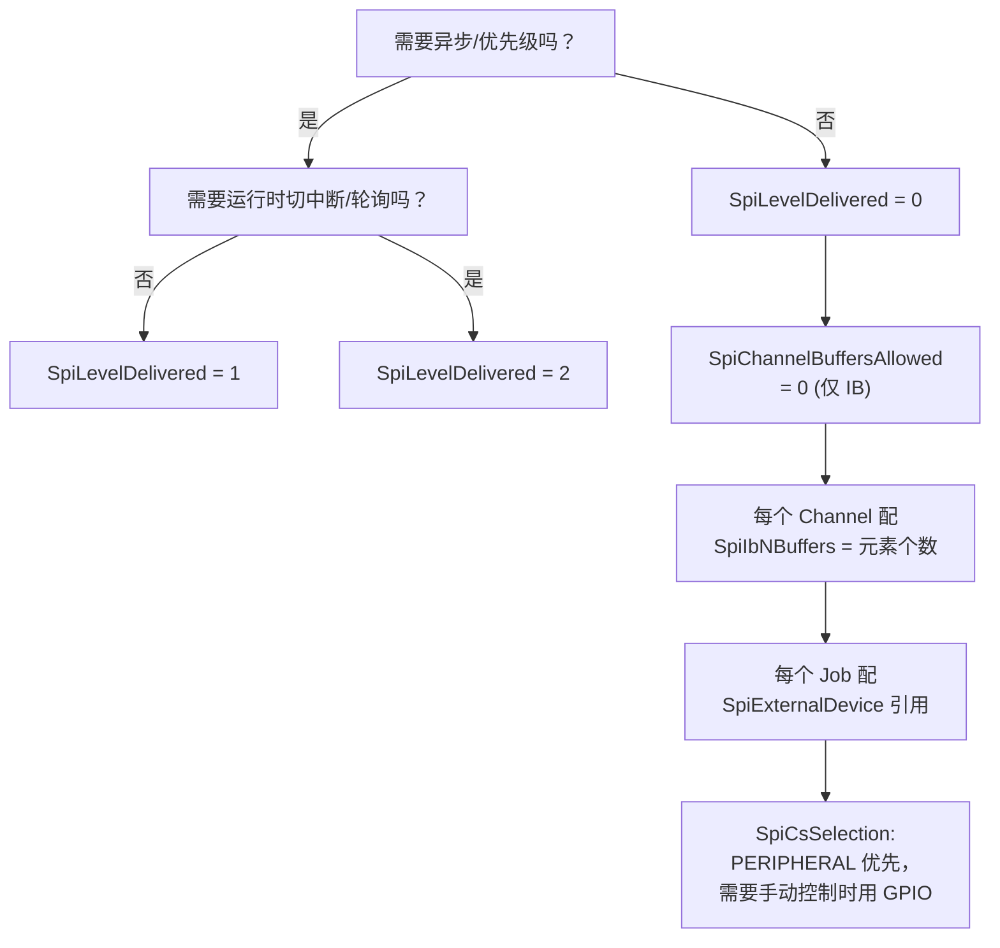

# SPI MCAL EB 配置：从 ECUC 参数到生成代码

> 系列第 5 篇。前四篇讲了需求与运行时；本篇讲**这些运行时行为的输入从哪来**——EB tresos 里的每一个勾选项，最终变成了什么。

## 核心问题

EB tresos 里的配置项，按什么模型组织？哪些在预编译期被固化成宏，哪些被展开成常量表，哪些留到运行时？配错一项，症状会出现在哪里？

## 结论

1. **ECUC 模型有四个业务容器**：`SpiChannel`（数据单元）、`SpiJob`（片选窗口）、`SpiSequence`（Job 序列）、`SpiExternalDevice`（**电气契约**）。Job 通过 `SpiDeviceAssignment` 引用一个外部设备。
2. **电气参数属于 `SpiExternalDevice`，不属于 Job**——波特率、时钟极性相位、片选极性、IDLE/LEAD/TRAIL 都在设备侧。这是"同一从机接不同 QSPI 口"能复用的前提。
3. **生成物分三种**：`Spi_Cfg.h` 的宏（预编译裁剪）、`Spi_PBcfg.c` 的常量表（链接期数据）、运行时变量（每次调用变化的游标）。
4. **`SPI_LEVEL_DELIVERED` 是总开关**：它决定了哪些结构体、哪些函数、哪些 API 根本不进固件。

## 背景

AUTOSAR 的配置分三类时间点：

| 类别 | 何时确定 | AURIX MCAL 的做法 |
|---|---|---|
| Pre-compile | 编译前 | 写进 `Spi_Cfg.h` 的 `#define`，用 `#if` 裁剪代码 |
| Link-time | 链接时 | 常量表放在 `Spi_PBcfg.c` |
| Post-build | 运行时 | 本工程未使用（Variant PB 但仍按前两类生成） |

本工程 `VARIANT : Variant PB`，实际生成方式仍是"预编译宏 + 链接期表"。

## 关键机制

### 1. ECUC 容器模型



三个容易看错的点：

1. **`SpiChannelList` 的数组顺序就是 Job 内的 Channel 顺序**，对应 `SWS_Spi_00368`。改顺序 = 改数据在总线上的先后。
2. **`SpiJobAssignment` 的数组顺序就是 Sequence 内的 Job 顺序**，对应 `SWS_Spi_00236`。
3. **`SpiExternalDevice` 可被多个 Job 引用**。同一个从机（同一套电气参数）出现在多条序列里时，不需要重复配置波特率。

### 2. 参数 → 生成物的三条通路



| ECUC 参数 | 生成物 | 代码里怎么用 |
|---|---|---|
| `SpiLevelDelivered` | `SPI_LEVEL_DELIVERED (0U)` | `#if` 裁剪整个异步路径 |
| `SpiChannelBuffersAllowed` | `SPI_CHANNEL_BUFFERS_ALLOWED (0U)` | 决定 `Spi_SetupEB` 是否存在 |
| `SpiChannelType` | `Spi_ChannelConfigType.ChannelType` | `SPI_IB_CHANNEL` / `SPI_EB_CHANNEL` |
| `SpiDataWidth` | `DataConfig = (MSB<<7) OR Width` | 驱动拆出 MSB 与 DL |
| `SpiJobPriority` | `Spi_JobConfigType.JobPriority` | 入队排序 |
| `SpiBaudrate` | `BaudRateAndClockParam` 的 Q/A/B/C/TQ | 写 ECON + GLOBALCON |
| `SpiCsSelection` | `CSPortPin`（`SPI_CS_VIA_HW_OR_NONE` 或端口号） | 决定驱动是否碰 GPIO |
| `SpiCsPolarity` | `Spi_JobConfigType.CsPolarity` | GPIO 模式下的电平方向 |
| 时间参数（秒） | `IdleLeadTrailDelay` | 量化成 TQz 倍数写 BACON |

### 3. 预编译宏：本工程实际值

```c
#define SPI_LEVEL_DELIVERED                   (0U)      /* 仅同步 */
#define SPI_CHANNEL_BUFFERS_ALLOWED           (0U)      /* 仅 IB */
#define SPI_DEV_ERROR_DETECT                  (STD_OFF) /* 无 DET */
#define SPI_SAFETY_ENABLE                     (STD_OFF) /* 无 Safety */
#define SPI_HW_ERROR_DEM_REPORT               (SPI_DEM_REPORT_DISABLED)
#define SPI_CANCEL_API                        (STD_OFF)
#define SPI_HW_STATUS_API                     (STD_OFF)
#define SPI_VERSION_INFO_API                  (STD_ON)
#define SPI_INTERRUPTIBLE_SEQ_ALLOWED         (STD_OFF)
#define SPI_SUPPORT_CONCURRENT_SYNC_TRANSMIT  (STD_OFF)
#define SPI_MAX_HW_UNIT                       (6U)
```

**这 11 个宏决定了代码体积和行为边界**。例如：

- `SPI_DEV_ERROR_DETECT = STD_OFF` → `Spi_SyncTransmit` 里 `Spi_lCheckSeqParam` 整段被裁掉，直接走 `SequenceLookup[]` 查表。参数非法不会被发现，只会越界。
- `SPI_SUPPORT_CONCURRENT_SYNC_TRANSMIT = STD_OFF` → 任一 QSPI 忙则全部同步请求被拒（`SyncStatus != SPI_BUSY` 判断）。
- `SPI_CANCEL_API = STD_OFF` → `SPI_SEQ_CANCELED` 分支不参与编译。

### 4. 链接期表：五张表 + 三个索引

`Spi_PBcfg.c` 生成的静态表：



**索引表是"逻辑 ID → 物理下标"的桥梁**。AUTOSAR API 传的是逻辑 ID，表里的下标是物理位置；`Spi_kGlobalConfigPtr->SequenceLookup[Sequence]` 完成转换。这也解释了为什么 `Spi_GetSequenceResult(SeqId)` 必须走查表——逻辑 ID 可以不连续。

### 5. 一个真实 Job 的完整展开

以 `HB_JOB1` 为例，从 EB 到寄存器：

```text
EB 配置                                生成代码                              运行期寄存器
────────────────────────────────────────────────────────────────────────────────────
SpiBaudrate = 808080.8 Hz      →   Spi_BaudRateAndClockParam(          →   ECON  = 0x144A
SpiShiftClockIdleLevel = LOW        TQ=2, LB=0,                        →   GLOBALCON.TQ = 2
SpiDataShiftEdge = LEADING          Q=10, A=1, B=0, C=1,
                                     CPH=1, CPOL=0, PAREN=0)
                                   
SpiLeadDelay / Cs2Clk = 0.1 µs →   Spi_IdleLeadTrailParam(             →   BACON.IDLE  = 1
SpiTrailDelay / Clk2Cs = ...        IPRE=0, IDLE=1,                        BACON.LEAD  = 7
SpiTimeCs2Cs = ...                  LPRE=0, LEAD=7,                        BACON.TRAIL = 5
                                    TPRE=0, TRAIL=5, PARTYP=1)
                                   
SpiCsSelection = PERIPHERAL     →   CSPortPin = SPI_CS_VIA_HW_OR_NONE   →   BACON.CS = SLSO10
SpiCsPolarity = LOW             →   CsPolarity = STD_LOW                →   SSOC.AOL[10] = 0

SpiChannelList = [HBC2]         →   HBC2_ChannelLinkPtr_Physical[]      →   BACON.DL = 15 (16bit)

SpiDataWidth = 16               →   DataConfig = 0x90                   →   BACON.MSB = 1
SpiTransferStart = MSB              (MSB=1, Width=0x10)                     BACON.DL  = 0x0F
```

> **量化的必然性**：SWS 用"秒"描述 `SpiTimeClk2Cs` 等参数，硬件只接受"TQz 的整数倍"。生成器会做除法取整，**配置的秒数越精确，误差越小**。生成文件里的 `1.0E-7s` 注释是生成器的名义值，不能直接反推寄存器值，必须用 ECON 参数按公式重算。

### 6. 配置决策树



### 7. 常见配置错误与症状

| 配置错误 | 运行期症状 | 定位方法 |
|---|---|---|
| `SpiDataWidth` 与 `SpiIbNBuffers` 不匹配 | 数据错位、多读/少读 | 看 `TransferLength` 与缓冲区长度 |
| `SpiCsSelection = GPIO` 但端口号填错 | 从机无响应、总线无波形 | 量 CS 引脚 |
| `SpiJobPriority` 填反（以为 3 最低） | 高优先级报文被饿死 | 打印队列内容 |
| Level 0 下配了多条 Sequence 并发调用 | 第二条返回 `E_NOT_OK` | 检查 `SyncStatus` |
| `SpiExternalDevice` 被多个 Job 共享但波特率不同 | 只有一个 Job 正确 | 一个设备一套参数，不同速率要拆设备 |
| `SPI_DEV_ERROR_DETECT` 关闭 | 非法 ID 不报错，静默越界 | 调试期临时打开 |

最后一条是**调试期最重要的开关**：本工程为省代码关掉了 DET，代价是参数错误无声通过。定位阶段建议临时改成 `STD_ON` 重新编译。

## 应用场景

| 目标 | 该动哪一层 |
|---|---|
| 调整总线速率 | `SpiExternalDevice.SpiBaudrate` |
| 加一个新从机 | 新增 `SpiExternalDevice` + `SpiJob` + 引用它的 `SpiSequence` |
| 同一从机加一条命令 | 新增 `SpiChannel`，挂到已有 Job |
| 同一从机换速率 | 拆成两个 `SpiExternalDevice` |
| 换 QSPI 外设口 | 改 `SpiHwUnit`（同时影响引脚复用） |
| 减少代码体积 | 降 `SpiLevelDelivered`、关 DET/Safety/DEM/Cancel |
| 排查配置问题 | 临时开 `SPI_DEV_ERROR_DETECT` |

## 关联笔记

- 上一篇：[Level 1/2 运行时](AUTOSAR_Comm_SPI_MCAL_04_Level12_Runtime.md)
- 下一篇：调试与故障定位
- 需求侧：[需求模型](AUTOSAR_Comm_SPI_MCAL_01_Requirement_Model.md) 的 IB/EB 与 Level 定义

## 待补充问题

1. `SpiTimeClk2Cs` / `SpiTimeCs2Clk` / `SpiTimeCs2Cs` 与 AURIX 的 IDLE/LEAD/TRAIL 的精确对应关系（生成器映射规则未在源码中体现）。
2. Post-build 变体（`VARIANT-POST-BUILD`）在本 MCAL 中的实际支持程度。
3. `ChannelOffsetInfo` 的生成算法——是全局累加还是按 QSPI 分组累加（影响 `IBBufferSize` 的理解）。

## 标签

`#AUTOSAR` `#SPI` `#MCAL` `#EB_tresos` `#配置` `#代码生成`

## Agent 整理记录

- 2026-11-02：建立。ECUC 参数名与容器关系取自 SWS R4.2.2 第 10 章原文（页 91-97）；宏值与常量表取自本工程 `Spi_Cfg.h` / `Spi_PBcfg.c`。
