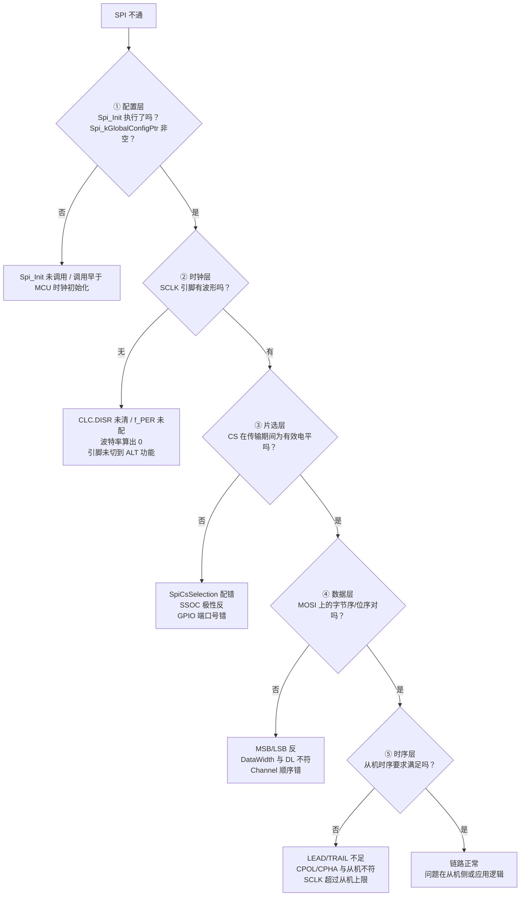
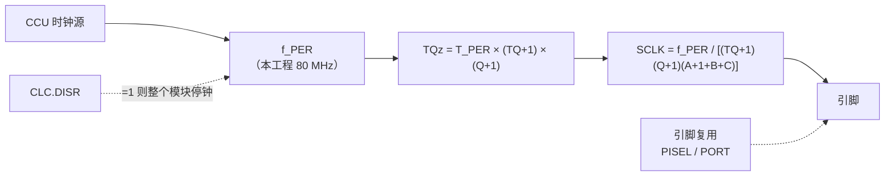
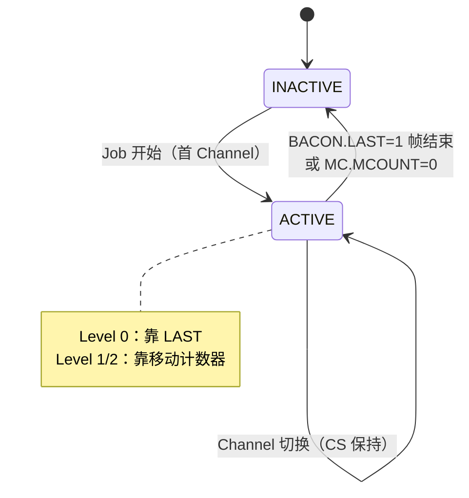
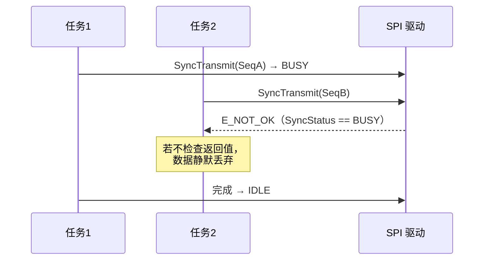

# SPI MCAL 调试：五层定位法与故障模式库

> 系列第 6 篇。前五篇建立模型，本篇把模型变成**排障动作**。

## 核心问题

"SPI 不通"是现象不是原因。如何用最少的测量，把问题锁定到某一层？

## 结论

1. **按信号链分层，不要按代码分层**。顺序是：配置是否生效 → 时钟是否出来 → 片选是否正确 → 数据是否对得上 → 时序是否满足从机。
2. **Level 0 的失败几乎总能归到四类**：配置错、时钟错、片选错、宽度/位序错。前两类占八成。
3. **驱动自身的错误上报在本工程是关闭的**（`SPI_DEV_ERROR_DETECT = STD_OFF`、`SPI_HW_ERROR_DEM_REPORT = DISABLED`），所以"驱动没报错"不等于"没问题"。
4. **`0x7F` 掩码漏检高 2 位错误标志**，偶发失败要手动查完整 9 位。

## 背景

SPI 没有应答、没有地址、没有重传。从机不会告诉你"我收到了但内容不对"。这意味着**所有诊断信息必须由主机侧观测**：寄存器、引脚波形、缓冲区内容。


链路上任意一环断开，现象都是"数据不对"。分层定位就是把这条链切成可独立验证的段。

## 关键机制

### 1. 五层定位流程



### 2. 第一层：配置是否真的生效

**检查动作**（调试器）：

```c
/* 1. 驱动是否初始化 */
if (Spi_kGlobalConfigPtr == NULL_PTR)  → Spi_Init 没跑

/* 2. 配置指针是否指向预期表 */
Spi_kGlobalConfigPtr->NoOfSequences / NoOfJobs / NoOfChannels

/* 3. 逻辑 ID 是否正确映射 */
Spi_kGlobalConfigPtr->SequenceLookup[SeqId]
```

> **注意**：`Spi_kGlobalConfigPtr` 是文件内 `static` 变量，调试器里可能看不到符号。替代方法是在 `Spi_Init` 返回后读 `SPI_HW_MODULE[n].CLC` —— 如果 `DISR=0`，说明 `Spi_Init` 至少跑到了硬件初始化。

**本工程特别注意**：`Spi_Init` 写 CLC 用的是生成配置里的 `ClockSetting`。如果 MCU 时钟尚未稳定就调用 `Spi_Init`，QSPI 会在错误的 `f_PER` 下工作——**波特率整体偏移**，这是"能通信但误码"的典型原因。

### 3. 第二层：时钟从哪来



**快速判定**：

| 现象 | 结论 |
|---|---|
| 完全没有波形 | CLC 未使能，或引脚未切到 QSPI 功能 |
| 有波形但频率是期望值的整数倍偏差 | `f_PER` 配错（时钟树） |
| 频率正确但占空比异常 | CPH/CPOL 与预期不符，正常 |
| 波形只有前几帧 | 后续 BACON 未写入 / DMA 未续 |

**波特率反算**：已知期望频率与 `f_PER`，反推 `(TQ+1)(Q+1)(A+1+B+C)` 是否等于整数。若不是整数，生成器已做取整——实际频率必然与配置值有偏差，先从机手册确认容差。

### 4. 第三层：片选



**三个必查项**：

1. `SpiCsSelection` 是 `CS_VIA_PERIPHERAL_ENGINE` 还是 `CS_VIA_GPIO`？前者由 `BACON.CS` 选线，后者由 `CSPortPin` 直接写 PORT。
2. `SpiCsPolarity` 与从机要求是否一致？驱动在 GPIO 模式下会**取反**使用（`STD_LOW` → 拉高释放、拉低有效）。
3. `SSOC` 的 `AOL/OEN` 位是否允许该条 SLSO 输出？`Spi_lQSPIHwInit` 只写一次，之后不再改。

> **症状对照**：CS 一直为高（无效）→ 大概率 `SpiCsSelection` 配成 GPIO 但端口号无效，或 `SSOC` 未使能该 SLSO。CS 一直为低（不释放）→ `BACON.LAST` 从未置 1，或移动计数器未启用。

### 5. 第四层：数据

**位序与字节序**是第一大坑。三个独立概念必须分清：

| 概念 | 配置项 | 影响 |
|---|---|---|
| 帧内位序 | `SpiTransferStart`（MSB/LSB） | 一帧内先发高位还是低位 |
| 缓冲访问宽度 | `SpiDataWidth` → `DataConfig` | CPU 按几字节读写缓冲区 |
| 线上帧长 | `BACON.DL + 1` | 实际打多少 clock |

**典型错误**：`SpiDataWidth = 16`（`DataConfig = 0x90`）但 `DL` 只有 7（8 bit），结果每帧只发低 8 位，高 8 位被截断。

**验证方法**：在 `Spi_SyncTransmit` 返回后直接读 IB 槽位：

```c
uint8 *rx = Spi_RuntimeCoreVar[0]->ChannelBufPointers[ChId].DestPtr;
```

与逻辑分析仪抓到的 MISO 数据逐字节比对。若寄存器里对、波形上不对，问题在移位配置；若波形上对、寄存器里不对，问题在 DMA/指针。

### 6. 第五层：时序

| 参数 | 寄存器 | 从机手册对应项 |
|---|---|---|
| CS 到首时钟 | `BACON.LEAD` | t_CSS（Chip Select Setup） |
| 末时钟到 CS 释放 | `BACON.TRAIL` | t_CSH（Chip Select Hold） |
| 帧间空闲 | `BACON.IDLE` | t_CSH 或最小帧间隔 |
| 时钟极性 | `ECON.CPOL` | CPOL |
| 时钟相位 | `ECON.CPH` | CPHA |
| 采样点 | `ECON.A/B/C` | 从机 t_SU / t_HOLD |

CPOL/CPHA 组合（SPI 模式 0..3）：

| 模式 | CPOL | CPH | 采样边沿 |
|---|---|---|---|
| 0 | 0 | 0 | 第一个边沿（上升） |
| 1 | 0 | 1 | 第二个边沿（下降） |
| 2 | 1 | 0 | 第一个边沿（下降） |
| 3 | 1 | 1 | 第二个边沿（上升） |

> AURIX 的 `CPH=0` 表示"SLSO 有效到首个边沿 = LEAD+A"；`CPH=1` 表示"末边沿到 SLSO 释放 = TRAIL+B+C"。详见 QSPI 图谱第 02/10 章——**不要用通用 SPI 的 CPHA 直觉直接套**。

### 7. 偶发失败：三个隐蔽源

#### 7.1 错误标志漏检

```c
#define SPI_HW_ERROR_MASK  (0x0000007FU)   /* 只覆盖 ERRORFLAGS[6:0] */
```

硬件 `ERRORFLAGS` 是 9 位（`[8:0]`）。高 2 位错误**不会**让驱动返回 `E_NOT_OK`。排查偶发错误时：

```c
uint32 sts = SPI_HW_MODULE[n].STATUS.U;
/* 手动看完整的 [8:0] */
uint32 errflags = sts & 0x1FFU;
```

#### 7.2 超时

`Spi_lSynTransErrCheck` 用 `SyncTimeout` 递减计数。超时后返回 `E_NOT_OK`，Job 标失败，但**硬件状态机不会自动复位**——驱动只在错误标志路径写了 `GLOBALCON.RESETS=1`。超时路径需要人工确认 QSPI 是否卡在中间状态。

#### 7.3 并发被拒

`SPI_SUPPORT_CONCURRENT_SYNC_TRANSMIT = STD_OFF` 时，任一 QSPI 忙则所有同步请求返回 `E_NOT_OK`。若调用者忽略返回值，表现为"有时候没发出去"。



### 8. 最小复现检查清单

按顺序做，每步都要有明确结论才进入下一步：

| # | 检查 | 通过判据 |
|---|---|---|
| 1 | `SPI_HW_MODULE[0].CLC.DISR == 0` | 模块已使能 |
| 2 | SCLK 有波形，频率 ≈ 计算值 | 时钟链通 |
| 3 | CS 在首帧前拉低、末帧后拉高 | 片选链通 |
| 4 | MOSI 首字节与缓冲区一致 | 数据链通 |
| 5 | MISO 数据写入 IB 槽位 | 接收链通 |
| 6 | `JobStatus == SPI_JOB_OK`、`SeqStatus == SPI_SEQ_OK` | 驱动视角成功 |
| 7 | `STATUS & 0x1FF == 0` | 无隐藏错误 |

七步全过而业务仍异常 → 问题在从机配置或应用层，不在 SPI 驱动。

## 应用场景

| 现场现象 | 优先怀疑 | 首个动作 |
|---|---|---|
| 完全无波形 | CLC / 引脚复用 | 读 CLC.DISR，量引脚 |
| 有波形无响应 | CS 未有效 | 量 CS，查 `SpiCsSelection` |
| 数据全 0 | MISO 未接 / 从机未选中 | 量 MISO，查 CS |
| 数据全 FF | MISO 上拉、从机未驱动 | 同上 |
| 首字节对后续错 | Channel 顺序 / BACON 未续写 | 查 `ChnlLinkPtrPhysical` |
| 高频偶发错 | 时序余量 / 错误标志漏检 | 降速复测，读完整 ERRORFLAGS |
| 多任务下偶发丢帧 | 并发被拒未检查返回值 | 查 `E_NOT_OK` 分支 |

## 关联笔记

- 上一篇：[EB 配置](AUTOSAR_Comm_SPI_MCAL_05_EB_Configuration.md)
- 需求侧：[需求模型](AUTOSAR_Comm_SPI_MCAL_01_Requirement_Model.md)
- 硬件侧：[HW_Periph_Comm_QSPI_Study_Atlas.html](../../../../01_Hardware_硬件层/05_Peripherals/01_Communication/01_SPI/HW_Periph_Comm_QSPI_Study_Atlas.html) 第 02（采样点）/ 08（片选）/ 10（错误桶）章
- 多核一致性：[AUTOSAR 多核数据一致性与多核间通信](../../07_System/AUTOSAR_Sys_Multicore_Data_Consistency_and_Communication.md)

## 待补充问题

1. `ERRORFLAGS[8:7]` 的确切定义与触发条件（需查 UM QSPI 章节的 STATUS 描述）。
2. 超时路径下 QSPI 状态机的实际残留状态，是否需要软件补一次 `RESETS`。
3. 多核场景下 `Spi_RuntimeCoreVar` 的分配方式与 cache 一致性要求。

## 标签

`#AUTOSAR` `#SPI` `#MCAL` `#调试` `#故障定位` `#TC3xx`

## Agent 整理记录

- 2026-11-02：建立。五层流程按信号链组织；错误掩码、超时、并发拒绝三项均从源码取证。
