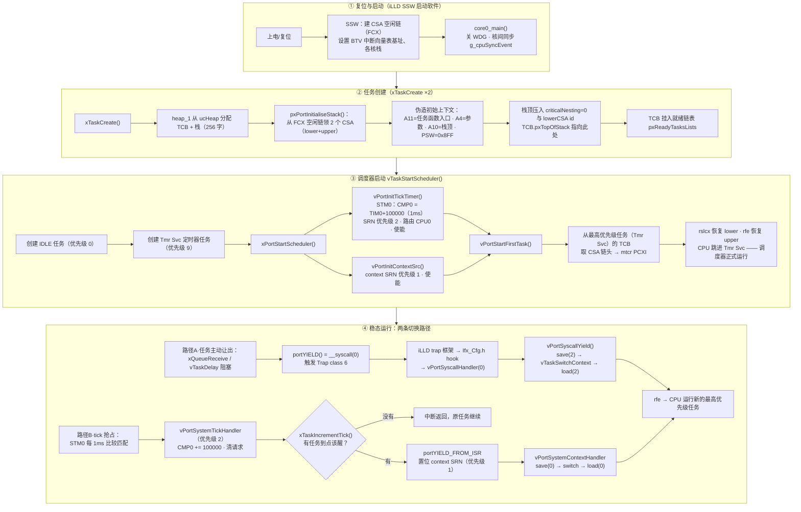

# FreeRTOS Port 深潜：TC3xx TASKING port 逐行注解与全流程图

## 核心问题

FreeRTOS 在 TC397 上"跑起来"的完整过程是什么？`port.c` / `portmacro.h` 里每一行代码在干什么、为什么这么干？

## 结论

Port 层的全部工作可以归结为**五项职责**，每项都由 TriCore 硬件特性决定其做法：

| 职责 | 干什么 | 为什么这么干（硬件原因） |
|---|---|---|
| ① 伪造任务出生现场 | 领 2 个 CSA，写入入口/参数/栈顶/PSW | TriCore 任务靠 RFE"恢复"启动，没有"调用" |
| ② 心跳 tick | STM0 比较中断，每 1ms | TC3xx 无 SysTick，每核一个 STM 是天然时基 |
| ③ 上下文切换 | 保存/恢复 CSA 链头（PCXI） | Upper Context 硬件自动存取，软件只管 Lower + 链头 |
| ④ 临界区 | 全局关中断 + 嵌套计数 | 本 port 选择最简单可靠的 ICR.IE=0 全屏蔽（非 CCPN 阈值） |
| ⑤ 资源回收 | 任务删除时把 CSA 链接回 FCX 空闲池 | CSA 是有限硬件资源，不复用就耗尽 |

## 背景

- 本笔记是「SP Port 深潜」系列的主参考文档，路线见 [[FreeRTOS_00_学习路线与问题地图]]；第 1 课概念版见 [[FreeRTOS_Port_TC3xx_Context_Switch_CSA]]。
- 注解对象：`TC397_FreeRTOS` 工程 `OS/FreeRTOS/portable/Tasking/TC3/port.c`（459 行）+ `portmacro.h`（134 行），FreeRTOS V10.5.1，Infineon 官方 2023 版 port。
- 文中行号对应工程 commit `f588fb5`。
- 阅读方式建议：左边打开 port.c，右边开本笔记，逐节对照。

## 关键机制

### 0. 全局流程图：一个任务是怎么"跑起来"的

### 1. Port 四件套与配置依赖

| 文件 | 角色 | 关键内容 |
|---|---|---|
| `port.c` | 机制实现 | 本笔记主体 |
| `portmacro.h` | 类型/宏/内联原语 | 见第 4 节宏全表 |
| `FreeRTOSConfig.h` | 硬件地址与参数 | `configSTM`=0xF0001000（STM0 基址）、`configSTM_SRC`=0xF0038300（STM0 SRN）、`configCONTEXT_SRC`=0xF0038990（借用的空闲 SRN）、`configSTM_CLOCK_HZ`=100MHz、`configTIMER_INTERRUPT_PRIORITY`=2、`configCONTEXT_INTERRUPT_PRIORITY`=1、`configCPU_NR`=0 |
| `Ifx_Cfg.h` | trap 接线 | `IFX_CFG_CPU_TRAP_SYSCALL_CPU0_HOOK` → `vPortSyscallHandler`（S0 排障补的两行） |

注意 `port.c` 里**故意只定义不直接引用寄存器名**：STM 寄存器用「基址指针 + 字节偏移 ÷4」访问（`pxStm[portSTM_CMP0 >> 2]`），因为指针是 `uint32_t *`，数组下标以字为单位。

### 2. 常量字典（port.c 44–74 行 + portmacro.h）

| 常量 | 值 | 干什么 / 为什么 |
|---|---|---|
| `portINITIAL_SYSTEM_PSW` | 0x8FF | 新任务的 PSW 初值：超级用户模式（能碰外设寄存器）、MPU 保护集 0、**关闭调用深度计数**（CSC 关，否则切换时会触发 call depth trap） |
| `portINITIAL_LOWER_PCXI` | 0x00300000 | Lower context 的 PCXI 初值：UL 位=1（链节指向 upper）、PIE=1（恢复后允许中断） |
| `portINITIAL_UPPER_PCXI` | 0x00200000 | Upper 的 PCXI 初值：UL 位=0（链节指向 lower）、PIE=1 |
| `portCSA_FCX_MASK` | 0x000FFFFF | CSA id 的地址位掩码：PCXI 低 20 位是链节地址部分，其余是标志位 |
| `portNUM_WORDS_IN_CSA` | 16 | 一个 CSA = 16 字 = 64 字节（硬件固定） |
| `portTICK_COUNT` | 100000 | 100MHz ÷ 1000Hz：每 tick 的 STM 计数数（1ms） |
| `portCPU_PCXI / PSW / FCX` | 0xFE00 / 0xFE04 / 0xFE38 | 三个 CSFR 的地址，供 `__mfcr`/`__mtcr` 用 |
| SRC 位偏移 | TOS=11, SRE=10, SRR=24, SETR=25, SRPN=0 | SRC 寄存器字段：路由目标 / 使能 / 挂起标志 / 软件触发 / 优先级号 |

### 3. 逐函数注解

#### 3.1 `pxPortInitialiseStack`（103–162 行）——任务出生证明

**干什么**：为新任务伪造一份"好像被中断过"的完整上下文。**为什么**：TriCore 的任务启动靠 RFE 恢复现场，所以创建时就得把现场造好。

- 113 行 `__disable()`：领 CSA 要改 FCX 链表，过程中不能被中断打断（否则链表状态撕裂）。这是**纯软件临界区保护硬件链表**。
- 116 行 `__dsync()`：TriCore 有写缓冲，改 CSA 链前必须等历史访存落地，否则 FCX 读到的可能是旧值。
- 119–133 行 领两个 CSA（一行一个动作的链表操作）：
  - `xLowerCsa = mfcr(FCX)`：空闲链头分给 lower
  - `xUpperCsa = pxLowerCSA[0]`：每个 CSA 的第 0 个字是"下一块"链接字 → 顺取一块分给 upper
  - `mtcr(FCX, pxUpperCSA[0])`：FCX 跳过这两块 → 领取完成
  - 这 3 行就是"从链表头部摘下两个节点"的硬件版。
- 135–139 行 兜底：链不够长（拿不到两块）就执行 `svlcx` **故意触发 CSA 耗尽 trap**——让系统以可诊断的方式死，好过静默拿坏指针继续跑。**防御性设计：资源枯竭时选择"已知的死法"。**
- 143–153 行 伪造上下文（memset 清零后只填关键字段）：
  - upper：`[2]=栈顶`（A10=SP）、`[1]=PSW=0x8FF`、`[0]=PCXI 初值`
  - lower：`[8]=pvParameters`（**A4 恰好是 TriCore 调用约定的第一个参数寄存器**——任务函数拿到的 `void *arg` 就是这么来的）、`[1]=pxCode`（A11=返回地址→任务入口）、`[0]=PCXI 链回 upper`
- 155–160 行 栈顶压两字：`criticalNesting=0` 和 lower CSA id——这就是第 1 课说的"栈顶两个切换信息字"。

#### 3.2 `xPortStartScheduler` / `vPortEndScheduler`（88–101 行）

**干什么**：调度器启停的门面函数。**为什么**：内核（tasks.c）只认这两个接口，不碰硬件。

- 启动三步走：init tick → init context SRN → start first task。**顺序有意义**：先把中断源配好，再放行第一个任务，避免任务跑起来后 tick 还没就绪。
- `vPortEndScheduler` 只是清两个 SRN 的 SRE 使能位——实际上 FreeRTOS 设计上就不支持"停止调度器返回"，这函数基本是占位（注释也自嘲"nobody in their right mind..."）。

#### 3.3 `vPortInitTickTimer`（230–246 行）+ `vPortSystemTickHandler`（179–207 行）——心跳

**初始化（230–246）逐行**：
- 232–233 行 CMCON：比较窗口 = TIM0 的低 32 位（MSTART0=0, MSIZE0=31）——决定 CMP0 和计数器的哪几位比。
- 234 行 ICR.CMP0OS=0：CMP0 的中断请求路由到 **SR0** 输出（STM 每个比较有 SR0/SR1 两个输出口可选）。
- 235–238 行 SRC：TOS=0（路由给 CPU0）、SRPN=2（优先级 2）、SRE=1（使能）。
- 239–242 行：先 `CMP0 = TIM0`（对齐到现在）→ 清挂起（ISCR.CMP0IRR）→ 使能比较（ICR.CMP0EN）→ `CMP0 = TIM0 + 100000`（约定第一次 tick 在 1ms 后）。**先清挂起再使能，顺序防止吃到残留请求。**

**ISR（179–207）逐行**：
- `__interrupt(2) __vector_table(0)`：TASKING 属性，把函数登记进 CPU0 向量表、优先级 2 槽位——这就是"中断来了 CPU 能找到它"的接线。
- 186 行 `CMP0 += 100000`：**累加而不是重设**——即使 ISR 来晚了，下一个 tick 点仍然等间隔，长期无漂移（S6 会量化对比这个性质）。
- 187 行 清中断请求位（不写会反复进中断）。
- 194–196 行 `configCPU_STM_DEBUG` 检查：与 FreeRTOSConfig.h 的 `configSTM_DEBUG` **名字不匹配**，预处理器把未定义宏当 0 → 这段 assert 被静默关掉。官方例程的瑕疵，读代码保持怀疑的实例。
- 199–204 行 临界区里调 `xTaskIncrementTick()`：内核心跳 +1，返回"是否有更该跑的任务醒了"。
- 206 行 `portYIELD_FROM_ISR`：若需要，置位 context SRN（见 3.4）。

#### 3.4 `vPortInitContextSrc`（248–255 行）+ `vPortSystemContextHandler`（165–177 行）——ISR 级切换

**为什么需要第二条路径**：任务级切换走 syscall trap（用户态可触发）；中断里不能直接走 trap，改用"借用一块空闲 SRC 寄存器当软件中断"——`configCONTEXT_SRC`=0xF0038990 就是这么一块。

- 初始化：TOS=0（CPU0）、SRPN=1（**优先级 1，比 tick 的 2 低**）、SRE=1。
- 为什么这么排：tick 中断可以抢占"正在进行的上下文切换"，保证心跳不延迟；切换稍晚点没关系。**优先级数值大=高，与 ARM 相反。**
- ISR（165–177）：`__disable()` → save(0) → `vTaskSwitchContext()` → load(0) → `__enable()`。三个参数 0 表示"不在 syscall 里，不用爬 CSA 链"（对照 3.6 的 2）。

#### 3.5 `vPortStartFirstTask`（257–276 行）——无中生有

**干什么**：让第一个任务跑起来。**为什么特殊**：此刻 CPU 还在 core0_main 的语境里，没有"前一个任务"可保存。

- `__disable()` → `vPortLoadContext(0)`（把最高优先级任务的链头写进 PCXI）
- 265–268 行 清 PSW 的 CSC 字段（位 17–23，调用深度计数）：`rfe` 返回时如果 CSC 还计着数会触发 trap——**这是从"启动语境"跳去"任务语境"时必须复位的硬件状态**。
- 271–272 行 `rslcx` + `rfe`：沿新链恢复 lower + upper → CPU 出现在任务函数第一行，A4 里是参数，PSW 已是 0x8FF。**此后 core0_main 的栈与上下文永久废弃**——这就是为什么 vTaskStartScheduler 之后的 while(1) 永远跑不到。
- 273–275 行三个 `__nop()`：流水线保护垫（rfe 后紧跟指令的硬件安全惯例）。

#### 3.6 `vPortSyscallHandler` / `vPortSyscallYield`（209–228 / 357–363 行）——任务级切换

- `portYIELD() = __syscall(0)`（portmacro.h:117）→ Trap class 6 → iLLD trap 框架 → Ifx_Cfg.h hook → 这里。**S0 的 bug 就断在 hook 那一环。**
- 212–214 行 `configPROVIDE_SYSCALL_TRAP=0` 的含义：**port 不自带 trap 入口**，依赖 iLLD 框架接线（Ifx_Cfg.h）。若为 1，本函数会带 `__trap(2)` 属性自己进向量表。
- `vPortSyscallYield` = save(2) → switch → load(2)。**深度为什么是 2**：syscall trap 进来时硬件已压一层 upper（trap 入口），C 函数序言又压一层，要爬回 2 层才到"被打断任务"的真上下文（save/load 里 ucCallDepth 分支的 for 循环就干这个）。

#### 3.7 `vPortSaveContext` / `vPortLoadContext` / `pxPortCsaToAddress`（278–372 行）

第 1 课已详讲（见关联笔记）。补充三个细节：

- 284 / 322 行都有 `__dsync()`：CSA 链操作前后都要等访存落地——TriCore 的存储器模型要求。
- `uxCriticalNesting` 存在**每个任务自己的栈顶**（save 351 行压栈 / load 290 行读回）：临界区嵌套计数是**每任务独立**的上下文——任务可以在临界区里被切走，切回来嵌套计数原样恢复。
- `pxPortCsaToAddress`：`__extru(x,16,4)<<28` 取 segment，`__insert(...,6,16)` 填 offset——因为 CSA id 是 (段, 索引) 打包值，64 字节对齐（所以索移 6 位）。

#### 3.8 临界区三件套（portmacro.h 47–88 行 + port.c 374–399 行）

| 宏/函数 | 干什么 | 为什么 |
|---|---|---|
| `portDISABLE/ENABLE_INTERRUPTS` | `__disable()`/`__enable()` | 全局中断开关（PSW.IE） |
| `vPortEnterCritical` | 关中断 + 嵌套计数 +1 | 嵌套计数让"临界区套临界区"正确：只有最外层退出才真开中断 |
| `portASSERT_IF_IN_ISR` | ICR.CCPN≠0 则断言失败 | CCPN 非 0 = 正在中断里 → 任务级 API 被误用于 ISR，抓住它 |
| `portSET/CLEAR_INTERRUPT_MASK_FROM_ISR` | 原子地把 ICR 清 0（IE=0）再存/恢复 | **本 port 的"屏蔽"= 全关中断**（不像 ARM 用 BASEPRI 只屏蔽部分优先级）——实现简单，代价是临界区内所有中断都延迟，S5 讨论这个取舍 |
| `portYIELD_FROM_ISR` | 若 context SRN 没挂起且需要切换 → 写 SETR 位软件触发 | 防止重复触发（先查 SRR 挂起位） |

彩蛋：`uxCriticalNesting = 0xaaaaaaaa`（85 行）是**毒药值**——从不生效，因为第一个任务启动时 load 会从栈上读回 pxPortInitialiseStack 预存的 0。毒药值的意义：如果有人在调度器启动前调了临界区 API，断言/异常会立刻暴露。

#### 3.9 `vPortReclaimCSA`（419–451 行）+ `vPortLoopForever`（453 行）

- 任务删除时，它占用的不只是一块栈，还有**当时挂在它调用链上的一串 CSA**。回收 = 从 TCB 栈顶读出链头 → 沿链走到尾 → 把尾接到 FCX 空闲链头 → FCX 改指这条链的头。**为什么拖到 IDLE 任务里做**：只有"不在当前调用链上"的 CSA 才能安全归还——正在跑的链不能拆。
- `vPortLoopForever`：`noreturn` 死循环——任务函数万一 return 了，落到这里被看住（FreeRTOS 规定任务不许返回）。

### 4. portmacro.h 宏全表（除上文已列外）

| 宏 | 值 | 备注 |
|---|---|---|
| `portSTACK_GROWTH` | -1 | 栈向下增长 |
| `portBYTE_ALIGNMENT` | 32 | 栈按 32 字节对齐 |
| `portTICK_PERIOD_MS` | 1000/configTICK_RATE_HZ | 供 pdMS_TO_TICKS 换算 |
| `portNOP/YIELD/WAKE...` | `__nop()` / `__syscall(0)` / … | 内联原语 |
| `portMEMORY_BARRIER()` | `__dsync()` | TriCore 数据同步屏障 |
| `portCPU_BTV` | 0xFE24 | 定义备用（本 port.c 未直接引用，BTV 由 SSW 启动代码设置） |
| `portHAS_STACK_OVERFLOW_CHECKING` | 1 | 声明支持栈溢出检查（配合 configCHECK_FOR_STACK_OVERFLOW） |
| `configTICK_STLC_FORCED_ON` | 1 | STM 调试保持运行相关（本 port.c 未展开使用） |

## 应用场景

- **读代码**：本笔记与 port.c 行号一一对应，是对照阅读的主文档。
- **调代码**：切换异常先查两条路径（syscall 链 / context SRN 链）；任务行为异常先查 TCB 栈顶两字（CSA id + 嵌套计数）。
- **写代码**：以后在新工程集成 FreeRTOS 时，「四件套 + 五项职责」就是完整性检查表。

## 待补充问题

1. `configSTM_CLOCK_HZ`=100MHz 与 TC397 实际 fSPB 的关系：若时钟树改动导致 fSTM≠100MHz，tick 周期会偏——S6 实测校验（对比示波器/计时器）。
2. context SRN 借用地址 0xF0038990 在 TC39B 上对应哪个模块的哪个 SRN、是否与未来外设冲突——查 TC39x 用户手册 SRC 映射表确认（S5 前完成）。
3. `vPortReclaimCSA` 与任务自删除/他删除的时序细节——S1 任务生命周期时展开。
4. GCC/TC3 版 port 与本文件的逐函数差异对照（git 历史 `834d8f6`）——SP 系列后续选读。

## 关联笔记

- [[FreeRTOS_Port_TC3xx_Context_Switch_CSA]]（第 1 课：概念版）
- [[FreeRTOS_00_学习路线与问题地图]]（路线总图）
- `01_Hardware_硬件层/01_Core/01_AURIX_TC3xx/`（TriCore 内核手册：CSA/PCXI/PSW/ICR 硬件定义）
- 工程仓库：github.com/zlmjason/TC397_FreeRTOS（commit `f588fb5`）

## 标签

#FreeRTOS #TC397 #TriCore #port层 #逐行注解 #CSA #STM #Port深潜

## Agent 整理记录

- 2026-08-31 创建。依据用户"每个动作搞懂在干嘛、为啥这么搞"的要求，全文通读 port.c（459 行）+ portmacro.h（134 行）后逐函数注解；所有行号与机制描述以工程实际代码为准（commit `f588fb5`），未凭记忆杜撰。
- 流程图为 Mermaid 格式，Obsidian 中可渲染；对话内遵守"禁 Mermaid"约定未内嵌展示。
