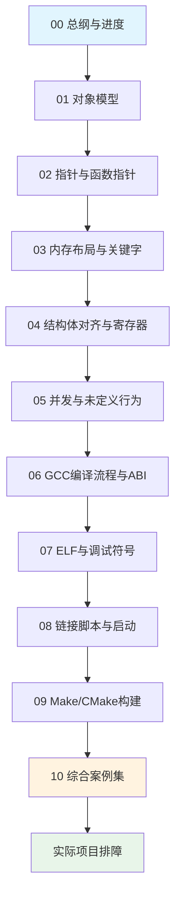

# 嵌入式C与GCC：Cortex-M7与AURIX TC3xx学习总纲

---

## 系列导航

- **返回总纲**：[[Tools_Compiler_Embedded_C_GCC_00_Series_Overview|00 学习总纲与进度]]
- **下一篇**：[[Tools_Compiler_Embedded_C_GCC_01_Object_Model|01_Object_Model]]

---


> 定位：面向车规MCU系统工程师、底层软件工程师和SoC验证工程师的长期学习与排障手册。  
> 主线：C语言语义 → 编译器优化 → ELF与链接 → 启动初始化 → CPU/存储器真实行为 → 故障定位。  
> 参考平台：ARM Cortex-M7（ARMv7E-M、AAPCS、CMSIS、GNU Arm Embedded）与AURIX TC3xx（TriCore TC1.6.2P、GNU/HighTec工具链）。

---

## 1. 为什么要把C语言和编译器放在一起学

普通C语言教程通常只回答“代码表达了什么”，但嵌入式系统中的真正问题往往跨越多个层级：

```text
C源代码
  ↓ 语言规则、类型、生命周期、未定义行为
编译器
  ↓ 优化、寄存器分配、指令选择、ABI
目标文件/ELF
  ↓ Section、Symbol、Relocation
链接器
  ↓ VMA/LMA、内存区域、入口、垃圾回收
启动代码
  ↓ .data复制、.bss清零、栈/CSA、C运行时
CPU与SoC
  ↓ Cache、MPU、总线、Store Buffer、DMA、中断
外设与存储器
```

例如：

```c
volatile uint32_t done;

while (done == 0U)
{
}
```

仅知道`volatile`“防止优化”远远不够，还要继续追问：

1. `done`在哪个Section？
2. 启动时是否被正确初始化？
3. GCC在`-O2`下生成多少次Load？
4. 如果ISR写`done`，32-bit访问是否原子？
5. 如果DMA写`done`，CPU Cache中是否仍有旧副本？
6. 如果另一个核写`done`，是否需要原子操作和内存屏障？
7. Cortex-M7的DMB/DSB与TC3xx的DSYNC分别解决什么？

本系列的目标就是把这些层级连接起来。

---

## 2. 平台边界

严格来说，Cortex-M7是CPU内核，而AURIX TC3xx是完整MCU系列。文档采用以下边界：

| 层级 | Cortex-M7侧 | AURIX TC3xx侧 |
|---|---|---|
| C语言 | ISO C通用规则 | ISO C通用规则 |
| ABI | AAPCS/EABI | TriCore ABI，具体以工具链手册为准 |
| CPU | ARMv7E-M Cortex-M7 | TriCore TC1.6.2P |
| 异常 | NVIC、SCB、MSP/PSP、EXC_RETURN | Trap/Interrupt、CSA、BIV/BTV |
| 屏障 | DMB、DSB、ISB | DSYNC、ISYNC |
| 原子 | LDREX/STREX及SoC原子能力 | LDMST、SWAP、CMPSWAP等 |
| Cache | Cortex-M7 I/D Cache，具体容量由SoC决定 | 每核PCache/DCache及PMI/DMI |
| 芯片级实例 | CMSIS与典型M7 SoC；厂商寄存器需按芯片手册确认 | 以TC397/TC399和TC3xx手册为主 |
| 编译器 | `arm-none-eabi-gcc` | GNU/HighTec TriCore工具链，命令名依发行版而异 |

所有芯片相关结论都应区分：

- C语言标准保证；
- 编译器/ABI保证；
- CPU架构保证；
- SoC具体实现保证。

---

## 3. 文件清单与学习目标

### 嵌入式C语言

1. [01 嵌入式C对象模型：数据类型与表达式](Tools_Compiler_Embedded_C_GCC_01_Object_Model.md)  
   建立对象、类型、表达式、整数提升和溢出的底层模型。

2. [02 嵌入式C指针：数组与函数指针](Tools_Compiler_Embedded_C_GCC_02_Pointers_Arrays.md)  
   掌握指针类型、数组退化、函数指针、别名、生命周期与非对齐访问。

3. [03 嵌入式C内存布局与关键字](Tools_Compiler_Embedded_C_GCC_03_Memory_Layout.md)  
   连接`const/volatile/static/extern`与Section、启动初始化和硬件可见性。

4. [04 结构体对齐、位操作与寄存器访问](Tools_Compiler_Embedded_C_GCC_04_Struct_Alignment.md)  
   解决结构体Padding、packed、位操作、W1C和寄存器RMW问题。

5. [05 嵌入式C并发：中断安全与未定义行为](Tools_Compiler_Embedded_C_GCC_05_Concurrency_UB.md)  
   掌握ISR/任务/多核/DMA并发、原子性、屏障和未定义行为。

### GCC、链接与构建

6. [06 GCC编译流程：ABI、汇编与优化](Tools_Compiler_GCC_06_Compilation_ABI_Optimization.md)  
   理解从Translation Unit到机器指令，以及M7/TC3xx调用约定与优化。

7. [07 ELF目标文件：Section与调试符号](Tools_Compiler_GCC_07_ELF_Sections_Debug.md)  
   学会使用ELF、Symbol、Relocation、Map和binutils定位问题。

8. [08 链接脚本：启动文件与MCU内存初始化](Tools_Compiler_GCC_08_Linker_Script_Startup.md)  
   掌握VMA/LMA、链接脚本、`.data/.bss`、RAM代码及双平台启动流程。

9. [09 Make/CMake：GCC属性与工程构建](Tools_Compiler_GCC_09_Make_CMake_Build.md)  
   建立Make/CMake/Ninja/GCC/ld的职责边界和可复现构建方法。

### 综合应用

10. [10 M7与AURIX TC3xx嵌入式C/GCC综合案例集](Tools_Compiler_Embedded_C_GCC_10_Case_Collection.md)  
    按故障现象组织跨层案例，形成可直接查阅的排障手册。

---

## 4. 统一案例模板

每个重要知识点尽量按以下结构展开：

1. **工程场景**：真实项目中为什么会遇到；
2. **错误或朴素实现**：展示容易写出的代码；
3. **故障现象**：编译错误、HardFault、Trap、数据错误或性能异常；
4. **C语义分析**：标准层面是否定义、对象生命周期和类型规则；
5. **GCC行为**：`-O0/-O2`、汇编、ELF、链接行为；
6. **M7过程**：寄存器、异常、Cache、屏障和总线；
7. **TC3xx过程**：TriCore指令、CSA、Cache、SRI和Trap；
8. **正确实现**：给出可移植层与平台适配层；
9. **验证CASE**：条件、配置、步骤、预期、观测；
10. **系统工程结论**：应形成什么规范、接口或系统需求。

---

## 5. 推荐学习顺序



### 第一阶段：先掌握”C代码是否正确”

```text
01 数据类型与表达式
  ↓
02 指针与函数指针
  ↓
03 内存布局与关键字
  ↓
04 对齐、位操作、寄存器
  ↓
05 并发与未定义行为
```

完成标志：能够在不看汇编前，判断代码是否存在类型、生命周期、对齐、原子性或未定义行为问题。

### 第二阶段：理解”正确C代码如何变成映像”

```text
06 GCC与ABI
  ↓
07 ELF与Symbol
  ↓
08 链接脚本与启动
  ↓
09 构建系统
```

完成标志：能够从一个变量或函数出发，沿C源码、目标文件、链接脚本、Map、启动代码追踪到实际运行地址。

### 第三阶段：综合排障

使用第10份案例集，针对真实问题练习：

```text
复现
→ 缩小变量
→ 判断语言层/编译层/链接层/硬件层
→ 查汇编、ELF、Map和寄存器
→ 修复
→ 设计回归测试
```

---

## 6. 工具实验环境

### Cortex-M7建议环境

- GNU Arm Embedded：`arm-none-eabi-gcc`；
- `objdump/readelf/nm/size/addr2line`；
- CMake + Ninja或Make；
- CMSIS；
- GDB/OpenOCD或芯片厂商调试器；
- 具备I/D Cache、MPU、DWT的M7目标或仿真平台。

### AURIX TC3xx建议环境

- TC397/TC399开发板；
- HighTec GNU或项目实际使用的TriCore GCC工具链；
- iLLD或MCAL基础环境；
- Lauterbach、UDE或其他TriCore调试器；
- TC3xx Architecture Manual、User Manual、Data Sheet、Safety Manual和工具链ABI手册。

### 通用观测手段

- 反汇编；
- ELF/Map/Symbol；
- CPU性能计数器；
- DWT或STM时间戳；
- GPIO Marker；
- 逻辑分析仪/示波器；
- Fault/Trap寄存器；
- Cache和MPU配置快照。

---

## 7. 核心能力矩阵

| 能力 | 入门 | 工程可用 | 系统工程师深度 |
|---|---|---|---|
| 数据类型 | 知道位宽 | 能识别提升/溢出 | 能定义跨模块、跨核、外设接口类型规范 |
| 指针 | 会解引用 | 能处理数组/回调 | 能分析ABI、别名、对齐和总线访问 |
| volatile | 知道防优化 | 能用于MMIO/ISR | 能区分编译器、CPU、Cache和总线可见性 |
| 结构体 | 会定义 | 能判断Padding | 能定义DMA/协议/ECC安全布局 |
| 并发 | 会关中断 | 能写临界区 | 能建立原子性和内存序需求 |
| GCC | 会编译 | 会看Warning/汇编 | 能解释优化和ABI后果 |
| ELF | 知道可执行文件 | 会看Map/Symbol | 能定位Relocation、GC和映像问题 |
| 链接脚本 | 会改内存大小 | 会放自定义Section | 能定义VMA/LMA、多核、RAM代码和保护区 |
| 启动代码 | 知道进main前有初始化 | 会追`.data/.bss` | 能评审复位、多核、Cache、CSA和安全启动 |
| 构建系统 | 会运行命令 | 会加源文件/宏 | 能保证依赖、配置传播和可重复构建 |

---

## 8. 贯穿全系列的高频误区

1. `volatile`能够解决所有共享变量问题；
2. `counter++`是一条原子操作；
3. `const`变量一定在Flash；
4. `packed`可以安全解决所有协议映射；
5. 非对齐访问只影响性能，不影响C语言合法性；
6. `-O0`正常说明代码正确；
7. `-O2`异常就是编译器Bug；
8. `section`属性足以让函数在RAM执行；
9. ELF越大表示烧录内容越大；
10. `used`可以替代链接脚本`KEEP`；
11. DMB/DSYNC会自动完成Cache clean；
12. Debugger看到的变量值就是CPU实际每次读取的值；
13. 修改头文件后一定会触发正确重编译；
14. M7和TC3xx都属于32-bit CPU，所以启动和异常模型相同。

---

## 9. 学习进度

| 文件 | 状态 | 核心案例 | 实验/检查项 |
|---|---|---:|---:|
| 00 总纲 | 已完成 | 索引 | 学习路径 |
| 01 对象模型与类型 | 已完成 | 8+ | 类型、溢出、回绕 |
| 02 指针 | 已完成 | 8+ | 对齐、回调、别名 |
| 03 内存布局与关键字 | 已完成 | 7+ | Section、volatile、reset |
| 04 对齐、位操作与寄存器 | 已完成 | 8+ | packed、W1C、RMW |
| 05 并发与未定义行为 | 已完成 | 10+ | ISR、多核、DMA、屏障 |
| 06 GCC、ABI与优化 | 已完成 | 8+ | 汇编和优化对比 |
| 07 ELF与调试符号 | 已完成 | 8+ | readelf/objdump/Map |
| 08 链接与启动 | 已完成 | 10+ | VMA/LMA、RAM代码、双平台启动 |
| 09 构建系统 | 已完成 | 8+ | Make/CMake/属性 |
| 10 综合案例集 | 已完成 | 35 | 跨层排障 |

---

## 10. 完成后的自测问题

完成整个系列后，应能够回答：

1. 为什么`uint8_t + uint8_t`通常不是8-bit运算？
2. 为什么把`uint8_t[16]`的`&buf[1]`强转为`uint64_t *`有两层风险？
3. `volatile uint32_t * const`中两个修饰分别作用于谁？
4. 为什么`.data`同时占用Flash和RAM？
5. 为什么`.bss`通常不占用BIN中的有效载荷？
6. 为什么`REG |= MASK`不能普遍用于W1C寄存器？
7. 为什么`volatile uint32_t counter++`仍可能丢失更新？
8. DMB、DSB、ISB和DSYNC、ISYNC分别解决什么？
9. 如何证明某个函数确实从RAM执行？
10. 为什么函数加了`used`仍可能被链接器删除？
11. 如何从HardFault PC或TC3xx Trap地址反查源代码？
12. 如何区分C未定义行为、编译器优化问题和Cache一致性问题？
13. 为什么M7异常入口依赖MSP/PSP，而TC3xx依赖CSA？
14. 如何从Map文件定位两个输出Section重叠？
15. CMake、Ninja、GCC和ld分别承担什么职责？

---

## 11. 主要参考基线

### 通用

- ISO C语言标准及实现对应的语言扩展说明；
- GCC User Manual；
- GNU binutils和GNU ld文档；
- ELF规范；
- MISRA C及项目编码规范。

### Cortex-M7

- ARMv7-M Architecture Reference Manual；
- Cortex-M7 Technical Reference Manual；
- AAPCS；
- CMSIS-Core文档；
- 具体SoC的Reference Manual、Data Sheet和Errata。

### AURIX TC3xx

- *TriCore TC1.6.2 Core Architecture Manual, Volume 1/2*；
- *AURIX TC3xx User's Manual Part 1/2*；
- *TC39xB Data Sheet*；
- *AURIX TC3xx Safety Manual*；
- *TC39x B-Step User Manual Appendix*；
- 项目实际TriCore工具链的ABI、Linker与Assembler手册。

---

## 12. 最终方法论

遇到嵌入式C/GCC问题时，不要直接猜“是不是优化”“是不是Cache”，而是按层定位：

```text
第一层：C代码是否具有明确定义的语义？
第二层：类型、生命周期、对齐和并发是否正确？
第三层：编译选项和ABI怎样改变机器代码？
第四层：ELF、链接脚本和启动代码把对象放到了哪里？
第五层：CPU、Cache、MPU、总线和外设怎样执行访问？
第六层：如何用反汇编、Map、Fault/Trap和波形证明根因？
```

只有走完这条证据链，修复才是可靠的，回归测试才知道应该覆盖什么。

---

## 13. 关联笔记

### 同系列内部链接

- [[Tools_Compiler_Embedded_C_GCC_01_Object_Model|01 嵌入式C对象模型]]
- [[Tools_Compiler_Embedded_C_GCC_02_Pointers_Arrays|02 指针与函数指针]]
- [[Tools_Compiler_Embedded_C_GCC_03_Memory_Layout|03 内存布局与关键字]]
- [[Tools_Compiler_Embedded_C_GCC_04_Struct_Alignment|04 结构体对齐与寄存器]]
- [[Tools_Compiler_Embedded_C_GCC_05_Concurrency_UB|05 并发与未定义行为]]
- [[Tools_Compiler_GCC_06_Compilation_ABI_Optimization|06 GCC编译流程与ABI]]
- [[Tools_Compiler_GCC_07_ELF_Sections_Debug|07 ELF与调试符号]]
- [[Tools_Compiler_GCC_08_Linker_Script_Startup|08 链接脚本与启动]]
- [[Tools_Compiler_GCC_09_Make_CMake_Build|09 Make/CMake构建]]
- [[Tools_Compiler_Embedded_C_GCC_10_Case_Collection|10 综合案例集]]

### 跨目录关联

- [[AURIX_TC3xx_Mem_Flash_Prefetch_Store_Buffer_System_Requirements|AURIX TC3xx Flash预取与Store Buffer]]
- [[ARM_M7_Core_Manual_Detailed_Mermaid|ARM Cortex-M7 内核手册]]
- [[AURIX_TC3xx_Core_Manual_Detailed_Mermaid|AURIX TC3xx 内核手册]]
- [[Core_Comparison_Cortex-R52_vs_M7_Detailed|Cortex-R52 vs M7 对比]]

### 待补充关联

- [[HW_Periph_Comm_SPI_Specification|SPI 外设规格]]（待补充 I2C/UART/DMA 驱动案例）
- [[FreeRTOS_Kernel_Task_Scheduling|FreeRTOS 任务调度]]（待补充 RTOS 与编译器交互）
- [[HW_Debug_CoreSight_DAP|CoreSight 调试]]（待补充调试定位实战）

---

## 14. 标签

#嵌入式C #GCC #Cortex-M7 #AURIX-TC3xx #编译器 #链接脚本 #ELF #启动流程 #并发安全 #未定义行为 #排障手册

---

## 15. Agent 整理记录

- **2026-07-17**：从 GPT 生成的 11 篇系列笔记中整理归档，按 `CLAUDE.md` 规范重命名并移动到 `05_Tools_工具链/01_Compiler_编译器/Embedded_C_GCC_M7_TC3xx_Series/`。
- **2026-07-17**：在总纲篇补充 Mermaid 系列结构图、Obsidian 双链和标签。
