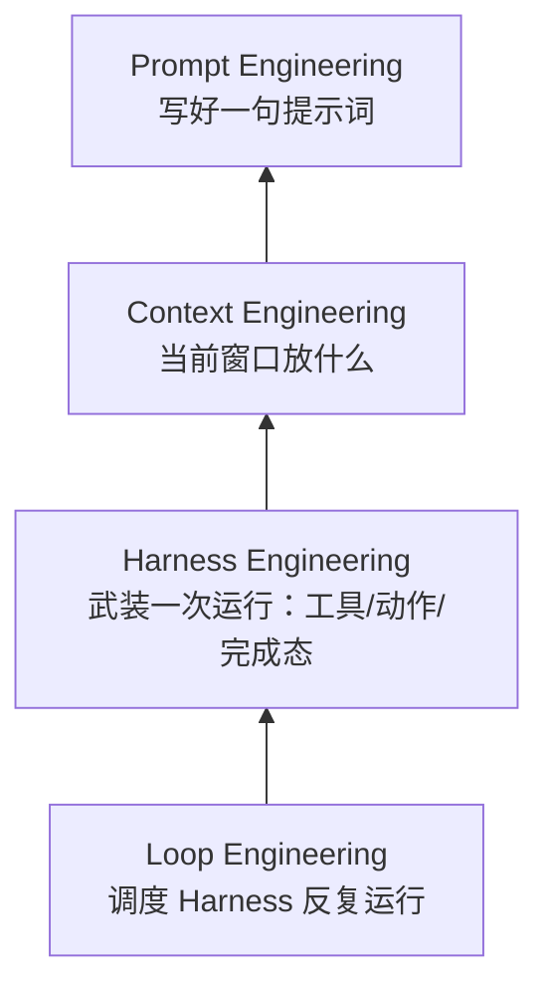
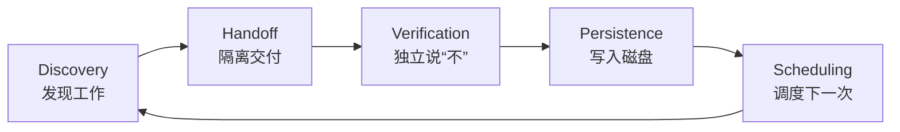
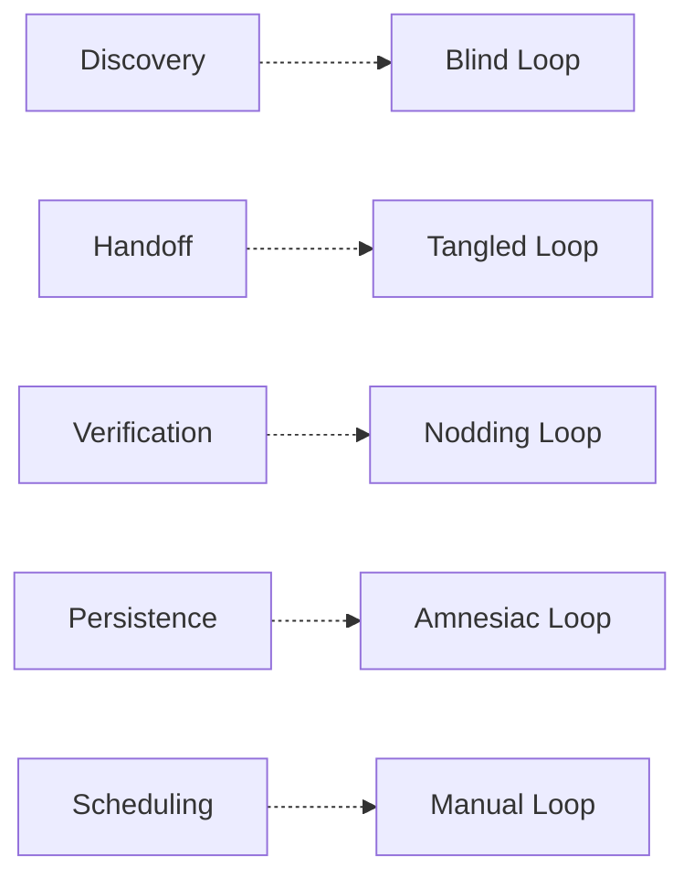

# Loop Engineering：设计能自动驱动 Agent 的系统

> 原文：*Loop Engineering: The Anthropic Playbook for Designing Systems That Prompt Your Agents* (2026 Working Note on Agentic Software Engineering Practice)
> 作者/整理：HuaShu，基于 Addy Osmani、Peter Steinberger、Boris Cherny、Prithvi Rajasekaran、Steve Kaliski 等人的公开论述
> 来源：[PDF 原文](../../../99_Attachments_附件/Loop-Engineering-IEEE/Loop-Engineering-IEEE.pdf) · [MinerU 提取 Markdown 原文](../../../99_Attachments_附件/Loop-Engineering-IEEE/Loop-Engineering-IEEE.md)

---

## 核心问题

1. **Loop Engineering 与 Prompt / Context / Harness Engineering 的本质区别是什么？**
2. **一个能真正“自己转起来”的 Loop 需要哪些最小器官？**
3. **为什么生成器（Generator）不能兼任评判者（Evaluator）？**
4. **Loop 在自动化背后会积累哪些隐性成本？**
5. **个人或团队如何从今天起构建第一个 Loop？**

---

## 结论

- **Loop Engineering 是第四层工程**：在 Prompt → Context → Harness 之上，关注“如何让 Agent 自己反复运行”。
- **核心转移**：从“坐在键盘前指挥 Agent”变成“设计一个能指挥 Agent 的系统”。
- **一次 Loop 转动的五动作**：Discovery（发现工作）→ Handoff（交给 Agent）→ Verification（独立验证）→ Persistence（持久化状态）→ Scheduling（调度下一次）。
- **六部件支撑**：Automations（调度）、Worktrees（隔离）、Skills（永久知识）、Connectors（外部连接）、Sub-agents（生成/评判分离）、Memory（磁盘状态）。
- **最稀缺资源不再是生成能力，而是判断力（judgment）**；Loop 会放大构建者已有的判断力，也会放大懒惰与疏忽。

---

## 背景

### 为什么这个词在 2026 年 6 月同时出现

2026 年 6 月，Peter Steinberger（OpenClaw 作者）、Boris Cherny（Claude Code 负责人）、Addy Osmani（Google Chrome 团队）在一周内分别表达了同一个观点：

> 不要再提示 Agent 了，要设计“提示 Agent 的循环”。

这不是概念炒作，而是工具链悄然越过了可用阈值：

- Coding Agent 已能无人值守完成非平凡任务；
- 主流 Harness（Claude Code、Codex 等）已提供调度原语；
- 单次 Agent 运行成本已低到“反复跑”不再显得浪费。

### 四层工程栈



| Layer | 关注点 | 核心问题 |
|-------|--------|----------|
| Prompt | 一句好提示 | 我该告诉模型什么？ |
| Context | 当前窗口内容 | 该检索、总结、清理什么？ |
| Harness | 一次运行的装备 | 哪些工具、动作、什么算完成？ |
| Loop | 在 Harness 上调度 | 如何让它自己反复运行？ |

---

## 关键机制

### 1. 一次 Loop 转动的五动作



| 动作 | 作用 | 失败模式 |
|------|------|----------|
| Discovery | 让 Agent 自己找到该做的工作，而不是被投喂清单 | Blind Loop |
| Handoff | 把任务放入隔离空间（git worktree） | Tangled Loop |
| Verification | 用另一个 Agent/模型说“不” | Nodding Loop |
| Persistence | 把结果写到磁盘，跨会话保留 | Amnesiac Loop |
| Scheduling | 用定时器或事件触发下一轮 | Manual Loop |

### 2. 六部件映射

| 部件 | 是什么 | 对应动作 |
|------|--------|----------|
| Automations | 定时/事件触发器 | Scheduling |
| Worktrees | 每个并行 Agent 的独立目录 | Handoff |
| Skills | 永久化的项目知识（`SKILL.md`） | Discovery |
| Connectors | MCP 等外部系统连接 | Persistence / Discovery |
| Sub-agents | 生成器与评判者分离 | Verification |
| Memory | 磁盘上的持久状态 | Persistence |

### 3. 生成器 / 评判者分离（Generator / Evaluator）

这是 Loop 能否“说 no”的关键。

- **自己给自己打分**：Agent 倾向于赞美自己的输出，因为它看到的不仅是结果，还有“当初为什么这样写”的自我说服链。
- **结构上的解耦**：让另一个 Agent、用不同模型、不同系统提示、甚至不同工具（如 Playwright MCP）去验证。
- **Evaluater 应该行动，而不是只读**：打开页面、点击、截图、跑测试、看 DOM，而不是“看起来对”。
- **停止条件交给新鲜模型判断**：Claude Code 的 `/goal` 就是 maker-checker 原则的实现。

示例评判者角色卡：

```markdown
ROLE: Adversarial code reviewer.
ASSUME: this code is BROKEN until proven otherwise.
DO NOT praise. Find what fails.
CHECK, in order:
1. Does it run? (execute, don't read)
2. Tests: run them, paste real output.
3. Edge cases the author skipped.
4. Does behavior match the ticket?
USE Playwright MCP: open the page, click, screenshot, inspect the DOM.
VERDICT: PASS only if every check holds. Otherwise REJECT + list each reason.
```

### 4. 五种失败模式



### 5. 真实案例

#### Addy Osmani 的晨间 Triage Loop

- 每天早上自动运行；
- Triage skill 读取昨日失败 CI、未关闭 issue、近期 commit；
- 对每个值得处理的问题开独立 worktree；
- 一个 sub-agent 起草修复，另一个评审；
- Connector 自动开 PR、更新 ticket；
- 处理不了的放入 inbox，状态文件让第二天接着跑。

#### Stripe Minions：每周 1,300+ 机器 PR

- 触发极轻：Slack @bot 或 emoji；
- 关键在 LLM  wake up 前的**确定性编排器**：扫描链接、拉 Jira、用 Sourcegraph + MCP 找代码；
- **任何能用确定性逻辑解决的事都不交给概率模型**；
- Agent 写代码 → 硬编码 linter gate → Agent 修 lint → 硬编码 commit → 人工 review；
- Devbox on EC2，cattle not pets，千级 Agent 并行不冲突。

> 可靠性来自约束质量，而非模型大小。

---

## 应用场景

- **个人开发者**：每天早晨自动 triage CI/issue/commit，生成待办与候选修复。
- **小团队**：把重复性重构、依赖升级、测试补全交给 Loop，人工只负责 review 与关键决策。
- **企业级**：类似 Stripe Minions 的规模化代码变更流水线，但需大量确定性门控。
- **Claude Code 用户**：可用 `/loop`、`/goal`、`--worktree`、`.claude/agents/`、Skills、Cloud Routines 搭建。

---

## 关联笔记

- [[Agent_Building_Harness_Engineering]]（待补充）
- [[Agent_Building_Context_Engineering]]（待补充）
- [[Agent_Building_Prompt_Engineering]]（待补充）
- [[Agent_Building_Generator_Evaluator_Pattern]]（可单独成篇）
- [[Claude_Code_Loop_Goal_Worktree]]（Claude Code 具体命令）
- [[MCP_Model_Context_Protocol]]（Connector 基础）

---

## 待补充问题

- [ ] 将本文的“第一个 Loop”示例转为可运行的 Claude Code Skill。
- [ ] 对比 Codex Automations 与 Claude Code `/loop`、`/goal` 的等价能力。
- [ ] 设计一个适合本知识库（MarkDown_Learn）的晨间 Triage Skill。
- [ ] 记录本地 `/loop` 与 Cloud Routines / GitHub Actions 的调度选型决策。

---

## 标签

`#LoopEngineering` `#AgenticAI` `#ClaudeCode` `#GeneratorEvaluator` `#MCP` `#Automation` `#Judgment` `#SoftwareEngineering`

---

## Agent 整理记录

- **提取方式**：`pypdf` 本地提取（因 `pdfplumber`/`PyPDF2` 未安装，已记录错误 `ERR-20260709-006`）。
- **整理日期**：2026-07-09
- **关键收获**：Loop 不是让 Agent 更聪明，而是把“人作为时钟”从循环里移除；真正困难的是安装一个能自动说“不”的检查。
