# AMBA<sup>®</sup> AXI<sup>™</sup> and ACE<sup>™</sup> Protocol Specification

AXI3<sup>™</sup>, AXI4<sup>™</sup>, and AXI4-Lite ACE and ACE-Lite

# AMBA AXI and ACE Protocol Specification AXI3, AXI4, and AXI4-Lite ACE and ACE-Lite

Copyright © 2003, 2004, 2010, 2011, 2013 ARM. All rights reserved.

## Release Information

The following changes have been made to this specification.

Change history

<table><tr><td>Date</td><td>Issue</td><td>Confidentiality</td><td>Change</td></tr><tr><td>16 June 2003</td><td>A</td><td>Non-Confidential</td><td>First release</td></tr><tr><td>19 March 2004</td><td>B</td><td>Non-Confidential</td><td>First release of AXI specification v1.0</td></tr><tr><td>03 March 2010</td><td>C</td><td>Non-Confidential</td><td>First release of AXI specification v2.0</td></tr><tr><td>03 June 2011</td><td>D-2c</td><td>Non-Confidential</td><td>Public beta draft of AMBA AXI and ACE Protocol Specification</td></tr><tr><td>28 October 2011</td><td>D</td><td>Non-Confidential</td><td>First release of AMBA AXI and ACE Protocol Specification</td></tr><tr><td>22 February 2013</td><td>E</td><td>Non-Confidential</td><td>Second release of AMBA AXI and ACE Protocol Specification</td></tr></table>

Issues B and C of this document included an AXI specification version, v1.0 and v2.0. These version number have been discontinued, to remove confusion with the AXI versions, AXI3 and AXI4.

## Proprietary Notice

Words and logos marked with <sup>©</sup> or <sup>®</sup> are registered trademarks or trademarks of ARM in the EU and other countries, except as otherwise stated below in this proprietary notice. Other brands and names mentioned herein may be the trademarks of their respective owners.

Neither the whole nor any part of the information contained in, or the product described in, this document may be adapted or reproduced in any material form except with the prior written permission of the copyright holder.

The product described in this document is subject to continuous developments and improvements. All particulars of the product and its use contained in this document are given by ARM in good faith. However, all warranties implied or expressed, including but not limited to implied warranties of merchantability, or fitness for purpose, are excluded.

This document is intended only to assist the reader in the use of the product. ARM shall not be liable for any loss or damage arising from the use of any information in this document, or any error or omission in such information, or any incorrect use of the product.

Where the term ARM is used it means “ARM or any of its subsidiaries as appropriate”.

## ARM AMBA SPECIFICATION LICENCE

THIS END USER LICENCE AGREEMENT (“LICENCE”) IS A LEGAL AGREEMENT BETWEEN YOU (EITHER A SINGLE INDIVIDUAL, OR SINGLE LEGAL ENTITY) AND ARM LIMITED (“ARM”) FOR THE USE OF THE RELEVANT AMBA SPECIFICATION ACCOMPANYING THIS LICENCE. ARM IS ONLY WILLING TO LICENSE THE RELEVANT AMBA SPECIFICATION TO YOU ON CONDITION THAT YOU ACCEPT ALL OF THE TERMS IN THIS LICENCE. BY CLICKING “I AGREE” OR OTHERWISE USING OR COPYING THE RELEVANT AMBA SPECIFICATION YOU INDICATE THAT YOU AGREE TO BE BOUND BY ALL THE TERMS OF THIS LICENCE. IF YOU DO NOT AGREE TO THE TERMS OF THIS LICENCE, ARM IS UNWILLING TO LICENSE THE RELEVANT AMBA SPECIFICATION TO YOU AND YOU MAY NOT USE OR COPY THE RELEVANT AMBA SPECIFICATION AND YOU SHOULD PROMPTLY RETURN THE RELEVANT AMBA SPECIFICATION TO ARM.

“LICENSEE” means You and your Subsidiaries.

“Subsidiary” means, if You are a single entity, any company the majority of whose voting shares is now or hereafter owned or controlled, directly or indirectly, by You. A company shall be a Subsidiary only for the period during which such control exists.

1. Subject to the provisions of Clauses 2, 3 and 4, ARM hereby grants to LICENSEE a perpetual, non-exclusive, non-transferable, royalty free, worldwide licence to:

(i) use and copy the relevant AMBA Specification for the purpose of developing and having developed products that comply with the relevant AMBA Specification;

(ii) manufacture and have manufactured products which either: (a) have been created by or for LICENSEE under the licence granted in Clause 1(i); or (b) incorporate a product(s) which has been created by a third party(s) under a licence granted by ARM in Clause 1(i) of such third party’s ARM AMBA Specification Licence; and

(iii) offer to sell, sell, supply or otherwise distribute products which have either been (a) created by or for LICENSEE under the licence granted in Clause 1(i); or (b) manufactured by or for LICENSEE under the licence granted in Clause 1(ii).

2. LICENSEE hereby agrees that the licence granted in Clause 1 is subject to the following restrictions:

(i) where a product created under Clause 1(i) is an integrated circuit which includes a CPU then either: (a) such CPU shall only be manufactured under licence from ARM; or (b) such CPU is neither substantially compliant with nor marketed as being compliant with the ARM instruction sets licensed by ARM from time to time;

(ii) the licences granted in Clause 1(iii) shall not extend to any portion or function of a product that is not itself compliant with part of the relevant AMBA Specification; and

(iii) no right is granted to LICENSEE to sublicense the rights granted to LICENSEE under this Agreement

3. Except as specifically licensed in accordance with Clause 1, LICENSEE acquires no right, title or interest in any ARM technology or any intellectual property embodied therein. In no event shall the licences granted in accordance with Clause 1 be construed as granting LICENSEE, expressly or by implication, estoppel or otherwise, a licence to use any ARM technology except the relevant AMBA Specification.

4. THE RELEVANT AMBA SPECIFICATION IS PROVIDED “AS IS” WITH NO WARRANTIES EXPRESS, IMPLIED OR STATUTORY, INCLUDING BUT NOT LIMITED TO ANY WARRANTY OF SATISFACTORY QUALITY, MERCHANTABILITY, NONINFRINGEMENT OR FITNESS FOR A PARTICULAR PURPOSE.

5. No licence, express, implied or otherwise, is granted to LICENSEE, under the provisions of Clause 1, to use the ARM tradename, or AMBA trademark in connection with the relevant AMBA Specification or any products based thereon. Nothing in Clause 1 shall be construed as authority for LICENSEE to make any representations on behalf of ARM in respect of the relevant AMBA Specification.

6. This Licence shall remain in force until terminated by you or by ARM. Without prejudice to any of its other rights if LICENSEE is in breach of any of the terms and conditions of this Licence then ARM may terminate this Licence immediately upon giving written notice to You. You may terminate this Licence at any time. Upon expiry or termination of this Licence by You or by ARM LICENSEE shall stop using the relevant AMBA Specification and destroy all copies of the relevant AMBA Specification in your possession together with all documentation and related materials. Upon expiry or termination of this Licence, the provisions of clauses 6 and 7 shall survive.

7. The validity, construction and performance of this Agreement shall be governed by English Law.

ARM contract references: LEC-PRE-00490-V4.0 ARM AMBA Specification Licence.

## Confidentiality Status

This document is Non-Confidential. The right to use, copy and disclose this document may be subject to license restrictions in accordance with the terms of the agreement entered into by ARM and the party that ARM delivered this document to.

## Product Status

The information in this document is final, that is for a developed product.

## Web Address

http://www.arm.com

# Contents AMBA AXI and ACE Protocol Specification AXI3, AXI4, and AXI4-Lite ACE and ACE-Lite

Preface
About this specification ....xii
Using this specification ....xiii
Conventions ....xv
Additional reading ....xvii
Feedback ....xviii

Part A AMBA AXI3 and AXI4 Protocol Specification
Chapter A1 Introduction
A1.1 About the AXI protocol ....A1-22
A1.2 AXI revisions ....A1-23
A1.3 AXI Architecture ....A1-24
A1.4 Terminology ....A1-27
Chapter A2 Signal Descriptions
A2.1 Global signals ....A2-30
A2.2 Write address channel signals ....A2-31
A2.3 Write data channel signals ....A2-32
A2.4 Write response channel signals ....A2-33
A2.5 Read address channel signals ....A2-34
A2.6 Read data channel signals ....A2-35
A2.7 Low-power interface signals ....A2-36

Chapter A3 Single Interface Requirements
A3.1 Clock and reset ...... A3-38
A3.2 Basic read and write transactions ...... A3-39
A3.3 Relationships between the channels ...... A3-42
A3.4 Transaction structure ...... A3-46

Chapter A4 Transaction Attributes
A4.1 Transaction types and attributes ...... A4-60
A4.2 AXI3 memory attribute signaling ...... A4-61
A4.3 AXI4 changes to memory attribute signaling ...... A4-62
A4.4 Memory types ...... A4-67
A4.5 Mismatched memory attributes ...... A4-71
A4.6 Transaction buffering ...... A4-72
A4.7 Access permissions ...... A4-73
A4.8 Legacy considerations ...... A4-74
A4.9 Usage examples ...... A4-75

Chapter A5 Multiple Transactions
A5.1 AXI transaction identifiers ...... A5-78
A5.2 Transaction ID ...... A5-79
A5.3 Transaction ordering ...... A5-80
A5.4 Removal of write interleaving support ...... A5-83

Chapter A6 AXI4 Ordering Model
A6.1 Definition of the ordering model ...... A6-86
A6.2 Master ordering ...... A6-87
A6.3 Interconnect ordering ...... A6-88
A6.4 Slave ordering ...... A6-89
A6.5 Response before final destination ...... A6-90
A6.6 Ordered write observation ...... A6-91

Chapter A7 Atomic Accesses
A7.1 Single-copy atomicity size ...... A7-94
A7.2 Exclusive accesses ...... A7-96
A7.3 Locked accesses ...... A7-99
A7.4 Atomic access signaling ...... A7-100

Chapter A8 AXI4 Additional Signaling
A8.1 QoS signaling ...... A8-102
A8.2 Multiple region signaling ...... A8-103
A8.3 User-defined signaling ...... A8-104

Chapter A9 Low-power Interface
A9.1 About the low-power interface ...... A9-106
A9.2 Low-power clock control ...... A9-107

Chapter A10 Default Signaling and Interoperability
A10.1 Interoperability principles ...... A10-114
A10.2 Major interface categories ...... A10-115
A10.3 Default signal values ...... A10-116

Part B AMBA AXI4-Lite Interface Specification

Chapter B1 AMBA AXI4-Lite
B1.1 Definition of AXI4-Lite ...... B1-126
B1.2 Interoperability ...... B1-128

B1.3 Defined conversion mechanism .... B1-129
B1.4 Conversion, protection, and detection .... B1-131

Part C ACE Protocol Specification
Chapter C1 About ACE
C1.1 Coherency overview ....C1-136
C1.2 Protocol overview ....C1-138
C1.3 Channel overview ....C1-141
C1.4 Transaction overview ....C1-146
C1.5 Transaction processing ....C1-150
C1.6 Concepts required for the ACE specification ....C1-151
C1.7 Protocol errors ....C1-154
Chapter C2 Signal Descriptions
C2.1 Changes to existing AXI4 channels ....C2-156
C2.2 Additional channels defined by ACE ....C2-157
C2.3 Additional response signals and signaling requirements defined by ACE ....C2-159
Chapter C3 Channel Signaling
C3.1 Read and write address channel signaling ....C3-162
C3.2 Read data channel signaling ....C3-172
C3.3 Read acknowledge signaling ....C3-175
C3.4 Write response channel signaling ....C3-176
C3.5 Write Acknowledge signaling ....C3-177
C3.6 Snoop address channel signaling ....C3-178
C3.7 Snoop response channel signaling ....C3-181
C3.8 Snoop data channel signaling ....C3-185
C3.9 Snoop channel dependencies ....C3-187
Chapter C4 Coherency Transactions on the Read Address and Write Address Channels
C4.1 About an initiating master ....C4-190
C4.2 About snoop filtering ....C4-193
C4.3 State changes on different transactions ....C4-194
C4.4 State change descriptions ....C4-196
C4.5 Read transactions ....C4-197
C4.6 Clean transactions ....C4-203
C4.7 Make transactions ....C4-206
C4.8 Write transactions ....C4-208
C4.9 Evict transactions ....C4-213
C4.10 Handling overlapping write transactions ....C4-214
Chapter C5 Snoop Transactions
C5.1 Mapping coherency operations to snoop operations ....C5-218
C5.2 General requirements for snoop transactions ....C5-221
C5.3 Snoop transactions ....C5-227
Chapter C6 Interconnect Requirements
C6.1 About the interconnect requirements ....C6-234
C6.2 Sequencing transactions ....C6-235
C6.3 Issuing snoop transactions ....C6-238
C6.4 Transaction responses from the interconnect ....C6-241
C6.5 Interactions with main memory ....C6-243
C6.6 Other requirements ....C6-246
C6.7 Interoperability considerations ....C6-248

Chapter C7 Cache Maintenance
C7.1 ARCACHE and ARDOMAIN requirements ....C7-252
C7.2 Other cache maintenance considerations ....C7-253

Chapter C8 Barrier Transactions
C8.1 About barrier transactions ....C8-258
C8.2 Barrier transaction signaling ....C8-259
C8.3 Barrier responses and domain boundaries ....C8-261
C8.4 Barrier requirements ....C8-264

Chapter C9 Exclusive Accesses
C9.1 About Exclusive accesses ....C9-270
C9.2 Role of the master ....C9-271
C9.3 Role of the interconnect ....C9-273
C9.4 Multiple Exclusive Threads ....C9-276
C9.5 Exclusive Accesses from AXI components ....C9-277
C9.6 Transaction requirements ....C9-278

Chapter C10 Optional External Snoop Filtering
C10.1 About external snoop filtering ....C10-280
C10.2 Master requirements to support snoop filters ....C10-282
C10.3 External snoop filter requirements ....C10-283

Chapter C11 ACE-Lite
C11.1 About ACE-Lite ....C11-286
C11.2 ACE-Lite signal requirements ....C11-287

Chapter C12 Distributed Virtual Memory Transactions
C12.1 About DVM transactions ....C12-290
C12.2 Synchronization message ....C12-291
C12.3 DVM transaction process and rules ....C12-292
C12.4 DVM message support for ARMv7 and ARMv8 ....C12-294
C12.5 Physical and virtual address space size ....C12-296
C12.6 DVMv7 and DVMv8 address spaces ....C12-297
C12.7 DVM transactions format ....C12-299
C12.8 DVM transaction restrictions ....C12-301
C12.9 DVM Operations ....C12-302
C12.10 DVMv7 and DVMv8 conversion ....C12-310

Chapter C13 Interface Control
C13.1 About the interface control signals ....C13-312

Chapter C14 Master Design Recommendations
C14.1 Recommended design restrictions ....C14-314

art D Appendices

Appendix A Transaction Naming
A.1 Full and partial cache line write transaction naming ....AppxA-318

Appendix B Accelerator Coherency Port Interface Restrictions
B.1 ACP interface requirements ....AppxB-320

## Glossary

## Preface

This preface introduces the AMBA AXI and ACE Protocol Specification. It contains the following sections:

About this specification on page xii

Using this specification on page xiii

Conventions on page xv

Additional reading on page xvii

Feedback on page xviii.

## About this specification

This specification describes:

the AMBA 3 AXI protocol release referred to as AXI3

the AMBA 4 AXI protocol releases referred to as AXI4 and AXI4-Lite

the AMBA 4 protocol releases referred to as ACE and ACE-Lite.

## Intended audience

This specification is written for hardware and software engineers who want to become familiar with the Advanced Microcontroller Bus Architecture (AMBA) and design systems and modules that are compatible with the Advanced eXtensible Interface (AXI) protocol.

## Using this specification

The information in this specification is organized into parts, as described in this section.

## Part A, AMBA AXI3 and AXI4 Protocol Specification

Part A describes the AXI3 and AXI4 releases of the AMBA AXI Protocol Specification. It contains the following chapters:

Chapter A1 Introduction Read this for an introduction to the AXI architecture, and to the terminology used in this specification.

Chapter A3 Single Interface Requirements Read this for a description of the basic AXI protocol transaction requirements between a master and slave.

Chapter A4 Transaction Attributes Read this for a description of the AXI protocol and signaling that supports system topology and system level caches.

Chapter A5 Multiple Transactions Read this for a description of the AXI protocol and signaling that supports out-of-order transaction completion and the issuing of multiple outstanding addresses.

Chapter A6 AXI4 Ordering Model Read this for a description of the AXI4 ordering model.

Chapter A7 Atomic Accesses Read this for a description of the mechanisms that support atomic accesses.

Chapter A8 AXI4 Additional Signaling Read this for a description of the additional signaling introduced in AXI4 to extend the application of the AXI interface.

Chapter A9 Low-power Interface Read this for a description of the control interface that supports low-power operation.

Chapter A10 Default Signaling and Interoperability Read this for a description of the interoperability of interfaces that use reduced AXI signal sets.

## Part B, AMBA AXI4-Lite Interface Specification

Part B describes AMBA AXI4-Lite. It contains the following chapter:

Chapter B1 AMBA AXI4-Lite

Read this for a description of AXI4-Lite that provides a simpler control register-style interface for systems that do not require the full functionality of AXI4.

## Part C, ACE Protocol Specification

Part C describes the ACE protocol. It contains the following chapters:

Chapter C1 About ACE This chapter gives an overview of system level coherency and the architecture of the AXI Coherency Extensions (ACE) protocol.

Chapter C2 Signal Descriptions This chapter introduces the additional ACE interface signals.

Chapter C3 Channel Signaling This chapter describes the basic channel signaling requirements on an ACE interface.

Chapter C4 Coherency Transactions on the Read Address and Write Address Channels This chapter describes the transactions issued on the read address and write address channels.

Chapter C5 Snoop Transactions This chapter describes the snoop transactions seen on the snoop address channel.

Chapter C6 Interconnect Requirements This chapter describes the ACE interconnect requirements.

Chapter C7 Cache Maintenance This chapter describes the ACE cache maintenance operations.

Chapter C8 Barrier Transactions This chapter describes the ACE memory and synchronization barrier transactions.

Chapter C9 Exclusive Accesses This chapter describes the ACE Exclusive Accesses to Shareable memory.

Chapter C10 Optional External Snoop Filtering This chapter describes using an external snoop filter in an ACE system.

Chapter C11 ACE-Lite This chapter describes the ACE-Lite interface.

Chapter C12 Distributed Virtual Memory Transactions This chapter describes Distributed Virtual Memory (DVM) transactions.

Chapter C13 Interface Control This chapter describes the optional signals that can be used to configure the ACE interface.

## Part D, Appendices

This specification contains the following appendices:

Appendix A Transaction Naming This appendix defines the naming scheme for full cache line and partial cache line write transactions.

Appendix B Accelerator Coherency Port Interface Restrictions This appendix defines a subset of the ACE-Lite protocol.

Appendix C Revisions This appendix describes the technical changes between released issues of this specification.

## Conventions

The following sections describe conventions that this specification can use:

Typographic conventions

Timing diagrams

Signals on page xvi

Numbers on page xvi

## Typographic conventions

The typographical conventions are:

italic Highlights important notes, introduces special terminology, and denotes internal cross-references and citations.

bold Denotes signal names, and is used for terms in descriptive lists, where appropriate.

monospace Used for assembler syntax descriptions, pseudocode, and source code examples. Also used in the main text for instruction mnemonics and for references to other items appearing in assembler syntax descriptions, pseudocode, and source code examples.

SMALL CAPITALS Used for a few terms that have specific technical meanings.

## Timing diagrams

The figure named Key to timing diagram conventions explains the components used in timing diagrams. Variations, when they occur, have clear labels. You must not assume any timing information that is not explicit in the diagrams.

Shaded bus and signal areas are undefined, so the bus or signal can assume any value within the shaded area at that time. The actual level is unimportant and does not affect normal operation.

Clock

HIGH to LOW

Transient

HIGH/LOW to HIGH

Bus stable

Bus to high impedance …

Bus change

High impedance to stable bus

## Key to timing diagram conventions

Timing diagrams sometimes show single-bit signals as HIGH and LOW at the same time and they look similar to the bus change shown in Key to timing diagram conventions. If a timing diagram shows a single-bit signal in this way then its value does not affect the accompanying description.

## Signals

The signal conventions are:

Signal level

The level of an asserted signal depends on whether the signal is active-HIGH or

active-LOW. Asserted means:

HIGH for active-HIGH signals

LOW for active-LOW signals.

Lower-case n At the start or end of a signal name denotes an active-LOW signal.

## Numbers

Numbers are normally written in decimal. Binary numbers are preceded by 0b, and hexadecimal numbers by 0x. Both are written in a monospace font.

## Additional reading

This section lists relevant publications from ARM.

See the Infocenter, http://infocenter.arm.com, for access to ARM documentation.

## ARM publications

AMBA APB Protocol Specification (ARM IHI 0024)

AMBA 4 AXI4-Stream Protocol Specification (ARM IHI 0051)

ARM Architecture Reference Manual, ARMv7-A and ARMv7-R edition (ARM DDI 0406)

ARMv7-M Architecture Reference Manual (ARM DDI 0403)

ARMv6-M Architecture Reference Manual (ARM DDI 0419).

## Feedback

ARM welcomes feedback on its documentation.

## Feedback on this specification

If you have comments on the content of this specification, send e-mail to errata@arm.com. Give:

the title, AMBA AXI and ACE Protocol Specification AXI3, AXI4, and AXI4-Lite ACE and ACE-Lite

the number, ARM IHI 0022E

the page numbers to which your comments apply

a concise explanation of your comments.

ARM also welcomes general suggestions for additions and improvements.

Part A

AMBA AXI3 and AXI4 Protocol Specification

## Chapter A1 Introduction

This chapter introduces the architecture of the AXI protocol and the terminology used in this specification. It contains the following sections:

About the AXI protocol on page A1-22

AXI revisions on page A1-23

AXI Architecture on page A1-24

Terminology on page A1-27.

## A1.1 About the AXI protocol

The AMBA AXI protocol supports high-performance, high-frequency system designs.

The AXI protocol:

is suitable for high-bandwidth and low-latency designs

• provides high-frequency operation without using complex bridges

meets the interface requirements of a wide range of components

is suitable for memory controllers with high initial access latency

provides flexibility in the implementation of interconnect architectures

is backward-compatible with existing AHB and APB interfaces.

The key features of the AXI protocol are:

separate address/control and data phases

support for unaligned data transfers, using byte strobes

uses burst-based transactions with only the start address issued

separate read and write data channels, that can provide low-cost Direct Memory Access (DMA)

support for issuing multiple outstanding addresses

support for out-of-order transaction completion

permits easy addition of register stages to provide timing closure.

The AXI protocol includes the optional extensions that cover signaling for low-power operation.

The AXI protocol includes the AXI4-Lite specification, a subset of AXI4 for communication with simpler control register style interfaces within components. See Chapter B1 AMBA AXI4-Lite.

## A1.2 AXI revisions

Earlier issues of this document describe earlier versions of the AMBA AXI Protocol Specification. In particular, Issue B of the document describes the version that is now called AXI3

Issue C adds the definition of an extended version of the protocol called AXI4 and a new interface, AXI4-Lite, that provides a simpler control register interface, for applications that do not require the full functionality of AXI4.

Issue D integrates the definitions of AXI3 and AXI4 which were presented separately in Issue C.

Issue E adds clarifications, recommendations, and specifies new capabilities. To maintain compatibility, a property is used to declare a new capability. If a property is not declared, it is considered False.

Table A1-1 summarizes the new properties and the default value that applies for a component that does not have a declared value.

Table A1-1 Properties that specify system capability

<table><tr><td>Property</td><td>Description</td><td>Default</td></tr><tr><td>Ordered_Write_Observation</td><td>Improved support for the Producer/Consumer ordering model. See Ordered write observation on page A6-91</td><td>False</td></tr><tr><td>Multi_Copy_Atomicity</td><td>Support for multi-copy atomicity. See Multi-copy write atomicity on page A7-95</td><td>False</td></tr></table>

Note

Some previous issues of this document included a version number in the title. That version number does not refer to the version of the AXI protocol.

## A1.3 AXI Architecture

The AXI protocol is burst-based and defines the following independent transaction channels:

read address

read data

write address

write data

write response.

An address channel carries control information that describes the nature of the data to be transferred. The data is transferred between master and slave using either:

A write data channel to transfer data from the master to the slave. In a write transaction, the slave uses the write response channel to signal the completion of the transfer to the master.

A read data channel to transfer data from the slave to the master.

The AXI protocol:

permits address information to be issued ahead of the actual data transfer

supports multiple outstanding transactions

supports out-of-order completion of transactions.

Figure A1-1 shows how a read transaction uses the read address and read data channels.

<table><tr><td rowspan="5">Master interface</td><td colspan="6">Read address channel</td><td rowspan="5">Slave interface</td></tr><tr><td>Address and control</td><td colspan="5"></td></tr><tr><td colspan="6">→Read data channel</td></tr><tr><td></td><td>Read data</td><td>Read data</td><td>Read data</td><td>Read data</td><td></td></tr><tr><td colspan="6">←←←←←</td></tr></table>

Figure A1-1 Channel architecture of reads

Figure A1-2 shows how a write transaction uses the write address, write data, and write response channels.

<table><tr><td rowspan="9">Master interface</td><td colspan="6">Write address channel</td><td rowspan="9">Slave interface</td></tr><tr><td>Address and control</td><td colspan="5"></td></tr><tr><td colspan="6">→</td></tr><tr><td colspan="6">Write data channel</td></tr><tr><td></td><td>Write data</td><td>Write data</td><td>Write data</td><td>Write data</td><td></td></tr><tr><td colspan="6">→</td></tr><tr><td colspan="6">Write response channel</td></tr><tr><td colspan="5"></td><td>Write response</td></tr><tr><td colspan="6">←</td></tr></table>

Figure A1-2 Channel architecture of writes

## A1.3.1 Channel definition

Each of the independent channels consists of a set of information signals and VALID and READY signals that provide a two-way handshake mechanism. See Basic read and write transactions on page A3-39.

The information source uses the VALID signal to show when valid address, data or control information is available on the channel. The destination uses the READY signal to show when it can accept the information. Both the read data channel and the write data channel also include a LAST signal to indicate the transfer of the final data item in a transaction.

## Read and write address channels

Read and write transactions each have their own address channel. The appropriate address channel carries all of the required address and control information for a transaction.

## Read data channel

The read data channel carries both the read data and the read response information from the slave to the master, and includes:

the data bus, that can be 8, 16, 32, 64, 128, 256, 512, or 1024 bits wide

a read response signal indicating the completion status of the read transaction.

## Write data channel

The write data channel carries the write data from the master to the slave and includes:

the data bus, that can be 8, 16, 32, 64, 128, 256, 512, or 1024 bits wide

a byte lane strobe signal for every eight data bits, indicating which bytes of the data are valid.

Write data channel information is always treated as buffered, so that the master can perform write transactions without slave acknowledgement of previous write transactions.

## Write response channel

A slave uses the write response channel to respond to write transactions. All write transactions require completion signaling on the write response channel.

As Figure A1-2 on page A1-24 shows, completion is signaled only for a complete transaction, not for each data transfer in a transaction.

## A1.3.2 Interface and interconnect

A typical system consists of a number of master and slave devices connected together through some form of interconnect, as Figure A1-3 shows.

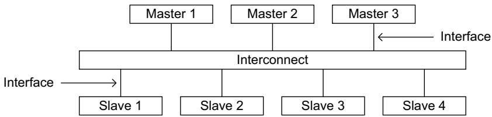  
Figure A1-3 Interface and interconnect

The AXI protocol provides a single interface definition, for the interfaces:

between a master and the interconnect

between a slave and the interconnect

between a master and a slave.

This interface definition supports a variety of different interconnect implementations.

An interconnect between devices is equivalent to another device with symmetrical master and slave ports to which real master and slave devices can be connected.

## Typical system topologies

Most systems use one of three interconnect topologies:

shared address and data buses

shared address buses and multiple data buses

multilayer, with multiple address and data buses.

In most systems, the address channel bandwidth requirement is significantly less than the data channel bandwidth requirement. Such systems can achieve a good balance between system performance and interconnect complexity by using a shared address bus with multiple data buses to enable parallel data transfers.

## A1.3.3 Register slices

Each AXI channel transfers information in only one direction, and the architecture does not require any fixed relationship between the channels. This means a register slice can be inserted at almost any point in any channel, at the cost of an additional cycle of latency.

Note

This makes possible:

• a trade-off between cycles of latency and maximum frequency of operation

a direct, fast connection between a processor and high performance memory, but to use simple register slices to isolate a longer path to less performance critical peripherals.

## A1.4 Terminology

This section summarizes terms that are used in this specification, and are defined in the Glossary, or elsewhere. Where appropriate, terms listed in this section link to the corresponding glossary definition.

## A1.4.1 AXI components and topology

The following terms describe AXI components:

Component.

Master component.

Slave component. Slave components include Memory slave components and Peripheral slave components.

Interconnect component.

For a particular AXI transaction, Upstream and Downstream refer to the relative positions of AXI components within the AXI topology.

## A1.4.2 AXI transactions, and memory types

When an AXI master initiates an AXI operation, targeting an AXI slave:

• the complete set of required operations on the AXI bus form the AXI Transaction

any required payload data is transferred as an AXI Burst

a burst can comprise multiple data transfers, or AXI Beats.

## A1.4.3 Caches and cache operation

This specification does not define standard cache terminology, that is defined in any reference work on caching. However, the glossary entries for Cache and Cache line clarify how these terms are used in this document.

## A1.4.4 Temporal description

The AXI specification uses the term In a timely manner.

## Chapter A2 Signal Descriptions

This chapter introduces the AXI interface signals. Most of the signals are required for both AXI3 and AXI4 implementations of the protocol, and the tables summarizing the signals identify the exceptions. This chapter contains the following sections:

Global signals on page A2-30

Write address channel signals on page A2-31

Write data channel signals on page A2-32

Write response channel signals on page A2-33

Read address channel signals on page A2-34

Read data channel signals on page A2-35

Low-power interface signals on page A2-36.

Later chapters define the signal parameters and usage.

## A2.1 Global signals

Table A2-1 shows the global AXI signals. These signals are used by the AXI3 and AXI4 protocols.

Table A2-1 Global signals

<table><tr><td>Signal</td><td>Source</td><td>Description</td></tr><tr><td>ACLK</td><td>Clock source</td><td>Global clock signal. See Clock on page A3-38.</td></tr><tr><td>ARESETn</td><td>Reset source</td><td>Global reset signal, active LOW. See Reset on page A3-38.</td></tr></table>

All signals are sampled on the rising edge of the global clock.

## A2.2 Write address channel signals

Table A2-2 shows the AXI write address channel signals. Unless the description indicates otherwise, a signal is used by AXI3 and AXI4.

Table A2-2 Write address channel signals

<table><tr><td>Signal</td><td>Source</td><td>Description</td></tr><tr><td>AWID</td><td>Master</td><td>Write address ID. This signal is the identification tag for the write address group of signals. See Transaction ID on page A5-79.</td></tr><tr><td>AWADDR</td><td>Master</td><td>Write address. The write address gives the address of the first transfer in a write burst transaction. See Address structure on page A3-46.</td></tr><tr><td>AWLEN</td><td>Master</td><td>Burst length. The burst length gives the exact number of transfers in a burst. This information determines the number of data transfers associated with the address. This changes between AXI3 and AXI4. See Burst length on page A3-46.</td></tr><tr><td>AWSIZE</td><td>Master</td><td>Burst size. This signal indicates the size of each transfer in the burst. See Burst size on page A3-47.</td></tr><tr><td>AWBURST</td><td>Master</td><td>Burst type. The burst type and the size information, determine how the address for each transfer within the burst is calculated. See Burst type on page A3-47.</td></tr><tr><td>AWLOCK</td><td>Master</td><td>Lock type. Provides additional information about the atomic characteristics of the transfer. This changes between AXI3 and AXI4.See Locked accesses on page A7-99.</td></tr><tr><td>AWCACHE</td><td>Master</td><td>Memory type. This signal indicates how transactions are required to progress through a system. See Memory types on page A4-67.</td></tr><tr><td>AWPROT</td><td>Master</td><td>Protection type. This signal indicates the privilege and security level of the transaction, and whether the transaction is a data access or an instruction access. See Access permissions on page A4-73.</td></tr><tr><td>AWQOS</td><td>Master</td><td>Quality of Service, QoS. The QoS identifier sent for each write transaction. Implemented only in AXI4. See QoS signaling on page A8-102.</td></tr><tr><td>AWREGION</td><td>Master</td><td>Region identifier. Permits a single physical interface on a slave to be used for multiple logical interfaces. Implemented only in AXI4. See Multiple region signaling on page A8-103.</td></tr><tr><td>AWUSER</td><td>Master</td><td>User signal. Optional User-defined signal in the write address channel. Supported only in AXI4. See User-defined signaling on page A8-104.</td></tr><tr><td>AWVALID</td><td>Master</td><td>Write address valid. This signal indicates that the channel is signaling valid write address and control information. See Channel handshake signals on page A3-40.</td></tr><tr><td>AWREADY</td><td>Slave</td><td>Write address ready. This signal indicates that the slave is ready to accept an address and associated control signals. See Channel handshake signals on page A3-40.</td></tr></table>

## A2.3 Write data channel signals

Table A2-3 shows the AXI write data channel signals. Unless the description indicates otherwise, a signal is used by AXI3 and AXI4.

Table A2-3 Write data channel signals

<table><tr><td>Signal</td><td>Source</td><td>Description</td></tr><tr><td>WID</td><td>Master</td><td>Write ID tag. This signal is the ID tag of the write data transfer. Supported only in AXI3. See Transaction ID on page A5-79.</td></tr><tr><td>WDATA</td><td>Master</td><td>Write data.</td></tr><tr><td>WSTRB</td><td>Master</td><td>Write strobes. This signal indicates which byte lanes hold valid data. There is one write strobe bit for each eight bits of the write data bus. See Write strobes on page A3-52.</td></tr><tr><td>WLAST</td><td>Master</td><td>Write last. This signal indicates the last transfer in a write burst. See Write data channel on page A3-41.</td></tr><tr><td>WUSER</td><td>Master</td><td>User signal. Optional User-defined signal in the write data channel. Supported only in AXI4. See User-defined signaling on page A8-104.</td></tr><tr><td>WVALID</td><td>Master</td><td>Write valid. This signal indicates that valid write data and strobes are available. See Channel handshake signals on page A3-40.</td></tr><tr><td>WREADY</td><td>Slave</td><td>Write ready. This signal indicates that the slave can accept the write data. See Channel handshake signals on page A3-40.</td></tr></table>

## A2.4 Write response channel signals

Table A2-4 shows the AXI write response channel signals. Unless the description indicates otherwise, a signal is used by AXI3 and AXI4.

Table A2-4 Write response channel signals

<table><tr><td>Signal</td><td>Source</td><td>Description</td></tr><tr><td>BID</td><td>Slave</td><td>Response ID tag. This signal is the ID tag of the write response. See Transaction ID on page A5-79.</td></tr><tr><td>BRESP</td><td>Slave</td><td>Write response. This signal indicates the status of the write transaction. See Read and write response structure on page A3-57.</td></tr><tr><td>BUSER</td><td>Slave</td><td>User signal. Optional User-defined signal in the write response channel. Supported only in AXI4. See User-defined signaling on page A8-104.</td></tr><tr><td>BVALID</td><td>Slave</td><td>Write response valid. This signal indicates that the channel is signaling a valid write response. See Channel handshake signals on page A3-40.</td></tr><tr><td>BREADY</td><td>Master</td><td>Response ready. This signal indicates that the master can accept a write response. See Channel handshake signals on page A3-40.</td></tr></table>

## A2.5 Read address channel signals

Table A2-5 shows the AXI read address channel signals. Unless the description indicates otherwise, a signal is used by AXI3 and AXI4.

Table A2-5 Read address channel signals

<table><tr><td>Signal</td><td>Source</td><td>Description</td></tr><tr><td>ARID</td><td>Master</td><td>Read address ID. This signal is the identification tag for the read address group of signals. See Transaction ID on page A5-79.</td></tr><tr><td>ARADDR</td><td>Master</td><td>Read address. The read address gives the address of the first transfer in a read burst transaction. See Address structure on page A3-46.</td></tr><tr><td>ARLEN</td><td>Master</td><td>Burst length. This signal indicates the exact number of transfers in a burst. This changes between AXI3 and AXI4. See Burst length on page A3-46.</td></tr><tr><td>ARSIZE</td><td>Master</td><td>Burst size. This signal indicates the size of each transfer in the burst. See Burst size on page A3-47.</td></tr><tr><td>ARBURST</td><td>Master</td><td>Burst type. The burst type and the size information determine how the address for each transfer within the burst is calculated. See Burst type on page A3-47.</td></tr><tr><td>ARLOCK</td><td>Master</td><td>Lock type. This signal provides additional information about the atomic characteristics of the transfer. This changes between AXI3 and AXI4. See Locked accesses on page A7-99.</td></tr><tr><td>ARCACHE</td><td>Master</td><td>Memory type. This signal indicates how transactions are required to progress through a system. See Memory types on page A4-67.</td></tr><tr><td>ARPROT</td><td>Master</td><td>Protection type. This signal indicates the privilege and security level of the transaction, and whether the transaction is a data access or an instruction access. See Access permissions on page A4-73.</td></tr><tr><td>ARQOS</td><td>Master</td><td>Quality of Service, QoS. QoS identifier sent for each read transaction. Implemented only in AXI4. See QoS signaling on page A8-102.</td></tr><tr><td>ARREGION</td><td>Master</td><td>Region identifier. Permits a single physical interface on a slave to be used for multiple logical interfaces. Implemented only in AXI4. See Multiple region signaling on page A8-103.</td></tr><tr><td>ARUSER</td><td>Master</td><td>User signal. Optional User-defined signal in the read address channel. Supported only in AXI4. See User-defined signaling on page A8-104.</td></tr><tr><td>ARVALID</td><td>Master</td><td>Read address valid. This signal indicates that the channel is signaling valid read address and control information. See Channel handshake signals on page A3-40.</td></tr><tr><td>ARREADY</td><td>Slave</td><td>Read address ready. This signal indicates that the slave is ready to accept an address and associated control signals. See Channel handshake signals on page A3-40.</td></tr></table>

## A2.6 Read data channel signals

Table A2-6 shows the AXI read data channel signals. Unless the description indicates otherwise, a signal is used by AXI3 and AXI4.

Table A2-6 Read data channel signals

<table><tr><td>Signal</td><td>Source</td><td>Description</td></tr><tr><td>RID</td><td>Slave</td><td>Read ID tag. This signal is the identification tag for the read data group of signals generated by the slave. See Transaction ID on page A5-79.</td></tr><tr><td>RDATA</td><td>Slave</td><td>Read data.</td></tr><tr><td>RRESP</td><td>Slave</td><td>Read response. This signal indicates the status of the read transfer. See Read and write response structure on page A3-57.</td></tr><tr><td>RLAST</td><td>Slave</td><td>Read last. This signal indicates the last transfer in a read burst. See Read data channel on page A3-41.</td></tr><tr><td>RUSER</td><td>Slave</td><td>User signal. Optional User-defined signal in the read data channel. Supported only in AXI4. See User-defined signaling on page A8-104.</td></tr><tr><td>RVALID</td><td>Slave</td><td>Read valid. This signal indicates that the channel is signaling the required read data. See Channel handshake signals on page A3-40.</td></tr><tr><td>RREADY</td><td>Master</td><td>Read ready. This signal indicates that the master can accept the read data and response information. See Channel handshake signals on page A3-40.</td></tr></table>

## A2.7 Low-power interface signals

Table A2-7 shows the signals of the optional low-power interface. These signals are used by the AXI3 and AXI4 protocols.

Table A2-7 Low-power interface signals

<table><tr><td>Signal</td><td>Source</td><td>Description</td></tr><tr><td>CSYSREQ</td><td>Clock controller</td><td>System exit low-power state request. This signal is a request from the system clock controller for the peripheral to exit from a low-power state. See Power-down or power-up handshake on page A9-107.</td></tr><tr><td>CSYSACK</td><td>Peripheral device</td><td>Exit low-power state acknowledgement. This signal is the acknowledgement from a peripheral to a system exit low-power state request. See Power-down or power-up handshake on page A9-107.</td></tr><tr><td>CACTIVE</td><td>Peripheral device</td><td>Clock active. This signal indicates that the peripheral requires its clock signal. See Peripheral clock required on page A9-107.</td></tr></table>

## Chapter A3 Single Interface Requirements

This chapter describes the basic AXI protocol transaction requirements between a single master and slave. It contains the following sections:

Clock and reset on page A3-38

Basic read and write transactions on page A3-39

Relationships between the channels on page A3-42

Transaction structure on page A3-46.

## A3.1 Clock and reset

This section describes the requirements for implementing the AXI global clock and reset signals ACLK and ARESETn.

## A3.1.1 Clock

Each AXI component uses a single clock signal, ACLK. All input signals are sampled on the rising edge of ACLK. All output signal changes must occur after the rising edge of ACLK.

On master and slave interfaces there must be no combinatorial paths between input and output signals.

## A3.1.2 Reset

The AXI protocol uses a single active LOW reset signal, ARESETn. The reset signal can be asserted asynchronously, but deassertion must be synchronous with a rising edge of ACLK.

During reset the following interface requirements apply:

a master interface must drive ARVALID, AWVALID, and WVALID LOW

a slave interface must drive RVALID and BVALID LOW

all other signals can be driven to any value.

The earliest point after reset that a master is permitted to begin driving ARVALID, AWVALID, or WVALID HIGH is at a rising ACLK edge after ARESETn is HIGH. Figure A3-1 shows the earliest point after reset that ARVALID, AWVALID, or WVALID, can be driven HIGH.

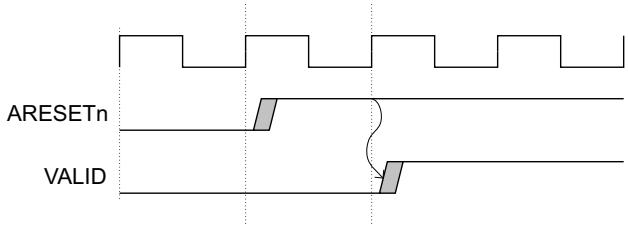  
Figure A3-1 Exit from reset

## A3.2 Basic read and write transactions

This section defines the basic mechanisms for AXI protocol transactions. The basic mechanisms are:

the Handshake process

the Channel signaling requirements on page A3-40.

## A3.2.1 Handshake process

All five transaction channels use the same VALID/READY handshake process to transfer address, data, and control information. This two-way flow control mechanism means both the master and slave can control the rate at which the information moves between master and slave. The source generates the VALID signal to indicate when the address, data or control information is available. The destination generates the READY signal to indicate that it can accept the information. Transfer occurs only when both the VALID and READY signals are HIGH

On master and slave interfaces there must be no combinatorial paths between input and output signals.

Figure A3-2 to Figure A3-4 on page A3-40 show examples of the handshake process.

In Figure A3-2, the source presents the address, data or control information after T1 and asserts the VALID signal. The destination asserts the READY signal after T2, and the source must keep its information stable until the transfer occurs at T3, when this assertion is recognized.

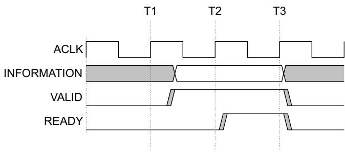  
Figure A3-2 VALID before READY handshake

A source is not permitted to wait until READY is asserted before asserting VALID.

Once VALID is asserted it must remain asserted until the handshake occurs, at a rising clock edge at which VALID and READY are both asserted.

In Figure A3-3, the destination asserts READY, after T1, before the address, data or control information is valid, indicating that it can accept the information. The source presents the information, and asserts VALID, after T2, and the transfer occurs at T3, when this assertion is recognized. In this case, transfer occurs in a single cycle.

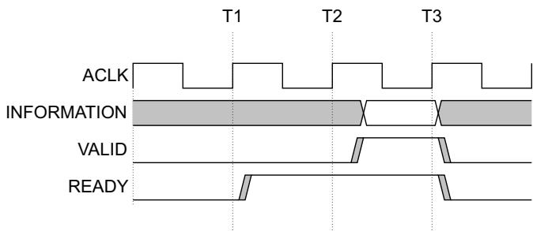  
Figure A3-3 READY before VALID handshake

A destination is permitted to wait for VALID to be asserted before asserting the corresponding READY.

If READY is asserted, it is permitted to deassert READY before VALID is asserted.

In Figure A3-4, both the source and destination happen to indicate, after T1, that they can transfer the address, data or control information. In this case the transfer occurs at the rising clock edge when the assertion of both VALID and READY can be recognized. This means the transfer occurs at T2.

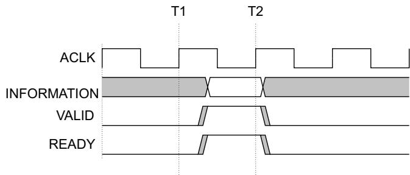  
Figure A3-4 VALID with READY handshake  
The individual AXI protocol channel handshake mechanisms are described in Channel signaling requirements.

## A3.2.2 Channel signaling requirements

The following sections define the handshake signals and the handshake rules for each channel:

Channel handshake signals

Write address channel

Write data channel on page A3-41

Write response channel on page A3-41

Read address channel on page A3-41

Read data channel on page A3-41.

## Channel handshake signals

Each channel has its own VALID/READY handshake signal pair. Table A3-1 shows the signals for each channel.

Table A3-1 Transaction channel handshake pairs

<table><tr><td>Transaction channel</td><td>Handshake pair</td></tr><tr><td>Write address channel</td><td>AWVALID, AWREADY</td></tr><tr><td>Write data channel</td><td>WVALID, WREADY</td></tr><tr><td>Write response channel</td><td>BVALID, BREADY</td></tr><tr><td>Read address channel</td><td>ARVALID, ARREADY</td></tr><tr><td>Read data channel</td><td>RVALID, RREADY</td></tr></table>

## Write address channel

The master can assert the AWVALID signal only when it drives valid address and control information. When asserted, AWVALID must remain asserted until the rising clock edge after the slave asserts AWREADY.

The default state of AWREADY can be either HIGH or LOW. This specification recommends a default state of HIGH. When AWREADY is HIGH the slave must be able to accept any valid address that is presented to it.

This specification does not recommend a default AWREADY state of LOW, because it forces the transfer to take at least two cycles, one to assert AWVALID and another to assert AWREADY.

## Write data channel

During a write burst, the master can assert the WVALID signal only when it drives valid write data. When asserted, WVALID must remain asserted until the rising clock edge after the slave asserts WREADY.

The default state of WREADY can be HIGH, but only if the slave can always accept write data in a single cycle.

The master must assert the WLAST signal while it is driving the final write transfer in the burst.

## Write response channel

The slave can assert the BVALID signal only when it drives a valid write response. When asserted, BVALID must remain asserted until the rising clock edge after the master asserts BREADY.

The default state of BREADY can be HIGH, but only if the master can always accept a write response in a single cycle.

## Read address channel

The master can assert the ARVALID signal only when it drives valid address and control information. When asserted, ARVALID must remain asserted until the rising clock edge after the slave asserts the ARREADY signal.

The default state of ARREADY can be either HIGH or LOW. This specification recommends a default state of HIGH. If ARREADY is HIGH then the slave must be able to accept any valid address that is presented to it.

Note

This specification does not recommend a default ARREADY value of LOW, because it forces the transfer to take at least two cycles, one to assert ARVALID and another to assert ARREADY.

## Read data channel

The slave can assert the RVALID signal only when it drives valid read data. When asserted, RVALID must remain asserted until the rising clock edge after the master asserts RREADY. Even if a slave has only one source of read data, it must assert the RVALID signal only in response to a request for data.

The master interface uses the RREADY signal to indicate that it accepts the data. The default state of RREADY can be HIGH, but only if the master is able to accept read data immediately, whenever it starts a read transaction.

The slave must assert the RLAST signal when it is driving the final read transfer in the burst.

## A3.3 Relationships between the channels

The AXI protocol requires the following relationships to be maintained:

a write response must always follow the last write transfer in the write transaction of which it is a part

read data must always follow the address to which the data relates

channel handshakes must conform to the dependencies defined in Dependencies between channel handshake signals.

Otherwise, the protocol does not define any relationship between the channels.

This means, for example, that the write data can appear at an interface before the write address for the transaction. This can occur if the write address channel contains more register stages than the write data channel. Similarly, the write data might appear in the same cycle as the address.

Note

When the interconnect is required to determine the destination address space or slave space, it must realign the address and write data.This is required to assure that the write data is signaled as valid only to the slave for which it is destined.

## A3.3.1 Dependencies between channel handshake signals

To prevent a deadlock situation, the dependency rules that exist between the handshake signals must be observed.

As summarized in Channel signaling requirements on page A3-40, in any transaction:

the VALID signal of the AXI interface sending information must not be dependent on the READY signal of the AXI interface receiving that information

an AXI interface that is receiving information can wait until it detects a VALID signal before it asserts its corresponding READY signal.

Note

While it is acceptable to wait for VALID to be asserted before asserting READY, it is also acceptable to assert READY before detecting the corresponding VALID. This can result in a more efficient design.

In addition, there are dependencies between the handshake signals on different channels, and AXI4 defines an additional write response dependency. The following subsections define these dependencies:

Read transaction dependencies on page A3-43

Write transaction dependencies on page A3-43

AXI4 write response dependency on page A3-44.

In the dependency diagrams:

• single-headed arrows point to signals that can be asserted before or after the signal at the start of the arrow

double-headed arrows point to signals that must be asserted only after assertion of the signal at the start of the arrow.

## Read transaction dependencies

Figure A3-5 shows the read transaction handshake signal dependencies, and shows that, in a read transaction:

the master must not wait for the slave to assert ARREADY before asserting ARVALID

the slave can wait for ARVALID to be asserted before it asserts ARREADY

the slave can assert ARREADY before ARVALID is asserted

the slave must wait for both ARVALID and ARREADY to be asserted before it asserts RVALID to indicate that valid data is available

the slave must not wait for the master to assert RREADY before asserting RVALID

the master can wait for RVALID to be asserted before it asserts RREADY

the master can assert RREADY before RVALID is asserted.

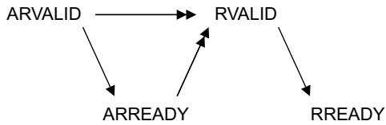  
Figure A3-5 Read transaction handshake dependencies

## Write transaction dependencies

Figure A3-6 shows the write transaction handshake signal dependencies, and shows that in a write transaction:

the master must not wait for the slave to assert AWREADY or WREADY before asserting AWVALID or WVALID

• the slave can wait for AWVALID or WVALID, or both before asserting AWREADY

the slave can assert AWREADY before AWVALID or WVALID, or both, are asserted

the slave can wait for AWVALID or WVALID, or both, before asserting WREADY

the slave can assert WREADY before AWVALID or WVALID, or both, are asserted

the slave must wait for both WVALID and WREADY to be asserted before asserting BVALID the slave must also wait for WLAST to be asserted before asserting BVALID, because the write response, BRESP, must be signaled only after the last data transfer of a write transaction

the slave must not wait for the master to assert BREADY before asserting BVALID

• the master can wait for BVALID before asserting BREADY

the master can assert BREADY before BVALID is asserted.

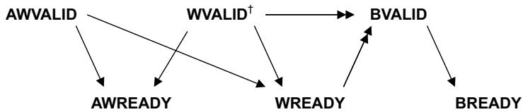  
† Dependencies on the assertion of WVALID also require the assertion of WLAST  
Figure A3-6 Write transaction handshake dependencies

The dependency rules must be observed to prevent a deadlock condition. For example, a master must not wait for AWREADY to be asserted before driving WVALID. A deadlock condition can occur if the slave is waiting for WVALID before asserting AWREADY.

## AXI4 write response dependency

AXI4 defines an additional AXI4 slave write response dependency.

Note

this additional dependency reflects the expected use in AXI3, because it is not expected that any components would accept all write data and provide a write response before the address is accepted

by issuing a write response, the slave takes responsibility for hazard checking the write transaction against all subsequent transactions.

Figure A3-7 shows all the AXI4 required slave write response handshake dependencies. The single-headed arrows point to signals that can be asserted before or after the previous signal is asserted. Double-headed arrows point to signals that must be asserted only after assertion of the previous signal.

Figure A3-7 summarizes the AXI4 slave write response handshake dependencies. These dependencies are:

the master must not wait for the slave to assert AWREADY or WREADY before asserting AWVALID or WVALID

the slave can wait for AWVALID or WVALID, or both, before asserting AWREADY

the slave can assert AWREADY before AWVALID or WVALID, or both, are asserted

the slave can wait for AWVALID or WVALID, or both, before asserting WREADY

the slave can assert WREADY before AWVALID or WVALID, or both, are asserted

the slave must wait for AWVALID, AWREADY, WVALID, and WREADY to be asserted before asserting BVALID

the slave must also wait for WLAST to be asserted before asserting BVALID because the write response, BRESP must be signaled only after the last data transfer of a write transaction

the slave must not wait for the master to assert BREADY before asserting BVALID

the master can wait for BVALID before asserting BREADY

the master can assert BREADY before BVALID is asserted.

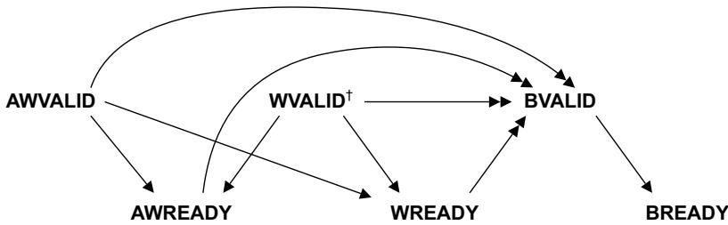  
† Dependencies on the assertion of WVALID also require the assertion of WLAST

Figure A3-7 Slave write response handshake dependencies

## A3.3.2 Legacy considerations

The additional dependency described in AXI4 write response dependency on page A3-44 means that an AXI3 slave that accepts all write data and provides a write response before accepting the address is not compliant with AXI4. Converting an AXI3 legacy slave to AXI4 requires the addition of a wrapper that ensures a returning write response is not provided until the appropriate address has been accepted by the slave.

Note

This specification strongly recommends that any new AXI3 slave implementation includes this additional dependency.

Any AXI3 master complies with the AXI4 write response requirements.

## A3.4 Transaction structure

This section describes the structure of transactions. The following sections define the address, data, and response structures:

Address structure

Pseudocode description of the transfers on page A3-50

Data read and write structure on page A3-52

Read and write response structure on page A3-57.

For the definitions of terms used in this section, see Glossary on page Glossary-323.

## A3.4.1 Address structure

The AXI protocol is burst-based. The master begins each burst by driving control information and the address of the first byte in the transaction to the slave. As the burst progresses, the slave must calculate the addresses of subsequent transfers in the burst.

A burst must not cross a 4KB address boundary.

This prevents a burst from crossing a boundary between two slaves. It also limits the number of address increments that a slave must support.

## Burst length

The burst length is specified by:

ARLEN[7:0], for read transfers

• AWLEN[7:0], for write transfers.

In this specification, AxLEN indicates ARLEN or AWLEN.

AXI3 supports burst lengths of 1 to 16 transfers, for all burst types.

AXI4 extends burst length support for the INCR burst type to 1 to 256 transfers. Support for all other burst types in AXI4 remains at 1 to 16 transfers.

The burst length for AXI3 is defined as,

Burst\_Length = AxLEN[3:0] + 1

The burst length for AXI4 is defined as,

Burst\_Length = AxLEN[7:0] + 1, to accommodate the extended burst length of the INCR burst type in AXI4.

AXI has the following rules governing the use of bursts:

for wrapping bursts, the burst length must be 2, 4, 8, or 16

a burst must not cross a 4KB address boundary

early termination of bursts is not supported.

No component can terminate a burst early. However, to reduce the number of data transfers in a write burst, the master can disable further writing by deasserting all the write strobes. In this case, the master must complete the remaining transfers in the burst. In a read burst, the master can discard read data, but it must complete all transfers in the burst.

Note

Discarding read data that is not required can result in lost data when accessing a read-sensitive device such as a FIFO. When accessing such a device, a master must use a burst length that exactly matches the size of the required data transfer.

Exclusive access restrictions on page A7-97 defines additional rules affecting bursts during an exclusive access.

In AXI4, transactions with INCR burst type and length greater than 16 can be converted to multiple smaller bursts, even if the transaction attributes indicate that the transaction is Non-modifiable. See AXI4 changes to memory attribute signaling on page A4-62. In this case, the generated bursts must retain the same transaction characteristics as the original transaction, the only exception is that:

the burst length is reduced

the address of the generated bursts is adapted appropriately.

The ability to break longer bursts into multiple shorter bursts is required for AXI3 compatibility and might also be needed to reduce the impact of longer bursts on the QoS guarantees.

## Burst size

The maximum number of bytes to transfer in each data transfer, or beat, in a burst, is specified by:

ARSIZE[2:0], for read transfers

AWSIZE[2:0], for write transfers.

In this specification, AxSIZE indicates ARSIZE or AWSIZE.

Table A3-2 shows the AxSIZE encoding.

Table A3-2 Burst size encoding

<table><tr><td>AxSIZE[2:0]</td><td>Bytes in transfer</td></tr><tr><td>0b000</td><td>1</td></tr><tr><td>0b001</td><td>2</td></tr><tr><td>0b010</td><td>4</td></tr><tr><td>0b011</td><td>8</td></tr><tr><td>0b100</td><td>16</td></tr><tr><td>0b101</td><td>32</td></tr><tr><td>0b110</td><td>64</td></tr><tr><td>0b111</td><td>128</td></tr></table>

If the AXI bus is wider than the burst size, the AXI interface must determine from the transfer address which byte lanes of the data bus to use for each transfer. See Data read and write structure on page A3-52.

The size of any transfer must not exceed the data bus width of either agent in the transaction.

## Burst type

The AXI protocol defines three burst types:

FIXED In a fixed burst:

The address is the same for every transfer in the burst.

The byte lanes that are valid are constant for all beats in the burst. However, within those byte lanes, the actual bytes that have WSTRB asserted can differ for each beat in the burst.

This burst type is used for repeated accesses to the same location such as when loading or emptying a FIFO.

## INCR

Incrementing. In an incrementing burst, the address for each transfer in the burst is an increment of the address for the previous transfer. The increment value depends on the size of the transfer. For example, the address for each transfer in a burst with a size of four bytes is the previous address plus four.

This burst type is used for accesses to normal sequential memory.

WRAP A wrapping burst is similar to an incrementing burst, except that the address wraps around to a lower address if an upper address limit is reached.

The following restrictions apply to wrapping bursts:

the start address must be aligned to the size of each transfer

the length of the burst must be 2, 4, 8, or 16 transfers.

The behavior of a wrapping burst is:

The lowest address used by the burst is aligned to the total size of the data to be transferred, that is, to ((size of each transfer in the burst) × (number of transfers in the burst)). This address is defined as the wrap boundary.

After each transfer, the address increments in the same way as for an INCR burst. However, if this incremented address is ((wrap boundary) + (total size of data to be transferred)) then the address wraps round to the wrap boundary.

The first transfer in the burst can use an address that is higher than the wrap boundary, subject to the restrictions that apply to wrapping bursts. This means that the address wraps for any WRAP burst for which the first address is higher than the wrap boundary.

This burst type is used for cache line accesses.

The burst type is specified by:

ARBURST[1:0], for read transfers

AWBURST[1:0], for write transfers.

In this specification, AxBURST indicates ARBURST or AWBURST.

Table A3-3 shows the AxBURST signal encoding.

Table A3-3 Burst type encoding

<table><tr><td>AxBURST[1:0]</td><td>Burst type</td></tr><tr><td>0b00</td><td>FIXED</td></tr><tr><td>0b01</td><td>INCR</td></tr><tr><td>0b10</td><td>WRAP</td></tr><tr><td>0b11</td><td>Reserved</td></tr></table>

## Burst address

This section provides methods for determining the address and byte lanes of transfers within a burst. The equations use the following variables:

Start\_Address The start address issued by the master.

Number\_Bytes The maximum number of bytes in each data transfer.

Data\_Bus\_Bytes The number of byte lanes in the data bus.

Aligned\_Address The aligned version of the start address.

Burst\_Length The total number of data transfers within a burst.

Address\_N The address of transfer N in a burst. N is 1 for the first transfer in a burst.

Wrap\_Boundary The lowest address within a wrapping burst.

Lower\_Byte\_Lane The byte lane of the lowest addressed byte of a transfer.

Upper\_Byte\_Lane The byte lane of the highest addressed byte of a transfer.

INT(x) The rounded-down integer value of x.

These equations determine addresses of transfers within a burst:

Start\_Address = AxADDR

Number\_Bytes = 2 ^ AxSIZE

Burst\_Length = AxLEN + 1

Aligned\_Address = (INT(Start\_Address / Number\_Bytes) ) × Number\_Bytes.

This equation determines the address of the first transfer in a burst:

Address\_1 = Start\_Address.

For an INCR burst, and for a WRAP burst for which the address has not wrapped, this equation determines the address of any transfer after the first transfer in a burst:

Address\_N = Aligned\_Address + (N – 1) × Number\_Bytes.

For a WRAP burst, the Wrap\_Boundary variable defines the wrapping boundary:

Wrap\_Boundary = (INT(Start\_Address / (Number\_Bytes × Burst\_Length)))

× (Number\_Bytes × Burst\_Length).

For a WRAP burst, if Address\_N = Wrap\_Boundary + (Number\_Bytes × Burst\_Length), then:

use this equation for the current transfer:

— Address\_N = Wrap\_Boundary

use this equation for any subsequent transfers:

Address\_N = Start\_Address + ((N – 1) × Number\_Bytes) – (Number\_Bytes × Burst\_Length).

These equations determine which byte lanes to use for the first transfer in a burst:

• Lower\_Byte\_Lane = Start\_Address – (INT(Start\_Address / Data\_Bus\_Bytes)) × Data\_Bus\_Bytes

Upper\_Byte\_Lane = Aligned\_Address + (Number\_Bytes – 1) – (INT(Start\_Address / Data\_Bus\_Bytes)) × Data\_Bus\_Bytes.

These equations determine which byte lanes to use for all transfers after the first transfer in a burst:

Lower\_Byte\_Lane = Address\_N – (INT(Address\_N / Data\_Bus\_Bytes)) × Data\_Bus\_Bytes

Upper\_Byte\_Lane = Lower\_Byte\_Lane + Number\_Bytes – 1.

Data is transferred on:

DATA((8 × Upper\_Byte\_Lane) + 7 : (8 × Lower\_Byte\_Lane)).

## A3.4.2 Pseudocode description of the transfers

```c
// DataTransfer()
// ====================
DataTransfer(Start_Address, Number_Bytes, Burst_Length, Data_Bus_Bytes, Mode, IsWrite)
// Data_Bus_Bytes is the number of 8-bit byte lanes in the bus
// Mode is the AXI transfer mode
// IsWrite is TRUE for a write, and FALSE for a read

assert Mode IN {FIXED, WRAP, INCR};
addr = Start_Address;    // Variable for current address
Aligned_Address = (INT(addr/Number_Bytes) * Number_Bytes);
aligned = (Aligned_Address == addr);    // Check whether addr is aligned to nbytes
dtsize = Number_Bytes * Burst_Length;    // Maximum total data transaction size

if mode == WRAP then
    Lower_Wrap_Boundary = (INT(addr/dtsize) * dtsize);
    // addr must be aligned for a wrapping burst
    Upper_Wrap_Boundary = Lower_Wrap_Boundary + dtsize;

for n = 1 to Burst_Length
    Lower_Byte_Lane = addr - (INT(addr/Data_Bus_Bytes)) * Data_Bus_Bytes;
    if aligned then
    Upper_Byte_Lane = Lower_Byte_Lane + Number_Bytes - 1
    else
    Upper_Byte_Lane = Aligned_Address + Number_Bytes - 1
    - (INT(addr/Data_Bus_Bytes)) * Data_Bus_Bytes;

    // Reform data transfer
    if IsWrite then
    dwrite(addr, low_byte, high_byte)
    else
    dread(addr, low_byte, high_byte);

    // Increment address if necessary
    if mode != FIXED then
    if aligned then
```

addr = addr + Number\_Bytes;

if mode == WRAP then

// WRAP mode is always aligned

if addr >= Upper\_Wrap\_Boundary then addr = Lower\_Wrap\_Boundary;

else

addr = Aligned\_Address + Number\_Bytes;

aligned = TRUE; // All transfers after the first are aligned

return;

## A3.4.3 Data read and write structure

This section describes the transfers of varying sizes on the AXI read and write data buses and how the interface performs mixed-endian and unaligned transfers. It contains the following sections:

Write strobes

Narrow transfers

Byte invariance on page A3-53

Unaligned transfers on page A3-54.

## Write strobes

The WSTRB[n:0] signals when HIGH, specify the byte lanes of the data bus that contain valid information. There is one write strobe for each eight bits of the write data bus, therefore WSTRB[n] corresponds to WDATA[(8n)+7: (8n)].

A master must ensure that the write strobes are HIGH only for byte lanes that contain valid data.

When WVALID is LOW, the write strobes can take any value, although this specification recommends that they are either driven LOW or held at their previous value.

## Narrow transfers

When a master generates a transfer that is narrower than its data bus, the address and control information determine which byte lanes the transfer uses:

in incrementing or wrapping bursts, different byte lanes are used on each beat of the burst

in a fixed burst, the same byte lanes are used on each beat.

Figure A3-8 and Figure A3-9 on page A3-53 give two examples of byte lanes use. The shaded cells indicate bytes that are not transferred.

## In Figure A3-8

the burst has five transfers

the starting address is 0

each transfer is eight bits

the transfers are on a 32-bit bus

the burst type is INCR.

<table><tr><td>31</td><td>24</td><td>23</td><td>16</td><td>15</td><td>8</td><td>7</td><td>0</td></tr><tr><td></td><td></td><td></td><td></td><td></td><td></td><td>D[7:0]</td><td></td></tr><tr><td></td><td></td><td></td><td></td><td>D[15:8]</td><td></td><td></td><td></td></tr><tr><td></td><td></td><td>D[23:16]</td><td></td><td></td><td></td><td></td><td></td></tr><tr><td>D[31:24]</td><td></td><td></td><td></td><td></td><td></td><td></td><td></td></tr><tr><td></td><td></td><td></td><td></td><td></td><td></td><td>D[7:0]</td><td></td></tr></table>

Figure A3-8 Narrow transfer example with 8-bit transfers

In Figure A3-9

the burst has three transfers

the starting address is 4

each transfer is 32 bits

the transfers are on a 64-bit bus.

<table><tr><td>63</td><td>56</td><td>55</td><td>48</td><td>47</td><td>40</td><td>39</td><td>32</td><td>31</td><td>24</td><td>23</td><td>16</td><td>15</td><td>8</td><td>7</td><td>0</td><td></td></tr><tr><td colspan="2">D[63:56]</td><td colspan="2">D[55:48]</td><td colspan="2">D[47:40]</td><td colspan="2">D[39:32]</td><td colspan="2"></td><td colspan="2"></td><td colspan="2"></td><td colspan="2"></td><td>1st transfer</td></tr><tr><td colspan="2"></td><td colspan="2"></td><td colspan="2"></td><td colspan="2"></td><td colspan="2">D[31:24]</td><td colspan="2">D[23:16]</td><td colspan="2">D[15:8]</td><td colspan="2">D[7:0]</td><td>2nd transfer</td></tr><tr><td colspan="2">D[63:56]</td><td colspan="2">D[55:48]</td><td colspan="2">D[47:40]</td><td colspan="2">D[39:32]</td><td colspan="2"></td><td colspan="2"></td><td colspan="2"></td><td colspan="2"></td><td>3rd transfer</td></tr></table>

Figure A3-9 Narrow transfer example with 32-bit transfers

## Byte invariance

To access mixed-endian data structures in a single memory space, the AXI protocol uses a byte-invariant endianness scheme.

Byte-invariant endianness means that, for any multi-byte element in a data structure:

the element uses the same continuous bytes of memory, regardless of the endianness of the data

the endianness determines the order of those bytes in memory, meaning it determines whether the first byte in memory is the most significant byte (MSB) or the least significant byte (LSB) of the element

any byte transfer to a given address passes the eight bits of data on the same data bus wires to the same address location, regardless of the endianness of any data element of which the byte is a part

Components that have only one transfer width must have their byte lanes connected to the appropriate byte lanes of the data bus. Components that support multiple transfer widths might require a more complex interface to convert an interface that is not naturally byte-invariant.

Most little-endian components can connect directly to a byte-invariant interface. Components that support only big-endian transfers require a conversion function for byte-invariant operation.

The examples in Figure A3-10 and on page A3-54 show a 32-bit number 0x0A0B0C0D, stored in a register and in a memory.

Figure A3-10 shows an example of the big-endian, byte invariant, data structure. In this structure:

the most significant byte (MSB) of the data, which is 0x0A, is stored in the MSB position in the register

the MSB of the data is stored in the memory location with the lowest address

the other data bytes are positioned in decreasing order of significance.

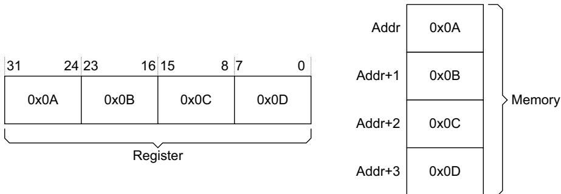  
Figure A3-10 Example big-endian byte invariant data structure

Figure A3-11 shows an example of the little-endian, byte invariant, data structure. In this structure:

the least significant byte (LSB) of the data, which is 0x0D, is stored in the LSB position in the register

the LSB of the data is stored in the memory location with the lowest address

the other data bytes are positioned in increasing order of significance.

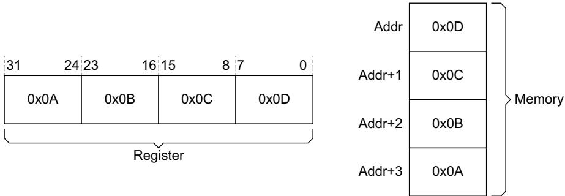  
Figure A3-11 Example little-endian byte invariant data structure

The examples in Figure A3-10 on page A3-53 and Figure A3-11 show that byte invariance ensures that big-endian and little endian structures can coexist in a single memory space without corruption. Figure A3-12 shows an example of a data structure that requires byte invariant access. In this example, the header fields use little-endian ordering, and the payload uses big-endian ordering.

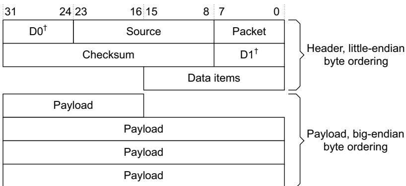  
† 16-bit continuous Destination field  
Figure A3-12 Example mixed-endian data structure

In this structure, for example, Data items is a two-byte little endian element, meaning its lowest address is its LSB. The use of byte invariance ensures that a big-endian access to the payload does not corrupt the little endian element.

## Unaligned transfers

AXI supports unaligned transfers. For any burst that is made up of data transfers wider than one byte, the first bytes accessed might be unaligned with the natural address boundary. For example, a 32-bit data packet that starts at a byte address of 0x1002 is not aligned to the natural 32-bit address boundary.

## A master can:

use the low-order address lines to signal an unaligned start address

provide an aligned address and use the byte lane strobes to signal the unaligned start address.

Note

The information on the low-order address lines must be consistent with the information on the byte lane strobes.

The slave is not required to take special action based on any alignment information from the master.

Figure A3-13 shows examples of incrementing bursts, with aligned and unaligned 32-bit transfers, on a 32-bit bus. Each row in the figure represents a transfer and the shaded cells indicate bytes that are not transferred.

<table><tr><td rowspan="6">Address: 0x00 Transfer size: 32-bits Burst type: incrementing Burst length: 4 transfers</td><td colspan="5">31 24 23 16 15 8 7 0</td></tr><tr><td>0x03</td><td>0x02</td><td>0x01</td><td>0x00</td><td>1st transfer</td></tr><tr><td>0x07</td><td>0x06</td><td>0x05</td><td>0x04</td><td>2nd transfer</td></tr><tr><td>0x0B</td><td>0x0A</td><td>0x09</td><td>0x08</td><td>3rd transfer</td></tr><tr><td>0x0F</td><td>0x0E</td><td>0x0D</td><td>0x0C</td><td>4th transfer</td></tr><tr><td colspan="5">WDATA[31:0]</td></tr><tr><td rowspan="3">Address: 0x01 Transfer size: 32-bits Burst type: incrementing Burst length: 4 transfers</td><td colspan="5">31 24 23 16 15 8 7 0</td></tr><tr><td>0x03</td><td>0x02</td><td>0x01</td><td>0x00</td><td>1st transfer</td></tr><tr><td>0x07</td><td>0x06</td><td>0x05</td><td>0x04</td><td>2nd transfer</td></tr></table>

Figure A3-13 Aligned and unaligned transfers on a 32-bit bus

Address: 0x00 Transfer size: 32-bits Burst type: incrementing Burst length: 4 transfers

Figure A3-14 shows examples of incrementing bursts, with aligned and unaligned 32-bit transfers, on a 64-bit bus. Each row in the figure represents a transfer and the shaded cells indicate bytes that are not transferred.

<table><tr><td>63</td><td>56</td><td>55</td><td>48</td><td>47</td><td>40</td><td>39</td><td>32</td><td>31</td><td>24</td><td>23</td><td>16</td><td>15</td><td>8</td><td>7</td><td>0</td></tr><tr><td colspan="2">0x07</td><td colspan="2">0x06</td><td colspan="2">0x05</td><td colspan="2">0x04</td><td colspan="2">0x03</td><td colspan="2">0x02</td><td colspan="2">0x01</td><td colspan="2">0x00</td></tr><tr><td colspan="2">0x07</td><td colspan="2">0x06</td><td colspan="2">0x05</td><td colspan="2">0x04</td><td colspan="2">0x03</td><td colspan="2">0x02</td><td colspan="2">0x01</td><td colspan="2">0x00</td></tr><tr><td colspan="2">0x0F</td><td colspan="2">0x0E</td><td colspan="2">0x0D</td><td colspan="2">0x0C</td><td colspan="2">0x0B</td><td colspan="2">0x0A</td><td colspan="2">0x09</td><td colspan="2">0x08</td></tr><tr><td colspan="2">0x0F</td><td colspan="2">0x0E</td><td colspan="2">0x0D</td><td colspan="2">0x0C</td><td colspan="2">0x0B</td><td colspan="2">0x0A</td><td colspan="2">0x09</td><td colspan="2">0x08</td></tr></table>

Address: 0x07 Transfer size: 32-bits Burst type: incrementing Burst length: 4 transfers

<table><tr><td>63</td><td>56</td><td>55</td><td>48</td><td>47</td><td>40</td><td>39</td><td>32</td><td>31</td><td>24</td><td>23</td><td>16</td><td>15</td><td>8</td><td>7</td><td>0</td><td></td></tr><tr><td colspan="2">0x07</td><td colspan="2">0x06</td><td colspan="2">0x05</td><td colspan="2">0x04</td><td colspan="2">0x03</td><td colspan="2">0x02</td><td colspan="2">0x01</td><td colspan="2">0x00</td><td>1st transfer</td></tr><tr><td colspan="2">0x0F</td><td colspan="2">0x0E</td><td colspan="2">0x0D</td><td colspan="2">0x0C</td><td colspan="2">0x0B</td><td colspan="2">0x0A</td><td colspan="2">0x09</td><td colspan="2">0x08</td><td>2nd transfer</td></tr><tr><td colspan="2">0x0F</td><td colspan="2">0x0E</td><td colspan="2">0x0D</td><td colspan="2">0x0C</td><td colspan="2">0x0B</td><td colspan="2">0x0A</td><td colspan="2">0x09</td><td colspan="2">0x08</td><td>3rd transfer</td></tr><tr><td colspan="2">0x17</td><td colspan="2">0x16</td><td colspan="2">0x15</td><td colspan="2">0x14</td><td colspan="2">0x13</td><td colspan="2">0x12</td><td colspan="2">0x11</td><td colspan="2">0x10</td><td>4th transfer</td></tr></table>

Address: 0x07 Transfer size: 32-bits Burst type: incrementing Burst length: 5 transfers

<table><tr><td>63</td><td>56</td><td>55</td><td>48</td><td>47</td><td>40</td><td>39</td><td>32</td><td>31</td><td>24</td><td>23</td><td>16</td><td>15</td><td>8</td><td>7</td><td>0</td><td></td></tr><tr><td colspan="2">0x07</td><td colspan="2">0x06</td><td colspan="2">0x05</td><td colspan="2">0x04</td><td colspan="2">0x03</td><td colspan="2">0x02</td><td colspan="2">0x01</td><td colspan="2">0x00</td><td>1st transfer</td></tr><tr><td colspan="2">0x0F</td><td colspan="2">0x0E</td><td colspan="2">0x0D</td><td colspan="2">0x0C</td><td colspan="2">0x0B</td><td colspan="2">0x0A</td><td colspan="2">0x09</td><td colspan="2">0x08</td><td>2nd transfer</td></tr><tr><td colspan="2">0x0F</td><td colspan="2">0x0E</td><td colspan="2">0x0D</td><td colspan="2">0x0C</td><td colspan="2">0x0B</td><td colspan="2">0x0A</td><td colspan="2">0x09</td><td colspan="2">0x08</td><td>3rd transfer</td></tr><tr><td colspan="2">0x17</td><td colspan="2">0x16</td><td colspan="2">0x15</td><td colspan="2">0x14</td><td colspan="2">0x13</td><td colspan="2">0x12</td><td colspan="2">0x11</td><td colspan="2">0x10</td><td>4th transfer</td></tr><tr><td colspan="2">0x17</td><td colspan="2">0x16</td><td colspan="2">0x15</td><td colspan="2">0x14</td><td colspan="2">0x13</td><td colspan="2">0x12</td><td colspan="2">0x11</td><td colspan="2">0x10</td><td>5th transfer</td></tr><tr><td colspan="17">WDATA[63:0]</td></tr></table>

Figure A3-14 Aligned and unaligned transfers on a 64-bit bus  
Figure A3-15 shows an example of a wrapping burst, with aligned 32-bit transfers, on a 64-bit bus. Each row in the figure represents a transfer and the shaded cells indicate bytes that are not transferred.  
Address: 0x04 Transfer size: 32-bits Burst type: wrapping Burst length: 4 transfers

<table><tr><td>63</td><td>56</td><td>55</td><td>48</td><td>47</td><td>40</td><td>39</td><td>32</td><td>31</td><td>24</td><td>23</td><td>16</td><td>15</td><td>8</td><td>7</td><td>0</td></tr><tr><td colspan="2">0x07</td><td colspan="2">0x06</td><td colspan="2">0x05</td><td colspan="2">0x04</td><td colspan="2">0x03</td><td colspan="2">0x02</td><td colspan="2">0x01</td><td colspan="2">0x00</td></tr><tr><td colspan="2">0x0F</td><td colspan="2">0x0E</td><td colspan="2">0x0D</td><td colspan="2">0x0C</td><td colspan="2">0x0B</td><td colspan="2">0x0A</td><td colspan="2">0x09</td><td colspan="2">0x08</td></tr><tr><td colspan="2">0x0F</td><td colspan="2">0x0E</td><td colspan="2">0x0D</td><td colspan="2">0x0C</td><td colspan="2">0x0B</td><td colspan="2">0x0A</td><td colspan="2">0x09</td><td colspan="2">0x08</td></tr><tr><td colspan="2">0x07</td><td colspan="2">0x06</td><td colspan="2">0x05</td><td colspan="2">0x04</td><td colspan="2">0x03</td><td colspan="2">0x02</td><td colspan="2">0x01</td><td colspan="2">0x00</td></tr><tr><td colspan="16">WDATA[63:0]</td></tr></table>

Figure A3-15 Aligned wrapping transfers on a 64-bit bus

## A3.4.4 Read and write response structure

The AXI protocol provides response signaling for both read and write transactions:

for read transactions the response information from the slave is signaled on the read data channel

for write transactions the response information is signaled on the write response channel.

The responses are signaled by:

RRESP[1:0], for read transfers

BRESP[1:0], for write transfers.

The responses are:

OKAY Normal access success. Indicates that a normal access has been successful. Can also indicate an exclusive access has failed. See OKAY, normal access success.

EXOKAY Exclusive access okay. Indicates that either the read or write portion of an exclusive access has been successful. See EXOKAY, exclusive access success on page A3-58.

SLVERR Slave error. Used when the access has reached the slave successfully, but the slave wishes to return an error condition to the originating master. See SLVERR, slave error on page A3-58.

DECERR Decode error. Generated, typically by an interconnect component, to indicate that there is no slave at the transaction address. See DECERR, decode error on page A3-58.

Table A3-4 shows the encoding of the RRESP and BRESP signals.

Table A3-4 RRESP and BRESP encoding

<table><tr><td>RRESP[1:0]BRESP[1:0]</td><td>Response</td></tr><tr><td>0b00</td><td>OKAY</td></tr><tr><td>0b01</td><td>EXOKAY</td></tr><tr><td>0b10</td><td>SLVERR</td></tr><tr><td>0b11</td><td>DECERR</td></tr></table>

For a write transaction, a single response is signaled for the entire burst, and not for each data transfer within the burst.

In a read transaction, the slave can signal different responses for different transfers in a burst. For example, in a burst of 16 read transfers the slave might return an OKAY response for 15 of the transfers and a SLVERR response for one of the transfers.

The protocol specifies that the required number of data transfers must be performed, even if an error is reported. For example, if a read of 8 transfers is requested from a slave but the slave has an error condition, the slave must perform 8 data transfers, each with an error response. The remainder of the burst is not cancelled if the slave gives a single error response.

## OKAY, normal access success

An OKAY response indicates any one of the following:

the success of a normal access

the failure of an exclusive access

an exclusive access to a slave that does not support exclusive access.

OKAY is the response for most transactions.

## EXOKAY, exclusive access success

An EXOKAY response indicates the success of an exclusive access. See Exclusive accesses on page A7-96.

## SLVERR, slave error

The SLVERR response indicates an unsuccessful transaction.

To simplify system monitoring and debugging, this specification recommends that error responses are used only for error conditions and not for signaling normal, expected events. Examples of slave error conditions are:

• FIFO or buffer overrun or underrun condition

unsupported transfer size attempted

write access attempted to read-only location

timeout condition in the slave

access attempted to a disabled or powered-down function.

## DECERR, decode error

The DECERR response indicates the interconnect cannot successfully decode a slave access.

If the interconnect cannot successfully decode a slave access, it must return the DECERR response. This specification recommends that the interconnect routes the access to a default slave, and the default slave returns the DECERR response.

The AXI protocol requires that all data transfers for a transaction are completed, even if an error condition occurs. Any component giving a DECERR response must meet this requirement.

## Chapter A4 Transaction Attributes

This chapter describes the transaction attribute signaling that supports system topology and system level caches. It contains the following sections:

Transaction types and attributes on page A4-60

AXI3 memory attribute signaling on page A4-61

AXI4 changes to memory attribute signaling on page A4-62

Memory types on page A4-67

Mismatched memory attributes on page A4-71

Transaction buffering on page A4-72

Access permissions on page A4-73

Legacy considerations on page A4-74

Usage examples on page A4-75.

## A4.1 Transaction types and attributes

Slaves are classified as either:

## Memory Slave

A memory slave is required to handle all transaction types correctly.

## Peripheral Slave

A peripheral slave has an IMPLEMENTATION DEFINED method of access. Typically, this is defined in the component data sheet, that describes the transaction types that the slave handles correctly.

Any access to the peripheral slave that is not part of the IMPLEMENTATION DEFINED method of access must complete, in compliance with the protocol. However, once such an access has been made, there is no requirement that the peripheral slave continues to operate correctly. It is only required to continue to complete further transactions in a protocol compliant manner.

Note

Compliant completion of all transaction types is required to prevent system deadlock, however, continued correct operation of the peripheral slave is not required.

Because a peripheral slave is required to work correctly only for a defined method of access, it can have a significantly reduced set of interface signals.

The AXI protocol defines a set of transaction attributes that support memory and peripheral slaves. The ARCACHE and AWCACHE signals specify the transaction attributes. They control:

how a transaction progresses through the system

how any system-level caches handle the transaction.

In this specification, the term AxCACHE refers collectively to the ARCACHE and AWCACHE signals.

The following sections describe the transaction attributes:

AXI3 memory attribute signaling on page A4-61

AXI4 changes to memory attribute signaling on page A4-62.

## A4.2 AXI3 memory attribute signaling

In AXI3, the AxCACHE[3:0] signals specify the Bufferable, Cacheable, and Allocate attributes of the transaction. Table A4-1 shows the AxCACHE encoding.

Table A4-1 Transaction attribute encoding

<table><tr><td>AxCACHE</td><td>Value</td><td>Transaction attribute</td></tr><tr><td rowspan="2">[0]</td><td>0</td><td>Non-bufferable</td></tr><tr><td>1</td><td>Bufferable</td></tr><tr><td rowspan="2">[1]</td><td>0</td><td>Non-cacheable</td></tr><tr><td>1</td><td>Cacheable</td></tr><tr><td rowspan="2">[2]</td><td>0</td><td>No Read-allocate</td></tr><tr><td>1</td><td>Read-allocate</td></tr><tr><td rowspan="2">[3]</td><td>0</td><td>No Write-allocate</td></tr><tr><td>1</td><td>Write-allocate</td></tr></table>

## AxCACHE[0], Bufferable (B) bit

When this bit is asserted, the interconnect, or any component, can delay the transaction reaching its final destination for any number of cycles.

Note

Normally, the Bufferable attribute is only relevant to writes.

## AxCACHE[1], Cacheable (C) bit

When this bit is deasserted, allocation of the transaction is forbidden.

When this bit is asserted:

Allocation of the transaction is permitted. RA and WA give additional hint information.

The characteristics of a transaction at the final destination does not have to match the characteristics of the original transaction.

For writes this means that a number of different writes can be merged together. For reads this means that the contents of a location can be prefetched, or the values from a single fetch can be used for multiple read transactions.

## AxCACHE[2], Read-allocate (RA) bit

When this bit is asserted, read allocation of the transaction is recommended but is not mandatory. The RA bit must not be asserted if the C bit is deasserted.

## AxCACHE[3], Write-allocate (WA) bit

When this bit is asserted, write allocation of the transaction is recommended but is not mandatory. The WA bit must not be asserted if the C bit is deasserted.

## A4.3 AXI4 changes to memory attribute signaling

AXI4 makes the following changes to the AXI3 memory attribute signaling:

the AxCACHE[1] bits are renamed as the Modifiable bits

ordering requirements are defined for Non-modifiable transactions

the meanings of Read-allocate and Write-allocate are updated.

## A4.3.1 AxCACHE[1], Modifiable

In AXI4, the AxCACHE[1] bit is the Modifiable bit. When HIGH, Modifiable indicates that the characteristics of the transaction can be modified. When Modifiable is LOW, the transaction is Non-modifiable.

Note

The AxCACHE[1] bit is renamed from the Cacheable bit to the Modifiable bit to better describe the required functionality. The actual functionality is unchanged.

The following sections describe the properties of Non-modifiable and Modifiable transactions.

## Non-modifiable transactions

A Non-modifiable transaction is indicated by setting AxCACHE[1] LOW.

A Non-modifiable transaction must not be split into multiple transactions or merged with other transactions.

In a Non-modifiable transaction, the parameters shown in Table A4-2 must not be changed.

Table A4-2 Parameters fixed as Non-modifiable

<table><tr><td>Parameter</td><td>Signals</td></tr><tr><td>Transfer address</td><td>AxADDR, and therefore AxREGION</td></tr><tr><td>Burst size</td><td>AxSIZE</td></tr><tr><td>Burst length</td><td>AxLEN</td></tr><tr><td>Burst type</td><td>AxBURST</td></tr><tr><td>Lock type</td><td>AxLOCK</td></tr><tr><td>Protection type</td><td>AxPROT</td></tr></table>

The AxCACHE attribute can only be modified to convert a transaction from being Bufferable to Non-bufferable. No other change to AxCACHE is permitted.

The transaction ID and the QoS values can be modified.

A Non-modifiable transaction with burst length greater than 16 can be split into multiple transactions. Each resulting transaction must meet the requirements given in this subsection, except that:

the burst length is reduced

the address of the generated bursts is adapted appropriately.

A Non-modifiable transaction that is an Exclusive access, as indicated by AxLOCK asserted, is permitted to have the transaction size, AxSIZE, and the transaction length, AxLEN, modified if the total number of bytes accessed remains the same.

## Note

There are circumstances where it is not possible to meet the requirements of Non-modifiable transactions. For example, when downsizing to a bus width narrower than that required by the transaction size, AxSIZE, the transaction must be modified.

A component that performs such an operation can optionally include an IMPLEMENTATION DEFINED mechanism to indicate that a modification has occurred. This can assist with software debug.

## Modifiable transactions

A Modifiable transaction is indicated by asserting AxCACHE[1].

A Modifiable transaction can be modified in the following ways:

a transaction can be broken into multiple transactions

multiple transactions can be merged into a single transaction

a read transaction can fetch more data than required

a write transaction can access a larger address range than required, using the WSTRB signals to ensure that only the appropriate locations are updated

in each generated transaction, the following signals can be modified:

— the transfer address, AxADDR

the burst size, AxSIZE

the burst length, AxLEN

the burst type, AxBURST.

The following must not be changed:

• the lock type, AxLOCK

• the protection type, AxPROT.

The memory attribute, AxCACHE, can be modified, but any modification must ensure that the visibility of transactions by other components is not reduced, either by preventing propagation of transactions to the required point, or by changing the need to look up a transaction in a cache. Any modification to the memory attributes must be consistent for all transactions to the same address range.

The transaction ID and QoS values can be modified.

No transaction modification is permitted that:

Causes accesses to a different 4KByte address space than that of the original transaction.

Causes a single access to a single-copy atomicity sized region to be performed as multiple accesses. See Single-copy atomicity size on page A7-94.

## A4.3.2 Ordering requirements for Non-modifiable transactions

AXI4 requires that ordering is preserved for any set of transactions that meet all of the following conditions:

the transactions are Non-modifiable

• the transactions use the same AXI ID

the transactions target the same slave device.

The ordering must be preserved, irrespective of the address of the transaction, if the transactions are destined for the same slave.

## Note

Ordering between the independent read and write channels can only be guaranteed if a transaction in one direction is issued only after any earlier transaction in the other direction has received a response. If a transaction in one direction is issued before receiving the response to any earlier transaction in the other direction, then no ordering exists between the transactions.

This ordering requirement makes no guarantee about the relative ordering of transactions destined for different slaves.

Because the address map boundary between different physical slave devices is IMPLEMENTATION DEFINED, if the boundary between slave devices is not known then the ordering of all Non-modifiable transactions with the same AXI ID on the same path must be preserved.

This ordering requirement applies between all Non-modifiable transactions, including between Non-bufferable and Bufferable transactions.

When an intermediate component in an AXI path issues transaction responses, that component is responsible for ensuring the correct ordering.

For more information on the ordering model see Chapter A6 AXI4 Ordering Model.

## A4.3.3 Updated meaning of Read-allocate and Write-allocate

In AXI4, the meaning of the Read-allocate and Write-allocate bits is updated so that one bit indicates if an allocation occurs for the transaction and the other bit indicates if an allocation could have been made due to another transaction.

For read transactions, the Write-allocate bit is redefined to indicate that:

the location could have been previously allocated in the cache because of a write transaction (as the AXI3 definition)

the location could have been previously allocated in the cache because of the actions of another master (additional AXI4 definition).

For write transactions, the Read-allocate bit is redefined to indicate that:

the location could have been previously allocated in the cache because of a read transaction (as the AXI3 definition)

the location could have been previously allocated in the cache because of the actions of another master (additional AXI4 definition).

These changes mean:

a transaction must be looked up in a cache if the value of AxCACHE[3:2] is not 0b00

a transaction does not need to be looked up in a cache if the value of AxCACHE[3:2] is 0b00.

## Note

The change to the definition of AxCACHE means that these signals can differ for a read and write transaction to the same location.

Table A4-3 shows the AXI4 bit allocations for the AWCACHE signals.  
Table A4-3 AWCACHE bit allocations

<table><tr><td>Signal</td><td>AXI4 definition</td><td>Description</td></tr><tr><td>AWCACHE[3]</td><td>Allocate</td><td>When asserted, the transaction must be looked up in a cache because it could have been previously allocated. The transaction must also be looked up in a cache if AWCACHE[2] is asserted.When deasserted, if AWCACHE[2] is also deasserted, then the transaction does not need to be looked up in a cache and the transaction must propagate to the final destination.When asserted, it is recommended that this transaction is allocated in the cache for performance reasons.</td></tr><tr><td>AWCACHE[2]</td><td>Other Allocate</td><td>When asserted, the transaction must be looked up in a cache because it could have been previously allocated in the cache by another transaction, either a read transaction or a transaction from another master. The transaction must also be looked up in a cache if AWCACHE[3] is asserted.When deasserted, if AWCACHE[3] is also deasserted, then the transaction does not need to be looked up in a cache and the transaction must propagate to the final destination.</td></tr><tr><td>AWCACHE[1]</td><td>Modifiable</td><td>When asserted, the characteristics of the transaction can be modified and writes can be merged. When deasserted, the characteristics of the transaction must not be modified.</td></tr><tr><td>AWCACHE[0]</td><td>Bufferable</td><td>When deasserted, if both of AWCACHE[3:2] are deasserted, the write response must be given from the final destination.When asserted, if both of AWCACHE[3:2] are deasserted, the write response can be given from an intermediate point, but the write transaction is required to be made visible at the final destination in a timely manner.When deasserted, if either of AWCACHE[3:2] is asserted, the write response can be given from an intermediate point, but the write transaction is required to be made visible at the final destination in a timely manner.When asserted, if either of AWCACHE[3:2] is asserted, the write response can be given from an intermediate point. The write transaction is not required to be made visible at the final destination.</td></tr></table>

Table A4-4 shows the AXI4 bit allocations for the ARCACHE signals.  
Table A4-4 ARCACHE bit allocations

<table><tr><td>Signal</td><td>AXI4 definition</td><td>Description</td></tr><tr><td>ARCACHE[3]</td><td>Other Allocate</td><td>When asserted, the transaction must be looked up in a cache because it could have been allocated in the cache by another transaction, either a write transaction or a transaction from another master. The transaction must also be looked up in a cache if ARCACHE[2] is asserted.When deasserted, if ARCACHE[2] is also deasserted, then the transaction does not need to be looked up in a cache.</td></tr><tr><td>ARCACHE[2]</td><td>Allocate</td><td>When asserted, the transaction must be looked up in a cache because it could have been allocated. The transaction must also be looked up in a cache if ARCACHE[3] is asserted.When deasserted, if ARCACHE[3] is also deasserted, then the transaction does not need to be looked up in a cache.When asserted, it is recommended that this transaction is allocated in the cache for performance reasons.</td></tr><tr><td>ARCACHE[1]</td><td>Modifiable</td><td>When asserted, the characteristics of the transaction can be modified and a larger quantity of read data can be fetched than is required. When deasserted the characteristics of the transaction must not be modified.</td></tr><tr><td>ARCACHE[0]</td><td>Bufferable</td><td>This bit has no effect when ARCACHE[3:1] are deasserted.When ARCACHE[3:2] are deasserted and ARCACHE[1] is asserted:if this bit is deasserted, the read data must be obtained from the final destinationif this bit is asserted, the read data can be obtained from the final destination or from a write that is progressing to the final destination.When either ARCACHE[3] is asserted, or ARCACHE[2] is asserted, this bit can be used to distinguish between Write-through and Write-back memory types.</td></tr></table>

## A4.4 Memory types

The AXI4 protocol introduces new names for the memory types identified by the AxCACHE encoding. Table A4-5 shows the AXI4 AxCACHE encoding and associated memory types. Some memory types have different encodings in AXI3 and these are shown in brackets.

Note

The same memory type can have different encodings on the read channel and write channel. This provides backwards compatibility with AXI3 AxCACHE definitions.

In AXI4 it is legal to use more than one AxCACHE value for a particular memory type. Table A4-5 shows the preferred AXI4 value with the legal AXI3 value in brackets.

Table A4-5 Memory type encoding

<table><tr><td>ARCACHE[3:0]</td><td>AWCACHE[3:0]</td><td>Memory type</td></tr><tr><td>0000</td><td>0000</td><td>Device Non-bufferable</td></tr><tr><td>0001</td><td>0001</td><td>Device Bufferable</td></tr><tr><td>0010</td><td>0010</td><td>Normal Non-cacheable Non-bufferable</td></tr><tr><td>0011</td><td>0011</td><td>Normal Non-cacheable Bufferable</td></tr><tr><td>1010</td><td>0110</td><td>Write-through No-allocate</td></tr><tr><td>1110 (0110)</td><td>0110</td><td>Write-through Read-allocate</td></tr><tr><td>1010</td><td>1110 (1010)</td><td>Write-through Write-allocate</td></tr><tr><td>1110</td><td>1110</td><td>Write-through Read and Write-allocate</td></tr><tr><td>1011</td><td>0111</td><td>Write-back No-allocate</td></tr><tr><td>1111 (0111)</td><td>0111</td><td>Write-back Read-allocate</td></tr><tr><td>1011</td><td>1111 (1011)</td><td>Write-back Write-allocate</td></tr><tr><td>1111</td><td>1111</td><td>Write-back Read and Write-allocate</td></tr></table>

All values not shown in Table A4-5 are reserved.

## A4.4.1 Memory type requirements

This section specifies the required behavior for each of the memory types.

## Device Non-bufferable

The required behavior for Device Non-bufferable memory is:

The write response must be obtained from the final destination.

Read data must be obtained from the final destination.

Transactions are Non-modifiable, see Non-modifiable transactions on page A4-62

Reads must not be prefetched. Writes must not be merged.

All Non-modifiable read and write transactions (AxCACHE[1] = 0) from the same ID to the same slave must remain ordered.

## Device Bufferable

The required behavior for the Device Bufferable memory type is:

The write response can be obtained from an intermediate point.

Write transactions must be made visible at the final destination in a timely manner, as defined in Transaction buffering on page A4-72.

Read data must be obtained from the final destination.

Transactions are Non-modifiable, see Non-modifiable transactions on page A4-62.

Reads must not be prefetched. Writes must not be merged.

All Non-modifiable read and write transactions (AxCACHE[1] = 0) from the same ID to the same slave must remain ordered.

Both Device memory types are Non-modifiable. In this protocol specification the terms Device memory and Non-modifiable memory are interchangeable.

For read transactions there is no difference in the required behavior for Device Non-bufferable and Device Bufferable memory types.

## Normal Non-cacheable Non-bufferable

The required behavior for the Normal Non-cacheable Non-bufferable memory type is:

the write response must be obtained from the final destination

read data must be obtained from the final destination

transactions are Modifiable, see Modifiable transactions on page A4-63

writes can be merged

read and write transactions from the same ID to addresses that overlap must remain ordered.

## Normal Non-cacheable Bufferable

The required behavior for the Normal Non-cacheable Bufferable memory type is:

The write response can be obtained from an intermediate point.

Write transactions must be made visible at the final destination in a timely manner, as defined in Transaction buffering on page A4-72. There is no mechanism to determine when a write transaction is visible at its final destination.

Read data must be obtained either:

from the final destination

— from a write transaction that is progressing to its final destination.

If read data is obtained from a write transaction:

— it must be obtained from the most recent version of the write

the data must not be cached to service a later read.

Transactions are Modifiable, see Modifiable transactions on page A4-63.

Writes can be merged.

Read and write transactions from the same ID to addresses that overlap must remain ordered.

## Note

For a Normal Non-cacheable Bufferable read, data can be obtained from a write transaction that is still progressing to its final destination. This is indistinguishable from the read and write transactions propagating to arrive at the final destination at the same time. Read data returned in this manner does not indicate that the write transaction is visible at the final destination.

## Write-through No-allocate

The required behavior for the Write-through No-allocate memory type is:

The write response can be obtained from an intermediate point.

Write transactions must be made visible at the final destination in a timely manner, as defined in Transaction buffering on page A4-72. There is no mechanism to determine when a write transaction is visible at the final destination.

Read data can be obtained from an intermediate cached copy.

Transactions are Modifiable, see Modifiable transactions on page A4-63.

Reads can be prefetched.

Writes can be merged.

A cache lookup is required for read and write transactions.

Read and write transactions from the same ID to addresses that overlap must remain ordered.

The No-allocate attribute is an allocation hint, that is, it is a recommendation to the memory system that, for performance reasons, these transactions are not allocated. However, the allocation of read and write transactions is not prohibited.

## Write-through Read-allocate

The required behavior for the Write-through Read-allocate memory type is the same as for Write-through No-allocate memory. But in this case the allocation hint is that, for performance reasons:

allocation of read transactions is recommended

allocation of write transactions is not recommended.

## Write-through Write-allocate

The required behavior for the Write-through Write-allocate memory type is the same as for Write-through No-allocate memory. But in this case the allocation hint is that, for performance reasons:

allocation of read transactions is not recommended

allocation of write transactions is recommended.

## Write-through Read and Write-allocate

The required behavior for the Write-through Read and Write-allocate memory type is the same as for Write-through No-allocate memory. But in this case the allocation hint is that, for performance reasons:

allocation of read transactions is recommended

allocation of write transactions is recommended.

## Write-back No-allocate

The required behavior for the Write-back No-allocate memory type is:

The write response can be obtained from an intermediate point.

Write transactions are not required to be made visible at the final destination.

Read data can be obtained from an intermediate cached copy.

Transactions are Modifiable, see Modifiable transactions on page A4-63.

Reads can be prefetched.

Writes can be merged.

A cache lookup is required for read and write transactions.

Read and write transactions from the same ID to addresses that overlap must remain ordered

The No-allocate attribute is an allocation hint, that is, it is a recommendation to the memory system that, for performance reasons, these transactions are not allocated. However, the allocation of read and write transactions is not prohibited.

## Write-back Read-allocate

The required behavior for the Write-back Read-allocate memory type is the same as for Write-back No-allocate memory. But in this case the allocation hint is that, for performance reasons:

allocation of read transactions is recommended

allocation of write transactions is not recommended.

## Write-back Write-allocate

The required behavior for the Write-back Write-allocate memory type is the same as for Write-back No-allocate memory. But in this case the allocation hint is that, for performance reasons:

allocation of read transactions is not recommended

allocation of write transactions is recommended.

## Write-back Read and Write-allocate

The required behavior for the Write-back Read and Write-allocate memory type is the same as for Write-back No-allocate memory. But in this case the allocation hint is that, for performance reasons:

allocation of read transactions is recommended

allocation of write transactions is recommended.

## A4.5 Mismatched memory attributes

Multiple agents that are accessing the same area of memory, can use mismatched memory attributes. However, for functional correctness, the following rules must be obeyed:

All masters accessing the same area of memory must have a consistent view of the cacheability of that area of memory at any level of hierarchy. The rules to be applied are:

Address region not Cacheable

All masters must use transactions with both AxCACHE[3:2] deasserted.

Address region Cacheable

All masters must use transactions with either of AxCACHE[3:2] asserted.

Different masters can use different allocation hints.

If an addressed region is Normal Non-cacheable, any master can access it using a Device memory transaction.

If an addressed region has the Bufferable attribute, any master can access it using transactions that do not permit bufferable behavior.

Note

For example, a transaction that requires the response from the final destination does not permit bufferable behavior.

## A4.5.1 Changing memory attributes

The attributes for a particular memory region can be changed from one type to another incompatible type. For example, the attribute can be changed from Write-through Cacheable to Normal Non-cacheable. This requires a suitable process to perform the change. Typically:

1. All masters stop accessing the region.

2. A single master performs any required cache maintenance operations.

3. All masters restart accessing the memory region, using the new attributes.

## A4.6 Transaction buffering

Write accesses to the following memory types do not require a transaction response from the final destination, but do require that write transactions are made visible at the final destination In a timely manner:

Device Bufferable

Normal Non-cacheable Bufferable

Write-through.

For write transactions, all three memory types require the same behavior. For read transactions, the required behavior is as follows:

for Device Bufferable memory, read data must be obtained from the final destination

for Normal Non-cacheable Bufferable memory, read data must be obtained either from the final destination or from a write transaction that is progressing to its final destination

for Write-through memory, read data can be obtained from an intermediate cached copy.

In addition to ensuring that write transactions progress towards their final destination in a timely manner, intermediate buffers must behave as follows:

An intermediate buffer that can respond to a transaction must ensure that, over time, any read transaction to Normal Non-cacheable Bufferable propagates towards its destination. This means that, when forwarding a read transaction, the attempted forwarding must not continue indefinitely, and any data used for forwarding must not persist indefinitely. The protocol does not define any mechanism for determining how long data used for forwarding a read transaction can persist. However, in such a mechanism, the act of reading the data must not reset the data timeout period.

Note

Without this requirement, continued polling of the same location can prevent the timeout of a read held in the buffer, preventing the read progressing towards its destination.

An intermediate buffer that can hold and merge write transactions must ensure that transactions do not remain in its buffer indefinitely. For example, merging write transactions must not reset the mechanism that determines when a write is drained towards its final destination.

Note

Without this requirement, continued writes to the same location can prevent the timeout of a write held in the buffer, preventing the write progressing towards its destination.

For information about the required behavior of read accesses to these memory types, see:

Device Bufferable on page A4-68

Normal Non-cacheable Bufferable on page A4-68

Write-through No-allocate on page A4-69.

## A4.7 Access permissions

AXI provides access permissions signals that can be used to protect against illegal transactions:

ARPROT[2:0] defines the access permissions for read accesses

AWPROT[2:0] defines the access permissions for write accesses.

The term AxPROT refers collectively to the ARPROT and AWPROT signals.

Table A4-6 shows the AxPROT[2:0] encoding.

Table A4-6 Protection encoding

<table><tr><td>AxPROT</td><td>Value</td><td>Function</td></tr><tr><td rowspan="2">[0]</td><td>0</td><td>Unprivileged access</td></tr><tr><td>1</td><td>Privileged access</td></tr><tr><td rowspan="2">[1]</td><td>0</td><td>Secure access</td></tr><tr><td>1</td><td>Non-secure access</td></tr><tr><td rowspan="2">[2]</td><td>0</td><td>Data access</td></tr><tr><td>1</td><td>Instruction access</td></tr></table>

The protection attributes are:

## Unprivileged or privileged

An AXI master might support more than one level of operating privilege, and extend this concept of privilege to memory access. AxPROT[0] identifies an access as unprivileged or privileged.

Note

Some processors support multiple levels of privilege, see the documentation for the selected processor to determine the mapping to AXI privilege levels. The only distinction AXI can provide is between privileged and unprivileged access.

## Secure or Non-secure

An AXI master might support Secure and Non-secure operating states, and extend this concept of security to memory access. AxPROT[1] identifies an access as Secure or Non-secure.

Note

This bit is defined so that when it is asserted the transaction is identified as Non-secure. This is consistent with other signaling in implementations of the ARM Security Extensions.

## Instruction or data

This bit indicates whether the transaction is an instruction access or a data access.

The AXI protocol defines this indication as a hint. It is not accurate in all cases, for example, where a transaction contains a mix of instruction and data items. This specification recommends that a master sets AxPROT[2] LOW, to indicate a data access unless the access is specifically known to be an instruction access.

## A4.8 Legacy considerations

AXI4 introduces additional requirements for the handling of some of the AxCACHE memory attributes.

In AXI4, all Device transactions using the same ID to the same slave must be ordered with respect to each other.

Note

This is not an explicit requirement of AXI3. Any AXI4 component that relies on this behavior cannot be connected to an AXI3 interconnect that does not exhibit this behavior.

ARM believes that most implemented AXI3 interconnects support the required AXI4 behavior.

This specification strongly recommends that any new AXI3 design implements the AXI4 requirement.

For AxCACHE bits names and memory type names it is required that AXI4 uses the new terms. AXI3 components can use either the AXI3 or AXI4 names.

## A4.9 Usage examples

This section gives examples of memory type usage.

## A4.9.1 Use of Device memory types

The specification supports the combined use of Device Non-buffered and Device Buffered memory types to force write transactions to reach their final destination and ensure that the issuing master knows when the transaction is visible to all other masters.

A write transaction that is marked as Device Buffered is required to reach its final destination in a timely manner. However, the write response for the transaction can be signaled by an intermediate buffer. Therefore, the issuing master cannot know when the write is visible to all other masters.

If a master issues a Device Buffered write transaction, or stream of write transactions, followed by a Device Non-buffered write transaction, and all transactions use the same AXI ID, the AXI ordering requirements force all of the Device Buffered write transactions to reach the final destination before a response is given to the Device Non-buffered transaction. Therefore, the response to the Device Non-buffered transaction indicates that all the transactions are visible to all masters.

A Device Non-buffered transaction can only guarantee the completion of Device Buffered transactions that are issued with the same ID, and are to the same slave device.

## Chapter A5 Multiple Transactions

This chapter describes the mechanism that enables out-of-order transaction completion and the issuing of multiple outstanding addresses. It contains the following sections:

AXI transaction identifiers on page A5-78

Transaction ID on page A5-79

Transaction ordering on page A5-80

Removal of write interleaving support on page A5-83.

## A5.1 AXI transaction identifiers

The AXI protocol includes AXI ID transaction identifiers. A master can use these to identify separate transactions that must be returned in order.

All transactions with a given AXI ID value must remain ordered, but there is no restriction on the ordering of transactions with different ID values.This means a single physical port can support out-of-order transactions by acting as a number of logical ports, each of which handles its transactions in order.

By using AXI IDs, a master can issue transactions without waiting for earlier transactions to complete. This can improve system performance, because it enables parallel processing of transactions.

There is no requirement for slaves or masters to use AXI transaction IDs. Masters and slaves can process one transaction at a time, meaning transactions are processed in the order they are issued.

Slaves are required to reflect on the appropriate BID or RID response an AXI ID received from a master.

## A5.2 Transaction ID

Each transaction channel has its own transaction ID. Table A5-1 shows these designated signals.

Table A5-1 Channel transaction ID

<table><tr><td>Transaction channel</td><td>Transaction ID</td></tr><tr><td>Write address channel</td><td>AWID</td></tr><tr><td>Write data channel, AXI3 only</td><td>WIDa</td></tr><tr><td>Write response channel</td><td>BID</td></tr><tr><td>Read address channel</td><td>ARID</td></tr><tr><td>Read data channel</td><td>RID</td></tr></table>

a. The WID signal is implemented only in AXI3. For more information see Removal of write interleaving support on page A5-83.

## A5.3 Transaction ordering

A master can use the AWID and ARID transaction IDs to indicate its ordering requirements. The rules for the ordering of transactions are as follows:

Transactions from different masters have no ordering restrictions. They can complete in any order.

Transactions from the same master, but with different ID values, have no ordering restrictions. They can complete in any order.

The data transfers for a sequence of read transactions with the same ARID value must be returned in the order in which the master issued the addresses, see Read ordering.

The data transfers for a sequence of write transactions with the same AWID value must complete in the order in which the master issued the addresses, see Normal write ordering and AXI3 write data interleaving on page A5-81.

There are no ordering restrictions between read and write transactions using a common value for AWID and ARID, see Read and write interaction on page A5-82.

Interconnect use of transaction identifiers on page A5-82 describes how the AXI fabric extends the transaction ID values issued by AXI masters and slaves.

## A5.3.1 Read ordering

At a master interface, read data from transactions with the same ARID value must arrive in the order in which the master issued the addresses. Data from read transactions with different ARID values can arrive in any order. Read data of transactions with different ARID values can be interleaved.

A slave must return read data for a sequence of transactions with the same ARID value in the order in which it received the addresses. In a sequence of read transactions with different ARID values, the slave can return the read data in any order, regardless of the order in which the transactions arrived.

The slave must ensure that the RID value of any returned data matches the ARID value of the address to which it is responding.

The interconnect must ensure that the read data from a sequence of transactions with the same ARID value targeting different slaves is received by the master in the order in which it issued the addresses

The read data reordering depth is the number of addresses pending in the slave that can be reordered. A slave that processes all transactions in order has a read data reordering depth of one. The read data reordering depth is a static value that must be specified by the designer of the slave.

Note

There is no mechanism by which a master can determine the read data reordering depth of a slave.

## A5.3.2 Normal write ordering

Unless a master knows that a slave supports write data interleaving, it must issue the data of write transactions in the same order in which it issues the transaction addresses. See AXI3 write data interleaving on page A5-81.

Note

There is no mechanism by which a master can determine whether a slave supports write data interleaving. In AXI4, there is no support for write data interleaving.

Most slave designs do not support write data interleaving and therefore must receive write data in the order in which they receive the addresses.

If the interconnect combines write transactions from different masters to one slave, it must ensure that it forwards the write data in address order.

These restrictions apply even if the write transactions have different AWID values, and even if they come from different masters.

## A5.3.3 AXI3 write data interleaving

Caution

AXI4 removes support for write data interleaving. In AXI4, all of the write data for a transaction must be provided in consecutive transfers on the write data channel. See Removal of write interleaving support on page A5-83.

With write data interleaving, a slave interface can accept interleaved write data with different AWID values. The write data interleaving depth is the number of addresses for which a slave can accept interleaved data.

When accessing a slave that supports write data interleaving, write data from different transactions that use the same AWID cannot be interleaved.

Note

As indicated in Normal write ordering on page A5-80, there is no mechanism by which a master, or any other AXI component, can determine whether a slave supports write data interleaving. Similarly, there is no mechanism by which the write interleaving depth of a slave can be determined.

For a slave that supports write data interleaving, the order in which it receives the first data item of each transaction must be the same as the order in which it receives the addresses for the transactions.

If two write transactions with different AWID values access the same or overlapping addresses then the AXI3 specification does not define the processing order of those accesses. A higher-level protocol must ensure the correct order of transaction processing.

A master interface that generates write data using only one AWID value generates all write data in the order in which it issues the write addresses. However, a master interface can interleave write data with different WID values if the slave interface has a write data interleaving depth greater than one.

To avoid possible deadlock, a slave interface that supports write data interleaving must continuously accept interleaved write data. It must never stall the acceptance of write data in an attempt to change the order of the write data.

## Usage models for write data interleaving

Write data interleaving can prevent stalling when the interconnect combines multiple streams of write data targeting the same slave. For example, the interconnect might combine a write data stream from a slow source with another write data stream from a fast source. By interleaving the two write data streams, the interconnect can improve system performance.

For most masters that can control the generation of the write data, write data interleaving is not necessary. Such a master can generate the write data in the order in which it generates the addresses. However, a master interface that is transferring write data from different sources that have different speeds might interleave the sources to make maximum use of the interconnect.

## A5.3.4 Read and write interaction

AXI has no ordering restrictions between read and write transactions. They can complete in any order, even if the ARID value of a read transaction is the same as the AWID value of a write transaction.

If a master requires a given relationship between a read transaction and a write transaction then it must ensure that the earlier transaction is complete before it issues the later transaction. A master can only consider the earlier transaction is complete when:

for a read transaction, it receives the last of the read data

for a write transaction, it receives the write response.

Sending all of the write data for the transaction must not be taken as indicating completion of that transaction.

Note

Typically, when writing to a peripheral, a master must wait for earlier transactions to complete before switching between read and write transactions that must be ordered.

For reads and writes to memory, a master might implement an address check against outstanding transactions, to determine whether a new transaction could be to the same, or overlapping memory address. If the read and write transactions do not overlap, then the master can start the new transaction without waiting for the earlier transactions to complete.

## A5.3.5 Interconnect use of transaction identifiers

When a master is connected to an interconnect, the interconnect appends additional bits to the ARID, AWID and WID identifiers that are unique to that master port. This has two effects:

masters do not have to know what ID values are used by other masters, because the interconnect makes the ID values used by each master unique, by appending the master number to the original identifier

the ID identifier at a slave interface is wider than the ID identifier at a master interface.

For read data, the interconnect uses the additional bits of the RID identifier to determine which master port the read data is destined for. The interconnect removes these bits of the RID identifier before passing the RID value to the correct master port.

For write response, the interconnect uses the additional bits of the BID identifier to determine which master port the write response is destined for. The interconnect removes these bits of the BID identifier before passing the BID value to the correct master port.

## A5.3.6 Width of transaction ID fields

The width of transaction ID fields is IMPLEMENTATION DEFINED. However, this specification recommends the following transaction ID field widths:

for master components, implement a transaction ID field up to four bits

• for master port numbers in the interconnect, implement up to four additional bits of transaction ID field

for slave components, implement eight bits of transaction ID field support.

For masters that support only a single ordered interface, it is acceptable to tie the transaction ID field outputs to a constant value, for example, tie to zero.

For slaves that do not make use of the ordering information and process all transactions in order, the transaction ID functionality can be added without changing the base functionality of the slave.

## A5.4 Removal of write interleaving support

As stated in AXI3 write data interleaving on page A5-81, AXI4 removes support for write data interleaving. In AXI4, all write data for a transaction must be provided in consecutive transfers on the write data channel.

This means the WID is not supported in AXI4.

## A5.4.1 Removal of WID

The removal of write interleaving makes the information conveyed on the WID signals redundant. All write data must be in the same order as the associated write addresses.

AXI4 removes the WID signals, to reduce the pin-count of the interface.

## A5.4.2 Legacy considerations

Most AXI3 masters do not support write interleaving and do not require updating to meet the AXI4 requirement for no write interleaving.

Any AXI3 master that does support write interleaving must already support a method for configuring the write interleaving depth to be set to a value of 1, to support operation with slaves that do not support write interleaving. Any such AXI3 master must have its write interleaving depth configured to a value of 1 to be compatible with AXI4.

Any AXI3 slave can accept non-interleaved write data and therefore there are no legacy considerations for AXI3 slaves.

Note

Any AXI3 component that requires a WID signal can generate this from the AWID value.

# Chapter A6 AXI4 Ordering Model

This chapter describes the AXI4 ordering model, that uses the AXI ID transaction identifier to order transactions. It contains the following sections:

Definition of the ordering model on page A6-86

Master ordering on page A6-87

Interconnect ordering on page A6-88

Slave ordering on page A6-89

Response before final destination on page A6-90

Ordered write observation on page A6-91.

## A6.1 Definition of the ordering model

The AXI4 protocol supports an ordering model based on the use of the AXI ID transaction identifier.

The principles are that for transactions with the same ID:

transactions to any single peripheral device, must arrive at the peripheral in the order in which they are issued, regardless of the addresses of the transactions

memory transactions that use the same, or overlapping, addresses must arrive at the memory in the order in which they are issued.

Note

In an AXI system with multiple masters, the AXI IDs used for the ordering model include the infrastructure IDs, that identify each master uniquely. This means the ordering model applies independently to each master in the system.

The AXI ordering model also requires that all transactions with the same ID in the same direction must provide their responses in the order in which they are issued.

Because the read and write address channels are independent, if an ordering relationship is required between two transactions with the same ID that are in different directions, then a master must wait to receive a response to the first transaction before issuing the second transaction.

If a master issues a transaction in one direction before it has received a response to an earlier transaction in the opposite direction then there are no ordering guarantees between the two transactions.

## Note

Where guaranteed ordering requires a response to an earlier transaction, a master must ensure it has received a response from an appropriate point in the system. A response from an intermediate AXI component cannot guarantee ordering with respect to components that are downstream of the intermediate buffer. For more information see Use of Device memory types on page A4-75.

## A6.2 Master ordering

A master that issues multiple transactions in the same direction, read or write, with the same ID has the following guarantees about the ordering of these transactions:

The order of response at the master to all transactions must be the same as the order of issue.

• For transactions to Device memory, the order of arrival at the slave must be the same as the order of issue.

For Normal memory, the order of arrival at the slave of transactions to the same or overlapping addresses, must be the same as the order of issue. This applies also, to transactions to cacheable memory. That is, it applies to all valid transactions for which AxCACHE[3:1] is not 0b000.

The definition of two transactions to the same or overlapping addresses, is that both transactions access at least one byte in the same single-copy atomic address range. See Single-copy atomicity size on page A7-94

## A6.3 Interconnect ordering

To meet the requirements of the ordering model, the interconnect must ensure that:

The order of transactions in the same direction with the same ID to Device memory is preserved.

The order of transactions in the same direction with the same ID to the same or overlapping addresses is preserved. See Master ordering on page A6-87 for the definition of overlapping addresses.

The order of write responses with the same ID is preserved.

The order of read responses with the same ID is preserved.

Any manipulation of the AXI ID values associated with a transaction must ensure that the ordering requirements of the original ID values are maintained.

Any component that gives a response to a transaction before the transaction reaches its final destination must ensure that the ordering requirements given in this section are maintained until the transaction reaches its final destination. See Response before final destination on page A6-90.

## A6.4 Slave ordering

To meet the requirements of the ordering model, a slave must ensure that:

Any write transaction for which it has issued a response must be observed by any subsequent write or read transaction, regardless of the transaction IDs

Any write transaction to Device memory must be observed by any subsequent write to Device memory with the same ID, even if a response has not yet been issued.

Any write transaction to Normal memory must be observed by any subsequent write to the same or an overlapping address with the same ID, even if a response has not yet been given. This applies, also, to transactions to cacheable memory. That is, it applies to all valid write transactions for which AWCACHE[3:1] is not 0b000.

Responses to multiple write transactions with the same ID must be issued in the order in which the transactions arrived.

Responses to multiple write transactions with different IDs can be issued in any order.

Any read transaction for which it has issued a response must be observed by any subsequent write or read transaction, regardless of the transaction IDs.

Any read transaction to Device memory must be observed by any subsequent read to Device memory with the same ID, even if a response has not yet been issued.

Responses to multiple read transactions with the same ID must be issued in the order in which the transactions arrive.

Responses to multiple read transactions with different IDs can be issued in any order.

## A6.5 Response before final destination

Any intermediate component that issues a transaction response before the transaction has reached its final destination, must ensure visibility of the transaction to any transactions from any upstream masters.

Note

In the context of this section, an upstream master is any device that accesses the intermediate component through a slave port on that component.

The requirements are:

for accesses to all memory types, any subsequent transaction to the same or an overlapping address must observe the transaction for which the intermediate component issues a response

for accesses to Device memory, the intermediate component must also maintain the ordering of any subsequent transaction with the same ID and to the same slave, relative to the transaction for which it issued a response.

An intermediate response can only be given to a transaction when the AxCACHE attribute indicates that it is permissible to do so.

The AXI protocol requires that the ordering guarantees for access to Device memory are a superset of the guarantees for accesses to Normal memory. This ensures that any transaction marked as Normal can be converted to Device without removing any of its original guarantees. To meet this requirement, the behavior for Device memory accesses to the same or overlapping addresses must be the same as for Normal memory accesses, regardless of the ID values.

Table A6-1 shows when ordering is required for all combinations of memory types, transaction IDs, and accesses to the same or overlapping addresses.

Table A6-1 Summary of ordering requirements

<table><tr><td>Memory type</td><td>Same ID</td><td>Overlapping address</td><td>Ordering required</td></tr><tr><td rowspan="4">Device</td><td rowspan="2">Yes</td><td>Yes</td><td>Yes</td></tr><tr><td>No</td><td>Yes</td></tr><tr><td rowspan="2">No</td><td>Yes</td><td>Yes</td></tr><tr><td>No</td><td>No</td></tr><tr><td rowspan="4">Normal</td><td rowspan="2">Yes</td><td>Yes</td><td>Yes</td></tr><tr><td>No</td><td>No</td></tr><tr><td rowspan="2">No</td><td>Yes</td><td>Yes</td></tr><tr><td>No</td><td>No</td></tr></table>

In Table A6-1, the entries for Normal memory apply, also, to transactions to cacheable memory. That is, they apply to all valid transactions for which AxCACHE[3:1] is not 0b000.

## A6.6 Ordered write observation

To improve compatibility with interface protocols that support a different ordering model an Ordered\_Write\_Observation property is defined that can be True or False for a single interface.

An interface is defined as having this property if the Ordered\_Write\_Observation property is set to True.

An interface that does not support the Ordered\_Write\_Observation property has the default value of False.

An interface that supports the Ordered\_Write\_Observation property can support the Producer/Consumer ordering model with improved performance.

An interface can be declared as providing Ordered\_Write\_Observation if two write transactions, with the same ID, are observed by all other agents in the system in the same order that the transactions are issued.

If an interface does not have the Ordered\_Write\_Observation property then the order of observation of writes is only guaranteed for a sequence of writes with the same ID to the same peripheral. To support the Producer/Consumer ordering model without Ordered\_Write\_Observation an earlier write to a peripheral must complete and provide a BRESP response before a later transaction is issued to a different peripheral.

# Chapter A7 Atomic Accesses

This chapter describes the AXI4 concept of single-copy atomicity size and how the AXI protocol implements exclusive access and locked access mechanisms. It contains the following sections:

Single-copy atomicity size on page A7-94

Exclusive accesses on page A7-96

Locked accesses on page A7-99

Atomic access signaling on page A7-100.

## A7.1 Single-copy atomicity size

The AXI4 protocol introduces the concept of single-copy atomicity size. This term defines the minimum number of bytes that a transaction updates atomically. The AXI4 protocol requires a transaction that is larger than the single-copy atomicity size to update memory in blocks of at least the single-copy atomicity size.

## Note

Atomicity does not define the exact instant when the data is updated. What must be ensured is that no master can ever observe a partially updated form of the atomic data. For example, in many systems data structures such as linked lists are made up of 32-bit atomic elements. An atomic update of one of these elements requires that the entire 32-bit value is updated at the same time. It is not acceptable for any master to observe an update of only 16-bits at one time, and then the update of the other 16-bits at a later time.

More complex systems require support for larger atomic elements, in particular 64-bit atomic elements, so that masters can communicate using data structures that are based on these larger atomic elements.

The single-copy atomicity sizes that are supported in a system are important because all of the components involved in a given communication must support the required size of atomic element. If two masters are communicating through an interconnect and a single slave, then all of the components involved must ensure that transactions of the required size are treated atomically.

The AXI4 protocol does not require a specific single-copy atomicity size and systems can be designed to support different single-copy atomicity sizes.

Different groups of components can have different single-copy atomicity sizes for communication within the groups. In AXI4 the term single-copy atomic group describes a group of components that can communicate at a particular atomicity. For example, Figure A7-1 shows a system in which:

the processor, Digital Signal Processor (DSP), DRAM controller, DMA controller, peripherals, SRAM memory and associated interconnect, are in a 32-bit single-copy atomic group

the processor, DSP, DRAM controller, and associated interconnect, are also in a 64-bit single-copy atomic group.

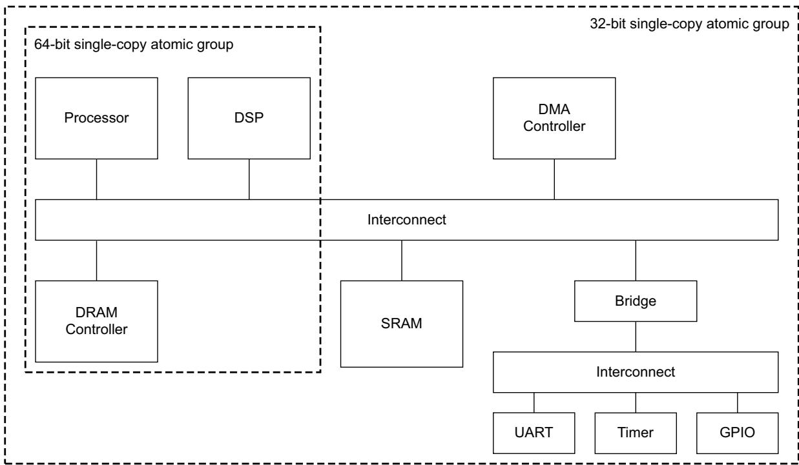  
Figure A7-1 Example system with different single-copy atomic groups

A transaction never has an atomicity guarantee greater than the alignment of its start address. For example, a burst in a 64-bit single-copy atomic group that is not aligned to an 8-byte boundary does not have any 64-bit single-copy atomic guarantee.

Byte strobes associated with a transaction do not affect the single-copy atomicity size.

## A7.1.1 Multi-copy write atomicity

To specify that a system provides multi-copy atomicity, a Multi\_Copy\_Atomicity property is defined.

A system is defined as having this property if the Multi\_Copy\_Atomicity property is set to True.

A system that does not support the Multi\_Copy\_Atomicity property has the default value of False.

A system is defined as being multi-copy atomic if:

writes to the same location are observed in the same order by all agents

• a write to a location that is observable by an agent, other than the issuer, is observable by all agents.

Multi-copy atomicity can be ensured by:

Using a single Point of Serialization (POS), for a given address, so that all accesses to the same location are ordered. This must ensure that all coherent cached copies of a location are invalidated before the new value of the location is made visible to any agents.

Avoiding the use of forwarding buffers that are upstream of any agents. This prevents a buffered write of a location becoming visible to some agents before it is visible to all agents.

## Note

A system must have the Multi\_Copy\_Atomicity property if ARM v8 Architecture processors are used. This is required to support the Load with Acquire and Store with Release instructions. The Store with Release instruction requires that the store is multi-copy atomic.

## A7.2 Exclusive accesses

The exclusive access mechanism can provide semaphore-type operations without requiring the bus to remain dedicated to a particular master for the duration of the operation. This means the semaphore-type operations do not impact either the bus access latency or the maximum achievable bandwidth.

The AxLOCK signals select exclusive access, and the RRESP and BRESP signals indicate the success or failure of the exclusive access read or write respectively.

The slave requires additional logic to support exclusive access. The AXI protocol provides a mechanism to indicate when a master attempts an exclusive access to a slave that does not support it. The remainder of this section describes the AXI Exclusive access mechanism.

## A7.2.1 Exclusive access process

The basic mechanism of an exclusive access is:

1. A master performs an exclusive read from an address.

2. At some later time, the master attempts to complete the exclusive operation by performing an exclusive write to the same address, and with an AWID that matches the ARID used for the exclusive read.

3. This exclusive write access is signaled as either:

Successful, if no other master has written to that location since the exclusive read access. In this case the exclusive write updates memory.

Failed, if another master has written to that location since the exclusive read access. In this case the memory location is not updated.

A master might not complete the write portion of an exclusive operation. The exclusive access monitoring hardware monitors only one address for each transaction ID. If a master does not complete the write portion of an exclusive operation, a subsequent exclusive read by that master using the same transaction ID changes the address that is being monitored for exclusive accesses.

## A7.2.2 Exclusive access from the perspective of the master

A master starts an exclusive operation by performing an exclusive read. If the transaction is successful, the slave returns the EXOKAY response, indicating that the slave recorded the address to be monitored for exclusive accesses.

If the master attempts an exclusive read from a slave that does not support exclusive accesses, the slave returns the OKAY response instead of the EXOKAY response.

## Note

The master can treat the OKAY response as an error condition indicating that the exclusive access is not supported. This specification recommends that the master does not perform the write portion of this exclusive operation.

At some time after the exclusive read, the master tries an exclusive write to the same location. If the contents of the addressed location have not changed since the exclusive read, the exclusive write operation succeeds. The slave returns the EXOKAY response, and updates the memory location.

If the contents of the addressed location have changed since the exclusive read, the exclusive write attempt fails, and the slave returns the OKAY response instead of the EXOKAY response. The exclusive write attempt does not update the memory location.

A master might not complete the write portion of an exclusive operation. If this happens, the slave continues to monitor the address for exclusive accesses until another exclusive read starts a new exclusive access sequence.

A master must not start the write part of an exclusive access sequence until the read part is complete.

## A7.2.3 Exclusive access from the perspective of the slave

A slave that does not support exclusive accesses can ignore the AxLOCK signals. It must provide an OKAY response for both normal and exclusive accesses.

A slave that supports exclusive access must have monitor hardware. This specification recommends that such a slave has a monitor unit for each exclusive-capable master ID that can access it. The ARM Architecture Reference Manual, ARMv7-A and ARMv7-R edition defines an exclusive access monitor, and a single-ported slave can have such an exclusive access monitor external to the slave. A multiported slave might require internal monitoring.

The exclusive access monitor records the address and ARID value of any exclusive read operation. Then it monitors that location until either a write occurs to that location or until another exclusive read with the same ARID value resets the monitor to a different address.

When the slave receives an exclusive write with a given AWID value, the monitor checks to see if that address is being monitored for exclusive access with that AWID. If it is, then this indicates that no write has occurred to that location since the exclusive read access, and the exclusive write proceeds, completing the exclusive access. The slave returns the EXOKAY response to the master, and updates the addressed memory location.

If the address is no longer being monitored with the same AWID value at the time of an exclusive write, this indicates one of the following:

the location has been updated since the exclusive read access

the monitor has been reset to another location.

In both cases the exclusive write must not update the addressed location, and the slave must return the OKAY response instead of the EXOKAY response.

## A7.2.4 Exclusive access restrictions

The following restrictions apply to exclusive accesses:

The burst size and burst length of an exclusive write with a given ID must be the same as the burst size and burst length of the preceding exclusive read with the same ID.

The address of an exclusive access must be aligned to the total number of bytes in the transaction, that is, the product of the burst size and burst length.

The addresses for the exclusive read and the exclusive write must be identical.

The ARID value of the exclusive read must match the AWID value of the exclusive write.

The control signals for the exclusive read and exclusive write transactions must be identical.

The number of bytes to be transferred in an exclusive access burst must be a power of 2, that is, 1, 2, 4, 8, 16, 32, 64, or 128 bytes.

The maximum number of bytes that can be transferred in an exclusive burst is 128.

In AXI4, the burst length for an exclusive access must not exceed 16 transfers.

The value of the AxCACHE signals must guarantee that the slave that is monitoring the exclusive access sees the transaction. For example, an exclusive access must not have an AxCACHE value that indicates that the transaction is Cacheable.

Failure to observe these restrictions causes UNPREDICTABLE behavior.

The minimum number of bytes to be monitored during an exclusive operation is defined by the burst length and burst size of the transaction. The slave can monitor a larger number of bytes, up to 128 which is the maximum size of an exclusive access. However, this can result in a successful exclusive access being indicated as failing becaus a neighboring byte was updated.

## A7.2.5 Slaves that do not support exclusive access

The response signals, RRESP and BRESP, include an OKAY response for successful normal accesses and an EXOKAY response for successful exclusive accesses. This means that a slave that does not support exclusive accesses can provide an OKAY response to indicate the failure of an exclusive access.

Note

• An exclusive write to a slave that does not support exclusive access always updates the memory location.

An exclusive write to a slave that supports exclusive access updates the memory location only if the exclusive write is successful.

## A7.3 Locked accesses

AXI4 does not support locked transactions. However, an AXI3 implementation must support locked transactions.

Note

AXI4 removes support for locked transactions because:

the majority of components do not require locked transactions

the implementation of locked transactions has a significant effect on:

— the complexity of the interconnect

— the ability to make QoS guarantees.

In this specification, AxLOCK indicates ARLOCK or AWLOCK.

When a master uses the AxLOCK signals for a transaction to show that it is a locked transaction then the interconnect must ensure that only that master can access the targeted slave region, until an unlocked transaction from the same master completes. An arbiter within the interconnect must enforce this restriction.

Before a master starts a locked sequence of either read or write transactions it must ensure that it has no other transactions waiting to complete.

Any transaction with AxLOCK indicating a locked transaction forces the interconnect to lock the following transaction. Therefore, a locked sequence must always complete with a final transaction that does not have AxLOCK indicating a locked transaction. This final transaction is included in the locked sequence and effectively removes the lock.

When completing a locked sequence, before issuing the final unlocking transaction, a master must ensure that all previous locked transactions are complete. It must then ensure that the final unlocking transaction has completed before it starts any further transactions.

The master must ensure that all transactions in a locked sequence have the same AxID value.

Locked accesses require the interconnect to prevent any other transactions occurring while the locked sequence is in progress, and can therefore have an impact on the interconnect performance. This specification recommends that locked accesses are only used to support legacy devices

This specification recommends the following restrictions, but they are not mandatory:

keep any locked transaction sequence within a single 4KB address region

limit any locked transaction sequence to two transactions.

## A7.4 Atomic access signaling

In AXI3 the AxLOCK signals specify normal, exclusive, and locked accesses. Table A7-1 shows the AXI3 encoding of the AxLOCK signals.

Table A7-1 AXI3 atomic access encoding

<table><tr><td>AxLOCK[1:0]</td><td>Access type</td></tr><tr><td>0b00</td><td>Normal access</td></tr><tr><td>0b01</td><td>Exclusive access</td></tr><tr><td>0b10</td><td>Locked access</td></tr><tr><td>0b11</td><td>Reserved</td></tr></table>

AXI4 removes the support for locked transactions and uses only a 1-bit lock signal. Table A7-2 shows the AXI4 signal encoding of the AxLOCK signals.

Table A7-2 AXI4 atomic access encoding

<table><tr><td>AxLOCK</td><td>Access type</td></tr><tr><td>0b0</td><td>Normal access</td></tr><tr><td>0b1</td><td>Exclusive access</td></tr></table>

## A7.4.1 Legacy considerations

In an AXI4 environment, any AXI3 locked transaction is converted as follows:

• AWLOCK[1:0] = 0b10 is converted to a normal write transaction, AWLOCK = 0b0

ARLOCK[1:0] = 0b10 is converted to a normal read transaction, ARLOCK = 0b0.

This specification recommends that any component performing such a conversion, typically an interconnect, includes an optional mechanism to detect and flag that such a translation has occurred.

Any component that cannot operate correctly if this translation is performed cannot be used in an AXI4 environment.

## Note

For many legacy cases that use locked transactions, such as the execution of a SWP instruction, a software change might be required to prevent the use of any instruction that forces a locked transaction.

## Chapter A8 AXI4 Additional Signaling

This chapter describes the additional signaling introduced in AXI4 to extend the application of the AXI interface. It contains the following sections:

QoS signaling on page A8-102

Multiple region signaling on page A8-103

User-defined signaling on page A8-104.

## A8.1 QoS signaling

This section describes the additional signaling in the AXI4 protocol to support Quality of Service (QoS).

## A8.1.1 QoS interface signals

The AXI4 signal set is extended to support two 4-bit QoS identifiers:

AWQOS A 4-bit QoS identifier, sent on the write address channel for each write transaction.

ARQOS A 4-bit QoS identifier, sent on the read address channel for each read transaction.

In this specification, AxQOS indicates AWQOS or ARQOS.

The protocol does not specify the exact use of the QoS identifier. This specification recommends that AxQOS is used as a priority indicator for the associated write or read transaction. A higher value indicates a higher priority transaction.

A default value of 0b0000 indicates that the interface is not participating in any QoS scheme.

Note

Additional interpretations of the QoS identifier can be used.

## A8.1.2 Master considerations

A master can produce its own AxQOS values, and if it can produce multiple streams of traffic it can choose different QoS values for the different streams.

Support for QoS requires a system-level understanding of the QoS scheme in use, and collaboration between all participating components. For this reason, this specification recommends that a master component includes some programmability that can be used to control the exact QoS values used for any given scenario.

If a master component does not support a programmable QoS scheme it can use QoS values that represent the relative priorities of the transactions it generates. These values can then be mapped to alternative system level QoS values if appropriate.

A master that can not produce its own AxQOS values must use the default value.

This specification expects that many interconnect component implementations will support programmable registers that can be used to assign QoS values to connected masters. These values replace the QoS values, either programmed or default, supplied by the masters.

## A8.1.3 System considerations

QoS signaling as defined in AXI4 can be used with any compatible system-level QoS methodology.

The default system-level implementation of QoS is that any component with a choice of more than one transaction to process selects the transaction with the higher QoS value to process first. This selection only occurs when there is no other AXI constraint that requires the transactions to be processed in a particular order.

Note

This means that the AXI ordering rules take precedence over ordering for QoS purposes.

More sophisticated QoS schemes that are compatible with this default scheme can be implemented.

## A8.2 Multiple region signaling

This section describes the optional additional signaling in the AXI4 protocol to support multiple region interfaces.

## A8.2.1 Additional interface signals

Optionally, the AXI4 interface signal set can be extended to support two 4-bit region identifiers:

AWREGION A region identifier, sent on the write address channel for each write transaction.

ARREGION A region identifier, sent on the read address channel for each read transaction.

In this specification, AxREGION indicates AWREGION or ARREGION.

The 4-bit region identifier can be used to uniquely identify up to sixteen different regions. The region identifier can provide a decode of higher order address bits. The region identifier must remain constant within any 4Kbyte address space.

The use of region identifiers means a single physical interface on a slave can provide multiple logical interfaces, each with a different location in the system address map. The use of the region identifier means that the slave does not have to support the address decode between the different logical interfaces.

This protocol expects an interconnect to produce AxREGION signals when performing the address decode function for a single slave that has multiple logical interfaces. If a slave only has a single physical interface in the system address map, the interconnect must use the default AxREGION values. See Chapter A10 Default Signaling and Interoperability.

There are a number of usage models for the region identifier, including but not limited to the following:

A peripheral can have its main data path and control registers at different locations in the address map, and be accessed through a single interface without the need for the slave to perform an address decode.

A slave can exhibit different behaviors in different memory regions. For example, a slave might provide read and write access in one region, but read only access in another region.

A slave must ensure the correct protocol signaling and the correct ordering of transactions are maintained. A slave must ensure that it provides the responses to two transactions to different regions with the same AXI ID in the correct order.

A slave must also ensure the correct protocol signaling for any values of AxREGION. If a slave implements less than sixteen regions, then the slave must ensure the correct protocol signaling on any attempted access to an unsupported region. How this is achieved is IMPLEMENTATION DEFINED. For example, the slave might ensure this by:

• providing an error response for any transaction that accesses an unsupported region

aliasing supported regions across all unsupported regions, to ensure a protocol-compliant response is given for all accesses.

The AxREGION signals only provide an address decode of the existing address space that can be used by slaves to remove the need for an address decode function. The signals do not create new independent address spaces. AxREGION must only be present on an interface that is downstream of an address decode function.

## A8.3 User-defined signaling

Optionally, the AXI4 interface signal set can include a set of User-defined signals, called the User signals, on each AXI4 channel.

Generally, this specification recommends that the User signals are not used, because the AXI protocol does not define the functions of these signals and this can lead to interoperability issues if two components use the same User signals in an incompatible manner.

## A8.3.1 Signal naming

The User signal names defined for each AXI4 channel are:

AWUSER Write address channel User signals.

ARUSER Read address channel User signals.

WUSER Write data channel User signals.

RUSER Read data channel User signals.

BUSER Write response channel User signals.

In this specification, AxUSER indicates AWUSER or ARUSER.

## A8.3.2 Usage considerations

Where User signals are implemented it is not required that User signals are supported on all channels. That is, the design decision whether to include User signals is made independently for each channel.

This specification recommends including User signals on an interconnect, however, there is no requirement to include them on masters or slaves.

This specification recommends that interconnect components include support for User signals, so that they can be passed between master and slave components. The width of the User-defined signals is IMPLEMENTATION DEFINED and can be different for each of the channels.

# Chapter A9 Low-power Interface

This chapter describes the AXI low-power interface that can provide control, during entry into and exit from a low-power state. It contains the following sections:

About the low-power interface on page A9-106

Low-power clock control on page A9-107.

## A9.1 About the low-power interface

The low-power interface is an optional extension to the AXI protocol that targets two different classes of peripherals:

• Any peripheral that has no power-down sequence, and that can indicate when its clocks can be turned off.

Any peripheral that requires a power-down sequence, and that can have its clocks turned off only after it enters a low-power state. The peripheral requires an indication from a system clock controller to indicate when to initiate the power-down sequence, and must then signal when it has entered its low-power state.

## A9.2 Low-power clock control

The low-power clock control interface consists of the following signals:

a signal from the peripheral indicating when its clocks can be enabled or disabled

• two handshake signals for the system clock controller to request exit or entry into a low-power state.

## A9.2.1 Peripheral clock required

The CACTIVE signal indicates whether the peripheral requires a clock signal. The peripheral asserts CACTIVE HIGH when it requires the clock to be enabled, and the system clock controller must enable the clock immediately. The peripheral deasserts CACTIVE to indicate that it does not require the clock. The system clock controller can then disable the clock, but is not required to do so.

A peripheral that can have its clock enabled or disabled at any time can drive CACTIVE LOW permanently. A peripheral that must have its clock always enabled must drive CACTIVE HIGH permanently.

CACTIVE is the only clock control signal required by some peripherals with no power-down or power-up sequence.

## A9.2.2 Power-down or power-up handshake

For a peripheral with a power-down or power-up sequence, entry into a low-power state occurs only after a request from the system clock controller. The AXI protocol provides request/acknowledge handshake signals to support this request:

CSYSREQ The system clock controller uses the CSYSREQ signal to request:

The peripheral enters a low-power state. The system clock controller drives the CSYSREQ signal LOW to initiate the request.

The peripheral exits a low-power state.The system clock controller drives the CSYSREQ signal HIGH to initiate the request.

CSYSACK The peripheral uses the CSYSACK signal to acknowledge:

The request to enter the low-power state. It drives CSYSACK LOW when it recognizes this request.

The request to exit from low-power state. It drives CSYSACK HIGH when it recognizes this request.

Figure A9-1 shows the relationship between CSYSREQ and CSYSACK.  
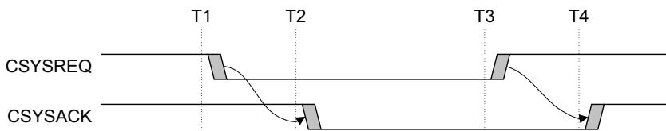  
Figure A9-1 CSYSREQ and CSYSACK handshake

At the start of the sequence in Figure A9-1, both CSYSREQ and CSYSACK are HIGH for normal clocked operation. At time T1, the system clock controller drives CSYSREQ LOW, indicating a request for the peripheral to enter low-power state. The peripheral acknowledges the request at time T2 by driving CSYSACK LOW. At T3, the system clock controller drives CSYSREQ HIGH, to require exit from low-power state. At T4, the peripheral drives CSYSACK HIGH to acknowledge the exit.

The AXI protocol requires this relationship between CSYSREQ and CSYSACK.

The peripheral can accept or deny the request, from the system clock controller, to enter low-power state. The level of the CACTIVE signal when the peripheral acknowledges the request by driving CSYSACK LOW indicates the acceptance or denial of the request.

## A9.2.3 Acceptance of low-power request

Figure A9-2 shows the sequence of events when a peripheral accepts a system low-power request.

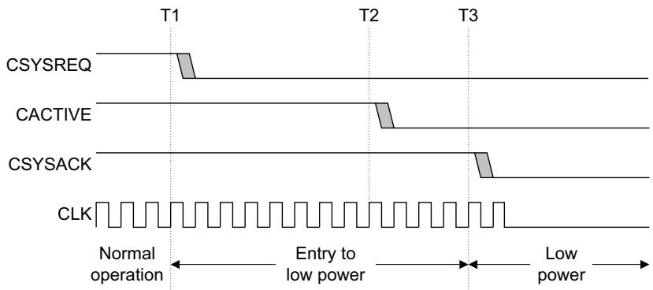  
Figure A9-2 Acceptance of a low-power request

In Figure A9-2, at T1 the system clock controller drives CSYSREQ LOW to request the peripheral to enter low-power state. After the peripheral recognizes the request, it performs its power-down sequence, and at T2 it drives CACTIVE LOW, to signal that the clock can be removed. Then at T3, the peripheral drives CSYSACK LOW to signal that it has completed its entry into low-power state. The peripheral must not drive CSYSACK LOW until at least one cycle after it drives CACTIVE LOW.

See Exiting a low-power state on page A9-109 for details of the exit from low-power state.

## A9.2.4 Denial of a low-power request

Figure A9-3 shows the sequence of events when a peripheral denies a system low-power request.

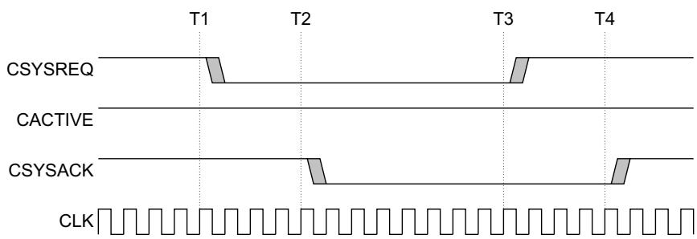

## Figure A9-3 Denial of a low-power request

In Figure A9-3, at T1 the system clock controller drives CSYSREQ LOW to request the peripheral to enter low-power state. At T2, the peripheral acknowledges the low-power request by driving CSYSACK LOW but denies the request by holding CACTIVE HIGH. The system clock controller must maintain the clock, and must go through the low-power state exit sequence before it can initiate another low-power request. At T3, the system clock controller begins the low-power state exit sequence by driving CSYSREQ HIGH. At T4 the peripheral completes the exit sequence by driving CSYSACK HIGH.

## A9.2.5 Exiting a low-power state

Either the system clock controller or the peripheral can request exit from a low-power state. The protocol requires both CACTIVE and CSYSREQ are LOW during the low-power state, and driving either of these signals HIGH initiates the exit sequence.

## System clock controller initiated exit

Figure A9-4 shows the system clock controller initiating exit from the low-power state.

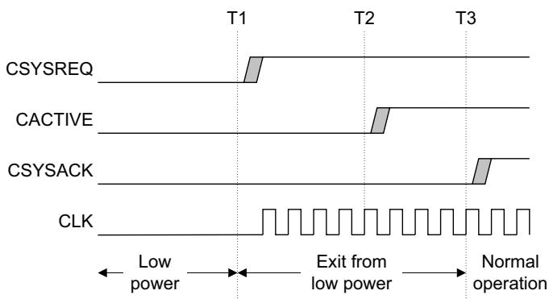  
Figure A9-4 System clock controller initiated exit from low-power state

At T1 the system clock controller drives CSYSREQ HIGH to request exit from low-power state, and then enables the clock.

The peripheral recognizes that CSYSREQ is HIGH, performs its power-up sequence, and at T2 drives CACTIVE HIGH to indicate that it requires a clock signal. The peripheral then completes the exit sequence at T3, by driving CSYSACK HIGH.

## Peripheral initiated exit

Figure A9-5 shows the signaling for an exit from low-power state that is initiated by the peripheral.

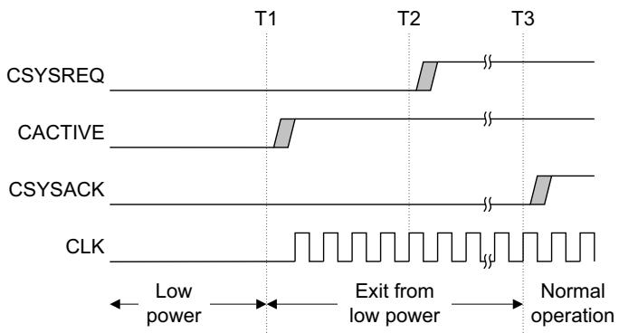  
Figure A9-5 Peripheral initiated exit from low-power state

At T1 the peripheral drives CACTIVE HIGH, to signal that it requires a clock signal. The system clock controller must then restore the clock.

At T2 the system clock controller drives CSYSREQ HIGH, to continue the handshake sequence. The peripheral completes its exit from low-power state and drives CSYSACK HIGH to complete the exit sequence.

Note

The peripheral can keep CSYSACK LOW for as many cycles as it requires to complete its exit sequence.

## A9.2.6 Clock control sequence summary

Figure A9-6 shows the typical flow for requesting entry to low-power state.

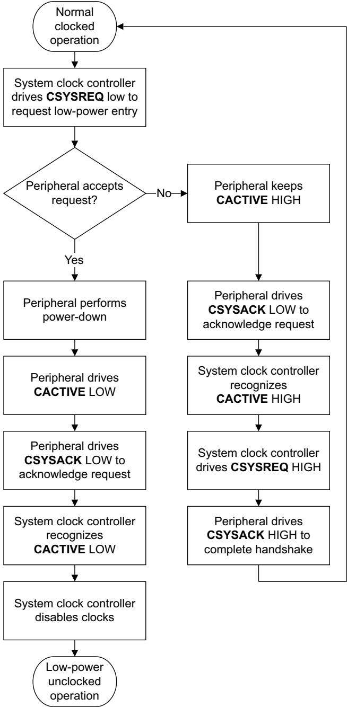  
Figure A9-6 Requesting entry to low-power state

Figure A9-7 shows the typical flow for exit from low-power state.  
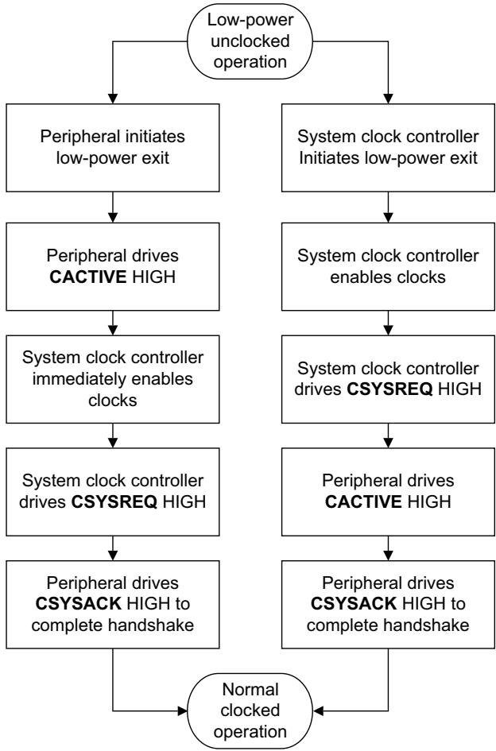  
Figure A9-7 Exit from low-power state

## A9.2.7 Combining peripherals in a low-power domain

The system clock controller can combine a number of different peripherals into the same low-power clock domain. It can then treat that clock domain in the same way as a single peripheral if the following rules are observed:

The clock domain CACTIVE signal is the logical OR of the CACTIVE signals of all the peripherals in the clock domain. This means that the system clock controller can disable the clocks only when all peripherals indicate that they can be disabled.

The system clock controller must use a single CSYSREQ signal that is routed to all peripherals in the clock domain.

The clock domain CSYSACK signal is generated as follows:

the falling edge of CSYSACK occurs on the falling edge of the CSYSACK signal from the last peripheral in the domain to drive CSYSACK LOW

the rising edge of CSYSACK occurs on the rising edge of the CSYSACK signal from the last peripheral in the domain to drive CSYSACK HIGH.

# Chapter A10 Default Signaling and Interoperability

This chapter describes the default signaling and interoperability of the AXI interface.

The AXI protocol does not require a component to use the full set of signals available on an AXI interface. To assist in the connection of components that do not use every signal, this chapter defines the major categories of interfaces together with the restrictions that apply to each category. It contains the following sections:

Interoperability principles on page A10-114

Major interface categories on page A10-115

Default signal values on page A10-116.

## A10.1 Interoperability principles

The following interoperability principles apply to both AXI3 and AXI4 components.

As a general principle, components must support all combinations of inputs, but do not have to generate all combinations of outputs. For example, a slave must support all the different possible lengths of burst, but a master only has to generate the types of burst that it uses. This policy ensures that all components work with all other components.

The conditions under which a signal can be omitted from an AXI interface are:

## Optional Outputs

If a component might require a value that does not match the default value, then the component must have the output signal present.

If a component always requires the value that matches the default value, specified in Default signal values on page A10-116, then it is not required that the component has the signal present.

## Optional Inputs

An input signal can be omitted if the master or slave does not need to observe the input signal for correct functional operation.

## Note

Interconnect components can also omit signals when appropriate. For example, when a signal is only ever driven to its default value, there is no requirement to transport that signal across the interconnect. The signal can be created at its destination. Similarly, if a signal is not used at any destination then there is no requirement to transport it across the interconnect.

## A10.2 Major interface categories

The following sections describe the major interface categories.

## A10.2.1 Read/write interface

A read write interface includes the following AXI channels:

AR Read address channel.

R Read data channel.

AW Write address channel.

W Write data channel.

B Write response channel.

## A10.2.2 Read-only interface

A read-only interface supports only read transactions and includes the following AXI channels:

AR Read address channel.

R Read data channel.

Note

A read-only interface does not support exclusive accesses.

## A10.2.3 Write-only interface

A write-only interface supports only write transactions and includes the following AXI channels:

AW Write address channel.

W Write data channel.

B Write response channel.

Note

A write-only interface does not support exclusive accesses.

## A10.2.4 Memory slaves and peripheral slaves

AXI slaves are classified as Memory slaves or Peripheral slaves.

A memory slave must handle all transaction types correctly.

Peripheral Slaves are expected to have a defined method of access that establishes the types of transaction that can be used to access a device, and if there are any restrictions on how the device is accessed. Typically, the defined method of access is described in the data sheet for the component. Any access that is not a defined method of access might cause the peripheral slave to fail but is expected to complete in a protocol-compliant fail-safe manner, to prevent system deadlock. Continued correct operation of the peripheral slave is not required.

Because a peripheral slave is required to work correctly only for its defined method of access, a peripheral slave can have a significantly reduced set of interface signals.

All peripherals are expected to support a subset of transactions that permit the peripheral to be controlled using accesses that can be specified in C code. For example, single 8-bit, single 16-bit or single 32-bit aligned transactions might be supported.

No minimum subset is required, because the subset of supported transactions can differ between peripherals. For example, one peripheral might only support 16-bit accesses and another peripheral might only support 32-bit accesses.

## A10.3 Default signal values

This specification suggests that, in general, for maximum IP reuse, an AXI component interface includes all signals. The presence of all signals reduces the risk of error at the system integration phase of the design flow and it can also help support some design flows that do not effectively support default values for absent signals.

The following tables show the AXI required and optional signals, and the default signals values that apply when an optional signal is not implemented:

Table A10-1 on page A10-117 shows the master interface write channel signals

Table A10-2 on page A10-118 shows the memory slave interface write channel signals

Table A10-3 on page A10-119 shows the master interface read channel signals

Table A10-4 on page A10-120 shows the memory slave interface read channel.

The following sections give more information about the default signal requirements:

Master addresses on page A10-120

Slave addresses on page A10-121

Memory slaves on page A10-121

Write transactions on page A10-121

Read transactions on page A10-121

Response signaling on page A10-121

Non-secure and Secure accesses on page A10-121.

Table A10-1 Master interface write channel signals and default signal values

<table><tr><td>Signal</td><td>Description</td><td>Direction</td><td>Required?</td><td>Default</td></tr><tr><td>ACLK</td><td>Global clock</td><td>Input</td><td>Required</td><td>-</td></tr><tr><td>ARESETn</td><td>Global reset</td><td>Input</td><td>Required</td><td>-</td></tr><tr><td>AWID</td><td>Write address ID</td><td>Output</td><td>Optional</td><td>All zeros</td></tr><tr><td>AWADDR</td><td>Write address</td><td>Output</td><td>Required</td><td>-</td></tr><tr><td>AWREGION</td><td>Write region</td><td>Output</td><td>Optional</td><td>All zeros</td></tr><tr><td>AWLEN</td><td>Burst length</td><td>Output</td><td>Optional</td><td>All zeros, Length 1</td></tr><tr><td>AWSIZE</td><td>Burst size</td><td>Output</td><td>Optional</td><td>Data bus width</td></tr><tr><td>AWBURST</td><td>Burst type</td><td>Output</td><td>Optional</td><td>0b01, INCR</td></tr><tr><td>AWLOCK</td><td>Lock type</td><td>Output</td><td>Optional</td><td>All zeros, Normal access</td></tr><tr><td>AWCACHE</td><td>Cache type</td><td>Output</td><td>Optional</td><td>0b0000</td></tr><tr><td>AWPROT</td><td>Protection type</td><td>Output</td><td>Required</td><td>-</td></tr><tr><td>AWQOS</td><td>QoS value</td><td>Output</td><td>Optional</td><td>0b0000</td></tr><tr><td>AWVALID</td><td>Write address valid</td><td>Output</td><td>Required</td><td>-</td></tr><tr><td>AWREADY</td><td>Write address ready</td><td>Input</td><td>Required</td><td>-</td></tr><tr><td>WDATA</td><td>Write data</td><td>Output</td><td>Required</td><td>-</td></tr><tr><td>WSTRB</td><td>Write strobes</td><td>Output</td><td>Optional</td><td>All ones</td></tr><tr><td>WLAST</td><td>Write last</td><td>Output</td><td>Required</td><td>-</td></tr><tr><td>WVALID</td><td>Write valid</td><td>Output</td><td>Required</td><td>-</td></tr><tr><td>WREADY</td><td>Write ready</td><td>Input</td><td>Required</td><td>-</td></tr><tr><td>BID</td><td>Response ID</td><td>Input</td><td>Optional</td><td>-</td></tr><tr><td>BRESP</td><td>Write response</td><td>Input</td><td>Optional</td><td>-</td></tr><tr><td>BVALID</td><td>Write response valid</td><td>Input</td><td>Required</td><td>-</td></tr><tr><td>BREADY</td><td>Response ready</td><td>Output</td><td>Required</td><td>-</td></tr></table>

Table A10-2 Memory slave interface write channel signals and default signal values

<table><tr><td>Signal name</td><td>Description</td><td>Direction</td><td>Required?</td><td>Default</td></tr><tr><td>ACLK</td><td>Global clock</td><td>Input</td><td>Required</td><td>-</td></tr><tr><td>ARESETn</td><td>Global reset</td><td>Input</td><td>Required</td><td>-</td></tr><tr><td>AWID</td><td>Write address ID</td><td>Input</td><td>Required</td><td>-</td></tr><tr><td>AWADDR</td><td>Write address</td><td>Input</td><td>Required</td><td>-</td></tr><tr><td>AWREGION</td><td>Write region</td><td>Input</td><td>Optional</td><td>-</td></tr><tr><td>AWLEN</td><td>Burst length</td><td>Input</td><td>Required</td><td>-</td></tr><tr><td>AWSIZE</td><td>Burst size</td><td>Input</td><td>Required</td><td>-</td></tr><tr><td>AWBURST</td><td>Burst type</td><td>Input</td><td>Required</td><td>-</td></tr><tr><td>AWLOCK</td><td>Lock type</td><td>Input</td><td>Optional</td><td>-</td></tr><tr><td>AWCACHE</td><td>Cache type</td><td>Input</td><td>Optional</td><td>-</td></tr><tr><td>AWPROT</td><td>Protection type</td><td>Input</td><td>Optional</td><td>-</td></tr><tr><td>AWQOS</td><td>QoS value</td><td>Input</td><td>Optional</td><td>-</td></tr><tr><td>AWVALID</td><td>Write address valid</td><td>Input</td><td>Required</td><td>-</td></tr><tr><td>AWREADY</td><td>Write address ready</td><td>Output</td><td>Required</td><td>-</td></tr><tr><td>WDATA</td><td>Write data</td><td>Input</td><td>Required</td><td>-</td></tr><tr><td>WSTRB</td><td>Write strobes</td><td>Input</td><td>Required</td><td>-</td></tr><tr><td>WLAST</td><td>Write last</td><td>Input</td><td>Optional</td><td>-</td></tr><tr><td>WVALID</td><td>Write valid</td><td>Input</td><td>Required</td><td>-</td></tr><tr><td>WREADY</td><td>Write ready</td><td>Output</td><td>Required</td><td>-</td></tr><tr><td>BID</td><td>Response ID</td><td>Output</td><td>Required</td><td>-</td></tr><tr><td>BRESP</td><td>Write response</td><td>Output</td><td>Optional</td><td>0b00, OKAY</td></tr><tr><td>BVALID</td><td>Write response valid</td><td>Output</td><td>Required</td><td>-</td></tr><tr><td>BREADY</td><td>Response ready</td><td>Input</td><td>Required</td><td>-</td></tr></table>

Table A10-3 Master interface read channel signals and default signals values

<table><tr><td>Signal name</td><td>Description</td><td>Direction</td><td>Required?</td><td>Default</td></tr><tr><td>ARID</td><td>Read address ID</td><td>Output</td><td>Optional</td><td>All zeros</td></tr><tr><td>ARADDR</td><td>Read address</td><td>Output</td><td>Required</td><td>-</td></tr><tr><td>ARREGION</td><td>Read region</td><td>Output</td><td>Optional</td><td>0x0</td></tr><tr><td>ARLEN</td><td>Burst length</td><td>Output</td><td>Optional</td><td>All zeros, Length 1</td></tr><tr><td>ARSIZE</td><td>Burst size</td><td>Output</td><td>Optional</td><td>Data bus width</td></tr><tr><td>ARBURST</td><td>Burst type</td><td>Output</td><td>Optional</td><td>0b01, INCR</td></tr><tr><td>ARLOCK</td><td>Lock type</td><td>Output</td><td>Optional</td><td>All zeros, Normal access</td></tr><tr><td>ARCACHE</td><td>Cache type</td><td>Output</td><td>Optional</td><td>0b0000</td></tr><tr><td>ARPROT</td><td>Protection type</td><td>Output</td><td>Required</td><td>-</td></tr><tr><td>ARQOS</td><td>QoS value</td><td>Output</td><td>Optional</td><td>0b0000</td></tr><tr><td>ARVALID</td><td>Read address valid</td><td>Output</td><td>Required</td><td>-</td></tr><tr><td>ARREADY</td><td>Read address ready</td><td>Input</td><td>Required</td><td>-</td></tr><tr><td>RID</td><td>Read data ID</td><td>Input</td><td>Optional</td><td>-</td></tr><tr><td>RDATA</td><td>Read data</td><td>Input</td><td>Required</td><td>-</td></tr><tr><td>RRESP</td><td>Read response</td><td>Input</td><td>Optional</td><td>-</td></tr><tr><td>RLAST</td><td>Read last</td><td>Input</td><td>Optional</td><td>-</td></tr><tr><td>RVALID</td><td>Read valid</td><td>Input</td><td>Required</td><td>-</td></tr><tr><td>RREADY</td><td>Read ready</td><td>Output</td><td>Required</td><td>-</td></tr></table>

Table A10-4 Memory slave interface read channel signals and default signals values

<table><tr><td>Signal name</td><td>Description</td><td>Direction</td><td>Required?</td><td>Default</td></tr><tr><td>ARID</td><td>Read address ID</td><td>Input</td><td>Required</td><td>-</td></tr><tr><td>ARADDR</td><td>Read address</td><td>Input</td><td>Required</td><td>-</td></tr><tr><td>ARREGION</td><td>Read region</td><td>Input</td><td>Optional</td><td>-</td></tr><tr><td>ARLEN</td><td>Burst length</td><td>Input</td><td>Required</td><td>-</td></tr><tr><td>ARSIZE</td><td>Burst size</td><td>Input</td><td>Required</td><td>-</td></tr><tr><td>ARBURST</td><td>Burst type</td><td>Input</td><td>Required</td><td>-</td></tr><tr><td>ARLOCK</td><td>Lock type</td><td>Input</td><td>Optional</td><td>-</td></tr><tr><td>ARCACHE</td><td>Cache type</td><td>Input</td><td>Optional</td><td>-</td></tr><tr><td>ARPROT</td><td>Protection type</td><td>Input</td><td>Optional</td><td>-</td></tr><tr><td>ARQOS</td><td>QoS value</td><td>Input</td><td>Optional</td><td>-</td></tr><tr><td>ARVALID</td><td>Read address valid</td><td>Input</td><td>Required</td><td>-</td></tr><tr><td>ARREADY</td><td>Read address ready</td><td>Output</td><td>Required</td><td>-</td></tr><tr><td>RID</td><td>Read data ID</td><td>Output</td><td>Required</td><td>-</td></tr><tr><td>RDATA</td><td>Read data</td><td>Output</td><td>Required</td><td>-</td></tr><tr><td>RRESP</td><td>Read response</td><td>Output</td><td>Optional</td><td>0b00, OKAY</td></tr><tr><td>RLAST</td><td>Read last</td><td>Output</td><td>Required</td><td>-</td></tr><tr><td>RVALID</td><td>Read valid</td><td>Output</td><td>Required</td><td>-</td></tr><tr><td>RREADY</td><td>Read ready</td><td>Input</td><td>Required</td><td>-</td></tr></table>

## A10.3.1 Master addresses

## AxADDR

There is no minimum requirement for the number of address bits supplied by a master.

If the system to which the master is connected has a different address bus width than that provided by the master:

if the system address is wider than is provided by the master then the default value of all zeros must be used for the additional high-order address bits

if the system address is narrower than is provided by the master then the high-order address bits from the master must be left unconnected.

Note

Typically a master supplies 32-bits of addressing, optionally a master can support up to 64-bits of addressing.

## A10.3.2 Slave addresses

AxADDR There is no minimum requirement for the number of address bits used by a slave.

A slave is not required to have low-order address bits to support decoding within the width of the system data bus and can assume that such low-order address bits have a default value of all zeros. If the slave has more address bits than supplied by the interconnect, the higher order address bits use a default value of all zeros.

Typically a memory slave has at least enough address bits to fully decode a 4KB address range.

## A10.3.3 Memory slaves

AxLOCK A memory slave is not required to use the AxLOCK inputs. However, a memory slave that supports exclusive accesses requires these signals.

AxCACHE A memory slave is not required to make use of the AxCACHE inputs. A memory slave does not require these signals if either:

it has no caching behavior

it caches all transactions in the same way.

## A10.3.4 Write transactions

WSTRB[3:0] A master is not required to use the write strobe signals WSTRB[3:0] if it always performs full data bus width write transactions. The default value for write strobes is all signals asserted.

WLAST A slave is not required to use the WLAST signal. Since the length of a write burst is defined, a slave can calculate the last write data transfer from the burst length AWLEN[7:0] signals.

## A10.3.5 Read transactions

RLAST A master is not required to use the RLAST signal. Since the length of a read burst is defined, a master can calculate the last read data transfer from the burst length ARLEN[7:0] signals.

## A10.3.6 Response signaling

RRESP, BRESP A master does not require the RRESP and BRESP inputs if it both:

• does not perform exclusive accesses

• does not require notification of transaction errors.

A slave does not require the RRESP and BRESP outputs if it both:

does not support exclusive accesses

does not generate error responses.

## A10.3.7 Non-secure and Secure accesses

AxPROT A slave that is not required to differentiate between Non-secure and Secure accesses, and that does not require any additional protection support, does not require the AxPROT input signals.

Caution

Take great care with the AxPROT signals. The AxPROT[1] signals indicate the Secure or Non-secure nature of the transactions, and incorrect assignment of these bits can lead to incorrect system behavior.

A10 Default Signaling and Interoperability A10.3 Default signal values

Part B

AMBA AXI4-Lite Interface Specification

# Chapter B1 AMBA AXI4-Lite

This chapter defines the AXI4-Lite interface and associated protocol. AXI4-Lite is suitable for simpler control register-style interfaces that do not require the full functionality of AXI4.

This chapter contains the following sections:

Definition of AXI4-Lite on page B1-126

Interoperability on page B1-128

Defined conversion mechanism on page B1-129

Conversion, protection, and detection on page B1-131.

## B1.1 Definition of AXI4-Lite

This section defines the functionality and signal requirements of AXI4-Lite components.

The key functionality of AXI4-Lite operation is:

all transactions are of burst length 1

all data accesses use the full width of the data bus

AXI4-Lite supports a data bus width of 32-bit or 64-bit.

all accesses are Non-modifiable, Non-bufferable

Exclusive accesses are not supported.

## B1.1.1 Signal list

Table B1-1 shows the required signals on an AXI4-Lite interface.

Table B1-1 AXI4-Lite interface signals

<table><tr><td>Global</td><td>Write address channel</td><td>Write data channel</td><td>Write response channel</td><td>Read address channel</td><td>Read data channel</td></tr><tr><td>ACLK</td><td>AWVALID</td><td>WVALID</td><td>BVALID</td><td>ARVALID</td><td>RVALID</td></tr><tr><td>ARESETn</td><td>AWREADY</td><td>WREADY</td><td>BREADY</td><td>ARREADY</td><td>RREADY</td></tr><tr><td>-</td><td>AWADDR</td><td>WDATA</td><td>BRESP</td><td>ARADDR</td><td>RDATA</td></tr><tr><td>-</td><td>AWPROT</td><td>WSTRB</td><td>-</td><td>ARPROT</td><td>RRESP</td></tr></table>

## AXI4 signals modified in AXI4-Lite

The AXI4-Lite interface does not fully support the following signals:

## RRESP, BRESP

The EXOKAY response is not supported on the read data and write response channels.

## AXI4 signals not supported in AXI4-Lite

The AXI4-Lite interface does not support the following signals:

AWLEN, ARLEN The burst length is defined to be 1, equivalent to an AxLEN value of zero.

AWSIZE, ARSIZE All accesses are defined to be the width of the data bus.

Note

AXI4-Lite requires a fixed data bus width of either 32-bit or 64-bit.

## AWBURST, ARBURST

The burst type has no meaning because the burst length is 1.

## AWLOCK, ARLOCK

All accesses are defined as Normal accesses, equivalent to an AxLOCK value of zero.

## AWCACHE, ARCACHE

All accesses are defined as Non-modifiable, Non-bufferable, equivalent to an AxCACHE value of 0b0000.

WLAST, RLAST All bursts are defined to be of length 1, equivalent to a WLAST or RLAST value of 1.

## B1.1.2 Bus width

AXI4-Lite has a fixed data bus width and all transactions are the same width as the data bus. The data bus width must be, either 32-bits or 64-bits.

ARM expects that:

the majority of components use a 32-bit interface

only components requiring 64-bit atomic accesses use a 64-bit interface.

A 64-bit component can be designed for access by 32-bit masters, but the implementation must ensure that the component sees all transactions as 64-bit transactions.

Note

This interoperability can be achieved by including, in the register map of the component, locations that are suitable for access by a 32-bit master. Typically, such locations would use only the lower 32-bits of the data bus

## B1.1.3 Write strobes

The AXI4-Lite protocol supports write strobes. This means multi-sized registers can be implemented and also supports memory structures that require support for 8-bit and 16-bit accesses.

All master interfaces and interconnect components must provide correct write strobes.

Any slave component can choose whether to use the write strobes. The options permitted are:

to make full use of the write strobes

to ignore the write strobes and treat all write accesses as being the full data bus width

to detect write strobe combinations that are not supported and provide an error response.

A slave that provides memory access must fully support write strobes. Other slaves in the memory map might support a more limited write strobe option.

When converting from full AXI to AXI4-Lite, a write transaction can be generated on AXI4-Lite with all write strobes deasserted. Automatic suppression of such transactions is permitted but not required. See Conversion, protection, and detection on page B1-131.

## B1.1.4 Optional signaling

AXI4-Lite supports multiple outstanding transactions, but a slave can restrict this by the appropriate use of the handshake signals.

AXI4-Lite does not support AXI IDs. This means all transactions must be in order, and all accesses use a single fixed ID value.

Note

Optionally, an AXI4-Lite slave can support AXI ID signals, so that it can be connected to a full AXI interface without modification. See Interoperability on page B1-128.

## B1.2 Interoperability

This section describes the interoperability of AXI and AXI4-Lite masters and slaves. Table B1-2 shows the possible combinations of interface, and indicates that the only case requiring special consideration is an AXI master connecting to an AXI4-Lite slave.

Table B1-2 Full AXI and AXI4-Lite interoperability

<table><tr><td>Master</td><td>Slave</td><td>Interoperability</td></tr><tr><td>AXI</td><td>AXI</td><td>Fully operational.</td></tr><tr><td>AXI</td><td>AXI4-Lite</td><td>AXI ID reflection is required. Conversion might be required.</td></tr><tr><td>AXI4-Lite</td><td>AXI</td><td>Fully operational.</td></tr><tr><td>AXI4-Lite</td><td>AXI4-Lite</td><td>Fully operational.</td></tr></table>

## B1.2.1 Bridge requirements of AXI4-Lite slaves

As Table B1-2 shows, the only interoperability case that requires special consideration is the connection of an AXI4-Lite slave interface to a full AXI master interface.

This connection requires AXI ID reflection. The AXI4-Lite slave must return the AXI ID associated with the address of a transaction with the read data or write response for that transaction. This is required because the master requires the returning ID to correctly identify the transaction response.

If an implementation cannot ensure that the AXI master interface only generates transactions in the AXI4-Lite subset, then some form of adaptation is required. See Conversion, protection, and detection on page B1-131.

## B1.2.2 Direct connection requirements of AXI4-Lite slaves

An AXI4-Lite slave can be designed to include ID reflection logic. This means the slave can be used directly on a full AXI connection, without a bridge function, in a system that guarantees that the slave is accessed only by transactions that comply with the AXI4-Lite subset.

This specification recommends that the ID reflection logic uses AWID, instead of WID, to ensure compatibility with both AXI3 and AXI4.

## B1.3 Defined conversion mechanism

This section defines the requirements to convert any legal AXI transaction for use on an AXI4-Lite component. Conversion, protection, and detection on page B1-131 discusses the advantages and disadvantages of the various approaches that can be used.

## B1.3.1 Conversion rules

Conversion requires that the AXI data width is equal to or greater than the AXI4-Lite data width. If this is not the case then the AXI data width must first be converted to the AXI4-Lite data width.

Note

AXI4-Lite does not support EXOKAY responses, so the conversion rules do not consider this response.

The rules for conversion from a full AXI interface are as follows:

If a transaction has a burst length greater than 1 then the burst is broken into multiple transactions of burst length 1. The number of transactions that are created depends on the burst length of the original transaction.

When generating the address for subsequent beats of a burst, the conversion of bursts with a length greater than 1 must take into consideration the burst type. An unaligned start address must be incremented and aligned for subsequent beats of an INCR or WRAP burst. For a FIXED burst the same address is used for all beats.

Where a write burst with length greater than 1 is converted into multiple write transactions, the component responsible for the conversion must combine the responses for all of the generated transactions, to produce a single response for the original burst. Any error response is sticky. That is, an error response received for any of the generated transactions is retained, and the single combined response indicates an error. If both a SLVERR and a DECERR are received then the first response received is the one that is used for the combined response.

A transaction that is wider than the destination AXI4-Lite interface is broken into multiple transactions of the same width as the AXI4-Lite interface. For transactions with an unaligned start address, the breaking up of the burst occurs on boundaries that are aligned to the width of the AXI4-Lite interface.

Where a wide transaction is converted to multiple narrower transactions, the component responsible for the conversion must combine the responses to all of the narrower transactions, to produce a single response for the original transaction. Any error response is sticky. If both a SLVERR and a DECERR are received then the first response received is used for the combined response.

Transactions that are narrower than the AXI4-Lite interface are passed directly and are not converted.

Write strobes are passed directly, unmodified.

Write transactions with no strobes are passed directly.

Note

The AXI4-Lite protocol does not require these transactions to be suppressed.

The AxLOCK signals are discarded for all transactions. For a sequence of locked transactions any lock guarantee is lost. However, the locked nature of the transaction is lost only at any downstream arbitration. For an exclusive sequence, the AXI signaling requirements mean any exclusive write access must fail.

The AxCACHE signals are discarded. All transactions are treated as Non-modifiable and Non-bufferable.

Note

This is acceptable because AXI permits Modifiable accesses to be treated as Non-modifiable, and Bufferable accesses to be treated as Non-bufferable.

The AxPROT signals are passed directly, unmodified.

The WLAST signal is discarded.

The RLAST signal is not required, and is considered asserted for every transfer on the read data channel.

## B1.4 Conversion, protection, and detection

Connection of an AXI4-Lite slave to an AXI4 master requires some form of adaptation if it can not be ensured that the master only issues transactions that meet the AXI4-Lite requirements.

This section describes techniques that can be adopted in a system design to aid with the interoperability of components and the debugging of system design problems. These techniques are:

Conversion This requires the conversion of all transactions to a format that is compatible with the AXI4-Lite requirements.

Protection This requires the detection of any non-compliant transaction. The non-compliant transaction is discarded, and an error response is returned to the master that generated the transaction.

Detection This requires observing any transaction that falls outside the AXI4-Lite requirements and:

• notifying the controlling software of the unexpected access

permitting the access to proceed at the hardware interface level.

## B1.4.1 Conversion and protection levels

Different levels of conversion and protection can be implemented:

## Full conversion

This converts all AXI transactions, as described in Defined conversion mechanism on page B1-129.

## Simple conversion with protection

This propagates transactions that only require a simple conversion, but suppresses and error reports transactions that require a more complex task.

Examples of transactions that are propagated are the discarding of one or more of AxLOCK and AxCACHE.

Examples of transactions that are discarded and generate an error report are burst length or data width conversions.

## Full protection

Suppress and generate an error for every transaction that does not comply with the AXI4-Lite requirements.

## B1.4.2 Implementation considerations

A protection mechanism that discards transactions must provide a protocol-compliant error response to prevent deadlock. For example, in the full AXI protocol, read burst transactions require an error for each beat of the burst and a correctly asserted RLAST signal.

Using a combination of detection and conversion permits hardware implementations that:

do not prevent unexpected accesses from occurring

provide a mechanism for notifying the controlling software of the unexpected access, so speeding up the debug process.

In complex designs, the advantage of combining conversion and detection is that unforeseen future usage can be supported. For example, at design time it might be considered that only the processor programs the control register of a peripheral, but in practice, the peripheral might need to be programmed by other devices, for example a DSP or a DMA controller, that cannot generate exactly the required AXI4-Lite access.

The advantages and disadvantages of the different approaches are:

Protection requires a lower gate count.

• Conversion ensures the interface can operate with unforeseen accesses.

Conversion increases the portability of software from one system to another.

Conversion might provide more efficient use of the AXI infrastructure. For example, a burst of writes to a FIFO can be issued as a single burst, rather than needing to be issued as a set of single transactions.

Conversion might provide more efficient use of narrow links, where the address and data payload signals are shared.

Conversion might provide more flexibility in components that can be placed on AXI4-Lite interfaces. By converting bursts and permitting sparse strobes, memory can be placed on AXI4-Lite, with no burst conversion required in the memory device. This is, essentially, a sharing of the burst conversion logic.

Part C

ACE Protocol Specification

## Chapter C1 About ACE

This chapter gives an overview of system level coherency and the ACE protocol that supports it. It contains the following sections:

Coherency overview on page C1-136

Protocol overview on page C1-138

Channel overview on page C1-141

Transaction overview on page C1-146

Transaction processing on page C1-150

Concepts required for the ACE specification on page C1-151

Protocol errors on page C1-154.

## C1.1 Coherency overview

System level coherency enables the sharing of memory by system components without the software requirement to perform software cache maintenance to maintain coherency between caches.

Regions of memory are coherent if writes to the same memory location by two components are observable in the same order by all components.

The ACE protocol enables:

correctness to be maintained when sharing data across caches

components with different characteristics to interact

the maximum reuse of cached data

a choice between high performance and low power.

The ACE protocol provides a framework for system level coherency. The system designer can determine:

the ranges of memory that are coherent

the memory system components that implement the coherency extensions

• the software models that are used to communicate between system components.

## C1.1.1 ACE revisions

Issue D of the ACE Protocol Specification first described the AXI Coherency Extensions.

Issue E of the specification adds clarifications, recommendations, and new capabilities to the ACE Protocol Specification described in Issue D. To maintain compatibility, a property is used to declare a new capability. Table C1-1 summarizes the properties and the default values that apply for a component that does not have a declared value.

Table C1-1 Properties that declare system capability

<table><tr><td>Property</td><td>Description</td><td>Default</td></tr><tr><td>Continuous_Cache_Line_Read_Data</td><td>Indicates whether or not a master requires continuous read data return for a cache line access. See Continuous read data return on page C6-236</td><td>False</td></tr><tr><td>WriteEvict_Transaction</td><td>Indicates if a component supports the WriteEvict transaction. See WriteEvict on page C4-211</td><td>False</td></tr><tr><td>DVM_v8</td><td>Support for ARM v8 DVM messages. See DVM message support for ARMv7 and ARMv8 on page C12-294</td><td>False</td></tr></table>

## C1.1.2 Usage cases

The ACE protocol enables system architects to select the most appropriate technique for sharing data between system components. The protocol does not define specific usage cases, but typical usage cases are:

• the coherent connection of system components

• the coherent connection of subsystems that have non-uniform memory resources

the coherent connection of components that have a highly optimized local coherency system

• the filtering of coherency communications

the coherent connection of components that support different coherency protocols, such as MESI, ESI, MEI, and MOESI

wrapping of components that do not support coherency natively, enabling them to be used effectively within a coherent system level design

• support for cached components that might include multiple levels of cache, and non-cached components

support for components that store coherency information at different granularities, including cache line granularity and large buffer granularity

implementations that facilitate optimization of:

— the primary interconnect within a system

multiple subsystems.

## C1.1.3 ACE terminology

Terminology on page A1-27 introduces terminology used throughout the AXI and ACE specifications, and indicates that:

• this specification does not define standard cache terminology, as defined in any reference work on caching

the Glossary defines terms used in the specifications.

ACE introduces additional terms, particularly relating to caching, and to memory operations performed by system masters. The following subsections summarize those terms. Where appropriate, terms listed in this section link to the corresponding glossary definition.

## AXI components and topology

The following terms describe components in an AXI4 system. Some terms apply, more specifically, to caches on those components:

Caching master, Initiating master, and Snooped master

Downstream cache, Local cache, Peer cache, and Snooped cache

Main memory and Snoop filter.

## Cache state terminology

Cache state model on page C1-139 defines the possible states of a cache entry.

## Actions and permissions

The following terms relate to actions that can be performed by a Master component, and the permissions to perform such actions:

Load, Speculative read, and Store

Permission to store and Permission to update main memory.

## Temporal descriptions

The AXI specification defines In a timely manner. The ACE specification requires the additional concept of At approximately the same time.

## C1.2 Protocol overview

This section introduces the ACE protocol.

## C1.2.1 About the ACE protocol

The ACE protocol extends the AXI4 protocol and provides support for hardware-coherent caches. The ACE protocol is realized using:

A five state cache model to define the state of any cache line in the coherent system. The cache line state determines what actions are required during access to that cache line.

Additional signaling on the existing AXI4 channels that enables new transactions and information to be conveyed to locations that require hardware coherency support.

Additional channels that enable communication with a cached master when another master is accessing an address location that might be shared.

The ACE protocol also provides:

Barrier transactions that guarantee transaction ordering within a system, see Barriers on page C1-152

Distributed Virtual Memory (DVM) functionality to manage virtual memory, see Distributed Virtual Memory on page C1-153.

## C1.2.2 Coherency model

Figure C1-1 shows an example coherent system that includes three master components, each with a local cache. The ACE protocol permits cached copies of the same memory location to reside in the local cache of one or more master components.

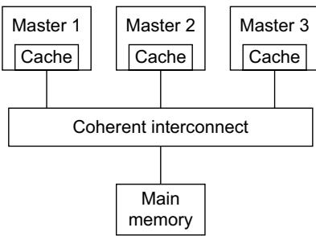  
Figure C1-1 Example coherent system

The ACE coherency protocol ensures that all masters observe the correct data value at any given address location by enforcing that only one copy exists whenever a store occurs to the location. After each store to a location, other masters can obtain a new copy of the data for their own local cache, allowing multiple copies to exist.

A cache line is defined as a cached copy of a number of sequentially byte addressed memory locations, with the first address being aligned to the total size of the cache line.

There is no requirement to keep main memory up to date at all times. Main memory is only required to be updated before a copy of the memory location is no longer held in any Shareable cache.

Note

Although not a requirement, it is acceptable to update main memory while cached copies still exist.

The ACE protocol enables master components to determine whether a cache line is the only copy of a particular memory location, or if there might be other copies of the same location, so that:

if a cache line is the only copy, a master component can change the value of the cache line without notifying any other master components in the system

if a cache line might also be present in another cache, a master component must notify the other caches, using an appropriate transaction.

## C1.2.3 Cache state model

To determine whether an action is required when a component accesses a cache line, the ACE protocol defines cache states. Each cache state is based on a cache line characteristic.

The cache line characteristics are:

Valid, Invalid When valid, the cache line is present in the cache. When invalid, the cache line is not present in the cache.

Unique, Shared When unique, the cache line exists only in one cache. When shared, the cache line might exist in more than one cache, but this is not guaranteed.

Clean, Dirty When clean, the cache does not have responsibility for updating main memory. When dirty, the cache line has been modified with respect to main memory, and this cache must ensure that main memory is eventually updated.

Figure C1-2 shows the ACE five state cache model and Table C1-2 on page C1-140 provides more information about each state.

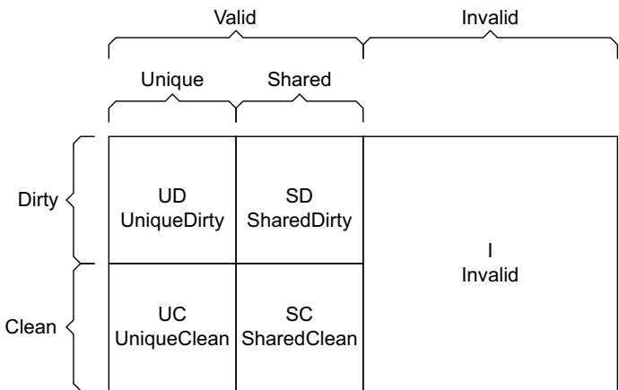  
Figure C1-2 ACE cache state mode

<table><tr><td>State</td><td>Abbreviation</td><td>Description</td></tr><tr><td>Invalid</td><td>I</td><td>The cache line does not exist in this cache.</td></tr><tr><td>UniqueClean</td><td>UC</td><td>The following rules apply to a cache line that is in the UniqueClean state:the cache line is held only in this cache and it has not been modified with respect to main memorya component can perform a store to the cache line without notifying other caches.</td></tr><tr><td>UniqueDirty</td><td>UD</td><td>The following rules apply to a cache line that is in the UniqueDirty state:the cache line is held only in this cachethe cache line has been modified with respect to main memory and this cache must ensure that the changes are subsequently notified to main memorya component can perform subsequent stores to the cache line without notifying other caches.</td></tr><tr><td>SharedClean</td><td>SC</td><td>The following rules apply to a cache line that is in the SharedClean state:the cache line might be shared with another cacheit is not known if the cache line is modified with respect to main memory, but this component is not responsible for updating main memorya component must notify other caches before performing a store to the cache line.</td></tr><tr><td>SharedDirty</td><td>SD</td><td>The following rules apply to a cache line that is in the SharedDirty state:the cache line might be shared with another cachethe cache line has been modified with respect to main memory and this cache must ensure that the changes are subsequently notified to main memorya component must notify other caches before performing a store to the cache line.</td></tr></table>

## Cache state rules

The rules that apply to the cache states are:

A line in a Unique state must only be in one cache.

A line that is in more than one cache must be in a Shared state in every cache it is in.

When a cache obtains a new copy of a line, other caches that also have a copy of the line, and might have the line in a Unique state, must be notified to hold the line in a Shared state.

When a cache discards a copy of a line, there is no requirement to inform other caches that also have a copy of the line. This means that a line in a Shared state might be held in only one cache.

A line that has been updated, relative to main memory, must be in a Dirty state in one cache.

A line that has been updated, relative to main memory, and is in more than one cache, must be in a Dirty state in only one cache

## C1.3 Channel overview

This section introduces the signals that the ACE protocol provides, and where appropriate, describes their relationship to the existing AXI4 channels. The ACE protocol defines:

signaling on existing AXI4 channels, see Changes to existing AXI4 channels

signaling on ACE-specific channels, see Additional channels defined by ACE

acknowledge signaling, see Acknowledge signaling on page C1-142.

Channel usage examples on page C1-143 gives examples of the use of the ACE signaling.

## C1.3.1 Changes to existing AXI4 channels

Table C1-3 shows the ACE signals provided on existing AXI4 channels.

Table C1-3 ACE signals provided on existing AXI4 channels

<table><tr><td>AXI4 channel</td><td>Signal</td><td>Source</td><td>Description</td></tr><tr><td rowspan="3">Read address</td><td>ARDOMAIN[1:0]</td><td>Master</td><td rowspan="3">See Read address channel (AR) signals on page C2-156.</td></tr><tr><td>ARSNOOP[3:0]</td><td>Master</td></tr><tr><td>ARBAR[1:0]</td><td>Master</td></tr><tr><td rowspan="4">Write address</td><td>AWDOMAIN[1:0]</td><td>Master</td><td rowspan="4">See Write address channel (AW) signals on page C2-156.</td></tr><tr><td>AWSNOOP[2:0]</td><td>Master</td></tr><tr><td>AWBAR[1:0]</td><td>Master</td></tr><tr><td>AWUNIQUEa</td><td>Master</td></tr><tr><td>Read data</td><td>RRESP[3:2]</td><td>Slave</td><td>See Read data channel (R) signals on page C2-156.</td></tr></table>

a. The AWUNIQUE signal is only required by a component that supports the WriteEvict transaction.

Note

There are no additional signals on the write data or write response channels.

## C1.3.2 Additional channels defined by ACE

Three new channels are supported, these are the snoop address channel, the snoop data channel, and the snoop response channel.

The snoop address (AC) channel is an input to a cached master that provides the address and associated control information for snoop transactions.

The snoop response (CR) channel is an output channel from a cached master that provides a response to a snoop transaction. Every snoop transaction has a single response associated with it. The snoop response indicates if an associated data transfer on the CD channel is expected.

The snoop data (CD) channel is an optional output channel that passes snoop data out from a master. Typically, this occurs for a read or clean snoop transaction when the master being snooped has a copy of the data available to return.

Table C1-4 shows the signals provided on the ACE-specific channels.  
Table C1-4 ACE signals provided on ACE-specific channels

<table><tr><td>ACE-specific channel</td><td>Signal</td><td>Source</td><td>Description</td></tr><tr><td rowspan="5">Snoop address</td><td>ACVALID</td><td>Slave</td><td rowspan="5">See Snoop address channel (AC) signals on page C2-157.</td></tr><tr><td>ACREADY</td><td>Master</td></tr><tr><td> $ACADDR[ac-1:0]^a$ </td><td>Slave</td></tr><tr><td>ACSNOOP[3:0]</td><td>Slave</td></tr><tr><td>ACPROT[2:0]</td><td>Slave</td></tr><tr><td rowspan="3">Snoop response</td><td>CRVALID</td><td>Master</td><td rowspan="3">See Snoop response channel (CR) signals on page C2-157.</td></tr><tr><td>CRREADY</td><td>Slave</td></tr><tr><td>CRRESP[4:0]</td><td>Master</td></tr><tr><td rowspan="4">Snoop data</td><td>CDVALID</td><td>Master</td><td rowspan="4">See Snoop data channel (CD) signals on page C2-158.</td></tr><tr><td>CDREADY</td><td>Slave</td></tr><tr><td> $CDDATA[cd-1:0]^b$ </td><td>Master</td></tr><tr><td>CDLAST</td><td>Master</td></tr></table>

a. ac is the width of the snoop address bus.  
b. cd is the width of the snoop data bus.

## C1.3.3 Acknowledge signaling

ACE supports two additional acknowledge signals. These signals indicate that a master has completed a read or write transaction.

Table C1-5 shows the acknowledge signals.

Table C1-5 ACE read and write acknowledge signals

<table><tr><td>Signal</td><td>Source</td><td>Description</td></tr><tr><td>RACK</td><td>Master</td><td>See Read acknowledge signal on page C2-159</td></tr><tr><td>WACK</td><td>Master</td><td>See Write acknowledge signal on page C2-159</td></tr></table>

## C1.3.4 Channel usage examples

This section describes different examples of how the ACE channels are used when performing load and store operations. It describes:

Performing load operations from Shareable locations

Performing store operations to Shareable locations.

## Performing load operations from Shareable locations

The following procedure is an example of a master component loading data from a Shareable address location, where the master component does not already have a copy of this location in its local cache:

1. The master component issues a read transaction on the read address channel.

2. The interconnect determines whether any other cache holds a copy of the location by passing the Shareable address to other caching master components that can hold a copy, on the snoop address channel. In this context, these are snooped master components.

3. One of the following now occurs:

• If any snooped master component holds the requested cache line, it is expected to indicate this by:

— responding on the snoop response channel

— providing the data to the interconnect, on the snoop data channel.

The interconnect then provides the data, with an associated response, to the initiating master component on the read data channel.

If no snooped master component holds the requested cache line:

the interconnect initiates a transaction to main memory, effectively passing on the transaction from the initiating master component

the read data is supplied back to the master on the read data channel, as for standard transactions.

4. The master component indicates that the transaction has completed, using the RACK signal.

If neither the initiating master nor the snooped cache take responsibility for writing a dirty cache line back to main memory at a later point in time, the interconnect might have to write data back to main memory at the same time that it is passed to the initiating master component.

If this occurs then the interconnect must generate the transaction address and write the dirty data returned from a snooped master component.

See Transactions for performing load operations from Shareable locations on page C1-146 for more information.

## Performing store operations to Shareable locations

When a master stores to a cache line, to a Shareable location, it removes all other copies of the cache line. This ensures that the master component has a unique copy of the cache line when it performs the store. The new value of the cache line at that location is propagated to other caches when respective caching master components subsequently read the cache line.

This section describes:

Store operations for a partial cache line on page C1-144

Store operations for an entire cache line on page C1-144

Store operations where the cache line is already cached on page C1-145

Overlapping store operations on page C1-145.

See Transactions for performing store operations to Shareable locations on page C1-147 and Transactions for accessing Shareable locations when no cached copy is required on page C1-147 for more information.

## Store operations for a partial cache line

A master component storing only a partial cache line must obtain a current copy of the cache line before performing the store. An example sequence is:

1. The initiating master component obtains a pre-store form of the cache line, and requests that other copies are removed, by issuing a ReadUnique transaction on the read address channel.

2. The interconnect passes the transaction to other caches on the snoop address channel.

3. Where applicable, a snooped master component responds to the transaction using the snoop response channel to indicate that it has the requested cache line. It also provides the cache line to the interconnect, using the snoop data channel.

4. The interconnect passes the cache line, together with a response, to the initiating master, using the read data channel.

Note

If no copies of the cache line are found during the snoop, a read of main memory is performed. The interconnect then passes the cache line and a response to the initiating master component, on the read data channel.

5. The master component performs the store and uses the RACK signal to indicate that the transaction has completed.

Note

While the cache line remains unique, loads and stores can be performed with no need for transactions to be broadcast to other caches.

## Store operations for an entire cache line

A master component that is storing an entire cache line does not have to obtain data before storing the cache line. An example sequence is:

1. The initiating master component requests a unique copy of the cache line by issuing a MakeUnique transaction on the read address channel. This removes all other copies of the cache line.

2. The interconnect passes the transaction to other caches on the snoop address channel.

3. Snooped master components respond to the transaction using the snoop response channel to indicate that the cache line has been successfully removed.

4. A response is provided to the initiating master component, using the read data channel.

Note

Only the response fields are valid. No data transfer occurs.

5. The master component performs the store and uses the RACK signal to indicate that the transaction has completed.

## Store operations where the cache line is already cached

For a master component that already has a shared copy of the cache line, an example store sequence is:

1. The initiating master component requests a unique copy of the cache line by issuing a CleanUnique transaction on the read address channel. This removes all other copies of the cache line and writes any dirty copy to main memory.

Note

This transaction does not return the cache line to the initiating master component.

2. The interconnect passes the transaction to other caches on the snoop address channel. Snooped master components respond to the transaction using the snoop response channel to indicate:

that the cache line has been successfully removed

• whether a dirty cache line must be written to main memory by the interconnect.

3. If a dirty cache line is being written to main memory, the appropriate snooped master provides the dirty cache line to the interconnect, using the snoop data channel. The interconnect then constructs the transaction to write the dirty cache line back to main memory.

4. A response is provided to the initiating master component, using the read data channel.

Note

Only the response fields are valid. No data transfer occurs.

5. The master component performs the store and uses the RACK signal to indicate that the transaction has completed.

## Overlapping store operations

If two master components attempt simultaneous Shareable store operations to the same cache line, the interconnect determines the order in which the transactions occur. This section uses the convention:

master 1 is the component that the interconnect selects to proceed first

master 2 is the component that the interconnect selects to proceed second.

Master 1 proceeds with the operation as described in Performing store operations to Shareable locations on page C1-143.

Master 2 uses its snoop port to observe the master 1 store operation, and the following rules apply:

If master 2 requires data, it receives the data when its own transaction completes, when it can proceed as normal with its own store operations.

If master 2 is performing a full cache line store, it removes any original copy of the data when it observes the snoop transaction relating to the master 1 store. However, master 2 can then proceed with its own full cache line store when its own transaction completes.

If master 2 is performing a partial line store, and originally had a copy of the cache line and therefore does not request a copy of the data then special consideration is required. In this case, when master 2 observes the snoop transaction relating to the master 1 store operation, it must remove its original copy of the data. Master 2 can then take one of the following options when its transaction completes:

For master 2 to retain the cache line in its cache, it must issue a new transaction to request a copy of the data, enabling it to complete the store operation.

Master 2 can perform a partial line write to main memory, ensuring the line is updated correctly, but the master does not retain a copy of the cache line in its cache. To access the cache line at a later point in time it must fetch the data again.

See Sequencing transactions on page C6-235 for more information.

## C1.4 Transaction overview

This section introduces the different transaction types. It provides information about when the transactions are used and the required behavior of the various system components. The section describes:

Non-snooping transactions

Coherent transactions

Memory update transactions on page C1-147

Cache maintenance transactions on page C1-148

Snoop transactions on page C1-148

Barrier transactions on page C1-148

Distributed virtual memory transactions on page C1-149.

## C1.4.1 Non-snooping transactions

Non-snooping transactions are used to access memory locations that are not in the caches of other master components. These transactions do not cause snoop transactions to be performed and are used for the following transaction types:

Non-shareable

Device.

Two forms of non-snooping transaction are provided, ReadNoSnoop and WriteNoSnoop.

## Note

Within the context of coherency, ReadNoSnoop and WriteNoSnoop transactions are also referred to as Read and Write transactions. The extended form of the name can be used to differentiate between this transaction type and the more generic set of all read or write transactions.

## C1.4.2 Coherent transactions

In general, coherent transactions are used to access Shareable address locations, which might be held in the coherent caches of other components.

## Transactions for performing load operations from Shareable locations

When a master is required to perform a load operation from a location in a Shareable area of memory, the following snoop transactions can be used, all of which permit the current holders of the cache line to retain their copy:

## ReadClean

The ReadClean transaction indicates that the master component requesting the read can only accept a cache line that is clean, that is, it cannot accept responsibility for a dirty line that it must subsequently write back to memory. Typically, the ReadClean transaction is used by master components that do not have the ability to accept a dirty cache line, or have a write-through cache.

ReadNotSharedDirty The ReadNotSharedDirty transaction indicates that the master requesting the read can accept a line that is in any state except SharedDirty. This means that the line can be passed as clean (either unique or shared) or the line can be passed as unique and dirty.

## ReadS hared

The ReadShared transaction indicates that the master component requesting the read can accept a cache line in any state.

For each of these transactions, it is acceptable for a cache that is being snooped to pass a cache line as dirty, even if it cannot be accepted by the master component that is requesting the cache line. In this situation, the interconnect is responsible for writing back the dirty line to main memory.

If a cache that receives one of these snoop transactions has a copy of the data, this specification recommends that it provides the data to complete the snoop transaction. The interconnect must pass the data back to the initiating master component.

If the cache that provides the data originally held the line in a Unique state then to retain the copy, it must move the cache line to a Shared state after the operation.

## Transactions for performing store operations to Shareable locations

When a master is required to perform a store to a location in a Shareable area of memory, the following transactions can be used, all of which ensure that there are no other copies of the location when the store operation occurs:

ReadUnique A master component uses the ReadUnique transaction when performing a partial cache line store, that is, when storing only some of the bytes of the cache line, in cases where it does not already have a copy of the cache line. The ReadUnique transaction obtains a copy of the data and ensures that no other copies exist.

CleanUnique A master component uses a CleanUnique transaction when performing a partial cache line store, in cases where it already has a copy of the cache line. The CleanUnique transaction removes all other copies of the cache line, but if it finds a cache that holds the line in a Dirty state then the transaction ensures that the dirty cache line is written to main memory.

MakeUnique A master component uses the MakeUnique transaction when performing a full cache line store. The MakeUnique transaction invalidates all other copies of the cache line.

## Transactions for accessing Shareable locations when no cached copy is required

When a master is required to access a Shareable memory location but the issuing master is not going to keep a cached copy of the address, either because it does not want to allocate that cache line or because it does not have a cache, the following transactions can be used:

ReadOnce A master component uses the ReadOnce transaction to obtain a snapshot of data that it does not require to copy to its cache. For the ReadOnce transaction, if the cache that provides the data holds the cache line in a Unique state, there is no requirement to change the cache line to a Shared state after the ReadOnce transaction.

## WriteUnique

A WriteUnique transaction can be used to remove all copies of a cache line before issuing a write transaction. The WriteUnique transaction can be used when writing a full or partial cache line, and ensures dirty data is written to memory before performing the write transaction.

## WriteLineUnique

A WriteLineUnique transaction can be used to remove all copies of a cache line before issuing a write transaction. The WriteLineUnique transaction must only be used when writing a full cache line, where all bytes within the cache line are written by the transaction.

Note

Unlike other transactions to Shareable memory, ReadOnce and WriteUnique transactions issued by a master component are not required to be a full cache line size. However, WriteLineUnique transactions are required to be a full cache line size.

## C1.4.3 Memory update transactions

The following transactions are used to update main memory:

WriteBack A master component cache uses a WriteBack transaction to write back a dirty line to main memory to free a cache line that is to be used for a different address. The master component does not retain a copy of the cache line.

WriteClean A master component cache uses a WriteClean transaction to write a dirty line to main memory, while permitting that master component to retain a copy of the cache line.

WriteEvict A WriteEvict transaction can be used to evict a clean cache line. The transaction is used to write the line to a lower level of the cache hierarchy, such as an L3 or system level cache. The WriteEvict transaction is not required to update main memory.

Evict A master component uses an Evict transaction to indicate the address of a cache line that is evicted from its local cache when no main memory update is required. The transaction enables cache lines in a particular component to be tracked, and can be used for applications such as constructing snoop filters. No data transfer is associated with Evict transactions.

Note

The WriteBack, WriteClean, WriteEvict, and Evict transactions do not result in snoop transactions to other caches. Other caches are not required to know whether the cache line has been written to main memory. WriteBack, WriteClean, WriteEvict, and Evict transactions are not serialized in the same way as other snoop transactions.

## C1.4.4 Cache maintenance transactions

Master components use broadcast cache maintenance transactions to access and maintain the caches of other master components in a system. In particular, cache maintenance transactions enable master components to view the effect of load and store operations on system caches that cannot otherwise be accessed. This process is typically referred to as Software Cache Maintenance. Broadcast cache maintenance operations can also propagate to downstream caches, permitting all caches in a system to be maintained.

Note

A master component that initiates a cache maintenance transaction is also responsible for performing the appropriate operation on its own local cache.

The following transactions are used to maintain caches:

CleanShared A master component uses a CleanShared transaction to perform a clean operation on the caches of other components in the system. If a snooped cache that holds a dirty cache line receives a CleanShared transaction, it must provide that cache line so that the cache line can be written to main memory. The snooped cached can retain its local copy of the cache line.

CleanInvalid A master component uses a CleanInvalid transaction to perform a clean and invalidate operation on the caches of other components in the system. If a snooped cache that holds a clean cache line receives a CleanInvalid transaction, it must remove its local copy of the cache line. If a snooped cache that holds a dirty cache line receives a CleanInvalid transaction, it must provide that cache line so that the cache line can be written to main memory and remove its local copy of the cache line.

MakeInvalid A master component uses a MakeInvalid transaction to perform an invalidate operation on the caches of other components in the system. If a snooped cache receives a MakeInvalid transaction, it must remove its local copy, but it is not required to provide any data, even if the cache line is dirty.

## C1.4.5 Snoop transactions

Snoop transactions are transactions that use the snoop address, snoop response, and snoop data channels. Snoop transactions are a subset of coherent transactions and cache maintenance transactions.

## C1.4.6 Barrier transactions

The ACE protocol supports barrier transactions that are used to provide guarantees about the ordering and observation of transactions in a system.

The following types of barrier are supported:

memory barrier

synchronization barrier.

A master component issues a memory barrier to guarantee that if another master in the appropriate domain can observe any transaction after the barrier it must be able to observe every transaction prior to the barrier.

A master component issues a synchronization barrier to determine when all transactions issued before the barrier are observable by every master in a particular domain. Some synchronization barriers also have a requirement that all transactions issued before the barrier transaction must have reached the destination slave component before the barrier completes.

See Chapter C8 Barrier Transactions for more information.

## C1.4.7 Distributed virtual memory transactions

Distributed Virtual Memory (DVM) transactions are used for virtual memory system maintenance, and typically pass messages between components within distributed virtual memory systems.

See Chapter C12 Distributed Virtual Memory Transactions for more information.

## C1.5 Transaction processing

When a master component issues a transaction, the coherency signaling indicates whether the transaction is to a memory location that is Shareable by more than one component, and therefore requires coherency support. Typically, transactions are processed as follows:

1. The initiating master component issues the transaction.

2. Depending on whether coherency support is required, either:

the transaction is passed directly to a slave component, subject to the address decode scheme being used

the transaction is passed to the coherency support logic within the interconnect.

3. A coherent transaction is checked against subsequent transactions from other master components, to ensure correct processing order.

4. The interconnect determines the snoop transactions that are required.

5. Each cached master that receives a snoop transaction must provide a snoop response. Some masters might provide snoop data to complete the snoop transaction.

6. The interconnect determines whether a main memory access is required.

7. The interconnect collates snoop responses and any required data.

8. The initiating master component completes the transaction.

## C1.6 Concepts required for the ACE specification

The ACE specification defines the following concepts:

Domains

Barriers on page C1-152

Distributed Virtual Memory on page C1-153.

## C1.6.1 Domains

The ACE protocol uses a concept called shareability domains. A shareability domain is a set of master components that enables a master component to determine which other master components to include when issuing coherency or barrier transactions.

For coherent transactions, a master component uses the shareability domain to determine which other master components might have a copy of the addressed location in their local cache. The interconnect component uses this information to determine, for any given transaction, which other master components must be snooped to complete the transaction.

For barrier transactions, a master component uses the shareability domain to determine which other master components the barrier is establishing an ordering relationship with. The domain of a barrier transaction can be used to determine how far a barrier transaction must propagate, and the blocking properties necessary to establish the required ordering.

The ACE protocol defines the following levels of shareability domain:

Non-shareable The domain contains a single master component.

Inner Shareable The domain can include additional master components.

Outer Shareable The domain contains at least all master components in the Inner domain, but can include additional master components.

System The domain includes all master components in the system.

Figure C1-3 shows an example set of shareability domains for a system that includes master components 0-9.

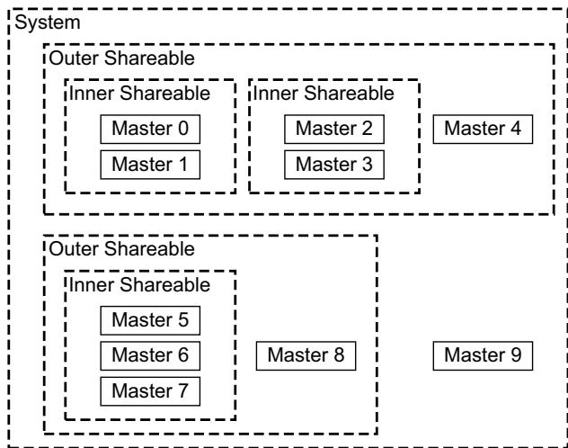  
Figure C1-3 Shareability domains

Although multiple Non-shareable, Inner Shareable, and Outer Shareable domains can exist in a system, there must be a single consistent definition of the master components that are contained in each domain. For example, in Figure C1-3, because master 0 has master 1 in its Inner Shareable domain, then master 1 must have master 0 in it Inner Shareable domain.

Domains are defined as non-overlapping. For each master component in an Outer Shareable domain, all the other master components, in the Inner Shareable domain that includes that master component, must also be included in the same Outer Shareable domain.

For transactions that must be visible to all other master components in the system, the System domain is used. Because System domain transactions include master components that do not have hardware-coherent caches, these transactions must not be cached at any level.

In Figure C1-4, from the perspective of master 1:

the cache of master 1 is a local cache

the caches of masters 2-6 are peer caches

caches of masters 1-3 are in the Inner Shareable domain

caches of masters 1-6 are in the Outer Shareable domain

cache 1 is a downstream cache.

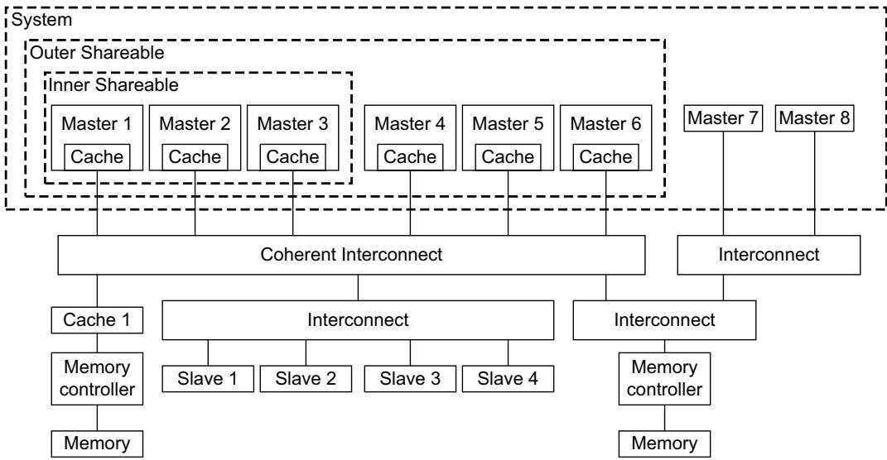  
Figure C1-4 Example system using shareability domains

## C1.6.2 Barriers

Barrier transactions provide guarantees about the ordering and observation of transactions in a system. The following types of barrier transaction are supported:

## Memory barriers

A master component issues a memory barrier to guarantee that if another master component in the appropriate domain can observe any transaction after the barrier it must be able to observe every transaction prior to the barrier.

## Synchronization barriers

A master component issues a synchronization barrier to determine when every master component in the appropriate domain can observe all transactions that preceded the barrier transaction. For System domain synchronization barriers, all transactions issued before the barrier transaction must have reached the destination slave components before the barrier transaction completes.

A barrier transaction has an address phase and a response, but no data transfer occurs. A master component must issue a barrier transaction on both the read address channel and the write address channel.

Barriers can enforce ordering because a master component must not issue any read or write transaction that must be ordered after the barrier until the master component has received a response for the barrier on both read data and write response channels.

See Chapter C8 Barrier Transactions for more information.

## C1.6.3 Distributed Virtual Memory

ACE supports Distributed Virtual Memory (DVM) and includes transactions that permit virtual memory system management. Figure C1-5 shows the basic parts of a virtual memory system.

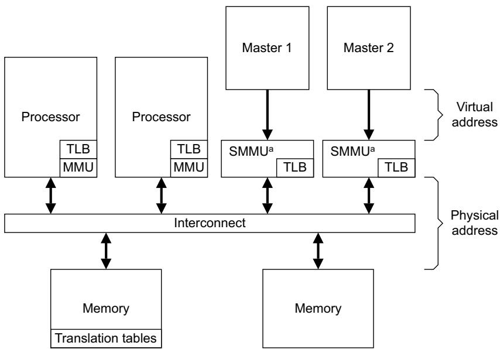  
a System Memory Management Unit

Figure C1-5 Virtual memory system

In Figure C1-5, the System Memory Management Units (SMMUs) translate addresses in the virtual address space to addresses in the physical address space. Although all components in the system must use a single physical address space, SMMU components enable different master components to operate in their own independent virtual address or intermediate physical address space.

A typical process in the virtual memory system shown in Figure C1-5 might operate as follows:

1. A master component operating in a virtual address (VA) space issues a transaction that uses a VA.

2. The SMMU receives the VA, for translation to a physical address (PA):

if the SMMU has recently performed the requested translation then it might obtain a cached copy of the translation from its TLB

otherwise, the SMMU must perform a translation table walk, accessing translation table in memory to obtain the required VA to PA translation.

3. The SMMU uses the PA to issue the transaction for the requesting component.

At step 2 of this process, the translation for the required VA might not exist. In this case, the translation table walk generates a fault, that must be notified to the agent that maintains the translation tables. For the required access to proceed, that agent must then provide the required VA to PA translation. Typically, it will update the translation tables with the required information.

Maintaining the translation tables can require changes to translation table entries that are cached in TLBs. To prevent the use of these entries, a DVM message can be used to issue a TLB invalidate operation.

When the translation tables have been updated, and the required TLB invalidations performed, a DVM Sync transaction is used to ensure that all required transactions have completed.

See Chapter C12 Distributed Virtual Memory Transactions for more information.

## C1.7 Protocol errors

The protocol defines two categories of protocol errors, a software protocol error and a hardware protocol error.

## C1.7.1 Software protocol error

A software protocol error occurs when multiple accesses to the same location are made with mismatched shareability or cacheability attributes.

A software protocol error can cause a loss of coherency and result in the corruption of data values. The protocol requires that the system does not deadlock for a software protocol error, and that transactions always progress through a system.

A software protocol error for an access in one 4KB memory region must not cause data corruption in a different 4KB memory region.

For locations held in Normal memory, the use of appropriate barriers and software cache maintenance can be used to return memory locations to a defined state.

When accessing a peripheral device, if Modifiable transactions are used as indicated by AxCACHE[1] = 1, then the correct operation of the peripheral cannot be guaranteed. The only requirement is that the peripheral continues to respond to transactions in a protocol compliant manner. The sequence of events that might be needed to return a peripheral device, that has been accessed incorrectly, to a known working state is IMPLEMENTATION DEFINED.

## C1.7.2 Hardware protocol error

A hardware protocol error is defined as any protocol error that is not a software protocol error. No support is required for hardware protocol errors.

If a hardware protocol error occurs then recovery from the error is not guaranteed. The system might crash, lock up or suffer some other non-recoverable failure.

## Chapter C2 Signal Descriptions

This chapter introduces the additional ACE interface signals. It contains the following sections:

Changes to existing AXI4 channels on page C2-156

Additional channels defined by ACE on page C2-157

Additional response signals and signaling requirements defined by ACE on page C2-159

Later chapters define the signal parameters and usage.

## C2.1 Changes to existing AXI4 channels

The following subsections introduce the additional signals defined by ACE on the AXI4 channels:

Read address channel (AR) signals

Write address channel (AW) signals

Read data channel (R) signals.

Note

There are no additional signals on the write data channel (W) or the Write response channel (B).

See Chapter A2 Signal Descriptions for the remaining signals on the AXI4 channels.

## C2.1.1 Read address channel (AR) signals

Table C2-1 shows the additional signals on the read address channel. See Read and write address channel signaling on page C3-162.

Table C2-1 Read address channel signals

<table><tr><td>Signal</td><td>Source</td><td>Description</td></tr><tr><td>ARSNOOP[3:0]</td><td>Master</td><td>This signal indicates the transaction type for Shareable read transactions.</td></tr><tr><td>ARDOMAIN[1:0]</td><td>Master</td><td>This signal indicates the shareability domain of a read transaction.</td></tr><tr><td>ARBAR[1:0]</td><td>Master</td><td>This signal indicates a read barrier transaction.</td></tr></table>

## C2.1.2 Write address channel (AW) signals

Table C2-2 shows the additional signals on the write address channel. See Read and write address channel signaling on page C3-162.

Table C2-2 Write address channel signals

<table><tr><td>Signal</td><td>Source</td><td>Description</td></tr><tr><td>AWSNOOP[2:0]</td><td>Master</td><td>This signal indicates the transaction type for Shareable write transactions.</td></tr><tr><td>AWDOMAIN[1:0]</td><td>Master</td><td>This signal indicates the shareability domain of a write transaction.</td></tr><tr><td>AWBAR[1:0]</td><td>Master</td><td>This signal indicates a write barrier transaction.</td></tr><tr><td>AWUNIQUEa</td><td>Master</td><td>This signal indicates that a line is permitted to be held in a Unique state.</td></tr></table>

a. The AWUNIQUE signal is only required by a component that supports the WriteEvict transaction

## C2.1.3 Read data channel (R) signals

Table C2-3 shows the additional signals on the read data channel. See Read data channel signaling on page C3-172.

Table C2-3 Read data channel signals

<table><tr><td>Signal</td><td>Source</td><td>Description</td></tr><tr><td>RRESP[3:2]</td><td>Interconnect</td><td>Read response. The additional read response bits provide the information required to complete a Shareable read transaction.</td></tr></table>

## C2.2 Additional channels defined by ACE

The following subsections introduce the ACE snoop channels:

Snoop address channel (AC) signals

Snoop response channel (CR) signals

Snoop data channel (CD) signals on page C2-158.

## C2.2.1 Snoop address channel (AC) signals

Table C2-4 shows the signals on the snoop address channel. See Snoop address channel signaling on page C3-178.

Table C2-4 Snoop address channel signals

<table><tr><td>Signal</td><td>Source</td><td>Description</td></tr><tr><td>ACVALID</td><td>Interconnect</td><td>Snoop address valid. This signal indicates that the snoop address and control information is valid.</td></tr><tr><td>ACREADY</td><td>Master</td><td>Snoop address ready. This signal indicates that the snoop address and control information can be accepted in the current cycle.</td></tr><tr><td> $ACADDR[ac-1:0]^a$ </td><td>Interconnect</td><td>Snoop address. This signal indicates the address of a snoop transaction. The snoop address width must match the width of the read and write address buses.</td></tr><tr><td>ACSNOOP[3:0]</td><td>Interconnect</td><td>Snoop transaction type. This signal indicates the transaction type of the snoop transaction.</td></tr><tr><td>ACPROT[2:0]</td><td>Interconnect</td><td>Snoop protection type. This signal indicates the security level of the snoop transaction. The ACE specification only assigns meaning to ACPROT[1].</td></tr></table>

a. ac is the width of the snoop address bus.

## C2.2.2 Snoop response channel (CR) signals

Table C2-5 shows the signals on the snoop response channel. See Snoop response channel signaling on page C3-181.

Table C2-5 Snoop response channel signals

<table><tr><td>Signal</td><td>Source</td><td>Description</td></tr><tr><td>CRVALID</td><td>Master</td><td>Snoop response valid. This signal indicates that the snoop response is valid.</td></tr><tr><td>CRREADY</td><td>Interconnect</td><td>Snoop response ready. This signal indicates that the snoop response can be accepted in the current cycle.</td></tr><tr><td>CRRESP[4:0]</td><td>Master</td><td>Snoop response. This signal indicates the response to a snoop transaction and how it completes.</td></tr></table>

## C2.2.3 Snoop data channel (CD) signals

Table C2-6 shows the signals on the snoop data channel. See Snoop data channel signaling on page C3-185.

Table C2-6 Snoop data channel signals

<table><tr><td>Signal</td><td>Source</td><td>Description</td></tr><tr><td>CDVALID</td><td>Master</td><td>Snoop data valid. This signal indicates that the snoop data is valid.</td></tr><tr><td>CDREADY</td><td>Interconnect</td><td>Snoop data ready. This signal indicates that the snoop data can be accepted in the current cycle.</td></tr><tr><td>CDDATA[cd-1:0]a</td><td>Master</td><td>Snoop data. Transfers data from a snooped master.</td></tr><tr><td>CDLAST</td><td>Master</td><td>This signal indicates the last data transfer of a snoop transaction.</td></tr></table>

a. cd is the width of the snoop data bus.

## C2.3 Additional response signals and signaling requirements defined by ACE

The following subsections introduce the additional response signals, and an additional signalling requirement, introduced by ACE:

Read acknowledge signal

Write acknowledge signal

Additional reset requirements.

## C2.3.1 Read acknowledge signal

Table C2-7 shows the additional read acknowledge signal. See Read acknowledge signaling on page C3-175.

Table C2-7 Read acknowledge signal

<table><tr><td>Signal</td><td>Source</td><td>Description</td></tr><tr><td>RACK</td><td>Master</td><td>Read acknowledge. This signal indicates that a master has completed a read transaction.</td></tr></table>

## C2.3.2 Write acknowledge signal

Table C2-8 shows the additional write acknowledge signal. See Write Acknowledge signaling on page C3-177.

Table C2-8 Write acknowledge signal

<table><tr><td>Signal</td><td>Source</td><td>Description</td></tr><tr><td>WACK</td><td>Master</td><td>Write acknowledge. This signal indicates that a master has completed a write transaction.</td></tr></table>

## C2.3.3 Additional reset requirements

The ACE protocol uses the AXI4 single active LOW reset signal ARESETn. See Reset on page A3-38 for the ARESETn requirements.

During reset, the following interface requirements apply:

a master interface must drive RACK, WACK, CRVALID, and CDVALID LOW

an interconnect must drive ACVALID LOW.

The earliest point after reset that the interconnect is permitted to begin driving ACVALID HIGH is at a rising ACLK edge after ARESETn is HIGH.

C2.3 Additional response signals and signaling requirements defined by ACE

# Chapter C3 Channel Signaling

This chapter describes the basic channel signaling requirements on an ACE interface. It contains the following sections:

Read and write address channel signaling on page C3-162

Read data channel signaling on page C3-172

Read acknowledge signaling on page C3-175

Write response channel signaling on page C3-176

Write Acknowledge signaling on page C3-177

Snoop address channel signaling on page C3-178

Snoop response channel signaling on page C3-181

Snoop data channel signaling on page C3-185

Snoop channel dependencies on page C3-187.

## C3.1 Read and write address channel signaling

The following sections define the additional signals on the read and write address channels.

## C3.1.1 Shareability domain types

The ACE protocol uses a concept called shareability domains. A shareability domain is a set of masters that enables a master to determine which other masters to include when issuing coherency or barrier transactions. See Domains on page C1-151

Each address channel has its own shareability domain signal. Table C3-1 shows the signal for each address channel.

Table C3-1 Shareability domain signals

<table><tr><td>Transaction Channel</td><td>Signal</td><td>Source</td><td>Description</td></tr><tr><td>Read address channel</td><td>ARDOMAIN[1:0]</td><td>Master</td><td>Indicates the shareability domain of a read transaction.</td></tr><tr><td>Write address channel</td><td>AWDOMAIN[1:0]</td><td>Master</td><td>Indicates the shareability domain of a write transaction.</td></tr></table>

The ACE protocol specifies four levels of shareability domain:

Non-shareable The domain contains a single master.

Inner Shareable The Inner domain can include additional masters.

Outer Shareable The Outer domain contains all masters in the Inner domain and can include additional masters.

System The System domain includes all masters in the system.

Note

Although multiple Non-shareable, Inner Shareable and Outer Shareable domains can exist in a system, there must be a single consistent definition of the masters that are contained in each domain. Figure C1-3 on page C1-151 shows an example set of shareability domains.

In this specification, AxDOMAIN indicates ARDOMAIN or AWDOMAIN.

Table C3-2 shows the AxDOMAIN[1:0] signal encoding.

Table C3-2 Shareability domain encoding

<table><tr><td>AxDOMAIN[1:0]</td><td>Domain</td></tr><tr><td>0b00</td><td>Non-shareable</td></tr><tr><td>0b01</td><td>Inner Shareable</td></tr><tr><td>0b10</td><td>Outer Shareable</td></tr><tr><td>0b11</td><td>System</td></tr></table>

Restrictions apply to the shareability domain for transactions with different memory types:

• a Device transaction, indicated by AxCACHE[1] equal to zero, must only use domain level System

• a Cacheable transaction, indicated by AxCACHE[3:2] not equal to zero, must not use domain level System.

Table C3-3 shows all AxCACHE and AxDOMAIN combinations. See AXI4 changes to memory attribute signaling on page A4-62 for details of the AxCACHE encodings.

Table C3-3 AxCACHE and AxDOMAIN signal combinations

<table><tr><td colspan="2">AxCACHE</td><td colspan="2">AxDOMAIN</td><td>Legal</td><td>Caches accessed $^a$ </td></tr><tr><td>Value</td><td>Attribute</td><td>Value</td><td>Attribute</td><td></td><td></td></tr><tr><td rowspan="4">0b000x</td><td rowspan="4">Device</td><td>0b00</td><td>Non-shareable</td><td>No</td><td>-</td></tr><tr><td>0b01</td><td>Inner Shareable</td><td>No</td><td>-</td></tr><tr><td>0b10</td><td>Outer Shareable</td><td>No</td><td>-</td></tr><tr><td>0b11</td><td>System</td><td>Yes</td><td>No caches.</td></tr><tr><td rowspan="4">0b001x</td><td rowspan="4">Non-cacheable</td><td>0b00</td><td>Non-shareable</td><td>Permitted</td><td>No caches.</td></tr><tr><td>0b01</td><td>Inner Shareable</td><td>Permitted</td><td>Inner Shareable peer caches.</td></tr><tr><td>0b10</td><td>Outer Shareable</td><td>Permitted</td><td>Outer Shareable peer caches.</td></tr><tr><td>0b11</td><td>System</td><td>Yes</td><td>No caches.</td></tr><tr><td rowspan="4">0b011x0b101x0b111x</td><td rowspan="4">WriteThrough WriteBack</td><td>0b00</td><td>Non-shareable</td><td>Yes</td><td>Downstream caches.</td></tr><tr><td>0b01</td><td>Inner Shareable</td><td>Yes</td><td>Inner Shareable peer caches and downstream caches.</td></tr><tr><td>0b10</td><td>Outer Shareable</td><td>Yes</td><td>Outer Shareable peer caches and downstream caches.</td></tr><tr><td>0b11</td><td>System</td><td>No</td><td>-</td></tr></table>

a. Shows which caches must be accessed to complete the transaction.

Note

Table C3-3 does not include any access made to a local cache within the initiating master.

The three combinations of AxCACHE and AxDOMAIN that are indicated as Permitted are legal within the protocol, but not expected. These combinations can be used when a memory location can be cached at a domain level that requires snooping, but the transaction is deliberately not cached downstream, for example, in a system level cache.

When Table C3-3 shows that the caches accessed are Outer Shareable peer caches, this includes all caches that are Inner Shareable peer caches.

A memory location that is indicated as being in the System domain cannot be held in any cache.

## C3.1.2 Read and write barrier transactions

Each address channel has its own barrier transaction signal. Table C3-4 shows the signal for each address channel.

Table C3-4 Barrier transaction signals

<table><tr><td>Transaction channel</td><td>Signal</td><td>Source</td><td>Description</td></tr><tr><td>Read address channel</td><td>ARBAR[1:0]</td><td>Master</td><td>Indicates a read barrier transaction.</td></tr><tr><td>Write address channel</td><td>AWBAR[1:0]</td><td>Master</td><td>Indicates a write barrier transaction.</td></tr></table>

See Barrier transaction signaling on page C8-259.

In this specification, AxBAR indicates ARBAR or AWBAR. Table C3-5 shows the AxBAR[1:0] signal encoding.

Table C3-5 Barrier transaction signal encoding

<table><tr><td>AxBAR[1:0]</td><td>Barrier type</td></tr><tr><td>0b00</td><td>Normal access, respecting barriers</td></tr><tr><td>0b01</td><td>Memory barrier</td></tr><tr><td>0b10</td><td>Normal access, ignoring barriers</td></tr><tr><td>0b11</td><td>Synchronization barrier</td></tr></table>

## C3.1.3 Read and write Shareable transaction types

Each address channel has its own transaction type signal. Table C3-6 shows the signal for each address channel.

Table C3-6 Shareable transaction type signals

<table><tr><td>Transaction channel</td><td>Signal</td><td>Source</td><td>Description</td></tr><tr><td>Read address channel</td><td>ARSNOOP[3:0]</td><td>Master</td><td>Indicates the transaction type of a read transaction.</td></tr><tr><td>Write address channel</td><td>AWSNOOP[2:0]</td><td>Master</td><td>Indicates the transaction type of a write transaction.</td></tr></table>

<table><tr><td colspan="2">Transactions on the read and write address channel are categorized into the following groups:</td></tr><tr><td>Non-snooping</td><td>These transactions must not snoop other masters.</td></tr><tr><td>Coherent</td><td>These transactions are to memory locations that can be held in the cache of other masters and require snooping.</td></tr><tr><td>Memory update</td><td>These transactions update main memory and must not snoop other masters.</td></tr><tr><td>Cache maintenance</td><td>These transactions are to memory locations that can be held in the cache of other masters and require snooping. These transactions might also require to be passed to downstream caches.</td></tr><tr><td>Barrier</td><td>These transactions establish the ordering between other transactions. See Chapter C8 Barrier Transactions.</td></tr><tr><td>DVM</td><td>These transactions pass operations between components that participate in a distributed virtual memory scheme. See Chapter C12 Distributed Virtual Memory Transactions.</td></tr></table>

Table C3-7 shows the permitted combinations of ARBAR[0], ARDOMAIN[1:0], and ARSNOOP[3:0] for each group of read transactions.

All unused ARSNOOP[3:0] encodings are Reserved.  
Table C3-7 Permitted read address control signal combinations

<table><tr><td>Transaction group</td><td>ARBAR[0]</td><td>ARDOMAIN</td><td>ARSNOOP</td><td>Transaction type</td></tr><tr><td rowspan="2">Non-snooping</td><td rowspan="2">0b0</td><td>0b00</td><td rowspan="2">0b0000</td><td rowspan="2">ReadNoSnoop</td></tr><tr><td>0b11</td></tr><tr><td rowspan="7">Coherent</td><td rowspan="7">0b0</td><td>0b01</td><td>0b0000</td><td>ReadOnce</td></tr><tr><td rowspan="6">0b10</td><td>0b0001</td><td>ReadShared</td></tr><tr><td>0b0010</td><td>ReadClean</td></tr><tr><td>0b0011</td><td>ReadNotSharedDirty</td></tr><tr><td>0b0111</td><td>ReadUnique</td></tr><tr><td>0b1011</td><td>CleanUnique</td></tr><tr><td>0b1100</td><td>MakeUnique</td></tr><tr><td rowspan="3">Cache maintenance</td><td rowspan="3">0b0</td><td>0b00</td><td>0b1000</td><td>CleanShared</td></tr><tr><td>0b01</td><td>0b1001</td><td>CleanInvalid</td></tr><tr><td>0b10</td><td>0b1101</td><td>MakeInvalid</td></tr><tr><td rowspan="4">Barrier</td><td rowspan="4">0b1</td><td>0b00</td><td rowspan="4">0b0000</td><td rowspan="4">Barrier</td></tr><tr><td>0b01</td></tr><tr><td>0b10</td></tr><tr><td>0b11</td></tr><tr><td rowspan="2">DVM</td><td rowspan="2">0b0</td><td>0b01</td><td>0b1110</td><td>DVM Complete</td></tr><tr><td>0b10</td><td>0b1111</td><td>DVM Message</td></tr></table>

Table C3-8 shows the permitted combinations of AWBAR[0], AWDOMAIN[1:0], and AWSNOOP[2:0] for each group of write transactions.

All unused AWSNOOP[2:0] encodings are Reserved.  
Table C3-8 Permitted write address control signal combinations

<table><tr><td>Transaction group</td><td>AWBAR[0]</td><td>AWDOMAIN</td><td>AWSNOOP</td><td>Transaction type</td></tr><tr><td rowspan="2">Non-snooping</td><td rowspan="2">0b0</td><td>0b00</td><td rowspan="2">0b000</td><td rowspan="2">WriteNoSnoop</td></tr><tr><td>0b11</td></tr><tr><td rowspan="2">Coherent</td><td rowspan="2">0b0</td><td>0b01</td><td>0b000</td><td>WriteUnique</td></tr><tr><td>0b10</td><td>0b001</td><td>WriteLineUnique</td></tr><tr><td rowspan="8">Memory update</td><td rowspan="8">0b0</td><td>0b00</td><td>0b010</td><td>WriteClean</td></tr><tr><td>0b01</td><td rowspan="2">0b011</td><td rowspan="2">WriteBack</td></tr><tr><td>0b10</td></tr><tr><td>0b01</td><td rowspan="2">0b100</td><td rowspan="2">Evict</td></tr><tr><td>0b10</td></tr><tr><td>0b00</td><td rowspan="3">0b101</td><td rowspan="3"> $WriteEvict^a$ </td></tr><tr><td>0b01</td></tr><tr><td>0b10</td></tr><tr><td rowspan="4">Barrier</td><td rowspan="4">0b1</td><td>0b00</td><td rowspan="4">0b000</td><td rowspan="4">Barrier</td></tr><tr><td>0b01</td></tr><tr><td>0b10</td></tr><tr><td>0b11</td></tr></table>

a. A component that supports the WriteEvict transaction must provide the AWUNIQUE signal.

Note

A component without a cache only needs to indicate the shareability of a write transaction using AWDOMAIN and can tie AWSNOOP to zero. As Table C3-8 shows, if the transaction is Non-shareable it is treated as a WriteNoSnoop transaction and if the transaction is Shareable it is treated as a WriteUnique transaction.

## C3.1.4 AWUNIQUE signal

The AWUNIQUE signal is a write address channel signal that can be used with various write transactions to improve the operation of lower levels of the cache hierarchy, such as an L3 or system-level cache. Table C3-9 shows the AWUNIQUE signaling requirements for different write transactions.

Table C3-9 AWUNIQUE signaling requirements for different write transactions

<table><tr><td>Transaction type</td><td>AWUNIQUE requirement</td><td>Notes</td></tr><tr><td>WriteNoSnoop</td><td>Has no meaning. Can be asserted or deasserted.</td><td>-</td></tr><tr><td>WriteUnique</td><td>Can be asserted if the master is not keeping a copy of the cache line. Must be deasserted if the master issuing the transaction is keeping a copy of the cache line.</td><td>-</td></tr><tr><td>WriteLineUnique</td><td>Can be asserted if the master is not keeping a copy of the cache line. Must be deasserted if the master issuing the transaction is keeping a copy of the cache line.</td><td>-</td></tr><tr><td>WriteClean</td><td>Must be deasserted.</td><td>The cache line cannot be held in a Unique state as the master issuing the transaction is keeping a copy.</td></tr><tr><td>WriteBack</td><td>Can be asserted if the cache line was held in a Unique state. Must be deasserted if the cache line was in a Shared state.</td><td>It is permitted to deassert the signal alongside a WriteBack transaction even if the cache line was held in a Unique state.</td></tr><tr><td>WriteEvict</td><td>Must be asserted.</td><td>A WriteEvict transaction is only permitted for a cache line in a UniqueClean state and therefore the cache line must have been in a Unique state.</td></tr><tr><td>Evict</td><td>Has no meaning. Can be asserted or deasserted.</td><td>-</td></tr><tr><td>Barrier</td><td>Has no meaning. Can be asserted or deasserted.</td><td>-</td></tr></table>

While a transaction is in progress that has the AWUNIQUE signal asserted, the master must not give a snoop response that would allow another copy of the cache line to be created, or an agent to consider that it has another Unique copy of the cache line.

It is a requirement that a master which supports the WriteEvict transaction supports the AWUNIQUE signal.

A master that implements the AWUNIQUE signal can be connected to an interconnect that does not implement the signal. There is no loss in functionality.

A master that does not support the AWUNIQUE signal can be connected to an interconnect that does support the signal. In this case, the input to the interconnect must be tied low. This is protocol compliant as all transactions are permitted to drive AWUNIQUE LOW, with the exception of a WriteEvict transaction.

## C3.1.5 Cache line size restrictions

The cache line size that each ACE master can support is determined at design time.

Restrictions apply to the minimum and maximum cache line sizes that can be supported.

The minimum cache line size is the larger of:

16 bytes

the width of the data bus.

The maximum cache line size is the smaller of:

2048 bytes

the product of the maximum burst length of 16 and the width of the data bus in bytes.

Table C3-10 shows the minimum and maximum cache line sizes for each supported AXI4 data bus width.

Table C3-10 Minimum and maximum supported cache line sizes

<table><tr><td>Data bus width, bits</td><td>Minimum cache line size, bytes</td><td>Maximum cache line size, bytes</td></tr><tr><td>32</td><td>16</td><td>64</td></tr><tr><td>64</td><td>16</td><td>128</td></tr><tr><td>128</td><td>16</td><td>256</td></tr><tr><td>256</td><td>32</td><td>512</td></tr><tr><td>512</td><td>64</td><td>1024</td></tr><tr><td>1024</td><td>128</td><td>2048</td></tr></table>

## C3.1.6 Transaction constraints

The following sections define the constraints for:

Cache line size transactions

ReadOnce and WriteUnique transactions on page C3-170

WriteBack and WriteClean transactions on page C3-170

Barrier transactions on page C3-171.

## Cache line size transactions

The following transactions must be of cache line size:

ReadClean

ReadNotSharedDirty

ReadShared

ReadUnique

CleanUnique

MakeUnique

CleanShared

CleanInvalid

MakeInvalid

WriteLineUnique

WriteEvict

Evict.

Table C3-11 shows the constraints that apply to cache line size transactions.  
Table C3-11 Cache line size transaction constraints

<table><tr><td>Attribute</td><td>Condition</td><td>Constraint</td></tr><tr><td>AxLEN</td><td>-</td><td>The burst length must be 1, 2, 4, 8 or 16 transfers. See Burst length on page A3-46.</td></tr><tr><td>AxSIZE</td><td>-</td><td>The number of bytes in a transfer must be equal to the data bus width. See Burst size on page A3-47.</td></tr><tr><td rowspan="3">AxBURST</td><td>INCR</td><td>The address must be aligned to the cache line size, which is equal to (AxLEN x AxSIZE), the total burst length in bytes. See Burst type on page A3-47.</td></tr><tr><td>WRAP</td><td>The address must be aligned to AxSIZE, which is equal to the data bus width.</td></tr><tr><td>FIXED</td><td>Not supported.</td></tr><tr><td rowspan="2">AxDOMAIN</td><td>All transactions except CleanShared, CleanInvalid, MakeInvalid, or WriteEvict.</td><td>The domain must be Inner Shareable or Outer Shareable.</td></tr><tr><td>CleanShared, CleanInvalid, MakeInvalid, and WriteEvict transactions.</td><td>The domain must be Non-shareable, Inner Shareable or Outer Shareable.</td></tr><tr><td>AxBAR</td><td>-</td><td>Must be a normal access.</td></tr><tr><td>AxCACHE</td><td>-</td><td>Must be Modifiable.</td></tr><tr><td>AxLOCK</td><td>-</td><td>Must be:0b0 If the transaction is ReadNotSharedDirty, ReadUnique, MakeUnique, CleanShared, CleanInvalid, MakeInvalid, WriteLineUnique, WriteEvict or Evict.0b0 or 0b1 If the transaction is ReadClean, ReadShared, or CleanUnique.</td></tr><tr><td>AxPROT</td><td>-</td><td>No constraint, can take any value.</td></tr><tr><td>AxQOS</td><td>-</td><td>No constraint, can take any value.</td></tr></table>

WriteLineUnique transactions are required to have every write data strobe asserted, that is, sparse write data strobes are not permitted.

The following transactions must use AxLEN to indicate the correct cache line size, even though these transactions do not transfer data:

CleanUnique

MakeUnique

CleanShared

CleanInvalid

MakeInvalid

Evict.

## ReadOnce and WriteUnique transactions

The ReadOnce and WriteUnique transactions are not constrained to cache line size. This permits legacy components to operate in a coherent environment by adding an appropriate domain to Modifiable transactions.

Table C3-12 shows the constraints that apply to ReadOnce and WriteUnique transactions.

Table C3-12 ReadOnce and WriteUnique transaction constraints

<table><tr><td>Attribute</td><td>Constraint</td></tr><tr><td>AxDOMAIN</td><td>Must be Inner Shareable or Outer Shareable.</td></tr><tr><td>AxBURST</td><td>Must be INCR or WRAP.</td></tr><tr><td>AxCACHE</td><td>Must be Modifiable.</td></tr><tr><td>AxLOCK</td><td>Must be normal access.</td></tr><tr><td>AxPROT</td><td>No constraint, can take any value.</td></tr><tr><td>AxQOS</td><td>No constraint, can take any value.</td></tr></table>

WriteUnique transactions are not required to have every write data strobe asserted, that is, sparse write data strobes are permitted.

Note

The FIXED burst type is not supported for ReadOnce and WriteUnique transactions. Any conversion from AXI to ACE-Lite must provide a translation for a FIXED burst.

## WriteBack and WriteClean transactions

The WriteBack and WriteClean transactions are not constrained to cache line size. A partial update of a cache line is permitted. However, WriteBack and WriteClean transactions are constrained to updates within a single cache line.

Table C3-13 shows the constraints that apply to WriteBack and WriteClean transactions.

Table C3-13 WriteBack and WriteClean transaction constraints

<table><tr><td>Attribute</td><td>Condition</td><td>Constraint</td></tr><tr><td>AWLEN</td><td>-</td><td>Normal restrictions apply. SeeAddress structure on page A3-46.</td></tr><tr><td>AWSIZE</td><td>-</td><td>Normal restrictions apply. SeeAddress structure on page A3-46.</td></tr><tr><td rowspan="3">AWBURST</td><td>WRAP</td><td>The address must be aligned toAxSIZE, which is equal to the data bus width.The burst length must be 2, 4, 8 or 16.AWSIZE x AWLEN must not exceed the cache line size in bytes.</td></tr><tr><td>INCR</td><td>The burst length must be 16 or less.The transaction must not cross a cache line boundary. The location of the last byte in the burst is determined by (AWSIZE × AWLEN) added to the AWSIZE aligned start address. The location of this last byte must fall within the same cache line as the first byte in the burst.</td></tr><tr><td>FIXED</td><td>Not supported.</td></tr><tr><td>AWDOMAIN</td><td>-</td><td>Must not be domain type System.</td></tr><tr><td>AWBAR</td><td>-</td><td>Must be normal access.</td></tr><tr><td>AWCACHE</td><td>-</td><td>Must be Modifiable.</td></tr><tr><td>AWLOCK</td><td>-</td><td>Must be normal access.</td></tr><tr><td>AWPROT</td><td>-</td><td>No constraint, can take any value.</td></tr><tr><td>AWQOS</td><td>-</td><td>No constraint, can take any value.</td></tr></table>

The WriteBack and WriteClean transactions are permitted to use sparse write data strobes.

Components that support a snoop filter must correctly indicate the shareability domain for all WriteBack, WriteClean, and Evict transactions. This enables a snoop filter to track the allocation of Inner Shareable and Outer Shareable transactions.

A snoop filter must not track the allocation of Non-shareable transactions because notification of the eviction of the associated cache line is not required.

Components that do not support a snoop filter can use any of the following domains for WriteBack or WriteClean transactions:

Non-shareable

Inner Shareable

Outer Shareable.

## Barrier transactions

For a barrier transaction, as indicated by AxBAR[0] equal to 1, constraints apply to the read address and write address signals. Table C3-14 shows the constraints that apply:

Table C3-14 Barrier transaction constraints

<table><tr><td>Attribute</td><td>Constraint</td></tr><tr><td>AxADDR</td><td>Must be all zeros.</td></tr><tr><td>AxBURST</td><td>Must be burst type INCR.</td></tr><tr><td>AxLEN</td><td>Must be all zeros.</td></tr><tr><td>AxSIZE</td><td>Must be equal to the data bus width.</td></tr><tr><td>AxCACHE</td><td>Must be Normal, Non-cacheable.</td></tr><tr><td>AxPROT</td><td>No constraint, can take any value.</td></tr><tr><td>AxLOCK</td><td>Must be normal access.</td></tr><tr><td>AxSNOOP</td><td>Must be all zeros.</td></tr></table>

## C3.2 Read data channel signaling

The following sections define the additional response and acknowledge signaling and constraints on the read data channel. See Read and write response structure on page A3-57 for information on the baseline read response signaling.

## C3.2.1 Read response signaling

Table C3-15 shows the additional read response signals:

Table C3-15 Additional RRESP read response bits

<table><tr><td>Signal</td><td>Source</td><td>Description</td></tr><tr><td>RRESP[2]</td><td>Interconnect</td><td>PassDirty</td></tr><tr><td>RRESP[3]</td><td>Interconnect</td><td>IsShared</td></tr></table>

## RRESP[2], PassDirty bit

When this bit is HIGH, it indicates that the cache line is dirty with respect to main memory and the initiating master must ensure that the cache line is written back to main memory, at some time. The initiating master must either perform the write, or pass the responsibility to perform the write to another master.

When this bit is LOW, it indicates that it is not the responsibility of the initiating master to ensure the cache line is written back to main memory.

## RRESP[3], IsShared bit

When this bit is HIGH, it indicates that another copy of the associated data might be held in another cache and the cache line must be held in a Shared state.

When this bit is LOW, it indicates that this is the only cached copy of the associated data and the cache line can be held in a Unique state.

The IsShared and PassDirty responses have the following restrictions:

the IsShared and PassDirty responses must be constant for all data transfers within a burst

the IsShared response must be LOW for the transactions that require all other cached copies to be removed. The transactions that require all other cached copies to be removed are:

— ReadUnique

CleanUnique

— MakeUnique

— CleanInvalid

MakeInvalid.

the PassDirty response must be LOW for the transactions that do not permit the passing of dirty data. The transactions that do not permit the passing of dirty data are:

ReadOnce

— ReadClean

CleanUnique

— MakeUnique

CleanShared

CleanInvalid

MakeInvalid.

The IsShared and PassDirty response must be LOW for the following transactions for which they have no meaning:

— ReadNoSnoop

Barrier transactions

DVM transactions.

The value of RRESP[3:2] must be the same for all data transfers in a burst.

The following transactions have a single read data channel transfer:

CleanUnique

MakeUnique

CleanShared

CleanInvalid

MakeInvalid

Barrier

DVM.

These transactions complete in a single read data channel transfer and must have RLAST asserted. RDATA can have any value and must be ignored.

The EXOKAY response is only permitted for a ReadNoSnoop, ReadClean, ReadShared or CleanUnique transaction. See Read and write response structure on page A3-57.

Table C3-16 shows the permitted IsShared and PassDirty responses for each transaction:

Table C3-16 IsShared and PassDirty permitted responses

<table><tr><td>Transaction</td><td>IsShared</td><td>PassDirty</td></tr><tr><td>ReadNoSnoop</td><td>0</td><td>0</td></tr><tr><td rowspan="2">ReadOnce</td><td>0</td><td>0</td></tr><tr><td>1</td><td>0</td></tr><tr><td rowspan="2">ReadClean</td><td>0</td><td>0</td></tr><tr><td>1</td><td>0</td></tr><tr><td rowspan="3">ReadNotSharedDirty</td><td>0</td><td>0</td></tr><tr><td>0</td><td>1</td></tr><tr><td>1</td><td>0</td></tr><tr><td rowspan="4">ReadShared</td><td>0</td><td>0</td></tr><tr><td>0</td><td>1</td></tr><tr><td>1</td><td>0</td></tr><tr><td>1</td><td>1</td></tr><tr><td rowspan="2">ReadUnique</td><td>0</td><td>0</td></tr><tr><td>0</td><td>1</td></tr><tr><td>CleanUnique</td><td>0</td><td>0</td></tr><tr><td>MakeUnique</td><td>0</td><td>0</td></tr><tr><td rowspan="2">CleanShared</td><td>0</td><td>0</td></tr><tr><td>1</td><td>0</td></tr><tr><td>CleanInvalid</td><td>0</td><td>0</td></tr><tr><td>MakeInvalid</td><td>0</td><td>0</td></tr><tr><td>Read Barrier</td><td>0</td><td>0</td></tr><tr><td>DVM Message</td><td>0</td><td>0</td></tr><tr><td>DVM Complete</td><td>0</td><td>0</td></tr></table>

## C3.3 Read acknowledge signaling

Table C3-17 shows the additional read acknowledge signal.

Table C3-17 Read acknowledge signaling

<table><tr><td>Signal</td><td>Source</td><td>Description</td></tr><tr><td>RACK</td><td>Master</td><td>Read acknowledge. This signal indicates that a master has completed a read transaction.</td></tr></table>

The RACK signal must be asserted for a single cycle and the interconnect must accept it in a single cycle.

The RACK signal must not be asserted before the cycle after the completion of the associated RVALID/RREADY handshake of the last read data channel transfer, as indicated by RLAST. The assertion of RACK must not be delayed to wait for the completion of another transaction. See Handshake process on page A3-39.

Read acknowledge must be sent for all transactions including coherent, barrier, and DVM transactions.

No ordering information is associated with read acknowledge, it is ordered the same as the last read data item and the associated read responses.

The interconnect must use read acknowledge to ensure that a transaction to a master’s snoop port is not issued until any preceding transaction from that master to the same address has completed. See Read and Write Acknowledge on page C6-236.

## C3.4 Write response channel signaling

Write transactions do not have additional response signaling. See Read and write response structure on page A3-57 for information on the baseline write response signaling.

The order in which write responses for a single AXI ID are provided is the same as the order in which the transactions are issued on the AW channel. Leading write data does not change the order in which the write responses are provided.

Note

The EXOKAY response is only permitted for a WriteNoSnoop transaction.

## C3.5 Write Acknowledge signaling

Table C3-18 shows the additional write acknowledge signal.

Table C3-18 Write acknowledge signaling

<table><tr><td>Signal</td><td>Source</td><td>Description</td></tr><tr><td>WACK</td><td>Master</td><td>Write acknowledge. This signal indicates that a master has completed a write transaction.</td></tr></table>

The WACK signal is asserted by a master for a single cycle and the interconnect must accept the WACK signal in a single cycle.

The WACK signal must not be asserted before the cycle after the completion of the associated BVALID/BREADY handshake. The assertion of WACK must not be delayed to wait for the completion of another transaction. See Handshake process on page A3-39.

Write acknowledge, WACK is asserted for all write transactions, including barrier transactions.

No ordering information is associated with write acknowledge, it is ordered the same as the associated write responses.

The interconnect must use write acknowledge to ensure that a transaction to a master’s snoop port is not issued until any preceding transaction from that master to the same address has completed. See Read and Write Acknowledge on page C6-236.

## C3.6 Snoop address channel signaling

The following sections define the snoop address channel and signals.

## C3.6.1 About the snoop address channel

The snoop address channel (AC channel) is necessary for a master that:

holds cached copies of shared data

supports DVM transactions.

The snoop address channel is an input channel to a cached master. The snoop address channel passes the snoop transactions of other components to a cached master so that the master can determine what actions it must take. The master can respond to the snoop transactions in different ways and its response determines what action the interconnect must take to complete the snoop process.

## Supplementary information

Control information on the snoop address channel is a subset of the control information on the normal address channel. It provides sufficient information for the coherency operations, but does not provide unnecessary information. The snoop address channel does not provide information on:

the burst type

the burst length

the transaction size

the Modifiable or Shareable nature of the transaction

the transaction ID.

Fundamentally, the snoop address channel provides the same transactions that are issued on the normal read and write address channels. However, there are a number of exceptions.

The following transactions are not presented on the snoop address channel:

Non-snooping type transactions. These transactions are:

— ReadNoSnoop

— WriteNoSnoop

WriteBack

WriteClean

WriteEvict

Evict.

WriteUnique. Other cached masters see a transaction, such as CleanInvalid. This ensures that all other copies of the cache line are cleaned to main memory and removed before the write occurs.

WriteLineUnique. Other cached masters see a transaction, such as MakeInvalid. This ensures that all other copies of the cache line are removed before the write occurs.

MakeUnique. Typically, this transaction is converted to a MakeInvalid transaction.

CleanUnique. Typically, this transaction is converted to a CleanInvalid transaction.

Some snoop operations can be fulfilled without snooping every cached master in the system. Therefore, the snoop address channel for a cached master might not provide every snoop transaction.

Snoop read transactions can be adapted by the interconnect so that when the required data is obtained, further snoops to other masters are not requested.

Transactions that are not required to be a full cache line length are converted to be a full cache line length. These transactions are:

ReadOnce

WriteUnique.

## C3.6.2 Snoop address channel signaling

Table C3-19 shows the signals on the snoop address channel.

Table C3-19 Snoop address channel signals

<table><tr><td>Signal</td><td>Source</td><td>Description</td></tr><tr><td>ACVALID</td><td>Interconnect</td><td>Snoop address valid. When HIGH, it indicates that the snoop address and control information is valid.</td></tr><tr><td>ACREADY</td><td>Master</td><td>Snoop address ready. When HIGH, it indicates that the snoop address and control information can be accepted in this cycle.</td></tr><tr><td> $ACADDR[ac-1:0]^a$ </td><td>Interconnect</td><td>Snoop address. This signal indicates the address of a snoop transaction. The snoop address width must match the width of the read address and write address bus.</td></tr><tr><td>ACSNOOP[3:0]</td><td>Interconnect</td><td>Snoop transaction type. This signal indicates a subset of the transaction types observed on the read and write address channels. See Table C3-20.</td></tr><tr><td>ACPROT[2:0]</td><td>Interconnect</td><td>Snoop protection type. This signal indicates the privilege and security level of the snoop transaction.</td></tr></table>

a. ac is the width of the snoop address bus.

The standard AXI VALID/READY handshake rules apply. See Handshake process on page A3-39.

When the ACVALID signal is asserted the snoop address and control signals on ACADDR, ACPROT, and ACSNOOP must not change until ACREADY is asserted by the master. When ACVALID is asserted, it must remain asserted until ACREADY is asserted.

It is permitted to assert ACREADY before or in the same cycle as ACVALID. If ACREADY is asserted before ACVALID then ACREADY can be deasserted without ACVALID being asserted.

ACADDR must be aligned to the data transfer size, which is determined by the width of the snoop data bus in bytes.

ACPROT[1] indicates the Secure or Non-secure nature of the snoop transaction.

For coherency transactions, ACPROT[1] can be considered as defining two address spaces, a secure address space and a Non-secure address space, and can be treated as an additional address bit. Any aliasing between the secure and Non-secure address spaces must be handled correctly.

Hardware coherency does not manage coherency between secure and Non-secure address spaces.

ACSNOOP indicates the snoop transaction type. Not all transaction types, observed on the read address channel or write address channel can be observed on the snoop address channel. Table C3-20 shows the ACSNOOP encodings for the transactions that can be observed on the snoop address channel. All unused encodings are Reserved.

Table C3-20 ACSNOOP encodings

<table><tr><td>ACSNOOP[3:0]</td><td>Transaction</td></tr><tr><td>0b0000</td><td>ReadOnce</td></tr><tr><td>0b0001</td><td>ReadShared</td></tr><tr><td>0b0010</td><td>ReadClean</td></tr><tr><td>0b0011</td><td>ReadNotSharedDirty</td></tr><tr><td>0b0111</td><td>ReadUnique</td></tr><tr><td>0b1000</td><td>CleanShared</td></tr><tr><td>0b1001</td><td>CleanInvalid</td></tr><tr><td>0b1101</td><td>MakeInvalid</td></tr><tr><td>0b1110</td><td>DVM Complete</td></tr><tr><td>0b1111</td><td>DVM Message</td></tr></table>

A snoop transaction of burst length greater than one must be of burst type WRAP. A snoop transaction of burst length one must be of burst type INCR.

A snoop transaction must be a full cache line in length.

If the original transaction that caused the snoop process was not a full cache line in length, then the interconnect must convert it to be a full cache line in length.

## C3.7 Snoop response channel signaling

Table C3-21 shows the signals on the snoop response channel.

Table C3-21 Snoop response channel signals

<table><tr><td>Signal</td><td>Source</td><td>Description</td></tr><tr><td>CRVALID</td><td>Master</td><td>Snoop response valid. This signal indicates that the channel is signaling a valid snoop response.</td></tr><tr><td>CRREADY</td><td>Interconnect</td><td>This signal indicates that the snoop response can be accepted in the current cycle.</td></tr><tr><td>CRRESP[4:0]</td><td>Master</td><td>Snoop response. This signal indicates the response to a snoop transaction and how the transaction completes.</td></tr></table>

The standard AXI VALID/READY handshake rules apply. See Handshake process on page A3-39.

When the CRVALID signal is asserted the snoop response on CRRESP, must not change until the interconnect sets CRREADY HIGH. When CRVALID is asserted, it must remain asserted until CRREADY is asserted.

It is permitted to assert CRREADY before or in the same cycle as CRVALID. If CRREADY is asserted before CRVALID then CRREADY can be deasserted without CRVALID being asserted.

A snoop response is required on the snoop response channel for each snoop address that is presented to a cached master on the snoop address channel.

All snoop transactions are ordered. A response on the snoop response channel must be in the same order as the addresses on the snoop address channel

Table C3-22 shows the allocation of each bit of CRRESP[4:0].

Table C3-22 Snoop response bit allocations

<table><tr><td>CRRESP[4:0]</td><td>Meaning</td></tr><tr><td>[0]</td><td>DataTransfer</td></tr><tr><td>[1]</td><td>Error</td></tr><tr><td>[2]</td><td>PassDirty</td></tr><tr><td>[3]</td><td>IsShared</td></tr><tr><td>[4]</td><td>WasUnique</td></tr></table>

The meaning of the snoop response bits and the limitations of use are as follows:

## CRRESP[0], DataTransfer bit

When HIGH, it indicates that a full cache line of data will be provided on the snoop data channel for this transaction.

When LOW, it indicates that no data will be provided on the snoop data channel for this transaction.

The snoop transaction type and the state of the cache line in the snooped cache determine if the DataTransfer bit is set HIGH and a data transfer occurs.

For the following transactions, a data transfer occurs if the snoop process has resulted in a cache hit:

ReadOnce

ReadClean

ReadNotSharedDirty

ReadShared

ReadUnique.

If the cache line is clean, it is not mandatory that data transfer occurs. However, this specification recommends that data transfer still occurs.

For the following transactions, data transfer must occur if the snoop process has resulted in a cache hit and the cache line is dirty:

CleanInvalid

CleanShared.

A MakeInvalid transaction never requires a data transfer.

The DataTransfer bit can be set to 1 and data can be returned on the snoop data channel when it is not required. For example, a CleanInvalid transaction can return data when it holds the cache line in a Clean state, and a MakeInvalid transaction can return data. However, this specification does not recommend this use of the snoop data channel.

The protocol permits the return of data on the snoop data channel when it is not required to enable a simplified snoop port implementation to handle a MakeInvalid transaction in the same manner as a ReadUnique or CleanInvalid, and a CleanInvalid transaction to be handled in the same manner as a ReadUnique.

## CRRESP[1], Error bit

When HIGH, it indicates that the snooped cache line is in error. Typically, this is caused by a corrupt cache line that has been detected through the use of an Error Correction Code, (ECC) system.

If an error is detected, the snooped cache can take appropriate action, such as discarding a clean cache line. Alternatively, the snooped cache can flag the error by setting the Error bit HIGH and take no further action.

The use of an error response is optional in the ACE protocol. Components that do not support error responses must permanently set the Error bit LOW.

## CRRESP[2], PassDirty bit

When HIGH, it indicates that before the snoop process, the cache line was held in a Dirty state and the responsibility for writing the cache line back to main memory is being passed to the initiating master or the interconnect.

For all transactions, except MakeInvalid, if the cache line was held in a Dirty state before the snoop process and a copy is not being retained by the cache, then the PassDirty bit must be set HIGH.

For the following transactions, the responsibility for writing the dirty cache line back to main memory can be passed to the master requesting the data:

ReadNotSharedDirty

ReadShared

ReadUnique.

In other cases, such as ReadClean, the dirty cache line must be written back to main memory by the interconnect.

## CRRESP[3], IsShared bit

When HIGH, it indicates that the snooped cache retains a copy of the cache line after the snoop process has completed.

The restrictions on the use of IsShared are:

For the following transactions, the cache line in the snooped cache must be invalidated and the IsShared response must be LOW:

ReadUnique

— CleanInvalid

MakeInvalid.

For the following transactions, the snooped cache can determine if it retains a copy of the cache line after the snoop process has completed and the snooped cache must use the IsShared bit to signal the outcome:

ReadOnce

— ReadClean

— ReadNotSharedDirty

ReadShared

CleanShared.

Typically, a snooped cache retains a local copy of the cache line after the snoop process has completed. However, there are cases when a snooped cache does not retain a local copy, such as when passing the cache line as unique to another cache in response to a ReadNotSharedDirty snoop transaction.

Note

For a ReadOnce snoop transaction, the IsShared bit must be set to 1 if the snooped master is retaining a copy of the cache line, even if it is keeping the line in a Unique state.

## CRRESP[4], WasUnique bit

When HIGH, it indicates that the cache line was held in a Unique state before the snoop process.

The WasUnique bit must only be HIGH if it is known that no other cache can have a copy of the cache line.

A WasUnique response permits the snoop process to be terminated because no other cache can hold a copy of the cache line.

The protocol permits a cache to not generate a WasUnique response. In this case, the WasUnique bit must be permanently LOW.

Note

Permanently setting the WasUnique LOW can result in the cache line being provided to the original requester as Shared when it could have been provided as Unique. It can also result in additional caches being needlessly snooped.

Table C3-23 on page C3-184 shows the CRRESP response meanings and transactions for which they are valid.

Table C3-23 does not show the Error bit CRRESP[1], of the response field, because the value of this bit does not affect the meaning of the other snoop response bits. In this table:

The meaning of the bits in the CRRESP response fields, when asserted, are:

WU, WasUnique The cache line was in Unique state before this snoop.

IS, IsShared The cache is keeping a copy of this cache line after this snoop.

PD, PassDirty The cache line was dirty before this snoop. This response transfers responsibility for updating main memory, as well as the data.

DT, DataTransfer The response to the snoop transaction includes a transfer on the snoop data channel.

The snoop transactions are abbreviated as follows:

RO ReadOnce

RC ReadClean

RN ReadNotSharedDirty

RS ReadShared

RU ReadUnique

CI CleanInvalid

MI MakeInvalid

CS CleanShared.

Whether a response is permitted, for each transaction, is indicated as follows:

E Expected response

P Permitted response

No Response not permitted.

Table C3-23 Response meanings and transactions for which they are valid

<table><tr><td colspan="4">CRRESP[3:2,0] [4]</td><td colspan="9">Snoop transaction</td></tr><tr><td>IS</td><td>PD</td><td>DT</td><td>WU</td><td>RO</td><td>RC</td><td>RN</td><td>RS</td><td>RU</td><td>CI</td><td>MI</td><td>CS</td><td>Response meaning</td></tr><tr><td>0</td><td>0</td><td>0</td><td>0</td><td>E</td><td>E</td><td>E</td><td>E</td><td>E</td><td>E</td><td>E</td><td>E</td><td>Line was invalid or has been invalidated.</td></tr><tr><td>0</td><td>0</td><td>0</td><td>1</td><td>P</td><td>P</td><td>P</td><td>P</td><td>P</td><td>E</td><td>E</td><td>E</td><td>Line was unique but has been invalidated.</td></tr><tr><td>0</td><td>0</td><td>1</td><td>x</td><td>P</td><td>P</td><td>P</td><td>P</td><td>E</td><td>P</td><td>P</td><td>P</td><td>Passing clean data before invalidating.</td></tr><tr><td>x</td><td>1</td><td>0</td><td>x</td><td>No</td><td>No</td><td>No</td><td>No</td><td>No</td><td>No</td><td>No</td><td>No</td><td>Cannot assert PassDirty with DataTransfer low.</td></tr><tr><td>0</td><td>1</td><td>1</td><td>x</td><td>P</td><td>E</td><td>E</td><td>P</td><td>E</td><td>E</td><td>P</td><td>P</td><td>Passing dirty data before invalidating.</td></tr><tr><td>1</td><td>0</td><td>0</td><td>x</td><td>P</td><td>P</td><td>P</td><td>P</td><td>No</td><td>No</td><td>No</td><td>E</td><td>Line is valid and clean but not being passed.</td></tr><tr><td>1</td><td>0</td><td>1</td><td>x</td><td>E</td><td>E</td><td>E</td><td>E</td><td>No</td><td>No</td><td>No</td><td>P</td><td>Passing clean data and keeping copy.</td></tr><tr><td>1</td><td>1</td><td>1</td><td>x</td><td>P</td><td>E</td><td>E</td><td>E</td><td>No</td><td>No</td><td>No</td><td>E</td><td>Passing dirty data and keeping copy.</td></tr></table>

The following responses are illegal:

IsShared, CRRESP[3] = 1 for:

— ReadUnique

CleanInvalid

MakeInvalid.

PassDirty, CRRESP[2] = 1, and DataTransfer, CRRESP[0] = 0, for any transaction.

## C3.8 Snoop data channel signaling

Table C3-24 shows the signals on the snoop data channel.

Table C3-24 Snoop data channel signals

<table><tr><td>Signal</td><td>Source</td><td>Description</td></tr><tr><td>CDVALID</td><td>Master</td><td>Snoop data valid. This signal indicates that the channel is signaling valid snoop data.</td></tr><tr><td>CDREADY</td><td>Interconnect</td><td>Snoop data ready. This signal indicates that the snoop data can be accepted in the current cycle.</td></tr><tr><td>CDDATA[cd-1:0]a</td><td>Master</td><td>Snoop data. Transfers data from a snooped master.</td></tr><tr><td>CDLAST</td><td>Master</td><td>This signal indicates the last data transfer of a snoop transaction.</td></tr></table>

a. cd is the width of the snoop data bus.

The standard AXI VALID/READY handshake rules apply. See Handshake process on page A3-39.

If the CDVALID signal is asserted, the data value on CDDATA and the last transfer indication on CDLAST, must not change until CDREADY is asserted to indicate the information has been accepted by the interconnect. Once CDVALID is asserted, it must remain asserted until CDREADY is asserted.

The assertion of CDREADY is permitted before, or in the same cycle as, CDVALID. If CDREADY is asserted before CDVALID then CDREADY can be deasserted without CDVALID being asserted.

The width of the snoop data bus, CDDATA is not required to be the same width as the read data and write data buses.

Note

Where the expected cache hit rate is low, and transfer latency is not important, a snoop data bus narrower than the read and write data buses can be implemented.

The snoop data bus can be 32, 64, 128, 256, 512, or 1024 bits wide. However, the following restrictions apply:

all cache line size transactions must be a full data bus width

the burst length must be 1, 2, 4, 8, or 16.

These restrictions determine the minimum and maximum data bus widths that can be supported for a given cache line size. See Cache line size restrictions on page C3-168

When CDVALID is asserted, all byte lanes of CDDATA must be valid, as the snoop data bus does not support byte strobes.

Snoop data is not required for every snoop transaction, it is only provided for a snoop transaction that has a snoop response with the DataTranfer bit asserted. See Snoop response channel signaling on page C3-181. When snoop data is required it must be provided in the same order as the associated snoop addresses were presented on the snoop address channel.

All snoop transactions of burst length greater than one are defined to be of burst type WRAP. The order in which data transfers within a snoop burst are provided is the same as for a standard wrapping burst. See Burst type on page A3-47.

The CDLAST signal must be asserted during the final data transfer associated with a snoop transaction.

The snoop data channel is optional. However, any cached master that does not support a snoop data channel must still support all snoop transaction types on the snoop address channel.

The cached master must not be required to return dirty data to complete a snoop transaction, and must never use a snoop response with DataTransfer asserted.

To achieve this, the cached master must either:

not hold dirty data

must perform a WriteBack or WriteClean, before responding to any snoop process that must obtain a dirty cache line.

Note

This option is not compatible with the WriteUnique and WriteLineUnique transactions. See Write transactions on page C4-208.

## C3.9 Snoop channel dependencies

There are dependencies between the signals on different snoop channels.

In Figure C3-1:

single-headed arrows point to signals that can be asserted before or after the signal at the start of the arrow

double-headed arrows point to signals that must be asserted only after assertion of the signal at the start of the arrow.

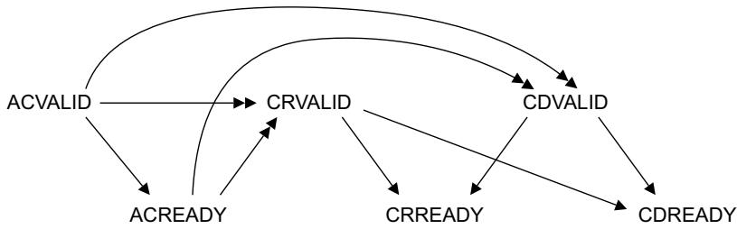  
Figure C3-1 Snoop channel dependencies

Figure C3-1 shows the snoop address, snoop response, and snoop data channel dependencies and shows that:

the interconnect must not wait for the master to assert ACREADY before asserting ACVALID

the master can wait for ACVALID to be asserted before asserting ACREADY

• the master must wait for both ACVALID and ACREADY to be asserted before asserting CRVALID

the master must wait for both ACVALID and ACREADY to be asserted before asserting CDVALID

the master must not wait for the interconnect to assert CRREADY or CDREADY before asserting CRVALID

if data transfer is required to complete the snoop operation, the master must not wait for the interconnect to assert CRREADY or CDREADY before asserting CDVALID

the interconnect can wait for CRVALID or CDVALID, if data transfer is required, or both before asserting CRREADY

the interconnect can wait for CRVALID or CDVALID, if data transfer is required, or both before asserting CDREADY.

# Coherency Transactions on the Read Address and Write Address Channels

This chapter describes the transactions that can be issued by an initiating master on the read address and write address channels. The expected channel activity for each transaction group is described, and a brief overview is given for each transaction together with a description of the associated cache line state changes. It contains the following sections:

About an initiating master on page C4-190

About snoop filtering on page C4-193

State changes on different transactions on page C4-194

State change descriptions on page C4-196

Read transactions on page C4-197

Clean transactions on page C4-203

Make transactions on page C4-206

Write transactions on page C4-208

Evict transactions on page C4-213

Handling overlapping write transactions on page C4-214.

## C4.1 About an initiating master

This section describes the behavior of an initiating master. Typically, an initiating master issues a transaction to progress an internal action such as a load or store operation.

The internal action requires:

for a load, the master must get the data from either:

a valid copy of the appropriate cache line

a transaction that returns valid read data.

for a store, the master needs permission to store the cache line from either:

— a copy of the appropriate cache line in a Unique state

a transaction type that gives the master permission to store the cache line.

## C4.1.1 Transaction groups

The following sections describe the expected channel activity for the transaction groups:

Read transactions

Clean transactions

Make transactions on page C4-191

Write transactions on page C4-191

Evict transactions on page C4-191.

## Read transactions

The read transaction group is:

ReadNoSnoop

ReadOnce

ReadClean

ReadNotSharedDirty

ReadShared

ReadUnique.

A Read transaction progresses as follows:

1. The address is issued on the read address (AR) channel.

2. The data and response is returned on the read data (R) channel. The number of data beats required is determined by ARLEN.

3. Completion of a Read transaction is signaled by the master asserting RACK.

## Clean transactions

The clean transaction group is:

CleanUnique

CleanShared

CleanInvalid.

A Clean transaction progresses as follows:

1. The address is issued on the AR channel.

2. A single transfer on the R channel returns the response. No data is returned for a Clean transaction.

3. Completion of a Clean transaction is signaled by the master asserting RACK.

## Make transactions

The make transaction group is:

MakeUnique

MakeInvalid.

For the initiating master, a Make transaction progresses as follows:

1. The address is issued on the AR channel.

2. A single transfer on the R channel returns the response. No data is returned for a Make transaction.

3. Completion of a Make transaction is signaled by the master asserting RACK.

## Write transactions

The write transaction group is:

WriteNoSnoop

WriteUnique

WriteLineUnique

WriteBack

WriteClean

WriteEvict.

For the initiating master, a Write transaction progresses as follows:

1. The address is issued on the AW channel.

2. The data is transferred on the W channel.

3. The response is returned on the B channel.

4. Completion of a Write transaction is signaled by the master asserting WACK.

## Evict transactions

The evict transaction group is, Evict.

For the initiating master, an Evict transaction progresses as follows:

1. The address is issued on the AW channel.

2. The response is returned on the B channel. No data is transferred for an Evict transaction.

3. Completion of an Evict transaction is signaled by the master asserting WACK.

## Read barrier transactions

For the master initiating the transaction, a Read Barrier transaction progresses as follows:

1. The transaction is issued on the AR channel.

2. A single transfer on the R channel returns the response. No data is returned for a Read Barrier transaction.

3. Completion of a Read Barrier transaction is signaled by the master asserting RACK.

See Chapter C8 Barrier Transactions.

## Write barrier transactions

For the master initiating the transaction, a Write Barrier transaction progresses as follows:

1. The transaction is issued on the AW channel.

2. The response is returned on the B channel. No data is transferred for a Write Barrier transaction.

3. Completion of a Write Barrier transaction is signaled by the master asserting WACK.

See Chapter C8 Barrier Transactions.

## DVM transactions

For the master initiating the transaction, a DVM transaction progresses as follows:

1. The transaction is issued on the AR channel.

2. A single transfer on the R channel returns the response. No data is returned for a DVM transaction.

3. Completion of a DVM transaction is signaled by the master asserting RACK.

See Chapter C12 Distributed Virtual Memory Transactions.

## C4.2 About snoop filtering

Snoop filtering tracks the cache lines that are allocated in a master’s cache. To support an external snoop filter, a cached master must be able to broadcast which cache lines are allocated and which are evicted.

Support for an external snoop filter is optional within the ACE protocol. A master component must state in its data sheet if it provides support. See Chapter C10 Optional External Snoop Filtering for the mechanism the ACE protocol supports for the construction of an external snoop filter.

For a master component that does not support an external snoop filter, the cache line states permitted after a transaction has completed are less strict.

## C4.3 State changes on different transactions

The state changes that can be associated with a transaction are determined by:

the transaction type

• the read response for transactions issued on the AR channel

whether the master supports an external snoop filter

whether the master performs speculative reads.

The rules that apply to a master are:

If a transaction read response has PassDirty asserted, then the cache line must move to a Dirty state. The PassDirty response can be asserted for:

— ReadNotSharedDirty

ReadShared

— ReadUnique.

If a transaction read response has IsShared asserted, then the cache line must move to either a Shared state or the Invalid state. The IsShared response can be asserted for:

— ReadOnce

ReadClean

ReadNotSharedDirty

ReadShared

CleanShared.

A cache line that is in a Unique state is permitted to move to the equivalent Shared state, but this is not expected behavior.

• If an external snoop filter is not supported, a cache line that is in a Clean state can move to the Invalid state.

## C4.3.1 State changes associated with a load

No cache line state change is required for the internal action of a load.

## C4.3.2 State changes associated with a coherent store

Before carrying out the internal operation of a store to a cache line in Shareable memory, the master must ensure that it has permission to store. A master has permission to store if the cache line is in the UniqueClean or UniqueDirty state.

If the master does not have permission to store then it must either:

Issue a transaction on the AR channel that obtains permission to store, and then perform the store to the cache line. After the store to a cache line, the master must be in the UniqueDirty state. The transactions that obtain permission to store are:

ReadUnique

CleanUnique

MakeUnique.

Issue a transaction on the AW channel that obtains permission to store and also updates main memory. The transactions that obtain permission to store data and also update main memory are:

— WriteUnique

— WriteLineUnique.

## C4.3.3 State changes associated with a main memory update

An update to main memory can be performed when the cache line is in a Dirty state.

When a master is given permission to update main memory, the earliest the associated write transaction can occur is the cycle after the RVALID/RREADY handshake in which RLAST is asserted for the transaction that gave permission to update main memory.

An update to main memory is performed using a WriteBack or WriteClean transaction.

After an update to main memory, the cache line must be in a Clean or Invalid state.

If an external snoop filter is supported, then the following restrictions apply:

after a WriteBack transaction, the cache line must be in the Invalid state

after a WriteClean transaction, the cache line must be in a Clean state.

## C4.3.4 State changes associated with cache maintenance operations

The cache maintenance transactions are:

CleanShared

CleanInvalid

MakeInvalid.

Before issuing a cache maintenance transaction, the master must ensure that:

for CleanShared, the cache line must be in a Clean or Invalid state

for CleanInvalid and MakeInvalid, the cache line must be in the Invalid state.

Note

A cache maintenance transaction does not change the cache line state.

## C4.4 State change descriptions

The cache line state changes associated with a transaction are defined in the following sections:

Read transactions on page C4-197

Clean transactions on page C4-203

Make transactions on page C4-206

Write transactions on page C4-208

Evict transactions on page C4-213.

For each transaction, the starting state for the transaction and the three possible end state groups are given. The three possible end state groups are:

The expected end states, which are also the end states that this specification recommends.

The full list of legal end states for a cached master that supports an external snoop filter. This set of end states takes into account that:

a cache line in UniqueClean state can always be held in SharedClean state

a cache line in UniqueDirty state can always be held in SharedDirty state.

The full list of legal end states for a cached master that does not support an external snoop filter. This full list of legal end states includes the legal end states for external snoop filter support, and takes into account that a cache line in UniqueClean state, or SharedClean state, can be in the Invalid state.

Some transactions have two tables provided. The first table shows the expected starting states for which the transaction is issued. The second table shows the other permitted starting states for which the transaction is not normally issued. For example, a ReadShared transaction with a Valid starting state. Typically, the transaction and starting state combinations in the second table are associated with a speculative read where the master issues a transaction before it has determined the state of the cache line in its local cache.

Any state not shown as a starting state in the tables is not a legal starting state.

The starting state is defined as the cache line state just before the transaction response is received by the initiating master. If the initiating master receives a snoop transaction to the same cache line between issuing a transaction and receiving the associated response, then the cache line state changes required by the snoop transaction must be applied first. See Chapter C5 Snoop Transactions.

The following abbreviations are used for the cache line states:

UC UniqueClean.

UD UniqueDirty.

SC SharedClean.

SD SharedDirty.

I Invalid.

## C4.5 Read transactions

This section defines the state changes associated with the Read transaction group that are issued on the AR channel. The Read transactions are:

ReadNoSnoop

ReadOnce on page C4-198

ReadClean on page C4-198

ReadNotSharedDirty on page C4-199

ReadShared on page C4-200

ReadUnique on page C4-201.

## C4.5.1 ReadNoSnoop

ReadNoSnoop is a read transaction that is used in a region of memory that is not Shareable with other masters. The transaction response requirements are:

the IsShared response must be deasserted

the PassDirty response must be deasserted.

Table C4-1 shows the expected cache line state changes for the ReadNoSnoop transaction:

Table C4-1 Expected ReadNoSnoop cache line state changes

<table><tr><td rowspan="2">Transaction</td><td rowspan="2">Start state</td><td>RRESP[3:2]</td><td rowspan="2">Expected end state</td><td>Legal end state</td><td></td></tr><tr><td>IsShared/PassDirty</td><td>With Snoop Filter</td><td>No Snoop Filter</td></tr><tr><td>ReadNoSnoop</td><td>I</td><td>00</td><td>I, UC</td><td>I, UC, SC</td><td>I, UC, SC</td></tr></table>

Note

A ReadNoSnoop transaction does not indicate if the cache line is allocated or not after the transaction has completed.

Table C4-2 shows the other permitted cache line state changes for the ReadNoSnoop transaction:

Table C4-2 Other permitted ReadNoSnoop cache line state changes

<table><tr><td rowspan="2">Transaction</td><td rowspan="2">Start state</td><td>RRESP[3:2]</td><td rowspan="2">Expected end state</td><td>Legal end state</td><td></td></tr><tr><td>IsShared/PassDirty</td><td>With Snoop Filter</td><td>No Snoop Filter</td></tr><tr><td rowspan="4">ReadNoSnoop</td><td>UC</td><td>00</td><td>I, UC</td><td>I, UC, SC</td><td>I, UC, SC</td></tr><tr><td>UD</td><td>00</td><td>UD</td><td>UD, SD</td><td>UD, SD</td></tr><tr><td>SC</td><td>00</td><td>I, UC</td><td>I, UC, SC</td><td>I, UC, SC</td></tr><tr><td>SD</td><td>00</td><td>UD</td><td>UD, SD</td><td>UD, SD</td></tr></table>

## C4.5.2 ReadOnce

ReadOnce is a read transaction that is used in a region of memory that is Shareable with other masters. This transaction is used when a snapshot of the data is required. The location is not cached locally for future use.

The transaction response requirements are:

the IsShared response indicates if the cache line is shared or unique

the PassDirty response must be deasserted.

Table C4-3 shows the expected cache line state changes for the ReadOnce transaction:

Table C4-3 Expected ReadOnce cache line state changes

<table><tr><td rowspan="2">Transaction</td><td rowspan="2">Start state</td><td>RRESP[3:2]</td><td>Expected end state</td><td>Legal end state</td><td></td></tr><tr><td>IsShared/PassDirty</td><td></td><td>With Snoop Filter</td><td>No Snoop Filter</td></tr><tr><td rowspan="2">ReadOnce</td><td rowspan="2">I</td><td>00</td><td>I</td><td>I</td><td>I</td></tr><tr><td>10</td><td>I</td><td>I</td><td>I</td></tr></table>

Table C4-4 shows the other permitted cache line state changes for the ReadOnce transaction:

Table C4-4 Other permitted ReadOnce cache line state changes

<table><tr><td rowspan="2">Transaction</td><td rowspan="2">Start state</td><td>RRESP[3:2]</td><td rowspan="2">Expected end state</td><td>Legal end state</td><td></td></tr><tr><td>IsShared/PassDirty</td><td>With Snoop Filter</td><td>No Snoop Filter</td></tr><tr><td rowspan="6">ReadOnce</td><td>UC</td><td>00</td><td>UC</td><td>UC, SC</td><td>I, UC, SC</td></tr><tr><td>UD</td><td>00</td><td>UD</td><td>UD, SD</td><td>UD, SD</td></tr><tr><td rowspan="2">SC</td><td>00</td><td>UC</td><td>UC, SC</td><td>I, UC, SC</td></tr><tr><td>10</td><td>SC</td><td>SC</td><td>I, SC</td></tr><tr><td rowspan="2">SD</td><td>00</td><td>UD</td><td>UD, SD</td><td>UD, SD</td></tr><tr><td>10</td><td>SD</td><td>SD</td><td>SD</td></tr></table>

## C4.5.3 ReadClean

ReadClean is a read transaction that is used in a region of memory that is Shareable with other masters. A ReadClean transaction is guaranteed not to pass responsibility for updating main memory to the initiating master.

Typically, a ReadClean transaction is used by a master that wants to obtain a clean copy of a cache line, for example a master with a write-through cache.

The transaction response requirements are:

the IsShared response indicates if the cache line is shared or unique

the PassDirty response must be deasserted.

Table C4-5 shows the expected cache line state changes for the ReadClean transaction:  
Table C4-5 Expected ReadClean cache line state changes

<table><tr><td rowspan="2">Transaction</td><td rowspan="2">Start state</td><td>RRESP[3:2]</td><td>Expected end state</td><td>Legal end state</td><td></td></tr><tr><td>IsShared/PassDirty</td><td></td><td>With Snoop Filter</td><td>No Snoop Filter</td></tr><tr><td rowspan="2">ReadClean</td><td rowspan="2">I</td><td>00</td><td>UC</td><td>UC, SC</td><td>I, UC, SC</td></tr><tr><td>10</td><td>SC</td><td>SC</td><td>I, SC</td></tr></table>

Table C4-6 shows other permitted cache line state changes for the ReadClean transaction:

Table C4-6 Other permitted ReadClean cache line state changes

<table><tr><td rowspan="2">Transaction</td><td rowspan="2">Start state</td><td>RRESP[3:2]</td><td rowspan="2">Expected end state</td><td>Legal end state</td><td></td></tr><tr><td>IsShared/PassDirty</td><td>With Snoop Filter</td><td>No Snoop Filter</td></tr><tr><td rowspan="6">ReadClean</td><td>UC</td><td>00</td><td>UC</td><td>UC, SC</td><td>I, UC, SC</td></tr><tr><td>UD</td><td>00</td><td>UD</td><td>UD, SD</td><td>UD, SD</td></tr><tr><td rowspan="2">SC</td><td>00</td><td>UC</td><td>UC, SC</td><td>I, UC, SC</td></tr><tr><td>10</td><td>SC</td><td>SC</td><td>I, SC</td></tr><tr><td rowspan="2">SD</td><td>00</td><td>UD</td><td>UD, SD</td><td>UD, SD</td></tr><tr><td>10</td><td>SD</td><td>SD</td><td>SD</td></tr></table>

## C4.5.4 ReadNotSharedDirty

ReadNotSharedDirty is a read transaction that is used in a region of memory that is Shareable with other masters. A ReadNotSharedDirty transaction can complete with any combination of the IsShared and PassDirty responses with the exception of both IsShared and PassDirty asserted.

Typically, the transaction is used by a cached master that is carrying out a load operation and can accept the cache line in any state except the SharedDirty state.

The transaction response requirements are:

the IsShared response indicates if the cache line is shared or unique

the PassDirty response indicates if the cache line is clean or dirty

if the IsShared response indicates that the cache line is shared, then the PassDirty response must indicate that the cache line is clean.

Table C4-7 shows the expected cache line state changes for the ReadNotSharedDirty transaction:

Table C4-7 Expected ReadNotSharedDirty cache line state changes

<table><tr><td rowspan="2">Transaction</td><td rowspan="2">Start state</td><td>RRESP[3:2]</td><td>Expected end state</td><td>Legal end state</td><td></td></tr><tr><td>IsShared/PassDirty</td><td></td><td>With Snoop Filter</td><td>No Snoop Filter</td></tr><tr><td rowspan="3">ReadNotSharedDirty</td><td rowspan="3">I</td><td>00</td><td>UC</td><td>UC, SC</td><td>I, UC, SC</td></tr><tr><td>01</td><td>UD</td><td>UD, SD</td><td>UD, SD</td></tr><tr><td>10</td><td>SC</td><td>SC</td><td>I, SC</td></tr></table>

Table C4-8 shows other permitted cache line state changes for the ReadNotSharedDirty transaction:  
Table C4-8 Other permitted ReadNotSharedDirty cache line state changes

<table><tr><td rowspan="2">Transaction</td><td rowspan="2">Start state</td><td>RRESP[3:2]</td><td>Expected end state</td><td colspan="2">Legal end state</td></tr><tr><td>IsShared/PassDirty</td><td></td><td>With Snoop Filter</td><td>No Snoop Filter</td></tr><tr><td rowspan="7">ReadNotSharedDirty</td><td>UC</td><td>00</td><td>UC</td><td>UC, SC</td><td>I, UC, SC</td></tr><tr><td>UD</td><td>00</td><td>UD</td><td>UD, SD</td><td>UD, SD</td></tr><tr><td rowspan="3">SC</td><td>00</td><td>UC</td><td>UC, SC</td><td>I, UC, SC</td></tr><tr><td>01</td><td>UD</td><td>UD, SD</td><td>UD, SD</td></tr><tr><td>10</td><td>SC</td><td>SC</td><td>I, SC</td></tr><tr><td rowspan="2">SD</td><td>00</td><td>UD</td><td>UD, SD</td><td>UD, SD</td></tr><tr><td>10</td><td>SD</td><td>SD</td><td>SD</td></tr></table>

Note  
If a cache line starts in the SharedClean state, and the transaction response has PassDirty asserted, the cache line must move to a Dirty state.

## C4.5.5 ReadShared

ReadShared is a read transaction that is used in a region of memory that is Shareable with other masters. A ReadShared transaction can complete with any combination of the IsShared and PassDirty responses.

Typically, the ReadShared transaction is used by a cached master that is carrying out a load operation and can accept the cache line in any state.

The transaction response requirements are:

the IsShared response indicates if the cache line is shared or unique

the PassDirty response indicates if the cache line is clean or dirty.

Table C4-9 shows the expected cache line state changes for the ReadShared transaction:

Table C4-9 Expected ReadShared cache line state changes

<table><tr><td rowspan="2">Transaction</td><td rowspan="2">Start state</td><td>RRESP[3:2]</td><td>Expected end state</td><td>Legal end state</td><td></td></tr><tr><td>IsShared/PassDirty</td><td></td><td>With Snoop Filter</td><td>No Snoop Filter</td></tr><tr><td rowspan="4">ReadShared</td><td rowspan="4">I</td><td>00</td><td>UC</td><td>UC, SC</td><td>I, UC, SC</td></tr><tr><td>01</td><td>UD</td><td>UD, SD</td><td>UD, SD</td></tr><tr><td>10</td><td>SC</td><td>SC</td><td>I, SC</td></tr><tr><td>11</td><td>SD</td><td>SD</td><td>SD</td></tr></table>

Table C4-10 shows other permitted state changes for the ReadShared transaction:  
Table C4-10 Other permitted ReadShared cache line state changes

<table><tr><td rowspan="2">Transaction</td><td rowspan="2">Start state</td><td>RRESP[3:2]</td><td>Expected end state</td><td>Legal end state</td><td></td></tr><tr><td>IsShared/PassDirty</td><td></td><td>With Snoop Filter</td><td>No Snoop Filter</td></tr><tr><td rowspan="8">ReadShared</td><td>UC</td><td>00</td><td>UC</td><td>UC, SC</td><td>I, UC, SC</td></tr><tr><td>UD</td><td>00</td><td>UD</td><td>UD, SD</td><td>UD, SD</td></tr><tr><td rowspan="4">SC</td><td>00</td><td>UC</td><td>UC, SC</td><td>I, UC, SC</td></tr><tr><td>01</td><td>UD</td><td>UD, SD</td><td>UD, SD</td></tr><tr><td>10</td><td>SC</td><td>SC</td><td>I, SC</td></tr><tr><td>11</td><td>SD</td><td>SD</td><td>SD</td></tr><tr><td rowspan="2">SD</td><td>00</td><td>UD</td><td>UD, SD</td><td>UD, SD</td></tr><tr><td>10</td><td>SD</td><td>SD</td><td>SD</td></tr></table>

Note

If a cache line starts in the SharedClean state, and the transaction response has PassDirty asserted, the cache line must move to a Dirty state.

## C4.5.6 ReadUnique

A ReadUnique transaction is used in a region of memory that is Shareable with other masters. The transaction gets a copy of the data and also ensures that the cache line can be held in a Unique state. This permits the master to carry out a store operation to the cache line.

Typically, a ReadUnique transaction is used when the initiating master is carrying out a partial cache line store and does not have a copy of the cache line.

The transaction response requirements are:

the IsShared response must be deasserted to indicate that the cache line is unique

the PassDirty response must indicate if the cache line is clean or dirty.

Note

The cache line state changes associated with the ReadUnique transaction that Table C4-11 and Table C4-12 on page C4-202 show, do not include the cache line state changes associated with any subsequent store operation by the master once the cache line is in a Unique state.

Table C4-11 shows the expected cache line state changes for the ReadUnique transaction:  
Table C4-11 Expected ReadUnique cache line state changes

<table><tr><td rowspan="2">Transaction</td><td rowspan="2">Start state</td><td>RRESP[3:2]</td><td>Expected end state</td><td>Legal end state</td><td></td></tr><tr><td>IsShared/PassDirty</td><td></td><td>With Snoop Filter</td><td>No Snoop Filter</td></tr><tr><td rowspan="2">ReadUnique</td><td rowspan="2">I</td><td>00</td><td>UC</td><td>UC, SC</td><td>I, UC, SC</td></tr><tr><td>01</td><td>UD</td><td>UD, SD</td><td>UD, SD</td></tr></table>

Table C4-12 shows other permitted cache line state changes for the ReadUnique transaction:  
Table C4-12 Other permitted ReadUnique cache line state changes

<table><tr><td rowspan="2">Transaction</td><td rowspan="2">Start state</td><td>RRESP[3:2]</td><td rowspan="2">Expected end state</td><td>Legal end state</td><td></td></tr><tr><td>IsShared/PassDirty</td><td>With Snoop Filter</td><td>No Snoop Filter</td></tr><tr><td rowspan="5">ReadUnique</td><td>UC</td><td>00</td><td>UC</td><td>UC, SC</td><td>I, UC, SC</td></tr><tr><td>UD</td><td>00</td><td>UD</td><td>UD, SD</td><td>UD, SD</td></tr><tr><td rowspan="2">SC</td><td>00</td><td>UC</td><td>UC, SC</td><td>I, UC, SC</td></tr><tr><td>01</td><td>UD</td><td>UD, SD</td><td>UD, SD</td></tr><tr><td>SD</td><td>00</td><td>UD</td><td>UD, SD</td><td>UD, SD</td></tr></table>

## C4.6 Clean transactions

This section defines the state changes associated with the Clean transaction group that are issued on the AR channel. The Clean transactions are:

CleanUnique

CleanShared on page C4-204

CleanInvalid on page C4-205.

## C4.6.1 CleanUnique

A CleanUnique transaction is used in a region of memory that is Shareable with other masters. The CleanUnique transaction ensures that:

The cache line can be held in a Unique state. This permits the master to carry out a store operation to the cache line, but the transaction does not obtain a copy of the data for the master.

Data held in another cache in a Dirty state is written to main memory and all other copies of the cache line are removed.

Typically, a CleanUnique transaction is used before a partial cache line store operation to Shareable memory when the master already has a copy of the data.

The transaction response requirements are:

the IsShared response must be deasserted to indicate that the cache line is unique

the PassDirty response must be deasserted.

The cache line state changes associated with the CleanUnique transaction that Table C4-13 and Table C4-14 on page C4-204 show, do not include the cache line state changes associated with any subsequent store operation by the master once the cache line is in a Unique state.

Table C4-13 shows the expected cache line state changes for the CleanUnique transaction:  
Table C4-13 Expected CleanUnique cache line state changes

<table><tr><td rowspan="2">Transaction</td><td rowspan="2">Start state</td><td>RRESP[3:2]</td><td rowspan="2">Expected end state</td><td>Legal end state</td><td></td></tr><tr><td>IsShared/PassDirty</td><td>With Snoop Filter</td><td>No Snoop Filter</td></tr><tr><td rowspan="2">CleanUnique</td><td>SC</td><td>00</td><td>UC</td><td>UC, SC</td><td>I, UC, SC</td></tr><tr><td>SD</td><td>00</td><td>UD</td><td>UD, SD</td><td>UD, SD</td></tr></table>

Table C4-14 shows other permitted cache line state changes for the CleanUnique transaction:  
Table C4-14 Other permitted CleanUnique cache line state changes

<table><tr><td rowspan="2">Transaction</td><td rowspan="2">Start state</td><td>RRESP[3:2]</td><td rowspan="2">Expected end state</td><td>Legal end state</td><td></td></tr><tr><td>IsShared/PassDirty</td><td>With Snoop Filter</td><td>No Snoop Filter</td></tr><tr><td rowspan="3">CleanUnique</td><td>I</td><td>00</td><td>I</td><td> $I^a$ </td><td>I</td></tr><tr><td>UC</td><td>00</td><td>UC</td><td>UC, SC</td><td>I, UC, SC</td></tr><tr><td>UD</td><td>00</td><td>UD</td><td>UD, SD</td><td>UD, SD</td></tr></table>

a. See Snoop filter cache line allocation awareness.

On completing a CleanUnique transaction, the initiating master has permission to store to the cache line. If the cache line was in the Invalid state before the store operation, then the store must be a full cache line size for the cache line to be allocated in the cache. After the full cache line store, the cache line is in the UniqueDirty state. The store must occur atomically with the completion of the CleanUnique transaction. Therefore, any snoop that occurs after the CleanUnique transaction must be delayed until the store is complete.

CleanUnique transactions can be used for Exclusive accesses, see Chapter C9 Exclusive Accesses.

## Snoop filter cache line allocation awareness

A snoop filter regards a cache line as allocated after the completion of a CleanUnique transaction. Therefore, the snoop filter has the correct information on the allocation of a cache line in the following circumstances:

The cache line was allocated before the CleanUnique transaction and remains allocated after the CleanUnique transaction completes.

If the cache line was not allocated before the CleanUnique transaction, or the cache line was invalidated during the CleanUnique transaction, then when the CleanUnique transaction completes the master:

Performs a full cache line store and the cache line is allocated.

Performs a WriteBack transaction of either a full or partial cache line store, and indicates to the snoop filter that the cache line is no longer allocated.

Reissues another transaction, for example a ReadUnique transaction, before performing a full or partial cache line store and the cache line becomes allocated.

Does not perform a store operation. In this situation the master must issue an Evict transaction to indicate to the snoop filter that the cache line is no longer allocated.

## C4.6.2 CleanShared

A CleanShared transaction is a broadcast cache clean operation. It can be used in Shareable and Non-shareable memory regions.

A CleanShared transaction is used to ensure all cached copies of a main memory location are clean.

If the master carrying out the cache maintenance operation holds the cache line in a Dirty state then the master must carry out a WriteBack or WriteClean transaction so that the cache line is in a Clean state before it issues a CleanShared transaction.

The transaction response requirements are:

the IsShared response indicates if the cache line is shared or unique

the PassDirty response must be deasserted.

Table C4-15 shows the expected cache line state changes for the CleanShared transaction:  
Table C4-15 Expected CleanShared cache line state changes

<table><tr><td rowspan="2">Transaction</td><td rowspan="2">Start state</td><td>RRESP[3:2]</td><td>Expected end state</td><td>Legal end state</td><td></td></tr><tr><td>IsShared/PassDirty</td><td></td><td>With Snoop Filter</td><td>No Snoop Filter</td></tr><tr><td rowspan="5">CleanShared</td><td rowspan="2">I</td><td>00</td><td>I</td><td>I</td><td>I</td></tr><tr><td>10</td><td>I</td><td>I</td><td>I</td></tr><tr><td>UC</td><td>00</td><td>UC</td><td>UC, SC</td><td>I, UC, SC</td></tr><tr><td rowspan="2">SC</td><td>00</td><td>UC</td><td>UC, SC</td><td>I, UC, SC</td></tr><tr><td>10</td><td>SC</td><td>SC</td><td>I, SC</td></tr></table>

## C4.6.3 CleanInvalid

A CleanInvalid transaction is a broadcast cache clean and invalidate operation. It can be used in Shareable and Non-shareable memory regions.

A CleanInvalid transaction is used to ensure that main memory is updated and there are no cached copies of a main memory location.

Note

If the master carrying out the cache maintenance operation holds the cache line in a Dirty state, then the master must carry out a WriteBack or WriteClean transaction, and then invalidate the cache line, so that the cache line is in the Invalid state before it issues a CleanInvalid transaction.

The transaction response requirements are:

the IsShared response must be deasserted

the PassDirty response must be deasserted.

Table C4-16 shows the expected cache line state changes for the CleanShared transaction:

Table C4-16 Expected CleanInvalid cache line state changes

<table><tr><td rowspan="2">Transaction</td><td rowspan="2">Start state</td><td>RRESP[3:2]</td><td rowspan="2">Expected end state</td><td>Legal end state</td><td></td></tr><tr><td>IsShared/PassDirty</td><td>With Snoop Filter</td><td>No Snoop Filter</td></tr><tr><td>CleanInvalid</td><td>I</td><td>00</td><td>I</td><td>I</td><td>I</td></tr></table>

## C4.7 Make transactions

This section defines the state changes associated with the Make transaction group that are issued on the AR channel. The Make transactions are:

MakeUnique

MakeInvalid on page C4-207.

## C4.7.1 MakeUnique

A MakeUnique transaction is used in a region of memory that is Shareable with other masters. The MakeUnique transaction ensures that:

The cache line can be held in a Unique state. This permits the master to carry out a store operation to the cache line, but the transaction does not obtain a copy of the data for the master.

All other copies of the cache line are removed.

Note

A MakeUnique transaction must only be used by an initiating master that is carrying out a full cache line store operation.

The transaction response requirements are:

the IsShared response must be deasserted indicating that the cache line is unique

the PassDirty response must be deasserted.

The expected cache line state changes for a MakeUnique transaction are different from all other transactions because a MakeUnique transaction must be coupled to a full cache line store operation.

Table C4-17 shows the expected cache line state changes for the MakeUnique transaction with a full cache line store operation:

Table C4-17 Expected MakeUnique cache line state changes

<table><tr><td rowspan="2">Transaction</td><td rowspan="2">Start state</td><td>RRESP[3:2]</td><td rowspan="2">Expected end state</td><td>Legal end state</td><td></td></tr><tr><td>IsShared/PassDirty</td><td>With Snoop Filter</td><td>No Snoop Filter</td></tr><tr><td rowspan="3">MakeUnique with full cache line store</td><td>I</td><td>00</td><td>UD</td><td>UD, SD</td><td>UD, SD</td></tr><tr><td>SC</td><td>00</td><td>UD</td><td>UD, SD</td><td>UD, SD</td></tr><tr><td>SD</td><td>00</td><td>UD</td><td>UD, SD</td><td>UD, SD</td></tr></table>

Table C4-18 shows the other permitted cache line state changes for the MakeUnique transaction with a full cache line store operation:

Table C4-18 Other permitted MakeUnique cache line state changes

<table><tr><td rowspan="2">Transaction</td><td rowspan="2">Start state</td><td>RRESP[3:2]</td><td rowspan="2">Expected end state</td><td>Legal end state</td><td></td></tr><tr><td>IsShared/PassDirty</td><td>With Snoop Filter</td><td>No Snoop Filter</td></tr><tr><td rowspan="2">MakeUnique with full cache line store</td><td>UC</td><td>00</td><td>UD</td><td>UD, SD</td><td>UD, SD</td></tr><tr><td>UD</td><td>00</td><td>UD</td><td>UD, SD</td><td>UD, SD</td></tr></table>

## C4.7.2 MakeInvalid

A MakeInvalid transaction is a broadcast cache invalidate operation. It can be used in Shareable and Non-shareable memory regions.

A MakeInvalid transaction is used to ensure that there are no cached copies of a main memory location.

Note

If the master carrying out the cache maintenance operation holds the cache line in a Valid state, then the master must invalidate the cache line, so that the cache line is in the Invalid state before it issues a MakeInvalid transaction

The transaction response requirements are:

the IsShared response must be deasserted

• the PassDirty response must be deasserted.

Table C4-19 shows the expected cache line state changes for the MakeInvalid transaction:

Table C4-19 Expected MakeInvalid cache line state changes

<table><tr><td rowspan="2">Transaction</td><td rowspan="2">Start state</td><td>RRESP[3:2]</td><td rowspan="2">Expected end state</td><td>Legal end state</td><td></td></tr><tr><td>IsShared/PassDirty</td><td>With Snoop Filter</td><td>No Snoop Filter</td></tr><tr><td>MakeInvalid</td><td>I</td><td>00</td><td>I</td><td>I</td><td>I</td></tr></table>

## C4.8 Write transactions

This section defines the state changes associated with the Write transaction group that are issued on the AW channel. The Write transactions are:

WriteNoSnoop

WriteUnique on page C4-209

WriteLineUnique on page C4-209

WriteBack on page C4-210

WriteClean on page C4-210.

WriteEvict on page C4-211

For details of the specific restrictions and the handling of overlapping writes see:

Restrictions on WriteUnique and WriteLineUnique usage on page C4-212

Handling overlapping write transactions on page C4-214.

## C4.8.1 WriteNoSnoop

A WriteNoSnoop transaction is used in a region of memory that is not Shareable with other masters. A WriteNoSnoop transaction can result from:

a program action, such as a store operation

an update of main memory for a cache line that is in a Non-shareable region of memory.

Table C4-20 shows the expected cache line state changes for the WriteNoSnoop transaction:

Table C4-20 Expected WriteNoSnoop cache line state changes

<table><tr><td rowspan="2">Transaction</td><td rowspan="2">Start state</td><td rowspan="2">Expected end state</td><td colspan="2">Legal end state</td></tr><tr><td>With Snoop Filter</td><td>No Snoop Filter</td></tr><tr><td rowspan="3">WriteNoSnoop</td><td>I</td><td>I</td><td>I, UC, SC</td><td>I, UC, SC</td></tr><tr><td>UC</td><td>UC</td><td>I, UC, SC</td><td>I, UC, SC</td></tr><tr><td>UD</td><td>UC</td><td>I, UC, SC</td><td>I, UC, SC</td></tr></table>

Note

A cache line must only move from the Invalid state to a Valid state if a full cache line store has been performed.

Table C4-21 shows the other permitted cache line state changes for the WriteNoSnoop transaction:

Table C4-21 Other permitted WriteNoSnoop cache line state changes

<table><tr><td rowspan="2">Transaction</td><td rowspan="2">Start state</td><td rowspan="2">Expected end state</td><td colspan="2">Legal end state</td></tr><tr><td>With Snoop Filter</td><td>No Snoop Filter</td></tr><tr><td rowspan="2">WriteNoSnoop</td><td>SC</td><td>UC</td><td>I, UC, SC</td><td>I, UC, SC</td></tr><tr><td>SD</td><td>UC</td><td>I, UC, SC</td><td>I, UC, SC</td></tr></table>

## C4.8.2 WriteUnique

A WriteUnique transaction is used in a region of memory that is Shareable with other masters. A single write occurs that is required to propagate to main memory or a downstream cache.

There are restrictions on the use of WriteUnique transactions by cached masters that can hold dirty cache lines. See Restrictions on WriteUnique and WriteLineUnique usage on page C4-212.

Table C4-22 shows the expected cache line state changes for the WriteUnique transaction:

Table C4-22 Expected WriteUnique cache line state changes

<table><tr><td rowspan="2">Transaction</td><td rowspan="2">Start state</td><td rowspan="2">Expected end state</td><td colspan="2">Legal end state</td></tr><tr><td>With Snoop Filter</td><td>No Snoop Filter</td></tr><tr><td rowspan="3">WriteUnique</td><td>I</td><td>I</td><td>I</td><td>I</td></tr><tr><td>UC</td><td>SC</td><td>SC</td><td>I, SC</td></tr><tr><td>SC</td><td>SC</td><td>SC</td><td>I, SC</td></tr></table>

In the case of master holding a line in a Clean state while performing a WriteUnique transaction, the cache line must be updated to the new value when the WriteUnique transaction response is received.

## C4.8.3 WriteLineUnique

A WriteLineUnique transaction is used in a region of memory that is Shareable with other masters. A single write occurs, that is required to propagate to main memory or a downstream cache.

Note

A WriteLineUnique transaction must be a full cache line store and all bytes within the cache line must be updated.

There are restrictions on the use of WriteLineUnique transactions by cached masters that can hold dirty cache lines. See Restrictions on WriteUnique and WriteLineUnique usage on page C4-212.

Table C4-23 shows the expected cache line state changes for the WriteLineUnique transaction.

Table C4-23 Expected WriteLineUnique cache line state changes

<table><tr><td rowspan="2">Transaction</td><td rowspan="2">Start state</td><td rowspan="2">Expected end state</td><td colspan="2">Legal end state</td></tr><tr><td>With Snoop Filter</td><td>No Snoop Filter</td></tr><tr><td rowspan="3">WriteLineUnique</td><td>I</td><td>I</td><td>I</td><td>I</td></tr><tr><td>UC</td><td>SC</td><td>SC</td><td>I, SC</td></tr><tr><td>SC</td><td>SC</td><td>SC</td><td>I, SC</td></tr></table>

In the case of master holding a line in a Clean state while performing a WriteLineUnique transaction, the cache line must be updated to the new value when the WriteLineUnique transaction response is received.

## C4.8.4 WriteBack

A WriteBack transaction is a write that can be used in Shareable and Non-shareable regions of memory. A WriteBack transaction is a write of a dirty cache line to update main memory or a downstream cache.

Note

The difference between a WriteBack and a WriteClean transaction is whether or not the cache line remains allocated in the cache for a Shareable region of memory. After a WriteBack transaction the cache line is no longer allocated. After a WriteClean transaction the cache line remains allocated.

The permitted state changes that Table C4-24 and Table C4-25 show, do not take into account a preceding store operation that makes a cache line dirty. If a store operation and WriteBack transaction occur as an atomic process, then the legal cache line state changes can be determined by combining the legal state changes for a store operation, see State changes associated with a coherent store on page C4-194, followed by the legal state changes for a WriteBack transaction

Table C4-24 shows the expected cache line state changes for the WriteBack transaction in a Shareable memory region.

Table C4-24 Expected WriteBack cache line state changes in a Shareable memory region

<table><tr><td rowspan="2">Transaction</td><td rowspan="2">Start state</td><td rowspan="2">Expected end state</td><td colspan="2">Legal end state</td></tr><tr><td>With Snoop Filter</td><td>No Snoop Filter</td></tr><tr><td rowspan="2">WriteBack</td><td>UD</td><td>I</td><td>I</td><td>I, UC, SC</td></tr><tr><td>SD</td><td>I</td><td>I</td><td>I, SC</td></tr></table>

Table C4-25 shows the expected cache line state changes for the WriteBack transaction in a Non-shareable memory region.

Table C4-25 Expected WriteBack cache line state changes in a Non-shareable memory region

<table><tr><td rowspan="2">Transaction</td><td rowspan="2">Start state</td><td rowspan="2">Expected end state</td><td colspan="2">Legal end state</td></tr><tr><td>With Snoop Filter</td><td>No Snoop Filter</td></tr><tr><td rowspan="2">WriteBack</td><td>UD</td><td>I</td><td>I, UC, SC</td><td>I, UC, SC</td></tr><tr><td>SD</td><td>I</td><td>I, UC, SC</td><td>I, UC, SC</td></tr></table>

## C4.8.5 WriteClean

A WriteClean transaction is a write operation that can be used in Shareable and Non-shareable regions of memory. A WriteClean transaction is a write of a dirty cache line to update main memory or a downstream cache.

Note

The difference between a WriteClean and a WriteBack transaction is whether or not the cache line remains allocated in the cache for a Shareable region of memory. After a WriteClean transaction the cache line remains allocated. After a WriteBack transaction the cache line is no longer allocated.

The permitted state changes that Table C4-26 on page C4-211 and Table C4-27 on page C4-211 show, do not take into account any preceding store operation that makes a cache line dirty. If a store operation and WriteBack transaction occur as an atomic process, then the legal cache line state changes can be determined by combining the legal state changes for a store operation, see State changes associated with a coherent store on page C4-194, followed by the legal state changes for a WriteClean transaction.

Table C4-26 shows the expected cache line state changes for the WriteClean transaction in a Shareable memory region.

Table C4-26 Expected WriteClean cache line state changes in a Shareable memory region

<table><tr><td rowspan="2">Transaction</td><td rowspan="2">Start state</td><td rowspan="2">Expected end state</td><td colspan="2">Legal end state</td></tr><tr><td>With Snoop Filter</td><td>No Snoop Filter</td></tr><tr><td rowspan="2">WriteClean</td><td>UD</td><td>UC</td><td>UC, SC</td><td>I, UC, SC</td></tr><tr><td>SD</td><td>SC</td><td>SC</td><td>I, SC</td></tr></table>

Table C4-27 shows the expected cache line state changes for the WriteClean transaction in a Non-shareable memory region.

Table C4-27 Expected WriteClean cache line state changes in a Non-shareable memory region

<table><tr><td rowspan="2">Transaction</td><td rowspan="2">Start state</td><td rowspan="2">Expected end state</td><td colspan="2">Legal end state</td></tr><tr><td>With Snoop Filter</td><td>No Snoop Filter</td></tr><tr><td rowspan="2">WriteClean</td><td>UD</td><td>UC</td><td>I, UC, SC</td><td>I, UC, SC</td></tr><tr><td>SD</td><td>UC</td><td>I, UC, SC</td><td>I, UC, SC</td></tr></table>

## C4.8.6 WriteEvict

A WriteEvict transaction can be used when evicting a clean cache line. This transaction is used to write the line to a lower level of the cache hierarchy, such as an L3 or system level cache. A WriteEvict transaction is not required to update main memory.

A WriteEvict transaction must only be used in the following circumstances:

when the cache line is held in a UniqueClean state

when the cache line has not been speculatively fetched from outside of its shareability domain.

It is important that a cache line that could have been speculatively fetched, such that it was located outside of its shareability domain, could become out-of-date as the cache line is not required to be updated by subsequent stores to the cache line. If a cache line could be a stale copy it must not be written back into its shareability domain by the use of a WriteEvict transaction.

## A WriteEvict transaction can be discarded.

A component can use the WriteEvict\_Transaction property to declare whether or not it supports WriteEvict transactions. Any master must permit the WriteEvict transaction to be disabled to ensure that the master operates correctly with any previous version of the ACE interface.

Table C4-28 shows the expected cache line state changes for the WriteEvict transaction.

Table C4-28 Expected WriteEvict cache line state changes

<table><tr><td rowspan="2">Transaction</td><td rowspan="2">Start state</td><td rowspan="2">Expected end state</td><td colspan="2">Legal end state</td></tr><tr><td>With Snoop Filter</td><td>No Snoop Filter</td></tr><tr><td>WriteEvict</td><td>UC</td><td>I</td><td>I</td><td>I</td></tr></table>

## C4.8.7 Restrictions on WriteUnique and WriteLineUnique usage

Typically, WriteUnique and WriteLineUnique transactions are used by a non-cached component that is writing to a Shareable region of memory. However, WriteUnique and WriteLineUnique transactions can be used by a cached component that meets the necessary requirements.

A cached component must be able to complete any incoming snoop transaction while a WriteUnique or WriteLineUnique transaction is in progress. This means that a cached component must:

Complete any outstanding WriteBack, WriteClean, or WriteEvict transactions before issuing a WriteUnique or WriteLineUnique transaction.

Note

No additional WriteBack, WriteClean, or WriteEvict transactions can be issued until all outstanding WriteUnique or WriteLineUnique transactions are completed.

Complete any incoming snoop transactions without the use of WriteBack, WriteClean, or WriteEvict transactions while a WriteUnique or WriteLineUnique transaction is in progress.

Note

WriteNoSnoop transactions can also be blocked behind WriteUnique and WriteLineUnique transactions. Therefore, the design of the master must ensure that an incoming snoop transaction can complete if a WriteNoSnoop transaction is blocked by an outstanding WriteUnique or WriteLineUnique transaction.

This is necessary, because earlier transactions, that also might require earlier snoop transactions to complete, can prevent WriteUnique and WriteLineUnique transactions from progressing.

These requirements restrict the use of WriteUnique and WriteLineUnique transactions to components that can either:

complete all snoop transactions without requiring any data to be supplied, for example write-through caches that do not keep dirty cache lines for Shareable data

complete snoop transactions through the use of the snoop data channel, CDDATA.

These mechanisms only need to be used when a WriteUnique or WriteLineUnique transaction is in progress.

## C4.9 Evict transactions

This section defines the state changes associated with the Evict transaction group that are issued on the AW channel.

## C4.9.1 Evict

An Evict transaction indicates that a cache line has been evicted from a master’s local cache. There is no data transfer associated with an Evict transaction. An Evict transaction must only be used in a Shareable memory region.

Note

An Evict transaction is only used by a master that supports a snoop filter.

Table C4-29 shows the expected cache line state changes for the Evict transaction.

Table C4-29 Expected Evict cache line state changes in a Shareable memory region

<table><tr><td rowspan="2">Transaction</td><td rowspan="2">Start state</td><td rowspan="2">Expected end state</td><td colspan="2">Legal end state</td></tr><tr><td>With Snoop Filter</td><td>No Snoop Filter</td></tr><tr><td rowspan="2">Evict</td><td>UC</td><td>I</td><td>I</td><td>Not used</td></tr><tr><td>SC</td><td>I</td><td>I</td><td>Not used</td></tr></table>

## C4.10 Handling overlapping write transactions

This section describes the expected behavior when two masters attempt stores to the same cache line in a Shareable region of memory at approximately the same time. When this happens, it is the responsibility of the interconnect to sequence the order in which the transactions occur.

The master that gets sequenced first proceeds with the transaction as normal, however the master that is sequenced second sees the transactions associated with the first master’s store on its snoop port while attempting to carry out a store.

The following sections describe the expected behavior from the standpoint of the master that is sequenced second. For brevity, the master that is sequenced first is referred to as master1 and the master that is sequenced second is referred to as master2.

## C4.10.1 Overlapping ReadUnique

If master2 has issued a ReadUnique transaction because it required a copy of the data, the following occurs:

1. Master2 issues a ReadUnique transaction.

2. Master2 then sees one of the following transactions on its snoop port from master1 attempting a write to the same line:

ReadUnique

CleanInvalid

MakeInvalid.

At this point master2 must invalidate any local copy it has of the cache line. If master2 does not have a local copy of the cache line then no action is required.

3. When the ReadUnique completes, it returns with the updated copy of the cache line that includes the store performed by master1.

4. Master2 can perform its store.

## C4.10.2 Overlapping MakeUnique

If master2 has issued a MakeUnique transaction because it was performing a full cache line write, the following occurs:

1. Master2 issues a MakeUnique transaction.

2. Master2 sees one of the following transactions on its snoop port from master1 attempting a write to the same line:

ReadUnique

CleanInvalid

MakeInvalid.

At this point master2 must invalidate any local copy it has of the cache line. If master2 does not have a local copy of the cache line then no action is required.

3. When the MakeUnique completes, Master2 can perform its full cache line store.

## C4.10.3 Overlapping CleanUnique

If master2 has issued a CleanUnique transaction because it was performing a partial line store but it already had a cached copy of the line, the following occurs:

1. Master2 issues a CleanUnique transaction.

2. Master2 sees one of the following transactions on its snoop port from master1 attempting a write to the same line:

ReadUnique

CleanInvalid

MakeInvalid.

At this point master2 must respond to the snoop appropriately and then invalidate its local copy of the cache line.

3. When the CleanUnique completes, Master2 cannot perform its local store because it has lost its local copy of the cache line.

4. Master2 can issue a new ReadUnique transaction to obtain a copy of the line.

5. Master2 can perform its store.

A master can remove the need to issue a new ReadUnique the transaction, as described in the CleanUnique case, by initially issuing a ReadUnique transaction instead of a CleanUnique transaction. However, this sometimes results in a fetch from main memory occurring when it is not required.

Alternatively, a master can remove the need to issue a new ReadUnique transaction by performing a partial line WriteBack to main memory, that only updates the required bytes, when its CleanUnique transaction completes and the master has permission to store to the line. This does mean that the master does not retain a copy of the line.

It is acceptable for a master to use a CleanUnique transaction when carrying out a full cache line store. In this case, the master does not have to retry the transaction with a ReadUnique, it can simply perform the full cache line store when the CleanUnique is complete.

## Chapter C5 Snoop Transactions

This chapter describes the snoop transactions seen on the snoop address channel. Both the required and protocol-recommended snoop transaction behaviors are described. It contains the following sections:

Mapping coherency operations to snoop operations on page C5-218

General requirements for snoop transactions on page C5-221

Snoop transactions on page C5-227.

## C5.1 Mapping coherency operations to snoop operations

This section describes the snoop transactions seen on the snoop address channel by a cached master that is being snooped by an initiating master.

When an initiating master issues a transaction, the interconnect is responsible for carrying out any snoop transactions required to complete the original transaction.

Not all transactions issued by an initiating master are permitted on the snoop address channel. Table C5-1 shows the protocol-recommended mappings between transactions issued by the initiating master and the snoop transactions seen on the snoop address channel by a cached master.

Table C5-1 Recommended transaction mappings

<table><tr><td>Transaction from initiating master</td><td>Transaction to snooped master</td></tr><tr><td>ReadNoSnoop</td><td>Not snooped</td></tr><tr><td>ReadOnce</td><td>ReadOnce</td></tr><tr><td>ReadClean</td><td>ReadClean</td></tr><tr><td>ReadNotSharedDirty</td><td>ReadNotSharedDirty</td></tr><tr><td>ReadShared</td><td>ReadShared</td></tr><tr><td>ReadUnique</td><td>ReadUnique</td></tr><tr><td>CleanUnique</td><td>CleanInvalid</td></tr><tr><td>MakeUnique</td><td>MakeInvalid</td></tr><tr><td>CleanShared</td><td>CleanShared</td></tr><tr><td>CleanInvalid</td><td>CleanInvalid</td></tr><tr><td>MakeInvalid</td><td>MakeInvalid</td></tr><tr><td>WriteNoSnoop</td><td>Not snooped</td></tr><tr><td>WriteUnique</td><td>CleanInvalid</td></tr><tr><td>WriteLineUnique</td><td>MakeInvalid</td></tr><tr><td>WriteBack</td><td>Not snooped</td></tr><tr><td>WriteClean</td><td>Not snooped</td></tr><tr><td>WriteEvict</td><td>Not snooped</td></tr><tr><td>Evict</td><td>Not snooped</td></tr></table>

## C5.1.1 Permitted snoop transactions

Although the protocol does not require a fixed set of transaction mappings, the protocol does require that only the following defined subset of transactions are seen on the snoop address channel of a cached master:

ReadOnce

ReadClean

ReadNotSharedDirty

ReadShared

ReadUnique

CleanInvalid

MakeInvalid

CleanShared.

## C5.1.2 Transactions not permitted as snoop transactions

The following transactions must not be seen on the snoop address channel of a cached master:

ReadNoSnoop

CleanUnique

MakeUnique

WriteNoSnoop

WriteUnique

WriteLineUnique

WriteBack

WriteClean

WriteEvict

Evict.

## C5.1.3 Alternative snoop transactions

Table C5-2 shows each permitted snoop transaction on the snoop address channel, the required cache line state change for the transaction, and the alternative snoop transaction that can be used. For completeness, the snoop transaction option column includes the original snoop transaction.

Table C5-2 Snoop transaction options on the address snoop channel

<table><tr><td>Snoop transaction</td><td>Required cache line state change</td><td>Snoop transaction option</td></tr><tr><td>ReadOnce</td><td>None</td><td>ReadOnceReadClean, ReadNotSharedDirty, ReadSharedReadUnique, CleanInvalidCleanShared</td></tr><tr><td>ReadClean</td><td>Shared or Invalid</td><td>ReadClean, ReadNotSharedDirty, ReadSharedReadUnique, CleanInvalid</td></tr><tr><td>ReadNotSharedDirty</td><td>Shared or Invalid</td><td>ReadClean, ReadNotSharedDirty, ReadSharedReadUnique, CleanInvalid</td></tr><tr><td>ReadShared</td><td>Shared or Invalid</td><td>ReadClean, ReadNotSharedDirty, ReadSharedReadUnique, CleanInvalid</td></tr><tr><td>ReadUnique</td><td>Invalid</td><td>ReadUnique, CleanInvalid</td></tr><tr><td>CleanInvalid</td><td>Invalid</td><td>ReadUnique, CleanInvalid</td></tr><tr><td>CleanShared</td><td>Clean or Invalid</td><td>ReadUnique, CleanInvalidCleanShared</td></tr></table>

Mapping to different snoop transactions can simplify the design of a snooped master. For example, a snooped master can handle all snoop transactions in the same way as a ReadUnique transaction. This is permitted because a ReadUnique transaction, as Table C5-2 on page C5-219 shows, is an alternative snoop transaction for all other snoop transactions.

## C5.2 General requirements for snoop transactions

For each snoop transaction, the protocol specifies required and recommended behaviors.

Table C5-3 shows the required behavior for each snoop transaction:

Table C5-3 Required snoop transaction behavior

<table><tr><td>Snoop transaction</td><td>Must transfer data if dirty</td><td>End state must be Shared or Invalid</td><td>End state must be Invalid</td><td>End state must be Clean or Invalid</td></tr><tr><td>ReadOnce</td><td>Yes</td><td>-</td><td>-</td><td>-</td></tr><tr><td>ReadClean</td><td>Yes</td><td>Yes</td><td>-</td><td>-</td></tr><tr><td>ReadNotSharedDirty</td><td>Yes</td><td>Yes</td><td>-</td><td>-</td></tr><tr><td>ReadShared</td><td>Yes</td><td>Yes</td><td>-</td><td>-</td></tr><tr><td>ReadUnique</td><td>Yes</td><td>-</td><td>Yes</td><td>-</td></tr><tr><td>CleanInvalid</td><td>Yes</td><td>-</td><td>Yes</td><td>-</td></tr><tr><td>MakeInvalid</td><td>-</td><td>-</td><td>Yes</td><td>-</td></tr><tr><td>CleanShared</td><td>Yes</td><td>-</td><td>-</td><td>Yes</td></tr></table>

If a cache line is in the Dirty state, and the associated cache does not assert the PassDirty snoop response, CRRESP[2], the cache line can remain in the Dirty state. If a cache line is in the Dirty state and the associated cache does assert the PassDirty snoop response, then the cache line must move to a Clean or Invalid state.

The cache line end states in Table C5-3 are classified as follows:

## Shared or Invalid

The snooped cache must broadcast a transaction before it can perform a store to the cache line. That is, the snooped cache must consider that another master can hold a copy of the cache line.

Invalid The snooped cache does not hold a copy of the line. This permits another agent to perform a store to the cache line.

## Clean or Invalid

The snooped cache is not holding the cache line in a Dirty state. The snooped cache cannot perform a memory update, using a WriteBack or WriteClean transaction, until a later store to the cache line has occurred.

The following state changes must not occur due to a snoop transaction. A cache line must not move from:

the Invalid state to any Valid state

a Clean state to a Dirty state

a Shared state to a Unique state

the UniqueDirty state to the UniqueClean state.

Note

A cache line must not move from the UniqueDirty state to the UniqueClean state because such a transition would indicate that the interconnect has taken responsibility for writing back the cache line to main memory. Therefore, the cached master must not issue a WriteBack or WriteClean transaction without requesting permission to store to the cache line using an appropriate transaction.

The cache line end state that is permitted as a result of a snoop transaction is dependant on:

the state of the cache line before the snoop

the snoop transaction that is issued.

Table C5-4 shows the permitted end states for valid combinations of the initial state and the issued snoop transaction. Combinations of initial state and end state that are not permitted as a result of a snoop transaction are excluded from Table C5-4.

A WriteBack, WriteClean, WriteEvict, or Evict transaction can occur while a snoop transaction is in progress. Table C5-4 does not include the state transition that can occur as a result of these write or evict transactions occurring. To understand such a scenario, the state transition for the WriteBack, WriteClean, WriteEvict, or Evict transaction must be applied, followed by the snoop transaction state transition that Table C5-4 shows.

The following abbreviations are used for the cache line states:

UC UniqueClean.

UD UniqueDirty.

SC SharedClean.

SD SharedDirty.

I Invalid.

Table C5-4 Permitted end states for combinations of initial state and snoop transaction

<table><tr><td colspan="2">Cache line state</td><td colspan="4">Permitted for snoop transaction</td></tr><tr><td>Initial</td><td>End</td><td>ReadOnce</td><td>ReadClean ReadNotSharedDirty ReadShared</td><td>ReadUnique CleanInvalid MakeInvalid</td><td>Clean Shared</td></tr><tr><td>I</td><td>I</td><td>Yes</td><td>Yes</td><td>Yes</td><td>Yes</td></tr><tr><td rowspan="3">UC</td><td>I</td><td>Yes</td><td>Yes</td><td>Yes</td><td>Yes</td></tr><tr><td>UC</td><td>Yes</td><td>-</td><td>-</td><td>Yes</td></tr><tr><td>SC</td><td>Yes</td><td>Yes</td><td>-</td><td>Yes</td></tr><tr><td rowspan="4">UD</td><td>I</td><td>Yes</td><td>Yes</td><td>Yes</td><td>Yes</td></tr><tr><td>UD</td><td>Yes</td><td>-</td><td>-</td><td>-</td></tr><tr><td>SC</td><td>Yes</td><td>Yes</td><td>-</td><td>Yes</td></tr><tr><td>SD</td><td>Yes</td><td>Yes</td><td>-</td><td>-</td></tr><tr><td rowspan="2">SC</td><td>I</td><td>Yes</td><td>Yes</td><td>Yes</td><td>Yes</td></tr><tr><td>SC</td><td>Yes</td><td>Yes</td><td>-</td><td>Yes</td></tr><tr><td rowspan="3">SD</td><td>I</td><td>Yes</td><td>Yes</td><td>Yes</td><td>Yes</td></tr><tr><td>SC</td><td>Yes</td><td>Yes</td><td>-</td><td>Yes</td></tr><tr><td>SD</td><td>Yes</td><td>Yes</td><td>-</td><td>-</td></tr></table>

The requirements for the IsShared and PassDirty snoop response bits are as follows:

if the end state of the cache line is any Valid state, the IsShared snoop response bit must be asserted

if the cache line moves from a Dirty state to a Clean state, the PassDirty snoop response bit must be asserted

if the line moves from a Dirty state to the Invalid state, as a result of any snoop transaction except MakeInvalid, the PassDirty snoop response bit must be asserted

if the cache line moves from a Dirty state to the Invalid state, as a result of a MakeInvalid snoop transaction, the PassDirty snoop response bit can be asserted or deasserted.

The permitted state changes in Table C5-4 on page C5-222 are combined with these requirements in Table C5-5 to show the permitted state changes and associated snoop response bits.

Table C5-5 Associated snoop responses for combinations of initial state and snoop transaction

<table><tr><td colspan="2">Cache line state</td><td colspan="4">Permitted for snoop transaction</td><td colspan="2">Snoop Response</td></tr><tr><td>Initial</td><td>End</td><td>ReadOnce</td><td>ReadClean ReadNotSharedDirty ReadShared</td><td>ReadUnique CleanInvalid MakeInvalid</td><td>CleanShared</td><td>PassDirty</td><td>IsShared</td></tr><tr><td>I</td><td>I</td><td>Yes</td><td>Yes</td><td>Yes</td><td>Yes</td><td>0</td><td>0</td></tr><tr><td rowspan="3">UC</td><td>I</td><td>Yes</td><td>Yes</td><td>Yes</td><td>Yes</td><td>0</td><td>0</td></tr><tr><td>UC</td><td>Yes</td><td>-</td><td>-</td><td>Yes</td><td>0</td><td>1</td></tr><tr><td>SC</td><td>Yes</td><td>Yes</td><td>-</td><td>Yes</td><td>0</td><td>1</td></tr><tr><td rowspan="4">UD</td><td>I</td><td>Yes</td><td>Yes</td><td>Yes</td><td>Yes</td><td> $1^a$ </td><td>0</td></tr><tr><td>UD</td><td>Yes</td><td>-</td><td>-</td><td>-</td><td>0</td><td>1</td></tr><tr><td>SC</td><td>Yes</td><td>Yes</td><td>-</td><td>Yes</td><td>1</td><td>1</td></tr><tr><td>SD</td><td>Yes</td><td>Yes</td><td>-</td><td>-</td><td>0</td><td>1</td></tr><tr><td rowspan="2">SC</td><td>I</td><td>Yes</td><td>Yes</td><td>Yes</td><td>Yes</td><td>0</td><td>0</td></tr><tr><td>SC</td><td>Yes</td><td>Yes</td><td>-</td><td>Yes</td><td>0</td><td>1</td></tr><tr><td rowspan="3">SD</td><td>I</td><td>Yes</td><td>Yes</td><td>Yes</td><td>Yes</td><td> $1^a$ </td><td>0</td></tr><tr><td>SC</td><td>Yes</td><td>Yes</td><td>-</td><td>Yes</td><td>1</td><td>1</td></tr><tr><td>SD</td><td>Yes</td><td>Yes</td><td>-</td><td>-</td><td>0</td><td>1</td></tr></table>

a. For a MakeInvalid snoop transaction these PassDirty responses are also permitted to be 0.

## C5.2.1 Channel activity

The required channel activity is the same for all snoop transactions:

the address is received on the AC channel

the response is returned on the CR channel

the data is provided, if required, on the CD channel.

The DataTransfer snoop response bit CRRESP[0], indicates if a data transfer is required.

The snoop response on CR and the snoop data on CD must only be provided after the ACVALID/ACREADY handshake occurs.

## C5.2.2 Snoop data transfers

A cached master can provide the data value of a cache line. The DataTransfer snoop response bit indicates that the data value of the cache line is to be transferred.

If a cached master receives a snoop transaction other than MakeInvalid, for a cache line that is in a Dirty state, then the cached master must ensure that the data value is available so that the original transaction can complete. The cached master can ensure that the data value is available by:

returning the data when it completes the snoop transaction

carrying out a memory update, using a WriteBack or WriteClean transaction, before responding to the snoop transaction.

When a cached master holds a cache line in a Dirty state, the cache line might be the only up to date copy of that address location. Therefore, the data must be made available to any snoop transaction other than a MakeInvalid snoop transaction.

Typically, data is transferred for the following read snoop transactions:

ReadOnce

ReadClean

ReadNotSharedDirty

ReadShared

ReadUnique.

Table C5-6 shows protocol-recommended data transfer behavior for snoop transactions, based on the assumption that better system performance and lower power operation is achieved by providing data in response to these snoop transactions. This behavior is not mandatory, and alternative schemes can be implemented.

Table C5-6 Recommended data transfer behavior for snoop transactions

<table><tr><td>Snoop transaction</td><td>Data transfer if cache line is Clean</td><td>Data transfer if cache line is Dirty</td></tr><tr><td>ReadOnce</td><td>Yes</td><td>Yes</td></tr><tr><td>ReadClean</td><td>Yes</td><td>Yes</td></tr><tr><td>ReadNotSharedDirty</td><td>Yes</td><td>Yes</td></tr><tr><td>ReadShared</td><td>Yes</td><td>Yes</td></tr><tr><td>ReadUnique</td><td>Yes</td><td>Yes</td></tr><tr><td>CleanInvalid</td><td>No</td><td>Yes</td></tr><tr><td>MakeInvalid</td><td>No</td><td>No</td></tr><tr><td>CleanShared</td><td>No</td><td>Yes</td></tr></table>

## C5.2.3 Memory update in progress

The protocol ensures that two components cannot update the same area of main memory at the same time.

If a snooped master receives a snoop transaction when it is updating main memory using either a WriteBack or WriteClean transaction, then it is the responsibility of the snooped master to ensure that no other master can update the same area of main memory at the same time. The snooped master achieves this by one of the following:

giving a snoop response with PassDirty deasserted and IsShared asserted, which does not pass permission to store to the line and does not pass responsibility for updating memory

delaying the snoop response until the snooped master has completed the update to main memory.

When a snooped master is passing the permission to store to a cache line, by sending a suitable snoop response, all write transactions to update main memory must have completed before the cycle in which the snoop response is given on the CR channel.

## C5.2.4 WasUnique snoop response

The WasUnique snoop response, CRRESP[4] indicates that the snooped cache line was held in a Unique state before the snoop transaction.

The WasUnique snoop response must only be asserted if the cache line was held in a Unique state and therefore, no other cache can have a copy of the cache line. A WasUnique response indicates that the interconnect does not have to carry out further snoop transactions to other cached masters because no other cache can hold a copy of the data.

A cached master does not have to generate the WasUnique response. The protocol permits CRRESP[4] to be fixed as deasserted. However, always deasserting WasUnique in this way can result in the cache line being provided to the initiating master as Shared, when it could have been provided as Unique. This might result in additional cache being snooped unnecessarily.

## C5.2.5 Non-blocking requirements for a snooped master

To ensure transactions always progress through a system, the protocol defines rules for snooped masters and the interconnect. The rules stipulate which transactions must always make progress and which transactions can wait for others to complete.

The rules for the interconnect are defined in Chapter C6 Interconnect Requirements. See Non-blocking requirements on page C6-246.

The rules that apply to a cached master are:

A master must complete any snoop transaction, to any address, before any of the following transactions, issued by the master, can be guaranteed to complete:

— Any transaction, to any address, issued on the AR channel

— A WriteUnique or WriteLineUnique transaction, to any address, issued on the AW channel.

Note

See also Restrictions on WriteUnique and WriteLineUnique usage on page C4-212.

A master is permitted to wait for the following transactions to complete, to any address, before completing a snoop transaction:

WriteNoSnoop

WriteBack

WriteClean

WriteEvict

Evict.

If the response to a snoop transaction could result in the interconnect generating a write to main memory, or another master being given permission to write the cache line, then the master being snooped must complete any WriteBack, WriteClean, or WriteEvict transaction that is in progress for the cache line before it provides a response to the snoop transaction.

A master must not wait for a WriteUnique or WriteLineUnique transaction to complete before completing a snoop transaction. If a snoop transaction is received by a master and a WriteUnique or WriteLineUnique transaction is in progress then the snoop transaction must be completed without the use of the AW and W channels.

## Note

This requirement means that if a master has a WriteUnique or WriteLineUnique transaction in progress for any cache line that is in a Dirty state, and it receives a snoop transaction other than a MakeInvalid transaction, then it must return the data on the CD channel.

Figure C5-1 shows the non-blocking requirements.  
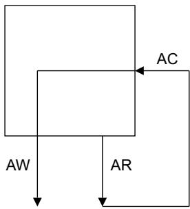  
Figure C5-1 Required transaction channel ordering

In summary, the requirements are:

any transaction on the AR channel can be stalled waiting for a transaction on the AC channel

any snoop transaction on the AC channel can be stalled waiting for a write transaction on the AW channel, except for a WriteUnique or WriteLineUnique transaction.

## C5.3 Snoop transactions

This section describes each of the snoop transactions and provides information on the recommended behavior where options exist.

The following abbreviations are used for the cache line states:

UC UniqueClean.

UD UniqueDirty.

SC SharedClean.

SD SharedDirty.

I Invalid.

## C5.3.1 ReadOnce

Table C5-7 shows all the permitted cache line state changes and the associated PassDirty and IsShared snoop responses for the ReadOnce snoop transaction

Table C5-7 ReadOnce permitted cache line state changes

<table><tr><td rowspan="2">Cache line initial state</td><td rowspan="2">Cache line end state</td><td colspan="2">Snoop Response</td></tr><tr><td>PassDirty, CRRESP[2]</td><td>IsShared, CRRESP[3]</td></tr><tr><td>I</td><td>I</td><td>0</td><td>0</td></tr><tr><td rowspan="3">UC</td><td>I</td><td>0</td><td>0</td></tr><tr><td>UC</td><td>0</td><td>1</td></tr><tr><td>SC</td><td>0</td><td>1</td></tr><tr><td rowspan="4">UD</td><td>I</td><td>1</td><td>0</td></tr><tr><td>UD</td><td>0</td><td>1</td></tr><tr><td>SC</td><td>1</td><td>1</td></tr><tr><td>SD</td><td>0</td><td>1</td></tr><tr><td rowspan="2">SC</td><td>I</td><td>0</td><td>0</td></tr><tr><td>SC</td><td>0</td><td>1</td></tr><tr><td rowspan="3">SD</td><td>I</td><td>1</td><td>0</td></tr><tr><td>SC</td><td>1</td><td>1</td></tr><tr><td>SD</td><td>0</td><td>1</td></tr></table>

A ReadOnce snoop transaction is received by a snooped master when the initiating master indicates that it is not going to keep a cached copy of the cache line it is accessing. The ReadOnce snoop transaction enables the snooped master to:

keep the cache line in a Unique state

carry out a later store to the cache line without issuing a transaction to obtain permission to store.

If the snooped master has a copy of the cache line, then this specification recommends that data is transferred. If the snooped master has the cache line in a Dirty state, then data must be transferred.

This specification recommends that the cache line is passed as Clean. Although it is permitted to pass the cache line as Dirty, this requires the interconnect to write the cache line back to main memory and the cache line to move to either the SharedClean or Invalid state.

Note

The IsShared snoop response must be asserted if the snooped master is retaining a copy of the cache line, even if the retained copy is in a Unique state.

## C5.3.2 ReadClean, ReadShared, and ReadNotSharedDirty

The ReadClean, ReadShared, and ReadNotSharedDirty snoop transactions have the same requirements, but differ in the behavior that this specification recommends.

Table C5-8 shows all the permitted cache line state changes and the associated PassDirty and IsShared snoop responses for these snoop transactions.

Table C5-8 ReadClean, ReadShared, and ReadNotSharedDirty permitted cache line state changes

<table><tr><td rowspan="2">Initial state</td><td rowspan="2">End state</td><td colspan="2">Snoop Response</td></tr><tr><td>PassDirty, CRRESP[2]</td><td>IsShared, CRRESP[3]</td></tr><tr><td>I</td><td>I</td><td>0</td><td>0</td></tr><tr><td rowspan="2">UC</td><td>I</td><td>0</td><td>0</td></tr><tr><td>SC</td><td>0</td><td>1</td></tr><tr><td rowspan="3">UD</td><td>I</td><td>1</td><td>0</td></tr><tr><td>SC</td><td>1</td><td>1</td></tr><tr><td>SD</td><td>0</td><td>1</td></tr><tr><td rowspan="2">SC</td><td>I</td><td>0</td><td>0</td></tr><tr><td>SC</td><td>0</td><td>1</td></tr><tr><td rowspan="3">SD</td><td>I</td><td>1</td><td>0</td></tr><tr><td>SC</td><td>1</td><td>1</td></tr><tr><td>SD</td><td>0</td><td>1</td></tr></table>

If the cached line being snooped is part of an exclusive sequence then the cache line must remain valid in the snooped master.

If data is available, this specification recommends that the data is transferred.

## ReadClean

For a ReadClean snoop transaction, if the responsibility for writing the cache line back to main memory is being passed to the interconnect, as indicated by the PassDirty snoop response being asserted, the cache line is written back to main memory immediately. This specification recommends that the cache line remains Dirty in the snooped cache.

## ReadShared

For a ReadShared snoop transaction, if the responsibility for writing the cache line back to main memory is being passed to the initiating master, then it is accepted by the master. The decision to pass responsibility for writing the cache line that is Dirty back to main memory depends on which master accesses the cache line next:

If the snooped master is likely to be the next master to store to the cache line, then this specification recommends that the cache line remains Dirty in the snooped cache but is passed as Clean to the initiating master.

If the initiating master is likely to be the next master to store to the cache line, then this specification recommends that the cache line is passed to the initiating master as Dirty. In this case:

if it is likely that the initiating master carries out a store before the snooped master next loads from the cache line, then this specification recommends that the snooped master does not retain a cached copy

if it is likely that the snooped cache loads from the cache line before the initiating master performs a store, then this specification recommends that the snooped master does retain a copy of the cache line.

If it is not known whether the initiating master or the snooped master is the next to store to the cache line, then this specification recommends that the cache line is held as Dirty in the cache that is least likely to evict the cache line. Typically, this would be the initiating master, because this is the master that has most recently accessed the cache line.

If the snooped master does not support all five cache states, then less options are available.

If information on the access patterns for a cache line is not available, then this specification recommends that the cache line is passed as Dirty to the initiating master and moves to the SharedClean state in the snooped cache.

## ReadNotSharedDirty

If responsibility for updating main memory is passed to the initiating master, it is only accepted if the cache line moves to the Invalid state in the snooped cache. The decision to pass responsibility for writing the cache line back to main memory depends on which master accesses the cache line next:

if the snooped master is likely to be the next master to store to the cache line, then this specification recommends that the cache line remains Dirty in the snooped cache but is passed as Clean to the initiating master

if the initiating master is likely to be the next master to store to the cache line, then this specification recommends that the cache line is passed to the initiating master as Dirty and the cache line is removed from the snooped cache.

If it is not known which master accesses the cache line next, then no recommendations are provided by this specification.

## C5.3.3 ReadUnique

Table C5-9 shows all the permitted cache line state changes and the associated PassDirty and IsShared snoop responses for the ReadUnique snoop transaction.

Table C5-9 ReadUnique permitted cache line state changes

<table><tr><td>Initial state</td><td>End state</td><td colspan="2">Snoop response</td></tr><tr><td></td><td></td><td>PassDirty, CRRESP[2]</td><td>IsShared, CRRESP[3]</td></tr><tr><td>I</td><td>I</td><td>0</td><td>0</td></tr><tr><td>UC</td><td>I</td><td>0</td><td>0</td></tr><tr><td>UD</td><td>I</td><td>1</td><td>0</td></tr><tr><td>SC</td><td>I</td><td>0</td><td>0</td></tr><tr><td>SD</td><td>I</td><td>1</td><td>0</td></tr></table>

For a ReadUnique transaction, if the snooped cache holds a copy of the cache line in a Dirty state, then the data must be transferred.

This specification recommends that data is also transferred if the cache line is in a Clean state.

## C5.3.4 CleanInvalid

Table C5-10 shows all the permitted cache line state changes and the associated PassDirty and IsShared snoop responses for the CleanInvalid snoop transaction.

Table C5-10 CleanInvalid permitted cache line state changes

<table><tr><td>Initial state</td><td>End state</td><td colspan="2">Snoop response</td></tr><tr><td></td><td></td><td>PassDirty, CRRESP[2]</td><td>IsShared, CRRESP[3]</td></tr><tr><td>I</td><td>I</td><td>0</td><td>0</td></tr><tr><td>UC</td><td>I</td><td>0</td><td>0</td></tr><tr><td>UD</td><td>I</td><td>1</td><td>0</td></tr><tr><td>SC</td><td>I</td><td>0</td><td>0</td></tr><tr><td>SD</td><td>I</td><td>1</td><td>0</td></tr></table>

For a CleanInvalid transaction, if the snooped cache holds a copy of the cache line in a Dirty state, then the data must be transferred.

This specification recommends that data is not transferred if the cache line is in a Clean state.

## C5.3.5 MakeInvalid

Table C5-11 shows all the permitted cache line state changes and the associated PassDirty and IsShared snoop responses for the MakeInvalid snoop transaction.

Table C5-11 MakeInvalid permitted cache line state changes

<table><tr><td rowspan="2">Initial state</td><td rowspan="2">End state</td><td colspan="2">Snoop response</td></tr><tr><td>PassDirty, CRRESP[2]</td><td>IsShared, CRRESP[3]</td></tr><tr><td>I</td><td>I</td><td>0</td><td>0</td></tr><tr><td>UC</td><td>I</td><td>0</td><td>0</td></tr><tr><td rowspan="2">UD</td><td rowspan="2">I</td><td>0</td><td>0</td></tr><tr><td>1</td><td>0</td></tr><tr><td>SC</td><td>I</td><td>0</td><td>0</td></tr><tr><td rowspan="2">SD</td><td rowspan="2">I</td><td>0</td><td>0</td></tr><tr><td>1</td><td>0</td></tr></table>

For a MakeInvalid transaction, this specification recommends that the data is not transferred.

Note

## C5.3.6 CleanShared

Table C5-12 shows all the permitted cache line state changes and the associated PassDirty and IsShared snoop responses for the CleanShared snoop transaction.

Table C5-12 CleanShared permitted cache line state changes

<table><tr><td rowspan="2">Initial state</td><td rowspan="2">End state</td><td colspan="2">Snoop response</td></tr><tr><td>PassDirty, CRRESP[2]</td><td>IsShared, CRRESP[3]</td></tr><tr><td>I</td><td>I</td><td>0</td><td>0</td></tr><tr><td rowspan="3">UC</td><td>I</td><td>0</td><td>0</td></tr><tr><td>UC</td><td>0</td><td>1</td></tr><tr><td>SC</td><td>0</td><td>1</td></tr><tr><td rowspan="2">UD</td><td>I</td><td>1</td><td>0</td></tr><tr><td>SC</td><td>1</td><td>1</td></tr><tr><td rowspan="2">SC</td><td>I</td><td>0</td><td>0</td></tr><tr><td>SC</td><td>0</td><td>1</td></tr><tr><td rowspan="2">SD</td><td>I</td><td>1</td><td>0</td></tr><tr><td>SC</td><td>1</td><td>1</td></tr></table>

For a CleanShared transaction, if the snooped cache holds a copy of the cache line in a Dirty state, then the data must be transferred.

This specification recommends that the data is not transferred if the cache line is in a Clean state.

## Note

The IsShared snoop response must be asserted if the snooped master is retaining a copy of the cache line, even if the retained copy is in a Unique state.

# Chapter C6 Interconnect Requirements

This chapter describes the interconnect requirements for ACE. It contains the following sections:

About the interconnect requirements on page C6-234

Sequencing transactions on page C6-235

Issuing snoop transactions on page C6-238

Transaction responses from the interconnect on page C6-241

Interactions with main memory on page C6-243

Other requirements on page C6-246

Interoperability considerations on page C6-248.

This chapter does not describe the interconnect requirements for barriers or DVM operations. See Chapter C8 Barrier Transactions and Chapter C12 Distributed Virtual Memory Transactions for these requirements.

## C6.1 About the interconnect requirements

It is the responsibility of the interconnect to:

receive transactions from an initiating master

determine the order of transactions when multiple transactions are received at the same time

issue snoop transactions, as required, for each transaction from an initiating master

receive snoop responses and data, when data is provided, from a snooped master

generate the response for the initiating master

• carry out any required access to main memory.

## C6.2 Sequencing transactions

Many masters might issue transactions at the same time. The protocol permits each master to make multiple outstanding requests, and to receive multiple outstanding snoop transactions.

It is the responsibility of the interconnect to ensure that there is a defined order in which transactions to the same cache line can occur, and that the defined order is the same for all components. In the case of two masters issuing transactions to the same cache line at approximately the same time, then the interconnect determines which of the transactions is sequenced first and which is sequenced last. The arbitration method used by the interconnect is not defined by the protocol.

The interconnect indicates the order of transactions to the same cache line by sequencing transaction responses and snoop transactions to the masters. The ordering rules are:

if a master issues a Coherent or Cache Maintenance transaction to a cache line and it receives a snoop transaction to the same cache line before it receives a response to the transaction it has issued, then the snoop transaction is defined as ordered first.

if a master issues a Coherent or Cache Maintenance transaction to a cache line and it receives a response to the transaction before it receives a snoop transaction to the same cache line, then the transaction issued by the master is defined as ordered first.

Note

The relative ordering of transaction responses and snoop transactions only applies to transactions to the same cache line.

The interconnect must ensure the following:

if the interconnect provides a master with a response to a Coherent or Cache Maintenance transaction, it must not send that master a snoop transaction to the same cache line before it has received the associated RACK or WACK response from that master

if the interconnect sends a snoop transaction to a master, it must not provide that master with a response to a Coherent or Cache Maintenance transaction to the same cache line before it has received the associated CRRESP response from that master.

The diagram in Figure C6-1 shows that from the point that a master starts to receive a transaction response it is guaranteed not to receive a snoop transaction to the same cache line until it has asserted the acknowledge signal, indicating that the transaction has completed.

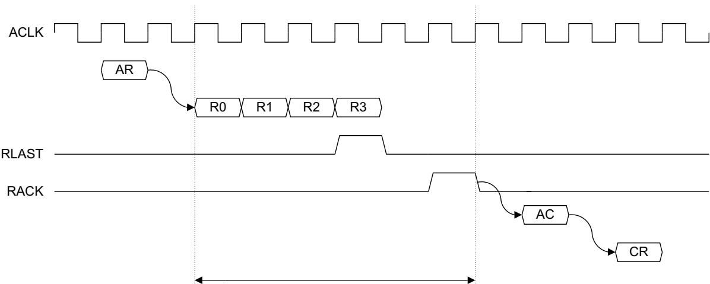  
Master does not observe a snoop to the same line during a transaction response  
Figure C6-1 Transaction response before a snoop transaction

snoop operation to the same cache line is in progress

The diagram in Figure C6-2 shows that if a master receives a snoop transaction to a cache line to which it has issued a transaction, but has not yet received a transaction response, then it is guaranteed not to see a transaction response until it has provided a snoop response.

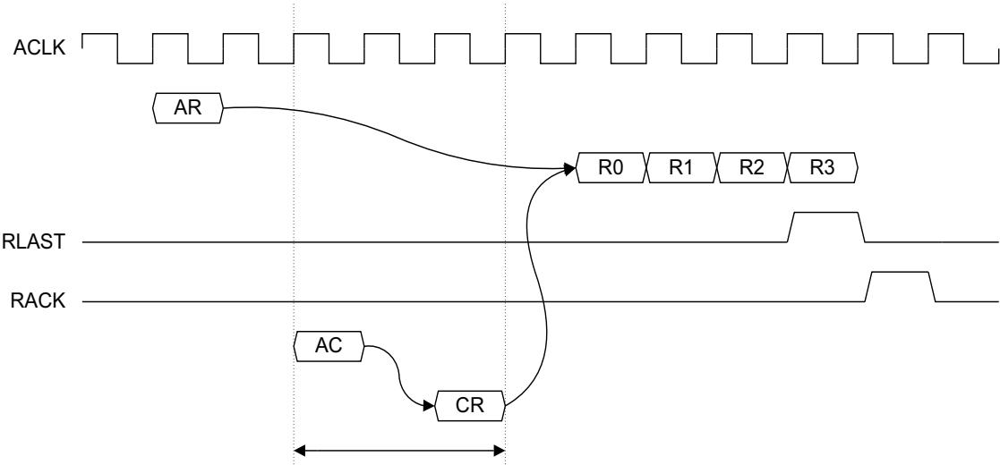  
Figure C6-2 Snoop transaction before a transaction response

## C6.2.1 Read and Write Acknowledge

The read and write acknowledge signals are required to ensure correct operation where there is a delay between an interconnect and the master completing a transaction. For example, this can occur when a register or clock domain boundary exists between the interconnect and the master.

The master provides the read acknowledge signal RACK and the write acknowledge signal WACK to guarantee that the interconnect can determine when a transaction has completed at the master.

The master sends the RACK and WACK signals for all transactions, not only Shareable transactions. This permits the signals to be generated using only the handshake signals on the read data channel or write response channel respectively.

The master must only send a read acknowledge after the last read data transfer in which RLAST is asserted. See Read acknowledge signaling on page C3-175.

The master must only send a write acknowledge after the write response handshake has occurred. See Write Acknowledge signaling on page C3-177.

There is no mechanism to stall the RACK or WACK signal. The interconnect is required to accept the acknowledge in the same cycle as the master asserted the read or write acknowledge.

## C6.2.2 Continuous read data return

To specify that a system provides continuous read data return, a Continuous\_Cache\_Line\_Read\_Data property is defined that can be True or False for an ACE interconnect.

An ACE interconnect is declared as having this property if the Continuous\_Cache\_Line\_Read\_Data property is set to True. Any interconnect that does not support the Continuous\_Cache\_Line\_Read\_Data property has the default value of False.

A master is defined as requiring this property if it requires that once the first data beat of a cache line read is returned, then all subsequent data transfers for that cache line are returned without requiring forward progress on any snoop transaction.

An interconnect is defined as supporting this property if it is guaranteed that once the first data beat of a cache line read is returned, then all subsequent data transfers for that cache line are returned without requiring forward progress on any snoop transaction.

This property is only required for transaction types that are precisely a cache line size:

all ReadClean, ReadShared, ReadUnique, and ReadNotSharedDirty transactions

ReadOnce transactions that are precisely a cache line size

ReadNoSnoop transactions that are Non-shareable, WriteThrough or WriteBack Cacheable, and are precisely a cache line size.

Note

This specification recommends this behavior for all new designs.

## C6.3 Issuing snoop transactions

It is the responsibility of the interconnect to generate the snoop transactions required to progress a transaction from an initiating master.

The transaction from the initiating master determines which cached masters in the shareability domain must be snooped:

The following transactions do not cause a snoop of any cached masters:

— ReadNoSnoop

— WriteNoSnoop

WriteBack

WriteClean

WriteEvict

Evict.

• The following transactions must cause a snoop of the cached masters that can hold a copy of the cache line:

— ReadOnce

ReadClean

ReadNotSharedDirty

ReadShared.

Snooping of the cached masters must continue until any one of the following occurs:

a copy of the line is obtained

— a snoop response is received with WasUnique, CRRESP[4], asserted

all caches have been snooped.

The CleanShared transaction must cause a snoop of the cached masters that can hold a copy of the cache line until any one of the following occurs:

a dirty copy of the line is obtained, as indicated by snoop response PassDirty, CRRESP[2], being asserted

— a snoop response is received with WasUnique, CRRESP[4], asserted

all caches have been snooped.

The following transactions must cause a snoop of the cached masters that can hold a copy of the cache line:

ReadUnique

CleanUnique

— MakeUnique

— CleanInvalid

MakeInvalid

— WriteUnique

— WriteLineUnique.

Snooping of the cached masters must continue until either of the following occurs:

— a snoop response is received with WasUnique, CRRESP[4], asserted

— all caches have been snooped.

Note

The interconnect must not issue a snoop transaction to the initiating master.

Table C6-1 on page C6-239 shows for each transaction issued by the initiating master:

• the snooped cache line state change that must be ensured by the interconnect

• the snoop transaction that this specification recommends the interconnect to use

the optional snoop transactions that the interconnect can use.

In Table C6-1, the snoop transaction that this specification recommends is also included as an optional snoop transaction.

Table C6-1 Interconnect snoop requirements

<table><tr><td>Transaction from Initiating Master</td><td>State change for the snooped cache</td><td>Recommended Snoop transaction</td><td>Optional Snoop transaction</td></tr><tr><td>ReadNoSnoop</td><td>None</td><td>-</td><td>-</td></tr><tr><td>ReadOnce</td><td>None</td><td>ReadOnce</td><td>ReadOnceReadClean, ReadNotSharedDirty, ReadShared ReadUnique, CleanInvalid CleanShared</td></tr><tr><td>ReadClean</td><td>Shared or Invalid</td><td>ReadClean</td><td>ReadClean, ReadNotSharedDirty, ReadShared ReadUnique, CleanInvalid</td></tr><tr><td>ReadNotSharedDirty</td><td>Shared or Invalid</td><td>ReadNotSharedDirty</td><td>ReadClean, ReadNotSharedDirty, ReadShared ReadUnique, CleanInvalid</td></tr><tr><td>ReadShared</td><td>Shared or Invalid</td><td>ReadShared</td><td>ReadClean, ReadNotSharedDirty, ReadShared ReadUnique, CleanInvalid</td></tr><tr><td>ReadUnique</td><td>Invalid</td><td>ReadUnique</td><td>ReadUnique,  $CleanInvalid^a$ </td></tr><tr><td>CleanUnique</td><td>Invalid</td><td>CleanInvalid</td><td>ReadUnique,  $CleanInvalid^a$ </td></tr><tr><td>MakeUnique</td><td>Invalid</td><td>MakeInvalid</td><td>ReadUnique, CleanInvalid MakeInvalid</td></tr><tr><td>CleanShared</td><td>Clean or Invalid</td><td>CleanShared</td><td>ReadUnique, CleanInvalid CleanShared</td></tr><tr><td>CleanInvalid</td><td>Invalid</td><td>CleanInvalid</td><td>ReadUnique,  $CleanInvalid^a$ </td></tr><tr><td>MakeInvalid</td><td>Invalid</td><td>MakeInvalid</td><td>ReadUnique, CleanInvalid MakeInvalid</td></tr><tr><td>WriteNoSnoop</td><td>None</td><td>-</td><td>-</td></tr><tr><td>WriteUnique</td><td>Invalid</td><td>CleanInvalid</td><td>ReadUnique,  $CleanInvalid^a$ </td></tr><tr><td>WriteLineUnique</td><td>Invalid</td><td>MakeInvalid</td><td>ReadUnique, CleanInvalid MakeInvalid</td></tr><tr><td>WriteBack</td><td>None</td><td>-</td><td>-</td></tr><tr><td>WriteClean</td><td>None</td><td>-</td><td>-</td></tr><tr><td>WriteEvict</td><td>None</td><td>-</td><td>-</td></tr><tr><td>Evict</td><td>None</td><td>-</td><td>-</td></tr></table>

a. Other optional snoop transactions can be used if the cached masters in the same shareability domain are not all snooped at the same time.

The interconnect is not required to snoop all caches at the same time, caches can be snooped sequentially.

When the interconnect is snooping multiple cached masters, it is not required to snoop all the cached masters in an identical manner.

If the interconnect is carrying out the snoop transactions sequentially, that is, it is issuing some snoop transactions after other snoop transactions for the same cache line have completed, then after a snoop response is received with PassDirty asserted, it is permitted to use the MakeInvalid snoop transaction for the remaining cached masters that are still to be snooped. The transactions that can benefit from this use of the MakeInvalid snoop transaction are:

WriteUnique

ReadUnique

CleanUnique

CleanInvalid.

## C6.4 Transaction responses from the interconnect

The interconnect must provide a response for all transactions from an initiating master.

Table C6-2 shows the permitted response from the interconnect for a transaction issued on the AR channel.

Table C6-2 Permitted interconnect response for a transaction on the AR channel

<table><tr><td rowspan="2">Transaction from initiating master</td><td colspan="2">Permitted response from the interconnect</td></tr><tr><td>IsShared, RRESP[3]</td><td>PassDirty, RRESP[2]</td></tr><tr><td>ReadNoSnoop</td><td>0</td><td>0</td></tr><tr><td rowspan="2">ReadOnce</td><td>0</td><td>0</td></tr><tr><td>1</td><td>0</td></tr><tr><td rowspan="2">ReadClean</td><td>0</td><td>0</td></tr><tr><td>1</td><td>0</td></tr><tr><td rowspan="3">ReadNotSharedDirty</td><td>0</td><td>0</td></tr><tr><td>0</td><td>1</td></tr><tr><td>1</td><td>0</td></tr><tr><td rowspan="4">ReadShared</td><td>0</td><td>0</td></tr><tr><td>0</td><td>1</td></tr><tr><td>1</td><td>0</td></tr><tr><td>1</td><td>1</td></tr><tr><td rowspan="2">ReadUnique</td><td>0</td><td>0</td></tr><tr><td>0</td><td>1</td></tr><tr><td>CleanUnique</td><td>0</td><td>0</td></tr><tr><td>MakeUnique</td><td>0</td><td>0</td></tr><tr><td rowspan="2">CleanShared</td><td>0</td><td>0</td></tr><tr><td>1</td><td>0</td></tr><tr><td>CleanInvalid</td><td>0</td><td>0</td></tr><tr><td>MakeInvalid</td><td>0</td><td>0</td></tr></table>

The interconnect must determine the IsShared response for the following transactions from the initiating master:

ReadOnce

ReadClean

ReadNotSharedDirty

ReadShared

CleanShared.

After snooping all the required cached masters, the IsShared response to the initiating master for these transactions is determined as follows:

If WasUnique was asserted for any snoop response received by the interconnect then:

If IsShared was asserted for that snoop response then, IsShared must be asserted in the transaction response to the initiating master.

If IsShared was deasserted for that snoop response then, this specification recommends that IsShared is deasserted in the transaction response to the initiating master. However, it is permitted to assert IsShared in the transaction response to the initiating master.

If WasUnique was not asserted for any snoop response received by the interconnect then:

If any snoop responses had IsShared asserted then, IsShared must be asserted in the transaction response to the initiating master.

If all snoop responses received by the interconnect had IsShared and DataTransfer deasserted then, IsShared must be deasserted in the transaction response to the initiating master.

If all snoop responses received by the interconnect had IsShared deasserted and any snoop response had DataTransfer asserted then, this specification recommends that IsShared is deasserted in the transaction response to the initiating master. However, it is permitted to assert IsShared in the transaction response to the initiating master.

The interconnect must determine the PassDirty response to the initiating master for the following transactions:

ReadNotSharedDirty

ReadShared

ReadUnique.

After snooping all the required cached masters, the PassDirty response to the initiating master for these transactions is determined as follows:

If PassDirty was asserted for any snoop response received by the interconnect, and the interconnect has not generated a write transaction to update main memory, then PassDirty must be asserted in the transaction response to the initiating master.

## Note

Only transactions initiated on the AR channel have additional response bits returned with the transaction response to the initiating master on the R channel.

Write transactions do not have additional response bits, and the response from the transaction that passes through the interconnect can be returned directly to the initiating master. The write transactions are:

WriteNoSnoop

WriteUnique

WriteLineUnique

WriteBack

WriteClean

WriteEvict.

An Evict transaction does not propagate downstream and the interconnect is required to generate an OKAY, BRESP[1:0] = 0b00 write response.

## C6.5 Interactions with main memory

This section describes the circumstances in which the interconnect:

must read or update main memory directly

can pass permission to update main memory to a master.

It contains to following sections:

Interconnect read from main memory or peripheral device

Main memory update generated by the interconnect on page C6-244

Permission to update main memory on page C6-245.

## C6.5.1 Interconnect read from main memory or peripheral device

The interconnect must always read from main memory, or the appropriate peripheral device, for a ReadNoSnoop transaction.

If the interconnect has not obtained the required data from a snoop transaction, the interconnect must read from main memory to complete the following transactions:

ReadOnce

ReadClean

ReadNotSharedDirty

ReadShared

ReadUnique.

An interconnect is permitted to read from main memory before all snoop transactions have completed. However, the following rules apply:

Data obtained from main memory must not be used if any cache in the shareability domain of the master is holding a dirty copy of the cache line. Therefore, if the cache line is provided by a snoop transaction, then data obtained from main memory must not be used.

Note

The snoop response does not indicate if a cache is holding a dirty copy of the cache line, it only indicates if the responsibility for updating main memory is being passed.

Data read from main memory must not be used if it is possible that the data read is different to the data that would be read after all associated snoop transactions have completed. For example, if a WriteBack or WriteClean transaction to the cache line did not complete before the read from main memory was issued, then the data obtained from main memory must not be used. A new read from main memory must be issued to obtain the correct data.

## C6.5.2 Main memory update generated by the interconnect

The following transactions are passed through the interconnect to the appropriate main memory or peripheral device:

WriteNoSnoop

WriteBack

WriteClean.

For the WriteUnique and WriteLineUnique transactions, the interconnect must carry out the required snoop transactions as described in Issuing snoop transactions on page C6-238. If a snoop response is received with PassDirty asserted, then either:

The order in which data is written must be:

1. The dirty cache line obtained from the snoop is written to main memory.

2. The write data that is part of the WriteUnique or WriteLineUnique transaction is written to main memory.

The write data that is part of the WriteUnique or WriteLineUnique transaction must be merged with the data obtained from the dirty cache line. The valid bytes of the WriteUnique or WriteLineUnique transaction must overwrite the associated bytes of the dirty cache line. A single write to main memory is then performed of the merged data.

When a snoop response has the PassDirty response asserted, and the interconnect does not assert the PassDirty transaction response for the initiating master, the interconnect must generate a write transaction to update main memory. This occurs when:

The transaction from the initiating master does not permit the assertion of the PassDirty response bit. This is true for the following transactions:

— ReadOnce

— ReadClean

CleanUnique

— CleanShared.

— CleanInvalid

ReadNotSharedDirty, if the IsShared response is asserted.

The interconnect has provided a read response to an initiating master before it has received all the snoop responses and a later snoop response has PassDirty asserted.

The interconnect is permitted to carry out a write transaction to update main memory when it receives a snoop response with the PassDirty response asserted. In this case, it must not assert the PassDirty transaction response for the initiating master.

## Note

The interconnect must not carry out a write to update main memory if it does not receive a snoop response with the PassDirty response asserted.

This specification recommends that the interconnect does not carry out a write transaction to update main memory unless this is required by the combination of the initiating master transaction type and the received snoop response.

## C6.5.3 Permission to update main memory

The interconnect must ensure that all updates to main memory, both from cached masters and the interconnect itself, are performed in the correct order. The interconnect must only give a cached master permission to update main memory when it is guaranteed that any earlier updates to main memory are ordered.

Permission to update main memory is given to a master by either:

Giving a transaction response to the master with the PassDirty response asserted.

Giving a transaction response to the master with the IsShared response deasserted. This gives the master permission to store to the cache line and therefore permission to carry out a write to update main memory.

When a master is given permission to update main memory, the first point at which the master can start the associated write transaction is the cycle after the RVALID/RREADY handshake in which RLAST is asserted for the transaction that gave permission to update main memory.

## C6.6 Other requirements

This section describes other requirements that apply to the interconnect. It contains the following sections:

Non-blocking requirements

Permitted transaction modifications on page C6-247

Speculative reads on page C6-247.

## C6.6.1 Non-blocking requirements

To ensure transactions always progress through a system, the protocol defines rules for snooped masters and the interconnect. The rules stipulate which transactions must always make progress and which transactions can wait for others to complete.

The rules for snooped masters are defined in Chapter C5 Snoop Transactions. See Non-blocking requirements for a snooped master on page C5-225.

To ensure transactions always progress through a system, the following rules apply for an interconnect:

The following transactions must progress to any address without requiring any pending snoop transactions to make progress:

— WriteNoSnoop

WriteBack

— WriteClean

WriteEvict

Evict.

Note

None of these transactions require an associated snoop transaction.

An interconnect is permitted to wait for a snoop transaction to complete before it progresses the following transactions:

— Any transaction to any address issued on the AR channel.

WriteUnique or WriteLineUnique transactions to any address issued on the AW channel.

Note

See also Restrictions on WriteUnique and WriteLineUnique usage on page C4-212.

The diagram in Figure C6-3 shows the non-blocking requirements.

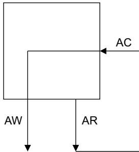

Figure C6-3 Required non-blocking transaction channel ordering

In summary, the requirements are:

any transaction on the AR channel can be stalled waiting for a transaction on the AC channel

any snoop transaction on the AC channel can be stalled waiting for a write transaction on the AW channel, except for a WriteUnique or WriteLineUnique transaction.

## C6.6.2 Permitted transaction modifications

An interconnect is permitted to modify transactions as follows:

a transaction can be broken into multiple transactions

multiple transactions can be merged into a single transaction.

a read transaction can fetch more data than required

a write transaction can access a larger address range than required, making use of Write strobes to ensure that only the required memory locations are updated

in each generated transaction, the following signals can be modified:

— the transfer address, AxADDR

the burst size, AxSIZE

the burst length, AxLEN

— the burst type, AxBURST.

Note

The interconnect behavior must be consistent with that of a transaction that has the Modifiable attribute, AxCACHE[1], asserted. See Modifiable transactions on page A4-63.

A modification to a transaction by the interconnect is not seen by any master in the system.

## C6.6.3 Speculative reads

A master in the ACE protocol is permitted to carry out a read of a cache line that it already holds in its cache. This is referred to as a Speculative Read.

A master issuing a speculative read must ensure that:

the transaction uses the correct shareability and cacheability attributes for the address location

it uses its cached version of the data and not the data returned by the speculative read.

Note

It is required that a master uses its cached version because this could be in the Dirty state and therefore no other valid copies of the cache line exist.

An interconnect must consider that a master might be carrying out a speculative read, as it is not explicit in the transaction. The interconnect must ensure that it does not use data obtained by a speculative read to service another transaction.

## C6.7 Interoperability considerations

A system wide coherency protocol has to work correctly with components that might have:

different structures for caching and storing data

different cache line sizes

different physical address space sizes.

## C6.7.1 Cache Line size conversions

Maximum performance and efficiency is usually achieved when all components use the same cache line size. For systems where this is not possible, it is the responsibility of the interconnect to convert between the different cache line sizes.

Note

The supported cache line sizes and maximum physical address space size are defined at design time.

## Narrow to wide conversion

When the master initiating a transaction has a narrow cache line, the following conversion is required:

• A read transaction can be converted to a wider cache line size. The transactions that can be converted are:

— ReadOnce

ReadClean

ReadNotSharedDirty

ReadShared

ReadUnique.

The converted transaction fetches the data that is required to complete the original transaction together with data that is not required. The excess data must be written back to main memory if it is dirty, but can be discarded if it is clean.

• A clean transaction can be converted to a wider cache line size. The transactions that can be converted are:

— CleanUnique

CleanShared

CleanInvalid.

Dirty data obtained as a result of the clean transaction must be written back to main memory.

The MakeUnique or MakeInvalid transaction require special consideration. A cache line that is wider than that requested by a master with a narrow cache line cannot be invalidated. When converting a MakeUnique or MakeInvalid transaction to a wider cache line size, it must be converted to a CleanInvalid transaction. This ensures that all dirty data is written back to main memory before the wider line is invalidated.

Note

Similar consideration is required for the WriteUnique or WriteLineUnique transaction.

## Wide to narrow conversion

When the master initiating a transaction has a wide cache line, the transaction can be broken into multiple narrow transactions.

Each of these narrow transactions can be responded to by different cached masters during the snoop process and some of the narrow transactions might require access to main memory.

It is the responsibility of the interconnect to:

assemble the transaction response sent to the originating master

ensure that the multiple narrow transactions are sequenced correctly, that is, as a contiguous block with respect to other snoop transactions.

If any part of the wide cache line is shared, then the whole cache line must be considered as shared. If any part of the wide cache line is dirty, then the whole cache line must be considered as dirty.

The passing of dirty data from a snooped master is optional for the following transactions:

ReadOnce

ReadClean

ReadNotSharedDirty

ReadShared.

It is the responsibility of the interconnect to ensure that no parts of the cache line can be dirty in more than one cache

## C6.7.2 Additional Cache Line conversion considerations

The following transactions, issued by a master, are not required to be a full cache line size:

ReadNoSnoop

ReadOnce

WriteNoSnoop

WriteUnique

WriteBack

WriteClean.

All other transactions are required to be a full cache line size and must use the full width of the data bus.

As a snoop transaction is required to be a full cache line size, it is the responsibility of the interconnect to carry out the required size translation. Size translation is required for:

a ReadOnce transaction that is converted into a ReadOnce snoop

a WriteUnique transaction that is converted into a CleanInvalid snoop.

## C6.7.3 Address space size

The protocol supports communication between components that have different physical address space sizes.

Components with different physical address space sizes must communicate as follows:

The component with the smaller physical address space must be positioned within an aligned window in the larger physical address space. Typically, the window is located at the bottom of the larger physical address space. However, it is acceptable for the component with the smaller physical address space to be positioned in an offset window within the larger physical address space.

An outgoing transaction must have the required additional higher-order bits added to the transaction address.

An incoming transaction must be examined so that:

a transaction that is within the address window has the higher-order address bits removed and is passed through

\_ a transaction that does not have the required higher-order address bits is suppressed.

Note

It is the responsibility of the interconnect to provide the required functionality.

## Chapter C7 Cache Maintenance

This chapter describes the cache maintenance operations that make loads and stores to specific caches visible to non-coherent agents in the system. It contains the following sections:

ARCACHE and ARDOMAIN requirements on page C7-252

Other cache maintenance considerations on page C7-253.

## C7.1 ARCACHE and ARDOMAIN requirements

A cache clean operation is used to ensure that a store to a cache line is made visible to non-coherent agents by updating main memory with the value held in a dirty cache line.

A cache invalidate operation is used to ensure that a load from a location does not use a cached copy and therefore accesses main memory. This enables a store by a non-coherent agent, that cannot change a cached value, to be seen.

The following cache maintenance operations are supported:

CleanShared. This transaction is used for a cache clean operation.

CleanInvalid. This transaction is used for a cache clean and invalidate operation.

MakeInvalid. This transaction is used for a cache invalidate operation.

Cache maintenance transactions differ from other snoop transactions because they can be required to propagate downstream to all caches. The cacheability attributes, signaled by ARCACHE, determine if downstream caches must observe a cache maintenance operation.

Cache maintenance transactions can be used in Non-shareable, Inner Shareable, and Outer Shareable domains. See Shareability domain types on page C3-162. The domain signaling ARDOMAIN, that accompanies a cache maintenance transaction, determines which hardware coherent peer caches must be snooped during the transaction.

Cache maintenance transactions are not permitted to use the System domain. However, all other ARCACHE and ARDOMAIN combinations that Table C3-3 on page C3-163 shows as permitted or legal are valid.

## C7.2 Other cache maintenance considerations

This section describes the additional requirements that ensure correct local, domain, and downstream cache maintenance.

## C7.2.1 Broadcast cache maintenance requirements

The master issuing a broadcast cache maintenance operation has to co-ordinate the following:

appropriate action for local cache maintenance

appropriate action for peer and downstream cache maintenance.

Issuing a broadcast cache maintenance transaction performs the required action on peer caches and causes the interconnect to generate a downstream cache maintenance transaction to other levels of cache.

The downstream cache maintenance transaction must be correctly ordered with respect to other transactions to the same cache line. The master carrying out the cache maintenance, must follow the sequence:

1. The master must complete any outstanding Shareable transactions to a cache line before it issues a cache maintenance transaction to the same cache line.

a. For CleanShared and CleanInvalid operations:

If the master holds the cache line in a Dirty state it must issue a WriteBack or WriteClean transaction, that must complete, before issuing the cache maintenance transaction.

Note

If the cache line is initially clean, but there are outstanding cacheable transactions to the line, then it must be ensured that the line is not Dirty after the completion of all outstanding transactions to the cache line.

b. For CleanInvalid and MakeInvalid transactions:

After all outstanding transactions and required WriteBack or WriteClean transactions are complete, and before issuing the cache maintenance transaction, the master must invalidate the cache line.

2. After all outstanding transactions and required WriteBack or WriteClean transactions are complete, the master issues the appropriate cache maintenance transaction

The master must not issue any further Shareable transactions to the same cache line until the broadcast cache maintenance sequence is complete.

## Note

All masters that support an external snoop filter must ensure that the information provided enables the snoop filter to correctly track the allocation of cache lines. Typically, this is ensured by the correct use of WriteBack and WriteClean transactions and the appropriate snoop responses. See External snoop filter requirements on page C10-283.

For a given memory location, cache maintenance operations are permitted to use different shareability and cacheability attributes to those that the page table attributes assign for any non-cache maintenance transaction to that location. This possible mismatch of attributes means that an interconnect cannot correctly determine the cacheability attributes to use for any interconnect-generated transactions that result from the cache maintenance operation, that are required if a snooped cache provides dirty data on the CD channel in response to a snoop transaction for the cache maintenance operation.

This specification recommends that, when an interconnect component has to generate a write to main memory as a result of receiving a dirty line during a cache maintenance operation, the interconnect component uses the Write-through No-allocate memory attribute for the transaction.

## Note

The use of the Write-through No-allocate attribute ensures that, if the line is allocated in a downstream cache, then that cache will be checked. This avoids stale data being held in that cache. If the line is not allocated in a downstream cache then using this memory attribute prevents the line from being allocated.

## C7.2.2 Requirements for a snooped master

There are no additional requirements for a snooped master during a cache maintenance operation. All requirements are as specified in Chapter C5 Snoop Transactions.

## C7.2.3 Processor cache maintenance instructions

The protocol requires that the cache maintenance operations use the AxCACHE and AxDOMAIN signals to identify the caches on which the cache maintenance operations must operate.

For a processor that has cache maintenance instructions that are required to operate on more or fewer caches than are defined by the AxCACHE and AxDOMAIN values, the cacheability and shareability of the transaction must be adapted to meet the requirements of the processor. For example, if a processor instruction performing a cache maintenance operation on a location with Device memory attributes is required to operate on all caches within the system then, the master must issue a cache maintenance transaction as Outer Shareable, since this is the most pervasive of the cache maintenance operations and operates on all the required caches.

## C7.2.4 Unpredictable behavior with software cache maintenance

Cache maintenance can be used to reliably communicate shared memory data structures between a coherent group of masters and non-coherent agents. This process must follow a particular sequence to reliably make the data structures visible as required.

When using cache maintenance to make the writes of a non-coherent agent visible to a coherent group of masters there are periods of time when writing and reading the data structures gives UNPREDICTABLE results and can cause a loss of coherency.

The observation of a line that is being updated by a non-coherent agent is UNPREDICTABLE during the period between the clean transaction that starts the sequence and the invalidate transaction that completes it. During this period, it is permissible to see multiple transitions of a cache line that is being updated by a non-coherent agent.

Figure C7-1 shows the required sequence of communication between a coherent domain and a non-coherent agent.

<table><tr><td>Coherent domain access</td><td>Coherent domain clean</td><td>Non-coherent agent access</td><td>Coherent domain invalidate</td><td>Coherent domain access</td></tr><tr><td>1</td><td>2</td><td>3</td><td>4</td><td>5</td></tr></table>

## Figure C7-1 Required sequence of communication between coherent and non-coherent domains

The five stage sequence that Figure C7-1 shows is:

1. The coherent domain has access. During this stage, the coherent domain has full read and write access to the appropriate memory locations. This stage finishes when all required writes from the coherent domain are complete within the coherent domain.

2. The coherent domain is cleaned. During this stage, a cache clean operation is required for all the address locations that are undergoing software cache maintenance. The coherent domain clean forces all previous writes to be visible to the non-coherent agent. This stage finishes when all required writes are complete and therefore visible to the non-coherent agent.

3. The non-coherent agent has access. During this stage the non-coherent agent has both read and write access to the defined memory locations. This stage finishes when all required writes from the non-coherent agent are complete.

4. The coherent domain is invalidated. During this stage, a cache invalidate operation is required for all the address locations that are undergoing software cache maintenance. This coherent domain invalidate stage removes all cached copies of the defined locations ensuring that any subsequent access from the coherent domain observes the writes from the non-coherent agent. This stage finishes when all the required invalidations are complete.

5. The coherent domain has full access to the defined memory locations.

Table C7-1 shows when accesses from the coherent domain or the non-coherent agent are permitted. The remaining accesses can have unpredictable results, with possible loss of coherency.

Table C7-1 Permitted accesses from the Coherent domain and non-coherent agent

<table><tr><td rowspan="2">Phase</td><td rowspan="2">Description</td><td colspan="2">Coherent domain</td><td colspan="2">External agent</td></tr><tr><td>Read</td><td>Write</td><td>Read</td><td>Write</td></tr><tr><td>1</td><td>Coherent domain access</td><td>Permitted</td><td>Permitted</td><td>-</td><td>-</td></tr><tr><td>2</td><td>Coherent domain clean</td><td>-</td><td>-</td><td>-</td><td>-</td></tr><tr><td>3</td><td>External agent access</td><td>-</td><td>-</td><td>Permitted</td><td>Permitted</td></tr><tr><td>4</td><td>Coherent domain invalidate</td><td>-</td><td>-</td><td>-</td><td>-</td></tr><tr><td>5</td><td>Coherent domain access</td><td>Permitted</td><td>Permitted</td><td>-</td><td>-</td></tr></table>

## C7.2.5 Mismatched shareability and cacheability

To prevent a loss of coherency, the protocol requires that all accesses to a particular memory location must use the same values of AxCACHE and AxDOMAIN. This ensures that multiple agents accessing a particular memory location agree exactly on the caches in which the memory location might be held.

If agents accessing the same or overlapping locations do not agree exactly on the caches in which the location might be held, then this is defined as a software protocol error. See Protocol errors on page C1-154.

## Chapter C8 Barrier Transactions

This chapter describes ACE barrier transactions. It contains the following sections:

About barrier transactions on page C8-258

Barrier transaction signaling on page C8-259

Barrier responses and domain boundaries on page C8-261

Barrier requirements on page C8-264.

## C8.1 About barrier transactions

Barrier transactions provide guarantees about the ordering and observation of transactions in a system. ACE supports memory barriers and synchronization barriers:

A memory barrier is issued by a master to guarantee that if another master in the appropriate domain can observe any transaction issued after the barrier it must be able to observe every transaction issued before the barrier.

A synchronization barrier is issued by a master to guarantee that all transactions issued before the barrier are observable by every master in the appropriate domain when the barrier completes. System domain synchronization barriers have the additional requirement that all transactions issued before the barrier transaction must have reached the endpoint slaves they are destined for before the barrier completes.

A memory barrier is used for memory based communication. For example, when writing an array of data to memory, a master component can issue a memory barrier before setting a memory flag to indicate that the array is available. Any other master component that can observe the flag must observe all transactions that write to the array.

Note

It is not necessary for all master components in the domain to observe the updated array at the same time. It is a requirement for each master in the domain that can observe the flag, to be guaranteed to observe the updated array.

A synchronization barrier is used with various forms of sideband signaling communication. For example, when writing an array of data to memory, a master component can use a synchronization barrier before generating an interrupt to indicate that the array is available. When the synchronization barrier completes, the updated array is guaranteed to be observable by all master components in the domain.

Barrier transactions can be read or write transactions, and are defined as follows:

## Read barrier transactions

A master component issues a read barrier transaction on the read address channel and a response is returned on the read data channel. No data transfer occurs.

## Write barrier transactions

A master component issues a write barrier on the write address channel and a response is returned on the write response channel. No data transfer occurs.

A master component must issue barrier transactions as a barrier pair, with a barrier transaction on both the read address channel and the write address channel. For each address channel, any transaction issued on the channel, before the barrier transaction, is defined to be before the barrier, even if it is issued after the corresponding barrier on the other address channel. A transaction is defined to be after the barrier if it is issued after both the read barrier response and write barrier response are received.

## C8.2 Barrier transaction signaling

This section describes the read address channel and write address channel signaling associated with barrier transactions.

To permit interworking between barrier transactions and QoS, the following types of non-barrier transactions exist:

transactions that are affected by barrier transactions

transactions that are not affected by barrier transactions.

This specification recommends that, by default, all transactions are affected by barrier transactions. The only transaction streams that can be signaled so that they are not affected by barrier transactions are transactions that do not require ordering with respect to other streams, such as those related to real-time data flows.

## C8.2.1 AxBAR signaling

AxBAR is used to differentiate between barrier transactions and normal transactions. For normal transactions AxBAR also indicates if the associated transaction must respect barriers or if the ordering requirements of any barrier transactions can be ignored. For barrier transactions, AxBAR also indicates whether the transaction is a memory barrier or a synchronization barrier. See Read and write barrier transactions on page C3-164 for more information about AxBAR encoding.

Table C3-14 on page C3-171 shows the constraints that apply to barrier transactions.

## C8.2.2 AxDOMAIN signaling

The AxDOMAIN signal determines the level of propagation of a barrier transaction, defining the domains within a system that the barrier transaction accesses. See Shareability domain types on page C3-162. Table C8-1 shows the different levels of barrier applicability for each domain type.

Table C8-1 Domain barrier applicability

<table><tr><td>AxDOMAIN</td><td>Domain</td><td>Barrier Applicability</td></tr><tr><td>00</td><td>Non-shareable</td><td>Acts as a barrier to other transactions in the current transaction stream. When two or more transaction streams are combined, no ordering is required with respect to the newly combined transaction stream.</td></tr><tr><td>01</td><td>Inner Shareable</td><td>Ordering must be established with respect to other transactions from all masters in the same Inner Shareable domain.</td></tr><tr><td>10</td><td>Outer Shareable</td><td>Ordering must be established with respect to other transactions from all masters in the same Outer Shareable domain.</td></tr><tr><td>11</td><td>System</td><td>Ordering must be established with respect to all other transactions. For a Synchronization barrier, a response must only be given when all transactions from the issuing master, which are ahead of the barrier, have reached their endpoint.</td></tr></table>

## C8.2.3 Response signaling

All barrier transactions must complete with a response, as follows:

responses for barrier transactions issued on the read address channel are signaled on the read data channel

responses for barrier transactions issued on the write address channel are signaled on the write response channel.

The response must have a matching AXI ID to the barrier transaction and OKAY is the only permitted response for a barrier transaction. Table C8-2 shows the constraints for barrier transaction response signaling.

Table C8-2 Barrier response transaction constraints

<table><tr><td>Attribute</td><td>Constraint</td></tr><tr><td>RID, BID</td><td>Must match barrier transaction ID.</td></tr><tr><td>RRESP</td><td>Must be all zeros.</td></tr><tr><td>RLAST</td><td>Must be HIGH.</td></tr><tr><td>RDATA</td><td>No constraint, can take any value. Must be ignored.</td></tr><tr><td>BRESP</td><td>Must be all zeros.</td></tr></table>

## C8.3 Barrier responses and domain boundaries

The location of an interconnect in relation to the domain boundaries within a system influences the ability of the interconnect to issue responses to barrier transactions. In general, a system can contain domain boundaries and bi-section boundaries, where:

a domain boundary is an interface downstream from all master components in the domain

a bi-section boundary is downstream of a subset of master components in the domain, but not all of them.

Figure C8-1 shows the domain boundaries in an example system.

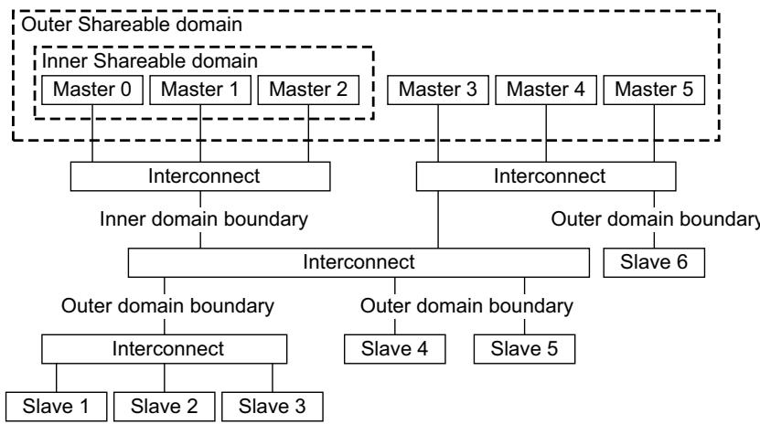  
Figure C8-1 Domain boundaries

The interface to slave 6 is an outer domain boundary. Slave 6 cannot be accessed by master 0, master 1, and master 2, and therefore it cannot be considered relative to these master components. It is downstream of all master components in the outer domain that can access it.

Figure C8-2 shows the bi-section boundary locations for the same system.  
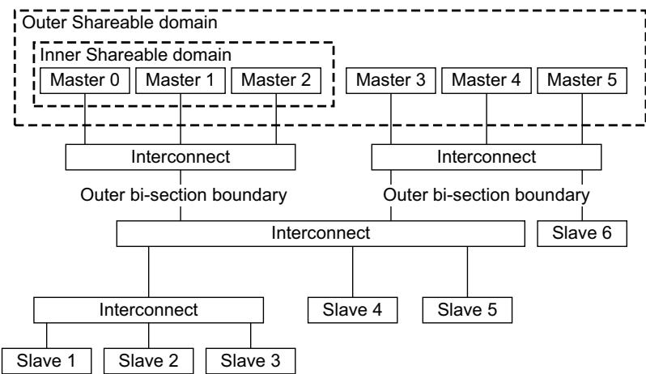  
Figure C8-2 Bi-section boundaries

For an interconnect to issue a response to a barrier transaction, certain conditions apply. The main consideration influencing the ability of an interconnect to issue responses to barrier transactions is the location of the interconnect in relation to the domain boundaries within a system.

A system can contain the following types of boundary:

## Domain boundary

A domain boundary is an interface downstream from all master components in the domain.

For an interface to be a domain boundary, all of the following must apply:

the set of addresses that pass across the interface is identical for all masters in the domain

all accesses from any master in the domain to those addresses pass across the interface.

Note

If a master component can access an address using the interface then it must not be possible for another master in the same domain to access the same address without using the interface.

## Bi-section boundary

A bi-section boundary is an interface downstream of a subset of master components in the domain, but not all of them.

For an interface to be a bi-section boundary, all of the following must apply:

the set of addresses that pass across the interface is identical for a subset of master components in the domain

all accesses from any master component in that subset to those addresses pass across the interface

no accesses from a master component that is in the domain but is not in the subset passes across the interface

considering in turn each master component not in the subset, then all addresses that are accessed by both that master and the masters in the subset must be accessed by the masters in the subset across the same interface.

Note

Informally, an interface is a bi-section boundary if all communication between a subset of masters and the other masters not in the subset pass across the same interface.

In the definition of a bi-section boundary, the subset of masters is permitted to be all masters in the domain and this makes the bi-section boundary definition the same as the domain boundary definition.

See Barrier responses and domain boundaries on page C8-261 for more information.

An interconnect can provide a response to a barrier transaction in certain circumstances. The following rules apply:

for memory barrier transactions, an interconnect can respond provided it is at the appropriate bi-section boundary or domain boundary, or beyond the domain boundary

for any synchronization barrier transaction that applies to a Non-shareable, Inner Shareable or Outer Shareable domain, an interconnect can respond provided the interconnect is at or beyond the appropriate domain boundary

for any synchronization barrier transaction that applies to a System domain, an interconnect can respond provided all transactions before the barrier have reached the endpoint slaves they are destined for.

When responding to a barrier transaction, an interconnect must ensure that all transactions that pass across the interface before the barrier are observable to every transaction after the barrier. Some techniques that can be used to achieve this are:

## Blocking all transactions and sending barrier

The interconnect blocks all transactions received after the barrier transactions and issues a barrier transaction downstream. The block is removed after a response has been received on both the read data and write response channels for the downstream issued barrier transactions.

## Blocking all transactions and waiting for completion

The interconnect blocks all transactions after the barrier transactions and waits for transactions before the barrier to provide a response. The block is removed when all transactions before the barrier have provided a response. To use this technique, it is required that all transactions must have attributes that ensure the response originates from a location that is observable by all masters in the required barrier domain.

## Hazard-checking transactions

The interconnect blocks all transactions after the barrier transactions until transactions before the barrier to the same or overlapping addresses have provided a response.

## C8.4 Barrier requirements

This section describes the formal requirements for barrier transactions.

## C8.4.1 Master requirements

For a master component issuing a barrier transaction, the following rules apply.

Both transactions in a barrier pair must have the same AxID, AxBAR, AxDOMAIN, and AxPROT values

If the ARID and AWID signals have different widths, the narrower version must be zero-extended to match the wider version

Barrier pairs must be issued in the same sequence on the read address and write address channels

A master interface is not required to issue barrier transactions on the read address and write address channels in the same cycle

A master interface is permitted to issue multiple outstanding barriers, meaning that additional barrier transactions can be issued before responses to earlier barrier transactions are received. However:

— an ACE-Lite master interface can issue outstanding barrier transactions without restriction

an ACE master interface must not issue more than 256 outstanding barrier transactions.

Note

Read and write response handshakes are separate events that can occur in any order. Therefore, a barrier is defined as an outstanding barrier from the cycle when the first of the read or write barrier becomes valid until the cycle when both the read and write response handshakes have occurred.

Barrier transactions are required to use different ID values than those used for non-barrier transactions. It is permissible for barrier transactions and non-barrier transactions to use the same AXI ID value, provided one transaction has completed before the other is issued.

Note

Using different ID values ensures that any component tracking barrier responses does not have to track all responses to differentiate between a barrier response and a normal transaction response

On each address channel, any transaction issued before the barrier on that channel is defined to be before the barrier, even if it is issued after the corresponding barrier on the other address channel.

Figure C8-3 shows pre-barrier and post-barrier transactions, with respect to barriers being issued on the address channels and responses being received.

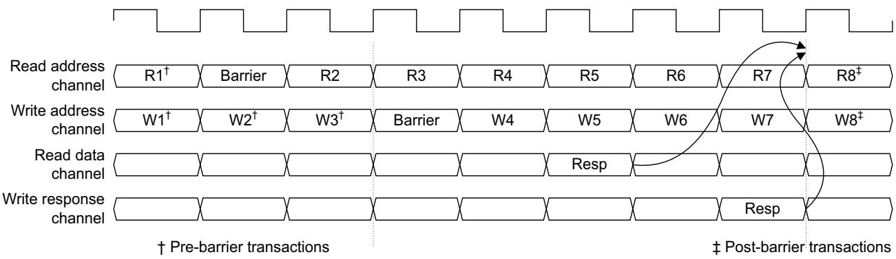  
Figure C8-3 Barrier transaction timing

In Figure C8-3 on page C8-264:

transactions R1, W1, W2, and W3 are before the barrier

transactions R8 and W8 are after the barrier

transactions R2, R3, R4, R5, R6, R7, W4, W5, W6, and W7 have no relationship to the barrier.

The following rules apply to master components issuing barrier transactions, and relate to non-barrier transactions:

A master must not issue any transaction, either read or write, that must be after the barrier until the master has received a response for the barrier on both the read data and write response channels.

A master is permitted to issue transactions between issuing a barrier transaction on the address channel and receiving the read and write barrier responses. Such transactions have no ordering guarantees with respect to the barrier. On the address channel, these transactions are permitted to remain after the barrier transaction or they are permitted to overtake the barrier transaction.

A master interface that has issued a read barrier on the read address channel must issue the corresponding write barrier on the write address channel, in a timely manner, if all other transactions on the write address channel are progressed. The master interface must not require either handshaking or a response to the read barrier or any read transaction after the read barrier before issuing the corresponding write barrier.

A master interface that has issued a write barrier on the write address channel, must issue the corresponding read barrier on the read address channel, in a timely manner, if all other transactions on the read address channel are progressed. The master interface must not require either handshaking or a response to the write barrier or any write transaction after the write barrier before issuing the corresponding read barrier.

A barrier must not be issued on the read address channel if subsequent read transactions are required for either:

issuing the corresponding barrier on the write address channel

issuing any write transactions that must be before the barrier.

For example, a read barrier must not be issued if, after issuing the read barrier, it is necessary to perform translation table walks to issue write transactions that must be before the corresponding write barrier.

For an ACE-Lite interface, a barrier must not be issued on the write address channel if subsequent write transactions are required for either:

— issuing the corresponding barrier on the read address channel

issuing any read transactions that must be before the barrier.

For an ACE interface, a barrier must not be issued on the write address channel if subsequent write transactions that must be ordered with respect to the barrier, must be issued for either:

issuing the corresponding barrier on the read address channel

issuing any read transactions that must be before the barrier.

An ACE interface is permitted to issue a write barrier, followed by any of the following transactions that are required for snoop transactions to that master to complete:

WriteBack

WriteClean

WriteEvict

Evict.

The following rules apply to ACE master components and the interaction of barriers and local cache accesses:

A master must not perform a store that must be ordered with respect to the barrier, to a Shareable location in its local cache until after the barrier response is received on both read data and write response channels. This rule applies even if there is no requirement for a transaction to be issued because the cache line is in a Unique state.

A master must not perform a load that must be ordered with respect to the barrier, from a Shareable location in its local cache until after the barrier response is received on both read data and write response channels. This applies even if there is no requirement for a transaction to be issued because the cache line is in a Valid state.

A master must be capable of issuing write transactions to complete snoop transactions, even if the read address channel is stalled.

Issuing a barrier transaction must not prevent any of the following transactions, that are required for snoop transactions, being issued and completed:

WriteBack

— WriteClean

WriteEvict

Evict.

## C8.4.2 Slave requirements

The following rules apply to a slave component that is handling barrier transactions:

On receipt of a barrier transaction, an ACE-Lite slave interface is permitted to either:

stall the read address channel until it receives the corresponding barrier transaction on the write address channel

stall the write address channel until it receives the corresponding barrier transaction on the read address channel.

An ACE slave interface must be able to accept 256 barrier transactions on the write address channel without blocking the progress of subsequent transactions. It is required that the write address channel is available and that write transactions can progress.

On receipt of a read barrier, an ACE slave interface is permitted, but not required, to stall the read address channel.

## C8.4.3 Interconnect requirements

The following rules apply to an interconnect processing barrier transactions:

The interconnect topology must not permit transactions with overlapping destination addresses to have a common start point and end point but have different paths through the interconnect.

When merging two streams of transactions, an interconnect must ensure that barrier pairs are issued on the read and write channels in the same sequence. Barriers pairs must not be interleaved.

Any interconnect component that has multiple ACE slave ports must be capable of meeting the ACE slave interface requirements in Slave requirements, for all ports simultaneously

• An interconnect must not permit a barrier transaction to overtake any transaction that respects barriers.

A barrier must apply to any transaction that the component issuing the barrier observed before issuing the barrier.

An interconnect that has not responded to a barrier can permit any non-barrier transaction to overtake that barrier.

## Note

This specification recommends that ACE interconnect components stall a read barrier until:

the corresponding write barrier is received

all transactions before the read barrier and write barrier have been snooped as required, and all write transactions that must be before the barrier have been issued.

## C8.4.4 Barriers and Device transaction ordering

Barrier transactions ensure ordering between Device transactions to a single peripheral device, regardless of the addresses within the peripheral being accessed. This means that any hazard-checking that an interconnect performs when responding to a barrier must be extended to the entire address space of the peripheral, and must not consider only overlapping transactions. If an interconnect is unable to determine the address range of a particular peripheral, it must ensure ordering between all accesses that could be addressing that peripheral.

## C8.4.5 Multi-copy atomicity requirements for Shareable locations

For Inner Shareable and Outer Shareable locations, multi-copy atomicity is required. This means that a snoop response to a write is issued only when all observers in the required shareability domain have observed the write. Also, on the cycle that a snoop response is received, the associated master must have already observed the write. The point of observation is defined as the handshake on the snoop response channel. The snoop data channel is not used in defining the point of observation. This means there is no requirement for barriers on the snoop address channel.

# Chapter C9 Exclusive Accesses

This chapter describes ACE Exclusive accesses. It contains the following sections:

About Exclusive accesses on page C9-270

Role of the master on page C9-271

Role of the interconnect on page C9-273

Multiple Exclusive Threads on page C9-276

Exclusive Accesses from AXI components on page C9-277

Transaction requirements on page C9-278.

## C9.1 About Exclusive accesses

The principles of Exclusive accesses are that a master performing an Exclusive sequence does the following:

Performs an Exclusive Load from a location.

Calculates a value to store to that location.

Performs an Exclusive Store to the location.

The Exclusive Store fails if another master has performed a store to the location since the Exclusive Load. In this case, the store does not occur and the master does not change the value held at the location.

The Exclusive Store can pass if no other master has performed a store to the location since the Exclusive Load. In this case, the store can occur and the master can change the value held at the location.

## Note

An Exclusive Load by a processor is caused by the execution of an instruction such as LDREX. An Exclusive Store by a processor is caused by the execution of an instruction such as STREX.

In the ACE protocol correct execution of an Exclusive sequence places requirements on both the master performing the Exclusive sequence and the interconnect.

For Non-shareable and system Shareable locations the behavior is identical to that specified in AXI.

For Inner Shareable and Outer Shareable locations, the following requirements apply:

The master is responsible for ensuring that it only updates the location if no other master can have performed a store to the location since the master performed the Exclusive Load. The term master exclusive monitor describes the monitor that must exist within the master component to meet this requirement.

The interconnect is responsible for ensuring that if two masters attempt an Exclusive Store transaction to the same location and it is possible that the second master will have its copy of the location invalidated before its Exclusive Store transaction completes, then the interconnect must fail the Exclusive Store transaction from the second master. The term PoS exclusive monitor describes the monitor that must exist within the interconnect, at the point of serialization, to meet this requirement.

The term Exclusive Store is used to describe the action of a master executing an appropriate program instruction. An Exclusive Store can pass or fail and this result is known to the executing processor. When an Exclusive Store passes, this indicates an update to the data value at the address location. When an Exclusive Store fails, this indicates that the store has not changed the data value at the address location, and the Exclusive sequence must be restarted.

The term Exclusive Store transaction is used to describe the transaction issued on the ACE interface of a master. Not every Exclusive Store requires an Exclusive Store transaction. An Exclusive Store transaction can pass or fail and this result is made known to the master using the transaction response. When an Exclusive Store transaction passes, this indicates that the transaction has been propagated to other masters, but it does not indicate whether the Exclusive Store passes or fails. When an Exclusive Store transaction fails, this indicates that the transaction has not been propagated to other masters and therefore the associated Exclusive Store cannot pass.

All masters that attempt an Exclusive access to the same location must be using the same shareability for the location. If the location for the Exclusive access is Shareable then all masters must be able to participate in the coherency protocol.

When first obtaining a copy of the exclusive location it is important that the line is not removed from another cache that is also performing an Exclusive sequence to the same cache line. For this reason, ReadClean or ReadShared must be used rather than ReadNotSharedDirty or ReadUnique.

A Load Exclusive, Store Exclusive sequence (LDREX, STREX) must use an Exclusive sequence. An atomic update, such as a swap operation or a read-modify-write atomic operation, is not required to use an Exclusive sequence. For such atomic updates, it is permitted to use a ReadUnique transaction which is not marked as Exclusive, if it can be guaranteed to successfully complete the atomic update with no other external action.

## C9.2 Role of the master

The master must implement a master exclusive monitor, that is used to monitor the location used by an Exclusive sequence. This master exclusive monitor is used to determine if another master could have performed a store to the location during the Exclusive sequence, by monitoring the snoop transaction it receives.

When the master performs an Exclusive Load, the master exclusive monitor is set. The master exclusive monitor is reset when a snoop transaction is observed that indicates another master could perform a store to the location.

Note

In some implementations the cache line state is sufficient to provide the functionality of the master exclusive monitor. However, it is important that a line which is invalidated and made valid again by a mechanism such as prefetching, is not considered as having remained valid since the Exclusive Load.

## C9.2.1 Exclusive Load

The master starts an Exclusive sequence with an Exclusive Load. The start of the Exclusive sequence must set the master exclusive monitor.

If the master does not hold a copy of the cache line then it must obtain a copy of the line using either a ReadClean or a ReadShared transaction.

An Exclusive Load transaction is a ReadClean or ReadShared transaction with the ARLOCK signal asserted. This indicates to the PoS exclusive monitor that the master is starting an Exclusive sequence.

It is recommended, but not required, that a master uses an Exclusive Load transaction, with ARLOCK asserted, if it is issuing a transaction at the start of Exclusive sequence. If a master does not use an Exclusive Load transaction, it is permitted to use a ReadClean or ReadShared transaction with ARLOCK deasserted.

If the master holds a copy of the line in a Unique state, then issuing a transaction for the Exclusive Load is permitted but not recommended.

This transaction is likely to cause an external memory access. It is also likely that informing the interconnect that an Exclusive sequence has started is unnecessary as there is no requirement to issue an Exclusive Store transaction to complete the sequence if the cache line remains in the Unique state.

If the master holds a copy of the line in a Shared state then issuing a transaction for the Exclusive Load is permitted, but not required.

Note

Issuing a transaction informs the interconnect that the master is performing an Exclusive sequence.

An Exclusive Load is expected to receive an EXOKAY response, which indicates that Exclusive accesses are supported at the address of the transaction. If Exclusive accesses are not supported then the transaction will receive an OKAY response.

## C9.2.2 Exclusive Load to Exclusive Store

After the execution of an Exclusive Load a master will typically calculate a new value to store to the location before it attempts the Exclusive Store.

It is not required that a master always completes an Exclusive sequence. For example, the value obtained by the Exclusive Load can indicate that a semaphore is held by another master and therefore the value cannot be changed until the semaphore is released by the other master. Therefore, the Exclusive sequence can be restarted with no attempt to complete the current Exclusive sequence.

During the time between the Exclusive Load and the Exclusive Store the master exclusive monitor must monitor the location to determine whether another master might have performed a store to the location.

## C9.2.3 Exclusive Store

A master must not permit an Exclusive Store transaction to be in progress at the same time as any transaction that registers that it is performing an Exclusive sequence. The master must wait for any such transaction to complete before issuing an Exclusive Store transaction. The transactions that register that a master is performing an Exclusive sequence are Exclusive Load transactions to any location, and Exclusive Store transactions to any location. These transactions are:

ReadClean with ARLOCK asserted

ReadShared with ARLOCK asserted

CleanUnique with ARLOCK asserted.

When a master executes an Exclusive Store the following behavior is required:

If the master exclusive monitor has been reset the Exclusive Store must fail and the master must not issue an Exclusive Store transaction. The master must restart the Exclusive sequence.

Note

Not issuing an Exclusive Store transaction when the master exclusive monitor has been reset prevents the issue of a transaction for an Exclusive Store that will eventually fail, and therefore avoids unnecessarily invalidating other copies of the line.

If the line is held in a Unique state and the master exclusive monitor is set then the Exclusive Store has passed and the master can execute the Exclusive Store without issuing a transaction.

If the line is held in a Shared state and the master exclusive monitor is set then the master must issue a transaction to perform the Exclusive Store. This check of the master exclusive monitor must only occur after any other transactions that register a master is performing an Exclusive sequence have completed. A CleanUnique transaction with ARLOCK asserted must be used. The master exclusive monitor must continue to operate during this transaction. The transaction will respond with an OKAY or EXOKAY response.

If the transaction receives an EXOKAY response then this indicates that the transaction has passed and been propagated to invalidate all other copies of the line. After an Exclusive transaction completes with an EXOKAY response the master must again check the master exclusive monitor:

If the master exclusive monitor is set then the Exclusive Store has passed and the store is performed.

If the master exclusive monitor has been reset, it indicates that a non-Exclusive Store has occurred to the cache between the point that the Exclusive Store transaction was issued and the point that it completed. The Exclusive Store must fail and the Exclusive sequence must be restarted.

If the master has not been able to track the exclusive nature of the cache line, because the line has been evicted, then the Exclusive Store must fail and the Exclusive sequence must be restarted.

If the transaction receives an OKAY response then this indicates another master has been permitted to progress a transaction associated with an Exclusive Store. The transaction associated with the Exclusive Store from this master has failed and has not propagated to other masters in the system. When an Exclusive transaction completes with an OKAY response the following options exist:

the master can fail the Exclusive Store and restart the Exclusive sequence without checking the state of the line when the access completed

the master can check the master exclusive monitor:

if the master exclusive monitor has been reset then the master must fail the Exclusive Store and restart the Exclusive sequence

if the master exclusive monitor is set then the master can repeat the Exclusive Store transaction

## C9.3 Role of the interconnect

The interconnect can pass or fail an Exclusive Store transaction. A pass indicates that the transaction has been propagated to other cacheable masters. A fail indicates that the transaction has not been propagated to other masters and therefore the Exclusive Store cannot pass.

The interconnect is required to have a monitor, that is used to ensure that an Exclusive Store transaction from a master is only successful if that master could not have received a snoop transaction relating to an Exclusive Store to the same address from another master after it issued its own Exclusive Store transaction. This monitor is referred to as the PoS exclusive monitor and it exists within the interconnect at the point of serialization.

## C9.3.1 Minimum PoS Exclusive Monitor

The minimum requirement of PoS exclusive monitor is to record when any master performs a Shareable transaction related to an Exclusive sequence. The Shareable transactions related to an Exclusive sequence are:

ReadClean with ARLOCK asserted

ReadShared with ARLOCK asserted

CleanUnqiue with ARLOCK asserted.

If a master has performed a transaction related to an Exclusive sequence and it then performs an Exclusive Store transaction before a successful Exclusive Store transaction from another master is scheduled, then the Exclusive Store transaction must be successful.

The monitor must support the parallel monitoring of all Exclusive-capable masters in the system.

When the interconnect receives a transaction associated with an Exclusive Load or an Exclusive Store, the monitor registers that the master is attempting an Exclusive sequence. For an Exclusive Store transaction, this must be recorded if the Exclusive Store is failed, i.e. it receives an OKAY response. If the Exclusive Store transaction is successful it is recommended, but not required, that the monitor registers that the master is attempting an Exclusive sequence.

If an Exclusive Store transaction from one master passes, the registered attempts of all other masters is reset. The other masters can only register a new Exclusive sequence after the RACK is observed for the Exclusive Store transaction that passed.

When the interconnect receives an Exclusive Store transaction:

If the PoS exclusive monitor has registered that the master is performing an Exclusive sequence, that is, it has not been reset by another master’s Exclusive Store transaction, then the Exclusive Store transaction is successful and is allowed to proceed. An EXOKAY response is returned to the issuing master.

If the PoS exclusive monitor has not registered that the master is performing an Exclusive sequence, that is, it has been reset by another master’s Exclusive Store transaction, then the Exclusive Store transaction is failed and is not allowed to proceed. An OKAY response is returned to the issuing master.

## Note

A successful Exclusive Store transaction from a master does not have to reset that the master is performing an Exclusive sequence. The master can continue to perform a sequence of Exclusive Store transactions that will all be successful, until another master performs a successful Exclusive Store transaction

From reset, the first master to perform an Exclusive Store transaction can be successful, but is not required to be. At that point, all other masters must then register the start of their Exclusive sequence for their Exclusive Store transaction to be successful.

## C9.3.2 Additional address comparison

The interconnect monitor can be enhanced to include some address comparison. A full address comparison is not required and it is permitted to only record a subset of address bits. This approach reduces the chances of an Exclusive Store transaction failing because of another master’s Exclusive Store transaction to a different address location. The number of bits of address comparison used is an implementation choice.

Where additional address comparison monitor is used, the monitored address bits are recorded at the start of an Exclusive sequence on either a Load Exclusive or Store Exclusive transaction. It is reset by a successful Store Exclusive transaction from another master to a matching address.

A monitor with additional address comparison must include a minimum monitor of a single bit for every Exclusive-capable master to ensure forward progress.

An Exclusive Store transaction is allowed to progress if one of the following occurs:

the address monitor has registered an Exclusive sequence for a matching address from the same master and has not been reset by an Exclusive Store transaction from a different master with a matching address

the minimum single bit monitor has registered an Exclusive sequence from the same master, and it has not been reset by an Exclusive Store transaction from a different master to any address.

In the above description, the term matching address is used to describe where a monitor only records a subset of address bits. A matching address is where the address bits that are recorded are identical, but the address bits that are not recorded can be different.

An implementation does not require address monitor for each Exclusive-capable master. Because the address monitor provides a performance enhancement it is acceptable to have fewer address monitors and for the use of these to be IMPLEMENTATION DEFINED. Examples of how the additional address monitors can be used include use on a first-come first-served basis, or allocation to particular masters, or a more complex algorithm can be used.

Additional PoS Exclusive Monitor functionality can be provided to prevent interference, or denial of service, caused by one agent in the system issuing a large number of Exclusive access transactions. This specification recommends that secure exclusive accesses are permitted to make forward progress independently of the progress of Non-secure exclusive accesses.

## C9.3.3 Multiple interconnect PoS monitors

When the interconnect contains multiple points of serialization, as the serialization for different address ranges is done at different points within the interconnect, then a PoS exclusive monitor can be located at each point of serialization.

## C9.3.4 PoS Exclusive Monitor behavior

The following terms are used to describe the behavior of a PoS exclusive monitor:

True pass Describes the case where an Exclusive Store transaction is permitted to progress and when the transaction completes the Exclusive Store will also pass, permitting the master to make forward progress.

True fail Describes the case where an Exclusive Store transaction is failed because another master has already performed a successful Exclusive Store transaction to the same address location, so at least one agent has made forward progress.

False pass Can occur for an Exclusive Store transaction, for which the Exclusive Store will eventually fail. This can only occur when a non-exclusive store transaction from another agent to the same location has occurred. This non-exclusive store transaction from another agent is considered as forward progress for that other agent.

## False fail

Can occur for a Exclusive Store transaction in the following circumstances:

No transaction was issued for the Load Exclusive. This is resolved by re-issuing the Exclusive Store.

An Exclusive Store transaction from another agent to a different location has been successfu between the point that the Exclusive sequence is first registered and the point that the Exclusive Store transaction is scheduled. This is resolved by re-issuing the Exclusive Store.

An Exclusive Store transaction from another agent to the same location has been successful, but that other agent is destined to eventually fail because a third party has performed a non-exclusive store transaction. This non-exclusive store transaction from the third party is considered as forward progress for that third party.

## C9.4 Multiple Exclusive Threads

The protocol can support more than one Exclusive-capable master for each interface. This permits multiple masters to use the same interface for Exclusive accesses. In this scenario the interconnect must be able to use the AXI ID values to differentiate between the different masters using the same interface.

## C9.5 Exclusive Accesses from AXI components

An important consideration for the conversion of legacy AXI components for use in an ACE environment is the handling of Exclusive accesses. In a coherent environment a monitor, associated with each master, is used for Shareable transactions to track whether another component has performed a store to an address that is being monitored for exclusivity. For non-cacheable transactions a monitor, which is remote from the master issuing an Exclusive access, is used to track all access to a location that is being monitored for exclusivity and this monitor can return a pass or fail response as part of the write response.

Therefore conversion of legacy AXI components for use in an ACE environment requires a monitor associated with the master interface that is being converted if the interface is capable of performing Exclusive accesses to Shareable locations.

## C9.6 Transaction requirements

This section summarizes the requirements of transactions associated with Exclusive accesses.

The existing AXI rules apply for all transactions with AxDOMAIN set to Non-shareable or System Shareable.

For transactions with ARDOMAIN set to Inner Shareable or Outer Shareable:

an Exclusive Load transaction must assert ARLOCK

an Exclusive Load transaction must use either ReadClean or ReadShared transaction type

Note

It is not required that a transaction is issued for the execution of a LDREX instruction.

any slave that is capable of supporting Exclusive transactions must give an EXOKAY response to an Exclusive Load transaction

Note

An OKAY response to an Exclusive Load transaction indicates that Exclusive transactions are not supported to that address location and all Exclusive Store transactions to that location will also return an OKAY response.

an Exclusive Store transaction must assert ARLOCK

an Exclusive Store transaction must be a CleanUnique transaction

an Exclusive Store transaction response can be either EXOKAY or OKAY

matching Exclusive Load transactions and Exclusive Store transactions are not required.

Note

An Exclusive Load transaction can occur with no matching Exclusive Store transaction. An Exclusive Store transaction can occur with no matching Exclusive Load transaction.

When multiple Exclusive-capable threads use a single interface:

transactions must use an AXI ID value that permits the Exclusive-capable thread to be identified

the bits of the AXI ID signal that are used to identify the Exclusive-capable thread must be the same for all Exclusive transactions from the same Exclusive-capable thread.

A single Exclusive-capable thread must not have an Exclusive Store transaction in progress at the same time as any transaction that registers that a master is performing an Exclusive sequence.

# Chapter C10 Optional External Snoop Filtering

This chapter describes using an external snoop filter with an existing master component. It contains the following sections:

About external snoop filtering on page C10-280

Master requirements to support snoop filters on page C10-282

External snoop filter requirements on page C10-283.

## C10.1 About external snoop filtering

The ACE protocol supports a mechanism for constructing an optional external snoop filter that operates with an existing cached master component.

Note

External snoop filtering is optional. If a master component supports external snoop filtering, it must declare this in its data sheet.

To support the addition of a snoop filter, a cached master must ensure that it broadcasts sufficient information to permit a snoop filter to track Shareable allocations and evictions for cache lines that the master maintains. This ensures that a snoop filter can:

reduce the number of snoop transactions required to be passed to the master, thus reducing cache intrusion

in certain circumstances, provide a faster response to snoop transactions.

For correct operation, a snoop filter must observe any transactions being issued by a master, that could result in that master allocating a cache line in its local cache. The snoop filter must also observe activity that indicates an eviction from the local cache of that master. This includes:

local cache line evictions

WriteBack of cache lines to memory

snoop transactions that cause an eviction.

A snoop filter can consider that a cache line is no longer allocated following a WriteEvict transaction.

Whether a transaction causes a cache line to be allocated depends on the transaction. A snoop filter can determine the expected allocation state of a particular cache line by observing the transactions issued by a master component. Table C10-1 shows the expected allocation state for both cache maintenance transactions and normal transactions. If the actual allocation for a cache line is different from what the filter expects, then an associated Evict operation must be performed, to ensure that the snoop filter can correctly track the allocated cache line.

Table C10-1 External snoop filter expected cache line allocation states

<table><tr><td>Transaction</td><td>Expected cache line allocation</td></tr><tr><td>ReadOnce</td><td>Allocation does not change</td></tr><tr><td>ReadClean</td><td>Allocated</td></tr><tr><td>ReadNotSharedDirty</td><td>Allocated</td></tr><tr><td>ReadShared</td><td>Allocated</td></tr><tr><td>ReadUnique</td><td>Allocated</td></tr><tr><td>CleanUnique</td><td>Allocated</td></tr><tr><td>MakeUnique</td><td>Allocated</td></tr><tr><td>CleanShared</td><td>Allocation does not change</td></tr><tr><td>CleanInvalid</td><td>Evicted</td></tr><tr><td>MakeInvalid</td><td>Evicted</td></tr><tr><td>WriteUnique</td><td>Allocation does not change</td></tr><tr><td>WriteLineUnique</td><td>Allocation does not change</td></tr><tr><td>WriteClean</td><td>Allocation does not change</td></tr><tr><td>WriteBack</td><td>Evicted</td></tr><tr><td>WriteEvict</td><td>Evicted</td></tr><tr><td>Evict</td><td>Evicted</td></tr></table>

An error response to a transaction does not change the allocation behavior of a snoop filter. Therefore, any master that changes its allocation behavior when a transaction receives an error response must take appropriate action to ensure the snoop filter is kept up to date.

## C10.2 Master requirements to support snoop filters

The snoop filter monitors the snoop address and the snoop response channels to determine the effect of snoop transactions on the allocation of particular cache lines, and the IsShared response is used to determine if a cache line remains allocated in a cache after a snoop. A master component that is implementing snoop filter functionality must therefore provide an accurate IsShared response. See Read response signaling on page C3-172.

A master component must ensure that the transactions issued never indicate to the external snoop filter that a cache line is not allocated when the master still holds a copy of the cache line. A master component can ensure that the snoop filter always has correct allocation information using the following techniques.

This specification recommends a master component must not:

issue a transaction that indicates that the cache line is to become allocated, while a transaction that indicates the same cache line is to be evicted is in progress

issue a transaction that indicates that a cache line is to be evicted, while a transaction that indicates the same cache line is to be allocated is in progress.

If a master component does overlap allocating and evicting transactions then the following must apply:

from the first cycle that there is an overlapping allocating transaction and evicting transaction for the same cache line, the cached master must not have the line allocated

the line must remain de-allocated until a non-overlapping allocating transaction has completed

when the overlapping allocating and evicting transactions have all completed the allocation status of the line must be resolved, by issuing either:

an allocating transaction, to indicate the line is allocated

an evicting transaction, to indicate the line is de-allocated.

## C10.3 External snoop filter requirements

The snoop filter must ensure that it does not cause a capacity overflow by considering cache lines accessed using ReadNoSnoop and WriteNoSnoop transactions to be allocated. Such cache lines are Non-shareable locations, and master components are not required to issue Evict transactions to these locations.

Snoop filters must consider speculative reads. For example, a snoop filter cannot rely on an allocating transaction to determine whether it must add a cache line to its list of allocated cache lines, and must check the current list of allocated lines so that it does not hold two copies of the same line, potentially overflowing its resources.

The snoop filter must be able to track the allocation of all cache lines that could be allocated in the associated cache. Typically, the storage within a snoop filter will match the structure of the cache for which it is filtering snoops, in terms of the associatively, the size of the cache tags, and the total number of cache lines being tracked.

Transactions in progress, and other caching structures within a master, can cause a situation where the snoop filter is required to track additional cache lines. A snoop filter can include additional storage to enable it to track these additional cache lines.

To avoid snoop filter overflow, where the tracking requirements exceed the total capabilities of the snoop filter, the snoop filter is permitted to issue snoop transactions. Transactions, such as CleanUnique, are used to remove cache lines from the associated cache. Use of this technique ensures that the snoop filter can continue to correctly track all allocated cache lines.

# Chapter C11 ACE-Lite

This chapter describes the ACE-Lite interface. It contains the following sections:

About ACE-Lite on page C11-286

ACE-Lite signal requirements on page C11-287.

## C11.1 About ACE-Lite

The ACE-Lite interface is a defined subset of the full ACE interface. ACE-Lite is used by master components that do not have hardware coherent caches, but are required to:

indicate if issued transactions could be held in the hardware coherent caches of other masters

issue barrier transactions

issue broadcast cache maintenance operations.

ACE-Lite consists of an AXI4 interface with additional signals on the read address channel and write address channel. See Read address channel (AR) signals on page C2-156 and Write address channel (AW) signals on page C2-156 for more information.

ACE-Lite does not include:

a snoop address channel

a snoop response channel

a snoop data channel

a read acknowledge signal

a write acknowledge signal

any additional read response bits.

## C11.2 ACE-Lite signal requirements

An ACE-Lite interface can issue all Non-shareable transactions, but can only use a restricted set of Shareable transaction types.

Table C11-1 shows the permitted combinations of ARSNOOP[3:0], ARBAR[0], and ARDOMAIN[1:0] for each permitted category of Shareable read transaction.

Table C11-1 ACE-Lite permitted read address control signal combinations

<table><tr><td>Transaction type</td><td>ARSNOOP[3:0]</td><td>ARBAR[0]</td><td>ARDOMAIN[1:0]</td><td>Transaction</td></tr><tr><td>Non-snooping</td><td>0b0000</td><td>0b0</td><td>0b000b11</td><td>ReadNoSnoop</td></tr><tr><td>Coherent</td><td>0b0000</td><td>0b0</td><td>0b010b10</td><td>ReadOnce</td></tr><tr><td>Cache maintenance</td><td>0b1000</td><td>0b0</td><td>0b000b010b10</td><td>CleanShared</td></tr><tr><td>Cache maintenance</td><td>0b1001</td><td>0b0</td><td>0b000b010b10</td><td>CleanInvalid</td></tr><tr><td>Cache maintenance</td><td>0b1101</td><td>0b0</td><td>0b000b010b10</td><td>MakeInvalid</td></tr><tr><td>Barrier</td><td>0b0000</td><td>0b1</td><td>0b000b010b100b11</td><td>Barrier</td></tr></table>

Table C11-2 shows the permitted combinations of AWSNOOP[2:0], AWBAR[0], and AWDOMAIN[1:0] for each permitted category of Shareable write transaction.

Table C11-2 ACE-Lite permitted write address control signal combinations

<table><tr><td>Transaction type</td><td>AWSNOOP[2:0]</td><td>AWBAR[0]</td><td>AWDOMAIN[1:0]</td><td>Transaction</td></tr><tr><td>Non-snooping</td><td>0b000</td><td>0b0</td><td>0b000b11</td><td>WriteNoSnoop</td></tr><tr><td>Coherent</td><td>0b000</td><td>0b0</td><td>0b010b10</td><td>WriteUnique</td></tr><tr><td>Coherent</td><td>0b001</td><td>0b0</td><td>0b010b10</td><td>WriteLineUnique</td></tr><tr><td>Barrier</td><td>0b000</td><td>0b1</td><td>0b000b010b100b11</td><td>Barrier</td></tr></table>

# Chapter C12 Distributed Virtual Memory Transactions

This chapter describes Distributed Virtual Memory (DVM) transactions that pass operations to support the maintenance of a virtual memory system. It contains the following sections:

About DVM transactions on page C12-290

Synchronization message on page C12-291

DVM transaction process and rules on page C12-292

DVM message support for ARMv7 and ARMv8 on page C12-294

Physical and virtual address space size on page C12-296

DVMv7 and DVMv8 address spaces on page C12-297

DVM transactions format on page C12-299

DVM transaction restrictions on page C12-301

DVM Operations on page C12-302

DVMv7 and DVMv8 conversion on page C12-310

## C12.1 About DVM transactions

DVM transactions support the maintenance of a virtual memory system and are used to pass operations that cannot be conveyed using the normal coherency transactions. Support for Distributed Virtual Memory transactions is a design-time option for a component. Components must either fully participate in the distributed virtual memory scheme or they must never participate. Components that are participating must be capable of receiving any distributed virtual memory transaction and responding appropriately.

A DVM scheme has the following transaction types:

## DVM Operation

These transactions convey particular operations, such as a Translation Lookaside Buffer (TLB) invalidation request. A component can issue concurrent DVM Operations. See DVM Operations on page C12-302 for more information.

DVM Sync This is a synchronization transaction that a component issues to check that all previous DVM Operations that it has issued have completed.

## DVM Complete

This transaction is issued in response to a DVM Sync transaction. It is issued by a component that has received a number of DVM Operations followed by a DVM Sync. The DVM Complete indicates that all the required operations and any associated transactions have completed.

DVM Operations can require multiple transactions to convey the required information. In this case, the first transaction provides sufficient information to determine whether another transaction is required.

DVM transactions only operate on read-only structures, such as Instruction cache, Branch Predictor, and TLB, and therefore only invalidation operations are required. The concept of cleaning does not apply to a read-only structure. This means that, it is functionally correct to invalidate more entries than the DVM Operation requires, although this can affect performance.

Virtual memory systems typically use a TLB that retains a copy of recent virtual-physical address translations. When an invalidation of a TLB entry is requested, the DVM Operation must be signaled as complete only when any previous transactions that have been using the invalidated translation have completed.

A component must respond in a protocol compliant manner to all DVM messages, even those that it does not support. This permits components with differing subsets of supported messages to interoperate.

## C12.2 Synchronization message

The synchronization (Sync) message is used to ensure that all preceding DVM Operations are complete. On receipt of a Sync message, a component must ensure that:

a TLB Invalidate operation is complete when a master can no longer use an invalidated translation and when all previous transactions that could have used an invalidated translation are complete

a Branch Predictor Invalidate operation is complete when cached copies of predicted instruction fetches, from any virtual address or from a specified virtual address, have been invalidated and can no longer be accessed by the associated master

an Instruction Cache Invalidate operation is complete when a master can no longer access a cached copy of the address locations that have been invalidated.

## Note

The requirement that a TLB Invalidation is only complete when certain previous transaction are complete can, in some cases, require that the component that issued the transactions also issues a barrier transaction to be able to determine that the transactions have completed.

A component must have only one outstanding DVM Sync transaction. A component must receive a DVM Complete transaction before it issues another DVM Sync transaction.

Components must be able to accept DVM Sync messages and continue processing snoop transactions while waiting for earlier transactions to complete, that might be needed before a DVM Complete message can be sent. The maximum number of outstanding DVM Sync messages that a master must be able to accept is 256.

A DVM Sync must complete in a timely manner, even if the component continues to receive more DVM Operations and more DVM Sync messages.

It is not acceptable for a component, which has received a DVM Sync message, to continue to issue transactions if further DVM Operations after the DVM Sync mean that the newly issued transactions must complete before the DVM Sync can complete.

## Note

Support for multiple outstanding DVM Sync messages only requires the component to be aware of the number of DVM Complete responses required. No additional information about the individual DVM Sync messages is necessary.

## C12.3 DVM transaction process and rules

This section describes the sequencing and other rules for each DVM transaction.

## C12.3.1 DVM Operation process

1. The originating master component issues the DVM Operation transaction on its read address channel.

2. The interconnect component distributes the transaction to all participating components using the appropriate snoop address channel.

3. Each participating component acknowledges receipt of the message using the snoop response channel.

4. The interconnect component collects the acknowledgements and responds to the original DVM transaction using the read data channel of the originating master component.

## C12.3.2 DVM Sync and DVM Complete transactions

1. The originating master component issues the DVM Sync on its read address channel.

2. The interconnect component distributes the DVM Sync to all participating components using the appropriate snoop address channel.

3. Each participating component acknowledges receipt of the DVM Sync using the snoop response channel.

4. The interconnect component collects the acknowledgements and responds to the original DVM Sync using the read data channel of the originating master component.

5. Each participating component must issue a DVM Complete when it has completed all the necessary actions. The DVM Complete is issued by each participating component, using its read address channel. A DVM Complete on the read address channel must only be issued after the handshake of the associated DVM Sync on the snoop address channel of the same master.

6. The interconnect component can respond immediately to the DVM Complete transaction using the read data channel of the component that issued the DVM Complete.

The interconnect component observes all of the DVM Complete transactions and when it has received a DVM Complete from each participating component, it issues a DVM Complete, using the snoop address channel of the master component that originally issued the DVM Sync.

8. The originating master component acknowledges the receipt of the DVM Complete using the snoop response channel.

## C12.3.3 Multi-part DVM Operation transactions

Multi-part DVM messages are always sent as successive transactions and no other transaction can be interposed between them. A master component issuing a multi-part DVM message must be able to issue the latter parts of the message without requiring any other external actions to occur.

Each transaction of a multi-part DVM Message has a response, both on the snoop response and read data channels.

Each transaction of a multi-part DVM Message must use the same AXI ID. See AXI transaction identifiers on page A5-78.

## C12.3.4 Transaction response

When a component receives a DVM transaction, it must respond as follows:

If the component can perform the requested action, it must respond by setting CRRESP to 0b00000.

If the component is unable to perform the requested action, it must respond by setting CRRESP to 0b00010. Typically, this response indicates an unsupported message.

A component is not permitted to set CRRESP to 0b00010 in response to a DVM Sync or a DVM Complete.

The interconnect component gathers all response values and responds to the originator as follows:

if CRRESP is 0b00000 for all responses, the interconnect component sets RRESP to 0b0000

If CRRESP is 0b00010 for any responses, the interconnect component sets RRESP to 0b0010.

Note

If CRRESP is 0b00010 for any responses, this specification recommends that the interconnect component provides a fault log to record which components are unable to perform requested actions.

No data transfer is associated with DVM transactions.

For multi-part DVM transactions, a response is provided for each transaction. For such transactions, it is required that a component must provide the same response to each transaction.

## C12.3.5 Message ID

In general, DVM transactions must not use AXI ID values that are used by non-DVM transactions on the AR channel. This ensures that there are no ordering constraints between DVM transactions and non-DVM transactions. However:

DVM messages and non-DVM transactions can use the same AXI ID value, provided one transaction has fully completed before the other is issued.

DVM messages are permitted to use the same AXI ID value as a transaction issued on the AW channel.

Different DVM transactions can use either the same AXI IDs, or different ones. Each transaction of a multi-part DVM Operation must use the same AXI ID

If different AXI IDs are used for DVM Operations then the order of arrival of the different messages at the recipient of the message is not guaranteed. All DVM Operations must be correctly ordered with respect to a DVM Sync from the same issuing master component, even if different AXI ID values are used.

## C12.3.6 Instruction cache invalidation alternatives

In general, instruction caches can use either a physical address or a virtual address to tag the data they contain. A system might contain a mixture of components meaning that both address types are used.

The DVM protocol includes instruction cache invalidation operations that use physical addresses and operations that use virtual addresses. A component is only required to broadcast one format of instruction cache invalidation, either virtual address based, or physical address based. However, a component is permitted to broadcast both types, and must correctly receive both types of invalidation. All recipients of the message must perform the appropriate action.

If the format of the message does not match the style of instruction cache implemented over-invalidation, that is, invalidation of more entries in the instruction cache than is functionally required, will be necessary to ensure that the required action is performed.

## C12.4 DVM message support for ARMv7 and ARMv8

Distributed Virtual Messages were originally specified to support the ARMv7 architecture. This messaging can optionally be extended to also support the ARMv8 architecture as follows:

DVMv7 DVM supports ARMv7.

DVMv8 DVM supports ARMv8 and ARMv7.

A new DVM\_v8 property specifies that a component supports DVMv8 messages and can be True or False. A component that does not specify the DVM\_v8 property has the default value of False.

Table C12-1shows the DVM\_v8 property encoding.

Table C12-1 DVM\_v8 property encoding

<table><tr><td>DVM_v8 property</td><td>DVM Support</td><td>Description</td></tr><tr><td>False</td><td>DVMv7</td><td>The DVMv7 protocol supports ARMv7. This is the default if a component does not support the DVM_V8 property.</td></tr><tr><td>True</td><td>DVMv8</td><td>The DVMv8 protocol supports ARMv8 and ARMv7.</td></tr></table>

A DVMv8 system must include the following additions to the DVMv7 message format to support ARMv8:

Support for 16-bit ASID

Leaf Entry only invalidation on page C12-295

Stage 2 only invalidation on page C12-295

EL3 translation regime on page C12-295

## C12.4.1 Support for 16-bit ASID

No indication of the use of a 16-bit ASID is provided within the DVM message. All 8-bit ASID messages are required to set the ASID[15:8] field to zero.

It is expected that the majority of systems will use a single ASID size across the entire system, either 8-bit ASID or 16-bit ASID.

In a system that contains a mix of 8-bit ASID and 16-bit ASID components, it is expected that all maintenance will be done by an agent that uses 16-bit ASID. This ensures that the agent can perform maintenance on both the 8-bit ASID and 16-bit ASID components.

The interoperability requirements are:

for an 8-bit ASID agent sending message to 16-bit ASID agent:

message appears as 16-bit ASID with upper 8-bits set to zero.

for a 16-bit ASID agent sending message to 8-bit ASID agent:

— if upper 8-bits are zero the message will be received correctly

Note

Over invalidation will occur, as the 8-bit ASID agent will ignore the upper 8-bits.

— if the upper 8-bits are non-zero the message is not required to operate correctly.

## C12.4.2 Leaf Entry only invalidation

DVMv8 additionally supports the invalidation of only the last level of translation table walk. This is in addition to the original mechanism, where all levels of translation table walk are required to be invalidated.

The state of ARADDR[4] in the first DVM transaction indicates if Leaf Entry only invalidation is permitted:

when ARADDR[4] is HIGH, it is permitted to only invalidate the Leaf Entry that is the entry returned from the last level of translation table walk

when ARADDR[4] is LOW, all associated translations must be invalidated.

## C12.4.3 Stage 2 only invalidation

DVMv8 additionally supports the invalidation of Stage 2 only translation. The value of ARADDR[3:2] in the first DVM transaction indicates if Stage 1 or Stage 2 invalidation is required. Table C12-2 shows the address bit encodings.

Table C12-2 ARADDR[3:2] address bit encoding

<table><tr><td>ARADDR[3:2]</td><td>Description</td></tr><tr><td>00</td><td>DVMv7 defined.</td></tr><tr><td>01</td><td>Stage 1 only invalidation required. Used to indicate a version of TLBIVMALLE1IS / TLBIALLIS that does not require Stage 2 invalidation.</td></tr><tr><td>10</td><td>Stage 2 only invalidation required. Used for TLBIIPAS2IS and TLBIIPAS2LIS instructions. For this message, the Intermediate Physical Address (IPA) is sent. This is done using the same format as the Physical Address (PA).</td></tr><tr><td>11</td><td>Reserved.</td></tr></table>

## C12.4.4 EL3 translation regime

DVMv8 includes additional DVM messages for the EL3 translation regime.

The EL3 invalidation messages use a previously reserved encoding of ARADDR[11:10] in the first DVM transaction. Table C12-3 shows the address bit encodings

Table C12-3 ARADDR[11:0] address bit encoding

<table><tr><td>ARADDR[11:10]</td><td>Name</td><td>Function</td></tr><tr><td>0b00</td><td>Guest OS or hypervisor</td><td>Transaction applies to Hypervisor and all Guest OS</td></tr><tr><td>0b01</td><td></td><td>Transaction applies to EL3</td></tr><tr><td>0b10</td><td></td><td>Transaction applies to Guest OS</td></tr><tr><td>0b11</td><td></td><td>Transaction applies to Hypervisor</td></tr></table>

## C12.5 Physical and virtual address space size

The DVM protocol can be extended to support different combinations of virtual and physical address space sizes. For any component, any of the following can be true:

physical address space size matches virtual address space size

• physical address space size exceeds virtual address space size

virtual address space size exceeds physical address space size.

## C12.5.1 Physical address space size matches virtual address space size

In common usage, a component has a matching physical address space size and virtual address space size. Address information is transferred using ARADDR with no adaptation or special considerations required.

## C12.5.2 Physical address space size exceeds virtual address space size

If a component supports a larger physical address space than virtual address space, the number of bits in the ARADDR signal matches that of the physical address space size and no special considerations are required for physical address based operations.

Virtual address operations might receive additional address information in a DVM transaction. However, it is a DVM protocol requirement that any additional address information is ignored and operations are performed using only the supported address bus bits. In certain circumstances this approach can result in an over-invalidation, where more entries are invalidated in the cache than is functionally required. However this is acceptable for read-only structures and is functionally correct.

## C12.5.3 Virtual address space exceeds physical address space

If a component supports a larger virtual address space than its physical address space, then a minimum ARADDR payload size is required to support the virtual address space size. This then requires that the component takes appropriate action with regard to the additional physical address bits.

Interoperability considerations on page C6-248 describes the general rules for the interaction of two components with different physical address space sizes. These rules must be applied to any component that has a wider address bus than its naturally supported physical address space size.

DVMv7 and DVMv8 address spaces on page C12-297 specifies the supported physical and virtual address spaces.

## C12.6 DVMv7 and DVMv8 address spaces

The following physical and virtual address space sizes are supported:

Table C12-4 Supported physical and virtual address spaces

<table><tr><td>DVM version</td><td>Physical address space</td><td>Virtual address space</td></tr><tr><td rowspan="2">v7 and v8</td><td>32-bit</td><td>32-bit</td></tr><tr><td>40-bit</td><td>32-bit</td></tr><tr><td rowspan="3">v8 only</td><td>40-bit</td><td>41-bit</td></tr><tr><td>44-bit</td><td>49-bit</td></tr><tr><td>48-bit</td><td>57-bit</td></tr></table>

Note

DVMv7 implementations only support a 32-bit virtual address space. The use of DVMv7 for a virtual address space greater than 32-bits is deprecated.

Table C12-5 and Table C12-6 show the allocation of ARADDR address fields for multi-part DVMv7 and DVMv8 messages for different physical address channel sizes

Table C12-5 Address fields associated with the first part of a multi-part DVM message

<table><tr><td colspan="2">Address size</td><td>DVM version</td><td colspan="5">First transaction ARADDR field mapping</td></tr><tr><td>Physical</td><td>Virtual</td><td></td><td>[47:44]</td><td>[43:40]</td><td>[39:32]</td><td>[31:24]</td><td>[23:16]</td></tr><tr><td>32-bit</td><td>32-bit</td><td>v7 and v8</td><td>-</td><td>-</td><td>-</td><td>VMID[7:0]</td><td>ASID[7:0]</td></tr><tr><td rowspan="2">40-bit</td><td>32_bit</td><td>v7 and v8</td><td>-</td><td>-</td><td>SBZ $^a$ </td><td>VMID[7:0]</td><td>ASID[7:0]</td></tr><tr><td>41-bit</td><td>v8 only</td><td>-</td><td>-</td><td>ASID[15:8] $^b$ </td><td>VMID[7:0]</td><td>ASID[7:0]</td></tr><tr><td>44-bit</td><td>49-bit</td><td>v8 only</td><td>-</td><td>VA[48:45]</td><td>ASID[15:8]</td><td>VMID[7:0]</td><td>ASID[7:0]</td></tr><tr><td>48-bit</td><td>57-bit</td><td>v8 only</td><td>VA[56:53]</td><td>VA[48:45]</td><td>ASID[15:8]</td><td>VMID[7:0]</td><td>ASID[7:0]</td></tr></table>

a. For DVMv7 and DVMv8 messages that use an 8-bit ASID, this field must be set to zero.  
b. For DVMv8 messages that use a 16-bit ASID, this field is allocated for transport of the upper 8-bits of the 16-bit ASID

Table C12-6 Address fields associated with the second part of a multi-part DVM message

<table><tr><td colspan="2">Address size</td><td>DVM version</td><td colspan="6">Second transaction ARADDR field mapping</td></tr><tr><td>Physical</td><td>Virtual</td><td></td><td>[47:44]</td><td>[43:40]</td><td>[39:32]</td><td>[31:12]</td><td>[11:4]</td><td>[3]</td></tr><tr><td>32-bit</td><td>32-bit</td><td>v7 and v8</td><td>-</td><td>-</td><td>-</td><td>VA[31:12]</td><td>VA[11:4]</td><td>SBZ</td></tr><tr><td rowspan="2">40-bit</td><td>32-bit</td><td>v7 and v8</td><td>-</td><td>-</td><td>SBZ $^a$ </td><td>VA[31:12]</td><td>VA[11:4]</td><td>SBZ</td></tr><tr><td>41-bit</td><td>v8 only</td><td>-</td><td>-</td><td>VA[39:32]</td><td>VA[31:12]</td><td>VA[11:4]</td><td>VA[40]</td></tr><tr><td>44-bit</td><td>49-bit</td><td>v8 only</td><td>-</td><td>VA[44:41]</td><td>VA[39:32]</td><td>VA[31:12]</td><td>VA[11:4]</td><td>VA[40]</td></tr><tr><td>48-bit</td><td>57-bit</td><td>v8 only</td><td>VA[52:49]</td><td>VA[44:41]</td><td>VA[39:32]</td><td>VA[31:12]</td><td>VA[11:4]</td><td>VA[40]</td></tr></table>

a. For a virtual address space size of 32-bit, his address field must be set to zero.

## Note

The bit positions for some higher order address bits are both shifted by a single bit and also split between the first and second parts of a multi-part DVM transaction. This bit position allocation might appear irregular, but is used to ease the translation between implementations with different physical address sizes.

The requirements for the ASID[7:0] and VMID[7:0] fields are as follows:

if ARADDR[5] of the first transaction is deasserted, ARADDR[23:16] and ARADDR[39:32] of the first transaction must be all zeros for all defined message types except Hint

if ARADDR[6] of the first transaction is deasserted, ARADDR[31:24] of the first transaction must be all zeros for all defined message types except Hint.

Any DVM operation that is operating on the physical address uses the second transaction in a multi-part message to provide the physical address, with a direct mapping of the physical address to the appropriate ARADDR bits. Table C12-7 and Table C12-8 show the mapping of the ARADDR bits for any DVM operation that is operating on the physical address.

Table C12-7 First transaction ARDDR mapping for any DVM operation that is operating on a physical address

<table><tr><td rowspan="2">Physical address size</td><td rowspan="2">DVM version</td><td colspan="5">First transaction ARADDR field mapping</td></tr><tr><td>[47:44]</td><td>[43:40]</td><td>[39:32]</td><td>[31:24]</td><td>[23:16]</td></tr><tr><td>32-bit</td><td>v7 and v8</td><td>-</td><td>-</td><td>-</td><td>VA[27:20]</td><td>VA[19:12]</td></tr><tr><td>40-bit</td><td>v7 and v8</td><td>-</td><td>-</td><td>SBZ</td><td>VA[27:20]</td><td>VA[19:12]</td></tr><tr><td>44-bit</td><td>v8 only</td><td>-</td><td>SBZ</td><td>SBZ</td><td>VA[27:20]</td><td>VA[19:12]</td></tr><tr><td>48-bit</td><td>v8 only</td><td>SBZ</td><td>SBZ</td><td>SBZ</td><td>VA[27:20]</td><td>VA[19:12]</td></tr></table>

Table C12-8 Second transaction ARADDR mapping for any DVM operation that is operating on a physical address

<table><tr><td rowspan="2">Physical address size</td><td rowspan="2">DVM version</td><td colspan="5">Second transaction ARADDR field mapping</td></tr><tr><td>[47:44]</td><td>[43:40]</td><td>[39:32]</td><td>[31:12]</td><td>[11:4]</td></tr><tr><td>32-bit</td><td>v7 and v8</td><td>-</td><td>-</td><td>-</td><td>PA[31:12]</td><td>PA[11:4]</td></tr><tr><td>40-bit</td><td>v7 and v8</td><td>-</td><td>-</td><td>PA[39:32]</td><td>PA[31:12]</td><td>PA[11:4]</td></tr><tr><td>44-bit</td><td>v8 only</td><td>-</td><td>PA[43:40]</td><td>PA[39:32]</td><td>PA[31:12]</td><td>PA[11:4]</td></tr><tr><td>48-bit</td><td>v8 only</td><td>PA[47:44]</td><td>PA[43:40]</td><td>PA[39:32]</td><td>PA[31:12]</td><td>PA[11:4]</td></tr></table>

## C12.7 DVM transactions format

Table C12-9 shows the outline message format and the read address channel address bit encoding for DVM.

Table C12-9 DVM transactions format

<table><tr><td>ARADDR bits</td><td>Name</td><td colspan="2">Function</td></tr><tr><td>[(n-1):32]</td><td>-</td><td colspan="2">Additional virtual address bits orReserved, must be zero—— Note——n represents the width of the AR address bus</td></tr><tr><td>[31:24]</td><td>-</td><td colspan="2">Virtual Machine Identifier (VMID) or Virtual Index, VA[27:20]</td></tr><tr><td>[23:16]</td><td>-</td><td colspan="2">Address Space IDentifier (ASID) or Virtual Index, VA[19:12]</td></tr><tr><td>[15]</td><td>Completion</td><td colspan="2">Indicates if a DVM Complete transaction is required:0 a DVM Complete transaction is not required1 a DVM Complete transaction is required</td></tr><tr><td>[14:12]</td><td>Message type</td><td colspan="2">0b000 TLB Invalidate0b001 Branch Predictor Invalidate0b010 Physical Instruction Cache Invalidate0b011 Virtual Instruction Cache Invalidate0b100 Synchronization0b110 Hint</td></tr><tr><td>[11:10]</td><td>Guest OS or hypervisor</td><td colspan="2">0b00 Transaction applies to hypervisor and all Guest OS0b01 Transaction applies to EL3a0b10 Transaction applies to Guest OS0b11 Transaction applies to hypervisor</td></tr><tr><td>[9:8]</td><td>Security</td><td colspan="2">0b00 Transaction applies to Secure and Non-secure0b01 Reserved0b10 Transaction applies to Secure only0b11 Transaction applies to Non-secure only</td></tr><tr><td>[7]</td><td>-</td><td colspan="2">Reserved, SBZ</td></tr><tr><td>[6]</td><td>-</td><td colspan="2">Message includes information in ARADDR[31:24]</td></tr><tr><td>[5]</td><td>-</td><td colspan="2">Message includes information in ARADDR[23:16]</td></tr><tr><td>[4]</td><td>Leaf Entry Invalidation</td><td colspan="2">0b0 Invalidate all associated translations0b1 Invalidate Leaf Entry onlya</td></tr><tr><td rowspan="4">[3:2]</td><td rowspan="4">Staged Invalidation</td><td>0b00</td><td>Used for DVMv7 transactions</td></tr><tr><td>0b01</td><td>Stage 1 only invalidation  $required^a$ </td></tr><tr><td>0b10</td><td>Stage 2 only invalidation  $required^a$ </td></tr><tr><td>0b11</td><td>Reserved</td></tr><tr><td>[1]</td><td>-</td><td colspan="2">Reserved, SBZ</td></tr><tr><td rowspan="2">[0]</td><td rowspan="2">-</td><td>0b0</td><td>The transaction includes all address information</td></tr><tr><td>0b1</td><td>A further transaction includes additional address information</td></tr></table>

a. DVMv8 only.

Table C12-10 shows the format if an additional transaction is used to convey address information.

## Table C12-10 DVM additional transactions format

<table><tr><td>ARADDR bits</td><td>Description</td></tr><tr><td>[(n-1):4]</td><td>Virtual address bits VA[(n-1):4] or Physical address bits PA[(n-1):4] —— Note ——n represents the width of the address bus.</td></tr><tr><td>[3]</td><td>Virtual address bit VA[40] when utilized, else SBZ</td></tr><tr><td>[2:0]</td><td>SBZ</td></tr></table>

## C12.8 DVM transaction restrictions

Table C12-11 shows the constraints that apply to the DVM read address and write address channel signals.

Table C12-11 DVM transaction constraints

<table><tr><td>Attribute</td><td>Constraint</td></tr><tr><td>ARADDR</td><td>Must be zero for DVM Complete.</td></tr><tr><td>ARBURST</td><td>Burst type must be INCR.</td></tr><tr><td>ARLEN</td><td>The burst length must be 1, that is ARLEN[7:0] must be 0b00000000. See Address structure on page A3-46 for more information.</td></tr><tr><td>ARSIZE</td><td>The number of bytes in a transfer must be equal to the data bus width. See Burst size on page A3-47.</td></tr><tr><td>ARCACHE</td><td>Must be Modifiable and Non-cacheable, that is ARCACHE[3:0] must be 0b0010. See Table A4-4 on page A4-66 for more information.</td></tr><tr><td>ARPROT</td><td>No constraint, can take any value.</td></tr><tr><td>ARLOCK</td><td>Must be a normal access, that is ARLOCK must be 0.</td></tr><tr><td>ARSNOOP</td><td>Must be either:• DVM Operation or DVM Sync, that is, ARSNOOP[3:0] must be 0b1111• DVM Complete, that is, ARSNOOP[3:0] must be 0b1110.</td></tr><tr><td>ARDOMAIN</td><td>The domain must be Inner Shareable or Outer Shareable.</td></tr><tr><td>ARBAR</td><td>Must be a normal access, that is AxBAR[0] must be 0.</td></tr><tr><td>ACADDR</td><td>Must be zero for DVM Complete.</td></tr><tr><td>ACPROT</td><td>No constraint, can take any value.</td></tr><tr><td>ACSNOOP</td><td>Must be either:• DVM Operation or DVM Sync, that is, ACSNOOP[3:0] must be 0b1111• DVM Complete, that is, ACSNOOP[3:0] must be 0b1110.</td></tr></table>

## C12.9 DVM Operations

This section describes the DVM Operations:

TLB Invalidate

Branch Predictor Invalidate on page C12-305

Physical Instruction Cache Invalidate on page C12-306

Virtual Instruction Cache Invalidate on page C12-307

Synchronization on page C12-308

Hint on page C12-308.

## C12.9.1 TLB Invalidate

This section lists the TLB Invalidate operations that the DVM message supports.

Table C12-12 shows the fixed values for the TLB Invalidate message fields.

Table C12-12 TLB Invalidate message fixed values

<table><tr><td>ARADDR bit</td><td>Value</td><td>Status</td></tr><tr><td> $[(n-1):32]^{a}$ </td><td>SBZ</td><td>Reserved</td></tr><tr><td>[15]</td><td>0b0</td><td>Completion not required</td></tr><tr><td>[7]</td><td>SBZ</td><td>Reserved</td></tr><tr><td>[1]</td><td>SBZ</td><td>Reserved</td></tr></table>

a. n is the width of the AR address bus.

Table C12-13 on page C12-303 shows the TLB Invalidate message, ARADDR[14:12] = 0b000 and the encoding for the supported operations. See DVM transactions format on page C12-299 for further information on the message encoding.

Table C12-13 Supported TLB Invalidate operations

<table><tr><td colspan="8">ARADDR bit</td><td>Operation</td></tr><tr><td>[14:12]Message type</td><td>[11:10]Hypervisor</td><td>[9:8]Security</td><td>[6]VMID</td><td>[5]ASID</td><td>[4]LEAF</td><td>[3:2]S1-S2</td><td>[0]VA</td><td></td></tr><tr><td rowspan="16">0b000</td><td rowspan="6">0b10All Guest OS</td><td rowspan="6">0b10Secure</td><td>0b0Ignore</td><td>0b0Ignore</td><td>0b0Ignore</td><td> $0b00^a$ </td><td>0b0Ignore</td><td>Secure TLB Invalidate all</td></tr><tr><td>0b0Ignore</td><td>0b0Ignore</td><td>0b0Ignore</td><td> $0b00^a$ </td><td>0b1Match</td><td>Secure TLB Invalidate by VA</td></tr><tr><td>0b0Ignore</td><td>0b0Ignore</td><td>0b1Leaf</td><td> $0b00^a$ </td><td>0b1Match</td><td>Secure TLB Invalidate by VA Leaf Entry only</td></tr><tr><td>0b0Ignore</td><td>0b1Match</td><td>0b0Ignore</td><td> $0b00^a$ </td><td>0b0Ignore</td><td>Secure TLB Invalidate by ASID</td></tr><tr><td>0b0Ignore</td><td>0b1Match</td><td>0b0Ignore</td><td> $0b00^a$ </td><td>0b1Match</td><td>Secure TLB Invalidate by ASID and VA</td></tr><tr><td>0b0Ignore</td><td>0b1Match</td><td>0b1Leaf</td><td> $0b00^a$ </td><td>0b1Match</td><td>Secure TLB Invalidate by ASID and VA Leaf Entry only</td></tr><tr><td rowspan="10">0b10All Guest OS</td><td rowspan="10">0b11Non-secure</td><td>0b0Ignore</td><td>0b0Ignore</td><td>0b0Ignore</td><td> $0b00^a$ </td><td>0b0Ignore</td><td>All OS TLB Invalidate all</td></tr><tr><td>0b1Match</td><td>0b0Ignore</td><td>0b0Ignore</td><td>0b01S1</td><td>0b0Ignore</td><td>Guest OS TLB Invalidate all Stage 1 invalidation only</td></tr><tr><td>0b1Match</td><td>0b0Ignore</td><td>0b0Ignore</td><td> $0b00^a$ </td><td>0b0Ignore</td><td>Guest OS TLB Invalidate all ARMv7 must carry out Stage 1 and 2 invalidation</td></tr><tr><td>0b1Match</td><td>0b0Ignore</td><td>0b0Ignore</td><td> $0b00^a$ </td><td>0b1Match</td><td>Guest OS TLB Invalidate by VA</td></tr><tr><td>0b1Match</td><td>0b0Ignore</td><td>0b1Leaf</td><td> $0b00^a$ </td><td>0b1Match</td><td>Guest OS TLB Invalidate by VA Leaf Entry only</td></tr><tr><td>0b1Match</td><td>0b1Match</td><td>0b0Ignore</td><td> $0b00^a$ </td><td>0b0Ignore</td><td>Guest OS TLB Invalidate by ASID</td></tr><tr><td>0b1Match</td><td>0b1Match</td><td>0b0Ignore</td><td> $0b00^a$ </td><td>0b1Match</td><td>Guest OS TLB Invalidate by ASID and VA</td></tr><tr><td>0b1Match</td><td>0b1Match</td><td>0b1Leaf</td><td> $0b00^a$ </td><td>0b1Match</td><td>Guest OS TLB Invalidate by ASID and VA Leaf Entry only</td></tr><tr><td>0b1Match</td><td>0b0Ignore</td><td>0b0Ignore</td><td>0b10S2</td><td>0b1 $IPA^b$ </td><td>Guest OS TLB Invalidate by IPA</td></tr><tr><td>0b1Match</td><td>0b0Ignore</td><td>0b1Leaf</td><td>0b10S2</td><td>0b1 $IPA^b$ </td><td>Guest OS TLB Invalidate by IPA Leaf Entry only</td></tr><tr><td rowspan="6">0b000</td><td rowspan="3">0b11Hypervisor</td><td rowspan="3">0b11Non-secure</td><td>0b0Ignore</td><td>0b0Ignore</td><td>0b0Ignore</td><td> $0b00^a$ </td><td>0b0Ignore</td><td>Hypervisor TLB Invalidate all</td></tr><tr><td>0b0Ignore</td><td>0b0Ignore</td><td>0b0Ignore</td><td> $0b00^a$ </td><td>0b1Match</td><td>Hypervisor TLB Invalidate by VA</td></tr><tr><td>0b0Ignore</td><td>0b0Ignore</td><td>0b1Leaf</td><td> $0b00^a$ </td><td>0b1Match</td><td>Hypervisor TLB Invalidate by VA Leaf Entry only</td></tr><tr><td rowspan="3">0b01EL3</td><td rowspan="3">0b10Secure</td><td>0b0Ignore</td><td>0b0Ignore</td><td>0b0Ignore</td><td> $0b00^a$ </td><td>0b1Match</td><td>EL3 TLB Invalidate by VA</td></tr><tr><td>0b0Ignore</td><td>0b0Ignore</td><td>0b1Leaf</td><td> $0b00^a$ </td><td>0b1Match</td><td>EL3 TLB Invalidate by VA Leaf Entry only</td></tr><tr><td>0b0Ignore</td><td>0b0Ignore</td><td>0b0Ignore</td><td> $0b00^a$ </td><td>0b0Ignore</td><td>EL3 TLB Invalidate All</td></tr></table>

a. The value 0b00 is used for all transactions defined in DVMv7.  
b. IPA is the Intermediate Physical Address.

## C12.9.2 Branch Predictor Invalidate

This section lists the Branch Predictor Invalidate operations that the DVM message supports.

Table C12-14 shows the fixed values for the Branch Predictor Invalidate message fields.

Table C12-14 Branch Predictor Invalidate message fixed values

<table><tr><td>ARADDR bit</td><td>Value</td><td>Status</td></tr><tr><td>[(n-1):32]a</td><td>SBZ</td><td>Reserved</td></tr><tr><td>[15]</td><td>0b0</td><td>Completion not required</td></tr><tr><td>[11:10]</td><td>0b00</td><td>Applies to all Guest OS and Hypervisor</td></tr><tr><td>[9:8]</td><td>0b00</td><td>Applies to Secure and Non-secure</td></tr><tr><td>[7]</td><td>SBZ</td><td>Reserved</td></tr><tr><td>[6]</td><td>0b0</td><td>VMID is specified on ARADDR[31:24]</td></tr><tr><td>[5]</td><td>0b0</td><td>ASID is specified on ARADDR[23:16]</td></tr><tr><td>[4:1]</td><td>SBZ</td><td>Reserved</td></tr></table>

a. n is the width of the AR address bus.

Note

The use of Branch Predictor Invalidate with a 16-bit ASID is not supported.

## C12.9.3 Physical Instruction Cache Invalidate

This section lists the Physical Instruction Cache Invalidate operations that the DVM message supports.

Table C12-16 shows the fixed values for the Physical Instruction Cache Invalidate message fields.

Table C12-16 Physical Instruction Cache Invalidate message fixed values

<table><tr><td>ARADDR bit</td><td>Value</td><td>Status</td></tr><tr><td> $[(n-1):32]^{a}$ </td><td>SBZ</td><td>Reserved</td></tr><tr><td>[15]</td><td>0b0</td><td>Completion not required</td></tr><tr><td>[11:10]</td><td>0b00</td><td>Applies to all Guest OS and Hypervisor</td></tr><tr><td>[7]</td><td>SBZ</td><td>Reserved</td></tr><tr><td>[4:1]</td><td>SBZ</td><td>Reserved</td></tr></table>

a. n is the width of the AR address bus

Table C12-17 shows the Physical Instruction Cache Invalidate message, ARADDR[14:12] = 0b010 and the encodings for the supported operations. See DVM transactions format on page C12-299 for further information on the message encoding.

Table C12-17 Supported Physical Instruction Cache Invalidate operations

<table><tr><td>ARADDR bit</td><td></td><td></td><td></td><td>Operation</td></tr><tr><td>[14:12]Message type</td><td>[9:8]Security</td><td> $[6:5]^a$ Virtual Index</td><td>[0]VA</td><td></td></tr><tr><td rowspan="6">0b010</td><td rowspan="3">0b10Secure</td><td>0b00</td><td>0b0Ignore</td><td>Secure Physical Instruction Cache Invalidate all</td></tr><tr><td>0b00</td><td>0b1Match</td><td>Secure Physical Instruction Cache Invalidate by PA without Virtual Index</td></tr><tr><td>0b11</td><td>0b1Match</td><td>Secure Physical Instruction Cache Invalidate by PA with Virtual Index</td></tr><tr><td rowspan="3">0b11Non-secure</td><td>0b00</td><td>0b0Ignore</td><td>Non-secure Physical Instruction Cache Invalidate all</td></tr><tr><td>0b00</td><td>0b1Match</td><td>Non-secure Physical Instruction Cache Invalidate by PA without Virtual Index</td></tr><tr><td>0b11</td><td>0b1Match</td><td>Non-secure Physical Instruction Cache Invalidate by PA with Virtual Index</td></tr></table>

a. If ARADDR[6] is 0b1 then Virtual Index VA[27:20] at ARADDR[31:24] is used as part of the physical address If ARADDR[5] is 0b1 then Virtual Index VA[19:12] at ARADDR[23:16] is used as part of the physical address

## C12.9.4 Virtual Instruction Cache Invalidate

This section lists the Virtual Instruction Cache Invalidate operations that the DVM message supports.

Table C12-18 shows the fixed values for the Virtual Instruction Cache Invalidate message fields.

Table C12-18 Virtual Instruction Cache Invalidate message fixed values

<table><tr><td>ARADDR bit</td><td>Value</td><td>Status</td></tr><tr><td>(n-1):32a</td><td>SBZ</td><td>Reserved</td></tr><tr><td>[15]</td><td>0b0</td><td>Completion not required</td></tr><tr><td>[7]</td><td>SBZ</td><td>Reserved</td></tr><tr><td>[4:1]</td><td>SBZ</td><td>Reserved</td></tr></table>

a. n is the width of the AR address bus

Table C12-19 shows the Virtual Instruction Cache Invalidate message, ARADDR[14:12] == 0b011 and the encodings for the supported operations. See DVM transactions format on page C12-299 for further information on the message encoding.

Table C12-19 Supported Virtual Instruction Cache Invalidate operations

<table><tr><td>ARADDR bit</td><td></td><td></td><td></td><td></td><td></td><td>Operation</td></tr><tr><td>[14:12]Message type</td><td>[11:10]Hypervisor</td><td>[9:8]Security</td><td>[6]VMID</td><td>[5]ASID</td><td>[0]VA</td><td></td></tr><tr><td rowspan="6">0b011</td><td rowspan="2">0b00Hypervisor and All Guest OS</td><td>0b00Secure and Non-secure</td><td>0b0Ignore</td><td>0b0Ignore</td><td>0b0Ignore</td><td>Invalidate all. Applies to Secure and Non-secure. Applies to Hypervisor and all Guest OS.</td></tr><tr><td>0b11Non-secure</td><td>0b0Ignore</td><td>0b0Ignore</td><td>0b0Ignore</td><td>Invalidate all. Applies to Non-secure. Applies to Hypervisor and all Guest OS.</td></tr><tr><td rowspan="3">0b10All Guest OS</td><td>0b10Secure</td><td>0b0Ignore</td><td>0b1Match</td><td>0b1Match</td><td>Secure Invalidate by ASID and VA.</td></tr><tr><td>0b11Non-secure</td><td>0b1Match</td><td>0b0Ignore</td><td>0b0Ignore</td><td>Guest OS, Invalidate all.</td></tr><tr><td></td><td></td><td>0b1Match</td><td>0b1Match</td><td>Guest OS, Invalidate by ASID and VA.</td></tr><tr><td>0b11Hypervisor</td><td>0b11Non-secure</td><td>0b0Ignore</td><td>0b0Ignore</td><td>0b1Match</td><td>Hypervisor, Invalidate by VA.</td></tr></table>

## C12.9.5 Synchronization

This section lists the Sync Operation that the DVM message supports.

Table C12-20 shows the fixed values for the Sync message fields.

Table C12-20 Sync message fixed values

<table><tr><td>ARADDR bit</td><td>Value</td><td>Status</td></tr><tr><td>[(n-1):32]a</td><td>SBZ</td><td>Reserved</td></tr><tr><td>[15]</td><td>0b1</td><td>Completion Required</td></tr><tr><td>[11:10]</td><td>0b00</td><td>Applies to all Guest OS and Hypervisor</td></tr><tr><td>[9:8]</td><td>0b00</td><td>Applies to Secure and Non-secure</td></tr><tr><td>[7]</td><td>SBZ</td><td>Reserved</td></tr><tr><td>[6]</td><td>0b0</td><td>Ignore VMID</td></tr><tr><td>[5]</td><td>0b0</td><td>Ignore ASID</td></tr><tr><td>[4:1]</td><td>SBZ</td><td>Reserved</td></tr><tr><td>[0]</td><td>0b0</td><td>Virtual address is not specified in this message</td></tr></table>

a. n is the width of the AR address bus

Note

The Sync message is the only supported message type that has the Completion Required field, ARADDR[15] set to 1.

Table C12-21 shows the message type encoding for the Sync Operation and usage cases.

Table C12-21 Supported Sync Operations

<table><tr><td>ARADDR bit</td><td>Operation</td></tr><tr><td>[14:12]Message type</td><td></td></tr><tr><td>0b100</td><td>Synchronization</td></tr></table>

## C12.9.6 Hint

A reserved message address space is provided for future Hint messages.

Table C12-22 shows the fixed values for the Hint message fields.

Table C12-22 Hint message fixed values

<table><tr><td>ARADDR bit</td><td>Value</td><td>Status</td></tr><tr><td>[15]</td><td>0b0</td><td>Completion not required</td></tr></table>

All Hint messages must respond with the snoop response value CRRESP set to 0 on the CR channel.

Table C12-23 shows the message type encoding for future Hint operations.

Table C12-23 Support for future Hint operations

<table><tr><td rowspan="3"></td><td>ARADDR bit</td><td>Operation</td></tr><tr><td colspan="2">[14:12]Message type</td></tr><tr><td>0b110</td><td>Reserved</td></tr></table>

## C12.10 DVMv7 and DVMv8 conversion

This section contains the following sub-sections:

Conversion from DVMv7 to DVMv8 format

Conversion from DVMv8 to DVMv7 format

Address size conversion.

## C12.10.1 Conversion from DVMv7 to DVMv8 format

All legal DVMv7 messages are also legal DVMv8 format messages that perform the required operation.

A component issuing DVMv7 messages is not capable of performing maintenance on a device using 16-bits of ASID. See Support for 16-bit ASID on page C12-294.

## C12.10.2 Conversion from DVMv8 to DVMv7 format

DVM messages that are added in DVMv8 are not required to effect a component that only supports DVMv7.

A component that supports DVMv8 must issue DVMv7 messages to correctly maintain any core that only supports DVMv7.

Conversion of a DVMv8 to DVMv7 format is only required to ensure that the DVMv7 core only receives messages that it has been validated to receive.

A simple bridge function can be used to convert any DVMv8 message to a legal DVMv7 message:

ARADDR[4] is deasserted.

ARADDR[3:2] is deasserted.

If ARADDR[11:10] has the value 0b01, indicating that the transaction applies to exception level EL3, then this must be converted to 0b10 to indicate that the transaction applies to Guest OS.

This is not the only possible implementation of the bridge function.

Any DVMv7 core that can be validated to accept and respond to DVMv8 messages in a protocol legal manner does not require the bridge function. The DVMv8 only messages are not required to have a specific effect, the only requirement is to not cause deadlock or some other software detectable side-effect.

## C12.10.3 Address size conversion

Address size conversion for DVM messages is required for conversion between components that support different physical address sizes.

This specification does not describe the conversion to or from a DVMv7 transaction where the address bits above VA[39] are non-zero. All conversion information assumes these upper address bits are zero.

Conversion from a smaller physical address size to a larger physical address size requires that the additional higher order address bits are set to zero.

Conversion from a larger physical address size to a smaller physical address size requires that the additional higher order address bits are discarded.

# Chapter C13 Interface Control

This chapter describes the optional signals that can be used to configure the behavior of the ACE interface. It contains the following section:

About the interface control signals on page C13-312.

## C13.1 About the interface control signals

This section lists the signals that are available to configure interface behavior in components that support flexible interfaces.

Note

The signals in this section are optional, and are not part of the AMBA ACE protocol. However, if used, it is an architectural requirement that all interface control signals are stable, and remain static, on reset.

The AMBA ACE configuration signals are:

## BROADCASTINNER

When asserted, indicates that the interface must broadcast Inner Shareable transactions. If this signal is asserted, BROADCASTOUTER must also be asserted.

BROADCASTOUTER

When asserted, indicates that the interface must broadcast Outer Shareable transactions.

BROADCASTCACHEMAINT

When asserted, indicates that the interface must broadcast cache maintenance operations to downstream caches.

This signal controls the broadcast of cache maintenance operations and is asserted whenever a downstream cache exists below the coherent interconnect. Asserting this signal results in CleanShared, CleanInvalid, and MakeInvalid transactions that must be observed by a downstream cache being broadcast.

When this signal is deasserted, whether cache maintenance operations are broadcast depends on:

their shareability domain

BROADCASTINNER and BROADCASTOUTER settings.

Table C13-1 shows the valid combinations of the interface control signals and the corresponding transactions that are broadcast.

Table C13-1 Interface control signals

## Signal

<table><tr><td>BROADCASTINNER</td><td>BROADCASTOUTER</td><td>BROADCASTCACHEMAINT</td><td></td></tr><tr><td>0</td><td>0</td><td>0</td><td>None</td></tr><tr><td>0</td><td>1</td><td>0</td><td>Outer Shareable</td></tr><tr><td>1</td><td>1</td><td>0</td><td>Inner Shareable and Outer Shareable</td></tr><tr><td>0</td><td>0</td><td>1</td><td>Cache maintenance operations</td></tr><tr><td>0</td><td>1</td><td>1</td><td>• Outer Shareable• Cache maintenance operations</td></tr><tr><td>1</td><td>1</td><td>1</td><td>• Inner Shareable and Outer Shareable• Cache maintenance operations</td></tr></table>

## Chapter C14 Master Design Recommendations

This chapter presents a set of recommendations for the design of master components that improve the ability to bridge the master to different protocol interfaces. It contains the following sections:

Recommended design restrictions on page C14-314

## C14.1 Recommended design restrictions

This specification recommends that all new master components are designed to meet the following restrictions:

A single cache line size of 64 bytes.

• A constrained number of WriteBack, WriteClean, WriteEvict, and WriteNoSnoop transactions in progress.

The total number of data bytes within each transaction must be considered as well as the total number of transactions.

There is no fixed limit, it is only required that the limit is specified. This permits a buffer to be designed which can accept the maximum number of transactions.

A snoop transaction must make forward progress unless there is an outstanding WriteBack, WriteClean, or WriteEvict transaction to the same line.

Any address hazard that prevents forward progress of a snoop transaction while a WriteBack, WriteClean, or WriteEvict transaction is in progress must be precise to cache line granularity.

It is not permitted to prevent forward progress of a snoop transaction while a WriteBack, WriteClean, or WriteEvict transaction is in progress to a different cache line and there is no WriteBack, WriteClean, or WriteEvict transaction in progress to the same cache line.

• The use of the CD channel to respond to snoops must be supported if the cache holds dirty cache lines.

This is required to permit the forward progress of a snoop transaction when the maximum number of WriteBack, WriteClean, WriteEvict, and WriteNoSnoop transactions has been reached and these transactions are not guaranteed to complete before the snoop must complete.

All WriteBack, WriteClean, WriteEvict, and Evict transactions in progress must use a unique AXI ID transaction identifier. This allows the interconnect to response to WriteBack, WriteClean, WriteEvict, and Evict transactions in any order.

The single-copy atomicity guarantee for a Device transaction is no greater than the number of bytes in a single data transfer, as defined by AxSIZE.

This set of restrictions is sufficient to permit a master component to be bridged to a protocol that does not support the free-flowing write channel that ACE provides.

This set of restrictions has no impact on the compatibility of the master with different revisions of the specification.

Part D

Appendices

## Appendix A Transaction Naming

This appendix defines the naming scheme that this specification recommends for full cache line and partial cache line write transactions. It contains the following section:

Full and partial cache line write transaction naming on page AppxA-318.

## A.1 Full and partial cache line write transaction naming

A more consistent naming terminology for write transactions is introduced, to differentiate between full cache line and partial cache line transactions:

• any transaction that is a full cache line write with all byte strobes asserted is identified by the name suffix Full

any transaction that is a partial cache line write that is not guaranteed to have all byte strobes asserted is identified by the name suffix Ptl.

It is permitted for a transaction that is indicated as being a partial cache line write to be a full cache line write.

The name without a suffix, or using a \* suffix, is used in any description that covers both the full and partial line variant of the transaction

Table A-1 shows the augmented naming.

Table A-1 Augmented naming for write transactions

<table><tr><td>Generic name</td><td>Full cache line variant</td><td>Partial cache line variant</td><td>Notes</td></tr><tr><td>WriteUnique</td><td>WriteUniqueFull</td><td>WriteUniquePtl</td><td>-</td></tr><tr><td>WriteBack</td><td>WriteBackFull</td><td>WriteBackPtl</td><td>-</td></tr><tr><td>WriteClean</td><td>WriteCleanFull</td><td>WriteCleanPtl</td><td>-</td></tr><tr><td>WriteEvict</td><td>WriteEvictFull</td><td>-</td><td>There is no partial line variant for WriteEvict</td></tr></table>

Adoption of the new naming scheme is optional and context always permits the naming scheme in use to be determined.

Note

Ace does not provide an address phase indication that a WriteBack or WriteClean transaction is a full or partial line write.

# Appendix B Accelerator Coherency Port Interface Restrictions

This appendix defines a subset of the ACE-Lite protocol. A number of ARM processors that have an Accelerator Coherency Port (ACP) use this subset. The ACP provides a port for local hardware accelerator components that benefit from an interface optimized for coherent cache line accesses.

## B.1 ACP interface requirements

The requirements of the ACP interface are:

Read data bus width and write data bus width must be 128-bit.

All transactions have burst size equal to the data bus width, AxSIZE = 0b100.

All transaction burst addresses must be aligned to the burst length.

All transactions have burst type INCR, AxBURST = 0b01.

Two burst lengths are supported, 16-bytes and 64-bytes:

16-byte burst, AxLEN = 0x00 and AxADDR[3:0] = 0x0.

— 64-byte burst, AxLEN = 0x03 and AxADDR[5:0] = 0b000000.

For write bursts:

— 16-byte write bursts are permitted to have any combination of valid bytes.

64-byte write bursts must have all bytes valid.

Exclusive transactions are not supported AxLOCK = 0b0.

All transactions are memory type Write-back with any allocation hint, AxCACHE[3:2] = 0b11.

All transactions are permitted to be secure or Non-secure, AxPROT[2:0] can take any value.

• QoS is not supported, AxQOS = 0b0000.

Multiple address region signaling is not supported, AxREGION = 0b0000.

Cache maintenance transactions are not supported, ARSNOOP = 0b0000, AWSNOOP = 0b000.

Barrier transactions are not supported, AxBAR = 0b00.

A transaction must be Non-shareable, Inner Shareable or Outer Shareable, AxDOMAIN can be any value except 0b11.

A transaction ID width of up to 5-bits is supported.

Write interleaving is not supported.

A signal that is required to be at a fixed value does not have to be included in the interface. The signals that are required to be at a fixed value are:

AxSIZE

AxBURST

AxLOCK

AxQOS

AxREGION

AxSNOOP

AxBAR.

If any of these signals are present on the slave interface, they must be tied to the required values defined in this appendix.

Note

Some implementations use the AxUSER[1:0] signals to provide the AxDOMAIN signal information, see the component documentation for further details as this is IMPLEMENTATION DEFINED.

Appendix C Revisions

This appendix describes the technical changes between released issues of this specification.

Table C-1 Issue B

<table><tr><td>Change</td><td>Location</td><td>Affects</td></tr><tr><td>First release of Version 1.0</td><td>-</td><td>-</td></tr></table>

Table C-2 Differences between issue B and issue C

<table><tr><td>Change</td><td>Location</td><td>Affects</td></tr><tr><td>Additional section describing the chapter layout of Version 2.0 of the document</td><td>AXI revisions on page A1-21</td><td>All revisions</td></tr><tr><td>Additional details on the constraints for the VALID and READY handshake</td><td>Handshake process on page 3-2</td><td>All revisions</td></tr><tr><td>Additional equation for wrapping bursts</td><td>Burst address on page 4-7</td><td>All revisions</td></tr><tr><td>Additional chapter describing the AXI4 update to the AXI3 protocol</td><td>Chapter 13 AXI4</td><td>All revisions</td></tr><tr><td>Additional chapter describing the AXI4-Lite subset of the AXI4 protocol</td><td>Chapter 14 AXI4-Lite</td><td>All revisions</td></tr></table>

Table C-3 Differences between issue C and issue D

<table><tr><td>Change</td><td>Location</td><td>Affects</td></tr><tr><td>Full integration of the AXI3 and AXI4 content</td><td>Part A AXI3 and AXI4 Protocol Specification</td><td>All revisions</td></tr><tr><td>Additional Part added describing the ACE update to the AXI protocol</td><td>Part C AXI Coherency Extensions (ACE) Protocol Specification</td><td>All revisions</td></tr></table>

Table C-4 Differences between issue D and issue E

<table><tr><td>Change</td><td>Location</td><td>Affects</td></tr><tr><td>Clarification of the byte lane strobes&#x27; requirement for FIXED bursts</td><td>Burst type inAddress structure on page A3-46</td><td>All revisions</td></tr><tr><td>Correction to pseudo code routine: //Increment address if necessary</td><td>Pseudocode description of the transfers on page A3-50</td><td>All revisions</td></tr><tr><td>Additional section describing the Ordered_Write_Observation property</td><td>Ordered write observation on page A6-91</td><td>All revisions</td></tr><tr><td>Additional section describing the Multi_Copy_Atomocity property</td><td>Multi-copy write atomicity on page A7-95</td><td>All revisions</td></tr><tr><td>Clarification of the peripheral slave transaction subset</td><td>Memory slaves and peripheral slaves on page A10-115</td><td>All revisions</td></tr><tr><td>Additional section describing theAWUNIQUE signal</td><td>AWUNIQUE signal on page C3-167</td><td>All revisions</td></tr><tr><td>Clarification of WriteUnique Propagation to Main Memory</td><td>WriteUnique on page C4-209 andWriteLineUnique on page C4-209</td><td>All revisions</td></tr><tr><td>Additional section describing the WriteEvict transaction</td><td>WriteEvict on page C4-211</td><td>All revisions</td></tr><tr><td>Clarification of WriteNoSnoop blocked by WriteUnique andWriteLineUnique</td><td>Restrictions on WriteUnique andWriteLineUnique usage on page C4-212</td><td>All revisions</td></tr><tr><td>Clarification of sequencing Coherent and Cache Maintenance transactions to a cache line</td><td>Sequencing transactions on page C6-235</td><td>All revisions</td></tr><tr><td>Additional section describing the Continuous_Cache_Line_Read_Data property</td><td>Continuous read data return on page C6-236</td><td>All revisions</td></tr><tr><td>Clarification of Exclusive Accesses and naturally evicted cache lines</td><td>Exclusive Store on page C9-272</td><td>All revisions</td></tr><tr><td>Clarification of the Shareable terminology in Exclusive Accesses</td><td>About Exclusive accesses on page C9-270 andTransaction requirements on page C9-278</td><td>All revisions</td></tr><tr><td>Additional section describing optional DVM message support for ARMv8</td><td>DVM message support forARMv7andARMv8on page C12-294</td><td>All revisions</td></tr><tr><td>Additional section describing DVMv7 and DVMv8 address spaces</td><td>DVMv7 and DVMv8 address spaces on page C12-297</td><td>All revisions</td></tr><tr><td>Additional format definitions for DVMv8 messages</td><td>DVM transactions format on page C12-299</td><td>All revisions</td></tr><tr><td>Additional format definitions for the TLB Invalidate message to support DVMv8</td><td>TLB Invalidate on page C12-302</td><td>All revisions</td></tr><tr><td>Additional section describing DVMv7 and DVMv8 conversion</td><td>DVMv7 and DVMv8 conversion on page C12-310</td><td>All revisions</td></tr><tr><td>Additional chapter providing a set of recommendations for the design of master components</td><td>Chapter C14 Master Design Recommendations</td><td>All revisions</td></tr><tr><td>Additional appendix describing full cache line and partial cache line write transaction naming</td><td>Appendix A Transaction Naming</td><td>All revisions</td></tr><tr><td>Additional appendix describing the ACP interface requirements</td><td>Appendix B Accelerator Coherency Port Interface Restrictions</td><td>All revisions</td></tr></table>

## Glossary

Aligned A data item stored at an address that is divisible by the highest power of 2 that divides into its size in bytes. Aligned halfwords, words and doublewords therefore have addresses that are divisible by 2, 4 and 8 respectively. An aligned access is one where the address of the access is aligned to the size of each element of the access.

At approximately the same time Two events occur at approximately the same time if a remote observer might not be able to determine the order in which they occurred.

AXI beat See Beat.

AXI burst See Burst.

AXI transaction See Transaction.

Barrier An operation that forces a defined ordering of other actions.

Beat An individual data transfer within an AXI burst. See also Burst, Transaction.

Big-endian memory Means that the most significant byte (MSB) of the data is stored in the memory location with the lowest address. See also Endianness, Little-endian memory,

Blocking Describes an operation that prevents following actions from continuing until the operation completes. A non-blocking operation can permit following operations to continue before it completes.

Burst In an AXI transaction, the payload data is transferred in a single burst, that can comprise multiple beats, or individual data transfers.

See also Beat, Transaction.

Byte An 8-bit data item.

Cache Any cache, buffer, or other storage structure in a caching master that can hold a copy of the data value for a particular address location.

Cache hit A memory access that can be processed at high speed because the data it addresses is already in the cache.

Cache line The basic unit of storage in a cache. Its size in words is always a power of two. A cache line must be aligned to the size of the cache line.

The size of the cache line is equivalent to the coherency granule.

See also Coherency granule.

Cache miss A memory access that cannot be processed at high speed because the data it addresses is not in the cache.

Caching master A master component that has a hardware-coherent cache. A caching master has a snoop address and snoop response channel, and optionally, a snoop data channel.

A master component might have only non-coherent caches. These caches can be for private data or they can be software-managed to ensure coherency. A master with a non-coherent cache is not a caching master. That is, the term caching master refers to a master with a cache that the ACE protocol must keep coherent.

See also Initiating master, Master component, Snooped master.

Coherent Data accesses from a set of observers to a memory location are coherent accesses to that memory location by the members of the set of observers are consistent with there being a single total order of all writes to that memory location by all members of the set of observers

## Coherency granule

The minimum size of the block of memory affected by any coherency consideration. For example, an operation to make two copies of an address coherent makes the two copies of a block of memory coherent, where that block of memory is:

at least the size of the coherency granule

aligned to the size of the coherency granule.

In the ACE specification, the coherency granule is the cache line size.

See also Cache line.

Component A distinct functional unit that has at least one AMBA interface. Component can be used as a general term for master, slave, peripheral, and interconnect components.

See also Interconnect component, Master component, Memory slave component, Peripheral slave component, Slave component.

## Device

See Peripheral slave component.

Downstream An AXI transaction operates between a master component and one or more slave components, and can pass through one or more intermediate components. At any intermediate component, for a given transaction, downstream means between that component and a destination slave component, and includes the destination slave component.

Downstream and upstream are defined relative to the transaction as a whole, not relative to individual data flows within the transaction.

See also Master component, Slave component, Upstream.

## Downstream cache

A downstream cache is defined from the perspective of an initiating master. A downstream cache for a master is one that it accesses using the fundamental AXI transaction channels. An initiating master can allocate cache lines into a downstream cache.

See also Downstream, Initiating master.

Deprecated Something that is present in the specification for backwards compatibility. Whenever possible you must avoid using deprecated features. These features might not be present in future versions of the specification.

Endianness An aspect of the system memory mapping.

See also Big-endian memory and Little-endian memory.

Hit See Cache hit.

## IMPLEMENTATION DEFINED

Means that the behavior is not defined by this specification, but must be defined and documented by individual implementations.

## In a timely manner

The protocol cannot define an absolute time within which something must occur. However, in a sufficiently idle system, it will make progress and complete without requiring any explicit action.

## Initiating master

A master that issues a transaction that starts a sequence of events. When describing a sequence of transactions, the term initiating master distinguishes the master that triggers the sequence of events from any snooped master that is accessed as a result of the action of the initiating master.

Initiating master is a temporal definition, meaning it applies at particular points in time, and typically is used when describing sequences of events. A master that is an initiating master for one sequence of events can be a snooped master for another sequence of events.

See also Caching master, Downstream cache, Local cache, Peer cache, Snooped master.

## Interconnect component

A component with more than one AMBA interface that connects one or more master components to one or more slave components

An interconnect component can be used to group together either:

a set of masters so that they appear as a single master interface

a set of slaves so that they appear as a single slave interface.

See also Component, Master component, Slave component.

Line See Cache line.

## Little-endian memory

Means that the least significant byte (LSB) of the data is stored in the memory location with the lowest address. See also Big-endian memory, Endianness.

## Load

The action of a master component reading the value held at a particular address location. For a processor, a load occurs as the result of executing a particular instruction. Whether the load results in the master issuing a read transaction depends on whether the accessed cache line is held in the local cache.

See also Caching master, Speculative read, Store.

Local cache A local cache is defined from the perspective of an initiating master. A local cache is one that is internal to the master. Any access to the local cache is performed within the master.

See also Initiating master, Peer cache.

Main memory The memory that holds the data value of an address location when no cached copies of that location exist. For any location, main memory can be out of date with respect to the cached copies of the location, but main memory is updated with the most recent data value when no cached copies exist.

Main memory can be referred to as memory when the context makes the intended meaning clear.

## Master component

A component that initiates transactions.

It is possible that a single component can act as both a master component and as a slave component. For example, a Direct Memory Access (DMA) component can be a master component when it is initiating transactions to move data, and a slave component when it is being programmed.

See also Component, Interconnect component, Slave component.

## Memory barrier See Barrier.

## Memory Management Unit (MMU)

Provides detailed control of the part of a memory system that provides address translation. Most of the control is provided using translation tables that are held in memory, and define the attributes of different regions of the physical memory map.

See also System Memory Management Unit (SMMU).

## Memory slave component

A memory slave component, or memory slave, is a slave component with the following properties:

a read of a byte from a memory slave returns the last value written to that byte location

a write to a byte location in a memory slave updates the value at that location to a new value that is obtained by subsequent reads

reading a location multiple times has no side-effects on any other byte location

reading or writing one byte location has no side effects on any other byte location.

See also Component, Master component, Peripheral slave component.

Miss See Cache miss.

MMU See Memory Management Unit (MMU).

Observer A processor or other master component, such as a peripheral device, that can generate reads from or writes to memory.

Peer cache A peer cache is defined from the perspective of an initiating master. A peer cache for that master is one that is accessed using the snoop channels. An initiating master cannot allocate cache lines into a peer cache.

See also Initiating master, Local cache.

## Peripheral slave component

A peripheral slave component is also described as a peripheral slave. This specification recommends that a peripheral slave has an IMPLEMENTATION DEFINED method of access that is typically described in the data sheet for the component. Any access that is not defined as permitted might cause the peripheral slave to fail, but must complete in a protocol-correct manner to prevent system deadlock. The protocol does not require continued correct operation of the peripheral.

In the context of the descriptions in this specification, peripheral slave is synonymous with peripheral, peripheral component, peripheral device, and device.

See also Memory slave component, Slave component.

## Permission to store

A master component has permission to store if it can perform a store to the associated cache line without informing any other caching master or the interconnect.

See also Caching master, Master component, Permission to update main memory, Store.

## Permission to update main memory

A master component has permission to update main memory if the master can perform a write transaction to main memory. The ACE protocol ensures that no other master performs a write transaction to the same cache location at the same time.

See also Caching master, Master component, Main memory, Permission to store, Store.

## Prefetching

Prefetching refers to speculatively fetching instructions or data from the memory system. In particular, instruction prefetching is the process of fetching instructions from memory before the instructions that precede them, in simple sequential execution of the program, have finished executing. Prefetching an instruction does not mean that the instruction has to be executed.

In this manual, references to instruction or data fetching apply also to prefetching, unless the context explicitly indicates otherwise.

## Slave component

A component that receives transactions and responds to them.

It is possible that a single component can act as both a slave component and as a master component. For example, a Direct Memory Access (DMA) component can be a slave component when it is being programmed and a master component when it is initiating transactions to move data.

See also Master component, Memory slave component, Peripheral slave component.

## Snooped cache

A hardware-coherent cache on a snooped master. That is, it is a hardware-coherent cache that receives snoop transactions.

The term snooped cache is used in preference to the term snooped master when the sequence of events being described only involves the cache and does not involve any actions or events on the associated master.

See also Snooped master,

## Snoop filter

A precise snoop filter that is able to track precisely the cache lines that might be allocated within a master.

## Snooped master

A caching master that receives snoop transactions.

Snooped master is a temporal definition, meaning it applies at particular points in time, and typically is used when describing sequences of events. A master that is a snooped master for one sequence of events can be an initiating master for another sequence of events.

See also Caching master, Initiating master, Snooped cache.

## Speculative read

A transaction that a master issues when it might not need the transaction to be performed because it already has a copy of the accessed cache line in its local cache. Typically, a master issues a speculative read in parallel with a local cache lookup. This gives lower latency than looking in the local cache first, and then issuing a read transaction only if the required cache line is not found in the local cache.

See also Caching master, Load.

## Store

The action of a master component changing the value held at a particular address location. For a processor, a store occurs as the result of executing a particular instruction. Whether the store results in the master issuing a read or write transaction depends on whether the accessed cache line is held in the local cache, and if it is in the local cache, the state it is in.

See also Caching master, Load, Permission to update main memory, Permission to store.

## Synchronization barrier

See Barrier.

## System Memory Management Unit (SMMU)

A system-level MMU. That is, a system component that provides address translation from a one address space to another. An SMMU provides one or more of:

virtual address (VA) to physical address (PA) translation

VA to intermediate physical address (IPA) translation

IPA to PA translation.

TLB See Translation Lookaside Buffer (TLB).

Transaction An AXI master initiates an AXI transaction to communicate with an AXI slave. Typically, the transaction requires information to be exchanged between the master and slave on multiple channels. The complete set of required information exchanges form the AXI transaction.

See also Beat, Burst.

## Translation Lookaside Buffer (TLB)

A memory structure containing the results of translation table walks. TLBs help to reduce the average cost of a memory access.

See also System Memory Management Unit (SMMU), Translation table, Translation table walk

## Translation table

A table held in memory that defines the properties of memory areas of various sizes from 1KB.

See also Translation Lookaside Buffer (TLB), Translation table walk.

## Translation table walk

The process of doing a full translation table lookup.

See also Translation Lookaside Buffer (TLB), Translation table.

Unaligned An unaligned access is an access where the address of the access is not aligned to the size of an element of the access.

## Unaligned memory accesses

Are memory accesses that are not, or might not be, appropriately halfword-aligned, word-aligned, or doubleword-aligned.

See also Aligned on page Glossary-323

## UNPREDICTABLE

In the AMBA AXI and ACE Architecture means that the behavior cannot be relied upon.

UNPREDICTABLE behavior must not be documented or promoted as having a defined effect.

Upstream An AXI transaction operates between a master component and one or more slave components, and can pass through one or more intermediate components. At any intermediate component, for a given transaction, upstream means between that component and the originating master component, and includes the originating master component.

Downstream and upstream are defined relative to the transaction as a whole, not relative to individual data flows within the transaction.

See also Downstream, Master component, Slave component.

## Write-Back cache

A cache in which when a cache hit occurs on a store access, the data is only written to the cache. Data in the cache can therefore be more up-to-date than data in main memory. Any such data is written back to main memory when the cache line is cleaned or re-allocated. Another common term for a Write-Back cache is a copy-back cache.

## Write-Through cache

A cache in which when a cache hit occurs on a store access, the data is written both to the cache and to main memory. This is normally done via a write buffer, to avoid slowing down the processor.
