Arm<sup>®</sup>v7-M Architecture Reference Manual

# Armv7-M Architecture Reference Manual

Copyright © 2006-2008, 2010, 2014, 2017, 2018, 2021 Arm Limited or its affiliates. All rights reserved.

Release Information

The following changes have been made to this document.

Change history

<table><tr><td>Date</td><td>Issue</td><td>Confidentiality</td><td>Change</td></tr><tr><td>June 2006</td><td>A</td><td>Non-Confidential</td><td>Initial release</td></tr><tr><td>July 2007</td><td>B</td><td>Non-Confidential</td><td>Second release, errata and changes documented separately</td></tr><tr><td>September 2008</td><td>C</td><td>Non-Confidential, Restricted Access</td><td>Options for additional watchpoint based trace in the DWT, plus errata updates and clarifications.</td></tr><tr><td>12 February 2010</td><td>D</td><td>Non-Confidential</td><td>Fourth release, adds DSP and Floating-point extensions, and extensive clarifications and reorganization.</td></tr><tr><td>17 April 2014</td><td>E.a</td><td>Non-Confidential, Restricted Access</td><td>Fifth release. Adds double-precision floating-point, Flash Patch breakpoint version 2 and DWT changes, 64-bit timestamps, cache control, and extensive reformatting.</td></tr><tr><td>02 December 2014</td><td>E.b</td><td>Non-Confidential</td><td>Sixth release. Errata updates and clarifications.</td></tr><tr><td>19 May 2017</td><td>E.c</td><td>Non-Confidential</td><td>Seventh release. Errata updates and clarifications.</td></tr><tr><td>29 June 2018</td><td>E.d</td><td>Non-Confidential</td><td>Eighth release. Adds CSDB, PSSBB, and SSBB instructions.</td></tr><tr><td>15 February 2021</td><td>E.e</td><td>Non-Confidential</td><td>Ninth release. Errata updates and clarifications.</td></tr></table>

## Proprietary Notice

This document is protected by copyright and other related rights and the practice or implementation of the information contained in this document may be protected by one or more patents or pending patent applications. No part of this document may be reproduced in any form by any means without the express prior written permission of Arm. No license, express or implied, by estoppel or otherwise to any intellectual property rights is granted by this document unless specifically stated.

Your access to the information in this document is conditional upon your acceptance that you will not use or permit others to use the information for the purposes of determining whether implementations infringe any third party patents.

THIS DOCUMENT IS PROVIDED “AS IS”. ARM PROVIDES NO REPRESENTATIONS AND NO WARRANTIES, EXPRESS, IMPLIED OR STATUTORY, INCLUDING, WITHOUT LIMITATION, THE IMPLIED WARRANTIES OF MERCHANTABILITY, SATISFACTORY QUALITY, NON-INFRINGEMENT OR FITNESS FOR A PARTICULAR PURPOSE WITH RESPECT TO THE DOCUMENT. For the avoidance of doubt, Arm makes no representation with respect to, and has undertaken no analysis to identify or understand the scope and content of, patents, copyrights, trade secrets, or other rights.

This document may include technical inaccuracies or typographical errors.

TO THE EXTENT NOT PROHIBITED BY LAW, IN NO EVENT WILL ARM BE LIABLE FOR ANY DAMAGES, INCLUDING WITHOUT LIMITATION ANY DIRECT, INDIRECT, SPECIAL, INCIDENTAL, PUNITIVE, OR CONSEQUENTIAL DAMAGES, HOWEVER CAUSED AND REGARDLESS OF THE THEORY OF LIABILITY, ARISING OUT OF ANY USE OF THIS DOCUMENT, EVEN IF ARM HAS BEEN ADVISED OF THE POSSIBILITY OF SUCH DAMAGES.

This document consists solely of commercial items. You shall be responsible for ensuring that any use, duplication or disclosure of this document complies fully with any relevant export laws and regulations to assure that this document or any portion thereof is not exported, directly or indirectly, in violation of such export laws. Use of the word “partner” in reference to Arm’s customers is not intended to create or refer to any partnership relationship with any other company. Arm may make changes to this document at any time and without notice.

This document may be translated into other languages for convenience, and you agree that if there is any conflict between the English version of this document and any translation, the terms of the English version of the Agreement shall prevail.

The Arm corporate logo and words marked with <sup>®</sup> or <sup>™</sup> are registered trademarks or trademarks of Arm Limited (or its subsidiaries) in the US and/or elsewhere. All rights reserved. Other brands and names mentioned in this document may be the trademarks of their respective owners. You must follow the Arm’s trademark usage guidelines http://www.arm.com/company/policies/trademarks.

Copyright © 2021 Arm Limited (or its affiliates). All rights reserved.

Arm Limited. Company 02557590 registered in England.

110 Fulbourn Road, Cambridge, England CB1 9NJ.

## LES-PRE-20349

In this document, where the term Arm is used to refer to the company it means “Arm or any of its subsidiaries as appropriate”.

## Confidentiality Status

This document is Non-Confidential. The right to use, copy and disclose this document may be subject to license restrictions in accordance with the terms of the agreement entered into by Arm and the party that Arm delivered this document to.

## Product Status

The information in this document is final, that is for a developed product.

## Web Address

http://www.arm.com

## Contents Armv7-M Architecture Reference Manual

Preface
About this manual ....x
Using this manual ....xi
Conventions ....xiii
Further reading ....xiv
Feedback ....xv

Part A Application Level Architecture
Chapter A1 Introduction
A1.1 About the Armv7 architecture, and architecture profiles ....A1-20
A1.2 The Armv7-M architecture profile ....A1-21
A1.3 Architecture extensions ....A1-22

Chapter A2 Application Level Programmers' Model
A2.1 About the application level programmers' model ....A2-24
A2.2 Arm processor data types and arithmetic ....A2-25
A2.3 Registers and Execution state ....A2-30
A2.4 Exceptions, faults and interrupts ....A2-33
A2.5 The optional Floating-point Extension ....A2-34
A2.6 Coprocessor support ....A2-61

Chapter A3 Arm Architecture Memory Model
A3.1 Address space ....A3-64
A3.2 Alignment support ....A3-65
A3.3 Endian support ....A3-67
A3.4 Synchronization and semaphores ....A3-70
A3.5 Memory types and attributes and the memory order model ....A3-78

A3.6 Access rights ....A3-87
A3.7 Memory access order ....A3-89
A3.8 Caches and memory hierarchy ....A3-97

Chapter A4 The Armv7-M Instruction Set
A4.1 About the instruction set ....A4-102
A4.2 Unified Assembler Language ....A4-104
A4.3 Branch instructions ....A4-106
A4.4 Data-processing instructions ....A4-107
A4.5 Status register access instructions ....A4-114
A4.6 Load and store instructions ....A4-115
A4.7 Load Multiple and Store Multiple instructions ....A4-117
A4.8 Miscellaneous instructions ....A4-118
A4.9 Exception-generating instructions ....A4-119
A4.10 Coprocessor instructions ....A4-120
A4.11 Floating-point load and store instructions ....A4-121
A4.12 Floating-point register transfer instructions ....A4-122
A4.13 Floating-point data-processing instructions ....A4-123

Chapter A5 The Thumb Instruction Set Encoding
A5.1 Thumb instruction set encoding ....A5-126
A5.2 16-bit Thumb instruction encoding ....A5-129
A5.3 32-bit Thumb instruction encoding ....A5-137

Chapter A6 The Floating-point Instruction Set Encoding
A6.1 Overview ....A6-160
A6.2 Floating-point instruction syntax ....A6-161
A6.3 Register encoding ....A6-164
A6.4 Floating-point data-processing instructions ....A6-165
A6.5 Extension register load or store instructions ....A6-167
A6.6 32-bit transfer between Arm core and extension registers ....A6-168
A6.7 64-bit transfers between Arm core and extension registers ....A6-169

Chapter A7 Instruction Details
A7.1 Format of instruction descriptions ....A7-172
A7.2 Standard assembler syntax fields ....A7-177
A7.3 Conditional execution ....A7-178
A7.4 Shifts applied to a register ....A7-182
A7.5 Memory accesses ....A7-184
A7.6 Hint instructions ....A7-185
A7.7 Alphabetical list of Armv7-M Thumb instructions ....A7-186

Part B System Level Architecture
Chapter B1 System Level Programmers' Model
B1.1 Introduction to the system level ....B1-510
B1.2 About the Armv7-M memory mapped architecture ....B1-511
B1.3 Overview of system level terminology and operation ....B1-512
B1.4 Registers ....B1-516
B1.5 Armv7-M exception model ....B1-523
B1.6 Floating-point support ....B1-564

Chapter B2 System Memory Model
B2.1 About the system memory model ....B2-570
B2.2 Caches and branch predictors ....B2-571
B2.3 Pseudocode details of general memory system operations ....B2-582

Chapter B3 System Address Map
B3.1 The system address map ....B3-592
B3.2 System Control Space (SCS) ....B3-595
B3.3 The system timer, SysTick ....B3-620
B3.4 Nested Vectored Interrupt Controller, NVIC ....B3-624
B3.5 Protected Memory System Architecture, PMSAv7 ....B3-632

Chapter B4 The CPUID Scheme
B4.1 About the CPUID scheme ....B4-644
B4.2 Processor Feature ID Registers ....B4-646
B4.3 Debug Feature ID register ....B4-648
B4.4 Auxiliary Feature ID register ....B4-649
B4.5 Memory Model Feature Registers ....B4-650
B4.6 Instruction Set Attribute Registers ....B4-653
B4.7 Floating-point feature identification registers ....B4-662
B4.8 Cache Control Identification Registers ....B4-665

Chapter B5 System Instruction Details
B5.1 About the Armv7-M system instructions ....B5-670
B5.2 Armv7-M system instruction descriptions ....B5-672

Part C Debug Architecture
Chapter C1 Armv7-M Debug
C1.1 Introduction to Armv7-M debug ....C1-682
C1.2 The Debug Access Port ....C1-686
C1.3 Armv7-M debug features ....C1-688
C1.4 Debug and reset ....C1-693
C1.5 Debug event behavior ....C1-694
C1.6 Debug system registers ....C1-699
C1.7 The Instrumentation Trace Macrocell ....C1-709
C1.8 The Data Watchpoint and Trace unit ....C1-719
C1.9 Embedded Trace Macrocell support ....C1-749
C1.10 Trace Port Interface Unit ....C1-750
C1.11 Flash Patch and Breakpoint unit ....C1-755

Part D Appendixes
Appendix D1 Armv7-M CoreSight Infrastructure IDs
D1.1 CoreSight infrastructure IDs for an Armv7-M implementation ....D1-766

Appendix D2 Legacy Instruction Mnemonics
D2.1 Thumb instruction mnemonics ....D2-770
D2.2 Pre-UAL pseudo-instruction NOP ....D2-773
D2.3 Pre-UAL floating-point instruction mnemonics ....D2-774

Appendix D3 Deprecated Features in Armv7-M
D3.1 Deprecated features of the Armv7-M architecture ....D3-778

Appendix D4 Debug ITM and DWT Packet Protocol
D4.1 About the ITM and DWT packets ....D4-780
D4.2 Packet descriptions ....D4-782
D4.3 DWT use of Hardware source packets ....D4-790

Appendix D5 Armv7-R Differences
D5.1 About the Armv7-M and Armv7-R architecture profiles ..... D5-798
D5.2 Endian support ..... D5-799
D5.3 Application level support ..... D5-800
D5.4 System level support ..... D5-801
D5.5 Debug support ..... D5-802

Appendix D6 Pseudocode Definition
D6.1 Instruction encoding diagrams and pseudocode ..... D6-804
D6.2 Limitations of pseudocode ..... D6-806
D6.3 Data types ..... D6-807
D6.4 Expressions ..... D6-811
D6.5 Operators and built-in functions ..... D6-813
D6.6 Statements and program structure ..... D6-818
D6.7 Miscellaneous helper procedures and functions ..... D6-822

Appendix D7 Pseudocode Index
D7.1 Pseudocode operators and keywords ..... D7-828
D7.2 Pseudocode functions and procedures ..... D7-831

Appendix D8 Register Index
D8.1 Arm core registers ..... D8-842
D8.2 Floating-point Extension registers ..... D8-843
D8.3 Memory mapped System registers ..... D8-844
D8.4 Memory-mapped debug registers ..... D8-847

## Glossary

## Preface

This preface describes the contents of this manual, then lists the conventions and terminology it uses.

About this manual on page x.

Using this manual on page xi.

Conventions on page xiii.

Further reading on page xiv.

Feedback on page xv.

## About this manual

This manual documents the Microcontroller profile of version 7 of the Arm<sup>®</sup> Architecture, the Armv7-M architecture profile. For short definitions of all the Armv7 profiles see About the Armv7 architecture, and architecture profiles on page A1-20.

The manual has the following parts:

Part A The application level programming model and memory model information along with the instruction set as visible to the application programmer.

This is the information required to program applications or to develop the toolchain components (compiler, linker, assembler and disassembler) excluding the debugger. For Armv7-M, this is almost entirely a subset of material common to the other two profiles. Instruction set details that differ between profiles are clearly stated.

Note

All Armv7 profiles support a common procedure calling standard, the Arm Architecture Procedure Calling Standard (AAPCS).

## Part B

The system level programming model and system level support instructions required for system correctness. The system level supports the Armv7-M exception model. It also provides features for configuration and control of processor resources and management of memory access rights.

This is the information in addition to Part A required for an operating system (OS) and/or system support software. It includes details of register banking, the exception model, memory protection (management of access rights) and cache support.

Part B is profile specific. Armv7-M introduces a new programmers’ model and as such has some fundamental differences at the system level from the other profiles. As Armv7-M is a memory-mapped architecture, the system memory map is documented here.

Part C The debug features to support the Armv7-M debug architecture and the programming interface to the debug environment.

This is the information required in addition to Parts A and B to write a debugger. Part C covers details of the different types of debug:

Halting debug and the related Debug state.

Exception-based monitor debug.

Non-invasive support for event generation and signalling of the events to an external agent. This part is profile specific and includes several debug features that are supported only in the Armv7-M architecture profile.

## Appendices

The appendices give information that relates to, but is not part of, the Armv7-M architecture profile specification.

## Using this manual

The information in this manual is organized into four parts as described below.

## Part A, Application level architecture

Part A describes the application level view of the architecture. It contains the following chapters:

Chapter A1 Introduction

Introduces the Armv7 architecture, the architecture profiles it defines, and the Armv7-M profile defined by this manual.

Chapter A2 Application Level Programmers’ Model

Gives an application-level view of the Armv7-M programmers’ model, including a summary of the exception model.

Chapter A3 Arm Architecture Memory Model

Gives an application-level view of the Armv7-M memory model, including the Arm memory attributes and memory ordering model.

Chapter A4 The Armv7-M Instruction Set

Describes the Armv7-M Thumb<sup>®</sup> instruction set.

Chapter A5 The Thumb Instruction Set Encoding

Describes the encoding of the Thumb instruction set.

Chapter A6 The Floating-point Instruction Set Encoding

Describes the encoding of the floating-point instruction set extension of the Thumb instruction set. The optional Armv7-M Floating-point architecture extension provides these additional instructions.

Chapter A7 Instruction Details

Provides detailed reference material on each Thumb instruction, arranged alphabetically by instruction mnemonic, including summary information for system-level instructions.

## Part B, System level architecture

Part B describes the system level view of the architecture. It contains the following chapters:

Chapter B1 System Level Programmers’ Model

Gives a system-level view of the Armv7-M programmers’ model, including the exception model.

Chapter B2 System Memory Model

Provides a pseudocode description of the Armv7-M memory model.

Chapter B3 System Address Map

Describes the Armv7-M system address map, including the memory-mapped registers and the optional Protected Memory System Architecture (PMSA).

Chapter B4 The CPUID Scheme

Describes the CPUID scheme. This provides registers that identify the architecture version and many features of the processor implementation.

Chapter B5 System Instruction Details

Provides detailed reference material on the system-level instructions.

## Part C, Debug architecture

Part C describes the debug architecture. It contains the following chapter:

Chapter C1 Armv7-M Debug Describes the Armv7-M debug architecture.

## Part D, Appendices

This manual contains a glossary and the following appendices:

Appendix D1 Armv7-M CoreSight Infrastructure IDs Summarizes the Arm CoreSight<sup>™</sup> compatible ID registers used for Arm architecture infrastructure identification.

Appendix D2 Legacy Instruction Mnemonics Describes the legacy mnemonics and their Unified Assembler Language (UAL) equivalents.

Appendix D3 Deprecated Features in Armv7-M Lists the deprecated architectural features, with references to their descriptions in parts A to C of the manual where appropriate.

Appendix D4 Debug ITM and DWT Packet Protocol Describes the debug trace packet protocol used to export ITM and DWT sourced information.

Appendix D5 Armv7-R Differences Summarizes the differences between the Armv7-R and Armv7-M profiles.

Appendix D6 Pseudocode Definition Provides the formal definition of the pseudocode used in this manual.

Appendix D7 Pseudocode Index An index to definitions of pseudocode operators, keywords, functions, and procedures.

Appendix D8 Register Index An index to register descriptions in the manual.

Glossary Glossary of terms used in this manual. The glossary does not include terms associated with the pseudocode.

## Conventions

This following sections describe the conventions that this book can use:

Typographic conventions.

Numbers.

Pseudocode descriptions.

Assembler syntax descriptions.

## Typographic conventions

The typographical conventions are:

italic Introduces special terminology, denotes internal cross-references and citations, or highlights an important note.

bold Denotes signal names, and is used for terms in descriptive lists, where appropriate.

monospace Used for assembler syntax descriptions, pseudocode, and source code examples.

Also used in the main text for instruction mnemonics and for references to other items appearing in assembler syntax descriptions, pseudocode, and source code examples.

## SMALL CAPITALS

Used in body text for a few terms that have specific technical meanings, that are defined in the Glossary. For example IMPLEMENTATION DEFINED, IMPLEMENTATION SPECIFIC, UNKNOWN, and UNPREDICTABLE.

Colored text Indicates a link. This can be:

A URL, for example http://infocenter.arm.com.

A cross-reference, that includes the page number of the referenced information if it is not on the current page, for example, Pseudocode descriptions.

A link, to a chapter or appendix, or to a glossary entry, or to the section of the document that defines the colored term, for example Simple sequential execution or LDRBT.

## Numbers

Numbers are normally written in decimal. Binary numbers are preceded by 0b, and hexadecimal numbers by 0x. Both are written in a monospace font.

## Pseudocode descriptions

This manual uses a form of pseudocode to provide precise descriptions of the specified functionality. This pseudocode is written in a monospace font, and is described in Appendix D6 Pseudocode Definition.

## Assembler syntax descriptions

This manual contains numerous syntax descriptions for assembler instructions and for components of assembler instructions. These are shown in a monospace font, and use the conventions described in Assembler syntax on page A7-173.

## Further reading

This section lists relevant publications from Arm and third parties.

See the Infocenter http://infocenter.arm.com, for access to Arm documentation.

## Arm publications

This document defines the Armv7-M architecture profile. Other publications relating to this profile, and to the Arm debug architecture are:

Procedure Call Standard for the ARM Architecture (ARM GENC 003534).

Run-time ABI for the ARM Architecture (ARM IHI 0043).

Arm<sup>®</sup> Debug Interface v5 Architecture Specification (ARM IHI 0031).

Arm<sup>®</sup> CoreSight<sup>™</sup> Architecture Specification (ARM IHI 0029).

Arm<sup>®</sup> CoreSight<sup>™</sup> SoC-400 Technical Reference Manual (ARM DDI 0480).

Arm<sup>®</sup> Embedded Trace Macrocell Architecture Specification (ARM IHI 0014).

Arm<sup>®</sup> Embedded Trace Macrocell Architecture Specification, ETMv4 (ARM IHI 0064).

For information about the Armv6-M architecture profile, see the Armv6-M Architecture Reference Manual (ARM DDI 0419).

For information about the Armv7-A and -R profiles, see the Arm<sup>®</sup> Architecture Reference Manual, Armv7-A and Armv7-R edition (ARM DDI 0406).

For information about the Armv8-A architecture profile, see the Arm<sup>®</sup> Architecture Reference Manual, Armv8, for Armv8-A architecture profile (ARM DDI 0487).

## Other publications

The following books are referred to in this manual:

ANSI/IEEE Std 754-1985 and ANSI/IEEE Std 754-2008, IEEE Standard for Binary Floating-Point Arithmetic. Unless otherwise indicated, references to IEEE 754 refer to either issue of the standard.

Note

This document does not adopt the terminology defined in the 2008 issue of the standard.

JEP106, Standard Manufacturers Identification Code, JEDEC Solid State Technology Association.

## Feedback

Arm welcomes feedback on its documentation.

## Feedback on this book

If you have comments on the content of this manual, send e-mail to errata@arm.com. Give:

The title.

The number, ARM DDI 0403E.e.

The page numbers to which your comments apply.

• A concise explanation of your comments.

Arm also welcomes general suggestions for additions and improvements.

Note

Arm tests the PDF only in Adobe Acrobat and Acrobat Reader, and cannot guarantee the quality of the represented document when used with any other PDF reader.

## Progressive Terminology Commitment

Arm values inclusive communities. Arm recognizes that we and our industry have used terms that can be offensive. Arm strives to lead the industry and to create change.

Previous issues of this document included terms that can be offensive. We have replaced these terms.

If you find offensive terms in this document, please contact terms@arm.com.

Part A Application Level Architecture

## Chapter A1 Introduction

This chapter introduces the Armv7 architecture, the architecture profiles it defines, and the Armv7-M profile defined by this manual. It contains the following sections:

About the Armv7 architecture, and architecture profiles on page A1-20.

The Armv7-M architecture profile on page A1-21.

Architecture extensions on page A1-22.

## A1.1 About the Armv7 architecture, and architecture profiles

Armv7 is documented as a set of architecture profiles. The profiles are defined as follows:

Armv7-A The application profile for systems supporting the Arm and Thumb instruction sets, and requiring virtual address support in the memory management model.

Armv7-R The real-time profile for systems supporting the Arm and Thumb instruction sets, and requiring physical address only support in the memory management model.

Armv7-M The microcontroller profile for systems supporting only the Thumb instruction set, and where overall size and deterministic operation for an implementation are more important than absolute performance.

While profiles were formally introduced with the Armv7 development, the A-profile and R-profile have implicitly existed in earlier versions, associated with the Virtual Memory System Architecture (VMSA) and Protected Memory System Architecture (PMSA) respectively.

## A1.2 The Armv7-M architecture profile

The Arm architecture has evolved through several major revisions to a point where it supports implementations across a wide spectrum of performance points, with over a billion parts per annum being produced. The latest version, Armv7, formally recognizes this diversity by defining a set of architecture profiles that tailor the architecture to different market requirements. A key factor is that the application level is consistent across all profiles, and the bulk of the variation is at the system level.

The introduction of Thumb-2 technology in Armv6T2 provided a balance to the Arm and Thumb instruction sets, and the opportunity for the Arm architecture to be extended into new markets, in particular the microcontroller marketplace. To take maximum advantage of this opportunity, Arm has introduced the Armv7-M architecture profile for microcontroller implementations, complementing its strengths in the high performance and real-time embedded markets. Armv7-M is a Thumb-only profile with a new system level programmers’ model.

Key criteria for Armv7-M implementations are as follows:

Enable implementations with industry leading power, performance, and area constraints:

Provides opportunities for simple pipeline designs offering leading edge system performance levels in a broad range of markets and applications.

Highly deterministic operation:

— Single or low cycle count execution.

Minimal interrupt latency, with short pipelines.

— Capable of cacheless operation.

Excellent C/C++ target. This aligns with the Arm programming standards in this area:

\_ Exception handlers are standard C/C++ functions, entered using standard calling conventions.

Designed for deeply embedded systems:

— Low pincount devices.

Enables new entry level opportunities for the Arm architecture.

• Provides debug and software profiling support for event driven systems.

This manual is specific to the Armv7-M profile.

## A1.2.1 The Armv7-M instruction set

Armv7-M only supports execution of Thumb instructions. The Floating-point (FP) extension adds floating-point instructions to the Thumb instruction set. For more information see Chapter A4 The Armv7-M Instruction Set.

For details of the instruction encodings, see:

Chapter A5 The Thumb Instruction Set Encoding.

Chapter A6 The Floating-point Instruction Set Encoding.

For descriptions of the instructions supported, see:

Chapter A7 Instruction Details.

Chapter B5 System Instruction Details.

## A1.3 Architecture extensions

This manual describes the following extensions to the Armv7-M architecture profile:

## DSP extension

This optional extension adds the Arm Digital Signal Processing (DSP) instructions to the Armv7-M Thumb instruction set. These instructions include saturating and unsigned Single Instruction Multiple Data (SIMD) instructions.

An Armv7-M implementation that includes the DSP extension is called an Armv7E-M implementation, and Chapter A7 Instruction Details identifies the added instructions as Armv7E-M instructions.

## Floating-point Extension

This optional extension adds floating-point instructions to the Armv7-M Thumb instruction set. Two versions of the Floating-point Extension are available:

FPv4-SP This is a single-precision implementation of the VFPv4-D16 extension defined for the Armv7-A and Armv7-R architecture profiles.

FPv5 This extension adds optional support for double-precision computations and provides additional instructions.

Note

In the Armv7-A and Armv7-R architecture profiles, the optional floating-point extensions are called VFP extensions. This name is historic, and the abbreviation of the corresponding Armv7-M profile extension is FP extension. The instructions introduced in the Armv7-M FP extension are identical to the equivalent single-precision floating-point instructions in the Armv7-A and Armv7-R profiles, and use the same instruction mnemonics. These mnemonics start with V.

Based on the VFP implementation options defined for the Armv7-A and Armv7-R architecture profiles, the Armv7-M floating-point extensions are characterized as shown in Table A1-1. Some software tools might require these characterizations.

Table A1-1 Floating-point Extension full characterizations

<table><tr><td>Extension</td><td>Single-precision only</td><td>Single and double-precision</td></tr><tr><td>FPv4-SP</td><td>FPv4-SP-D16-M</td><td>Not applicable</td></tr><tr><td>FPv5</td><td>FPv5-SP-D16-M</td><td>FPv5-D16-M</td></tr></table>

# Chapter A2 Application Level Programmers’ Model

This chapter gives an application-level view of the Armv7-M programmers’ model. It contains the following sections:

About the application level programmers’ model on page A2-24.

Arm processor data types and arithmetic on page A2-25.

Registers and Execution state on page A2-30.

Exceptions, faults and interrupts on page A2-33.

The optional Floating-point Extension on page A2-34.

Coprocessor support on page A2-61.

## A2.1 About the application level programmers’ model

This chapter contains the programmers’ model information required for application development.

The information in this chapter is distinct from the system information required to service and support application execution under an operating system. That information is given in Chapter B1 System Level Programmers’ Model. System level support requires access to all features and facilities of the architecture, a level of access generall referred to as privileged operation. System code determines whether an application runs in a privileged or unprivileged manner. An operating system supports both privileged and unprivileged operation, but an application usually runs unprivileged.

An application running unprivileged:

Means the operating system can allocate system resources to the application, as either private or shared resources.

Provides a degree of protection from other processes and tasks, and so helps protect the operating system from malfunctioning applications.

Running unprivileged means the processor is in Thread mode, see Interaction with the system level architecture.

## A2.1.1 Interaction with the system level architecture

Thread mode is the fundamental mode for application execution in Armv7-M and is selected on reset. Thread mode execution can be unprivileged or privileged. Thread mode can raise a Supervisor Call using the SVC instruction, generating a Supervisor Call (SVCall) exception that the processor takes in Handler mode. Alternatively, Thread mode can handle system access and control directly.

All exceptions execute in Handler mode. SVCall handlers manage resources, such as interaction with peripherals, memory allocation and management of software stacks, on behalf of the application.

This chapter only provides system level information that is needed to understand operation at application level. Where appropriate it:

Gives an overview of the system level information.

Gives references to the system level descriptions in Chapter B1 System Level Programmers’ Model and elsewhere.

## A2.2 Arm processor data types and arithmetic

The Armv7-M architecture supports the following data types in memory:

Byte 8 bits.

Halfword 16 bits.

Word 32 bits.

Registers are 32 bits in size. The instruction set contains instructions supporting the following data types held in registers:

32-bit pointers.

Unsigned or signed 32-bit integers.

Unsigned 16-bit or 8-bit integers, held in zero-extended form.

Signed 16-bit or 8-bit integers, held in sign-extended form.

Unsigned or signed 64-bit integers held in two registers.

Load and store operations can transfer bytes, halfwords, or words to and from memory. Loads of bytes or halfwords zero-extend or sign-extend the data as it is loaded, as specified in the appropriate load instruction.

The instruction sets include load and store operations that transfer two or more words to and from memory. You can load and store 64-bit integers using these instructions.

When any of the data types is described as unsigned, the N-bit data value represents a non-negative integer in the range 0 to 2<sup>N</sup>-1, using normal binary format.

When any of these types is described as signed, the N-bit data value represents an integer in the range -2N-1 to +2N-1-1, using two's complement format.

Direct instruction support for 64-bit integers is limited, and most 64-bit operations require sequences of two or more instructions to synthesize them.

## A2.2.1 Integer arithmetic

The instruction set provides operations on the values in registers, including bitwise logical operations, shifts, additions, subtractions, and multiplications. This manual describes these operations using pseudocode, usually in one of the following ways:

Direct use of the pseudocode operators and built-in functions defined in Operators and built-in functions on page D6-813.

Using pseudocode helper functions defined in the main text.

Using a sequence of the form:

1. Use of the SInt(), UInt(), and Int() built-in functions to convert the bitstring contents of the instruction operands to the unbounded integers that they represent as two's complement or unsigned integers. Converting bitstrings to integers on page D6-815 defines these functions.

2. Use of mathematical operators, built-in functions and helper functions on those unbounded integers to calculate other two's complement or unsigned integers.

3. Use of one of the following to convert an unbounded integer result into a bitstring result that can be written to a register:

The bitstring extraction operator defined in Bitstring extraction on page D6-814.

The saturation helper functions described in Pseudocode details of saturation on page A2-29.

Appendix D6 Pseudocode Definition gives a general description of the Arm pseudocode.

## Shift and rotate operations

The following types of shift and rotate operations are used in instructions:

## Logical Shift Left

(LSL) moves each bit of a bitstring left by a specified number of bits. Zeros are shifted in at the right end of the bitstring. Bits that are shifted off the left end of the bitstring are discarded, except that the last such bit can be produced as a carry output.

## Logical Shift Right

(LSR) moves each bit of a bitstring right by a specified number of bits. Zeros are shifted in at the left end of the bitstring. Bits that are shifted off the right end of the bitstring are discarded, except that the last such bit can be produced as a carry output.

## Arithmetic Shift Right

(ASR) moves each bit of a bitstring right by a specified number of bits. Copies of the leftmost bit are shifted in at the left end of the bitstring. Bits that are shifted off the right end of the bitstring are discarded, except that the last such bit can be produced as a carry output.

Rotate Right (ROR) moves each bit of a bitstring right by a specified number of bits. Each bit that is shifted off the right end of the bitstring is re-introduced at the left end. The last bit shifted off the right end of the bitstring can be produced as a carry output.

## Rotate Right with Extend

(RRX) moves each bit of a bitstring right by one bit. The carry input is shifted in at the left end of the bitstring. The bit shifted off the right end of the bitstring can be produced as a carry output.

## Pseudocode details of shift and rotate operations

These shift and rotate operations are supported in pseudocode by the following functions:

```cpp
// LSL_C()
// ======

(bits(N), bit) LSL_C(bits(N) x, integer shift)
    assert shift > 0;
    extended_x = x : Zeros(shift);
    result = extended_x<N-1:0>;
    carry_out = extended_x<N>;
    return (result, carry_out);

// LSL()
// ======

bits(N) LSL(bits(N) x, integer shift)
    assert shift >= 0;
    if shift == 0 then
    result = x;
    else
    (result, -) = LSL_C(x, shift);
    return result;

// LSR_C()
// ======

(bits(N), bit) LSR_C(bits(N) x, integer shift)
    assert shift > 0;
    extended_x = ZeroExtend(x, shift+N);
    result = extended_x<shift+N-1:shift>;
    carry_out = extended_x<shift-1>;
    return (result, carry_out);

// LSR()
// ======
```

```cpp
bits(N) LSR(bits(N) x, integer shift)
    assert shift >= 0;
    if shift == 0 then
    result = x;
    else
    (result, -) = LSR_C(x, shift);
    return result;

// ASR_C()
// ======

(bits(N), bit) ASR_C(bits(N) x, integer shift)
    assert shift > 0;
    extended_x = SignExtend(x, shift+N);
    result = extended_x<shift+N-1:shift>;
    carry_out = extended_x<shift-1>;
    return (result, carry_out);

// ASR()
// ======

bits(N) ASR(bits(N) x, integer shift)
    assert shift >= 0;
    if shift == 0 then
    result = x;
    else
    (result, -) = ASR_C(x, shift);
    return result;

// ROR_C()
// ======

(bits(N), bit) ROR_C(bits(N) x, integer shift)
    assert shift != 0;
    m = shift MOD N;
    result = LSR(x,m) OR LSL(x,N-m);
    carry_out = result<N-1>;
    return (result, carry_out);

// ROR()
// ======

bits(N) ROR(bits(N) x, integer shift)
    if shift == 0 then
    result = x;
    else
    (result, -) = ROR_C(x, shift);
    return result;

// RRX_C()
// ======

(bits(N), bit) RRX_C(bits(N) x, bit carry_in)
    result = carry_in : x<N-1:1>;
    carry_out = x<0>;
    return (result, carry_out);

// RRX()
// ======

bits(N) RRX(bits(N) x, bit carry_in)
(result, -) = RRX_C(x, carry_in);
return result;
```

## Pseudocode details of addition and subtraction

In pseudocode, addition and subtraction can be performed on any combination of unbounded integers and bitstrings, provided that if they are performed on two bitstrings, the bitstrings must be identical in length. The result is another unbounded integer if both operands are unbounded integers, and a bitstring of the same length as the bitstring operand(s) otherwise. For the precise definition of these operations, see Addition and subtraction on page D6-816.

The main addition and subtraction instructions can produce status information about both unsigned carry and signed overflow conditions. This status information can be used to synthesize multi-word additions and subtractions. In pseudocode the AddWithCarry() function provides an addition with a carry input and carry and overflow outputs:

```javascript
// AddWithCarry()
// ========
```

```txt
(bits(N), bit, bit) AddWithCarry(bits(N) x, bits(N) y, bit carry_in)
unsigned_sum = UInt(x) + UInt(y) + UInt(carry_in);
signed_sum = SInt(x) + SInt(y) + UInt(carry_in);
result = unsigned_sum<N-1:0>; // same value as signed_sum<N-1:0>
carry_out = if UInt(result) == unsigned_sum then '0' else '1';
overflow = if SInt(result) == signed_sum then '0' else '1';
return (result, carry_out, overflow);
```

An important property of the AddWithCarry() function is that if:

(result, carry\_out, overflow) = AddWithCarry(x, NOT(y), carry\_in)

then:

If carry\_in == '1', then result == x-y with overflow == '1' if signed overflow occurred during the subtraction and carry\_out == '1' if unsigned borrow did not occur during the subtraction (that is, if x >= y).

If carry\_in == '0', then result == x-y-1 with overflow == '1' if signed overflow occurred during the subtraction and carry\_out == '1' if unsigned borrow did not occur during the subtraction (that is, if x > y).

Together, these mean that the carry\_in and carry\_out bits in AddWithCarry() calls can act as NOT borrow flags for subtractions as well as carry flags for additions.

## Pseudocode details of saturation

Some instructions perform saturating arithmetic, that is, if the result of the arithmetic overflows the destination signed or unsigned N-bit integer range, the result produced is the largest or smallest value in that range, rather than wrapping around modulo 2N. This is supported in pseudocode by the SignedSatQ() and UnsignedSatQ() functions when a boolean result is wanted saying whether saturation occurred, and by the SignedSat() and UnsignedSat() functions when only the saturated result is wanted:

```c
// SignedSatQ()
// ====================
(bits(N), boolean) SignedSatQ(integer i, integer N)
    if i > 2^(N-1) - 1 then
    result = 2^(N-1) - 1; saturated = TRUE;
    elsif i < -(2^(N-1)) then
    result = -(2^(N-1)); saturated = TRUE;
    else
    result = i; saturated = FALSE;
    return (result<N-1:0>, saturated);

// UnsignedSatQ()
// ====================
(bits(N), boolean) UnsignedSatQ(integer i, integer N)
    if i > 2^N - 1 then
    result = 2^N - 1; saturated = TRUE;
    elsif i < 0 then
    result = 0; saturated = TRUE;
    else
    result = i; saturated = FALSE;
    return (result<N-1:0>, saturated);

// SignedSat()
// ====================
bits(N) SignedSat(integer i, integer N)
    (result, -) = SignedSatQ(i, N);
    return result;

// UnsignedSat()
// ====================
bits(N) UnsignedSat(integer i, integer N)
    (result, -) = UnsignedSatQ(i, N);
    return result;

SatQ(i, N, unsigned) returns either UnsignedSatQ(i, N) or SignedSatQ(i, N) depending on the value of its third argument, and Sat(i, N, unsigned) returns either UnsignedSat(i, N) or SignedSat(i, N) depending on the value of its third argument:

// SatQ()
// ===================
(bits(N), boolean) SatQ(integer i, integer N, boolean unsigned)
    (result, sat) = if unsigned then UnsignedSatQ(i, N) else SignedSatQ(i, N);
    return (result, sat);
// Sat()
// ==================
bits(N) Sat(integer i, integer N, boolean unsigned)
    result = if unsigned then UnsignedSat(i, N) else SignedSat(i, N);
    return result;
```

## A2.3 Registers and Execution state

The application level programmers’ model provides details of the general-purpose and special-purpose registers visible to the application programmer, the Arm memory model, and the instruction set used to load registers from memory, store registers to memory, or manipulate data (data operations) within the registers.

Applications often interact with external events. A summary of the types of events recognized in the architecture, along with the mechanisms provided in the architecture to interact with events, is included in Exceptions, faults and interrupts on page A2-33. How events are handled is a system level topic described in Armv7-M exception model on page B1-523.

## A2.3.1 Arm core registers

There are thirteen general-purpose 32-bit registers, R0-R12, and an additional three 32-bit registers that have special names and usage models.

SP Stack pointer, used as a pointer to the active stack. For usage restrictions see Use of 0b1101 as a register specifier on page A5-127. This is preset to the top of the Main stack on reset. See The SP registers on page B1-516 for more information. SP is sometimes referred to as R13.

LR Link register, used to store the Return Link. This is a value that relates to the return address from a subroutine that is entered using a Branch with Link instruction. A reset sets this register to 0xFFFFFFFF. The reset value causes a fault condition if the processor uses it when attempting a subroutine return. The LR is also updated on exception entry, see Exception entry behavior on page B1-531. LR is sometimes referred to as R14.

Note

LR can be used for other purposes when it is not required to support a return from a subroutine.

PC Program counter. For details on the usage model of the PC see Use of 0b1111 as a register specifier on page A5-126. The PC is loaded with the reset handler start address on reset. PC is sometimes referred to as R15.

## Pseudocode details of Arm core register operations

In pseudocode, the R[] function is used to:

Read or write R0-R12, SP, and LR, using n == 0-12, 13, and 14 respectively.

Read the PC, using n == 15.

This function has prototypes:

bits(32) R[integer n]

assert n >= 0 && n <= 15;

R[integer n] = bits(32) value assert n >= 0 && n <= 14;

For more information about the R[] function, see Pseudocode details of Arm core register accesses on page B1-521. Writing an address to the PC causes either a simple branch to that address or an interworking branch that, in Armv7-M, must select the Thumb instruction set to execute after the branch.

Note

The following pseudocode defines behavior in Armv7-M. It is much simpler than the equivalent pseudocode function definitions that apply to older Arm architecture variants and other Armv7 profiles.

The BranchWritePC() function performs a simple branch:

// BranchWritePC() //

BranchWritePC(bits(32) address)

```javascript
BranchTo(address<31:1>: '0');
```

The BXWritePC() and BLXWritePC() functions each perform an interworking branch:

```javascript
// BXWritePC()
// ===================

BXWritePC(bits(32) address)
    if CurrentMode == Mode_Handler && address<31:28> == '1111' then
    ExceptionReturn(address<27:0>);
    else
    EPSR.T = address<0>; // if EPSR.T == 0, a UsageFault('Invalid State')
    // is taken on the next instruction
    BranchTo(address<31:1>: '0');
// BLXWritePC()
// ===================

BLXWritePC(bits(32) address)
    EPSR.T = address<0>; // if EPSR.T == 0, a UsageFault('Invalid State')
    // is taken on the next instruction
    BranchTo(address<31:1>: '0');
```

The LoadWritePC() and ALUWritePC() functions are used for two cases where the behavior was systematically modified between architecture versions. The functions simplify to aliases of the branch functions in the M-profile architecture variants:

```javascript
// LoadWritePC()
// =====
```

LoadWritePC(bits(32) address) BXWritePC(address);

// ALUWritePC()

ALUWritePC(bits(32) address) BranchWritePC(address);

## A2.3.2 The Application Program Status Register (APSR)

Program status is reported in the 32-bit Application Program Status Register (APSR). The APSR bit assignments are:

<table><tr><td>31</td><td>30</td><td>29</td><td>28</td><td>27</td><td>26</td><td></td><td>20</td><td>19</td><td>16</td><td>15</td><td></td><td></td><td></td><td>0</td></tr><tr><td>N</td><td>Z</td><td>C</td><td>V</td><td>Q</td><td colspan="3">Reserved</td><td colspan="2">GE[3:0]</td><td colspan="5">Reserved</td></tr></table>

APSR bit fields are in the following categories:

Reserved bits are allocated to system features or are available for future expansion. Further information on currently allocated reserved bits is available in The special-purpose Program Status Registers, xPSR on page B1-516. Application level software must ignore values read from reserved bits, and preserve their value on a write. The bits are defined as UNK/SBZP.

Flags that can be updated by many instructions:

N, bit[31] Negative condition flag. Set to bit[31] of the result of the instruction. If the result is regarded as a two's complement signed integer, then N == 1 if the result is negative and N == 0 if it is positive or zero.

Z, bit[30] Zero condition flag. Set to 1 if the result of the instruction is zero, and to 0 otherwise. A result of zero often indicates an equal result from a comparison.

C, bit[29] Carry condition flag. Set to 1 if the instruction results in a carry condition, for example an unsigned overflow on an addition.

V, bit[28] Overflow condition flag. Set to 1 if the instruction results in an overflow condition, for example a signed overflow on an addition.

Q, bit[27] Set to 1 if a SSAT or USAT instruction changes the input value for the signed or unsigned range of the result. In a processor that implements the DSP extension, the processor sets this bit to 1 to indicate an overflow on some multiplies. Setting this bit to 1 is called saturation.

## GE[3:0], bits[19:16], DSP extension only

Greater than or Equal flags. SIMD instructions update these flags to indicate the results from individual bytes or halfwords of the operation. Software can use these flags to control a later SEL instruction. For more information, see SEL on page A7-351.

In a processor that does not implement the DSP extension these bits are reserved.

## A2.3.3 Execution state support

Armv7-M only executes Thumb instructions, and therefore always executes instructions in Thumb state. See Chapter A7 Instruction Details for a list of the instructions supported.

In addition to normal program execution, the processor can operate in Debug state, described in Chapter C1 Armv7-M Debug.

## A2.3.4 Privileged execution

Good system design practice requires the application developer to have a degree of knowledge of the underlying system architecture and the services it offers. System support requires a level of access generally referred to as privileged operation. The system support code determines whether applications run in a privileged or unprivileged manner. Where both privileged and unprivileged support is provided by an operating system, applications usually run unprivileged, permitting the operating system to allocate system resources for private or shared use by the application, and to provide a degree of protection with respect to other processes and tasks.

Thread mode is the fundamental mode for application execution in Armv7-M. Thread mode is selected on reset, and can execute in a privileged or unprivileged manner depending on the system environment. Privileged execution is required to manage system resources in many cases. When code is executing unprivileged, Thread mode can execute an SVC instruction to generate a Supervisor Call exception. Privileged execution in Thread mode can raise a Supervisor Call using SVC or handle system access and control directly.

All exceptions execute as privileged code in Handler mode. See Armv7-M exception model on page B1-523 for details. Supervisor Call handlers manage resources on behalf of the application such as interaction with peripherals, memory allocation and management of software stacks.

## A2.4 Exceptions, faults and interrupts

An exception can be caused by the execution of an exception generating instruction or triggered as a response to a system behavior such as an interrupt, memory management protection violation, alignment or bus fault, or a debug event. Synchronous and asynchronous exceptions can occur within the architecture.

How events are handled is a system level topic described in Armv7-M exception model on page B1-523.

## A2.4.1 System-related events

The following types of exception are system-related. Where there is direct correlation with an instruction, reference to the associated instruction is made.

Supervisor Calls are used by application code to request a service from the underlying operating system. Using the SVC instruction, the application can instigate a Supervisor Call for a service requiring privileged access to the system.

Several forms of Fault can occur:

Instruction execution related errors.

Data memory access errors can occur on any load or store.

Usage faults from a variety of Execution state related errors. Attempting to execute an undefined instruction is an example cause of a UsageFault exception.

Debug events can generate a DebugMonitor exception.

Faults in general are synchronous with respect to the associated executing instruction. Some system errors can cause an imprecise exception where it is reported at a time bearing no fixed relationship to the instruction that caused it.

The processor always treats interrupts as asynchronous to the program flow.

An Armv7-M implementation includes:

A system timer, SysTick, and associated interrupt, see The system timer, SysTick on page B3-620.

A deferred Supervisor Call, PendSV. A handler uses this when it requires service from a Supervisor, typically an underlying operating system. The PendSV handler executes when the processor takes the associated exception. PendSV is supported by the ICSR, see Interrupt Control and State Register, ICSR on page B3-599. For more information see Use of SVCall and PendSV to avoid critical code regions on page B1-530.

The name of this exception, PendSV, indicates that the processor must set the ICSR.PENDSVSET bit to 1 to make the associated exception pending. The exception priority model then determines when the processor takes the exception. This is the only way a processor can enter the PendSV exception handler.

For the definition of a Pending exception, see Exceptions on page B1-513.

An application uses the SVC instruction if it requires a Supervisor Call that executes synchronously with the program execution.

A controller for external interrupts, see Nested Vectored Interrupt Controller, NVIC on page B3-624.

A BKPT instruction, that generates a debug event, see Debug event behavior on page C1-694.

For power or performance reasons, software might want to notify the system that an action is complete, or provide a hint to the system that it can suspend operation of the current task. The Armv7-M architecture provides instruction support for the following:

Send Event and Wait for Event instructions, see SEV on page A7-352 and WFE on page A7-504.

A Wait For Interrupt instruction, see WFI on page A7-505.

## A2.5 The optional Floating-point Extension

The Floating Point (FP) extension is an optional extension to Armv7-M. Two versions are available, described as FPv4-SP and FPv5. Both versions define a Floating Point Unit (FPU) that supports single-precision (32-bit) arithmetic, while FPv5 also provides additional instructions and optional support for double-precision (64-bit) arithmetic.

The FPv4-SP FPU supports:

• FP extension registers that software can view as either 32 single-precision or 16 double-precision registers.

Single-precision floating-point arithmetic.

Conversions between integer, single-precision floating-point, and half-precision floating-point formats.

Data transfers of single-precision and double-precision registers.

The FPv5 FPU includes all the functionality of FPv4-SP, and adds:

Optional double-precision floating-point arithmetic.

Conversions between integer, single-precision floating-point, double-precision floating-point and half-precision floating-point formats.

New instructions:

Floating-point selection, see VSEL on page A7-497.

Floating-point maximum and minimum numbers, see VMAXNM, VMINNM on page A7-475.

Floating-point integer conversions with directed rounding modes, see VCVTA, VCVTN, VCVTP, and VCVTM on page A7-459.

Floating-point round to integral floating-point, see VRINTA, VRINTN, VRINTP, and VRINTM on page A7-493 and VRINTZ, VRINTR on page A7-496.

Note

FPv4-SP is a single-precision only variant of the VFPv4-D16 extension of the Armv7-A and Armv7-R architecture profiles, see the Arm Architecture Reference Manual, Armv7-A and Armv7-R edition.

In the Armv7-A and Armv7-R architecture profiles, floating-point instructions are called VFP instructions and have mnemonics starting with V. Because Arm assembler is highly consistent across architecture versions and profiles, Armv7-M retains these mnemonics, but normally describes the instructions as floating-point instructions, or FP instructions.

Much of the pseudocode describing floating-point operation is common with the Armv7-A and Armv7-R architecture profiles, and therefore uses VFP to refer to floating-point operations.

The extension supports untrapped handling of floating-point exceptions, such as overflow or division by zero. When handled in this way, the floating-point exception sets a cumulative status register bit to 1, and the FP operation returns a defined result. Where appropriate, for example with the inexact and underflow exceptions, the defined result is a valid result with reduced precision.

For system-level information about the FP extension see:

FP extension System register on page B1-564.

Floating-point support on page B1-564.

## A2.5.1 Floating-point standards, and terminology

The original Arm floating-point implementation was based on the 1985 version of the IEEE Standard for Binary Floating-Point Arithmetic. As such, some terms in this manual are based on the 1985 version of this standard:

Arm floating-point terminology generally uses the IEEE 754-1985 terms. This section summarizes how IEEE 754-2008 changes these terms.

References to IEEE 754 that do not include the issue year apply to either issue of the standard.

Table A2-1 shows how the terminology in this manual differs from that used in IEEE 754-2008.  
Table A2-1 Default NaN encoding

<table><tr><td>This manual</td><td>IEEE 754-2008</td></tr><tr><td> $Normalized^a$ </td><td>Normal</td></tr><tr><td>Denormal, or denormalized</td><td>Subnormal</td></tr><tr><td>Round towards Minus Infinity (RM)</td><td>roundTowardsNegative</td></tr><tr><td>Round towards Plus Infinity (RP)</td><td>roundTowardsPositive</td></tr><tr><td>Round towards Zero (RZ)</td><td>roundTowardZero</td></tr><tr><td>Round to Nearest (RN)</td><td>roundTiesToEven</td></tr><tr><td>Round to Nearest with Ties to Away</td><td>roundTiesToAway</td></tr><tr><td>Rounding mode</td><td>Rounding-direction attribute</td></tr></table>

a. Normalized number is used in preference to normal number, because of the other specific uses of normal in this manual.

## A2.5.2 The FP extension registers

Software can access the FP extension register bank as:

Thirty-two 32-bit single-precision registers, S0-S31.

Sixteen 64-bit double-precision registers, D0-D15.

The extension can use the two views simultaneously. Figure A2-1 shows the relationship between the two views.

After a reset, the values of the FP extension registers are UNKNOWN.

After a save of FP context, the values of registers S0-S15 are unknown, see Context state stacking on exception entry with the FP extension on page B1-537. Saving the FP context does not save the values of registers S16-S31, and does not affect the values of those registers.

<table><tr><td>S0-S31</td><td>D0-D15</td></tr><tr><td>S0</td><td rowspan="2">— D0 —</td></tr><tr><td>S1</td></tr><tr><td>S2</td><td rowspan="2">— D1 —</td></tr><tr><td>S3</td></tr><tr><td>S4</td><td rowspan="2">— D2 —</td></tr><tr><td>S5</td></tr><tr><td>S6</td><td rowspan="2">— D3 —</td></tr><tr><td>S7</td></tr><tr><td></td><td></td></tr><tr><td>S28</td><td rowspan="2">— D14 —</td></tr><tr><td>S29</td></tr><tr><td>S30</td><td rowspan="2">— D15 —</td></tr><tr><td>S31</td></tr></table>

Figure A2-1 Alternative views of the FP extension register bank

The FP extension provides single-precision floating-point data-processing instructions, that operate on registers S0-S31 and, optionally, double-precision floating-point data-processing instructions, that operate on registers D0-D15. This manual describes these registers as the floating-point registers. It also provides data transfer instructions that operate on registers S0-S31 or on registers D0-D15.

```javascript
array bits(64) _D[0..15];
```

Registers S0-S31 are sometimes described as the single-word registers.

Registers D0-D15 are sometimes described as the double-precision registers.

Other Arm floating-point implementations can support 32 double-precision registers, D0-D31. In the Armv7-M FP extension, and other implementations that support only D0-D15, any instruction that attempts to access any register in the range D16-D31 is UNDEFINED.

```txt
Note
```

Some of the FP pseudocode functions are common to all Armv7 implementations. Therefore, they can include cases that cannot occur in the Armv7-M FP extension.

## Pseudocode details of the FP extension registers

The pseudocode function VFPSmallRegisterBank() returns TRUE if an FP implementation provides access only to double-precision registers D0-D15. In an Armv7-M implementation this function always returns TRUE.

The following functions provide the S0-S31 and D0-D15 views of the registers:

// The 32-bit extension register bank for the FP extension.

```c
// S[] - non-assignment form
// ====================
bits(32) S[integer n]
    assert n >= 0 && n <= 31;
    if (n MOD 2) == 0 then
    result = D[n DIV 2]<31:0>;
    else
    result = D[n DIV 2]<63:32>;
    return result;

// S[] - assignment form
// ====================
S[integer n] = bits(32) value
    assert n >= 0 && n <= 31;
    if (n MOD 2) == 0 then
    D[n DIV 2]<31:0> = value;
    else
    D[n DIV 2]<63:32> = value;
    return;

// D[] - non-assignment form
// ====================
bits(64) D[integer n]
    assert n >= 0 && n <= 31;
    if n >= 16 && VFPSmallRegisterBank() then UNDEFINED;
    return _D[n];

// D[] - assignment form
// ====================
D[integer n] = bits(64) value
    assert n >= 0 && n <= 31;
    if n >= 16 && VFPSmallRegisterBank() then UNDEFINED;
    _D[n] = value;
    return;
```

## A2.5.3 Floating-point Status and Control Register, FPSCR

The FPSCR characteristics are:

Purpose Provides application-level control of the floating-point system.

Usage constraints Accessible only when software has enabled access to CP10 and CP11, see Coprocessor Access Control Register, CPACR on page B3-614.

Creating a new floating-point context sets the AHP, DN, FZ, and RMode fields of the FPSCR to the values specified in the FPDSCR, see Floating Point Default Status Control Register, FPDSCR on page B3-617. For more information, see Context state stacking on exception entry with the FP extension on page B1-537.

Configurations Implemented only when an implementation includes the FP extension.

Attributes A 32-bit read/write register, accessible by unprivileged and privileged software. The FPSCR reset value is UNKNOWN.

The FPSCR bit assignments are:

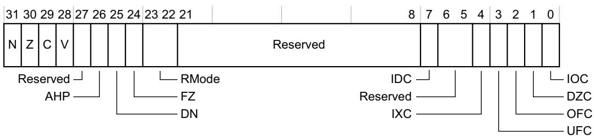

N, bit[31] Negative condition flag. Floating-point comparison operations update this flag.

Z, bit[30] Zero condition flag. Floating-point comparison operations update this flag.

C, bit[29] Carry condition flag. Floating-point comparison operations update this flag.

V, bit[28] Overflow condition flag. Floating-point comparison operations update this flag.

Bit[27] Reserved.

AHP, bit[26] Alternative half-precision control bit: 0 IEEE 754-2008 half-precision format selected. 1 Alternative half-precision format selected. For more information see Floating-point half-precision formats on page A2-41.

DN, bit[25] Default NaN mode control bit: 0 NaN operands propagate through to the output of a floating-point operation. 1 Any operation involving one or more NaNs returns the Default NaN. For more information, see NaN handling and the Default NaN on page A2-43.

FZ, bit[24] Flush-to-zero mode control bit: 0 Flush-to-zero mode disabled. Behavior of the floating-point system is fully compliant with the IEEE 754 standard. 1 Flush-to-zero mode enabled. For more information, see Flush-to-zero on page A2-43.

RMode, bits[23:22] Rounding mode control field. The encoding of this field is: 0b00 Round to Nearest (RN) mode. 0b01 Round towards Plus Infinity (RP) mode. 0b10 Round towards Minus Infinity (RM) mode. 0b11 Round towards Zero (RZ) mode.

The specified rounding mode is used by almost all floating-point instructions.

Bits[21:8] Reserved.

IDC, bit[7] Input Denormal cumulative exception bit. This bit is set to 1 to indicate that the corresponding exception has occurred since 0 was last written to it. For more information about the exception indicated by this bit see Floating-point exceptions on page A2-44.

Bits[6:5] Reserved.

IXC, bit[4] Inexact cumulative exception bit. This bit is set to 1 to indicate that the corresponding exception has occurred since 0 was last written to it. For more information about the exceptions indicated by this bit see Floating-point exceptions on page A2-44.

UFC, bit[3] Underflow cumulative exception bit. This bit is set to 1 to indicate that the corresponding exception has occurred since 0 was last written to it. For more information about the exceptions indicated by this bit see Floating-point exceptions on page A2-44.

OFC, bit[2] Overflow cumulative exception bit. This bit is set to 1 to indicate that the corresponding exception has occurred since 0 was last written to it. For more information about the exceptions indicated by this bit see Floating-point exceptions on page A2-44.

DZC, bit[1] Division by Zero cumulative exception bit. This bit is set to 1 to indicate that the corresponding exception has occurred since 0 was last written to it. For more information about the exceptions indicated by this bit see Floating-point exceptions on page A2-44.

IOC, bit[0] Invalid Operation cumulative exception bit. This bit is set to 1 to indicate that the corresponding exception has occurred since 0 was last written to it. For more information about the exceptions indicated by this bit see Floating-point exceptions on page A2-44.

Writes to the FPSCR can have side-effects on various aspects of processor operation. All of these side-effects are synchronous to the FPSCR write. This means they are guaranteed not to be visible to earlier instructions in the execution stream, and they are guaranteed to be visible to later instructions in the execution stream.

## Accessing the FPSCR

You read or write the FPSCR, or transfer the FPSCR flags to the corresponding APSR flags, using the VMRS and VMSR instructions. For more information, see VMRS on page A7-485 and VMSR on page A7-486. For example:

VMRS <Rt>, FPSCR ; Read Floating-point System Control Register

VMSR FPSCR, <Rt> ; Write Floating-point System Control Register

## A2.5.4 Floating-point data types and arithmetic

The FP extension supports single-precision (32-bit) and double-precision (64-bit) floating-point data types and arithmetic as defined by the IEEE 754 floating-point standard. It also supports the Arm standard modifications to that arithmetic described in Flush-to-zero on page A2-43 and NaN handling and the Default NaN on page A2-43.

Arm standard floating-point arithmetic means IEEE 754 floating-point arithmetic with the Arm standard modifications and the Round to Nearest rounding mode selected.

## Arm standard floating-point input and output values

Arm standard floating-point arithmetic supports the following input formats defined by the IEEE 754 floating-point standard:

Zeros.

Normalized numbers.

Denormalized numbers are flushed to 0 before floating-point operations. For more information see Flush-to-zero on page A2-43.

NaNs.

Infinities.

Arm standard floating-point arithmetic supports the Round to Nearest rounding mode defined by the IEEE 754 standard.

Arm standard floating-point arithmetic supports the following output result formats defined by the IEEE 754 standard:

Zeros.

Normalized numbers.

Results that are less than the minimum normalized number are flushed to zero, see Flush-to-zero on page A2-43.

NaNs produced in floating-point operations are always the default NaN, see NaN handling and the Default NaN on page A2-43.

Infinities.

## Floating-point single-precision format

The single-precision floating-point format used by the FP extension is as defined by the IEEE 754 standard.

This description includes Arm-specific details that are left open by the standard. It is only intended as an introduction to the formats and to the values they can contain. For full details, especially of the handling of infinities, NaNs and signed zeros, see the IEEE 754 standard.

A single-precision value is a 32-bit word, and must be word-aligned when held in memory. It has the format:

<table><tr><td colspan="2">31 30</td><td colspan="2">23 22</td><td>0</td></tr><tr><td>S</td><td>exponent</td><td colspan="3">fraction</td></tr></table>

The interpretation of the format depends on the value of the exponent field, bits[30:23]:

## 0 < exponent < 0xFF

The value is a normalized number and is equal to:

–1S × 2(exponent – 127) × (1.fraction)

The minimum positive normalized number is 2<sup>–126</sup>, or approximately 1.175 ×10<sup>–38</sup>.

The maximum positive normalized number is $( 2 - 2 ^ { - 2 3 } ) \times 2 ^ { 1 2 7 } .$ , or approximately $3 . 4 0 3 \times 1 0 ^ { 3 8 } .$

exponent == 0

The value is either a zero or a denormalized number, depending on the fraction bits:

fraction == 0

The value is a zero. There are two distinct zeros: +0 When S==0.

When S==1.

These usually behave identically. In particular, the result is equal if +0 and –0 are compared as floating-point numbers. However, they yield different results in some circumstances. For example, the sign of the infinity produced as the result of dividing by zero depends on the sign of the zero. The two zeros can be distinguished from each other by performing an integer comparison of the two words.

## fraction != 0

The value is a denormalized number and is equal to:

$$
- 1 ^ {\mathrm{S}} \times 2 ^ {- 1 2 6} \times (0. \text { fraction })
$$

The minimum positive denormalized number is 2<sup>–149</sup>, or approximately $1 . 4 0 1 \times 1 0 ^ { - 4 5 } ,$

Denormalized numbers are optionally flushed to zero in the FP extension. For details see Flush-to-zero on page A2-43.

## exponent == 0xFF

The value is either an infinity or a Not a Number (NaN), depending on the fraction bits:

## fraction == 0

The value is an infinity. There are two distinct infinities:

+∞ When S==0. This represents all positive numbers that are too big to be represented accurately as a normalized number.

-∞ When S==1. This represents all negative numbers with an absolute value that is too big to be represented accurately as a normalized number.

## fraction != 0

The value is a NaN, and is either a quiet NaN or a signaling NaN.

In the FP architecture, the two types of NaN are distinguished on the basis of their most significant fraction bit, bit[22]:

bit[22] == 0

The NaN is a signaling NaN. The sign bit can take any value, and the remaining fraction bits can take any value except all zeros.

bit[22] == 1

The NaN is a quiet NaN. The sign bit and remaining fraction bits can take any value.

For details of the default NaN see NaN handling and the Default NaN on page A2-43.

NaNs with different sign or fraction bits are distinct NaNs, but this does not mean you can use floating-point comparison instructions to distinguish them. This is because the IEEE 754 standard specifies that a NaN compares as unordered with everything, including itself. However, you can use integer comparisons to distinguish different NaNs.

## Floating-point double-precision format

The double-precision floating-point format used by the Floating-point Extension is as defined by the IEEE 754 standard.

This description includes Floating-point Extension-specific details that are left open by the standard. It is only intended as an introduction to the formats and to the values they can contain. For full details, especially of the handling of infinities, NaNs and signed zeros, see the IEEE 754 standard.

A double-precision value is a 64-bit doubleword, with the format:

<table><tr><td>63</td><td>62</td><td>52</td><td>51</td><td>32</td><td>31</td><td>0</td></tr><tr><td>S</td><td colspan="2">exponent</td><td colspan="4">fraction</td></tr></table>

Double-precision values represent numbers, infinities and NaNs in a similar way to single-precision values, with the interpretation of the format depending on the value of the exponent:

## 0 < exponent < 0x7FF

The value is a normalized number and is equal to:

(–1)S × 2(exponent–1023) × (1.fraction)

The minimum positive normalized number is $2 ^ { - 1 0 2 2 } \mathrm { , }$ , or approximately $2 . 2 2 5 \times 1 0 ^ { - 3 0 8 } ,$

The maximum positive normalized number is $( 2 - 2 ^ { - 5 2 } ) \times 2 ^ { 1 0 2 3 } .$ , or approximately $1 . 7 9 8 \times 1 0 ^ { 3 0 8 } .$

## exponent == 0

The value is either a zero or a denormalized number, depending on the fraction bits:

fraction == 0

The value is a zero. There are two distinct zeros that behave analogously to the two single-precision zeros:

+0 When S==0.

–0 When S==1.

fraction != 0

The value is a denormalized number and is equal to:

$$
(- 1) ^ {S} \times 2 ^ {- 1 0 2 2} \times (0. f r a c t i o n)
$$

The minimum positive denormalized number is $2 ^ { - 1 0 7 4 } ;$ , or approximately 4.941 × 10<sup>–324</sup>.

Optionally, denormalized numbers are flushed to zero in the Floating-point Extension. For details see Flush-to-zero on page A2-43.

## exponent == 0x7FF

The value is either an infinity or a NaN, depending on the fraction bits:

## fraction == 0

The value is an infinity. As for single-precision, there are two infinities:

+infinity When S==0.

-infinity When S==1.

## fraction != 0

The value is a NaN, and is either a quiet NaN or a signaling NaN.

In the Floating-point Extension, the two types of NaN are distinguished on the basis of their most significant fraction bit, bit[19] of the most significant word:

bit[19] == 0

The NaN is a signaling NaN. The sign bit can take any value, and the remaining fraction bits can take any value except all zeros.

bit[19] == 1

The NaN is a quiet NaN. The sign bit and the remaining fraction bits can take any value.

For details of the default NaN see NaN handling and the Default NaN on page A2-43.

NaNs with different sign or fraction bits are distinct NaNs, but this does not mean software can use floating-point comparison instructions to distinguish them. This is because the IEEE 754 standard specifies that a NaN compares as unordered with everything, including itself.

## Floating-point half-precision formats

The Arm half-precision floating-point implementation uses two half-precision floating-point formats:

IEEE half-precision, as described in the IEEE 754-2008 standard.

Alternative half-precision.

The description of IEEE half-precision includes Arm-specific details that are left open by the standard, and is only an introduction to the formats and to the values they can contain. For more information, especially on the handling of infinities, NaNs and signed zeros, see the IEEE 754-2008 standard.

For both half-precision floating-point formats, the layout of the 16-bit number is the same. The format is:

<table><tr><td colspan="2">15 14</td><td colspan="2">10 9</td><td>0</td></tr><tr><td>S</td><td colspan="2">exponent</td><td colspan="2">fraction</td></tr></table>

The interpretation of the format depends on the value of the exponent field, bits[14:10] and on which half-precision format is being used.

## 0 < exponent < 0x1F

The value is a normalized number and is equal to:

The minimum positive normalized number is 2–14, or approximately 6.104 ×10–5.

The maximum positive normalized number is (2 – 2<sup>–10</sup>) × 2<sup>15</sup>, or 65504.

Larger normalized numbers can be expressed using the alternative format when the exponent == 0x1F.

## exponent == 0

The value is either a zero or a denormalized number, depending on the fraction bits:

fraction == 0

The value is a zero. There are two distinct zeros: +0 When S==0. –0 When S==1.

fraction != 0

The value is a denormalized number and is equal to:

The minimum positive denormalized number is 2<sup>–24</sup>, or approximately 5.960 × 10<sup>–8</sup>.

## exponent == 0x1F

The value depends on which half-precision format is being used:

## IEEE half-precision

The value is either an infinity or a Not a Number (NaN), depending on the fraction bits: fraction == 0

The value is an infinity. There are two distinct infinities:

+infinity When S==0. This represents all positive numbers that are too big to be represented accurately as a normalized number.

-infinity When S==1. This represents all negative numbers with an absolute value that is too big to be represented accurately as a normalized number.

## fraction != 0

The value is a NaN, and is either a quiet NaN or a signaling NaN. The two types of NaN are distinguished by their most significant fraction bit, bit[9]:

bit[9] == 0 The NaN is a signaling NaN. The sign bit can take any value, and the remaining fraction bits can take any value except all zeros.

bit[9] == 1 The NaN is a quiet NaN. The sign bit and remaining fraction bits can take any value.

# Alternative half-precision

The value is a normalized number and is equal to:

-1S × 216 × (1.fraction)

The maximum positive normalized number is (2-2<sup>-10</sup>) × 2<sup>16</sup> or 131008.

## Flush-to-zero

Behavior in Flush-to-zero mode differs from normal IEEE 754 arithmetic in the following ways:

All inputs to floating-point operations that are single-precision de-normalized numbers are treated as though they were zero. This causes an Input Denormal exception, but does not cause an Inexact exception. The Input Denormal exception occurs only in Flush-to-zero mode.

The FPSCR contains a cumulative exception bit FPSCR.IDC corresponding to the Input Denormal exception. For more information see Floating-point Status and Control Register, FPSCR on page A2-37.

The occurrence of all exceptions except Input Denormal is determined using the input values after flush-to-zero processing has occurred.

The result of a floating-point operation is flushed to zero if the result of the operation before rounding satisfies the condition:

0 < Abs(result) < MinNorm, where MinNorm is 2<sup>-126</sup> for single-precision arithmetic.

This causes the FPSCR.UFC bit to be set to 1, and prevents any Inexact exception from occurring for the operation.

Underflow exceptions occur only when a result is flushed to zero.

An Inexact exception does not occur if the result is flushed to zero, even though the final result of zero is not equivalent to the value that would be produced if the operation were performed with unbounded precision and exponent range.

For information on the FPSCR bits see Floating-point Status and Control Register, FPSCR on page A2-37.

When an input or a result is flushed to zero the value of the sign bit of the zero is preserved. That is, the sign bit of the zero matches the sign bit of the input or result that is being flushed to zero.

Flush-to-zero mode has no effect on half-precision numbers that are inputs to floating-point operations, or results from floating-point operations.

Note

Flush-to-zero mode is incompatible with the IEEE 754 standard, and must not be used when IEEE 754 compatibility is a requirement. Flush-to-zero mode must be treated with care. Although it can lead to a major performance increase on many algorithms, there are significant limitations on its use. These are application dependent:

On many algorithms, it has no noticeable effect, because the algorithm does not normally use denormalized numbers.

On other algorithms, it can cause exceptions to occur or seriously reduce the accuracy of the results of the algorithm.

## NaN handling and the Default NaN

The IEEE 754 standard specifies that:

• An operation that produces an Invalid Operation floating-point exception generates a quiet NaN as its result.

An operation involving a quiet NaN operand, but not a signaling NaN operand, returns an input NaN as its result.

The FP behavior when Default NaN mode is disabled adheres to this with the following extra details, where the first operand means the first argument to the pseudocode function call that describes the operation:

If an Invalid Operation floating-point exception is produced because one of the operands is a signaling NaN, the quiet NaN result is equal to the signaling NaN with its most significant fraction bit changed to 1. If both operands are signaling NaNs, the result is produced in this way from the first operand.

If an Invalid Operation floating-point exception is produced for other reasons, the quiet NaN result is the Default NaN.

If both operands are quiet NaNs, the result is the first operand.

The FP behavior when Default NaN mode is enabled is that the Default NaN is the result of all floating-point operations that:

Generate Invalid Operation floating-point exceptions.

Have one or more quiet NaN inputs.

Table A2-2 shows the format of the default NaN for Arm floating-point processors.

Default NaN mode is selected for FP by setting the FPSCR.DN bit to 1, see Floating-point Status and Control Register, FPSCR on page A2-37.

The Invalid Operation exception causes the FPSCR.IOC bit be set to 1. This is not affected by Default NaN mode.

Table A2-2 Default NaN encoding

<table><tr><td></td><td>Half-precision, IEEE Format</td><td>Single-precision</td><td>Double-precision</td></tr><tr><td>Sign bit</td><td>0</td><td>0</td><td>0</td></tr><tr><td>Exponent</td><td>0x1F</td><td>0xFF</td><td>0x7FF</td></tr><tr><td>Fraction</td><td>Bit[9] == 1, bits[8:0] == 0</td><td>bit[22] == 1, bits[21:0] == 0</td><td>bit[51] == 1, bits[50:0] == 0</td></tr></table>

## Floating-point exceptions

The FP extension records the following floating-point exceptions in the FPSCR cumulative bits, see Floating-point Status and Control Register, FPSCR on page A2-37:

IOC Invalid Operation. The bit is set to 1 if the result of an operation has no mathematical value or cannot be represented. Cases include infinity \* 0, +infinity + (–infinity), for example. These tests are made after flush-to-zero processing. For example, if Flush-to-zero mode is selected, multiplying a denormalized number and an infinity is treated as 0 \* infinity and causes an Invalid Operation floating-point exception.

IOC is also set on any floating-point operation with one or more signaling NaNs as operands, except for negation and absolute value, as described in FP negation and absolute value on page A2-47.

DZC Division by Zero. The bit is set to 1 if a divide operation has a zero divisor and a dividend that is not zero, an infinity or a NaN. These tests are made after flush-to-zero processing, so if flush-to-zero processing is selected, a denormalized dividend is treated as zero and prevents Division by Zero from occurring, and a denormalized divisor is treated as zero and causes Division by Zero to occur if the dividend is a normalized number.

For the reciprocal and reciprocal square root estimate functions the dividend is assumed to be +1.0. This means that a zero or denormalized operand to these functions sets the DZC bit.

OFC Overflow. The bit is set to 1 if the absolute value of the result of an operation, produced after rounding, is greater than the maximum positive normalized number for the destination precision.

UFC Underflow. The bit is set to 1 if the absolute value of the result of an operation, produced before rounding, is less than the minimum positive normalized number for the destination precision, and the rounded result is inexact.

The criteria for the Underflow exception to occur are different in Flush-to-zero mode. For details, see Flush-to-zero on page A2-43

IXC Inexact. The bit is set to 1 if the result of an operation is not equivalent to the value that would be produced if the operation were performed with unbounded precision and exponent range.

The criteria for the Inexact exception to occur are different in Flush-to-zero mode. For details, see Flush-to-zero on page A2-43.

IDC Input Denormal. The bit is set to 1 if a denormalized input operand is replaced in the computation by a zero, as described in Flush-to-zero on page A2-43.

Table A2-3 shows the default results of the floating-point exceptions:  
Table A2-3 Floating-point exception default results

<table><tr><td>Exception type</td><td>Default result for positive sign</td><td>Default result for negative sign</td></tr><tr><td>IOC, Invalid Operation</td><td>Quiet NaN</td><td>Quiet NaN</td></tr><tr><td>DZC, Division by Zero</td><td>+• (plus infinity)</td><td>-• (minus infinity)</td></tr><tr><td>OFC, Overflow</td><td>RN, RP: +• (plus infinity)RM, RZ: +MaxNorm</td><td>RN, RM: -• (minus infinity)RP, RZ: -MaxNorm</td></tr><tr><td>UFC, Underflow</td><td>Normal rounded result</td><td>Normal rounded result</td></tr><tr><td>IXC, Inexact</td><td>Normal rounded result</td><td>Normal rounded result</td></tr><tr><td>IDC, Input Denormal</td><td>Normal rounded result</td><td>Normal rounded result</td></tr></table>

## In Table A2-3:

MaxNorm The maximum normalized number of the destination precision.

RM Round towards Minus Infinity mode, as defined in the IEEE 754 standard.

RN Round to Nearest mode, as defined in the IEEE 754 standard.

RP Round towards Plus Infinity mode, as defined in the IEEE 754 standard.

RZ Round towards Zero mode, as defined in the IEEE 754 standard.

For Invalid Operation exceptions, for details of which quiet NaN is produced as the default result see NaN handling and the Default NaN on page A2-43.

For Division by Zero exceptions, the sign bit of the default result is determined normally for a division. This means it is the exclusive OR of the sign bits of the two operands.

For Overflow exceptions, the sign bit of the default result is determined normally for the overflowing operation.

## Combinations of exceptions

The following pseudocode functions perform floating-point operations:

FixedToFP()

FPAbs()

FPAdd()

FPCompare()

FPDiv()

FPDoubleToSingle()

FPHalfToSingle()

FPMul()

FPMulAdd()

FPNeg()

FPSingleToDouble()

FPSingleToHalf()

```txt
FPSqrt()
FPSub()
FPToFixed()
```

All of these operations except FPAbs() and FPNeg() can generate floating-point exceptions.

More than one exception can occur on the same operation. The only combinations of exceptions that can occur are:

Overflow with Inexact.

Underflow with Inexact.

Input Denormal with other exceptions.

Any exception that occurs causes the associated cumulative bit in the FPSCR to be set.

Some floating-point instructions specify more than one floating-point operation, as indicated by the pseudocode descriptions of the instruction. In such cases, an exception on one operation is treated as higher priority than an exception on another operation if the occurrence of the second exception depends on the result of the first operation. Otherwise, it is UNPREDICTABLE which exception is treated as higher priority.

For example, a VMLA instruction specifies a floating-point multiplication followed by a floating-point addition. The addition can generate Overflow, Underflow and Inexact exceptions, all of which depend on both operands to the addition and so are treated as lower priority than any exception on the multiplication. The same applies to Invalid Operation exceptions on the addition caused by adding opposite-signed infinities. The addition can also generate an Input Denormal exception, caused by the addend being a denormalized number while in Flush-to-zero mode. It is UNPREDICTABLE which of an Input Denormal exception on the addition and an exception on the multiplication is treated as higher priority, because the occurrence of the Input Denormal exception does not depend on the result of the multiplication. The same applies to an Invalid Operation exception on the addition caused by the addend being a signaling NaN.

## Pseudocode details of floating-point operations

This section contains pseudocode definitions of the floating-point operations used by the FP extension.

## Generation of specific floating-point values

The following functions generate specific floating-point values. The sign argument of FPZero(), FPMaxNormal(), and FPInfinity() is '0' for the positive version and '1' for the negative version.

```txt
// FPZero()
// ======

bits(N) FPZero(bit sign, integer N)
    assert N IN {16,32,64};
    if N == 16 then
    E = 5;
    elsif N == 32 then
    E = 8;
    else E = 11;

    F = N - E - 1;
    exp = Zeros(E);
    frac = Zeros(F);
    return sign:exp:frac;

// FPInfinity()
// ======

bits(N) FPInfinity(bit sign, integer N)
    assert N IN {16,32,64};
    if N == 16 then
    E = 5;
    elsif N == 32 then
    E = 8;
    else E = 11;

    F = N - E - 1;
```

```txt
exp = Ones(E);
frac = Zeros(F);
return sign:exp:frac;

// FPMaxNormal()
// ==================

bits(N) FPMaxNormal(bit sign, integer N)
    assert N IN {16,32,64};
    if N == 16 then
    E = 5;
    elsif N == 32 then
    E = 8;
    else E = 11;

    F = N - E - 1;
    exp = Ones(E-1):'0';
    frac = Ones(F);
    return sign:exp:frac;

// FPDefaultNaN()
// ==================

bits(N) FPDefaultNaN(integer N)
    assert N IN {16,32,64};
    if N == 16 then
    E = 5;
    elsif N == 32 then
    E = 8;
    else E = 11;

    F = N - E - 1;
    sign = '0';
    exp = Ones(E);
    frac = '1':Zeros(F-1);
    return sign:exp:frac;
```

## FP negation and absolute value

The floating-point negation and absolute value operations only affect the sign bit. They do not apply any special treatment:

To NaN operands.

When flush-to-zero is selected, to denormalized number operands.

```txt
// FPNeg()
// ======

bits(N) FPNeg(bits(N) operand)
    assert N IN {32,64};
    return NOT(operand<N-1>) : operand<N-2:0>;
// FPAbs()
// ======

bits(N) FPAbs(bits(N) operand)
    assert N IN {32,64};
    return '0' : operand<N-2:0>;
```

## FP value unpacking

The FPUnpack() function determines the type and numerical value of a floating-point number. It also does flush-to-zero processing on input operands.

```erlang
enumeration FPType {FPType_Nonzero, FPType_Zero, FPType_Infinity, FPType_QNaN, FPType_SNaN}; // FPUnpack()  
// =====  
//
```

// The ‘fpscr\_val’ argument supplies FPSCR control bits. Status information is // updated directly in the FPSCR where appropriate.

```txt
(FPType, bit, real) FPUnpack(bits(N) fpval, bits(32) fpscr_val)
assert N IN {16,32,64};

if N == 16 then
    sign = fpval<15>;
    exp16 = fpval<14:10>;
    frac16 = fpval<9:0>;
    if IsZero(exp16) then
    // Produce zero if value is zero
    if IsZero(frac16) then
    type = FPType_Zero; value = 0.0;
    else
    type = FPType_Nonzero; value = 2.0^-14 * (UInt(frac16) * 2.0^-10);
    elsif IsOnes(exp16) && fpscr_val<26> == '0' then // Infinity or NaN in IEEE format
    if IsZero(frac16) then
    type = FPType_Infinity; value = 2.0^1000000;
    else
    type = if frac16<9> == '1' then FPType_QNaN else FPType_SNaN;
    value = 0.0;
    else
    type = FPType_Nonzero; value = 2.0^(UInt(exp16)-15) * (1.0 + UInt(frac16) * 2.0^-10);

elsif N == 32 then

sign = fpval<31>;
exp32 = fpval<30:23>;
frac32 = fpval<22:0>;
if IsZero(exp32) then
    // Produce zero if value is zero or flush-to-zero is selected.
    if IsZero(frac32) || fpscr_val<24> == '1' then
    type = FPType_Zero; value = 0.0;
    if !IsZero(frac32) then // Denormalized input flushed to zero
    FPProcessException(FPExc_InputDenorm, fpscr_val);
    else
    type = FPType_Nonzero; value = 2.0^-126 * (UInt(frac32) * 2.0^-23);
elsif IsOnes(exp32) then
    if IsZero(frac32) then
    type = FPType_Infinity; value = 2.0^1000000;
    else
    type = if frac32<22> == '1' then FPType_QNaN else FPType_SNaN;
    value = 0.0;
    else
    type = FPType_Nonzero; value = 2.0^(UInt(exp32)-127) * (1.0 + UInt(frac32) * 2.0^-23);

else // N == 64

sign = fpval<63>;
exp64 = fpval<62:52>;
frac64 = fpval<51:0>;
if IsZero(exp64) then
    // Produce zero if value is zero or flush-to-zero is selected.
    if IsZero(frac64) || fpscr_val<24> == '1' then
    type = FPType_Zero; value = 0.0;
    if !IsZero(frac64) then // Denormalized input flushed to zero
    FPProcessException(FPExc_InputDenorm, fpscr_val);
    else
    type = FPType_Nonzero; value = 2.0^-1022 * (UInt(frac64) * 2.0^-52);
elsif IsOnes(exp64) then
    if IsZero(frac64) then
```

```matlab
type = FPType_Infinity; value = 2.0^1000000;
else
    type = if frac64<51> == '1' then FPType_QNaN else FPType_SNaN;
    value = 0.0;
else
    type = FPType_Nonzero; value = 2.0^(UInt(exp64)-1023) * (1.0 + UInt(frac64) * 2.0^-52);
if sign == '1' then value = -value;
return (type, sign, value);
```

## FP exception and NaN handling

The FPProcessException() procedure checks whether a floating-point exception is trapped, and handles it accordingly:

```txt
enumeration FPType {FPType_Nonzero, FPType_Zero, FPType_Infinity, FPType_QNaN, FPType_SNaN}; // FPProcessException()  
// =====  
// The 'fpscr_val' argument supplies FPSCR control bits. Status information is  
// updated directly in the FPSCR where appropriate.
```

```txt
FPProcessException(FPExc exception, bits(32) fpscr_val)
// Get appropriate FPSCR bit numbers
case exception of
    when FPExc_InvalidOp enable = 8; cumul = 0;
    when FPExc_DivideByZero enable = 9; cumul = 1;
    when FPExc_Overflow enable = 10; cumul = 2;
    when FPExc_Underflow enable = 11; cumul = 3;
    when FPExc_Inexact enable = 12; cumul = 4;
    when FPExc_InputDenorm enable = 15; cumul = 7;
    if fpscr_val<enable> == '1' then
    IMPLEMENTATION_DEFINED floating-point trap handling;
    else
    FPSCR<cumul> = '1';
    return;
```

The FPProcessNaN() function processes a NaN operand, producing the correct result value and generating an Invalid Operation exception if necessary:

```txt
// FPProcessNaN()
// ========
//
// The 'fpscr_val' argument supplies FPSCR control bits. Status information is
// updated directly in the FPSCR where appropriate.
```

```cpp
bits(N) FPProcessNaN(FPType type, bits(N) operand, bits(32) fpscr_val)
    assert N IN {32,64};
    topfrac = if N == 32 then 22 else 51;
    result = operand;
    if type == FPType_SNaN then
    result <topfrac> = '1';
    FPProcessException(FPExc_InvalidOp, fpscr_val);
    if fpscr_val <25> == '1' then // DefaultNaN requested
    result = FPDefaultNaN(N);
    return result;
```

```txt
// FPProcessNaNs()
// ========
//
// The boolean part of the return value says whether a NaN has been found and
// processed. The bits(N) part is only relevant if it has and supplies the
// result of the operation.
//
// The 'fpscr_val' argument supplies FPSCR control bits. Status information is
```

// updated directly in the FPSCR where appropriate.

```c
(boolean, bits(N)) FPProcessNaNs(FPType type1, FPType type2,
bits(N) op1, bits(N) op2,
bits(32) fpscr_val)
assert N IN {32,64};
if type1 == FPType_SNaN then
done = TRUE; result = FPProcessNaN(type1, op1, fpscr_val);
elsif type2 == FPType_SNaN then
done = TRUE; result = FPProcessNaN(type2, op2, fpscr_val);
elsif type1 == FPType_QNaN then
done = TRUE; result = FPProcessNaN(type1, op1, fpscr_val);
elsif type2 == FPType_QNaN then
done = TRUE; result = FPProcessNaN(type2, op2, fpscr_val);
else
done = FALSE; result = Zeros(N); // 'Don't care' result
return (done, result);
```

The FPProcessNaNs3() function performs the standard NaN processing for a three-operand operation:

```txt
// FPProcessNaNs3()
// ========
//
// The boolean part of the return value says whether a NaN has been found and
// processed. The bits(N) part is only relevant if it has and supplies the
// result of the operation.
//
// The 'fpscr_val' argument supplies FPSCR control bits. Status information is
// updated directly in the FPSCR where appropriate.
```

```txt
boolean, bits(N)) FPProcessNaNs3(FPType type1, FPType type2, FPType type3, bits(N) op1, bits(N) op2, bits(N) op3, bits(32) fpscr_val)
assert N IN {32,64};
if type1 == FPType_SNaN then
    done = TRUE; result = FPProcessNaN(type1, op1, fpscr_val);
elsif type2 == FPType_SNaN then
    done = TRUE; result = FPProcessNaN(type2, op2, fpscr_val);
elsif type3 == FPType_SNaN then
    done = TRUE; result = FPProcessNaN(type3, op3, fpscr_val);
elsif type1 == FPType_QNaN then
    done = TRUE; result = FPProcessNaN(type1, op1, fpscr_val);
elsif type2 == FPType_QNaN then
    done = TRUE; result = FPProcessNaN(type2, op2, fpscr_val);
elsif type3 == FPType_QNaN then
    done = TRUE; result = FPProcessNaN(type3, op3, fpscr_val);
else
    done = FALSE; result = Zeros(N); // 'Don't care' result return (done, result);
```

## FP rounding

The FPRound() function rounds and encodes a single-precision floating-point result value to a specified destination format. This includes processing Overflow, Underflow and Inexact floating-point exceptions and performing flush-to-zero processing on result values.

```cpp
// FPRound()
// ========
//
// The 'fpscr_val' argument supplies FPSCR control bits. Status information is
// updated directly in the FPSCR where appropriate.

bits(N) FPRound(real value, integer N, bits(32) fpscr_val)
    assert N IN {16, 32, 64};
    assert value != 0.0;

    // Obtain format parameters - minimum exponent, numbers of exponent and fraction bits.
    if N == 16 then
```

```c
E = 5;
elsif N == 32 then
    E = 8;
else E = 11;

minimum_exp = 2 - 2^(E-1);
F = N - E - 1;

// Split value into sign, unrounded mantissa and exponent.
if value < 0.0 then
    sign = '1'; mantissa = -value;
else
    sign = '0'; mantissa = value;
exponent = 0;
while mantissa < 1.0 do
    mantissa = mantissa * 2.0; exponent = exponent - 1;
while mantissa >= 2.0 do
    mantissa = mantissa / 2.0; exponent = exponent + 1;

// Deal with flush-to-zero.
if fpscr_val<24> == '1' && N != 16 && exponent < minimum_exp then
    result = FPZero(sign, N);
    FPSCR.UFC = '1'; // Flush-to-zero never generates a trapped exception

else
    // Start creating the exponent value for the result. Start by biasing the actual exponent
    // so that the minimum exponent becomes 1, lower values 0 (indicating possible underflow).
    biased_exp = Max(exponent - minimum_exp + 1, 0);
    if biased_exp == 0 then mantissa = mantissa / 2^(minimum_exp - exponent);

    // Get the unrounded mantissa as an integer, and the "units in last place" rounding error.
    int_mant = RoundDown(mantissa * 2^F); // < 2^F if biased_exp == 0, >= 2^F if not
    error = mantissa * 2^F - int_mant;

    // Underflow occurs if exponent is too small before rounding, and result is inexact or
    // the Underflow exception is trapped.
    if biased_exp == 0 && (error != 0.0 || fpscr_val<11> == '1') then
    FPProcessException(FPExc_Underflow, fpscr_val);

    // Round result according to rounding mode.
case fpscr_val<23:22> of
    when '00' // Round to Nearest (rounding to even if exactly halfway)
    round_up = (error > 0.5 || (error == 0.5 && int_mant<0> == '1'));
    overflow_to_inf = TRUE;
    when '01' // Round towards Plus Infinity
    round_up = (error != 0.0 && sign == '0');
    overflow_to_inf = (sign == '0');
    when '10' // Round towards Minus Infinity
    round_up = (error != 0.0 && sign == '1');
    overflow_to_inf = (sign == '1');
    when '11' // Round towards Zero
    round_up = FALSE;
    overflow_to_inf = FALSE;
    if round_up then
    int_mant = int_mant + 1;
    if int_mant == 2^F then // Rounded up from denormalized to normalized
    biased_exp = 1;
    if int_mant == 2^(F+1) then // Rounded up to next exponent
    biased_exp = biased_exp + 1;
    int_mant = int_mant DIV 2;

    // Deal with overflow and generate result.
    if N != 16 || fpscr_val<26> == '0' then // Single, double or IEEE half precision
    if biased_exp >= 2^E - 1 then
    result = if overflow_to_inf then FPInfinity(sign, N) else FPMaxNormal(sign, N);
    FPProcessException(FPExc_Uverflow, fpscr_val);
    error = 1.0; // Ensure that an Inexact exception occurs
    else
```

```txt
result = sign:biased_exp<E-1:0>:int_mant<F-1:0>;
else    // Alternative half precision (with N==16)
    if biased_exp >= 2^E then
    result = sign : Ones(15);
    FPProcessException(FPExc_InvalidOp, fpscr_val);
    error = 0.0;    // Ensure that an Inexact exception does not occur
    else
    result = sign:biased_exp<E-1:0>:int_mant<F-1:0>;
// Deal with Inexact exception.
if error != 0.0 then
    FPProcessException(FPExc_Inexact, fpscr_val);
```

The FPRoundInt() function rounds a single or double-precision floating-point value to an integer in floating-point format.

```txt
// FPRoundInt()
// ========
//
// Round floating-point value to nearest integral floating point value
// using given rounding mode. If exact is TRUE, set inexact flag if result
// is not numerically equal to given value.
```

```c
// Unpack using FPSCR to determine if subnormals are flushed-to-zero
(type, sign, value) = FPUnpack(op, FPSCR);

if type == FPType_SNaN || type == FPType_QNaN then
    result = FPProcessNaN(type, op, FPSCR);
elsif type == FPType_Infinity then
    result = FPInfinity(sign);
elsif type == FPType_Zero then
    result = FPZero(sign);
else
    // extract integer component
    int_result = RoundDown(value);
    error = value - int_result;

    // Determine whether supplied rounding mode requires an increment
    case rmode of
    when '00' // Round to nearest, ties to even
    round_up = (error > 0.5 || (error == 0.5 && int_result<0> == '1'));
    when '01' // Round towards Plus Infinity
    round_up = (error != 0.0);
    when '10' // Round towards Minus Infinity
    round_up = FALSE;
    when '11' // Round towards Zero
    round_up = (error != 0.0 && int_result < 0);

    if away then // Round towards Zero, ties away
    round_up = (error > 0.5 || (error == 0.5 && int_result >= 0));

    if round_up then int_result = int_result + 1;

    // Convert integer value into an equivalent real value
    real_result = 1.0 * int_result;

    // Re-encode as a floating-point value, result is always exact
    if real_result == 0.0 then
    result = FPZero(sign);
    else
    result = FPRound(real_result, N, FPSCR);

    // Generate inexact exceptions
```

```txt
if error != 0.0 && exact then
    FPProcessException(FPExc_Inexact, FPSCR);
```

return result;

## Selection of Arm standard floating-point arithmetic

The function StandardFPSCRValue() returns an FPSCR value that selects Arm standard floating-point arithmetic. Most FP arithmetic functions have a boolean argument fpscr\_controlled that selects between using the real FPSCR value and this value.

// StandardFPSCRValue()

bits(32) StandardFPSCRValue()

```txt
return '00000' : FPSCR<26> : '1100000000000000000000000';
```

## FP comparisons

The FPCompare() function compares two floating-point numbers, producing an (N,Z,C,V) flags result as Table A2-4 shows:

Table A2-4 FP comparison flag values

<table><tr><td>Comparison result</td><td>N</td><td>Z</td><td>C</td><td>V</td></tr><tr><td>Equal</td><td>0</td><td>1</td><td>1</td><td>0</td></tr><tr><td>Less than</td><td>1</td><td>0</td><td>0</td><td>0</td></tr><tr><td>Greater than</td><td>0</td><td>0</td><td>1</td><td>0</td></tr><tr><td>Unordered</td><td>0</td><td>0</td><td>1</td><td>1</td></tr></table>

In the FP extension, this result defines the VCMP instruction. The VCMP instruction writes these flag values in the FPSCR. Software can use a VMRS instruction to transfer them to the APSR, and they then control conditiona execution as Table A7-1 on page A7-178 shows.

## // FPCompare()

```txt
(bit, bit, bit, bit) FPCompare(bits(N) op1, bits(N) op2, boolean quiet_nan_exc, boolean fpscr_controlled)
assert N IN {32,64};
fpscr_val = if fpscr_controlled then FPSCR else StandardFPSCRValue();
(type1, sign1, value1) = FPUnpack(op1, fpscr_val);
(type2, sign2, value2) = FPUnpack(op2, fpscr_val);
if type1==FPType_SNaN || type1==FPType_QNaN || type2==FPType_SNaN || type2==FPType_QNaN then
    result = ('0', '0', '1', '1');
    if type1==FPType_SNaN || type2==FPType_SNaN || quiet_nan_exc then
    FPProcessException(FPExc_InvalidOp, fpscr_val);
else
    // All non-NaN cases can be evaluated on the values produced by FPUnpack()
    if value1 == value2 then
    result = ('0', '1', '1', '0');
    elsif value1 < value2 then
    result = ('1', '0', '0', '0');
    else // value1 > value2
    result = ('0', '0', '1', '0');
return result;
```

## FP addition and subtraction

The following functions perform floating-point addition and subtraction.

// FPAdd()

```txt
// =====

bits(N) FPAdd(bits(N) op1, bits(N) op2, boolean fpscr_controlled)
    assert N IN {32,64};
    fpscr_val = if fpscr_controlled then FPSCR else StandardFPSCRValue();
    (type1, sign1, value1) = FPUnpack(op1, fpscr_val);
    (type2, sign2, value2) = FPUnpack(op2, fpscr_val);
    (done, result) = FPProcessNaNs(type1, type2, op1, op2, fpscr_val);
    if !done then
    inf1 = (type1 == FPType_Infinity);    inf2 = (type2 == FPType_Infinity);
    zero1 = (type1 == FPType_Zero);    zero2 = (type2 == FPType_Zero);
    if inf1 && inf2 && sign1 == NOT(sign2) then
    result = FPDefaultNaN(N);
    FPProcessException(FPExc_InvalidOp, fpscr_val);
    elsif (inf1 && sign1 == '0') || (inf2 && sign2 == '0') then
    result = FPInfinity('0', N);
    elsif (inf1 && sign1 == '1') || (inf2 && sign2 == '1') then
    result = FPInfinity('1', N);
    elsif zero1 && zero2 && sign1 == sign2 then
    result = FPZero(sign1, N);
    else
    result_value = value1 + value2;
    if result_value == 0.0 then // Sign of exact zero result depends on rounding mode
    result_sign = if fpscr_val<23:22> == '10' then '1' else '0';
    result = FPZero(result_sign, N);
    else
    result = FPRound(result_value, N, fpscr_val);
    return result;
// FPSub()
// =====

bits(N) FPSub(bits(N) op1, bits(N) op2, boolean fpscr_controlled)
    assert N IN {32,64};
    fpscr_val = if fpscr_controlled then FPSCR else StandardFPSCRValue();
    (type1, sign1, value1) = FPUnpack(op1, fpscr_val);
    (type2, sign2, value2) = FPUnpack(op2, fpscr_val);
    (done, result) = FPRProcessNaNs(type1, type2, op1, op2, fpscr_val);
    if !done then
    inf1 = (type1 == FPType_Infinity);    inf2 = (type2 == FPType_Infinity);
    zero1 = (type1 == FPType_Zero);    zero2 = (type2 == FPType_Zero);
    if inf1 && inf2 && sign1 == sign2 then
    result = FPDefaultNaN(N);
    FPProcessException(FPExc_InvalidOp, fpscr_val);
    elsif (inf1 && sign1 == '0') || (inf2 && sign2 == '1') then
    result = FPInfinity('0', N);
    elsif (inf1 && sign1 == '1') || (inf2 && sign2 == '0') then
    result = FPInfinity('1', N);
    elsif zero1 && zero2 && sign1 == NOT(sign2) then
    result = FPZero(sign1, N);
    else
    result_value = value1 - value2;
    if result_value == 0.0 then // Sign of exact zero result depends on rounding mode
    result_sign = if fpscr_val<23:22> == '10' then '1' else '0';
    result = FPZero(result_sign, N);
    else
    result = FPRound(result_value, N, fpscr_val);
return result;
```

## FP multiplication and division

The following functions perform floating-point multiplication and division.

```cpp
// FPMul()
// ======
bits(N) FPMul(bits(N) op1, bits(N) op2, boolean fpscr_controlled)
    assert N IN {32,64};
```

```txt
fpscr_val = if fpscr_controlled then FPSCR else StandardFPSCRValue();
(type1, sign1, value1) = FPUnpack(op1, fpscr_val);
(type2, sign2, value2) = FPUnpack(op2, fpscr_val);
(done, result) = FPProcessNaNs(type1, type2, op1, op2, fpscr_val);
if !done then
    inf1 = (type1 == FPType_Infinity);    inf2 = (type2 == FPType_Infinity);
    zero1 = (type1 == FPType_Zero);    zero2 = (type2 == FPType_Zero);
    if (inf1 && zero2) || (zero1 && inf2) then
    result = FPDefaultNaN(N);
    FPProcessException(FPExc_InvalidOp, fpscr_val);
    elsif inf1 || inf2 then
    result_sign = if sign1 == sign2 then '0' else '1';
    result = FPInfinity(result_sign, N);
    elsif zero1 || zero2 then
    result_sign = if sign1 == sign2 then '0' else '1';
    result = FPZero(result_sign, N);
    else
    result = FPRound(value1 * value2, N, fpscr_val);
    return result;
// FPDiv()
// ======

bits(N) FPDiv(bits(N) op1, bits(N) op2, boolean fpscr_controlled)
    assert N IN {32, 64};
fpscr_val = if fpscr_controlled then FPSCR else StandardFPSCRValue();
(type1, sign1, value1) = FPUnpack(op1, fpscr_val);
(type2, sign2, value2) = FPUnpack(op2, fpscr_val);
(done, result) = FPProcessNaNs(type1, type2, op1, op2, fpscr_val);
if !done then
    inf1 = (type1 == FPType_Infinity);    inf2 = (type2 == FPType_Infinity);
    zero1 = (type1 == FPType_Zero);    zero2 = (type2 == FPType_Zero);
    if (inf1 && inf2) || (zero1 && zero2) then
    result = FPDefaultNaN(N);
    FPProcessException(FPExc_InvalidOp, fpscr_val);
elsif inf1 || zero2 then
    result_sign = if sign1 == sign2 then '0' else '1';
    result = FPInfinity(result_sign, N);
    if !inf1 then FPProcessException(FPExc_DivideByZero, fpscr_val);
elsif zero1 || inf2 then
    result_sign = if sign1 == sign2 then '0' else '1';
    result = FPZero(result_sign, N);
    else
    result = FPRound(value1 / value2, N, fpscr_val);
return result;
```

## FP multiply accumulate

The FPMulAdd() function performs the calculation A\*B+C with only a single rounding step, and so provides greater accuracy than performing the multiplication followed by an add:

```c
// FPMulAdd()
// ========
//
// Calculates addend + op1*op2 with a single rounding.

bits(N) FPMulAdd(bits(N) addend, bits(N) op1, bits(N) op2,
    boolean fpscr_controlled)
    assert N IN {32,64};
    fpscr_val = if fpscr_controlled then FPSCR else StandardFPSCRValue();
    (typeA,signA,valueA) = FPUnpack(addend, fpscr_val);
    (type1,sign1,value1) = FPUnpack(op1, fpscr_val);
    (type2,sign2,value2) = FPUnpack(op2, fpscr_val);
    inf1 = (type1 == FPType_Infinity); zero1 = (type1 == FPType_Zero);
    inf2 = (type2 == FPType_Infinity); zero2 = (type2 == FPType_Zero);
    (done,result) = FPProcessNaNs3(typeA, type1, type2, addend, op1, op2, fpscr_val);

    if typeA == FPType_QNaN && ((inf1 && zero2) || (zero1 && inf2)) then
```

```txt
result = FPDefaultNaN(N);
FPProcessException(FPExc_InvalidOp, fpscr_val);

if !done then
    infA = (typeA == FPType_Infinity); zeroA = (typeA == FPType_Zero);

    // Determine sign and type product will have if it does not cause an Invalid
    // Operation.
    signP = if sign1 == sign2 then '0' else '1';
    infP = inf1 || inf2;
    zeroP = zero1 || zero2;

    // Non SNaN-generated Invalid Operation cases are multiplies of zero by infinity and
    // additions of opposite-signed infinities.
    if (inf1 && zero2) || (zero1 && inf2) || (infA && infP && signA == NOT(signP)) then
    result = FPDefaultNaN(N);
    FPProcessException(FPExc_InvalidOp, fpscr_val);

    // Other cases involving infinities produce an infinity of the same sign.
    elsif (infA && signA == '0') || (infP && signP == '0') then
    result = FPInfinity('0', N);
    elsif (infA && signA == '1') || (infP && signP == '1') then
    result = FPInfinity('1', N);

    // Cases where the result is exactly zero and its sign is not determined by the
    // rounding mode are additions of same-signed zeros.
    elsif zeroA && zeroP && signA == signP then
    result = FPZero(signA, N);

    // Otherwise calculate numerical result and round it.
    else
    result_value = valueA + (value1 * value2);
    if result_value == 0.0 then // Sign of exact zero result depends on rounding mode
    result_sign = if fpscr_val<23:22> == '10' then '1' else '0';
    result = FPZero(result_sign, N);
    else
    result = FPRound(result_value, N, fpscr_val);

return result;

FP square root

The FPSqrt() function performs a floating-point square root calculation:

// FPSqrt()
// ====== 

bits(N) FPSqrt(bits(N) operand)
    assert N IN {32,64};
    (type,sign,value) = FPUnpack(operand, FPSCR);
    if type == FPType_SNaN || type == FPType_QNaN then
    result = FPProcessNaN(type, operand, FPSCR);
    elsif type == FPType_Zero then
    result = FPZero(sign, N);
    elsif type == FPType_Infinity && sign == '0' then
    result = FPInfinity(sign, N);
    elsif sign == '1' then
    result = FPDefaultNaN(N);
    FPProcessException(FPExc_InvalidOp, FPSCR);
    else
    result = FPRound(Sqrt(value), N, FPSCR);
    return result;

FP conversions

The following functions perform conversions between half-precision and single-precision floating-point
// FPHalfToSingle()
```

```txt
// ====================
bits(32) FPHalfToSingle(bits(16) operand, boolean fpscr_controlled)
    fpscr_val = if fpscr_controlled then FPSCR else StandardFPSCRValue();
    (type, sign, value) = FPUnpack(operand, fpscr_val);
    if type == FPType_SNaN || type == FPType_QNaN then
    if fpscr_val<25> == '1' then // DN bit set
    result = FPDefaultNaN(32);
    else
    result = sign : '11111111 1' : operand<8:0> : Zeros(13);
    if type == FPType_SNaN then
    FPProcessException(FPExc_InvalidOp, fpscr_val);
    elsif type == FPType_Infinity then
    result = FPInfinity(sign, 32);
    elsif type == FPType_Zero then
    result = FPZero(sign, 32);
    else
    result = FPRound(value, 32, fpscr_val); // Rounding will be exact
    return result;
// FPSingleToHalf()
// ====================
bits(16) FPSingleToHalf(bits(32) operand, boolean fpscr_controlled)
    fpscr_val = if fpscr_controlled then FPSCR else StandardFPSCRValue();
    (type, sign, value) = FPUnpack(operand, fpscr_val);
    if type == FPType_SNaN || type == FPType_QNaN then
    if fpscr_val<26> == '1' then // AH bit set
    result = FPZero(sign, 16);
    elsif fpscr_val<25> == '1' then // DN bit set
    result = FPDefaultNaN(16);
    else
    result = sign : '11111 1' : operand<21:13>;
    if type == FPType_SNaN || fpscr_val<26> == '1' then
    FPProcessException(FPExc_InvalidOp, fpscr_val);
    elsif type == FPType_Infinity then
    if fpscr_val<26> == '1' then // AH bit set
    result = sign : Ones(15);
    FPProcessException(FPExc_InvalidOp, fpscr_val);
    else
    result = FPInfinity(sign, 16);
    elsif type == FPType_Zero then
    result = FPZero(sign, 16);
    else
    result = FPRound(value, 16, fpscr_val);
    return result;
```

The following functions perform conversions between half-precision and double-precision floating-point numbers.

```cpp
// FPHalfToDouble()
// ====================
bits(64) FPHalfToDouble(bits(16) operand, boolean fpscr_controlled)
    fpscr_val = if fpscr_controlled then FPSCR else StandardFPSCRValue();
    (type, sign, value) = FPUnpack(operand, fpscr_val);
    if type == FPType_SNaN || type == FPType_QNaN then
    if fpscr_val<25> == '1' then // DN bit set
    result = FPDefaultNaN(64);
    else
    result = sign : '1111111111 1' : operand<8:0> : Zeros(42);
    if type == FPType_SNaN then
    FPProcessException(FPExc_InvalidOp, fpscr_val);
    elsif type == FPType_Infinity then
    result = FPInfinity(sign, 64);
    elsif type == FPType_Zero then
    result = FPZero(sign, 64);
    else
    result = FPRound(value, 64, fpscr_val); // Rounding will be exact
```

```verilog
return result;
// FPDoubleToHalf()
// ====================
bits(16) FPDoubleToHalf(bits(64) operand, boolean fpscr_controlled)
fpscr_val = if fpscr_controlled then FPSCR else StandardFPSCRValue();
(type, sign, value) = FPUpack(operand, fpscr_val);
if type == FPType_SNaN || type == FPType_QNaN then
    if fpscr_val<26> == '1' then // AH bit set
    result = FPZero(sign, 16);
    elsif fpscr_val<25> == '1' then // DN bit set
    result = FPDefaultNaN(16);
    else
    result = sign : '11111 1' : operand<50:42>;
    if type == FPType_SNaN || fpscr_val<26> == '1' then
    FPProcessException(FPExc_InvalidOp, fpscr_val);
elsif type == FPType_Infinity then
    if fpscr_val<26> == '1' then // AH bit set
    result = sign : Ones(15);
    FPProcessException(FPExc_InvalidOp, fpscr_val);
    else
    result = FPInfinity(sign, 16);
elsif type == FPType_Zero then
    result = FPZero(sign, 16);
else
    result = FPRound(value, 16, fpscr_val);
return result;

The following functions perform conversions between floating-point numbers and integers or fixed-point m
// FPToFixed()
// ====================
bits(M) FPToFixed(bits(N) operand, integer M, integer fraction_bits, boolean unsigned,
    boolean round_towards_zero, boolean fpscr_controlled)
assert N IN {32, 64};
fpscr_val = if fpscr_controlled then FPSCR else StandardFPSCRValue();
if round_towards_zero then fpscr_val<23:22> = '11';
(type, sign, value) = FPUpack(operand, fpscr_val);

// For NaNs and infinities, FPUnpack() has produced a value that will round to the
// required result of the conversion. Also, the value produced for infinities will
// cause the conversion to overflow and signal an Invalid Operation floating-point
// exception as required. NaNs must also generate such a floating-point exception.
if type == FPType_SNaN || type == FPType_QNaN then
    FPProcessException(FPExc_InvalidOp, fpscr_val);

// Scale value by specified number of fraction bits, then start rounding to an integer
// and determine the rounding error.
value = value * 2^fraction_bits;
int_result = RoundDown(value);
error = value - int_result;

// Apply the specified rounding mode.
case fpscr_val<23:22> of
    when '00' // Round to Nearest (rounding to even if exactly halfway)
    round_up = (error > 0.5 || (error == 0.5 && int_result<0> == '1'));
    when '01' // Round towards Plus Infinity
    round_up = (error != 0.0);
    when '10' // Round towards Minus Infinity
    round_up = FALSE;
    when '11' // Round towards Zero
    round_up = (error != 0.0 && int_result < 0);
    if round_up then int_result = int_result + 1;

// Bitstring result is the integer result saturated to the destination size, with
// saturation indicating overflow of the conversion (signaled as an Invalid
// Operation floating-point exception).
(result, overflow) = SatQ(int_result, M, unsigned);
```

```txt
if overflow then
    FPProcessException(FPExc_InvalidOp, fpscr_val);
elsif error != 0.0 then
    FPProcessException(FPExc_Inexact, fpscr_val);

return result;
// FixedToFP()
// ====== 

bits(N) FixedToFP(bits(M) operand, integer N, integer fraction_bits, boolean unsigned,
    boolean round_to_nearest, boolean fpscr_controlled)
assert N IN {32,64};
fpscr_val = if fpscr_controlled then FPSCR else StandardFPSCRValue();
if round_to_nearest then fpscr_val<23:22> = '00';
int_operand = if unsigned then UInt(operand) else SInt(operand);
real_operand = int_operand / 2^fraction_bits;
if real_operand == 0.0 then
    result = FPZero('0', N);
else
    result = FPRound(real_operand, N, fpscr_val);
return result;
```

The following functions perform conversions between floating-point numbers and integers with direct rounding:

```c
// FPToFixedDirected()
// ====================
bits(M) FPToFixedDirected(bits(N) op, integer fbits, boolean unsigned,
    bits(2) round_mode, boolean fpscr_controlled)
    assert N IN {32,64};

fpscr_val = if fpscr_controlled then FPSCR else StandardFPSCRValue();

// Unpack using FPCR to determine if subnormals are flushed-to-zero
(type, sign, value) = FPUnpack(op, fpscr_val);

// If NaN, set cumulative flag or take exception
if type == FPType_SNaN || type == FPType_QNaN then
    FPProcessException(FPExc_InvalidOp, FPCR);

// Scale by fractional bits and produce integer rounded towards
// minus-infinity
value = value * 2^fbits;
int_result = RoundDown(value);
error = value - int_result;

// Determine whether supplied rounding mode requires an increment
case round_mode of
    when '00' // ties away
    round_up = (error > 0.5 || (error == 0.5 && int_result >= 0));
    when '01' // nearest even
    round_up = (error > 0.5 || (error == 0.5 && int_result<0> == '1'));
    when '10' // plus infinity
    round_up = (error != 0.0);
    when '11' // neg infinity
    round_up = FALSE;

if round_up then int_result = int_result + 1;

// Generate saturated result and exceptions
(result, overflow) = SatQ(int_result, M, unsigned);

if overflow then
    FPProcessException(FPExc_InvalidOp, fpscr_val);
elsif error != 0.0 then
    FPProcessException(FPExc_Inexact, fpscr_val);
return result;
```

## FP minimum and maximum

The FPMinNum() function determines the minimum of two floating-point numbers with NaN handling as specified by IEEE754-2008.

```javascript
// FPMinNum()
// =====
```

```txt
bits(N) FPMinNum(bits(N) op1, bits(N) op2, boolean fpscr_controlled)
assert N IN {32,64};
```

fpscr\_val = if fpscr\_controlled then FPSCR else StandardFPSCRValue();

```txt
(type1, -, -) = FPUnpack(op1, fpscr_val);
(type2, -, -) = FPUnpack(op2, fpscr_val);
```

```c
// Treat a single quiet-NaN as +Infinity
if type1 == FPType_QNaN && type2 != FPType_QNaN then
    op1 = FPInfinity('0', N);
elsif type1 != FPType_QNaN && type2 == FPType_QNaN then
    op2 = FPInfinity('0', N);
```

```txt
return FPMin(op1, op2, fpscr_controlled);
```

The FPMaxNum() function determines the maximum of two floating-point numbers with NaN handling as specified by IEEE754-2008.

```javascript
// FPMaxNum()
// =====
```

```txt
bits(N) FPMaxNum(bits(N) op1, bits(N) op2, boolean fpscr_controlled)
assert N IN {32,64};
```

```txt
fpscr_val = if fpscr_controlled then FPSCR else StandardFPSCRValue();
```

```txt
(type1, -, -) = FPUnpack(op1, fpscr_val);
(type2, -, -) = FPUnpack(op2, fpscr_val);
```

```c
// treat a single quiet-NaN as -Infinity
if type1 == FPType_QNaN && type2 != FPType_QNaN then
    op1 = FPInfinity('1', N);
elsif type1 != FPType_QNaN && type2 == FPType_QNaN then
    op2 = FPInfinity('1', N);
```

```javascript
return FPMax(op1, op2, fpscr_controlled);
```

## A2.6 Coprocessor support

An Armv7-M implementation can optionally support coprocessors. If it does not support them, it treats all coprocessors as non-existent. Possible coprocessors number from 0 to 15, and are called CP0-CP15. Arm reserves CP8 to CP15, and CP0 to CP7 are IMPLEMENTATION DEFINED, subject to the constraints of the coprocessor instructions.

Coprocessors 10 and 11 support the Armv7-M Floating-point (FP) Extension, that provides floating-point operations. On an Armv7-M implementation that includes the FP extension, software must enable access to both CP10 and CP11 before it can use any features of the extension. For more information see The optional Floating-point Extension on page A2-34.

If software issues a coprocessor instruction to a non-existent or disabled coprocessor, the processor generates a NOCP UsageFault, see Fault behavior on page B1-551.

If software issues an unknown instruction to an enabled coprocessor, the processor generates an UNDEFINSTR UsageFault.

# Chapter A3 Arm Architecture Memory Model

This chapter gives an application-level view of the Armv7-M memory model. It contains the following sections:

Address space on page A3-64.

Alignment support on page A3-65.

Endian support on page A3-67.

Synchronization and semaphores on page A3-70.

Memory types and attributes and the memory order model on page A3-78.

Access rights on page A3-87.

Memory access order on page A3-89.

Caches and memory hierarchy on page A3-97.

## A3.1 Address space

Armv7-M is a memory-mapped architecture. The system address map on page B3-592 describes the Armv7-M address map.

The Armv7-M architecture uses a single, flat address space of 232 8-bit bytes. Byte addresses are treated as unsigned numbers, running from 0 to 232 - 1.

This address space is regarded as consisting of 2<sup>30</sup> 32-bit words, each of whose addresses is word-aligned, meaning that the address is divisible by 4. The word whose word-aligned address is A consists of the four bytes with addresses A, A+1, A+2, and A+3. The address space can also be considered as consisting of 2<sup>31</sup> 16-bit halfwords, each of whose addresses is halfword-aligned, meaning that the address is divisible by 2. The halfword whose halfword-aligned address is A consists of the two bytes with addresses A and A+1.

While instruction fetches are always halfword-aligned, some load and store instructions support unaligned addresses. This affects the access address A, so that A[1:0] in the case of a word access and A[0] in the case of a halfword access can have non-zero values.

Address calculations are normally performed using ordinary integer instructions. This means that they normally wrap around if they overflow or underflow the address space. Another way of describing this is that any address calculation is reduced modulo 232.

Normal sequential execution of instructions effectively calculates:

$$
(\text { address\_of\_current\_instruction }) + (2 \text { or } 4) \quad / * 1 6 - \text { and } 3 2 - \text { bit   instr   mix* } /
$$

after each instruction to determine which instruction to execute next. If this calculation overflows the top of the address space, the result is UNPREDICTABLE. In Armv7-M this condition cannot occur because the top of memory is defined to always have the Execute Never (XN) memory attribute associated with it. See The system address map on page B3-592 for more details. An access violation will be reported if this scenario occurs.

The above only applies to instructions that are executed, including those that fail their condition code check. Most Arm implementations prefetch instructions ahead of the currently-executing instruction.

LDC, LDM, LDRD, POP, PUSH, STC, STRD, STM, VLDM, VPOP, VPUSH, VSTM, VLDR.64, and VSTR.64 instructions access a sequence of words at increasing memory addresses, effectively incrementing a memory address by 4 for each register load or store. If this calculation overflows the top of the address space, the result is UNPREDICTABLE.

Any unaligned load or store whose calculated address is so that it would access the byte at 0xFFFFFFFF and the byte at address 0x00000000 as part of the instruction is UNPREDICTABLE.

All memory addresses used in Armv7-M are physical addresses (PAs). For consistency with other Arm Architecture Reference Manuals, the term Modified Virtual Address (MVA) is used throughout this manual, even though Armv7-M has no concept of virtual addresses (VAs). For the Armv7-M architecture profile in all cases the MVA, VA, and PA have the same value.

## A3.2 Alignment support

The system architecture provides two policies for alignment checking in Armv7-M:

Support the unaligned accesses.

Generate a fault when an unaligned access occurs.

The policy varies with the type of access. An implementation can be configured to force alignment faults for all unaligned accesses.

Writes to the PC are restricted according to the rules outlined in Use of 0b1111 as a register specifier on page A5-126.

## A3.2.1 Alignment behavior

Address alignment affects data accesses and updates to the PC.

## Alignment and data access

The following data accesses always generate an alignment fault:

Non halfword-aligned LDREXH and STREXH.

Non word-aligned LDREX and STREX.

Non word-aligned LDRD, LDMIA, LDMDB, POP, LDC, VLDR, VLDM, and VPOP.

Non word-aligned STRD, STMIA, STMDB, PUSH, STC, VSTR, VSTM, and VPUSH.

The following data accesses support unaligned addressing, and only generate alignment faults when the CCR.UNALIGN\_TRP bit is set to 1, see Configuration and Control Register, CCR on page B3-604:

Non halfword-aligned LDR{S}H{T} and STRH{T}.

Non halfword-aligned TBH.

Non word-aligned LDR{T} and STR{T}.

Note

LDREXD and STREXD are not supported in Armv7-M.

Accesses to Strongly Ordered and Device memory types must always be naturally aligned, see Memory access restrictions on page A3-83.

The Armv7-M alignment behavior is described in the following pseudocode:

For register definitions see Appendix D8 Register Index. For ExceptionTaken() see Exception entry behavior on page B1-531. The other functions are local and descriptive only. For the actual memory access functionality, see MemU[] and MemA[] that are used in the instruction definitions (see Chapter A7 Instruction Details), and defined in Pseudocode details of general memory system operations on page B2-582.

```cpp
if IsUnaligned(Address) then    // the data access is to an unaligned address
    if AlignedAccessInstr() then    // the instruction does not support unaligned accesses
    UFSR.UNALIGNED = '1';
    ExceptionTaken(UsageFault);
    else
    if CCR.UNALIGN_TRP then    // trap on all unaligned accesses
    UFSR.UNALIGNED = '1';
    ExceptionTaken(UsageFault);
    else
    UnalignedAccess(Address); // perform an unaligned access
else
    AlignedAccess(Address);    // perform an aligned access
```

## Alignment and updates to the PC

All instruction fetches must be halfword-aligned. Any exception return irregularities are captured as an INVSTATE or INVPC UsageFault by the exception return mechanism. See Fault behavior on page B1-551.

For exception entry and return:

Exception entry using a vector with bit[0] clear, sets EPSR.T to zero.

• A reserved EXC\_RETURN value causes an INVPC UsageFault.

• Loading an unaligned value from the stack into the PC on an exception return is UNPREDICTABLE.

For all other cases where the PC is updated:

Bit[0] of the value is ignored when loading the PC using an ADD or MOV instruction.

Note

This applies only to the 16-bit form of the ADD (register) and MOV (register) instructions otherwise loading the PC is UNPREDICTABLE.

The following instructions cause EPSR.T to be set to bit[0] of the value loaded to the PC:

A BLX or BX.

An LDR to the PC.

A POP or LDM that includes the PC.

Loading the PC with a value from a memory location whose address is not word aligned is UNPREDICTABLE.

Note

Attempting to execute an instruction while EPSR.T == 0 results in an INVSTATE UsageFault.

## A3.3 Endian support

The address space rules (Address space on page A3-64) require that for an address A:

The word at address A consists of the bytes at addresses A, A+1, A+2, and A+3.

The halfword at address A consists of the bytes at addresses A and A+1.

The halfword at address A+2 consists of the bytes at addresses A+2 and A+3.

The word at address A therefore consists of the halfwords at addresses A and A+2.

However, this does not fully specify the mappings between words, halfwords and bytes. A memory system uses one of the following mapping schemes. This choice is known as the endianness of the memory system.

In a little-endian memory system the mapping between bytes from memory and the interpreted value in an Arm register is illustrated in Figure A3-1.

A byte or halfword at address A is the least significant byte or halfword within the word at that address.

A byte at a halfword address A is the least significant byte within the halfword at that address.

<table><tr><td rowspan="3">Word at Address A</td><td>31</td><td>24:23</td><td>16:15</td><td>8:7</td><td>0</td></tr><tr><td>Byte at address (A+3)</td><td>Byte at address (A+2)</td><td>Byte at address (A+1)</td><td colspan="2">Byte at address A</td></tr><tr><td colspan="2">Halfword at Address A</td><td>Byte at address (A+1)</td><td colspan="2">Byte at address A</td></tr></table>

## Figure A3-1 Little-endian byte format

In a big-endian memory system the mapping between bytes from memory and the interpreted value in an Arm register is illustrated in Figure A3-2.

A byte or halfword at address A is the most significant byte or halfword within the word at that address.

A byte at a halfword address A is the most significant byte within the halfword at that address.

<table><tr><td rowspan="3">Word at Address A</td><td>31</td><td>24</td><td>23</td><td>16</td><td>15</td><td>8</td><td>7</td><td>0</td></tr><tr><td colspan="2">Byte at address A</td><td colspan="2">Byte at address (A+1)</td><td colspan="2">Byte at address (A+2)</td><td colspan="2">Byte at address (A+3)</td></tr><tr><td colspan="4">Halfword at Address A</td><td colspan="2">Byte at address A</td><td colspan="2">Byte at address (A+1)</td></tr></table>

## Figure A3-2 Big-endian byte format

For a word address A, Figure A3-3 and Figure A3-4 on page A3-68 show how the word at address A, the halfwords at address A and A+2, and the bytes at addresses A, A+1, A+2, and A+3 map onto each other for each endianness.

<table><tr><td>MSByte</td><td>MSByte-1</td><td>LSByte+1</td><td>LSByte</td></tr><tr><td colspan="4">Word at address A</td></tr><tr><td colspan="2">Halfword at address (A+2)</td><td colspan="2">Halfword at address A</td></tr><tr><td>Byte at address (A+3)</td><td>Byte at address (A+2)</td><td>Byte at address (A+1)</td><td>Byte at address A</td></tr></table>

## Figure A3-3 Little-endian memory system

<table><tr><td>MSByte</td><td>MSByte-1</td><td>LSByte+1</td><td>LSByte</td></tr><tr><td colspan="4">Word at address A</td></tr><tr><td colspan="2">Halfword at address A</td><td colspan="2">Halfword at address (A+2)</td></tr><tr><td>Byte at address A</td><td>Byte at address (A+1)</td><td>Byte at address (A+2)</td><td>Byte at address (A+3)</td></tr></table>

Figure A3-4 Big-endian memory system

The big-endian and little-endian mapping schemes determine the order in which the bytes of a word or halfword are interpreted.

As an example, a load of a word (4 bytes) from address 0x1000 will result in an access of the bytes contained at memory locations 0x1000, 0x1001, 0x1002, and 0x1003, regardless of the mapping scheme used. The mapping scheme determines the significance of those bytes.

## A3.3.1 Control of endianness in Armv7-M

Armv7-M supports a selectable endian model in which, on a reset, a control input determines whether the endianness is big endian (BE) or little endian (LE). This endian mapping has the following restrictions:

The endianness setting only applies to data accesses. Instruction fetches are always little endian.

All accesses to the SCS are little endian, see System Control Space (SCS) on page B3-595.

The AIRCR.ENDIANNESS bit indicates the endianness, see Application Interrupt and Reset Control Register, AIRCR on page B3-601.

If an implementation requires support for big endian instruction fetches, it can implement this in the bus fabric. See Endian support on page D5-799 for more information.

## Instruction alignment and byte ordering

Thumb instruction execution enforces 16-bit alignment on all instructions. This means that 32-bit instructions are treated as two halfwords, hw1 and hw2, with hw1 at the lower address.

In instruction encoding diagrams, hw1 is shown to the left of hw2. This results in the encoding diagrams reading more naturally. The byte order of a 32-bit Thumb instruction is shown in Figure A3-5.

<table><tr><td colspan="2">15 14 13 12 11 10 9 8 7 6 5 4 3 2 1 0</td><td colspan="2">15 14 13 12 11 10 9 8 7 6 5 4 3 2 1 0</td></tr><tr><td colspan="2">32-bit Thumb instruction, hw1</td><td colspan="2">32-bit Thumb instruction, hw2</td></tr><tr><td>Byte at Address A+1</td><td>Byte at Address A</td><td>Byte at Address A+3</td><td>Byte at Address A+2</td></tr></table>

Figure A3-5 Instruction byte order in memory

## Pseudocode details of endianness

The BigEndian() pseudocode function tests whether data accesses are big-endian or little-endian:

// BigEndian()

```javascript
boolean BigEndian()
    return (AIRCR.ENDIANNESSE == '1');
```

## A3.3.2 Element size and endianness

The effect of the endianness mapping on data applies to the size of the element(s) being transferred in the load and store instructions. Table A3-1 shows the element size of each of the load and store instructions:

Table A3-1 Load-store and element size association

<table><tr><td>Instruction class</td><td>Instructions</td><td>Element size</td></tr><tr><td>Load or store byte</td><td>LDR{S}B{T}, STRB{T}, TBB, LDREXB, STREXB</td><td>Byte</td></tr><tr><td>Load or store halfword</td><td>LDR{S}H{T}, STRH{T}, TBH, LDREXH, STREXH</td><td>Halfword</td></tr><tr><td>Load or store word</td><td>LDR{T}, STR{T}, LDREX, STREX, VLDR.F32, VSTR.F32</td><td>Word</td></tr><tr><td>Load or store two words</td><td>LDRD, STRD, VLDR.F64, VSTR.F64</td><td>Word</td></tr><tr><td>Load or store multiple words</td><td>LDM{IA,DB}, STM{IA,DB}, PUSH, POP, LDC, STC, VLDM, VSTM, VPUSH, VPOP</td><td>Word</td></tr></table>

## A3.3.3 Instructions to reverse bytes in a general-purpose register

When an application or device driver has to interface to memory-mapped peripheral registers or shared memory structures that are not the same endianness as that of the internal data structures, or the endianness of the Operating System, an efficient way of being able to explicitly transform the endianness of the data is required.

Armv7-M supports instructions for the following byte transformations:

REV Reverse word (four bytes) register, for transforming 32-bit representations.

REVSH Reverse halfword and sign extend, for transforming signed 16-bit representations.

REV16 Reverse packed halfwords in a register for transforming unsigned 16-bit representations.

For more information see the instruction definitions in Chapter A7 Instruction Details.

## A3.4 Synchronization and semaphores

Exclusive access instructions support non-blocking shared memory synchronization primitives that permit calculation to be performed on the semaphore between the read and write phases, and scale for multiprocessor system designs.

In Armv7-M, the synchronization primitives provided are:

Load-Exclusives:

LDREX, see LDREX on page A7-261.

LDREXB, see LDREXB on page A7-262.

LDREXH, see LDREXH on page A7-263.

Store-Exclusives:

STREX, see STREX on page A7-394.

STREXB, see STREXB on page A7-395.

STREXH, see STREXH on page A7-396.

Clear-Exclusive, CLREX, see CLREX on page A7-219.

## Note

This section describes the operation of a Load-Exclusive/Store-Exclusive pair of synchronization primitives using, as examples, the LDREX and STREX instructions. The same description applies to any other pair of synchronization primitives:

LDREXB used with STREXB.

LDREXH used with STREXH.

Each Load-Exclusive instruction must be used only with the corresponding Store-Exclusive instruction.

STREXD and LDREXD are not supported in Armv7-M.

The model for the use of a Load-Exclusive/Store-Exclusive instruction pair, accessing memory address x is:

The Load-Exclusive instruction always successfully reads a value from memory address x.

The corresponding Store-Exclusive instruction succeeds in writing back to memory address x only if no other processor or process has performed a more recent store of address x. The Store-Exclusive operation returns a status bit that indicates whether the memory write succeeded.

A Load-Exclusive instruction tags a small block of memory for exclusive access. The size of the tagged block is IMPLEMENTATION DEFINED, see Tagging and the size of the tagged memory block on page A3-75. A Store-Exclusive instruction to the same address clears the tag.

## A3.4.1 Exclusive access instructions and Non-shareable memory regions

For memory regions that do not have the shareable attribute, the exclusive access instructions rely on a local monitor that tags any address from which the processor executes a Load-Exclusive. Any non-aborted attempt by the same processor to use a Store-Exclusive to modify any address is guaranteed to clear the tag.

A Load-Exclusive performs a load from memory, and:

• The executing processor tags the physical memory address for exclusive access.

The local monitor of the executing processor transitions to its Exclusive Access state.

A Store-Exclusive performs a conditional store to memory, that depends on the state of the local monitor:

If the local monitor is in its Exclusive Access state

If the address of the Store-Exclusive is the same as the address that has been tagged in the monitor by an earlier Load-Exclusive, then the store takes place, otherwise it is IMPLEMENTATION DEFINED whether the store takes place.

A status value is returned to a register:

If the store took place the status value is 0.

Otherwise, the status value is 1.

The local monitor of the executing processor transitions to its Open Access state.

## If the local monitor is in its Open Access state

No store takes place.

A status value of 1 is returned to a register.

The local monitor remains in its Open Access state.

The Store-Exclusive instruction defines the register to which the status value is returned.

When a processor writes using any instruction other than a Store-Exclusive:

If the write is to a physical address that is not covered by its local monitor the write does not affect the state of the local monitor.

If the write is to a physical address that is covered by its local monitor it is IMPLEMENTATION DEFINED whether the write affects the state of the local monitor.

If the local monitor is in its Exclusive Access state and a processor performs a Store-Exclusive to any address other than the last one from which it has performed a Load-Exclusive, it is IMPLEMENTATION DEFINED whether the store succeeds, but in all cases the local monitor is reset to its Open Access state. In Armv7-M, the store must be treated as a software programming error.

## Note

It is UNPREDICTABLE whether a store to a tagged physical address causes a tag in the local monitor to be cleared if that store is by an observer other than the one that caused the physical address to be tagged.

Figure A3-6 shows the state machine for the local monitor. Table A3-2 on page A3-72 shows the effect of each of the operations shown in the figure.

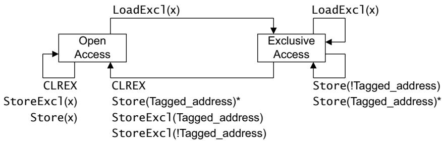

Operations marked \* are possible alternative IMPLEMENTATION DEFINED options.

In the diagram: LoadExcl represents any Load-Exclusive instruction

StoreExcl represents any Store-Exclusive instruction

Store represents any other store instruction.

Any LoadExcl operation updates the tagged address to the most significant bits of the address x used for the operation. See text for more information about tagging.

## Figure A3-6 Local monitor state machine diagram

For more information about tagging see Tagging and the size of the tagged memory block on page A3-75.

Note

The IMPLEMENTATION DEFINED options for the local monitor are consistent with the local monitor being constructed so that it does not hold any physical address, but instead treats any access as matching the addres of the previous LDREX. In such an implementation, the Exclusives reservation granule defined in Tagging and the size of the tagged memory block on page A3-75 is the entire memory address range.

A local monitor implementation can be unaware of Load-Exclusive and Store-Exclusive operations from other processors.

It is UNPREDICTABLE whether the transition from Exclusive Access to Open Access state occurs when the STR or STREX is from another observer.

Table A3-2 shows the effect of the operations shown in Figure A3-6 on page A3-71.  
Table A3-2 Effect of Exclusive instructions and write operations on local monitor

<table><tr><td>Initial state</td><td>Operationa</td><td>Effect</td><td>Final state</td></tr><tr><td rowspan="4">Open Access</td><td>CLREX</td><td>No effect.</td><td>Open Access.</td></tr><tr><td>StoreExcl(x)</td><td>Does not update memory, returns status 1.</td><td>Open Access.</td></tr><tr><td>LoadExcl(x)</td><td>Loads value from memory, tags address x.</td><td>Exclusive Access.</td></tr><tr><td>Store(x)</td><td>Updates memory, no effect on monitor.</td><td>Open Access.</td></tr><tr><td rowspan="8">Exclusive Access</td><td>CLREX</td><td>Clears tagged address.</td><td>Open Access.</td></tr><tr><td>StoreExcl(t)</td><td>Updates memory, returns status 0.</td><td>Open Access.</td></tr><tr><td rowspan="2">StoreExcl(!t)</td><td>Updates memory, returns status 0b.</td><td rowspan="2">Open Access.</td></tr><tr><td>Does not update memory, returns status 1b.</td></tr><tr><td>LoadExcl(x)</td><td>Loads value from memory, changes tag to address to x.</td><td>Exclusive Access.</td></tr><tr><td>Store(!t)</td><td>Updates memory, no effect on monitor.</td><td>Exclusive Access.</td></tr><tr><td rowspan="2">Store(t)</td><td rowspan="2">Updates memory.</td><td>Exclusive Accessb.</td></tr><tr><td>Open Accessb.</td></tr></table>

a. In the table:  
LoadExcl represents any Load-Exclusive instruction.  
StoreExcl represents any Store-Exclusive instruction.  
Store represents any store operation other than a Store-Exclusive operation.  
t is the tagged address, bits [31:a] of the address of the last Load-Exclusive instruction. For more information see Tagging and the size of the tagged memory block on page A3-75.  
b. IMPLEMENTATION DEFINED alternative actions.

## A3.4.2 Exclusive access instructions and shareable memory regions

For memory regions that have the shareable attribute, exclusive access instructions rely on:

A local monitor for each processor in the system, that tags any address from which the processor executes a Load-Exclusive. The local monitor operates as described in Exclusive access instructions and Non-shareable memory regions on page A3-70, except that for shareable memory, any Store-Exclusive described in that section as either or both of updating memory and returning the status value 0 is then subject to checking by the global monitor. The local monitor can ignore exclusive accesses from other processors in the system.

A global monitor that tags a physical address as exclusive access for a particular processor. This tag is used later to determine whether a Store-Exclusive to the tagged address, that has not been failed by the local monitor, can occur. Any successful write to the tagged address by any other observer in the Shareability domain of the memory location is guaranteed to clear the tag.

For each processor in the system, the global monitor:

Holds a single tagged address.

Maintains a state machine.

The global monitor can either reside in a processor block or exist as a secondary monitor at the memory interfaces.

An implementation can combine the functionality of the global and local monitors into a single unit.

## Operation of the global monitor

Load-Exclusive from shareable memory performs a load from memory, and causes the physical address of the access to be tagged as exclusive access for the requesting processor. This access also causes the exclusive access tag to be removed from any other physical address that has been tagged by the requesting processor. The global monitor only supports a single outstanding exclusive access to shareable memory per processor.

Store-Exclusive performs a conditional store to memory:

The store is guaranteed to succeed only if the physical address accessed is tagged as exclusive access for the requesting processor and both the local monitor and the global monitor state machines for the requesting processor are in the Exclusive Access state. In this case:

A status value of 0 is returned to a register to acknowledge the successful store.

The final state of the global monitor state machine for the requesting processor is IMPLEMENTATION DEFINED.

If the address accessed is tagged for exclusive access in the global monitor state machine for any other processor then that state machine transitions to Open Access state.

If no address is tagged as exclusive access for the requesting processor, the store does not succeed:

A status value of 1 is returned to a register to indicate that the store failed.

The global monitor is not affected and remains in Open Access state for the requesting processor.

If a different physical address is tagged as exclusive access for the requesting processor, it is IMPLEMENTATION DEFINED whether the store succeeds or not:

If the store succeeds a status value of 0 is returned to a register, otherwise a value of 1 is returned.

If the global monitor state machine for the processor was in the Exclusive Access state before the Store-Exclusive it is IMPLEMENTATION DEFINED whether that state machine transitions to the Open Access state.

The Store-Exclusive instruction defines the register to which the status value is returned.

In a shared memory system, the global monitor implements a separate state machine for each processor in the system. The state machine for accesses to shareable memory by processor (n) can respond to all the shareable memory accesses visible to it. This means it responds to:

Accesses generated by the associated processor (n).

Accesses generated by the other observers in the shared memory system (!n).

In a shared memory system, the global monitor implements a separate state machine for each observer that can generate a Load-Exclusive or a Store-Exclusive in the system.

Figure A3-7 on page A3-74 shows the state machine for processor(n) in a global monitor. Table A3-3 on page A3-74 shows the effect of each of the operations shown in the figure.

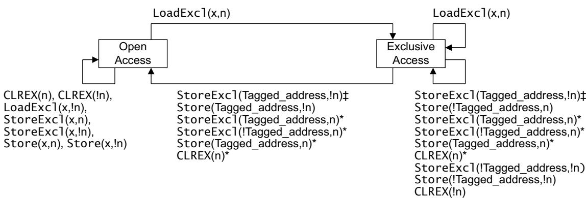

‡StoreExcl(Tagged\_Address,!n) clears the monitor only if the StoreExcl updates memory Operations marked \* are possible alternative IMPLEMENTATION DEFINED options. In the diagram: LoadExcl represents any Load-Exclusive instruction StoreExcl represents any Store-Exclusive instruction Store represents any other store instruction.

Any LoadExcl operation updates the tagged address to the most significant bits of the address x used for the operation. See text for more information about tagging.

Figure A3-7 Global monitor state machine diagram for a processor in a multiprocessor system

For more information about tagging see Tagging and the size of the tagged memory block on page A3-75.

Note

Whether a Store-Exclusive successfully updates memory or not depends on whether the address accessed matches the tagged shareable memory address for the processor issuing the Store-Exclusive instruction. For this reason, Figure A3-7 and Table A3-3 only show how the (!n) entries cause state transitions of the state machine for processor(n).

A Load-Exclusive can only update the tagged shareable memory address for the processor issuing the Load-Exclusive instruction.

The effect of the CLREX instruction on the global monitor is IMPLEMENTATION DEFINED.

It is IMPLEMENTATION DEFINED whether a modification to a Non-shareable memory location can cause a global monitor Exclusive Access to Open Access transition.

It is IMPLEMENTATION DEFINED whether a Load-Exclusive to a Non-shareable memory location can cause a global monitor Open Access to Exclusive Access transition.

Table A3-3 shows the effect of the operations shown in Figure A3-7.  
Table A3-3 Effect of load/store operations on global monitor for processor(n)

<table><tr><td>Initial statea</td><td>Operationb</td><td>Effect</td><td>Final statea</td></tr><tr><td>Open</td><td>CLREX(n), CLREX(!n)</td><td>None</td><td>Open</td></tr><tr><td>Open</td><td>StoreExcl(x,n)</td><td>Does not update memory, returns status 1</td><td>Open</td></tr><tr><td>Open</td><td>LoadExcl(x,!n)</td><td>Loads value from memory, no effect on tag address for processor(n)</td><td>Open</td></tr><tr><td>Open</td><td>StoreExcl(x,!n)</td><td>Depends on state machine and tag address for processor issuing STREXc</td><td>Open</td></tr><tr><td>Open</td><td>STR(x,n), STR(x,!n)</td><td>Updates memory, no effect on monitor</td><td>Open</td></tr><tr><td>Open</td><td>LoadExcl(x,n)</td><td>Loads value from memory, tags address x</td><td>Exclusive</td></tr><tr><td>Exclusive</td><td>LoadExcl(x,n)</td><td>Loads value from memory, tags address x</td><td>Exclusive</td></tr><tr><td rowspan="2">Exclusive</td><td rowspan="2">CLREX(n)</td><td rowspan="2">None. Effect on the final state is IMPLEMENTATION DEFINED.</td><td>Exclusivee</td></tr><tr><td>Opene</td></tr><tr><td>Exclusive</td><td>CLREX(!n)</td><td>None</td><td>Exclusive</td></tr><tr><td rowspan="2">Exclusive</td><td rowspan="2">StoreExcl(t,!n)</td><td>Updates memory, returns status 0c</td><td>Open</td></tr><tr><td>Does not update memory, returns status 1c</td><td>Exclusive</td></tr><tr><td rowspan="2">Exclusive</td><td rowspan="2">StoreExcl(t,n)</td><td rowspan="2">Updates memory, returns status 0d</td><td>Open</td></tr><tr><td>Exclusive</td></tr><tr><td rowspan="4">Exclusive</td><td rowspan="4">StoreExcl(!t,n)</td><td rowspan="2">Updates memory, returns status 0e</td><td>Open</td></tr><tr><td>Exclusive</td></tr><tr><td rowspan="2">Does not update memory, returns status 1e</td><td>Open</td></tr><tr><td>Exclusive</td></tr><tr><td>Exclusive</td><td>StoreExcl(!t,!n)</td><td>Depends on state machine and tag address for processor issuing STREX</td><td>Exclusive</td></tr><tr><td rowspan="2">Exclusive</td><td rowspan="2">Store(t,n)</td><td rowspan="2">Updates memory</td><td>Exclusivee</td></tr><tr><td>Opene</td></tr><tr><td>Exclusive</td><td>Store(t,!n)</td><td>Updates memory</td><td>Open</td></tr><tr><td>Exclusive</td><td>Store(!t,n),Store(!t,!n)</td><td>Updates memory, no effect on monitor</td><td>Exclusive</td></tr></table>

a. Open = Open Access state, Exclusive = Exclusive Access state.  
b. In the table:  
LoadExcl represents any Load-Exclusive instruction.  
StoreExcl represents any Store-Exclusive instruction.  
Store represents any store operation other than a Store-Exclusive operation.  
t is the tagged address for processor(n), bits [31:a] of the address of the last Load-Exclusive instruction issued by processor(n), see Tagging and the size of the tagged memory block.  
c. The result of a STREX(x,!n) or a STREX(t,!n) operation depends on the state machine and tagged address for the processor issuing the STREX instruction. This table shows how each possible outcome affects the state machine for processor(n).  
d. After a successful STREX to the tagged address, the state of the state machine is IMPLEMENTATION DEFINED. However, this state has no effect on the subsequent operation of the global monitor.  
e. Effect is IMPLEMENTATION DEFINED. The table shows all permitted implementations.

## A3.4.3 Tagging and the size of the tagged memory block

As shown in Figure A3-6 on page A3-71 and Figure A3-7 on page A3-74, when a LDREX instruction is executed, the resulting tag address ignores the least significant bits of the memory address:

Tagged\_address == Memory\_address[31:a]

The value of a in this assignment is IMPLEMENTATION DEFINED, between a minimum value of 2 and a maximum value of 11. For example, in an implementation where a = 4, a successful LDREX of address 0x000341B4 gives a tag value of bits[31:4] of the address, giving 0x000341B. This means that the four words of memory from 0x000341B0 to 0x000341BF are tagged for exclusive access. Subsequently, a valid STREX to any address in this block will remove the tag.

The size of the tagged memory block is called the Exclusives reservation granule. The Exclusives reservation granule is IMPLEMENTATION DEFINED between:

One word, in an implementation with a == 2.

512 words, in an implementation with a == 11.

Note

For the local monitor, one of the IMPLEMENTATION DEFINED options is for the monitor to treat any access as matching the address of the previous Load-Exclusive access. In such an implementation, the Exclusives reservation granule is the entire memory address range.

## A3.4.4 Context switch support

It is necessary to ensure that the local monitor is in the Open Access state after a context switch. In Armv7-M, the local monitor is changed to Open Access automatically as part of an exception entry or exit sequence. The local monitor can also be forced to the Open Access state by a CLREX instruction.

Note

Context switching is not an application level operation. However, this information is included here to complete the description of the exclusive operations.

A context switch might cause a subsequent Store-Exclusive to fail, requiring a load … store sequence to be replayed. To minimize the possibility of this happening, Arm recommends that the Store-Exclusive instruction is kept as close as possible to the associated Load-Exclusive instruction, see Load-Exclusive and Store-Exclusive usage restrictions.

## A3.4.5 Load-Exclusive and Store-Exclusive usage restrictions

The Load-Exclusive and Store-Exclusive instructions are designed to work together, as a pair, for example a LDREX/STREX pair or a LDREXB/STREXB pair. As mentioned in Context switch support, Arm recommends that the Store-Exclusive instruction always follows within a few instructions of its associated Load-Exclusive instructions. To support different implementations of these functions, software must follow the notes and restrictions given here.

These notes describe use of a LDREX/STREX pair, but apply equally to any other Load-Exclusive/Store-Exclusive pair:

The exclusives support a single outstanding exclusive access for each processor thread that is executed. The architecture makes use of this by not requiring an address or size check as part of the IsExclusiveLocal() function. If the target address of an STREX is different from the preceding LDREX in the same execution thread, behavior can be UNPREDICTABLE. As a result, an LDREX/STREX pair can only be relied on to eventually succeed if they are executed with the same address

An explicit store to memory can cause the clearing of exclusive monitors associated with other processors, therefore, performing a store between the LDREX and the STREX can result in a livelock situation. As a result, code must avoid placing an explicit store between an LDREX and an STREX in a single code sequence.

If two STREX instructions are executed without an intervening LDREX the second STREX returns a status value of 1. This means that:

Every STREX must have a preceding LDREX associated with it in a given thread of execution.

— It is not necessary for every LDREX to have a subsequent STREX.

An implementation of the Load-Exclusive and Store-Exclusive instructions can require that, in any thread of execution, the transaction size of a Store-Exclusive is the same as the transaction size of the preceding Load-Exclusive that was executed in that thread. If the transaction size of a Store-Exclusive is different from the preceding Load-Exclusive in the same execution thread, behavior can be UNPREDICTABLE. As a result, software can rely on a Load-Exclusive/Store-Exclusive pair to eventually succeed only if they are executed with the same address.

An implementation might clear an exclusive monitor between the LDREX and the STREX, without any application-related cause. For example, this might happen because of cache evictions. Code written for such an implementation must avoid having any explicit memory accesses or cache maintenance operations between the LDREX and STREX instructions.

Implementations can benefit from keeping the LDREX and STREX operations close together in a single code sequence. This minimizes the likelihood of the exclusive monitor state being cleared between the LDREX instruction and the STREX instruction. Therefore, Arm recommends strongly a limit of 128 bytes between LDREX and STREX instructions in a single code sequence, for best performance.

Implementations that implement coherent protocols, or have only a single requester, might combine the local and global monitors for a given processor. The IMPLEMENTATION DEFINED and UNPREDICTABLE parts of the definitions in Pseudocode details of operations on exclusive monitors on page B2-586 are provided to cover this behavior.

The architecture sets an upper limit of 2048 bytes on the size of a region that can be marked as exclusive. Therefore, for performance reasons, Arm recommends that software separates objects that will be accessed by exclusive accesses by at least 2048 bytes. This is a performance guideline rather than a functional requirement.

LDREX and STREX operations must be performed only on memory with the Normal memory attribute.

If the memory attributes for the memory being accessed by an LDREX/STREX pair are changed between the LDREX and the STREX, behavior is UNPREDICTABLE.

The effect of a data or unified cache invalidate, cache clean, or cache clean and invalidate instruction on a local or global exclusive monitor that is in the Exclusive Access state is UNPREDICTABLE. Execution of the instruction might clear the monitor, or it might leave it in the Exclusive Access state. For address-based maintenance instructions this also applies to the monitors of other processors in the same Shareability domain as the processor executing the cache maintenance instruction, as determined by the Shareability domain of the address being maintained.

## A3.4.6 Synchronization primitives and the memory order model

The synchronization primitives follow the memory ordering model of the memory type accessed by the instructions. For this reason:

Portable code for claiming a spinlock must include a DMB instruction between claiming the spinlock and making any access that makes use of the spinlock.

Portable code for releasing a spinlock must include a DMB instruction before writing to clear the spinlock.

This requirement applies to code using the Load-Exclusive/Store-Exclusive instruction pairs, for example LDREX/STREX.

## A3.5 Memory types and attributes and the memory order model

Armv7 defines a set of memory attributes with the characteristics required to support the memory and devices in the system memory map.

The ordering of accesses for regions of memory, referred to as the memory order model, is defined by the memory attributes. This model is described in the following sections:

Memory types.

Summary of Armv7 memory attributes on page A3-79.

Atomicity in the Arm architecture on page A3-79.

Normal memory on page A3-80.

Device memory on page A3-82.

Strongly-ordered memory on page A3-83.

Memory access restrictions on page A3-83.

## A3.5.1 Memory types

For each memory region, the most significant memory attribute specifies the memory type. There are three mutually exclusive memory types:

Normal.

Device.

Strongly-ordered.

Normal and Device memory regions have additional attributes.

Usually, memory used for program code and for data storage is Normal memory. Examples of Normal memory technologies are:

Programmed Flash ROM.

Note

During programming, Flash memory can be ordered more strictly than Normal memory.

ROM.

SRAM.

DRAM and DDR memory.

System peripherals (I/O) generally conform to different access rules to Normal memory. Examples of I/O accesses are:

FIFOs where consecutive accesses:

— Add queued values on write accesses.

— Remove queued values on read accesses.

Interrupt controller registers where an access can be used as an interrupt acknowledge, changing the state of the controller itself.

Memory controller configuration registers that are used to set up the timing and correctness of areas of Normal memory.

• Memory-mapped peripherals, where accessing a memory location can cause side effects in the system.

In Armv7, regions of the memory map for these accesses are defined as Device or Strongly-ordered memory. To ensure system correctness, access rules for Device and Strongly-ordered memory are more restrictive than those for Normal memory:

Both read and write accesses can have side effects.

Accesses must not be repeated, for example, on return from an exception.

The number, order, and sizes of the accesses must be maintained.

In addition, for Strongly-ordered memory, all memory accesses are strictly ordered to correspond to the program order of the memory access instructions.

## A3.5.2 Summary of Armv7 memory attributes

Table A3-4 summarizes the memory attributes. For more information about these attributes see:

Normal memory on page A3-80 and Shareable attribute for Device memory regions on page A3-83, for the Shareability attribute.

Write-Through cacheable, Write-back cacheable and Non-cacheable Normal memory on page A3-82, for the Cacheability attribute.

Table A3-4 Memory attribute summary

<table><tr><td>Memory type attribute</td><td>Shareability</td><td>Other attributes</td><td>Description</td></tr><tr><td>Strongly-ordered</td><td>Shareable</td><td>-</td><td>All memory accesses to Strongly-ordered memory occur in program order. All Strongly-ordered regions are shareable.</td></tr><tr><td rowspan="2">Device</td><td>Shareable</td><td>-</td><td>Intended to handle memory- mapped peripherals that are shared by several processors.</td></tr><tr><td>Non-shareable</td><td>-</td><td>Intended to handle memory- mapped peripherals that are used only by a single processor.</td></tr><tr><td rowspan="2">Normal</td><td>Shareable</td><td rowspan="2">Cacheability, one of: aNon-cacheable Write-Through cacheable.Write-Back Write-Allocate cacheable.Write-Back no Write-Allocate cacheable.</td><td>Intended to handle Normal memory that is shared between several processors.</td></tr><tr><td>Non-shareable</td><td>Intended to handle Normal memory that is used by only a single processor.</td></tr></table>

a. The Cacheability attribute is defined independently for inner and outer cache regions.

## A3.5.3 Atomicity in the Arm architecture

Atomicity is a feature of memory accesses, described as atomic accesses. The Arm architecture description refers to two types of atomicity, defined in:

Single-copy atomicity.

Multi-copy atomicity on page A3-80.

## Single-copy atomicity

A read or write operation is single-copy atomic if the following conditions are both true:

After any number of write operations to an operand, the value of the operand is the value written by one of the write operations. It is impossible for part of the value of the operand to come from one write operation and another part of the value to come from a different write operation.

When a read operation and a write operation are made to the same operand, the value obtained by the read operation is one of:

The value of the operand before the write operation.

The value of the operand after the write operation.

It is never the case that the value of the read operation is partly the value of the operand before the write operation and partly the value of the operand after the write operation.

In Armv7-M, the single-copy atomic processor accesses are:

All byte accesses.

All halfword accesses to halfword-aligned locations.

All word accesses to word-aligned locations.

LDM, LDC, LDC2, LDRD, STM, STC, STC2, STRD, PUSH, POP, VLDR, VSTR, VLDM, VSTM, VPUSH, and VPOP instructions are executed as a sequence of word-aligned word accesses. Each 32-bit word access is guaranteed to be single-copy atomic. A subsequence of two or more word accesses from the sequence might not exhibit single-copy atomicity.

When an access is not single-copy atomic, it is executed as a sequence of smaller accesses, each of which is single-copy atomic, at least at the byte level.

If an instruction is executed as a sequence of accesses according to these rules, some exceptions can be taken in the sequence and cause execution of the instruction to be abandoned.

On exception return, the instruction that generated the sequence of accesses is re-executed and so any accesses that had already been performed before the exception was taken might be repeated. See also Exceptions in Load Multiple and Store Multiple operations on page B1-543.

Note

The exception behavior for these multiple access instructions means they are not suitable for use for writes to memory for the purpose of software synchronization.

For implicit accesses:

Cache linefills and evictions have no effect on the single-copy atomicity of explicit transactions or instruction fetches.

Instruction fetches are single-copy atomic at 16-bit granularity.

## Multi-copy atomicity

In a multiprocessing system, writes to a memory location are multi-copy atomic if the following conditions are both true:

All writes to the same location are serialized, meaning they are observed in the same order by all observers, although some observers might not observe all of the writes.

A read of a location does not return the value of a write until all observers observe that write.

Writes to Normal memory are not multi-copy atomic.

All writes to Device and Strongly-Ordered memory that are single-copy atomic are also multi-copy atomic.

All write accesses to the same location are serialized. Write accesses to Normal memory can be repeated up to the point that another write to the same address is observed.

For Normal memory, serialization of writes does not prohibit the merging of writes.

## A3.5.4 Normal memory

Normal memory is idempotent, meaning that it exhibits the following properties:

Read accesses can be repeated with no side effects.

repeated read accesses return the last value written to the resource being read.

Read accesses can prefetch additional memory locations with no side effects.

Write accesses can be repeated with no side effects, provided that the contents of the location are unchanged between the repeated writes.

Unaligned accesses can be supported.

Accesses can be merged before accessing the target memory system.

Normal memory can be read/write or read-only, and a Normal memory region is defined as being either shareable or Non-shareable.

The Normal memory type attribute applies to most memory used in a system.

Accesses to Normal memory have a weakly consistent model of memory ordering. See a standard text describing memory ordering issues for a description of weakly consistent memory models, for example chapter 2 of Memory Consistency Models for Shared Memory-Multiprocessors, Kourosh Gharachorloo, Stanford University Technical Report CSL-TR-95-685. In general, for Normal memory, barrier operations are required where the order of memory accesses observed by other observers must be controlled. This requirement applies regardless of the Cacheability and Shareability attributes of the Normal memory region.

The ordering requirements of accesses described in Ordering requirements for memory accesses on page A3-91 apply to all explicit accesses.

An instruction that generates a sequence of accesses as described in Atomicity in the Arm architecture on page A3-79 might be abandoned as a result of an exception being taken during the sequence of accesses. On return from the exception the instruction is restarted, and therefore one or more of the memory locations might be accessed multiple times. This can result in repeated write accesses to a location that has been changed between the write accesses.

Note

For Armv7-M, the LDM, STM, PUSH, POP, VLDM, VSTM, VPUSH, and VPOP instructions can restart or continue on exception return, see Exceptions in Load Multiple and Store Multiple operations on page B1-543.

## Non-shareable Normal memory

For a Normal memory region, the Non-shareable attribute identifies Normal memory that is likely to be accessed only by a single processor.

A region of memory marked as Non-shareable Normal does not have any requirement to make the effect of a cache transparent for data or instruction accesses. If other observers share the memory system, software must use cache maintenance operations if the presence of caches might lead to coherency issues when communicating between the observers. This cache maintenance requirement is in addition to the barrier operations that are required to ensure memory ordering.

For Non-shareable Normal memory, the Load Exclusive and Store Exclusive synchronization primitives do not take account of the possibility of accesses by more than one observer.

## Shareable Normal memory

For Normal memory, the shareable memory attribute describes Normal memory that is expected to be accessed by multiple processors or other system requesters.

A region of Normal memory with the Sharable attribute is one for which the effect of interposing a cache, or caches, on the memory system is entirely transparent to data accesses in the same Shareability domain. Explicit software management is needed to ensure the coherency of instruction caches.

Implementations can use a variety of mechanisms to support this management requirement, from simply not caching accesses in shareable regions to more complex hardware schemes for cache coherency for those regions.

For shareable Normal memory, the Load-Exclusive and Store-Exclusive synchronization primitives take account of the possibility of accesses by more than one observer in the same Shareability domain.

Note

The shareable concept enables system designers to specify the locations in Normal memory that must have coherency requirements. However, to facilitate porting of software, software developers must not assume that specifying a memory region as Non-shareable permits software to make assumptions about the incoherency of memory locations between different processors in a shared memory system. Such assumptions are not portable between different multiprocessing implementations that make use of the shareable concept. Any multiprocessing implementation might implement caches that, inherently, are shared between different processing elements.

## Write-Through cacheable, Write-back cacheable and Non-cacheable Normal memory

In addition to being shareable or Non-shareable, each region of Normal memory can be marked as being one of:

Write-Through cacheable.

Write-Back cacheable, with an additional qualifier that marks it as one of:

Write-Back, Write-Allocate.

Write-Back, no Write-Allocate.

Non-cacheable.

The Cacheability attributes for a region are independent of the Shareability attributes for the region. The Cacheability attributes indicate the required handling of the data region if it is used for purposes other than the handling of shared data. This independence means that, for example, a region of memory that is marked as being cacheable and shareable might not be held in the cache in an implementation where shareable regions do not cache their data.

## A3.5.5 Device memory

The Device memory type attribute defines memory locations where an access to the location can cause side effects, or where the value returned for a load can vary depending on the number of loads performed. memory-mapped peripherals and I/O locations are examples of memory regions that normally are marked as being Device.

For explicit accesses from the processor to memory marked as Device:

All accesses occur at their program size.

The number of accesses is the number specified by the program.

An implementation must not repeat an access to a Device memory location if the program has only one access to that location. In other words, accesses to Device memory locations are not restartable.

The architecture does not permit speculative accesses to memory marked as Device.

Address locations marked as Device are Non-cacheable. While writes to Device memory can be buffered, writes can be merged only where the merge maintains:

The number of accesses.

The order of the accesses.

The size of each access.

Multiple accesses to the same address must not change the number of accesses to that address. Coalescing of accesses is not permitted for accesses to Device memory.

When a Device memory operation has side effects that apply to Normal memory regions, software must use a Memory Barrier to ensure correct execution. An example is programming the configuration registers of a memory controller with respect to the memory accesses it controls.

All explicit accesses to Device memory must comply with the ordering requirements of accesses described in Ordering requirements for memory accesses on page A3-91.

An instruction that generates a sequence of accesses as described in Atomicity in the Arm architecture on page A3-79 might be abandoned as a result of an exception being taken during the sequence of accesses. On return from the exception the instruction is restarted, and therefore one or more of the memory locations might be accessed multiple times. This can result in repeated write accesses to a location that has been changed between the write accesses.

Do not use an instruction that generates a sequence of accesses to access Device memory if the instruction might restart after an exception and repeat any write accesses, see Exceptions in Load Multiple and Store Multiple operations on page B1-543 for more information.

Any unaligned access that is not faulted by the alignment restrictions and accesses Device memory has UNPREDICTABLE behavior.

## Shareable attribute for Device memory regions

Device memory regions can be given the shareable attribute. This means that a region of Device memory can be described as either:

Shareable Device memory.

Non-shareable Device memory.

Non-shareable Device memory is defined as only accessible by a single processor. An example of a system supporting shareable and Non-shareable Device memory is an implementation that supports both:

A local bus for its private peripherals.

System peripherals implemented on the main shared system bus.

Such a system might have more predictable access times for local peripherals such as watchdog timers or interrupt controllers. In particular, a specific address in a Non-shareable Device memory region might access a different physical peripheral for each processor.

## A3.5.6 Strongly-ordered memory

The Strongly-ordered memory type attribute defines memory locations where an access to the location can cause side effects, or where the value returned for a load can vary depending on the number of loads performed. Examples of memory regions normally marked as being Strongly-ordered are memory-mapped peripherals and I/O locations.

For explicit accesses from the processor to memory marked as Strongly-ordered:

All accesses occur at their program size.

The number of accesses is the number specified by the program.

An implementation must not perform more accesses to a Strongly-ordered memory location than are specified by a simple sequential execution of the program, except as a result of an exception. This section describes this permitted effect of an exception.

The architecture does not permit speculative data accesses to memory marked as Strongly-ordered.

Address locations in Strongly-ordered memory are not held in a cache, and are always treated as shareable memory locations.

All explicit accesses to Strongly-ordered memory must correspond to the ordering requirements of accesses described in Ordering requirements for memory accesses on page A3-91.

An instruction that generates a sequence of accesses as described in Atomicity in the Arm architecture on page A3-79 might be abandoned as a result of an exception being taken during the sequence of accesses. On return from the exception the instruction is restarted, and therefore one or more of the memory locations might be accessed multiple times. This can result in repeated write accesses to a location that has been changed between the write accesses.

Note

Do not use an instruction that generates a sequence of accesses to access Strongly-ordered memory if the instruction might restart after an exception and repeat any write accesses, see Exceptions in Load Multiple and Store Multiple operations on page B1-543 for more information.

Any unaligned access that is not faulted by the alignment restrictions and accesses Strongly-ordered memory has UNPREDICTABLE behavior.

## A3.5.7 Memory access restrictions

The following restrictions apply to memory accesses:

For any access X, the bytes accessed by X must all have the same memory type attribute, otherwise the behavior of the access is UNPREDICTABLE. That is, an unaligned access that spans a boundary between different memory types is UNPREDICTABLE.

For any two memory accesses X and Y that are generated by the same instruction, the bytes accessed by X and Y must all have the same memory type attribute, otherwise the results are UNPREDICTABLE. For example, an LDC, LDM, LDRD, STC, STM, STRD, VSTM, VLDM, VPUSH, VPOP, VLDR, or VSTR that spans a boundary between Normal and Device memory is UNPREDICTABLE.

An instruction that generates an unaligned memory access to Device or Strongly-ordered memory is UNPREDICTABLE.

For instructions that generate accesses to Device or Strongly-ordered memory, implementations must not change the sequence of accesses specified by the pseudocode of the instruction. This includes not changing: How many accesses there are.

The time order of the accesses at any particular memory-mapped peripheral.

The data sizes and other properties of each access.

In addition, processor implementations expect any attached memory system to be able to identify the memory type of an accesses, and to obey similar restrictions with regard to the number, time order, data sizes and other properties of the accesses.

## Exceptions to this rule are:

A processor implementation can break this rule, provided that the information it supplies to the memory system enables the original number, time order, and other details of the accesses to be reconstructed. In addition, the implementation must place a requirement on attached memory systems to do this reconstruction when the accesses are to Device or Strongly-ordered memory.

For example, an implementation with a 64-bit bus might pair the word loads generated by an LDM into 64-bit accesses. This is because the instruction semantics ensure that the 64-bit access is always a word load from the lower address followed by a word load from the higher address. However the

implementation must permit the memory systems to unpack the two word loads when the access is to Device or Strongly-ordered memory.

Any implementation technique that produces results that cannot be observed to be different from those described above is legitimate.

LDM, STM, PUSH, POP, VLDM and VSTM instructions that are used with the IT instruction are restartable if interrupted during execution. Restarting a load or store instruction is incompatible with the Device and Strongly Ordered memory access rules. For details of the architecture constraints associated with these instructions in the exception model see Exceptions in Load Multiple and Store Multiple operations on page B1-543.

Any multi-access instruction that loads or stores the PC must access only Normal memory. If the instruction accesses Device or Strongly-ordered memory the result is UNPREDICTABLE.

Any instruction fetch must access only Normal memory. If it accesses Device or Strongly-ordered memory, the result is UNPREDICTABLE. For example, instruction fetches must not be performed to an area of memory that contains read-sensitive devices, because there is no ordering requirement between instruction fetches and explicit accesses.

To ensure correctness, read-sensitive locations must be marked as non-executable (see Privilege level access controls for instruction accesses on page A3-87).

## Mismatched memory attributes

A physical memory location is accessed with mismatched attributes if all accesses to the location do not use a common definition of all of the following attributes of that location:

Memory type, Strongly-ordered, Device, or Normal.

Shareability.

Cacheability, for both the inner and outer levels of cache, but excluding any cache allocation hints.

The following rules apply when a physical memory location is accessed with mismatched attributes:

When a memory location is accessed with mismatched attributes the only software visible effects are one or more of the following:

Uniprocessor semantics for reads and writes to that memory location might be lost. This means:

A read of the memory location by a thread of execution might not return the value most recently written to that memory location by that thread of execution.

Multiple writes to the memory location by a thread of execution, that use different memory attributes, might not be ordered in program order.

There might be a loss of coherency when multiple threads of execution attempt to access a memory location.

There might be a loss of properties derived from the memory type, see rule 2.

If multiple threads of execution attempt to use Load-Exclusive or Store-Exclusive instructions to access a location with different memory attributes, the exclusive monitor state becomes UNKNOWN.

2. The loss of properties associated with mismatched memory type attributes refers only to the following properties of Strongly-ordered or Device memory, that are additional to the properties of Normal memory:

Prohibition of speculative accesses.

Preservation of the size of accesses.

Preservation of the order of accesses.

The guarantee that the write acknowledgement comes from the endpoint of the access.

If the only memory type mismatch is between Strongly-ordered and Device memory, then the only property that can be lost is:

The guarantee that the write acknowledgement comes from the endpoint of the access.

3. If all aliases of a memory location that permit write access to the location assign the same Shareability and Cacheability attributes to that location, and all these aliases use a definition of the Shareability attribute tha includes all the threads of execution that can access the location, then any thread of execution that reads the memory location using these Shareability and Cacheability attributes accesses it coherently, to the extent required by that common definition of the memory attributes.

The possible loss of properties caused by mismatched attributes for a memory location is defined more precisely if all of the mismatched attributes define the memory location as one of:

Strongly-ordered memory.

Device memory.

Normal Inner Non-cacheable, Outer Non-cacheable memory.

In these cases, the only possible software-visible effects of the mismatched attributes are one or more of:

Possible loss of properties derived from the memory type when multiple threads of execution attempt to access the memory location.

Possible reordering of memory transactions to the memory location that use different memory attributes, potentially leading to a loss of coherency or uniprocessor semantics. Any possible loss of coherency or uniprocessor semantics can be avoided by inserting DMB barrier instructions between accesses to the same memory location that might use different attributes.

5. If the mismatched attributes for a memory location all assign the same Shareability attribute to the location, any loss of coherency within a Shareability domain can be avoided. To do so, software must use the techniques that are required for the software management of the coherency of cacheable locations between threads of execution in different Shareability domains. This means:

If any thread of execution might have written to the location with the writeback attribute, before writing to the location not using the writeback attribute, a thread of execution must invalidate, or clean, the location from the caches. This avoids the possibility of overwriting the location with stale data.

After writing to the location with the writeback attribute, a thread of execution must clean the location from the caches, to make the write visible to external memory.

Before reading the location with a cacheable attribute, a thread of execution must invalidate the location from the caches, to ensure that any value held in the caches reflects the last value made visible in external memory.

In all cases:

Location refers to any byte within the current coherency granule.

A clean and invalidate operation can be used instead of a clean operation, or instead of an invalidate operation.

To ensure coherency, all cache maintenance and memory transactions must be completed, or ordered by the use of barrier operations.

6. If the mismatched attributes for a location mean that multiple cacheable accesses to the location might be made with different Shareability attributes, then coherency is guaranteed only if each thread of execution that accesses the location with a cacheable attribute performs a clean and invalidate of the location.

Note

For rule 5 and 6, with software management of coherency, race conditions can cause loss of data. A race condition occurs when different threads of execution write simultaneously to bytes that are in the same location, and the (invalidate or clean), write, clean sequence of one thread overlaps the equivalent sequence of another thread.

In addition, if multiple threads attempt to use Load-Exclusive or Store-Exclusive instructions to access a location with different memory attributes associated with it, the exclusive monitor state becomes UNKNOWN.

Arm strongly recommends that software does not use mismatched attributes for aliases of the same location. An implementation might not optimize the performance of a system that uses mismatched aliases.

## A3.6 Access rights

Armv7 includes additional attributes for memory regions. These attributes enable:

Data accesses to be restricted, based on the privilege of the access. See Privilege level access controls for data accesses.

Instruction fetches to be restricted, based on the privilege of the process or thread making the fetch. See Privilege level access controls for instruction accesses.

## A3.6.1 Privilege level access controls for data accesses

The memory attributes can define that a memory region is:

Not accessible to any accesses.

Accessible only to Privileged accesses.

Accessible to Privileged and Unprivileged accesses.

The access privilege level is defined separately for explicit read and explicit write accesses. However, a system that defines the memory attributes is not required to support all combinations of memory attributes for read and write accesses.

A Privileged access is an access made during privileged execution, as a result of a load or store operation other than LDRT, STRT, LDRBT, STRBT, LDRHT, STRHT, LDRSHT, or LDRSBT.

An Unprivileged access is an access made as a result of load or store operation performed in one of these cases:

When the current execution mode is configured for Unprivileged access only.

When the processor is in any mode and the access is made as a result of a LDRT, STRT, LDRBT, STRBT, LDRHT, STRHT, LDRSHT, or LDRSBT instruction.

An exception occurs if the processor attempts a data access that the access rights do not permit. For example, a MemManage exception occurs if the processor mode is Unprivileged and the processor attempts to access a memory region that is marked as only accessible to Privileged accesses.

Note

Data access control is only supported when a Memory Protection Unit is implemented and enabled, see Protected Memory System Architecture, PMSAv7 on page B3-632.

## A3.6.2 Privilege level access controls for instruction accesses

Memory attributes can define that a memory region is:

Not accessible for execution.

Accessible for execution by Privileged processes only.

Accessible for execution by Privileged and Unprivileged processes.

To define the instruction access rights to a memory region, the memory attributes describe, separately, for the region:

Its read access rights.

Whether the region is Execute Never (XN), meaning software cannot be executed from the region.

For example, a region that is accessible for execution by Privileged processes has the memory attributes:

Accessible only to Privileged read accesses.

Suitable for execution.

This means there is some linkage between the memory attributes that define the accessibility of a region to explicit memory accesses, and those that define that a region can be executed.

A MemManage exception occurs if a processor attempts to execute code from a memory location with attributes that do not permit code execution.

Note

Instruction access control is fully supported when a Memory Protection Unit is implemented and enabled, see Protected Memory System Architecture, PMSAv7 on page B3-632.

Instruction execution access control is also supported in the default address map, see The system address map on page B3-592.

## A3.7 Memory access order

Armv7 provides a set of three memory types, Normal, Device, and Strongly-ordered, with well-defined memory access properties.

The Armv7 application-level view of the memory attributes is described in:

Memory types and attributes and the memory order model on page A3-78.

Access rights on page A3-87.

When considering memory access ordering, an important feature is the shareable memory attribute that indicates whether a region of memory can be shared between multiple processors, and therefore requires an appearance of cache transparency in the ordering model.

The key issues with the memory order model depend on the target audience:

For software programmers, considering the model at the application level, the key factor is that for accesses to Normal memory, barriers are required in some situations where the order of accesses observed by other observers must be controlled.

For silicon implementers, considering the model at the system level, the Strongly-ordered and Device memory attributes place certain restrictions on the system designer in terms of what can be built and when to indicate completion of an access.

Note

Implementations remain free to choose the mechanisms required to implement the functionality of the memory model.

More information about the memory order model is given in the following subsections:

Reads and writes.

Ordering requirements for memory accesses on page A3-91.

Memory barriers on page A3-92.

Additional attributes and behaviors relate to the memory system architecture. These features are defined in the system level section of this manual, see Protected Memory System Architecture, PMSAv7 on page B3-632.

## A3.7.1 Reads and writes

Each memory access is either a read or a write. Explicit memory accesses are the memory accesses required by the function of an instruction. The following can cause memory accesses that are not explicit:

Instruction fetches.

Cache loads and write-backs.

Except where otherwise stated, the memory ordering requirements only apply to explicit memory accesses.

## Reads

Reads are defined as memory operations that have the semantics of a load.

The memory accesses of the following instructions are reads:

LDR, LDRB, LDRH, LDRSB, and LDRSH.

LDRT, LDRBT, LDRHT, LDRSBT, and LDRSHT.

LDREX, LDREXB, and LDREXH.

LDM{IA,DB}, LDRD, POP, VLDM, VLDR, and VPOP.

LDC and LDC2.

The return of status values by STREX, STREXB, and STREXH.

TBB and TBH.

## Writes

Writes are defined as memory operations that have the semantics of a store.

The memory accesses of the following instructions are Writes:

STR, STRB, and STRH.

STRT, STRBT, and STRHT.

STREX, STREXB, and STREXH .

STM{IA,DB}, STRD, PUSH, VSTR, VSTM, and VPUSH.

STC and STC2.

## Synchronization primitives

Synchronization primitives must ensure correct operation of system semaphores in the memory order model. The synchronization primitive instructions are defined as those instructions that are used to ensure memory synchronization:

LDREX, STREX, LDREXB, STREXB, LDREXH, STREXH.

For details of the Load-Exclusive, Store-Exclusive and Clear-Exclusive instructions see Synchronization and semaphores on page A3-70.

The Load-Exclusive and Store-Exclusive instructions are supported to shareable and Non-shareable memory. Non-shareable memory can be used to synchronize processes that are running on the same processor. Shareable memory must be used to synchronize processes that might be running on different processors.

## Observability and completion

The set of observers that can observe a memory access is defined by the system.

For all memory:

A write to a location in memory is said to be observed by an observer when a subsequent read of the location by the same observer will return the value written by the write.

A write to a location in memory is said to be globally observed for a Shareability domain when a subsequent read of the location by any observer within that Shareability domain that is capable of observing the write will return the value written by the write.

A read of a location in memory is said to be observed by an observer when a subsequent write to the location by the same observer will have no effect on the value returned by the read.

A read of a location in memory is said to be globally observed for a Shareability domain when a subsequent write to the location by any observer within that Shareability domain that is capable of observing the write will have no effect on the value returned by the read.

Additionally, for Strongly-ordered memory:

A read or write of a memory-mapped location in a peripheral that exhibits side-effects is said to be observed, and globally observed, only when the read or write:

Meets the general conditions listed.

Can begin to affect the state of the memory-mapped peripheral.

Can trigger all associated side effects, whether they affect other peripheral devices, processors, or memory.

For all memory, the Armv7-M completion rules are defined as:

A read or write is complete for a Shareability domain when all of the following are true:

The read or write is globally observed for that Shareability domain.

Any instruction fetches by observers within the Shareability domain have observed the read or write.

A cache or branch predictor maintenance operation is complete for a Shareability domain when the effects of operation are globally observed for that Shareability domain.

## Side effect completion in Strongly-ordered and Device memory

The completion of a memory access in Strongly-ordered or Device memory is not guaranteed to be sufficient to determine that the side effects of the memory access are visible to all observers. The mechanism that ensures the visibility of side-effects of a memory access is IMPLEMENTATION DEFINED, for example provision of a status register that can be polled.

## A3.7.2 Ordering requirements for memory accesses

Armv7-M defines access restrictions in the permitted ordering of memory accesses. These restrictions depend on the memory attributes of the accesses involved.

Two terms used in describing the memory access ordering requirements are:

## Address dependency

An address dependency exists when the value returned by a read access is used to compute the address of a subsequent read or write access. An address dependency exists even if the value read by the first read access does not change the address of the second read or write access. This might be the case if the value returned is masked off before it is used, or if it has no effect on the predicted address value for the second access.

## Control dependency

A control dependency exists when the data value returned by a read access is used to determine the condition flags, and the values of the flags are used for condition code evaluation to determine the address of a subsequent read access. This address determination might be through conditional execution, or through the evaluation of a branch.

Figure A3-8 on page A3-92 shows the memory ordering between two explicit accesses A1 and A2, where A1 occurs before A2 in program order. The symbols used in the figure are as follows:

< Accesses must be globally observed in program order, that is, A1 must be globally observed strictly before A2.

Accesses can be globally observed in any order, provided that the requirements of uniprocessor semantics, for example respecting dependencies between instructions in a single processor, are maintained.

The following additional restrictions apply to the ordering of memory accesses that have this symbol:

If there is an address dependency then the two memory accesses are observed in program order.

This ordering restriction does not apply if there is only a control dependency between the two read accesses.

If there is both an address dependency and a control dependency between two read accesses the ordering requirements of the address dependency apply.

If the value returned by a read access is used as data written by a subsequent write access, then the two memory accesses are observed in program order.

It is impossible for an observer to observe a write access to a memory location if that location would not be written to in a sequential execution of a program.

It is impossible for an observer to observe a write value to a memory location if that value would not be written in a sequential execution of a program.

In Figure A3-8 on page A3-92, an access refers to a read or a write access to the specified memory type. For example, Device access, Non-shareable refers to a read or write access to Non-shareable Device memory.

<table><tr><td rowspan="2">A1\A2</td><td rowspan="2">Normal access</td><td colspan="2">Device access</td><td rowspan="2">Strongly-ordered access</td></tr><tr><td>Non-shareable</td><td>Shareable</td></tr><tr><td>Normal access</td><td>-</td><td>-</td><td>-</td><td>-</td></tr><tr><td>Device access, Non-shareable</td><td>-</td><td>&lt;</td><td>-</td><td>&lt;</td></tr><tr><td>Device access, Shareable</td><td>-</td><td>-</td><td>&lt;</td><td>&lt;</td></tr><tr><td>Strongly-ordered access</td><td>-</td><td>&lt;</td><td>&lt;</td><td>&lt;</td></tr></table>

Figure A3-8 Memory ordering restrictions

There are no ordering requirements for implicit accesses to any type of memory.

## Program order for instruction execution

The program order of instruction execution is the order of the instructions in the control flow trace.

Explicit memory accesses in an execution can be either:

Strictly Ordered Denoted by <. Must occur strictly in order.

Ordered Denoted by <=. Can occur either in order or simultaneously.

Multiple load and store instructions, LDC, LDC2, LDMDB, LDMIA, LDRD, POP, PUSH, STC, STC2, STMDB, STMIA, STRD, VLDR.F64, VSTR.F64, VLDM, VPUSH, VSTM, and VPOP, generate multiple word accesses, each of which is a separate access for the purpose of determining ordering.

The rules for determining program order for two accesses A1 and A2 are:

If A1 and A2 are generated by two different instructions:

• A1 < A2 if the instruction that generates A1 occurs before the instruction that generates A2 in program order.

• A2 < A1 if the instruction that generates A2 occurs before the instruction that generates A1 in program order.

If A1 and A2 are generated by the same instruction:

If A1 and A2 are two word loads generated by an LDC, LDC2, LDMDB, LDMIA or POP instruction, or two word stores generated by a PUSH, STC, STC2, STMDB, or STMIA instruction, excluding LDMDB, LDMIA or POP instructions with a register list that includes the PC:

A1 <= A2 if the address of A1 is less than the address of A2.

A2 <= A1 if the address of A2 is less than the address of A1.

If A1 and A2 are two word loads generated by an LDMDB, LDMIA or POP instruction with a register list that includes the PC, the program order of the memory accesses is not defined

If A1 and A2 are two word loads generated by an LDRD instruction or two word stores generated by an STRD instruction, the program order of the memory accesses is not defined.

For any instruction or operation not explicitly mentioned in this section, if the single-copy atomicity rules described in Single-copy atomicity on page A3-79 mean the operation becomes a sequence of accesses, then the time-ordering of those accesses is not defined.

## A3.7.3 Memory barriers

Memory barrier is the general term applied to an instruction, or sequence of instructions, used to force synchronization events by a processor with respect to retiring load and store instructions in a processor. A memory barrier is used to guarantee both:

• Completion of preceding load and store instructions to the programmers’ model.

Flushing of any prefetched instructions before the memory barrier event.

Armv7-M requires six explicit memory barriers to support the memory order model described in this chapter. The six memory barriers are:

Consumption of Speculative Data Barrier, see Consumption of Speculative Data Barrier (CSDB).

Data Memory Barrier, see Data Memory Barrier (DMB) on page A3-94.

Data Synchronization Barrier, see Data Synchronization Barrier (DSB) on page A3-94.

Instruction Synchronization Barrier, see Instruction Synchronization Barrier (ISB) on page A3-95.

Physical Speculative Store Bypass Barrier, see Physical Speculative Store Bypass Barrier (PSSBB) on page A3-95.

Speculative Store Bypass Barrier, see Speculative Store Bypass Barrier (SSBB) on page A3-95.

The DMB and DSB memory barriers affect reads and writes to the memory system generated by load and store instructions. Instruction fetches are not explicit accesses and are not affected.

Note

In Armv7-M, memory barrier operations might be required in conjunction with data or unified cache and branch predictor maintenance operations.

## Consumption of Speculative Data Barrier (CSDB)

The CSDB instruction is a memory barrier that prevents instructions that appear in program order after the data barrier completes from determining any part of data derived from speculatively-executed load instructions that appear in program order before completion of the CSDB instruction.

When a CSDB instruction is executed but before it completes and there are three instructions:

A load instruction speculatively-executed in program order before the barrier that might or might not be architecturally executed.

A Conditional Move instruction that has passed its condition code check and does not have an address dependency for an input register on the speculatively-executed load.

A load, store, data or instruction preload appearing in program order after the barrier, which has an address dependency on the Conditional Move instruction.

The Speculative execution of the load, store, data or instruction preload does not influence the allocation of cache entries to determine any part of the value of the speculatively-executed load instruction by an evaluation of the cache entries which have been allocated or evicted.

When a CSDB instruction is executed but before it completes and there are three instructions:

A load instruction speculatively-executed in program order before the barrier that might or might not be architecturally executed.

A Conditional Move instruction that has passed its condition code check and does not have an address dependency for an input register on the speculatively-executed load.

An indirect branch instruction appearing in program order after the barrier, that is dependent on the Conditional Move instruction for the target address of the indirect branch.

The Speculative execution of the indirect branch does not influence the allocation of cache entries to determine any part of the value of the speculatively-executed load instruction by an evaluation of the cache entries which have been allocated or evicted.

A CSDB instruction cannot be speculatively-executed but can be inserted into program order and completed when it is known that the instruction is not Speculative.

For details of the CSDB instruction see CSDB on page A7-228.

## Data Memory Barrier (DMB)

The DMB instruction is a data memory barrier. The processor that executes the DMB instruction is referred to as the executing processor, Pe. The DMB instruction takes the required Shareability domain and required access types as arguments.

Note

Armv7-M only supports system-wide barriers with no Shareability domain or access type limitations.

A DMB creates two groups of memory accesses, Group A and Group B:

## Group A Contains:

All explicit memory accesses of the required access types from observers within the same Shareability domain as Pe that are observed by Pe before the DMB instruction. This includes any accesses of the required access types and required Shareability domain performed by Pe.

All loads of required access types from observers within the same Shareability domain as Pe that have been observed by any given observer Py within the same required Shareability domain as Pe before Py has performed a memory access that is a member of Group A.

## Group B Contains:

All explicit memory accesses of the required access types by Pe that occur in program orde after the DMB instruction.

All explicit memory accesses of the required access types by any given observer Px within the same required Shareability domain as Pe that can only occur after Px has observed a store that is a member of Group B.

Any observer with the same required Shareability domain as Pe observes all members of Group A before it observes any member of Group B. Where members of Group A and Group B access the same memory-mapped peripheral, all members of Group A will be visible at the memory-mapped peripheral before any members of Group B are visible at that peripheral.

Note

A memory access might be in neither Group A nor Group B. The DMB does not affect the order of observation of such a memory access.

The second part of the definition of Group A is recursive. Ultimately, membership of Group A derives from the observation by Py of a load before Py performs an access that is a member of Group A as a result of the first part of the definition of Group A.

The second part of the definition of Group B is recursive. Ultimately, membership of Group B derives from the observation by any observer of an access by Pe that is a member of Group B as a result of the first part of the definition of Group B.

DMB only affects memory accesses. It has no effect on the ordering of any other instructions executing on the processor.

For details of the DMB instruction see DMB on page A7-230.

## Data Synchronization Barrier (DSB)

The DSB instruction is a special memory barrier, that synchronizes the execution stream with memory accesses. The DSB instruction takes the required Shareability domain and required access types as arguments. A DSB behaves as a DMB with the same arguments, and also has the additional properties defined here.

Note

Armv7-M only supports system-wide barriers with no Shareability domain or access type limitations.

A DSB completes when both:

All explicit memory accesses that are observed by Pe before the DSB is executed, are of the required access types, and are from observers in the same required Shareability domain as Pe, are complete for the set of observers within the required Shareability domain.

All explicit accesses to the System Control Space (SCS) that result in a context altering operation issued by Pe before the DSB are complete.

In addition, no instruction that appears in program order after the DSB instruction can execute until the DSB completes.

For details of the DSB instruction see DSB on page A7-231.

## Instruction Synchronization Barrier (ISB)

An ISB instruction flushes the pipeline in the processor, so that all instructions that come after the ISB instruction in program order are fetched from cache or memory only after the ISB instruction has completed. Using an ISB ensures that the effects of context altering operations executed before the ISB are visible to the instructions fetched after the ISB instruction. Examples of context altering operations that might require the insertion of an ISB instruction to ensure the operations are complete are:

Ensuring a system control update has occurred.

Re-prioritizing the exceptions that have configurable priority.

In addition, any branches that appear in program order after the ISB instruction are written into the branch prediction logic with the context that is visible after the ISB instruction. This is needed to ensure correct execution of the instruction stream.

Any context altering operations appearing in program order after the ISB instruction only take effect after the ISB has been executed.

An Armv7-M implementation must choose how far ahead of the current point of execution it prefetches instructions. This can be either a fixed or a dynamically varying number of instructions. As well as choosing how many instructions to prefetch, an implementation can choose which possible future execution path to prefetch along. For example, after a branch instruction, it can prefetch either the instruction appearing in program order after the branch or the instruction at the branch target. This is known as branch prediction.

A potential problem with all forms of instruction prefetching is that the instruction in memory might be changed after it was prefetched but before it is executed. If this happens, the modification to the instruction in memory does not normally prevent the already prefetched copy of the instruction from executing to completion. The memory barrier instructions, ISB, DMB or DSB as appropriate, are used to force execution ordering where necessary.

For details of the ISB instruction see ISB on page A7-235.

## Physical Speculative Store Bypass Barrier (PSSBB)

The PSSBB instruction prevents speculative loads from:

Returning data older than the most recent store to the same physical address appearing in program order before the load.

• Returning data from stores using the same physical address appearing in program order after the load.

For details of the PSSBB instruction see PSSBB on page A7-321.

## Speculative Store Bypass Barrier (SSBB)

The SSBB instruction prevents speculative loads from:

Returning data older than the most recent store to the same virtual address appearing in program order before the load.

Returning data from stores using the same virtual address appearing program order after the load.

For details of the SSBB instruction see SSBB on page A7-378.

## Synchronization requirements for System Control Space updates

The architecture defines the SCS as Strongly-ordered memory. In addition to the rules for the behavior of Strongly-ordered memory, the architecture requires that the side effects of any access to the SCS that performs a context-altering operation take effect when the access completes. Software can issue a DSB instruction to guarantee completion of a previous SCS access.

The architecture guarantees the visibility of the effects of a context-altering operation only for instructions fetched after the completion of the SCS access that performed the context-altering operation. Executing an ISB instruction, or performing an exception entry or exception return, guarantees the refetching of any instructions that have been fetched but not executed.

To guarantee that the side effects of a previous SCS access are visible, software can execute a DSB instruction followed by an ISB instruction.

## A3.8 Caches and memory hierarchy

Armv7-M defines support for caches within the architecture and via memory attributes. Memory attributes can be exported on a supporting bus protocol such as AMBA (AHB or AXI protocols) to support system caches.

In situations where a breakdown in coherency can occur, software must manage the caches using cache maintenance operations that are memory mapped and IMPLEMENTATION DEFINED.

## A3.8.1 Introduction to caches

A cache is a block of high-speed memory locations containing both address information (commonly known as a TAG) and the associated data. The purpose is to increase the average speed of a memory access. Caches operate on two principles of locality:

Spatial locality

An access to one location is likely to be followed by accesses from adjacent locations, for example, sequential instruction execution or usage of a data structure.

Temporal locality

An access to an area of memory is likely to be repeated within a short time period, for example, execution of a code loop.

To minimize the quantity of control information stored, the spatial locality property is used to group several locations together under the same TAG. This logical block is commonly known as a cache line. When data is loaded into a cache, access times for subsequent loads and stores are reduced, resulting in overall performance benefits. An access to information already in a cache is known as a cache hit, and other accesses are called cache misses.

Normally, caches are self-managing, with the updates occurring automatically. Whenever the processor wants to access a cacheable location, the cache is checked. If the access is a cache hit, the access occurs immediately, otherwise a location is allocated and the cache line loaded from memory. Different cache topologies and access policies are possible, however they must comply with the memory coherency model of the underlying architecture.

Caches introduce a number of potential problems, mainly because of:

• Memory accesses occurring at times other than when the programmer would normally expect them.

The existence of multiple physical locations where a data item can be held.

## A3.8.2 Memory hierarchy

Memory close to a processor has very low latency, but is limited in size and expensive to implement. Further from the processor it is easier to implement larger blocks of memory but these have increased latency. To optimize overall performance, an Armv7 memory system can include multiple levels of cache in a hierarchical memory system. Figure A3-9 shows such a system.

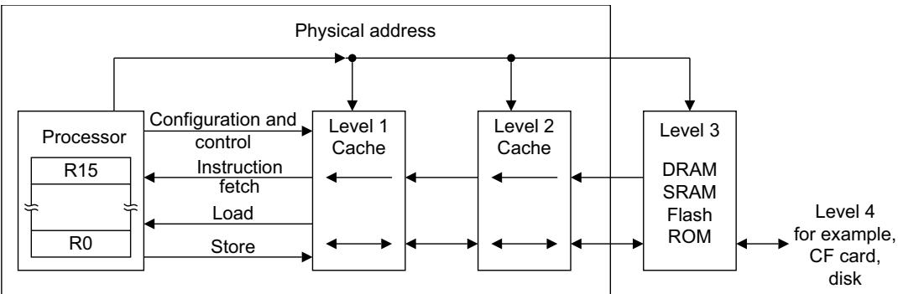  
Figure A3-9 Multiple levels of cache in a memory hierarchy

Note

In this manual, in a hierarchical memory system, Level 1 refers to the level closest to the processor, as shown in Figure A3-9.

## A3.8.3 Implication of caches to the application programmer

Caches are largely invisible to the application programmer, but can become visible due to a breakdown in coherency. Such a breakdown can occur when:

Memory locations are updated by other agents in the systems.

• Memory updates made from the application code must be made visible to other agents in the system.

For example:

In systems with a DMA that reads memory locations that are held in the data cache of a processor, a breakdown of coherency occurs when the processor has written new data in the data cache, but the DMA reads the old data held in memory.

In a Harvard architecture of caches, a breakdown of coherency occurs when new instruction data has either or both of written into the data cache and to memory, but the instruction cache still contains the old instruction data.

## Data coherency issues

Software can ensure the data coherency of caches in the following ways:

By not using the caches in situations where coherency issues can arise. This can be achieved by:

Using Non-cacheable or, in some cases, Write-Through Cacheable memory.

Not enabling caches in the system.

By using cache maintenance operations to manage the coherency issues in software, see Cache and branch predictor maintenance operations on page B2-577. Many of these operations are only available to system software.

By using hardware coherency mechanisms to ensure the coherency of data accesses to memory for cacheable locations by observers within the different Shareability domains, see Non-shareable Normal memory on page A3-81 and Shareable Normal memory on page A3-81.

The performance of these hardware coherency mechanisms is highly implementation-specific. In some implementations the mechanism suppresses the ability to cache shareable locations. In other implementations, cache coherency hardware can hold data in caches while managing coherency between observers within the Shareability domains.

## Instruction coherency issues

How far ahead of the current point of execution instructions are fetched from is IMPLEMENTATION DEFINED. Such prefetching can be either a fixed or a dynamically varying number of instructions, and can follow any or all possible future execution paths. For all types of memory:

The processor might have fetched the instructions from memory at any time since the last context synchronization event on that processor.

Any instructions fetched in this way might be executed multiple times, if this is required by the execution of the program, without being refetched from memory.

See Context synchronization event on page Glossary-850 for the definition of this term.

In addition, the Arm architecture does not require the hardware to ensure coherency between instruction caches and memory, even for regions of memory with shareable attributes. This means that for cacheable regions of memory, an instruction cache can hold instructions that were fetched from memory before the context synchronization event.

If software requires coherency between instruction execution and memory, it must manage this coherency using the ISB and DSB memory barriers and cache maintenance operations, see Ordering of cache and branch predictor maintenance operations on page B2-578. Many of these operations are only available to system software.

## A3.8.4 Preloading caches

The Arm architecture provides memory system hints PLD (Preload Data) and PLI (Preload instruction) to permit software to communicate the expected use of memory locations to the hardware. The memory system can respond by taking actions that are expected to speed up the memory accesses if and when they do occur. The effect of these memory system hints is IMPLEMENTATION DEFINED. Typically, implementations will use this information to bring the data or instruction locations into caches that have faster access times than Normal memory.

The Preload instructions are hints, and so implementations can treat them as NOPs without affecting the functional behavior of the device. The instructions do not generate exceptions, but the memory system operations might generate an imprecise fault (asynchronous exception) due to the memory access.

A3 Arm Architecture Memory Model A3.8 Caches and memory hierarchy

# Chapter A4 The Armv7-M Instruction Set

This chapter describes the Armv7-M Thumb instruction set, including the additional instructions added by the Floating-point Extension. It contains the following sections:

About the instruction set on page A4-102.

Unified Assembler Language on page A4-104.

Branch instructions on page A4-106.

Data-processing instructions on page A4-107.

Status register access instructions on page A4-114.

Load and store instructions on page A4-115.

Load Multiple and Store Multiple instructions on page A4-117.

Miscellaneous instructions on page A4-118.

Exception-generating instructions on page A4-119.

Coprocessor instructions on page A4-120.

Floating-point load and store instructions on page A4-121.

Floating-point register transfer instructions on page A4-122.

Floating-point data-processing instructions on page A4-123.

## A4.1 About the instruction set

Armv7-M supports a large number of 32-bit instructions that Thumb-2 technology introduced into the Thumb instruction set. Much of the functionality available is identical to the Arm instruction set supported alongside the Thumb instruction set in Armv6T2 and other Armv7 profiles. This chapter describes the functionality available in the Armv7-M Thumb instruction set, and the Unified Assembler Language (UAL) that can be assembled to either the Thumb or Arm instruction sets.

Thumb instructions are either 16-bit or 32-bit, and are aligned on a two-byte boundary. 16-bit and 32-bit instructions can be intermixed freely. Many common operations are most efficiently executed using 16-bit instructions. However:

Most 16-bit instructions can only access eight of the general purpose registers, R0-R7. These are known as the low registers. A small number of 16-bit instructions can access the high registers, R8-R15.

Many operations that would require two or more 16-bit instructions can be more efficiently executed with a single 32-bit instruction.

The Arm and Thumb instruction sets are designed to interwork freely. Because Armv7-M only supports Thumb instructions, interworking instructions in Armv7-M must only reference Thumb state execution, see Armv7-M and interworking support for more details.

In addition, see:

Chapter A5 The Thumb Instruction Set Encoding for encoding details of the Thumb instruction set.

Chapter A7 Instruction Details for detailed descriptions of the instructions.

## A4.1.1 Armv7-M and interworking support

Thumb interworking is held as bit [0] of an interworking address. Interworking addresses are used in the following instructions:

BX or BLX.

an LDR or LDM that loads the PC.

Armv7-M only supports the Thumb instruction Execution state and attempting to execute an instruction while EPSR.T == 0 results in an INVSTATE UsageFault exception, therefore the value of address bit[0] must be 1 in interworking instructions, otherwise a fault will occur. All instructions ignore bit[0] and write bits[31:1]:’0’ when updating the PC.

16-bit instructions that update the PC behave as follows:

ADD (register) and MOV (register) branch without interworking.

Note

Arm deprecates the use of Rd as the PC in the ADD (SP plus register) 16-bit instruction.

B branches without interworking.

CBZ and CBNZ branch without interworking.

BLX and BX interwork on the value in Rm.

POP interworks on the value loaded to the PC.

BKPT and SVC cause exceptions and are not considered to be interworking instructions.

32-bit instructions that update the PC behave as follows:

B branches without interworking.

BL branches without interworking.

LDM and LDR support interworking using the value written to the PC.

TBB and TBH branch without interworking.

For more details, see the description of the BXWritePC() function in Pseudocode details of Arm core register operations on page A2-30.

## A4.1.2 Conditional execution

Conditionally executed means that the instruction only has its normal effect on the programmers’ model operation, memory and coprocessors if the N, Z, C, and V flags in the APSR satisfy a condition specified in the instruction. If the flags do not satisfy this condition, the instruction acts as a NOP, that is, execution advances to the next instruction as normal, including any relevant checks for exceptions being taken, but has no other effect.

Most Thumb instructions are unconditional. Conditional execution in Thumb code can be achieved using any of the following instructions:

A 16-bit conditional branch instruction, with a branch range of –256 to +254 bytes. See B on page A7-205 for details. Before the additional instruction support in Armv6T2, this was the only mechanism for conditional execution in Thumb code.

A 32-bit conditional branch instruction, with a branch range of approximately ± 1MB. See B on page A7-205 for details.

16-bit Compare and Branch on Zero and Compare and Branch on Nonzero instructions, with a branch range of +4 to +130 bytes. See CBNZ, CBZ on page A7-216 for details.

A 16-bit If-Then instruction that makes up to four following instructions conditional. See IT on page A7-236 for details. The instructions that are made conditional by an IT instruction are called its IT block. Instructions in an IT block must either all have the same condition, or some can have one condition, and others can have the inverse condition.

See Conditional execution on page A7-178 for more information about conditional execution.

## A4.2 Unified Assembler Language

This document uses the Arm Unified Assembler Language (UAL). This assembly language syntax provides a canonical form for all Arm and Thumb instructions.

UAL describes the syntax for the mnemonic and the operands of each instruction. In addition, it assumes that instructions and data items can be given labels. It does not specify the syntax to be used for labels, nor what assembler directives and options are available. See your assembler documentation for these details.

Earlier Arm assembly language mnemonics are still supported as synonyms, as described in the instruction details.

Note

Most earlier Thumb assembly language mnemonics are not supported. See Appendix D2 Legacy Instruction Mnemonics for details.

UAL includes instruction selection rules that specify which instruction encoding is selected when more than one can provide the required functionality. For example, both 16-bit and 32-bit encodings exist for an ADD R0,R1,R2 instruction. The most common instruction selection rule is that when both a 16-bit encoding and a 32-bit encoding are available, the 16-bit encoding is selected, to optimize code density.

Syntax options exist to override the normal instruction selection rules and ensure that a particular encoding is selected. These are useful when disassembling code, to ensure that subsequent assembly produces the original code, and in some other situations.

## A4.2.1 Conditional instructions

For maximum portability of UAL assembly language between the Arm and Thumb instruction sets, Arm recommends that:

IT instructions are written before conditional instructions in the correct way for the Thumb instruction set.

When assembling to the Arm instruction set, assemblers check that any IT instructions are correct, but do not generate any code for them.

Although other Thumb instructions are unconditional, all instructions that are made conditional by an IT instruction must be written with a condition. These conditions must match the conditions imposed by the IT instruction. For example, an ITTEE EQ instruction imposes the EQ condition on the first two following instructions, and the NE condition on the next two. Those four instructions must be written with EQ, EQ, NE and NE conditions respectively.

Some instructions cannot be made conditional by an IT instruction. Some instructions can be conditional if they are the last instruction in the IT block, but not otherwise

The branch instruction encodings that include a condition field cannot be made conditional by an IT instruction. If the assembler syntax indicates a conditional branch that correctly matches a preceding IT instruction, it is assembled using a branch instruction encoding that does not include a condition field.

## A4.2.2 Use of labels in UAL instruction syntax

The UAL syntax for some instructions includes the label of an instruction or a literal data item that is at a fixed offset from the instruction being specified. The assembler must:

1. Calculate the PC or Align(PC,4) value of the instruction. The PC value of an instruction is its address plus 4 for a Thumb instruction. The Align(PC,4) value of an instruction is its PC value ANDed with 0xFFFFFFFC to force it to be word-aligned.

2. Calculate the offset from the PC or Align(PC,4) value of the instruction to the address of the labeled instruction or literal data item.

3. Assemble a PC-relative encoding of the instruction, that is, one that reads its PC or Align(PC,4) value and adds the calculated offset to form the required address.

Note

For instructions that encode a subtraction operation, if the instruction cannot encode the calculated offset, but can encode minus the calculated offset, the instruction encoding specifies a subtraction of minus the calculated offset.

The syntax of the following instructions includes a label:

B and BL. The assembler syntax for these instructions always specifies the label of the instruction that they branch to. Their encodings specify a sign-extended immediate offset that is added to the PC value of the instruction to form the target address of the branch.

CBNZ and CBZ. The assembler syntax for these instructions always specifies the label of the instruction that they branch to. Their encodings specify a zero-extended immediate offset that is added to the PC value of the instruction to form the target address of the branch. They do not support backward branches.

LDC, LDC2, LDR, LDRB, LDRD, LDRH, LDRSB, LDRSH, PLD, PLI, VLDR, and VSTR. The normal assembler syntax of these load instructions can specify the label of a literal data item that is to be loaded. The encodings of these instructions specify a zero-extended immediate offset that is either added to or subtracted from the Align(PC,4) value of the instruction to form the address of the data item. A few such encodings perform a fixed addition or a fixed subtraction and must only be used when that operation is required, but most contain a bit that specifies whether the offset is to be added or subtracted.

When the assembler calculates an offset of 0 for the normal syntax of these instructions, it must assemble an encoding that adds 0 to the Align(PC,4) value of the instruction. Encodings that subtract 0 from the Align(PC,4) value cannot be specified by the normal syntax.

There is an alternative syntax for these instructions that specifies the addition or subtraction and the immediate offset explicitly. In this syntax, the label is replaced by [PC, #+/-<imm>], where:

+/- Is + or omitted to specify that the immediate offset is to be added to the Align(PC,4) value, or - if it is to be subtracted.

<imm> Is the immediate offset.

This alternative syntax makes it possible to assemble the encodings that subtract 0 from the Align(PC,4) value, and to disassemble them to a syntax that can be re-assembled correctly.

ADR. The normal assembler syntax for this instruction can specify the label of an instruction or literal data item whose address is to be calculated. Its encoding specifies a zero-extended immediate offset that is either added to or subtracted from the Align(PC,4) value of the instruction to form the address of the data item, and some opcode bits that determine whether it is an addition or subtraction.

When the assembler calculates an offset of 0 for the normal syntax of this instruction, it must assemble the encoding that adds 0 to the Align(PC,4) value of the instruction. The encoding that subtracts 0 from the Align(PC,4) value cannot be specified by the normal syntax.

There is an alternative syntax for this instruction that specifies the addition or subtraction and the immediate value explicitly, by writing them as additions ADD <Rd>,PC,#<imm> or subtractions SUB <Rd>,PC,#<imm>. This alternative syntax makes it possible to assemble the encoding that subtracts 0 from the Align(PC,4) value, and to disassemble it to a syntax that can be re-assembled correctly.

Note

Arm recommends that where possible, you avoid using:

The alternative syntax for the ADR, LDC, LDC2, LDR, LDRB, LDRD, LDRH, LDRSB, LDRSH, PLD, PLI, VLDR, and VSTR instructions.

The encodings of these instructions that subtract 0 from the Align(PC,4) value.

## A4.3 Branch instructions

Table A4-1 summarizes the branch instructions in the Thumb instruction set. In addition to providing for changes in the flow of execution, some branch instructions can change instruction set.

Table A4-1 Branch instructions

<table><tr><td>Instruction</td><td>Usage</td><td>Range</td></tr><tr><td>B on page A7-205</td><td>Branch to target address</td><td>+/-1 MB</td></tr><tr><td>CBNZ, CBZ on page A7-216</td><td>Compare and Branch on Nonzero, Compare and Branch on Zero</td><td>0-126 B</td></tr><tr><td>BL on page A7-213</td><td>Call a subroutine</td><td>+/-16 MB</td></tr><tr><td>BLX (register) on page A7-214</td><td>Call a subroutine, optionally change instruction set</td><td>Any</td></tr><tr><td>BX on page A7-215</td><td>Branch to target address, change instruction set</td><td>Any</td></tr><tr><td rowspan="2">TBB, TBH on page A7-416</td><td>TBB: Table Branch, byte offsets</td><td>0-510 B</td></tr><tr><td>TBH: Table Branch, halfword offsets</td><td>0-131070 B</td></tr></table>

LDR, LDM, and POP instructions can also cause a branch. See Load and store instructions on page A4-115 and Load Multiple and Store Multiple instructions on page A4-117 for details.

## A4.4 Data-processing instructions

Data-processing instructions belong to one of the following groups:

Standard data-processing instructions.

This group perform basic data-processing operations, and shares a common format with some variations.

Shift instructions on page A4-108.

Multiply instructions on page A4-109.

Saturating instructions on page A4-110.

Packing and unpacking instructions on page A4-111.

Divide instructions on page A4-112.

Parallel addition and subtraction instructions, DSP extension on page A4-112.

Miscellaneous data-processing instructions on page A4-113.

See also Floating-point data-processing instructions on page A4-123.

## A4.4.1 Standard data-processing instructions

These instructions generally have a destination register Rd, a first operand register Rn, and a second operand. The second operand can be either another register Rm, or a modified immediate constant.

If the second operand is a modified immediate constant, it is encoded in 12 bits of the instruction. See Modified immediate constants in Thumb instructions on page A5-139 for details.

If the second operand is another register, it can optionally be shifted in any of the following ways:

LSL Logical Shift Left by 1-31 bits.

LSR Logical Shift Right by 1-32 bits.

ASR Arithmetic Shift Right by 1-32 bits.

ROR Rotate Right by 1-31 bits.

RRX Rotate Right with Extend. See Shift and rotate operations on page A2-26 for details.

In Thumb code, the amount to shift the second operand by is always a constant encoded in the instruction. The Thumb instruction set provides register-based shifts as explicit instructions, see Shift instructions on page A4-108.

In addition to placing a result in the destination register, these instructions can optionally set the condition flags according to the result of the operation. If an instruction does not set a flag, the existing value of that flag, from a previous instruction, is preserved.

Table A4-2 summarizes the main data-processing instructions in the Thumb instruction set. Generally, each of these instructions is described in two sections in Chapter A7 Instruction Details, one section for each of the following:

INSTRUCTION (immediate) where the second operand is a modified immediate constant.

INSTRUCTION (register) where the second operand is a register, or a register shifted by a constant.

Table A4-2 Standard data-processing instructions

<table><tr><td>Mnemonic</td><td>Instruction</td><td>Notes</td></tr><tr><td>ADC</td><td>Add with Carry</td><td>-</td></tr><tr><td>ADD</td><td>Add</td><td>Thumb permits use of a modified immediate constant or a zero-extended 12-bit immediate constant.</td></tr><tr><td>ADR</td><td>Form PC-relative Address</td><td>First operand is the PC. Second operand is an immediate constant. Thumb supports a zero-extended 12-bit immediate constant. Operation is an addition or a subtraction.</td></tr><tr><td>AND</td><td>Bitwise AND</td><td>-</td></tr><tr><td>BIC</td><td>Bitwise Bit Clear</td><td>-</td></tr><tr><td>CMN</td><td>Compare Negative</td><td>Sets flags. Like ADD but with no destination register.</td></tr><tr><td>CMP</td><td>Compare</td><td>Sets flags. Like SUB but with no destination register.</td></tr><tr><td>EOR</td><td>Bitwise Exclusive OR</td><td>-</td></tr><tr><td>MOV</td><td>Copies operand to destination</td><td>Has only one operand, with the same options as the second operand in most of these instructions. If the operand is a shifted register, the instruction is an LSL, LSR, ASR, or ROR instruction instead. See Shift instructions for details. Thumb permits use of a modified immediate constant or a zero-extended 16-bit immediate constant.</td></tr><tr><td>MVN</td><td>Bitwise NOT</td><td>Has only one operand, with the same options as the second operand in most of these instructions.</td></tr><tr><td>ORN</td><td>Bitwise OR NOT</td><td>-</td></tr><tr><td>ORR</td><td>Bitwise OR</td><td>-</td></tr><tr><td>RSB</td><td>Reverse Subtract</td><td>Subtracts first operand from second operand. This permits subtraction from constants and shifted registers.</td></tr><tr><td>SBC</td><td>Subtract with Carry</td><td>-</td></tr><tr><td>SUB</td><td>Subtract</td><td>Thumb permits use of a modified immediate constant or a zero-extended 12-bit immediate constant.</td></tr><tr><td>TEQ</td><td>Test Equivalence</td><td>Sets flags. Like EOR but with no destination register.</td></tr><tr><td>TST</td><td>Test</td><td>Sets flags. Like AND but with no destination register.</td></tr></table>

## A4.4.2 Shift instructions

Table A4-3 lists the shift instructions in the Thumb instruction set.

Table A4-3 Shift instructions

<table><tr><td>Instruction</td><td>See</td></tr><tr><td>Arithmetic Shift Right</td><td>ASR (immediate) on page A7-203</td></tr><tr><td>Arithmetic Shift Right</td><td>ASR (register) on page A7-204</td></tr><tr><td>Logical Shift Left</td><td>LSL (immediate) on page A7-282</td></tr><tr><td>Logical Shift Left</td><td>LSL (register) on page A7-283</td></tr><tr><td>Logical Shift Right</td><td>LSR (immediate) on page A7-284</td></tr><tr><td>Logical Shift Right</td><td>LSR (register) on page A7-285</td></tr><tr><td>Rotate Right</td><td>ROR (immediate) on page A7-338</td></tr><tr><td>Rotate Right</td><td>ROR (register) on page A7-339</td></tr><tr><td>Rotate Right with Extend</td><td>RRX on page A7-340</td></tr></table>

## A4.4.3 Multiply instructions

These instructions can operate on signed or unsigned quantities. In some types of operation, the results are same whether the operands are signed or unsigned.

Table A4-4 lists the multiply instructions where there is no distinction between signed and unsigned quantities.

The least significant 32 bits of the result are used. More significant bits are discarded.

Table A4-5 lists the signed multiply instructions in the Armv7-M base architecture.

Table A4-6 lists the signed multiply instructions that the DSP extension adds to the Armv7-M instruction set.

Table A4-7 on page A4-110 lists the unsigned multiply instructions in the Armv7-M base architecture.

Table A4-8 on page A4-110 lists the unsigned multiply instructions that the DSP extension adds to the Armv7-M instruction set.

Table A4-4 General multiply instructions

<table><tr><td>Instruction</td><td>See</td><td>Operation (number of bits)</td></tr><tr><td>Multiply Accumulate</td><td>MLA on page A7-289</td><td>32 = 32 + 32 × 32</td></tr><tr><td>Multiply and Subtract</td><td>MLS on page A7-290</td><td>32 = 32 - 32 × 32</td></tr><tr><td>Multiply</td><td>MUL on page A7-302</td><td>32 = 32 × 32</td></tr></table>

Table A4-5 Signed multiply instructions, Armv7-M base architecture

<table><tr><td>Instruction</td><td>See</td><td>Operation (number of bits)</td></tr><tr><td>Signed Multiply Accumulate Long</td><td>SMLAL on page A7-361</td><td> $64 = 64 + 32 \times 32$ </td></tr><tr><td>Signed Multiply Long</td><td>SMULL on page A7-372</td><td> $64 = 32 \times 32$ </td></tr></table>

Table A4-6 Signed multiply instructions, Armv7-M DSP extension

<table><tr><td>Instruction</td><td>See</td><td>Operation (number of bits)</td></tr><tr><td>Signed Multiply Accumulate, halfwords</td><td>SMLABB, SMLABT, SMLATB, SMLATT on page A7-359</td><td> $32 = 32 + 16 \times 16$ </td></tr><tr><td>Signed Multiply Accumulate Dual</td><td>SMLAD, SMLADX on page A7-360</td><td> $32 = 32 + 16 \times 16 + 16 \times 16$ </td></tr><tr><td>Signed Multiply Accumulate Long, halfwords</td><td>SMLALBB, SMLALBT, SMLALTB, SMLALTT on page A7-362</td><td> $64 = 64 + 16 \times 16$ </td></tr><tr><td>Signed Multiply Accumulate Long Dual</td><td>SMLALD, SMLALDX on page A7-363</td><td> $64 = 64 + 16 \times 16 + 16 \times 16$ </td></tr><tr><td>Signed Multiply Accumulate, word by halfword</td><td>SMLAWB, SMLAWT on page A7-364</td><td> $32 = 32 + 32 \times 16^{a}$ </td></tr><tr><td>Signed Multiply Subtract Dual</td><td>SMLSD, SMLSDX on page A7-365</td><td> $32 = 32 + 16 \times 16 - 16 \times 16$ </td></tr><tr><td>Signed Multiply Subtract Long Dual</td><td>SMLSLD, SMLSLDX on page A7-366</td><td> $64 = 64 + 16 \times 16 - 16 \times 16$ </td></tr><tr><td>Signed most significant Word Multiply Accumulate</td><td>SMMLA, SMMLAR on page A7-367</td><td> $32 = 32 + 32 \times 32^{b}$ </td></tr><tr><td>Signed most significant Word Multiply Subtract</td><td>SMMLS, SMMLSR on page A7-368</td><td> $32 = 32 - 32 \times 32^{b}$ </td></tr><tr><td>Signed most significant Word Multiply</td><td>SMMUL, SMMULR on page A7-369</td><td> $32 = 32 \times 32^b$ </td></tr><tr><td>Signed Dual Multiply Add</td><td>SMUAD, SMUADX on page A7-370</td><td> $32 = 16 \times 16 + 16 \times 16$ </td></tr><tr><td>Signed Multiply, halfwords</td><td>SMULBB, SMULBT, SMULTB, SMULTT on page A7-371</td><td> $32 = 16 \times 16$ </td></tr><tr><td>Signed Multiply, word by halfword</td><td>SMULWB, SMULWT on page A7-373</td><td> $32 = 32 \times 16^a$ </td></tr><tr><td>Signed Dual Multiply Subtract</td><td>SMUSD, SMUSDX on page A7-374</td><td> $32 = 16 \times 16 - 16 \times 16$ </td></tr></table>

a. Uses the most significant 32 bits of the 48-bit product. Discards the less significant bits.  
b. Uses the most significant 32 bits of the 64-bit product. Discards the less significant bits.

Table A4-7 Unsigned multiply instructions, Armv7-M base architecture

<table><tr><td>Instruction</td><td>See</td><td>Operation (number of bits)</td></tr><tr><td>Unsigned Multiply Accumulate Long</td><td>UMLAL on page A7-434</td><td>64 = 64 + 32 × 32</td></tr><tr><td>Unsigned Multiply Long</td><td>UMULL on page A7-435</td><td>64 = 32 × 32</td></tr></table>

Table A4-8 Unsigned multiply instructions, Armv7-M DSP extension

<table><tr><td>Instruction</td><td>See</td><td>Operation (number of bits)</td></tr><tr><td>Unsigned Multiply Accumulate Accumulate Long</td><td>UMAAL on page A7-433</td><td>64 = 32 + 32 + 32 × 32</td></tr></table>

## A4.4.4 Saturating instructions

Table A4-9 lists the saturating instructions in the Armv7-M base architecture. For more information see Pseudocode details of saturation on page A2-29.

Table A4-9 Saturating instructions, Armv7-M base architecture

<table><tr><td>Instruction</td><td>See</td><td>Operation</td></tr><tr><td>Signed Saturate</td><td>SSAT on page A7-375</td><td>Saturates optionally shifted 32-bit value to selected range</td></tr><tr><td>Unsigned Saturate</td><td>USAT on page A7-444</td><td>Saturates optionally shifted 32-bit value to selected range</td></tr></table>

## Additional saturating instructions, DSP extension

The DSP extension adds:

two saturating instructions that operate on parallel halfwords, as Table A4-10 shows.

saturating addition and subtraction instructions, as Table A4-11 on page A4-111 shows.

Table A4-10 Halfword saturating instructions, Armv7-M DSP extension

<table><tr><td>Instruction</td><td>See</td><td>Operation</td></tr><tr><td>Signed Saturate 16</td><td>SSAT16 on page A7-376</td><td>Saturates two 16-bit values to selected range</td></tr><tr><td>Unsigned Saturate 16</td><td>USAT16 on page A7-445</td><td>Saturates two 16-bit values to selected range</td></tr></table>

Table A4-11 Saturating addition and subtraction instructions, Armv7-M DSP extension

<table><tr><td>Instruction</td><td>See</td><td>Operation</td></tr><tr><td>Saturating Add</td><td>QADD on page A7-324</td><td>Add, saturating result to the 32-bit signed integer range</td></tr><tr><td>Saturating Subtract</td><td>QSUB on page A7-331</td><td>Subtract, saturating result to the 32-bit signed integer range</td></tr><tr><td>Saturating Double and Add</td><td>QDADD on page A7-328</td><td>Doubles one value and adds a second value, saturating the doubling and the addition to the 32-bit signed integer range</td></tr><tr><td>Saturating Double and Subtract</td><td>QDSUB on page A7-329</td><td>Doubles one value and subtracts the result from a second value, saturating the doubling and the subtraction to the 32-bit signed integer range</td></tr></table>

See also Parallel addition and subtraction instructions, DSP extension on page A4-112.

## A4.4.5 Packing and unpacking instructions

Table A4-12 lists the packing and unpacking instructions in the Armv7-M base architecture.

Table A4-12 Packing and unpacking instructions, Armv7-M base architecture

<table><tr><td>Instruction</td><td>See</td><td>Operation</td></tr><tr><td>Signed Extend Byte</td><td>SXTB on page A7-413</td><td>Extend 8 bits to 32</td></tr><tr><td>Signed Extend Halfword</td><td>SXTH on page A7-415</td><td>Extend 16 bits to 32</td></tr><tr><td>Unsigned Extend Byte</td><td>UXTB on page A7-452</td><td>Extend 8 bits to 32</td></tr><tr><td>Unsigned Extend Halfword</td><td>UXTH on page A7-454</td><td>Extend 16 bits to 32</td></tr></table>

Table A4-13 lists the packing and unpacking instructions that the DSP extension adds to the Armv7-M instruction set.

Table A4-13 Packing and unpacking instructions, Armv7-M DSP extension

<table><tr><td>Instruction</td><td>See</td><td>Operation</td></tr><tr><td>Pack Halfword</td><td>PKHBT, PKHTB on page A7-312</td><td>Combine halfwords</td></tr><tr><td>Signed Extend and Add Byte</td><td>SXTAB on page A7-410</td><td>Extend 8 bits to 32 and add</td></tr><tr><td>Signed Extend and Add Byte 16</td><td>SXTAB16 on page A7-411</td><td>Dual extend 8 bits to 16 and add</td></tr><tr><td>Signed Extend and Add Halfword</td><td>SXTAH on page A7-412</td><td>Extend 16 bits to 32 and add</td></tr><tr><td>Signed Extend Byte 16</td><td>SXTB16 on page A7-414</td><td>Dual extend 8 bits to 16</td></tr><tr><td>Unsigned Extend and Add Byte</td><td>UXTAB on page A7-449</td><td>Extend 8 bits to 32 and add</td></tr><tr><td>Unsigned Extend and Add Byte 16</td><td>UXTAB16 on page A7-450</td><td>Dual extend 8 bits to 16 and add</td></tr><tr><td>Unsigned Extend and Add Halfword</td><td>UXTAH on page A7-451</td><td>Extend 16 bits to 32 and add</td></tr><tr><td>Unsigned Extend Byte 16</td><td>UXTB16 on page A7-453</td><td>Dual extend 8 bits to 16</td></tr></table>

## A4.4.6 Divide instructions

In the Armv7-M profile, the Thumb instruction set includes signed and unsigned integer divide instructions that are implemented in hardware. For details of the instructions see:

SDIV on page A7-350.

UDIV on page A7-426.

In the Armv7-M profile, the CCR.DIV\_0\_TRP bit enables divide by zero fault detection:

DIV\_0\_TRP == 0

Divide-by-zero returns a zero result.

DIV\_0\_TRP == 1

SDIV and UDIV generate a divide-by-zero UsageFault exception on a divide-by-zero.

A reset clears the CCR.DIV\_0\_TRP bit to zero.

## A4.4.7 Parallel addition and subtraction instructions, DSP extension

The DSP extension adds instructions that perform additions and subtractions on the values of two registers and write the result to a destination register, treating the register values as sets of two halfwords or four bytes.

These instructions consist of a prefix followed by a main instruction mnemonic. The prefixes are as follows:

S Signed arithmetic modulo 28 or 216.

Q Signed saturating arithmetic.

SH Signed arithmetic, halving the results.

U Unsigned arithmetic modulo 28 or 216.

UQ Unsigned saturating arithmetic.

UH Unsigned arithmetic, halving the results.

The main instruction mnemonics are as follows:

ADD16 Adds the top halfwords of two operands to form the top halfword of the result, and the bottom halfwords of the same two operands to form the bottom halfword of the result.

ASX Exchanges halfwords of the second operand, and then adds top halfwords and subtracts bottom halfwords.

SAX Exchanges halfwords of the second operand, and then subtracts top halfwords and adds bottom halfwords.

SUB16 Subtracts each halfword of the second operand from the corresponding halfword of the first operand to form the corresponding halfword of the result.

ADD8 Adds each byte of the second operand to the corresponding byte of the first operand to form the corresponding byte of the result.

SUB8 Subtracts each byte of the second operand from the corresponding byte of the first operand to form the corresponding byte of the result.

The instruction set permits all 36 combinations of prefix and main instruction operand, as Table A4-14 shows.

Table A4-14 Parallel addition and subtraction instructions

<table><tr><td>Main instruction</td><td>Signed</td><td>Saturating</td><td>Signed halving</td><td>Unsigned</td><td>Unsigned saturating</td><td>Unsigned halving</td></tr><tr><td>ADD16, add, two halfwords</td><td>SADD16</td><td>QADD16</td><td>SHADD16</td><td>UADD16</td><td>UQADD16</td><td>UHADD16</td></tr><tr><td>ASX, add and subtract with exchange</td><td>SASX</td><td>QASX</td><td>SHASX</td><td>UASX</td><td>UQASX</td><td>UHASX</td></tr><tr><td>SAX, subtract and add with exchange</td><td>SSAX</td><td>QSAX</td><td>SHSAX</td><td>USAX</td><td>UQSAX</td><td>UHSAX</td></tr><tr><td>SUB16, subtract, two halfwords</td><td>SSUB16</td><td>QSUB16</td><td>SHSUB16</td><td>USUB16</td><td>UQSUB16</td><td>UHSUB16</td></tr><tr><td>ADD8, add, four bytes</td><td>SADD8</td><td>QADD8</td><td>SHADD8</td><td>UADD8</td><td>UQADD8</td><td>UHADD8</td></tr><tr><td>SUB8, subtract, four bytes</td><td>SSUB8</td><td>QSUB8</td><td>SHSUB8</td><td>USUB8</td><td>UQSUB8</td><td>UHSUB8</td></tr></table>

## A4.4.8 Miscellaneous data-processing instructions

Table A4-15 lists the miscellaneous data-processing instructions in the Thumb instruction set in the Armv7-M base architecture. Immediate values in these instructions are simple binary numbers.

Table A4-15 Miscellaneous data-processing instructions, Armv7-M base architecture

<table><tr><td>Instruction</td><td>See</td><td>Notes</td></tr><tr><td>Bit Field Clear</td><td>BFC on page A7-207</td><td>-</td></tr><tr><td>Bit Field Insert</td><td>BFI on page A7-208</td><td>-</td></tr><tr><td>Count Leading Zeros</td><td>CLZ on page A7-220</td><td>-</td></tr><tr><td>Move Top</td><td>MOVT on page A7-296</td><td>Moves 16-bit immediate value to top halfword.Bottom halfword unaltered.</td></tr><tr><td>Reverse Bits</td><td>RBIT on page A7-334</td><td>-</td></tr><tr><td>Byte-Reverse Word</td><td>REV on page A7-335</td><td>-</td></tr><tr><td>Byte-Reverse Packed Halfword</td><td>REV16 on page A7-336</td><td>-</td></tr><tr><td>Byte-Reverse Signed Halfword</td><td>REVSH on page A7-337</td><td>-</td></tr><tr><td>Signed Bit Field Extract</td><td>SBFX on page A7-349</td><td>-</td></tr><tr><td>Unsigned Bit Field Extract</td><td>UBFX on page A7-424</td><td>-</td></tr></table>

Table A4-16 lists the miscellaneous data-processing instructions that the DSP extension adds to the Armv7-M Thumb instruction set.

Table A4-16 Miscellaneous data-processing instructions, Armv7-M DSP extension

<table><tr><td>Instruction</td><td>See</td></tr><tr><td>Select Bytes using GE flags</td><td>SEL on page A7-351</td></tr><tr><td>Unsigned Sum of Absolute Differences</td><td>USAD8 on page A7-442</td></tr><tr><td>Unsigned Sum of Absolute Differences and Accumulate</td><td>USADA8 on page A7-443</td></tr></table>

## A4.5 Status register access instructions

The MRS and MSR instructions move the contents of the Application Program Status Register (APSR) to or from a general-purpose register.

The APSR is described in The Application Program Status Register (APSR) on page A2-31.

The condition flags in the APSR are normally set by executing data-processing instructions, and are normally used to control the execution of conditional instructions. However, you can set the flags explicitly using the MSR instruction, and you can read the current state of the flags explicitly using the MRS instruction.

For details of the system level use of status register access instructions CPS, MRS, and MSR, see Chapter B5 System Instruction Details.

## A4.6 Load and store instructions

Table A4-17 summarizes the general-purpose register load and store instructions in the Thumb instruction set. See also

Load Multiple and Store Multiple instructions on page A4-117.

Floating-point load and store instructions on page A4-121.

Load and store instructions have several options for addressing memory. See Addressing modes on page A4-116 for more information.

Table A4-17 Load and store instructions

<table><tr><td>Data type</td><td>Load</td><td>Store</td><td>Loadunprivileged</td><td>Storeunprivileged</td><td>Loadexclusive</td><td>Storeexclusive</td></tr><tr><td>32-bit word</td><td>LDR</td><td>STR</td><td>LDRT</td><td>STRT</td><td>LDREX</td><td>STREX</td></tr><tr><td>16-bit halfword</td><td>-</td><td>STRH</td><td>-</td><td>STRHT</td><td>-</td><td>STREXH</td></tr><tr><td>16-bit unsigned halfword</td><td>LDRH</td><td>-</td><td>LDRHT</td><td>-</td><td>LDREXH</td><td>-</td></tr><tr><td>16-bit signed halfword</td><td>LDRSH</td><td>-</td><td>LDRSHT</td><td>-</td><td>-</td><td>-</td></tr><tr><td>8-bit byte</td><td>-</td><td>STRB</td><td>-</td><td>STRBT</td><td>-</td><td>STREXB</td></tr><tr><td>8-bit unsigned byte</td><td>LDRB</td><td>-</td><td>LDRBT</td><td>-</td><td>LDREXB</td><td>-</td></tr><tr><td>8-bit signed byte</td><td>LDRSB</td><td>-</td><td>LDRSBT</td><td>-</td><td>-</td><td>-</td></tr><tr><td>Two 32-bit words</td><td>LDRD</td><td>STRD</td><td>-</td><td>-</td><td>-</td><td>-</td></tr></table>

## A4.6.1 Loads to the PC

The LDR instruction can be used to load a value into the PC. The value loaded is treated as an interworking address, as described by the LoadWritePC() pseudocode function in Pseudocode details of Arm core register operations on page A2-30.

## A4.6.2 Halfword and byte loads and stores

Halfword and byte stores store the least significant halfword or byte from the register, to 16 or 8 bits of memory respectively. There is no distinction between signed and unsigned stores.

Halfword and byte loads load 16 or 8 bits from memory into the least significant halfword or byte of a register. Unsigned loads zero-extend the loaded value to 32 bits, and signed loads sign-extend the value to 32 bits.

## A4.6.3 Unprivileged loads and stores

In an unprivileged mode, unprivileged loads and stores operate in exactly the same way as the corresponding ordinary operations. In a privileged mode, unprivileged loads and stores are treated as though they were executed in an unprivileged mode. See Privilege level access controls for data accesses on page A3-87 for more information.

## A4.6.4 Exclusive loads and stores

Exclusive loads and stores provide for shared memory synchronization. See Synchronization and semaphores on page A3-70 for more information.

## A4.6.5 Addressing modes

The address for a load or store is formed from two parts:

A value from a base register.

An offset.

The base register can be any one of the general-purpose registers.

For loads, the base register can be the PC. This permits PC-relative addressing for position-independent code. Instructions marked (literal) in their title in Chapter A7 Instruction Details are PC-relative loads

The offset takes one of three formats:

Immediate The offset is an unsigned number that can be added to or subtracted from the base register value. Immediate offset addressing is useful for accessing data elements that are a fixed distance from the start of the data object, such as structure fields, stack offsets and input/output registers.

Register The offset is a value from a general-purpose register. This register cannot be the PC. The value can be added to, or subtracted from, the base register value. Register offsets are useful for accessing arrays or blocks of data.

Scaled register The offset is a general-purpose register, other than the PC, shifted by an immediate value, then added to or subtracted from the base register. This means an array index can be scaled by the size of each array element.

The offset and base register can be used in three different ways to form the memory address. The addressing modes are described as follows:

Offset The offset is added to or subtracted from the base register to form the memory address.

Pre-indexed The offset is added to or subtracted from the base register to form the memory address. The base register is then updated with this new address, to permit automatic indexing through an array or memory block.

Post-indexed The value of the base register alone is used as the memory address. The offset is then added to or subtracted from the base register. and this value is stored back in the base register, to permit automatic indexing through an array or memory block.

Note

Not every variant is available for every instruction, and the range of permitted immediate values and the options for scaled registers vary from instruction to instruction. See Chapter A7 Instruction Details for full details for each instruction.

## A4.7 Load Multiple and Store Multiple instructions

Load Multiple instructions load a subset, or possibly all, of the general-purpose registers from memory.

Store Multiple instructions store a subset, or possibly all, of the general-purpose registers to memory.

The memory locations are consecutive word-aligned words. The addresses used are obtained from a base register, and can be either above or below the value in the base register. The base register can optionally be updated by the total size of the data transferred

Table A4-18 summarizes the Thumb Load Multiple and Store Multiple instructions.  
Table A4-18 Load Multiple and Store Multiple instructions

<table><tr><td>Instruction</td><td>Description</td></tr><tr><td>Load Multiple, Increment After or Full Descending</td><td>LDM, LDMIA, LDMFD on page A7-242</td></tr><tr><td>Load Multiple, Decrement Before or Empty Ascending</td><td>LDMDB, LDMEA on page A7-244</td></tr><tr><td>Pop multiple registers off the stacka</td><td>POP on page A7-319</td></tr><tr><td>Push multiple registers onto the stackb</td><td>PUSH on page A7-322</td></tr><tr><td>Store Multiple, Increment After or Empty Ascending</td><td>STM, STMIA, STMEA on page A7-383</td></tr><tr><td>Store Multiple, Decrement Before or Full Descending</td><td>STMDB, STMFD on page A7-385</td></tr></table>

a. This instruction is equivalent to an LDM instruction with the SP as base register, and base register updating.  
b. This instruction is equivalent to an STMDB instruction with the SP as base register, and base register updating.

## A4.7.1 Loads to the PC

The LDM, LDMDB, and POP instructions can be used to load a value into the PC. The value loaded is treated as an interworking address, as described by the LoadWritePC() pseudocode function in Pseudocode details of Arm core register operations on page A2-30.

## A4.8 Miscellaneous instructions

Table A4-19 summarizes the miscellaneous instructions in the Thumb instruction set.

Table A4-19 Miscellaneous instructions

<table><tr><td>Instruction</td><td>See</td></tr><tr><td>Clear Exclusive</td><td>CLREX on page A7-219</td></tr><tr><td>Debug hint</td><td>DBG on page A7-229</td></tr><tr><td>Data Memory Barrier</td><td>DMB on page A7-230</td></tr><tr><td>Data Synchronization Barrier</td><td>DSB on page A7-231</td></tr><tr><td>Instruction Synchronization Barrier</td><td>ISB on page A7-235</td></tr><tr><td>If Then</td><td>IT on page A7-236</td></tr><tr><td>No Operation</td><td>NOP on page A7-306</td></tr><tr><td rowspan="3">Preload Data</td><td>PLD (immediate) on page A7-313</td></tr><tr><td>PLD (literal) on page A7-314</td></tr><tr><td>PLD (register) on page A7-315</td></tr><tr><td rowspan="2">Preload Instruction</td><td>PLI (immediate, literal) on page A7-316</td></tr><tr><td>PLI (register) on page A7-318</td></tr><tr><td>Send Event</td><td>SEV on page A7-352</td></tr><tr><td>Supervisor Call</td><td>SVC on page A7-409</td></tr><tr><td>Wait for Event</td><td>WFE on page A7-504</td></tr><tr><td>Wait for Interrupt</td><td>WFI on page A7-505</td></tr><tr><td>Yield</td><td>YIELD on page A7-506</td></tr></table>

## A4.9 Exception-generating instructions

The following instructions are intended specifically to cause a processor exception to occur:

The Supervisor Call instruction, SVC, causes an SVCall exception to occur. This is the main mechanism for unprivileged code to make calls to privileged Operating System code. See Armv7-M exception model on page B1-523 for details.

Note

Older Arm documentation often describes unprivileged code as User code. This description is not appropriate to the M profile architecture.

The breakpoint (BKPT) instruction provides for software breakpoints. It can generate a DebugMonitor exception or cause a running system to halt depending on the debug configuration. See Debug event behavior on page C1-694 for more details.

## A4.10 Coprocessor instructions

There are three types of instruction for communicating with coprocessors. These permit the processor to:

Initiate a coprocessor data-processing operation, see CDP, CDP2 on page A7-217.

• Transfer general-purpose registers to and from coprocessor registers, see:

MCR, MCR2 on page A7-286.

MCRR, MCRR2 on page A7-288.

MRC, MRC2 on page A7-297.

MRRC, MRRC2 on page A7-299.

• Generate addresses for the coprocessor load/store instructions, see:

LDC, LDC2 (immediate) on page A7-238.

LDC, LDC2 (literal) on page A7-240.

STC, STC2 on page A7-381.

The instruction set distinguishes up to 16 coprocessors with a 4-bit field in each coprocessor instruction, so each coprocessor is assigned a particular number.

Note

One coprocessor can use more than one of the 16 numbers if it requires a large coprocessor instruction set.

If an Armv7-M implementation includes the optional FP extension, it uses coprocessors 10 and 11, together, to provide the floating-point (FP) functionality. The extension provides different instructions for accessing these coprocessors. These instructions are of similar types to the instructions for other coprocessors. This means they can:

Initiate a coprocessor data-processing operation, see Floating-point data-processing instructions on page A6-165.

Transfer general-purpose registers to and from coprocessor registers, see 32-bit transfer between Arm core and extension registers on page A6-168 and 64-bit transfers between Arm core and extension registers on page A6-169.

Load or store the values of coprocessor registers, see Extension register load or store instructions on page A6-167.

Coprocessors execute the same instruction stream as the processor, ignoring non-coprocessor instructions and coprocessor instructions for other coprocessors. Coprocessor instructions that cannot be executed by any coprocessor hardware cause a UsageFault exception and indicate the reason as follows:

If the Coprocessor Access Register denies access to a coprocessor, the processor sets the UFSR.NOCP flag to 1 to indicate that the coprocessor does not exist.

If the coprocessor access is permitted but the instruction is UNKNOWN, the processor sets the UFSR.UNDEFINSTR flag to 1 to indicate that the instruction is UNDEFINED.

## A4.11 Floating-point load and store instructions

Table A4-20 summarizes the extension register load/store instructions in the floating-point instruction set.

Table A4-20 FP extension register load and store instructions

<table><tr><td>Instruction</td><td>See</td><td>Operation</td></tr><tr><td>FP Load Multiple</td><td>VLDM on page A7-471</td><td>Load 1-16 consecutive 32-bit or 64-bit registers.</td></tr><tr><td>FP Load Register</td><td>VLDR on page A7-473</td><td>Load one 32-bit or 64-bit register.</td></tr><tr><td>FP Pop</td><td>VPOP on page A7-491</td><td>Pop 1-16 consecutive 32-bit or 64-bit registers from the stack.</td></tr><tr><td>FP Push</td><td>VPUSH on page A7-492</td><td>Push 1-16 consecutive 32-bit or 64-bit registers onto the stack.</td></tr><tr><td>FP Store Multiple</td><td>VSTM on page A7-499</td><td>Store 1-16 consecutive 32-bit or 64-bit registers.</td></tr><tr><td>FP Store Register</td><td>VSTR on page A7-501</td><td>Store one 32-bit or 64-bit register.</td></tr></table>

## A4.12 Floating-point register transfer instructions

Table A4-21 summarizes the floating-point register transfer instructions in the floating-point instruction set. These instructions transfer data from Arm core registers to FP extension registers, or from FP extension registers to Arm core registers.

Single-precision and double-precision FP extension registers are different views of the same FP register set, see The FP extension registers on page A2-35.

Table A4-21 FP extension register transfer instructions

<table><tr><td>Instruction</td><td>See</td></tr><tr><td>Copy word from Arm core register to extension register</td><td> $VMOV (Arm core register to scalar)$  on page A7-480</td></tr><tr><td>Copy word from extension register to Arm core register</td><td> $VMOV (scalar to Arm core register)$  on page A7-481</td></tr><tr><td>Copy from single-precision extension register to Arm core register, or from Arm core register to single-precision extension register</td><td> $VMOV (between Arm core register and single-precision register)$  on page A7-482</td></tr><tr><td>Copy two words from Arm core registers to consecutive single-precision extension registers, or from consecutive single-precision extension registers to Arm core registers</td><td> $VMOV (between two Arm core registers and two single-precision registers)$  on page A7-483</td></tr><tr><td>Copy two words from Arm core registers to doubleword extension register, or from doubleword extension register to Arm core registers</td><td> $VMOV (between two Arm core registers and a doubleword register)$  on page A7-484</td></tr><tr><td>Copy from FP extension System Register to Arm core register</td><td> $VMRS$  on page A7-485</td></tr><tr><td>Copy from Arm core register to FP extension System Register</td><td> $VMSR$  on page A7-486</td></tr></table>

## A4.13 Floating-point data-processing instructions

Table A4-22 summarizes the data-processing instructions in the floating-point instruction set.

For details of the floating-point arithmetic used by the FP instructions, see Floating-point data types and arithmetic on page A2-38.

Table A4-22 Floating-point data-processing instructions

<table><tr><td>Instruction</td><td>See</td></tr><tr><td>Absolute value</td><td>VABS on page A7-455</td></tr><tr><td>Add</td><td>VADD on page A7-456</td></tr><tr><td>Compare (optionally with exceptions enabled)</td><td>VCMP, VCMPE on page A7-457</td></tr><tr><td>Convert between floating-point and integer</td><td>VCVT, VCVTR (between floating-point and integer) on page A7-461</td></tr><tr><td>Convert between double-precision and single-precision</td><td>VCVT (between double-precision and single-precision) on page A7-465</td></tr><tr><td>Floating-point integer conversions with directed rounding</td><td>VCVTA, VCVTN, VCVTP, and VCVTM on page A7-459</td></tr><tr><td>Convert between floating-point and fixed-point</td><td>VCVT (between floating-point and fixed-point) on page A7-463</td></tr><tr><td>Convert between half-precision and single-precision or double-precision</td><td>VCVTB, VCVTT on page A7-466</td></tr><tr><td>Divide</td><td>VDIV on page A7-468</td></tr><tr><td>Fused Multiply Accumulate, Fused Multiply Subtract</td><td>VFMA, VFMS on page A7-469</td></tr><tr><td>Fused Negate Multiply Accumulate, Fused Negate Multiply Subtract</td><td>VFNMA, VFNMS on page A7-470</td></tr><tr><td>Floating-point Maximum or Minimum Number</td><td>VMAXNM, VMINNM on page A7-475</td></tr><tr><td>Multiply Accumulate, Multiply Subtract</td><td>VMLA, VMLS on page A7-476</td></tr><tr><td>Move immediate value to extension register</td><td>VMOV (immediate) on page A7-478</td></tr><tr><td>Copy from one extension register to another</td><td>VMOV (register) on page A7-479</td></tr><tr><td>Multiply</td><td>VMUL on page A7-487</td></tr><tr><td>Negate (invert the sign bit)</td><td>VNEG on page A7-488</td></tr><tr><td>Multiply Accumulate and Negate, Multiply Subtract and Negate, Multiply and Negate</td><td>VNMLA, VNMLS, VNMUL on page A7-489</td></tr><tr><td>Floating-point round to an integer in floating-point format using directed rounding</td><td>VRINTA, VRINTN, VRINTP, and VRINTM on page A7-493</td></tr><tr><td>Floating-point round to integral floating-point</td><td>VRINTZ, VRINTR on page A7-496</td></tr><tr><td>Floating-point Selection</td><td>VSEL on page A7-497</td></tr><tr><td>Square Root</td><td>VSQRT on page A7-498</td></tr><tr><td>Subtract</td><td>VSUB on page A7-503</td></tr></table>

## Chapter A5 The Thumb Instruction Set Encoding

This chapter introduces the Thumb instruction set and describes how it uses the Arm programmers’ model. It contains the following sections:

Thumb instruction set encoding on page A5-126.

16-bit Thumb instruction encoding on page A5-129.

32-bit Thumb instruction encoding on page A5-137.

## A5.1 Thumb instruction set encoding

The Thumb instruction stream is a sequence of halfword-aligned halfwords. Each Thumb instruction is either a single 16-bit halfword in that stream, or a 32-bit instruction consisting of two consecutive halfwords in that stream.

If bits [15:11] of the halfword being decoded take any of the following values, the halfword is the first halfword of a 32-bit instruction:

0b11101.

0b11110.

0b11111.

Otherwise, the halfword is a 16-bit instruction.

See 16-bit Thumb instruction encoding on page A5-129 for details of the encoding of 16-bit Thumb instructions.

See 32-bit Thumb instruction encoding on page A5-137 for details of the encoding of 32-bit Thumb instructions.

## A5.1.1 UNDEFINED and UNPREDICTABLE instruction set space

An attempt to execute an unallocated instruction results in either:

Unpredictable behavior. The instruction is described as UNPREDICTABLE.

An Undefined Instruction exception. The instruction is described as UNDEFINED.

An instruction is UNDEFINED if it is declared as UNDEFINED in an instruction description, or in this chapter

An instruction is UNPREDICTABLE if:

A bit marked (0) or (1) in the encoding diagram of an instruction is not 0 or 1, respectively, and the pseudocode for that encoding does not indicate that a different special case applies.

It is declared as UNPREDICTABLE in an instruction description or in this chapter.

Unless otherwise specified:

Thumb instructions introduced in an architecture variant are either UNPREDICTABLE or UNDEFINED in earlier architecture variants.

A Thumb instruction that is provided by one or more of the architecture extensions is either UNPREDICTABLE or UNDEFINED in an implementation that does not include those extensions.

In both cases, the instruction is UNPREDICTABLE if it is a 32-bit instruction in an architecture variant before Armv6T2, and UNDEFINED otherwise.

## A5.1.2 Use of 0b1111 as a register specifier

The use of 0b1111 as a register specifier is not normally permitted in Thumb instructions. When a value of 0b1111 is permitted, a variety of meanings is possible. For register reads, these meanings are:

Read the PC value, that is, the address of the current instruction + 4. The base register of the table branch instructions TBB and TBH can be the PC. This enables branch tables to be placed in memory immediately afte the instruction. (Some instructions read the PC value implicitly, without the use of a register specifier, for example the conditional branch instruction B<cond>.)

Note

Use of the PC as the base register in the STC instruction is deprecated in Armv7.

Read the word-aligned PC value, that is, the address of the current instruction + 4, with bits [1:0] forced to zero. The base register of LDC, LDR, LDRB, LDRD (pre-indexed, no writeback), LDRH, LDRSB, and LDRSH instructions can be the word-aligned PC. This enables PC-relative data addressing. In addition, some encodings of the ADD and SUB instructions permit their source registers to be 0b1111 for the same purpose.

Read zero. This is done in some cases when one instruction is a special case of another, more general instruction, but with one operand zero. In these cases, the instructions are listed on separate pages, with a special case in the pseudocode for the more general instruction cross-referencing the other page.

For register writes, these meanings are:

The PC can be specified as the destination register of an LDR instruction. This is done by encoding Rt as 0b1111. The loaded value is treated as an address, and the effect of execution is a branch to that address. bit [0] of the loaded value selects the Execution state after the branch and must have the value 1.

Some other instructions write the PC in similar ways, either:

Implicitly, for example, B<cond>.

— By using a register mask rather than a register specifier, for example LDM.

The address to branch to can be:

A loaded value, for example LDM.

— A register value, for example BX.

The result of a calculation, for example TBB or TBH.

Discard the result of a calculation. This is done in some cases when one instruction is a special case of another, more general instruction, but with the result discarded. In these cases, the instructions are listed on separate pages, with a special case in the pseudocode for the more general instruction cross-referencing the other page.

If the destination register specifier of an LDRB, LDRH, LDRSB, or LDRSH instruction is 0b1111, the instruction is a memory hint instead of a load operation.

If the destination register specifier of an MRC instruction is 0b1111, bits [31:28] of the value transferred from the coprocessor are written to the N, Z, C, and V flags in the APSR, and bits [27:0] are discarded.

## A5.1.3 Use of 0b1101 as a register specifier

R13 is defined in the Thumb instruction set so that its use is primarily as a stack pointer, and R13 is normally identified as SP in Thumb instructions. In 32-bit Thumb instructions, if you use SP as a general purpose register beyond the architecturally defined constraints described in this section, the results are UNPREDICTABLE.

The following subsections describe the restrictions that apply to using SP:

SP[1:0] definition.

32-bit Thumb instruction support for SP.

See also 16-bit Thumb instruction support for SP on page A5-128.

## SP[1:0] definition

Bits[1:0] of SP must be treated as SBZP (Should Be Zero or Preserved). Writing a non-zero value to bits[1:0] results in UNPREDICTABLE behavior. Reading bits[1:0] returns zero.

## 32-bit Thumb instruction support for SP

32-bit Thumb instruction support for SP is restricted to the following:

SP as the source or destination register of a MOV instruction. Only register to register transfers without shifts are supported, with no flag setting:

Adjusting SP up or down by a multiple of its alignment:

```csv
ADD{W} SP, SP, #N ; For N a multiple of 4
SUB{W} SP, SP, #N ; For N a multiple of 4
ADD SP, SP, Rm, LSL #shift ; For shift=0,1,2,3
SUB SP, SP, Rm, LSL #shift ; For shift=0,1,2,3
```

SP as a base register, Rn, of any load or store instruction. This supports SP-based addressing for load, store, or memory hint instructions, with positive or negative offsets, with and without writeback.

SP as the first operand, Rn, in any ADD{S}, CMN, CMP, or SUB{S} instruction. The add and subtract instructions support SP-based address generation, with the address going into a general-purpose register. CMN and CMP are useful for stack checking in some circumstances.

SP as the transferred register, Rt, in any LDR or STR instruction.

SP as the address in a POP or PUSH instruction.

## 16-bit Thumb instruction support for SP

For 16-bit data processing instructions that affect high registers, SP can only be used as described in 32-bit Thumb instruction support for SP on page A5-127. Arm deprecates any other use. This affects the high register forms of CMP and ADD, where Arm deprecates the use of SP as Rm.

## A5.2 16-bit Thumb instruction encoding

The encoding of 16-bit Thumb instructions is:

<table><tr><td colspan="2">15 14 13 12 11 10 9 8 7 6 5 4 3 2 1 0</td></tr><tr><td>opcode</td><td></td></tr></table>

Table A5-1 shows the allocation of 16-bit instruction encodings.

Table A5-1 16-bit Thumb instruction encoding

<table><tr><td>opcode</td><td>Instruction or instruction class</td></tr><tr><td>00xxxx</td><td>Shift (immediate), add, subtract, move, and compare on page A5-130</td></tr><tr><td>010000</td><td>Data processing on page A5-131</td></tr><tr><td>010001</td><td>Special data instructions and branch and exchange on page A5-132</td></tr><tr><td>01001x</td><td>Load from Literal Pool, see LDR (literal) on page A7-248</td></tr><tr><td>0101xx</td><td>Load/store single data item on page A5-133</td></tr><tr><td>011xxx</td><td></td></tr><tr><td>100xxx</td><td></td></tr><tr><td>10100x</td><td>Generate PC-relative address, see ADR on page A7-198</td></tr><tr><td>10101x</td><td>Generate SP-relative address, see ADD (SP plus immediate) on page A7-194</td></tr><tr><td>1011xx</td><td>Miscellaneous 16-bit instructions on page A5-134</td></tr><tr><td>11000x</td><td>Store multiple registers, see STM, STMIA, STMEA on page A7-383</td></tr><tr><td>11001x</td><td>Load multiple registers, see LDM, LDMIA, LDMFD on page A7-242</td></tr><tr><td>1101xx</td><td>Conditional branch, and Supervisor Call on page A5-136</td></tr><tr><td>11100x</td><td>Unconditional Branch, see B on page A7-205</td></tr></table>

## A5.2.1 Shift (immediate), add, subtract, move, and compare

The encoding of Shift (immediate), add, subtract, move, and compare instructions is:

<table><tr><td colspan="3">15 14 13 12 11 10 9 8 7 6 5 4 3 2 1 0</td></tr><tr><td>0 0</td><td>opcode</td><td></td></tr></table>

Table A5-2 shows the allocation of encodings in this space.

Table A5-2 16-bit shift (immediate), add, subtract, move and compare encoding

<table><tr><td>opcode</td><td>Instruction</td><td>See</td></tr><tr><td>000xx</td><td>Logical Shift Lefta</td><td>LSL (immediate) on page A7-282</td></tr><tr><td>001xx</td><td>Logical Shift Right</td><td>LSR (immediate) on page A7-284</td></tr><tr><td>010xx</td><td>Arithmetic Shift Right</td><td>ASR (immediate) on page A7-203</td></tr><tr><td>01100</td><td>Add register</td><td>ADD (register) on page A7-192</td></tr><tr><td>01101</td><td>Subtract register</td><td>SUB (register) on page A7-404</td></tr><tr><td>01110</td><td>Add 3-bit immediate</td><td>ADD (immediate) on page A7-190</td></tr><tr><td>01111</td><td>Subtract 3-bit immediate</td><td>SUB (immediate) on page A7-402</td></tr><tr><td>100xx</td><td>Move</td><td>MOV (immediate) on page A7-291</td></tr><tr><td>101xx</td><td>Compare</td><td>CMP (immediate) on page A7-223</td></tr><tr><td>110xx</td><td>Add 8-bit immediate</td><td>ADD (immediate) on page A7-190</td></tr><tr><td>111xx</td><td>Subtract 8-bit immediate</td><td>SUB (immediate) on page A7-402</td></tr></table>

a. When opcode is 0b00000, and bits[8:6] are 0b000, this encoding is MOV (register), see MOV (register) on page A7-293.

## A5.2.2 Data processing

The encoding of data processing instructions is:

<table><tr><td>15</td><td>14</td><td>13</td><td>12</td><td>11</td><td>10</td><td>9</td><td>8</td><td>7</td><td>6</td><td>5</td><td>4</td><td>3</td><td>2</td><td>1</td><td>0</td></tr><tr><td>0</td><td>1</td><td>0</td><td>0</td><td>0</td><td>0</td><td colspan="4">opcode</td><td colspan="6"></td></tr></table>

Table A5-3 shows the allocation of encodings in this space.

Table A5-3 16-bit data processing instructions

<table><tr><td>opcode</td><td>Instruction</td><td>See</td></tr><tr><td>0000</td><td>Bitwise AND</td><td>AND (register) on page A7-201</td></tr><tr><td>0001</td><td>Exclusive OR</td><td>EOR (register) on page A7-233</td></tr><tr><td>0010</td><td>Logical Shift Left</td><td>LSL (register) on page A7-283</td></tr><tr><td>0011</td><td>Logical Shift Right</td><td>LSR (register) on page A7-285</td></tr><tr><td>0100</td><td>Arithmetic Shift Right</td><td>ASR (register) on page A7-204</td></tr><tr><td>0101</td><td>Add with Carry</td><td>ADC (register) on page A7-188</td></tr><tr><td>0110</td><td>Subtract with Carry</td><td>SBC (register) on page A7-347</td></tr><tr><td>0111</td><td>Rotate Right</td><td>ROR (register) on page A7-339</td></tr><tr><td>1000</td><td>Set flags on bitwise AND</td><td>TST (register) on page A7-420</td></tr><tr><td>1001</td><td>Reverse Subtract from 0</td><td>RSB (immediate) on page A7-341</td></tr><tr><td>1010</td><td>Compare Registers</td><td>CMP (register) on page A7-224</td></tr><tr><td>1011</td><td>Compare Negative</td><td>CMN (register) on page A7-222</td></tr><tr><td>1100</td><td>Logical OR</td><td>ORR (register) on page A7-310</td></tr><tr><td>1101</td><td>Multiply Two Registers</td><td>MUL on page A7-302</td></tr><tr><td>1110</td><td>Bit Clear</td><td>BIC (register) on page A7-210</td></tr><tr><td>1111</td><td>Bitwise NOT</td><td>MVN (register) on page A7-304</td></tr></table>

## A5.2.3 Special data instructions and branch and exchange

The encoding of special data instructions, and branch and exchange instructions, is:

<table><tr><td>15</td><td>14</td><td>13</td><td>12</td><td>11</td><td>10</td><td>9</td><td>8</td><td>7</td><td>6</td><td>5</td><td>4</td><td>3</td><td>2</td><td>1</td><td>0</td></tr><tr><td>0</td><td>1</td><td>0</td><td>0</td><td>0</td><td>1</td><td colspan="4">opcode</td><td colspan="6"></td></tr></table>

Table A5-4 shows the allocation of encodings in this space.

Table A5-4 Special data instructions and branch and exchange

<table><tr><td>opcode</td><td>Instruction</td><td>See</td></tr><tr><td>00xx</td><td>Add Registers</td><td>ADD (register) on page A7-192</td></tr><tr><td>0100</td><td>UNPREDICTABLE</td><td>-</td></tr><tr><td>0101</td><td>Compare Registers</td><td>CMP (register) on page A7-224</td></tr><tr><td>011x</td><td></td><td></td></tr><tr><td>10xx</td><td>Move Registers</td><td>MOV (register) on page A7-293</td></tr><tr><td>110x</td><td>Branch and Exchange</td><td>BX on page A7-215</td></tr><tr><td>111x</td><td>Branch with Link and Exchange</td><td>BLX (register) on page A7-214</td></tr></table>

## A5.2.4 Load/store single data item

The encoding of Load/store single data item instructions is:

<table><tr><td colspan="3">15 14 13 12 11 10 9 8 7 6 5 4 3 2 1 0</td></tr><tr><td>opA</td><td>opB</td><td></td></tr></table>

These instructions have one of the following values in opA:

0b0101.

0b011x.

0b100x.

Table A5-5 shows the allocation of encodings in this space.

Table A5-5 16-bit Load/store instructions

<table><tr><td>opA</td><td>opB</td><td>Instruction</td><td>See</td></tr><tr><td>0101</td><td>000</td><td>Store Register</td><td>STR (register) on page A7-388</td></tr><tr><td>0101</td><td>001</td><td>Store Register Halfword</td><td>STRH (register) on page A7-399</td></tr><tr><td>0101</td><td>010</td><td>Store Register Byte</td><td>STRB (register) on page A7-391</td></tr><tr><td>0101</td><td>011</td><td>Load Register Signed Byte</td><td>LDRSB (register) on page A7-273</td></tr><tr><td>0101</td><td>100</td><td>Load Register</td><td>LDR (register) on page A7-250</td></tr><tr><td>0101</td><td>101</td><td>Load Register Halfword</td><td>LDRH (register) on page A7-267</td></tr><tr><td>0101</td><td>110</td><td>Load Register Byte</td><td>LDRB (register) on page A7-255</td></tr><tr><td>0101</td><td>111</td><td>Load Register Signed Halfword</td><td>LDRSH (register) on page A7-278</td></tr><tr><td>0110</td><td>0xx</td><td>Store Register</td><td>STR (immediate) on page A7-386</td></tr><tr><td>0110</td><td>1xx</td><td>Load Register</td><td>LDR (immediate) on page A7-246</td></tr><tr><td>0111</td><td>0xx</td><td>Store Register Byte</td><td>STRB (immediate) on page A7-389</td></tr><tr><td>0111</td><td>1xx</td><td>Load Register Byte</td><td>LDRB (immediate) on page A7-252</td></tr><tr><td>1000</td><td>0xx</td><td>Store Register Halfword</td><td>STRH (immediate) on page A7-397</td></tr><tr><td>1000</td><td>1xx</td><td>Load Register Halfword</td><td>LDRH (immediate) on page A7-264</td></tr><tr><td>1001</td><td>0xx</td><td>Store Register SP relative</td><td>STR (immediate) on page A7-386</td></tr><tr><td>1001</td><td>1xx</td><td>Load Register SP relative</td><td>LDR (immediate) on page A7-246</td></tr></table>

## A5.2.5 Miscellaneous 16-bit instructions

The encoding of miscellaneous 16-bit instructions is:

<table><tr><td colspan="15">15 14 13 12 11 10 9 8 7 6 5 4 3 2 1 0</td></tr><tr><td>1</td><td>0</td><td>1</td><td>1</td><td colspan="6">opcode</td><td colspan="5"></td></tr></table>

Table A5-6 shows the allocation of encodings in this space. Other encodings in this space are UNDEFINED.

Table A5-6 Miscellaneous 16-bit instructions

<table><tr><td>opcode</td><td>Instruction</td><td>See</td></tr><tr><td>0110011</td><td>Change Processor State</td><td>CPS on page B5-673</td></tr><tr><td>00000xx</td><td>Add immediate to SP</td><td>ADD (SP plus immediate) on page A7-194</td></tr><tr><td>00001xx</td><td>Subtract immediate from SP</td><td>SUB (SP minus immediate) on page A7-406</td></tr><tr><td>0001xxx</td><td>Compare and Branch on Zero</td><td>CBNZ, CBZ on page A7-216</td></tr><tr><td>001000x</td><td>Signed Extend Halfword</td><td>SXTH on page A7-415</td></tr><tr><td>001001x</td><td>Signed Extend Byte</td><td>SXTB on page A7-413</td></tr><tr><td>001010x</td><td>Unsigned Extend Halfword</td><td>UXTH on page A7-454</td></tr><tr><td>001011x</td><td>Unsigned Extend Byte</td><td>UXTB on page A7-452</td></tr><tr><td>0011xxx</td><td>Compare and Branch on Zero</td><td>CBNZ, CBZ on page A7-216</td></tr><tr><td>010xxxx</td><td>Push Multiple Registers</td><td>PUSH on page A7-322</td></tr><tr><td>1001xxx</td><td>Compare and Branch on Nonzero</td><td>CBNZ, CBZ on page A7-216</td></tr><tr><td>101000x</td><td>Byte-Reverse Word</td><td>REV on page A7-335</td></tr><tr><td>101001x</td><td>Byte-Reverse Packed Halfword</td><td>REV16 on page A7-336</td></tr><tr><td>101011x</td><td>Byte-Reverse Signed Halfword</td><td>REVSH on page A7-337</td></tr><tr><td>1011xxx</td><td>Compare and Branch on Nonzero</td><td>CBNZ, CBZ on page A7-216</td></tr><tr><td>110xxxx</td><td>Pop Multiple Registers</td><td>POP on page A7-319</td></tr><tr><td>1110xxx</td><td>Breakpoint</td><td>BKPT on page A7-212</td></tr><tr><td>1111xxx</td><td>If-Then, and hints</td><td>If-Then, and hints on page A5-135</td></tr></table>

## If-Then, and hints

The encoding of if-then instructions, and hints, is:

<table><tr><td>15</td><td>14</td><td>13</td><td>12</td><td>11</td><td>10</td><td>9</td><td>8</td><td>7</td><td>6</td><td>5</td><td>4</td><td>3</td><td>2</td><td>1</td><td>0</td></tr><tr><td>1</td><td>0</td><td>1</td><td>1</td><td>1</td><td>1</td><td>1</td><td>1</td><td></td><td colspan="3">opA</td><td></td><td colspan="3">opB</td></tr></table>

Table A5-7 shows the allocation of encodings in this space.  
Other encodings in this space are unallocated hints. They execute as NOPs, but software must not use them.

Table A5-7 If-Then and hint instructions

<table><tr><td>opA</td><td>opB</td><td>Instruction</td><td>See</td></tr><tr><td>xxxx</td><td>not 0000</td><td>If-Then</td><td>IT on page A7-236</td></tr><tr><td>0000</td><td>0000</td><td>No Operation hint</td><td>NOP on page A7-306</td></tr><tr><td>0001</td><td>0000</td><td>Yield hint</td><td>YIELD on page A7-506</td></tr><tr><td>0010</td><td>0000</td><td>Wait for Event hint</td><td>WFE on page A7-504</td></tr><tr><td>0011</td><td>0000</td><td>Wait for Interrupt hint</td><td>WFI on page A7-505</td></tr><tr><td>0100</td><td>0000</td><td>Send Event hint</td><td>SEV on page A7-352</td></tr></table>

## A5.2.6 Conditional branch, and Supervisor Call

The encoding of conditional branch and Supervisor Call instructions is:

<table><tr><td colspan="16">15 14 13 12 11 10 9 8 7 6 5 4 3 2 1 0</td></tr><tr><td>1</td><td>1</td><td>0</td><td>1</td><td colspan="3">opcode</td><td colspan="9"></td></tr></table>

Table A5-8 shows the allocation of encodings in this space.

Table A5-8 Branch and Supervisor Call instructions

<table><tr><td>opcode</td><td>Instruction</td><td>See</td></tr><tr><td>not 111x</td><td>Conditional branch</td><td>B on page A7-205</td></tr><tr><td>1110</td><td>Permanently UNDEFINED</td><td>UDF on page A7-425</td></tr><tr><td>1111</td><td>Supervisor Call</td><td>SVC on page A7-409</td></tr></table>

## A5.3 32-bit Thumb instruction encoding

The encoding of 32-bit Thumb instructions is:

<table><tr><td colspan="13">15 14 13 12 11 10 9 8 7 6 5 4 3 2 1 0</td><td colspan="19">15 14 13 12 11 10 9 8 7 6 5 4 3 2 1 0</td><td></td></tr><tr><td>1</td><td>1</td><td>1</td><td>op1</td><td></td><td colspan="8">op2</td><td>op</td><td colspan="19"></td></tr></table>

op1 != 0b00. If op1 == 0b00, a 16-bit instruction is encoded, see 16-bit Thumb instruction encoding on page A5-129.

Table A5-9 shows the allocation of Armv7-M Thumb encodings in this space.

Table A5-9 32-bit Thumb encoding

<table><tr><td>op1</td><td>op2</td><td>op</td><td>Instruction class</td></tr><tr><td>01</td><td>00xx0xx</td><td>x</td><td>Load Multiple and Store Multiple on page A5-144</td></tr><tr><td>01</td><td>00xx1xx</td><td>x</td><td>Load/store dual or exclusive, table branch on page A5-145</td></tr><tr><td>01</td><td>01xxxxx</td><td>x</td><td>Data processing (shifted register) on page A5-150</td></tr><tr><td>01</td><td>1xxxxxx</td><td>x</td><td>Coprocessor instructions on page A5-158</td></tr><tr><td>10</td><td>x0xxxxx</td><td>0</td><td>Data processing (modified immediate) on page A5-138</td></tr><tr><td>10</td><td>x1xxxxx</td><td>0</td><td>Data processing (plain binary immediate) on page A5-141</td></tr><tr><td>10</td><td>xxxxxxx</td><td>1</td><td>Branches and miscellaneous control on page A5-142</td></tr><tr><td>11</td><td>000xxx0</td><td>x</td><td>Store single data item on page A5-149</td></tr><tr><td>11</td><td>00xx001</td><td>x</td><td>Load byte, memory hints on page A5-148</td></tr><tr><td>11</td><td>00xx011</td><td>x</td><td>Load halfword, memory hints on page A5-147</td></tr><tr><td>11</td><td>00xx101</td><td>x</td><td>Load word on page A5-146</td></tr><tr><td>11</td><td>00xx111</td><td>x</td><td>UNDEFINED</td></tr><tr><td>11</td><td>010xxxx</td><td>x</td><td>Data processing (register) on page A5-152</td></tr><tr><td>11</td><td>0110xxx</td><td>x</td><td>Multiply, multiply accumulate, and absolute difference on page A5-156</td></tr><tr><td>11</td><td>0111xxx</td><td>x</td><td>Long multiply, long multiply accumulate, and divide on page A5-156</td></tr><tr><td>11</td><td>1xxxxxx</td><td>x</td><td>Coprocessor instructions on page A5-158</td></tr></table>

## A5.3.1 Data processing (modified immediate)

The encoding of data processing (modified immediate) instructions is:

<table><tr><td>15</td><td>14</td><td>13</td><td>12</td><td>11</td><td>10</td><td>9</td><td>8</td><td>7</td><td>6</td><td>5</td><td>4</td><td>3</td><td>2</td><td>1</td><td>0</td><td>15</td><td>14</td><td>13</td><td>12</td><td>11</td><td>10</td><td>9</td><td>8</td><td>7</td><td>6</td><td>5</td><td>4</td><td>3</td><td>2</td><td>1</td><td>0</td></tr><tr><td>1</td><td>1</td><td>1</td><td>1</td><td>0</td><td></td><td>0</td><td colspan="6">op</td><td colspan="3">Rn</td><td>0</td><td colspan="3"></td><td colspan="4">Rd</td><td colspan="8"></td></tr></table>

Table A5-10 shows the allocation of encodings in this space. Other encodings in this space are UNDEFINED.

Table A5-10 32-bit modified immediate data processing instructions

<table><tr><td>op</td><td>Rn</td><td>Rd</td><td>Instruction</td><td>See</td></tr><tr><td rowspan="2">0000x</td><td rowspan="2"></td><td>not 1111</td><td>Bitwise AND</td><td>AND (immediate) on page A7-200</td></tr><tr><td>1111</td><td>Test</td><td>TST (immediate) on page A7-419</td></tr><tr><td>0001x</td><td></td><td></td><td>Bitwise Clear</td><td>BIC (immediate) on page A7-209</td></tr><tr><td rowspan="2">0010x</td><td>not 1111</td><td></td><td>Bitwise Inclusive OR</td><td>ORR (immediate) on page A7-309</td></tr><tr><td>1111</td><td></td><td>Move</td><td>MOV (immediate) on page A7-291</td></tr><tr><td rowspan="2">0011x</td><td>not 1111</td><td></td><td>Bitwise OR NOT</td><td>ORN (immediate) on page A7-307</td></tr><tr><td>1111</td><td></td><td>Bitwise NOT</td><td>MVN (immediate) on page A7-303</td></tr><tr><td rowspan="2">0100x</td><td rowspan="2"></td><td>not 1111</td><td>Bitwise Exclusive OR</td><td>EOR (immediate) on page A7-232</td></tr><tr><td>1111</td><td>Test Equivalence</td><td>TEQ (immediate) on page A7-417</td></tr><tr><td rowspan="2">1000x</td><td rowspan="2"></td><td>not 1111</td><td>Add</td><td>ADD (immediate) on page A7-190</td></tr><tr><td>1111</td><td>Compare Negative</td><td>CMN (immediate) on page A7-221</td></tr><tr><td>1010x</td><td></td><td></td><td>Add with Carry</td><td>ADC (immediate) on page A7-187</td></tr><tr><td>1011x</td><td></td><td></td><td>Subtract with Carry</td><td>SBC (immediate) on page A7-346</td></tr><tr><td rowspan="2">1101x</td><td rowspan="2"></td><td>not 1111</td><td>Subtract</td><td>SUB (immediate) on page A7-402</td></tr><tr><td>1111</td><td>Compare</td><td>CMP (immediate) on page A7-223</td></tr><tr><td>1110x</td><td></td><td></td><td>Reverse Subtract</td><td>RSB (immediate) on page A7-341</td></tr></table>

These instructions all have modified immediate constants, rather than a simple 12-bit binary number. This provides a more useful range of values. See Modified immediate constants in Thumb instructions on page A5-139 for details.

## A5.3.2 Modified immediate constants in Thumb instructions

The encoding of modified immediate constants in Thumb instructions is:

<table><tr><td colspan="3">15 14 13 12 11 10 9 8 7 6 5 4 3 2 1 0</td><td colspan="101">15 14 13 12 11 10 9 8 7 6 5 4 3 2 1 0</td><td></td></tr><tr><td colspan="2"></td><td>i</td><td colspan="100"></td><td></td><td></td></tr><tr><td colspan="4"></td><td colspan="100">imm3</td><td>a b c d e f g h</td></tr></table>

Table A5-11 shows the range of modified immediate constants available in Thumb data processing instructions, and how they are encoded in the a, b, c, d, e, f, g, h, i, and imm3 fields in the instruction.

Table A5-11 Encoding of modified immediates in Thumb data-processing instructions

<table><tr><td>i:imm3:a</td><td> $^a$ </td></tr><tr><td>0000x</td><td>00000000 00000000 00000000 abcdefgh</td></tr><tr><td>0001x</td><td>00000000 abcdefgh 00000000 abcdefgh  $^b$ </td></tr><tr><td>0010x</td><td>abcdefgh 00000000 abcdefgh 00000000  $^b$ </td></tr><tr><td>0011x</td><td>abcdefgh abcdefgh abcdefgh abcdefgh  $^b$ </td></tr><tr><td>01000</td><td>1bcdefgh 00000000 00000000 00000000</td></tr><tr><td>01001</td><td>01bcdefg h0000000 00000000 00000000</td></tr><tr><td>01010</td><td>001bcdef gh000000 00000000 00000000</td></tr><tr><td>01011</td><td>0001bcde fgh00000 00000000 00000000</td></tr><tr><td>.</td><td>.</td></tr><tr><td>.</td><td>8-bit values shifted to other positions</td></tr><tr><td>.</td><td>.</td></tr><tr><td>11101</td><td>00000000 00000000 00001bc defgh000</td></tr><tr><td>11110</td><td>00000000 00000000 000001b cdefgh00</td></tr><tr><td>11111</td><td>00000000 00000000 0000001 bcdefgh0</td></tr></table>

a. In this table, the immediate constant value is shown in binary form, to relate abcdefgh to the encoding diagram. In assembly syntax, the immediate value is specified in the usual way (a decimal number by default).  
b. UNPREDICTABLE if abcdefgh == 00000000.

## Carry out

A logical operation with i:imm3:a of the form 00xxx does not affect the carry flag. Otherwise, a logical operation that sets the flags sets the Carry flag to the value of bit [31] of the modified immediate constant.

## Operation of modified immediate constants

// ThumbExpandImm()

========

bits(32) ThumbExpandImm(bits(12) imm12)

// APSR.C argument to following function call does not affect the imm32 result. (imm32, -) = ThumbExpandImm\_C(imm12, APSR.C);

return imm32;

// ThumbExpandImm\_C()

```javascript
// ====================
(bits(32), bit) ThumbExpandImm_C(bits(12) imm12, bit carry_in)
if imm12<11:10> == '00' then
    case imm12<9:8> of
    when '00'
    imm32 = ZeroExtend(imm12<7:0>, 32);
    when '01'
    if imm12<7:0> == '00000000' then UNPREDICTABLE;
    imm32 = '00000000': imm12<7:0>: '00000000': imm12<7:0>;
    when '10'
    if imm12<7:0> == '00000000' then UNPREDICTABLE;
    imm32 = imm12<7:0>: '00000000': imm12<7:0>: '00000000';
    when '11'
    if imm12<7:0> == '00000000' then UNPREDICTABLE;
    imm32 = imm12<7:0>: imm12<7:0>: imm12<7:0>: imm12<7:0>;
    carry_out = carry_in;
else
    unrotated_value = ZeroExtend('1':imm12<6:0>, 32);
    (imm32, carry_out) = ROR_C(unrotated_value, UInt(imm12<11:7 rat))
return (imm32, carry_out);
```

## A5.3.3 Data processing (plain binary immediate)

The encoding of data processing (plain binary immediate) instructions is:

<table><tr><td>15</td><td>14</td><td>13</td><td>12</td><td>11</td><td>10</td><td>9</td><td>8</td><td>7</td><td>6</td><td>5</td><td>4</td><td>3</td><td>2</td><td>1</td><td>0</td><td>15</td><td>14</td><td>13</td><td>12</td><td>11</td><td>10</td><td>9</td><td>8</td><td>7</td><td>6</td><td>5</td><td>4</td><td>3</td><td>2</td><td>1</td><td>0</td></tr><tr><td>1</td><td>1</td><td>1</td><td>1</td><td>0</td><td></td><td>1</td><td colspan="6">op</td><td colspan="4">Rn</td><td>0</td><td colspan="14"></td></tr></table>

Table A5-12 shows the allocation of encodings in this space. Other encodings in this space are UNDEFINED.

Table A5-12 32-bit unmodified immediate data processing instructions

<table><tr><td>op</td><td>Rn</td><td>Instruction</td><td>See</td><td>Variant</td></tr><tr><td rowspan="2">00000</td><td>not 1111</td><td>Add Wide, 12-bit</td><td>ADD (immediate) on page A7-190</td><td>All</td></tr><tr><td>1111</td><td>Form PC-relative Address</td><td>ADR on page A7-198</td><td>All</td></tr><tr><td>00100</td><td>-</td><td>Move Wide, 16-bit</td><td>MOV (immediate) on page A7-291</td><td>All</td></tr><tr><td rowspan="2">01010</td><td>not 1111</td><td>Subtract Wide, 12-bit</td><td>SUB (immediate) on page A7-402</td><td>All</td></tr><tr><td>1111</td><td>Form PC-relative Address</td><td>ADR on page A7-198</td><td>All</td></tr><tr><td>01100</td><td>-</td><td>Move Top, 16-bit</td><td>MOVT on page A7-296</td><td>All</td></tr><tr><td>10000 $10010^a$ </td><td>-</td><td>Signed Saturate</td><td>SSAT on page A7-375</td><td>All</td></tr><tr><td> $10010^b$ </td><td>-</td><td>Signed Saturate, two 16-bit</td><td>SSAT16 on page A7-376</td><td>v7E-M</td></tr><tr><td>10100</td><td>-</td><td>Signed Bit Field Extract</td><td>SBFX on page A7-349</td><td>All</td></tr><tr><td rowspan="2">10110</td><td>not 1111</td><td>Bit Field Insert</td><td>BFI on page A7-208</td><td>All</td></tr><tr><td>1111</td><td>Bit Field Clear</td><td>BFC on page A7-207</td><td>All</td></tr><tr><td>11000 $11010^a$ </td><td>-</td><td>Unsigned Saturate</td><td>USAT on page A7-444</td><td>All</td></tr><tr><td> $11010^b$ </td><td>-</td><td>Unsigned Saturate 16</td><td>USAT16 on page A7-445</td><td>v7E-M</td></tr><tr><td>11100</td><td>-</td><td>Unsigned Bit Field Extract</td><td>UBFX on page A7-424</td><td>All</td></tr></table>

a. In the second halfword of the instruction, bits[14:12.7:6] != 0b00000.  
b. In the second halfword of the instruction, bits[14:12.7:6] == 0b00000.

## A5.3.4 Branches and miscellaneous control

The behavior of branches and miscellaneous control instructions is:

<table><tr><td>15</td><td>14</td><td>13</td><td>12</td><td>11</td><td>10</td><td>9</td><td>8</td><td>7</td><td>6</td><td>5</td><td>4</td><td>3</td><td>2</td><td>1</td><td>0</td><td>15</td><td>14</td><td>13</td><td>12</td><td>11</td><td>10</td><td>9</td><td>8</td><td>7</td><td>6</td><td>5</td><td>4</td><td>3</td><td>2</td><td>1</td><td>0</td></tr><tr><td>1</td><td>1</td><td>1</td><td>1</td><td>0</td><td></td><td></td><td></td><td>op</td><td></td><td></td><td></td><td></td><td></td><td></td><td></td><td>1</td><td></td><td>op1</td><td></td><td></td><td></td><td></td><td></td><td></td><td></td><td></td><td></td><td></td><td></td><td></td><td></td></tr></table>

Table A5-13 shows the allocation of encodings in this space. Other encodings in this space are UNDEFINED.

Table A5-13 Branches and miscellaneous control instructions

<table><tr><td>op1</td><td>op</td><td>Instruction</td><td>See</td></tr><tr><td>0x0</td><td>not x111xxx</td><td>Conditional branch</td><td>B on page A7-205</td></tr><tr><td>0x0</td><td>011100x</td><td>Move to Special Register</td><td>MSR on page A7-301</td></tr><tr><td>0x0</td><td>0111010</td><td>-</td><td>Hint instructions on page A5-143</td></tr><tr><td>0x0</td><td>0111011</td><td>-</td><td>Miscellaneous control instructions on page A5-143</td></tr><tr><td>0x0</td><td>011111x</td><td>Move from Special Register</td><td>MRS on page A7-300</td></tr><tr><td>010</td><td>1111111</td><td>Permanently UNDEFINED</td><td>UDF on page A7-425</td></tr><tr><td>0x1</td><td>xxxxxxx</td><td>Branch</td><td>B on page A7-205</td></tr><tr><td>1x1</td><td>xxxxxxx</td><td>Branch with Link</td><td>BL on page A7-213</td></tr></table>

## Hint instructions

The encoding of 32-bit hint instructions is:

<table><tr><td>15</td><td>14</td><td>13</td><td>12</td><td>11</td><td>10</td><td>9</td><td>8</td><td>7</td><td>6</td><td>5</td><td>4</td><td>3</td><td>2</td><td>1</td><td>0</td><td>15</td><td>14</td><td>13</td><td>12</td><td>11</td><td>10</td><td>9</td><td>8</td><td>7</td><td>6</td><td>5</td><td>4</td><td>3</td><td>2</td><td>1</td><td>0</td></tr><tr><td>1</td><td>1</td><td>1</td><td>1</td><td>0</td><td>0</td><td>1</td><td>1</td><td>1</td><td>0</td><td>1</td><td>0</td><td colspan="5"></td><td>1</td><td>0</td><td></td><td>0</td><td colspan="2"></td><td colspan="3">op1</td><td colspan="6">op2</td></tr></table>

Table A5-14 shows the allocation of encodings in this space. Other encodings in this space are unallocated hints that execute as NOPs. These unallocated hint encodings are reserved and software must not use them.

Table A5-14 Change Processor State, and hint instructions

<table><tr><td>op1</td><td>op2</td><td>Instruction</td><td>See</td></tr><tr><td>not 000</td><td>xxxxxxxxx</td><td>UNDEFINEDa</td><td>-</td></tr><tr><td>000</td><td>00000000</td><td>No Operation hint</td><td>NOP on page A7-306</td></tr><tr><td>000</td><td>00000001</td><td>Yield hint</td><td>YIELD on page A7-506</td></tr><tr><td>000</td><td>00000010</td><td>Wait For Event hint</td><td>WFE on page A7-504</td></tr><tr><td>000</td><td>00000011</td><td>Wait For Interrupt hint</td><td>WFI on page A7-505</td></tr><tr><td>000</td><td>00000100</td><td>Send Event hint</td><td>SEV on page A7-352</td></tr><tr><td>000</td><td>00010100</td><td>Consumption of Speculative Data Barrier</td><td>CSDB on page A7-228</td></tr><tr><td>000</td><td>1111xxxx</td><td>Debug hint</td><td>DBG on page A7-229</td></tr></table>

a. These encodings provide a 32-bit form of the CPS instruction in the Armv7-A and Armv7-R architecture profiles.

## Miscellaneous control instructions

The encoding of miscellaneous control instructions is:

<table><tr><td>15</td><td>14</td><td>13</td><td>12</td><td>11</td><td>10</td><td>9</td><td>8</td><td>7</td><td>6</td><td>5</td><td>4</td><td>3</td><td>2</td><td>1</td><td>0</td><td>15</td><td>14</td><td>13</td><td>12</td><td>11</td><td>10</td><td>9</td><td>8</td><td>7</td><td>6</td><td>5</td><td>4</td><td>3</td><td>2</td><td>1</td><td>0</td></tr><tr><td>1</td><td>1</td><td>1</td><td>1</td><td>0</td><td>0</td><td>1</td><td>1</td><td>1</td><td>0</td><td>1</td><td>1</td><td colspan="5"></td><td>1</td><td>0</td><td></td><td>0</td><td colspan="4"></td><td colspan="4">op</td><td colspan="3">option</td></tr></table>

Table A5-15 shows the allocation of encodings in this space. Other encodings in this space are UNDEFINED in Armv7-M.  
Table A5-15 Miscellaneous control instructions

<table><tr><td>opc</td><td>option</td><td>Instruction</td><td>See</td></tr><tr><td>0010</td><td></td><td>Clear Exclusive</td><td>CLREX on page A7-219</td></tr><tr><td>0100</td><td>!=0x00</td><td>Data Synchronization Barrier</td><td>DSB on page A7-231</td></tr><tr><td>0100</td><td>0000</td><td>Speculative Store Bypass Barrier</td><td>SSBB on page A7-378</td></tr><tr><td>0100</td><td>0100</td><td>Physical Speculative Store Bypass Barrier</td><td>PSSBB on page A7-321</td></tr><tr><td>0101</td><td></td><td>Data Memory Barrier</td><td>DMB on page A7-230</td></tr><tr><td>0110</td><td></td><td>Instruction Synchronization Barrier</td><td>ISB on page A7-235</td></tr></table>

## A5.3.5 Load Multiple and Store Multiple

The encoding of a Load Multiple or Store Multiple instructions is:

<table><tr><td>15</td><td>14</td><td>13</td><td>12</td><td>11</td><td>10</td><td>9</td><td>8</td><td>7</td><td>6</td><td>5</td><td>4</td><td>3</td><td>2</td><td>1</td><td>0</td><td>15</td><td>14</td><td>13</td><td>12</td><td>11</td><td>10</td><td>9</td><td>8</td><td>7</td><td>6</td><td>5</td><td>4</td><td>3</td><td>2</td><td>1</td><td>0</td></tr><tr><td>1</td><td>1</td><td>1</td><td>0</td><td>1</td><td>0</td><td>0</td><td colspan="2">op</td><td>0</td><td>W</td><td colspan="2">L</td><td colspan="4">Rn</td><td colspan="15"></td></tr></table>

Table A5-16 shows the allocation of encodings in this space. Other encodings in this space are UNDEFINED.

Table A5-16 Load Multiple and Store Multiple instructions

<table><tr><td>op</td><td>L</td><td>W:Rn</td><td>Instruction</td><td>See</td></tr><tr><td>01</td><td>0</td><td></td><td>Store Multiple (Increment After, Empty Ascending)</td><td>STM, STMIA, STMEA on page A7-383</td></tr><tr><td>01</td><td>1</td><td>not 11101</td><td>Load Multiple (Increment After, Full Descending)</td><td>LDM, LDMIA, LDMFD on page A7-242</td></tr><tr><td>01</td><td>1</td><td>11101</td><td>Pop Multiple Registers from the stack</td><td>POP on page A7-319</td></tr><tr><td>10</td><td>0</td><td>not 11101</td><td>Store Multiple (Decrement Before, Full Descending)</td><td>STMDB, STMFD on page A7-385</td></tr><tr><td>10</td><td>0</td><td>11101</td><td>Push Multiple Registers to the stack.</td><td>PUSH on page A7-322</td></tr><tr><td>10</td><td>1</td><td></td><td>Load Multiple (Decrement Before, Empty Ascending)</td><td>LDMDB, LDMEA on page A7-244</td></tr></table>

## A5.3.6 Load/store dual or exclusive, table branch

The encoding of Load/store dual or exclusive instructions, and table branch instructions, is:

<table><tr><td>15</td><td>14</td><td>13</td><td>12</td><td>11</td><td>10</td><td>9</td><td>8</td><td>7</td><td>6</td><td>5</td><td>4</td><td>3</td><td>2</td><td>1</td><td>0</td><td>15</td><td>14</td><td>13</td><td>12</td><td>11</td><td>10</td><td>9</td><td>8</td><td>7</td><td>6</td><td>5</td><td>4</td><td>3</td><td>2</td><td>1</td><td>0</td></tr><tr><td>1</td><td>1</td><td>1</td><td>0</td><td>1</td><td>0</td><td>0</td><td colspan="2">op1</td><td>1</td><td colspan="2">op2</td><td colspan="4">Rn</td><td colspan="9"></td><td colspan="4">op3</td><td colspan="3"></td></tr></table>

Table A5-17 shows the allocation of encodings in this space. Other encodings in this space are UNDEFINED.

Table A5-17 Load/store dual or exclusive, table branch

<table><tr><td>op1</td><td>op2</td><td>op3</td><td>Instruction</td><td>See</td></tr><tr><td>00</td><td>00</td><td>xxxx</td><td>Store Register Exclusive</td><td>STREX on page A7-394</td></tr><tr><td>00</td><td>01</td><td>xxxx</td><td>Load Register Exclusive</td><td>LDREX on page A7-261</td></tr><tr><td>0x</td><td>10</td><td>xxxx</td><td>Store Register Dual</td><td>STRD (immediate) on page A7-393</td></tr><tr><td>1x</td><td>x0</td><td>xxxx</td><td></td><td></td></tr><tr><td>0x</td><td>11</td><td>xxxx</td><td>Load Register Dual</td><td>LDRD (immediate) on page A7-257, LDRD (literal) on page A7-259</td></tr><tr><td>1x</td><td>x1</td><td>xxxx</td><td></td><td></td></tr><tr><td>01</td><td>00</td><td>0100</td><td>Store Register Exclusive Byte</td><td>STREXB on page A7-395</td></tr><tr><td>01</td><td>00</td><td>0101</td><td>Store Register Exclusive Halfword</td><td>STREXH on page A7-396</td></tr><tr><td>01</td><td>01</td><td>0000</td><td>Table Branch Byte</td><td>TBB, TBH on page A7-416</td></tr><tr><td>01</td><td>01</td><td>0001</td><td>Table Branch Halfword</td><td>TBB, TBH on page A7-416</td></tr><tr><td>01</td><td>01</td><td>0100</td><td>Load Register Exclusive Byte</td><td>LDREXB on page A7-262</td></tr><tr><td>01</td><td>01</td><td>0101</td><td>Load Register Exclusive Halfword</td><td>LDREXH on page A7-263</td></tr></table>

## A5.3.7 Load word

The encoding of load word instructions is:

<table><tr><td>15</td><td>14</td><td>13</td><td>12</td><td>11</td><td>10</td><td>9</td><td>8</td><td>7</td><td>6</td><td>5</td><td>4</td><td>3</td><td>2</td><td>1</td><td>0</td><td>15</td><td>14</td><td>13</td><td>12</td><td>11</td><td>10</td><td>9</td><td>8</td><td>7</td><td>6</td><td>5</td><td>4</td><td>3</td><td>2</td><td>1</td><td>0</td></tr><tr><td>1</td><td>1</td><td>1</td><td>1</td><td>1</td><td>0</td><td>0</td><td colspan="2">op1</td><td>1</td><td>0</td><td>1</td><td></td><td colspan="3">Rn</td><td colspan="4"></td><td colspan="5">op2</td><td colspan="7"></td></tr></table>

Table A5-18 shows the allocation of encodings in this space. Other encodings in this space are UNDEFINED.

Table A5-18 Load word

<table><tr><td>op1</td><td>op2</td><td>Rn</td><td>Instruction</td><td>See</td></tr><tr><td>01</td><td>xxxxxx</td><td>not 1111</td><td rowspan="3">Load Register</td><td rowspan="3">LDR (immediate) on page A7-246</td></tr><tr><td>00</td><td>1xx1xx</td><td>not 1111</td></tr><tr><td>00</td><td>1100xx</td><td>not 1111</td></tr><tr><td>00</td><td>1110xx</td><td>not 1111</td><td>Load Register Unprivileged</td><td>LDRT on page A7-281</td></tr><tr><td>00</td><td>000000</td><td>not 1111</td><td>Load Register</td><td>LDR (register) on page A7-250</td></tr><tr><td>0x</td><td>xxxxxx</td><td>1111</td><td>Load Register</td><td>LDR (literal) on page A7-248</td></tr></table>

## A5.3.8 Load halfword, memory hints

The encoding of load halfword instructions, and unallocated memory hints, is:

<table><tr><td>15</td><td>14</td><td>13</td><td>12</td><td>11</td><td>10</td><td>9</td><td>8</td><td>7</td><td>6</td><td>5</td><td>4</td><td>3</td><td>2</td><td>1</td><td>0</td><td>15</td><td>14</td><td>13</td><td>12</td><td>11</td><td>10</td><td>9</td><td>8</td><td>7</td><td>6</td><td>5</td><td>4</td><td>3</td><td>2</td><td>1</td><td>0</td></tr><tr><td>1</td><td>1</td><td>1</td><td>1</td><td>1</td><td>0</td><td>0</td><td colspan="2">op1</td><td>0</td><td>1</td><td>1</td><td></td><td colspan="4">Rn</td><td colspan="4">Rt</td><td colspan="4">op2</td><td colspan="7"></td></tr></table>

Table A5-19 shows the allocation of encodings in this space. Other encodings in this space are UNDEFINED.

Table A5-19 Load halfword, memory hints

<table><tr><td>op1</td><td>op2</td><td>Rn</td><td>Rt</td><td>Instruction</td><td>See</td></tr><tr><td>0x</td><td>xxxxxx</td><td>1111</td><td>not 1111</td><td>Load Register Halfword</td><td>LDRH (literal) on page A7-266</td></tr><tr><td>00</td><td>1xx1xx</td><td>not 1111</td><td>not 1111</td><td rowspan="3">Load Register Halfword</td><td rowspan="3">LDRH (immediate) on page A7-264</td></tr><tr><td>00</td><td>1100xx</td><td>not 1111</td><td>not 1111</td></tr><tr><td>01</td><td>xxxxxx</td><td>not 1111</td><td>not 1111</td></tr><tr><td>00</td><td>000000</td><td>not 1111</td><td>not 1111</td><td>Load Register Halfword</td><td>LDRH (register) on page A7-267</td></tr><tr><td>00</td><td>1110xx</td><td>not 1111</td><td>not 1111</td><td>Load Register Halfword Unprivileged</td><td>LDRHT on page A7-269</td></tr><tr><td>00</td><td>000000</td><td>not 1111</td><td>1111</td><td rowspan="3">Unallocated memory hint, treat as  $\text{NOP}^{\text{a}}$ </td><td rowspan="3">-</td></tr><tr><td>00</td><td>1100xx</td><td>not 1111</td><td>1111</td></tr><tr><td>01</td><td>xxxxxx</td><td>not 1111</td><td>1111</td></tr><tr><td>00</td><td>1xx1xx</td><td>not 1111</td><td>1111</td><td rowspan="3">UNPREDICTABLE</td><td rowspan="3">-</td></tr><tr><td>00</td><td>1110xx</td><td>not 1111</td><td>1111</td></tr><tr><td>0x</td><td>xxxxxx</td><td>1111</td><td>1111</td></tr><tr><td>10</td><td>1xx1xx</td><td>not 1111</td><td>not 1111</td><td rowspan="3">Load Register Signed Halfword</td><td rowspan="3">LDRSH (immediate) on page A7-275</td></tr><tr><td>10</td><td>1100xx</td><td>not 1111</td><td>not 1111</td></tr><tr><td>11</td><td>xxxxxx</td><td>not 1111</td><td>not 1111</td></tr><tr><td>1x</td><td>xxxxxx</td><td>1111</td><td>not 1111</td><td>Load Register Signed Halfword</td><td>LDRSH (literal) on page A7-277</td></tr><tr><td>10</td><td>000000</td><td>not 1111</td><td>not 1111</td><td>Load Register Signed Halfword</td><td>LDRSH (register) on page A7-278</td></tr><tr><td>10</td><td>1110xx</td><td>not 1111</td><td>not 1111</td><td>Load Register Signed Halfword Unprivileged</td><td>LDRSHT on page A7-280</td></tr><tr><td>10</td><td>000000</td><td>not 1111</td><td>1111</td><td rowspan="3">Unallocated memory hint, treat as  $\text{NOP}^{\text{a}}$ </td><td rowspan="3">-</td></tr><tr><td>10</td><td>1100xx</td><td>not 1111</td><td>1111</td></tr><tr><td>1x</td><td>xxxxxx</td><td>1111</td><td>1111</td></tr><tr><td>10</td><td>1xx1xx</td><td>not 1111</td><td>1111</td><td rowspan="2">unpredictable</td><td rowspan="2">-</td></tr><tr><td>10</td><td>1110xx</td><td>not 1111</td><td>1111</td></tr><tr><td>11</td><td>xxxxxx</td><td>not 1111</td><td>1111</td><td>Unallocated memory hint, treat as  $\text{NOP}^{\text{a}}$ </td><td>-</td></tr></table>

a. Software must not use these encodings.

## A5.3.9 Load byte, memory hints

The encoding of load byte instructions, and memory hits, is

<table><tr><td>15</td><td>14</td><td>13</td><td>12</td><td>11</td><td>10</td><td>9</td><td>8</td><td>7</td><td>6</td><td>5</td><td>4</td><td>3</td><td>2</td><td>1</td><td>0</td><td>15</td><td>14</td><td>13</td><td>12</td><td>11</td><td>10</td><td>9</td><td>8</td><td>7</td><td>6</td><td>5</td><td>4</td><td>3</td><td>2</td><td>1</td><td>0</td></tr><tr><td>1</td><td>1</td><td>1</td><td>1</td><td>1</td><td>0</td><td>0</td><td colspan="2">op1</td><td>0</td><td>0</td><td>1</td><td colspan="5">Rn</td><td colspan="4">Rt</td><td colspan="5">op2</td><td colspan="6"></td></tr></table>

Table A5-20 shows the allocation of encodings in this space. Other encodings in this space are UNDEFINED.

Table A5-20 Load byte, memory hints

<table><tr><td>op1</td><td>op2</td><td>Rn</td><td>Rt</td><td>Instruction</td><td>See</td></tr><tr><td>0x</td><td>xxxxxx</td><td>1111</td><td>not 1111</td><td>Load Register Byte</td><td>LDRB (literal) on page A7-254</td></tr><tr><td>01</td><td>xxxxxx</td><td>not 1111</td><td>not 1111</td><td rowspan="3">Load Register Byte</td><td rowspan="3">LDRB (immediate) on page A7-252</td></tr><tr><td>00</td><td>1xx1xx</td><td>not 1111</td><td>not 1111</td></tr><tr><td>00</td><td>1100xx</td><td>not 1111</td><td>not 1111</td></tr><tr><td>00</td><td>1110xx</td><td>not 1111</td><td>not 1111</td><td>Load Register Byte Unprivileged</td><td>LDRBT on page A7-256</td></tr><tr><td>00</td><td>000000</td><td>not 1111</td><td>not 1111</td><td>Load Register Byte</td><td>LDRB (register) on page A7-255</td></tr><tr><td>1x</td><td>xxxxxx</td><td>1111</td><td>not 1111</td><td>Load Register Signed Byte</td><td>LDRSB (literal) on page A7-272</td></tr><tr><td>11</td><td>xxxxxx</td><td>not 1111</td><td>not 1111</td><td rowspan="3">Load Register Signed Byte</td><td rowspan="3">LDRSB (immediate) on page A7-270</td></tr><tr><td>10</td><td>1xx1xx</td><td>not 1111</td><td>not 1111</td></tr><tr><td>10</td><td>1100xx</td><td>not 1111</td><td>not 1111</td></tr><tr><td>10</td><td>1110xx</td><td>not 1111</td><td>not 1111</td><td>Load Register Signed Byte Unprivileged</td><td>LDRSBT on page A7-274</td></tr><tr><td>10</td><td>000000</td><td>not 1111</td><td>not 1111</td><td>Load Register Signed Byte</td><td>LDRSB (register) on page A7-273</td></tr><tr><td>0x</td><td>xxxxxx</td><td>1111</td><td>1111</td><td>Preload Data</td><td>PLD (literal) on page A7-314</td></tr><tr><td>00</td><td>1100xx</td><td>not 1111</td><td>1111</td><td rowspan="2">Preload Data</td><td rowspan="2">PLD (immediate) on page A7-313</td></tr><tr><td>01</td><td>xxxxxx</td><td>not 1111</td><td>1111</td></tr><tr><td>00</td><td>000000</td><td>not 1111</td><td>1111</td><td>Preload Data</td><td>PLD (register) on page A7-315</td></tr><tr><td>00</td><td>1xx1xx</td><td>not 1111</td><td>1111</td><td rowspan="2">UNPREDICTABLE</td><td rowspan="2">-</td></tr><tr><td>00</td><td>1110xx</td><td>not 1111</td><td>1111</td></tr><tr><td>1x</td><td>xxxxxx</td><td>1111</td><td>1111</td><td rowspan="3">Preload Instruction</td><td rowspan="3">PLI (immediate, literal) on page A7-316</td></tr><tr><td>11</td><td>xxxxxx</td><td>not 1111</td><td>1111</td></tr><tr><td>10</td><td>1100xx</td><td>not 1111</td><td>1111</td></tr><tr><td>10</td><td>000000</td><td>not 1111</td><td>1111</td><td>Preload Instruction</td><td>PLI (register) on page A7-318</td></tr><tr><td>10</td><td>1xx1xx</td><td>not 1111</td><td>1111</td><td rowspan="2">UNPREDICTABLE</td><td rowspan="2">-</td></tr><tr><td>10</td><td>1110xx</td><td>not 1111</td><td>1111</td></tr></table>

## A5.3.10 Store single data item

The encoding of store single data item instructions is:

<table><tr><td>15</td><td>14</td><td>13</td><td>12</td><td>11</td><td>10</td><td>9</td><td>8</td><td>7</td><td>6</td><td>5</td><td>4</td><td>3</td><td>2</td><td>1</td><td>0</td><td>15</td><td>14</td><td>13</td><td>12</td><td>11</td><td>10</td><td>9</td><td>8</td><td>7</td><td>6</td><td>5</td><td>4</td><td>3</td><td>2</td><td>1</td><td>0</td></tr><tr><td>1</td><td>1</td><td>1</td><td>1</td><td>1</td><td>0</td><td>0</td><td>0</td><td colspan="3">op1</td><td>0</td><td colspan="5"></td><td colspan="4"></td><td colspan="5">op2</td><td colspan="6"></td></tr></table>

Table A5-21 show the allocation of encodings in this space. Other encodings in this space are UNDEFINED.

Table A5-21 Store single data item

<table><tr><td>op1</td><td>op2</td><td>Instruction</td><td>See</td></tr><tr><td>100</td><td>xxxxxx</td><td rowspan="2">Store Register Byte</td><td rowspan="2">STRB (immediate) on page A7-389</td></tr><tr><td>000</td><td>1xxxxx</td></tr><tr><td>000</td><td>0xxxxx</td><td>Store Register Byte</td><td>STRB (register) on page A7-391</td></tr><tr><td>101</td><td>xxxxxx</td><td rowspan="2">Store Register Halfword</td><td rowspan="2">STRH (immediate) on page A7-397</td></tr><tr><td>001</td><td>1xxxxx</td></tr><tr><td>001</td><td>0xxxxx</td><td>Store Register Halfword</td><td>STRH (register) on page A7-399</td></tr><tr><td>110</td><td>xxxxxx</td><td rowspan="2">Store Register</td><td rowspan="2">STR (immediate) on page A7-386</td></tr><tr><td>010</td><td>1xxxxx</td></tr><tr><td>010</td><td>0xxxxx</td><td>Store Register</td><td>STR (register) on page A7-388</td></tr></table>

## A5.3.11 Data processing (shifted register)

The encoding of data processing (shifted register) instructions is:

<table><tr><td>15</td><td>14</td><td>13</td><td>12</td><td>11</td><td>10</td><td>9</td><td>8</td><td>7</td><td>6</td><td>5</td><td>4</td><td>3</td><td>2</td><td>1</td><td>0</td><td>15</td><td>14</td><td>13</td><td>12</td><td>11</td><td>10</td><td>9</td><td>8</td><td>7</td><td>6</td><td>5</td><td>4</td><td>3</td><td>2</td><td>1</td><td>0</td></tr><tr><td>1</td><td>1</td><td>1</td><td>0</td><td>1</td><td>0</td><td>1</td><td></td><td colspan="3">op</td><td>S</td><td></td><td colspan="3">Rn</td><td></td><td></td><td></td><td colspan="3">Rd</td><td></td><td></td><td></td><td></td><td></td><td></td><td></td><td></td><td></td><td></td></tr></table>

Table A5-22 shows the allocation of encodings in this space. Other encodings in this space are UNDEFINED.

Table A5-22 Data-processing (shifted register)

<table><tr><td>op</td><td>Rn</td><td>Rd</td><td>S</td><td>Instruction</td><td>See</td><td>Variant</td></tr><tr><td rowspan="3">0000</td><td rowspan="3">-</td><td>not 1111</td><td>x</td><td>Bitwise AND</td><td>AND (register) on page A7-201</td><td>All</td></tr><tr><td rowspan="2">1111</td><td>0</td><td>UNPREDICTABLE</td><td>-</td><td>-</td></tr><tr><td>1</td><td>Test</td><td>TST (register) on page A7-420</td><td>All</td></tr><tr><td>0001</td><td>-</td><td>-</td><td>-</td><td>Bitwise Bit Clear</td><td>BIC (register) on page A7-210</td><td>All</td></tr><tr><td rowspan="2">0010</td><td>not 1111</td><td>-</td><td>-</td><td>Bitwise OR</td><td>ORR (register) on page A7-310</td><td>All</td></tr><tr><td>1111</td><td>-</td><td>-</td><td>-</td><td>Move register and immediate shifts</td><td>-</td></tr><tr><td rowspan="2">0011</td><td>not 1111</td><td>-</td><td>-</td><td>Bitwise OR NOT</td><td>ORN (register) on page A7-308</td><td>All</td></tr><tr><td>1111</td><td>-</td><td>-</td><td>Bitwise NOT</td><td>MVN (register) on page A7-304</td><td>All</td></tr><tr><td rowspan="3">0100</td><td rowspan="3">-</td><td>not 1111</td><td>-</td><td>Bitwise Exclusive OR</td><td>EOR (register) on page A7-233</td><td>All</td></tr><tr><td rowspan="2">1111</td><td>0</td><td>UNPREDICTABLE</td><td>-</td><td>-</td></tr><tr><td>1</td><td>Test Equivalence</td><td>TEQ (register) on page A7-418</td><td>All</td></tr><tr><td>0110</td><td>-</td><td>-</td><td>-</td><td>Pack Halfword</td><td>PKHBT, PKHTB on page A7-312</td><td>v7E-M</td></tr><tr><td rowspan="3">1000</td><td rowspan="3">-</td><td>not 1111</td><td>-</td><td>Add</td><td>ADD (register) on page A7-192</td><td>All</td></tr><tr><td rowspan="2">1111</td><td>0</td><td>UNPREDICTABLE</td><td>-</td><td>-</td></tr><tr><td>1</td><td>Compare Negative</td><td>CMN (register) on page A7-222</td><td>All</td></tr><tr><td>1010</td><td>-</td><td>-</td><td>-</td><td>Add with Carry</td><td>ADC (register) on page A7-188</td><td>All</td></tr><tr><td>1011</td><td>-</td><td>-</td><td>-</td><td>Subtract with Carry</td><td>SBC (register) on page A7-347</td><td>All</td></tr><tr><td rowspan="3">1101</td><td rowspan="3">-</td><td>not 1111</td><td>-</td><td>Subtract</td><td>SUB (register) on page A7-404</td><td>All</td></tr><tr><td rowspan="2">1111</td><td>0</td><td>UNPREDICTABLE</td><td>-</td><td>-</td></tr><tr><td>1</td><td>Compare</td><td>CMP (register) on page A7-224</td><td>All</td></tr><tr><td>1110</td><td>-</td><td>-</td><td>-</td><td>Reverse Subtract</td><td>RSB (register) on page A7-342</td><td>All</td></tr></table>

## Move register and immediate shifts

The encoding of move register and immediate shift instructions is:

<table><tr><td>15</td><td>14</td><td>13</td><td>12</td><td>11</td><td>10</td><td>9</td><td>8</td><td>7</td><td>6</td><td>5</td><td>4</td><td>3</td><td>2</td><td>1</td><td>0</td><td>15</td><td>14</td><td>13</td><td>12</td><td>11</td><td>10</td><td>9</td><td>8</td><td>7</td><td>6</td><td>5</td><td>4</td><td>3</td><td>2</td><td>1</td><td>0</td></tr><tr><td>1</td><td>1</td><td>1</td><td>0</td><td>1</td><td>0</td><td>1</td><td>0</td><td>0</td><td>1</td><td>0</td><td></td><td>1</td><td>1</td><td>1</td><td>1</td><td></td><td></td><td>imm3</td><td></td><td></td><td></td><td></td><td></td><td colspan="2">imm2</td><td colspan="2">type</td><td></td><td></td><td></td><td></td></tr></table>

Table A5-23 shows the allocation of encodings in this space.  
Table A5-23 Move register and immediate shifts

<table><tr><td>type</td><td>imm3:imm2</td><td>Instruction</td><td>See</td></tr><tr><td rowspan="2">00</td><td>00000</td><td>Move</td><td>MOV (register) on page A7-293</td></tr><tr><td>not 00000</td><td>Logical Shift Left</td><td>LSL (immediate) on page A7-282</td></tr><tr><td>01</td><td>-</td><td>Logical Shift Right</td><td>LSR (immediate) on page A7-284</td></tr><tr><td>10</td><td>-</td><td>Arithmetic Shift Right</td><td>ASR (immediate) on page A7-203</td></tr><tr><td rowspan="2">11</td><td>00000</td><td>Rotate Right with Extend</td><td>RRX on page A7-340</td></tr><tr><td>not 00000</td><td>Rotate Right</td><td>ROR (immediate) on page A7-338</td></tr></table>

## A5.3.12 Data processing (register)

The encoding of data processing (register) instructions is:

<table><tr><td>15</td><td>14</td><td>13</td><td>12</td><td>11</td><td>10</td><td>9</td><td>8</td><td>7</td><td>6</td><td>5</td><td>4</td><td>3</td><td>2</td><td>1</td><td>0</td><td>15</td><td>14</td><td>13</td><td>12</td><td>11</td><td>10</td><td>9</td><td>8</td><td>7</td><td>6</td><td>5</td><td>4</td><td>3</td><td>2</td><td>1</td><td>0</td></tr><tr><td>1</td><td>1</td><td>1</td><td>1</td><td>1</td><td>0</td><td>1</td><td>0</td><td></td><td colspan="3">op1</td><td></td><td colspan="3">Rn</td><td></td><td>1</td><td>1</td><td>1</td><td>1</td><td colspan="3"></td><td></td><td colspan="3">op2</td><td colspan="4"></td></tr></table>

If, in the second halfword of the instruction, bits[15:12] != 0b1111, the instruction is UNDEFINED.  
Table A5-24 shows the allocation of encodings in this space. Other encodings in this space are UNDEFINED.

Table A5-24 Data processing (register)

<table><tr><td>op1</td><td>op2</td><td>Rn</td><td>Instruction</td><td>See</td><td>Variant</td></tr><tr><td>000x</td><td>0000</td><td></td><td>Logical Shift Left</td><td>LSL (register) on page A7-283</td><td>All</td></tr><tr><td>001x</td><td>0000</td><td></td><td>Logical Shift Right</td><td>LSR (register) on page A7-285</td><td>All</td></tr><tr><td>010x</td><td>0000</td><td></td><td>Arithmetic Shift Right</td><td>ASR (register) on page A7-204</td><td>All</td></tr><tr><td>011x</td><td>0000</td><td></td><td>Rotate Right</td><td>ROR (register) on page A7-339</td><td>All</td></tr><tr><td rowspan="2">0000</td><td rowspan="2">1xxx</td><td>not 1111</td><td>Signed Extend and Add Halfword</td><td>SXTAH on page A7-412</td><td>v7E-M</td></tr><tr><td>1111</td><td>Signed Extend Halfword</td><td>SXTH on page A7-415</td><td>All</td></tr><tr><td rowspan="2">0001</td><td rowspan="2">1xxx</td><td>not 1111</td><td>Unsigned Extend and Add Halfword</td><td>UXTAH on page A7-451</td><td>v7E-M</td></tr><tr><td>1111</td><td>Unsigned Extend Halfword</td><td>UXTH on page A7-454</td><td>All</td></tr><tr><td rowspan="2">0010</td><td rowspan="2">1xxx</td><td>not 1111</td><td>Signed Extend and Add Byte 16</td><td>SXTAB16 on page A7-411</td><td>v7E-M</td></tr><tr><td>1111</td><td>Signed Extend Byte 16</td><td>SXTB16 on page A7-414</td><td>v7E-M</td></tr><tr><td rowspan="2">0011</td><td rowspan="2">1xxx</td><td>not 1111</td><td>Unsigned Extend and Add Byte 16</td><td>UXTAB16 on page A7-450</td><td>v7E-M</td></tr><tr><td>1111</td><td>Unsigned Extend Byte 16</td><td>UXTB16 on page A7-453</td><td>v7E-M</td></tr><tr><td rowspan="2">0100</td><td rowspan="2">1xxx</td><td>not 1111</td><td>Signed Extend and Add Byte</td><td>SXTAB on page A7-410</td><td>v7E-M</td></tr><tr><td>1111</td><td>Signed Extend Byte</td><td>SXTB on page A7-413</td><td>All</td></tr><tr><td rowspan="2">0101</td><td rowspan="2">1xxx</td><td>not 1111</td><td>Unsigned Extend and Add Byte</td><td>UXTAB on page A7-449</td><td>v7E-M</td></tr><tr><td>1111</td><td>Unsigned Extend Byte</td><td>UXTB on page A7-452</td><td>All</td></tr><tr><td>1xxx</td><td>00xx</td><td>-</td><td>-</td><td>Parallel addition and subtraction, signed</td><td>-</td></tr><tr><td>1xxx</td><td>01xx</td><td>-</td><td>-</td><td>Parallel addition and subtraction, unsigned on page A5-153</td><td>-</td></tr><tr><td>10xx</td><td>10xx</td><td>-</td><td>-</td><td>Miscellaneous operations on page A5-155</td><td>-</td></tr></table>

## A5.3.13 Parallel addition and subtraction, signed

The encoding of the signed parallel addition and subtraction instructions is:

<table><tr><td>15</td><td>14</td><td>13</td><td>12</td><td>11</td><td>10</td><td>9</td><td>8</td><td>7</td><td>6</td><td>5</td><td>4</td><td>3</td><td>2</td><td>1</td><td>0</td><td>15</td><td>14</td><td>13</td><td>12</td><td>11</td><td>10</td><td>9</td><td>8</td><td>7</td><td>6</td><td>5</td><td>4</td><td>3</td><td>2</td><td>1</td><td>0</td></tr><tr><td>1</td><td>1</td><td>1</td><td>1</td><td>1</td><td>0</td><td>1</td><td>0</td><td>1</td><td></td><td>op1</td><td></td><td></td><td></td><td></td><td></td><td>1</td><td>1</td><td>1</td><td>1</td><td></td><td></td><td></td><td></td><td>0</td><td>0</td><td></td><td>op2</td><td></td><td></td><td></td><td></td></tr></table>

If, in the second halfword of the instruction, bits[15:12] != 0b1111, the instruction is UNDEFINED.

Table A5-25 shows the allocation of encodings in this space. Other encodings in this space are UNDEFINED.  
Table A5-25 Signed parallel addition and subtraction instructions

<table><tr><td>op1</td><td>op2</td><td>Instruction</td><td>See</td><td>Variant</td></tr><tr><td>001</td><td>00</td><td>Add 16-bit</td><td>SADD16 on page A7-343</td><td>v7E-M</td></tr><tr><td>010</td><td>00</td><td>Add, Subtract</td><td>SASX on page A7-345</td><td>v7E-M</td></tr><tr><td>110</td><td>00</td><td>Subtract, Add</td><td>SSAX on page A7-377</td><td>v7E-M</td></tr><tr><td>101</td><td>00</td><td>Subtract 16-bit</td><td>SSUB16 on page A7-379</td><td>v7E-M</td></tr><tr><td>000</td><td>00</td><td>Add 8-bit</td><td>SADD8 on page A7-344</td><td>v7E-M</td></tr><tr><td>100</td><td>00</td><td>Subtract 8-bit</td><td>SSUB8 on page A7-380</td><td>v7E-M</td></tr><tr><td colspan="5">Saturating instructions</td></tr><tr><td>001</td><td>01</td><td>Saturating Add 16-bit</td><td>QADD16 on page A7-325</td><td>v7E-M</td></tr><tr><td>010</td><td>01</td><td>Saturating Add, Subtract</td><td>QASX on page A7-327</td><td>v7E-M</td></tr><tr><td>110</td><td>01</td><td>Saturating Subtract, Add</td><td>QSAX on page A7-330</td><td>v7E-M</td></tr><tr><td>101</td><td>01</td><td>Saturating Subtract 16-bit</td><td>QSUB16 on page A7-332</td><td>v7E-M</td></tr><tr><td>000</td><td>01</td><td>Saturating Add 8-bit</td><td>QADD8 on page A7-326</td><td>v7E-M</td></tr><tr><td>100</td><td>01</td><td>Saturating Subtract 8-bit</td><td>QSUB8 on page A7-333</td><td>v7E-M</td></tr><tr><td colspan="5">Halving instructions</td></tr><tr><td>001</td><td>10</td><td>Halving Add 16-bit</td><td>SHADD16 on page A7-353</td><td>v7E-M</td></tr><tr><td>010</td><td>10</td><td>Halving Add, Subtract</td><td>SHASX on page A7-355</td><td>v7E-M</td></tr><tr><td>110</td><td>10</td><td>Halving Subtract, Add</td><td>SHSAX on page A7-356</td><td>v7E-M</td></tr><tr><td>101</td><td>10</td><td>Halving Subtract 16-bit</td><td>SHSUB16 on page A7-357</td><td>v7E-M</td></tr><tr><td>000</td><td>10</td><td>Halving Add 8-bit</td><td>SHADD8 on page A7-354</td><td>v7E-M</td></tr><tr><td>100</td><td>10</td><td>Halving Subtract 8-bit</td><td>SHSUB8 on page A7-358</td><td>v7E-M</td></tr></table>

## A5.3.14 Parallel addition and subtraction, unsigned

The encoding of the unsigned parallel addition and subtraction instructions is:

<table><tr><td>15</td><td>14</td><td>13</td><td>12</td><td>11</td><td>10</td><td>9</td><td>8</td><td>7</td><td>6</td><td>5</td><td>4</td><td>3</td><td>2</td><td>1</td><td>0</td><td>15</td><td>14</td><td>13</td><td>12</td><td>11</td><td>10</td><td>9</td><td>8</td><td>7</td><td>6</td><td>5</td><td>4</td><td>3</td><td>2</td><td>1</td><td>0</td></tr><tr><td>1</td><td>1</td><td>1</td><td>1</td><td>1</td><td>0</td><td>1</td><td>0</td><td>1</td><td colspan="3">op1</td><td colspan="5"></td><td>1</td><td>1</td><td>1</td><td>1</td><td colspan="4"></td><td>0</td><td>1</td><td colspan="3">op2</td><td colspan="2"></td></tr></table>

If, in the second halfword of the instruction, bits[15:12] != 0b1111, the instruction is UNDEFINED.

Table A5-26 shows the allocation of encodings in this space. Other encodings in this space are UNDEFINED.  
Table A5-26 Unsigned parallel addition and subtraction instructions

<table><tr><td>op1</td><td>op2</td><td>Instruction</td><td>See</td><td>Variant</td></tr><tr><td>001</td><td>00</td><td>Add 16-bit</td><td>UADD16 on page A7-421</td><td>v7E-M</td></tr><tr><td>010</td><td>00</td><td>Add, Subtract</td><td>UASX on page A7-423</td><td>v7E-M</td></tr><tr><td>110</td><td>00</td><td>Subtract, Add</td><td>USAX on page A7-446</td><td>v7E-M</td></tr><tr><td>101</td><td>00</td><td>Subtract 16-bit</td><td>USUB16 on page A7-447</td><td>v7E-M</td></tr><tr><td>000</td><td>00</td><td>Add 8-bit</td><td>UADD8 on page A7-422</td><td>v7E-M</td></tr><tr><td>100</td><td>00</td><td>Subtract 8-bit</td><td>USUB8 on page A7-448</td><td>v7E-M</td></tr><tr><td colspan="5">Saturating instructions</td></tr><tr><td>001</td><td>01</td><td>Saturating Add 16-bit</td><td>UQADD16 on page A7-436</td><td>v7E-M</td></tr><tr><td>010</td><td>01</td><td>Saturating Add, Subtract</td><td>UQASX on page A7-438</td><td>v7E-M</td></tr><tr><td>110</td><td>01</td><td>Saturating Subtract, Add</td><td>UQSAX on page A7-439</td><td>v7E-M</td></tr><tr><td>101</td><td>01</td><td>Saturating Subtract 16-bit</td><td>UQSUB16 on page A7-440</td><td>v7E-M</td></tr><tr><td>000</td><td>01</td><td>Saturating Add 8-bit</td><td>UQADD8 on page A7-437</td><td>v7E-M</td></tr><tr><td>100</td><td>01</td><td>Saturating Subtract 8-bit</td><td>UQSUB8 on page A7-441</td><td>v7E-M</td></tr><tr><td colspan="5">Halving instructions</td></tr><tr><td>001</td><td>10</td><td>Halving Add 16-bit</td><td>UHADD16 on page A7-427</td><td>v7E-M</td></tr><tr><td>010</td><td>10</td><td>Halving Add, Subtract</td><td>UHASX on page A7-429</td><td>v7E-M</td></tr><tr><td>110</td><td>10</td><td>Halving Subtract, Add</td><td>UHSAX on page A7-430</td><td>v7E-M</td></tr><tr><td>101</td><td>10</td><td>Halving Subtract 16-bit</td><td>UHSUB16 on page A7-431</td><td>v7E-M</td></tr><tr><td>000</td><td>10</td><td>Halving Add 8-bit</td><td>UHADD8 on page A7-428</td><td>v7E-M</td></tr><tr><td>100</td><td>10</td><td>Halving Subtract 8-bit</td><td>UHSUB8 on page A7-432</td><td>v7E-M</td></tr></table>

## A5.3.15 Miscellaneous operations

The encoding of some miscellaneous instructions is:

<table><tr><td>15</td><td>14</td><td>13</td><td>12</td><td>11</td><td>10</td><td>9</td><td>8</td><td>7</td><td>6</td><td>5</td><td>4</td><td>3</td><td>2</td><td>1</td><td>0</td><td>15</td><td>14</td><td>13</td><td>12</td><td>11</td><td>10</td><td>9</td><td>8</td><td>7</td><td>6</td><td>5</td><td>4</td><td>3</td><td>2</td><td>1</td><td>0</td></tr><tr><td>1</td><td>1</td><td>1</td><td>1</td><td>1</td><td>0</td><td>1</td><td>0</td><td>1</td><td>0</td><td colspan="2">op1</td><td colspan="5"></td><td>1</td><td>1</td><td>1</td><td>1</td><td colspan="4"></td><td>1</td><td>0</td><td colspan="2">op2</td><td colspan="3"></td></tr></table>

If, in the second halfword of the instruction, bits[15:12] != 0b1111, the instruction is UNDEFINED.

Table A5-27 shows the allocation of encodings in this space. Other encodings in this space are UNDEFINED.

Table A5-27 Miscellaneous operations

<table><tr><td>op1</td><td>op2</td><td>Instruction</td><td>See</td><td>Variant</td></tr><tr><td rowspan="4">00</td><td>00</td><td>Saturating Add</td><td>QADD on page A7-324</td><td>v7E-M</td></tr><tr><td>01</td><td>Saturating Double and Add</td><td>QDADD on page A7-328</td><td>v7E-M</td></tr><tr><td>10</td><td>Saturating Subtract</td><td>QSUB on page A7-331</td><td>v7E-M</td></tr><tr><td>11</td><td>Saturating Double and Subtract</td><td>QDSUB on page A7-329</td><td>v7E-M</td></tr><tr><td rowspan="4">01</td><td>00</td><td>Byte-Reverse Word</td><td>REV on page A7-335</td><td>All</td></tr><tr><td>01</td><td>Byte-Reverse Packed Halfword</td><td>REV16 on page A7-336</td><td>All</td></tr><tr><td>10</td><td>Reverse Bits</td><td>RBIT on page A7-334</td><td>All</td></tr><tr><td>11</td><td>Byte-Reverse Signed Halfword</td><td>REVSH on page A7-337</td><td>All</td></tr><tr><td>10</td><td>00</td><td>Select Bytes</td><td>SEL on page A7-351</td><td>v7E-M</td></tr><tr><td>11</td><td>00</td><td>Count Leading Zeros</td><td>CLZ on page A7-220</td><td>All</td></tr></table>

## A5.3.16 Multiply, multiply accumulate, and absolute difference

The encoding of multiply, multiply accumulate, and absolute difference instructions is:

<table><tr><td>15</td><td>14</td><td>13</td><td>12</td><td>11</td><td>10</td><td>9</td><td>8</td><td>7</td><td>6</td><td>5</td><td>4</td><td>3</td><td>2</td><td>1</td><td>0</td><td>15</td><td>14</td><td>13</td><td>12</td><td>11</td><td>10</td><td>9</td><td>8</td><td>7</td><td>6</td><td>5</td><td>4</td><td>3</td><td>2</td><td>1</td><td>0</td></tr><tr><td>1</td><td>1</td><td>1</td><td>1</td><td>1</td><td>0</td><td>1</td><td>1</td><td>0</td><td colspan="3">op1</td><td colspan="5"></td><td colspan="2">Ra</td><td colspan="5"></td><td>0</td><td>0</td><td colspan="2">op2</td><td colspan="4"></td></tr></table>

If, in the second halfword of the instruction, bits[7:6] != 0b00, the instruction is UNDEFINED.

Table A5-28 shows the allocation of encodings in this space. Other encodings in this space are UNDEFINED.

Table A5-28 Multiply, multiply accumulate, and absolute difference operations

<table><tr><td>op1</td><td>op2</td><td>Ra</td><td>Instruction</td><td>See</td><td>Variant</td></tr><tr><td rowspan="3">000</td><td rowspan="2">00</td><td>not 1111</td><td>Multiply Accumulate</td><td>MLA on page A7-289</td><td>All</td></tr><tr><td>1111</td><td>Multiply</td><td>MUL on page A7-302</td><td>All</td></tr><tr><td>01</td><td>-</td><td>Multiply and Subtract</td><td>MLS on page A7-290</td><td>All</td></tr><tr><td rowspan="2">001</td><td rowspan="2">-</td><td>not 1111</td><td>Signed Multiply Accumulate, Halfwords</td><td>SMLABB, SMLABT, SMLATB, SMLATT on page A7-359</td><td>v7E-M</td></tr><tr><td>1111</td><td>Signed Multiply, Halfwords</td><td>SMULBB, SMULBT, SMULTB, SMULTT on page A7-371</td><td>v7E-M</td></tr><tr><td rowspan="2">010</td><td rowspan="2">0x</td><td>not 1111</td><td>Signed Multiply Accumulate Dual</td><td>SMLAD, SMLADX on page A7-360</td><td>v7E-M</td></tr><tr><td>1111</td><td>Signed Dual Multiply Add</td><td>SMUAD, SMUADX on page A7-370</td><td>v7E-M</td></tr><tr><td rowspan="2">011</td><td rowspan="2">0x</td><td>not 1111</td><td>Signed Multiply Accumulate, Word by halfword</td><td>SMLAWB, SMLAWT on page A7-364</td><td>v7E-M</td></tr><tr><td>1111</td><td>Signed Multiply, Word by halfword</td><td>SMULWB, SMULWT on page A7-373</td><td>v7E-M</td></tr><tr><td rowspan="2">100</td><td rowspan="2">0x</td><td>not 1111</td><td>Signed Multiply Subtract Dual</td><td>SMLSD, SMLSDX on page A7-365</td><td>v7E-M</td></tr><tr><td>1111</td><td>Signed Dual Multiply Subtract</td><td>SMUSD, SMUSDX on page A7-374</td><td>v7E-M</td></tr><tr><td rowspan="2">101</td><td rowspan="2">0x</td><td>not 1111</td><td>Signed Most Significant Word Multiply Accumulate</td><td>SMMLA, SMMLAR on page A7-367</td><td>v7E-M</td></tr><tr><td>1111</td><td>Signed Most Significant Word Multiply</td><td>SMMUL, SMMULR on page A7-369</td><td>v7E-M</td></tr><tr><td>110</td><td>0x</td><td>-</td><td>Signed Most Significant Word Multiply Subtract</td><td>SMMLS, SMMLSR on page A7-368</td><td>v7E-M</td></tr><tr><td rowspan="2">111</td><td rowspan="2">00</td><td>1111</td><td>Unsigned Sum of Absolute Differences, Accumulate</td><td>USADA8 on page A7-443</td><td>v7E-M</td></tr><tr><td>not 1111</td><td>Unsigned Sum of Absolute Differences</td><td>USAD8 on page A7-442</td><td>v7E-M</td></tr></table>

## A5.3.17 Long multiply, long multiply accumulate, and divide

The encoding of long multiply, long multiply accumulate, and divide, instructions is:

<table><tr><td>15</td><td>14</td><td>13</td><td>12</td><td>11</td><td>10</td><td>9</td><td>8</td><td>7</td><td>6</td><td>5</td><td>4</td><td>3</td><td>2</td><td>1</td><td>0</td><td>15</td><td>14</td><td>13</td><td>12</td><td>11</td><td>10</td><td>9</td><td>8</td><td>7</td><td>6</td><td>5</td><td>4</td><td>3</td><td>2</td><td>1</td><td>0</td></tr><tr><td>1</td><td>1</td><td>1</td><td>1</td><td>1</td><td>0</td><td>1</td><td>1</td><td>1</td><td colspan="2">op1</td><td></td><td></td><td></td><td></td><td></td><td></td><td></td><td></td><td></td><td></td><td></td><td></td><td></td><td></td><td colspan="2">op2</td><td></td><td></td><td></td><td></td><td></td></tr></table>

Table A5-29 shows the allocation of encodings in this space. Other encodings in this space are UNDEFINED.  
Table A5-29 Long multiply, long multiply accumulate, and divide operations

<table><tr><td>op1</td><td>op2</td><td>Instruction</td><td>See</td><td>Variant</td></tr><tr><td>000</td><td>0000</td><td>Signed Multiply Long</td><td>SMULL on page A7-372</td><td>All</td></tr><tr><td>001</td><td>1111</td><td>Signed Divide</td><td>SDIV on page A7-350</td><td>All</td></tr><tr><td>010</td><td>0000</td><td>Unsigned Multiply Long</td><td>UMULL on page A7-435</td><td>All</td></tr><tr><td>011</td><td>1111</td><td>Unsigned Divide</td><td>UDIV on page A7-426</td><td>All</td></tr><tr><td rowspan="3">100</td><td>0000</td><td>Signed Multiply Accumulate Long</td><td>SMLAL on page A7-361</td><td>All</td></tr><tr><td>10xx</td><td>Signed Multiply Accumulate Long, Halfwords</td><td>SMLALBB, SMLALBT, SMLALTB, SMLALTT on page A7-362</td><td>v7E-M</td></tr><tr><td>110x</td><td>Signed Multiply Accumulate Long Dual</td><td>SMLALD, SMLALDX on page A7-363</td><td>v7E-M</td></tr><tr><td>101</td><td>110x</td><td>Signed Multiply Subtract Long Dual</td><td>SMLSLD, SMLSLDX on page A7-366</td><td>v7E-M</td></tr><tr><td rowspan="2">110</td><td>0000</td><td>Unsigned Multiply Accumulate Long</td><td>UMLAL on page A7-434</td><td>All</td></tr><tr><td>0110</td><td>Unsigned Multiply Accumulate Accumulate Long</td><td>UMAAL on page A7-433</td><td>v7E-M</td></tr></table>

## A5.3.18 Coprocessor instructions

The encoding of coprocessor instructions is:

<table><tr><td>15</td><td>14</td><td>13</td><td>12</td><td>11</td><td>10</td><td>9</td><td>8</td><td>7</td><td>6</td><td>5</td><td>4</td><td>3</td><td>2</td><td>1</td><td>0</td><td>15</td><td>14</td><td>13</td><td>12</td><td>11</td><td>10</td><td>9</td><td>8</td><td>7</td><td>6</td><td>5</td><td>4</td><td>3</td><td>2</td><td>1</td><td>0</td></tr><tr><td>1</td><td>1</td><td>1</td><td></td><td>1</td><td>1</td><td></td><td colspan="5">op1</td><td></td><td></td><td></td><td></td><td></td><td colspan="4">coproc</td><td></td><td></td><td></td><td colspan="3">op</td><td></td><td></td><td></td><td></td><td></td></tr></table>

Table A5-30 shows the allocation of encodings in this space. Other encodings in this space are UNDEFINED.

Note

A coprocessor instruction executes successfully or causes an Undefined Instruction UsageFault only if the targeted coprocessor exists and is enabled for accesses at the appropriate privilege level, see Coprocessor Access Control Register, CPACR on page B3-614. In all other cases, a coprocessor instruction causes a UsageFault exception with the UFSR.NOCP bit set to 1, see UsageFault Status Register, UFSR on page B3-611.

Table A5-30 Coprocessor instructions

<table><tr><td>op1</td><td>op</td><td>coproc</td><td>Instructions</td><td>See</td></tr><tr><td> $0xxxx0^a$ </td><td>x</td><td>xxxx</td><td>Store Coprocessor</td><td>STC, STC2 on page A7-381</td></tr><tr><td> $0xxxx1^a$ </td><td>x</td><td>xxxx</td><td>Load Coprocessor</td><td>LDC, LDC2 (immediate) on page A7-238LDC, LDC2 (literal) on page A7-240</td></tr><tr><td>000100</td><td>x</td><td>xxxx</td><td>Move to Coprocessor from two Arm core registers</td><td>MCRR, MCRR2 on page A7-288</td></tr><tr><td>000101</td><td>x</td><td>xxxx</td><td>Move to two Arm core registers from Coprocessor</td><td>MRRC, MRRC2 on page A7-299</td></tr><tr><td>10xxxx</td><td>0</td><td>xxxx</td><td>Coprocessor data operations</td><td>CDP, CDP2 on page A7-217</td></tr><tr><td>10xxx0</td><td>1</td><td>xxxx</td><td>Move to Coprocessor from Arm core register</td><td>MCR, MCR2 on page A7-286</td></tr><tr><td>10xxx1</td><td>1</td><td>xxxx</td><td>Move to Arm core register from Coprocessor</td><td>MRC, MRC2 on page A7-297</td></tr></table>

a. But not 000x0x.

# Chapter A6 The Floating-point Instruction Set Encoding

The optional Armv7-M Floating-point Extension provides a range of Floating Point (FP) instructions. These instructions extend the Armv7-M Thumb instructions. Implementing this extension does not affect the operating states of the processor, see The optional Floating-point Extension on page A2-34. This chapter summarizes the Armv7-M floating-point instruction set, and its encoding. It contains the following sections:

Overview on page A6-160.

Floating-point instruction syntax on page A6-161.

Register encoding on page A6-164.

Floating-point data-processing instructions on page A6-165.

Extension register load or store instructions on page A6-167.

32-bit transfer between Arm core and extension registers on page A6-168.

64-bit transfers between Arm core and extension registers on page A6-169.

Note

In the decode tables in this chapter, an entry of - for a field value means the value of the field does not affect the decoding.

## A6.1 Overview

The Armv7-M Floating-point Extension adds floating-point (FP) instructions to the Thumb instruction set. Implementing this extension does not affect the operating states of the processor. See The optional Floating-point Extension on page A2-34.

The following sections give general information about the floating-point instructions:

Floating-point instruction syntax on page A6-161.

Register encoding on page A6-164.

The following sections describe the classes of instruction added by the FP extension:

Floating-point data-processing instructions on page A6-165.

Extension register load or store instructions on page A6-167.

32-bit transfer between Arm core and extension registers on page A6-168.

64-bit transfers between Arm core and extension registers on page A6-169.

## A6.2 Floating-point instruction syntax

Floating-point instructions use the general conventions of the Thumb instruction set.

Floating-point data-processing instructions use the following general format:

V<operation>{<c>}{<q>}{.<dt>} {<dest>,} <src1>, <src2>

All floating-point instructions begin with a V. This distinguishes instructions in the floating-point instruction set from Thumb instructions.

The main operation is specified in the <operation> field. It is usually a three letter mnemonic the same as or similar to the corresponding Thumb integer instruction.

The <c> and <q> fields are standard assembler syntax fields. For details see Standard assembler syntax fields on page A7-177.

## A6.2.1 Data type specifiers

The <dt> field normally contains one data type specifier. This indicates the data type contained in:

• The second operand, if any.

The operand, if there is no second operand.

The result, if there are no operand registers.

The data types of the other operand and result are implied by the <dt> field combined with the instruction shape.

In the instruction syntax descriptions in Chapter A7 Instruction Details, the <dt> field is usually specified as a single field. However, where more convenient, it is sometimes specified as a concatenation of two fields, <type><size>.

## Syntax flexibility

There is some flexibility in the data type specifier syntax:

• An instruction can specify two data types, specifying the data types of the single operand and the result.

Where an instruction requires a less specific data type, it can instead specify a more specific type, as shown in Table A6-1.

Where an instruction does not require a data type, it can provide one.

The F32 data type can be abbreviated to F.

The F64 data type can be abbreviated to D.

In all cases, if an instruction provides additional information, the additional information must match the instruction shape. Disassembly does not regenerate this additional information.

Table A6-1 Data type specification flexibility

<table><tr><td>Specified data type</td><td colspan="3">Permitted more specific data types</td></tr><tr><td>None</td><td></td><td colspan="2">Any</td></tr><tr><td>.16</td><td>.S16</td><td>.U16</td><td>.F16</td></tr><tr><td>.32</td><td>.S32</td><td>.U32</td><td>.F32 or .F</td></tr><tr><td>.64</td><td>-</td><td>-</td><td>.F64 or .D</td></tr></table>

## A6.2.2 Register specifiers

The <dest>, <src1>, and <src2> fields contain register specifiers, or in some cases register lists, see Register lists on page A6-163. Table A6-2 shows the register specifier formats that appear in the instruction descriptions.

If <dest> is omitted, it is the same as <src1>.

Table A6-2 Floating-point register specifier formats

<table><tr><td></td><td>Usual meaninga</td></tr><tr><td></td><td>A double-precision destination register for the result.</td></tr><tr><td></td><td>A double-precision source register for the first operand.</td></tr><tr><td></td><td>A double-precision source register for the second operand.</td></tr><tr><td></td><td>A single-precision destination register for the result.</td></tr><tr><td></td><td>A single-precision source register for the first operand.</td></tr><tr><td></td><td>A single-precision source register for the second operand.</td></tr><tr><td></td><td>An Arm core register, used for an address.</td></tr><tr><td></td><td>An Arm core register, used as a source or destination register.</td></tr><tr><td></td><td>An Arm core register, used as a source or destination register.</td></tr></table>

a. In some instructions the roles of registers are different.

## A6.2.3 Register lists

A register list is a list of register specifiers separated by commas and enclosed in brackets, { and }. There are restrictions on what registers can appear in a register list. The individual instruction descriptions describe these restrictions. Table A6-3 shows some register list formats, with examples of actual register lists corresponding to those formats.

Note

Register lists must not wrap around the end of the register bank.

## Syntax flexibility

There is some flexibility in the register list syntax:

Where a register list contains consecutive registers, they can be specified as a range, instead of listing every register, for example {S0-S3} instead of {S0,S1,S2,S3}.

Where a register list contains an even number of consecutive doubleword registers starting with an even-numbered register, it can be written as a list of quadword registers instead, for example {Q1,Q2} instead of {D2-D5}.

Where a register list contains only one register, the enclosing braces can be omitted, for example VLDM.32 R2, S5 instead of VLDM.32 R2, {S5}.

<table><tr><td>Format</td><td>Example</td><td>Alternative</td></tr><tr><td>{}</td><td>{S3}</td><td>S3</td></tr><tr><td>,</td><td>{S3,S4,S5}</td><td>{S3-S5}</td></tr><tr><td>&gt;,</td><td>{D0[3],D2[3]}</td><td>-</td></tr><tr><td>{}</td><td>{D7[]}</td><td>D7[]</td></tr></table>

Table A6-3 Example register lists

## A6.3 Register encoding

An FP extension register is either:

A double-precision register, meaning it is 64 bits wide.

A single-precision register, meaning it is 32 bits wide.

Note

Although the FP extension supports only single-precision arithmetic, it supports some doubleword data transfer instructions, such as move, pop, and push.

The encoding of the floating-point registers in a Thumb floating-point instruction is:

<table><tr><td colspan="101">15 14 13 12 11 10 9 8 7 6 5 4 3 2 1 0</td><td></td><td></td><td></td><td></td><td></td><td></td><td></td><td></td><td></td><td></td><td></td><td></td><td></td><td></td><td></td><td></td><td></td><td></td><td></td><td></td><td></td><td></td><td></td><td></td><td></td><td></td><td></td><td></td><td></td><td></td><td></td><td></td><td></td><td></td><td></td><td></td><td></td><td></td><td></td><td></td><td></td><td></td><td></td><td></td><td></td><td></td><td></td><td></td><td></td><td></td><td></td><td></td><td></td><td></td><td></td><td></td><td></td><td></td><td></td><td></td><td></td><td></td><td></td><td></td><td></td><td></td><td></td><td></td><td></td><td></td><td></td><td></td><td></td><td></td><td></td><td></td><td></td><td></td><td></td><td></td><td></td><td></td><td></td><td></td><td></td><td></td><td></td><td></td><td></td><td></td><td></td><td></td><td></td><td></td><td></td><td></td><td></td><td></td><td></td><td></td><td></td><td></td><td></td><td></td><td></td><td></td><td></td><td></td><td></td><td></td><td></td><td></td><td></td><td></td><td></td><td></td><td></td><td></td></tr><tr><td colspan="100"></td><td>D</td><td></td><td></td><td></td><td></td><td>Vn</td><td></td><td>Vd</td><td></td><td></td><td></td><td>sz</td><td>N</td><td></td><td></td><td>M</td><td></td><td></td><td>Vm</td><td></td><td></td><td></td><td></td><td></td><td></td><td></td><td></td><td></td><td></td><td></td><td></td><td></td><td></td><td></td><td></td><td></td><td></td><td></td><td></td><td></td><td></td><td></td><td></td><td></td><td></td><td></td><td></td><td></td><td></td><td></td><td></td><td></td><td></td><td></td><td></td><td></td><td></td><td></td><td></td><td></td><td></td><td></td><td></td><td></td><td></td><td></td><td></td><td></td><td></td><td></td><td></td><td></td><td></td><td></td><td></td><td></td><td></td><td></td><td></td><td></td><td></td><td></td><td></td><td></td><td></td><td></td><td></td><td></td><td></td><td></td><td></td><td></td><td></td><td></td><td></td><td></td><td></td><td></td><td></td><td></td><td></td><td></td><td></td><td></td><td></td><td></td><td></td><td></td><td></td><td></td><td></td><td></td><td></td><td></td><td></td><td></td><td></td><td></td><td></td></tr></table>

When appropriate, the sz field, bit[8], encodes the register width, as sz == 1 for double-precision operations, or sz == 0 for single-precision operations. Most FPv4-SP instructions are single-precision only, and for these instructions bit[8] is 0.

Table A6-4 shows the encodings for the registers in this instruction.

Table A6-4 Encoding of register numbers

<table><tr><td>Register mnemonic</td><td>Usual usage</td><td>Register number encoded in</td></tr><tr><td></td><td>Destination, double-precision</td><td>D:Vd, bits[22,15:12]</td></tr><tr><td></td><td>First operand, double-precision</td><td>N:Vn, bits[7,19:16]</td></tr><tr><td></td><td>Second operand, double-precision</td><td>M:Vm, bits[5,3:0]</td></tr><tr><td></td><td>Destination, single-precision</td><td>Vd:D, bits[15:12,22]</td></tr><tr><td></td><td>First operand, single-precision</td><td>Vn: N, bits[19:16,7]</td></tr><tr><td></td><td>Second operand, single-precision</td><td>Vm: M, bits[3:0,5]</td></tr></table>

Some instructions use only one or two registers, and use the unused register fields as additional opcode bits.

## A6.4 Floating-point data-processing instructions

The encoding of floating-point data processing instructions is:

<table><tr><td>15</td><td>14</td><td>13</td><td>12</td><td>11</td><td>10</td><td>9</td><td>8</td><td>7</td><td>6</td><td>5</td><td>4</td><td>3</td><td>2</td><td>1</td><td>0</td><td>15</td><td>14</td><td>13</td><td>12</td><td>11</td><td>10</td><td>9</td><td>8</td><td>7</td><td>6</td><td>5</td><td>4</td><td>3</td><td>2</td><td>1</td><td>0</td></tr><tr><td>1</td><td>1</td><td>1</td><td>T</td><td>1</td><td>1</td><td>1</td><td>0</td><td></td><td>opc1</td><td></td><td></td><td>opc2</td><td></td><td></td><td></td><td></td><td>1</td><td>0</td><td>1</td><td>sz</td><td>opc3</td><td></td><td></td><td>0</td><td></td><td>opc4</td><td></td><td></td><td></td><td></td><td></td></tr></table>

Table A6-5 shows the encodings for three-register floating-point data-processing instructions. Other encodings in this space are UNDEFINED.

Table A6-6 on page A6-166 shows the immediate constants available in the VMOV (immediate) instruction.

These instructions are CDP instructions for coprocessors 10 and 11, see CDP, CDP2 on page A7-217.

Table A6-5 Three-register floating-point data-processing instructions

<table><tr><td>T</td><td>opc1</td><td>opc2</td><td>opc3</td><td>Instruction</td><td>See</td></tr><tr><td>1</td><td>0xxx</td><td>-</td><td>-</td><td>FP Selection</td><td>VSEL on page A7-497</td></tr><tr><td>0</td><td>0x00</td><td>-</td><td>-</td><td>FP Multiply Accumulate or Subtract</td><td>VMLA, VMLS on page A7-476</td></tr><tr><td>0</td><td>0x01</td><td>-</td><td>-</td><td>FP Negate Multiply Accumulate or Subtract</td><td>VNMLA, VNMLS, VNMUL on page A7-489</td></tr><tr><td>0</td><td>0x10</td><td>-</td><td>x1</td><td></td><td></td></tr><tr><td></td><td></td><td></td><td>x0</td><td>FP Multiply</td><td>VMUL on page A7-487</td></tr><tr><td>0</td><td>0x11</td><td>-</td><td>x0</td><td>FP Add</td><td>VADD on page A7-456</td></tr><tr><td></td><td></td><td></td><td>x1</td><td>FP Subtract</td><td>VSUB on page A7-503</td></tr><tr><td>0</td><td>1x00</td><td>-</td><td>x0</td><td>FP Divide</td><td>VDIV on page A7-468</td></tr><tr><td>1</td><td></td><td></td><td></td><td>FP Max and Min Number</td><td>VMAXNM, VMINNM on page A7-475</td></tr><tr><td>0</td><td>1x11</td><td>-</td><td>x0</td><td>FP Move</td><td>VMOV (immediate) on page A7-478</td></tr><tr><td></td><td></td><td>0000</td><td>01</td><td>FP Move</td><td>VMOV (register) on page A7-479</td></tr><tr><td></td><td></td><td></td><td>11</td><td>FP Absolute</td><td>VABS on page A7-455</td></tr><tr><td></td><td></td><td>0001</td><td>01</td><td>FP Negate</td><td>VNEG on page A7-488</td></tr><tr><td></td><td></td><td></td><td>11</td><td>FP Square Root</td><td>VSQRT on page A7-498</td></tr><tr><td></td><td></td><td>001x</td><td>x1</td><td>FP Convert</td><td>VCVTB, VCVTT on page A7-466</td></tr><tr><td></td><td></td><td>010x</td><td>x1</td><td>FP Compare</td><td>VCMP, VCMPE on page A7-457</td></tr><tr><td></td><td></td><td>011x</td><td>x1</td><td>FP Round to Integer</td><td>VRINTZ, VRINTR on page A7-496</td></tr><tr><td></td><td></td><td>0111</td><td>11</td><td>FP Convert</td><td>VCVT (between double-precision and single-precision) on page A7-465</td></tr><tr><td>0</td><td>1x11</td><td>1000</td><td>x1</td><td>FP Convert</td><td>VCVT, VCVTR (between floating-point and integer) on page A7-461</td></tr><tr><td>1</td><td></td><td>10xx</td><td>01</td><td>FP Rounding to Integer</td><td>VRINTA, VRINTN, VRINTP, and VRINTM on page A7-493</td></tr><tr><td>1</td><td></td><td>11xx</td><td>x1</td><td>FP Convert with Rounding</td><td>VCVTA, VCVTN, VCVTP, and VCVTM on page A7-459</td></tr><tr><td>0</td><td></td><td>1x1x</td><td>x1</td><td>FP Convert</td><td>VCVT (between floating-point and fixed-point) on page A7-463</td></tr><tr><td>0</td><td></td><td>110x</td><td>x1</td><td>FP Convert</td><td>VCVT, VCVTR (between floating-point and integer) on page A7-461</td></tr></table>

Table A6-6 Floating-point modified immediate constants

<table><tr><td>Data type</td><td>opc2</td><td>opc4</td><td>Constanta</td></tr><tr><td>F32</td><td>abcd</td><td>efgh</td><td>aBbbbbbc defgh000 00000000 00000000</td></tr><tr><td>F64</td><td>abcd</td><td>efgh</td><td>aBbbbbbb bbcdefgh 00000000 00000000 00000000 00000000 00000000 00000000</td></tr></table>

a. In this column, B = NOT(b). The bit pattern represents the floating-point number (–1)<sup>S</sup> \* 2<sup>exp</sup> \* mantissa, where S = UInt(a), exp = UInt(NOT(b):c:d)-3 and mantissa = (16+UInt(e:f:g:h))/16.

## A6.4.1 Operation of modified immediate constants in floating-point instructions

The VFPExpandImm() pseudocode function expands the modified immediate constant in a floating-point operation:

```txt
// VFPExpandImm()
// ========
bits(N) VFPExpandImm(bits(8) imm8, integer N)
    assert N IN {32,64};
    if N == 32 then
    E = 8;
    else
    E = 11;
    F = N - E - 1;
    sign = imm8<7>;
    exp = NOT(imm8<6>):Replicate(imm8<6>,E-3):imm8<5:4>;
    frac = imm8<3:0>:Zeros(F-4);
    return sign:exp:frac;
```

## A6.5 Extension register load or store instructions

The encoding of an FP extension register load or store instructions is:

<table><tr><td>15</td><td>14</td><td>13</td><td>12</td><td>11</td><td>10</td><td>9</td><td>8</td><td>7</td><td>6</td><td>5</td><td>4</td><td>3</td><td>2</td><td>1</td><td>0</td><td>15</td><td>14</td><td>13</td><td>12</td><td>11</td><td>10</td><td>9</td><td>8</td><td>7</td><td>6</td><td>5</td><td>4</td><td>3</td><td>2</td><td>1</td><td>0</td></tr><tr><td>1</td><td>1</td><td>1</td><td>T</td><td>1</td><td>1</td><td>0</td><td colspan="5">Opcode</td><td colspan="4">Rn</td><td colspan="4"></td><td>1</td><td>0</td><td>1</td><td colspan="9"></td></tr></table>

If T==1 the instruction is UNDEFINED.

Otherwise, Table A6-7 shows the allocation of encodings in this space. Other encodings in this space are UNDEFINED.

These instructions are LDC and STC instructions for coprocessors 10 and 11, see LDC, LDC2 (immediate) on page A7-238, LDC, LDC2 (literal) on page A7-240, and STC, STC2 on page A7-381.

Table A6-7 FP extension register load and store instructions

<table><tr><td>Opcode</td><td>Rn</td><td>Instruction</td><td>See</td></tr><tr><td>0010x</td><td>-</td><td>-</td><td>64-bit transfers between Arm core and extension registers on page A6-169</td></tr><tr><td>01x00</td><td>-</td><td>FP Store Multiple (Increment After, no write-back)</td><td>VSTM on page A7-499</td></tr><tr><td>01x10</td><td>-</td><td>FP Store Multiple (Increment After, write-back)</td><td>VSTM on page A7-499</td></tr><tr><td>1xx00</td><td>-</td><td>FP Store Register</td><td>VSTR on page A7-501</td></tr><tr><td rowspan="2">10x10</td><td>not 1101</td><td>FP Store Multiple (Decrement Before, write-back)</td><td>VSTM on page A7-499</td></tr><tr><td>1101</td><td>FP Push Registers</td><td>VPUSH on page A7-492</td></tr><tr><td>01x01</td><td>-</td><td>FP Load Multiple (Increment After, no write-back)</td><td>VLDM on page A7-471</td></tr><tr><td rowspan="2">01x11</td><td>not 1101</td><td>FP Load Multiple (Increment After, write-back)</td><td>VLDM on page A7-471</td></tr><tr><td>1101</td><td>FP Pop Registers</td><td>VPOP on page A7-491</td></tr><tr><td>1xx01</td><td>-</td><td>FP Load Register</td><td>VLDR on page A7-473</td></tr><tr><td>10x11</td><td>-</td><td>FP Load Multiple (Decrement Before, write-back)</td><td>VLDM on page A7-471</td></tr></table>

## A6.6 32-bit transfer between Arm core and extension registers

The encoding of floating-point 8-bit, 16-bit, and 32-bit register data transfer instructions is:

<table><tr><td>15</td><td>14</td><td>13</td><td>12</td><td>11</td><td>10</td><td>9</td><td>8</td><td>7</td><td>6</td><td>5</td><td>4</td><td>3</td><td>2</td><td>1</td><td>0</td><td>15</td><td>14</td><td>13</td><td>12</td><td>11</td><td>10</td><td>9</td><td>8</td><td>7</td><td>6</td><td>5</td><td>4</td><td>3</td><td>2</td><td>1</td><td>0</td></tr><tr><td>1</td><td>1</td><td>1</td><td>T</td><td>1</td><td>1</td><td>1</td><td>0</td><td></td><td>A</td><td></td><td>L</td><td></td><td></td><td></td><td></td><td></td><td></td><td>1</td><td>0</td><td>1</td><td>C</td><td></td><td></td><td>B</td><td></td><td>1</td><td></td><td></td><td></td><td></td><td></td></tr></table>

If T==1 the instruction is UNDEFINED.

Otherwise, Table A6-8 shows the allocation of encodings in this space. Other encodings in this space are UNDEFINED.

These instructions are MRC and MCR instructions for coprocessors 10 and 11, see MRC, MRC2 on page A7-297 and MCR, MCR2 on page A7-286.

Table A6-8 Instructions for 32-bit data transfers to or from FP extension registers

<table><tr><td>L</td><td>C</td><td>A</td><td>B</td><td>Instruction</td><td>See</td></tr><tr><td rowspan="2">0</td><td rowspan="2">0</td><td>000</td><td>-</td><td>FP Move</td><td>VMOV (between Arm core register and single-precision register) on page A7-482</td></tr><tr><td>111</td><td>-</td><td>Move to FP Special Register from Arm core register</td><td>VMSR on page A7-486</td></tr><tr><td>0</td><td>1</td><td>00x</td><td>00</td><td>FP Move</td><td>VMOV (Arm core register to scalar) on page A7-480</td></tr><tr><td rowspan="3">1</td><td rowspan="2">0</td><td>000</td><td>-</td><td>FP Move</td><td>VMOV (between Arm core register and single-precision register) on page A7-482</td></tr><tr><td>111</td><td>-</td><td>Move to Arm core register from FP Special Register</td><td>VMRS on page A7-485</td></tr><tr><td>1</td><td>00x</td><td>00</td><td>FP Move</td><td>VMOV (scalar to Arm core register) on page A7-481</td></tr></table>

## A6.7 64-bit transfers between Arm core and extension registers

The encoding of FP extension 64-bit register data transfer instructions is:

<table><tr><td>15</td><td>14</td><td>13</td><td>12</td><td>11</td><td>10</td><td>9</td><td>8</td><td>7</td><td>6</td><td>5</td><td>4</td><td>3</td><td>2</td><td>1</td><td>0</td><td>15</td><td>14</td><td>13</td><td>12</td><td>11</td><td>10</td><td>9</td><td>8</td><td>7</td><td>6</td><td>5</td><td>4</td><td>3</td><td>2</td><td>1</td><td>0</td></tr><tr><td>1</td><td>1</td><td>1</td><td>T</td><td>1</td><td>1</td><td>0</td><td>0</td><td>0</td><td>1</td><td>0</td><td colspan="6"></td><td colspan="2"></td><td>1</td><td>0</td><td colspan="2">1</td><td colspan="2">C</td><td colspan="4">op</td><td colspan="3"></td></tr></table>

If T == 1 the instruction is UNDEFINED.

Otherwise, Table A6-9 shows the allocation of encodings in this space. Other encodings in this space are UNDEFINED.

These instructions are MRRC and MCRR instructions for coprocessors 10 and 11, see MRRC, MRRC2 on page A7-299 and MCRR, MCRR2 on page A7-288.

Table A6-9 64-bit data transfer instructions

<table><tr><td>C</td><td>op</td><td>Instruction</td></tr><tr><td>0</td><td>00x1</td><td> $VMOV$  (between two Arm core registers and two single-precision registers) on page A7-483.</td></tr><tr><td>1</td><td>00x1</td><td> $VMOV$  (between two Arm core registers and a doubleword register) on page A7-484.</td></tr></table>

# Chapter A7 Instruction Details

This chapter describes each instruction in the Armv7-M Thumb instruction sets, including the floating-point instructions provided by the Armv7-M Floating-point Extension. It contains the following sections:

Format of instruction descriptions on page A7-172.

Standard assembler syntax fields on page A7-177.

Conditional execution on page A7-178.

Shifts applied to a register on page A7-182.

Memory accesses on page A7-184.

Hint instructions on page A7-185.

Alphabetical list of Armv7-M Thumb instructions on page A7-186.

## A7.1 Format of instruction descriptions

The instruction descriptions in the alphabetical lists of instructions in Alphabetical list of Armv7-M Thumb instructions on page A7-186 normally use the following format:

Instruction section title.

Introduction to the instruction.

Instruction encoding(s) with architecture information.

Assembler syntax.

Pseudocode describing how the instruction operates.

Exception information.

Notes (where applicable).

Each of these items is described in more detail in the following subsections.

A few instruction descriptions describe alternative mnemonics for other instructions and use an abbreviated and modified version of this format.

## A7.1.1 Instruction section title

The instruction section title gives the base mnemonic for the instructions described in the section. When one mnemonic has multiple forms described in separate instruction sections, this is followed by a short description of the form in parentheses. The most common use of this is to distinguish between forms of an instruction in which one of the operands is an immediate value and forms in which it is a register.

Parenthesized text is also used to document the former mnemonic in some cases where a mnemonic has been replaced entirely by another mnemonic in the new assembler syntax.

## A7.1.2 Introduction to the instruction

The instruction section title is followed by text that briefly describes the main features of the instruction. This description is not necessarily complete and is not definitive. If there is any conflict between it and the more detailed information that follows, the latter takes priority.

## A7.1.3 Instruction encodings

The Encodings subsection contains a list of one or more instruction encodings. For reference purposes, each Thumb instruction encoding has a numbered label, T1, T2.

Each instruction encoding description consists of:

Information about which architecture variants include the particular encoding of the instruction. Thumb instructions present since Armv4T are labeled as all versions of the Thumb instruction set, otherwise:

Armv5T\* means all variants of Arm Architecture version 5 that include Thumb instruction support.

Armv6-M means a Thumb-only variant of the Arm architecture microcontroller profile that is compatible with Armv6 Thumb support prior to the introduction of Thumb-2 technology.

Armv7-M means a Thumb-only variant of the Arm architecture microcontroller profile that provides enhanced performance and functionality with respect to Armv6-M through Thumb-2 technology and additional system features such as fault handling support.

Note

This manual does not provide architecture variant information about non-M profile variants of Armv6 and Armv7. For such information, see the Arm Architecture Reference Manual, Armv7-A and Armv7-R edition.

An assembly syntax that ensures that the assembler selects the encoding in preference to any other encoding. In some cases, multiple syntaxes are given. The correct one to use is sometimes indicated by annotations to the syntax, such as Inside IT block and Outside IT block. In other cases, the correct one to use can be determined by looking at the assembler syntax description and using it to determine which syntax corresponds to the instruction being disassembled.

There is usually more than one syntax that ensures re-assembly to any particular encoding, and the exact set of syntaxes that do so usually depends on the register numbers, immediate constants and other operands to the instruction. For example, when assembling to the Thumb instruction set, the syntax AND R0, R0,R8 ensures selection of a 32-bit encoding but AND R0, R0,R1 selects a 16-bit encoding

The assembly syntax documented for the encoding is chosen to be the simplest one that ensures selection of that encoding for all operand combinations supported by that encoding. This often means that it includes elements that are only necessary for a small subset of operand combinations. For example, the assembler syntax documented for the 32-bit Thumb AND (register) encoding includes the .W qualifier to ensure that the 32-bit encoding is selected even for the small proportion of operand combinations for which the 16-bit encoding is also available.

The assembly syntax given for an encoding is therefore a suitable one for a disassembler to disassemble that encoding to. However, disassemblers may want to use simpler syntaxes when they are suitable for the operand combination, to produce more readable disassembled code.

An encoding diagram. This is half width for 16-bit Thumb encodings and full-width for 32-bit Thumb encodings. Thumb encodings use the byte order of a sequence of two halfwords rather than of a word, as described in Instruction alignment and byte ordering on page A3-68.

Encoding-specific pseudocode. This is pseudocode that translates the encoding-specific instruction fields into inputs to the encoding-independent pseudocode in the later Operation subsection, and that picks out any special cases in the encoding. For a detailed description of the pseudocode used and of the relationship between the encoding diagram, the encoding-specific pseudocode and the encoding-independent pseudocode, see Appendix D6 Pseudocode Definition.

## A7.1.4 Assembler syntax

The Assembly syntax subsection describes the standard UAL syntax for the instruction.

Each syntax description consists of the following elements:

One or more syntax prototype lines written in a typewriter font, using the conventions described in Assembler syntax prototype line conventions on page A7-174. Each prototype line documents the mnemonic and (where appropriate) operand parts of a full line of assembler code. When there is more than one such line, each

prototype line is annotated to indicate required results of the encoding-specific pseudocode. For each instruction encoding, this information can be used to determine whether any instructions matching that encoding are available when assembling that syntax, and if so, which ones.

The line where: followed by descriptions of all of the variable or optional fields of the prototype syntax line. Some syntax fields are standardized across all or most instructions. These fields are described in Standard assembler syntax fields on page A7-177.

By default, syntax fields that specify registers (such as <Rd>, <Rn>, or <Rt>) are permitted to be any of R0-R12 or LR in Thumb instructions. These require that the encoding-specific pseudocode should set the corresponding integer variable (such as d, n, or t) to the corresponding register number (0-12 for R0-R12, 14 for LR). This can normally be done by setting the corresponding bitfield in the instruction, for example, Rd, Rn, or Rt, to the binary encoding of that number. In the case of 16-bit Thumb encodings, this bitfield is normally of length 3 and so the encoding is only available when one of R0-R7 was specified in the assembler syntax. It is also common for such encodings to use a bitfield name such as Rdn. This indicates that the encoding is only available if <Rd> and <Rn> specify the same register, and that the register number of that register is encoded in the bitfield if they do.

The description of a syntax field that specifies a register sometimes extends or restricts the permitted range of registers or documents other differences from the default rules for such fields. Typical extensions are to permit the use of one or both of the SP and the PC, using register numbers 13 and 15 respectively.

Note

The pre-UAL Thumb assembler syntax is incompatible with UAL and is not documented in the instruction sections.

## Assembler syntax prototype line conventions

The following conventions are used in assembler syntax prototype lines and their subfields:

< > Any item bracketed by < and > is a short description of a type of value to be supplied by the user in that position. A longer description of the item is normally supplied by subsequent text. Such items often correspond to a similarly named field in an encoding diagram for an instruction. When the correspondence simply requires the binary encoding of an integer value or register number to be substituted into the instruction encoding, it is not described explicitly. For example, if the assembler syntax for a Thumb instruction contains an item <Rn> and the instruction encoding diagram contains a 4-bit field named Rn, the number of the register specified in the assembler syntax is encoded in binary in the instruction field.

If the correspondence between the assembler syntax item and the instruction encoding is more complex than simple binary encoding of an integer or register number, the item description indicates how it is encoded. This is often done by specifying a required output from the encoding-specific pseudocode, such as add = TRUE. The assembler must only use encodings that produce that output.

{ } Any item bracketed by { and } is optional. A description of the item and of how its presence or absence is encoded in the instruction is normally supplied by subsequent text.

Many instructions have an optional destination register. Unless otherwise stated, if such a destination register is omitted, it is the same as the immediately following source register in the instruction syntax.

spaces Single spaces are used for clarity, to separate items. When a space is obligatory in the assembler syntax, two or more consecutive spaces are used.

+/- This indicates an optional + or - sign. If neither is coded, + is assumed.

All other characters must be encoded precisely as they appear in the assembler syntax. Apart from { and }, the special characters described above do not appear in the basic forms of assembler instructions documented in this manual. The { and } characters need to be encoded in a few places as part of a variable item. When this happens, the description of the variable item indicates how they must be used.

## A7.1.5 Pseudocode describing how the instruction operates

The Operation subsection contains encoding-independent pseudocode that describes the main operation of the instruction. For a detailed description of the pseudocode used and of the relationship between the encoding diagram, the encoding-specific pseudocode and the encoding-independent pseudocode, see Appendix D6 Pseudocode Definition.

## A7.1.6 Exception information

The Exceptions subsection contains a list of the exceptional conditions that can be caused by execution of the instruction.

Processor exceptions are listed as follows:

Resets and interrupts, including NMI, PendSV, and SysTick, are not listed. They can occur before or after the execution of any instruction, and in some cases during the execution of an instruction, but they are not in general caused by the instruction concerned.

MemManage and BusFault exceptions are listed for all instructions that perform explicit data memory accesses.

All instruction fetches can cause MemManage and BusFault exceptions. These are not caused by execution of the instruction and so are not listed.

UsageFault exceptions can occur for a variety of reasons and are listed against instructions as appropriate. UsageFault exceptions also occur when pseudocode indicates that the instruction is UNDEFINED. These UsageFaults are not listed.

The SVCall exception is listed for the SVC instruction.

The DebugMonitor exception is listed for the BKPT instruction.

HardFault exceptions can arise from escalation of faults listed against an instruction, but are not themselves listed.

Note

For a summary of the different types of MemManage, BusFault and UsageFault exceptions see Fault behavior on page B1-551.

## A7.1.7 Notes

Where appropriate, additional notes about the instruction appear under further subheadings.

## A7.2 Standard assembler syntax fields

The following assembler syntax fields are standard across all or most instructions:

Is an optional field. It specifies the condition under which the instruction is executed. If <c> is omitted, it defaults to always (AL). For details see Conditional instructions on page A4-104.

Specifies optional assembler qualifiers on the instruction. The following qualifiers are defined:

.N Meaning narrow, specifies that the assembler must select a 16-bit encoding for the instruction. If this is not possible, an assembler error is produced.

.W Meaning wide, specifies that the assembler must select a 32-bit encoding for the instruction. If this is not possible, an assembler error is produced.

If neither .W nor .N is specified, the assembler can select either 16-bit or 32-bit encodings. If both are available, it must select a 16-bit encoding. In a few cases, more than one encoding of the same length can be available for an instruction. The rules for selecting between such encodings are instruction-specific and are part of the instruction description.

## A7.3 Conditional execution

Most Thumb instructions in Armv7-M can be executed conditionally, based on the values of the APSR condition flags. The available conditions are listed in Table A7-1.

In Thumb instructions, the condition (if it is not AL) is normally encoded in a preceding IT instruction, see Conditional instructions on page A4-104, ITSTATE on page A7-179 and IT on page A7-236 for details. Some conditional branch instructions do not require a preceding IT instruction, and include a condition code in their encoding.

Table A7-1 Condition codes

<table><tr><td>cond</td><td>Mnemonic extension</td><td>Meaning, integer arithmetic</td><td> $Meaning, floating-point\ arithmetica^a$ </td><td>Condition flags</td></tr><tr><td>0000</td><td>EQ</td><td>Equal</td><td>Equal</td><td>Z == 1</td></tr><tr><td>0001</td><td>NE</td><td>Not equal</td><td>Not equal, or unordered</td><td>Z == 0</td></tr><tr><td>0010</td><td> $CS^b$ </td><td>Carry set</td><td>Greater than, equal, or unordered</td><td>C == 1</td></tr><tr><td>0011</td><td> $CC^c$ </td><td>Carry clear</td><td>Less than</td><td>C == 0</td></tr><tr><td>0100</td><td>MI</td><td>Minus, negative</td><td>Less than</td><td>N == 1</td></tr><tr><td>0101</td><td>PL</td><td>Plus, positive or zero</td><td>Greater than, equal, or unordered</td><td>N == 0</td></tr><tr><td>0110</td><td>VS</td><td>Overflow</td><td>Unordered</td><td>V == 1</td></tr><tr><td>0111</td><td>VC</td><td>No overflow</td><td>Not unordered</td><td>V == 0</td></tr><tr><td>1000</td><td>HI</td><td>Unsigned higher</td><td>Greater than, or unordered</td><td>C == 1 and Z == 0</td></tr><tr><td>1001</td><td>LS</td><td>Unsigned lower or same</td><td>Less than or equal</td><td>C == 0 or Z == 1</td></tr><tr><td>1010</td><td>GE</td><td>Signed greater than or equal</td><td>Greater than or equal</td><td>N == V</td></tr><tr><td>1011</td><td>LT</td><td>Signed less than</td><td>Less than, or unordered</td><td>N != V</td></tr><tr><td>1100</td><td>GT</td><td>Signed greater than</td><td>Greater than</td><td>Z == 0 and N == V</td></tr><tr><td>1101</td><td>LE</td><td>Signed less than or equal</td><td>Less than, equal, or unordered</td><td>Z == 1 or N != V</td></tr><tr><td>1110</td><td>None (AL) $^d$ </td><td>Always (unconditional)</td><td>Always (unconditional)</td><td>Any</td></tr></table>

a. Unordered means at least one NaN operand.

b. HS (unsigned higher or same) is a synonym for CS.

c. LO (unsigned lower) is a synonym for CC.

d. AL is an optional mnemonic extension for always, except in IT instructions. See IT on page A7-236 for details.

## A7.3.1 Pseudocode details of conditional execution

The CurrentCond() pseudocode function has prototype:

bits(4) CurrentCond()

and returns a 4-bit condition specifier as follows:

For the T1 and T3 encodings of the Branch instruction shown in B on page A7-205, it returns the 4-bit cond field of the encoding.

For all other Thumb instructions:

If ITSTATE.IT<3:0> != '0000' it returns ITSTATE.IT<7:4>

If ITSTATE.IT<7:0> == '00000000' it returns '1110'

```txt
— Otherwise, execution of the instruction is UNPREDICTABLE. For more information, see ITSTATE.
```

The ConditionPassed() function uses this condition specifier and the APSR condition flags to determine whether the instruction must be executed:

```txt
// ConditionPassed()
// ========
boolean ConditionPassed()
cond = CurrentCond();

// Evaluate base condition.
case cond<3:1> of
    when '000' result = (APSR.Z == '1'); // EQ or NE
    when '001' result = (APSR.C == '1'); // CS or CC
    when '010' result = (APSR.N == '1'); // MI or PL
    when '011' result = (APSR.V == '1'); // VS or VC
    when '100' result = (APSR.C == '1') && (APSR.Z == '0'); // HI or LS
    when '101' result = (APSR.N == APSR.V); // GE or LT
    when '110' result = (APSR.N == APSR.V) && (APSR.Z == '0'); // GT or LE
    when '111' result = TRUE; // AL

// Condition flag values in the set '111x' indicate the instruction is always executed.
// Otherwise, invert condition if necessary.
if cond<0> == '1' && cond != '1111' then
    result = !result;

return result;
```

## A7.3.2 Conditional execution of undefined instructions

If an undefined instruction fails a condition check in Armv7-M, the instruction behaves as a NOP and does not cause an exception.

The Branch (B) instruction with a conditional field of ’1110’ is UNDEFINED and takes an exception unless qualified by a condition check failure from an IT instruction.

## A7.3.3 ITSTATE

The bit assignments of the ITSTATE register are:

```txt
7 6 5 4 3 2 1 0
IT[7:0]
```

This register holds the If-Then Execution state bits for the Thumb IT instruction. See IT on page A7-236 for a description of the IT instruction and the associated IT block.

ITSTATE divides into two subfields:

Holds the base condition for the current IT block. The base condition is the top 3 bits of the condition specified by the IT instruction.

This subfield is 0b000 when no IT block is active.

## IT[4:0] Encodes:

The size of the IT block. This is the number of instructions that are to be conditionally executed. The size of the block is implied by the position of the least significant 1 in this field, as shown in Table A7-2 on page A7-180.

The value of the least significant bit of the condition code for each instruction in the block.

Changing the value of the least significant bit of a condition code from 0 to 1 has the effect of inverting the condition code.

This subfield is 0b00000 when no IT block is active.

When an IT instruction is executed, these bits are set according to the condition in the instruction, and the Then and Else (T and E) parameters in the instruction, see IT on page A7-236 for more information.

An instruction in an IT block is conditional, see Conditional instructions on page A4-104. The condition used is the current value of IT[7:4]. When an instruction in an IT block completes its execution normally, ITSTATE is advanced to the next line of Table A7-2.

See Exception entry behavior on page B1-531 for details of what happens if such an instruction takes an exception.

Instructions that can complete their normal execution by branching are only permitted in an IT block as its last instruction, and so always result in ITSTATE advancing to normal execution.

Table A7-2 Effect of IT Execution state bits

<table><tr><td rowspan="2">[7:5]</td><td colspan="6">IT bitsa</td></tr><tr><td>[4]</td><td>[3]</td><td>[2]</td><td>[1]</td><td>[0]</td><td></td></tr><tr><td>cond_base</td><td>P1</td><td>P2</td><td>P3</td><td>P4</td><td>1</td><td>Entry point for 4-instruction IT block</td></tr><tr><td>cond_base</td><td>P1</td><td>P2</td><td>P3</td><td>1</td><td>0</td><td>Entry point for 3-instruction IT block</td></tr><tr><td>cond_base</td><td>P1</td><td>P2</td><td>1</td><td>0</td><td>0</td><td>Entry point for 2-instruction IT block</td></tr><tr><td>cond_base</td><td>P1</td><td>1</td><td>0</td><td>0</td><td>0</td><td>Entry point for 1-instruction IT block</td></tr><tr><td>000</td><td>0</td><td>0</td><td>0</td><td>0</td><td>0</td><td>Normal execution, not in an IT block</td></tr></table>

a. Combinations of the IT bits not shown in this table are reserved.

## Pseudocode details of ITSTATE operation

ITSTATE advances after normal execution of an IT block instruction. This is described by the ITAdvance() pseudocode function:

```typescript
// ITAdvance()
// ========
ITAdvance()
    if ITSTATE<2:0> == '000' then
    ITSTATE.IT = '00000000';
    else
    ITSTATE.IT<4:0> = LSL(ITSTATE.IT<4:0>, 1);
```

The following functions test whether the current instruction is in an IT block, and whether it is the last instruction of an IT block:

```txt
// InITBlock()
// ========
boolean InITBlock()
    return (ITSTATE.IT<3:0> != '0000');
// LastInITBlock()
// ========
```

boolean LastInITBlock()

return (ITSTATE.IT<3:0> == '1000');

## A7.4 Shifts applied to a register

Thumb data-processing instructions can apply a range of constant shifts to the second operand register. See Constant shifts for details.

## A7.4.1 Constant shifts

<shift> is an optional shift to be applied to <Rm>. It can be any one of:

(omitted) Equivalent to LSL #0.

LSL #<n> logical shift left <n> bits. 0 <= <n> <= 31.

LSR #<n> logical shift right <n> bits. 1 <= <n> <= 32.

ASR #<n> arithmetic shift right <n> bits. 1 <= <n> <= 32.

ROR #<n> rotate right <n> bits. 1 <= <n> <= 31.

RRX rotate right one bit, with extend. bit [0] is written to shifter\_carry\_out, bits [31:1] are shifted right one bit, and the Carry Flag is shifted into bit [31].

## Encoding

The assembler encodes <shift> into two type bits and five immediate bits, as follows:

(omitted) type = 0b00, immediate = 0.

LSL #<n> type = 0b00, immediate = <n>.

LSR #<n> type = 0b01.

$$
\text {   If   } \langle n \rangle = = 3 2, \text {   immediate   } = 0.
$$

ASR #<n> type = 0b10. If <n> < 32, immediate = <n>. If <n> == 32, immediate = 0.

ROR #<n> type = 0b11, immediate = <n>.

RRX type = 0b11, immediate = 0.

## A7.4.2 Shift operations

```c
// DecodeImmShift()
// ====================
(SRType, integer) DecodeImmShift(bits(2) type, bits(5) imm5)
    case type of
    when '00'
    shift_t = SRType_LSL; shift_n = UInt(imm5);
    when '01'
    shift_t = SRType_LSR; shift_n = if imm5 == '00000' then 32 else UInt(imm5);
    when '10'
    shift_t = SRType_ASR; shift_n = if imm5 == '00000' then 32 else UInt(imm5);
    when '11'
    if imm5 == '00000' then
    shift_t = SRType_RRX; shift_n = 1;
    else
    shift_t = SRType_ROR; shift_n = UInt(imm5);

    return (shift_t, shift_n);
    // Shift()
    // ====================
bits(N) Shift(bits(N) value, SRType type, integer amount, bit carry_in)
(result, -) = Shift_C(value, type, amount, carry_in);
return result;

// Shift_C()
// ====================
(bits(N), bit) Shift_C(bits(N) value, SRType type, integer amount, bit carry_in)
assert !(type == SRType_RRX && amount != 1);

if amount == 0 then
(result, carry_out) = (value, carry_in);
else
case type of
when SRType_LSL
(result, carry_out) = LSL_C(value, amount);
when SRType_LSR
(result, carry_out) = LSR_C(value, amount);
when SRType_ASR
(result, carry_out) = ASR_C(value, amount);
when SRType_ROR
(result, carry_out) = ROR_C(value, amount);
when SRType_RRX
(result, carry_out) = RRX_C(value, carry_in);

return (result, carry_out);
```

## A7.5 Memory accesses

The following addressing modes are commonly permitted for memory access instructions:

## Offset addressing

The offset value is added to or subtracted from an address obtained from the base register. The result is used as the address for the memory access. The base register is unaltered.

The assembly language syntax for this mode is:

[<Rn>,<offset>]

## Pre-indexed addressing

The offset value is applied to an address obtained from the base register. The result is used as the address for the memory access, and written back into the base register.

The assembly language syntax for this mode is:

[<Rn>,<offset>]!

## Post-indexed addressing

The address obtained from the base register is used, unaltered, as the address for the memory access. The offset value is applied to the address, and written back into the base register.

The assembly language syntax for this mode is:

[<Rn>],<offset>

In each case, <Rn> is the base register. <offset> can be:

An immediate constant, such as <imm8> or <imm12>.

An index register, <Rm>.

A shifted index register, such as <Rm>, LSL #<shift>.

For information about unaligned access, endianness, and exclusive access, see:

Alignment support on page A3-65.

Endian support on page A3-67.

Synchronization and semaphores on page A3-70.

## A7.6 Hint instructions

The Thumb instruction set includes the following classes of hint instruction:

Memory hints.

NOP-compatible hints.

## A7.6.1 Memory hints

Some load instructions with Rt == 0b1111 are memory hints. Memory hints enable you to provide advance information to memory systems about future memory accesses, without actually loading or storing any data.

PLD and PLI are the only memory hint instructions currently defined, see Load byte, memory hints on page A5-148. For instruction details, see:

PLD (immediate) on page A7-313.

PLD (literal) on page A7-314.

PLD (register) on page A7-315.

PLI (immediate, literal) on page A7-316.

PLI (register) on page A7-318.

Other memory hints are currently unallocated, see Load halfword, memory hints on page A5-147. The effect of a memory hint instruction is IMPLEMENTATION DEFINED. Unallocated memory hints must be implemented as NOP, and software must not use them.

## A7.6.2 NOP-compatible hints

Hint instructions that are not associated with memory accesses are part of a separate category of hint instructions known as NOP-compatible hints. NOP-compatible hints provide IMPLEMENTATION DEFINED behavior or act as a NOP. Both 16-bit and 32-bit encodings are reserved:

For information on the 16-bit encodings see If-Then, and hints on page A5-135.

For information on the 32-bit encodings see Hint instructions on page A5-143.

## A7.7 Alphabetical list of Armv7-M Thumb instructions

Every Armv7-M Thumb instruction is listed in this section. See Format of instruction descriptions on page A7-172 for details of the format used.

## A7.7.1 ADC (immediate)

Add with Carry (immediate) adds an immediate value and the carry flag value to a register value, and writes the result to the destination register. It can optionally update the condition flags based on the result.

Encoding T1 Armv7-M

ADC{S}<c> <Rd>,<Rn>,#<const>

<table><tr><td>15</td><td>14</td><td>13</td><td>12</td><td>11</td><td>10</td><td>9</td><td>8</td><td>7</td><td>6</td><td>5</td><td>4</td><td>3</td><td>2</td><td>1</td><td>0</td><td>15</td><td>14</td><td>13</td><td>12</td><td>11</td><td>10</td><td>9</td><td>8</td><td>7</td><td>6</td><td>5</td><td>4</td><td>3</td><td>2</td><td>1</td><td>0</td></tr><tr><td>1</td><td>1</td><td>1</td><td>1</td><td>0</td><td>i</td><td>0</td><td>1</td><td>0</td><td>1</td><td>0</td><td>S</td><td></td><td colspan="3">Rn</td><td>0</td><td colspan="3">imm3</td><td colspan="5">Rd</td><td colspan="7">imm8</td></tr></table>

d = UInt(Rd); n = UInt(Rn); setflags = (S == '1'); imm32 = ThumbExpandImm(i:imm3:imm8); if d IN {13,15} || n IN {13,15} then UNPREDICTABLE;

## Assembler syntax

ADC{S}<c><q> {<Rd>,} <Rn>, #<const>

where:

S If present, specifies that the instruction updates the flags. Otherwise, the instruction does not update the flags.

<c><q> See Standard assembler syntax fields on page A7-177.

<Rd> Specifies the destination register. If <Rd> is omitted, this register is the same as <Rn>.

<Rn> Specifies the register that contains the first operand.

<const> Specifies the immediate value to be added to the value obtained from <Rn>. See Modified immediate constants in Thumb instructions on page A5-139 for the range of permitted values.

The pre-UAL syntax ADC<c>S is equivalent to ADCS<c>.

## Operation

```matlab
if ConditionPassed() then
    EncodingSpecificOperations();
    (result, carry, overflow) = AddWithCarry(R[n], imm32, APSR.C);
    R[d] = result;
    if setflags then
    APSR.N = result<31>;
    APSR.Z = IsZeroBit(result);
    APSR.C = carry;
    APSR.V = overflow;
```

## Exceptions

None.

(shift\_t, shift\_n) = DecodeImmShift(type, imm3:imm2);

## A7.7.2 ADC (register)

Add with Carry (register) adds a register value, the carry flag value, and an optionally-shifted register value, and writes the result to the destination register. It can optionally update the condition flags based on the result.

Encoding T1 All versions of the Thumb instruction set.

<table><tr><td>ADCS,,</td><td>Outside IT block.</td></tr><tr><td>ADC,,</td><td>Inside IT block.</td></tr></table>

<table><tr><td>15</td><td>14</td><td>13</td><td>12</td><td>11</td><td>10</td><td>9</td><td>8</td><td>7</td><td>6</td><td>5</td><td>4</td><td>3</td><td>2</td><td>1</td><td>0</td></tr><tr><td>0</td><td>1</td><td>0</td><td>0</td><td>0</td><td>0</td><td>0</td><td>1</td><td>0</td><td>1</td><td colspan="3">Rm</td><td colspan="3">Rdn</td></tr></table>

```txt
d = UInt(Rdn); n = UInt(Rdn); m = UInt(Rm); setflags = !InITBlock(); (shift_t, shift_n) = (SRType_LSL, 0);
```

Encoding T2 Armv7-M

ADC{S}<c>.W <Rd>,<Rn>,<Rm>{,<shift>}

<table><tr><td>15</td><td>14</td><td>13</td><td>12</td><td>11</td><td>10</td><td>9</td><td>8</td><td>7</td><td>6</td><td>5</td><td>4</td><td>3</td><td>2</td><td>1</td><td>0</td><td>15</td><td>14</td><td>13</td><td>12</td><td>11</td><td>10</td><td>9</td><td>8</td><td>7</td><td>6</td><td>5</td><td>4</td><td>3</td><td>2</td><td>1</td><td>0</td></tr><tr><td>1</td><td>1</td><td>1</td><td>0</td><td>1</td><td>0</td><td>1</td><td>1</td><td>0</td><td>1</td><td>0</td><td>S</td><td></td><td>Rn</td><td></td><td></td><td>(0)</td><td colspan="2">imm3</td><td colspan="4">Rd</td><td colspan="2">imm2</td><td colspan="3">type</td><td colspan="4">Rm</td></tr></table>

if d IN {13,15} || n IN {13,15} || m IN {13,15} then UNPREDICTABLE;

## Assembler syntax

ADC{S}<c><q> {<Rd>,} <Rn>, <Rm> {,<shift>}

where:

S If present, specifies that the instruction updates the flags. Otherwise, the instruction does not update the flags.

<c><q> See Standard assembler syntax fields on page A7-177.

<Rd> Specifies the destination register. If <Rd> is omitted, this register is the same as <Rn>.

<Rn> Specifies the register that contains the first operand.

<Rm> Specifies the register that is optionally shifted and used as the second operand.

<shift> Specifies the shift to apply to the value read from <Rm>. If <shift> is omitted, no shift is applied and both encodings are permitted. If <shift> is specified, only encoding T2 is permitted. The possible shifts and how they are encoded are described in Shifts applied to a register on page A7-182.

A special case is that if ADC<c> <Rd>,<Rn>,<Rd> is written with <Rd> and <Rn> both in the range R0-R7, it will be assembled using encoding T2 as though ADC<c> <Rd>,<Rn> had been written. To prevent this happening, use the .W qualifier.

The pre-UAL syntax ADC<c>S is equivalent to ADCS<c>.

## Operation

```txt
if ConditionPassed() then
    EncodingSpecificOperations();
    shifted = Shift(R[m], shift_t, shift_n, APSR.C);
    (result, carry, overflow) = AddWithCarry(R[n], shifted, APSR.C);
    R[d] = result;
    if setflags then
    APSR.N = result<31>;
    APSR.Z = IsZeroBit(result);
    APSR.C = carry;
    APSR.V = overflow;
```

## Exceptions

None.

## A7.7.3 ADD (immediate)

This instruction adds an immediate value to a register value, and writes the result to the destination register. It can optionally update the condition flags based on the result.

Encoding T1 All versions of the Thumb instruction set.

```txt
ADDS <Rd>,<Rn>,#<imm3> Outside IT block.
ADD<c> <Rd>,<Rn>,#<imm3> Inside IT block.
```

<table><tr><td>15</td><td>14</td><td>13</td><td>12</td><td>11</td><td>10</td><td>9</td><td>8</td><td>7</td><td>6</td><td>5</td><td>4</td><td>3</td><td>2</td><td>1</td><td>0</td></tr><tr><td>0</td><td>0</td><td>0</td><td>1</td><td>1</td><td>1</td><td>0</td><td colspan="3">imm3</td><td colspan="3">Rn</td><td colspan="3">Rd</td></tr></table>

```matlab
d = UInt(Rd); n = UInt(Rn); setflags = !InITBlock(); imm32 = ZeroExtend(imm3, 32);
```

Encoding T2 All versions of the Thumb instruction set.

```txt
ADDS <Rdn>,#<imm8> Outside IT block.
ADD<c> <Rdn>,#<imm8> Inside IT block.
```

<table><tr><td>15</td><td>14</td><td>13</td><td>12</td><td>11</td><td>10</td><td>9</td><td>8</td><td>7</td><td>6</td><td>5</td><td>4</td><td>3</td><td>2</td><td>1</td><td>0</td></tr><tr><td>0</td><td>0</td><td>1</td><td>1</td><td>0</td><td colspan="3">Rdn</td><td colspan="8">imm8</td></tr></table>

```matlab
d = UInt(Rdn); n = UInt(Rdn); setflags = !InITBlock(); imm32 = ZeroExtend(imm8, 32);
```

## Encoding T3 Armv7-M

ADD{S}<c>.W <Rd>,<Rn>,#<const>

<table><tr><td>15</td><td>14</td><td>13</td><td>12</td><td>11</td><td>10</td><td>9</td><td>8</td><td>7</td><td>6</td><td>5</td><td>4</td><td>3</td><td>2</td><td>1</td><td>0</td><td>15</td><td>14</td><td>13</td><td>12</td><td>11</td><td>10</td><td>9</td><td>8</td><td>7</td><td>6</td><td>5</td><td>4</td><td>3</td><td>2</td><td>1</td><td>0</td></tr><tr><td>1</td><td>1</td><td>1</td><td>1</td><td>0</td><td>i</td><td>0</td><td>1</td><td>0</td><td>0</td><td>0</td><td>S</td><td></td><td colspan="3">Rn</td><td>0</td><td colspan="3">imm3</td><td colspan="5">Rd</td><td colspan="7">imm8</td></tr></table>

```txt
if Rd == '1111' && S == '1' then SEE CMN (immediate);
if Rn == '1101' then SEE ADD (SP plus immediate);
d = UInt(Rd); n = UInt(Rn); setflags = (S == '1'); imm32 = ThumbExpandImm(i:imm3:imm8);
if d == 13 || (d == 15 && S == '0') || n == 15 then UNPREDICTABLE;
```

## Encoding T4 Armv7-M

ADDW<c> <Rd>,<Rn>,#<imm12>

<table><tr><td>15</td><td>14</td><td>13</td><td>12</td><td>11</td><td>10</td><td>9</td><td>8</td><td>7</td><td>6</td><td>5</td><td>4</td><td>3</td><td>2</td><td>1</td><td>0</td><td>15</td><td>14</td><td>13</td><td>12</td><td>11</td><td>10</td><td>9</td><td>8</td><td>7</td><td>6</td><td>5</td><td>4</td><td>3</td><td>2</td><td>1</td><td>0</td></tr><tr><td>1</td><td>1</td><td>1</td><td>1</td><td>0</td><td>i</td><td>1</td><td>0</td><td>0</td><td>0</td><td>0</td><td>0</td><td></td><td colspan="3">Rn</td><td>0</td><td colspan="3">imm3</td><td colspan="5">Rd</td><td colspan="7">imm8</td></tr></table>

```matlab
if Rn == '1111' then SEE ADR;
if Rn == '1101' then SEE ADD (SP plus immediate);
d = UInt(Rd); n = UInt(Rn); setflags = FALSE; imm32 = ZeroExtend(i:imm3:imm8, 32);
if d IN {13,15} then UNPREDICTABLE;
```

## Assembler syntax

<table><tr><td>ADD{S}&lt;c&gt;&lt;q&gt;{&lt;Rd&gt;,} &lt;Rn&gt;, #&lt;const&gt;</td><td>All encodings permitted</td></tr><tr><td>ADDW&lt;c&gt;&lt;q&gt;{&lt;Rd&gt;,} &lt;Rn&gt;, #&lt;const&gt;</td><td>Only encoding T4 permitted</td></tr></table>

where:

S If present, specifies that the instruction updates the flags. Otherwise, the instruction does not update the flags.

<c><q> See Standard assembler syntax fields on page A7-177.

<Rd> Specifies the destination register. If <Rd> is omitted, this register is the same as <Rn>.

<Rn> Specifies the register that contains the first operand. If the SP is specified for <Rn>, see ADD (SP plus immediate) on page A7-194. If the PC is specified for <Rn>, see ADR on page A7-198.

<const> Specifies the immediate value to be added to the value obtained from <Rn>. The range of permitted values is 0-7 for encoding T1, 0-255 for encoding T2 and 0-4095 for encoding T4. See Modified immediate constants in Thumb instructions on page A5-139 for the range of permitted values for encoding T3.

When multiple encodings of the same length are available for an instruction, encoding T3 is preferred to encoding T4 (if encoding T4 is required, use the ADDW syntax). Encoding T1 is preferred to encoding T2 if <Rd> is specified and encoding T2 is preferred to encoding T1 if <Rd> is omitted.

The pre-UAL syntax ADD<c>S is equivalent to ADDS<c>.

## Operation

```matlab
if ConditionPassed() then
    EncodingSpecificOperations();
    (result, carry, overflow) = AddWithCarry(R[n], imm32, '0');
    R[d] = result;
    if setflags then
    APSR.N = result<31>;
    APSR.Z = IsZeroBit(result);
    APSR.C = carry;
    APSR.V = overflow;
```

## Exceptions

None.

```txt
if Rd == '1111' && S == '1' then SEE CMN (register);
if Rn == '1101' then SEE ADD (SP plus register);
d = UInt(Rd); n = UInt(Rn); m = UInt(Rm); setflags = (S == '1');
(shift_t, shift_n) = DecodeImmShift(type, imm3:imm2);
if d == 13 || (d == 15 && S == '0') || n == 15 || m IN {13,15} then UNPREDICTABLE;
```

## A7.7.4 ADD (register)

ADD (register) adds a register value and an optionally-shifted register value, and writes the result to the destination register. It can optionally update the condition flags based on the result.

Encoding T1 All versions of the Thumb instruction set.

<table><tr><td>ADDS &lt;Rd&gt;,&lt;Rn&gt;,&lt;Rm&gt;</td><td>Outside IT block.</td></tr><tr><td>ADD&lt;Rc&gt; &lt;Rd&gt;,&lt;Rn&gt;,&lt;Rm&gt;</td><td>Inside IT block.</td></tr></table>

<table><tr><td>15</td><td>14</td><td>13</td><td>12</td><td>11</td><td>10</td><td>9</td><td>8</td><td>7</td><td>6</td><td>5</td><td>4</td><td>3</td><td>2</td><td>1</td><td>0</td></tr><tr><td>0</td><td>0</td><td>0</td><td>1</td><td>1</td><td>0</td><td>0</td><td colspan="3">Rm</td><td colspan="3">Rn</td><td colspan="3">Rd</td></tr></table>

d = UInt(Rd); n = UInt(Rn); m = UInt(Rm); setflags = !InITBlock(); (shift\_t, shift\_n) = (SRType\_LSL, 0);

Encoding T2 All versions of the Thumb instruction set.

ADD<c> <Rdn>,<Rm>

<table><tr><td>15</td><td>14</td><td>13</td><td>12</td><td>11</td><td>10</td><td>9</td><td>8</td><td>7</td><td>6</td><td>5</td><td>4</td><td>3</td><td>2</td><td>1</td><td>0</td></tr><tr><td>0</td><td>1</td><td>0</td><td>0</td><td>0</td><td>1</td><td>0</td><td>0</td><td></td><td></td><td colspan="3">Rm</td><td colspan="3">Rdn</td></tr><tr><td colspan="16">DN $^{-1}$ </td></tr></table>

```c
if (DN:Rdn) == '1101' || Rm == '1101' then SEE ADD (SP plus register);
d = UInt(DN:Rdn); n = UInt(DN:Rdn); m = UInt(Rm); setflags = FALSE;
(shift_t, shift_n) = (SRType_LSL, 0);
if d == 15 && InITBlock() && !LastInITBlock() then UNPREDICTABLE;
if d == 15 && m == 15 then UNPREDICTABLE;
```

```txt
Encoding T3 Armv7-M
ADD{S}<c>.W <Rd>,<Rn>,<Rm>{,<shift>}
```

<table><tr><td>15</td><td>14</td><td>13</td><td>12</td><td>11</td><td>10</td><td>9</td><td>8</td><td>7</td><td>6</td><td>5</td><td>4</td><td>3</td><td>2</td><td>1</td><td>0</td><td>15</td><td>14</td><td>13</td><td>12</td><td>11</td><td>10</td><td>9</td><td>8</td><td>7</td><td>6</td><td>5</td><td>4</td><td>3</td><td>2</td><td>1</td><td>0</td></tr><tr><td>1</td><td>1</td><td>1</td><td>0</td><td>1</td><td>0</td><td>1</td><td>1</td><td>0</td><td>0</td><td>0</td><td>S</td><td></td><td>Rn</td><td></td><td></td><td>(0)</td><td colspan="2">imm3</td><td colspan="4">Rd</td><td colspan="2">imm2</td><td colspan="3">type</td><td colspan="4">Rm</td></tr></table>

## Assembler syntax

```txt
ADD{S}<c><q> {<Rd>,} <Rn>, <Rm> {,<shift>}
```

S If present, specifies that the instruction updates the flags. Otherwise, the instruction does not update the flags.

<Rd> Specifies the destination register. If <Rd> is omitted, this register is the same as <Rn> and encoding T2 is preferred to encoding T1 if both are available. This can only happen inside an IT block. If <Rd> is specified, encoding T1 is preferred to encoding T2. If <Rm> is not the PC, the PC can be used in encoding T2.

<Rn> Specifies the register that contains the first operand. If the SP is specified for <Rn>, see ADD (SP plus register) on page A7-196. If <Rm> is not the PC, the PC can be used in encoding T2.

<Rm> Specifies the register that is optionally shifted and used as the second operand. The PC can be used in encoding T2.

<shift> Specifies the shift to apply to the value read from <Rm>. If <shift> is omitted, no shift is applied and all encodings are permitted. If <shift> is specified, only encoding T3 is permitted. The possible shifts and how they are encoded are described in Shifts applied to a register on page A7-182.

Inside an IT block, if ADD<c> <Rd>,<Rn>,<Rd> cannot be assembled using encoding T1, it is assembled using encoding T2 as though ADD<c> <Rd>,<Rn> had been written. To prevent this happening, use the .W qualifier.

The pre-UAL syntax ADD<c>S is equivalent to ADDS<c>.

## Operation

```cpp
if ConditionPassed() then
    EncodingSpecificOperations();
    shifted = Shift(R[m], shift_t, shift_n, APSR.C);
    (result, carry, overflow) = AddWithCarry(R[n], shifted, '0');
    if d == 15 then
    ALUWritePC(result); // setflags is always FALSE here
    else
    R[d] = result;
    if setflags then
    APSR.N = result<31>;
    APSR.Z = IsZeroBit(result);
    APSR.C = carry;
    APSR.V = overflow;
```

## Exceptions

None.

d = UInt(Rd); setflags = FALSE; imm32 = ZeroExtend(i:imm3:imm8, 32); if d == 15 then UNPREDICTABLE;

## A7.7.5 ADD (SP plus immediate)

ADD (SP plus immediate) adds an immediate value to the SP value, and writes the result to the destination register.

Encoding T1 All versions of the Thumb instruction set.

ADD<c> <Rd>,SP,#<imm8>

<table><tr><td>15</td><td>14</td><td>13</td><td>12</td><td>11</td><td>10</td><td>9</td><td>8</td><td>7</td><td>6</td><td>5</td><td>4</td><td>3</td><td>2</td><td>1</td><td>0</td></tr><tr><td>1</td><td>0</td><td>1</td><td>0</td><td>1</td><td colspan="3">Rd</td><td colspan="8">imm8</td></tr></table>

d = UInt(Rd); setflags = FALSE; imm32 = ZeroExtend(imm8:'00', 32);

Encoding T2 All versions of the Thumb instruction set.

ADD<c> SP,SP,#<imm7>

<table><tr><td>15</td><td>14</td><td>13</td><td>12</td><td>11</td><td>10</td><td>9</td><td>8</td><td>7</td><td>6</td><td>5</td><td>4</td><td>3</td><td>2</td><td>1</td><td>0</td></tr><tr><td>1</td><td>0</td><td>1</td><td>1</td><td>0</td><td>0</td><td>0</td><td>0</td><td>0</td><td></td><td></td><td></td><td></td><td></td><td></td><td></td></tr></table>

d = 13; setflags = FALSE; imm32 = ZeroExtend(imm7:'00', 32);

Encoding T3 Armv7-M

ADD{S}<c>.W <Rd>,SP,#<const>

<table><tr><td>15</td><td>14</td><td>13</td><td>12</td><td>11</td><td>10</td><td>9</td><td>8</td><td>7</td><td>6</td><td>5</td><td>4</td><td>3</td><td>2</td><td>1</td><td>0</td><td>15</td><td>14</td><td>13</td><td>12</td><td>11</td><td>10</td><td>9</td><td>8</td><td>7</td><td>6</td><td>5</td><td>4</td><td>3</td><td>2</td><td>1</td><td>0</td></tr><tr><td>1</td><td>1</td><td>1</td><td>1</td><td>0</td><td>i</td><td>0</td><td>1</td><td>0</td><td>0</td><td>0</td><td>S</td><td>1</td><td>1</td><td>0</td><td>1</td><td>0</td><td colspan="3">imm3</td><td colspan="5">Rd</td><td colspan="7">imm8</td></tr></table>

if Rd == '1111' && S == '1' then SEE CMN (immediate);

d = UInt(Rd); setflags = (S == '1'); imm32 = ThumbExpandImm(i:imm3:imm8);

if d == 15 && S == '0' then UNPREDICTABLE;

## Encoding T4 Armv7-M

ADDW<c> <Rd>,SP,#<imm12>

<table><tr><td>15</td><td>14</td><td>13</td><td>12</td><td>11</td><td>10</td><td>9</td><td>8</td><td>7</td><td>6</td><td>5</td><td>4</td><td>3</td><td>2</td><td>1</td><td>0</td><td>15</td><td>14</td><td>13</td><td>12</td><td>11</td><td>10</td><td>9</td><td>8</td><td>7</td><td>6</td><td>5</td><td>4</td><td>3</td><td>2</td><td>1</td><td>0</td></tr><tr><td>1</td><td>1</td><td>1</td><td>1</td><td>0</td><td>i</td><td>1</td><td>0</td><td>0</td><td>0</td><td>0</td><td>0</td><td>1</td><td>1</td><td>0</td><td>1</td><td>0</td><td colspan="3">imm3</td><td colspan="5">Rd</td><td colspan="7">imm8</td></tr></table>

## Assembler syntax

<table><tr><td>ADD{S}&lt;c&gt;&lt;q&gt; {&lt;Rd&gt;,} SP, #&lt;const&gt;</td><td>All encodings permitted</td></tr><tr><td>ADDW&lt;c&gt;&lt;q&gt; {&lt;Rd&gt;,} SP, #&lt;const&gt;</td><td>Only encoding T4 is permitted</td></tr></table>

where:

S If present, specifies that the instruction updates the flags. Otherwise, the instruction does not update the flags.

<c><q> See Standard assembler syntax fields on page A7-177.

<Rd> Specifies the destination register. If <Rd> is omitted, this register is SP.

<const> Specifies the immediate value to be added to the value obtained from <Rn>. Permitted values are multiples of 4 in the range 0-1020 for encoding T1, multiples of 4 in the range 0-508 for encoding T2 and any value in the range 0-4095 for encoding T4. See Modified immediate constants in Thumb instructions on page A5-139 for the range of permitted values for encoding T3.

When both 32-bit encodings are available for an instruction, encoding T3 is preferred to encoding T4 (if encoding T4 is required, use the ADDW syntax).

The pre-UAL syntax ADD<c>S is equivalent to ADDS<c>.

## Operation

```matlab
if ConditionPassed() then
    EncodingSpecificOperations();
    (result, carry, overflow) = AddWithCarry(SP, imm32, '0');
    R[d] = result;
    if setflags then
    APSR.N = result<31>;
    APSR.Z = IsZeroBit(result);
    APSR.C = carry;
    APSR.V = overflow;
```

## Exceptions

None.

```txt
Encoding T3 Armv7-M
ADD{S}<c>.W <Rd>,SP,<Rm>{,<shift>}
```

## A7.7.6 ADD (SP plus register)

ADD (SP plus register) adds an optionally-shifted register value to the SP value, and writes the result to the destination register.

Encoding T1 All versions of the Thumb instruction set.

ADD<c> <Rdm>, SP, <Rdm>

<table><tr><td>15</td><td>14</td><td>13</td><td>12</td><td>11</td><td>10</td><td>9</td><td>8</td><td>7</td><td>6</td><td>5</td><td>4</td><td>3</td><td>2</td><td>1</td><td>0</td></tr><tr><td>0</td><td>1</td><td>0</td><td>0</td><td>0</td><td>1</td><td>0</td><td>0</td><td></td><td>1</td><td>1</td><td>0</td><td>1</td><td colspan="3">Rdm</td></tr><tr><td colspan="16">DM—</td></tr></table>

```txt
d = UInt(DM:Rdm); m = UInt(DM:Rdm); setflags = FALSE;
if d == 15 && InITBlock() && !LastInITBlock() then UNPREDICTABLE;
(shift_t, shift_n) = (SRType_LSL, 0);
```

Encoding T2 All versions of the Thumb instruction set.

ADD<c> SP,<Rm>

<table><tr><td>15</td><td>14</td><td>13</td><td>12</td><td>11</td><td>10</td><td>9</td><td>8</td><td>7</td><td>6</td><td>5</td><td>4</td><td>3</td><td>2</td><td>1</td><td>0</td></tr><tr><td>0</td><td>1</td><td>0</td><td>0</td><td>0</td><td>1</td><td>0</td><td>0</td><td>1</td><td></td><td colspan="3">Rm</td><td>1</td><td>0</td><td>1</td></tr></table>

```matlab
if Rm == '1101' then SEE encoding T1;
d = 13; m = UInt(Rm); setflags = FALSE;
(shift_t, shift_n) = (SRType_LSL, 0);
```

<table><tr><td>15</td><td>14</td><td>13</td><td>12</td><td>11</td><td>10</td><td>9</td><td>8</td><td>7</td><td>6</td><td>5</td><td>4</td><td>3</td><td>2</td><td>1</td><td>0</td><td>15</td><td>14</td><td>13</td><td>12</td><td>11</td><td>10</td><td>9</td><td>8</td><td>7</td><td>6</td><td>5</td><td>4</td><td>3</td><td>2</td><td>1</td><td>0</td></tr><tr><td>1</td><td>1</td><td>1</td><td>0</td><td>1</td><td>0</td><td>1</td><td>1</td><td>0</td><td>0</td><td>0</td><td>S</td><td>1</td><td>1</td><td>0</td><td>1</td><td>0</td><td colspan="3">imm3</td><td colspan="4">Rd</td><td colspan="2">imm2</td><td colspan="3">type</td><td colspan="3">Rm</td></tr></table>

```txt
if Rd == '1111' && S == '1' then SEE CMN (register);
d = UInt(Rd); m = UInt(Rm); setflags = (S == '1');
(shift_t, shift_n) = DecodeImmShift(type, imm3:imm2);
if d == 13 && (shift_t != SRType_LSL || shift_n > 3) then UNPREDICTABLE;
if (d == 15 && S == '0') || m IN {13,15} then UNPREDICTABLE;
```

## Assembler syntax

```txt
ADD{S}<c><q> {<Rd>,} SP, <Rm>{,<shift>}
```

where:

S If present, specifies that the instruction updates the flags. Otherwise, the instruction does not update the flags.

<c><q> See Standard assembler syntax fields on page A7-177.

<Rd> Specifies the destination register. If <Rd> is omitted, this register is SP. The use of the PC as <Rd> in encoding T1 is deprecated.

<Rm> Specifies the register that is optionally shifted and used as the second operand. The use of the SP as <Rm> in encoding T1 is deprecated. The use of the PC as <Rm> in encoding T1 and encoding T2 is deprecated.

<shift> Specifies the shift to apply to the value read from <Rm>. If <shift> is omitted, no shift is applied and all encodings are permitted. If <shift> is specified, only encoding T3 is permitted. The possible shifts and how they are encoded are described in Shifts applied to a register on page A7-182.

If <Rd> is SP or omitted, <shift> is only permitted to be LSL #0, LSL #1, LSL #2 or LSL #3.

The pre-UAL syntax ADD<c>S is equivalent to ADDS<c>.

## Operation

```cpp
if ConditionPassed() then
    EncodingSpecificOperations();
    shifted = Shift(R[m], shift_t, shift_n, APSR.C);
    (result, carry, overflow) = AddWithCarry(SP, shifted, '0');
    if d == 15 then
    ALUWritePC(result); // setflags is always FALSE here else
    R[d] = result;
    if setflags then
    APSR.N = result<31>;
    APSR.Z = IsZeroBit(result);
    APSR.C = carry;
    APSR.V = overflow;
```

## Exceptions

None.

## A7.7.7 ADR

Address to Register adds an immediate value to the PC value, and writes the result to the destination register.

Encoding T1 All versions of the Thumb instruction set.

ADR<c> <Rd>,<label>

<table><tr><td>15</td><td>14</td><td>13</td><td>12</td><td>11</td><td>10</td><td>9</td><td>8</td><td>7</td><td>6</td><td>5</td><td>4</td><td>3</td><td>2</td><td>1</td><td>0</td></tr><tr><td>1</td><td>0</td><td>1</td><td>0</td><td>0</td><td colspan="3">Rd</td><td colspan="8">imm8</td></tr></table>

d = UInt(Rd); imm32 = ZeroExtend(imm8:'00', 32); add = TRUE;

Encoding T2 Armv7-M.

<table><tr><td>ADRW,</td><td>&lt;label&gt; before current instruction</td></tr><tr><td>SUB,PC,#0</td><td>Special case for zero offset</td></tr></table>

<table><tr><td>15</td><td>14</td><td>13</td><td>12</td><td>11</td><td>10</td><td>9</td><td>8</td><td>7</td><td>6</td><td>5</td><td>4</td><td>3</td><td>2</td><td>1</td><td>0</td><td>15</td><td>14</td><td>13</td><td>12</td><td>11</td><td>10</td><td>9</td><td>8</td><td>7</td><td>6</td><td>5</td><td>4</td><td>3</td><td>2</td><td>1</td><td>0</td></tr><tr><td>1</td><td>1</td><td>1</td><td>1</td><td>0</td><td>i</td><td>1</td><td>0</td><td>1</td><td>0</td><td>1</td><td>0</td><td>1</td><td>1</td><td>1</td><td>1</td><td>0</td><td colspan="3">imm3</td><td colspan="4">Rd</td><td colspan="8">imm8</td></tr></table>

d = UInt(Rd); imm32 = ZeroExtend(i:imm3:imm8, 32); add = FALSE;

if d IN {13,15} then UNPREDICTABLE;

## Encoding T3 Armv7-M

ADR<c>.W <Rd>,<label>

<label> after current instruction

<table><tr><td>15</td><td>14</td><td>13</td><td>12</td><td>11</td><td>10</td><td>9</td><td>8</td><td>7</td><td>6</td><td>5</td><td>4</td><td>3</td><td>2</td><td>1</td><td>0</td><td>15</td><td>14</td><td>13</td><td>12</td><td>11</td><td>10</td><td>9</td><td>8</td><td>7</td><td>6</td><td>5</td><td>4</td><td>3</td><td>2</td><td>1</td><td>0</td></tr><tr><td>1</td><td>1</td><td>1</td><td>1</td><td>0</td><td>i</td><td>1</td><td>0</td><td>0</td><td>0</td><td>0</td><td>0</td><td>1</td><td>1</td><td>1</td><td>1</td><td>0</td><td colspan="3">imm3</td><td colspan="5">Rd</td><td colspan="7">imm8</td></tr></table>

d = UInt(Rd); imm32 = ZeroExtend(i:imm3:imm8, 32); add = TRUE;  
if d IN {13,15} then UNPREDICTABLE;

## Assembler syntax

<table><tr><td>ADR</td><td>,,</td><td>Normal syntax</td></tr><tr><td>ADD</td><td>, PC, #</td><td>Alternative for encodings T1, T3</td></tr><tr><td>SUB</td><td>, PC, #</td><td>Alternative for encoding T2</td></tr></table>

where:

<c><q> See Standard assembler syntax fields on page A7-177.

<Rd> Specifies the destination register.

<label> Specifies the label of an instruction or literal data item whose address is to be loaded into <Rd>. The assembler calculates the required value of the offset from the Align(PC,4) value of the ADR instruction to this label.

If the offset is positive, encodings T1 and T3 are permitted with imm32 equal to the offset. Permitted values of the offset are multiples of four in the range 0 to 1020 for encoding T1 and any value in the range 0 to 4095 for encoding T3.

If the offset is negative, encoding T2 is permitted with imm32 equal to minus the offset. Permitted values of the offset are -4095 to -1.

In the alternative syntax forms:

<const> Specifies the offset value for the ADD form and minus the offset value for the SUB form. Permitted values are multiples of four in the range 0 to 1020 for encoding T1 and any value in the range 0 to 4095 for encodings T2 and T3.

Note

It is recommended that the alternative syntax forms are avoided where possible. However, the only possible syntax for encoding T2 with all immediate bits zero is SUB<c><q> <Rd>,PC,#0.

## Operation

if ConditionPassed() then

EncodingSpecificOperations();

result = if add then (Align(PC,4) + imm32) else (Align(PC,4) - imm32);

R[d] = result;

## Exceptions

None.

## A7.7.8 AND (immediate)

AND (immediate) performs a bitwise AND of a register value and an immediate value, and writes the result to the destination register.

```txt
Encoding T1 Armv7-M
```

AND{S}<c> <Rd>,<Rn>,#<const>

<table><tr><td>15</td><td>14</td><td>13</td><td>12</td><td>11</td><td>10</td><td>9</td><td>8</td><td>7</td><td>6</td><td>5</td><td>4</td><td>3</td><td>2</td><td>1</td><td>0</td><td>15</td><td>14</td><td>13</td><td>12</td><td>11</td><td>10</td><td>9</td><td>8</td><td>7</td><td>6</td><td>5</td><td>4</td><td>3</td><td>2</td><td>1</td><td>0</td></tr><tr><td>1</td><td>1</td><td>1</td><td>1</td><td>0</td><td>i</td><td>0</td><td>0</td><td>0</td><td>0</td><td>0</td><td>S</td><td></td><td colspan="3">Rn</td><td>0</td><td colspan="3">imm3</td><td colspan="5">Rd</td><td colspan="7">imm8</td></tr></table>

```txt
if Rd == '1111' && S == '1' then SEE TST (immediate);
```  
d = UInt(Rd); n = UInt(Rn); setflags = (S == '1');  
(imm32, carry) = ThumbExpandImm\_C(i:imm3:imm8, APSR.C);

```javascript
if d == 13 || (d == 15 && S == '0') || n IN {13,15} then UNPREDICTABLE;
```

## Assembler syntax

AND{S}<c><q> {<Rd>,} <Rn>, #<const>

where:

S If present, specifies that the instruction updates the flags. Otherwise, the instruction does not update the flags.

<c><q> See Standard assembler syntax fields on page A7-177.

<Rd> Specifies the destination register. If <Rd> is omitted, this register is the same as <Rn>.

<Rn> Specifies the register that contains the first operand.

<const> Specifies the immediate value to be added to the value obtained from <Rn>. See Modified immediate constants in Thumb instructions on page A5-139 for the range of permitted values

The pre-UAL syntax AND<c>S is equivalent to ANDS<c>.

## Operation

```txt
if ConditionPassed() then
    EncodingSpecificOperations();
    result = R[n] AND imm32;
    R[d] = result;
    if setflags then
    APSR.N = result<31>;
    APSR.Z = IsZeroBit(result);
    APSR.C = carry;
    // APSR.V unchanged
```

## Exceptions

None.

## A7.7.9 AND (register)

AND (register) performs a bitwise AND of a register value and an optionally-shifted register value, and writes the result to the destination register. It can optionally update the condition flags based on the result.

Encoding T1 All versions of the Thumb instruction set.

<table><tr><td>ANDS</td><td>,,</td><td>Outside IT block.</td></tr><tr><td>AND</td><td>,,</td><td>Inside IT block.</td></tr></table>

<table><tr><td>15</td><td>14</td><td>13</td><td>12</td><td>11</td><td>10</td><td>9</td><td>8</td><td>7</td><td>6</td><td>5</td><td>4</td><td>3</td><td>2</td><td>1</td><td>0</td></tr><tr><td>0</td><td>1</td><td>0</td><td>0</td><td>0</td><td>0</td><td>0</td><td>0</td><td>0</td><td>0</td><td colspan="3">Rm</td><td colspan="3">Rdn</td></tr></table>

```txt
d = UInt(Rdn); n = UInt(Rdn); m = UInt(Rm); setflags = !InITBlock(); (shift_t, shift_n) = (SRType_LSL, 0);
```

Encoding T2 Armv7-M

AND{S}<c>.W <Rd>,<Rn>,<Rm>{,<shift>}

<table><tr><td>15</td><td>14</td><td>13</td><td>12</td><td>11</td><td>10</td><td>9</td><td>8</td><td>7</td><td>6</td><td>5</td><td>4</td><td>3</td><td>2</td><td>1</td><td>0</td><td>15</td><td>14</td><td>13</td><td>12</td><td>11</td><td>10</td><td>9</td><td>8</td><td>7</td><td>6</td><td>5</td><td>4</td><td>3</td><td>2</td><td>1</td><td>0</td></tr><tr><td>1</td><td>1</td><td>1</td><td>0</td><td>1</td><td>0</td><td>1</td><td>0</td><td>0</td><td>0</td><td>0</td><td>S</td><td></td><td>Rn</td><td></td><td></td><td>(0)</td><td colspan="2">imm3</td><td colspan="4">Rd</td><td colspan="2">imm2</td><td colspan="3">type</td><td colspan="4">Rm</td></tr></table>

if Rd == '1111' && S == '1' then SEE TST (register);

d = UInt(Rd); n = UInt(Rn); m = UInt(Rm); setflags = (S == '1');

(shift\_t, shift\_n) = DecodeImmShift(type, imm3:imm2);

if d == 13 || (d == 15 && S == '0') || n IN {13,15} || m IN {13,15} then UNPREDICTABLE;

## Assembler syntax

AND{S}<c><q> {<Rd>,} <Rn>, <Rm> {,<shift>}

where:

S If present, specifies that the instruction updates the flags. Otherwise, the instruction does not update the flags.

<c><q> See Standard assembler syntax fields on page A7-177.

<Rd> Specifies the destination register. If <Rd> is omitted, this register is the same as <Rn>.

<Rn> Specifies the register that contains the first operand.

<Rm> Specifies the register that is optionally shifted and used as the second operand.

<shift> Specifies the shift to apply to the value read from <Rm>. If <shift> is omitted, no shift is applied and both encodings are permitted. If <shift> is specified, only encoding T2 is permitted. The possible shifts and how they are encoded are described in Shifts applied to a register on page A7-182.

A special case is that if AND<c> <Rd>,<Rn>,<Rd> is written with <Rd> and <Rn> both in the range R0-R7, it will be assembled using encoding T2 as though AND<c> <Rd>,<Rn> had been written. To prevent this happening, use the .W qualifier.

The pre-UAL syntax AND<c>S is equivalent to ANDS<c>.

## Operation

```c
if ConditionPassed() then
    EncodingSpecificOperations();
    (shifted, carry) = Shift_C(R[m], shift_t, shift_n, APSR.C);
    result = R[n] AND shifted;
    R[d] = result;
    if setflags then
    APSR.N = result<31>;
    APSR.Z = IsZeroBit(result);
    APSR.C = carry;
    // APSR.V unchanged
```

## Exceptions

None.

```txt
Encoding T2 Armv7-M
ASR{S}<c>.W <Rd>,<Rm>,#<imm5>
```

## A7.7.10 ASR (immediate)

Arithmetic Shift Right (immediate) shifts a register value right by an immediate number of bits, shifting in copies of its sign bit, and writes the result to the destination register. It can optionally update the condition flags based on the result.

Encoding T1 All versions of the Thumb instruction set.

```txt
ASRS <Rd>,<Rm>,#<imm5> Outside IT block.
ASR<c> <Rd>,<Rm>,#<imm5> Inside IT block.
```

<table><tr><td colspan="13">15 14 13 12 11 10 9 8 7 6 5 4 3 2 1 0</td></tr><tr><td>0</td><td>0</td><td>0</td><td>1</td><td>0</td><td colspan="4">imm5</td><td colspan="2">Rm</td><td colspan="2">Rd</td></tr></table>

```matlab
d = UInt(Rd); m = UInt(Rm); setflags = !InITBlock(); (-, shift_n) = DecodeImmShift('10', imm5);
```

<table><tr><td>15</td><td>14</td><td>13</td><td>12</td><td>11</td><td>10</td><td>9</td><td>8</td><td>7</td><td>6</td><td>5</td><td>4</td><td>3</td><td>2</td><td>1</td><td>0</td><td>15</td><td>14</td><td>13</td><td>12</td><td>11</td><td>10</td><td>9</td><td>8</td><td>7</td><td>6</td><td>5</td><td>4</td><td>3</td><td>2</td><td>1</td><td>0</td></tr><tr><td>1</td><td>1</td><td>1</td><td>0</td><td>1</td><td>0</td><td>1</td><td>0</td><td>0</td><td>1</td><td>0</td><td>S</td><td>1</td><td>1</td><td>1</td><td>1</td><td>(0)</td><td colspan="3">imm3</td><td colspan="4">Rd</td><td colspan="2">imm2</td><td>1</td><td colspan="2">0</td><td colspan="3">Rm</td></tr></table>

```txt
d = UInt(Rd); m = UInt(Rm); setflags = (S == '1');
(-, shift_n) = DecodeImmShift('10', imm3:imm2);
if d IN {13,15} || m IN {13,15} then UNPREDICTABLE;
```

## Assembler syntax

ASR{S}<c><q> <Rd>, <Rm>, #<imm5>

where:

S If present, specifies that the instruction updates the flags. Otherwise, the instruction does not update the flags.

<c><q> See Standard assembler syntax fields on page A7-177.

<Rd> Specifies the destination register.

<Rm> Specifies the register that contains the first operand.

<imm5> Specifies the shift amount, in the range 1 to 32. See Shifts applied to a register on page A7-182.

## Operation

```txt
if ConditionPassed() then
    EncodingSpecificOperations();
    (result, carry) = Shift_C(R[m], SRType_ASR, shift_n, APSR.C);
    R[d] = result;
    if setflags then
    APSR.N = result<31>;
    APSR.Z = IsZeroBit(result);
    APSR.C = carry;
    // APSR.V unchanged
```

## Exceptions

None.

## A7.7.11 ASR (register)

Arithmetic Shift Right (register) shifts a register value right by a variable number of bits, shifting in copies of its sign bit, and writes the result to the destination register. The variable number of bits is read from the bottom byte of a register. It can optionally update the condition flags based on the result.

Encoding T1 All versions of the Thumb instruction set.

<table><tr><td>ASRS</td><td>,,</td><td>Outside IT block.</td></tr><tr><td>ASR</td><td>,,</td><td>Inside IT block.</td></tr></table>

<table><tr><td>15</td><td>14</td><td>13</td><td>12</td><td>11</td><td>10</td><td>9</td><td>8</td><td>7</td><td>6</td><td>5</td><td>4</td><td>3</td><td>2</td><td>1</td><td>0</td></tr><tr><td>0</td><td>1</td><td>0</td><td>0</td><td>0</td><td>0</td><td>0</td><td>1</td><td>0</td><td>0</td><td colspan="3">Rm</td><td colspan="3">Rdn</td></tr></table>

d = UInt(Rdn); n = UInt(Rdn); m = UInt(Rm); setflags = !InITBlock();

## Encoding T2 Armv7-M

```html
ASR{S}<c>.W <Rd>,<Rn>,<Rm>
```

<table><tr><td>15</td><td>14</td><td>13</td><td>12</td><td>11</td><td>10</td><td>9</td><td>8</td><td>7</td><td>6</td><td>5</td><td>4</td><td>3</td><td>2</td><td>1</td><td>0</td><td>15</td><td>14</td><td>13</td><td>12</td><td>11</td><td>10</td><td>9</td><td>8</td><td>7</td><td>6</td><td>5</td><td>4</td><td>3</td><td>2</td><td>1</td><td>0</td></tr><tr><td>1</td><td>1</td><td>1</td><td>1</td><td>1</td><td>0</td><td>1</td><td>0</td><td>0</td><td>1</td><td>0</td><td>S</td><td></td><td colspan="4">Rn</td><td>1</td><td>1</td><td>1</td><td>1</td><td></td><td colspan="3">Rd</td><td>0</td><td>0</td><td>0</td><td>0</td><td></td><td colspan="2">Rm</td></tr></table>

```javascript
d = UInt(Rd); n = UInt(Rn); m = UInt(Rm); setflags = (S == '1');
if d IN {13, 15} || n IN {13, 15} || m IN {13, 15} then UNPREDICTABLE;
```

## Assembler syntax

ASR{S}<c><q> <Rd>, <Rn>, <Rm>

where:

S If present, specifies that the instruction updates the flags. Otherwise, the instruction does not update the flags.

```txt
<c><q> See Standard assembler syntax fields on page A7-177.
```

<Rd> Specifies the destination register.

<Rn> Specifies the register that contains the first operand.

<Rm> Specifies the register whose bottom byte contains the amount to shift by.

## Operation

```cpp
if ConditionPassed() then
    EncodingSpecificOperations();
    shift_n = UInt(R[m] < 7:0 > );
    (result, carry) = Shift_C(R[n], SRType_ASR, shift_n, APSR.C);
    R[d] = result;
    if setflags then
    APSR.N = result < 31>;
    APSR.Z = IsZeroBit(result);
    APSR.C = carry;
    // APSR.V unchanged
```

Exceptions

None.

## A7.7.12 B

Branch causes a branch to a target address.

Not permitted in IT block.

<table><tr><td colspan="15">15 14 13 12 11 10 9 8 7 6 5 4 3 2 1 0</td></tr><tr><td>1</td><td>1</td><td>0</td><td>1</td><td colspan="4">cond</td><td colspan="7">imm8</td></tr></table>

if cond == '1110' then SEE UDF;  
if cond == '1111' then SEE SVC;  
imm32 = SignExtend(imm8:'0', 32);  
if InITBlock() then UNPREDICTABLE;

Outside or last in IT block

<table><tr><td>15</td><td>14</td><td>13</td><td>12</td><td>11</td><td>10</td><td>9</td><td>8</td><td>7</td><td>6</td><td>5</td><td>4</td><td>3</td><td>2</td><td>1</td><td>0</td></tr><tr><td>1</td><td>1</td><td>1</td><td>0</td><td>0</td><td></td><td></td><td></td><td></td><td colspan="7">imm11</td></tr></table>

imm32 = SignExtend(imm11:'0', 32);

if InITBlock() && !LastInITBlock() then UNPREDICTABLE;

<table><tr><td>Encoding T3</td><td>Armv7-M</td><td></td></tr><tr><td>BW</td><td colspan="2">Not permitted in IT block.</td></tr></table>

<table><tr><td>15</td><td>14</td><td>13</td><td>12</td><td>11</td><td>10</td><td>9</td><td>8</td><td>7</td><td>6</td><td>5</td><td>4</td><td>3</td><td>2</td><td>1</td><td>0</td><td>15</td><td>14</td><td>13</td><td>12</td><td>11</td><td>10</td><td>9</td><td>8</td><td>7</td><td>6</td><td>5</td><td>4</td><td>3</td><td>2</td><td>1</td><td>0</td></tr><tr><td>1</td><td>1</td><td>1</td><td>1</td><td>0</td><td>S</td><td></td><td colspan="3">cond</td><td colspan="7">imm6</td><td>1</td><td>0</td><td>J1</td><td>0</td><td>J2</td><td colspan="4"></td><td colspan="6">imm11</td></tr></table>

if cond<3:1> == '111' then SEE "Related encodings";

imm32 = SignExtend(S:J2:J1:imm6:imm11:'0', 32);

if InITBlock() then UNPREDICTABLE;

<table><tr><td>Encoding T4</td><td>Armv7-M</td><td></td></tr><tr><td>BW</td><td>Outside or last in IT block</td><td></td></tr></table>

<table><tr><td>15</td><td>14</td><td>13</td><td>12</td><td>11</td><td>10</td><td>9</td><td>8</td><td>7</td><td>6</td><td>5</td><td>4</td><td>3</td><td>2</td><td>1</td><td>0</td><td>15</td><td>14</td><td>13</td><td>12</td><td>11</td><td>10</td><td>9</td><td>8</td><td>7</td><td>6</td><td>5</td><td>4</td><td>3</td><td>2</td><td>1</td><td>0</td></tr><tr><td>1</td><td>1</td><td>1</td><td>1</td><td>0</td><td>S</td><td></td><td></td><td></td><td></td><td></td><td></td><td></td><td></td><td></td><td></td><td></td><td colspan="15">imm10</td></tr><tr><td></td><td></td><td></td><td></td><td></td><td></td><td></td><td></td><td></td><td></td><td></td><td></td><td></td><td></td><td></td><td></td><td></td><td></td><td></td><td></td><td></td><td></td><td></td><td></td><td></td><td></td><td></td><td></td><td></td><td></td><td></td><td></td></tr></table>

I1 = NOT(J1 EOR S); I2 = NOT(J2 EOR S); imm32 = SignExtend(S:I1:I2:imm10:imm11:'0', 32); if InITBlock() && !LastInITBlock() then UNPREDICTABLE;

Related encodings See Branches and miscellaneous control on page A5-142.

## Assembler syntax

B<c><q> <label>

where:

<c><q> See Standard assembler syntax fields on page A7-177.

Note

Encodings T1 and T3 are conditional in their own right, and do not require an IT instruction to make them conditional.

For encodings T1 and T3, <c> is not permitted to be AL or omitted. The 4-bit encoding of the condition is placed in the instruction and not in a preceding IT instruction, and the instruction is not permitted to be in an IT block. As a result, encodings T1 and T2 are never both available to the assembler, nor are encodings T3 and T4.

## <label>

Specifies the label of the instruction that is to be branched to. The assembler calculates the required value of the offset from the PC value of the B instruction to this label, then selects an encoding that will set imm32 to that offset.

Permitted offsets are even numbers in the range -256 to 254 for encoding T1, -2048 to 2046 for encoding T2, -1048576 to 1048574 for encoding T3, and -16777216 to 16777214 for encoding T4.

## Operation

if ConditionPassed() then

EncodingSpecificOperations();

BranchWritePC(PC + imm32);

## Exceptions

None.

## A7.7.13 BFC

Bit Field Clear clears any number of adjacent bits at any position in a register, without affecting the other bits in the register.

Encoding T1 Armv7-M

BFC<c> <Rd>,#<lsb>,#<width>

<table><tr><td>15</td><td>14</td><td>13</td><td>12</td><td>11</td><td>10</td><td>9</td><td>8</td><td>7</td><td>6</td><td>5</td><td>4</td><td>3</td><td>2</td><td>1</td><td>0</td><td>15</td><td>14</td><td>13</td><td>12</td><td>11</td><td>10</td><td>9</td><td>8</td><td>7</td><td>6</td><td>5</td><td>4</td><td>3</td><td>2</td><td>1</td><td>0</td></tr><tr><td>1</td><td>1</td><td>1</td><td>1</td><td>0</td><td>(0)</td><td>1</td><td>1</td><td>0</td><td>1</td><td>1</td><td>0</td><td>1</td><td>1</td><td>1</td><td>1</td><td>0</td><td colspan="3">imm3</td><td colspan="4">Rd</td><td colspan="2">imm2</td><td colspan="3">(0)</td><td colspan="3">msb</td></tr></table>

d = UInt(Rd); msbit = UInt(msb); lsbit = UInt(imm3:imm2); if d IN {13,15} then UNPREDICTABLE;

## Assembler syntax

BFC<c><q> <Rd>, #<lsb>, #<width>

where:

<c><q> See Standard assembler syntax fields on page A7-177.

<Rd> Specifies the destination register.

<lsb> Specifies the least significant bit that is to be cleared, in the range 0 to 31. This determines the required value of lsbit.

<width> Specifies the number of bits to be cleared, in the range 1 to 32-<lsb>. The required value of msbit is <lsb>+<width>-1.

## Operation

```txt
if ConditionPassed() then
    EncodingSpecificOperations();
    if msbit >= lsbit then
    R[d] < msbit:lsbit> = Replicate('0', msbit-lsbit+1);
    // Other bits of R[d] are unchanged
    else
    UNPREDICTABLE;
```

## Exceptions

None.

## A7.7.14 BFI

Bit Field Insert copies any number of low order bits from a register into the same number of adjacent bits at any position in the destination register.

Encoding T1 Armv7-M

BFI<c> <Rd>,<Rn>,#<lsb>,#<width>

<table><tr><td>15</td><td>14</td><td>13</td><td>12</td><td>11</td><td>10</td><td>9</td><td>8</td><td>7</td><td>6</td><td>5</td><td>4</td><td>3</td><td>2</td><td>1</td><td>0</td><td>15</td><td>14</td><td>13</td><td>12</td><td>11</td><td>10</td><td>9</td><td>8</td><td>7</td><td>6</td><td>5</td><td>4</td><td>3</td><td>2</td><td>1</td><td>0</td></tr><tr><td>1</td><td>1</td><td>1</td><td>1</td><td>0</td><td>(0)</td><td>1</td><td>1</td><td>0</td><td>1</td><td>1</td><td>0</td><td></td><td colspan="3">Rn</td><td>0</td><td colspan="3">imm3</td><td colspan="4">Rd</td><td colspan="2">imm2</td><td colspan="3">(0)</td><td colspan="3">msb</td></tr></table>

if Rn == '1111' then SEE BFC;

## Assembler syntax

BFI<c><q> <Rd>, <Rn>, #<lsb>, #<width>

where:

<c><q> See Standard assembler syntax fields on page A7-177.

<Rd> Specifies the destination register.

<Rn> Specifies the source register.

<lsb> Specifies the least significant destination bit, in the range 0 to 31. This determines the required value of lsbit.

<width> Specifies the number of bits to be copied, in the range 1-32-<lsb>. The required value of msbit is <lsb>+<width>-1.

## Operation

```txt
if ConditionPassed() then
    EncodingSpecificOperations();
    if msbit >= lsbit then
    R[d] < msbit:lsbit > = R[n] < (msbit-lsbit):0>;
    // Other bits of R[d] are unchanged
    else
    UNPREDICTABLE;
```

## Exceptions

None.

## A7.7.15 BIC (immediate)

Bit Clear (immediate) performs a bitwise AND of a register value and the complement of an immediate value, and writes the result to the destination register. It can optionally update the condition flags based on the result.

Encoding T1 Armv7-M

BIC{S}<c> <Rd>,<Rn>,#<const>

<table><tr><td>15</td><td>14</td><td>13</td><td>12</td><td>11</td><td>10</td><td>9</td><td>8</td><td>7</td><td>6</td><td>5</td><td>4</td><td>3</td><td>2</td><td>1</td><td>0</td><td>15</td><td>14</td><td>13</td><td>12</td><td>11</td><td>10</td><td>9</td><td>8</td><td>7</td><td>6</td><td>5</td><td>4</td><td>3</td><td>2</td><td>1</td><td>0</td></tr><tr><td>1</td><td>1</td><td>1</td><td>1</td><td>0</td><td>i</td><td>0</td><td>0</td><td>0</td><td>0</td><td>1</td><td>S</td><td></td><td colspan="3">Rn</td><td>0</td><td colspan="3">imm3</td><td colspan="5">Rd</td><td colspan="7">imm8</td></tr></table>

d = UInt(Rd); n = UInt(Rn); setflags = (S == '1');  
(imm32, carry) = ThumbExpandImm\_C(i:imm3:imm8, APSR.C);  
if d IN {13,15} || n IN {13,15} then UNPREDICTABLE;

## Assembler syntax

BIC{S}<c><q> {<Rd>,} <Rn>, #<const>

where:

S If present, specifies that the instruction updates the flags. Otherwise, the instruction does not update the flags.

<c><q> See Standard assembler syntax fields on page A7-177.

<Rd> Specifies the destination register. If <Rd> is omitted, this register is the same as <Rn>.

<Rn> Specifies the register that contains the operand.

<const> Specifies the immediate value to be added to the value obtained from <Rn>. See Modified immediate constants in Thumb instructions on page A5-139 for the range of permitted values.

The pre-UAL syntax BIC<c>S is equivalent to BICS<c>.

## Operation

```cpp
if ConditionPassed() then
    EncodingSpecificOperations();
    result = R[n] AND NOT(imm32);
    R[d] = result;
    if setflags then
    APSR.N = result<31>;
    APSR.Z = IsZeroBit(result);
    APSR.C = carry;
    // APSR.V unchanged
```

## Exceptions

None.

## A7.7.16 BIC (register)

Bit Clear (register) performs a bitwise AND of a register value and the complement of an optionally-shifted register value, and writes the result to the destination register. It can optionally update the condition flags based on the result.

<table><tr><td>BICS</td><td>,,</td><td>Outside IT block.</td></tr><tr><td>BIC</td><td>,,</td><td>Inside IT block.</td></tr></table>

<table><tr><td>15</td><td>14</td><td>13</td><td>12</td><td>11</td><td>10</td><td>9</td><td>8</td><td>7</td><td>6</td><td>5</td><td>4</td><td>3</td><td>2</td><td>1</td><td>0</td></tr><tr><td>0</td><td>1</td><td>0</td><td>0</td><td>0</td><td>0</td><td>1</td><td>1</td><td>1</td><td>0</td><td colspan="3">Rm</td><td colspan="3">Rdn</td></tr></table>

d = UInt(Rdn); n = UInt(Rdn); m = UInt(Rm); setflags = !InITBlock(); (shift\_t, shift\_n) = (SRType\_LSL, 0);

```txt
Encoding T2 Armv7-M
```

```txt
BIC{S}<c>.W <Rd>,<Rn>,<Rm>{,<shift>}
```

<table><tr><td>15</td><td>14</td><td>13</td><td>12</td><td>11</td><td>10</td><td>9</td><td>8</td><td>7</td><td>6</td><td>5</td><td>4</td><td>3</td><td>2</td><td>1</td><td>0</td><td>15</td><td>14</td><td>13</td><td>12</td><td>11</td><td>10</td><td>9</td><td>8</td><td>7</td><td>6</td><td>5</td><td>4</td><td>3</td><td>2</td><td>1</td><td>0</td></tr><tr><td>1</td><td>1</td><td>1</td><td>0</td><td>1</td><td>0</td><td>1</td><td>0</td><td>0</td><td>0</td><td>1</td><td>S</td><td></td><td>Rn</td><td></td><td></td><td>(0)</td><td colspan="2">imm3</td><td colspan="4">Rd</td><td colspan="2">imm2</td><td colspan="3">type</td><td colspan="4">Rm</td></tr></table>

```txt
d = UInt(Rd); n = UInt(Rn); m = UInt(Rm); setflags = (S == '1');
(shift_t, shift_n) = DecodeImmShift(type, imm3:imm2);
if d IN {13,15} || n IN {13,15} || m IN {13,15} then UNPREDICTABLE;
```

## Assembler syntax

```txt
BIC{S}<c><q> {<Rd>,} <Rn>, <Rm> {,<shift>}
```

where:

S If present, specifies that the instruction updates the flags. Otherwise, the instruction does not update the flags.

<c><q> See Standard assembler syntax fields on page A7-177.

<Rd> Specifies the destination register. If <Rd> is omitted, this register is the same as <Rn>.

<Rn> Specifies the register that contains the first operand.

<Rm> Specifies the register that is optionally shifted and used as the second operand.

<shift> Specifies the shift to apply to the value read from <Rm>. If <shift> is omitted, no shift is applied and both encodings are permitted. If <shift> is specified, only encoding T2 is permitted. The possible shifts and how they are encoded are described in Shifts applied to a register on page A7-182.

The pre-UAL syntax BIC<c>S is equivalent to BICS<c>.

## Operation

```cpp
if ConditionPassed() then
    EncodingSpecificOperations();
    (shifted, carry) = Shift_C(R[m], shift_t, shift_n, APSR.C);
    result = R[n] AND NOT(shifted);
    R[d] = result;
    if setflags then
    APSR.N = result<31>;
    APSR.Z = IsZeroBit(result);
    APSR.C = carry;
    // APSR.V unchanged
```

Exceptions

None.

## A7.7.17 BKPT

Breakpoint causes a DebugMonitor exception or a debug halt to occur depending on the configuration of the debug support.

Note

BKPT is an unconditional instruction and executes as such both inside and outside an IT instruction block.

BKPT #<imm8>

M profile-specific behavior

<table><tr><td>15</td><td>14</td><td>13</td><td>12</td><td>11</td><td>10</td><td>9</td><td>8</td><td>7</td><td>6</td><td>5</td><td>4</td><td>3</td><td>2</td><td>1</td><td>0</td></tr><tr><td>1</td><td>0</td><td>1</td><td>1</td><td>1</td><td>1</td><td>1</td><td>0</td><td></td><td></td><td></td><td colspan="5">imm8</td></tr></table>

imm32 = ZeroExtend(imm8, 32);

// imm32 is for assembly/disassembly only and is ignored by hardware.

## Assembler syntax

BKPT<q>#<imm8>

where:

<q> See Standard assembler syntax fields on page A7-177.

<imm8> Specifies an 8-bit value that is stored in the instruction. This value is ignored by the Arm hardware, but can be used by a debugger to store additional information about the breakpoint.

## Operation

EncodingSpecificOperations();

BKPTInstrDebugEvent();

## Exceptions

DebugMonitor.

## A7.7.18 BL

Branch with Link (immediate) calls a subroutine at a PC-relative address.

Encoding T1 All versions of the Thumb instruction set.

BL<c> <label>

Outside or last in IT block

<table><tr><td>15</td><td>14</td><td>13</td><td>12</td><td>11</td><td>10</td><td>9</td><td>8</td><td>7</td><td>6</td><td>5</td><td>4</td><td>3</td><td>2</td><td>1</td><td>0</td><td>15</td><td>14</td><td>13</td><td>12</td><td>11</td><td>10</td><td>9</td><td>8</td><td>7</td><td>6</td><td>5</td><td>4</td><td>3</td><td>2</td><td>1</td><td>0</td></tr><tr><td>1</td><td>1</td><td>1</td><td>1</td><td>0</td><td>S</td><td></td><td></td><td></td><td></td><td></td><td></td><td></td><td></td><td></td><td></td><td></td><td colspan="15">imm10</td></tr></table>

I1 = NOT(J1 EOR S); I2 = NOT(J2 EOR S); imm32 = SignExtend(S:I1:I2:imm10:imm11:'0', 32); if InITBlock() && !LastInITBlock() then UNPREDICTABLE;

## Assembler syntax

BL<c><q> <label>

where:

<c><q> See Standard assembler syntax fields on page A7-177.

<label> Specifies the label of the instruction that is to be branched to.

The assembler calculates the required value of the offset from the PC value of the BL instruction to this label, then selects an encoding that will set imm32 to that offset. Permitted offsets are even numbers in the range -16777216 to 16777214.

## Operation

if ConditionPassed() then

EncodingSpecificOperations();

next\_instr\_addr = PC;

LR = next\_instr\_addr<31:1> : '1';

BranchWritePC(PC + imm32);

## Exceptions

None.

## Note

Before the introduction of Thumb-2 technology, J1 and J2 in encodings T1 and T2 were both 1, resulting in a smaller branch range. The instruction could be executed as two separate 16-bit instructions, with the first instruction instr1 setting LR to PC + SignExtend(instr1<10:0>:'000000000000', 32) and the second instruction completing the operation. It is not possible to split the BL instruction into two 16-bit instructions in Armv6-M and Armv7-M.

## A7.7.19 BLX (register)

Branch with Link and Exchange calls a subroutine at an address and instruction set specified by a register. Armv7-M only supports the Thumb instruction set. An attempt to change the instruction Execution state causes the processor to take an exception on the instruction at the target address.

<table><tr><td>Encoding T1</td><td>Armv5T*, Armv6-M, Armv7-M</td></tr><tr><td>BLX&lt; c&gt; &lt;Rm&gt;</td><td></td></tr></table>

Outside or last in IT block

<table><tr><td>15</td><td>14</td><td>13</td><td>12</td><td>11</td><td>10</td><td>9</td><td>8</td><td>7</td><td>6</td><td>5</td><td>4</td><td>3</td><td>2</td><td>1</td><td>0</td></tr><tr><td>0</td><td>1</td><td>0</td><td>0</td><td>0</td><td>1</td><td>1</td><td>1</td><td>1</td><td></td><td colspan="4">Rm</td><td colspan="2">(0) (0) (0)</td></tr></table>

m = UInt(Rm);

if m == 15 then UNPREDICTABLE;

if InITBlock() && !LastInITBlock() then UNPREDICTABLE;

## Assembler syntax

BLX<c><q> <Rm>

where:

<c><q> See Standard assembler syntax fields on page A7-177.

<Rm> Specifies the register that contains the branch target address and instruction set selection bit.

## Operation

```matlab
if ConditionPassed() then
    EncodingSpecificOperations();
    target = R[m];
    next_instr_addr = PC - 2;
    LR = next_instr_addr<31:1> : '1';
    BLXWritePC(target);
```

## Exceptions

UsageFault.

Branch and Exchange causes a branch to an address and instruction set specified by a register. Armv7-M only supports the Thumb instruction set. An attempt to change the instruction Execution state causes the processor to take an exception on the instruction at the target address

BX can also be used for an exception return, see Exception return behavior on page B1-539.

Encoding T1 All versions of the Thumb instruction set.

<table><tr><td>BX</td></tr></table>

<table><tr><td>15</td><td>14</td><td>13</td><td>12</td><td>11</td><td>10</td><td>9</td><td>8</td><td>7</td><td>6</td><td>5</td><td>4</td><td>3</td><td>2</td><td>1</td><td>0</td></tr><tr><td>0</td><td>1</td><td>0</td><td>0</td><td>0</td><td>1</td><td>1</td><td>1</td><td>0</td><td></td><td colspan="4">Rm</td><td colspan="2">(0) (0) (0)</td></tr></table>

m = UInt(Rm);

if InITBlock() && !LastInITBlock() then UNPREDICTABLE;

## Assembler syntax

BX<c><q> <Rm>

where:

<c><q> See Standard assembler syntax fields on page A7-177.

<Rm> Specifies the register that contains the branch target address and instruction set selection bit.

## Operation

if ConditionPassed() then

EncodingSpecificOperations();

BXWritePC(R[m]);

## Exceptions

UsageFault.

## A7.7.21 CBNZ, CBZ

Compare and Branch on Non-Zero and Compare and Branch on Zero compares the value in a register with zero, and conditionally branches forward a constant value. They do not affect the condition flags.

Encoding T1 Armv7-M

CB{N}Z <Rn>,<label>

Not permitted in IT block.

<table><tr><td>15</td><td>14</td><td>13</td><td>12</td><td>11</td><td>10</td><td>9</td><td>8</td><td>7</td><td>6</td><td>5</td><td>4</td><td>3</td><td>2</td><td>1</td><td>0</td></tr><tr><td>1</td><td>0</td><td>1</td><td>1</td><td>op</td><td>0</td><td>i</td><td>1</td><td></td><td colspan="4">imm5</td><td colspan="3">Rn</td></tr></table>

n = UInt(Rn); imm32 = ZeroExtend(i:imm5:'0', 32); nonzero = (op == '1');

if InITBlock() then UNPREDICTABLE;

## Assembler syntax

CB{N}Z<q> <Rn>, <label>

where:

<q> See Standard assembler syntax fields on page A7-177.

<Rn> The first operand register.

<label> The label of the instruction that is to be branched to. The assembler calculates the required value of the offset from the PC value of the CB{N}Z instruction to this label, then selects an encoding that will set imm32 to that offset. Permitted offsets are even numbers in the range 0-126.

## Operation

EncodingSpecificOperations();

if nonzero != IsZero(R[n]) then

BranchWritePC(PC + imm32);

## Exceptions

None.

## A7.7.22 CDP, CDP2

Coprocessor Data Processing tells a coprocessor to perform an operation that is independent of Arm registers and memory.

If no coprocessor can execute the instruction, a UsageFault exception is generated.

Encoding T1 Armv7-M

CDP<c> <coproc>,<opc1>,<CRd>,<CRn>,<CRm>,<opc2>

<table><tr><td>15</td><td>14</td><td>13</td><td>12</td><td>11</td><td>10</td><td>9</td><td>8</td><td>7</td><td>6</td><td>5</td><td>4</td><td>3</td><td>2</td><td>1</td><td>0</td><td>15</td><td>14</td><td>13</td><td>12</td><td>11</td><td>10</td><td>9</td><td>8</td><td>7</td><td>6</td><td>5</td><td>4</td><td>3</td><td>2</td><td>1</td><td>0</td></tr><tr><td>1</td><td>1</td><td>1</td><td>0</td><td>1</td><td>1</td><td>1</td><td>0</td><td></td><td>opc1</td><td></td><td></td><td>CRn</td><td></td><td></td><td></td><td>CRd</td><td></td><td>coproc</td><td></td><td></td><td>opc2</td><td></td><td></td><td>0</td><td></td><td></td><td>CRm</td><td></td><td></td><td></td><td></td></tr></table>

cp = UInt(coproc);

Encoding T2 Armv7-M

CDP2<c> <coproc>,<opc1>,<CRd>,<CRn>,<CRm>,<opc2>

<table><tr><td>15</td><td>14</td><td>13</td><td>12</td><td>11</td><td>10</td><td>9</td><td>8</td><td>7</td><td>6</td><td>5</td><td>4</td><td>3</td><td>2</td><td>1</td><td>0</td><td>15</td><td>14</td><td>13</td><td>12</td><td>11</td><td>10</td><td>9</td><td>8</td><td>7</td><td>6</td><td>5</td><td>4</td><td>3</td><td>2</td><td>1</td><td>0</td></tr><tr><td>1</td><td>1</td><td>1</td><td>1</td><td>1</td><td>1</td><td>1</td><td>0</td><td></td><td colspan="3">opc1</td><td></td><td colspan="3">CRn</td><td></td><td colspan="3">CRd</td><td colspan="4">coproc</td><td colspan="3">opc2</td><td>0</td><td></td><td colspan="3">CRm</td></tr></table>

cp = UInt(coproc);

## Assembler syntax

CDP{2}<c><q> <coproc>, #<opc1>, <CRd>, <CRn>, <CRm> {,#<opc2>}

where:

2 If specified, selects the opc0 == 1 form of the encoding. If omitted, selects the opc0 == 0 form.

<c><q> See Standard assembler syntax fields on page A7-177.

<coproc> Specifies the name of the coprocessor, and causes the corresponding coprocessor number to be placed in the cp\_num field of the instruction. The standard generic coprocessor names are p0-p15.

<opc1> Is a coprocessor-specific opcode, in the range 0-15.

<CRd> Specifies the destination coprocessor register for the instruction.

<CRn> Specifies the coprocessor register that contains the first operand.

<CRm> Specifies the coprocessor register that contains the second operand.

<opc2> Is a coprocessor-specific opcode in the range 0-7. If it is omitted, <opc2> is assumed to be 0.

## Operation

if ConditionPassed() then

EncodingSpecificOperations();

if !Coproc\_Accepted(cp, ThisInstr()) then

GenerateCoprocessorException();

else

Coproc\_InternalOperation(cp, ThisInstr());

Exceptions

UsageFault.

## Notes

Coprocessor fields Only instruction bits<31:24>, bits<11:8>, and bit<4> are architecturally defined. The remaining fields are recommendations.

## A7.7.23 CLREX

Clear Exclusive clears the local record of the executing processor that an address has had a request for an exclusive access.

## Encoding T1 Armv7-M

CLREX<c>

<table><tr><td>15</td><td>14</td><td>13</td><td>12</td><td>11</td><td>10</td><td>9</td><td>8</td><td>7</td><td>6</td><td>5</td><td>4</td><td>3</td><td>2</td><td>1</td><td>0</td><td>15</td><td>14</td><td>13</td><td>12</td><td>11</td><td>10</td><td>9</td><td>8</td><td>7</td><td>6</td><td>5</td><td>4</td><td>3</td><td>2</td><td>1</td><td>0</td></tr><tr><td>1</td><td>1</td><td>1</td><td>1</td><td>0</td><td>0</td><td>1</td><td>1</td><td>1</td><td>0</td><td>1</td><td>1</td><td>(1)</td><td>(1)</td><td>(1)</td><td>(1)</td><td>1</td><td>0</td><td>(0)</td><td>0</td><td>(1)</td><td>(1)</td><td>(1)</td><td>(1)</td><td>0</td><td>0</td><td>1</td><td>0</td><td>(1)</td><td>(1)</td><td>(1)</td><td>(1)</td></tr></table>

// No additional decoding required

## Assembler syntax

CLREX<c><q>

where:

<c><q> See Standard assembler syntax fields on page A7-177.

## Operation

if ConditionPassed() then

EncodingSpecificOperations();

ClearExclusiveLocal(ProcessorID());

## Exceptions

None.

## A7.7.24 CLZ

Count Leading Zeros returns the number of binary zero bits before the first binary one bit in a value.

Encoding T1 Armv7-M

CLZ<c> <Rd>,<Rm>

<table><tr><td>15</td><td>14</td><td>13</td><td>12</td><td>11</td><td>10</td><td>9</td><td>8</td><td>7</td><td>6</td><td>5</td><td>4</td><td>3</td><td>2</td><td>1</td><td>0</td><td>15</td><td>14</td><td>13</td><td>12</td><td>11</td><td>10</td><td>9</td><td>8</td><td>7</td><td>6</td><td>5</td><td>4</td><td>3</td><td>2</td><td>1</td><td>0</td></tr><tr><td>1</td><td>1</td><td>1</td><td>1</td><td>1</td><td>0</td><td>1</td><td>0</td><td>1</td><td>0</td><td>1</td><td>1</td><td></td><td colspan="4">Rm</td><td>1</td><td>1</td><td>1</td><td>1</td><td></td><td colspan="3">Rd</td><td>1</td><td>0</td><td>0</td><td>0</td><td></td><td colspan="2">Rm</td></tr></table>

if !Consistent(Rm) then UNPREDICTABLE;

d = UInt(Rd); m = UInt(Rm);

if d IN {13,15} || m IN {13,15} then UNPREDICTABLE;

## Assembler syntax

CLZ<c><q> <Rd>, <Rm>

where:

<c><q> See Standard assembler syntax fields on page A7-177.

<Rd> Specifies the destination register.

<Rm> Specifies the register that contains the operand. Its number must be encoded twice in encoding T1, in both the Rm and Rm2 fields.

## Operation

if ConditionPassed() then

EncodingSpecificOperations();

result = CountLeadingZeroBits(R[m]);

R[d] = result<31:0>;

## Exceptions

None.

## A7.7.25 CMN (immediate)

Compare Negative (immediate) adds a register value and an immediate value. It updates the condition flags based on the result, and discards the result.

## Encoding T1 Armv7-M

CMN<c> <Rn>,#<const>

<table><tr><td>15</td><td>14</td><td>13</td><td>12</td><td>11</td><td>10</td><td>9</td><td>8</td><td>7</td><td>6</td><td>5</td><td>4</td><td>3</td><td>2</td><td>1</td><td>0</td><td>15</td><td>14</td><td>13</td><td>12</td><td>11</td><td>10</td><td>9</td><td>8</td><td>7</td><td>6</td><td>5</td><td>4</td><td>3</td><td>2</td><td>1</td><td>0</td></tr><tr><td>1</td><td>1</td><td>1</td><td>1</td><td>0</td><td>i</td><td>0</td><td>1</td><td>0</td><td>0</td><td>0</td><td>1</td><td></td><td colspan="3">Rn</td><td>0</td><td colspan="2">imm3</td><td>1</td><td>1</td><td>1</td><td>1</td><td></td><td></td><td colspan="7">imm8</td></tr></table>

n = UInt(Rn); imm32 = ThumbExpandImm(i:imm3:imm8);

if n == 15 then UNPREDICTABLE;

## Assembler syntax

CMN<c><q> <Rn>, #<const>

where:

<c><q> See Standard assembler syntax fields on page A7-177.

<Rn> Specifies the register that contains the operand. This register is permitted to be the SP.

<const> Specifies the immediate value to be added to the value obtained from <Rn>. See Modified immediate constants in Thumb instructions on page A5-139 for the range of permitted values.

## Operation

```matlab
ConditionPassed() then
EncodingSpecificOperations();
(result, carry, overflow) = AddWithCarry(R[n], imm32, '0');
APSR.N = result<31>;
APSR.Z = IsZeroBit(result);
APSR.C = carry;
APSR.V = overflow;
```

## Exceptions

None.

(shift\_t, shift\_n) = DecodeImmShift(type, imm3:imm2);

if n == 15 || m IN {13,15} then UNPREDICTABLE;

## A7.7.26 CMN (register)

Compare Negative (register) adds a register value and an optionally-shifted register value. It updates the condition flags based on the result, and discards the result.

Encoding T1 All versions of the Thumb instruction set.

CMN<c> <Rn>,<Rm>

<table><tr><td>15</td><td>14</td><td>13</td><td>12</td><td>11</td><td>10</td><td>9</td><td>8</td><td>7</td><td>6</td><td>5</td><td>4</td><td>3</td><td>2</td><td>1</td><td>0</td></tr><tr><td>0</td><td>1</td><td>0</td><td>0</td><td>0</td><td>0</td><td>1</td><td>0</td><td>1</td><td>1</td><td colspan="3">Rm</td><td colspan="3">Rn</td></tr></table>

n = UInt(Rn); m = UInt(Rm);

(shift\_t, shift\_n) = (SRType\_LSL, 0);

Encoding T2 Armv7-M

CMN<c>.W <Rn>,<Rm>{,<shift>}

<table><tr><td>15</td><td>14</td><td>13</td><td>12</td><td>11</td><td>10</td><td>9</td><td>8</td><td>7</td><td>6</td><td>5</td><td>4</td><td>3</td><td>2</td><td>1</td><td>0</td><td>15</td><td>14</td><td>13</td><td>12</td><td>11</td><td>10</td><td>9</td><td>8</td><td>7</td><td>6</td><td>5</td><td>4</td><td>3</td><td>2</td><td>1</td><td>0</td></tr><tr><td>1</td><td>1</td><td>1</td><td>0</td><td>1</td><td>0</td><td>1</td><td>1</td><td>0</td><td>0</td><td>0</td><td>1</td><td></td><td>Rn</td><td></td><td></td><td>(0)</td><td colspan="2">imm3</td><td>1</td><td>1</td><td>1</td><td colspan="2">1</td><td colspan="2">imm2</td><td colspan="2">type</td><td></td><td colspan="2">Rm</td><td></td></tr></table>

## Assembler syntax

CMN<c><q> <Rn>, <Rm> {,<shift>}

where:

<c><q> See Standard assembler syntax fields on page A7-177.

<Rn> Specifies the register that contains the first operand. This register is permitted to be the SP.

<Rm> Specifies the register that is optionally shifted and used as the second operand.

<shift> Specifies the shift to apply to the value read from <Rm>. If <shift> is omitted, no shift is applied and both encodings are permitted. If <shift> is specified, only encoding T2 is permitted. The possible shifts and how they are encoded are described in Shifts applied to a register on page A7-182.

## Operation

```matlab
if ConditionPassed() then
    EncodingSpecificOperations();
    shifted = Shift(R[m], shift_t, shift_n, APSR.C);
    (result, carry, overflow) = AddWithCarry(R[n], shifted, '0');
    APSR.N = result<31>;
    APSR.Z = IsZeroBit(result);
    APSR.C = carry;
    APSR.V = overflow;
```

## Exceptions

None.

## A7.7.27 CMP (immediate)

Compare (immediate) subtracts an immediate value from a register value. It updates the condition flags based on the result, and discards the result

Encoding T1 All versions of the Thumb instruction set.

CMP<c> <Rn>,#<imm8>

<table><tr><td>15</td><td>14</td><td>13</td><td>12</td><td>11</td><td>10</td><td>9</td><td>8</td><td>7</td><td>6</td><td>5</td><td>4</td><td>3</td><td>2</td><td>1</td><td>0</td></tr><tr><td>0</td><td>0</td><td>1</td><td>0</td><td>1</td><td colspan="3">Rn</td><td colspan="8">imm8</td></tr></table>

n = UInt(Rn); imm32 = ZeroExtend(imm8, 32);

Encoding T2 Armv7-M

CMP<c>.W <Rn>,#<const>

<table><tr><td>15</td><td>14</td><td>13</td><td>12</td><td>11</td><td>10</td><td>9</td><td>8</td><td>7</td><td>6</td><td>5</td><td>4</td><td>3</td><td>2</td><td>1</td><td>0</td><td>15</td><td>14</td><td>13</td><td>12</td><td>11</td><td>10</td><td>9</td><td>8</td><td>7</td><td>6</td><td>5</td><td>4</td><td>3</td><td>2</td><td>1</td><td>0</td></tr><tr><td>1</td><td>1</td><td>1</td><td>1</td><td>0</td><td>i</td><td>0</td><td>1</td><td>1</td><td>0</td><td>1</td><td>1</td><td></td><td colspan="3">Rn</td><td>0</td><td colspan="2">imm3</td><td>1</td><td>1</td><td>1</td><td>1</td><td></td><td></td><td></td><td></td><td></td><td></td><td></td><td></td><td></td></tr></table>

n = UInt(Rn); imm32 = ThumbExpandImm(i:imm3:imm8);

if n == 15 then UNPREDICTABLE;

## Assembler syntax

CMP<c><q> <Rn>, #<const>

where:

<c><q> See Standard assembler syntax fields on page A7-177.

<Rn> Specifies the register that contains the operand. This register is permitted to be the SP.

<const> Specifies the immediate value to be added to the value obtained from <Rn>. The range of permitted values is 0-255 for encoding T1. See Modified immediate constants in Thumb instructions on page A5-139 for the range of permitted values for encoding T2.

## Operation

if ConditionPassed() then

EncodingSpecificOperations();

(result, carry, overflow) = AddWithCarry(R[n], NOT(imm32), '1');

APSR.N = result<31>;

APSR.Z = IsZeroBit(result);

APSR.C = carry;

APSR.V = overflow;

## Exceptions

None.

## A7.7.28 CMP (register)

Compare (register) subtracts an optionally-shifted register value from a register value. It updates the condition flags based on the result, and discards the result.

<Rn> and <Rm> both from R0-R7

<table><tr><td>15</td><td>14</td><td>13</td><td>12</td><td>11</td><td>10</td><td>9</td><td>8</td><td>7</td><td>6</td><td>5</td><td>4</td><td>3</td><td>2</td><td>1</td><td>0</td></tr><tr><td>0</td><td>1</td><td>0</td><td>0</td><td>0</td><td>0</td><td>1</td><td>0</td><td>1</td><td>0</td><td colspan="3">Rm</td><td colspan="3">Rn</td></tr></table>

```matlab
n = UInt(Rn); m = UInt(Rm);
(shift_t, shift_n) = (SRType_LSL, 0);
```

Encoding T2 All versions of the Thumb instruction set.

CMP<c> <Rn>,<Rm>

<Rn> and <Rm> not both from R0-R7

<table><tr><td>15</td><td>14</td><td>13</td><td>12</td><td>11</td><td>10</td><td>9</td><td>8</td><td>7</td><td>6</td><td>5</td><td>4</td><td>3</td><td>2</td><td>1</td><td>0</td></tr><tr><td>0</td><td>1</td><td>0</td><td>0</td><td>0</td><td>1</td><td>0</td><td>1</td><td>N</td><td></td><td colspan="3">Rm</td><td></td><td colspan="2">Rn</td></tr></table>

```c
n = UInt(N:Rn); m = UInt(Rm);
(shift_t, shift_n) = (SRType_LSL, 0);
if n < 8 && m < 8 then UNPREDICTABLE;
if n == 15 || m == 15 then UNPREDICTABLE;
```

## Encoding T3 Armv7-M

```txt
CMP<c>.W <Rn>, <Rm> {,<shift>}
```

<table><tr><td>15</td><td>14</td><td>13</td><td>12</td><td>11</td><td>10</td><td>9</td><td>8</td><td>7</td><td>6</td><td>5</td><td>4</td><td>3</td><td>2</td><td>1</td><td>0</td><td>15</td><td>14</td><td>13</td><td>12</td><td>11</td><td>10</td><td>9</td><td>8</td><td>7</td><td>6</td><td>5</td><td>4</td><td>3</td><td>2</td><td>1</td><td>0</td></tr><tr><td>1</td><td>1</td><td>1</td><td>0</td><td>1</td><td>0</td><td>1</td><td>1</td><td>1</td><td>0</td><td>1</td><td>1</td><td></td><td>Rn</td><td></td><td></td><td>(0)</td><td colspan="2">imm3</td><td>1</td><td>1</td><td>1</td><td colspan="2">1</td><td colspan="2">imm2</td><td colspan="2">type</td><td></td><td colspan="2">Rm</td><td></td></tr></table>

```matlab
n = UInt(Rn); m = UInt(Rm);
(shift_t, shift_n) = DecodeImmShift(type, imm3:imm2);
if n == 15 || m IN {13,15} then UNPREDICTABLE;
```

## Assembler syntax

```txt
CMP<c><q> <Rn>, <Rm> {,<shift>}
```

where:

<c><q> See Standard assembler syntax fields on page A7-177.

<Rn> Specifies the register that contains the first operand. The SP can be used.

<Rm> Specifies the register that is optionally shifted and used as the second operand. The SP can be used, but use of the SP is deprecated.

<shift> Specifies the shift to apply to the value read from <Rm>. If <shift> is omitted, no shift is applied and all encodings are permitted. If shift is specified, only encoding T3 is permitted. The possible shifts and how they are encoded are described in Shifts applied to a register on page A7-182.

## Operation

```txt
if ConditionPassed() then
    EncodingSpecificOperations();
    shifted = Shift(R[m], shift_t, shift_n, APSR.C);
    (result, carry, overflow) = AddWithCarry(R[n], NOT(shifted), '1');
    APSR.N = result<31>;
    APSR.Z = IsZeroBit(result);
    APSR.C = carry;
    APSR.V = overflow;
```

Exceptions

None.

<table><tr><td>Encoding T1</td><td>Armv6-M, Armv7-M</td><td>Enhanced functionality in Armv7-M.</td></tr><tr><td>CPS</td><td></td><td>Not permitted in IT block.</td></tr></table>

## A7.7.29 CPS

Change Processor State. The instruction modifies the PRIMASK and FAULTMASK special-purpose register values.

<table><tr><td>15</td><td>14</td><td>13</td><td>12</td><td>11</td><td>10</td><td>9</td><td>8</td><td>7</td><td>6</td><td>5</td><td>4</td><td>3</td><td>2</td><td>1</td><td>0</td></tr><tr><td>1</td><td>0</td><td>1</td><td>1</td><td>0</td><td>1</td><td>1</td><td>0</td><td>0</td><td>1</td><td>1</td><td>im</td><td>(0)</td><td>(0)</td><td>I</td><td>F</td></tr></table>

## Note

CPS is a system level instruction with Armv7-M specific behavior. For the complete instruction definition see CPS on page B5-673.

Copy is a pre-UAL synonym for MOV (register).

## Assembler syntax

CPY <Rd>, <Rn>

This is equivalent to:

MOV <Rd>, <Rn>

## Exceptions

None.

## A7.7.31 CSDB

Consumption of Speculative Data Barrier is a memory barrier that controls speculative execution and data value prediction.

No instruction other than branch instructions and instructions that write to the PC appearing in program order after the CSDB can be speculatively-executed using the results of any:

Data value predictions of any instructions.

APSR.{N,Z,C,V} predictions of any instructions other than conditional branch instructions and conditional instructions that write to the PC appearing in program order before the CSDB that have not been architecturally resolved.

APSR.{N,Z,C,V} is not considered a data value. This definition permits:

Control flow speculation before and after the CSDB.

Speculative execution of conditional data processing instructions after the CSDB, unless they use the results of data value or APSR.{N,Z,C,V} predictions of instructions appearing in program order before the CSDB that have not been architecturally executed.

Encoding T1 Armv7-M

CSDB<c>.W

<table><tr><td>15</td><td>14</td><td>13</td><td>12</td><td>11</td><td>10</td><td>9</td><td>8</td><td>7</td><td>6</td><td>5</td><td>4</td><td>3</td><td>2</td><td>1</td><td>0</td><td>15</td><td>14</td><td>13</td><td>12</td><td>11</td><td>10</td><td>9</td><td>8</td><td>7</td><td>6</td><td>5</td><td>4</td><td>3</td><td>2</td><td>1</td><td>0</td></tr><tr><td>1</td><td>1</td><td>1</td><td>1</td><td>0</td><td>0</td><td>1</td><td>1</td><td>1</td><td>0</td><td>1</td><td>0</td><td>(1)</td><td>(1)</td><td>(1)</td><td>(1)</td><td>1</td><td>0</td><td>(0)</td><td>0</td><td>(0)</td><td>0</td><td>0</td><td>0</td><td>0</td><td>0</td><td>0</td><td>1</td><td>0</td><td>1</td><td>0</td><td>0</td></tr></table>

if InITBlock() then UNPREDICTABLE;

## Assembler syntax

CSDB{<c>}.W

where:

<c> See Standard assembler syntax fields on page A7-177.

## Operation

if ConditionPassed() then

EncodingSpecificOperations();

ConsumptionOfSpeculativeDataBarrier();

## Exceptions

None.

## A7.7.32 DBG

Debug Hint provides a hint to debug trace support and related debug systems. See debug architecture documentation for what use (if any) is made of this instruction.

This is a NOP-compatible hint. See NOP-compatible hints on page A7-185 for general hint behavior.

DBG<c> #<option>

<table><tr><td>15</td><td>14</td><td>13</td><td>12</td><td>11</td><td>10</td><td>9</td><td>8</td><td>7</td><td>6</td><td>5</td><td>4</td><td>3</td><td>2</td><td>1</td><td>0</td><td>15</td><td>14</td><td>13</td><td>12</td><td>11</td><td>10</td><td>9</td><td>8</td><td>7</td><td>6</td><td>5</td><td>4</td><td>3</td><td>2</td><td>1</td><td>0</td></tr><tr><td>1</td><td>1</td><td>1</td><td>1</td><td>0</td><td>0</td><td>1</td><td>1</td><td>1</td><td>0</td><td>1</td><td>0</td><td>(1)</td><td>(1)</td><td>(1)</td><td>(1)</td><td>1</td><td>0</td><td>(0)</td><td>0</td><td>(0)</td><td>0</td><td>0</td><td>0</td><td>1</td><td>1</td><td>1</td><td>1</td><td></td><td colspan="3">option</td></tr></table>

// Any decoding of 'option' is specified by the debug system

## Assembler syntax

DBG<c><q> #<option>

where:

<c><q> See Standard assembler syntax fields on page A7-177.

<option> Provides extra information about the hint, and is in the range 0-15.

## Operation

if ConditionPassed() then

EncodingSpecificOperations();

Hint\_Debug(option);

## Exceptions

None.

## A7.7.33 DMB

Data Memory Barrier acts as a memory barrier. It ensures that all explicit memory accesses that appear in program order before the DMB instruction are observed before any explicit memory accesses that appear in program order after the DMB instruction. It does not affect the ordering of any other instructions executing on the processor.

Encoding T1 Armv6-M, Armv7-M

DMB<c> #<option>

<table><tr><td>15</td><td>14</td><td>13</td><td>12</td><td>11</td><td>10</td><td>9</td><td>8</td><td>7</td><td>6</td><td>5</td><td>4</td><td>3</td><td>2</td><td>1</td><td>0</td><td>15</td><td>14</td><td>13</td><td>12</td><td>11</td><td>10</td><td>9</td><td>8</td><td>7</td><td>6</td><td>5</td><td>4</td><td>3</td><td>2</td><td>1</td><td>0</td></tr><tr><td>1</td><td>1</td><td>1</td><td>1</td><td>0</td><td>0</td><td>1</td><td>1</td><td>1</td><td>0</td><td>1</td><td>1</td><td>(1)</td><td>(1)</td><td>(1)</td><td>(1)</td><td>1</td><td>0</td><td>(0)</td><td>0</td><td>(1)</td><td>(1)</td><td>(1)</td><td>(1)</td><td>0</td><td>1</td><td>0</td><td>1</td><td></td><td>option</td><td></td><td></td></tr></table>

// No additional decoding required

## Assembler syntax

DMB<c><q> {<opt>}

where:

<c><q> See Standard assembler syntax fields on page A7-177.

<opt> Specifies an optional limitation on the DMB operation.

SY DMB operation ensures ordering of all accesses, encoded as option == '1111'. Can be omitted.

All other encodings of option are reserved. The corresponding instructions execute as system (SY) DMB operations, but software must not rely on this behavior.

## Operation

if ConditionPassed() then

EncodingSpecificOperations();

DataMemoryBarrier(option);

## Exceptions

None.

## A7.7.34 DSB

Data Synchronization Barrier acts as a special kind of memory barrier. No instruction in program order after this instruction can execute until this instruction completes. This instruction completes only when both:

Any explicit memory access made before this instruction is complete

The side-effects of any SCS access that performs a context-altering operation are visible.

Note

See Synchronization requirements for System Control Space updates on page A3-96 for more information about synchronization of SCS updates.

## Encoding T1 Armv6-M, Armv7-M

DSB<c> #<option>

<table><tr><td>15</td><td>14</td><td>13</td><td>12</td><td>11</td><td>10</td><td>9</td><td>8</td><td>7</td><td>6</td><td>5</td><td>4</td><td>3</td><td>2</td><td>1</td><td>0</td><td>15</td><td>14</td><td>13</td><td>12</td><td>11</td><td>10</td><td>9</td><td>8</td><td>7</td><td>6</td><td>5</td><td>4</td><td>3</td><td>2</td><td>1</td><td>0</td></tr><tr><td>1</td><td>1</td><td>1</td><td>1</td><td>0</td><td>0</td><td>1</td><td>1</td><td>1</td><td>0</td><td>1</td><td>1</td><td>(1)</td><td>(1)</td><td>(1)</td><td>(1)</td><td>1</td><td>0</td><td>(0)</td><td>0</td><td>(1)</td><td>(1)</td><td>(1)</td><td>(1)</td><td>0</td><td>1</td><td>0</td><td>0</td><td></td><td colspan="3">option</td></tr></table>

// No additional decoding required

## Assembler syntax

DSB<c><q> {<opt>}

where:

<c><q> See Standard assembler syntax fields on page A7-177.

<opt> Specifies an optional limitation on the DSB operation. Values are:

SY DSB operation ensures completion of all accesses, encoded as option == '1111'. Can be omitted.

All other encodings of option are reserved. The corresponding instructions execute as system (SY) DSB operations, but software must not rely on this behavior.

## Operation

if ConditionPassed() then

EncodingSpecificOperations();

DataSynchronizationBarrier(option);

## Exceptions

None.

(imm32, carry) = ThumbExpandImm\_C(i:imm3:imm8, APSR.C);

```javascript
d = UInt(Rd); n = UInt(Rn); setflags = (S == '1');
```

## A7.7.35 EOR (immediate)

Exclusive OR (immediate) performs a bitwise Exclusive OR of a register value and an immediate value, and writes the result to the destination register. It can optionally update the condition flags based on the result.

Encoding T1 Armv7-M

EOR{S}<c> <Rd>,<Rn>,#<const>

<table><tr><td>15</td><td>14</td><td>13</td><td>12</td><td>11</td><td>10</td><td>9</td><td>8</td><td>7</td><td>6</td><td>5</td><td>4</td><td>3</td><td>2</td><td>1</td><td>0</td><td>15</td><td>14</td><td>13</td><td>12</td><td>11</td><td>10</td><td>9</td><td>8</td><td>7</td><td>6</td><td>5</td><td>4</td><td>3</td><td>2</td><td>1</td><td>0</td></tr><tr><td>1</td><td>1</td><td>1</td><td>1</td><td>0</td><td>i</td><td>0</td><td>0</td><td>1</td><td>0</td><td>0</td><td>S</td><td></td><td colspan="3">Rn</td><td>0</td><td colspan="3">imm3</td><td colspan="5">Rd</td><td colspan="7">imm8</td></tr></table>

if Rd == '1111' && S == '1' then SEE TEQ (immediate);

```javascript
if d == 13 || (d == 15 && S == '0') || n IN {13,15} then UNPREDICTABLE;
```

## Assembler syntax

EOR{S}<c><q> {<Rd>,} <Rn>, #<const>

where:

S If present, specifies that the instruction updates the flags. Otherwise, the instruction does not update the flags.

<c><q> See Standard assembler syntax fields on page A7-177.

<Rd> Specifies the destination register. If <Rd> is omitted, this register is the same as <Rn>.

<Rn> Specifies the register that contains the operand.

<const> Specifies the immediate value to be added to the value obtained from <Rn>. See Modified immediate constants in Thumb instructions on page A5-139 for the range of permitted values

The pre-UAL syntax EOR<c>S is equivalent to EORS<c>.

## Operation

```txt
if ConditionPassed() then
    EncodingSpecificOperations();
    result = R[n] EOR imm32;
    R[d] = result;
    if setflags then
    APSR.N = result<31>;
    APSR.Z = IsZeroBit(result);
    APSR.C = carry;
    // APSR.V unchanged
```

## Exceptions

None.

if Rd == '1111' && S == '1' then SEE TEQ (register);

## A7.7.36 EOR (register)

Exclusive OR (register) performs a bitwise Exclusive OR of a register value and an optionally-shifted register value, and writes the result to the destination register. It can optionally update the condition flags based on the result.

Encoding T1 All versions of the Thumb instruction set.

<table><tr><td>EORS,</td><td>Outside IT block.</td></tr><tr><td>EOR,</td><td>Inside IT block.</td></tr></table>

<table><tr><td>15</td><td>14</td><td>13</td><td>12</td><td>11</td><td>10</td><td>9</td><td>8</td><td>7</td><td>6</td><td>5</td><td>4</td><td>3</td><td>2</td><td>1</td><td>0</td></tr><tr><td>0</td><td>1</td><td>0</td><td>0</td><td>0</td><td>0</td><td>0</td><td>0</td><td>0</td><td>1</td><td colspan="3">Rm</td><td colspan="3">Rdn</td></tr></table>

```txt
d = UInt(Rdn); n = UInt(Rdn); m = UInt(Rm); setflags = !InITBlock(); (shift_t, shift_n) = (SRType_LSL, 0);
```

Encoding T2 Armv7-M

EOR{S}<c>.W <Rd>,<Rn>,<Rm>{,<shift>}

<table><tr><td>15</td><td>14</td><td>13</td><td>12</td><td>11</td><td>10</td><td>9</td><td>8</td><td>7</td><td>6</td><td>5</td><td>4</td><td>3</td><td>2</td><td>1</td><td>0</td><td>15</td><td>14</td><td>13</td><td>12</td><td>11</td><td>10</td><td>9</td><td>8</td><td>7</td><td>6</td><td>5</td><td>4</td><td>3</td><td>2</td><td>1</td><td>0</td></tr><tr><td>1</td><td>1</td><td>1</td><td>0</td><td>1</td><td>0</td><td>1</td><td>0</td><td>1</td><td>0</td><td>0</td><td>S</td><td></td><td>Rn</td><td></td><td></td><td>(0)</td><td colspan="2">imm3</td><td colspan="4">Rd</td><td colspan="2">imm2</td><td colspan="3">type</td><td colspan="4">Rm</td></tr></table>

d = UInt(Rd); n = UInt(Rn); m = UInt(Rm); setflags = (S == '1');  
(shift\_t, shift\_n) = DecodeImmShift(type, imm3:imm2);  
if d == 13 || (d == 15 && S == '0') || n IN {13,15} || m IN {13,15} then UNPREDICTABLE;

## Assembler syntax

EOR{S}<c><q> {<Rd>,} <Rn>, <Rm> {,<shift>}

where:

S If present, specifies that the instruction updates the flags. Otherwise, the instruction does not update the flags.

<c><q> See Standard assembler syntax fields on page A7-177.

<Rd> Specifies the destination register. If <Rd> is omitted, this register is the same as <Rn>.

<Rn> Specifies the register that contains the first operand.

<Rm> Specifies the register that is optionally shifted and used as the second operand.

<shift> Specifies the shift to apply to the value read from <Rm>. If <shift> is omitted, no shift is applied and both encodings are permitted. If <shift> is specified, only encoding T2 is permitted. The possible shifts and how they are encoded are described in Shifts applied to a register on page A7-182.

A special case is that if EOR<c> <Rd>,<Rn>,<Rd> is written with <Rd> and <Rn> both in the range R0-R7, it will be assembled using encoding T2 as though EOR<c> <Rd>,<Rn> had been written. To prevent this happening, use the .W qualifier.

The pre-UAL syntax EOR<c>S is equivalent to EORS<c>.

## Operation

```c
if ConditionPassed() then
    EncodingSpecificOperations();
    (shifted, carry) = Shift_C(R[m], shift_t, shift_n, APSR.C);
    result = R[n] EOR shifted;
    R[d] = result;
    if setflags then
    APSR.N = result<31>;
    APSR.Z = IsZeroBit(result);
    APSR.C = carry;
    // APSR.V unchanged
```

## Exceptions

None.

Instruction Synchronization Barrier flushes the pipeline in the processor, so that all instructions following the ISB are fetched from cache or memory after the instruction has completed. It ensures that the effects of context altering operations, such as those resulting from read or write accesses to the System Control Space (SCS), that completed before the ISB instruction are visible to the instructions fetched after the ISB.

Note

See Synchronization requirements for System Control Space updates on page A3-96 for more information about synchronization of SCS updates.

In addition, the ISB instruction ensures that any branches that appear in program order after it are always written into the branch prediction logic with the context that is visible after the ISB instruction. This is required to ensure correct execution of the instruction stream.

Encoding T1 Armv6-M, Armv7-M

ISB<c> {#<option>}

<table><tr><td>15</td><td>14</td><td>13</td><td>12</td><td>11</td><td>10</td><td>9</td><td>8</td><td>7</td><td>6</td><td>5</td><td>4</td><td>3</td><td>2</td><td>1</td><td>0</td><td>15</td><td>14</td><td>13</td><td>12</td><td>11</td><td>10</td><td>9</td><td>8</td><td>7</td><td>6</td><td>5</td><td>4</td><td>3</td><td>2</td><td>1</td><td>0</td></tr><tr><td>1</td><td>1</td><td>1</td><td>1</td><td>0</td><td>0</td><td>1</td><td>1</td><td>1</td><td>0</td><td>1</td><td>1</td><td>(1)</td><td>(1)</td><td>(1)</td><td>(1)</td><td>1</td><td>0</td><td>(0)</td><td>0</td><td>(1)</td><td>(1)</td><td>(1)</td><td>(1)</td><td>0</td><td>1</td><td>1</td><td>0</td><td></td><td>option</td><td></td><td></td></tr></table>

if InITBlock() then UNPREDICTABLE;

## Assembler syntax

ISB<c><q> {<opt>}

where:

<c><q> See Standard assembler syntax fields on page A7-177.

<opt> Specifies an optional limitation on the ISB operation. Permitted values are:

SY Full system ISB operation, encoded as option == '1111'. Can be omitted.

All other encodings of option are RESERVED. The corresponding instructions execute as full system ISB operations, but should not be relied upon by software.

## Operation

if ConditionPassed() then

EncodingSpecificOperations();

InstructionSynchronizationBarrier(option);

## Exceptions

None.

## A7.7.38 IT

If Then makes up to four following instructions (the IT block) conditional. The conditions for the instructions in the IT block can be the same, or some of them can be the inverse of others.

IT does not affect the condition flags. Branches to any instruction in the IT block are not permitted, apart from those performed by exception returns.

16-bit instructions in the IT block, other than CMP, CMN, and TST, do not set the condition flags. The AL condition can be specified to get this changed behavior without conditional execution.

Encoding T1 Armv7-M

IT{x{y{z}}} <firstcond>

Not permitted in IT block

<table><tr><td>15</td><td>14</td><td>13</td><td>12</td><td>11</td><td>10</td><td>9</td><td>8</td><td>7</td><td>6</td><td>5</td><td>4</td><td>3</td><td>2</td><td>1</td><td>0</td></tr><tr><td>1</td><td>0</td><td>1</td><td>1</td><td>1</td><td>1</td><td>1</td><td>1</td><td colspan="4">firstcond</td><td colspan="4">mask</td></tr></table>

if mask == '0000' then SEE "Related encodings";

if firstcond == '1111' || (firstcond == '1110' && BitCount(mask) != 1) then UNPREDICTABLE;

if InITBlock() then UNPREDICTABLE;

Related encodings See If-Then, and hints on page A5-135.

## Assembler syntax

IT{x{y{z}}}<q> <firstcond>

where:

<x> Specifies the condition for the second instruction in the IT block.

<y> Specifies the condition for the third instruction in the IT block.

<z> Specifies the condition for the fourth instruction in the IT block.

<q> See Standard assembler syntax fields on page A7-177.

<firstcond> Specifies the condition for the first instruction in the IT block.

Each of <x>, <y>, and <z> can be either:

T Then. The condition attached to the instruction is <firstcond>.

E Else. The condition attached to the instruction is the inverse of <firstcond>. The condition code is the same as <firstcond>, except that the least significant bit is inverted. E must not be specified if <firstcond> is AL.

Table A7-3 shows how the values of <x>, <y>, and <z> determine the value of the mask field.

Table A7-3 Determination of maska field

<table><tr><td></td><td></td><td></td><td>mask[3]</td><td>mask[2]</td><td>mask[1]</td><td>mask[0]</td></tr><tr><td>omitted</td><td>omitted</td><td>omitted</td><td>1</td><td>0</td><td>0</td><td>0</td></tr><tr><td>T</td><td>omitted</td><td>omitted</td><td>firstcond[0]</td><td>1</td><td>0</td><td>0</td></tr><tr><td>E</td><td>omitted</td><td>omitted</td><td>NOT firstcond[0]</td><td>1</td><td>0</td><td>0</td></tr><tr><td>T</td><td>T</td><td>omitted</td><td>firstcond[0]</td><td>firstcond[0]</td><td>1</td><td>0</td></tr><tr><td>E</td><td>T</td><td>omitted</td><td>NOT firstcond[0]</td><td>firstcond[0]</td><td>1</td><td>0</td></tr><tr><td>T</td><td>E</td><td>omitted</td><td>firstcond[0]</td><td>NOT firstcond[0]</td><td>1</td><td>0</td></tr><tr><td>E</td><td>E</td><td>omitted</td><td>NOT firstcond[0]</td><td>NOT firstcond[0]</td><td>1</td><td>0</td></tr><tr><td>T</td><td>T</td><td>T</td><td>firstcond[0]</td><td>firstcond[0]</td><td>firstcond[0]</td><td>1</td></tr><tr><td>E</td><td>T</td><td>T</td><td>NOT firstcond[0]</td><td>firstcond[0]</td><td>firstcond[0]</td><td>1</td></tr><tr><td>T</td><td>E</td><td>T</td><td>firstcond[0]</td><td>NOT firstcond[0]</td><td>firstcond[0]</td><td>1</td></tr><tr><td>E</td><td>E</td><td>T</td><td>NOT firstcond[0]</td><td>NOT firstcond[0]</td><td>firstcond[0]</td><td>1</td></tr><tr><td>T</td><td>T</td><td>E</td><td>firstcond[0]</td><td>firstcond[0]</td><td>NOT firstcond[0]</td><td>1</td></tr><tr><td>E</td><td>T</td><td>E</td><td>NOT firstcond[0]</td><td>firstcond[0]</td><td>NOT firstcond[0]</td><td>1</td></tr><tr><td>T</td><td>E</td><td>E</td><td>firstcond[0]</td><td>NOT firstcond[0]</td><td>NOT firstcond[0]</td><td>1</td></tr><tr><td>E</td><td>E</td><td>E</td><td>NOT firstcond[0]</td><td>NOT firstcond[0]</td><td>NOT firstcond[0]</td><td>1</td></tr></table>

a. In any mask, at least one bit must be 1.  
See also ITSTATE on page A7-179.

## Operation

EncodingSpecificOperations(); ITSTATE.IT<7:0> = firstcond:mask;

## Exceptions

None.

## A7.7.39 LDC, LDC2 (immediate)

Load Coprocessor loads memory data from a sequence of consecutive memory addresses to a coprocessor. If no coprocessor can execute the instruction, an UsageFault exception is generated.

This is a generic coprocessor instruction. Some of the fields have no functionality defined by the architecture and are free for use by the coprocessor instruction set designer. These fields are the D bit, the CRd field, and in the Unindexed addressing mode only, the imm8 field.

```txt
Encoding T1 Armv7-M
LDC{L}<c><coproc>,<CRd>,[<Rn>{,#+/-<imm>}]
LDC{L}<c><coproc>,<CRd>,[<Rn],#+/-<imm>!!
LDC{L}<c><coproc>,<CRd>,[<Rn],#+/-<imm>
LDC{L}<c><coproc>,<CRd>,[<Rn>],<option>
```

<table><tr><td>15</td><td>14</td><td>13</td><td>12</td><td>11</td><td>10</td><td>9</td><td>8</td><td>7</td><td>6</td><td>5</td><td>4</td><td>3</td><td>2</td><td>1</td><td>0</td><td>15</td><td>14</td><td>13</td><td>12</td><td>11</td><td>10</td><td>9</td><td>8</td><td>7</td><td>6</td><td>5</td><td>4</td><td>3</td><td>2</td><td>1</td><td>0</td></tr><tr><td>1</td><td>1</td><td>1</td><td>0</td><td>1</td><td>1</td><td>0</td><td>P</td><td>U</td><td>D</td><td>W</td><td>1</td><td colspan="5">Rn</td><td colspan="3">CRd</td><td colspan="4">coproc</td><td colspan="8">imm8</td></tr></table>

```html
if Rn == '1111' then SEE LDC (literal);
if P == '0' && U == '0' && D == '0' && W == '0' then UNDEFINED;
if P == '0' && U == '0' && D == '1' && W == '0' then SEE MRRC, MRRC2;
n = UInt(Rn); cp = UInt(coproc); imm32 = ZeroExtend(imm8:'00', 32);
index = (P == '1'); add = (U == '1'); wback = (W == '1');

Encoding T2 Armv7-M
LDC2{L}<c><coproc>,<CRd>,[<Rn>{,#+/-<imm>}]
LDC2{L}<c><coproc>,<CRd>,[<Rn>,#+/-<imm>]
LDC2{L}<c><coproc>,<CRd>,[<Rn>],#+/-<imm>
LDC2{L}<c><coproc>,<CRd>,[<Rn>],<option>
```

<table><tr><td>15</td><td>14</td><td>13</td><td>12</td><td>11</td><td>10</td><td>9</td><td>8</td><td>7</td><td>6</td><td>5</td><td>4</td><td>3</td><td>2</td><td>1</td><td>0</td><td>15</td><td>14</td><td>13</td><td>12</td><td>11</td><td>10</td><td>9</td><td>8</td><td>7</td><td>6</td><td>5</td><td>4</td><td>3</td><td>2</td><td>1</td><td>0</td></tr><tr><td>1</td><td>1</td><td>1</td><td>1</td><td>1</td><td>1</td><td>0</td><td>P</td><td>U</td><td>D</td><td>W</td><td>1</td><td></td><td>Rn</td><td></td><td></td><td colspan="3">CRd</td><td colspan="5">coproc</td><td colspan="8">imm8</td></tr></table>

```javascript
if Rn == '1111' then SEE LDC (literal);
if P == '0' && U == '0' && D == '0' && W == '0' then UNDEFINED;
if P == '0' && U == '0' && D == '1' && W == '0' then SEE MRRC, MRRC2;
n = UInt(Rn); cp = UInt(coproc); imm32 = ZeroExtend(imm8:'00', 32);
index = (P == '1'); add = (U == '1'); wback = (W == '1');
```

## Assembler syntax

```erlang
LDC{2}{L}<c><q> <coproc>,<CRd>,[<Rn>{,#+/-<imm>}] Offset. P = 1, W = 0.
LDC{2}{L}<c><q> <coproc>,<CRd>,[<Rn],#+/-<imm>! Pre-indexed. P = 1, W = 1.
LDC{2}{L}<c><q> <coproc>,<CRd>,[<Rn}],#+/-<imm> Post-indexed. P = 0, W = 1.
LDC{2}{L}<c><q> <coproc>,<CRd>,[<Rn>],<option> Unindexed. P = 0, W = 0, U = 1.
```

where:

L If specified, selects the D == 1 form of the encoding. If omitted, selects the D == 0 form.

```txt
<c><q> See Standard assembler syntax fields on page A7-177.
```

<coproc> The name of the coprocessor. The standard generic coprocessor names are p0-p15.

<CRd> The coprocessor destination register.

<Rn> The base register. This register is permitted to be the SP or PC.

+/- Is + or omitted if the immediate offset is to be added to the base register value (add == TRUE), or – if it is to be subtracted (add == FALSE). #0 and #-0 generate different instructions.

<imm> The immediate offset applied to the value of <Rn> to form the address. Permitted values are multiples of 4 in the range 0-1020. For the offset addressing syntax, <imm> can be omitted, meaning an offset of +0.

<option> An additional instruction option to the coprocessor. An integer in the range 0-255 enclosed in { }. Encoded in imm8.

The pre-UAL syntax LDC<c>L is equivalent to LDCL<c>.

## Operation

```cpp
if ConditionPassed() then
    EncodingSpecificOperations();
    if !Coproc_Accepted(cp, ThisInstr()) then
    GenerateCoprocessorException();
    else
    offset_addr = if add then (R[n] + imm32) else (R[n] - imm32);
    address = if index then offset_addr else R[n];
    repeat
    Coproc_SendLoadedWord(MemA[address,4], cp, ThisInstr()); address = address + 4;
    until Coproc_DoneLoading(cp, ThisInstr());
    if wback then R[n] = offset_addr;
```

## Exceptions

UsageFault, MemManage, BusFault.

## A7.7.40 LDC, LDC2 (literal)

Load Coprocessor loads memory data from a sequence of consecutive memory addresses to a coprocessor. If no coprocessor can execute the instruction, a UsageFault exception is generated.

This is a generic coprocessor instruction. The D bit and the CRd field have no functionality defined by the architecture and are free for use by the coprocessor instruction set designer.

Encoding T1 Armv7-M

LDC{L}<c> <coproc>,<CRd>,label

LDC{L}<c> <coproc>,<CRd>,[PC,#-0]

Special case LDC{L}<c> <coproc>,<CRd>,[PC],<option>

<table><tr><td>15</td><td>14</td><td>13</td><td>12</td><td>11</td><td>10</td><td>9</td><td>8</td><td>7</td><td>6</td><td>5</td><td>4</td><td>3</td><td>2</td><td>1</td><td>0</td><td>15</td><td>14</td><td>13</td><td>12</td><td>11</td><td>10</td><td>9</td><td>8</td><td>7</td><td>6</td><td>5</td><td>4</td><td>3</td><td>2</td><td>1</td><td>0</td></tr><tr><td>1</td><td>1</td><td>1</td><td>0</td><td>1</td><td>1</td><td>0</td><td>P</td><td>U</td><td>D</td><td>W</td><td>1</td><td>1</td><td>1</td><td>1</td><td>1</td><td colspan="2">CRd</td><td colspan="6">coproc</td><td colspan="8">imm8</td></tr></table>

```matlab
if P == '0' && U == '0' && D == '0' && W == '0' then UNDEFINED;
if P == '0' && U == '0' && D == '1' && W == '0' then SEE MRRC, MRRC2;
index = (P == '1'); // Always TRUE in the Thumb instruction set
add = (U == '1'); cp = UInt(coproc); imm32 = ZeroExtend(imm8:'00', 32);
if W == '1' || P == '0' then UNPREDICTABLE;
```

LDC2{L}<c> <coproc>,<CRd>,label

Special case LDC{L}<c> <coproc>,<CRd>,[PC],<option>

<table><tr><td>15</td><td>14</td><td>13</td><td>12</td><td>11</td><td>10</td><td>9</td><td>8</td><td>7</td><td>6</td><td>5</td><td>4</td><td>3</td><td>2</td><td>1</td><td>0</td><td>15</td><td>14</td><td>13</td><td>12</td><td>11</td><td>10</td><td>9</td><td>8</td><td>7</td><td>6</td><td>5</td><td>4</td><td>3</td><td>2</td><td>1</td><td>0</td></tr><tr><td>1</td><td>1</td><td>1</td><td>1</td><td>1</td><td>1</td><td>0</td><td>P</td><td>U</td><td>D</td><td>W</td><td>1</td><td>1</td><td>1</td><td>1</td><td>1</td><td colspan="3">CRd</td><td colspan="5">coproc</td><td colspan="8">imm8</td></tr></table>

```matlab
if P == '0' && U == '0' && D == '0' && W == '0' then UNDEFINED;
if P == '0' && U == '0' && D == '1' && W == '0' then SEE MRRC, MRRC2;
index = (P == '1'); // Always TRUE in the Thumb instruction set
add = (U == '1'); cp = UInt(coproc); imm32 = ZeroExtend(imm8:'00', 32);
if W == '1' || P == '0' then UNPREDICTABLE;
```

## Assembler syntax

```html
LDC{2}{L}<c><q> <coproc>,<CRd>,label Normal form with P=1, W=0
LDC{2}{L}<c><q> <coproc>,<CRd>,[PC,#-0] Alternative form with P=1, W=0
```

where:

L If specified, selects the D == 1 form of the encoding. If omitted, selects the D == 0 form.

<c><q> See Standard assembler syntax fields on page A7-177.

<coproc> The name of the coprocessor. The standard generic coprocessor names are p0-p15.

<CRd> The coprocessor destination register.

<label> The label of the literal data item that is to be loaded into <Rt>. The assembler calculates the required value of the offset from the PC value of this instruction to the label. Permitted values of the offset are multiples of 4 in the range -1020 to 1020. If the offset is zero or positive, imm32 is equal to the offset and add == TRUE. If the offset is negative, imm32 is equal to minus the offset and add == FALSE.

The alternative syntax permits the addition or subtraction of the offset and the immediate offset to be specified separately, including permitting a subtraction of 0 that cannot be specified using the normal syntax. For more information, see Use of labels in UAL instruction syntax on page A4-104.

The pre-UAL syntax LDC<c>L is equivalent to LDCL<c>.

## Operation

```matlab
if ConditionPassed() then
    EncodingSpecificOperations();
    if !Coproc_Accepted(cp, ThisInstr()) then
    GenerateCoprocessorException();
    else
    offset_addr = if add then (Align(PC,4) + imm32) else (Align(PC,4) - imm32);
    address = if index then offset_addr else Align(PC,4);
    repeat
    Coproc_SendLoadedWord(MemA[address,4], cp, ThisInstr()); address = address + 4;
    until Coproc_DoneLoading(cp, ThisInstr());
```

## Exceptions

UsageFault, MemManage, BusFault.

## A7.7.41 LDM, LDMIA, LDMFD

Load Multiple loads multiple registers from consecutive memory locations using an address from a base register. The sequential memory locations start at this address, and the address just above the last of those locations can optionally be written back to the base register.

The registers loaded can include the PC. If they do, the word loaded for the PC is treated as a branch address or an exception return value. Bit[0] complies with the Arm architecture interworking rules for branches to Thumb state execution and must be 1. If bit[0] is 0, a UsageFault exception occurs.

Encoding T1 All versions of the Thumb instruction set.

<table><tr><td>LDM&lt;R&gt; &lt;Rn&gt;!,&lt;registers&gt;</td><td>&lt;Rn&gt; not included in &lt;registers&gt;</td></tr><tr><td>LDM&lt;R&gt; &lt;Rn&gt;,&lt;registers&gt;</td><td>&lt;Rn&gt; included in &lt;registers&gt;</td></tr></table>

<table><tr><td>15</td><td>14</td><td>13</td><td>12</td><td>11</td><td>10</td><td>9</td><td>8</td><td>7</td><td>6</td><td>5</td><td>4</td><td>3</td><td>2</td><td>1</td><td>0</td></tr><tr><td>1</td><td>1</td><td>0</td><td>0</td><td>1</td><td></td><td>Rn</td><td></td><td></td><td></td><td></td><td></td><td></td><td></td><td></td><td></td></tr></table>

n = UInt(Rn); registers = '00000000':register\_list; wback = (registers<n> == '0'); if BitCount(registers) < 1 then UNPREDICTABLE;

Encoding T2 Armv7-M

LDM<c>.W <Rn>{!},<registers>

<table><tr><td>15</td><td>14</td><td>13</td><td>12</td><td>11</td><td>10</td><td>9</td><td>8</td><td>7</td><td>6</td><td>5</td><td>4</td><td>3</td><td>2</td><td>1</td><td>0</td><td>15</td><td>14</td><td>13</td><td>12</td><td>11</td><td>10</td><td>9</td><td>8</td><td>7</td><td>6</td><td>5</td><td>4</td><td>3</td><td>2</td><td>1</td><td>0</td></tr><tr><td>1</td><td>1</td><td>1</td><td>0</td><td>1</td><td>0</td><td>0</td><td>0</td><td>1</td><td>0</td><td>W</td><td>1</td><td></td><td colspan="3">Rn</td><td>P</td><td>M</td><td>(0)</td><td colspan="5"></td><td colspan="8">register_list</td></tr></table>

if W == '1' && Rn == '1101' then SEE POP (Thumb);  
n = UInt(Rn); registers = P:M:'0':register\_list; wback = (W == '1');  
if n == 15 || BitCount(registers) < 2 || (P == '1' && M == '1') then UNPREDICTABLE;  
if registers<15> == '1' && InITBlock() && !LastInITBlock() then UNPREDICTABLE;  
if wback && registers<n> == '1' then UNPREDICTABLE;

## Assembler syntax

LDM<c><q> <Rn>{!}, <registers>

where:

<c><q> See Standard assembler syntax fields on page A7-177.

<Rn> The base register. If it is the SP and ! is specified, the instruction is treated as described in POP on page A7-319.

! Causes the instruction to write a modified value back to <Rn>. If ! is omitted, the instruction does not change <Rn> in this way.

<registers> Is a list of one or more registers to be loaded, separated by commas and surrounded by { and }. The lowest-numbered register is loaded from the lowest memory address, through to the highest-numbered register from the highest memory address. If the PC is specified in the register list, the instruction causes a branch to the address (data) loaded into the PC.

Encoding T2 does not support a list containing only one register. If an LDMIA instruction with just one register <Rt> in the list is assembled to Thumb and encoding T1 is not available, it is assembled to the equivalent LDR<c><q> <Rt>,[<Rn>]{,#4} instruction.

The SP cannot be in the list.

If the PC is in the list, the LR must not be in the list and the instruction must either be outside an IT block or the last instruction in an IT block.

LDMIA and LDMFD are pseudo-instructions for LDM. LDMFD refers to its use for popping data from Full Descending stacks.

The pre-UAL syntaxes LDM<c>IA and LDM<c>FD are equivalent to LDM<c>.

## Operation

```txt
if ConditionPassed() then
    EncodingSpecificOperations();
    address = R[n];

    for i = 0 to 14
    if registers<i> == '1' then
    R[i] = MemA[address,4]; address = address + 4;
    if registers<15> == '1' then
    LoadWritePC(MemA[address,4]);

    if wback && registers<n> == '0' then R[n] = R[n] + 4*BitCount(registers);
```

## Exceptions

UsageFault, MemManage, BusFault.

## A7.7.42 LDMDB, LDMEA

Load Multiple Decrement Before (Load Multiple Empty Ascending) loads multiple registers from sequential memory locations using an address from a base register. The sequential memory locations end just below this address, and the address of the first of those locations can optionally be written back to the base register.

The registers loaded can include the PC. If they do, the word loaded for the PC is treated as a branch address or an exception return value. Bit<0> complies with the Arm architecture interworking rules for branches to Thumb state execution and must be 1. If bit<0> is 0, a UsageFault exception occurs.

Encoding T1 Armv7-M

LDMDB<c> <Rn>{!},<registers>

<table><tr><td>15</td><td>14</td><td>13</td><td>12</td><td>11</td><td>10</td><td>9</td><td>8</td><td>7</td><td>6</td><td>5</td><td>4</td><td>3</td><td>2</td><td>1</td><td>0</td><td>15</td><td>14</td><td>13</td><td>12</td><td>11</td><td>10</td><td>9</td><td>8</td><td>7</td><td>6</td><td>5</td><td>4</td><td>3</td><td>2</td><td>1</td><td>0</td></tr><tr><td>1</td><td>1</td><td>1</td><td>0</td><td>1</td><td>0</td><td>0</td><td>1</td><td>0</td><td>0</td><td>W</td><td>1</td><td></td><td colspan="3">Rn</td><td>P</td><td>M</td><td>(0)</td><td></td><td></td><td></td><td></td><td></td><td></td><td></td><td></td><td></td><td></td><td></td><td></td><td></td></tr></table>

n = UInt(Rn); registers = P:M:'0':register\_list; wback = (W == '1');  
if n == 15 || BitCount(registers) < 2 || (P == '1' && M == '1') then UNPREDICTABLE;  
if registers<15> == '1' && InITBlock() && !LastInITBlock() then UNPREDICTABLE;  
if wback && registers<n> == '1' then UNPREDICTABLE;

## Assembler syntax

LDMDB<c><q> <Rn>{!}, <registers>

where:

<c><q> See Standard assembler syntax fields on page A7-177.

<Rn> The base register. The SP can be used.

! Causes the instruction to write a modified value back to <Rn>. Encoded as W = 1.

If ! is omitted, the instruction does not change <Rn> in this way. Encoded as W = 0.

<registers>

Is a list of one or more registers, separated by commas and surrounded by { and }. It specifies the set of registers to be loaded. The registers are loaded with the lowest-numbered register from the lowest memory address, through to the highest-numbered register from the highest memory address. If the PC is specified in the register list, the instruction causes a branch to the address (data) loaded into the PC.

Encoding T1 does not support a list containing only one register. If an LDMDB instruction with just one register <Rt> in the list is assembled to Thumb, it is assembled to the equivalent LDR<c><q> <Rt>,[<Rn>,#-4]{!} instruction.

The SP cannot be in the list.

If the PC is in the list, the LR must not be in the list and the instruction must either be outside an IT block or the last instruction in an IT block.

LDMEA is a pseudo-instruction for LDMDB, referring to its use for popping data from Empty Ascending stacks.

The pre-UAL syntaxes LDM<c>DB and LDM<c>EA are equivalent to LDMDB<c>.

## Operation

```txt
if ConditionPassed() then
    EncodingSpecificOperations();
    address = R[n] - 4*BitCount(registers);

    for i = 0 to 14
    if registers<i> == '1' then
    R[i] = MemA[address,4]; address = address + 4;
    if registers<15> == '1' then
    LoadWritePC(MemA[address,4]);

    if wback && registers<n> == '0' then R[n] = R[n] - 4*BitCount(registers);
```

## Exceptions

UsageFault, MemManage, BusFault.

```txt
Encoding T2 All versions of the Thumb instruction set.
LDR<c> <Rt>, [SP{,#<imm8>}]
```

## A7.7.43 LDR (immediate)

Load Register (immediate) calculates an address from a base register value and an immediate offset, loads a word from memory, and writes it to a register. It can use offset, post-indexed, or pre-indexed addressing. See Memory accesses on page A7-184 for information about memory accesses.

The register loaded can be the PC. If it is, the word loaded for the PC is treated as a branch address or an exception return value. Bit<0> complies with the Arm architecture interworking rules for branches to Thumb state execution and must be 1. If bit<0> is 0, a UsageFault exception occurs.

```htaccess
Encoding T1 All versions of the Thumb instruction set.
LDR<c> <Rt>, [<Rn>{,#<imm5>}]
```

<table><tr><td>15</td><td>14</td><td>13</td><td>12</td><td>11</td><td>10</td><td>9</td><td>8</td><td>7</td><td>6</td><td>5</td><td>4</td><td>3</td><td>2</td><td>1</td><td>0</td></tr><tr><td>0</td><td>1</td><td>1</td><td>0</td><td>1</td><td colspan="5">imm5</td><td colspan="3">Rn</td><td colspan="3">Rt</td></tr></table>

```matlab
t = UInt(Rt); n = UInt(Rn); imm32 = ZeroExtend(imm5:'00', 32);
index = TRUE; add = TRUE; wback = FALSE;
```

<table><tr><td>15</td><td>14</td><td>13</td><td>12</td><td>11</td><td>10</td><td>9</td><td>8</td><td>7</td><td>6</td><td>5</td><td>4</td><td>3</td><td>2</td><td>1</td><td>0</td></tr><tr><td>1</td><td>0</td><td>0</td><td>1</td><td>1</td><td></td><td>Rt</td><td></td><td></td><td></td><td></td><td></td><td></td><td></td><td></td><td></td></tr></table>

```matlab
t = UInt(Rt); n = 13; imm32 = ZeroExtend(imm8:'00', 32);
index = TRUE; add = TRUE; wback = FALSE;
```

```txt
Encoding T3 Armv7-M
LDR<c>.W <Rt>, [<Rn>{,#<imm12>}]
```

<table><tr><td>15</td><td>14</td><td>13</td><td>12</td><td>11</td><td>10</td><td>9</td><td>8</td><td>7</td><td>6</td><td>5</td><td>4</td><td>3</td><td>2</td><td>1</td><td>0</td><td>15</td><td>14</td><td>13</td><td>12</td><td>11</td><td>10</td><td>9</td><td>8</td><td>7</td><td>6</td><td>5</td><td>4</td><td>3</td><td>2</td><td>1</td><td>0</td></tr><tr><td>1</td><td>1</td><td>1</td><td>1</td><td>1</td><td>0</td><td>0</td><td>0</td><td>1</td><td>1</td><td>0</td><td>1</td><td></td><td colspan="4">Rn</td><td colspan="4">Rt</td><td colspan="11">imm12</td></tr></table>

```txt
if Rn == '1111' then SEE LDR (literal);
t = UInt(Rt); n = UInt(Rn); imm32 = ZeroExtend(imm12, 32); index = TRUE; add = TRUE;
wback = FALSE; if t == 15 && InITBlock() && !LastInITBlock() then UNPREDICTABLE;
```

```txt
Encoding T4 Armv7-M
LDR<c> <Rt>, [<Rn>, #-<imm8>]
LDR<c> <Rt>, [<Rn>], #+/-<imm8>
LDR<c> <Rt>, [<Rn>, #-/-<imm8>]!
```

<table><tr><td>15</td><td>14</td><td>13</td><td>12</td><td>11</td><td>10</td><td>9</td><td>8</td><td>7</td><td>6</td><td>5</td><td>4</td><td>3</td><td>2</td><td>1</td><td>0</td><td>15</td><td>14</td><td>13</td><td>12</td><td>11</td><td>10</td><td>9</td><td>8</td><td>7</td><td>6</td><td>5</td><td>4</td><td>3</td><td>2</td><td>1</td><td>0</td></tr><tr><td>1</td><td>1</td><td>1</td><td>1</td><td>1</td><td>0</td><td>0</td><td>0</td><td>0</td><td>1</td><td>0</td><td>1</td><td></td><td>Rn</td><td></td><td></td><td>Rt</td><td></td><td>1</td><td>P</td><td>U</td><td>W</td><td></td><td></td><td></td><td></td><td></td><td></td><td></td><td></td><td></td><td></td></tr></table>

```javascript
if Rn == '1111' then SEE LDR (literal);
if P == '1' && U == '1' && W == '0' then SEE LDRT;
if Rn == '1101' && P == '0' && U == '1' && W == '1' && imm8 == '00000100' then SEE POP;
if P == '0' && W == '0' then UNDEFINED;
t = UInt(Rt); n = UInt(Rn);
imm32 = ZeroExtend(imm8, 32); index = (P == '1'); add = (U == '1'); wback = (W == '1');
if (wback && n == t) || (t == 15 && InITBlock() && !LastInITBlock()) then UNPREDICTABLE;
```

## Assembler syntax

<table><tr><td>LDR&lt; c&gt;&lt; q&gt;</td><td>&lt; Rt&gt;, [&lt;Rn&gt; {, #+/-&lt;imm&gt;}]</td><td>Offset: index==TRUE, wback==FALSE</td></tr><tr><td>LDR&lt; c&gt;&lt; q&gt;</td><td>&lt; Rt&gt;, [&lt;Rn&gt;, #+/-&lt;imm&gt;]!</td><td>Pre-indexed: index==TRUE, wback==TRUE</td></tr><tr><td>LDR&lt; c&gt;&lt; q&gt;</td><td>&lt; Rt&gt;, [&lt;Rn&gt;], #+/-&lt;imm&gt;</td><td>Post-indexed: index==FALSE, wback==TRUE</td></tr></table>

where:

<c><q> See Standard assembler syntax fields on page A7-177.

<Rt> Specifies the destination register. This register is permitted to be the SP. It is also permitted to be the PC, provided the instruction is either outside an IT block or the last instruction of an IT block. If it is the PC, it causes a branch to the address (data) loaded into the PC.

<Rn> Specifies the base register. This register is permitted to be the SP. If this register is the PC, see LDR (literal) on page A7-248.

+/- Is + or omitted to indicate that the immediate offset is added to the base register value (add == TRUE), or – to indicate that the offset is to be subtracted (add == FALSE). Different instructions are generated for #0 and #-0.

<imm> Specifies the immediate offset added to or subtracted from the value of <Rn> to form the address. Permitted values are multiples of 4 in the range 0-124 for encoding T1, multiples of 4 in the range 0-1020 for encoding T2, any value in the range 0-4095 for encoding T3, and any value in the range 0-255 for encoding T4. For the offset addressing syntax, <imm> can be omitted, meaning an offset of 0.

## Operation

```txt
if ConditionPassed() then
    EncodingSpecificOperations();
    offset_addr = if add then (R[n] + imm32) else (R[n] - imm32);
    address = if index then offset_addr else R[n];
    data = MemU[address, 4];
    if wback then R[n] = offset_addr;
    if t == 15 then
    if address < 1:0> == '00' then LoadWritePC(data); else UNPREDICTABLE;
    else
    R[t] = data;
```

## Exceptions

UsageFault, MemManage, BusFault.

## A7.7.44 LDR (literal)

Load Register (literal) calculates an address from the PC value and an immediate offset, loads a word from memory, and writes it to a register. See Memory accesses on page A7-184 for information about memory accesses.

The register loaded can be the PC. If it is, the word loaded for the PC is treated as a branch address or an exception return value. Bit[0] complies with the Arm architecture interworking rules for branches to Thumb state execution and must be 1. If bit[0] is 0, a UsageFault exception occurs.

Encoding T1 All versions of the Thumb instruction set.

LDR<c> <Rt>,<label>

<table><tr><td>15</td><td>14</td><td>13</td><td>12</td><td>11</td><td>10</td><td>9</td><td>8</td><td>7</td><td>6</td><td>5</td><td>4</td><td>3</td><td>2</td><td>1</td><td>0</td></tr><tr><td>0</td><td>1</td><td>0</td><td>0</td><td>1</td><td colspan="3">Rt</td><td colspan="8">imm8</td></tr></table>

t = UInt(Rt); imm32 = ZeroExtend(imm8:'00', 32); add = TRUE;

Encoding T2 Armv7-M

LDR<c>.W <Rt>,<label>

LDR<c>.W <Rt>,[PC,#-0]

Special case

<table><tr><td>15</td><td>14</td><td>13</td><td>12</td><td>11</td><td>10</td><td>9</td><td>8</td><td>7</td><td>6</td><td>5</td><td>4</td><td>3</td><td>2</td><td>1</td><td>0</td><td>15</td><td>14</td><td>13</td><td>12</td><td>11</td><td>10</td><td>9</td><td>8</td><td>7</td><td>6</td><td>5</td><td>4</td><td>3</td><td>2</td><td>1</td><td>0</td></tr><tr><td>1</td><td>1</td><td>1</td><td>1</td><td>1</td><td>0</td><td>0</td><td>0</td><td>U</td><td>1</td><td>0</td><td>1</td><td>1</td><td>1</td><td>1</td><td>1</td><td>Rt</td><td></td><td></td><td></td><td></td><td></td><td></td><td></td><td></td><td></td><td></td><td></td><td></td><td></td><td></td><td></td></tr></table>

t = UInt(Rt); imm32 = ZeroExtend(imm12, 32); add = (U == '1'); if t == 15 && InITBlock() && !LastInITBlock() then UNPREDICTABLE;

## Assembler syntax

LDR<c><q> <Rt>, <label> Normal form

LDR<c><q> <Rt>, [PC, #+/-<imm>] Alternative form

where:

<c><q> See Standard assembler syntax fields on page A7-177.

<Rt> The destination register. The SP can be used. The PC can be used, provided the instruction is either outside an IT block or the last instruction of an IT block. If the PC is used, the instruction branches to the address (data) loaded into the PC.

<label> The label of the literal data item that is to be loaded into <Rt>. The assembler calculates the required value of the offset from the PC value of this instruction to the label. Permitted values of the offset are:

Encoding T1 multiples of four in the range 0 to 1020

Encoding T2 any value in the range -4095 to 4095.

If the offset is zero or positive, imm32 is equal to the offset and add == TRUE.

If the offset is negative, imm32 is equal to minus the offset and add == FALSE. Negative offset is not available in encoding T1.

Note

In code examples in this manual, the syntax =<value> is used for the label of a memory word whose contents are constant and equal to <value>. The actual syntax for such a label is assembler-dependent.

The alternative syntax permits the addition or subtraction of the offset and the immediate offset to be specified separately, including permitting a subtraction of 0 that cannot be specified using the normal syntax. For more information, see Use of labels in UAL instruction syntax on page A4-104.

## Operation

```txt
if ConditionPassed() then
    EncodingSpecificOperations();
    base = Align(PC,4);
    address = if add then (base + imm32) else (base - imm32);
    data = MemU[address,4];
    if t == 15 then
    if address<1:0> == '00' then LoadWritePC(data); else UNPREDICTABLE;
    else
    R[t] = data;
```

## Exceptions

UsageFault, MemManage, BusFault.

```txt
if t == 15 && InITBlock() && !LastInITBlock() then UNPREDICTABLE;
```

## A7.7.45 LDR (register)

Load Register (register) calculates an address from a base register value and an offset register value, loads a word from memory, and writes it to a register. The offset register value can be shifted left by 0, 1, 2, or 3 bits. See Memory accesses on page A7-184 for information about memory accesses.

The register loaded can be the PC. If it is, the word loaded for the PC is treated as a branch address or an exception return value. Bit[0] complies with the Arm architecture interworking rules for branches to Thumb state execution and must be 1. If bit[0] is 0, a UsageFault exception occurs.

Encoding T1 All versions of the Thumb instruction set.

LDR<c> <Rt>,[<Rn>,<Rm>]

<table><tr><td>15</td><td>14</td><td>13</td><td>12</td><td>11</td><td>10</td><td>9</td><td>8</td><td>7</td><td>6</td><td>5</td><td>4</td><td>3</td><td>2</td><td>1</td><td>0</td></tr><tr><td>0</td><td>1</td><td>0</td><td>1</td><td>1</td><td>0</td><td>0</td><td colspan="3">Rm</td><td colspan="3">Rn</td><td colspan="3">Rt</td></tr></table>

```txt
t = UInt(Rt); n = UInt(Rn); m = UInt(Rm);
index = TRUE; add = TRUE; wback = FALSE;
(shift_t, shift_n) = (SRType_LSL, 0);
```

Encoding T2 Armv7-M

LDR<c>.W <Rt>,[<Rn>,<Rm>{,LSL #<imm2>}]

<table><tr><td>15</td><td>14</td><td>13</td><td>12</td><td>11</td><td>10</td><td>9</td><td>8</td><td>7</td><td>6</td><td>5</td><td>4</td><td>3</td><td>2</td><td>1</td><td>0</td><td>15</td><td>14</td><td>13</td><td>12</td><td>11</td><td>10</td><td>9</td><td>8</td><td>7</td><td>6</td><td>5</td><td>4</td><td>3</td><td>2</td><td>1</td><td>0</td></tr><tr><td>1</td><td>1</td><td>1</td><td>1</td><td>1</td><td>0</td><td>0</td><td>0</td><td>0</td><td>1</td><td>0</td><td>1</td><td></td><td>Rn</td><td></td><td></td><td>Rt</td><td></td><td>0</td><td>0</td><td>0</td><td>0</td><td>0</td><td>0</td><td>0</td><td>imm2</td><td></td><td>Rm</td><td></td><td></td><td></td><td></td></tr></table>

## Assembler syntax

LDR<c><q> <Rt>, [<Rn>, <Rm> {, LSL #<shift>}]

where:

```txt
<c><q> See Standard assembler syntax fields on page A7-177.
```

<Rt> Specifies the destination register. This register is permitted to be the SP. It is also permitted to be the PC, provided the instruction is either outside an IT block or the last instruction of an IT block. If it is the PC, it causes a branch to the address (data) loaded into the PC.

<Rn> Specifies the register that contains the base value. This register is permitted to be the SP.

<Rm> Contains the offset that is shifted left and added to the value of <Rn> to form the address.

<shift> Specifies the number of bits the value from <Rm> is shifted left, in the range 0-3. If this option is omitted, a shift by 0 is assumed and both encodings are permitted. If this option is specified, only encoding T2 is permitted.

## Operation

```matlab
if ConditionPassed() then
    EncodingSpecificOperations();
    offset = Shift(R[m], shift_t, shift_n, APSR.C);
    offset_addr = if add then (R[n] + offset) else (R[n] - offset);
    address = if index then offset_addr else R[n];
    data = MemU[address, 4];
    if wback then R[n] = offset_addr;
    if t == 15 then
    if address < 1:0> == '00' then LoadWritePC(data); else UNPREDICTABLE;
    else
    R[t] = data;
```

## Exceptions

UsageFault, MemManage, BusFault.

## A7.7.46 LDRB (immediate)

Load Register Byte (immediate) calculates an address from a base register value and an immediate offset, loads a byte from memory, zero-extends it to form a 32-bit word, and writes it to a register. It can use offset, post-indexed, or pre-indexed addressing. See Memory accesses on page A7-184 for information about memory accesses.

Encoding T1 All versions of the Thumb instruction set.

LDRB<c> <Rt>,[<Rn>{,#<imm5>}]

<table><tr><td>15</td><td>14</td><td>13</td><td>12</td><td>11</td><td>10</td><td>9</td><td>8</td><td>7</td><td>6</td><td>5</td><td>4</td><td>3</td><td>2</td><td>1</td><td>0</td></tr><tr><td>0</td><td>1</td><td>1</td><td>1</td><td>1</td><td colspan="5">imm5</td><td colspan="3">Rn</td><td colspan="3">Rt</td></tr></table>

```txt
t = UInt(Rt); n = UInt(Rn); imm32 = ZeroExtend(imm5, 32);
index = TRUE; add = TRUE; wback = FALSE;
```

```txt
Encoding T2 Armv7-M
LDRB<c>.W <Rt>, [<Rn>{,#<imm12>}]
```

<table><tr><td>15</td><td>14</td><td>13</td><td>12</td><td>11</td><td>10</td><td>9</td><td>8</td><td>7</td><td>6</td><td>5</td><td>4</td><td>3</td><td>2</td><td>1</td><td>0</td><td>15</td><td>14</td><td>13</td><td>12</td><td>11</td><td>10</td><td>9</td><td>8</td><td>7</td><td>6</td><td>5</td><td>4</td><td>3</td><td>2</td><td>1</td><td>0</td></tr><tr><td>1</td><td>1</td><td>1</td><td>1</td><td>1</td><td>0</td><td>0</td><td>0</td><td>1</td><td>0</td><td>0</td><td>1</td><td></td><td colspan="4">Rn</td><td colspan="4">Rt</td><td colspan="11">imm12</td></tr></table>

```txt
if Rt == '1111' then SEE PLD;
if Rn == '1111' then SEE LDRB (literal);
t = UInt(Rt); n = UInt(Rn); imm32 = ZeroExtend(imm12, 32);
index = TRUE; add = TRUE; wback = FALSE;
if t == 13 then UNPREDICTABLE;
```

```txt
Encoding T3 Armv7-M
LDRB<c> <Rt>, [<Rn>, #-<imm8>]
LDRB<c> <Rt>, [<Rn>], #+/-<imm8>
LDRB<c> <Rt>, [<Rn>, #+/-<imm8>]!
```

<table><tr><td>15</td><td>14</td><td>13</td><td>12</td><td>11</td><td>10</td><td>9</td><td>8</td><td>7</td><td>6</td><td>5</td><td>4</td><td>3</td><td>2</td><td>1</td><td>0</td><td>15</td><td>14</td><td>13</td><td>12</td><td>11</td><td>10</td><td>9</td><td>8</td><td>7</td><td>6</td><td>5</td><td>4</td><td>3</td><td>2</td><td>1</td><td>0</td></tr><tr><td>1</td><td>1</td><td>1</td><td>1</td><td>1</td><td>0</td><td>0</td><td>0</td><td>0</td><td>0</td><td>0</td><td>1</td><td></td><td colspan="3">Rn</td><td colspan="2">Rt</td><td>1</td><td>P</td><td>U</td><td>W</td><td></td><td></td><td></td><td></td><td></td><td></td><td></td><td></td><td></td><td></td></tr></table>

```javascript
if Rt == '1111' && P == '1' && U == '0' && W == '0' then SEE PLD (immediate);
if Rn == '1111' then SEE LDRB (literal);
if P == '1' && U == '1' && W == '0' then SEE LDRBT;
if P == '0' && W == '0' then UNDEFINED;
t = UInt(Rt); n = UInt(Rn); imm32 = ZeroExtend(imm8, 32);
index = (P == '1'); add = (U == '1'); wback = (W == '1');
if t == 13 || (wback && n == t) then UNPREDICTABLE;
if t == 15 && (P == '0' || U == '1' || W == '1') then UNPREDICTABLE;
```

## Assembler syntax

```txt
LDRB<c><q> <Rt>, [<Rn> {, #+/-<imm>}] Offset: index==TRUE, wback==FALSE
LDRB<c><q> <Rt>, [<Rn>, #+/-<imm>]! Pre-indexed: index==TRUE, wback==TRUE
LDRB<c><q> <Rt>, [<Rn>], #+/-<imm> Post-indexed: index==FALSE, wback==TRUE
```

where:

<Rn> Specifies the base register. This register is permitted to be the SP. If this register is the PC, see LDRB (literal) on page A7-254.

+/- Is + or omitted to indicate that the immediate offset is added to the base register value (add == TRUE), or – to indicate that the offset is to be subtracted (add == FALSE). Different instructions are generated for #0 and #-0.

<imm> Specifies the immediate offset added to or subtracted from the value of <Rn> to form the address. The range of permitted values is 0-31 for encoding T1, 0-4095 for encoding T2, and 0-255 for encoding T3. For the offset addressing syntax, <imm> can be omitted, meaning an offset of 0.

The pre-UAL syntax LDR<c>B is equivalent to LDRB<c>.

## Operation

if ConditionPassed() then

EncodingSpecificOperations();

offset\_addr = if add then (R[n] + imm32) else (R[n] - imm32);

address = if index then offset\_addr else R[n];

R[t] = ZeroExtend(MemU[address,1], 32);

if wback then R[n] = offset\_addr;

## Exceptions

MemManage, BusFault.

## A7.7.47 LDRB (literal)

Load Register Byte (literal) calculates an address from the PC value and an immediate offset, loads a byte from memory, zero-extends it to form a 32-bit word, and writes it to a register. See Memory accesses on page A7-184 for information about memory accesses.

Encoding T1 Armv7-M

LDRB<c> <Rt>,<label>

LDRB<c> <Rt>,[PC,#-0]

<table><tr><td>15</td><td>14</td><td>13</td><td>12</td><td>11</td><td>10</td><td>9</td><td>8</td><td>7</td><td>6</td><td>5</td><td>4</td><td>3</td><td>2</td><td>1</td><td>0</td><td>15</td><td>14</td><td>13</td><td>12</td><td>11</td><td>10</td><td>9</td><td>8</td><td>7</td><td>6</td><td>5</td><td>4</td><td>3</td><td>2</td><td>1</td><td>0</td></tr><tr><td>1</td><td>1</td><td>1</td><td>1</td><td>1</td><td>0</td><td>0</td><td>0</td><td>U</td><td>0</td><td>0</td><td>1</td><td>1</td><td>1</td><td>1</td><td>1</td><td>1</td><td colspan="15">Rt</td></tr></table>

if Rt == '1111' then SEE PLD;  
t = UInt(Rt); imm32 = ZeroExtend(imm12, 32); add = (U == '1');  
if t == 13 then UNPREDICTABLE;

## Assembler syntax

<table><tr><td>LDRB&lt; c&gt;&lt; q&gt;</td><td>,, &lt; label&gt;</td><td>Normal form</td></tr><tr><td>LDRB&lt; c&gt;&lt; q&gt;</td><td>,, [PC, #+/-&lt;imm&gt;]</td><td>Alternative form</td></tr></table>

where:

<c><q> See Standard assembler syntax fields on page A7-177.

<Rt> The destination register.

<label> The label of the literal data item that is to be loaded into <Rt>. The assembler calculates the required value of the offset from the PC value of this instruction to the label. Permitted values of the offset are -4095 to 4095.

If the offset is zero or positive, imm32 is equal to the offset and add == TRUE.

If the offset is negative, imm32 is equal to minus the offset and add == FALSE.

The alternative syntax permits the addition or subtraction of the offset and the immediate offset to be specified separately, including permitting a subtraction of 0 that cannot be specified using the normal syntax. For more information, see Use of labels in UAL instruction syntax on page A4-104.

The pre-UAL syntax LDR<c>B is equivalent to LDRB<c>.

## Operation

if ConditionPassed() then

EncodingSpecificOperations();

base = Align(PC,4);

address = if add then (base + imm32) else (base - imm32);

R[t] = ZeroExtend(MemU[address,1], 32);

## Exceptions

MemManage, BusFault.

## A7.7.48 LDRB (register)

Load Register Byte (register) calculates an address from a base register value and an offset register value, loads a byte from memory, zero-extends it to form a 32-bit word, and writes it to a register. The offset register value can be shifted left by 0, 1, 2, or 3 bits. See Memory accesses on page A7-184 for information about memory accesses.

Encoding T1 All versions of the Thumb instruction set.

LDRB<c> <Rt>,[<Rn>,<Rm>]

<table><tr><td>15</td><td>14</td><td>13</td><td>12</td><td>11</td><td>10</td><td>9</td><td>8</td><td>7</td><td>6</td><td>5</td><td>4</td><td>3</td><td>2</td><td>1</td><td>0</td></tr><tr><td>0</td><td>1</td><td>0</td><td>1</td><td>1</td><td>1</td><td>0</td><td colspan="3">Rm</td><td colspan="3">Rn</td><td colspan="3">Rt</td></tr></table>

```txt
t = UInt(Rt); n = UInt(Rn); m = UInt(Rm);
index = TRUE; add = TRUE; wback = FALSE;
(shift_t, shift_n) = (SRType_LSL, 0);
```

```txt
Encoding T2 Armv7-M
LDRB<c>.W <Rt>,[<Rn>,<Rm>{,LSL #<imm2>}]
```

<table><tr><td>15</td><td>14</td><td>13</td><td>12</td><td>11</td><td>10</td><td>9</td><td>8</td><td>7</td><td>6</td><td>5</td><td>4</td><td>3</td><td>2</td><td>1</td><td>0</td><td>15</td><td>14</td><td>13</td><td>12</td><td>11</td><td>10</td><td>9</td><td>8</td><td>7</td><td>6</td><td>5</td><td>4</td><td>3</td><td>2</td><td>1</td><td>0</td></tr><tr><td>1</td><td>1</td><td>1</td><td>1</td><td>1</td><td>0</td><td>0</td><td>0</td><td>0</td><td>0</td><td>0</td><td>1</td><td colspan="5">Rn</td><td colspan="2">Rt</td><td>0</td><td>0</td><td>0</td><td>0</td><td>0</td><td>0</td><td colspan="3">imm2</td><td colspan="4">Rm</td></tr></table>

```txt
if Rt == '1111' then SEE PLD;
if Rn == '1111' then SEE LDRB (literal);
t = UInt(Rt); n = UInt(Rn); m = UInt(Rm);
index = TRUE; add = TRUE; wback = FALSE;
(shift_t, shift_n) = (SRType_LSL, UInt(imm2));
if t == 13 || m IN {13,15} then UNPREDICTABLE;
```

## Assembler syntax

LDRB<c><q> <Rt>, [<Rn>, <Rm> {, LSL #<shift>}]

where:

<c><q> See Standard assembler syntax fields on page A7-177.

<Rt> The destination register.

<Rn> Specifies the register that contains the base value. This register is permitted to be the SP.

<Rm> Contains the offset that is shifted left and added to the value of <Rn> to form the address.

<shift> Specifies the number of bits the value from <Rm> is shifted left, in the range 0-3. If this option is omitted, a shift by 0 is assumed and both encodings are permitted. If this option is specified, only encoding T2 is permitted.

The pre-UAL syntax LDR<c>B is equivalent to LDRB<c>.

## Operation

```txt
if ConditionPassed() then
    EncodingSpecificOperations();
    offset = Shift(R[m], shift_t, shift_n, APSR.C);
    offset_addr = if add then (R[n] + offset) else (R[n] - offset);
    address = if index then offset_addr else R[n];
    R[t] = ZeroExtend(MemU[address, 1], 32);
```

## Exceptions

MemManage, BusFault.

## A7.7.49 LDRBT

Load Register Byte Unprivileged calculates an address from a base register value and an immediate offset, loads a byte from memory, zero-extends it to form a 32-bit word, and writes it to a register. See Memory accesses on page A7-184 for information about memory accesses. When privileged software uses an LDRBT instruction, the memory access is restricted as if the software was unprivileged. See also Effect of MPU\_CTRL settings on unprivileged instructions on page B3-637.

Encoding T1 Armv7-M

LDRBT<c> <Rt>,[<Rn>,#<imm8>]

<table><tr><td>15</td><td>14</td><td>13</td><td>12</td><td>11</td><td>10</td><td>9</td><td>8</td><td>7</td><td>6</td><td>5</td><td>4</td><td>3</td><td>2</td><td>1</td><td>0</td><td>15</td><td>14</td><td>13</td><td>12</td><td>11</td><td>10</td><td>9</td><td>8</td><td>7</td><td>6</td><td>5</td><td>4</td><td>3</td><td>2</td><td>1</td><td>0</td></tr><tr><td>1</td><td>1</td><td>1</td><td>1</td><td>1</td><td>0</td><td>0</td><td>0</td><td>0</td><td>0</td><td>0</td><td>1</td><td></td><td colspan="4">Rn</td><td colspan="3">Rt</td><td>1</td><td>1</td><td>1</td><td>0</td><td colspan="3"></td><td colspan="5">imm8</td></tr></table>

if Rn == '1111' then SEE LDRB (literal);  
t = UInt(Rt); n = UInt(Rn); postindex = FALSE; add = TRUE;  
register\_form = FALSE; imm32 = ZeroExtend(imm8, 32);  
if t IN {13,15} then UNPREDICTABLE;

## Assembler syntax

LDRBT<c><q> <Rt>, [<Rn> {, #<imm>}]

where:

<c><q> See Standard assembler syntax fields on page A7-177.

<Rt> Specifies the destination register.

<Rn> Specifies the base register. This register is permitted to be the SP.

<imm> Specifies the immediate offset added to the value of <Rn> to form the address. The range of permitted values is 0-255. <imm> can be omitted, meaning an offset of 0.

The pre-UAL syntax LDR<c>BT is equivalent to LDRBT<c>.

## Operation

if ConditionPassed() then

EncodingSpecificOperations();

address = R[n] + imm32;

R[t] = ZeroExtend(MemU\_unpriv[address,1],32);

## Exceptions

MemManage, BusFault.

```txt
LDRD<c> <Rt>,<Rt2>,[<Rn>],#+/-<imm8>
```

```txt
LDRD<c><q> <Rt>,<Rt2>,[<Rn>{,#+/-<imm>}] Offset: index==TRUE, wback==FALSE
LDRD<c><q> <Rt>,<Rt2>,[<Rn],#+/-<imm>]! Pre-indexed: index==TRUE, wback==TRUE
LDRD<c><q> <Rt>,<Rt2>,[<Rn],#+/-<imm> Post-indexed: index==FALSE, wback==TRUE
```

```javascript
if P == '0' && W == '0' then SEE "Related encodings";
if Rn == '1111' then SEE LDRD (literal);
t = UInt(Rt); t2 = UInt(Rt2); n = UInt(Rn); imm32 = ZeroExtend(imm8:'00', 32);
index = (P == '1'); add = (U == '1'); wback = (W == '1');
if wback && (n == t || n == t2) then UNPREDICTABLE;
if t IN {13,15} || t2 IN {13,15} || t == t2 then UNPREDICTABLE;
```

## A7.7.50 LDRD (immediate)

Load Register Dual (immediate) calculates an address from a base register value and an immediate offset, loads two words from memory, and writes them to two registers. It can use offset, post-indexed, or pre-indexed addressing. See Memory accesses on page A7-184 for information about memory accesses.

Encoding T1 Armv7-M

<table><tr><td>15</td><td>14</td><td>13</td><td>12</td><td>11</td><td>10</td><td>9</td><td>8</td><td>7</td><td>6</td><td>5</td><td>4</td><td>3</td><td>2</td><td>1</td><td>0</td><td>15</td><td>14</td><td>13</td><td>12</td><td>11</td><td>10</td><td>9</td><td>8</td><td>7</td><td>6</td><td>5</td><td>4</td><td>3</td><td>2</td><td>1</td><td>0</td></tr><tr><td>1</td><td>1</td><td>1</td><td>0</td><td>1</td><td>0</td><td>0</td><td>P</td><td>U</td><td>1</td><td>W</td><td>1</td><td></td><td colspan="4">Rn</td><td colspan="4">Rt</td><td colspan="4">Rt2</td><td colspan="7">imm8</td></tr></table>

Related encodings See Load/store dual or exclusive, table branch on page A5-145

## Assembler syntax

where:

<c><q> See Standard assembler syntax fields on page A7-177.

<Rt> Specifies the first destination register.

<Rt2> Specifies the second destination register.

<Rn> Specifies the base register. This register is permitted to be the SP. In the offset addressing form of the syntax, it is also permitted to be the PC.

+/- Is + or omitted to indicate that the immediate offset is added to the base register value (add == TRUE), or – to indicate that the offset is to be subtracted (add == FALSE). Different instructions are generated for #0 and #-0.

<imm> Specifies the immediate offset added to or subtracted from the value of <Rn> to form the address. Permitted values are multiples of 4 in the range 0-1020. For the offset addressing syntax, <imm> can be omitted, meaning an offset of 0.

The pre-UAL syntax LDR<c>D is equivalent to LDRD<c>.

## Operation

```matlab
if ConditionPassed() then
    EncodingSpecificOperations();
    offset_addr = if add then (R[n] + imm32) else (R[n] - imm32);
    address = if index then offset_addr else R[n];
    R[t] = MemA[address, 4];
    R[t2] = MemA[address + 4, 4];
    if wback then R[n] = offset_addr;
```

## Exceptions

UsageFault, MemManage, BusFault.

```txt
if W == '1' then UNPREDICTABLE;
```

## A7.7.51 LDRD (literal)

Load Register Dual (literal) calculates an address from the PC value and an immediate offset, loads two words from memory, and writes them to two registers. See Memory accesses on page A7-184 for information about memory accesses.

Note

For the M profile, the PC value must be word-aligned, otherwise the behavior of the instruction is UNPREDICTABLE.

Encoding T1 Armv7-M

LDRD<c> <Rt>,<Rt2>,<label>

LDRD<c> <Rt>,<Rt2>,[PC,#-0]

Special case

<table><tr><td>15</td><td>14</td><td>13</td><td>12</td><td>11</td><td>10</td><td>9</td><td>8</td><td>7</td><td>6</td><td>5</td><td>4</td><td>3</td><td>2</td><td>1</td><td>0</td><td>15</td><td>14</td><td>13</td><td>12</td><td>11</td><td>10</td><td>9</td><td>8</td><td>7</td><td>6</td><td>5</td><td>4</td><td>3</td><td>2</td><td>1</td><td>0</td></tr><tr><td>1</td><td>1</td><td>1</td><td>0</td><td>1</td><td>0</td><td>0</td><td>P</td><td>U</td><td>1</td><td>W</td><td>1</td><td>1</td><td>1</td><td>1</td><td>1</td><td colspan="2">Rt</td><td colspan="6">Rt2</td><td colspan="8">imm8</td></tr></table>

if P == '0' && W == '0' then SEE "Related encodings";

```javascript
t = UInt(Rt); t2 = UInt(Rt2);
```  
imm32 = ZeroExtend(imm8:'00', 32); add = (U == '1');  
if t IN {13,15} || t2 IN {13,15} || t == t2 then UNPREDICTABLE;

Related encodings See Load/store dual or exclusive, table branch on page A5-145

## Assembler syntax

```txt
LDRD<c><q> <Rt>, <Rt2>, <label> Normal form
LDRD<c><q> <Rt>, <Rt2>, [PC, #+/-<imm>] Alternative form
```

where:

<c><q> See Standard assembler syntax fields on page A7-177.

<Rt> The first destination register.

<Rt2> The second destination register.

<label> The label of the literal data item that is to be loaded into <Rt>. The assembler calculates the required value of the offset from the PC value of this instruction to the label. Permitted values of the offset are multiples of 4 in the range -1020 to 1020.

If the offset is zero or positive, imm32 is equal to the offset and add == TRUE.

If the offset is negative, imm32 is equal to minus the offset and add == FALSE.

The alternative syntax permits the addition or subtraction of the offset and the immediate offset to be specified separately, including permitting a subtraction of 0 that cannot be specified using the normal syntax. For more information, see Use of labels in UAL instruction syntax on page A4-104.

The pre-UAL syntax LDR<c>D is equivalent to LDRD<c>.

## Operation

```matlab
if ConditionPassed() then
    EncodingSpecificOperations();
    if PC<1:0> != '00' then UNPREDICTABLE;
    address = if add then (PC + imm32) else (PC - imm32);
    R[t] = MemA[address, 4];
    R[t2] = MemA[address+4, 4];
```

## Exceptions

MemManage, BusFault.

t = UInt(Rt); n = UInt(Rn); imm32 = ZeroExtend(imm8:'00', 32); if t IN {13,15} || n == 15 then UNPREDICTABLE;

## A7.7.52 LDREX

Load Register Exclusive calculates an address from a base register value and an immediate offset, loads a word from memory, writes it to a register and:

If the address has the shareable Memory attribute, marks the physical address as exclusive access for the executing processor in a global monitor.

Causes the executing processor to indicate an active exclusive access in the local monitor.

See Memory accesses on page A7-184 for information about memory accesses.

Encoding T1 Armv7-M

LDREX<c> <Rt>,[<Rn>{,#<imm8>}]

<table><tr><td>15</td><td>14</td><td>13</td><td>12</td><td>11</td><td>10</td><td>9</td><td>8</td><td>7</td><td>6</td><td>5</td><td>4</td><td>3</td><td>2</td><td>1</td><td>0</td><td>15</td><td>14</td><td>13</td><td>12</td><td>11</td><td>10</td><td>9</td><td>8</td><td>7</td><td>6</td><td>5</td><td>4</td><td>3</td><td>2</td><td>1</td><td>0</td></tr><tr><td>1</td><td>1</td><td>1</td><td>0</td><td>1</td><td>0</td><td>0</td><td>0</td><td>0</td><td>1</td><td>0</td><td>1</td><td></td><td colspan="4">Rn</td><td colspan="3">Rt</td><td colspan="4">(1) (1) (1) (1)</td><td colspan="8">imm8</td></tr></table>

## Assembler syntax

LDREX<c><q> <Rt>, [<Rn> {,#<imm>}]

where:

<c><q> See Standard assembler syntax fields on page A7-177.

<Rt> Specifies the destination register.

<Rn> Specifies the base register. This register is permitted to be the SP.

<imm> Specifies the immediate offset added to the value of <Rn> to form the address. Permitted values are multiples of 4 in the range 0-1020. <imm> can be omitted, meaning an offset of 0.

## Operation

if ConditionPassed() then

EncodingSpecificOperations();

SetExclusiveMonitors(address,4);

R[t] = MemA[address,4];

## Exceptions

UsageFault, MemManage, BusFault.

```javascript
t = UInt(Rt); n = UInt(Rn);
if t IN {13, 15} || n == 15 then UNPREDICTABLE;
```

## A7.7.53 LDREXB

Load Register Exclusive Byte derives an address from a base register value, loads a byte from memory, zero-extends it to form a 32-bit word, writes it to a register and:

If the address has the shareable Memory attribute, marks the physical address as exclusive access for the executing processor in a global monitor.

Causes the executing processor to indicate an active exclusive access in the local monitor.

See Memory accesses on page A7-184 for information about memory accesses.

Encoding T1 Armv7

LDREXB<c> <Rt>, [<Rn>]

<table><tr><td>15</td><td>14</td><td>13</td><td>12</td><td>11</td><td>10</td><td>9</td><td>8</td><td>7</td><td>6</td><td>5</td><td>4</td><td>3</td><td>2</td><td>1</td><td>0</td><td>15</td><td>14</td><td>13</td><td>12</td><td>11</td><td>10</td><td>9</td><td>8</td><td>7</td><td>6</td><td>5</td><td>4</td><td>3</td><td>2</td><td>1</td><td>0</td></tr><tr><td>1</td><td>1</td><td>1</td><td>0</td><td>1</td><td>0</td><td>0</td><td>0</td><td>1</td><td>1</td><td>0</td><td>1</td><td></td><td>Rn</td><td></td><td></td><td colspan="3">Rt</td><td>(1)</td><td>(1)</td><td>(1)</td><td>(1)</td><td>0</td><td>1</td><td>0</td><td>0</td><td>(1)</td><td>(1)</td><td>(1)</td><td>(1)</td><td></td></tr></table>

## Assembler syntax

LDREXB<c><q> <Rt>, [<Rn>]

where:

<c><q> See Standard assembler syntax fields on page A7-177.

<Rt> Specifies the destination register.

<Rn> Specifies the base register. This register is permitted to be the SP.

## Operation

```txt
if ConditionPassed() then
    EncodingSpecificOperations();
    address = R[n];
    SetExclusiveMonitors(address, 1);
    R[t] = ZeroExtend(MemA[address, 1], 32);
```

## Exceptions

MemManage, BusFault.

## A7.7.54 LDREXH

Load Register Exclusive Halfword derives an address from a base register value, loads a halfword from memory, zero-extends it to form a 32-bit word, writes it to a register and:

If the address has the shareable Memory attribute, marks the physical address as exclusive access for the executing processor in a global monitor.

Causes the executing processor to indicate an active exclusive access in the local monitor.

See Memory accesses on page A7-184 for information about memory accesses.

Encoding T1 Armv7

LDREXH<c> <Rt>, [<Rn>]

<table><tr><td>15</td><td>14</td><td>13</td><td>12</td><td>11</td><td>10</td><td>9</td><td>8</td><td>7</td><td>6</td><td>5</td><td>4</td><td>3</td><td>2</td><td>1</td><td>0</td><td>15</td><td>14</td><td>13</td><td>12</td><td>11</td><td>10</td><td>9</td><td>8</td><td>7</td><td>6</td><td>5</td><td>4</td><td>3</td><td>2</td><td>1</td><td>0</td></tr><tr><td>1</td><td>1</td><td>1</td><td>0</td><td>1</td><td>0</td><td>0</td><td>0</td><td>1</td><td>1</td><td>0</td><td>1</td><td></td><td>Rn</td><td></td><td></td><td colspan="3">Rt</td><td>(1)</td><td>(1)</td><td>(1)</td><td>(1)</td><td>0</td><td>1</td><td>0</td><td>1</td><td>(1)</td><td>(1)</td><td>(1)</td><td>(1)</td><td></td></tr></table>

if t IN {13,15} || n == 15 then UNPREDICTABLE;

## Assembler syntax

LDREXH<c><q> <Rt>, [<Rn>]

where:

<c><q> See Standard assembler syntax fields on page A7-177.

<Rt> Specifies the destination register.

<Rn> Specifies the base register. This register is permitted to be the SP.

## Operation

if ConditionPassed() then

EncodingSpecificOperations();

SetExclusiveMonitors(address,2);

R[t] = ZeroExtend(MemA[address,2], 32);

## Exceptions

UsageFault, MemManage, BusFault.

```txt
Encoding T2 Armv7-M
LDRH<c>.W <Rt>, [<Rn>{,#<imm12>}]
```

## A7.7.55 LDRH (immediate)

Load Register Halfword (immediate) calculates an address from a base register value and an immediate offset, load a halfword from memory, zero-extends it to form a 32-bit word, and writes it to a register. It can use offset, post-indexed, or pre-indexed addressing. See Memory accesses on page A7-184 for information about memory accesses.

Encoding T1 All versions of the Thumb instruction set.

LDRH<c> <Rt>,[<Rn>{,#<imm5>}]

<table><tr><td>15</td><td>14</td><td>13</td><td>12</td><td>11</td><td>10</td><td>9</td><td>8</td><td>7</td><td>6</td><td>5</td><td>4</td><td>3</td><td>2</td><td>1</td><td>0</td></tr><tr><td>1</td><td>0</td><td>0</td><td>0</td><td>1</td><td colspan="5">imm5</td><td colspan="3">Rn</td><td colspan="3">Rt</td></tr></table>

```txt
t = UInt(Rt); n = UInt(Rn); imm32 = ZeroExtend(imm5:'0', 32);
index = TRUE; add = TRUE; wback = FALSE;
```

<table><tr><td>15</td><td>14</td><td>13</td><td>12</td><td>11</td><td>10</td><td>9</td><td>8</td><td>7</td><td>6</td><td>5</td><td>4</td><td>3</td><td>2</td><td>1</td><td>0</td><td>15</td><td>14</td><td>13</td><td>12</td><td>11</td><td>10</td><td>9</td><td>8</td><td>7</td><td>6</td><td>5</td><td>4</td><td>3</td><td>2</td><td>1</td><td>0</td></tr><tr><td>1</td><td>1</td><td>1</td><td>1</td><td>1</td><td>0</td><td>0</td><td>0</td><td>1</td><td>0</td><td>1</td><td>1</td><td></td><td colspan="4">Rn</td><td colspan="4">Rt</td><td colspan="11">imm12</td></tr></table>

```matlab
if Rt == '1111' then SEE PLD (immediate);
if Rn == '1111' then SEE LDRH (literal);
t = UInt(Rt); n = UInt(Rn); imm32 = ZeroExtend(imm12, 32);
index = TRUE; add = TRUE; wback = FALSE;
if t == 13 then UNPREDICTABLE;
```

```txt
Encoding T3 Armv7-M
LDRH<c> <Rt>, [<Rn>, #-<imm8>]
LDRH<c> <Rt>, [<Rn>], #+/-<imm8>
LDRH<c> <Rt>, [<Rn>, #+/-<imm8>]!
```

<table><tr><td>15</td><td>14</td><td>13</td><td>12</td><td>11</td><td>10</td><td>9</td><td>8</td><td>7</td><td>6</td><td>5</td><td>4</td><td>3</td><td>2</td><td>1</td><td>0</td><td>15</td><td>14</td><td>13</td><td>12</td><td>11</td><td>10</td><td>9</td><td>8</td><td>7</td><td>6</td><td>5</td><td>4</td><td>3</td><td>2</td><td>1</td><td>0</td></tr><tr><td>1</td><td>1</td><td>1</td><td>1</td><td>1</td><td>0</td><td>0</td><td>0</td><td>0</td><td>0</td><td>1</td><td>1</td><td></td><td colspan="4">Rn</td><td colspan="2">Rt</td><td>1</td><td>P</td><td>U</td><td>W</td><td colspan="3"></td><td colspan="6">imm8</td></tr></table>

```javascript
if Rn == '1111' then SEE LDRH (literal);
if Rt == '1111' && P == '1' && U == '0' && W == '0' then SEE PLD;
if P == '1' && U == '1' && W == '0' then SEE LDRHT;
if P == '0' && W == '0' then UNDEFINED;
t = UInt(Rt); n = UInt(Rn); imm32 = ZeroExtend(imm8, 32);
index = (P == '1'); add = (U == '1'); wback = (W == '1');
if t == 13 || (t == 15 && W == '1') || (wback && n == t) then UNPREDICTABLE;
```

## Assembler syntax

```txt
LDRH<c><q> <Rt>, [<Rn> {, #+/-<imm>}] Offset: index==TRUE, wback==FALSE
LDRH<c><q> <Rt>, [<Rn>, #+/-<imm>]! Pre-indexed: index==TRUE, wback==TRUE
LDRH<c><q> <Rt>, [<Rn>], #+/-<imm> Post-indexed: index==FALSE, wback==TRUE
```

where:

<Rn> Specifies the base register. This register is permitted to be the SP. If this register is the PC, see LDRH (literal) on page A7-266.

+/- Is + or omitted to indicate that the immediate offset is added to the base register value (add == TRUE), or – to indicate that the offset is to be subtracted (add == FALSE). Different instructions are generated for #0 and #-0.

<imm> Specifies the immediate offset added to or subtracted from the value of <Rn> to form the address. Permitted values are multiples of 2 in the range 0-62 for encoding T1, any value in the range 0-4095 for encoding T2, and any value in the range 0-255 for encoding T3. For the offset addressing syntax, <imm> can be omitted, meaning an offset of 0.

The pre-UAL syntax LDR<c>H is equivalent to LDRH<c>.

## Operation

```txt
if ConditionPassed() then
    EncodingSpecificOperations();
    offset_addr = if add then (R[n] + imm32) else (R[n] - imm32);
    address = if index then offset_addr else R[n];
    data = MemU[address, 2];
    if wback then R[n] = offset_addr;
    R[t] = ZeroExtend(data, 32);
```

## Exceptions

UsageFault, MemManage, BusFault.

## Unallocated memory hints

If the Rt field is '1111' in encoding T2, or if the Rt field and P, U, and W bits in encoding T3 are '1111', '1', '0' and '0' respectively, the instruction is an unallocated memory hint.

Unallocated memory hints must be implemented as NOPs. Software must not use them, and they therefore have no UAL assembler syntax.

## A7.7.56 LDRH (literal)

Load Register Halfword (literal) calculates an address from the PC value and an immediate offset, loads a halfword from memory, zero-extends it to form a 32-bit word, and writes it to a register. See Memory accesses on page A7-184 for information about memory accesses.

Encoding T1 Armv7-M

LDRH<c> <Rt>,<label>

LDRH<c> <Rt>,[PC,#-0]

<table><tr><td>15</td><td>14</td><td>13</td><td>12</td><td>11</td><td>10</td><td>9</td><td>8</td><td>7</td><td>6</td><td>5</td><td>4</td><td>3</td><td>2</td><td>1</td><td>0</td><td>15</td><td>14</td><td>13</td><td>12</td><td>11</td><td>10</td><td>9</td><td>8</td><td>7</td><td>6</td><td>5</td><td>4</td><td>3</td><td>2</td><td>1</td><td>0</td></tr><tr><td>1</td><td>1</td><td>1</td><td>1</td><td>1</td><td>0</td><td>0</td><td>0</td><td>U</td><td>0</td><td>1</td><td>1</td><td>1</td><td>1</td><td>1</td><td>1</td><td>1</td><td colspan="15">Rt</td></tr></table>

if Rt == '1111' then SEE PLD (literal);  
t = UInt(Rt); imm32 = ZeroExtend(imm12, 32); add = (U == '1');  
if t == 13 then UNPREDICTABLE;

## Assembler syntax

<table><tr><td>LDRH&lt; c&gt;&lt; q&gt;</td><td>,, &lt; label&gt;</td><td>Normal form</td></tr><tr><td>LDRH&lt; c&gt;&lt; q&gt;</td><td>,, [PC, #+/-&lt;imm&gt;]</td><td>Alternative form</td></tr></table>

where:

<c><q> See Standard assembler syntax fields on page A7-177.

<Rt> The destination register.

<label> The label of the literal data item that is to be loaded into <Rt>. The assembler calculates the required value of the offset from the PC value of the ADR instruction to this label. Permitted values of the offset are -4095-4095.

If the offset is zero or positive, imm32 is equal to the offset and add == TRUE.

If the offset is negative, imm32 is equal to minus the offset and add == FALSE.

The alternative syntax permits the addition or subtraction of the offset and the immediate offset to be specified separately, including permitting a subtraction of 0 that cannot be specified using the normal syntax. For more information, see Use of labels in UAL instruction syntax on page A4-104.

The pre-UAL syntax LDR<c>H is equivalent to LDRH<c>.

## Operation

```matlab
if ConditionPassed() then
    EncodingSpecificOperations();
    base = Align(PC,4);
    address = if add then (base + imm32) else (base - imm32);
    data = MemU[address,2];
    R[t] = ZeroExtend(data, 32);
```

## Exceptions

UsageFault, MemManage, BusFault.

```txt
Encoding T2 Armv7-M
LDRH<c>.W <Rt>,[<Rn>,<Rm>{,LSL #<imm2>}]
```

## A7.7.57 LDRH (register)

Load Register Halfword (register) calculates an address from a base register value and an offset register value, loads a halfword from memory, zero-extends it to form a 32-bit word, and writes it to a register. The offset register value can be shifted left by 0, 1, 2, or 3 bits. See Memory accesses on page A7-184 for information about memory accesses.

Encoding T1 All versions of the Thumb instruction set.

LDRH<c> <Rt>,[<Rn>,<Rm>]

<table><tr><td>15</td><td>14</td><td>13</td><td>12</td><td>11</td><td>10</td><td>9</td><td>8</td><td>7</td><td>6</td><td>5</td><td>4</td><td>3</td><td>2</td><td>1</td><td>0</td></tr><tr><td>0</td><td>1</td><td>0</td><td>1</td><td>1</td><td>0</td><td>1</td><td colspan="3">Rm</td><td colspan="3">Rn</td><td colspan="3">Rt</td></tr></table>

```txt
t = UInt(Rt); n = UInt(Rn); m = UInt(Rm);
index = TRUE; add = TRUE; wback = FALSE;
(shift_t, shift_n) = (SRType_LSL, 0);
```

<table><tr><td>15</td><td>14</td><td>13</td><td>12</td><td>11</td><td>10</td><td>9</td><td>8</td><td>7</td><td>6</td><td>5</td><td>4</td><td>3</td><td>2</td><td>1</td><td>0</td><td>15</td><td>14</td><td>13</td><td>12</td><td>11</td><td>10</td><td>9</td><td>8</td><td>7</td><td>6</td><td>5</td><td>4</td><td>3</td><td>2</td><td>1</td><td>0</td></tr><tr><td>1</td><td>1</td><td>1</td><td>1</td><td>1</td><td>0</td><td>0</td><td>0</td><td>0</td><td>0</td><td>1</td><td>1</td><td></td><td>Rn</td><td></td><td></td><td>Rt</td><td></td><td>0</td><td>0</td><td>0</td><td>0</td><td>0</td><td>0</td><td>0</td><td>imm2</td><td></td><td>Rm</td><td></td><td></td><td></td><td></td></tr></table>

```txt
if Rn == '1111' then SEE LDRH (literal);
if Rt == '1111' then SEE "Related instructions";
t = UInt(Rt); n = UInt(Rn); m = UInt(Rm);
index = TRUE; add = TRUE; wback = FALSE;
(shift_t, shift_n) = (SRType_LSL, UInt(imm2));
if t == 13 || m IN {13,15} then UNPREDICTABLE;
```

## Assembler syntax

```txt
LDRH<c><q> <Rt>, [<Rn>, <Rm> {, LSL #<shift>}]
```

where:

<c><q> See Standard assembler syntax fields on page A7-177.

<Rt> The destination register.

<Rn> Specifies the register that contains the base value. This register is permitted to be the SP.

<Rm> Contains the offset that is shifted left and added to the value of <Rn> to form the address.

<shift> Specifies the number of bits the value from <Rm> is shifted left, in the range 0-3. If this option is omitted, a shift by 0 is assumed and both encodings are permitted. If this option is specified, only encoding T2 is permitted.

The pre-UAL syntax LDR<c>H is equivalent to LDRH<c>.

## Operation

```matlab
if ConditionPassed() then
    EncodingSpecificOperations();
    offset = Shift(R[m], shift_t, shift_n, APSR.C);
    offset_addr = if add then (R[n] + offset) else (R[n] - offset);
    address = if index then offset_addr else R[n];
    data = MemU[address, 2];
    if wback then R[n] = offset_addr;
    R[t] = ZeroExtend(data, 32);
```

## Exceptions

UsageFault, MemManage, BusFault.

## A7.7.58 LDRHT

Load Register Halfword Unprivileged calculates an address from a base register value and an immediate offset, loads a halfword from memory, zero-extends it to form a 32-bit word, and writes it to a register. See Memory accesses on page A7-184 for information about memory accesses. When privileged software uses an LDRHT instruction, the memory access is restricted as if the software was unprivileged. See also Effect of MPU\_CTRL settings on unprivileged instructions on page B3-637.

Encoding T1 Armv7-M

LDRHT<c> <Rt>,[<Rn>,#<imm8>]

<table><tr><td>15</td><td>14</td><td>13</td><td>12</td><td>11</td><td>10</td><td>9</td><td>8</td><td>7</td><td>6</td><td>5</td><td>4</td><td>3</td><td>2</td><td>1</td><td>0</td><td>15</td><td>14</td><td>13</td><td>12</td><td>11</td><td>10</td><td>9</td><td>8</td><td>7</td><td>6</td><td>5</td><td>4</td><td>3</td><td>2</td><td>1</td><td>0</td></tr><tr><td>1</td><td>1</td><td>1</td><td>1</td><td>1</td><td>0</td><td>0</td><td>0</td><td>0</td><td>0</td><td>1</td><td>1</td><td></td><td colspan="4">Rn</td><td colspan="3">Rt</td><td>1</td><td>1</td><td>1</td><td>0</td><td colspan="3"></td><td colspan="5">imm8</td></tr></table>

if Rn == '1111' then SEE LDRH (literal);  
t = UInt(Rt); n = UInt(Rn); postindex = FALSE; add = TRUE;  
register\_form = FALSE; imm32 = ZeroExtend(imm8, 32);

if t IN {13,15} then UNPREDICTABLE;

## Assembler syntax

LDRHT<c><q> <Rt>, [<Rn> {, #<imm>}]

where:

<c><q> See Standard assembler syntax fields on page A7-177.

<Rt> Specifies the destination register.

<Rn> Specifies the base register. This register is permitted to be the SP.

<imm> Specifies the immediate offset added to the value of <Rn> to form the address. The range of permitted values is 0-255. <imm> can be omitted, meaning an offset of 0.

## Operation

if ConditionPassed() then

EncodingSpecificOperations();

address = R[n] + imm32;

data = MemU\_unpriv[address,2];

R[t] = ZeroExtend(data, 32);

## Exceptions

UsageFault, MemManage, BusFault.

```txt
Encoding T2 Armv7-M
LDRSB<c> <Rt>, [<Rn>, #-<imm8>]
LDRSB<c> <Rt>, [<Rn>], #+/-<imm8>
LDRSB<c> <Rt>, [<Rn>, #-/-<imm8>]!
```

## A7.7.59 LDRSB (immediate)

Load Register Signed Byte (immediate) calculates an address from a base register value and an immediate offset, loads a byte from memory, sign-extends it to form a 32-bit word, and writes it to a register. It can use offset, post-indexed, or pre-indexed addressing. See Memory accesses on page A7-184 for information about memory accesses.

Encoding T1 Armv7-M

LDRSB<c> <Rt>,[<Rn>,#<imm12>]

<table><tr><td>15</td><td>14</td><td>13</td><td>12</td><td>11</td><td>10</td><td>9</td><td>8</td><td>7</td><td>6</td><td>5</td><td>4</td><td>3</td><td>2</td><td>1</td><td>0</td><td>15</td><td>14</td><td>13</td><td>12</td><td>11</td><td>10</td><td>9</td><td>8</td><td>7</td><td>6</td><td>5</td><td>4</td><td>3</td><td>2</td><td>1</td><td>0</td></tr><tr><td>1</td><td>1</td><td>1</td><td>1</td><td>1</td><td>0</td><td>0</td><td>1</td><td>1</td><td>0</td><td>0</td><td>1</td><td></td><td colspan="4">Rn</td><td colspan="4">Rt</td><td colspan="11">imm12</td></tr></table>

```c
if Rt == '1111' then SEE PLI;
if Rn == '1111' then SEE LDRSB (literal);
t = UInt(Rt); n = UInt(Rn); imm32 = ZeroExtend(imm12, 32);
index = TRUE; add = TRUE; wback = FALSE;
if t == 13 then UNPREDICTABLE;
```

<table><tr><td>15</td><td>14</td><td>13</td><td>12</td><td>11</td><td>10</td><td>9</td><td>8</td><td>7</td><td>6</td><td>5</td><td>4</td><td>3</td><td>2</td><td>1</td><td>0</td><td>15</td><td>14</td><td>13</td><td>12</td><td>11</td><td>10</td><td>9</td><td>8</td><td>7</td><td>6</td><td>5</td><td>4</td><td>3</td><td>2</td><td>1</td><td>0</td></tr><tr><td>1</td><td>1</td><td>1</td><td>1</td><td>1</td><td>0</td><td>0</td><td>1</td><td>0</td><td>0</td><td>0</td><td>1</td><td></td><td colspan="3">Rn</td><td colspan="2">Rt</td><td>1</td><td>P</td><td>U</td><td>W</td><td></td><td></td><td></td><td></td><td></td><td></td><td></td><td></td><td></td><td></td></tr></table>

```javascript
if Rt == '1111' && P == '1' && U == '0' && W == '0' then SEE PLI;
if Rn == '1111' then SEE LDRSB (literal);
if P == '1' && U == '1' && W == '0' then SEE LDRSBT;
if P == '0' && W == '0' then UNDEFINED;
t = UInt(Rt); n = UInt(Rn); imm32 = ZeroExtend(imm8, 32);
index = (P == '1'); add = (U == '1'); wback = (W == '1');
if t == 13 || (t == 15 && W == '1') || (wback && n == t) then UNPREDICTABLE;
```

## Assembler syntax

```txt
LDRSB<c><q> <Rt>, [<Rn> {, #+/-<imm>}] Offset: index==TRUE, wback==FALSE
LDRSB<c><q> <Rt>, [<Rn>, #+/-<imm>]! Pre-indexed: index==TRUE, wback==TRUE
LDRSB<c><q> <Rt>, [<Rn>], #+/-<imm> Post-indexed: index==FALSE, wback==TRUE
```

where:

<c><q> See Standard assembler syntax fields on page A7-177.

<Rt> Specifies the destination register.

<Rn> Specifies the base register. This register is permitted to be the SP. If this register is the PC, see LDRSB (literal) on page A7-272.

+/- Is + or omitted to indicate that the immediate offset is added to the base register value (add == TRUE), or – to indicate that the offset is to be subtracted (add == FALSE). Different instructions are generated for #0 and #-0.

<imm> Specifies the immediate offset added to or subtracted from the value of <Rn> to form the address. The range of permitted values is 0-4095 for encoding T1, and 0-255 for encoding T2. For the offset addressing syntax, <imm> can be omitted, meaning an offset of 0.

The pre-UAL syntax LDR<c>SB is equivalent to LDRSB<c>.

## Operation

if ConditionPassed() then

EncodingSpecificOperations();

offset\_addr = if add then (R[n] + imm32) else (R[n] - imm32);

address = if index then offset\_addr else R[n];

R[t] = SignExtend(MemU[address,1], 32);

if wback then R[n] = offset\_addr;

## Exceptions

MemManage, BusFault.

```matlab
if ConditionPassed() then
    EncodingSpecificOperations();
    base = Align(PC,4);
    address = if add then (base + imm32) else (base - imm32);
    R[t] = SignExtend(MemU[address,1], 32);
```

## A7.7.60 LDRSB (literal)

Load Register Signed Byte (literal) calculates an address from the PC value and an immediate offset, loads a byte from memory, sign-extends it to form a 32-bit word, and writes it to a register. See Memory accesses on page A7-184 for information about memory accesses.

Encoding T1 Armv7-M

LDRSB<c> <Rt>,<label>

LDRSB<c> <Rt>,[PC,#-0]

<table><tr><td>15</td><td>14</td><td>13</td><td>12</td><td>11</td><td>10</td><td>9</td><td>8</td><td>7</td><td>6</td><td>5</td><td>4</td><td>3</td><td>2</td><td>1</td><td>0</td><td>15</td><td>14</td><td>13</td><td>12</td><td>11</td><td>10</td><td>9</td><td>8</td><td>7</td><td>6</td><td>5</td><td>4</td><td>3</td><td>2</td><td>1</td><td>0</td></tr><tr><td>1</td><td>1</td><td>1</td><td>1</td><td>1</td><td>0</td><td>0</td><td>1</td><td>U</td><td>0</td><td>0</td><td>1</td><td>1</td><td>1</td><td>1</td><td>1</td><td>1</td><td colspan="15">Rt</td></tr></table>

if Rt == '1111' then SEE PLI;  
t = UInt(Rt); imm32 = ZeroExtend(imm12, 32); add = (U == '1');  
if t == 13 then UNPREDICTABLE;

## Assembler syntax

<table><tr><td>LDRSB&lt; c&gt;&lt; q&gt;</td><td>,, &lt; label&gt;</td><td>Normal form</td></tr><tr><td>LDRSB&lt; c&gt;&lt; q&gt;</td><td>,, [PC, #+/-&lt;imm&gt;]</td><td>Alternative form</td></tr></table>

where:

<c><q> See Standard assembler syntax fields on page A7-177.

<Rt> The destination register.

<label> The label of the literal data item that is to be loaded into <Rt>. The assembler calculates the required value of the offset from the PC value of the ADR instruction to this label. Permitted values of the offset are -4095-4095.

If the offset is zero or positive, imm32 is equal to the offset and add == TRUE.

If the offset is negative, imm32 is equal to minus the offset and add == FALSE.

The alternative syntax permits the addition or subtraction of the offset and the immediate offset to be specified separately, including permitting a subtraction of 0 that cannot be specified using the normal syntax. For more information, see Use of labels in UAL instruction syntax on page A4-104.

The pre-UAL syntax LDR<c>SB is equivalent to LDRSB<c>.

## Operation

## Exceptions

MemManage, BusFault.

## A7.7.61 LDRSB (register)

Load Register Signed Byte (register) calculates an address from a base register value and an offset register value, loads a byte from memory, sign-extends it to form a 32-bit word, and writes it to a register. The offset register value can be shifted left by 0, 1, 2, or 3 bits. See Memory accesses on page A7-184 for information about memory accesses.

Encoding T1 All versions of the Thumb instruction set.

LDRSB<c> <Rt>,[<Rn>,<Rm>]

<table><tr><td>15</td><td>14</td><td>13</td><td>12</td><td>11</td><td>10</td><td>9</td><td>8</td><td>7</td><td>6</td><td>5</td><td>4</td><td>3</td><td>2</td><td>1</td><td>0</td></tr><tr><td>0</td><td>1</td><td>0</td><td>1</td><td>0</td><td>1</td><td>1</td><td colspan="3">Rm</td><td colspan="3">Rn</td><td colspan="3">Rt</td></tr></table>

```txt
t = UInt(Rt); n = UInt(Rn); m = UInt(Rm);
index = TRUE; add = TRUE; wback = FALSE;
(shift_t, shift_n) = (SRType_LSL, 0);
```

Encoding T2 Armv7-M

LDRSB<c>.W <Rt>,[<Rn>,<Rm>{,LSL #<imm2>}]

<table><tr><td>15</td><td>14</td><td>13</td><td>12</td><td>11</td><td>10</td><td>9</td><td>8</td><td>7</td><td>6</td><td>5</td><td>4</td><td>3</td><td>2</td><td>1</td><td>0</td><td>15</td><td>14</td><td>13</td><td>12</td><td>11</td><td>10</td><td>9</td><td>8</td><td>7</td><td>6</td><td>5</td><td>4</td><td>3</td><td>2</td><td>1</td><td>0</td></tr><tr><td>1</td><td>1</td><td>1</td><td>1</td><td>1</td><td>0</td><td>0</td><td>1</td><td>0</td><td>0</td><td>0</td><td>1</td><td></td><td>Rn</td><td></td><td></td><td>Rt</td><td></td><td>0</td><td>0</td><td>0</td><td>0</td><td>0</td><td>0</td><td>0</td><td>imm2</td><td></td><td>Rm</td><td></td><td></td><td></td><td></td></tr></table>

```txt
if Rt == '1111' then SEE PLI;
if Rn == '1111' then SEE LDRSB (literal);
t = UInt(Rt); n = UInt(Rn); m = UInt(Rm);
index = TRUE; add = TRUE; wback = FALSE;
(shift_t, shift_n) = (SRType_LSL, UInt(imm2));
if t == 13 || m IN {13,15} then UNPREDICTABLE;
```

## Assembler syntax

LDRSB<c><q> <Rt>, [<Rn>, <Rm> {, LSL #<shift>}]

where:

<c><q> See Standard assembler syntax fields on page A7-177.

<Rt> The destination register.

<Rn> Specifies the register that contains the base value. This register is permitted to be the SP.

<Rm> Contains the offset that is shifted left and added to the value of <Rn> to form the address.

<shift> Specifies the number of bits the value from <Rm> is shifted left, in the range 0-3. If this option is omitted, a shift by 0 is assumed and both encodings are permitted. If this option is specified, only encoding T2 is permitted.

The pre-UAL syntax LDR<c>SB is equivalent to LDRSB<c>.

## Operation

```txt
if ConditionPassed() then
    EncodingSpecificOperations();
    offset = Shift(R[m], shift_t, shift_n, APSR.C);
    offset_addr = if add then (R[n] + offset) else (R[n] - offset);
    address = if index then offset_addr else R[n];
    R[t] = SignExtend(MemU[address, 1], 32);
```

## Exceptions

MemManage, BusFault.

## A7.7.62 LDRSBT

Load Register Signed Byte Unprivileged calculates an address from a base register value and an immediate offset, loads a byte from memory, sign-extends it to form a 32-bit word, and writes it to a register. See Memory accesses on page A7-184 for information about memory accesses. When privileged software uses an LDRSBT instruction, the memory access is restricted as if the software was unprivileged. See also Effect of MPU\_CTRL settings on unprivileged instructions on page B3-637.

Encoding T1 Armv7-M

LDRSBT<c> <Rt>,[<Rn>,#<imm8>]

<table><tr><td>15</td><td>14</td><td>13</td><td>12</td><td>11</td><td>10</td><td>9</td><td>8</td><td>7</td><td>6</td><td>5</td><td>4</td><td>3</td><td>2</td><td>1</td><td>0</td><td>15</td><td>14</td><td>13</td><td>12</td><td>11</td><td>10</td><td>9</td><td>8</td><td>7</td><td>6</td><td>5</td><td>4</td><td>3</td><td>2</td><td>1</td><td>0</td></tr><tr><td>1</td><td>1</td><td>1</td><td>1</td><td>1</td><td>0</td><td>0</td><td>1</td><td>0</td><td>0</td><td>0</td><td>1</td><td></td><td colspan="4">Rn</td><td colspan="3">Rt</td><td>1</td><td>1</td><td>1</td><td>0</td><td colspan="3"></td><td colspan="5">imm8</td></tr></table>

if Rn == '1111' then SEE LDRSB (literal);  
t = UInt(Rt); n = UInt(Rn); postindex = FALSE; add = TRUE;  
register\_form = FALSE; imm32 = ZeroExtend(imm8, 32);

if t IN {13,15} then UNPREDICTABLE;

## Assembler syntax

LDRSBT<c><q> <Rt>, [<Rn> {, #<imm>}]

where:

<c><q> See Standard assembler syntax fields on page A7-177.

<Rt> Specifies the destination register.

<Rn> Specifies the base register. This register is permitted to be the SP.

<imm> Specifies the immediate offset added to the value of <Rn> to form the address. The range of permitted values is 0-255. <imm> can be omitted, meaning an offset of 0.

## Operation

if ConditionPassed() then

EncodingSpecificOperations();

address = R[n] + imm32;

R[t] = SignExtend(MemU\_unpriv[address,1], 32);

## Exceptions

MemManage, BusFault.

```txt
Encoding T2 Armv7-M
LDRSH<c> <Rt>, [<Rn>, #-<imm8>]
LDRSH<c> <Rt>, [<Rn>], #+/-<imm8>
LDRSH<c> <Rt>, [<Rn>, #+/-<imm8>]!
```

```txt
LDRSH<c><q> <Rt>, [<Rn> {, #+/-<imm>}] Offset: index==TRUE, wback==FALSE
LDRSH<c><q> <Rt>, [<Rn>, #+/-<imm>]! Pre-indexed: index==TRUE, wback==TRUE
LDRSH<c><q> <Rt>, [<Rn>], #+/-<imm> Post-indexed: index==FALSE, wback==TRUE
```

## A7.7.63 LDRSH (immediate)

Load Register Signed Halfword (immediate) calculates an address from a base register value and an immediate offset, loads a halfword from memory, sign-extends it to form a 32-bit word, and writes it to a register. It can use offset, post-indexed, or pre-indexed addressing. See Memory accesses on page A7-184 for information about memory accesses.

Encoding T1 Armv7-M

LDRSH<c> <Rt>,[<Rn>,#<imm12>]

<table><tr><td>15</td><td>14</td><td>13</td><td>12</td><td>11</td><td>10</td><td>9</td><td>8</td><td>7</td><td>6</td><td>5</td><td>4</td><td>3</td><td>2</td><td>1</td><td>0</td><td>15</td><td>14</td><td>13</td><td>12</td><td>11</td><td>10</td><td>9</td><td>8</td><td>7</td><td>6</td><td>5</td><td>4</td><td>3</td><td>2</td><td>1</td><td>0</td></tr><tr><td>1</td><td>1</td><td>1</td><td>1</td><td>1</td><td>0</td><td>0</td><td>1</td><td>1</td><td>0</td><td>1</td><td>1</td><td></td><td colspan="4">Rn</td><td colspan="4">Rt</td><td colspan="11">imm12</td></tr></table>

```txt
if Rn == '1111' then SEE LDRSH (literal);
if Rt == '1111' then SEE "Related instructions";
t = UInt(Rt); n = UInt(Rn); imm32 = ZeroExtend(imm12, 32);
index = TRUE; add = TRUE; wback = FALSE;
if t == 13 then UNPREDICTABLE;
```

<table><tr><td>15</td><td>14</td><td>13</td><td>12</td><td>11</td><td>10</td><td>9</td><td>8</td><td>7</td><td>6</td><td>5</td><td>4</td><td>3</td><td>2</td><td>1</td><td>0</td><td>15</td><td>14</td><td>13</td><td>12</td><td>11</td><td>10</td><td>9</td><td>8</td><td>7</td><td>6</td><td>5</td><td>4</td><td>3</td><td>2</td><td>1</td><td>0</td></tr><tr><td>1</td><td>1</td><td>1</td><td>1</td><td>1</td><td>0</td><td>0</td><td>1</td><td>0</td><td>0</td><td>1</td><td>1</td><td></td><td colspan="4">Rn</td><td colspan="2">Rt</td><td>1</td><td>P</td><td>U</td><td>W</td><td colspan="3"></td><td colspan="6">imm8</td></tr></table>

```javascript
if Rn == '1111' then SEE LDRSH (literal);
if Rt == '1111' && P == '1' && U == '0' && W == '0' then SEE "Related instructions";
if P == '1' && U == '1' && W == '0' then SEE LDRSHT;
if P == '0' && W == '0' then UNDEFINED;
t = UInt(Rt); n = UInt(Rn); imm32 = ZeroExtend(imm8, 32);
index = (P == '1'); add = (U == '1'); wback = (W == '1');
if t == 13 || (t == 15 && W == '1') || (wback && n == t) then UNPREDICTABLE;
```

## Assembler syntax

where:

<c><q> See Standard assembler syntax fields on page A7-177.

<Rt> Specifies the destination register.

<Rn> Specifies the base register. This register is permitted to be the SP. If this register is the PC, see LDRSH (literal) on page A7-277.

+/- Is + or omitted to indicate that the immediate offset is added to the base register value (add == TRUE), or – to indicate that the offset is to be subtracted (add == FALSE). Different instructions are generated for #0 and #-0.

<imm> Specifies the immediate offset added to or subtracted from the value of <Rn> to form the address. The range of permitted values is 0-4095 for encoding T1, and 0-255 for encoding T2. For the offset addressing syntax, <imm> can be omitted, meaning an offset of 0.

The pre-UAL syntax LDR<c>SH is equivalent to LDRSH<c>.

## Operation

if ConditionPassed() then EncodingSpecificOperations(); offset\_addr = if add then (R[n] + imm32) else (R[n] - imm32); address = if index then offset\_addr else R[n]; data = MemU[address,2]; if wback then R[n] = offset\_addr; R[t] = SignExtend(data, 32);

## Exceptions

UsageFault, MemManage, BusFault.

```txt
LDRSH<c><q> <Rt>, <label> Normal form
LDRSH<c><q> <Rt>, [PC, #+/-<imm>] Alternative form
```

## A7.7.64 LDRSH (literal)

Load Register Signed Halfword (literal) calculates an address from the PC value and an immediate offset, loads a halfword from memory, sign-extends it to form a 32-bit word, and writes it to a register. See Memory accesses on page A7-184 for information about memory accesses.

Encoding T1 Armv7-M

<table><tr><td>15</td><td>14</td><td>13</td><td>12</td><td>11</td><td>10</td><td>9</td><td>8</td><td>7</td><td>6</td><td>5</td><td>4</td><td>3</td><td>2</td><td>1</td><td>0</td><td>15</td><td>14</td><td>13</td><td>12</td><td>11</td><td>10</td><td>9</td><td>8</td><td>7</td><td>6</td><td>5</td><td>4</td><td>3</td><td>2</td><td>1</td><td>0</td></tr><tr><td>1</td><td>1</td><td>1</td><td>1</td><td>1</td><td>0</td><td>0</td><td>1</td><td>U</td><td>0</td><td>1</td><td>1</td><td>1</td><td>1</td><td>1</td><td>1</td><td>1</td><td colspan="15">Rt</td></tr></table>

if Rt == '1111' then SEE "Related instructions"; t = UInt(Rt); imm32 = ZeroExtend(imm12, 32); add = (U == '1'); if t == 13 then UNPREDICTABLE;

## Assembler syntax

where:

<c><q> See Standard assembler syntax fields on page A7-177.

<Rt> The destination register.

<label> The label of the literal data item that is to be loaded into <Rt>. The assembler calculates the required value of the offset from the PC value of the ADR instruction to this label. Permitted values of the offset are -4095-4095.

If the offset is zero or positive, imm32 is equal to the offset and add == TRUE.

If the offset is negative, imm32 is equal to minus the offset and add == FALSE.

The alternative syntax permits the addition or subtraction of the offset and the immediate offset to be specified separately, including permitting a subtraction of 0 that cannot be specified using the normal syntax. For more information, see Use of labels in UAL instruction syntax on page A4-104.

The pre-UAL syntax LDR<c>SH is equivalent to LDRSH<c>.

## Operation

```txt
if ConditionPassed() then
    EncodingSpecificOperations();
    base = Align(PC, 4);
    address = if add then (base + imm32) else (base - imm32);
    data = MemU[address, 2];
    R[t] = SignExtend(data, 32);
```

## Exceptions

UsageFault, MemManage, BusFault.

## Unallocated memory hints

If the Rt field is '1111' in encoding T1, the instruction is an unallocated memory hint.

Unallocated memory hints must be implemented as NOPs. Software must not use them, and they therefore have no UAL assembler syntax.

## A7.7.65 LDRSH (register)

Load Register Signed Halfword (register) calculates an address from a base register value and an offset register value, loads a halfword from memory, sign-extends it to form a 32-bit word, and writes it to a register. The offset register value can be shifted left by 0, 1, 2, or 3 bits. See Memory accesses on page A7-184 for information about memory accesses.

Encoding T1 All versions of the Thumb instruction set.

LDRSH<c> <Rt>,[<Rn>,<Rm>]

<table><tr><td>15</td><td>14</td><td>13</td><td>12</td><td>11</td><td>10</td><td>9</td><td>8</td><td>7</td><td>6</td><td>5</td><td>4</td><td>3</td><td>2</td><td>1</td><td>0</td></tr><tr><td>0</td><td>1</td><td>0</td><td>1</td><td>1</td><td>1</td><td>1</td><td colspan="3">Rm</td><td colspan="3">Rn</td><td colspan="3">Rt</td></tr></table>

```txt
t = UInt(Rt); n = UInt(Rn); m = UInt(Rm);
index = TRUE; add = TRUE; wback = FALSE;
(shift_t, shift_n) = (SRType_LSL, 0);
```

Encoding T2 Armv7-M

LDRSH<c>.W <Rt>,[<Rn>,<Rm>{,LSL #<imm2>}]

<table><tr><td>15</td><td>14</td><td>13</td><td>12</td><td>11</td><td>10</td><td>9</td><td>8</td><td>7</td><td>6</td><td>5</td><td>4</td><td>3</td><td>2</td><td>1</td><td>0</td><td>15</td><td>14</td><td>13</td><td>12</td><td>11</td><td>10</td><td>9</td><td>8</td><td>7</td><td>6</td><td>5</td><td>4</td><td>3</td><td>2</td><td>1</td><td>0</td></tr><tr><td>1</td><td>1</td><td>1</td><td>1</td><td>1</td><td>0</td><td>0</td><td>1</td><td>0</td><td>0</td><td>1</td><td>1</td><td></td><td>Rn</td><td></td><td></td><td>Rt</td><td></td><td>0</td><td>0</td><td>0</td><td>0</td><td>0</td><td>0</td><td>0</td><td>imm2</td><td></td><td>Rm</td><td></td><td></td><td></td><td></td></tr></table>

```txt
if Rn == '1111' then SEE LDRSH (literal);
if Rt == '1111' then SEE "Related instructions";
t = UInt(Rt); n = UInt(Rn); m = UInt(Rm);
index = TRUE; add = TRUE; wback = FALSE;
(shift_t, shift_n) = (SRType_LSL, UInt(imm2));
if t == 13 || m IN {13,15} then UNPREDICTABLE;
```

## Assembler syntax

```txt
LDRSH<c><q> <Rt>, [<Rn>, <Rm> {, LSL #<shift>}]
```

where:

<c><q> See Standard assembler syntax fields on page A7-177.

<Rt> Specifies the destination register.

<Rn> Specifies the register that contains the base value. This register is permitted to be the SP.

<Rm> Contains the offset that is shifted left and added to the value of <Rn> to form the address.

<shift> Specifies the number of bits the value from <Rm> is shifted left, in the range 0-3. If this option is omitted, a shift by 0 is assumed and both encodings are permitted. If this option is specified, only encoding T2 is permitted.

The pre-UAL syntax LDR<c>SH is equivalent to LDRSH<c>.

## Operation

```matlab
if ConditionPassed() then
    EncodingSpecificOperations();
    offset = Shift(R[m], shift_t, shift_n, APSR.C);
    offset_addr = if add then (R[n] + offset) else (R[n] - offset);
    address = if index then offset_addr else R[n];
    data = MemU[address, 2];
    if wback then R[n] = offset_addr;
    R[t] = SignExtend(data, 32);
```

## Exceptions

UsageFault, MemManage, BusFault.

## A7.7.66 LDRSHT

Load Register Signed Halfword Unprivileged calculates an address from a base register value and an immediate offset, loads a halfword from memory, sign-extends it to form a 32-bit word, and writes it to a register. See Memory accesses on page A7-184 for information about memory accesses. When privileged software uses an LDRSHT instruction, the memory access is restricted as if the software was unprivileged. See also Effect of MPU\_CTRL settings on unprivileged instructions on page B3-637

Encoding T1 Armv7-M

LDRSHT<c> <Rt>,[<Rn>,#<imm8>]

<table><tr><td>15</td><td>14</td><td>13</td><td>12</td><td>11</td><td>10</td><td>9</td><td>8</td><td>7</td><td>6</td><td>5</td><td>4</td><td>3</td><td>2</td><td>1</td><td>0</td><td>15</td><td>14</td><td>13</td><td>12</td><td>11</td><td>10</td><td>9</td><td>8</td><td>7</td><td>6</td><td>5</td><td>4</td><td>3</td><td>2</td><td>1</td><td>0</td></tr><tr><td>1</td><td>1</td><td>1</td><td>1</td><td>1</td><td>0</td><td>0</td><td>1</td><td>0</td><td>0</td><td>1</td><td>1</td><td></td><td colspan="4">Rn</td><td colspan="3">Rt</td><td>1</td><td>1</td><td>1</td><td>0</td><td colspan="3"></td><td colspan="5">imm8</td></tr></table>

if Rn == '1111' then SEE LDRSH (literal);  
t = UInt(Rt); n = UInt(Rn); postindex = FALSE; add = TRUE;  
register\_form = FALSE; imm32 = ZeroExtend(imm8, 32);

if t IN {13,15} then UNPREDICTABLE;

## Assembler syntax

LDRSHT<c><q> <Rt>, [<Rn>, {, #<imm>}]

where:

<c><q> See Standard assembler syntax fields on page A7-177.

<Rt> Specifies the destination register.

<Rn> Specifies the base register. This register is permitted to be the SP.

<imm> Specifies the immediate offset added to the value of <Rm> to form the address. The range of permitted values is 0-255. <imm> can be omitted, meaning an offset of 0.

The pre-UAL syntax LDR<c>SH is equivalent to LDRSH<c>.

## Operation

if ConditionPassed() then

EncodingSpecificOperations();

address = R[n] + imm32;

data = MemU\_unpriv[address,2];

R[t] = SignExtend(data, 32);

## Exceptions

UsageFault, MemManage, BusFault.

## A7.7.67 LDRT

Load Register Unprivileged calculates an address from a base register value and an immediate offset, loads a word from memory, and writes it to a register. See Memory accesses on page A7-184 for information about memory accesses. When privileged software uses an LDRT instruction, the memory access is restricted as if the software was unprivileged. See also Effect of MPU\_CTRL settings on unprivileged instructions on page B3-637.

Encoding T1 Armv7-M

LDRT<c> <Rt>,[<Rn>,#<imm8>]

<table><tr><td>15</td><td>14</td><td>13</td><td>12</td><td>11</td><td>10</td><td>9</td><td>8</td><td>7</td><td>6</td><td>5</td><td>4</td><td>3</td><td>2</td><td>1</td><td>0</td><td>15</td><td>14</td><td>13</td><td>12</td><td>11</td><td>10</td><td>9</td><td>8</td><td>7</td><td>6</td><td>5</td><td>4</td><td>3</td><td>2</td><td>1</td><td>0</td></tr><tr><td>1</td><td>1</td><td>1</td><td>1</td><td>1</td><td>0</td><td>0</td><td>0</td><td>0</td><td>1</td><td>0</td><td>1</td><td></td><td colspan="3">Rn</td><td colspan="2">Rt</td><td>1</td><td>1</td><td>1</td><td>0</td><td colspan="3"></td><td colspan="7">imm8</td></tr></table>

if Rn == '1111' then SEE LDR (literal);  
t = UInt(Rt); n = UInt(Rn); postindex = FALSE; add = TRUE;  
register\_form = FALSE; imm32 = ZeroExtend(imm8, 32);  
if t IN {13,15} then UNPREDICTABLE;

## Assembler syntax

LDRT<c><q> <Rt>, [<Rn> {, #<imm>}]

where:

<c><q> See Standard assembler syntax fields on page A7-177.

<Rt> Specifies the destination register.

<Rn> Specifies the base register. This register is permitted to be the SP.

<imm> Specifies the immediate offset added to the value of <Rn> to form the address. The range of permitted values is 0-255. <imm> can be omitted, meaning an offset of 0

The pre-UAL syntax LDR<c>T is equivalent to LDRT<c>.

## Operation

if ConditionPassed() then EncodingSpecificOperations(); address = R[n] + imm32; data = MemU\_unpriv[address,4]; R[t] = data;

## Exceptions

UsageFault, MemManage, BusFault.

## A7.7.68 LSL (immediate)

Logical Shift Left (immediate) shifts a register value left by an immediate number of bits, shifting in zeros, and writes the result to the destination register. It can optionally update the condition flags based on the result.

Encoding T1 All versions of the Thumb instruction set.

```txt
LSLS <Rd>,<Rm>,#<imm5> Outside IT block.
LSL<c> <Rd>,<Rm>,#<imm5> Inside IT block.
```

<table><tr><td colspan="13">15 14 13 12 11 10 9 8 7 6 5 4 3 2 1 0</td></tr><tr><td>0</td><td>0</td><td>0</td><td>0</td><td>0</td><td colspan="4">imm5</td><td colspan="2">Rm</td><td colspan="2">Rd</td></tr></table>

```matlab
if imm5 == '00000' then SEE MOV (register);
d = UInt(Rd); m = UInt(Rm); setflags = !InITBlock();
(-, shift_n) = DecodeImmShift('00', imm5);
```

```txt
Encoding T2 Armv7-M
```

```txt
LSL{S}<c>.W <Rd>,<Rm>,#<imm5>
```

<table><tr><td>15</td><td>14</td><td>13</td><td>12</td><td>11</td><td>10</td><td>9</td><td>8</td><td>7</td><td>6</td><td>5</td><td>4</td><td>3</td><td>2</td><td>1</td><td>0</td><td>15</td><td>14</td><td>13</td><td>12</td><td>11</td><td>10</td><td>9</td><td>8</td><td>7</td><td>6</td><td>5</td><td>4</td><td>3</td><td>2</td><td>1</td><td>0</td></tr><tr><td>1</td><td>1</td><td>1</td><td>0</td><td>1</td><td>0</td><td>1</td><td>0</td><td>0</td><td>1</td><td>0</td><td>S</td><td>1</td><td>1</td><td>1</td><td>1</td><td>(0)</td><td colspan="2">imm3</td><td colspan="4">Rd</td><td colspan="2">imm2</td><td>0</td><td colspan="2">0</td><td colspan="4">Rm</td></tr></table>

```javascript
if (imm3:imm2) == '00000' then SEE MOV (register);
d = UInt(Rd); m = UInt(Rm); setflags = (S == '1');
(-, shift_n) = DecodeImmShift('00', imm3:imm2);
if d IN {13,15} || m IN {13,15} then UNPREDICTABLE;
```

## Assembler syntax

```txt
LSL{S}<c><q> <Rd>, <Rm>, #<imm5>
```

where:

S If present, specifies that the instruction updates the flags. Otherwise, the instruction does not update the flags.

<c><q> See Standard assembler syntax fields on page A7-177.

<Rd> Specifies the destination register.

<Rm> Specifies the register that contains the first operand.

<imm5> Specifies the shift amount, in the range 0-31. See Shifts applied to a register on page A7-182.

## Operation

```txt
if ConditionPassed() then
    EncodingSpecificOperations();
    (result, carry) = Shift_C(R[m], SRType_LSL, shift_n, APSR.C);
    R[d] = result;
    if setflags then
    APSR.N = result<31>;
    APSR.Z = IsZeroBit(result);
    APSR.C = carry;
    // APSR.V unchanged
```

## Exceptions

None.

## A7.7.69 LSL (register)

Logical Shift Left (register) shifts a register value left by a variable number of bits, shifting in zeros, and writes the result to the destination register. The variable number of bits is read from the bottom byte of a register. It can optionally update the condition flags based on the result.

Encoding T1 All versions of the Thumb instruction set.

<table><tr><td>LSLS</td><td>,,</td><td>Outside IT block.</td></tr><tr><td>LSL</td><td>,,</td><td>Inside IT block.</td></tr></table>

<table><tr><td>15</td><td>14</td><td>13</td><td>12</td><td>11</td><td>10</td><td>9</td><td>8</td><td>7</td><td>6</td><td>5</td><td>4</td><td>3</td><td>2</td><td>1</td><td>0</td></tr><tr><td>0</td><td>1</td><td>0</td><td>0</td><td>0</td><td>0</td><td>0</td><td>0</td><td>1</td><td>0</td><td colspan="3">Rm</td><td colspan="3">Rdn</td></tr></table>

```javascript
d = UInt(Rdn); n = UInt(Rdn); m = UInt(Rm); setflags = !InITBlock();
```

Encoding T2 Armv7-M

LSL{S}<c>.W <Rd>,<Rn>,<Rm>

<table><tr><td>15</td><td>14</td><td>13</td><td>12</td><td>11</td><td>10</td><td>9</td><td>8</td><td>7</td><td>6</td><td>5</td><td>4</td><td>3</td><td>2</td><td>1</td><td>0</td><td>15</td><td>14</td><td>13</td><td>12</td><td>11</td><td>10</td><td>9</td><td>8</td><td>7</td><td>6</td><td>5</td><td>4</td><td>3</td><td>2</td><td>1</td><td>0</td></tr><tr><td>1</td><td>1</td><td>1</td><td>1</td><td>1</td><td>0</td><td>1</td><td>0</td><td>0</td><td>0</td><td>0</td><td>S</td><td></td><td colspan="4">Rn</td><td>1</td><td>1</td><td>1</td><td>1</td><td></td><td colspan="3">Rd</td><td>0</td><td>0</td><td>0</td><td>0</td><td></td><td colspan="2">Rm</td></tr></table>

```javascript
d = UInt(Rd); n = UInt(Rn); m = UInt(Rm); setflags = (S == '1');
if d IN {13, 15} || n IN {13, 15} || m IN {13, 15} then UNPREDICTABLE;
```

## Assembler syntax

```txt
LSL{S}<c><q> <Rd>, <Rn>, <Rm>
```

where:

S If present, specifies that the instruction updates the flags. Otherwise, the instruction does not update the flags.

<c><q> See Standard assembler syntax fields on page A7-177.

<Rd> Specifies the destination register.

<Rn> Specifies the register that contains the first operand.

<Rm> Specifies the register whose bottom byte contains the amount to shift by.

## Operation

```cpp
if ConditionPassed() then
    EncodingSpecificOperations();
    shift_n = UInt(R[m] < 7:0 > );
    (result, carry) = Shift_C(R[n], SRType_LSL, shift_n, APSR.C);
    R[d] = result;
    if setflags then
    APSR.N = result < 31>;
    APSR.Z = IsZeroBit(result);
    APSR.C = carry;
    // APSR.V unchanged
```

Exceptions

None.

## A7.7.70 LSR (immediate)

Logical Shift Right (immediate) shifts a register value right by an immediate number of bits, shifting in zeros, and writes the result to the destination register. It can optionally update the condition flags based on the result.

Encoding T1 All versions of the Thumb instruction set.

```txt
LSRS <Rd>,<Rm>,#<imm5> Outside IT block.
LSR<c> <Rd>,<Rm>,#<imm5> Inside IT block.
```

<table><tr><td>15</td><td>14</td><td>13</td><td>12</td><td>11</td><td>10</td><td>9</td><td>8</td><td>7</td><td>6</td><td>5</td><td>4</td><td>3</td><td>2</td><td>1</td><td>0</td></tr><tr><td>0</td><td>0</td><td>0</td><td>0</td><td>1</td><td colspan="5">imm5</td><td colspan="3">Rm</td><td colspan="3">Rd</td></tr></table>

d = UInt(Rd); m = UInt(Rm); setflags = !InITBlock(); (-, shift\_n) = DecodeImmShift('01', imm5);

Encoding T2 Armv7-M

```txt
LSR{S}<c>.W <Rd>,<Rm>,#<imm5>
```

<table><tr><td>15</td><td>14</td><td>13</td><td>12</td><td>11</td><td>10</td><td>9</td><td>8</td><td>7</td><td>6</td><td>5</td><td>4</td><td>3</td><td>2</td><td>1</td><td>0</td><td>15</td><td>14</td><td>13</td><td>12</td><td>11</td><td>10</td><td>9</td><td>8</td><td>7</td><td>6</td><td>5</td><td>4</td><td>3</td><td>2</td><td>1</td><td>0</td></tr><tr><td>1</td><td>1</td><td>1</td><td>0</td><td>1</td><td>0</td><td>1</td><td>0</td><td>0</td><td>1</td><td>0</td><td>S</td><td>1</td><td>1</td><td>1</td><td>1</td><td>(0)</td><td colspan="3">imm3</td><td colspan="4">Rd</td><td colspan="2">imm2</td><td>0</td><td colspan="2">1</td><td colspan="3">Rm</td></tr></table>

```txt
d = UInt(Rd); m = UInt(Rm); setflags = (S == '1');
(-, shift_n) = DecodeImmShift('01', imm3:imm2);
if d IN {13,15} || m IN {13,15} then UNPREDICTABLE;
```

## Assembler syntax

LSR{S}<c><q> <Rd>, <Rm>, #<imm5>

where:

S If present, specifies that the instruction updates the flags. Otherwise, the instruction does not update the flags.

<c><q> See Standard assembler syntax fields on page A7-177.

<Rd> Specifies the destination register.

<Rm> Specifies the register that contains the first operand.

<imm5> Specifies the shift amount, in the range 1-32. See Shifts applied to a register on page A7-182.

## Operation

```txt
if ConditionPassed() then
    EncodingSpecificOperations();
    (result, carry) = Shift_C(R[m], SRType_LSR, shift_n, APSR.C);
    R[d] = result;
    if setflags then
    APSR.N = result<31>;
    APSR.Z = IsZeroBit(result);
    APSR.C = carry;
    // APSR.V unchanged
```

## Exceptions

None.

## A7.7.71 LSR (register)

Logical Shift Right (register) shifts a register value right by a variable number of bits, shifting in zeros, and writes the result to the destination register. The variable number of bits is read from the bottom byte of a register. It can optionally update the condition flags based on the result.

Encoding T1 All versions of the Thumb instruction set.

<table><tr><td>LSRS</td><td>,,</td><td>Outside IT block.</td></tr><tr><td>LSR</td><td>,,</td><td>Inside IT block.</td></tr></table>

<table><tr><td>15</td><td>14</td><td>13</td><td>12</td><td>11</td><td>10</td><td>9</td><td>8</td><td>7</td><td>6</td><td>5</td><td>4</td><td>3</td><td>2</td><td>1</td><td>0</td></tr><tr><td>0</td><td>1</td><td>0</td><td>0</td><td>0</td><td>0</td><td>0</td><td>0</td><td>1</td><td>1</td><td colspan="3">Rm</td><td colspan="3">Rdn</td></tr></table>

d = UInt(Rdn); n = UInt(Rdn); m = UInt(Rm); setflags = !InITBlock();

## Encoding T2 Armv7-M

LSR{S}<c>.W <Rd>,<Rn>,<Rm>

<table><tr><td>15</td><td>14</td><td>13</td><td>12</td><td>11</td><td>10</td><td>9</td><td>8</td><td>7</td><td>6</td><td>5</td><td>4</td><td>3</td><td>2</td><td>1</td><td>0</td><td>15</td><td>14</td><td>13</td><td>12</td><td>11</td><td>10</td><td>9</td><td>8</td><td>7</td><td>6</td><td>5</td><td>4</td><td>3</td><td>2</td><td>1</td><td>0</td></tr><tr><td>1</td><td>1</td><td>1</td><td>1</td><td>1</td><td>0</td><td>1</td><td>0</td><td>0</td><td>0</td><td>1</td><td>S</td><td></td><td colspan="4">Rn</td><td>1</td><td>1</td><td>1</td><td>1</td><td></td><td colspan="3">Rd</td><td>0</td><td>0</td><td>0</td><td>0</td><td></td><td colspan="2">Rm</td></tr></table>

```txt
d = UInt(Rd); n = UInt(Rn); m = UInt(Rm); setflags = (S == '1');
if d IN {13,15} || n IN {13,15} || m IN {13,15} then UNPREDICTABLE;
```

## Assembler syntax

LSR{S}<c><q> <Rd>, <Rn>, <Rm>

where:

S If present, specifies that the instruction updates the flags. Otherwise, the instruction does not update the flags.

<c><q> See Standard assembler syntax fields on page A7-177.

<Rd> Specifies the destination register.

<Rn> Specifies the register that contains the first operand.

<Rm> Specifies the register whose bottom byte contains the amount to shift by.

## Operation

```cpp
if ConditionPassed() then
    EncodingSpecificOperations();
    shift_n = UInt(R[m] < 7:0 > );
    (result, carry) = Shift_C(R[n], SRType_LSR, shift_n, APSR.C);
    R[d] = result;
    if setflags then
    APSR.N = result < 31>;
    APSR.Z = IsZeroBit(result);
    APSR.C = carry;
    // APSR.V unchanged
```

Exceptions

None.

## A7.7.72 MCR, MCR2

Move to Coprocessor from Arm Register passes the value of an Arm register to a coprocessor.

If no coprocessor can execute the instruction, a UsageFault exception is generated.

Encoding T1 Armv7-M

MCR<c> <coproc>,<opc1>,<Rt>,<CRn>,<CRm>{,<opc2>}

<table><tr><td>15</td><td>14</td><td>13</td><td>12</td><td>11</td><td>10</td><td>9</td><td>8</td><td>7</td><td>6</td><td>5</td><td>4</td><td>3</td><td>2</td><td>1</td><td>0</td><td>15</td><td>14</td><td>13</td><td>12</td><td>11</td><td>10</td><td>9</td><td>8</td><td>7</td><td>6</td><td>5</td><td>4</td><td>3</td><td>2</td><td>1</td><td>0</td></tr><tr><td>1</td><td>1</td><td>1</td><td>0</td><td>1</td><td>1</td><td>1</td><td>0</td><td colspan="3">opc1</td><td>0</td><td colspan="5">CRn</td><td colspan="3">Rt</td><td colspan="4">coproc</td><td colspan="3">opc2</td><td>1</td><td colspan="4">CRm</td></tr></table>

t = UInt(Rt); cp = UInt(coproc);

if t == 15 || t == 13 then UNPREDICTABLE;

Encoding T2 Armv7-M

MCR2<c> <coproc>,<opc1>,<Rt>,<CRn>,<CRm>{,<opc2>}

<table><tr><td>15</td><td>14</td><td>13</td><td>12</td><td>11</td><td>10</td><td>9</td><td>8</td><td>7</td><td>6</td><td>5</td><td>4</td><td>3</td><td>2</td><td>1</td><td>0</td><td>15</td><td>14</td><td>13</td><td>12</td><td>11</td><td>10</td><td>9</td><td>8</td><td>7</td><td>6</td><td>5</td><td>4</td><td>3</td><td>2</td><td>1</td><td>0</td></tr><tr><td>1</td><td>1</td><td>1</td><td>1</td><td>1</td><td>1</td><td>1</td><td>0</td><td colspan="3">opc1</td><td>0</td><td colspan="5">CRn</td><td colspan="3">Rt</td><td colspan="4">coproc</td><td colspan="3">opc2</td><td>1</td><td colspan="4">CRm</td></tr></table>

t = UInt(Rt); cp = UInt(coproc);  
if t == 15 || t == 13 then UNPREDICTABLE;

## Assembler syntax

MCR{2}<c><q> <coproc>, #<opc1>, <Rt>, <CRn>, <CRm>{, #<opc2>}

where:

2 If specified, selects the C == 1 form of the encoding. If omitted, selects the C == 0 form.

<c><q> See Standard assembler syntax fields on page A7-177.

<coproc> Specifies the name of the coprocessor. The standard generic coprocessor names are p0-p15.

<opc1> Is a coprocessor-specific opcode in the range 0-7.

<Rt> Is the Arm register whose value is transferred to the coprocessor.

<CRn> Is the destination coprocessor register.

<CRm> Is an additional destination coprocessor register.

<opc2> Is a coprocessor-specific opcode in the range 0-7. If it is omitted, <opc2> is assumed to be 0.

## Operation

```cpp
if ConditionPassed() then
    EncodingSpecificOperations();
    if !Coproc_Accepted(cp, ThisInstr()) then
    GenerateCoprocessorException();
    else
    Coproc_SendOneWord(R[t], cp, ThisInstr());
```

Exceptions

UsageFault.

## Notes

Coprocessor fields Only instruction bits[31:24], bit[20], bits[15:8], and bit[4] are defined by the Arm architecture. The remaining fields are recommendations.

```txt
t = UInt(Rt); t2 = UInt(Rt2); cp = UInt(coproc);
```

## A7.7.73 MCRR, MCRR2

Move to Coprocessor from two Arm Registers passes the values of two Arm registers to a coprocessor.

If no coprocessor can execute the instruction, a UsageFault exception is generated.

Encoding T1 Armv7-M

MCRR<c> <coproc>,<opc1>,<Rt>,<Rt2>,<CRm>

<table><tr><td>15</td><td>14</td><td>13</td><td>12</td><td>11</td><td>10</td><td>9</td><td>8</td><td>7</td><td>6</td><td>5</td><td>4</td><td>3</td><td>2</td><td>1</td><td>0</td><td>15</td><td>14</td><td>13</td><td>12</td><td>11</td><td>10</td><td>9</td><td>8</td><td>7</td><td>6</td><td>5</td><td>4</td><td>3</td><td>2</td><td>1</td><td>0</td></tr><tr><td>1</td><td>1</td><td>1</td><td>0</td><td>1</td><td>1</td><td>0</td><td>0</td><td>0</td><td>1</td><td>0</td><td>0</td><td></td><td colspan="4">Rt2</td><td colspan="2">Rt</td><td colspan="4">coproc</td><td colspan="4">opc1</td><td colspan="4">CRm</td><td></td></tr></table>

t = UInt(Rt); t2 = UInt(Rt2); cp = UInt(coproc);

```txt
Encoding T2 Armv7-M
```

MCRR2<c> <coproc>,<opc1>,<Rt>,<Rt2>,<CRm>

<table><tr><td>15</td><td>14</td><td>13</td><td>12</td><td>11</td><td>10</td><td>9</td><td>8</td><td>7</td><td>6</td><td>5</td><td>4</td><td>3</td><td>2</td><td>1</td><td>0</td><td>15</td><td>14</td><td>13</td><td>12</td><td>11</td><td>10</td><td>9</td><td>8</td><td>7</td><td>6</td><td>5</td><td>4</td><td>3</td><td>2</td><td>1</td><td>0</td></tr><tr><td>1</td><td>1</td><td>1</td><td>1</td><td>1</td><td>1</td><td>0</td><td>0</td><td>0</td><td>1</td><td>0</td><td>0</td><td></td><td colspan="4">Rt2</td><td colspan="2">Rt</td><td colspan="4">coproc</td><td colspan="4">opc1</td><td colspan="4">CRm</td><td></td></tr></table>

if t == 15 || t2 == 15 then UNPREDICTABLE;  
if t == 13 || t2 == 13 then UNPREDICTABLE;

## Assembler syntax

MCRR{2}<c><q> <coproc>, #<opc1>, <Rt>, <Rt2>, <CRm>

where:

2 If specified, selects the C ==1 form of the encoding. If omitted, selects the C == 0 form.

<c><q> See Standard assembler syntax fields on page A7-177.

<coproc> Specifies the name of the coprocessor. The standard generic coprocessor names are p0-p15.

<opc1> Is a coprocessor-specific opcode in the range 0-15.

<Rt> Is the first Arm register whose value is transferred to the coprocessor.

<Rt2> Is the second Arm register whose value is transferred to the coprocessor.

<CRm> Is the destination coprocessor register.

## Operation

```cpp
if ConditionPassed() then
    EncodingSpecificOperations();
    if !Coproc_Accepted(cp, ThisInstr()) then
    GenerateCoprocessorException();
    else
    Coproc_SendTwoWords(R[t2], R[t], cp, ThisInstr());
```

Exceptions

UsageFault.

## A7.7.74 MLA

Multiply Accumulate multiplies two register values, and adds a third register value. The least significant 32 bits of the result are written to the destination register. These 32 bits do not depend on whether signed or unsigned calculations are performed.

Encoding T1 Armv7-M

MLA<c> <Rd>,<Rn>,<Rm>,<Ra>

<table><tr><td>15</td><td>14</td><td>13</td><td>12</td><td>11</td><td>10</td><td>9</td><td>8</td><td>7</td><td>6</td><td>5</td><td>4</td><td>3</td><td>2</td><td>1</td><td>0</td><td>15</td><td>14</td><td>13</td><td>12</td><td>11</td><td>10</td><td>9</td><td>8</td><td>7</td><td>6</td><td>5</td><td>4</td><td>3</td><td>2</td><td>1</td><td>0</td></tr><tr><td>1</td><td>1</td><td>1</td><td>1</td><td>1</td><td>0</td><td>1</td><td>1</td><td>0</td><td>0</td><td>0</td><td>0</td><td></td><td>Rn</td><td></td><td></td><td>Ra</td><td></td><td>Rd</td><td></td><td></td><td>0</td><td>0</td><td>0</td><td>0</td><td></td><td></td><td>Rm</td><td></td><td></td><td></td><td></td></tr></table>

```txt
if Ra == '1111' then SEE MUL;
d = UInt(Rd); n = UInt(Rn); m = UInt(Rm); a = UInt(Ra); setflags = FALSE;
if d IN {13,15} || n IN {13,15} || m IN {13,15} || a == 13 then UNPREDICTABLE;
```

## Assembler syntax

MLA<c><q> <Rd>, <Rn>, <Rm>, <Ra>

where:

<c><q> See Standard assembler syntax fields on page A7-177.

<Rd> Specifies the destination register.

<Rn> Specifies the register that contains the first operand.

<Rm> Specifies the register that contains the second operand.

<Ra> Specifies the register containing the accumulate value.

## Operation

```cpp
if ConditionPassed() then
    EncodingSpecificOperations();
    operand1 = SInt(R[n]); // operand1 = UInt(R[n]) produces the same final results
    operand2 = SInt(R[m]); // operand2 = UInt(R[m]) produces the same final results
    addend = SInt(R[a]); // addend = UInt(R[a]) produces the same final results
    result = operand1 * operand2 + addend;
    R[d] = result<31:0>;
    if setflags then
    APSR.N = result<31>;
    APSR.Z = IsZeroBit(result<31:0>);
    // APSR.C unchanged
    // APSR.V unchanged
```

## Exceptions

None.

## A7.7.75 MLS

Multiply and Subtract multiplies two register values, and subtracts the least significant 32 bits of the result from a third register value. These 32 bits do not depend on whether signed or unsigned calculations are performed. The result is written to the destination register.

Encoding T1 Armv7-M

MLS<c> <Rd>,<Rn>,<Rm>,<Ra>

<table><tr><td>15</td><td>14</td><td>13</td><td>12</td><td>11</td><td>10</td><td>9</td><td>8</td><td>7</td><td>6</td><td>5</td><td>4</td><td>3</td><td>2</td><td>1</td><td>0</td><td>15</td><td>14</td><td>13</td><td>12</td><td>11</td><td>10</td><td>9</td><td>8</td><td>7</td><td>6</td><td>5</td><td>4</td><td>3</td><td>2</td><td>1</td><td>0</td></tr><tr><td>1</td><td>1</td><td>1</td><td>1</td><td>1</td><td>0</td><td>1</td><td>1</td><td>0</td><td>0</td><td>0</td><td>0</td><td></td><td>Rn</td><td></td><td></td><td>Ra</td><td></td><td>Rd</td><td></td><td></td><td>0</td><td>0</td><td>0</td><td>1</td><td></td><td></td><td>Rm</td><td></td><td></td><td></td><td></td></tr></table>

d = UInt(Rd); n = UInt(Rn); m = UInt(Rm); a = UInt(Ra);

if d IN {13,15} || n IN {13,15} || m IN {13,15} || a IN {13,15} then UNPREDICTABLE;

## Assembler syntax

MLS<c><q> <Rd>, <Rn>, <Rm>, <Ra>

where:

<c><q> See Standard assembler syntax fields on page A7-177.

<Rd> Specifies the destination register.

<Rn> Specifies the register that contains the first operand.

<Rm> Specifies the register that contains the second operand.

<Ra> Specifies the register containing the accumulate value.

## Operation

```txt
if ConditionPassed() then
    EncodingSpecificOperations();
    operand1 = SInt(R[n]); // operand1 = UInt(R[n]) produces the same final results
    operand2 = SInt(R[m]); // operand2 = UInt(R[m]) produces the same final results
    addend = SInt(R[a]); // addend = UInt(R[a]) produces the same final results
    result = addend - operand1 * operand2;
    R[d] = result<31:0>;
```

## Exceptions

None.

## A7.7.76 MOV (immediate)

Move (immediate) writes an immediate value to the destination register. It can optionally update the condition flags based on the value.

Encoding T1 All versions of the Thumb instruction set.

<table><tr><td>MOVS, #</td><td>Outside IT block.</td></tr><tr><td>MOV, #</td><td>Inside IT block.</td></tr></table>

<table><tr><td>15</td><td>14</td><td>13</td><td>12</td><td>11</td><td>10</td><td>9</td><td>8</td><td>7</td><td>6</td><td>5</td><td>4</td><td>3</td><td>2</td><td>1</td><td>0</td></tr><tr><td>0</td><td>0</td><td>1</td><td>0</td><td>0</td><td colspan="3">Rd</td><td colspan="8">imm8</td></tr></table>

d = UInt(Rd); setflags = !InITBlock(); imm32 = ZeroExtend(imm8, 32); carry = APSR.C;

## Encoding T2 Armv7-M

MOV{S}<c>.W <Rd>,#<const>

<table><tr><td>15</td><td>14</td><td>13</td><td>12</td><td>11</td><td>10</td><td>9</td><td>8</td><td>7</td><td>6</td><td>5</td><td>4</td><td>3</td><td>2</td><td>1</td><td>0</td><td>15</td><td>14</td><td>13</td><td>12</td><td>11</td><td>10</td><td>9</td><td>8</td><td>7</td><td>6</td><td>5</td><td>4</td><td>3</td><td>2</td><td>1</td><td>0</td></tr><tr><td>1</td><td>1</td><td>1</td><td>1</td><td>0</td><td>i</td><td>0</td><td>0</td><td>0</td><td>1</td><td>0</td><td>S</td><td>1</td><td>1</td><td>1</td><td>1</td><td>0</td><td colspan="3">imm3</td><td colspan="5">Rd</td><td colspan="7">imm8</td></tr></table>

d = UInt(Rd); setflags = (S == '1'); (imm32, carry) = ThumbExpandImm\_C(i:imm3:imm8, APSR.C); if d IN {13,15} then UNPREDICTABLE;

## Encoding T3 Armv7-M

MOVW<c> <Rd>,#<imm16>

<table><tr><td>15</td><td>14</td><td>13</td><td>12</td><td>11</td><td>10</td><td>9</td><td>8</td><td>7</td><td>6</td><td>5</td><td>4</td><td>3</td><td>2</td><td>1</td><td>0</td><td>15</td><td>14</td><td>13</td><td>12</td><td>11</td><td>10</td><td>9</td><td>8</td><td>7</td><td>6</td><td>5</td><td>4</td><td>3</td><td>2</td><td>1</td><td>0</td></tr><tr><td>1</td><td>1</td><td>1</td><td>1</td><td>0</td><td>i</td><td>1</td><td>0</td><td>0</td><td>1</td><td>0</td><td>0</td><td colspan="5">imm4</td><td>0</td><td colspan="3">imm3</td><td colspan="4">Rd</td><td colspan="7">imm8</td></tr></table>

d = UInt(Rd); setflags = FALSE; imm32 = ZeroExtend(imm4:i:imm3:imm8, 32); if d IN {13,15} then UNPREDICTABLE;

## Assembler syntax

MOV{S}<c><q> <Rd>, #<const> All encodings permitted MOVW<c><q> <Rd>, #<const> Only encoding T3 permitted

where:

S If present, specifies that the instruction updates the flags. Otherwise, the instruction does not update the flags.

<c><q> See Standard assembler syntax fields on page A7-177.

<Rd> Specifies the destination register.

<const> Specifies the immediate value to be placed in <Rd>. The range of permitted values is 0-255 for encoding T1 and 0-65535 for encoding T3. See Modified immediate constants in Thumb instructions on page A5-139 for the range of permitted values for encoding T2.

When both 32-bit encodings are available for an instruction, encoding T2 is preferred to encoding T3 (if encoding T3 is required, use the MOVW syntax).

The pre-UAL syntax MOV<c>S is equivalent to MOVS<c>.

## Operation

if ConditionPassed() then EncodingSpecificOperations(); result = imm32; R[d] = result; if setflags then APSR.N = result<31>; APSR.Z = IsZeroBit(result); APSR.C = carry; // APSR.V unchanged

## Exceptions

None.

## A7.7.77 MOV (register)

Move (register) copies a value from a register to the destination register. It can optionally update the condition flags based on the value.

<table><tr><td>Encoding T1</td><td>Armv6-M, Armv7-M</td><td>Ifandboth from R0-R7,otherwise all versions of the Thumb instruction set.</td></tr><tr><td>MOV,,</td><td>,</td><td>Ifis the PC, must be outside or last in IT block</td></tr></table>

<table><tr><td>15</td><td>14</td><td>13</td><td>12</td><td>11</td><td>10</td><td>9</td><td>8</td><td>7</td><td>6</td><td>5</td><td>4</td><td>3</td><td>2</td><td>1</td><td>0</td></tr><tr><td>0</td><td>1</td><td>0</td><td>0</td><td>0</td><td>1</td><td>1</td><td>0</td><td>D</td><td></td><td colspan="3">Rm</td><td></td><td colspan="2">Rd</td></tr></table>

d = UInt(D:Rd); m = UInt(Rm); setflags = FALSE;

if d == 15 && InITBlock() && !LastInITBlock() then UNPREDICTABLE;

Encoding T2 All versions of the Thumb instruction set.

MOVS <Rd>,<Rm>

Not permitted inside IT block

<table><tr><td>15</td><td>14</td><td>13</td><td>12</td><td>11</td><td>10</td><td>9</td><td>8</td><td>7</td><td>6</td><td>5</td><td>4</td><td>3</td><td>2</td><td>1</td><td>0</td></tr><tr><td>0</td><td>0</td><td>0</td><td>0</td><td>0</td><td>0</td><td>0</td><td>0</td><td>0</td><td>0</td><td colspan="3">Rm</td><td colspan="3">Rd</td></tr></table>

d = UInt(Rd); m = UInt(Rm); setflags = TRUE;

if InITBlock() then UNPREDICTABLE;

## Encoding T3 Armv7-M

MOV{S}<c>.W <Rd>,<Rm>

<table><tr><td>15</td><td>14</td><td>13</td><td>12</td><td>11</td><td>10</td><td>9</td><td>8</td><td>7</td><td>6</td><td>5</td><td>4</td><td>3</td><td>2</td><td>1</td><td>0</td><td>15</td><td>14</td><td>13</td><td>12</td><td>11</td><td>10</td><td>9</td><td>8</td><td>7</td><td>6</td><td>5</td><td>4</td><td>3</td><td>2</td><td>1</td><td>0</td></tr><tr><td>1</td><td>1</td><td>1</td><td>0</td><td>1</td><td>0</td><td>1</td><td>0</td><td>0</td><td>1</td><td>0</td><td>S</td><td>1</td><td>1</td><td>1</td><td>1</td><td>(0)</td><td>0</td><td>0</td><td>0</td><td></td><td colspan="3">Rd</td><td>0</td><td>0</td><td>0</td><td>0</td><td></td><td colspan="3">Rm</td></tr></table>

d = UInt(Rd); m = UInt(Rm); setflags = (S == '1');  
if setflags && (d IN {13,15} || m IN {13,15}) then UNPREDICTABLE;  
if !setflags && (d == 15 || m == 15 || (d == 13 && m == 13)) then UNPREDICTABLE;

## Assembler syntax

MOV{S}<c><q> <Rd>, <Rm>

where:

S If present, specifies that the instruction updates the flags. Otherwise, the instruction does not update the flags.

<c><q> See Standard assembler syntax fields on page A7-177.

<Rd> The destination register. This register can be the SP or PC, provided S is not specified. If <Rd> is the PC, then only encoding T1 is permitted, and the instruction causes a branch to the address moved to the PC. The instruction must either be outside an IT block or the last instruction of an IT block.

<Rm> The source register. This register can be the SP or PC. The instruction must not specify S if <Rm> is the SP or PC.

Encoding T3 is not permitted if either:

<Rd> or <Rm> is the PC.

both <Rd> and <Rm> are the SP.

Note

Arm deprecates the use of the following MOV (register) instructions:

Ones in which <Rd> is the SP or PC and <Rm> is also the SP or PC is deprecated.

Ones in which S is specified and <Rm> is the SP, or <Rm> is the PC.

The pre-UAL syntax MOV<c>S is equivalent to MOVS<c>.

## Operation

```txt
if ConditionPassed() then
    EncodingSpecificOperations();
    result = R[m];
    if d == 15 then
    ALUWritePC(result); // setflags is always FALSE here
    else
    R[d] = result;
    if setflags then
    APSR.N = result<31>;
    APSR.Z = IsZeroBit(result);
    // APSR.C unchanged
    // APSR.V unchanged
```

## Exceptions

None.

## A7.7.78 MOV (shifted register)

Move (shifted register) is a synonym for ASR, LSL, LSR, ROR, and RRX.

See the following sections for details:

ASR (immediate) on page A7-203.

ASR (register) on page A7-204.

LSL (immediate) on page A7-282.

LSL (register) on page A7-283.

LSR (immediate) on page A7-284.

LSR (register) on page A7-285.

ROR (immediate) on page A7-338.

ROR (register) on page A7-339.

RRX on page A7-340.

## Assembler syntax

Table A7-4 shows the equivalences between MOV (shifted register) and other instructions.

Table A7-4 MOV (shift, register shift) equivalences)

<table><tr><td>MOV instruction</td><td>Canonical form</td></tr><tr><td>MOV{S},ASR #</td><td>ASR{S},#</td></tr><tr><td>MOV{S},LSL #</td><td>LSL{S},#</td></tr><tr><td>MOV{S},LSR #</td><td>LSR{S},#</td></tr><tr><td>MOV{S},ROR #</td><td>ROR{S},#</td></tr><tr><td>MOV{S},ASR</td><td>ASR{S},</td></tr><tr><td>MOV{S},LSL</td><td>LSL{S},</td></tr><tr><td>MOV{S},LSR</td><td>LSR{S},</td></tr><tr><td>MOV{S},ROR</td><td>ROR{S},</td></tr><tr><td>MOV{S},RRX</td><td>RRX{S},</td></tr></table>

The canonical form of the instruction is produced on disassembly.

## Exceptions

None.

## A7.7.79 MOVT

Move Top writes an immediate value to the top halfword of the destination register. It does not affect the contents of the bottom halfword.

Encoding T1 Armv7-M

MOVT<c> <Rd>,#<imm16>

<table><tr><td>15</td><td>14</td><td>13</td><td>12</td><td>11</td><td>10</td><td>9</td><td>8</td><td>7</td><td>6</td><td>5</td><td>4</td><td>3</td><td>2</td><td>1</td><td>0</td><td>15</td><td>14</td><td>13</td><td>12</td><td>11</td><td>10</td><td>9</td><td>8</td><td>7</td><td>6</td><td>5</td><td>4</td><td>3</td><td>2</td><td>1</td><td>0</td></tr><tr><td>1</td><td>1</td><td>1</td><td>1</td><td>0</td><td>i</td><td>1</td><td>0</td><td>1</td><td>1</td><td>0</td><td>0</td><td colspan="5">imm4</td><td>0</td><td colspan="3">imm3</td><td colspan="4">Rd</td><td colspan="7">imm8</td></tr></table>

d = UInt(Rd); imm16 = imm4:i:imm3:imm8;

if d IN {13,15} then UNPREDICTABLE;

## Assembler syntax

MOVT<c><q> <Rd>, #<imm16>

where:

<c><q> See Standard assembler syntax fields on page A7-177.

<Rd> Specifies the destination register.

<imm16> Specifies the immediate value to be written to <Rd>. It must be in the range 0-65535.

## Operation

if ConditionPassed() then EncodingSpecificOperations(); R[d]<31:16> = imm16; // R[d]<15:0> unchanged

## Exceptions

None.

## A7.7.80 MRC, MRC2

Move to Arm Register from Coprocessor causes a coprocessor to transfer a value to an Arm register or to the condition flags.

Encoding T1 Armv7-M

MRC<c> <coproc>,<opc1>,<Rt>,<CRn>,<CRm>{,<opc2>}

<table><tr><td>15</td><td>14</td><td>13</td><td>12</td><td>11</td><td>10</td><td>9</td><td>8</td><td>7</td><td>6</td><td>5</td><td>4</td><td>3</td><td>2</td><td>1</td><td>0</td><td>15</td><td>14</td><td>13</td><td>12</td><td>11</td><td>10</td><td>9</td><td>8</td><td>7</td><td>6</td><td>5</td><td>4</td><td>3</td><td>2</td><td>1</td><td>0</td></tr><tr><td>1</td><td>1</td><td>1</td><td>0</td><td>1</td><td>1</td><td>1</td><td>0</td><td colspan="3">opc1</td><td>1</td><td colspan="5">CRn</td><td colspan="3">Rt</td><td colspan="4">coproc</td><td colspan="3">opc2</td><td>1</td><td colspan="4">CRm</td></tr></table>

t = UInt(Rt); cp = UInt(coproc);  
if t == 13 then UNPREDICTABLE;

Encoding T2 Armv7-M

MRC2<c> <coproc>,<opc1>,<Rt>,<CRn>,<CRm>{,<opc2>}

<table><tr><td>15</td><td>14</td><td>13</td><td>12</td><td>11</td><td>10</td><td>9</td><td>8</td><td>7</td><td>6</td><td>5</td><td>4</td><td>3</td><td>2</td><td>1</td><td>0</td><td>15</td><td>14</td><td>13</td><td>12</td><td>11</td><td>10</td><td>9</td><td>8</td><td>7</td><td>6</td><td>5</td><td>4</td><td>3</td><td>2</td><td>1</td><td>0</td></tr><tr><td>1</td><td>1</td><td>1</td><td>1</td><td>1</td><td>1</td><td>1</td><td>0</td><td colspan="3">opc1</td><td>1</td><td colspan="5">CRn</td><td colspan="3">Rt</td><td colspan="4">coproc</td><td colspan="3">opc2</td><td>1</td><td colspan="4">CRm</td></tr></table>

t = UInt(Rt); cp = UInt(coproc);  
if t == 13 then UNPREDICTABLE;

If no coprocessor can execute the instruction, a UsageFault exception is generated.

## Assembler syntax

MRC{2}<c><q> <coproc>, #<opc1>, <Rt>, <CRn>, <CRm>{, #<opc2>}

where:

2 If specified, selects the C == 1 form of the encoding. If omitted, selects the C == 0 form.

<c><q> See Standard assembler syntax fields on page A7-177.

<coproc> Specifies the name of the coprocessor. The standard generic coprocessor names are p0-p15.

<opc1> Is a coprocessor-specific opcode in the range 0-7.

<Rt> Is the destination Arm register. This register is permitted to be R0-R14 or APSR\_nzcv. The last form writes bits<31:28> of the transferred value to the N, Z, C and V condition flags and is specified by setting the Rt field of the encoding to 0b1111. In pre-UAL assembler syntax, PC was written instead of APSR\_nzcv to select this form.

<CRn> Is the coprocessor register that contains the first operand.

<CRm> Is an additional source or destination coprocessor register.

<opc2> Is a coprocessor-specific opcode in the range 0-7. If it is omitted, <opc2> is assumed to be 0.

## Operation

```cpp
if ConditionPassed() then
    EncodingSpecificOperations();
    if !Coproc_Accepted(cp, ThisInstr()) then
    GenerateCoprocessorException();
    else
    value = Coproc_GetOneWord(cp, ThisInstr());
    if t != 15 then
    R[t] = value;
    else
    APSR.N = value<31>;
    APSR.Z = value<30>;
    APSR.C = value<29>;
    APSR.V = value<28>;
    // value<27:0> are not used.
```

## Exceptions

UsageFault.

```c
t = UInt(Rt); t2 = UInt(Rt2); cp = UInt(coproc);
if t == 15 || t2 == 15 || t == t2 then UNPREDICTABLE;
if t == 13 || t2 == 13 then UNPREDICTABLE;
```

## A7.7.81 MRRC, MRRC2

Move to two Arm Registers from Coprocessor causes a coprocessor to transfer values to two Arm registers.

If no coprocessor can execute the instruction, a UsageFault exception is generated.

## Encoding T1 Armv7-M

MRRC<c> <coproc>,<opc>,<Rt>,<Rt2>,<CRm>

<table><tr><td>15</td><td>14</td><td>13</td><td>12</td><td>11</td><td>10</td><td>9</td><td>8</td><td>7</td><td>6</td><td>5</td><td>4</td><td>3</td><td>2</td><td>1</td><td>0</td><td>15</td><td>14</td><td>13</td><td>12</td><td>11</td><td>10</td><td>9</td><td>8</td><td>7</td><td>6</td><td>5</td><td>4</td><td>3</td><td>2</td><td>1</td><td>0</td></tr><tr><td>1</td><td>1</td><td>1</td><td>0</td><td>1</td><td>1</td><td>0</td><td>0</td><td>0</td><td>1</td><td>0</td><td>1</td><td></td><td colspan="4">Rt2</td><td colspan="2">Rt</td><td colspan="4">coproc</td><td colspan="4">opc1</td><td colspan="4">CRm</td><td></td></tr></table>

```txt
Encoding T2 Armv7-M
```

MRRC2<c> <coproc>,<opc>,<Rt>,<Rt2>,<CRm>

<table><tr><td>15</td><td>14</td><td>13</td><td>12</td><td>11</td><td>10</td><td>9</td><td>8</td><td>7</td><td>6</td><td>5</td><td>4</td><td>3</td><td>2</td><td>1</td><td>0</td><td>15</td><td>14</td><td>13</td><td>12</td><td>11</td><td>10</td><td>9</td><td>8</td><td>7</td><td>6</td><td>5</td><td>4</td><td>3</td><td>2</td><td>1</td><td>0</td></tr><tr><td>1</td><td>1</td><td>1</td><td>1</td><td>1</td><td>1</td><td>0</td><td>0</td><td>0</td><td>1</td><td>0</td><td>1</td><td></td><td colspan="4">Rt2</td><td colspan="2">Rt</td><td colspan="4">coproc</td><td colspan="4">opc1</td><td colspan="4">CRm</td><td></td></tr></table>

```c
t = UInt(Rt); t2 = UInt(Rt2); cp = UInt(coproc);
if t == 15 || t2 == 15 || t == t2 then UNPREDICTABLE;
if t == 13 || t2 == 13 then UNPREDICTABLE;
```

## Assembler syntax

MRRC{2}<c><q> <coproc>, #<opc1>, <Rt>, <Rt2>, <CRm>

where:

2 If specified, selects the C == 1 form of the encoding. If omitted, selects the C == 0 form.

<c><q> See Standard assembler syntax fields on page A7-177.

<coproc> Specifies the name of the coprocessor. The standard generic coprocessor names are p0-p15.

<opc1> Is a coprocessor-specific opcode in the range 0-15.

<Rt> Is the first destination Arm register.

<Rt2> Is the second destination Arm register.

<CRm> Is the coprocessor register that supplies the data to be transferred.

## Operation

```txt
if ConditionPassed() then
    EncodingSpecificOperations();
    if !Coproc_Accepted(cp, ThisInstr()) then
    GenerateCoprocessorException();
    else
    (R[t2], R[t]) = Coproc_GetTwoWords(cp, ThisInstr());
```

## Exceptions

UsageFault.

## A7.7.82 MRS

Move to Register from Special register moves the value from the selected special-purpose register into a general-purpose Arm register.

Encoding T1 Armv6-M, Armv7-M

Enhanced functionality in Armv7-M.

MRS<c> <Rd>,<spec\_reg>

<table><tr><td>15</td><td>14</td><td>13</td><td>12</td><td>11</td><td>10</td><td>9</td><td>8</td><td>7</td><td>6</td><td>5</td><td>4</td><td>3</td><td>2</td><td>1</td><td>0</td><td>15</td><td>14</td><td>13</td><td>12</td><td>11</td><td>10</td><td>9</td><td>8</td><td>7</td><td>6</td><td>5</td><td>4</td><td>3</td><td>2</td><td>1</td><td>0</td></tr><tr><td>1</td><td>1</td><td>1</td><td>1</td><td>0</td><td>0</td><td>1</td><td>1</td><td>1</td><td>1</td><td>1</td><td>(0)</td><td>(1)</td><td>(1)</td><td>(1)</td><td>(1)</td><td>1</td><td>0</td><td>(0)</td><td>0</td><td colspan="5">Rd</td><td colspan="6">SYSm</td><td></td></tr></table>

MRS is a system level instruction except when accessing the APSR or CONTROL register. See MRS on page B5-675 for the complete description of the instruction, including its application-level uses.

## A7.7.83 MSR

Move to Special Register from Arm Register moves the value of a general-purpose Arm register to the specified special-purpose register.

Encoding T1 Armv6-M, Armv7-M

Enhanced functionality in Armv7-M.

MSR<c> <spec\_reg>,<Rn>

<table><tr><td>15</td><td>14</td><td>13</td><td>12</td><td>11</td><td>10</td><td>9</td><td>8</td><td>7</td><td>6</td><td>5</td><td>4</td><td>3</td><td>2</td><td>1</td><td>0</td><td>15</td><td>14</td><td>13</td><td>12</td><td>11</td><td>10</td><td>9</td><td>8</td><td>7</td><td>6</td><td>5</td><td>4</td><td>3</td><td>2</td><td>1</td><td>0</td></tr><tr><td>1</td><td>1</td><td>1</td><td>1</td><td>0</td><td>0</td><td>1</td><td>1</td><td>1</td><td>0</td><td>0</td><td>(0)</td><td></td><td colspan="4">Rn</td><td>1</td><td>0</td><td>(0)</td><td>0</td><td>mask</td><td>(0)</td><td>(0)</td><td></td><td></td><td></td><td></td><td></td><td></td><td></td><td></td></tr></table>

MSR is a system level instruction except when accessing the APSR. See MSR on page B5-677 for the complete description of the instruction, including its application-level uses.

## A7.7.84 MUL

Multiply multiplies two register values. The least significant 32 bits of the result are written to the destination register. These 32 bits do not depend on whether signed or unsigned calculations are performed.

It can optionally update the condition flags based on the result. This option is limited to only a few forms of the instruction in the Thumb instruction set, and use of it will adversely affect performance on many processor implementations.

Encoding T1 All versions of the Thumb instruction set.

<table><tr><td>MULS &lt;Rdm&gt;,&lt;Rn&gt;,&lt;Rdm&gt;</td><td>Outside IT block.</td></tr><tr><td>MUL&lt;R&gt; &lt;Rdm&gt;,&lt;Rn&gt;,&lt;Rdm&gt;</td><td>Inside IT block.</td></tr></table>

<table><tr><td>15</td><td>14</td><td>13</td><td>12</td><td>11</td><td>10</td><td>9</td><td>8</td><td>7</td><td>6</td><td>5</td><td>4</td><td>3</td><td>2</td><td>1</td><td>0</td></tr><tr><td>0</td><td>1</td><td>0</td><td>0</td><td>0</td><td>0</td><td>1</td><td>1</td><td>0</td><td>1</td><td></td><td>Rn</td><td></td><td colspan="3">Rdm</td></tr></table>

```txt
d = UInt(Rdm); n = UInt(Rn); m = UInt(Rdm); setflags = !InITBlock();
```

```txt
Encoding T2 Armv7-M
```

MUL<c> <Rd>,<Rn>,<Rm>

<table><tr><td>15</td><td>14</td><td>13</td><td>12</td><td>11</td><td>10</td><td>9</td><td>8</td><td>7</td><td>6</td><td>5</td><td>4</td><td>3</td><td>2</td><td>1</td><td>0</td><td>15</td><td>14</td><td>13</td><td>12</td><td>11</td><td>10</td><td>9</td><td>8</td><td>7</td><td>6</td><td>5</td><td>4</td><td>3</td><td>2</td><td>1</td><td>0</td></tr><tr><td>1</td><td>1</td><td>1</td><td>1</td><td>1</td><td>0</td><td>1</td><td>1</td><td>0</td><td>0</td><td>0</td><td>0</td><td></td><td colspan="4">Rn</td><td>1</td><td>1</td><td>1</td><td>1</td><td></td><td colspan="4">Rd</td><td>0</td><td>0</td><td>0</td><td>0</td><td></td><td>Rm</td></tr></table>

```javascript
d = UInt(Rd); n = UInt(Rn); m = UInt(Rm); setflags = FALSE; if d IN {13,15} || n IN {13,15} || m IN {13,15} then UNPREDICTABLE;
```

## Assembler syntax

```txt
MUL{S}<c><q> {<Rd>,} <Rn>, <Rm>
```

where:

S If present, specifies that the instruction updates the flags. Otherwise, the instruction does not update the flags.

```txt
<c><q> See Standard assembler syntax fields on page A7-177.
```

<Rd> Specifies the destination register. If <Rd> is omitted, this register is the same as <Rn>.

<Rn> Specifies the register that contains the first operand.

<Rm> Specifies the register that contains the second operand.

## Operation

```cpp
if ConditionPassed() then
    EncodingSpecificOperations();
    operand1 = SInt(R[n]); // operand1 = UInt(R[n]) produces the same final results
    operand2 = SInt(R[m]); // operand2 = UInt(R[m]) produces the same final results
    result = operand1 * operand2;
    R[d] = result<31:0>;
    if setflags then
    APSR.N = result<31>;
    APSR.Z = IsZeroBit(result<31:0>);
    // APSR.C unchanged
    // APSR.V unchanged
```

## Exceptions

None.

if d IN {13,15} then UNPREDICTABLE;

## A7.7.85 MVN (immediate)

Bitwise NOT (immediate) writes the bitwise inverse of an immediate value to the destination register. It can optionally update the condition flags based on the value.

Encoding T1 Armv7-M

MVN{S}<c> <Rd>,#<const>

<table><tr><td>15</td><td>14</td><td>13</td><td>12</td><td>11</td><td>10</td><td>9</td><td>8</td><td>7</td><td>6</td><td>5</td><td>4</td><td>3</td><td>2</td><td>1</td><td>0</td><td>15</td><td>14</td><td>13</td><td>12</td><td>11</td><td>10</td><td>9</td><td>8</td><td>7</td><td>6</td><td>5</td><td>4</td><td>3</td><td>2</td><td>1</td><td>0</td></tr><tr><td>1</td><td>1</td><td>1</td><td>1</td><td>0</td><td>i</td><td>0</td><td>0</td><td>0</td><td>1</td><td>1</td><td>S</td><td>1</td><td>1</td><td>1</td><td>1</td><td>0</td><td colspan="3">imm3</td><td colspan="5">Rd</td><td colspan="7">imm8</td></tr></table>

(imm32, carry) = ThumbExpandImm\_C(i:imm3:imm8, APSR.C);

## Assembler syntax

MVN{S}<c><q> <Rd>, #<const>

where:

S If present, specifies that the instruction updates the flags. Otherwise, the instruction does not update the flags.

<c><q> See Standard assembler syntax fields on page A7-177.

<Rd> Specifies the destination register.

<const> Specifies the immediate value to be added to the value obtained from <Rn>. See Modified immediate constants in Thumb instructions on page A5-139 for the range of permitted values

The pre-UAL syntax MVN<c>S is equivalent to MVNS<c>.

## Operation

```txt
if ConditionPassed() then
    EncodingSpecificOperations();
    result = NOT(imm32);
    R[d] = result;
    if setflags then
    APSR.N = result<31>;
    APSR.Z = IsZeroBit(result);
    APSR.C = carry;
    // APSR.V unchanged
```

## Exceptions

None.

## A7.7.86 MVN (register)

Bitwise NOT (register) writes the bitwise inverse of a register value to the destination register. It can optionally update the condition flags based on the result.

<table><tr><td>Encoding T1</td><td>All versions of the Thumb instruction set.</td></tr><tr><td>MVNS,,</td><td>Outside IT block.</td></tr><tr><td>MVN,,</td><td>Inside IT block.</td></tr></table>

<table><tr><td>15</td><td>14</td><td>13</td><td>12</td><td>11</td><td>10</td><td>9</td><td>8</td><td>7</td><td>6</td><td>5</td><td>4</td><td>3</td><td>2</td><td>1</td><td>0</td></tr><tr><td>0</td><td>1</td><td>0</td><td>0</td><td>0</td><td>0</td><td>1</td><td>1</td><td>1</td><td>1</td><td colspan="3">Rm</td><td colspan="3">Rd</td></tr></table>

d = UInt(Rd); m = UInt(Rm); setflags = !InITBlock(); (shift\_t, shift\_n) = (SRType\_LSL, 0);

Encoding T2 Armv7-M

MVN{S}<c>.W <Rd>,<Rm>{,shift>}

<table><tr><td>15</td><td>14</td><td>13</td><td>12</td><td>11</td><td>10</td><td>9</td><td>8</td><td>7</td><td>6</td><td>5</td><td>4</td><td>3</td><td>2</td><td>1</td><td>0</td><td>15</td><td>14</td><td>13</td><td>12</td><td>11</td><td>10</td><td>9</td><td>8</td><td>7</td><td>6</td><td>5</td><td>4</td><td>3</td><td>2</td><td>1</td><td>0</td></tr><tr><td>1</td><td>1</td><td>1</td><td>0</td><td>1</td><td>0</td><td>1</td><td>0</td><td>0</td><td>1</td><td>1</td><td>S</td><td>1</td><td>1</td><td>1</td><td>1</td><td>(0)</td><td colspan="3">imm3</td><td colspan="4">Rd</td><td colspan="2">imm2</td><td colspan="3">type</td><td colspan="3">Rm</td></tr></table>

```txt
d = UInt(Rd); m = UInt(Rm); setflags = (S == '1');
(shift_t, shift_n) = DecodeImmShift(type, imm3:imm2);
if d IN {13,15} || m IN {13,15} then UNPREDICTABLE;
```

## Assembler syntax

MVN{S}<c><q> <Rd>, <Rm> {, <shift>}

where:

S If present, specifies that the instruction updates the flags. Otherwise, the instruction does not update the flags.

<c><q> See Standard assembler syntax fields on page A7-177.

<Rd> Specifies the destination register.

<Rm> Specifies the register that is optionally shifted and used as the source register.

<shift> Specifies the shift to apply to the value read from <Rm>. If <shift> is omitted, no shift is applied and both encodings are permitted. If <shift> is specified, only encoding T2 is permitted. The possible shifts and how they are encoded are described in Shifts applied to a register on page A7-182.

The pre-UAL syntax MVN<c>S is equivalent to MVNS<c>.

## Operation

```c
if ConditionPassed() then
    EncodingSpecificOperations();
    (shifted, carry) = Shift_C(R[m], shift_t, shift_n, APSR.C);
    result = NOT(shifted);
    R[d] = result;
    if setflags then
    APSR.N = result<31>;
    APSR.Z = IsZeroBit(result);
    APSR.C = carry;
    // APSR.V unchanged
```

## Exceptions

None.

## A7.7.87 NEG

Negate is a pre-UAL synonym for RSB (immediate) with an immediate value of 0. See RSB (immediate) on page A7-341 for details.

## Assembler syntax

NEG<c><q> {<Rd>,} <Rm>

This is equivalent to:

RSBS<c><q> {<Rd>,} <Rm>, #0

## Exceptions

None.

## A7.7.88 NOP

No Operation does nothing.

This is a NOP-compatible hint, the architected NOP, see NOP-compatible hints on page A7-185.

NOP<c>

<table><tr><td>15</td><td>14</td><td>13</td><td>12</td><td>11</td><td>10</td><td>9</td><td>8</td><td>7</td><td>6</td><td>5</td><td>4</td><td>3</td><td>2</td><td>1</td><td>0</td></tr><tr><td>1</td><td>0</td><td>1</td><td>1</td><td>1</td><td>1</td><td>1</td><td>1</td><td>0</td><td>0</td><td>0</td><td>0</td><td>0</td><td>0</td><td>0</td><td>0</td></tr></table>

// No additional decoding required

Encoding T2 Armv7-M

NOP<c>.W

<table><tr><td>15</td><td>14</td><td>13</td><td>12</td><td>11</td><td>10</td><td>9</td><td>8</td><td>7</td><td>6</td><td>5</td><td>4</td><td>3</td><td>2</td><td>1</td><td>0</td><td>15</td><td>14</td><td>13</td><td>12</td><td>11</td><td>10</td><td>9</td><td>8</td><td>7</td><td>6</td><td>5</td><td>4</td><td>3</td><td>2</td><td>1</td><td>0</td></tr><tr><td>1</td><td>1</td><td>1</td><td>1</td><td>0</td><td>0</td><td>1</td><td>1</td><td>1</td><td>0</td><td>1</td><td>0</td><td>(1)</td><td>(1)</td><td>(1)</td><td>(1)</td><td>1</td><td>0</td><td>(0)</td><td>0</td><td>(0)</td><td>0</td><td>0</td><td>0</td><td>0</td><td>0</td><td>0</td><td>0</td><td>0</td><td>0</td><td>0</td><td>0</td></tr></table>

// No additional decoding required

## Assembler syntax

NOP<c><q>

where:

<c><q> See Standard assembler syntax fields on page A7-177.

## Operation

if ConditionPassed() then

EncodingSpecificOperations();

// Do nothing

## Exceptions

None.

if d IN {13,15} || n == 13 then UNPREDICTABLE;

d = UInt(Rd); n = UInt(Rn); setflags = (S == '1');

## A7.7.89 ORN (immediate)

Logical OR NOT (immediate) performs a bitwise (inclusive) OR of a register value and the complement of an immediate value, and writes the result to the destination register. It can optionally update the condition flags based on the result.

Encoding T1 Armv7-M

ORN{S}<c> <Rd>,<Rn>,#<const>

<table><tr><td>15</td><td>14</td><td>13</td><td>12</td><td>11</td><td>10</td><td>9</td><td>8</td><td>7</td><td>6</td><td>5</td><td>4</td><td>3</td><td>2</td><td>1</td><td>0</td><td>15</td><td>14</td><td>13</td><td>12</td><td>11</td><td>10</td><td>9</td><td>8</td><td>7</td><td>6</td><td>5</td><td>4</td><td>3</td><td>2</td><td>1</td><td>0</td></tr><tr><td>1</td><td>1</td><td>1</td><td>1</td><td>0</td><td>i</td><td>0</td><td>0</td><td>0</td><td>1</td><td>1</td><td>S</td><td></td><td colspan="3">Rn</td><td>0</td><td colspan="3">imm3</td><td colspan="5">Rd</td><td colspan="7">imm8</td></tr></table>

(imm32, carry) = ThumbExpandImm\_C(i:imm3:imm8, APSR.C);

## Assembler syntax

ORN{S}<c><q> {<Rd>,} <Rn>, #<const>

where:

S If present, specifies that the instruction updates the flags. Otherwise, the instruction does not update the flags.

<c><q> See Standard assembler syntax fields on page A7-177.

<Rd> Specifies the destination register. If <Rd> is omitted, this register is the same as <Rn>.

<Rn> Specifies the register that contains the operand.

<const> Specifies the immediate value to be added to the value obtained from <Rn>. See Modified immediate constants in Thumb instructions on page A5-139 for the range of permitted values

## Operation

```txt
if ConditionPassed() then
    EncodingSpecificOperations();
    result = R[n] OR NOT(imm32);
    R[d] = result;
    if setflags then
    APSR.N = result<31>;
    APSR.Z = IsZeroBit(result);
    APSR.C = carry;
    // APSR.V unchanged
```

## Exceptions

None.

## A7.7.90 ORN (register)

Logical OR NOT (register) performs a bitwise (inclusive) OR of a register value and the complement of an optionally-shifted register value, and writes the result to the destination register. It can optionally update the condition flags based on the result.

Encoding T1 Armv7-M

ORN{S}<c> <Rd>,<Rn>,<Rm>{,<shift>}

<table><tr><td>15</td><td>14</td><td>13</td><td>12</td><td>11</td><td>10</td><td>9</td><td>8</td><td>7</td><td>6</td><td>5</td><td>4</td><td>3</td><td>2</td><td>1</td><td>0</td><td>15</td><td>14</td><td>13</td><td>12</td><td>11</td><td>10</td><td>9</td><td>8</td><td>7</td><td>6</td><td>5</td><td>4</td><td>3</td><td>2</td><td>1</td><td>0</td></tr><tr><td>1</td><td>1</td><td>1</td><td>0</td><td>1</td><td>0</td><td>1</td><td>0</td><td>0</td><td>1</td><td>1</td><td>S</td><td></td><td colspan="3">Rn</td><td>(0)</td><td colspan="2">imm3</td><td colspan="4">Rd</td><td colspan="2">imm2</td><td colspan="3">type</td><td colspan="4">Rm</td></tr></table>

if d IN {13,15} || n == 13 || m IN {13,15} then UNPREDICTABLE;

## Assembler syntax

ORN{S}<c><q> {<Rd>,} <Rn>, <Rm> {,<shift>}

where:

S If present, specifies that the instruction updates the flags. Otherwise, the instruction does not update the flags.

<c><q> See Standard assembler syntax fields on page A7-177.

<Rd> Specifies the destination register. If <Rd> is omitted, this register is the same as <Rn>.

<Rn> Specifies the register that contains the first operand.

<Rm> Specifies the register that is optionally shifted and used as the second operand.

<shift> Specifies the shift to apply to the value read from <Rm>. If <shift> is omitted, no shift is applied. The possible shifts and how they are encoded are described in Shifts applied to a register on page A7-182.

## Operation

```c
if ConditionPassed() then
    EncodingSpecificOperations();
    (shifted, carry) = Shift_C(R[m], shift_t, shift_n, APSR.C);
    result = R[n] OR NOT(shifted);
    R[d] = result;
    if setflags then
    APSR.N = result<31>;
    APSR.Z = IsZeroBit(result);
    APSR.C = carry;
    // APSR.V unchanged
```

## Exceptions

None.

(imm32, carry) = ThumbExpandImm\_C(i:imm3:imm8, APSR.C);

```javascript
if d IN {13,15} || n == 13 then UNPREDICTABLE;
```

## A7.7.91 ORR (immediate)

Logical OR (immediate) performs a bitwise (inclusive) OR of a register value and an immediate value, and writes the result to the destination register. It can optionally update the condition flags based on the result.

Encoding T1 Armv7-M

ORR{S}<c> <Rd>,<Rn>,#<const>

<table><tr><td>15</td><td>14</td><td>13</td><td>12</td><td>11</td><td>10</td><td>9</td><td>8</td><td>7</td><td>6</td><td>5</td><td>4</td><td>3</td><td>2</td><td>1</td><td>0</td><td>15</td><td>14</td><td>13</td><td>12</td><td>11</td><td>10</td><td>9</td><td>8</td><td>7</td><td>6</td><td>5</td><td>4</td><td>3</td><td>2</td><td>1</td><td>0</td></tr><tr><td>1</td><td>1</td><td>1</td><td>1</td><td>0</td><td>i</td><td>0</td><td>0</td><td>0</td><td>1</td><td>0</td><td>S</td><td></td><td colspan="3">Rn</td><td>0</td><td colspan="3">imm3</td><td colspan="5">Rd</td><td colspan="7">imm8</td></tr></table>

## Assembler syntax

ORR{S}<c><q> {<Rd>,} <Rn>, #<const>

where:

S If present, specifies that the instruction updates the flags. Otherwise, the instruction does not update the flags.

<c><q> See Standard assembler syntax fields on page A7-177.

<Rd> Specifies the destination register. If <Rd> is omitted, this register is the same as <Rn>.

<Rn> Specifies the register that contains the operand.

<const> Specifies the immediate value to be added to the value obtained from <Rn>. See Modified immediate constants in Thumb instructions on page A5-139 for the range of permitted values.

The pre-UAL syntax ORR<c>S is equivalent to ORRS<c>.

## Operation

```txt
if ConditionPassed() then
    EncodingSpecificOperations();
    result = R[n] OR imm32;
    R[d] = result;
    if setflags then
    APSR.N = result<31>;
    APSR.Z = IsZeroBit(result);
    APSR.C = carry;
    // APSR.V unchanged
```

## Exceptions

None.

d = UInt(Rd); n = UInt(Rn); m = UInt(Rm); setflags = (S == '1');

## A7.7.92 ORR (register)

Logical OR (register) performs a bitwise (inclusive) OR of a register value and an optionally-shifted register value, and writes the result to the destination register. It can optionally update the condition flags based on the result.

Encoding T1 All versions of the Thumb instruction set.

<table><tr><td>ORRS</td><td>,,</td><td>Outside IT block.</td></tr><tr><td>ORR</td><td>,,</td><td>Inside IT block.</td></tr></table>

<table><tr><td>15</td><td>14</td><td>13</td><td>12</td><td>11</td><td>10</td><td>9</td><td>8</td><td>7</td><td>6</td><td>5</td><td>4</td><td>3</td><td>2</td><td>1</td><td>0</td></tr><tr><td>0</td><td>1</td><td>0</td><td>0</td><td>0</td><td>0</td><td>1</td><td>1</td><td>0</td><td>0</td><td colspan="3">Rm</td><td colspan="3">Rdn</td></tr></table>

d = UInt(Rdn); n = UInt(Rdn); m = UInt(Rm); setflags = !InITBlock(); (shift\_t, shift\_n) = (SRType\_LSL, 0);

Encoding T2 Armv7-M

```txt
ORR{S}<c>.W <Rd>,<Rn>,<Rm>{,<shift>}
```

<table><tr><td>15</td><td>14</td><td>13</td><td>12</td><td>11</td><td>10</td><td>9</td><td>8</td><td>7</td><td>6</td><td>5</td><td>4</td><td>3</td><td>2</td><td>1</td><td>0</td><td>15</td><td>14</td><td>13</td><td>12</td><td>11</td><td>10</td><td>9</td><td>8</td><td>7</td><td>6</td><td>5</td><td>4</td><td>3</td><td>2</td><td>1</td><td>0</td></tr><tr><td>1</td><td>1</td><td>1</td><td>0</td><td>1</td><td>0</td><td>1</td><td>0</td><td>0</td><td>1</td><td>0</td><td>S</td><td></td><td>Rn</td><td></td><td></td><td>(0)</td><td colspan="2">imm3</td><td colspan="4">Rd</td><td colspan="2">imm2</td><td colspan="3">type</td><td colspan="4">Rm</td></tr></table>

(shift\_t, shift\_n) = DecodeImmShift(type, imm3:imm2);  
if d IN {13,15} || n == 13 || m IN {13,15} then UNPREDICTABLE;

## Assembler syntax

ORR{S}<c><q> {<Rd>,} <Rn>, <Rm> {,<shift>}

where:

S If present, specifies that the instruction updates the flags. Otherwise, the instruction does not update the flags.

<c><q> See Standard assembler syntax fields on page A7-177.

<Rd> Specifies the destination register. If <Rd> is omitted, this register is the same as <Rn>.

<Rn> Specifies the register that contains the first operand.

<Rm> Specifies the register that is optionally shifted and used as the second operand.

<shift> Specifies the shift to apply to the value read from <Rm>. If <shift> is omitted, no shift is applied and both encodings are permitted. If <shift> is specified, only encoding T2 is permitted. The possible shifts and how they are encoded are described in Shifts applied to a register on page A7-182.

A special case is that if ORR<c> <Rd>,<Rn>,<Rd> is written with <Rd> and <Rn> both in the range R0-R7, it will be assembled using encoding T2 as though ORR<c> <Rd>,<Rn> had been written. To prevent this happening, use the .W qualifier.

The pre-UAL syntax ORR<c>S is equivalent to ORRS<c>.

## Operation

```txt
if ConditionPassed() then
    EncodingSpecificOperations();
    (shifted, carry) = Shift_C(R[m], shift_t, shift_n, APSR.C);
    result = R[n] OR shifted;
    R[d] = result;
    if setflags then
    APSR.N = result<31>;
    APSR.Z = IsZeroBit(result);
    APSR.C = carry;
    // APSR.V unchanged
```

## Exceptions

None.

```txt
if S == '1' || T == '1' then UNDEFINED;
d = UInt(Rd); n = UInt(Rn); m = UInt(Rm); tbform = (tb == '1');
(shift_t, shift_n) = DecodeImmShift(tb:'0', imm3:imm2);
if d IN {13,15} || n IN {13,15} || m IN {13,15} then UNPREDICTABLE;
```

## A7.7.93 PKHBT, PKHTB

A Pack Halfword instruction combines one halfword of its first operand with the other halfword of its shifted second operand.

Encoding T1 Armv7E-M PKHBT<c> <Rd>,<Rn>,<Rm>{,LSL #<imm>} PKHTB<c> <Rd>,<Rn>,<Rm>{,ASR #<imm>}

<table><tr><td>15</td><td>14</td><td>13</td><td>12</td><td>11</td><td>10</td><td>9</td><td>8</td><td>7</td><td>6</td><td>5</td><td>4</td><td>3</td><td>2</td><td>1</td><td>0</td><td>15</td><td>14</td><td>13</td><td>12</td><td>11</td><td>10</td><td>9</td><td>8</td><td>7</td><td>6</td><td>5</td><td>4</td><td>3</td><td>2</td><td>1</td><td>0</td></tr><tr><td>1</td><td>1</td><td>1</td><td>0</td><td>1</td><td>0</td><td>1</td><td>0</td><td>1</td><td>1</td><td>0</td><td>S</td><td></td><td>Rn</td><td></td><td></td><td>(0)</td><td colspan="2">imm3</td><td colspan="4">Rd</td><td colspan="2">imm2</td><td>tb</td><td colspan="2">T</td><td colspan="4">Rm</td></tr></table>

## Assembler syntax

```txt
PKHBT{<c>} {<q>}    {<Rd>,} <Rn>, <Rm> {, LSL #<imm>}    tb == 0
PKHTB{<c>} {<q>}    {<Rd>,} <Rn>, <Rm> {, ASR #<imm>}    tb == 1
```

## where:

<c>, <q> See Standard assembler syntax fields on page A7-177.

<Rd> The destination register.

<Rn> The first operand register.

<Rm> The register that is optionally shifted and used as the second operand.

<imm> The shift to apply to the value read from <Rm>, encoded in imm3:imm2.

For PKHBT, it is one of:

omitted No shift, encoded as 0b00000

1-31 Left shift by specified number of bits, encoded as a binary number.

For PKHTB, it is one of:

omitted Instruction is a pseudo-instruction and is assembled as though PKHBT{<c>}{<q>} <Rd>,<Rm>,<Rn> had been written

1-32 Arithmetic right shift by specified number of bits. A shift by 32 bits is encoded as 0b00000. Other shift amounts are encoded as binary numbers.

Note

An assembler can permit <imm> = 0 to mean the same thing as omitting the shift, but this is not standard UAL and must not be used for disassembly.

## Operation

if ConditionPassed() then

EncodingSpecificOperations();

operand2 = Shift(R[m], shift\_t, shift\_n, APSR.C); // APSR.C ignored

R[d]<15:0> = if tbform then operand2<15:0> else R[n]<15:0>;

R[d]<31:16> = if tbform then R[n]<31:16> else operand2<31:16>;

## Exceptions

None.

## A7.7.94 PLD (immediate)

Preload Data signals the memory system that data memory accesses from a specified address are likely in the near future. The memory system can respond by taking actions that are expected to speed up the memory accesses when they do occur, such as pre-loading the cache line containing the specified address into the data cache. See Preloading caches on page A3-99 and Memory hints on page A7-185 for additional information.

## Encoding T1 Armv7-M

PLD<c> [<Rn>,#<imm12>]

<table><tr><td>15</td><td>14</td><td>13</td><td>12</td><td>11</td><td>10</td><td>9</td><td>8</td><td>7</td><td>6</td><td>5</td><td>4</td><td>3</td><td>2</td><td>1</td><td>0</td><td>15</td><td>14</td><td>13</td><td>12</td><td>11</td><td>10</td><td>9</td><td>8</td><td>7</td><td>6</td><td>5</td><td>4</td><td>3</td><td>2</td><td>1</td><td>0</td></tr><tr><td>1</td><td>1</td><td>1</td><td>1</td><td>1</td><td>0</td><td>0</td><td>0</td><td>1</td><td>0</td><td>0</td><td>1</td><td></td><td colspan="4">Rn</td><td>1</td><td>1</td><td>1</td><td>1</td><td colspan="4"></td><td colspan="7">imm12</td></tr></table>

if Rn == '1111' then SEE PLD (literal); n = UInt(Rn); imm32 = ZeroExtend(imm12, 32); add = TRUE;

Encoding T2 Armv7-M

PLD<c> [<Rn>,#-<imm8>]

<table><tr><td>15</td><td>14</td><td>13</td><td>12</td><td>11</td><td>10</td><td>9</td><td>8</td><td>7</td><td>6</td><td>5</td><td>4</td><td>3</td><td>2</td><td>1</td><td>0</td><td>15</td><td>14</td><td>13</td><td>12</td><td>11</td><td>10</td><td>9</td><td>8</td><td>7</td><td>6</td><td>5</td><td>4</td><td>3</td><td>2</td><td>1</td><td>0</td></tr><tr><td>1</td><td>1</td><td>1</td><td>1</td><td>1</td><td>0</td><td>0</td><td>0</td><td>0</td><td>0</td><td>0</td><td>1</td><td colspan="5">Rn</td><td>1</td><td>1</td><td>1</td><td>1</td><td>1</td><td>1</td><td>0</td><td>0</td><td colspan="7">imm8</td></tr></table>

n = UInt(Rn); imm32 = ZeroExtend(imm8, 32); add = FALSE;

## Assembler syntax

PLD<c><q> [<Rn> {, #+/-<imm>}]

where:

<c><q> See Standard assembler syntax fields on page A7-177.

<Rn> The base register. The SP can be used. For PC use in the PLD instruction, see PLD (literal) on page A7-314.

+/- Is + or omitted to indicate that the immediate offset is added to the base register value (add == TRUE), or – to indicate that the offset is to be subtracted (add == FALSE). Different instructions are generated for #0 and #-0.

<imm> The immediate offset used to form the address. This offset can be omitted, meaning an offset of 0. Values are: Encoding T1 Any value in the range 0-4095. Encoding T2 Any value in the range 0-255.

## Operation

if ConditionPassed() then EncodingSpecificOperations(); address = if add then (R[n] + imm32) else (R[n] - imm32); Hint\_PreloadData(address);

## Exceptions

None.

## A7.7.95 PLD (literal)

Preload Data signals the memory system that data memory accesses from a specified address are likely in the near future. The memory system can respond by taking actions that are expected to speed up the memory accesses when they do occur, such as pre-loading the cache line containing the specified address into the data cache. See Preloading caches on page A3-99 and Memory hints on page A7-185 for additional information.

Encoding T1 Armv7-M

PLD<c> <label>

<table><tr><td>15</td><td>14</td><td>13</td><td>12</td><td>11</td><td>10</td><td>9</td><td>8</td><td>7</td><td>6</td><td>5</td><td>4</td><td>3</td><td>2</td><td>1</td><td>0</td><td>15</td><td>14</td><td>13</td><td>12</td><td>11</td><td>10</td><td>9</td><td>8</td><td>7</td><td>6</td><td>5</td><td>4</td><td>3</td><td>2</td><td>1</td><td>0</td></tr><tr><td>1</td><td>1</td><td>1</td><td>1</td><td>1</td><td>0</td><td>0</td><td>0</td><td>U</td><td>0</td><td>0</td><td>1</td><td>1</td><td>1</td><td>1</td><td>1</td><td>1</td><td>1</td><td>1</td><td>1</td><td>1</td><td colspan="11">imm12</td></tr></table>

imm32 = ZeroExtend(imm12, 32); add = (U == '1');

## Assembler syntax

<table><tr><td>PLD&lt; c&gt;&lt; q&gt;</td><td>&lt; label&gt;</td><td>Normal form</td></tr><tr><td>PLD&lt; c&gt;&lt; q&gt;</td><td>[PC, #+/-&lt;imm&gt;]</td><td>Alternative form</td></tr></table>

where:

<c><q> See Standard assembler syntax fields on page A7-177.

<label> The label of the literal item that is likely to be accessed in the near future. The assembler calculates the required value of the offset from the PC value of this instruction to the label. The offset must be in the range -4095 to 4095. If the offset is zero or positive, imm32 is equal to the offset and add == TRUE If the offset is negative, imm32 is equal to minus the offset and add == FALSE

+/- Is + or omitted to indicate that the immediate offset is added to the base register value (add == TRUE), or – to indicate that the offset is to be subtracted (add == FALSE). Different instructions are generated for #0 and #-0.

<imm> The immediate offset used to form the address. Values are in the range 0-4095.

The alternative syntax permits the addition or subtraction of the offset and the immediate offset to be specified separately, including permitting a subtraction of 0 that cannot be specified using the normal syntax. For more information, see Use of labels in UAL instruction syntax on page A4-104.

## Operation

if ConditionPassed() then

EncodingSpecificOperations();

address = if add then (Align(PC,4) + imm32) else (Align(PC,4) - imm32);

Hint\_PreloadData(address);

## Exceptions

None.

if Rn == '1111' then SEE PLD (literal);

## A7.7.96 PLD (register)

Preload Data is a memory hint instruction that can signal the memory system that data memory accesses from a specified address are likely in the near future. The memory system can respond by taking actions that are expected to speed up the memory accesses when they do occur, such as pre-loading the cache line containing the specified address into the data cache. See Preloading caches on page A3-99 and Memory hints on page A7-185 for additional information.

Encoding T1 Armv7-M

PLD<c> [<Rn>,<Rm>{,LSL #<imm2>}]

<table><tr><td>15</td><td>14</td><td>13</td><td>12</td><td>11</td><td>10</td><td>9</td><td>8</td><td>7</td><td>6</td><td>5</td><td>4</td><td>3</td><td>2</td><td>1</td><td>0</td><td>15</td><td>14</td><td>13</td><td>12</td><td>11</td><td>10</td><td>9</td><td>8</td><td>7</td><td>6</td><td>5</td><td>4</td><td>3</td><td>2</td><td>1</td><td>0</td></tr><tr><td>1</td><td>1</td><td>1</td><td>1</td><td>1</td><td>0</td><td>0</td><td>0</td><td>0</td><td>0</td><td>0</td><td>1</td><td></td><td colspan="4">Rn</td><td>1</td><td>1</td><td>1</td><td>1</td><td>0</td><td>0</td><td>0</td><td>0</td><td>0</td><td>0</td><td>imm2</td><td></td><td colspan="3">Rm</td></tr></table>

n = UInt(Rn); m = UInt(Rm); add = TRUE;  
(shift\_t, shift\_n) = (SRType\_LSL, UInt(shift));

if m IN {13,15} then UNPREDICTABLE;

## Assembler syntax

PLD<c><q> [<Rn>, <Rm> {, LSL #<shift>}]

where:

<c><q> See Standard assembler syntax fields on page A7-177.

<Rn> Is the base register. This register is permitted to be the SP.

<Rm> Is the optionally shifted offset register.

<shift> Specifies the shift to apply to the value read from <Rm>, in the range 0-3. If this option is omitted, a shift by 0 is assumed. <shift> is encoded in <imm2>.

## Operation

```txt
if ConditionPassed() then
    EncodingSpecificOperations();
    offset = Shift(R[m], shift_t, shift_n, APSR.C);
    address = if add then (R[n] + offset) else (R[n] - offset);
    Hint_PreeloadData(address);
```

## Exceptions

None.

## A7.7.97 PLI (immediate, literal)

Preload Instruction is a memory hint instruction that can signal the memory system that instruction memory accesses from a specified address are likely in the near future. The memory system can respond by taking actions that are expected to speed up the memory accesses when they do occur, such as pre-loading the cache line containing the specified address into the instruction cache. See Preloading caches on page A3-99 and Memory hints on page A7-185 for additional information.

## Encoding T1 Armv7

PLI<c> [<Rn>,#<imm12>]

<table><tr><td>15</td><td>14</td><td>13</td><td>12</td><td>11</td><td>10</td><td>9</td><td>8</td><td>7</td><td>6</td><td>5</td><td>4</td><td>3</td><td>2</td><td>1</td><td>0</td><td>15</td><td>14</td><td>13</td><td>12</td><td>11</td><td>10</td><td>9</td><td>8</td><td>7</td><td>6</td><td>5</td><td>4</td><td>3</td><td>2</td><td>1</td><td>0</td></tr><tr><td>1</td><td>1</td><td>1</td><td>1</td><td>1</td><td>0</td><td>0</td><td>1</td><td>1</td><td>0</td><td>0</td><td>1</td><td></td><td colspan="4">Rn</td><td>1</td><td>1</td><td>1</td><td>1</td><td colspan="4"></td><td colspan="7">imm12</td></tr></table>

if Rn == '1111' then SEE encoding T3;

n = UInt(Rn); imm32 = ZeroExtend(imm12, 32); add = TRUE;

## Encoding T2 Armv7

PLI<c> [<Rn>,#-<imm8>]

<table><tr><td>15</td><td>14</td><td>13</td><td>12</td><td>11</td><td>10</td><td>9</td><td>8</td><td>7</td><td>6</td><td>5</td><td>4</td><td>3</td><td>2</td><td>1</td><td>0</td><td>15</td><td>14</td><td>13</td><td>12</td><td>11</td><td>10</td><td>9</td><td>8</td><td>7</td><td>6</td><td>5</td><td>4</td><td>3</td><td>2</td><td>1</td><td>0</td><td></td></tr><tr><td>1</td><td>1</td><td>1</td><td>1</td><td>1</td><td>0</td><td>0</td><td>1</td><td>0</td><td>0</td><td>0</td><td>1</td><td></td><td colspan="4">Rn</td><td>1</td><td>1</td><td>1</td><td>1</td><td>1</td><td>1</td><td>0</td><td>0</td><td></td><td></td><td></td><td></td><td></td><td></td><td></td><td>imm8</td></tr></table>

if Rn == '1111' then SEE encoding T3;

n = UInt(Rn); imm32 = ZeroExtend(imm8, 32); add = FALSE;

## Encoding T3 Armv7

PLI<c> <label>

<table><tr><td>15</td><td>14</td><td>13</td><td>12</td><td>11</td><td>10</td><td>9</td><td>8</td><td>7</td><td>6</td><td>5</td><td>4</td><td>3</td><td>2</td><td>1</td><td>0</td><td>15</td><td>14</td><td>13</td><td>12</td><td>11</td><td>10</td><td>9</td><td>8</td><td>7</td><td>6</td><td>5</td><td>4</td><td>3</td><td>2</td><td>1</td><td>0</td></tr><tr><td>1</td><td>1</td><td>1</td><td>1</td><td>1</td><td>0</td><td>0</td><td>1</td><td>U</td><td>0</td><td>0</td><td>1</td><td>1</td><td>1</td><td>1</td><td>1</td><td>1</td><td>1</td><td>1</td><td>1</td><td>1</td><td></td><td></td><td></td><td></td><td></td><td></td><td></td><td></td><td></td><td></td><td></td></tr></table>

n = 15; imm32 = ZeroExtend(imm12, 32); add = (U == '1');

## Assembler syntax

PLI<c><q> [<Rn>, #+/-<imm>]

PLI<c><q> [PC, #+/-<imm>]

where:

<c><q> See Standard assembler syntax fields on page A7-177.

<Rn> Is the base register. This register is permitted to be the SP.

+/- Is + or omitted to indicate that the immediate offset is added to the base register value (add == TRUE), or – to indicate that the offset is to be subtracted (add == FALSE). Different instructions are generated for #0 and #-0.

<imm> Specifies the offset from the base register. It must be in the range:

–4095-4095 if the base register is the PC.

–255-4095 otherwise.

## Operation

if ConditionPassed() then

EncodingSpecificOperations();

base = if n == 15 then Align(PC,4) else R[n];

address = if add then (base + imm32) else (base - imm32);

Hint\_PreloadInstr(address);

Exceptions

None.

## A7.7.98 PLI (register)

Preload Instruction is a memory hint instruction that can signal the memory system that instruction memory accesses from a specified address are likely in the near future. The memory system can respond by taking actions that are expected to speed up the memory accesses when they do occur, such as pre-loading the cache line containing the specified address into the instruction cache. For more information see Preloading caches on page A3-99 and Memory hints on page A7-185.

Encoding T1 Armv7

PLI<c> [<Rn>,<Rm>{,LSL #<imm2>}]

<table><tr><td>15</td><td>14</td><td>13</td><td>12</td><td>11</td><td>10</td><td>9</td><td>8</td><td>7</td><td>6</td><td>5</td><td>4</td><td>3</td><td>2</td><td>1</td><td>0</td><td>15</td><td>14</td><td>13</td><td>12</td><td>11</td><td>10</td><td>9</td><td>8</td><td>7</td><td>6</td><td>5</td><td>4</td><td>3</td><td>2</td><td>1</td><td>0</td></tr><tr><td>1</td><td>1</td><td>1</td><td>1</td><td>1</td><td>0</td><td>0</td><td>1</td><td>0</td><td>0</td><td>0</td><td>1</td><td></td><td colspan="4">Rn</td><td>1</td><td>1</td><td>1</td><td>1</td><td>0</td><td>0</td><td>0</td><td>0</td><td>0</td><td>0</td><td>imm2</td><td></td><td colspan="3">Rm</td></tr></table>

if Rn == '1111' then SEE PLI (immediate, literal);  
n = UInt(Rn); m = UInt(Rm); add = TRUE;  
(shift\_t, shift\_n) = (SRType\_LSL, UInt(imm2));

if m IN {13,15} then UNPREDICTABLE;

## Assembler syntax

PLI<c><q> [<Rn>, <Rm> {, LSL #<shift>}]

where:

<c><q> See Standard assembler syntax fields on page A7-177.

<Rn> Is the base register. This register is permitted to be the SP.

<Rm> Is the optionally shifted offset register.

<shift> Specifies the shift to apply to the value read from <Rm>, in the range 0-3. If this option is omitted, a shift by 0 is assumed. <shift> is encoded in <imm2>.

## Operation

```txt
if ConditionPassed() then
    EncodingSpecificOperations();
    offset = Shift(R[m], shift_t, shift_n, APSR.C);
    address = if add then (R[n] + offset) else (R[n] - offset);
    Hint_PreloadInstr(address);
```

## Exceptions

None.

## A7.7.99 POP

Pop Multiple Registers loads a subset, or possibly all, of the general-purpose registers R0-R12 and the PC or the LR from the stack.

If the registers loaded include the PC, the word loaded for the PC is treated as a branch address or an exception return value. Bit[0] complies with the Arm architecture interworking rules for branches to Thumb state execution and must be 1. If bit[0] is 0, a UsageFault exception occurs.

Encoding T1 All versions of the Thumb instruction set.

POP<c> <registers>

<table><tr><td>15</td><td>14</td><td>13</td><td>12</td><td>11</td><td>10</td><td>9</td><td>8</td><td>7</td><td>6</td><td>5</td><td>4</td><td>3</td><td>2</td><td>1</td><td>0</td></tr><tr><td>1</td><td>0</td><td>1</td><td>1</td><td>1</td><td>1</td><td>0</td><td>P</td><td></td><td></td><td></td><td></td><td></td><td></td><td></td><td></td></tr></table>

registers = P:'0000000':register\_list; UnalignedAllowed = FALSE;

if BitCount(registers) < 1 then UNPREDICTABLE;

if registers<15> == '1' && InITBlock() && !LastInITBlock() then UNPREDICTABLE;

## Encoding T2 Armv7-M

POP<c>.W <registers>

<registers> contains more than one register

<table><tr><td>15</td><td>14</td><td>13</td><td>12</td><td>11</td><td>10</td><td>9</td><td>8</td><td>7</td><td>6</td><td>5</td><td>4</td><td>3</td><td>2</td><td>1</td><td>0</td><td>15</td><td>14</td><td>13</td><td>12</td><td>11</td><td>10</td><td>9</td><td>8</td><td>7</td><td>6</td><td>5</td><td>4</td><td>3</td><td>2</td><td>1</td><td>0</td></tr><tr><td>1</td><td>1</td><td>1</td><td>0</td><td>1</td><td>0</td><td>0</td><td>0</td><td>1</td><td>0</td><td>1</td><td>1</td><td>1</td><td>1</td><td>0</td><td>1</td><td>P</td><td>M</td><td>(0)</td><td colspan="13"></td></tr></table>

registers = P:M:'0':register\_list; UnalignedAllowed = FALSE;

if BitCount(registers) < 2 || (P == '1' && M == '1') then UNPREDICTABLE;

if registers<15> == '1' && InITBlock() && !LastInITBlock() then UNPREDICTABLE;

## Encoding T3 Armv7-M

POP<c>.W <registers>

<registers> contains one register, <Rt>

<table><tr><td>15</td><td>14</td><td>13</td><td>12</td><td>11</td><td>10</td><td>9</td><td>8</td><td>7</td><td>6</td><td>5</td><td>4</td><td>3</td><td>2</td><td>1</td><td>0</td><td>15</td><td>14</td><td>13</td><td>12</td><td>11</td><td>10</td><td>9</td><td>8</td><td>7</td><td>6</td><td>5</td><td>4</td><td>3</td><td>2</td><td>1</td><td>0</td></tr><tr><td>1</td><td>1</td><td>1</td><td>1</td><td>1</td><td>0</td><td>0</td><td>0</td><td>0</td><td>1</td><td>0</td><td>1</td><td>1</td><td>1</td><td>0</td><td>1</td><td colspan="2">Rt</td><td>1</td><td>0</td><td>1</td><td>1</td><td>0</td><td>0</td><td>0</td><td>0</td><td>0</td><td>1</td><td>0</td><td>0</td><td></td><td></td></tr></table>

t = UInt(Rt); registers = Zeros(16); registers<t> = '1'; UnalignedAllowed = TRUE; if t == 13 || (t == 15 && InITBlock() && !LastInITBlock()) then UNPREDICTABLE;

## Assembler syntax

<table><tr><td>POP&lt;q&gt;</td><td>&lt;registers&gt;</td><td>Standard syntax</td></tr><tr><td>LDMIA&lt;q&gt;</td><td>SP!,</td><td>Equivalent LDM syntax</td></tr></table>

where:

<c><q> See Standard assembler syntax fields on page A7-177.

<registers>

Is a list of one or more registers, separated by commas and surrounded by { and }. It specifies the set of registers to be loaded. The registers are loaded in sequence, the lowest-numbered register from the lowest memory address, through to the highest-numbered register from the highest memory address. If the PC is specified in the register list, the instruction causes a branch to the address (data) loaded into the PC.

If the list contains more than one register, the instruction is assembled to encoding T1 or T2. If the list contains exactly one register, the instruction is assembled to encoding T1 or T3.

The SP cannot be in the list.

If the PC is in the list, the LR must not be in the list.

## Operation

```matlab
if ConditionPassed() then
    EncodingSpecificOperations();
    address = SP;

    SP = SP + 4 * BitCount(registerers);

    for i = 0 to 14
    if registers < i > == '1' then
    R[i] = MemA[address, 4]; address = address + 4;
    if registers < 15 > == '1' then
    LoadWritePC(MemA[address, 4]);
```

## Exceptions

UsageFault, MemManage, BusFault.

## A7.7.100 PSSBB

Physical Speculative Bypass Barrier is a memory barrier which prevents Speculative loads from bypassing earlier stores to the same physical address. The semantics of the Physical Speculative Bypass Barrier are:

When a load to a location appears in program order after the PSSBB, then the load does not speculatively read an entry earlier in the coherence order for that location than the entry generated by the latest store satisfying all of the following conditions:

The store is to the same location as the load.

— The store appears in program order before the PSSBB.

When a load to a location appears in program order before the PSSBB, then the load does not speculatively read data from any store satisfying all of the following conditions:

The store is to the same location as the load.

— The store appears in program order after the PSSBB.

Encoding T1 Armv7-M

PSSBB<q>

<table><tr><td>15</td><td>14</td><td>13</td><td>12</td><td>11</td><td>10</td><td>9</td><td>8</td><td>7</td><td>6</td><td>5</td><td>4</td><td>3</td><td>2</td><td>1</td><td>0</td><td>15</td><td>14</td><td>13</td><td>12</td><td>11</td><td>10</td><td>9</td><td>8</td><td>7</td><td>6</td><td>5</td><td>4</td><td>3</td><td>2</td><td>1</td><td>0</td></tr><tr><td>1</td><td>1</td><td>1</td><td>1</td><td>0</td><td>0</td><td>1</td><td>1</td><td>1</td><td>0</td><td>1</td><td>1</td><td>(1)</td><td>(1)</td><td>(1)</td><td>(1)</td><td>1</td><td>0</td><td>(0)</td><td>0</td><td>(1)</td><td>(1)</td><td>(1)</td><td>(1)</td><td>0</td><td>1</td><td>0</td><td>0</td><td>0</td><td>1</td><td>0</td><td>0</td></tr></table>

## if InITBlock() then UNPREDICTABLE;

## Assembler syntax

PSSBB{<q>}

where:

<q> See Standard assembler syntax fields on page A7-177.

## Operation

if ConditionPassed() then

EncodingSpecificOperations();

SpecualtiveSynchronizationBarrierToPA();

## Exceptions

None

## A7.7.101 PUSH

Push Multiple Registers stores a subset, or possibly all, of the general-purpose registers R0-R12 and the LR to the stack.

## Encoding T1 All versions of the Thumb instruction set.

PUSH<c> <registers>

<table><tr><td>15</td><td>14</td><td>13</td><td>12</td><td>11</td><td>10</td><td>9</td><td>8</td><td>7</td><td>6</td><td>5</td><td>4</td><td>3</td><td>2</td><td>1</td><td>0</td></tr><tr><td>1</td><td>0</td><td>1</td><td>1</td><td>0</td><td>1</td><td>0</td><td>M</td><td></td><td></td><td></td><td></td><td></td><td></td><td></td><td></td></tr></table>

registers = '0':M:'000000':register\_list; UnalignedAllowed = FALSE;

if BitCount(registers) < 1 then UNPREDICTABLE;

## Encoding T2 Armv7-M

PUSH<c>.W <registers>

<registers> contains more than one register

<table><tr><td>15</td><td>14</td><td>13</td><td>12</td><td>11</td><td>10</td><td>9</td><td>8</td><td>7</td><td>6</td><td>5</td><td>4</td><td>3</td><td>2</td><td>1</td><td>0</td><td>15</td><td>14</td><td>13</td><td>12</td><td>11</td><td>10</td><td>9</td><td>8</td><td>7</td><td>6</td><td>5</td><td>4</td><td>3</td><td>2</td><td>1</td><td>0</td></tr><tr><td>1</td><td>1</td><td>1</td><td>0</td><td>1</td><td>0</td><td>0</td><td>1</td><td>0</td><td>0</td><td>1</td><td>0</td><td>1</td><td>1</td><td>0</td><td>1</td><td>(0)</td><td>M</td><td>(0)</td><td colspan="13">register_list</td></tr></table>

registers = '0':M:'0':register\_list; UnalignedAllowed = FALSE;

if BitCount(registers) < 2 then UNPREDICTABLE;

## Encoding T3 Armv7-M

PUSH<c>.W <registers>

<registers> contains one register, <Rt>

<table><tr><td>15</td><td>14</td><td>13</td><td>12</td><td>11</td><td>10</td><td>9</td><td>8</td><td>7</td><td>6</td><td>5</td><td>4</td><td>3</td><td>2</td><td>1</td><td>0</td><td>15</td><td>14</td><td>13</td><td>12</td><td>11</td><td>10</td><td>9</td><td>8</td><td>7</td><td>6</td><td>5</td><td>4</td><td>3</td><td>2</td><td>1</td><td>0</td></tr><tr><td>1</td><td>1</td><td>1</td><td>1</td><td>1</td><td>0</td><td>0</td><td>0</td><td>0</td><td>1</td><td>0</td><td>0</td><td>1</td><td>1</td><td>0</td><td>1</td><td colspan="3">Rt</td><td>1</td><td>1</td><td>0</td><td>1</td><td>0</td><td>0</td><td>0</td><td>0</td><td>0</td><td>0</td><td>1</td><td>0</td><td>0</td></tr></table>

t = UInt(Rt); registers = Zeros(16); registers<t> = '1'; UnalignedAllowed = TRUE; if t IN {13,15} then UNPREDICTABLE;

## Assembler syntax

<table><tr><td>PUSH&lt; c&gt;&lt; q&gt;</td><td>&lt; registers&gt;</td><td>Standard syntax</td></tr><tr><td>STMDB&lt; c&gt;&lt; q&gt;</td><td>SP!, &lt; registers&gt;</td><td>Equivalent STM syntax</td></tr></table>

where:

<c><q> See Standard assembler syntax fields on page A7-177.

<registers> Is a list of one or more registers, separated by commas and surrounded by { and }. It specifies the set of registers to be stored. The registers are stored in sequence, the lowest-numbered register to the lowest memory address, through to the highest-numbered register to the highest memory address.

If the list contains more than one register, the instruction is assembled to encoding T1 or T2. If the list contains exactly one register, the instruction is assembled to encoding T1 or T3.

The SP and PC cannot be in the list.

## Operation

```txt
if ConditionPassed() then
    EncodingSpecificOperations();
    address = SP - 4*BitCount(registers);

    for i = 0 to 14
    if registers<i> == '1' then
    MemA[address, 4] = R[i];
    address = address + 4;

    SP = SP - 4*BitCount(registers);
```

## Exceptions

UsageFault, MemManage, BusFault.

## A7.7.102 QADD

Saturating Add adds two register values, saturates the result to the 32-bit signed integer range –2<sup>31</sup> ≤ x ≤ 2<sup>31</sup> – 1, and writes the result to the destination register. If saturation occurs, it sets the Q flag in the APSR.

## Encoding T1 Armv7E-M

QADD<c> <Rd>,<Rm>,<Rn>

<table><tr><td>15</td><td>14</td><td>13</td><td>12</td><td>11</td><td>10</td><td>9</td><td>8</td><td>7</td><td>6</td><td>5</td><td>4</td><td>3</td><td>2</td><td>1</td><td>0</td><td>15</td><td>14</td><td>13</td><td>12</td><td>11</td><td>10</td><td>9</td><td>8</td><td>7</td><td>6</td><td>5</td><td>4</td><td>3</td><td>2</td><td>1</td><td>0</td></tr><tr><td>1</td><td>1</td><td>1</td><td>1</td><td>1</td><td>0</td><td>1</td><td>0</td><td>1</td><td>0</td><td>0</td><td>0</td><td></td><td colspan="4">Rn</td><td>1</td><td>1</td><td>1</td><td>1</td><td></td><td colspan="3">Rd</td><td>1</td><td>0</td><td>0</td><td>0</td><td></td><td colspan="2">Rm</td></tr></table>

```txt
d = UInt(Rd); n = UInt(Rn); m = UInt(Rm);
if d IN {13,15} || n IN {13,15} || m IN {13,15} then UNPREDICTABLE;
```

## Assembler syntax

QADD{<c>}{<q>} {<Rd>,} <Rm>, <Rn>

where:

<c>, <q> See Standard assembler syntax fields on page A7-177.

<Rd> The destination register.

<Rm> The first operand register.

<Rn> The second operand register.

## Operation

```txt
if ConditionPassed() then
    EncodingSpecificOperations();
    (R[d], sat) = SignedSatQ(SInt(R[m]) + SInt(R[n]), 32);
    if sat then
    APSR.Q = '1';
```

## Exceptions

None.

## A7.7.103 QADD16

Saturating Add 16 performs two 16-bit integer additions, saturates the results to the 16-bit signed integer range $- 2 ^ { 1 5 } \leq \mathbf { x } \leq 2 ^ { 1 5 } - 1$ , and writes the results to the destination register.

## Encoding T1 Armv7E-M

QADD16<c> <Rd>,<Rn>,<Rm>

<table><tr><td>15</td><td>14</td><td>13</td><td>12</td><td>11</td><td>10</td><td>9</td><td>8</td><td>7</td><td>6</td><td>5</td><td>4</td><td>3</td><td>2</td><td>1</td><td>0</td><td>15</td><td>14</td><td>13</td><td>12</td><td>11</td><td>10</td><td>9</td><td>8</td><td>7</td><td>6</td><td>5</td><td>4</td><td>3</td><td>2</td><td>1</td><td>0</td></tr><tr><td>1</td><td>1</td><td>1</td><td>1</td><td>1</td><td>0</td><td>1</td><td>0</td><td>1</td><td>0</td><td>0</td><td>1</td><td></td><td colspan="4">Rn</td><td>1</td><td>1</td><td>1</td><td>1</td><td></td><td colspan="3">Rd</td><td>0</td><td>0</td><td>0</td><td>1</td><td></td><td colspan="2">Rm</td></tr></table>

if d IN {13,15} || n IN {13,15} || m IN {13,15} then UNPREDICTABLE;

## Assembler syntax

QADD16{<c>}{<q>} {<Rd>,} <Rn>, <Rm>

where:

<c>, <q> See Standard assembler syntax fields on page A7-177.

<Rd> The destination register.

<Rn> The first operand register.

<Rm> The second operand register.

## Operation

```matlab
if ConditionPassed() then
    EncodingSpecificOperations();
    sum1 = SInt(R[n]<15:0>) + SInt(R[m]<15:0>);
    sum2 = SInt(R[n]<31:16>) + SInt(R[m]<31:16>);
    R[d]<15:0> = SignedSat(sum1, 16);
    R[d]<31:16> = SignedSat(sum2, 16);
```

## Exceptions

None.

```txt
d = UInt(Rd); n = UInt(Rn); m = UInt(Rm);
if d IN {13,15} || n IN {13,15} || m IN {13,15} then UNPREDICTABLE;
```

## A7.7.104 QADD8

Saturating Add 8 performs four 8-bit integer additions, saturates the results to the 8-bit signed integer range $- 2 { } ^ { 7 } \leq \mathbf { x } \leq 2 { } ^ { 7 } - 1$ , and writes the results to the destination register.

## Encoding T1 Armv7E-M

QADD8<c> <Rd>,<Rn>,<Rm>

<table><tr><td>15</td><td>14</td><td>13</td><td>12</td><td>11</td><td>10</td><td>9</td><td>8</td><td>7</td><td>6</td><td>5</td><td>4</td><td>3</td><td>2</td><td>1</td><td>0</td><td>15</td><td>14</td><td>13</td><td>12</td><td>11</td><td>10</td><td>9</td><td>8</td><td>7</td><td>6</td><td>5</td><td>4</td><td>3</td><td>2</td><td>1</td><td>0</td></tr><tr><td>1</td><td>1</td><td>1</td><td>1</td><td>1</td><td>0</td><td>1</td><td>0</td><td>1</td><td>0</td><td>0</td><td>0</td><td></td><td colspan="4">Rn</td><td>1</td><td>1</td><td>1</td><td>1</td><td></td><td colspan="3">Rd</td><td>0</td><td>0</td><td>0</td><td>1</td><td></td><td colspan="2">Rm</td></tr></table>

## Assembler syntax

QADD8{<c>}{<q>} {<Rd>,} <Rn>, <Rm>

where:

<c>, <q> See Standard assembler syntax fields on page A7-177.

<Rd> The destination register.

<Rn> The first operand register.

<Rm> The second operand register.

## Operation

```txt
if ConditionPassed() then
    EncodingSpecificOperations();
    sum1 = SInt(R[n]<7:0>) + SInt(R[m]<7:0>);
    sum2 = SInt(R[n]<15:8>) + SInt(R[m]<15:8>);
    sum3 = SInt(R[n]<23:16>) + SInt(R[m]<23:16>);
    sum4 = SInt(R[n]<31:24>) + SInt(R[m]<31:24>);
    R[d]<7:0> = SignedSat(sum1, 8);
    R[d]<15:8> = SignedSat(sum2, 8);
    R[d]<23:16> = SignedSat(sum3, 8);
    R[d]<31:24> = SignedSat(sum4, 8);
```

## Exceptions

None.

## A7.7.105 QASX

Saturating Add and Subtract with Exchange exchanges the two halfwords of the second operand, performs one 16-bit integer addition and one 16-bit subtraction, saturates the results to the 16-bit signed integer range $- 2 ^ { 1 5 } \leq \mathbf { x } \leq 2 ^ { 1 5 } - 1$ , and writes the results to the destination register.

Encoding T1 Armv7E-M

QASX<c> <Rd>,<Rn>,<Rm>

<table><tr><td>15</td><td>14</td><td>13</td><td>12</td><td>11</td><td>10</td><td>9</td><td>8</td><td>7</td><td>6</td><td>5</td><td>4</td><td>3</td><td>2</td><td>1</td><td>0</td><td>15</td><td>14</td><td>13</td><td>12</td><td>11</td><td>10</td><td>9</td><td>8</td><td>7</td><td>6</td><td>5</td><td>4</td><td>3</td><td>2</td><td>1</td><td>0</td></tr><tr><td>1</td><td>1</td><td>1</td><td>1</td><td>1</td><td>0</td><td>1</td><td>0</td><td>1</td><td>0</td><td>1</td><td>0</td><td></td><td colspan="4">Rn</td><td>1</td><td>1</td><td>1</td><td>1</td><td></td><td colspan="3">Rd</td><td>0</td><td>0</td><td>0</td><td>1</td><td></td><td colspan="2">Rm</td></tr></table>

d = UInt(Rd); n = UInt(Rn); m = UInt(Rm);

if d IN {13,15} || n IN {13,15} || m IN {13,15} then UNPREDICTABLE;

## Assembler syntax

QASX{<c>}{<q>} {<Rd>,} <Rn>, <Rm>

where:

<c>, <q> See Standard assembler syntax fields on page A7-177.

<Rd> The destination register.

<Rn> The first operand register.

<Rm> The second operand register.

The pre-UAL syntax QADDSUBX<c> is equivalent to QASX<c>.

## Operation

```txt
if ConditionPassed() then
    EncodingSpecificOperations();
    diff = SInt(R[n]<15:0>) - SInt(R[m]<31:16>);
    sum = SInt(R[n]<31:16>) + SInt(R[m]<15:0>);
    R[d]<15:0> = SignedSat(diff, 16);
    R[d]<31:16> = SignedSat(sum, 16);
```

## Exceptions

None.

## A7.7.106 QDADD

Saturating Double and Add adds a doubled register value to another register value, and writes the result to the destination register. Both the doubling and the addition have their results saturated to the 32-bit signed integer range $- 2 ^ { 3 1 } \leq \mathbf { x } \leq 2 ^ { 3 1 } - 1$ . If saturation occurs in either operation, it sets the Q flag in the APSR.

Encoding T1 Armv7E-M

QDADD<c> <Rd>,<Rm>,<Rn>

<table><tr><td>15</td><td>14</td><td>13</td><td>12</td><td>11</td><td>10</td><td>9</td><td>8</td><td>7</td><td>6</td><td>5</td><td>4</td><td>3</td><td>2</td><td>1</td><td>0</td><td>15</td><td>14</td><td>13</td><td>12</td><td>11</td><td>10</td><td>9</td><td>8</td><td>7</td><td>6</td><td>5</td><td>4</td><td>3</td><td>2</td><td>1</td><td>0</td></tr><tr><td>1</td><td>1</td><td>1</td><td>1</td><td>1</td><td>0</td><td>1</td><td>0</td><td>1</td><td>0</td><td>0</td><td>0</td><td></td><td colspan="4">Rn</td><td>1</td><td>1</td><td>1</td><td>1</td><td></td><td colspan="3">Rd</td><td>1</td><td>0</td><td>0</td><td>1</td><td></td><td colspan="2">Rm</td></tr></table>

d = UInt(Rd); n = UInt(Rn); m = UInt(Rm);

if d IN {13,15} || n IN {13,15} || m IN {13,15} then UNPREDICTABLE;

## Assembler syntax

QDADD{<c>}{<q>} {<Rd>,} <Rm>, <Rn>

where:

<c>, <q> See Standard assembler syntax fields on page A7-177.

<Rd> The destination register.

<Rm> The first operand register.

<Rn> The second operand register.

## Operation

```txt
if ConditionPassed() then
    EncodingSpecificOperations();
    (doubled, sat1) = SignedSatQ(2 * SInt(R[n]), 32);
    (R[d], sat2) = SignedSatQ(SInt(R[m]) + SInt(doubled), 32);
    if sat1 || sat2 then
    APSR.Q = '1';
```

## Exceptions

None.

## A7.7.107 QDSUB

Saturating Double and Subtract subtracts a doubled register value from another register value, and writes the result to the destination register. Both the doubling and the subtraction have their results saturated to the 32-bit signed integer range – $- 2 ^ { 3 1 } \leq \mathbf { x } \leq 2 ^ { 3 1 } - 1$ . If saturation occurs in either operation, it sets the Q flag in the APSR.

Encoding T1 Armv7E-M

QDSUB<c> <Rd>,<Rm>,<Rn>

<table><tr><td>15</td><td>14</td><td>13</td><td>12</td><td>11</td><td>10</td><td>9</td><td>8</td><td>7</td><td>6</td><td>5</td><td>4</td><td>3</td><td>2</td><td>1</td><td>0</td><td>15</td><td>14</td><td>13</td><td>12</td><td>11</td><td>10</td><td>9</td><td>8</td><td>7</td><td>6</td><td>5</td><td>4</td><td>3</td><td>2</td><td>1</td><td>0</td></tr><tr><td>1</td><td>1</td><td>1</td><td>1</td><td>1</td><td>0</td><td>1</td><td>0</td><td>1</td><td>0</td><td>0</td><td>0</td><td></td><td colspan="4">Rn</td><td>1</td><td>1</td><td>1</td><td>1</td><td></td><td colspan="3">Rd</td><td>1</td><td>0</td><td>1</td><td>1</td><td></td><td colspan="2">Rm</td></tr></table>

d = UInt(Rd); n = UInt(Rn); m = UInt(Rm);

if d IN {13,15} || n IN {13,15} || m IN {13,15} then UNPREDICTABLE;

## Assembler syntax

QDSUB{<c>}{<q>} {<Rd>,} <Rm>, <Rn>

where:

<c>, <q> See Standard assembler syntax fields on page A7-177.

<Rd> The destination register.

<Rm> The first operand register.

<Rn> The second operand register.

## Operation

```txt
if ConditionPassed() then
    EncodingSpecificOperations();
    (doubled, sat1) = SignedSatQ(2 * SInt(R[n]), 32);
    (R[d], sat2) = SignedSatQ(SInt(R[m]) - SInt(doubled), 32);
    if sat1 || sat2 then
    APSR.Q = '1';
```

## Exceptions

None.

## A7.7.108 QSAX

Saturating Subtract and Add with Exchange exchanges the two halfwords of the second operand, performs one 16-bit integer subtraction and one 16-bit addition, saturates the results to the 16-bit signed integer range $- 2 ^ { 1 5 } \leq \mathbf { x } \leq 2 ^ { 1 5 } - 1$ , and writes the results to the destination register.

## Encoding T1 Armv7E-M

QSAX<c> <Rd>,<Rn>,<Rm>

<table><tr><td>15</td><td>14</td><td>13</td><td>12</td><td>11</td><td>10</td><td>9</td><td>8</td><td>7</td><td>6</td><td>5</td><td>4</td><td>3</td><td>2</td><td>1</td><td>0</td><td>15</td><td>14</td><td>13</td><td>12</td><td>11</td><td>10</td><td>9</td><td>8</td><td>7</td><td>6</td><td>5</td><td>4</td><td>3</td><td>2</td><td>1</td><td>0</td></tr><tr><td>1</td><td>1</td><td>1</td><td>1</td><td>1</td><td>0</td><td>1</td><td>0</td><td>1</td><td>1</td><td>1</td><td>0</td><td></td><td colspan="4">Rn</td><td>1</td><td>1</td><td>1</td><td>1</td><td></td><td colspan="3">Rd</td><td>0</td><td>0</td><td>0</td><td>1</td><td></td><td colspan="2">Rm</td></tr></table>

d = UInt(Rd); n = UInt(Rn); m = UInt(Rm);  
if d IN {13,15} || n IN {13,15} || m IN {13,15} then UNPREDICTABLE;

## Assembler syntax

QSAX{<c>}{<q>} {<Rd>,} <Rn>, <Rm>

where:

<c>, <q> See Standard assembler syntax fields on page A7-177.

<Rd> The destination register.

<Rn> The first operand register.

<Rm> The second operand register.

The pre-UAL syntax QSUBADDX<c> is equivalent to QSAX<c>.

## Operation

```txt
if ConditionPassed() then
    EncodingSpecificOperations();
    sum = SInt(R[n]<15:0>) + SInt(R[m]<31:16>);
    diff = SInt(R[n]<31:16>) - SInt(R[m]<15:0>);
    R[d]<15:0> = SignedSat(sum, 16);
    R[d]<31:16> = SignedSat(diff, 16);
```

## Exceptions

None.

## A7.7.109 QSUB

Saturating Subtract subtracts one register value from another register value, saturates the result to the 32-bit signed integer range – $- 2 ^ { 3 1 } \leq \mathbf { x } \leq 2 ^ { 3 1 } - 1$ , and writes the result to the destination register. If saturation occurs, it sets the Q flag in the APSR.

Encoding T1 Armv7E-M

QSUB<c> <Rd>,<Rm>,<Rn>

<table><tr><td>15</td><td>14</td><td>13</td><td>12</td><td>11</td><td>10</td><td>9</td><td>8</td><td>7</td><td>6</td><td>5</td><td>4</td><td>3</td><td>2</td><td>1</td><td>0</td><td>15</td><td>14</td><td>13</td><td>12</td><td>11</td><td>10</td><td>9</td><td>8</td><td>7</td><td>6</td><td>5</td><td>4</td><td>3</td><td>2</td><td>1</td><td>0</td></tr><tr><td>1</td><td>1</td><td>1</td><td>1</td><td>1</td><td>0</td><td>1</td><td>0</td><td>1</td><td>0</td><td>0</td><td>0</td><td></td><td colspan="4">Rn</td><td>1</td><td>1</td><td>1</td><td>1</td><td></td><td colspan="3">Rd</td><td>1</td><td>0</td><td>1</td><td>0</td><td></td><td colspan="2">Rm</td></tr></table>

d = UInt(Rd); n = UInt(Rn); m = UInt(Rm);

if d IN {13,15} || n IN {13,15} || m IN {13,15} then UNPREDICTABLE;

## Assembler syntax

```txt
QSUB{<c>} {<q>} {<Rd>,} <Rm>, <Rn>
```

where:

<c>, <q> See Standard assembler syntax fields on page A7-177.

<Rd> The destination register.

<Rm> The first operand register.

<Rn> The second operand register.

## Operation

```txt
if ConditionPassed() then
    EncodingSpecificOperations();
    (R[d], sat) = SignedSatQ(SInt(R[m]) - SInt(R[n]), 32);
    if sat then
    APSR.Q = '1';
```

## Exceptions

None.

## A7.7.110 QSUB16

Saturating Subtract 16 performs two 16-bit integer subtractions, saturates the results to the 16-bit signed integer range – $- 2 ^ { 1 5 } \leq \mathbf { x } \leq 2 ^ { 1 5 } - 1$ , and writes the results to the destination register.

## Encoding T1 Armv7E-M

QSUB16<c> <Rd>,<Rn>,<Rm>

<table><tr><td>15</td><td>14</td><td>13</td><td>12</td><td>11</td><td>10</td><td>9</td><td>8</td><td>7</td><td>6</td><td>5</td><td>4</td><td>3</td><td>2</td><td>1</td><td>0</td><td>15</td><td>14</td><td>13</td><td>12</td><td>11</td><td>10</td><td>9</td><td>8</td><td>7</td><td>6</td><td>5</td><td>4</td><td>3</td><td>2</td><td>1</td><td>0</td></tr><tr><td>1</td><td>1</td><td>1</td><td>1</td><td>1</td><td>0</td><td>1</td><td>0</td><td>1</td><td>1</td><td>0</td><td>1</td><td></td><td colspan="4">Rn</td><td>1</td><td>1</td><td>1</td><td>1</td><td></td><td colspan="3">Rd</td><td>0</td><td>0</td><td>0</td><td>1</td><td></td><td colspan="2">Rm</td></tr></table>

d = UInt(Rd); n = UInt(Rn); m = UInt(Rm);

if d IN {13,15} || n IN {13,15} || m IN {13,15} then UNPREDICTABLE;

## Assembler syntax

QSUB16{<c>}{<q>} {<Rd>,} <Rn>, <Rm>

where:

<c>, <q> See Standard assembler syntax fields on page A7-177.

<Rd> The destination register.

<Rn> The first operand register.

<Rm> The second operand register.

## Operation

```matlab
if ConditionPassed() then
    EncodingSpecificOperations();
    diff1 = SInt(R[n]<15:0>) - SInt(R[m]<15:0>);
    diff2 = SInt(R[n]<31:16>) - SInt(R[m]<31:16>);
    R[d]<15:0> = SignedSat(diff1, 16);
    R[d]<31:16> = SignedSat(diff2, 16);
```

## Exceptions

None.

## A7.7.111 QSUB8

Saturating Subtract 8 performs four 8-bit integer subtractions, saturates the results to the 8-bit signed integer range $- 2 { } ^ { 7 } \leq \mathbf { x } \leq 2 { } ^ { 7 } - 1$ , and writes the results to the destination register.

## Encoding T1 Armv7E-M

QSUB8<c> <Rd>,<Rn>,<Rm>

<table><tr><td>15</td><td>14</td><td>13</td><td>12</td><td>11</td><td>10</td><td>9</td><td>8</td><td>7</td><td>6</td><td>5</td><td>4</td><td>3</td><td>2</td><td>1</td><td>0</td><td>15</td><td>14</td><td>13</td><td>12</td><td>11</td><td>10</td><td>9</td><td>8</td><td>7</td><td>6</td><td>5</td><td>4</td><td>3</td><td>2</td><td>1</td><td>0</td></tr><tr><td>1</td><td>1</td><td>1</td><td>1</td><td>1</td><td>0</td><td>1</td><td>0</td><td>1</td><td>1</td><td>0</td><td>0</td><td></td><td colspan="4">Rn</td><td>1</td><td>1</td><td>1</td><td>1</td><td></td><td colspan="3">Rd</td><td>0</td><td>0</td><td>0</td><td>1</td><td></td><td colspan="2">Rm</td></tr></table>

## Assembler syntax

QSUB8{<c>}{<q>} {<Rd>,} <Rn>, <Rm>

where:

<c>, <q> See Standard assembler syntax fields on page A7-177.

<Rd> The destination register.

<Rn> The first operand register.

<Rm> The second operand register.

## Operation

```matlab
if ConditionPassed() then
    EncodingSpecificOperations();
    diff1 = SInt(R[n]<7:0>) - SInt(R[m]<7:0>);
    diff2 = SInt(R[n]<15:8>) - SInt(R[m]<15:8>);
    diff3 = SInt(R[n]<23:16>) - SInt(R[m]<23:16>);
    diff4 = SInt(R[n]<31:24>) - SInt(R[m]<31:24>);
    R[d]<7:0> = SignedSat(diff1, 8);
    R[d]<15:8> = SignedSat(diff2, 8);
    R[d]<23:16> = SignedSat(diff3, 8);
    R[d]<31:24> = SignedSat(diff4, 8);
```

## Exceptions

None.

if d IN {13,15} || m IN {13,15} then UNPREDICTABLE;

## A7.7.112 RBIT

Reverse Bits reverses the bit order in a 32-bit register.

Encoding T1 Armv7-M

RBIT<c> <Rd>,<Rm>

<table><tr><td>15</td><td>14</td><td>13</td><td>12</td><td>11</td><td>10</td><td>9</td><td>8</td><td>7</td><td>6</td><td>5</td><td>4</td><td>3</td><td>2</td><td>1</td><td>0</td><td>15</td><td>14</td><td>13</td><td>12</td><td>11</td><td>10</td><td>9</td><td>8</td><td>7</td><td>6</td><td>5</td><td>4</td><td>3</td><td>2</td><td>1</td><td>0</td></tr><tr><td>1</td><td>1</td><td>1</td><td>1</td><td>1</td><td>0</td><td>1</td><td>0</td><td>1</td><td>0</td><td>0</td><td>1</td><td></td><td colspan="4">Rm</td><td>1</td><td>1</td><td>1</td><td>1</td><td></td><td colspan="3">Rd</td><td>1</td><td>0</td><td>1</td><td>0</td><td></td><td colspan="2">Rm</td></tr></table>

if !Consistent(Rm) then UNPREDICTABLE;

## Assembler syntax

RBIT<c><q> <Rd>, <Rm>

where:

<c><q> See Standard assembler syntax fields on page A7-177.

<Rd> Specifies the destination register.

<Rm> Specifies the register that contains the operand. Its number must be encoded twice in encoding T1, in both the Rm and Rm2 fields.

## Operation

```txt
if ConditionPassed() then
    EncodingSpecificOperations();
    bits(32) result;
    for i = 0 to 31
    result<31-i> = R[m]<i>;
    R[d] = result;
```

## Exceptions

None.

## A7.7.113 REV

Byte-Reverse Word reverses the byte order in a 32-bit register.

Encoding T1 Armv6-M, Armv7-M

REV<c> <Rd>,<Rm>

<table><tr><td>15</td><td>14</td><td>13</td><td>12</td><td>11</td><td>10</td><td>9</td><td>8</td><td>7</td><td>6</td><td>5</td><td>4</td><td>3</td><td>2</td><td>1</td><td>0</td></tr><tr><td>1</td><td>0</td><td>1</td><td>1</td><td>1</td><td>0</td><td>1</td><td>0</td><td>0</td><td>0</td><td colspan="3">Rm</td><td colspan="3">Rd</td></tr></table>

d = UInt(Rd); m = UInt(Rm);

Encoding T2 Armv7-M

REV<c>.W <Rd>,<Rm>

<table><tr><td>15</td><td>14</td><td>13</td><td>12</td><td>11</td><td>10</td><td>9</td><td>8</td><td>7</td><td>6</td><td>5</td><td>4</td><td>3</td><td>2</td><td>1</td><td>0</td><td>15</td><td>14</td><td>13</td><td>12</td><td>11</td><td>10</td><td>9</td><td>8</td><td>7</td><td>6</td><td>5</td><td>4</td><td>3</td><td>2</td><td>1</td><td>0</td></tr><tr><td>1</td><td>1</td><td>1</td><td>1</td><td>1</td><td>0</td><td>1</td><td>0</td><td>1</td><td>0</td><td>0</td><td>1</td><td></td><td colspan="4">Rm</td><td>1</td><td>1</td><td>1</td><td>1</td><td></td><td colspan="3">Rd</td><td>1</td><td>0</td><td>0</td><td>0</td><td></td><td colspan="2">Rm</td></tr></table>

if !Consistent(Rm) then UNPREDICTABLE;

d = UInt(Rd); m = UInt(Rm);

if d IN {13,15} || m IN {13,15} then UNPREDICTABLE;

## Assembler syntax

REV<c><q> <Rd>, <Rm>

where:

<c><q> See Standard assembler syntax fields on page A7-177.

<Rd> Specifies the destination register.

<Rm> Specifies the register that contains the operand. Its number must be encoded twice in encoding T2, in both the Rm and Rm2 fields.

## Operation

```txt
if ConditionPassed() then
    EncodingSpecificOperations();
    bits(32) result;
    result<31:24> = R[m]<7:0>;
    result<23:16> = R[m]<15:8>;
    result<15:8> = R[m]<23:16>;
    result<7:0> = R[m]<31:24>;
    R[d] = result;
```

## Exceptions

None.

## A7.7.114 REV16

Byte-Reverse Packed Halfword reverses the byte order in each 16-bit halfword of a 32-bit register.

Encoding T1 Armv6-M, Armv7-M

REV16<c> <Rd>,<Rm>

<table><tr><td>15</td><td>14</td><td>13</td><td>12</td><td>11</td><td>10</td><td>9</td><td>8</td><td>7</td><td>6</td><td>5</td><td>4</td><td>3</td><td>2</td><td>1</td><td>0</td></tr><tr><td>1</td><td>0</td><td>1</td><td>1</td><td>1</td><td>0</td><td>1</td><td>0</td><td>0</td><td>1</td><td colspan="3">Rm</td><td colspan="3">Rd</td></tr></table>

d = UInt(Rd); m = UInt(Rm);

Encoding T2 Armv7-M

REV16<c>.W <Rd>,<Rm>

<table><tr><td>15</td><td>14</td><td>13</td><td>12</td><td>11</td><td>10</td><td>9</td><td>8</td><td>7</td><td>6</td><td>5</td><td>4</td><td>3</td><td>2</td><td>1</td><td>0</td><td>15</td><td>14</td><td>13</td><td>12</td><td>11</td><td>10</td><td>9</td><td>8</td><td>7</td><td>6</td><td>5</td><td>4</td><td>3</td><td>2</td><td>1</td><td>0</td></tr><tr><td>1</td><td>1</td><td>1</td><td>1</td><td>1</td><td>0</td><td>1</td><td>0</td><td>1</td><td>0</td><td>0</td><td>1</td><td></td><td colspan="4">Rm</td><td>1</td><td>1</td><td>1</td><td>1</td><td></td><td colspan="3">Rd</td><td>1</td><td>0</td><td>0</td><td>1</td><td></td><td colspan="2">Rm</td></tr></table>

if !Consistent(Rm) then UNPREDICTABLE;

d = UInt(Rd); m = UInt(Rm);

if d IN {13,15} || m IN {13,15} then UNPREDICTABLE;

## Assembler syntax

REV16<c><q> <Rd>, <Rm>

where:

<c><q> See Standard assembler syntax fields on page A7-177.

<Rd> Specifies the destination register.

<Rm> Specifies the register that contains the operand. Its number must be encoded twice in encoding T2, in both the Rm and Rm2 fields.

## Operation

```txt
if ConditionPassed() then
    EncodingSpecificOperations();
    bits(32) result;
    result<31:24> = R[m]<23:16>;
    result<23:16> = R[m]<31:24>;
    result<15:8> = R[m]<7:0>;
    result<7:0> = R[m]<15:8>;
    R[d] = result;
```

## Exceptions

None.

```txt
ConditionPassed() then
EncodingSpecificOperations();
bits(32) result;
result<31:8> = SignExtend(R[m]<7:0>, 24);
result<7:0> = R[m]<15:8>;
R[d] = result;
```

## A7.7.115 REVSH

Byte-Reverse Signed Halfword reverses the byte order in the lower 16-bit halfword of a 32-bit register, and sign extends the result to 32 bits.

Encoding T1 Armv6-M, Armv7-M

REVSH<c> <Rd>,<Rm>

<table><tr><td>15</td><td>14</td><td>13</td><td>12</td><td>11</td><td>10</td><td>9</td><td>8</td><td>7</td><td>6</td><td>5</td><td>4</td><td>3</td><td>2</td><td>1</td><td>0</td></tr><tr><td>1</td><td>0</td><td>1</td><td>1</td><td>1</td><td>0</td><td>1</td><td>0</td><td>1</td><td>1</td><td colspan="3">Rm</td><td colspan="3">Rd</td></tr></table>

d = UInt(Rd); m = UInt(Rm);

Encoding T2 Armv7-M

REVSH<c>.W <Rd>,<Rm>

<table><tr><td>15</td><td>14</td><td>13</td><td>12</td><td>11</td><td>10</td><td>9</td><td>8</td><td>7</td><td>6</td><td>5</td><td>4</td><td>3</td><td>2</td><td>1</td><td>0</td><td>15</td><td>14</td><td>13</td><td>12</td><td>11</td><td>10</td><td>9</td><td>8</td><td>7</td><td>6</td><td>5</td><td>4</td><td>3</td><td>2</td><td>1</td><td>0</td></tr><tr><td>1</td><td>1</td><td>1</td><td>1</td><td>1</td><td>0</td><td>1</td><td>0</td><td>1</td><td>0</td><td>0</td><td>1</td><td></td><td colspan="4">Rm</td><td>1</td><td>1</td><td>1</td><td>1</td><td></td><td colspan="3">Rd</td><td>1</td><td>0</td><td>1</td><td>1</td><td></td><td colspan="2">Rm</td></tr></table>

if !Consistent(Rm) then UNPREDICTABLE;

if d IN {13,15} || m IN {13,15} then UNPREDICTABLE;

## Assembler syntax

REVSH<c><q> <Rd>, <Rm>

where:

<c><q> See Standard assembler syntax fields on page A7-177.

<Rd> Specifies the destination register.

<Rm> Specifies the register that contains the operand. Its number must be encoded twice in encoding T2, in both the Rm and Rm2 fields.

## Operation

## Exceptions

None.

## A7.7.116 ROR (immediate)

Rotate Right (immediate) provides the value of the contents of a register rotated by a constant value. The bits that are rotated off the right end are inserted into the vacated bit positions on the left. It can optionally update the condition flags based on the result.

Encoding T1 Armv7-M

ROR{S}<c> <Rd>,<Rm>,#<imm5>

<table><tr><td>15</td><td>14</td><td>13</td><td>12</td><td>11</td><td>10</td><td>9</td><td>8</td><td>7</td><td>6</td><td>5</td><td>4</td><td>3</td><td>2</td><td>1</td><td>0</td><td>15</td><td>14</td><td>13</td><td>12</td><td>11</td><td>10</td><td>9</td><td>8</td><td>7</td><td>6</td><td>5</td><td>4</td><td>3</td><td>2</td><td>1</td><td>0</td></tr><tr><td>1</td><td>1</td><td>1</td><td>0</td><td>1</td><td>0</td><td>1</td><td>0</td><td>0</td><td>1</td><td>0</td><td>S</td><td>1</td><td>1</td><td>1</td><td>1</td><td>(0)</td><td colspan="3">imm3</td><td colspan="4">Rd</td><td colspan="2">imm2</td><td>1</td><td colspan="2">1</td><td colspan="3">Rm</td></tr></table>

```matlab
if (imm3:imm2) == '00000' then SEE RRX;
d = UInt(Rd); m = UInt(Rm); setflags = (S == '1');
(-, shift_n) = DecodeImmShift('11', imm3:imm2);
if d IN {13,15} || m IN {13,15} then UNPREDICTABLE;
```

## Assembler syntax

ROR{S}<c><q> <Rd>, <Rm>, #<imm5>

where:

S If present, specifies that the instruction updates the flags. Otherwise, the instruction does not update the flags.

<c><q> See Standard assembler syntax fields on page A7-177.

<Rd> Specifies the destination register.

<Rm> Specifies the register that contains the first operand.

<imm5> Specifies the shift amount, in the range 1-31. See Shifts applied to a register on page A7-182.

## Operation

```txt
if ConditionPassed() then
    EncodingSpecificOperations();
    (result, carry) = Shift_C(R[m], SRType_ROR, shift_n, APSR.C);
    R[d] = result;
    if setflags then
    APSR.N = result<31>;
    APSR.Z = IsZeroBit(result);
    APSR.C = carry;
    // APSR.V unchanged
```

## Exceptions

None.

## A7.7.117 ROR (register)

Rotate Right (register) provides the value of the contents of a register rotated by a variable number of bits. The bits that are rotated off the right end are inserted into the vacated bit positions on the left. The variable number of bits is read from the bottom byte of a register. It can optionally update the condition flags based on the result

Encoding T1 All versions of the Thumb instruction set.

<table><tr><td>RORS,,</td><td>Outside IT block.</td></tr><tr><td>ROR,,</td><td>Inside IT block.</td></tr></table>

<table><tr><td>15</td><td>14</td><td>13</td><td>12</td><td>11</td><td>10</td><td>9</td><td>8</td><td>7</td><td>6</td><td>5</td><td>4</td><td>3</td><td>2</td><td>1</td><td>0</td></tr><tr><td>0</td><td>1</td><td>0</td><td>0</td><td>0</td><td>0</td><td>0</td><td>1</td><td>1</td><td>1</td><td colspan="3">Rm</td><td colspan="3">Rdn</td></tr></table>

```javascript
d = UInt(Rdn); n = UInt(Rdn); m = UInt(Rm); setflags = !InITBlock();
```

Encoding T2 Armv7-M

```html
ROR{S}<c>.W <Rd>,<Rn>,<Rm>
```

<table><tr><td>15</td><td>14</td><td>13</td><td>12</td><td>11</td><td>10</td><td>9</td><td>8</td><td>7</td><td>6</td><td>5</td><td>4</td><td>3</td><td>2</td><td>1</td><td>0</td><td>15</td><td>14</td><td>13</td><td>12</td><td>11</td><td>10</td><td>9</td><td>8</td><td>7</td><td>6</td><td>5</td><td>4</td><td>3</td><td>2</td><td>1</td><td>0</td></tr><tr><td>1</td><td>1</td><td>1</td><td>1</td><td>1</td><td>0</td><td>1</td><td>0</td><td>0</td><td>1</td><td>1</td><td>S</td><td></td><td colspan="4">Rn</td><td>1</td><td>1</td><td>1</td><td>1</td><td></td><td colspan="3">Rd</td><td>0</td><td>0</td><td>0</td><td>0</td><td></td><td colspan="2">Rm</td></tr></table>

```javascript
d = UInt(Rd); n = UInt(Rn); m = UInt(Rm); setflags = (S == '1'); if d IN {13,15} || n IN {13,15} || m IN {13,15} then UNPREDICTABLE;
```

## Assembler syntax

```txt
ROR{S}<c><q> <Rd>, <Rn>, <Rm>
```

where:

S If present, specifies that the instruction updates the flags. Otherwise, the instruction does not update the flags.

```txt
<c><q> See Standard assembler syntax fields on page A7-177.
```

<Rd> Specifies the destination register.

<Rn> Specifies the register that contains the first operand.

<Rm> Specifies the register whose bottom byte contains the amount to rotate by.

## Operation

```cpp
if ConditionPassed() then
    EncodingSpecificOperations();
    shift_n = UInt(R[m] < 7:0 > );
    (result, carry) = Shift_C(R[n], SRType_ROR, shift_n, APSR.C);
    R[d] = result;
    if setflags then
    APSR.N = result < 31>;
    APSR.Z = IsZeroBit(result);
    APSR.C = carry;
    // APSR.V unchanged
```

Exceptions

None.

## A7.7.118 RRX

Rotate Right with Extend provides the value of the contents of a register shifted right by one place, with the carry flag shifted into bit[31].

RRX can optionally update the condition flags based on the result. In that case, bit[0] is shifted into the carry flag.

Encoding T1 Armv7-M

RRX{S}<c> <Rd>,<Rm>

<table><tr><td>15</td><td>14</td><td>13</td><td>12</td><td>11</td><td>10</td><td>9</td><td>8</td><td>7</td><td>6</td><td>5</td><td>4</td><td>3</td><td>2</td><td>1</td><td>0</td><td>15</td><td>14</td><td>13</td><td>12</td><td>11</td><td>10</td><td>9</td><td>8</td><td>7</td><td>6</td><td>5</td><td>4</td><td>3</td><td>2</td><td>1</td><td>0</td></tr><tr><td>1</td><td>1</td><td>1</td><td>0</td><td>1</td><td>0</td><td>1</td><td>0</td><td>0</td><td>1</td><td>0</td><td>S</td><td>1</td><td>1</td><td>1</td><td>1</td><td>(0)</td><td>0</td><td>0</td><td>0</td><td></td><td colspan="3">Rd</td><td>0</td><td>0</td><td>1</td><td>1</td><td></td><td colspan="3">Rm</td></tr></table>

d = UInt(Rd); m = UInt(Rm); setflags = (S == '1'); if d IN {13,15} || m IN {13,15} then UNPREDICTABLE;

## Assembler syntax

RRX{S}<c><q> <Rd>, <Rm>

where:

S If present, specifies that the instruction updates the flags. Otherwise, the instruction does not update the flags.

<c><q> See Standard assembler syntax fields on page A7-177.

<Rd> Specifies the destination register.

<Rm> Specifies the register that contains the operand.

## Operation

```cpp
if ConditionPassed() then
    EncodingSpecificOperations();
    (result, carry) = Shift_C(R[m], SRType_RRX, 1, APSR.C);
    R[d] = result;
    if setflags then
    APSR.N = result<31>;
    APSR.Z = IsZeroBit(result);
    APSR.C = carry;
    // APSR.V unchanged
```

## Exceptions

None.

## A7.7.119 RSB (immediate)

Reverse Subtract (immediate) subtracts a register value from an immediate value, and writes the result to the destination register. It can optionally update the condition flags based on the result.

Encoding T1 All versions of the Thumb instruction set.

<table><tr><td>RSBS, #0</td><td>Outside IT block.</td></tr><tr><td>RSB, #0</td><td>Inside IT block.</td></tr></table>

<table><tr><td>15</td><td>14</td><td>13</td><td>12</td><td>11</td><td>10</td><td>9</td><td>8</td><td>7</td><td>6</td><td>5</td><td>4</td><td>3</td><td>2</td><td>1</td><td>0</td></tr><tr><td>0</td><td>1</td><td>0</td><td>0</td><td>0</td><td>0</td><td>1</td><td>0</td><td>0</td><td>1</td><td colspan="3">Rn</td><td colspan="3">Rd</td></tr></table>

d = UInt(Rd); n = UInt(Rn); setflags = !InITBlock(); imm32 = Zeros(32); // immediate = #0

## Encoding T2 Armv7-M

RSB{S}<c>.W <Rd>,<Rn>,#<const>

<table><tr><td>15</td><td>14</td><td>13</td><td>12</td><td>11</td><td>10</td><td>9</td><td>8</td><td>7</td><td>6</td><td>5</td><td>4</td><td>3</td><td>2</td><td>1</td><td>0</td><td>15</td><td>14</td><td>13</td><td>12</td><td>11</td><td>10</td><td>9</td><td>8</td><td>7</td><td>6</td><td>5</td><td>4</td><td>3</td><td>2</td><td>1</td><td>0</td></tr><tr><td>1</td><td>1</td><td>1</td><td>1</td><td>0</td><td>i</td><td>0</td><td>1</td><td>1</td><td>1</td><td>0</td><td>S</td><td></td><td colspan="3">Rn</td><td>0</td><td colspan="3">imm3</td><td colspan="5">Rd</td><td colspan="7">imm8</td></tr></table>

d = UInt(Rd); n = UInt(Rn); setflags = (S == '1'); imm32 = ThumbExpandImm(i:imm3:imm8); if d IN {13,15} || n IN {13,15} then UNPREDICTABLE;

## Assembler syntax

```html
RSB{S}<c><q> {<Rd>,} <Rn>, #<const>
```

where:

S If present, specifies that the instruction updates the flags. Otherwise, the instruction does not update the flags.

<c><q> See Standard assembler syntax fields on page A7-177.

<Rd> Specifies the destination register. If <Rd> is omitted, this register is the same as <Rn>.

<Rn> Specifies the register that contains the first operand.

<const> Specifies the immediate value to be added to the value obtained from <Rn>. The only permitted value for encoding T1 is 0. See Modified immediate constants in Thumb instructions on page A5-139 for the range of permitted values for encoding T2.

The pre-UAL syntax RSB<c>S is equivalent to RSBS<c>.

## Operation

```matlab
if ConditionPassed() then
    EncodingSpecificOperations();
    (result, carry, overflow) = AddWithCarry(NOT(R[n]), imm32, '1');
    R[d] = result;
    if setflags then
    APSR.N = result<31>;
    APSR.Z = IsZeroBit(result);
    APSR.C = carry;
    APSR.V = overflow;
```

## Exceptions

None.

## A7.7.120 RSB (register)

Reverse Subtract (register) subtracts a register value from an optionally-shifted register value, and writes the result to the destination register. It can optionally update the condition flags based on the result.

Encoding T1 Armv7-M

RSB{S}<c> <Rd>,<Rn>,<Rm>{,<shift>}

<table><tr><td>15</td><td>14</td><td>13</td><td>12</td><td>11</td><td>10</td><td>9</td><td>8</td><td>7</td><td>6</td><td>5</td><td>4</td><td>3</td><td>2</td><td>1</td><td>0</td><td>15</td><td>14</td><td>13</td><td>12</td><td>11</td><td>10</td><td>9</td><td>8</td><td>7</td><td>6</td><td>5</td><td>4</td><td>3</td><td>2</td><td>1</td><td>0</td></tr><tr><td>1</td><td>1</td><td>1</td><td>0</td><td>1</td><td>0</td><td>1</td><td>1</td><td>1</td><td>1</td><td>0</td><td>S</td><td></td><td colspan="3">Rn</td><td>(0)</td><td colspan="2">imm3</td><td colspan="4">Rd</td><td colspan="2">imm2</td><td colspan="3">type</td><td colspan="4">Rm</td></tr></table>

```txt
d = UInt(Rd); n = UInt(Rn); m = UInt(Rm); setflags = (S == '1');
(shift_t, shift_n) = DecodeImmShift(type, imm3:imm2);
if d IN {13,15} || n IN {13,15} || m IN {13,15} then UNPREDICTABLE;
```

## Assembler syntax

```txt
RSB{S}<c><q> {<Rd>,} <Rn>, <Rm> {,<shift>}
```

where:

S If present, specifies that the instruction updates the flags. Otherwise, the instruction does not update the flags.

<c><q> See Standard assembler syntax fields on page A7-177.

<Rd> Specifies the destination register. If <Rd> is omitted, this register is the same as <Rn>.

<Rn> Specifies the register that contains the first operand.

<Rm> Specifies the register that is optionally shifted and used as the second operand.

<shift> Specifies the shift to apply to the value read from <Rm>. If <shift> is omitted, no shift is applied. The possible shifts and how they are encoded are described in Shifts applied to a register on page A7-182.

The pre-UAL syntax RSB<c>S is equivalent to RSBS<c>.

## Operation

```txt
if ConditionPassed() then
    EncodingSpecificOperations();
    shifted = Shift(R[m], shift_t, shift_n, APSR.C);
    (result, carry, overflow) = AddWithCarry(NOT(R[n]), shifted, '1');
    R[d] = result;
    if setflags then
    APSR.N = result<31>;
    APSR.Z = IsZeroBit(result);
    APSR.C = carry;
    APSR.V = overflow;
```

## Exceptions

None.

## A7.7.121 SADD16

Signed Add 16 performs two 16-bit signed integer additions, and writes the results to the destination register. It sets the APSR.GE bits according to the results of the additions.

Encoding T1 Armv7E-M

SADD16<c> <Rd>,<Rn>,<Rm>

<table><tr><td>15</td><td>14</td><td>13</td><td>12</td><td>11</td><td>10</td><td>9</td><td>8</td><td>7</td><td>6</td><td>5</td><td>4</td><td>3</td><td>2</td><td>1</td><td>0</td><td>15</td><td>14</td><td>13</td><td>12</td><td>11</td><td>10</td><td>9</td><td>8</td><td>7</td><td>6</td><td>5</td><td>4</td><td>3</td><td>2</td><td>1</td><td>0</td></tr><tr><td>1</td><td>1</td><td>1</td><td>1</td><td>1</td><td>0</td><td>1</td><td>0</td><td>1</td><td>0</td><td>0</td><td>1</td><td></td><td colspan="4">Rn</td><td>1</td><td>1</td><td>1</td><td>1</td><td></td><td colspan="3">Rd</td><td>0</td><td>0</td><td>0</td><td>0</td><td></td><td colspan="2">Rm</td></tr></table>

```txt
d = UInt(Rd); n = UInt(Rn); m = UInt(Rm);
if d IN {13,15} || n IN {13,15} || m IN {13,15} then UNPREDICTABLE;
```

## Assembler syntax

SADD16{<c>}{<q>} {<Rd>,} <Rn>, <Rm>

where:

<c>, <q> See Standard assembler syntax fields on page A7-177.

<Rd> The destination register.

<Rn> The first operand register.

<Rm> The second operand register.

## Operation

```txt
if ConditionPassed() then
    EncodingSpecificOperations();
    sum1 = SInt(R[n]<15:0>) + SInt(R[m]<15:0>);
    sum2 = SInt(R[n]<31:16>) + SInt(R[m]<31:16>);
    R[d]<15:0> = sum1<15:0>;
    R[d]<31:16> = sum2<15:0>;
    APSR.GE<1:0> = if sum1 >= 0 then '11' else '00';
    APSR.GE<3:2> = if sum2 >= 0 then '11' else '00';
```

## Exceptions

None.

## A7.7.122 SADD8

Signed Add 8 performs four 8-bit signed integer additions, and writes the results to the destination register. It sets the APSR.GE bits according to the results of the additions.

Encoding T1 Armv7E-M

SADD8<c> <Rd>,<Rn>,<Rm>

<table><tr><td>15</td><td>14</td><td>13</td><td>12</td><td>11</td><td>10</td><td>9</td><td>8</td><td>7</td><td>6</td><td>5</td><td>4</td><td>3</td><td>2</td><td>1</td><td>0</td><td>15</td><td>14</td><td>13</td><td>12</td><td>11</td><td>10</td><td>9</td><td>8</td><td>7</td><td>6</td><td>5</td><td>4</td><td>3</td><td>2</td><td>1</td><td>0</td></tr><tr><td>1</td><td>1</td><td>1</td><td>1</td><td>1</td><td>0</td><td>1</td><td>0</td><td>1</td><td>0</td><td>0</td><td>0</td><td></td><td colspan="4">Rn</td><td>1</td><td>1</td><td>1</td><td>1</td><td></td><td colspan="3">Rd</td><td>0</td><td>0</td><td>0</td><td>0</td><td></td><td colspan="2">Rm</td></tr></table>

```txt
d = UInt(Rd); n = UInt(Rn); m = UInt(Rm);
if d IN {13,15} || n IN {13,15} || m IN {13,15} then UNPREDICTABLE;
```

## Assembler syntax

SADD8{<c>}{<q>} {<Rd>,} <Rn>, <Rm>

where:

<c>, <q> See Standard assembler syntax fields on page A7-177.

<Rd> The destination register.

<Rn> The first operand register.

<Rm> The second operand register.

## Operation

```matlab
if ConditionPassed() then
    EncodingSpecificOperations();
    sum1 = SInt(R[n]<7:0>) + SInt(R[m]<7:0>);
    sum2 = SInt(R[n]<15:8>) + SInt(R[m]<15:8>);
    sum3 = SInt(R[n]<23:16>) + SInt(R[m]<23:16>);
    sum4 = SInt(R[n]<31:24>) + SInt(R[m]<31:24>);
    R[d]<7:0> = sum1<7:0>;
    R[d]<15:8> = sum2<7:0>;
    R[d]<23:16> = sum3<7:0>;
    R[d]<31:24> = sum4<7:0>;
    APSR.GE<0> = if sum1 >= 0 then '1' else '0';
    APSR.GE<1> = if sum2 >= 0 then '1' else '0';
    APSR.GE<2> = if sum3 >= 0 then '1' else '0';
    APSR.GE<3> = if sum4 >= 0 then '1' else '0';
```

## Exceptions

None.

## A7.7.123 SASX

Signed Add and Subtract with Exchange exchanges the two halfwords of the second operand, performs one 16-bi integer addition and one 16-bit subtraction, and writes the results to the destination register. It sets the APSR.GE bits according to the results.

Encoding T1 Armv7E-M

SASX<c> <Rd>,<Rn>,<Rm>

<table><tr><td>15</td><td>14</td><td>13</td><td>12</td><td>11</td><td>10</td><td>9</td><td>8</td><td>7</td><td>6</td><td>5</td><td>4</td><td>3</td><td>2</td><td>1</td><td>0</td><td>15</td><td>14</td><td>13</td><td>12</td><td>11</td><td>10</td><td>9</td><td>8</td><td>7</td><td>6</td><td>5</td><td>4</td><td>3</td><td>2</td><td>1</td><td>0</td></tr><tr><td>1</td><td>1</td><td>1</td><td>1</td><td>1</td><td>0</td><td>1</td><td>0</td><td>1</td><td>0</td><td>1</td><td>0</td><td></td><td colspan="4">Rn</td><td>1</td><td>1</td><td>1</td><td>1</td><td></td><td colspan="3">Rd</td><td>0</td><td>0</td><td>0</td><td>0</td><td></td><td colspan="2">Rm</td></tr></table>

if d IN {13,15} || n IN {13,15} || m IN {13,15} then UNPREDICTABLE;

## Assembler syntax

SASX{<c>}{<q>} {<Rd>,} <Rn>, <Rm>

where:

<c>, <q> See Standard assembler syntax fields on page A7-177.

<Rd> The destination register.

<Rn> The first operand register.

<Rm> The second operand register.

The pre-UAL syntax SADDSUBX<c> is equivalent to SASX<c>.

## Operation

```txt
if ConditionPassed() then
    EncodingSpecificOperations();
    diff = SInt(R[n]<15:0>) - SInt(R[m]<31:16>);
    sum = SInt(R[n]<31:16>) + SInt(R[m]<15:0>);
    R[d]<15:0> = diff<15:0>;
    R[d]<31:16> = sum<15:0>;
    APSR.GE<1:0> = if diff >= 0 then '11' else '00';
    APSR.GE<3:2> = if sum >= 0 then '11' else '00';
```

## Exceptions

None.

## A7.7.124 SBC (immediate)

Subtract with Carry (immediate) subtracts an immediate value and the value of NOT(Carry flag) from a register value, and writes the result to the destination register. It can optionally update the condition flags based on the result.

Encoding T1 Armv7-M

SBC{S}<c> <Rd>,<Rn>,#<const>

<table><tr><td>15</td><td>14</td><td>13</td><td>12</td><td>11</td><td>10</td><td>9</td><td>8</td><td>7</td><td>6</td><td>5</td><td>4</td><td>3</td><td>2</td><td>1</td><td>0</td><td>15</td><td>14</td><td>13</td><td>12</td><td>11</td><td>10</td><td>9</td><td>8</td><td>7</td><td>6</td><td>5</td><td>4</td><td>3</td><td>2</td><td>1</td><td>0</td></tr><tr><td>1</td><td>1</td><td>1</td><td>1</td><td>0</td><td>i</td><td>0</td><td>1</td><td>0</td><td>1</td><td>1</td><td>S</td><td></td><td colspan="3">Rn</td><td>0</td><td colspan="3">imm3</td><td colspan="5">Rd</td><td colspan="7">imm8</td></tr></table>

d = UInt(Rd); n = UInt(Rn); setflags = (S == '1'); imm32 = ThumbExpandImm(i:imm3:imm8); if d IN {13,15} || n IN {13,15} then UNPREDICTABLE;

## Assembler syntax

SBC{S}<c><q> {<Rd>,} <Rn>, #<const>

where:

S If present, specifies that the instruction updates the flags. Otherwise, the instruction does not update the flags.

<c><q> See Standard assembler syntax fields on page A7-177.

<Rd> Specifies the destination register. If <Rd> is omitted, this register is the same as <Rn>.

<Rn> Specifies the register that contains the first operand.

<const> Specifies the immediate value to be added to the value obtained from <Rn>. See Modified immediate constants in Thumb instructions on page A5-139 for the range of permitted values.

The pre-UAL syntax SBC<c>S is equivalent to SBCS<c>.

## Operation

```matlab
if ConditionPassed() then
    EncodingSpecificOperations();
    (result, carry, overflow) = AddWithCarry(R[n], NOT(imm32), APSR.C);
    R[d] = result;
    if setflags then
    APSR.N = result<31>;
    APSR.Z = IsZeroBit(result);
    APSR.C = carry;
    APSR.V = overflow;
```

## Exceptions

None.

<table><tr><td>SBCS,,</td><td>Outside IT block.</td></tr><tr><td>SBC,,</td><td>Inside IT block.</td></tr></table>

## A7.7.125 SBC (register)

Subtract with Carry (register) subtracts an optionally-shifted register value and the value of NOT(Carry flag) from a register value, and writes the result to the destination register. It can optionally update the condition flags based on the result.

Encoding T1 All versions of the Thumb instruction set.

<table><tr><td>15</td><td>14</td><td>13</td><td>12</td><td>11</td><td>10</td><td>9</td><td>8</td><td>7</td><td>6</td><td>5</td><td>4</td><td>3</td><td>2</td><td>1</td><td>0</td></tr><tr><td>0</td><td>1</td><td>0</td><td>0</td><td>0</td><td>0</td><td>0</td><td>1</td><td>1</td><td>0</td><td colspan="3">Rm</td><td colspan="3">Rdn</td></tr></table>

d = UInt(Rdn); n = UInt(Rdn); m = UInt(Rm); setflags = !InITBlock(); (shift\_t, shift\_n) = (SRType\_LSL, 0);

```txt
Encoding T2 Armv7-M
SBC{S}<c>.W <Rd>,<Rn>,<Rm>{,<shift>}
```

<table><tr><td>15</td><td>14</td><td>13</td><td>12</td><td>11</td><td>10</td><td>9</td><td>8</td><td>7</td><td>6</td><td>5</td><td>4</td><td>3</td><td>2</td><td>1</td><td>0</td><td>15</td><td>14</td><td>13</td><td>12</td><td>11</td><td>10</td><td>9</td><td>8</td><td>7</td><td>6</td><td>5</td><td>4</td><td>3</td><td>2</td><td>1</td><td>0</td></tr><tr><td>1</td><td>1</td><td>1</td><td>0</td><td>1</td><td>0</td><td>1</td><td>1</td><td>0</td><td>1</td><td>1</td><td>S</td><td></td><td>Rn</td><td></td><td></td><td>(0)</td><td colspan="2">imm3</td><td colspan="4">Rd</td><td colspan="2">imm2</td><td colspan="3">type</td><td colspan="4">Rm</td></tr></table>

```txt
d = UInt(Rd); n = UInt(Rn); m = UInt(Rm); setflags = (S == '1');
(shift_t, shift_n) = DecodeImmShift(type, imm3:imm2);
if d IN {13,15} || n IN {13,15} || m IN {13,15} then UNPREDICTABLE;
```

## Assembler syntax

SBC{S}<c><q> {<Rd>,} <Rn>, <Rm> {,<shift>}

where:

S If present, specifies that the instruction updates the flags. Otherwise, the instruction does not update the flags.

<c><q> See Standard assembler syntax fields on page A7-177.

<Rd> Specifies the destination register. If <Rd> is omitted, this register is the same as <Rn>.

<Rn> Specifies the register that contains the first operand.

<Rm> Specifies the register that is optionally shifted and used as the second operand.

<shift> Specifies the shift to apply to the value read from <Rm>. If <shift> is omitted, no shift is applied and both encodings are permitted. If <shift> is specified, only encoding T2 is permitted. The possible shifts and how they are encoded are described in Shifts applied to a register on page A7-182.

The pre-UAL syntax SBC<c>S is equivalent to SBCS<c>.

## Operation

```txt
if ConditionPassed() then
    EncodingSpecificOperations();
    shifted = Shift(R[m], shift_t, shift_n, APSR.C);
    (result, carry, overflow) = AddWithCarry(R[n], NOT(shifted), APSR.C);
    R[d] = result;
    if setflags then
    APSR.N = result<31>;
    APSR.Z = IsZeroBit(result);
    APSR.C = carry;
    APSR.V = overflow;
```

Exceptions

None.

```txt
d = UInt(Rd); n = UInt(Rn);
lsbit = UInt(imm3:imm2); widthminus1 = UInt(widthm1);
if d IN {13,15} || n IN {13,15} then UNPREDICTABLE;
```

## A7.7.126 SBFX

Signed Bit Field Extract extracts any number of adjacent bits at any position from one register, sign extends them to 32 bits, and writes the result to the destination register.

Encoding T1 Armv7-M

SBFX<c> <Rd>,<Rn>,#<lsb>,#<width>

<table><tr><td>15</td><td>14</td><td>13</td><td>12</td><td>11</td><td>10</td><td>9</td><td>8</td><td>7</td><td>6</td><td>5</td><td>4</td><td>3</td><td>2</td><td>1</td><td>0</td><td>15</td><td>14</td><td>13</td><td>12</td><td>11</td><td>10</td><td>9</td><td>8</td><td>7</td><td>6</td><td>5</td><td>4</td><td>3</td><td>2</td><td>1</td><td>0</td></tr><tr><td>1</td><td>1</td><td>1</td><td>1</td><td>0</td><td>(0)</td><td>1</td><td>1</td><td>0</td><td>1</td><td>0</td><td>0</td><td></td><td colspan="3">Rn</td><td>0</td><td colspan="3">imm3</td><td colspan="4">Rd</td><td colspan="2">imm2</td><td colspan="2">(0)</td><td colspan="4">widthm1</td></tr></table>

## Assembler syntax

SBFX<c><q> <Rd>, <Rn>, #<lsb>, #<width>

where:

<c><q> See Standard assembler syntax fields on page A7-177.

<Rd> Specifies the destination register.

<Rn> Specifies the register that contains the first operand.

<lsb> is the bit number of the least significant bit in the bitfield, in the range 0-31. This determines the required value of lsbit.

<width> is the width of the bitfield, in the range 1-32-<lsb>. The required value of widthminus1 is <width>-1.

## Operation

```matlab
if ConditionPassed() then
    EncodingSpecificOperations();
    msbit = lsbit + widthminus1;
    if msbit <= 31 then
    R[d] = SignExtend(R[n]<msbit:lsbit>, 32);
    else
    UNPREDICTABLE;
```

## Exceptions

None.

## A7.7.127 SDIV

Signed Divide divides a 32-bit signed integer register value by a 32-bit signed integer register value, and writes the result to the destination register. The condition flags are not affected.

Encoding T1 Armv7-M

SDIV<c> <Rd>,<Rn>,<Rm>

<table><tr><td>15</td><td>14</td><td>13</td><td>12</td><td>11</td><td>10</td><td>9</td><td>8</td><td>7</td><td>6</td><td>5</td><td>4</td><td>3</td><td>2</td><td>1</td><td>0</td><td>15</td><td>14</td><td>13</td><td>12</td><td>11</td><td>10</td><td>9</td><td>8</td><td>7</td><td>6</td><td>5</td><td>4</td><td>3</td><td>2</td><td>1</td><td>0</td></tr><tr><td>1</td><td>1</td><td>1</td><td>1</td><td>1</td><td>0</td><td>1</td><td>1</td><td>1</td><td>0</td><td>0</td><td>1</td><td></td><td colspan="3">Rn</td><td>(1)</td><td>(1)</td><td>(1)</td><td>(1)</td><td></td><td colspan="3">Rd</td><td>1</td><td>1</td><td>1</td><td>1</td><td></td><td colspan="3">Rm</td></tr></table>

```txt
d = UInt(Rd); n = UInt(Rn); m = UInt(Rm);
if d IN {13,15} || n IN {13,15} || m IN {13,15} then UNPREDICTABLE;
```

## Assembler syntax

```txt
SDIV<c><q> {<Rd>,} <Rn>, <Rm>
```

<c><q> See Standard assembler syntax fields on page A7-177.

<Rd> Specifies the destination register. If <Rd> is omitted, this register is the same as <Rn>.

<Rn> Specifies the register that contains the dividend.

<Rm> Specifies the register that contains the divisor.

## Operation

```txt
if ConditionPassed() then
    EncodingSpecificOperations();
    if SInt(R[m]) == 0 then
    if IntegerZeroDivideTrappingEnabled() then
    GenerateIntegerZeroDivide();
    else
    result = 0;
    else
    result = RoundTowardsZero(SInt(R[n]) / SInt(R[m]));
    R[d] = result<31:0>;
```

## Exceptions

UsageFault.

## Notes

Overflow If the signed integer division 0x80000000 / 0xFFFFFFFF is performed, the pseudocode produces the intermediate integer result +231, that overflows the 32-bit signed integer range. No indication of this overflow case is produced, and the 32-bit result written to R[d] is required to be the bottom 32 bits of the binary representation of +2<sup>31</sup>. So the result of the division is 0x80000000.

## A7.7.128 SEL

Select Bytes selects each byte of its result from either its first operand or its second operand, according to the values of the GE flags.

Encoding T1 Armv7E-M

SEL<c> <Rd>,<Rn>,<Rm>

<table><tr><td>15</td><td>14</td><td>13</td><td>12</td><td>11</td><td>10</td><td>9</td><td>8</td><td>7</td><td>6</td><td>5</td><td>4</td><td>3</td><td>2</td><td>1</td><td>0</td><td>15</td><td>14</td><td>13</td><td>12</td><td>11</td><td>10</td><td>9</td><td>8</td><td>7</td><td>6</td><td>5</td><td>4</td><td>3</td><td>2</td><td>1</td><td>0</td></tr><tr><td>1</td><td>1</td><td>1</td><td>1</td><td>1</td><td>0</td><td>1</td><td>0</td><td>1</td><td>0</td><td>1</td><td>0</td><td></td><td colspan="4">Rn</td><td>1</td><td>1</td><td>1</td><td>1</td><td></td><td colspan="3">Rd</td><td>1</td><td>0</td><td>0</td><td>0</td><td></td><td colspan="2">Rm</td></tr></table>

d = UInt(Rd); n = UInt(Rn); m = UInt(Rm);

if d IN {13,15} || n IN {13,15} || m IN {13,15} then UNPREDICTABLE;

## Assembler syntax

SEL{<c>}{<q>} {<Rd>,} <Rn>, <Rm>

where:

<c>, <q> See Standard assembler syntax fields on page A7-177.

<Rd> The destination register.

<Rn> The first operand register.

<Rm> The second operand register.

## Operation

```txt
if ConditionPassed() then
    EncodingSpecificOperations();
    R[d]<7:0> = if APSR.GE<0> == '1' then R[n]<7:0> else R[m]<7:0>;
    R[d]<15:8> = if APSR.GE<1> == '1' then R[n]<15:8> else R[m]<15:8>;
    R[d]<23:16> = if APSR.GE<2> == '1' then R[n]<23:16> else R[m]<23:16>;
    R[d]<31:24> = if APSR.GE<3> == '1' then R[n]<31:24> else R[m]<31:24>;
```

## Exceptions

None.

## A7.7.129 SEV

Send Event is a hint instruction. It causes an event to be signaled to all CPUs within the multiprocessor system. See Wait For Event and Send Event on page B1-560 for more details.

This is a NOP-compatible hint, see NOP-compatible hints on page A7-185.

Encoding T1 Armv6-M, Armv7-M

SEV<c>

<table><tr><td>15</td><td>14</td><td>13</td><td>12</td><td>11</td><td>10</td><td>9</td><td>8</td><td>7</td><td>6</td><td>5</td><td>4</td><td>3</td><td>2</td><td>1</td><td>0</td></tr><tr><td>1</td><td>0</td><td>1</td><td>1</td><td>1</td><td>1</td><td>1</td><td>1</td><td>0</td><td>1</td><td>0</td><td>0</td><td>0</td><td>0</td><td>0</td><td>0</td></tr></table>

// No additional decoding required

Encoding T2 Armv7-M

SEV<c>.W

<table><tr><td>15</td><td>14</td><td>13</td><td>12</td><td>11</td><td>10</td><td>9</td><td>8</td><td>7</td><td>6</td><td>5</td><td>4</td><td>3</td><td>2</td><td>1</td><td>0</td><td>15</td><td>14</td><td>13</td><td>12</td><td>11</td><td>10</td><td>9</td><td>8</td><td>7</td><td>6</td><td>5</td><td>4</td><td>3</td><td>2</td><td>1</td><td>0</td></tr><tr><td>1</td><td>1</td><td>1</td><td>1</td><td>0</td><td>0</td><td>1</td><td>1</td><td>1</td><td>0</td><td>1</td><td>0</td><td>(1)</td><td>(1)</td><td>(1)</td><td>(1)</td><td>1</td><td>0</td><td>(0)</td><td>0</td><td>(0)</td><td>0</td><td>0</td><td>0</td><td>0</td><td>0</td><td>0</td><td>0</td><td>0</td><td>1</td><td>0</td><td>0</td></tr></table>

// No additional decoding required

## Assembler syntax

SEV<c><q>

where:

<c><q> See Standard assembler syntax fields on page A7-177.

## Operation

if ConditionPassed() then

EncodingSpecificOperations();

Hint\_SendEvent();

## Exceptions

None.

## A7.7.130 SHADD16

Signed Halving Add 16 performs two signed 16-bit integer additions, halves the results, and writes the results to the destination register.

Encoding T1 Armv7E-M

SHADD16<c> <Rd>,<Rn>,<Rm>

<table><tr><td>15</td><td>14</td><td>13</td><td>12</td><td>11</td><td>10</td><td>9</td><td>8</td><td>7</td><td>6</td><td>5</td><td>4</td><td>3</td><td>2</td><td>1</td><td>0</td><td>15</td><td>14</td><td>13</td><td>12</td><td>11</td><td>10</td><td>9</td><td>8</td><td>7</td><td>6</td><td>5</td><td>4</td><td>3</td><td>2</td><td>1</td><td>0</td></tr><tr><td>1</td><td>1</td><td>1</td><td>1</td><td>1</td><td>0</td><td>1</td><td>0</td><td>1</td><td>0</td><td>0</td><td>1</td><td></td><td colspan="4">Rn</td><td>1</td><td>1</td><td>1</td><td>1</td><td></td><td colspan="3">Rd</td><td>0</td><td>0</td><td>1</td><td>0</td><td></td><td colspan="2">Rm</td></tr></table>

## Assembler syntax

SHADD16{<c>}{<q>} {<Rd>,} <Rn>, <Rm>

where:

<c>, <q> See Standard assembler syntax fields on page A7-177.

<Rd> The destination register.

<Rn> The first operand register.

<Rm> The second operand register.

## Operation

```javascript
if ConditionPassed() then
    EncodingSpecificOperations();
    sum1 = SInt(R[n]<15:0>) + SInt(R[m]<15:0>);
    sum2 = SInt(R[n]<31:16>) + SInt(R[m]<31:16>);
    R[d]<15:0> = sum1<16:1>;
    R[d]<31:16> = sum2<16:1>;
```

## Exceptions

None.

```txt
d = UInt(Rd); n = UInt(Rn); m = UInt(Rm);
if d IN {13,15} || n IN {13,15} || m IN {13,15} then UNPREDICTABLE;
```

## A7.7.131 SHADD8

Signed Halving Add 8 performs four signed 8-bit integer additions, halves the results, and writes the results to the destination register.

Encoding T1 Armv7E-M

SHADD8<c> <Rd>,<Rn>,<Rm>

<table><tr><td>15</td><td>14</td><td>13</td><td>12</td><td>11</td><td>10</td><td>9</td><td>8</td><td>7</td><td>6</td><td>5</td><td>4</td><td>3</td><td>2</td><td>1</td><td>0</td><td>15</td><td>14</td><td>13</td><td>12</td><td>11</td><td>10</td><td>9</td><td>8</td><td>7</td><td>6</td><td>5</td><td>4</td><td>3</td><td>2</td><td>1</td><td>0</td></tr><tr><td>1</td><td>1</td><td>1</td><td>1</td><td>1</td><td>0</td><td>1</td><td>0</td><td>1</td><td>0</td><td>0</td><td>0</td><td></td><td colspan="4">Rn</td><td>1</td><td>1</td><td>1</td><td>1</td><td></td><td colspan="3">Rd</td><td>0</td><td>0</td><td>1</td><td>0</td><td></td><td colspan="2">Rm</td></tr></table>

## Assembler syntax

SHADD8{<c>}{<q>} {<Rd>,} <Rn>, <Rm>

where:

<c>, <q> See Standard assembler syntax fields on page A7-177.

<Rd> The destination register.

<Rn> The first operand register.

<Rm> The second operand register.

## Operation

```matlab
if ConditionPassed() then
    EncodingSpecificOperations();
    sum1 = SInt(R[n]<7:0>) + SInt(R[m]<7:0>);
    sum2 = SInt(R[n]<15:8>) + SInt(R[m]<15:8>);
    sum3 = SInt(R[n]<23:16>) + SInt(R[m]<23:16>);
    sum4 = SInt(R[n]<31:24>) + SInt(R[m]<31:24>);
    R[d]<7:0> = sum1<8:1>;
    R[d]<15:8> = sum2<8:1>;
    R[d]<23:16> = sum3<8:1>;
    R[d]<31:24> = sum4<8:1>;
```

## Exceptions

None.

## A7.7.132 SHASX

Signed Halving Add and Subtract with Exchange exchanges the two halfwords of the second operand, performs one signed 16-bit integer addition and one signed 16-bit subtraction, halves the results, and writes the results to the destination register.

Encoding T1 Armv7E-M

SHASX<c> <Rd>,<Rn>,<Rm>

<table><tr><td>15</td><td>14</td><td>13</td><td>12</td><td>11</td><td>10</td><td>9</td><td>8</td><td>7</td><td>6</td><td>5</td><td>4</td><td>3</td><td>2</td><td>1</td><td>0</td><td>15</td><td>14</td><td>13</td><td>12</td><td>11</td><td>10</td><td>9</td><td>8</td><td>7</td><td>6</td><td>5</td><td>4</td><td>3</td><td>2</td><td>1</td><td>0</td></tr><tr><td>1</td><td>1</td><td>1</td><td>1</td><td>1</td><td>0</td><td>1</td><td>0</td><td>1</td><td>0</td><td>1</td><td>0</td><td></td><td colspan="4">Rn</td><td>1</td><td>1</td><td>1</td><td>1</td><td></td><td colspan="3">Rd</td><td>0</td><td>0</td><td>1</td><td>0</td><td></td><td colspan="2">Rm</td></tr></table>

if d IN {13,15} || n IN {13,15} || m IN {13,15} then UNPREDICTABLE;

## Assembler syntax

SHASX{<c>}{<q>} {<Rd>,} <Rn>, <Rm>

where:

<c>, <q> See Standard assembler syntax fields on page A7-177.

<Rd> The destination register.

<Rn> The first operand register.

<Rm> The second operand register.

The pre-UAL syntax SHADDSUBX<c> is equivalent to SHASX<c>.

## Operation

```txt
if ConditionPassed() then
    EncodingSpecificOperations();
    diff = SInt(R[n]<15:0>) - SInt(R[m]<31:16>);
    sum = SInt(R[n]<31:16>) + SInt(R[m]<15:0>);
    R[d]<15:0> = diff<16:1>;
    R[d]<31:16> = sum<16:1>;
```

## Exceptions

None.

## A7.7.133 SHSAX

Signed Halving Subtract and Add with Exchange exchanges the two halfwords of the second operand, performs one signed 16-bit integer subtraction and one signed 16-bit addition, halves the results, and writes the results to the destination register.

Encoding T1 Armv7E-M

SHSAX<c> <Rd>,<Rn>,<Rm>

<table><tr><td>15</td><td>14</td><td>13</td><td>12</td><td>11</td><td>10</td><td>9</td><td>8</td><td>7</td><td>6</td><td>5</td><td>4</td><td>3</td><td>2</td><td>1</td><td>0</td><td>15</td><td>14</td><td>13</td><td>12</td><td>11</td><td>10</td><td>9</td><td>8</td><td>7</td><td>6</td><td>5</td><td>4</td><td>3</td><td>2</td><td>1</td><td>0</td></tr><tr><td>1</td><td>1</td><td>1</td><td>1</td><td>1</td><td>0</td><td>1</td><td>0</td><td>1</td><td>1</td><td>1</td><td>0</td><td></td><td colspan="4">Rn</td><td>1</td><td>1</td><td>1</td><td>1</td><td></td><td colspan="3">Rd</td><td>0</td><td>0</td><td>1</td><td>0</td><td></td><td colspan="2">Rm</td></tr></table>

d = UInt(Rd); n = UInt(Rn); m = UInt(Rm);

if d IN {13,15} || n IN {13,15} || m IN {13,15} then UNPREDICTABLE;

## Assembler syntax

SHSAX{<c>}{<q>} {<Rd>,} <Rn>, <Rm>

where:

<c>, <q> See Standard assembler syntax fields on page A7-177.

<Rd> The destination register.

<Rn> The first operand register.

<Rm> The second operand register.

The pre-UAL syntax SHSUBADDX<c> is equivalent to SHSAX<c>.

## Operation

```txt
if ConditionPassed() then
    EncodingSpecificOperations();
    sum = SInt(R[n]<15:0>) + SInt(R[m]<31:16>);
    diff = SInt(R[n]<31:16>) - SInt(R[m]<15:0>);
    R[d]<15:0> = sum<16:1>;
    R[d]<31:16> = diff<16:1>;
```

## Exceptions

None.

## A7.7.134 SHSUB16

Signed Halving Subtract 16 performs two signed 16-bit integer subtractions, halves the results, and writes the results to the destination register.

Encoding T1 Armv7E-M

SHSUB16<c> <Rd>,<Rn>,<Rm>

<table><tr><td>15</td><td>14</td><td>13</td><td>12</td><td>11</td><td>10</td><td>9</td><td>8</td><td>7</td><td>6</td><td>5</td><td>4</td><td>3</td><td>2</td><td>1</td><td>0</td><td>15</td><td>14</td><td>13</td><td>12</td><td>11</td><td>10</td><td>9</td><td>8</td><td>7</td><td>6</td><td>5</td><td>4</td><td>3</td><td>2</td><td>1</td><td>0</td></tr><tr><td>1</td><td>1</td><td>1</td><td>1</td><td>1</td><td>0</td><td>1</td><td>0</td><td>1</td><td>1</td><td>0</td><td>1</td><td></td><td colspan="4">Rn</td><td>1</td><td>1</td><td>1</td><td>1</td><td></td><td colspan="3">Rd</td><td>0</td><td>0</td><td>1</td><td>0</td><td></td><td colspan="2">Rm</td></tr></table>

## Assembler syntax

SHSUB16{<c>}{<q>} {<Rd>,} <Rn>, <Rm>

where:

<c>, <q> See Standard assembler syntax fields on page A7-177.

<Rd> The destination register.

<Rn> The first operand register.

<Rm> The second operand register.

## Operation

```txt
if ConditionPassed() then
    EncodingSpecificOperations();
    diff1 = SInt(R[n]<15:0>) - SInt(R[m]<15:0>);
    diff2 = SInt(R[n]<31:16>) - SInt(R[m]<31:16>);
    R[d]<15:0> = diff1<16:1>;
    R[d]<31:16> = diff2<16:1>;
```

## Exceptions

None.

```txt
d = UInt(Rd); n = UInt(Rn); m = UInt(Rm);
if d IN {13,15} || n IN {13,15} || m IN {13,15} then UNPREDICTABLE;
```

## A7.7.135 SHSUB8

Signed Halving Subtract 8 performs four signed 8-bit integer subtractions, halves the results, and writes the results to the destination register.

Encoding T1 Armv7E-M

SHSUB8<c> <Rd>,<Rn>,<Rm>

<table><tr><td>15</td><td>14</td><td>13</td><td>12</td><td>11</td><td>10</td><td>9</td><td>8</td><td>7</td><td>6</td><td>5</td><td>4</td><td>3</td><td>2</td><td>1</td><td>0</td><td>15</td><td>14</td><td>13</td><td>12</td><td>11</td><td>10</td><td>9</td><td>8</td><td>7</td><td>6</td><td>5</td><td>4</td><td>3</td><td>2</td><td>1</td><td>0</td></tr><tr><td>1</td><td>1</td><td>1</td><td>1</td><td>1</td><td>0</td><td>1</td><td>0</td><td>1</td><td>1</td><td>0</td><td>0</td><td></td><td colspan="4">Rn</td><td>1</td><td>1</td><td>1</td><td>1</td><td></td><td colspan="3">Rd</td><td>0</td><td>0</td><td>1</td><td>0</td><td></td><td colspan="2">Rm</td></tr></table>

## Assembler syntax

SHSUB8{<c>}{<q>} {<Rd>,} <Rn>, <Rm>

where:

<c>, <q> See Standard assembler syntax fields on page A7-177.

<Rd> The destination register.

<Rn> The first operand register.

<Rm> The second operand register.

## Operation

```matlab
if ConditionPassed() then
    EncodingSpecificOperations();
    diff1 = SInt(R[n]<7:0>) - SInt(R[m]<7:0>);
    diff2 = SInt(R[n]<15:8>) - SInt(R[m]<15:8>);
    diff3 = SInt(R[n]<23:16>) - SInt(R[m]<23:16>);
    diff4 = SInt(R[n]<31:24>) - SInt(R[m]<31:24>);
    R[d]<7:0>    = diff1<8:1>;
    R[d]<15:8>    = diff2<8:1>;
    R[d]<23:16>    = diff3<8:1>;
    R[d]<31:24>    = diff4<8:1>;
```

## Exceptions

None.

## A7.7.136 SMLABB, SMLABT, SMLATB, SMLATT

Signed Multiply Accumulate (halfwords) performs a signed multiply accumulate operation. The multiply acts on two signed 16-bit quantities, taken from either the bottom or the top half of their respective source registers. The other halves of these source registers are ignored. The 32-bit product is added to a 32-bit accumulate value and the result is written to the destination register.

If overflow occurs during the addition of the accumulate value, the instruction sets the Q flag in the APSR. It is not possible for overflow to occur during the multiplication.

Encoding T1 Armv7E-M

SMLA<x><y><c> <Rd>,<Rn>,<Rm>,<Ra>

<table><tr><td>15</td><td>14</td><td>13</td><td>12</td><td>11</td><td>10</td><td>9</td><td>8</td><td>7</td><td>6</td><td>5</td><td>4</td><td>3</td><td>2</td><td>1</td><td>0</td><td>15</td><td>14</td><td>13</td><td>12</td><td>11</td><td>10</td><td>9</td><td>8</td><td>7</td><td>6</td><td>5</td><td>4</td><td>3</td><td>2</td><td>1</td><td>0</td></tr><tr><td>1</td><td>1</td><td>1</td><td>1</td><td>1</td><td>0</td><td>1</td><td>1</td><td>0</td><td>0</td><td>0</td><td>1</td><td></td><td>Rn</td><td></td><td></td><td>Ra</td><td></td><td>Rd</td><td></td><td></td><td>0</td><td>0</td><td></td><td>N</td><td>M</td><td></td><td>Rm</td><td></td><td></td><td></td><td></td></tr></table>

if Ra == '1111' then SEE SMULBB, SMULBT, SMULTB, SMULTT;

d = UInt(Rd); n = UInt(Rn); m = UInt(Rm); a = UInt(Ra);

n\_high = (N == '1'); m\_high = (M == '1');

if d IN {13,15} || n IN {13,15} || m IN {13,15} || a == 13 then UNPREDICTABLE;

## Assembler syntax

```txt
SMLA<x><y>{{<c>}{{<q>} <Rd>, <Rn>, <Rm>, <Ra>
```

where:

<x> Specifies which half of the source register <Rn> is used as the first multiply operand. If <x> is B, then the bottom half (bits [15:0]) of <Rn> is used. If <x> is T, then the top half (bits [31:16]) of <Rn> is used.

<y> Specifies which half of the source register <Rm> is used as the second multiply operand. If <y> is B, then the bottom half (bits [15:0]) of <Rm> is used. If <y> is T, then the top half (bits [31:16]) of <Rm> is used.

<c>, <q> See Standard assembler syntax fields on page A7-177.

<Rd> The destination register.

<Rn> The source register whose bottom or top half (selected by <x>) is the first multiply operand.

<Rm> The source register whose bottom or top half (selected by <y>) is the second multiply operand.

<Ra> The register that contains the accumulate value.

## Operation

```txt
if ConditionPassed() then
    EncodingSpecificOperations();
    operand1 = if n_high then R[n]<31:16> else R[n]<15:0>;
    operand2 = if m_high then R[m]<31:16> else R[m]<15:0>;
    result = SInt(operand1) * SInt(operand2) + SInt(R[a]);
    R[d] = result<31:0>;
    if result != SInt(result<31:0>) then // Signed overflow
    APSR.Q = '1';
```

## Exceptions

None.

## A7.7.137 SMLAD, SMLADX

Signed Multiply Accumulate Dual performs two signed 16 x 16-bit multiplications. It adds the products to a 32-bit accumulate operand.

Optionally, you can exchange the halfwords of the second operand before performing the arithmetic. This produces top × bottom and bottom × top multiplication.

This instruction sets the Q flag if the accumulate operation overflows. Overflow cannot occur during the multiplications.

Encoding T1 Armv7E-M

SMLAD{X}<c> <Rd>,<Rn>,<Rm>,<Ra>

<table><tr><td>15</td><td>14</td><td>13</td><td>12</td><td>11</td><td>10</td><td>9</td><td>8</td><td>7</td><td>6</td><td>5</td><td>4</td><td>3</td><td>2</td><td>1</td><td>0</td><td>15</td><td>14</td><td>13</td><td>12</td><td>11</td><td>10</td><td>9</td><td>8</td><td>7</td><td>6</td><td>5</td><td>4</td><td>3</td><td>2</td><td>1</td><td>0</td></tr><tr><td>1</td><td>1</td><td>1</td><td>1</td><td>1</td><td>0</td><td>1</td><td>1</td><td>0</td><td>0</td><td>1</td><td>0</td><td></td><td>Rn</td><td></td><td></td><td>Ra</td><td></td><td>Rd</td><td></td><td></td><td>0</td><td>0</td><td>0</td><td></td><td>M</td><td></td><td>Rm</td><td></td><td></td><td></td><td></td></tr></table>

```txt
if Ra == '1111' then SEE SMUAD;
d = UInt(Rd); n = UInt(Rn); m = UInt(Rm); a = UInt(Ra);
m_swap = (M == '1');
if d IN {13,15} || n IN {13,15} || m IN {13,15} || a == 13 then UNPREDICTABLE;
```

## Assembler syntax

SMLAD{X}{<c>}{<q>} <Rd>, <Rn>, <Rm>, <Ra>

where:

X If X is present (encoded as M == 1), the multiplications are bottom × top and top × bottom. If the X is omitted (encoded as M == 0), the multiplications are bottom × bottom and top × top.

<c>, <q> See Standard assembler syntax fields on page A7-177.

<Rd> The destination register.

<Rn> The first operand register.

<Rm> The second operand register.

<Ra> The register that contains the accumulate value.

## Operation

```c
if ConditionPassed() then
    EncodingSpecificOperations();
    operand2 = if m_swap then ROR(R[m],16) else R[m];
    product1 = SInt(R[n]<15:0>) * SInt(operand2<15:0>);
    product2 = SInt(R[n]<31:16>) * SInt(operand2<31:16>);
    result = product1 + product2 + SInt(R[a]);
    R[d] = result<31:0>;
    if result != SInt(result<31:0>) then // Signed overflow
    APSR.Q = '1';
```

## Exceptions

None.

## A7.7.138 SMLAL

Signed Multiply Accumulate Long multiplies two signed 32-bit values to produce a 64-bit value, and accumulates this with a 64-bit value.

Encoding T1 Armv7-M

SMLAL<c> <RdLo>,<RdHi>,<Rn>,<Rm>

<table><tr><td>15</td><td>14</td><td>13</td><td>12</td><td>11</td><td>10</td><td>9</td><td>8</td><td>7</td><td>6</td><td>5</td><td>4</td><td>3</td><td>2</td><td>1</td><td>0</td><td>15</td><td>14</td><td>13</td><td>12</td><td>11</td><td>10</td><td>9</td><td>8</td><td>7</td><td>6</td><td>5</td><td>4</td><td>3</td><td>2</td><td>1</td><td>0</td></tr><tr><td>1</td><td>1</td><td>1</td><td>1</td><td>1</td><td>0</td><td>1</td><td>1</td><td>1</td><td>1</td><td>0</td><td>0</td><td></td><td>Rn</td><td></td><td></td><td></td><td>RdLo</td><td></td><td>RdHi</td><td></td><td></td><td></td><td>0</td><td>0</td><td>0</td><td>0</td><td></td><td></td><td>Rm</td><td></td><td></td></tr></table>

dLo = UInt(RdLo); dHi = UInt(RdHi); n = UInt(Rn); m = UInt(Rm); setflags = FALSE; if dLo IN {13,15} || dHi IN {13,15} || n IN {13,15} || m IN {13,15} then UNPREDICTABLE; if dHi == dLo then UNPREDICTABLE;

## Assembler syntax

SMLAL<c><q> <RdLo>, <RdHi>, <Rn>, <Rm>

where:

<c><q> See Standard assembler syntax fields on page A7-177.

<RdLo> Supplies the lower 32 bits of the accumulate value, and is the destination register for the lower 32 bits of the result.

<RdHi> Supplies the upper 32 bits of the accumulate value, and is the destination register for the upper 32 bits of the result.

<Rn> Specifies the register that contains the first operand.

<Rm> Specifies the register that contains the second operand.

## Operation

```typescript
if ConditionPassed() then
    EncodingSpecificOperations();
    result = SInt(R[n]) * SInt(R[m]) + SInt(R[dHi]:R[dLo]);
    R[dHi] = result<63:32>;
    R[dLo] = result<31:0>;
```

## Exceptions

None.

## A7.7.139 SMLALBB, SMLALBT, SMLALTB, SMLALTT

Signed Multiply Accumulate Long (halfwords) multiplies two signed 16-bit values to produce a 32-bit value, and accumulates this with a 64-bit value. The multiply acts on two signed 16-bit quantities, taken from either the bottom or the top half of their respective source registers. The other halves of these source registers are ignored. The 32-bi product is sign-extended and accumulated with a 64-bit accumulate value.

Overflow is possible during this instruction, but only as a result of the 64-bit addition. This overflow is not detected if it occurs. Instead, the result wraps around modulo 264.

Encoding T1 Armv7E-M

SMLAL<x><y><c> <RdLo>,<RdHi>,<Rn>,<Rm>

<table><tr><td>15</td><td>14</td><td>13</td><td>12</td><td>11</td><td>10</td><td>9</td><td>8</td><td>7</td><td>6</td><td>5</td><td>4</td><td>3</td><td>2</td><td>1</td><td>0</td><td>15</td><td>14</td><td>13</td><td>12</td><td>11</td><td>10</td><td>9</td><td>8</td><td>7</td><td>6</td><td>5</td><td>4</td><td>3</td><td>2</td><td>1</td><td>0</td></tr><tr><td>1</td><td>1</td><td>1</td><td>1</td><td>1</td><td>0</td><td>1</td><td>1</td><td>1</td><td>1</td><td>0</td><td>0</td><td></td><td>Rn</td><td></td><td></td><td>RdLo</td><td></td><td>RdHi</td><td></td><td></td><td>1</td><td>0</td><td></td><td>N</td><td>M</td><td></td><td>Rm</td><td></td><td></td><td></td><td></td></tr></table>

```txt
dLo = UInt(RdLo); dHi = UInt(RdHi); n = UInt(Rn); m = UInt(Rm);
n_high = (N == '1'); m_high = (M == '1');
if dLo IN {13,15} || dHi IN {13,15} || n IN {13,15} || m IN {13,15} then UNPREDICTABLE;
if dHi == dLo then UNPREDICTABLE;
```

## Assembler syntax

SMLAL<x><y>{<c>}{<q>} <RdLo>, <RdHi>, <Rn>, <Rm>

where:

<x> Specifies which half of the source register <Rn> is used as the first multiply operand. If <x> is B, then the bottom half (bits [15:0]) of <Rn> is used. If <x> is T, then the top half (bits [31:16]) of <Rn> is used.

<y> Specifies which half of the source register <Rm> is used as the second multiply operand. If <y> is B, then the bottom half (bits [15:0]) of <Rm> is used. If <y> is T, then the top half (bits [31:16]) of <Rm> is used.

<c>, <q> See Standard assembler syntax fields on page A7-177.

<RdLo> Supplies the lower 32 bits of the accumulate value, and is the destination register for the lower 32 bits of the result.

<RdHi> Supplies the upper 32 bits of the accumulate value, and is the destination register for the upper 32 bits of the result.

<Rn> The source register whose bottom or top half (selected by <x>) is the first multiply operand.

<Rm> The source register whose bottom or top half (selected by <y>) is the second multiply operand.

## Operation

```txt
if ConditionPassed() then
    EncodingSpecificOperations();
    operand1 = if n_high then R[n]<31:16> else R[n]<15:0>;
    operand2 = if m_high then R[m]<31:16> else R[m]<15:0>;
    result = SInt(operand1) * SInt(operand2) + SInt(R[dHi]:R[dLo]);
    R[dHi] = result<63:32>;
    R[dLo] = result<31:0>;
```

## Exceptions

None.

## A7.7.140 SMLALD, SMLALDX

Signed Multiply Accumulate Long Dual performs two signed 16 × 16-bit multiplications. It adds the products to a 64-bit accumulate operand.

Optionally, you can exchange the halfwords of the second operand before performing the arithmetic. This produces top × bottom and bottom × top multiplication.

Overflow is possible during this instruction, but only as a result of the 64-bit addition. This overflow is not detected if it occurs. Instead, the result wraps around modulo 2<sup>64</sup>

Encoding T1 Armv7E-M

SMLALD{X}<c> <RdLo>,<RdHi>,<Rn>,<Rm>

<table><tr><td>15</td><td>14</td><td>13</td><td>12</td><td>11</td><td>10</td><td>9</td><td>8</td><td>7</td><td>6</td><td>5</td><td>4</td><td>3</td><td>2</td><td>1</td><td>0</td><td>15</td><td>14</td><td>13</td><td>12</td><td>11</td><td>10</td><td>9</td><td>8</td><td>7</td><td>6</td><td>5</td><td>4</td><td>3</td><td>2</td><td>1</td><td>0</td></tr><tr><td>1</td><td>1</td><td>1</td><td>1</td><td>1</td><td>0</td><td>1</td><td>1</td><td>1</td><td>1</td><td>0</td><td>0</td><td></td><td>Rn</td><td></td><td></td><td>RdLo</td><td></td><td>RdHi</td><td></td><td></td><td>1</td><td>1</td><td>0</td><td></td><td>M</td><td></td><td>Rm</td><td></td><td></td><td></td><td></td></tr></table>

dLo = UInt(RdLo); dHi = UInt(RdHi); n = UInt(Rn); m = UInt(Rm); m\_swap = (M == '1'); if dLo IN {13,15} || dHi IN {13,15} || n IN {13,15} || m IN {13,15} then UNPREDICTABLE; if dHi == dLo then UNPREDICTABLE;

## Assembler syntax

SMLALD{X}{<c>}{<q>} <RdLo>, <RdHi>, <Rn>, <Rm>

where:

X If X is present, the multiplications are bottom × top and top × bottom. If the X is omitted, the multiplications are bottom × bottom and top × top.

<c>, <q> See Standard assembler syntax fields on page A7-177.

<RdLo> Supplies the lower 32 bits of the accumulate value, and is the destination register for the lower 32 bits of the result.

<RdHi> Supplies the upper 32 bits of the accumulate value, and is the destination register for the upper 32 bits of the result.

<Rn> The first operand register.

<Rm> The second operand register.

## Operation

```txt
if ConditionPassed() then
    EncodingSpecificOperations();
    operand2 = if m_swap then ROR(R[m],16) else R[m];
    product1 = SInt(R[n]<15:0>) * SInt(operand2<15:0>);
    product2 = SInt(R[n]<31:16>) * SInt(operand2<31:16>);
    result = product1 + product2 + SInt(R[dHi]:R[dLo]);
    R[dHi] = result<63:32>;
    R[dLo] = result<31:0>;
```

## Exceptions

None.

## A7.7.141 SMLAWB, SMLAWT

Signed Multiply Accumulate (word by halfword) performs a signed multiply accumulate operation. The multiply acts on a signed 32-bit quantity and a signed 16-bit quantity. The signed 16-bit quantity is taken from either the bottom or the top half of its source register. The other half of the second source register is ignored. The top 32 bits of the 48-bit product are added to a 32-bit accumulate value and the result is written to the destination register. The bottom 16 bits of the 48-bit product are ignored.

If overflow occurs during the addition of the accumulate value, the instruction sets the Q flag in the APSR. No overflow can occur during the multiplication.

Encoding T1 Armv7E-M

SMLAW<y><c> <Rd>,<Rn>,<Rm>,<Ra>

<table><tr><td>15</td><td>14</td><td>13</td><td>12</td><td>11</td><td>10</td><td>9</td><td>8</td><td>7</td><td>6</td><td>5</td><td>4</td><td>3</td><td>2</td><td>1</td><td>0</td><td>15</td><td>14</td><td>13</td><td>12</td><td>11</td><td>10</td><td>9</td><td>8</td><td>7</td><td>6</td><td>5</td><td>4</td><td>3</td><td>2</td><td>1</td><td>0</td></tr><tr><td>1</td><td>1</td><td>1</td><td>1</td><td>1</td><td>0</td><td>1</td><td>1</td><td>0</td><td>0</td><td>1</td><td>1</td><td></td><td colspan="3">Rn</td><td colspan="3">Ra</td><td colspan="4">Rd</td><td>0</td><td>0</td><td>0</td><td colspan="3">M</td><td colspan="3">Rm</td></tr></table>

```javascript
if Ra == '1111' then SEE SMULWB, SMULWT;
d = UInt(Rd); n = UInt(Rn); m = UInt(Rm); a = UInt(Ra); m_high = (M == '1');
if d IN {13,15} || n IN {13,15} || m IN {13,15} || a == 13 then UNPREDICTABLE;
```

## Assembler syntax

SMLAW<y>{<c>}{<q>} <Rd>, <Rn>, <Rm>, <Ra>

where:

<y> Specifies which half of the source register <Rm> is used as the second multiply operand. If <y> is B, then the bottom half (bits [15:0]) of <Rm> is used. If <y> is T, then the top half (bits [31:16]) of <Rm> is used.

<c>, <q> See Standard assembler syntax fields on page A7-177.

<Rd> The destination register.

<Rn> The first operand register.

<Rm> The source register whose bottom or top half (selected by <y>) is the second multiply operand.

<Ra> The register that contains the accumulate value.

## Operation

```txt
if ConditionPassed() then
    EncodingSpecificOperations();
    operand2 = if m_high then R[m] < 31:16 > else R[m] < 15:0>;
    result = SInt(R[n]) * SInt(operand2) + (SInt(R[a]) << 16);
    R[d] = result < 47:16>;
    if (result >> 16) != SInt(R[d]) then // Signed overflow
    APSR.Q = '1';
```

## Exceptions

None.

## A7.7.142 SMLSD, SMLSDX

Signed Multiply Subtract Dual performs two signed 16 × 16-bit multiplications. It adds the difference of the products to a 32-bit accumulate operand.

Optionally, you can exchange the halfwords of the second operand before performing the arithmetic. This produces top × bottom and bottom × top multiplication.

This instruction sets the Q flag if the accumulate operation overflows. Overflow cannot occur during the multiplications or subtraction.

## Encoding T1 Armv7E-M

SMLSD{X}<c> <Rd>,<Rn>,<Rm>,<Ra>

<table><tr><td>15</td><td>14</td><td>13</td><td>12</td><td>11</td><td>10</td><td>9</td><td>8</td><td>7</td><td>6</td><td>5</td><td>4</td><td>3</td><td>2</td><td>1</td><td>0</td><td>15</td><td>14</td><td>13</td><td>12</td><td>11</td><td>10</td><td>9</td><td>8</td><td>7</td><td>6</td><td>5</td><td>4</td><td>3</td><td>2</td><td>1</td><td>0</td></tr><tr><td>1</td><td>1</td><td>1</td><td>1</td><td>1</td><td>0</td><td>1</td><td>1</td><td>0</td><td>1</td><td>0</td><td>0</td><td></td><td>Rn</td><td></td><td></td><td>Ra</td><td></td><td>Rd</td><td></td><td></td><td>0</td><td>0</td><td>0</td><td></td><td>M</td><td></td><td>Rm</td><td></td><td></td><td></td><td></td></tr></table>

```javascript
if Ra == '1111' then SEE SMUSD;
d = UInt(Rd); n = UInt(Rn); m = UInt(Rm); a = UInt(Ra); m_swap = (M == '1');
if d IN {13, 15} || n IN {13, 15} || m IN {13, 15} || a == 13 then UNPREDICTABLE;
```

## Assembler syntax

SMLSD{X}{<c>}{<q>} <Rd>, <Rn>, <Rm>, <Ra>

where:

X If X is present, the multiplications are bottom × top and top × bottom. If the X is omitted, the multiplications are bottom × bottom and top × top.

<c>, <q> See Standard assembler syntax fields on page A7-177.

<Rd> The destination register.

<Rn> The first operand register.

<Rm> The second operand register.

<Ra> The register that contains the accumulate value.

## Operation

```c
if ConditionPassed() then
    EncodingSpecificOperations();
    operand2 = if m_swap then ROR(R[m],16) else R[m];
    product1 = SInt(R[n]<15:0>) * SInt(operand2<15:0>);
    product2 = SInt(R[n]<31:16>) * SInt(operand2<31:16>);
    result = product1 - product2 + SInt(R[a]);
    R[d] = result<31:0>;
    if result != SInt(result<31:0>) then // Signed overflow
    APSR.Q = '1';
```

## Exceptions

None.

## A7.7.143 SMLSLD, SMLSLDX

Signed Multiply Subtract Long Dual performs two signed 16 × 16-bit multiplications. It adds the difference of the products to a 64-bit accumulate operand.

Optionally, you can exchange the halfwords of the second operand before performing the arithmetic. This produces top × bottom and bottom × top multiplication.

Overflow is possible during this instruction, but only as a result of the 64-bit addition. This overflow is not detected if it occurs. Instead, the result wraps around modulo 2<sup>64</sup>

Encoding T1 Armv7E-M

SMLSLD{X}<c> <RdLo>,<RdHi>,<Rn>,<Rm>

<table><tr><td>15</td><td>14</td><td>13</td><td>12</td><td>11</td><td>10</td><td>9</td><td>8</td><td>7</td><td>6</td><td>5</td><td>4</td><td>3</td><td>2</td><td>1</td><td>0</td><td>15</td><td>14</td><td>13</td><td>12</td><td>11</td><td>10</td><td>9</td><td>8</td><td>7</td><td>6</td><td>5</td><td>4</td><td>3</td><td>2</td><td>1</td><td>0</td></tr><tr><td>1</td><td>1</td><td>1</td><td>1</td><td>1</td><td>0</td><td>1</td><td>1</td><td>1</td><td>1</td><td>0</td><td>1</td><td></td><td>Rn</td><td></td><td></td><td>RdLo</td><td></td><td>RdHi</td><td></td><td></td><td>1</td><td>1</td><td>0</td><td></td><td>M</td><td></td><td>Rm</td><td></td><td></td><td></td><td></td></tr></table>

dLo = UInt(RdLo); dHi = UInt(RdHi); n = UInt(Rn); m = UInt(Rm); m\_swap = (M == '1'); if dLo IN {13,15} || dHi IN {13,15} || n IN {13,15} || m IN {13,15} then UNPREDICTABLE; if dHi == dLo then UNPREDICTABLE;

## Assembler syntax

SMLSLD{X}{<c>}{<q>} <RdLo>, <RdHi>, <Rn>, <Rm>

where:

X If X is present, the multiplications are bottom × top and top × bottom. If the X is omitted, the multiplications are bottom × bottom and top × top.

<c>, <q> See Standard assembler syntax fields on page A7-177.

<RdLo> Supplies the lower 32 bits of the accumulate value, and is the destination register for the lower 32 bits of the result.

<RdHi> Supplies the upper 32 bits of the accumulate value, and is the destination register for the upper 32 bits of the result.

<Rn> The first operand register.

<Rm> The second operand register.

## Operation

```txt
if ConditionPassed() then
    EncodingSpecificOperations();
    operand2 = if m_swap then ROR(R[m],16) else R[m];
    product1 = SInt(R[n]<15:0>) * SInt(operand2<15:0>);
    product2 = SInt(R[n]<31:16>) * SInt(operand2<31:16>);
    result = product1 - product2 + SInt(R[dHi]:R[dLo]);
    R[dHi] = result<63:32>;
    R[dLo] = result<31:0>;
```

## Exceptions

None.

## A7.7.144 SMMLA, SMMLAR

Signed Most Significant Word Multiply Accumulate multiplies two signed 32-bit values, extracts the most significant 32 bits of the result, and adds an accumulate value.

Optionally, you can specify that the result is rounded instead of being truncated. In this case, the constant 0x80000000 is added to the product before the high word is extracted.

Encoding T1 Armv7E-M

SMMLA{R}<c> <Rd>,<Rn>,<Rm>,<Ra>

<table><tr><td>15</td><td>14</td><td>13</td><td>12</td><td>11</td><td>10</td><td>9</td><td>8</td><td>7</td><td>6</td><td>5</td><td>4</td><td>3</td><td>2</td><td>1</td><td>0</td><td>15</td><td>14</td><td>13</td><td>12</td><td>11</td><td>10</td><td>9</td><td>8</td><td>7</td><td>6</td><td>5</td><td>4</td><td>3</td><td>2</td><td>1</td><td>0</td></tr><tr><td>1</td><td>1</td><td>1</td><td>1</td><td>1</td><td>0</td><td>1</td><td>1</td><td>0</td><td>1</td><td>0</td><td>1</td><td></td><td>Rn</td><td></td><td></td><td>Ra</td><td></td><td>Rd</td><td></td><td></td><td>0</td><td>0</td><td>0</td><td>R</td><td></td><td></td><td>Rm</td><td></td><td></td><td></td><td></td></tr></table>

```javascript
if Ra == '1111' then SEE SMMUL;
d = UInt(Rd); n = UInt(Rn); m = UInt(Rm); a = UInt(Ra); round = (R == '1');
if d IN {13,15} || n IN {13,15} || m IN {13,15} || a == 13 then UNPREDICTABLE;
```

## Assembler syntax

SMMLA{R}{<c>}{<q>} <Rd>, <Rn>, <Rm>, <Ra>

where:

R If R is present, the multiplication is rounded. If the R is omitted, the multiplication is truncated.

<c>, <q> See Standard assembler syntax fields on page A7-177.

<Rd> The destination register.

<Rn> The register that contains the first multiply operand.

<Rm> The register that contains the second multiply operand.

<Ra> The register that contains the accumulate value.

## Operation

```txt
if ConditionPassed() then
    EncodingSpecificOperations();
    result = (SInt(R[a]) << 32) + SInt(R[n]) * SInt(R[m]);
    if round then result = result + 0x80000000;
    R[d] = result<63:32>;
```

## Exceptions

None.

## A7.7.145 SMMLS, SMMLSR

Signed Most Significant Word Multiply Subtract multiplies two signed 32-bit values, subtracts the result from a 32-bit accumulate value that is shifted left by 32 bits, and extracts the most significant 32 bits of the result of that subtraction.

Optionally, you can specify that the result of the instruction is rounded instead of being truncated. In this case, the constant 0x80000000 is added to the result of the subtraction before the high word is extracted.

Encoding T1 Armv7E-M

SMMLS{R}<c> <Rd>,<Rn>,<Rm>,<Ra>

<table><tr><td>15</td><td>14</td><td>13</td><td>12</td><td>11</td><td>10</td><td>9</td><td>8</td><td>7</td><td>6</td><td>5</td><td>4</td><td>3</td><td>2</td><td>1</td><td>0</td><td>15</td><td>14</td><td>13</td><td>12</td><td>11</td><td>10</td><td>9</td><td>8</td><td>7</td><td>6</td><td>5</td><td>4</td><td>3</td><td>2</td><td>1</td><td>0</td></tr><tr><td>1</td><td>1</td><td>1</td><td>1</td><td>1</td><td>0</td><td>1</td><td>1</td><td>0</td><td>1</td><td>1</td><td>0</td><td></td><td>Rn</td><td></td><td></td><td>Ra</td><td></td><td>Rd</td><td></td><td></td><td>0</td><td>0</td><td>0</td><td></td><td>R</td><td></td><td>Rm</td><td></td><td></td><td></td><td></td></tr></table>

d = UInt(Rd); n = UInt(Rn); m = UInt(Rm); a = UInt(Ra); round = (R == '1'); if d IN {13,15} || n IN {13,15} || m IN {13,15} || a IN {13,15} then UNPREDICTABLE;

## Assembler syntax

SMMLS{R}{<c>}{<q>} <Rd>, <Rn>, <Rm>, <Ra>

where:

R If R is present, the multiplication is rounded. If the R is omitted, the multiplication is truncated.

<c>, <q> See Standard assembler syntax fields on page A7-177.

<Rd> The destination register.

<Rn> The register that contains the first multiply operand.

<Rm> The register that contains the second multiply operand.

<Ra> The register that contains the accumulate value.

## Operation

```c
if ConditionPassed() then
    EncodingSpecificOperations();
    result = (SInt(R[a]) << 32) - SInt(R[n]) * SInt(R[m]);
    if round then result = result + 0x80000000;
    R[d] = result<63:32>;
```

## Exceptions

None.

## A7.7.146 SMMUL, SMMULR

Signed Most Significant Word Multiply multiplies two signed 32-bit values, extracts the most significant 32 bits of the result, and writes those bits to the destination register.

Optionally, you can specify that the result is rounded instead of being truncated. In this case, the constant 0x80000000 is added to the product before the high word is extracted.

Encoding T1 Armv7E-M

SMMUL{R}<c> <Rd>,<Rn>,<Rm>

<table><tr><td>15</td><td>14</td><td>13</td><td>12</td><td>11</td><td>10</td><td>9</td><td>8</td><td>7</td><td>6</td><td>5</td><td>4</td><td>3</td><td>2</td><td>1</td><td>0</td><td>15</td><td>14</td><td>13</td><td>12</td><td>11</td><td>10</td><td>9</td><td>8</td><td>7</td><td>6</td><td>5</td><td>4</td><td>3</td><td>2</td><td>1</td><td>0</td></tr><tr><td>1</td><td>1</td><td>1</td><td>1</td><td>1</td><td>0</td><td>1</td><td>1</td><td>0</td><td>1</td><td>0</td><td>1</td><td></td><td colspan="4">Rn</td><td>1</td><td>1</td><td>1</td><td>1</td><td></td><td colspan="3">Rd</td><td>0</td><td>0</td><td>0</td><td>R</td><td></td><td colspan="2">Rm</td></tr></table>

d = UInt(Rd); n = UInt(Rn); m = UInt(Rm); round = (R == '1'); if d IN {13,15} || n IN {13,15} || m IN {13,15} then UNPREDICTABLE;

## Assembler syntax

SMMUL{R}{<c>}{<q>} {<Rd>,} <Rn>, <Rm>

where:

R If R is present, the multiplication is rounded. If the R is omitted, the multiplication is truncated.

<c>, <q> See Standard assembler syntax fields on page A7-177.

<Rd> The destination register.

<Rn> The first operand register.

<Rm> The second operand register.

## Operation

```txt
if ConditionPassed() then
    EncodingSpecificOperations();
    result = SInt(R[n]) * SInt(R[m]);
    if round then result = result + 0x80000000;
    R[d] = result<63:32>;
```

## Exceptions

None.

## A7.7.147 SMUAD, SMUADX

Signed Dual Multiply Add performs two signed 16 × 16-bit multiplications. It adds the products together, and writes the result to the destination register.

Optionally, you can exchange the halfwords of the second operand before performing the arithmetic. This produces top × bottom and bottom × top multiplication.

This instruction sets the Q flag if the addition overflows. The multiplications cannot overflow.

Encoding T1 Armv7E-M

SMUAD{X}<c> <Rd>,<Rn>,<Rm>

<table><tr><td>15</td><td>14</td><td>13</td><td>12</td><td>11</td><td>10</td><td>9</td><td>8</td><td>7</td><td>6</td><td>5</td><td>4</td><td>3</td><td>2</td><td>1</td><td>0</td><td>15</td><td>14</td><td>13</td><td>12</td><td>11</td><td>10</td><td>9</td><td>8</td><td>7</td><td>6</td><td>5</td><td>4</td><td>3</td><td>2</td><td>1</td><td>0</td></tr><tr><td>1</td><td>1</td><td>1</td><td>1</td><td>1</td><td>0</td><td>1</td><td>1</td><td>0</td><td>0</td><td>1</td><td>0</td><td></td><td colspan="4">Rn</td><td>1</td><td>1</td><td>1</td><td>1</td><td></td><td colspan="3">Rd</td><td>0</td><td>0</td><td>0</td><td>M</td><td></td><td colspan="2">Rm</td></tr></table>

```txt
d = UInt(Rd); n = UInt(Rn); m = UInt(Rm); m_swap = (M == '1');
if d IN {13, 15} || n IN {13, 15} || m IN {13, 15} then UNPREDICTABLE;
```

## Assembler syntax

SMUAD{x}{<c>}{<q>} {<Rd>,} <Rn>, <Rm>

where:

X If X is present, the multiplications are bottom × top and top × bottom. If the X is omitted, the multiplications are bottom × bottom and top × top.

<c>, <q> See Standard assembler syntax fields on page A7-177.

<Rd> The destination register.

<Rn> The first operand register.

<Rm> The second operand register.

## Operation

```c
if ConditionPassed() then
    EncodingSpecificOperations();
    operand2 = if m_swap then ROR(R[m],16) else R[m];
    product1 = SInt(R[n]<15:0>) * SInt(operand2<15:0>);
    product2 = SInt(R[n]<31:16>) * SInt(operand2<31:16>);
    result = product1 + product2;
    R[d] = result<31:0>;
    if result != SInt(result<31:0>) then // Signed overflow
    APSR.Q = '1';
```

## Exceptions

None.

## A7.7.148 SMULBB, SMULBT, SMULTB, SMULTT

Signed Multiply (halfwords) multiplies two signed 16-bit quantities, taken from either the bottom or the top half of their respective source registers. The other halves of these source registers are ignored. The 32-bit product is written to the destination register. No overflow is possible during this instruction.

Encoding T1 Armv7E-M

SMUL<x><y><c> <Rd>,<Rn>,<Rm>

<table><tr><td>15</td><td>14</td><td>13</td><td>12</td><td>11</td><td>10</td><td>9</td><td>8</td><td>7</td><td>6</td><td>5</td><td>4</td><td>3</td><td>2</td><td>1</td><td>0</td><td>15</td><td>14</td><td>13</td><td>12</td><td>11</td><td>10</td><td>9</td><td>8</td><td>7</td><td>6</td><td>5</td><td>4</td><td>3</td><td>2</td><td>1</td><td>0</td></tr><tr><td>1</td><td>1</td><td>1</td><td>1</td><td>1</td><td>0</td><td>1</td><td>1</td><td>0</td><td>0</td><td>0</td><td>1</td><td></td><td colspan="4">Rn</td><td>1</td><td>1</td><td>1</td><td>1</td><td></td><td colspan="3">Rd</td><td>0</td><td>0</td><td>N</td><td>M</td><td></td><td colspan="2">Rm</td></tr></table>

d = UInt(Rd); n = UInt(Rn); m = UInt(Rm);

if d IN {13,15} || n IN {13,15} || m IN {13,15} then UNPREDICTABLE;

## Assembler syntax

SMUL<x><y>{<c>}{<q>} {<Rd>,} <Rn>, <Rm>

where:

<x> Specifies which half of the source register <Rn> is used as the first multiply operand. If <x> is B, then the bottom half (bits [15:0]) of <Rn> is used. If <x> is T, then the top half (bits [31:16]) of <Rn> is used.

<y> Specifies which half of the source register <Rm> is used as the second multiply operand. If <y> is B, then the bottom half (bits [15:0]) of <Rm> is used. If <y> is T, then the top half (bits [31:16]) of <Rm> is used.

<c>, <q> See Standard assembler syntax fields on page A7-177.

<Rd> The destination register.

<Rn> The source register whose bottom or top half (selected by <x>) is the first multiply operand.

<Rm> The source register whose bottom or top half (selected by <y>) is the second multiply operand.

## Operation

if ConditionPassed() then

```txt
ConditionPassed() then
EncodingSpecificOperations();
operand1 = if n_high then R[n]<31:16> else R[n]<15:0>;
operand2 = if m_high then R[m]<31:16> else R[m]<15:0>;
result = SInt(operand1) * SInt(operand2);
R[d] = result<31:0>;
// Signed overflow cannot occur
```

## Exceptions

None.

## A7.7.149 SMULL

Signed Multiply Long multiplies two 32-bit signed values to produce a 64-bit result.

Encoding T1 Armv7-M

SMULL<c> <RdLo>,<RdHi>,<Rn>,<Rm>

<table><tr><td>15</td><td>14</td><td>13</td><td>12</td><td>11</td><td>10</td><td>9</td><td>8</td><td>7</td><td>6</td><td>5</td><td>4</td><td>3</td><td>2</td><td>1</td><td>0</td><td>15</td><td>14</td><td>13</td><td>12</td><td>11</td><td>10</td><td>9</td><td>8</td><td>7</td><td>6</td><td>5</td><td>4</td><td>3</td><td>2</td><td>1</td><td>0</td></tr><tr><td>1</td><td>1</td><td>1</td><td>1</td><td>1</td><td>0</td><td>1</td><td>1</td><td>1</td><td>0</td><td>0</td><td>0</td><td></td><td>Rn</td><td></td><td></td><td>RdLo</td><td></td><td>RdHi</td><td></td><td></td><td>0</td><td>0</td><td>0</td><td>0</td><td></td><td>Rm</td><td></td><td></td><td></td><td></td><td></td></tr></table>

dLo = UInt(RdLo); dHi = UInt(RdHi); n = UInt(Rn); m = UInt(Rm); setflags = FALSE; if dLo IN {13,15} || dHi IN {13,15} || n IN {13,15} || m IN {13,15} then UNPREDICTABLE; if dHi == dLo then UNPREDICTABLE;

## Assembler syntax

SMULL<c><q> <RdLo>, <RdHi>, <Rn>, <Rm>

where:

<c><q> See Standard assembler syntax fields on page A7-177.

<RdLo> Stores the lower 32 bits of the result.

<RdHi> Stores the upper 32 bits of the result.

<Rn> Specifies the register that contains the first operand.

<Rm> Specifies the register that contains the second operand.

## Operation

if ConditionPassed() then

EncodingSpecificOperations();

result = SInt(R[n]) \* SInt(R[m]);

R[dHi] = result<63:32>;

R[dLo] = result<31:0>;

## Exceptions

None.

## A7.7.150 SMULWB, SMULWT

Signed Multiply (word by halfword) multiplies a signed 32-bit quantity and a signed 16-bit quantity. The signed 16-bit quantity is taken from either the bottom or the top half of its source register. The other half of the second source register is ignored. The top 32 bits of the 48-bit product are written to the destination register. The bottom 16 bits of the 48-bit product are ignored. No overflow is possible during this instruction.

Encoding T1 Armv7E-M

SMULW<y><c> <Rd>,<Rn>,<Rm>

<table><tr><td>15</td><td>14</td><td>13</td><td>12</td><td>11</td><td>10</td><td>9</td><td>8</td><td>7</td><td>6</td><td>5</td><td>4</td><td>3</td><td>2</td><td>1</td><td>0</td><td>15</td><td>14</td><td>13</td><td>12</td><td>11</td><td>10</td><td>9</td><td>8</td><td>7</td><td>6</td><td>5</td><td>4</td><td>3</td><td>2</td><td>1</td><td>0</td></tr><tr><td>1</td><td>1</td><td>1</td><td>1</td><td>1</td><td>0</td><td>1</td><td>1</td><td>0</td><td>0</td><td>1</td><td>1</td><td></td><td colspan="4">Rn</td><td>1</td><td>1</td><td>1</td><td>1</td><td></td><td colspan="3">Rd</td><td>0</td><td>0</td><td>0</td><td>M</td><td></td><td colspan="2">Rm</td></tr></table>

d = UInt(Rd); n = UInt(Rn); m = UInt(Rm); m\_high = (M == '1'); if d IN {13,15} || n IN {13,15} || m IN {13,15} then UNPREDICTABLE;

## Assembler syntax

SMULW<y>{<c>}{<q>} {<Rd>,} <Rn>, <Rm>

where:

<y> Specifies which half of the source register <Rm> is used as the second multiply operand. If <y> is B, then the bottom half (bits [15:0]) of <Rm> is used. If <y> is T, then the top half (bits [31:16]) of <Rm> is used.

<c>, <q> See Standard assembler syntax fields on page A7-177.

<Rd> The destination register.

<Rn> The first operand register.

<Rm> The source register whose bottom or top half (selected by <y>) is the second multiply operand.

## Operation

```cpp
if ConditionPassed() then
    EncodingSpecificOperations();
    operand2 = if m_high then R[m]<31:16> else R[m]<15:0>;
    product = SInt(R[n]) * SInt(operand2);
    R[d] = product<47:16>;
    // Signed overflow cannot occur
```

## Exceptions

None.

## A7.7.151 SMUSD, SMUSDX

Signed Dual Multiply Subtract performs two signed 16 × 16-bit multiplications. It subtracts one of the products from the other, and writes the result to the destination register.

Optionally, you can exchange the halfwords of the second operand before performing the arithmetic. This produces top × bottom and bottom × top multiplication.

Overflow cannot occur.

Encoding T1 Armv7E-M

SMUSD{X}<c> <Rd>,<Rn>,<Rm>

<table><tr><td>15</td><td>14</td><td>13</td><td>12</td><td>11</td><td>10</td><td>9</td><td>8</td><td>7</td><td>6</td><td>5</td><td>4</td><td>3</td><td>2</td><td>1</td><td>0</td><td>15</td><td>14</td><td>13</td><td>12</td><td>11</td><td>10</td><td>9</td><td>8</td><td>7</td><td>6</td><td>5</td><td>4</td><td>3</td><td>2</td><td>1</td><td>0</td></tr><tr><td>1</td><td>1</td><td>1</td><td>1</td><td>1</td><td>0</td><td>1</td><td>1</td><td>0</td><td>1</td><td>0</td><td>0</td><td></td><td colspan="4">Rn</td><td>1</td><td>1</td><td>1</td><td>1</td><td></td><td colspan="3">Rd</td><td>0</td><td>0</td><td>0</td><td>M</td><td></td><td colspan="2">Rm</td></tr></table>

d = UInt(Rd); n = UInt(Rn); m = UInt(Rm); m\_swap = (M == '1'); if d IN {13,15} || n IN {13,15} || m IN {13,15} then UNPREDICTABLE;

## Assembler syntax

SMUSD{X}{<c>}{<q>} {<Rd>,} <Rn>, <Rm>

where:

X If X is present, the multiplications are bottom × top and top × bottom. If the X is omitted, the multiplications are bottom × bottom and top × top.

<c>, <q> See Standard assembler syntax fields on page A7-177.

<Rd> The destination register.

<Rn> The first operand register.

<Rm> The second operand register.

## Operation

```txt
if ConditionPassed() then
    EncodingSpecificOperations();
    operand2 = if m_swap then ROR(R[m],16) else R[m];
    product1 = SInt(R[n]<15:0>) * SInt(operand2<15:0>);
    product2 = SInt(R[n]<31:16>) * SInt(operand2<31:16>);
    result = product1 - product2;
    R[d] = result<31:0>;
    // Signed overflow cannot occur
```

## Exceptions

None.

## A7.7.152 SSAT

Signed Saturate saturates an optionally-shifted signed value to a selectable signed range.

The Q flag is set to 1 if the operation saturates.

Encoding T1 Armv7-M SSAT<c> <Rd>,#<imm5>,<Rn>{,<shift>}

<table><tr><td>15</td><td>14</td><td>13</td><td>12</td><td>11</td><td>10</td><td>9</td><td>8</td><td>7</td><td>6</td><td>5</td><td>4</td><td>3</td><td>2</td><td>1</td><td>0</td><td>15</td><td>14</td><td>13</td><td>12</td><td>11</td><td>10</td><td>9</td><td>8</td><td>7</td><td>6</td><td>5</td><td>4</td><td>3</td><td>2</td><td>1</td><td>0</td></tr><tr><td>1</td><td>1</td><td>1</td><td>1</td><td>0</td><td>(0)</td><td>1</td><td>1</td><td>0</td><td>0</td><td>sh</td><td>0</td><td></td><td colspan="3">Rn</td><td>0</td><td colspan="3">imm3</td><td colspan="4">Rd</td><td colspan="2">imm2</td><td colspan="3">(0)</td><td colspan="3">sat_imm</td></tr></table>

```matlab
if sh == '1' && (imm3:imm2) == '00000' then
    if HaveDSPExt() then
    SEE SSAT16;
    else
    UNDEFINED;
d = UInt(Rd); n = UInt(Rn); saturate_to = UInt(sat_imm)+1;
(shift_t, shift_n) = DecodeImmShift(sh:'0', imm3:imm2);
if d IN {13,15} || n IN {13,15} then UNPREDICTABLE;
```

## Assembler syntax

SSAT<c><q> <Rd>, #<imm>, <Rn> {,<shift>}

where:

<c><q> See Standard assembler syntax fields on page A7-177.

<Rd> Specifies the destination register.

<imm> Specifies the bit position for saturation, in the range 1-32.

<Rn> Specifies the register that contains the value to be saturated.

<shift> Specifies the optional shift. If <shift> is omitted, LSL #0 is used. If present, it must be one of: LSL #N N must be in the range 0-31. ASR #N N must be in the range 1-31.

## Operation

```txt
if ConditionPassed() then
    EncodingSpecificOperations();
    operand = Shift(R[n], shift_t, shift_n, APSR.C); // APSR.C ignored (result, sat) = SignedSatQ(SInt(operand), saturate_to);
    R[d] = SignExtend(result, 32);
    if sat then
    APSR.Q = '1';
```

## Exceptions

None.

## A7.7.153 SSAT16

Signed Saturate 16 saturates two signed 16-bit values to a selected signed range.

The Q flag is set to 1 if the operation saturates.

Encoding T1 Armv7E-M SSAT16<c> <Rd>,#<imm>,<Rn>

<table><tr><td>15</td><td>14</td><td>13</td><td>12</td><td>11</td><td>10</td><td>9</td><td>8</td><td>7</td><td>6</td><td>5</td><td>4</td><td>3</td><td>2</td><td>1</td><td>0</td><td>15</td><td>14</td><td>13</td><td>12</td><td>11</td><td>10</td><td>9</td><td>8</td><td>7</td><td>6</td><td>5</td><td>4</td><td>3</td><td>2</td><td>1</td><td>0</td></tr><tr><td>1</td><td>1</td><td>1</td><td>1</td><td>0</td><td>(0)</td><td>1</td><td>1</td><td>0</td><td>0</td><td>1</td><td>0</td><td></td><td colspan="3">Rn</td><td>0</td><td>0</td><td>0</td><td>0</td><td></td><td colspan="3">Rd</td><td>0</td><td>0</td><td>(0)</td><td>(0)</td><td></td><td colspan="3">sat_imm</td></tr></table>

d = UInt(Rd); n = UInt(Rn); saturate\_to = UInt(sat\_imm)+1; if d IN {13,15} || n IN {13,15} then UNPREDICTABLE;

## Assembler syntax

SSAT16{<c>}{<q>} <Rd>, #<imm>, <Rn>

where:

<c>, <q> See Standard assembler syntax fields on page A7-177.

<Rd> The destination register.

<imm> The bit position for saturation, in the range 1-16.

<Rn> The register that contains the values to be saturated.

## Operation

```txt
if ConditionPassed() then
    EncodingSpecificOperations();
    (result1, sat1) = SignedSatQ(SInt(R[n]<15:0>), saturate_to);
    (result2, sat2) = SignedSatQ(SInt(R[n]<31:16>), saturate_to);
    R[d]<15:0> = SignExtend(result1, 16);
    R[d]<31:16> = SignExtend(result2, 16);
    if sat1 || sat2 then
    APSR.Q = '1';
```

## Exceptions

None.

## A7.7.154 SSAX

Signed Subtract and Add with Exchange exchanges the two halfwords of the second operand, performs one 16-bi integer subtraction and one 16-bit addition, and writes the results to the destination register. It sets the APSR.GE bits according to the results.

Encoding T1 Armv7E-M

SSAX<c> <Rd>,<Rn>,<Rm>

<table><tr><td>15</td><td>14</td><td>13</td><td>12</td><td>11</td><td>10</td><td>9</td><td>8</td><td>7</td><td>6</td><td>5</td><td>4</td><td>3</td><td>2</td><td>1</td><td>0</td><td>15</td><td>14</td><td>13</td><td>12</td><td>11</td><td>10</td><td>9</td><td>8</td><td>7</td><td>6</td><td>5</td><td>4</td><td>3</td><td>2</td><td>1</td><td>0</td></tr><tr><td>1</td><td>1</td><td>1</td><td>1</td><td>1</td><td>0</td><td>1</td><td>0</td><td>1</td><td>1</td><td>1</td><td>0</td><td></td><td colspan="4">Rn</td><td>1</td><td>1</td><td>1</td><td>1</td><td></td><td colspan="3">Rd</td><td>0</td><td>0</td><td>0</td><td>0</td><td></td><td colspan="2">Rm</td></tr></table>

if d IN {13,15} || n IN {13,15} || m IN {13,15} then UNPREDICTABLE;

## Assembler syntax

SSAX{<c>}{<q>} {<Rd>,} <Rn>, <Rm>

where:

<c>, <q> See Standard assembler syntax fields on page A7-177.

<Rd> The destination register.

<Rn> The first operand register.

<Rm> The second operand register.

The pre-UAL syntax SSUBADDX<c> is equivalent to SSAX<c>.

## Operation

```txt
if ConditionPassed() then
    EncodingSpecificOperations();
    sum = SInt(R[n]<15:0>) + SInt(R[m]<31:16>);
    diff = SInt(R[n]<31:16>) - SInt(R[m]<15:0>);
    R[d]<15:0> = sum<15:0>;
    R[d]<31:16> = diff<15:0>;
    APSR.GE<1:0> = if sum >= 0 then '11' else '00';
    APSR.GE<3:2> = if diff >= 0 then '11' else '00';
```

## Exceptions

None.

## A7.7.155 SSBB

Speculative Store Bypass Barrier is a memory barrier which prevents Speculative loads from bypassing earlier stores to the same virtual address under certain conditions. The semantics of the Speculative Store Bypass Barrier are:

When a load to a location appears in program order after the SSBB, then the load does not speculatively read an entry earlier in the coherence order for that location than the entry generated by the latest store satisfying all of the following conditions:

The store is to the same location as the load.

The store uses the same virtual address as the load.

The store appears in program order before the SSBB.

When a load to a location appears in program order before the SSBB, then the load does not speculatively read data from any store satisfying all of the following conditions:

The store is to the same location as the load.

The store uses the same virtual address as the load.

— The store appears in program order after the SSBB.

Encoding T1 Armv7-M

SSBB<q>

<table><tr><td>15</td><td>14</td><td>13</td><td>12</td><td>11</td><td>10</td><td>9</td><td>8</td><td>7</td><td>6</td><td>5</td><td>4</td><td>3</td><td>2</td><td>1</td><td>0</td><td>15</td><td>14</td><td>13</td><td>12</td><td>11</td><td>10</td><td>9</td><td>8</td><td>7</td><td>6</td><td>5</td><td>4</td><td>3</td><td>2</td><td>1</td><td>0</td></tr><tr><td>1</td><td>1</td><td>1</td><td>1</td><td>0</td><td>0</td><td>1</td><td>1</td><td>1</td><td>0</td><td>1</td><td>1</td><td>(1)</td><td>(1)</td><td>(1)</td><td>(1)</td><td>1</td><td>0</td><td>(0)</td><td>0</td><td>(1)</td><td>(1)</td><td>(1)</td><td>(1)</td><td>0</td><td>1</td><td>0</td><td>0</td><td>0</td><td>0</td><td>0</td><td>0</td></tr></table>

## if InITBlock() then UNPREDICTABLE;

## Assembler syntax

SSBB{<q>}

where:

<q> See Standard assembler syntax fields on page A7-177.

## Operation

if ConditionPassed() then

EncodingSpecificOperations();

SpeculativeSynchronizationBarrierToVA();

## Exceptions

None

## A7.7.156 SSUB16

Signed Subtract 16 performs two 16-bit signed integer subtractions, and writes the results to the destination register. It sets the APSR.GE bits according to the results of the subtractions.

## Encoding T1 Armv7E-M

SSUB16<c> <Rd>,<Rn>,<Rm>

<table><tr><td>15</td><td>14</td><td>13</td><td>12</td><td>11</td><td>10</td><td>9</td><td>8</td><td>7</td><td>6</td><td>5</td><td>4</td><td>3</td><td>2</td><td>1</td><td>0</td><td>15</td><td>14</td><td>13</td><td>12</td><td>11</td><td>10</td><td>9</td><td>8</td><td>7</td><td>6</td><td>5</td><td>4</td><td>3</td><td>2</td><td>1</td><td>0</td></tr><tr><td>1</td><td>1</td><td>1</td><td>1</td><td>1</td><td>0</td><td>1</td><td>0</td><td>1</td><td>1</td><td>0</td><td>1</td><td></td><td colspan="4">Rn</td><td>1</td><td>1</td><td>1</td><td>1</td><td></td><td colspan="3">Rd</td><td>0</td><td>0</td><td>0</td><td>0</td><td></td><td colspan="2">Rm</td></tr></table>

```txt
d = UInt(Rd); n = UInt(Rn); m = UInt(Rm);
if d IN {13,15} || n IN {13,15} || m IN {13,15} then UNPREDICTABLE;
```

## Assembler syntax

SSUB16{<c>}{<q>} {<Rd>,} <Rn>, <Rm>

where:

<c>, <q> See Standard assembler syntax fields on page A7-177.

<Rd> The destination register.

<Rn> The first operand register.

<Rm> The second operand register.

## Operation

```txt
if ConditionPassed() then
    EncodingSpecificOperations();
    diff1 = SInt(R[n]<15:0>) - SInt(R[m]<15:0>);
    diff2 = SInt(R[n]<31:16>) - SInt(R[m]<31:16>);
    R[d]<15:0> = diff1<15:0>;
    R[d]<31:16> = diff2<15:0>;
    APSR.GE<1:0> = if diff1 >= 0 then '11' else '00';
    APSR.GE<3:2> = if diff2 >= 0 then '11' else '00';
```

## Exceptions

None.

## A7.7.157 SSUB8

Signed Subtract 8 performs four 8-bit signed integer subtractions, and writes the results to the destination register. It sets the APSR.GE bits according to the results of the subtractions.

## Encoding T1 Armv7E-M

SSUB8<c> <Rd>,<Rn>,<Rm>

<table><tr><td>15</td><td>14</td><td>13</td><td>12</td><td>11</td><td>10</td><td>9</td><td>8</td><td>7</td><td>6</td><td>5</td><td>4</td><td>3</td><td>2</td><td>1</td><td>0</td><td>15</td><td>14</td><td>13</td><td>12</td><td>11</td><td>10</td><td>9</td><td>8</td><td>7</td><td>6</td><td>5</td><td>4</td><td>3</td><td>2</td><td>1</td><td>0</td></tr><tr><td>1</td><td>1</td><td>1</td><td>1</td><td>1</td><td>0</td><td>1</td><td>0</td><td>1</td><td>1</td><td>0</td><td>0</td><td></td><td colspan="4">Rn</td><td>1</td><td>1</td><td>1</td><td>1</td><td></td><td colspan="3">Rd</td><td>0</td><td>0</td><td>0</td><td>0</td><td></td><td colspan="2">Rm</td></tr></table>

```txt
d = UInt(Rd); n = UInt(Rn); m = UInt(Rm);
if d IN {13,15} || n IN {13,15} || m IN {13,15} then UNPREDICTABLE;
```

## Assembler syntax

SSUB8{<c>}{<q>} {<Rd>,} <Rn>, <Rm>

where:

<c>, <q> See Standard assembler syntax fields on page A7-177.

<Rd> The destination register.

<Rn> The first operand register.

<Rm> The second operand register.

## Operation

```matlab
if ConditionPassed() then
    EncodingSpecificOperations();
    diff1 = SInt(R[n]<7:0>) - SInt(R[m]<7:0>);
    diff2 = SInt(R[n]<15:8>) - SInt(R[m]<15:8>);
    diff3 = SInt(R[n]<23:16>) - SInt(R[m]<23:16>);
    diff4 = SInt(R[n]<31:24>) - SInt(R[m]<31:24>);
    R[d]<7:0>    = diff1<7:0>;
    R[d]<15:8>    = diff2<7:0>;
    R[d]<23:16>    = diff3<7:0>;
    R[d]<31:24>    = diff4<7:0>;
    APSR.GE<0>    = if diff1 >= 0 then '1' else '0';
    APSR.GE<1>    = if diff2 >= 0 then '1' else '0';
    APSR.GE<2>    = if diff3 >= 0 then '1' else '0';
    APSR.GE<3>    = if diff4 >= 0 then '1' else '0';
```

## Exceptions

None.

```txt
where:
2 If specified, selects encoding T2. If omitted, selects encoding T1.
L If specified, selects the N == 1 form of the encoding. If omitted, selects the N == 0 form.
<c><q> See Standard assembler syntax fields on page A7-177.
<coproc> Specifies the name of the coprocessor. The standard generic coprocessor names are p0 - p15.
<CRd> Specifies the coprocessor source register.
<Rn> Specifies the base register. This register is permitted to be the SP.
```

## A7.7.158 STC, STC2

Store Coprocessor stores data from a coprocessor to a sequence of consecutive memory addresses.

If no coprocessor can execute the instruction, a UsageFault exception is generated.

```txt
Encoding T1 Armv7-M
STC{L}<c><coproc>,<CRd>，[<Rn>{,#+/-<imm8>}]
STC{L}<c><coproc>,<CRd>，[<Rn>,#+/-<imm8>]
STC{L}<c><coproc>,<CRd>，[<Rn>,#+/-<imm8>
STC{L}<c><coproc>,<CRd>，[<Rn>],<option>
```

<table><tr><td colspan="13">15 14 13 12 11 10 9 8 7 6 5 4 3 2 1 0</td><td colspan="9">15 14 13 12 11 10 9 8 7 6 5 4 3 2 1 0</td></tr><tr><td>1</td><td>1</td><td>1</td><td>0</td><td>1</td><td>1</td><td>0</td><td>P</td><td>U</td><td>N</td><td>W</td><td>0</td><td>Rn</td><td>CRd</td><td>coproc</td><td colspan="7">imm8</td></tr></table>

```javascript
if P == '0' && U == '0' && D == '0' && W == '0' then UNDEFINED;
if P == '0' && U == '0' && D == '1' && W == '0' then SEE MCRR, MCRR2;
n = UInt(Rn); cp = UInt(coproc); imm32 = ZeroExtend(imm8:'00', 32);
index = (P == '1'); add = (U == '1'); wback = (W == '1');
if n == 15 then UNPREDICTABLE;
```

```html
Encoding T2 Armv7-M
STC2{L}<c><coproc>,<CRd>,[<Rn>{,#+/-<imm8>}]
STC2{L}<c><coproc>,<CRd>,[<Rn>,#+/-<imm8>]
STC2{L}<c><coproc>,<CRd>,[<Rn>],#+/-<imm8>
STC2{L}<c><coproc>,<CRd>,[<Rn>],<option>
```

<table><tr><td>15</td><td>14</td><td>13</td><td>12</td><td>11</td><td>10</td><td>9</td><td>8</td><td>7</td><td>6</td><td>5</td><td>4</td><td>3</td><td>2</td><td>1</td><td>0</td><td>15</td><td>14</td><td>13</td><td>12</td><td>11</td><td>10</td><td>9</td><td>8</td><td>7</td><td>6</td><td>5</td><td>4</td><td>3</td><td>2</td><td>1</td><td>0</td></tr><tr><td>1</td><td>1</td><td>1</td><td>1</td><td>1</td><td>1</td><td>0</td><td>P</td><td>U</td><td>N</td><td>W</td><td>0</td><td></td><td colspan="4">Rn</td><td colspan="3">CRd</td><td colspan="4">coproc</td><td colspan="8">imm8</td></tr></table>

```javascript
if P == '0' && U == '0' && D == '0' && W == '0' then UNDEFINED;
if P == '0' && U == '0' && D == '1' && W == '0' then SEE MCRR, MCRR2;
n = UInt(Rn); cp = UInt(coproc); imm32 = ZeroExtend(imm8:'00', 32);
index = (P == '1'); add = (U == '1'); wback = (W == '1');
if n == 15 then UNPREDICTABLE;
```

## Assembler syntax

```txt
STC{2}{L}<c><q> <coproc>,<CRd>,[<Rn>{,#+/-<imm>}] Offset. P = 1, W = 0.
STC{2}{L}<c><q> <coproc>,<CRd>,[<Rn>,#+/-<imm>]! Pre-indexed. P = 1, W = 1.
STC{2}{L}<c><q> <coproc>,<CRd>,[<Rn>],#+/-<imm> Post-indexed. P = 0, W = 1.
STC{2}{L}<c><q> <coproc>,<CRd>,[<Rn>],<option> Unindexed. P = 0, W = 0, U = 1.
```

+/- Is + or omitted to indicate that the immediate offset is added to the base register value (add == TRUE), or – to indicate that the offset is to be subtracted (add == FALSE). Different instructions are generated for #0 and #-0.

<imm> Specifies the immediate offset added to or subtracted from the value of <Rn> to form the address. Permitted values are multiples of 4 in the range 0-1020. For the offset addressing syntax, <imm> can be omitted, meaning an offset of 0.

<option> Specifies additional instruction options to the coprocessor, as an integer in the range 0-255, surrounded by { and }. This integer is encoded in the imm8 field of the instruction.

The pre-UAL syntax STC<c>L is equivalent to STCL<c>.

## Operation

```txt
if ConditionPassed() then
    EncodingSpecificOperations();
    if !Coproc_Accepted(cp, ThisInstr()) then
    GenerateCoprocessorException();
    else
    offset_addr = if add then (R[n] + imm32) else (R[n] - imm32);
    address = if index then offset_addr else R[n];
    repeat
    MemA[address,4] = Coproc_GetWordToStore(cp, ThisInstr()); address = address + 4;
    until Coproc_DoneStoring(cp, ThisInstr());
    if wback then R[n] = offset_addr;
```

## Exceptions

UsageFault, MemManage, BusFault.

## A7.7.159 STM, STMIA, STMEA

Store Multiple stores multiple registers to consecutive memory locations using an address from a base register. The consecutive memory locations start at this address, and the address just above the last of those locations can optionally be written back to the base register.

Encoding T1 All versions of the Thumb instruction set.

STM<c> <Rn>!,<registers>

<table><tr><td>15</td><td>14</td><td>13</td><td>12</td><td>11</td><td>10</td><td>9</td><td>8</td><td>7</td><td>6</td><td>5</td><td>4</td><td>3</td><td>2</td><td>1</td><td>0</td></tr><tr><td>1</td><td>1</td><td>0</td><td>0</td><td>0</td><td></td><td>Rn</td><td></td><td></td><td></td><td></td><td></td><td></td><td></td><td></td><td></td></tr></table>

```javascript
n = UInt(Rn); registers = '00000000':register_list; wback = TRUE; if BitCount(registers) < 1 then UNPREDICTABLE;
```

Encoding T2 Armv7-M

STM<c>.W <Rn>{!},<registers>

<table><tr><td>15</td><td>14</td><td>13</td><td>12</td><td>11</td><td>10</td><td>9</td><td>8</td><td>7</td><td>6</td><td>5</td><td>4</td><td>3</td><td>2</td><td>1</td><td>0</td><td>15</td><td>14</td><td>13</td><td>12</td><td>11</td><td>10</td><td>9</td><td>8</td><td>7</td><td>6</td><td>5</td><td>4</td><td>3</td><td>2</td><td>1</td><td>0</td></tr><tr><td>1</td><td>1</td><td>1</td><td>0</td><td>1</td><td>0</td><td>0</td><td>0</td><td>1</td><td>0</td><td>W</td><td>0</td><td></td><td colspan="4">Rn</td><td>(0)</td><td>M</td><td>(0)</td><td colspan="12"></td></tr></table>

n = UInt(Rn); registers = '0':M:'0':register\_list; wback = (W == '1');

if n == 15 || BitCount(registers) < 2 then UNPREDICTABLE;

if wback && registers<n> == '1' then UNPREDICTABLE;

## Assembler syntax

STM<c><q> <Rn>{!}, <registers>

where:

<c><q> See Standard assembler syntax fields on page A7-177.

<Rn> The base register. The SP can be used.

! Causes the instruction to write a modified value back to <Rn>. If ! is omitted, the instruction does not change <Rn>.

<registers> Is a list of one or more registers to be stored, separated by commas and surrounded by { and }. The lowest-numbered register is stored to the lowest memory address, through to the highest-numbered register to the highest memory address.

Encoding T2 does not support a list containing only one register. If an STM instruction with just one register <Rt> in the list is assembled to Thumb and encoding T1 is not available, it is assembled to the equivalent STR<c><q> <Rt>,[<Rn>]{,#4} instruction.

The SP and PC cannot be in the list.

Encoding T2 is not available for instructions with the base register in the list and ! specified, and the use of such instructions is deprecated. If the base register is not the lowest-numbered register in the list, such an instruction stores an UNKNOWN value for the base register.

STMEA and STMIA are pseudo-instructions for STM, STMEA referring to its use for pushing data onto Empty Ascending stacks.

The pre-UAL syntaxes STM<c>IA and STM<c>EA are equivalent to STM<c>.

## Operation

```txt
if ConditionPassed() then
    EncodingSpecificOperations();
    address = R[n];

    for i = 0 to 14
    if registers<i> == '1' then
    if i == n && wback && i != LowestSetBit(registers) then
    MemA[address,4] = bits(32) UNKNOWN; // encoding T1 only
    else
    MemA[address,4] = R[i];
    address = address + 4;

    if wback then R[n] = R[n] + 4*BitCount(registers);
```

## Exceptions

UsageFault, MemManage, BusFault.

## A7.7.160 STMDB, STMFD

Store Multiple Decrement Before stores multiple registers to consecutive memory locations using an address from a base register. The consecutive memory locations end just below this address, and the address of the first of those locations can optionally be written back to the base register.

Encoding T1 Armv7-M

STMDB<c> <Rn>{!},<registers>

<table><tr><td>15</td><td>14</td><td>13</td><td>12</td><td>11</td><td>10</td><td>9</td><td>8</td><td>7</td><td>6</td><td>5</td><td>4</td><td>3</td><td>2</td><td>1</td><td>0</td><td>15</td><td>14</td><td>13</td><td>12</td><td>11</td><td>10</td><td>9</td><td>8</td><td>7</td><td>6</td><td>5</td><td>4</td><td>3</td><td>2</td><td>1</td><td>0</td></tr><tr><td>1</td><td>1</td><td>1</td><td>0</td><td>1</td><td>0</td><td>0</td><td>1</td><td>0</td><td>0</td><td>W</td><td>0</td><td></td><td colspan="4">Rn</td><td>(0)</td><td>M</td><td>(0)</td><td colspan="12"></td></tr></table>

if W == '1' && Rn == '1101' then SEE PUSH;  
n = UInt(Rn); registers = '0':M:'0':register\_list; wback = (W == '1');  
if n == 15 || BitCount(registers) < 2 then UNPREDICTABLE;  
if wback && registers<n> == '1' then UNPREDICTABLE;

## Assembler syntax

STMDB<c><q> <Rn>{!}, <registers>

where:

<c><q> See Standard assembler syntax fields on page A7-177.

<Rn> The base register. If it is the SP and ! is specified, the instruction is treated as described in PUSH on page A7-322.

! Causes the instruction to write a modified value back to <Rn>. Encoded as W = 1.

If ! is omitted, the instruction does not change <Rn>. Encoded as W = 0.

<registers> Is a list of one or more registers to be stored, separated by commas and surrounded by { and }. The lowest-numbered register is stored to the lowest memory address, through to the highest-numbered register to the highest memory address.

Encoding T1 does not support a list containing only one register. If an STMDB instruction with just one register <Rt> in the list is assembled to Thumb, it is assembled to the equivalent STR<c><q> <Rt>,[<Rn>,#-4]{!} instruction.

The SP and PC cannot be in the list.

STMFD is a synonym for STMDB, referring to its use for pushing data onto Full Descending stacks.

The pre-UAL syntaxes STM<c>DB and STM<c>FD are equivalent to STMDB<c>.

## Operation

```txt
if ConditionPassed() then
    EncodingSpecificOperations();
    address = R[n] - 4*BitCount(registers);

    for i = 0 to 14
    if registers<i> == '1' then
    MemA[address,4] = R[i];
    address = address + 4;

    if wback then R[n] = R[n] - 4*BitCount(re)
```

## Exceptions

UsageFault, MemManage, BusFault.

```txt
STR<c> <Rt>, [SP, #<imm8>]
```

```json
STR<c>.W <Rt>, [<Rn>, #<imm12>]
```

```txt
Encoding T4 Armv7-M
STR<c> <Rt>, [<Rn>, #-<imm8>]
STR<c> <Rt>, [<Rn>], #+/-<imm8>
STR<c> <Rt>, [<Rn>, #+/-<imm8>]!
```

## A7.7.161 STR (immediate)

Store Register (immediate) calculates an address from a base register value and an immediate offset, and stores a word from a register to memory. It can use offset, post-indexed, or pre-indexed addressing. See Memory accesses on page A7-184 for information about memory accesses.

Encoding T1 All versions of the Thumb instruction set.

STR<c> <Rt>, [<Rn>{,#<imm5>}]

<table><tr><td>15</td><td>14</td><td>13</td><td>12</td><td>11</td><td>10</td><td>9</td><td>8</td><td>7</td><td>6</td><td>5</td><td>4</td><td>3</td><td>2</td><td>1</td><td>0</td></tr><tr><td>0</td><td>1</td><td>1</td><td>0</td><td>0</td><td colspan="5">imm5</td><td colspan="3">Rn</td><td colspan="3">Rt</td></tr></table>

```matlab
t = UInt(Rt); n = UInt(Rn); imm32 = ZeroExtend(imm5:'00', 32);
index = TRUE; add = TRUE; wback = FALSE;
```

## Encoding T2 All versions of the Thumb instruction set.

<table><tr><td>15</td><td>14</td><td>13</td><td>12</td><td>11</td><td>10</td><td>9</td><td>8</td><td>7</td><td>6</td><td>5</td><td>4</td><td>3</td><td>2</td><td>1</td><td>0</td></tr><tr><td>1</td><td>0</td><td>0</td><td>1</td><td>0</td><td></td><td>Rt</td><td></td><td></td><td></td><td></td><td colspan="5">imm8</td></tr></table>

```matlab
t = UInt(Rt); n = 13; imm32 = ZeroExtend(imm8:'00', 32);
index = TRUE; add = TRUE; wback = FALSE;
```

## Encoding T3 Armv7-M

<table><tr><td>15</td><td>14</td><td>13</td><td>12</td><td>11</td><td>10</td><td>9</td><td>8</td><td>7</td><td>6</td><td>5</td><td>4</td><td>3</td><td>2</td><td>1</td><td>0</td><td>15</td><td>14</td><td>13</td><td>12</td><td>11</td><td>10</td><td>9</td><td>8</td><td>7</td><td>6</td><td>5</td><td>4</td><td>3</td><td>2</td><td>1</td><td>0</td></tr><tr><td>1</td><td>1</td><td>1</td><td>1</td><td>1</td><td>0</td><td>0</td><td>0</td><td>1</td><td>1</td><td>0</td><td>0</td><td></td><td colspan="4">Rn</td><td colspan="4">Rt</td><td colspan="11">imm12</td></tr></table>

```matlab
if Rn == '1111' then UNDEFINED;
t = UInt(Rt); n = UInt(Rn); imm32 = ZeroExtend(imm12, 32);
index = TRUE; add = TRUE; wback = FALSE;
if t == 15 then UNPREDICTABLE;
```

<table><tr><td>15</td><td>14</td><td>13</td><td>12</td><td>11</td><td>10</td><td>9</td><td>8</td><td>7</td><td>6</td><td>5</td><td>4</td><td>3</td><td>2</td><td>1</td><td>0</td><td>15</td><td>14</td><td>13</td><td>12</td><td>11</td><td>10</td><td>9</td><td>8</td><td>7</td><td>6</td><td>5</td><td>4</td><td>3</td><td>2</td><td>1</td><td>0</td></tr><tr><td>1</td><td>1</td><td>1</td><td>1</td><td>1</td><td>0</td><td>0</td><td>0</td><td>0</td><td>1</td><td>0</td><td>0</td><td></td><td colspan="4">Rn</td><td colspan="2">Rt</td><td>1</td><td>P</td><td>U</td><td>W</td><td colspan="3"></td><td colspan="6">imm8</td></tr></table>

```javascript
if P == '1' && U == '1' && W == '0' then SEE STRT;
if Rn == '1101' && P == '1' && U == '0' && W == '1' && imm8 == '00000100' then SEE PUSH;
if Rn == '1111' || (P == '0' && W == '0') then UNDEFINED;
t = UInt(Rt); n = UInt(Rn); imm32 = ZeroExtend(imm8, 32);
index = (P == '1'); add = (U == '1'); wback = (W == '1');
if t == 15 || (wback && n == t) then UNPREDICTABLE;
```

## Assembler syntax

```txt
STR<c><q> <Rt>, [<Rn> {, #+/-<imm>}] Offset: index==TRUE, wback==FALSE
STR<c><q> <Rt>, [<Rn>, #+/-<imm>]! Pre-indexed: index==TRUE, wback==TRUE
STR<c><q> <Rt>, [<Rn>], #+/-<imm> Post-indexed: index==FALSE, wback==TRUE
```

where:

```txt
<c><q> See Standard assembler syntax fields on page A7-177.
```

<Rt> Specifies the source register. This register is permitted to be the SP.

<Rn> Specifies the base register. This register is permitted to be the SP.

+/- Is + or omitted to indicate that the immediate offset is added to the base register value (add == TRUE), or – to indicate that the offset is to be subtracted (add == FALSE). Different instructions are generated for #0 and #-0.

<imm> Specifies the immediate offset added to or subtracted from the value of <Rn> to form the address. Permitted values are multiples of 4 in the range 0-124 for encoding T1, multiples of 4 in the range 0-1020 for encoding T2, any value in the range 0-4095 for encoding T3, and any value in the range 0-255 for encoding T4. For the offset addressing syntax, <imm> can be omitted, meaning an offset of 0.

## Operation

if ConditionPassed() then

EncodingSpecificOperations();

offset\_addr = if add then (R[n] + imm32) else (R[n] - imm32);

address = if index then offset\_addr else R[n];

MemU[address,4] = R[t];

if wback then R[n] = offset\_addr;

## Exceptions

UsageFault, MemManage, BusFault.

## A7.7.162 STR (register)

Store Register (register) calculates an address from a base register value and an offset register value, stores a word from a register to memory. The offset register value can be shifted left by 0, 1, 2, or 3 bits. See Memory accesses on page A7-184 for information about memory accesses.

Encoding T1 All versions of the Thumb instruction set.

STR<c> <Rt>,[<Rn>,<Rm>]

<table><tr><td>15</td><td>14</td><td>13</td><td>12</td><td>11</td><td>10</td><td>9</td><td>8</td><td>7</td><td>6</td><td>5</td><td>4</td><td>3</td><td>2</td><td>1</td><td>0</td></tr><tr><td>0</td><td>1</td><td>0</td><td>1</td><td>0</td><td>0</td><td>0</td><td colspan="3">Rm</td><td colspan="3">Rn</td><td colspan="3">Rt</td></tr></table>

```txt
t = UInt(Rt); n = UInt(Rn); m = UInt(Rm);
index = TRUE; add = TRUE; wback = FALSE;
(shift_t, shift_n) = (SRType_LSL, 0);
```

Encoding T2 Armv7-M

STR<c>.W <Rt>,[<Rn>,<Rm>{,LSL #<imm2>}]

<table><tr><td>15</td><td>14</td><td>13</td><td>12</td><td>11</td><td>10</td><td>9</td><td>8</td><td>7</td><td>6</td><td>5</td><td>4</td><td>3</td><td>2</td><td>1</td><td>0</td><td>15</td><td>14</td><td>13</td><td>12</td><td>11</td><td>10</td><td>9</td><td>8</td><td>7</td><td>6</td><td>5</td><td>4</td><td>3</td><td>2</td><td>1</td><td>0</td></tr><tr><td>1</td><td>1</td><td>1</td><td>1</td><td>1</td><td>0</td><td>0</td><td>0</td><td>0</td><td>1</td><td>0</td><td>0</td><td></td><td>Rn</td><td></td><td></td><td>Rt</td><td></td><td>0</td><td>0</td><td>0</td><td>0</td><td>0</td><td>0</td><td>0</td><td>imm2</td><td></td><td>Rm</td><td></td><td></td><td></td><td></td></tr></table>

```matlab
if Rn == '1111' then UNDEFINED;
t = UInt(Rt); n = UInt(Rn); m = UInt(Rm);
index = TRUE; add = TRUE; wback = FALSE;
(shift_t, shift_n) = (SRType_LSL, UInt(imm2));
if t == 15 || m IN {13,15} then UNPREDICTABLE;
```

## Assembler syntax

STR<c><q> <Rt>, [<Rn>, <Rm> {, LSL #<shift>}]

where:

<c><q> See Standard assembler syntax fields on page A7-177.

<Rt> Specifies the source register. This register is permitted to be the SP.

<Rn> Specifies the register that contains the base value. This register is permitted to be the SP.

<Rm> Contains the offset that is shifted left and added to the value of <Rn> to form the address.

<shift> Specifies the number of bits the value from <Rm> is shifted left, in the range 0-3. If this option is omitted, a shift by 0 is assumed and both encodings are permitted. If this option is specified, only encoding T2 is permitted.

## Operation

if ConditionPassed() then

EncodingSpecificOperations();

offset = Shift(R[m], shift\_t, shift\_n, APSR.C);

address = R[n] + offset;

MemU[address,4] = R[t];

## Exceptions

UsageFault, MemManage, BusFault.

```javascript
if P == '1' && U == '1' && W == '0' then SEE STRBT;
if Rn == '1111' || (P == '0' && W == '0') then UNDEFINED;
t = UInt(Rt); n = UInt(Rn); imm32 = ZeroExtend(imm8, 32);
index = (P == '1'); add = (U == '1'); wback = (W == '1');
if t IN {13,15} || (wback && n == t) then UNPREDICTABLE;
```

```txt
STRB<c><q> <Rt>, [<Rn> {, #+/-<imm>}] Offset: index==TRUE, wback==FALSE
STRB<c><q> <Rt>, [<Rn>, #+/-<imm>]! Pre-indexed: index==TRUE, wback==TRUE
STRB<c><q> <Rt>, [<Rn>], #+/-<imm> Post-indexed: index==FALSE, wback==TRUE
```

## A7.7.163 STRB (immediate)

Store Register Byte (immediate) calculates an address from a base register value and an immediate offset, and stores a byte from a register to memory. It can use offset, post-indexed, or pre-indexed addressing. See Memory accesses on page A7-184 for information about memory accesses.

Encoding T1 All versions of the Thumb instruction set.

STRB<c> <Rt>,[<Rn>,#<imm5>]

<table><tr><td>15</td><td>14</td><td>13</td><td>12</td><td>11</td><td>10</td><td>9</td><td>8</td><td>7</td><td>6</td><td>5</td><td>4</td><td>3</td><td>2</td><td>1</td><td>0</td></tr><tr><td>0</td><td>1</td><td>1</td><td>1</td><td>0</td><td colspan="5">imm5</td><td colspan="3">Rn</td><td colspan="3">Rt</td></tr></table>

```txt
t = UInt(Rt); n = UInt(Rn); imm32 = ZeroExtend(imm5, 32);
index = TRUE; add = TRUE; wback = FALSE;
```

Encoding T2 Armv7-M

<table><tr><td>15</td><td>14</td><td>13</td><td>12</td><td>11</td><td>10</td><td>9</td><td>8</td><td>7</td><td>6</td><td>5</td><td>4</td><td>3</td><td>2</td><td>1</td><td>0</td><td>15</td><td>14</td><td>13</td><td>12</td><td>11</td><td>10</td><td>9</td><td>8</td><td>7</td><td>6</td><td>5</td><td>4</td><td>3</td><td>2</td><td>1</td><td>0</td></tr><tr><td>1</td><td>1</td><td>1</td><td>1</td><td>1</td><td>0</td><td>0</td><td>0</td><td>1</td><td>0</td><td>0</td><td>0</td><td></td><td colspan="4">Rn</td><td colspan="4">Rt</td><td colspan="11">imm12</td></tr></table>

```matlab
if Rn == '1111' then UNDEFINED;
t = UInt(Rt); n = UInt(Rn); imm32 = ZeroExtend(imm12, 32);
index = TRUE; add = TRUE; wback = FALSE;
if t IN {13,15} then UNPREDICTABLE;
```

<table><tr><td>15</td><td>14</td><td>13</td><td>12</td><td>11</td><td>10</td><td>9</td><td>8</td><td>7</td><td>6</td><td>5</td><td>4</td><td>3</td><td>2</td><td>1</td><td>0</td><td>15</td><td>14</td><td>13</td><td>12</td><td>11</td><td>10</td><td>9</td><td>8</td><td>7</td><td>6</td><td>5</td><td>4</td><td>3</td><td>2</td><td>1</td><td>0</td></tr><tr><td>1</td><td>1</td><td>1</td><td>1</td><td>1</td><td>0</td><td>0</td><td>0</td><td>0</td><td>0</td><td>0</td><td>0</td><td></td><td>Rn</td><td></td><td></td><td colspan="2">Rt</td><td>1</td><td>P</td><td>U</td><td>W</td><td></td><td></td><td></td><td></td><td></td><td></td><td></td><td></td><td></td><td></td></tr></table>

## Assembler syntax

where:

<c><q> See Standard assembler syntax fields on page A7-177.

<Rt> Specifies the source register.

<Rn> Specifies the base register. This register is permitted to be the SP.

+/- Is + or omitted to indicate that the immediate offset is added to the base register value (add == TRUE), or – to indicate that the offset is to be subtracted (add == FALSE). Different instructions are generated for #0 and #-0.

<imm> Specifies the immediate offset added to or subtracted from the value of <Rn> to form the address. The range of permitted values is 0-31 for encoding T1, 0-4095 for encoding T2, and 0-255 for encoding T3. For the offset addressing syntax, <imm> can be omitted, meaning an offset of 0.

The pre-UAL syntax STR<c>B is equivalent to STRB<c>.

## Operation

if ConditionPassed() then

EncodingSpecificOperations();

offset\_addr = if add then (R[n] + imm32) else (R[n] - imm32);

address = if index then offset\_addr else R[n];

MemU[address,1] = R[t]<7:0>;

if wback then R[n] = offset\_addr;

## Exceptions

MemManage, BusFault.

## A7.7.164 STRB (register)

Store Register Byte (register) calculates an address from a base register value and an offset register value, and stores a byte from a register to memory. The offset register value can be shifted left by 0, 1, 2, or 3 bits. See Memory accesses on page A7-184 for information about memory accesses.

Encoding T1 All versions of the Thumb instruction set.

STRB<c> <Rt>,[<Rn>,<Rm>]

<table><tr><td>15</td><td>14</td><td>13</td><td>12</td><td>11</td><td>10</td><td>9</td><td>8</td><td>7</td><td>6</td><td>5</td><td>4</td><td>3</td><td>2</td><td>1</td><td>0</td></tr><tr><td>0</td><td>1</td><td>0</td><td>1</td><td>0</td><td>1</td><td>0</td><td colspan="3">Rm</td><td colspan="3">Rn</td><td colspan="3">Rt</td></tr></table>

```txt
t = UInt(Rt); n = UInt(Rn); m = UInt(Rm);
index = TRUE; add = TRUE; wback = FALSE;
(shift_t, shift_n) = (SRType_LSL, 0);
```

```txt
Encoding T2 Armv7-M
STRB<c>.W <Rt>,[<Rn>,<Rm>{,LSL #<imm2>}]
```

<table><tr><td>15</td><td>14</td><td>13</td><td>12</td><td>11</td><td>10</td><td>9</td><td>8</td><td>7</td><td>6</td><td>5</td><td>4</td><td>3</td><td>2</td><td>1</td><td>0</td><td>15</td><td>14</td><td>13</td><td>12</td><td>11</td><td>10</td><td>9</td><td>8</td><td>7</td><td>6</td><td>5</td><td>4</td><td>3</td><td>2</td><td>1</td><td>0</td></tr><tr><td>1</td><td>1</td><td>1</td><td>1</td><td>1</td><td>0</td><td>0</td><td>0</td><td>0</td><td>0</td><td>0</td><td>0</td><td colspan="5">Rn</td><td colspan="2">Rt</td><td>0</td><td>0</td><td>0</td><td>0</td><td>0</td><td>0</td><td>0</td><td colspan="3">imm2</td><td colspan="3">Rm</td></tr></table>

```matlab
if Rn == '1111' then UNDEFINED;
t = UInt(Rt); n = UInt(Rn); m = UInt(Rm);
index = TRUE; add = TRUE; wback = FALSE;
(shift_t, shift_n) = (SRType_LSL, UInt(imm2));
if t IN {13,15} || m IN {13,15} then UNPREDICTABLE;
```

## Assembler syntax

STRB<c><q> <Rt>, [<Rn>, <Rm> {, LSL #<shift>}]

where:

<c><q> See Standard assembler syntax fields on page A7-177.

<Rn> Specifies the register that contains the base value. This register is permitted to be the SP.

<Rm> Contains the offset that is shifted left and added to the value of <Rn> to form the address.

<shift> Specifies the number of bits the value from <Rm> is shifted left, in the range 0-3. If this option is omitted, a shift by 0 is assumed and both encodings are permitted. If this option is specified, only encoding T2 is permitted.

The pre-UAL syntax STR<c>B is equivalent to STRB<c>.

## Operation

```txt
if ConditionPassed() then
    EncodingSpecificOperations();
    offset = Shift(R[m], shift_t, shift_n, APSR.C);
    address = R[n] + offset;
    MemU[address,1] = R[t]<7:0>;
```

## Exceptions

MemManage, BusFault.

## A7.7.165 STRBT

Store Register Byte Unprivileged calculates an address from a base register value and an immediate offset, and stores a byte from a register to memory. See Memory accesses on page A7-184 for information about memory accesses. When privileged software uses an STRBT instruction, the memory access is restricted as if the software was unprivileged. See also Effect of MPU\_CTRL settings on unprivileged instructions on page B3-637.

Encoding T1 Armv7-M

STRBT<c> <Rt>,[<Rn>,#<imm8>]

<table><tr><td>15</td><td>14</td><td>13</td><td>12</td><td>11</td><td>10</td><td>9</td><td>8</td><td>7</td><td>6</td><td>5</td><td>4</td><td>3</td><td>2</td><td>1</td><td>0</td><td>15</td><td>14</td><td>13</td><td>12</td><td>11</td><td>10</td><td>9</td><td>8</td><td>7</td><td>6</td><td>5</td><td>4</td><td>3</td><td>2</td><td>1</td><td>0</td></tr><tr><td>1</td><td>1</td><td>1</td><td>1</td><td>1</td><td>0</td><td>0</td><td>0</td><td>0</td><td>0</td><td>0</td><td>0</td><td></td><td colspan="4">Rn</td><td colspan="3">Rt</td><td>1</td><td>1</td><td>1</td><td>0</td><td colspan="3"></td><td colspan="5">imm8</td></tr></table>

if Rn == '1111' then UNDEFINED;  
t = UInt(Rt); n = UInt(Rn); postindex = FALSE; add = TRUE;  
register\_form = FALSE; imm32 = ZeroExtend(imm8, 32);  
if t IN {13,15} then UNPREDICTABLE;

## Assembler syntax

STRBT<c><q> <Rt>, [<Rn> {, #<imm>}]

where:

<c><q> See Standard assembler syntax fields on page A7-177.

<Rt> Specifies the source register.

<Rn> Specifies the base register. This register is permitted to be the SP.

<imm> Specifies the immediate offset added to the value of <Rn> to form the address. The range of permitted values is 0-255. <imm> can be omitted, meaning an offset of 0

The pre-UAL syntax STR<c>BT is equivalent to STRBT<c>.

## Operation

if ConditionPassed() then

EncodingSpecificOperations();

address = R[n] + imm32;

MemU\_unpriv[address,1] = R[t]<7:0>;

## Exceptions

MemManage, BusFault.

## A7.7.166 STRD (immediate)

Store Register Dual (immediate) calculates an address from a base register value and an immediate offset, and stores two words from two registers to memory. It can use offset, post-indexed, or pre-indexed addressing. See Memory accesses on page A7-184 for information about memory accesses.

Encoding T1 Armv7-M

STRD<c> <Rt>,<Rt2>,[<Rn>{,#+/-<imm8>}]

STRD<c> <Rt>,<Rt2>,[<Rn>],#+/-<imm8>

STRD<c> <Rt>,<Rt2>,[<Rn>,#+/-<imm8>]!

<table><tr><td>15</td><td>14</td><td>13</td><td>12</td><td>11</td><td>10</td><td>9</td><td>8</td><td>7</td><td>6</td><td>5</td><td>4</td><td>3</td><td>2</td><td>1</td><td>0</td><td>15</td><td>14</td><td>13</td><td>12</td><td>11</td><td>10</td><td>9</td><td>8</td><td>7</td><td>6</td><td>5</td><td>4</td><td>3</td><td>2</td><td>1</td><td>0</td></tr><tr><td>1</td><td>1</td><td>1</td><td>0</td><td>1</td><td>0</td><td>0</td><td>P</td><td>U</td><td>1</td><td>W</td><td>0</td><td></td><td colspan="4">Rn</td><td colspan="4">Rt</td><td colspan="4">Rt2</td><td colspan="7">imm8</td></tr></table>

if P == '0' && W == '0' then SEE "Related encodings";  
t = UInt(Rt); t2 = UInt(Rt2); n = UInt(Rn); imm32 = ZeroExtend(imm8:'00', 32);  
index = (P == '1'); add = (U == '1'); wback = (W == '1');

if wback && (n == t || n == t2) then UNPREDICTABLE;

if n == 15 || t IN {13,15} || t2 IN {13,15} then UNPREDICTABLE;

Related encodings See Load/store dual or exclusive, table branch on page A5-145

## Assembler syntax

STRD<c><q> <Rt>,<Rt2>,[<Rn>{,#+/-<imm>}]

Offset: index==TRUE, wback==FALSE

STRD<c><q> <Rt>,<Rt2>,[<Rn>,#+/-<imm>]!

Pre-indexed: index==TRUE, wback==TRUE

STRD<c><q> <Rt>,<Rt2>,[<Rn>],#+/-<imm>

Post-indexed: index==FALSE, wback==TRUE

where:

<c><q> See Standard assembler syntax fields on page A7-177.

<Rt> Specifies the first source register.

<Rt2> Specifies the second source register.

<Rn> Specifies the base register. This register is permitted to be the SP.

+/- Is + or omitted to indicate that the immediate offset is added to the base register value (add == TRUE), or – to indicate that the offset is to be subtracted (add == FALSE). Different instructions are generated for #0 and #-0.

<imm> Specifies the immediate offset added to or subtracted from the value of <Rn> to form the address. Permitted values are multiples of 4 in the range 0-1020. For the offset addressing syntax, <imm> can be omitted, meaning an offset of 0.

The pre-UAL syntax STR<c>D is equivalent to STRD<c>.

## Operation

if ConditionPassed() then

```matlab
ConditionPassed() then
EncodingSpecificOperations();
offset_addr = if add then (R[n] + imm32) else (R[n] - imm32);
address = if index then offset_addr else R[n];
MemA[address,4] = R[t];
MemA[address+4,4] = R[t2];
if wback then R[n] = offset_addr;
```

## Exceptions

UsageFault, MemManage, BusFault.

## A7.7.167 STREX

Store Register Exclusive calculates an address from a base register value and an immediate offset, and stores a word from a register to memory if the executing processor has exclusive access to the memory addressed.

See Memory accesses on page A7-184 for information about memory accesses.

Encoding T1 Armv7-M

STREX<c> <Rd>,<Rt>,[<Rn>{,#<imm8>}]

<table><tr><td>15</td><td>14</td><td>13</td><td>12</td><td>11</td><td>10</td><td>9</td><td>8</td><td>7</td><td>6</td><td>5</td><td>4</td><td>3</td><td>2</td><td>1</td><td>0</td><td>15</td><td>14</td><td>13</td><td>12</td><td>11</td><td>10</td><td>9</td><td>8</td><td>7</td><td>6</td><td>5</td><td>4</td><td>3</td><td>2</td><td>1</td><td>0</td></tr><tr><td>1</td><td>1</td><td>1</td><td>0</td><td>1</td><td>0</td><td>0</td><td>0</td><td>0</td><td>1</td><td>0</td><td>0</td><td></td><td colspan="4">Rn</td><td colspan="3">Rt</td><td colspan="4">Rd</td><td colspan="8">imm8</td></tr></table>

## Assembler syntax

STREX<c><q> <Rd>, <Rt>, [<Rn> {,#<imm>}]

where:

<c><q> See Standard assembler syntax fields on page A7-177.

<Rd> Specifies the destination register for the returned status value. The value returned is:

0 If the operation updates memory.

1 If the operation fails to update memory.

<Rt> Specifies the source register.

<Rn> Specifies the base register. This register is permitted to be the SP.

<imm> Specifies the immediate offset added to the value of <Rn> to form the address. Permitted values are multiples of 4 in the range 0-1020. <imm> can be omitted, meaning an offset of 0.

## Operation

```matlab
if ConditionPassed() then
    EncodingSpecificOperations();
    address = R[n] + imm32;
    if ExclusiveMonitorsPass(address,4) then
    MemA[address,4] = R[t];
    R[d] = ZeroExtend('0', 32);
    else
    R[d] = ZeroExtend('1', 32);
```

## Exceptions

UsageFault, MemManage, BusFault.

if d IN {13,15} || t IN {13,15} || n == 15 then UNPREDICTABLE;

## A7.7.168 STREXB

Store Register Exclusive Byte derives an address from a base register value, and stores a byte from a register to memory if the executing processor has exclusive access to the memory addressed.

See Memory accesses on page A7-184 for information about memory accesses.

Encoding T1 Armv7-M

STREXB<c> <Rd>,<Rt>,[<Rn>]

<table><tr><td>15</td><td>14</td><td>13</td><td>12</td><td>11</td><td>10</td><td>9</td><td>8</td><td>7</td><td>6</td><td>5</td><td>4</td><td>3</td><td>2</td><td>1</td><td>0</td><td>15</td><td>14</td><td>13</td><td>12</td><td>11</td><td>10</td><td>9</td><td>8</td><td>7</td><td>6</td><td>5</td><td>4</td><td>3</td><td>2</td><td>1</td><td>0</td></tr><tr><td>1</td><td>1</td><td>1</td><td>0</td><td>1</td><td>0</td><td>0</td><td>0</td><td>1</td><td>1</td><td>0</td><td>0</td><td></td><td>Rn</td><td></td><td></td><td colspan="3">Rt</td><td>(1)</td><td>(1)</td><td>(1)</td><td colspan="2">(1)</td><td>0</td><td>1</td><td>0</td><td>0</td><td></td><td colspan="3">Rd</td></tr></table>

d = UInt(Rd); t = UInt(Rt); n = UInt(Rn);

## Assembler syntax

STREXB<c><q> <Rd>, <Rt>, [<Rn>]

where:

<c><q> See Standard assembler syntax fields on page A7-177.

<Rd> Specifies the destination register for the returned status value. The value returned is:

0 If the operation updates memory.

1 If the operation fails to update memory.

<Rt> Specifies the source register.

<Rn> Specifies the base register. This register is permitted to be the SP.

## Operation

```matlab
if ConditionPassed() then
    EncodingSpecificOperations();
    address = R[n];
    if ExclusiveMonitorsPass(address,1) then
    MemA[address,1] = R[t]<7:0>;
    R[d] = ZeroExtend('0', 32);
    else
    R[d] = ZeroExtend('1', 32);
```

## Exceptions

MemManage, BusFault.

if d == n || d == t then UNPREDICTABLE;

## A7.7.169 STREXH

Store Register Exclusive Halfword derives an address from a base register value, and stores a halfword from a register to memory if the executing processor has exclusive access to the memory addressed.

See Memory accesses on page A7-184 for information about memory accesses.

Encoding T1 Armv7-M

STREXH<c> <Rd>,<Rt>,[<Rn>]

<table><tr><td>15</td><td>14</td><td>13</td><td>12</td><td>11</td><td>10</td><td>9</td><td>8</td><td>7</td><td>6</td><td>5</td><td>4</td><td>3</td><td>2</td><td>1</td><td>0</td><td>15</td><td>14</td><td>13</td><td>12</td><td>11</td><td>10</td><td>9</td><td>8</td><td>7</td><td>6</td><td>5</td><td>4</td><td>3</td><td>2</td><td>1</td><td>0</td></tr><tr><td>1</td><td>1</td><td>1</td><td>0</td><td>1</td><td>0</td><td>0</td><td>0</td><td>1</td><td>1</td><td>0</td><td>0</td><td></td><td>Rn</td><td></td><td></td><td colspan="3">Rt</td><td>(1)</td><td>(1)</td><td>(1)</td><td colspan="2">(1)</td><td>0</td><td>1</td><td>0</td><td>1</td><td></td><td colspan="3">Rd</td></tr></table>

d = UInt(Rd); t = UInt(Rt); n = UInt(Rn);

if d IN {13,15} || t IN {13,15} || n == 15 then UNPREDICTABLE;

## Assembler syntax

STREXH<c><q> <Rd>, <Rt>, [<Rn>]

where:

<c><q> See Standard assembler syntax fields on page A7-177.

<Rd> Specifies the destination register for the returned status value. The value returned is:

0 If the operation updates memory.

1 If the operation fails to update memory.

<Rt> Specifies the source register.

<Rn> Specifies the base register. This register is permitted to be the SP.

## Operation

```matlab
if ConditionPassed() then
    EncodingSpecificOperations();
    address = R[n];
    if ExclusiveMonitorsPass(address,2) then
    MemA[address,2] = R[t]<15:0>;
    R[d] = ZeroExtend('0', 32);
    else
    R[d] = ZeroExtend('1', 32);
```

## Exceptions

UsageFault, MemManage, BusFault.

```txt
STRH<c> <Rt>, [<Rn>], #+/-<imm8>
```

## A7.7.170 STRH (immediate)

Store Register Halfword (immediate) calculates an address from a base register value and an immediate offset, and stores a halfword from a register to memory. It can use offset, post-indexed, or pre-indexed addressing. See Memory accesses on page A7-184 for information about memory accesses.

Encoding T1 All versions of the Thumb instruction set.

STRH<c> <Rt>,[<Rn>{,#<imm5>}]

<table><tr><td>15</td><td>14</td><td>13</td><td>12</td><td>11</td><td>10</td><td>9</td><td>8</td><td>7</td><td>6</td><td>5</td><td>4</td><td>3</td><td>2</td><td>1</td><td>0</td></tr><tr><td>1</td><td>0</td><td>0</td><td>0</td><td>0</td><td colspan="5">imm5</td><td colspan="3">Rn</td><td colspan="3">Rt</td></tr></table>

```txt
t = UInt(Rt); n = UInt(Rn); imm32 = ZeroExtend(imm5:'0', 32);
index = TRUE; add = TRUE; wback = FALSE;
```

STRH<c>.W <Rt>,[<Rn>{,#<imm12>}]

<table><tr><td>15</td><td>14</td><td>13</td><td>12</td><td>11</td><td>10</td><td>9</td><td>8</td><td>7</td><td>6</td><td>5</td><td>4</td><td>3</td><td>2</td><td>1</td><td>0</td><td>15</td><td>14</td><td>13</td><td>12</td><td>11</td><td>10</td><td>9</td><td>8</td><td>7</td><td>6</td><td>5</td><td>4</td><td>3</td><td>2</td><td>1</td><td>0</td></tr><tr><td>1</td><td>1</td><td>1</td><td>1</td><td>1</td><td>0</td><td>0</td><td>0</td><td>1</td><td>0</td><td>1</td><td>0</td><td></td><td colspan="4">Rn</td><td colspan="4">Rt</td><td colspan="11">imm12</td></tr></table>

```matlab
if Rn == '1111' then UNDEFINED;
t = UInt(Rt); n = UInt(Rn); imm32 = ZeroExtend(imm12, 32);
index = TRUE; add = TRUE; wback = FALSE;
if t IN {13,15} then UNPREDICTABLE;
```

Encoding T3 Armv7-M

STRH<c> <Rt>,[<Rn>,#-<imm8>]

<table><tr><td>15</td><td>14</td><td>13</td><td>12</td><td>11</td><td>10</td><td>9</td><td>8</td><td>7</td><td>6</td><td>5</td><td>4</td><td>3</td><td>2</td><td>1</td><td>0</td><td>15</td><td>14</td><td>13</td><td>12</td><td>11</td><td>10</td><td>9</td><td>8</td><td>7</td><td>6</td><td>5</td><td>4</td><td>3</td><td>2</td><td>1</td><td>0</td></tr><tr><td>1</td><td>1</td><td>1</td><td>1</td><td>1</td><td>0</td><td>0</td><td>0</td><td>0</td><td>0</td><td>1</td><td>0</td><td></td><td>Rn</td><td></td><td></td><td colspan="2">Rt</td><td>1</td><td>P</td><td>U</td><td>W</td><td></td><td></td><td></td><td></td><td></td><td></td><td></td><td></td><td></td><td></td></tr></table>

## Assembler syntax

STRH<c><q> <Rt>, [<Rn> {, #+/-<imm>}]

Offset: index==TRUE, wback==FALSE

STRH<c><q> <Rt>, [<Rn>, #+/-<imm>]!

Pre-indexed: index==TRUE, wback==TRUE

STRH<c><q> <Rt>, [<Rn>], #+/-<imm>

Post-indexed: index==FALSE, wback==TRUE

where:

<c><q> See Standard assembler syntax fields on page A7-177.

<Rt> Specifies the source register.

<Rn> Specifies the base register. This register is permitted to be the SP.

+/- Is + or omitted to indicate that the immediate offset is added to the base register value (add == TRUE), or – to indicate that the offset is to be subtracted (add == FALSE). Different instructions are generated for #0 and #-0.

<imm>

Specifies the immediate offset added to or subtracted from the value of <Rn> to form the address. Permitted values are multiples of 2 in the range 0-62 for encoding T1, any value in the range 0-4095 for encoding T2, and any value in the range 0-255 for encoding T3. For the offset addressing syntax, <imm> can be omitted, meaning an offset of 0.

The pre-UAL syntax STR<c>H is equivalent to STRH<c>.

## Operation

if ConditionPassed() then

EncodingSpecificOperations();

offset\_addr = if add then (R[n] + imm32) else (R[n] - imm32);

address = if index then offset\_addr else R[n];

MemU[address,2] = R[t]<15:0>;

if wback then R[n] = offset\_addr;

## Exceptions

UsageFault, MemManage, BusFault.

```txt
Encoding T2 Armv7-M
STRH<c>.W <Rt>,[<Rn>,<Rm>{,LSL #<imm2>}]
```

## A7.7.171 STRH (register)

Store Register Halfword (register) calculates an address from a base register value and an offset register value, and stores a halfword from a register to memory. The offset register value can be shifted left by 0, 1, 2, or 3 bits. See Memory accesses on page A7-184 for information about memory accesses.

Encoding T1 All versions of the Thumb instruction set.

STRH<c> <Rt>,[<Rn>,<Rm>]

<table><tr><td>15</td><td>14</td><td>13</td><td>12</td><td>11</td><td>10</td><td>9</td><td>8</td><td>7</td><td>6</td><td>5</td><td>4</td><td>3</td><td>2</td><td>1</td><td>0</td></tr><tr><td>0</td><td>1</td><td>0</td><td>1</td><td>0</td><td>0</td><td>1</td><td colspan="3">Rm</td><td colspan="3">Rn</td><td colspan="3">Rt</td></tr></table>

```txt
t = UInt(Rt); n = UInt(Rn); m = UInt(Rm);
index = TRUE; add = TRUE; wback = FALSE;
(shift_t, shift_n) = (SRType_LSL, 0);
```

<table><tr><td>15</td><td>14</td><td>13</td><td>12</td><td>11</td><td>10</td><td>9</td><td>8</td><td>7</td><td>6</td><td>5</td><td>4</td><td>3</td><td>2</td><td>1</td><td>0</td><td>15</td><td>14</td><td>13</td><td>12</td><td>11</td><td>10</td><td>9</td><td>8</td><td>7</td><td>6</td><td>5</td><td>4</td><td>3</td><td>2</td><td>1</td><td>0</td></tr><tr><td>1</td><td>1</td><td>1</td><td>1</td><td>1</td><td>0</td><td>0</td><td>0</td><td>0</td><td>0</td><td>1</td><td>0</td><td></td><td>Rn</td><td></td><td></td><td>Rt</td><td></td><td>0</td><td>0</td><td>0</td><td>0</td><td>0</td><td>0</td><td>0</td><td>imm2</td><td></td><td>Rm</td><td></td><td></td><td></td><td></td></tr></table>

```matlab
if Rn == '1111' then UNDEFINED;
t = UInt(Rt); n = UInt(Rn); m = UInt(Rm);
index = TRUE; add = TRUE; wback = FALSE;
(shift_t, shift_n) = (SRType_LSL, UInt(imm2));
if t IN {13,15} || m IN {13,15} then UNPREDICTABLE;
```

## Assembler syntax

STRH<c><q> <Rt>, [<Rn>, <Rm> {, LSL #<shift>}]

where:

<c><q> See Standard assembler syntax fields on page A7-177.

<Rn> Specifies the register that contains the base value. This register is permitted to be the SP.

<Rm> Contains the offset that is shifted left and added to the value of <Rn> to form the address.

<shift> Specifies the number of bits the value from <Rm> is shifted left, in the range 0-3. If this option is omitted, a shift by 0 is assumed and both encodings are permitted. If this option is specified, only encoding T2 is permitted.

The pre-UAL syntax STR<c>H is equivalent to STRH<c>.

## Operation

```txt
f ConditionPassed() then
EncodingSpecificOperations();
offset = Shift(R[m], shift_t, shift_n, APSR.C);
address = R[n] + offset;
MemU[address, 2] = R[t] < 15:0>;
```

## Exceptions

UsageFault, MemManage, BusFault.

## A7.7.172 STRHT

Store Register Halfword Unprivileged calculates an address from a base register value and an immediate offset, and stores a halfword from a register to memory. See Memory accesses on page A7-184 for information about memory accesses. When privileged software uses an STRHT instruction, the memory access is restricted as if the software was unprivileged. See also Effect of MPU\_CTRL settings on unprivileged instructions on page B3-637.

Encoding T1 Armv7-M

STRHT<c> <Rt>,[<Rn>,#<imm8>]

<table><tr><td>15</td><td>14</td><td>13</td><td>12</td><td>11</td><td>10</td><td>9</td><td>8</td><td>7</td><td>6</td><td>5</td><td>4</td><td>3</td><td>2</td><td>1</td><td>0</td><td>15</td><td>14</td><td>13</td><td>12</td><td>11</td><td>10</td><td>9</td><td>8</td><td>7</td><td>6</td><td>5</td><td>4</td><td>3</td><td>2</td><td>1</td><td>0</td></tr><tr><td>1</td><td>1</td><td>1</td><td>1</td><td>1</td><td>0</td><td>0</td><td>0</td><td>0</td><td>0</td><td>1</td><td>0</td><td></td><td colspan="4">Rn</td><td colspan="3">Rt</td><td>1</td><td>1</td><td>1</td><td>0</td><td colspan="3"></td><td colspan="5">imm8</td></tr></table>

if Rn == '1111' then UNDEFINED;  
t = UInt(Rt); n = UInt(Rn); postindex = FALSE; add = TRUE;  
register\_form = FALSE; imm32 = ZeroExtend(imm8, 32);  
if t IN {13,15} then UNPREDICTABLE;

## Assembler syntax

STRHT<c><q> <Rt>, [<Rn> {, #<imm>}]

where:

<c><q> See Standard assembler syntax fields on page A7-177.

<Rt> Specifies the source register.

<Rn> Specifies the base register. This register is permitted to be the SP.

<imm> Specifies the immediate offset added to the value of <Rn> to form the address. The range of permitted values is 0-255. <imm> can be omitted, meaning an offset of 0

## Operation

if ConditionPassed() then

EncodingSpecificOperations();

address = R[n] + imm32;

MemU\_unpriv[address,2] = R[t]<15:0>;

## Exceptions

UsageFault, MemManage, BusFault.

## A7.7.173 STRT

Store Register Unprivileged calculates an address from a base register value and an immediate offset, and stores a word from a register to memory. See Memory accesses on page A7-184 for information about memory accesses. When privileged software uses an STRT instruction, the memory access is restricted as if the software was unprivileged. See also Effect of MPU\_CTRL settings on unprivileged instructions on page B3-637.

Encoding T1 Armv7-M

STRT<c> <Rt>,[<Rn>,#<imm8>]

<table><tr><td>15</td><td>14</td><td>13</td><td>12</td><td>11</td><td>10</td><td>9</td><td>8</td><td>7</td><td>6</td><td>5</td><td>4</td><td>3</td><td>2</td><td>1</td><td>0</td><td>15</td><td>14</td><td>13</td><td>12</td><td>11</td><td>10</td><td>9</td><td>8</td><td>7</td><td>6</td><td>5</td><td>4</td><td>3</td><td>2</td><td>1</td><td>0</td></tr><tr><td>1</td><td>1</td><td>1</td><td>1</td><td>1</td><td>0</td><td>0</td><td>0</td><td>0</td><td>1</td><td>0</td><td>0</td><td></td><td colspan="4">Rn</td><td colspan="3">Rt</td><td>1</td><td>1</td><td>1</td><td>0</td><td colspan="3"></td><td colspan="5">imm8</td></tr></table>

if Rn == '1111' then UNDEFINED;  
t = UInt(Rt); n = UInt(Rn); postindex = FALSE; add = TRUE;  
register\_form = FALSE; imm32 = ZeroExtend(imm8, 32);  
if t IN {13,15} then UNPREDICTABLE;

## Assembler syntax

STRT<c><q> <Rt>, [<Rn> {, #<imm>}]

where:

<c><q> See Standard assembler syntax fields on page A7-177.

<Rt> Specifies the source register.

<Rn> Specifies the base register. This register is permitted to be the SP.

<imm> Specifies the immediate offset added to the value of <Rn> to form the address. The range of permitted values is 0-255. <imm> can be omitted, meaning an offset of 0

The pre-UAL syntax STR<c>T is equivalent to STRT<c>.

## Operation

if ConditionPassed() then EncodingSpecificOperations(); address = R[n] + imm32; data = R[t]; MemU\_unpriv[address,4] = data;

## Exceptions

UsageFault, MemManage, BusFault.

## A7.7.174 SUB (immediate)

Subtract (immediate) subtracts an immediate value from a register value, and writes the result to the destination register. It can optionally update the condition flags based on the result.

Encoding T1 All versions of the Thumb instruction set.

```txt
SUBS <Rd>,<Rn>,#<imm3> Outside IT block.
SUB<c> <Rd>,<Rn>,#<imm3> Inside IT block.
```

<table><tr><td>15</td><td>14</td><td>13</td><td>12</td><td>11</td><td>10</td><td>9</td><td>8</td><td>7</td><td>6</td><td>5</td><td>4</td><td>3</td><td>2</td><td>1</td><td>0</td></tr><tr><td>0</td><td>0</td><td>0</td><td>1</td><td>1</td><td>1</td><td>1</td><td colspan="3">imm3</td><td colspan="3">Rn</td><td colspan="3">Rd</td></tr></table>

```matlab
d = UInt(Rd); n = UInt(Rn); setflags = !InITBlock(); imm32 = ZeroExtend(imm3, 32);
```

## Encoding T2 All versions of the Thumb instruction set.

```txt
SUBS <Rdn>,#<imm8> Outside IT block.
SUB<c> <Rdn>,#<imm8> Inside IT block.
```

<table><tr><td colspan="14">15 14 13 12 11 10 9 8 7 6 5 4 3 2 1 0</td></tr><tr><td>0</td><td>0</td><td>1</td><td>1</td><td>1</td><td colspan="2">Rdn</td><td colspan="7">imm8</td></tr></table>

```matlab
d = UInt(Rdn); n = UInt(Rdn); setflags = !InITBlock(); imm32 = ZeroExtend(imm8, 32);
```

## Encoding T3 Armv7-M

SUB{S}<c>.W <Rd>,<Rn>,#<const>

<table><tr><td>15</td><td>14</td><td>13</td><td>12</td><td>11</td><td>10</td><td>9</td><td>8</td><td>7</td><td>6</td><td>5</td><td>4</td><td>3</td><td>2</td><td>1</td><td>0</td><td>15</td><td>14</td><td>13</td><td>12</td><td>11</td><td>10</td><td>9</td><td>8</td><td>7</td><td>6</td><td>5</td><td>4</td><td>3</td><td>2</td><td>1</td><td>0</td></tr><tr><td>1</td><td>1</td><td>1</td><td>1</td><td>0</td><td>i</td><td>0</td><td>1</td><td>1</td><td>0</td><td>1</td><td>S</td><td></td><td colspan="3">Rn</td><td>0</td><td colspan="3">imm3</td><td colspan="5">Rd</td><td colspan="7">imm8</td></tr></table>

```txt
if Rd == '1111' && S == '1' then SEE CMP (immediate);
if Rn == '1101' then SEE SUB (SP minus immediate);
d = UInt(Rd); n = UInt(Rn); setflags = (S == '1'); imm32 = ThumbExpandImm(i:imm3:imm8);
if d == 13 || (d == 15 && S == '0') || n == 15 then UNPREDICTABLE;
```

## Encoding T4 Armv7-M

SUBW<c> <Rd>,<Rn>,#<imm12>

<table><tr><td>15</td><td>14</td><td>13</td><td>12</td><td>11</td><td>10</td><td>9</td><td>8</td><td>7</td><td>6</td><td>5</td><td>4</td><td>3</td><td>2</td><td>1</td><td>0</td><td>15</td><td>14</td><td>13</td><td>12</td><td>11</td><td>10</td><td>9</td><td>8</td><td>7</td><td>6</td><td>5</td><td>4</td><td>3</td><td>2</td><td>1</td><td>0</td></tr><tr><td>1</td><td>1</td><td>1</td><td>1</td><td>0</td><td>i</td><td>1</td><td>0</td><td>1</td><td>0</td><td>1</td><td>0</td><td></td><td colspan="3">Rn</td><td>0</td><td colspan="3">imm3</td><td colspan="5">Rd</td><td colspan="7">imm8</td></tr></table>

```matlab
if Rn == '1111' then SEE ADR;
if Rn == '1101' then SEE SUB (SP minus immediate);
d = UInt(Rd); n = UInt(Rn); setflags = FALSE; imm32 = ZeroExtend(i:imm3:imm8, 32);
if d IN {13,15} then UNPREDICTABLE;
```

## Assembler syntax

<table><tr><td>SUB{S}&lt;c&gt;&lt;q&gt; {&lt;Rd&gt;,} &lt;Rn&gt;, #&lt;const&gt;</td><td>All encodings permitted</td></tr><tr><td>SUBW&lt;c&gt;&lt;q&gt; {&lt;Rd&gt;,} &lt;Rn&gt;, #&lt;const&gt;</td><td>Only encoding T4 permitted</td></tr></table>

where:

S If present, specifies that the instruction updates the flags. Otherwise, the instruction does not update the flags.

<Rd> Specifies the destination register. If <Rd> is omitted, this register is the same as <Rn>.

<Rn> Specifies the register that contains the first operand. If the SP is specified for <Rn>, see SUB (SP minus immediate) on page A7-406. If the PC is specified for <Rn>, see ADR on page A7-198.

<const> Specifies the immediate value to be subtracted from the value obtained from <Rn>. The range of permitted values is 0-7 for encoding T1, 0-255 for encoding T2 and 0-4095 for encoding T4. See Modified immediate constants in Thumb instructions on page A5-139 for the range of permitted values for encoding T3.

When multiple encodings of the same length are available for an instruction, encoding T3 is preferred to encoding T4 (if encoding T4 is required, use the SUBW syntax). Encoding T1 is preferred to encoding T2 if <Rd> is specified and encoding T2 is preferred to encoding T1 if <Rd> is omitted.

The pre-UAL syntax SUB<c>S is equivalent to SUBS<c>.

## Operation

```txt
if ConditionPassed() then
    EncodingSpecificOperations();
    (result, carry, overflow) = AddWithCarry(R[n], NOT(imm32), '1');
    R[d] = result;
    if setflags then
    APSR.N = result<31>;
    APSR.Z = IsZeroBit(result);
    APSR.C = carry;
    APSR.V = overflow;
```

## Exceptions

None.

## A7.7.175 SUB (register)

Subtract (register) subtracts an optionally-shifted register value from a register value, and writes the result to the destination register. It can optionally update the condition flags based on the result.

Encoding T1 All versions of the Thumb instruction set.

<table><tr><td>SUBS,,</td><td>Outside IT block.</td></tr><tr><td>SUB,,</td><td>Inside IT block.</td></tr></table>

<table><tr><td>15</td><td>14</td><td>13</td><td>12</td><td>11</td><td>10</td><td>9</td><td>8</td><td>7</td><td>6</td><td>5</td><td>4</td><td>3</td><td>2</td><td>1</td><td>0</td></tr><tr><td>0</td><td>0</td><td>0</td><td>1</td><td>1</td><td>0</td><td>1</td><td colspan="3">Rm</td><td colspan="3">Rn</td><td colspan="3">Rd</td></tr></table>

d = UInt(Rd); n = UInt(Rn); m = UInt(Rm); setflags = !InITBlock(); (shift\_t, shift\_n) = (SRType\_LSL, 0);

Encoding T2 Armv7-M

SUB{S}<c>.W <Rd>,<Rn>,<Rm>{,<shift>}

<table><tr><td>15</td><td>14</td><td>13</td><td>12</td><td>11</td><td>10</td><td>9</td><td>8</td><td>7</td><td>6</td><td>5</td><td>4</td><td>3</td><td>2</td><td>1</td><td>0</td><td>15</td><td>14</td><td>13</td><td>12</td><td>11</td><td>10</td><td>9</td><td>8</td><td>7</td><td>6</td><td>5</td><td>4</td><td>3</td><td>2</td><td>1</td><td>0</td></tr><tr><td>1</td><td>1</td><td>1</td><td>0</td><td>1</td><td>0</td><td>1</td><td>1</td><td>1</td><td>0</td><td>1</td><td>S</td><td></td><td>Rn</td><td></td><td></td><td>(0)</td><td colspan="2">imm3</td><td colspan="4">Rd</td><td colspan="2">imm2</td><td colspan="3">type</td><td colspan="4">Rm</td></tr></table>

```javascript
d = UInt(Rd); n = UInt(Rn); m = UInt(Rm); setflags = (S == '1');
```

```javascript
if d == 13 || (d == 15 && S == '0') || n == 15 || m IN {13,15} then UNPREDICTABLE;
```

## Assembler syntax

```txt
SUB{S}<c><q> {<Rd>,} <Rn>, <Rm> {,<shift>}
```

where:

S If present, specifies that the instruction updates the flags. Otherwise, the instruction does not update the flags.

<c><q> See Standard assembler syntax fields on page A7-177.

<Rd> Specifies the destination register. If <Rd> is omitted, this register is the same as <Rn>.

<Rn> Specifies the register that contains the first operand. If the SP is specified for <Rn>, see SUB (SP minus register) on page A7-408.

<Rm> Specifies the register that is optionally shifted and used as the second operand.

<shift> Specifies the shift to apply to the value read from <Rm>. If <shift> is omitted, no shift is applied and both encodings are permitted. If <shift> is specified, only encoding T2 is permitted. The possible shifts and how they are encoded are described in Shifts applied to a register on page A7-182.

The pre-UAL syntax SUB<c>S is equivalent to SUBS<c>.

## Operation

```txt
if ConditionPassed() then
    EncodingSpecificOperations();
    shifted = Shift(R[m], shift_t, shift_n, APSR.C);
    (result, carry, overflow) = AddWithCarry(R[n], NOT(shifted), '1');
    R[d] = result;
    if setflags then
    APSR.N = result<31>;
    APSR.Z = IsZeroBit(result);
    APSR.C = carry;
    APSR.V = overflow;
```

Exceptions

None.

if d == 15 && S == '0' then UNPREDICTABLE;

## A7.7.176 SUB (SP minus immediate)

Subtract (SP minus immediate) subtracts an immediate value from the SP value, and writes the result to the destination register.

Encoding T1 All versions of the Thumb instruction set.

SUB<c> SP,SP,#<imm7>

<table><tr><td>15</td><td>14</td><td>13</td><td>12</td><td>11</td><td>10</td><td>9</td><td>8</td><td>7</td><td>6</td><td>5</td><td>4</td><td>3</td><td>2</td><td>1</td><td>0</td></tr><tr><td>1</td><td>0</td><td>1</td><td>1</td><td>0</td><td>0</td><td>0</td><td>0</td><td>1</td><td></td><td></td><td></td><td></td><td></td><td></td><td></td></tr></table>

d = 13; setflags = FALSE; imm32 = ZeroExtend(imm7:'00', 32);

Encoding T2 Armv7-M

SUB{S}<c>.W <Rd>,SP,#<const>

<table><tr><td>15</td><td>14</td><td>13</td><td>12</td><td>11</td><td>10</td><td>9</td><td>8</td><td>7</td><td>6</td><td>5</td><td>4</td><td>3</td><td>2</td><td>1</td><td>0</td><td>15</td><td>14</td><td>13</td><td>12</td><td>11</td><td>10</td><td>9</td><td>8</td><td>7</td><td>6</td><td>5</td><td>4</td><td>3</td><td>2</td><td>1</td><td>0</td></tr><tr><td>1</td><td>1</td><td>1</td><td>1</td><td>0</td><td>i</td><td>0</td><td>1</td><td>1</td><td>0</td><td>1</td><td>S</td><td>1</td><td>1</td><td>0</td><td>1</td><td>0</td><td colspan="3">imm3</td><td colspan="5">Rd</td><td colspan="7">imm8</td></tr></table>

if Rd == '1111' && S == '1' then SEE CMP (immediate);

d = UInt(Rd); setflags = (S == '1'); imm32 = ThumbExpandImm(i:imm3:imm8);

Encoding T3 Armv7-M

SUBW<c> <Rd>,SP,#<imm12>

<table><tr><td>15</td><td>14</td><td>13</td><td>12</td><td>11</td><td>10</td><td>9</td><td>8</td><td>7</td><td>6</td><td>5</td><td>4</td><td>3</td><td>2</td><td>1</td><td>0</td><td>15</td><td>14</td><td>13</td><td>12</td><td>11</td><td>10</td><td>9</td><td>8</td><td>7</td><td>6</td><td>5</td><td>4</td><td>3</td><td>2</td><td>1</td><td>0</td></tr><tr><td>1</td><td>1</td><td>1</td><td>1</td><td>0</td><td>i</td><td>1</td><td>0</td><td>1</td><td>0</td><td>1</td><td>0</td><td>1</td><td>1</td><td>0</td><td>1</td><td>0</td><td colspan="3">imm3</td><td colspan="5">Rd</td><td colspan="7">imm8</td></tr></table>

d = UInt(Rd); setflags = FALSE; imm32 = ZeroExtend(i:imm3:imm8, 32);  
if d == 15 then UNPREDICTABLE;

## Assembler syntax

<table><tr><td>SUB{S}&lt;c&gt;&lt;q&gt; {&lt;Rd&gt;,} SP, #&lt;const&gt;</td><td>All encodings permitted</td></tr><tr><td>SUBW&lt;c&gt;&lt;q&gt; {&lt;Rd&gt;,} SP, #&lt;const&gt;</td><td>Only encoding T4 permitted</td></tr></table>

where:

S If present, specifies that the instruction updates the flags. Otherwise, the instruction does not update the flags.

<c><q> See Standard assembler syntax fields on page A7-177.

<Rd> Specifies the destination register. If <Rd> is omitted, this register is SP.

<const> Specifies the immediate value to be added to the value obtained from SP. Permitted values are multiples of 4 in the range 0-508 for encoding T1 and any value in the range 0-4095 for encoding T3. See Modified immediate constants in Thumb instructions on page A5-139 for the range of permitted values for encoding T2.

When both 32-bit encodings are available for an instruction, encoding T2 is preferred to encoding T3 (if encoding T3 is required, use the SUBW syntax).

The pre-UAL syntax SUB<c>S is equivalent to SUBS<c>.

## Operation

```matlab
if ConditionPassed() then
    EncodingSpecificOperations();
    (result, carry, overflow) = AddWithCarry(SP, NOT(imm32), '1');
    R[d] = result;
    if setflags then
    APSR.N = result<31>;
    APSR.Z = IsZeroBit(result);
    APSR.C = carry;
    APSR.V = overflow;
```

## Exceptions

None.

```txt
if Rd == '1111' && S == '1' then SEE CMP (register);
```

## A7.7.177 SUB (SP minus register)

Subtract (SP minus register) subtracts an optionally-shifted register value from the SP value, and writes the result to the destination register.

Encoding T1 All versions of the Thumb instruction set.

SUB{S}<c> <Rd>,SP,<Rm>{,<shift>}

<table><tr><td>15</td><td>14</td><td>13</td><td>12</td><td>11</td><td>10</td><td>9</td><td>8</td><td>7</td><td>6</td><td>5</td><td>4</td><td>3</td><td>2</td><td>1</td><td>0</td><td>15</td><td>14</td><td>13</td><td>12</td><td>11</td><td>10</td><td>9</td><td>8</td><td>7</td><td>6</td><td>5</td><td>4</td><td>3</td><td>2</td><td>1</td><td>0</td></tr><tr><td>1</td><td>1</td><td>1</td><td>0</td><td>1</td><td>0</td><td>1</td><td>1</td><td>1</td><td>0</td><td>1</td><td>S</td><td>1</td><td>1</td><td>0</td><td>1</td><td>(0)</td><td colspan="3">imm3</td><td colspan="4">Rd</td><td colspan="2">imm2</td><td colspan="3">type</td><td colspan="3">Rm</td></tr></table>

```txt
if d == 13 && (shift_t != SRType_LSL || shift_n > 3) then UNPREDICTABLE;
```

```javascript
if (d == 15 && S == '0') || m IN {13,15} then UNPREDICTABLE;
```

## Assembler syntax

SUB{S}<c><q> {<Rd>,} SP, <Rm> {,<shift>}

where:

S If present, specifies that the instruction updates the flags. Otherwise, the instruction does not update the flags.

<c><q> See Standard assembler syntax fields on page A7-177.

<Rd> Specifies the destination register. If <Rd> is omitted, this register is SP.

<Rm> Specifies the register that is optionally shifted and used as the second operand.

<shift> Specifies the shift to apply to the value read from <Rm>. If <shift> is omitted, no shift is applied. The possible shifts and how they are encoded are described in Shifts applied to a register on page A7-182.

If <Rd> is SP or omitted, <shift> is only permitted to be LSL #0, LSL #1, LSL #2 or LSL #3.

The pre-UAL syntax SUB<c>S is equivalent to SUBS<c>.

## Operation

```matlab
if ConditionPassed() then
    EncodingSpecificOperations();
    shifted = Shift(R[m], shift_t, shift_n, APSR.C);
    (result, carry, overflow) = AddWithCarry(SP, NOT(shifted), '1');
    R[d] = result;
    if setflags then
    APSR.N = result<31>;
    APSR.Z = IsZeroBit(result);
    APSR.C = carry;
    APSR.V = overflow;
```

## Exceptions

None.

## A7.7.178 SVC

The Supervisor Call instruction generates a call to a system supervisor. For more information see Armv7-M exception model on page B1-523.

Use it as a call to an operating system to provide a service.

Note

In older versions of the Arm architecture, SVC was called SWI, Software Interrupt.

Encoding T1 All versions of the Thumb instruction set.

SVC<c> #<imm8>

<table><tr><td>15</td><td>14</td><td>13</td><td>12</td><td>11</td><td>10</td><td>9</td><td>8</td><td>7</td><td>6</td><td>5</td><td>4</td><td>3</td><td>2</td><td>1</td><td>0</td></tr><tr><td>1</td><td>1</td><td>0</td><td>1</td><td>1</td><td>1</td><td>1</td><td>1</td><td></td><td></td><td></td><td colspan="5">imm8</td></tr></table>

imm32 = ZeroExtend(imm8, 32);

// imm32 is for assembly/disassembly. SVC handlers in some

// systems interpret imm8 in software, for example to determine the required service.

## Assembler syntax

SVC<c><q> #<imm>

where:

<c><q> See Standard assembler syntax fields on page A7-177.

<imm> Specifies an 8-bit immediate constant.

The pre-UAL syntax SWI<c> is equivalent to SVC<c>.

## Operation

if ConditionPassed() then

EncodingSpecificOperations();

CallSupervisor();

## Exceptions

SVCall.

## A7.7.179 SXTAB

Signed Extend and Add Byte extracts an 8-bit value from a register, sign-extends it to 32 bits, adds the result to the value in another register, and writes the final result to the destination register. You can specify a rotation by 0, 8, 16, or 24 bits before extracting the 8-bit value.

Encoding T1 Armv7E-M

SXTAB<c> <Rd>,<Rn>,<Rm>{,<rotation>}

<table><tr><td>15</td><td>14</td><td>13</td><td>12</td><td>11</td><td>10</td><td>9</td><td>8</td><td>7</td><td>6</td><td>5</td><td>4</td><td>3</td><td>2</td><td>1</td><td>0</td><td>15</td><td>14</td><td>13</td><td>12</td><td>11</td><td>10</td><td>9</td><td>8</td><td>7</td><td>6</td><td>5</td><td>4</td><td>3</td><td>2</td><td>1</td><td>0</td></tr><tr><td>1</td><td>1</td><td>1</td><td>1</td><td>1</td><td>0</td><td>1</td><td>0</td><td>0</td><td>1</td><td>0</td><td>0</td><td></td><td colspan="4">Rn</td><td>1</td><td>1</td><td>1</td><td>1</td><td></td><td colspan="3">Rd</td><td>1</td><td>(0)</td><td colspan="3">rotate</td><td colspan="2">Rm</td></tr></table>

```txt
if Rn == '1111' then SEE SXTB;
```

d = UInt(Rd); n = UInt(Rn); m = UInt(Rm); rotation = UInt(rotate:'000');

if d IN {13,15} || n == 13 || m IN {13,15} then UNPREDICTABLE;

## Assembler syntax

SXTAB{<c>}{<q>} {<Rd>,} <Rn>, <Rm> {, <rotation>}

where:

<c>, <q> See Standard assembler syntax fields on page A7-177.

<Rd> The destination register.

<Rn> The first operand register.

<Rm> The second operand register.

<rotation> This can be any one of:

omitted Encoded as rotate = ’00’.

ROR #8 Encoded as rotate = ’01’.

ROR #16 Encoded as rotate = ’10’.

ROR #24 Encoded as rotate = ’11’.

An assembler can permit ROR #0 to mean the same thing as omitting the rotation, possibly with restrictions on the permitted encodings, but this is not standard UAL and must not be used for disassembly.

## Operation

if ConditionPassed() then

EncodingSpecificOperations();

rotated = ROR(R[m], rotation);

R[d] = R[n] + SignExtend(rotated<7:0>, 32);

## Exceptions

None.

```javascript
if d IN {13,15} || n == 13 || m IN {13,15} then UNPREDICTABLE;
```

## A7.7.180 SXTAB16

Signed Extend and Add Byte 16 extracts two 8-bit values from a register, sign-extends them to 16 bits each, adds the results to two 16-bit values from another register, and writes the final results to the destination register. You can specify a rotation by 0, 8, 16, or 24 bits before extracting the 8-bit values.

Encoding T1 Armv7E-M

SXTAB16<c> <Rd>,<Rn>,<Rm>{,<rotation>}

<table><tr><td>15</td><td>14</td><td>13</td><td>12</td><td>11</td><td>10</td><td>9</td><td>8</td><td>7</td><td>6</td><td>5</td><td>4</td><td>3</td><td>2</td><td>1</td><td>0</td><td>15</td><td>14</td><td>13</td><td>12</td><td>11</td><td>10</td><td>9</td><td>8</td><td>7</td><td>6</td><td>5</td><td>4</td><td>3</td><td>2</td><td>1</td><td>0</td></tr><tr><td>1</td><td>1</td><td>1</td><td>1</td><td>1</td><td>0</td><td>1</td><td>0</td><td>0</td><td>0</td><td>1</td><td>0</td><td></td><td colspan="4">Rn</td><td>1</td><td>1</td><td>1</td><td>1</td><td></td><td colspan="3">Rd</td><td>1</td><td>(0)</td><td colspan="3">rotate</td><td colspan="2">Rm</td></tr></table>

```txt
if Rn == '1111' then SEE SXTB16;
```

```matlab
d = UInt(Rd); n = UInt(Rn); m = UInt(Rm); rotation = UInt(rotate:'000');
```

## Assembler syntax

SXTAB16{<c>}{<q>} {<Rd>,} <Rn>, <Rm> {, <rotation>}

where:

<c>, <q> See Standard assembler syntax fields on page A7-177.

<Rd> The destination register.

<Rn> The first operand register.

<Rm> The second operand register.

<rotation> This can be any one of:

omitted Encoded as rotate = ’00’.

ROR #8 Encoded as rotate = ’01’.

ROR #16 Encoded as rotate = ’10’.

ROR #24 Encoded as rotate = ’11’.

An assembler can permit ROR #0 to mean the same thing as omitting the rotation, possibly with restrictions on the permitted encodings, but this is not standard UAL and must not be used for disassembly.

## Operation

if ConditionPassed() then

EncodingSpecificOperations();

rotated = ROR(R[m], rotation);

R[d]<15:0> = R[n]<15:0> + SignExtend(rotated<7:0>, 16);

R[d]<31:16> = R[n]<31:16> + SignExtend(rotated<23:16>, 16);

## Exceptions

None.

if d IN {13,15} || n == 13 || m IN {13,15} then UNPREDICTABLE;

## A7.7.181 SXTAH

Signed Extend and Add Halfword extracts a 16-bit value from a register, sign-extends it to 32 bits, adds the result to a value from another register, and writes the final result to the destination register. You can specify a rotation by 0, 8, 16, or 24 bits before extracting the 16-bit value.

Encoding T1 Armv7E-M

SXTAH<c> <Rd>,<Rn>,<Rm>{,<rotation>}

<table><tr><td>15</td><td>14</td><td>13</td><td>12</td><td>11</td><td>10</td><td>9</td><td>8</td><td>7</td><td>6</td><td>5</td><td>4</td><td>3</td><td>2</td><td>1</td><td>0</td><td>15</td><td>14</td><td>13</td><td>12</td><td>11</td><td>10</td><td>9</td><td>8</td><td>7</td><td>6</td><td>5</td><td>4</td><td>3</td><td>2</td><td>1</td><td>0</td></tr><tr><td>1</td><td>1</td><td>1</td><td>1</td><td>1</td><td>0</td><td>1</td><td>0</td><td>0</td><td>0</td><td>0</td><td>0</td><td></td><td colspan="4">Rn</td><td>1</td><td>1</td><td>1</td><td>1</td><td></td><td colspan="3">Rd</td><td>1</td><td>(0)</td><td colspan="3">rotate</td><td colspan="2">Rm</td></tr></table>

```txt
if Rn == '1111' then SEE SXTH;
```

d = UInt(Rd); n = UInt(Rn); m = UInt(Rm); rotation = UInt(rotate:'000');

## Assembler syntax

SXTAH{<c>}{<q>} {<Rd>,} <Rn>, <Rm> {, <rotation>}

where:

<c>, <q> See Standard assembler syntax fields on page A7-177.

<Rd> The destination register.

<Rn> The first operand register.

<Rm> The second operand register.

<rotation> This can be any one of:

omitted Encoded as rotate = ’00’.

ROR #8 Encoded as rotate = ’01’.

ROR #16 Encoded as rotate = ’10’.

ROR #24 Encoded as rotate = ’11’.

An assembler can permit ROR #0 to mean the same thing as omitting the rotation, possibly with restrictions on the permitted encodings, but this is not standard UAL and must not be used for disassembly.

## Operation

if ConditionPassed() then

EncodingSpecificOperations();

rotated = ROR(R[m], rotation);

R[d] = R[n] + SignExtend(rotated<15:0>, 32);

## Exceptions

None.

## A7.7.182 SXTB

Signed Extend Byte extracts an 8-bit value from a register, sign extends it to 32 bits, and writes the result to the destination register. You can specify a rotation by 0, 8, 16, or 24 bits before extracting the 8-bit value.

Encoding T1 Armv6-M, Armv7-M

SXTB<c> <Rd>,<Rm>

<table><tr><td>15</td><td>14</td><td>13</td><td>12</td><td>11</td><td>10</td><td>9</td><td>8</td><td>7</td><td>6</td><td>5</td><td>4</td><td>3</td><td>2</td><td>1</td><td>0</td></tr><tr><td>1</td><td>0</td><td>1</td><td>1</td><td>0</td><td>0</td><td>1</td><td>0</td><td>0</td><td>1</td><td colspan="3">Rm</td><td colspan="3">Rd</td></tr></table>

d = UInt(Rd); m = UInt(Rm); rotation = 0;

Encoding T2 Armv7-M

SXTB<c>.W <Rd>,<Rm>{,<rotation>}

<table><tr><td>15</td><td>14</td><td>13</td><td>12</td><td>11</td><td>10</td><td>9</td><td>8</td><td>7</td><td>6</td><td>5</td><td>4</td><td>3</td><td>2</td><td>1</td><td>0</td><td>15</td><td>14</td><td>13</td><td>12</td><td>11</td><td>10</td><td>9</td><td>8</td><td>7</td><td>6</td><td>5</td><td>4</td><td>3</td><td>2</td><td>1</td><td>0</td></tr><tr><td>1</td><td>1</td><td>1</td><td>1</td><td>1</td><td>0</td><td>1</td><td>0</td><td>0</td><td>1</td><td>0</td><td>0</td><td>1</td><td>1</td><td>1</td><td>1</td><td>1</td><td>1</td><td>1</td><td>1</td><td>1</td><td></td><td></td><td></td><td colspan="2">Rd</td><td>1</td><td>(0)</td><td colspan="2">rotate</td><td colspan="2">Rm</td></tr></table>

d = UInt(Rd); m = UInt(Rm); rotation = UInt(rotate:'000');

if d IN {13,15} || m IN {13,15} then UNPREDICTABLE;

## Assembler syntax

SXTB<c><q> <Rd>, <Rm> {, <rotation>}

where:

<c><q> See Standard assembler syntax fields on page A7-177.

<Rd> Specifies the destination register.

<Rm> Specifies the register that contains the operand.

<rotation> This can be any one of:

ROR #8 Encoded as rotate = ’01’.

ROR #16 Encoded as rotate = ’10’.

ROR #24 Encoded as rotate = ’11’.

omitted Encoded as rotate = ’00’.

Note

If your assembler accepts shifts by #0 and treats them as equivalent to no shift or LSL #0, then it must accept ROR #0 here. It is equivalent to omitting <rotation>.

## Operation

if ConditionPassed() then

EncodingSpecificOperations();

rotated = ROR(R[m], rotation);

R[d] = SignExtend(rotated<7:0>, 32);

## Exceptions

None.

## A7.7.183 SXTB16

Signed Extend Byte 16 extracts two 8-bit values from a register, sign-extends them to 16 bits each, and writes the results to the destination register. You can specify a rotation by 0, 8, 16, or 24 bits before extracting the 8-bit values.

Encoding T1 Armv7E-M

SXTB16<c> <Rd>,<Rm>{,<rotation>}

<table><tr><td>15</td><td>14</td><td>13</td><td>12</td><td>11</td><td>10</td><td>9</td><td>8</td><td>7</td><td>6</td><td>5</td><td>4</td><td>3</td><td>2</td><td>1</td><td>0</td><td>15</td><td>14</td><td>13</td><td>12</td><td>11</td><td>10</td><td>9</td><td>8</td><td>7</td><td>6</td><td>5</td><td>4</td><td>3</td><td>2</td><td>1</td><td>0</td></tr><tr><td>1</td><td>1</td><td>1</td><td>1</td><td>1</td><td>0</td><td>1</td><td>0</td><td>0</td><td>0</td><td>1</td><td>0</td><td>1</td><td>1</td><td>1</td><td>1</td><td>1</td><td>1</td><td>1</td><td>1</td><td>1</td><td></td><td colspan="2">Rd</td><td>1</td><td>(0)</td><td colspan="2">rotate</td><td colspan="4">Rm</td></tr></table>

d = UInt(Rd); m = UInt(Rm); rotation = UInt(rotate:'000');

if d IN {13,15} || m IN {13,15} then UNPREDICTABLE;

## Assembler syntax

SXTB16{<c>}{<q>} {<Rd>,} <Rm> {, <rotation>}

where:

<c>, <q> See Standard assembler syntax fields on page A7-177.

<Rd> The destination register.

<Rm> The register that contains the operand.

<rotation> This can be any one of:

omitted Encoded as rotate = ’00’.

ROR #8 Encoded as rotate = ’01’.

ROR #16 Encoded as rotate = ’10’.

ROR #24 Encoded as rotate = ’11’.

An assembler can permit ROR #0 to mean the same thing as omitting the rotation, possibly with restrictions on the permitted encodings, but this is not standard UAL and must not be used for disassembly.

## Operation

if ConditionPassed() then

EncodingSpecificOperations();

rotated = ROR(R[m], rotation);

R[d]<15:0> = SignExtend(rotated<7:0>, 16);

R[d]<31:16> = SignExtend(rotated<23:16>, 16);

## Exceptions

None.

## A7.7.184 SXTH

Signed Extend Halfword extracts a 16-bit value from a register, sign extends it to 32 bits, and writes the result to the destination register. You can specify a rotation by 0, 8, 16, or 24 bits before extracting the 16-bit value.

SXTH<c> <Rd>,<Rm>

<table><tr><td>15</td><td>14</td><td>13</td><td>12</td><td>11</td><td>10</td><td>9</td><td>8</td><td>7</td><td>6</td><td>5</td><td>4</td><td>3</td><td>2</td><td>1</td><td>0</td></tr><tr><td>1</td><td>0</td><td>1</td><td>1</td><td>0</td><td>0</td><td>1</td><td>0</td><td>0</td><td>0</td><td colspan="3">Rm</td><td colspan="3">Rd</td></tr></table>

d = UInt(Rd); m = UInt(Rm); rotation = 0;

Encoding T2 Armv7-M

SXTH<c>.W <Rd>,<Rm>{,<rotation>}

<table><tr><td>15</td><td>14</td><td>13</td><td>12</td><td>11</td><td>10</td><td>9</td><td>8</td><td>7</td><td>6</td><td>5</td><td>4</td><td>3</td><td>2</td><td>1</td><td>0</td><td>15</td><td>14</td><td>13</td><td>12</td><td>11</td><td>10</td><td>9</td><td>8</td><td>7</td><td>6</td><td>5</td><td>4</td><td>3</td><td>2</td><td>1</td><td>0</td></tr><tr><td>1</td><td>1</td><td>1</td><td>1</td><td>1</td><td>0</td><td>1</td><td>0</td><td>0</td><td>0</td><td>0</td><td>0</td><td>1</td><td>1</td><td>1</td><td>1</td><td>1</td><td>1</td><td>1</td><td>1</td><td>1</td><td></td><td></td><td></td><td colspan="2">Rd</td><td>1</td><td>(0)</td><td colspan="2">rotate</td><td colspan="2">Rm</td></tr></table>

d = UInt(Rd); m = UInt(Rm); rotation = UInt(rotate:'000');

if d IN {13,15} || m IN {13,15} then UNPREDICTABLE;

## Assembler syntax

SXTH<c><q> <Rd>, <Rm> {, <rotation>}

where:

<c><q> See Standard assembler syntax fields on page A7-177.

<Rd> Specifies the destination register.

<Rm> Specifies the register that contains the operand.

<rotation> This can be any one of:

ROR #8 Encoded as rotate = ’01’.

ROR #16 Encoded as rotate = ’10’.

ROR #24 Encoded as rotate = ’11’.

omitted Encoded as rotate = ’00’.

Note

If your assembler accepts shifts by #0 and treats them as equivalent to no shift or LSL #0, then it must accept ROR #0 here. It is equivalent to omitting <rotation>.

## Operation

if ConditionPassed() then

EncodingSpecificOperations();

rotated = ROR(R[m], rotation);

R[d] = SignExtend(rotated<15:0>, 32);

## Exceptions

None.

## A7.7.185 TBB, TBH

Table Branch Byte causes a PC-relative forward branch using a table of single byte offsets. A base register provides a pointer to the table, and a second register supplies an index into the table. The branch length is twice the value of the byte returned from the table.

Table Branch Halfword causes a PC-relative forward branch using a table of single halfword offsets. A base register provides a pointer to the table, and a second register supplies an index into the table. The branch length is twice the value of the halfword returned from the table.

<table><tr><td>Encoding T1</td><td>Armv7-M</td><td></td></tr><tr><td>TBB,,]</td><td>Outside or last in IT block</td><td></td></tr><tr><td>TBH,,LSL #1]</td><td>Outside or last in IT block</td><td></td></tr></table>

<table><tr><td>15</td><td>14</td><td>13</td><td>12</td><td>11</td><td>10</td><td>9</td><td>8</td><td>7</td><td>6</td><td>5</td><td>4</td><td>3</td><td>2</td><td>1</td><td>0</td><td>15</td><td>14</td><td>13</td><td>12</td><td>11</td><td>10</td><td>9</td><td>8</td><td>7</td><td>6</td><td>5</td><td>4</td><td>3</td><td>2</td><td>1</td><td>0</td></tr><tr><td>1</td><td>1</td><td>1</td><td>0</td><td>1</td><td>0</td><td>0</td><td>0</td><td>1</td><td>1</td><td>0</td><td>1</td><td></td><td>Rn</td><td></td><td></td><td>(1)</td><td>(1)</td><td>(1)</td><td>(1)</td><td>(0)</td><td>(0)</td><td>(0)</td><td>(0)</td><td>0</td><td>0</td><td>0</td><td>H</td><td></td><td>Rm</td><td></td><td></td></tr></table>

n = UInt(Rn); m = UInt(Rm); is\_tbh = (H == '1');  
if n == 13 || m IN {13,15} then UNPREDICTABLE;  
if InITBlock() && !LastInITBlock() then UNPREDICTABLE;

## Assembler syntax

TBB<c><q> [<Rn>, <Rm>]

TBH<c><q> [<Rn>, <Rm>, LSL #1]

where:

<c><q> See Standard assembler syntax fields on page A7-177.

<Rn> The base register. This contains the address of the table of branch lengths. This register can be the PC. If it is, the table immediately follows this instruction.

<Rm> The index register.

For TBB, this contains an integer pointing to a single byte in the table. The offset in the table is the value of the index.

For TBH, this contains an integer pointing to a halfword in the table. The offset in the table is twice the value of the index.

## Operation

```txt
if ConditionPassed() then
    EncodingSpecificOperations();
    if is_tbh then
    halfwords = UInt(MemU[R[n]+LSL(R[m],1), 2]);
    else
    halfwords = UInt(MemU[R[n]+R[m], 1]);
    BranchWritePC(PC + 2*halfwords);
```

## Exceptions

MemManage, BusFault, UsageFault.

## A7.7.186 TEQ (immediate)

Test Equivalence (immediate) performs an exclusive OR operation on a register value and an immediate value. It updates the condition flags based on the result, and discards the result

## Encoding T1 Armv7-M

TEQ<c> <Rn>,#<const>

<table><tr><td>15</td><td>14</td><td>13</td><td>12</td><td>11</td><td>10</td><td>9</td><td>8</td><td>7</td><td>6</td><td>5</td><td>4</td><td>3</td><td>2</td><td>1</td><td>0</td><td>15</td><td>14</td><td>13</td><td>12</td><td>11</td><td>10</td><td>9</td><td>8</td><td>7</td><td>6</td><td>5</td><td>4</td><td>3</td><td>2</td><td>1</td><td>0</td></tr><tr><td>1</td><td>1</td><td>1</td><td>1</td><td>0</td><td>i</td><td>0</td><td>0</td><td>1</td><td>0</td><td>0</td><td>1</td><td></td><td colspan="3">Rn</td><td>0</td><td colspan="2">imm3</td><td>1</td><td>1</td><td>1</td><td>1</td><td colspan="2"></td><td colspan="7">imm8</td></tr></table>

n = UInt(Rn);

(imm32, carry) = ThumbExpandImm\_C(i:imm3:imm8, APSR.C);

if n IN {13,15} then UNPREDICTABLE;

## Assembler syntax

TEQ<c><q> <Rn>, #<const>

where:

<c><q> See Standard assembler syntax fields on page A7-177.

<Rn> The register that contains the operand.

<const> The immediate value to be tested against the value obtained from <Rn>. See Modified immediate constants in Thumb instructions on page A5-139 for the range of permitted values.

## Operation

if ConditionPassed() then

EncodingSpecificOperations();

result = R[n] EOR imm32;

APSR.N = result<31>;

APSR.Z = IsZeroBit(result);

APSR.C = carry;

// APSR.V unchanged

## Exceptions

None.

(shift\_t, shift\_n) = DecodeImmShift(type, imm3:imm2);

## A7.7.187 TEQ (register)

Test Equivalence (register) performs an exclusive OR operation on a register value and an optionally-shifted register value. It updates the condition flags based on the result, and discards the result.

## Encoding T1 Armv7-M

TEQ<c> <Rn>,<Rm>{,<shift>}

<table><tr><td>15</td><td>14</td><td>13</td><td>12</td><td>11</td><td>10</td><td>9</td><td>8</td><td>7</td><td>6</td><td>5</td><td>4</td><td>3</td><td>2</td><td>1</td><td>0</td><td>15</td><td>14</td><td>13</td><td>12</td><td>11</td><td>10</td><td>9</td><td>8</td><td>7</td><td>6</td><td>5</td><td>4</td><td>3</td><td>2</td><td>1</td><td>0</td></tr><tr><td>1</td><td>1</td><td>1</td><td>0</td><td>1</td><td>0</td><td>1</td><td>0</td><td>1</td><td>0</td><td>0</td><td>1</td><td></td><td colspan="3">Rn</td><td>(0)</td><td colspan="2">imm3</td><td>1</td><td>1</td><td>1</td><td>1</td><td colspan="2">imm2</td><td colspan="3">type</td><td colspan="4">Rm</td></tr></table>

## Assembler syntax

TEQ<c><q> <Rn>, <Rm> {,<shift>}

where:

<c><q> See Standard assembler syntax fields on page A7-177.

<Rn> Specifies the register that contains the first operand.

<Rm> Specifies the register that is optionally shifted and used as the second operand.

<shift> Specifies the shift to apply to the value read from <Rm>. If <shift> is omitted, no shift is applied. The possible shifts and how they are encoded are described in Shifts applied to a register on page A7-182.

## Operation

```c
if ConditionPassed() then
    EncodingSpecificOperations();
    (shifted, carry) = Shift_C(R[m], shift_t, shift_n, APSR.C);
    result = R[n] EOR shifted;
    APSR.N = result<31>;
    APSR.Z = IsZeroBit(result);
    APSR.C = carry;
    // APSR.V unchanged
```

## Exceptions

None.

## A7.7.188 TST (immediate)

Test (immediate) performs a logical AND operation on a register value and an immediate value. It updates the condition flags based on the result, and discards the result.

## Encoding T1 Armv7-M

TST<c> <Rn>,#<const>

<table><tr><td>15</td><td>14</td><td>13</td><td>12</td><td>11</td><td>10</td><td>9</td><td>8</td><td>7</td><td>6</td><td>5</td><td>4</td><td>3</td><td>2</td><td>1</td><td>0</td><td>15</td><td>14</td><td>13</td><td>12</td><td>11</td><td>10</td><td>9</td><td>8</td><td>7</td><td>6</td><td>5</td><td>4</td><td>3</td><td>2</td><td>1</td><td>0</td></tr><tr><td>1</td><td>1</td><td>1</td><td>1</td><td>0</td><td>i</td><td>0</td><td>0</td><td>0</td><td>0</td><td>0</td><td>1</td><td></td><td colspan="3">Rn</td><td>0</td><td colspan="2">imm3</td><td>1</td><td>1</td><td>1</td><td>1</td><td></td><td></td><td colspan="7">imm8</td></tr></table>

n = UInt(Rn);

(imm32, carry) = ThumbExpandImm\_C(i:imm3:imm8, APSR.C);

if n IN {13,15} then UNPREDICTABLE;

## Assembler syntax

TST<c><q> <Rn>, #<const>

where:

<c><q> See Standard assembler syntax fields on page A7-177.

<Rn> Specifies the register that contains the operand.

<const> Specifies the immediate value to be tested against the value obtained from <Rn>. See Modified immediate constants in Thumb instructions on page A5-139 for the range of permitted values.

## Operation

if ConditionPassed() then

EncodingSpecificOperations();

result = R[n] AND imm32;

APSR.N = result<31>;

APSR.Z = IsZeroBit(result);

APSR.C = carry;

// APSR.V unchanged

## Exceptions

None.

## A7.7.189 TST (register)

Test (register) performs a logical AND operation on a register value and an optionally-shifted register value. It updates the condition flags based on the result, and discards the result.

Encoding T1 All versions of the Thumb instruction set.

TST<c> <Rn>,<Rm>

<table><tr><td>15</td><td>14</td><td>13</td><td>12</td><td>11</td><td>10</td><td>9</td><td>8</td><td>7</td><td>6</td><td>5</td><td>4</td><td>3</td><td>2</td><td>1</td><td>0</td></tr><tr><td>0</td><td>1</td><td>0</td><td>0</td><td>0</td><td>0</td><td>1</td><td>0</td><td>0</td><td>0</td><td colspan="3">Rm</td><td colspan="3">Rn</td></tr></table>

n = UInt(Rn); m = UInt(Rm);

(shift\_t, shift\_n) = (SRType\_LSL, 0);

Encoding T2 Armv7-M

TST<c>.W <Rn>,<Rm>{,<shift>}

<table><tr><td>15</td><td>14</td><td>13</td><td>12</td><td>11</td><td>10</td><td>9</td><td>8</td><td>7</td><td>6</td><td>5</td><td>4</td><td>3</td><td>2</td><td>1</td><td>0</td><td>15</td><td>14</td><td>13</td><td>12</td><td>11</td><td>10</td><td>9</td><td>8</td><td>7</td><td>6</td><td>5</td><td>4</td><td>3</td><td>2</td><td>1</td><td>0</td></tr><tr><td>1</td><td>1</td><td>1</td><td>0</td><td>1</td><td>0</td><td>1</td><td>0</td><td>0</td><td>0</td><td>0</td><td>1</td><td></td><td>Rn</td><td></td><td></td><td>(0)</td><td colspan="2">imm3</td><td>1</td><td>1</td><td>1</td><td colspan="2">1</td><td colspan="2">imm2</td><td colspan="2">type</td><td></td><td colspan="3">Rm</td></tr></table>

n = UInt(Rn); m = UInt(Rm);

## Assembler syntax

TST<c><q> <Rn>, <Rm> {,<shift>}

where:

<c><q> See Standard assembler syntax fields on page A7-177.

<Rn> Specifies the register that contains the first operand.

<Rm> Specifies the register that is optionally shifted and used as the second operand.

<shift> Specifies the shift to apply to the value read from <Rm>. If <shift> is omitted, no shift is applied and both encodings are permitted. If <shift> is specified, only encoding T2 is permitted. The possible shifts and how they are encoded are described in Shifts applied to a register on page A7-182.

## Operation

```c
ConditionPassed() then
EncodingSpecificOperations();
(shifted, carry) = Shift_C(R[m], shift_t, shift_n, APSR.C);
result = R[n] AND shifted;
APSR.N = result<31>;
APSR.Z = IsZeroBit(result);
APSR.C = carry;
// APSR.V unchanged
```

## Exceptions

None.

## A7.7.190 UADD16

Unsigned Add 16 performs two 16-bit unsigned integer additions, and writes the results to the destination register. It sets the APSR.GE bits according to the results of the additions.

## Encoding T1 Armv7E-M

UADD16<c> <Rd>,<Rn>,<Rm>

<table><tr><td>15</td><td>14</td><td>13</td><td>12</td><td>11</td><td>10</td><td>9</td><td>8</td><td>7</td><td>6</td><td>5</td><td>4</td><td>3</td><td>2</td><td>1</td><td>0</td><td>15</td><td>14</td><td>13</td><td>12</td><td>11</td><td>10</td><td>9</td><td>8</td><td>7</td><td>6</td><td>5</td><td>4</td><td>3</td><td>2</td><td>1</td><td>0</td></tr><tr><td>1</td><td>1</td><td>1</td><td>1</td><td>1</td><td>0</td><td>1</td><td>0</td><td>1</td><td>0</td><td>0</td><td>1</td><td></td><td colspan="4">Rn</td><td>1</td><td>1</td><td>1</td><td>1</td><td></td><td colspan="3">Rd</td><td>0</td><td>1</td><td>0</td><td>0</td><td></td><td colspan="2">Rm</td></tr></table>

```txt
d = UInt(Rd); n = UInt(Rn); m = UInt(Rm);
if d IN {13,15} || n IN {13,15} || m IN {13,15} then UNPREDICTABLE;
```

## Assembler syntax

UADD16{<c>}{<q>} {<Rd>,} <Rn>, <Rm>

where:

<c>, <q> See Standard assembler syntax fields on page A7-177.

<Rd> The destination register.

<Rn> The first operand register.

<Rm> The second operand register.

## Operation

```txt
if ConditionPassed() then
    EncodingSpecificOperations();
    sum1 = UInt(R[n]<15:0>) + UInt(R[m]<15:0>);
    sum2 = UInt(R[n]<31:16>) + UInt(R[m]<31:16>);
    R[d]<15:0> = sum1<15:0>;
    R[d]<31:16> = sum2<15:0>;
    APSR.GE<1:0> = if sum1 >= 0x10000 then '11' else '00';
    APSR.GE<3:2> = if sum2 >= 0x10000 then '11' else '00';
```

## Exceptions

None.

## A7.7.191 UADD8

Unsigned Add 8 performs four unsigned 8-bit integer additions, and writes the results to the destination register. It sets the APSR.GE bits according to the results of the additions.

Encoding T1 Armv7E-M

UADD8<c> <Rd>,<Rn>,<Rm>

<table><tr><td>15</td><td>14</td><td>13</td><td>12</td><td>11</td><td>10</td><td>9</td><td>8</td><td>7</td><td>6</td><td>5</td><td>4</td><td>3</td><td>2</td><td>1</td><td>0</td><td>15</td><td>14</td><td>13</td><td>12</td><td>11</td><td>10</td><td>9</td><td>8</td><td>7</td><td>6</td><td>5</td><td>4</td><td>3</td><td>2</td><td>1</td><td>0</td></tr><tr><td>1</td><td>1</td><td>1</td><td>1</td><td>1</td><td>0</td><td>1</td><td>0</td><td>1</td><td>0</td><td>0</td><td>0</td><td></td><td colspan="4">Rn</td><td>1</td><td>1</td><td>1</td><td>1</td><td></td><td colspan="3">Rd</td><td>0</td><td>1</td><td>0</td><td>0</td><td></td><td colspan="2">Rm</td></tr></table>

```txt
d = UInt(Rd); n = UInt(Rn); m = UInt(Rm);
if d IN {13,15} || n IN {13,15} || m IN {13,15} then UNPREDICTABLE;
```

## Assembler syntax

UADD8{<c>}{<q>} {<Rd>,} <Rn>, <Rm>

where:

<c>, <q> See Standard assembler syntax fields on page A7-177.

<Rd> The destination register.

<Rn> The first operand register.

<Rm> The second operand register.

## Operation

```matlab
if ConditionPassed() then
    EncodingSpecificOperations();
    sum1 = UInt(R[n]<7:0>) + UInt(R[m]<7:0>);
    sum2 = UInt(R[n]<15:8>) + UInt(R[m]<15:8>);
    sum3 = UInt(R[n]<23:16>) + UInt(R[m]<23:16>);
    sum4 = UInt(R[n]<31:24>) + UInt(R[m]<31:24>);
    R[d]<7:0>    = sum1<7:0>;
    R[d]<15:8>    = sum2<7:0>;
    R[d]<23:16>    = sum3<7:0>;
    R[d]<31:24>    = sum4<7:0>;
    APSR.GE<0>    = if sum1 >= 0x100 then '1' else '0';
    APSR.GE<1>    = if sum2 >= 0x100 then '1' else '0';
    APSR.GE<2>    = if sum3 >= 0x100 then '1' else '0';
    APSR.GE<3>    = if sum4 >= 0x100 then '1' else '0';
```

## Exceptions

None.

## A7.7.192 UASX

Unsigned Add and Subtract with Exchange exchanges the two halfwords of the second operand, performs one unsigned 16-bit integer addition and one unsigned 16-bit subtraction, and writes the results to the destination register. It sets the APSR.GE bits according to the results.

Encoding T1 Armv7E-M

UASX<c> <Rd>,<Rn>,<Rm>

<table><tr><td>15</td><td>14</td><td>13</td><td>12</td><td>11</td><td>10</td><td>9</td><td>8</td><td>7</td><td>6</td><td>5</td><td>4</td><td>3</td><td>2</td><td>1</td><td>0</td><td>15</td><td>14</td><td>13</td><td>12</td><td>11</td><td>10</td><td>9</td><td>8</td><td>7</td><td>6</td><td>5</td><td>4</td><td>3</td><td>2</td><td>1</td><td>0</td></tr><tr><td>1</td><td>1</td><td>1</td><td>1</td><td>1</td><td>0</td><td>1</td><td>0</td><td>1</td><td>0</td><td>1</td><td>0</td><td></td><td colspan="4">Rn</td><td>1</td><td>1</td><td>1</td><td>1</td><td></td><td colspan="3">Rd</td><td>0</td><td>1</td><td>0</td><td>0</td><td></td><td colspan="2">Rm</td></tr></table>

if d IN {13,15} || n IN {13,15} || m IN {13,15} then UNPREDICTABLE;

## Assembler syntax

UASX{<c>}{<q>} {<Rd>,} <Rn>, <Rm>

where:

<c>, <q> See Standard assembler syntax fields on page A7-177.

<Rd> The destination register.

<Rn> The first operand register.

<Rm> The second operand register.

The pre-UAL syntax UADDSUBX<c> is equivalent to UASX<c>.

## Operation

```txt
if ConditionPassed() then
    EncodingSpecificOperations();
    diff = UInt(R[n]<15:0>) - UInt(R[m]<31:16>);
    sum = UInt(R[n]<31:16>) + UInt(R[m]<15:0>);
    R[d]<15:0> = diff<15:0>;
    R[d]<31:16> = sum<15:0>;
    APSR.GE<1:0> = if diff >= 0 then '11' else '00';
    APSR.GE<3:2> = if sum >= 0x10000 then '11' else '00';
```

## Exceptions

None.

## A7.7.193 UBFX

Unsigned Bit Field Extract extracts any number of adjacent bits at any position from one register, zero extends them to 32 bits, and writes the result to the destination register.

Encoding T1 Armv7-M

UBFX<c> <Rd>,<Rn>,#<lsb>,#<width>

<table><tr><td>15</td><td>14</td><td>13</td><td>12</td><td>11</td><td>10</td><td>9</td><td>8</td><td>7</td><td>6</td><td>5</td><td>4</td><td>3</td><td>2</td><td>1</td><td>0</td><td>15</td><td>14</td><td>13</td><td>12</td><td>11</td><td>10</td><td>9</td><td>8</td><td>7</td><td>6</td><td>5</td><td>4</td><td>3</td><td>2</td><td>1</td><td>0</td></tr><tr><td>1</td><td>1</td><td>1</td><td>1</td><td>0</td><td>(0)</td><td>1</td><td>1</td><td>1</td><td>1</td><td>0</td><td>0</td><td></td><td colspan="3">Rn</td><td>0</td><td colspan="3">imm3</td><td colspan="4">Rd</td><td colspan="2">imm2</td><td colspan="2">(0)</td><td colspan="4">widthm1</td></tr></table>

d = UInt(Rd); n = UInt(Rn);

## Assembler syntax

UBFX<c><q> <Rd>, <Rn>, #<lsb>, #<width>

where:

<c><q> See Standard assembler syntax fields on page A7-177.

<Rd> Specifies the destination register.

<Rn> Specifies the register that contains the first operand.

<lsb> is the bit number of the least significant bit in the bitfield, in the range 0-31. This determines the required value of lsbit.

<width> is the width of the bitfield, in the range 1 to 32-<lsb>). The required value of widthminus1 is <width>-1.

## Operation

```matlab
if ConditionPassed() then
    EncodingSpecificOperations();
    msbit = lsbit + widthminus1;
    if msbit <= 31 then
    R[d] = ZeroExtend(R[n]<msbit:lsbit>, 32);
    else
    UNPREDICTABLE;
```

## Exceptions

None.

## A7.7.194 UDF

Permanently Undefined generates an Undefined Instruction exception.

## Encoding T1 Armv7M

UDF<c> #<imm8>

<table><tr><td>15</td><td>14</td><td>13</td><td>12</td><td>11</td><td>10</td><td>9</td><td>8</td><td>7</td><td>6</td><td>5</td><td>4</td><td>3</td><td>2</td><td>1</td><td>0</td></tr><tr><td>1</td><td>1</td><td>0</td><td>1</td><td>1</td><td>1</td><td>1</td><td>0</td><td></td><td></td><td></td><td colspan="5">imm8</td></tr></table>

imm32 = ZeroExtend(imm8, 32);

// imm32 is for assembly and disassembly only, and is ignored by hardware.

## Encoding T2 Armv7M

UDF<c>.W #<imm16>

<table><tr><td>15</td><td>14</td><td>13</td><td>12</td><td>11</td><td>10</td><td>9</td><td>8</td><td>7</td><td>6</td><td>5</td><td>4</td><td>3</td><td>2</td><td>1</td><td>0</td><td>15</td><td>14</td><td>13</td><td>12</td><td>11</td><td>10</td><td>9</td><td>8</td><td>7</td><td>6</td><td>5</td><td>4</td><td>3</td><td>2</td><td>1</td><td>0</td></tr><tr><td>1</td><td>1</td><td>1</td><td>1</td><td>0</td><td>1</td><td>1</td><td>1</td><td>1</td><td>1</td><td>1</td><td>1</td><td colspan="5">imm4</td><td>1</td><td>0</td><td>1</td><td>0</td><td colspan="4"></td><td colspan="7">imm12</td></tr></table>

imm32 = ZeroExtend(imm4:imm12, 32);

// imm32 is for assembly and disassembly only, and is ignored by hardware.

## Assembler syntax

UDF{<c>}{<q>} {#}<imm>

where:

<c>, <q> See Standard assembler syntax fields on page A7-177.

<imm> Specifies an immediate constant, that is 8-bit in encoding T1 and 16-bit in encoding T2. The processor ignores the value of this constant.

## Operation

if ConditionPassed() then

EncodingSpecificOperations();

UNDEFINED;

## Exceptions

Undefined Instruction.

## A7.7.195 UDIV

Unsigned Divide divides a 32-bit unsigned integer register value by a 32-bit unsigned integer register value, and writes the result to the destination register. The condition flags are not affected.

Encoding T1 Armv7-M

UDIV<c> <Rd>,<Rn>,<Rm>

<table><tr><td>15</td><td>14</td><td>13</td><td>12</td><td>11</td><td>10</td><td>9</td><td>8</td><td>7</td><td>6</td><td>5</td><td>4</td><td>3</td><td>2</td><td>1</td><td>0</td><td>15</td><td>14</td><td>13</td><td>12</td><td>11</td><td>10</td><td>9</td><td>8</td><td>7</td><td>6</td><td>5</td><td>4</td><td>3</td><td>2</td><td>1</td><td>0</td></tr><tr><td>1</td><td>1</td><td>1</td><td>1</td><td>1</td><td>0</td><td>1</td><td>1</td><td>1</td><td>0</td><td>1</td><td>1</td><td></td><td colspan="3">Rn</td><td>(1)</td><td>(1)</td><td>(1)</td><td>(1)</td><td></td><td colspan="3">Rd</td><td>1</td><td>1</td><td>1</td><td>1</td><td></td><td colspan="3">Rm</td></tr></table>

```txt
d = UInt(Rd); n = UInt(Rn); m = UInt(Rm);
if d IN {13,15} || n IN {13,15} || m IN {13,15} then UNPREDICTABLE;
```

## Assembler syntax

```txt
UDIV<c><q> {<Rd>,} <Rn>, <Rm>
```

<c><q> See Standard assembler syntax fields on page A7-177.

<Rd> Specifies the destination register. If <Rd> is omitted, this register is the same as <Rn>.

<Rn> Specifies the register that contains the dividend.

<Rm> Specifies the register that contains the divisor.

## Operation

```txt
if ConditionPassed() then
    EncodingSpecificOperations();
    if UInt(R[m]) == 0 then
    if IntegerZeroDivideTrappingEnabled() then
    GenerateIntegerZeroDivide();
    else
    result = 0;
    else
    result = RoundTowardsZero(UInt(R[n]) / UInt(R[m]));
    R[d] = result<31:0>;
```

## Exceptions

UsageFault.

## A7.7.196 UHADD16

Unsigned Halving Add 16 performs two unsigned 16-bit integer additions, halves the results, and writes the results to the destination register.

Encoding T1 Armv7E-M

UHADD16<c> <Rd>,<Rn>,<Rm>

<table><tr><td>15</td><td>14</td><td>13</td><td>12</td><td>11</td><td>10</td><td>9</td><td>8</td><td>7</td><td>6</td><td>5</td><td>4</td><td>3</td><td>2</td><td>1</td><td>0</td><td>15</td><td>14</td><td>13</td><td>12</td><td>11</td><td>10</td><td>9</td><td>8</td><td>7</td><td>6</td><td>5</td><td>4</td><td>3</td><td>2</td><td>1</td><td>0</td></tr><tr><td>1</td><td>1</td><td>1</td><td>1</td><td>1</td><td>0</td><td>1</td><td>0</td><td>1</td><td>0</td><td>0</td><td>1</td><td></td><td colspan="4">Rn</td><td>1</td><td>1</td><td>1</td><td>1</td><td></td><td colspan="3">Rd</td><td>0</td><td>1</td><td>1</td><td>0</td><td></td><td colspan="2">Rm</td></tr></table>

## Assembler syntax

UHADD16{<c>}{<q>} {<Rd>,} <Rn>, <Rm>

where:

<c>, <q> See Standard assembler syntax fields on page A7-177.

<Rd> The destination register.

<Rn> The first operand register.

<Rm> The second operand register.

## Operation

if ConditionPassed() then EncodingSpecificOperations(); sum1 = UInt(R[n]<15:0>) + UInt(R[m]<15:0>); sum2 = UInt(R[n]<31:16>) + UInt(R[m]<31:16>); R[d]<15:0> = sum1<16:1>; R[d]<31:16> = sum2<16:1>;

## Exceptions

None.

```txt
d = UInt(Rd); n = UInt(Rn); m = UInt(Rm);
if d IN {13,15} || n IN {13,15} || m IN {13,15} then UNPREDICTABLE;
```

## A7.7.197 UHADD8

Unsigned Halving Add 8 performs four unsigned 8-bit integer additions, halves the results, and writes the results to the destination register.

Encoding T1 Armv7E-M

UHADD8<c> <Rd>,<Rn>,<Rm>

<table><tr><td>15</td><td>14</td><td>13</td><td>12</td><td>11</td><td>10</td><td>9</td><td>8</td><td>7</td><td>6</td><td>5</td><td>4</td><td>3</td><td>2</td><td>1</td><td>0</td><td>15</td><td>14</td><td>13</td><td>12</td><td>11</td><td>10</td><td>9</td><td>8</td><td>7</td><td>6</td><td>5</td><td>4</td><td>3</td><td>2</td><td>1</td><td>0</td></tr><tr><td>1</td><td>1</td><td>1</td><td>1</td><td>1</td><td>0</td><td>1</td><td>0</td><td>1</td><td>0</td><td>0</td><td>0</td><td></td><td colspan="4">Rn</td><td>1</td><td>1</td><td>1</td><td>1</td><td></td><td colspan="3">Rd</td><td>0</td><td>1</td><td>1</td><td>0</td><td></td><td colspan="2">Rm</td></tr></table>

## Assembler syntax

UHADD8{<c>}{<q>} {<Rd>,} <Rn>, <Rm>

where:

<c>, <q> See Standard assembler syntax fields on page A7-177.

<Rd> The destination register.

<Rn> The first operand register.

<Rm> The second operand register.

## Operation

```txt
if ConditionPassed() then
    EncodingSpecificOperations();
    sum1 = UInt(R[n]<7:0>) + UInt(R[m]<7:0>);
    sum2 = UInt(R[n]<15:8>) + UInt(R[m]<15:8>);
    sum3 = UInt(R[n]<23:16>) + UInt(R[m]<23:16>);
    sum4 = UInt(R[n]<31:24>) + UInt(R[m]<31:24>);
    R[d]<7:0>    = sum1<8:1>;
    R[d]<15:8>    = sum2<8:1>;
    R[d]<23:16> = sum3<8:1>;
    R[d]<31:24> = sum4<8:1>;
```

## Exceptions

None.

## A7.7.198 UHASX

Unsigned Halving Add and Subtract with Exchange exchanges the two halfwords of the second operand, performs one unsigned 16-bit integer addition and one unsigned 16-bit subtraction, halves the results, and writes the results to the destination register.

Encoding T1 Armv7E-M

UHASX<c> <Rd>,<Rn>,<Rm>

<table><tr><td>15</td><td>14</td><td>13</td><td>12</td><td>11</td><td>10</td><td>9</td><td>8</td><td>7</td><td>6</td><td>5</td><td>4</td><td>3</td><td>2</td><td>1</td><td>0</td><td>15</td><td>14</td><td>13</td><td>12</td><td>11</td><td>10</td><td>9</td><td>8</td><td>7</td><td>6</td><td>5</td><td>4</td><td>3</td><td>2</td><td>1</td><td>0</td></tr><tr><td>1</td><td>1</td><td>1</td><td>1</td><td>1</td><td>0</td><td>1</td><td>0</td><td>1</td><td>0</td><td>1</td><td>0</td><td></td><td colspan="4">Rn</td><td>1</td><td>1</td><td>1</td><td>1</td><td></td><td colspan="3">Rd</td><td>0</td><td>1</td><td>1</td><td>0</td><td></td><td colspan="2">Rm</td></tr></table>

d = UInt(Rd); n = UInt(Rn); m = UInt(Rm);

if d IN {13,15} || n IN {13,15} || m IN {13,15} then UNPREDICTABLE;

## Assembler syntax

UHASX{<c>}{<q>} {<Rd>,} <Rn>, <Rm>

where:

<c>, <q> See Standard assembler syntax fields on page A7-177.

<Rd> The destination register.

<Rn> The first operand register.

<Rm> The second operand register.

The pre-UAL syntax UHADDSUBX<c> is equivalent to UHASX<c>.

## Operation

```txt
if ConditionPassed() then
    EncodingSpecificOperations();
    diff = UInt(R[n]<15:0>) - UInt(R[m]<31:16>);
    sum = UInt(R[n]<31:16>) + UInt(R[m]<15:0>);
    R[d]<15:0> = diff<16:1>;
    R[d]<31:16> = sum<16:1>;
```

## Exceptions

None.

## A7.7.199 UHSAX

Unsigned Halving Subtract and Add with Exchange exchanges the two halfwords of the second operand, performs one unsigned 16-bit integer subtraction and one unsigned 16-bit addition, halves the results, and writes the results to the destination register.

Encoding T1 Armv7E-M

UHSAX<c> <Rd>,<Rn>,<Rm>

<table><tr><td>15</td><td>14</td><td>13</td><td>12</td><td>11</td><td>10</td><td>9</td><td>8</td><td>7</td><td>6</td><td>5</td><td>4</td><td>3</td><td>2</td><td>1</td><td>0</td><td>15</td><td>14</td><td>13</td><td>12</td><td>11</td><td>10</td><td>9</td><td>8</td><td>7</td><td>6</td><td>5</td><td>4</td><td>3</td><td>2</td><td>1</td><td>0</td></tr><tr><td>1</td><td>1</td><td>1</td><td>1</td><td>1</td><td>0</td><td>1</td><td>0</td><td>1</td><td>1</td><td>1</td><td>0</td><td></td><td colspan="4">Rn</td><td>1</td><td>1</td><td>1</td><td>1</td><td></td><td colspan="3">Rd</td><td>0</td><td>1</td><td>1</td><td>0</td><td></td><td colspan="2">Rm</td></tr></table>

d = UInt(Rd); n = UInt(Rn); m = UInt(Rm);

if d IN {13,15} || n IN {13,15} || m IN {13,15} then UNPREDICTABLE;

## Assembler syntax

UHSAX{<c>}{<q>} {<Rd>,} <Rn>, <Rm>

where:

<c>, <q> See Standard assembler syntax fields on page A7-177.

<Rd> The destination register.

<Rn> The first operand register.

<Rm> The second operand register.

The pre-UAL syntax UHSUBADDX<c> is equivalent to UHSAX<c>.

## Operation

```txt
if ConditionPassed() then
    EncodingSpecificOperations();
    sum = UInt(R[n]<15:0>) + UInt(R[m]<31:16>);
    diff = UInt(R[n]<31:16>) - UInt(R[m]<15:0>);
    R[d]<15:0> = sum<16:1>;
    R[d]<31:16> = diff<16:1>;
```

## Exceptions

None.

## A7.7.200 UHSUB16

Unsigned Halving Subtract 16 performs two unsigned 16-bit integer subtractions, halves the results, and writes the results to the destination register.

Encoding T1 Armv7E-M

UHSUB16<c> <Rd>,<Rn>,<Rm>

<table><tr><td>15</td><td>14</td><td>13</td><td>12</td><td>11</td><td>10</td><td>9</td><td>8</td><td>7</td><td>6</td><td>5</td><td>4</td><td>3</td><td>2</td><td>1</td><td>0</td><td>15</td><td>14</td><td>13</td><td>12</td><td>11</td><td>10</td><td>9</td><td>8</td><td>7</td><td>6</td><td>5</td><td>4</td><td>3</td><td>2</td><td>1</td><td>0</td></tr><tr><td>1</td><td>1</td><td>1</td><td>1</td><td>1</td><td>0</td><td>1</td><td>0</td><td>1</td><td>1</td><td>0</td><td>1</td><td></td><td colspan="4">Rn</td><td>1</td><td>1</td><td>1</td><td>1</td><td></td><td colspan="3">Rd</td><td>0</td><td>1</td><td>1</td><td>0</td><td></td><td colspan="2">Rm</td></tr></table>

## Assembler syntax

UHSUB16{<c>}{<q>} {<Rd>,} <Rn>, <Rm>

where:

<c>, <q> See Standard assembler syntax fields on page A7-177.

<Rd> The destination register.

<Rn> The first operand register.

<Rm> The second operand register.

## Operation

```txt
if ConditionPassed() then
    EncodingSpecificOperations();
    diff1 = UInt(R[n]<15:0>) - UInt(R[m]<15:0>);
    diff2 = UInt(R[n]<31:16>) - UInt(R[m]<31:16>);
    R[d]<15:0> = diff1<16:1>;
    R[d]<31:16> = diff2<16:1>;
```

## Exceptions

None.

```txt
d = UInt(Rd); n = UInt(Rn); m = UInt(Rm);
if d IN {13,15} || n IN {13,15} || m IN {13,15} then UNPREDICTABLE;
```

## A7.7.201 UHSUB8

Unsigned Halving Subtract 8 performs four unsigned 8-bit integer subtractions, halves the results, and writes the results to the destination register.

Encoding T1 Armv7E-M

UHSUB8<c> <Rd>,<Rn>,<Rm>

<table><tr><td>15</td><td>14</td><td>13</td><td>12</td><td>11</td><td>10</td><td>9</td><td>8</td><td>7</td><td>6</td><td>5</td><td>4</td><td>3</td><td>2</td><td>1</td><td>0</td><td>15</td><td>14</td><td>13</td><td>12</td><td>11</td><td>10</td><td>9</td><td>8</td><td>7</td><td>6</td><td>5</td><td>4</td><td>3</td><td>2</td><td>1</td><td>0</td></tr><tr><td>1</td><td>1</td><td>1</td><td>1</td><td>1</td><td>0</td><td>1</td><td>0</td><td>1</td><td>1</td><td>0</td><td>0</td><td></td><td colspan="4">Rn</td><td>1</td><td>1</td><td>1</td><td>1</td><td></td><td colspan="3">Rd</td><td>0</td><td>1</td><td>1</td><td>0</td><td></td><td colspan="2">Rm</td></tr></table>

## Assembler syntax

UHSUB8{<c>}{<q>} {<Rd>,} <Rn>, <Rm>

where:

<c>, <q> See Standard assembler syntax fields on page A7-177.

<Rd> The destination register.

<Rn> The first operand register.

<Rm> The second operand register.

## Operation

```matlab
if ConditionPassed() then
    EncodingSpecificOperations();
    diff1 = UInt(R[n]<7:0>) - UInt(R[m]<7:0>);
    diff2 = UInt(R[n]<15:8>) - UInt(R[m]<15:8>);
    diff3 = UInt(R[n]<23:16>) - UInt(R[m]<23:16>);
    diff4 = UInt(R[n]<31:24>) - UInt(R[m]<31:24>);
    R[d]<7:0>    = diff1<8:1>;
    R[d]<15:8>    = diff2<8:1>;
    R[d]<23:16>    = diff3<8:1>;
    R[d]<31:24>    = diff4<8:1>;
```

## Exceptions

None.

dLo = UInt(RdLo); dHi = UInt(RdHi); n = UInt(Rn); m = UInt(Rm); if dLo IN {13,15} || dHi IN {13,15} || n IN {13,15} || m IN {13,15} then UNPREDICTABLE; if dHi == dLo then UNPREDICTABLE;

## A7.7.202 UMAAL

Unsigned Multiply Accumulate Accumulate Long multiplies two unsigned 32-bit values to produce a 64-bit value, adds two unsigned 32-bit values, and writes the 64-bit result to two registers.

Encoding T1 Armv7E-M

UMAAL<c> <RdLo>,<RdHi>,<Rn>,<Rm>

<table><tr><td>15</td><td>14</td><td>13</td><td>12</td><td>11</td><td>10</td><td>9</td><td>8</td><td>7</td><td>6</td><td>5</td><td>4</td><td>3</td><td>2</td><td>1</td><td>0</td><td>15</td><td>14</td><td>13</td><td>12</td><td>11</td><td>10</td><td>9</td><td>8</td><td>7</td><td>6</td><td>5</td><td>4</td><td>3</td><td>2</td><td>1</td><td>0</td></tr><tr><td>1</td><td>1</td><td>1</td><td>1</td><td>1</td><td>0</td><td>1</td><td>1</td><td>1</td><td>1</td><td>1</td><td>0</td><td></td><td>Rn</td><td></td><td></td><td></td><td>RdLo</td><td></td><td>RdHi</td><td></td><td></td><td></td><td>0</td><td>1</td><td>1</td><td>0</td><td></td><td></td><td>Rm</td><td></td><td></td></tr></table>

## Assembler syntax

UMAAL{<c>}{<q>} <RdLo>, <RdHi>, <Rn>, <Rm>

where:

<c>, <q> See Standard assembler syntax fields on page A7-177.

<RdLo> Supplies one of the 32 bit values to be added, and is the destination register for the lower 32 bits of the result.

<RdHi> Supplies the other of the 32 bit values to be added, and is the destination register for the upper 32 bits of the result.

<Rn> The register that contains the first multiply operand.

<Rm> The register that contains the second multiply operand.

## Operation

```txt
if ConditionPassed() then
    EncodingSpecificOperations();
    result = UInt(R[n]) * UInt(R[m]) + UInt(R[dHi]) + UInt(R[dLo]);
    R[dHi] = result<63:32>;
    R[dLo] = result<31:0>;
```

## Exceptions

None.

## A7.7.203 UMLAL

Unsigned Multiply Accumulate Long multiplies two unsigned 32-bit values to produce a 64-bit value, and accumulates this with a 64-bit value.

Encoding T1 Armv7-M

UMLAL<c> <RdLo>,<RdHi>,<Rn>,<Rm>

<table><tr><td>15</td><td>14</td><td>13</td><td>12</td><td>11</td><td>10</td><td>9</td><td>8</td><td>7</td><td>6</td><td>5</td><td>4</td><td>3</td><td>2</td><td>1</td><td>0</td><td>15</td><td>14</td><td>13</td><td>12</td><td>11</td><td>10</td><td>9</td><td>8</td><td>7</td><td>6</td><td>5</td><td>4</td><td>3</td><td>2</td><td>1</td><td>0</td></tr><tr><td>1</td><td>1</td><td>1</td><td>1</td><td>1</td><td>0</td><td>1</td><td>1</td><td>1</td><td>1</td><td>1</td><td>0</td><td></td><td>Rn</td><td></td><td></td><td></td><td>RdLo</td><td></td><td></td><td>RdHi</td><td></td><td></td><td></td><td>0</td><td>0</td><td>0</td><td>0</td><td></td><td></td><td>Rm</td><td></td></tr></table>

dLo = UInt(RdLo); dHi = UInt(RdHi); n = UInt(Rn); m = UInt(Rm); setflags = FALSE; if dLo IN {13,15} || dHi IN {13,15} || n IN {13,15} || m IN {13,15} then UNPREDICTABLE; if dHi == dLo then UNPREDICTABLE;

## Assembler syntax

UMLAL<c><q> <RdLo>, <RdHi>, <Rn>, <Rm>

where:

<c><q> See Standard assembler syntax fields on page A7-177.

<RdLo> Supplies the lower 32 bits of the accumulate value, and is the destination register for the lower 32 bits of the result.

<RdHi> Supplies the upper 32 bits of the accumulate value, and is the destination register for the upper 32 bits of the result.

<Rn> Specifies the register that contains the first operand.

<Rm> Specifies the register that contains the second operand.

## Operation

```typescript
if ConditionPassed() then
    EncodingSpecificOperations();
    result = UInt(R[n]) * UInt(R[m]) + UInt(R[dHi]:R[dLo]);
    R[dHi] = result<63:32>;
    R[dLo] = result<31:0>;
```

## Exceptions

None.

## A7.7.204 UMULL

Unsigned Multiply Long multiplies two 32-bit unsigned values to produce a 64-bit result.

Encoding T1 Armv7-M

UMULL<c> <RdLo>,<RdHi>,<Rn>,<Rm>

<table><tr><td>15</td><td>14</td><td>13</td><td>12</td><td>11</td><td>10</td><td>9</td><td>8</td><td>7</td><td>6</td><td>5</td><td>4</td><td>3</td><td>2</td><td>1</td><td>0</td><td>15</td><td>14</td><td>13</td><td>12</td><td>11</td><td>10</td><td>9</td><td>8</td><td>7</td><td>6</td><td>5</td><td>4</td><td>3</td><td>2</td><td>1</td><td>0</td></tr><tr><td>1</td><td>1</td><td>1</td><td>1</td><td>1</td><td>0</td><td>1</td><td>1</td><td>1</td><td>0</td><td>1</td><td>0</td><td></td><td>Rn</td><td></td><td></td><td>RdLo</td><td></td><td>RdHi</td><td></td><td></td><td>0</td><td>0</td><td>0</td><td>0</td><td></td><td>Rm</td><td></td><td></td><td></td><td></td><td></td></tr></table>

dLo = UInt(RdLo); dHi = UInt(RdHi); n = UInt(Rn); m = UInt(Rm); setflags = FALSE; if dLo IN {13,15} || dHi IN {13,15} || n IN {13,15} || m IN {13,15} then UNPREDICTABLE; if dHi == dLo then UNPREDICTABLE;

## Assembler syntax

UMULL<c><q> <RdLo>, <RdHi>, <Rn>, <Rm>

where:

<c><q> See Standard assembler syntax fields on page A7-177.

<RdLo> Stores the lower 32 bits of the result.

<RdHi> Stores the upper 32 bits of the result.

<Rn> Specifies the register that contains the first operand.

<Rm> Specifies the register that contains the second operand.

## Operation

if ConditionPassed() then

EncodingSpecificOperations();

result = UInt(R[n]) \* UInt(R[m]);

R[dHi] = result<63:32>;

R[dLo] = result<31:0>;

## Exceptions

None.

## A7.7.205 UQADD16

Unsigned Saturating Add 16 performs two unsigned 16-bit integer additions, saturates the results to the 16-bit unsigned integer range $0 \leq \mathbf { x } \leq 2 ^ { 1 6 } - 1$ , and writes the results to the destination register.

Encoding T1 Armv7E-M

UQADD16<c> <Rd>,<Rn>,<Rm>

<table><tr><td>15</td><td>14</td><td>13</td><td>12</td><td>11</td><td>10</td><td>9</td><td>8</td><td>7</td><td>6</td><td>5</td><td>4</td><td>3</td><td>2</td><td>1</td><td>0</td><td>15</td><td>14</td><td>13</td><td>12</td><td>11</td><td>10</td><td>9</td><td>8</td><td>7</td><td>6</td><td>5</td><td>4</td><td>3</td><td>2</td><td>1</td><td>0</td></tr><tr><td>1</td><td>1</td><td>1</td><td>1</td><td>1</td><td>0</td><td>1</td><td>0</td><td>1</td><td>0</td><td>0</td><td>1</td><td></td><td colspan="4">Rn</td><td>1</td><td>1</td><td>1</td><td>1</td><td></td><td colspan="3">Rd</td><td>0</td><td>1</td><td>0</td><td>1</td><td></td><td colspan="2">Rm</td></tr></table>

d = UInt(Rd); n = UInt(Rn); m = UInt(Rm);

if d IN {13,15} || n IN {13,15} || m IN {13,15} then UNPREDICTABLE;

## Assembler syntax

UQADD16{<c>}{<q>} {<Rd>,} <Rn>, <Rm>

where:

<c>, <q> See Standard assembler syntax fields on page A7-177.

<Rd> The destination register.

<Rn> The first operand register.

<Rm> The second operand register.

## Operation

```matlab
if ConditionPassed() then
    EncodingSpecificOperations();
    sum1 = UInt(R[n]<15:0>) + UInt(R[m]<15:0>);
    sum2 = UInt(R[n]<31:16>) + UInt(R[m]<31:16>);
    R[d]<15:0> = UnsignedSat(sum1, 16);
    R[d]<31:16> = UnsignedSat(sum2, 16);
```

## Exceptions

None.

## A7.7.206 UQADD8

Unsigned Saturating Add 8 performs four unsigned 8-bit integer additions, saturates the results to the 8-bit unsigned integer range $0 \leq \mathbf { x } \leq 2 ^ { 8 } - 1$ , and writes the results to the destination register.

## Encoding T1 Armv7E-M

UQADD8<c> <Rd>,<Rn>,<Rm>

<table><tr><td>15</td><td>14</td><td>13</td><td>12</td><td>11</td><td>10</td><td>9</td><td>8</td><td>7</td><td>6</td><td>5</td><td>4</td><td>3</td><td>2</td><td>1</td><td>0</td><td>15</td><td>14</td><td>13</td><td>12</td><td>11</td><td>10</td><td>9</td><td>8</td><td>7</td><td>6</td><td>5</td><td>4</td><td>3</td><td>2</td><td>1</td><td>0</td></tr><tr><td>1</td><td>1</td><td>1</td><td>1</td><td>1</td><td>0</td><td>1</td><td>0</td><td>1</td><td>0</td><td>0</td><td>0</td><td></td><td colspan="4">Rn</td><td>1</td><td>1</td><td>1</td><td>1</td><td></td><td colspan="3">Rd</td><td>0</td><td>1</td><td>0</td><td>1</td><td></td><td colspan="2">Rm</td></tr></table>

```txt
d = UInt(Rd); n = UInt(Rn); m = UInt(Rm);
if d IN {13,15} || n IN {13,15} || m IN {13,15} then UNPREDICTABLE;
```

## Assembler syntax

UQADD8{<c>}{<q>} {<Rd>,} <Rn>, <Rm>

where:

<c>, <q> See Standard assembler syntax fields on page A7-177.

<Rd> The destination register.

<Rn> The first operand register.

<Rm> The second operand register.

## Operation

```txt
if ConditionPassed() then
    EncodingSpecificOperations();
    sum1 = UInt(R[n]<7:0>) + UInt(R[m]<7:0>);
    sum2 = UInt(R[n]<15:8>) + UInt(R[m]<15:8>);
    sum3 = UInt(R[n]<23:16>) + UInt(R[m]<23:16>);
    sum4 = UInt(R[n]<31:24>) + UInt(R[m]<31:24>);
    R[d]<7:0> = UnsignedSat(sum1, 8);
    R[d]<15:8> = UnsignedSat(sum2, 8);
    R[d]<23:16> = UnsignedSat(sum3, 8);
    R[d]<31:24> = UnsignedSat(sum4, 8);
```

## Exceptions

None.

## A7.7.207 UQASX

Unsigned Saturating Add and Subtract with Exchange exchanges the two halfwords of the second operand, performs one unsigned 16-bit integer addition and one unsigned 16-bit subtraction, saturates the results to the 16-bit unsigned integer range $0 \leq \mathbf { x } \leq 2 ^ { 1 6 } - 1$ , and writes the results to the destination register.

Encoding T1 Armv7E-M

UQASX<c> <Rd>,<Rn>,<Rm>

<table><tr><td>15</td><td>14</td><td>13</td><td>12</td><td>11</td><td>10</td><td>9</td><td>8</td><td>7</td><td>6</td><td>5</td><td>4</td><td>3</td><td>2</td><td>1</td><td>0</td><td>15</td><td>14</td><td>13</td><td>12</td><td>11</td><td>10</td><td>9</td><td>8</td><td>7</td><td>6</td><td>5</td><td>4</td><td>3</td><td>2</td><td>1</td><td>0</td></tr><tr><td>1</td><td>1</td><td>1</td><td>1</td><td>1</td><td>0</td><td>1</td><td>0</td><td>1</td><td>0</td><td>1</td><td>0</td><td></td><td colspan="4">Rn</td><td>1</td><td>1</td><td>1</td><td>1</td><td></td><td colspan="3">Rd</td><td>0</td><td>1</td><td>0</td><td>1</td><td></td><td colspan="2">Rm</td></tr></table>

```javascript
d = UInt(Rd); n = UInt(Rn); m = UInt(Rm);
```  
if d IN {13,15} || n IN {13,15} || m IN {13,15} then UNPREDICTABLE;

## Assembler syntax

UQASX{<c>}{<q>} {<Rd>,} <Rn>, <Rm>

where:

<c>, <q> See Standard assembler syntax fields on page A7-177.

<Rd> The destination register.

<Rn> The first operand register.

<Rm> The second operand register.

The pre-UAL syntax UQADDSUBX<c> is equivalent to UQASX<c>.

## Operation

```javascript
if ConditionPassed() then
    EncodingSpecificOperations();
    diff = UInt(R[n]<15:0>) - UInt(R[m]<31:16>);
    sum = UInt(R[n]<31:16>) + UInt(R[m]<15:0>);
    R[d]<15:0> = UnsignedSat(diff, 16);
    R[d]<31:16> = UnsignedSat(sum, 16);
```

## Exceptions

None.

## A7.7.208 UQSAX

Unsigned Saturating Subtract and Add with Exchange exchanges the two halfwords of the second operand, performs one unsigned 16-bit integer subtraction and one unsigned 16-bit addition, saturates the results to the 16-bit unsigned integer range $0 \leq \mathbf { x } \leq 2 ^ { 1 6 } - 1$ , and writes the results to the destination register.

Encoding T1 Armv7E-M

UQSAX<c> <Rd>,<Rn>,<Rm>

<table><tr><td>15</td><td>14</td><td>13</td><td>12</td><td>11</td><td>10</td><td>9</td><td>8</td><td>7</td><td>6</td><td>5</td><td>4</td><td>3</td><td>2</td><td>1</td><td>0</td><td>15</td><td>14</td><td>13</td><td>12</td><td>11</td><td>10</td><td>9</td><td>8</td><td>7</td><td>6</td><td>5</td><td>4</td><td>3</td><td>2</td><td>1</td><td>0</td></tr><tr><td>1</td><td>1</td><td>1</td><td>1</td><td>1</td><td>0</td><td>1</td><td>0</td><td>1</td><td>1</td><td>1</td><td>0</td><td></td><td colspan="4">Rn</td><td>1</td><td>1</td><td>1</td><td>1</td><td></td><td colspan="3">Rd</td><td>0</td><td>1</td><td>0</td><td>1</td><td></td><td colspan="2">Rm</td></tr></table>

d = UInt(Rd); n = UInt(Rn); m = UInt(Rm);

if d IN {13,15} || n IN {13,15} || m IN {13,15} then UNPREDICTABLE;

## Assembler syntax

UQSAX{<c>}{<q>} {<Rd>,} <Rn>, <Rm>

where:

<c>, <q> See Standard assembler syntax fields on page A7-177.

<Rd> The destination register.

<Rn> The first operand register.

<Rm> The second operand register.

The pre-UAL syntax UQSUBADDX<c> is equivalent to UQSAX<c>.

## Operation

```txt
if ConditionPassed() then
    EncodingSpecificOperations();
    sum = UInt(R[n]<15:0>) + UInt(R[m]<31:16>);
    diff = UInt(R[n]<31:16>) - UInt(R[m]<15:0>);
    R[d]<15:0> = UnsignedSat(sum, 16);
    R[d]<31:16> = UnsignedSat(diff, 16);
```

## Exceptions

None.

## A7.7.209 UQSUB16

Unsigned Saturating Subtract 16 performs two unsigned 16-bit integer subtractions, saturates the results to the 16-bit unsigned integer range $0 \leq \mathbf { x } \leq 2 ^ { 1 6 } - 1$ , and writes the results to the destination register.

Encoding T1 Armv7E-M

UQSUB16<c> <Rd>,<Rn>,<Rm>

<table><tr><td>15</td><td>14</td><td>13</td><td>12</td><td>11</td><td>10</td><td>9</td><td>8</td><td>7</td><td>6</td><td>5</td><td>4</td><td>3</td><td>2</td><td>1</td><td>0</td><td>15</td><td>14</td><td>13</td><td>12</td><td>11</td><td>10</td><td>9</td><td>8</td><td>7</td><td>6</td><td>5</td><td>4</td><td>3</td><td>2</td><td>1</td><td>0</td></tr><tr><td>1</td><td>1</td><td>1</td><td>1</td><td>1</td><td>0</td><td>1</td><td>0</td><td>1</td><td>1</td><td>0</td><td>1</td><td></td><td colspan="4">Rn</td><td>1</td><td>1</td><td>1</td><td>1</td><td></td><td colspan="3">Rd</td><td>0</td><td>1</td><td>0</td><td>1</td><td></td><td colspan="2">Rm</td></tr></table>

d = UInt(Rd); n = UInt(Rn); m = UInt(Rm);

if d IN {13,15} || n IN {13,15} || m IN {13,15} then UNPREDICTABLE;

## Assembler syntax

UQSUB16{<c>}{<q>} {<Rd>,} <Rn>, <Rm>

where:

<c>, <q> See Standard assembler syntax fields on page A7-177.

<Rd> The destination register.

<Rn> The first operand register.

<Rm> The second operand register.

## Operation

```matlab
if ConditionPassed() then
    EncodingSpecificOperations();
    diff1 = UInt(R[n]<15:0>) - UInt(R[m]<15:0>);
    diff2 = UInt(R[n]<31:16>) - UInt(R[m]<31:16>);
    R[d]<15:0> = UnsignedSat(diff1, 16);
    R[d]<31:16> = UnsignedSat(diff2, 16);
```

## Exceptions

None.

```txt
d = UInt(Rd); n = UInt(Rn); m = UInt(Rm);
if d IN {13,15} || n IN {13,15} || m IN {13,15} then UNPREDICTABLE;
```

## A7.7.210 UQSUB8

Unsigned Saturating Subtract 8 performs four unsigned 8-bit integer subtractions, saturates the results to the 8-bit unsigned integer range $0 \leq \mathbf { x } \leq 2 ^ { 8 } - 1$ , and writes the results to the destination register.

Encoding T1 Armv7E-M

UQSUB8<c> <Rd>,<Rn>,<Rm>

<table><tr><td>15</td><td>14</td><td>13</td><td>12</td><td>11</td><td>10</td><td>9</td><td>8</td><td>7</td><td>6</td><td>5</td><td>4</td><td>3</td><td>2</td><td>1</td><td>0</td><td>15</td><td>14</td><td>13</td><td>12</td><td>11</td><td>10</td><td>9</td><td>8</td><td>7</td><td>6</td><td>5</td><td>4</td><td>3</td><td>2</td><td>1</td><td>0</td></tr><tr><td>1</td><td>1</td><td>1</td><td>1</td><td>1</td><td>0</td><td>1</td><td>0</td><td>1</td><td>1</td><td>0</td><td>0</td><td></td><td colspan="4">Rn</td><td>1</td><td>1</td><td>1</td><td>1</td><td></td><td colspan="3">Rd</td><td>0</td><td>1</td><td>0</td><td>1</td><td></td><td colspan="2">Rm</td></tr></table>

## Assembler syntax

UQSUB8{<c>}{<q>} {<Rd>,} <Rn>, <Rm>

where:

<c>, <q> See Standard assembler syntax fields on page A7-177.

<Rd> The destination register.

<Rn> The first operand register.

<Rm> The second operand register.

## Operation

```matlab
if ConditionPassed() then
    EncodingSpecificOperations();
    diff1 = UInt(R[n]<7:0>) - UInt(R[m]<7:0>);
    diff2 = UInt(R[n]<15:8>) - UInt(R[m]<15:8>);
    diff3 = UInt(R[n]<23:16>) - UInt(R[m]<23:16>);
    diff4 = UInt(R[n]<31:24>) - UInt(R[m]<31:24>);
    R[d]<7:0> = UnsignedSat(diff1, 8);
    R[d]<15:8> = UnsignedSat(diff2, 8);
    R[d]<23:16> = UnsignedSat(diff3, 8);
    R[d]<31:24> = UnsignedSat(diff4, 8);
```

## Exceptions

None.

## A7.7.211 USAD8

Unsigned Sum of Absolute Differences performs four unsigned 8-bit subtractions, and adds the absolute values of the differences together.

Encoding T1 Armv7E-M

USAD8<c> <Rd>,<Rn>,<Rm>

<table><tr><td>15</td><td>14</td><td>13</td><td>12</td><td>11</td><td>10</td><td>9</td><td>8</td><td>7</td><td>6</td><td>5</td><td>4</td><td>3</td><td>2</td><td>1</td><td>0</td><td>15</td><td>14</td><td>13</td><td>12</td><td>11</td><td>10</td><td>9</td><td>8</td><td>7</td><td>6</td><td>5</td><td>4</td><td>3</td><td>2</td><td>1</td><td>0</td></tr><tr><td>1</td><td>1</td><td>1</td><td>1</td><td>1</td><td>0</td><td>1</td><td>1</td><td>0</td><td>1</td><td>1</td><td>1</td><td></td><td colspan="4">Rn</td><td>1</td><td>1</td><td>1</td><td>1</td><td></td><td colspan="4">Rd</td><td>0</td><td>0</td><td>0</td><td>0</td><td></td><td>Rm</td></tr></table>

## Assembler syntax

USAD8{<c>}{<q>} {<Rd>,} <Rn>, <Rm>

where:

<c>, <q> See Standard assembler syntax fields on page A7-177.

<Rd> The destination register.

<Rn> The first operand register.

<Rm> The second operand register.

## Operation

```matlab
if ConditionPassed() then
    EncodingSpecificOperations();
    absdiff1 = Abs(UInt(R[n]<7:0>) - UInt(R[m]<7:0>));
    absdiff2 = Abs(UInt(R[n]<15:8>) - UInt(R[m]<15:8>));
    absdiff3 = Abs(UInt(R[n]<23:16>) - UInt(R[m]<23:16>));
    absdiff4 = Abs(UInt(R[n]<31:24>) - UInt(R[m]<31:24>));
    result = absdiff1 + absdiff2 + absdiff3 + absdiff4;
    R[d] = result<31:0>;
```

## Exceptions

None.

## A7.7.212 USADA8

Unsigned Sum of Absolute Differences and Accumulate performs four unsigned 8-bit subtractions, and adds the absolute values of the differences to a 32-bit accumulate operand.

Encoding T1 Armv7E-M

USADA8<c> <Rd>,<Rn>,<Rm>,<Ra>

<table><tr><td>15</td><td>14</td><td>13</td><td>12</td><td>11</td><td>10</td><td>9</td><td>8</td><td>7</td><td>6</td><td>5</td><td>4</td><td>3</td><td>2</td><td>1</td><td>0</td><td>15</td><td>14</td><td>13</td><td>12</td><td>11</td><td>10</td><td>9</td><td>8</td><td>7</td><td>6</td><td>5</td><td>4</td><td>3</td><td>2</td><td>1</td><td>0</td></tr><tr><td>1</td><td>1</td><td>1</td><td>1</td><td>1</td><td>0</td><td>1</td><td>1</td><td>0</td><td>1</td><td>1</td><td>1</td><td></td><td>Rn</td><td></td><td></td><td>Ra</td><td></td><td>Rd</td><td></td><td></td><td>0</td><td>0</td><td>0</td><td>0</td><td></td><td></td><td>Rm</td><td></td><td></td><td></td><td></td></tr></table>

if Ra == '1111' then SEE USAD8;  
d = UInt(Rd); n = UInt(Rn); m = UInt(Rm); a = UInt(Ra);  
if d IN {13,15} || n IN {13,15} || m IN {13,15} || a == 13 then UNPREDICTABLE;

## Assembler syntax

USADA8{<c>}{<q>} <Rd>, <Rn>, <Rm>, <Ra>

where:

<c>, <q> See Standard assembler syntax fields on page A7-177.

<Rd> The destination register.

<Rn> The first operand register.

<Rm> The second operand register.

<Ra> The register that contains the accumulation value.

## Operation

```txt
if ConditionPassed() then
    EncodingSpecificOperations();
    absdiff1 = Abs(UInt(R[n]<7:0>) - UInt(R[m]<7:0>));
    absdiff2 = Abs(UInt(R[n]<15:8>) - UInt(R[m]<15:8>));
    absdiff3 = Abs(UInt(R[n]<23:16>) - UInt(R[m]<23:16>));
    absdiff4 = Abs(UInt(R[n]<31:24>) - UInt(R[m]<31:24>));
    result = UInt(R[a]) + absdiff1 + absdiff2 + absdiff3 + absdiff4;
    R[d] = result<31:0>;
```

## Exceptions

None.

## A7.7.213 USAT

Unsigned Saturate saturates an optionally-shifted signed value to a selected unsigned range.

The Q flag is set to 1 if the operation saturates.

```txt
Encoding T1 Armv7-M
USAT<c> <Rd>,#<imm5>,<Rn>{,<shift>}
```

<table><tr><td>15</td><td>14</td><td>13</td><td>12</td><td>11</td><td>10</td><td>9</td><td>8</td><td>7</td><td>6</td><td>5</td><td>4</td><td>3</td><td>2</td><td>1</td><td>0</td><td>15</td><td>14</td><td>13</td><td>12</td><td>11</td><td>10</td><td>9</td><td>8</td><td>7</td><td>6</td><td>5</td><td>4</td><td>3</td><td>2</td><td>1</td><td>0</td></tr><tr><td>1</td><td>1</td><td>1</td><td>1</td><td>0</td><td>(0)</td><td>1</td><td>1</td><td>1</td><td>0</td><td>sh</td><td>0</td><td></td><td colspan="3">Rn</td><td>0</td><td colspan="3">imm3</td><td colspan="4">Rd</td><td colspan="2">imm2</td><td colspan="3">(0)</td><td colspan="3">sat_imm</td></tr></table>

```txt
if sh == '1' && (imm3:imm2) == '00000' then
    if HaveDSPExt() then
    SEE USAT16;
    else
    UNDEFINED;
d = UInt(Rd); n = UInt(Rn); saturate_to = UInt(sat_imm);
(shift_t, shift_n) = DecodeImmShift(sh:'0', imm3:imm2);
if d IN {13,15} || n IN {13,15} then UNPREDICTABLE;
```

## Assembler syntax

USAT<c><q> <Rd>, #<imm>, <Rn> {,<shift>}

```txt
<c><q> See Standard assembler syntax fields on page A7-177.
```

<Rd> Specifies the destination register.

<imm> Specifies the bit position for saturation, in the range 0 to 31.

<Rn> Specifies the register that contains the value to be saturated.

<shift> Specifies the optional shift. If present, it must be one of:

If <shift> is omitted, LSL #0 is used.

## Operation

```txt
if ConditionPassed() then
    EncodingSpecificOperations();
    operand = Shift(R[n], shift_t, shift_n, APSR.C); // APSR.C ignored (result, sat) = UnsignedSatQ(SInt(operand), saturate_to);
    R[d] = ZeroExtend(result, 32);
    if sat then
    APSR.Q = '1';
```

## Exceptions

None.

## A7.7.214 USAT16

Unsigned Saturate 16 saturates two signed 16-bit values to a selected unsigned range.

The Q flag is set to 1 if the operation saturates.

Encoding T1 Armv7E-M

USAT16<c> <Rd>,#<imm4>,<Rn>

<table><tr><td>15</td><td>14</td><td>13</td><td>12</td><td>11</td><td>10</td><td>9</td><td>8</td><td>7</td><td>6</td><td>5</td><td>4</td><td>3</td><td>2</td><td>1</td><td>0</td><td>15</td><td>14</td><td>13</td><td>12</td><td>11</td><td>10</td><td>9</td><td>8</td><td>7</td><td>6</td><td>5</td><td>4</td><td>3</td><td>2</td><td>1</td><td>0</td></tr><tr><td>1</td><td>1</td><td>1</td><td>1</td><td>0</td><td>(0)</td><td>1</td><td>1</td><td>1</td><td>0</td><td>1</td><td>0</td><td></td><td colspan="4">Rn</td><td>0</td><td>0</td><td>0</td><td>0</td><td></td><td colspan="3">Rd</td><td>0</td><td>0</td><td>(0)</td><td>(0)</td><td></td><td colspan="2">sat_imm</td></tr></table>

d = UInt(Rd); n = UInt(Rn); saturate\_to = UInt(sat\_imm); if d IN {13,15} || n IN {13,15} then UNPREDICTABLE;

## Assembler syntax

USAT16{<c>}{<q>} <Rd>, #<imm>, <Rn>

where:

<c>, <q> See Standard assembler syntax fields on page A7-177.

<Rd> The destination register.

<imm> The bit position for saturation, in the range 0-15.

<Rn> The register that contains the values to be saturated.

## Operation

```txt
if ConditionPassed() then
    EncodingSpecificOperations();
    (result1, sat1) = UnsignedSatQ(SInt(R[n]<15:0>), saturate_to);
    (result2, sat2) = UnsignedSatQ(SInt(R[n]<31:16>), saturate_to);
    R[d]<15:0> = ZeroExtend(result1, 16);
    R[d]<31:16> = ZeroExtend(result2, 16);
    if sat1 || sat2 then
    APSR.Q = '1';
```

## Exceptions

None.

## A7.7.215 USAX

Unsigned Subtract and Add with Exchange exchanges the two halfwords of the second operand, performs one unsigned 16-bit integer subtraction and one unsigned 16-bit addition, and writes the results to the destination register. It sets the APSR.GE bits according to the results.

Encoding T1 Armv7E-M

USAX<c> <Rd>,<Rn>,<Rm>

<table><tr><td>15</td><td>14</td><td>13</td><td>12</td><td>11</td><td>10</td><td>9</td><td>8</td><td>7</td><td>6</td><td>5</td><td>4</td><td>3</td><td>2</td><td>1</td><td>0</td><td>15</td><td>14</td><td>13</td><td>12</td><td>11</td><td>10</td><td>9</td><td>8</td><td>7</td><td>6</td><td>5</td><td>4</td><td>3</td><td>2</td><td>1</td><td>0</td></tr><tr><td>1</td><td>1</td><td>1</td><td>1</td><td>1</td><td>0</td><td>1</td><td>0</td><td>1</td><td>1</td><td>1</td><td>0</td><td></td><td colspan="4">Rn</td><td>1</td><td>1</td><td>1</td><td>1</td><td></td><td colspan="3">Rd</td><td>0</td><td>1</td><td>0</td><td>0</td><td></td><td colspan="2">Rm</td></tr></table>

d = UInt(Rd); n = UInt(Rn); m = UInt(Rm);

if d IN {13,15} || n IN {13,15} || m IN {13,15} then UNPREDICTABLE;

## Assembler syntax

USAX{<c>}{<q>} {<Rd>,} <Rn>, <Rm>

where:

<c>, <q> See Standard assembler syntax fields on page A7-177.

<Rd> The destination register.

<Rn> The first operand register.

<Rm> The second operand register.

The pre-UAL syntax USUBADDX<c> is equivalent to USAX<c>.

## Operation

```txt
if ConditionPassed() then
    EncodingSpecificOperations();
    sum = UInt(R[n]<15:0>) + UInt(R[m]<31:16>);
    diff = UInt(R[n]<31:16>) - UInt(R[m]<15:0>);
    R[d]<15:0> = sum<15:0>;
    R[d]<31:16> = diff<15:0>;
    APSR.GE<1:0> = if sum >= 0x10000 then '11' else '00';
    APSR.GE<3:2> = if diff >= 0 then '11' else '00';
```

## Exceptions

None.

## A7.7.216 USUB16

Unsigned Subtract 16 performs two 16-bit unsigned integer subtractions, and writes the results to the destination register. It sets the APSR.GE bits according to the results of the subtractions.

Encoding T1 Armv7E-M

USUB16<c> <Rd>,<Rn>,<Rm>

<table><tr><td>15</td><td>14</td><td>13</td><td>12</td><td>11</td><td>10</td><td>9</td><td>8</td><td>7</td><td>6</td><td>5</td><td>4</td><td>3</td><td>2</td><td>1</td><td>0</td><td>15</td><td>14</td><td>13</td><td>12</td><td>11</td><td>10</td><td>9</td><td>8</td><td>7</td><td>6</td><td>5</td><td>4</td><td>3</td><td>2</td><td>1</td><td>0</td></tr><tr><td>1</td><td>1</td><td>1</td><td>1</td><td>1</td><td>0</td><td>1</td><td>0</td><td>1</td><td>1</td><td>0</td><td>1</td><td></td><td colspan="4">Rn</td><td>1</td><td>1</td><td>1</td><td>1</td><td></td><td colspan="3">Rd</td><td>0</td><td>1</td><td>0</td><td>0</td><td></td><td colspan="2">Rm</td></tr></table>

```txt
d = UInt(Rd); n = UInt(Rn); m = UInt(Rm);
if d IN {13,15} || n IN {13,15} || m IN {13,15} then UNPREDICTABLE;
```

## Assembler syntax

USUB16{<c>}{<q>} {<Rd>,} <Rn>, <Rm>

where:

<c>, <q> See Standard assembler syntax fields on page A7-177.

<Rd> The destination register.

<Rn> The first operand register.

<Rm> The second operand register.

## Operation

```txt
if ConditionPassed() then
    EncodingSpecificOperations();
    diff1 = UInt(R[n]<15:0>) - UInt(R[m]<15:0>);
    diff2 = UInt(R[n]<31:16>) - UInt(R[m]<31:16>);
    R[d]<15:0> = diff1<15:0>;
    R[d]<31:16> = diff2<15:0>;
    APSR.GE<1:0> = if diff1 >= 0 then '11' else '00';
    APSR.GE<3:2> = if diff2 >= 0 then '11' else '00';
```

## Exceptions

None.

## A7.7.217 USUB8

Unsigned Subtract 8 performs four 8-bit unsigned integer subtractions, and writes the results to the destination register. It sets the APSR.GE bits according to the results of the subtractions

Encoding T1 Armv7E-M

USUB8<c> <Rd>,<Rn>,<Rm>

<table><tr><td>15</td><td>14</td><td>13</td><td>12</td><td>11</td><td>10</td><td>9</td><td>8</td><td>7</td><td>6</td><td>5</td><td>4</td><td>3</td><td>2</td><td>1</td><td>0</td><td>15</td><td>14</td><td>13</td><td>12</td><td>11</td><td>10</td><td>9</td><td>8</td><td>7</td><td>6</td><td>5</td><td>4</td><td>3</td><td>2</td><td>1</td><td>0</td></tr><tr><td>1</td><td>1</td><td>1</td><td>1</td><td>1</td><td>0</td><td>1</td><td>0</td><td>1</td><td>1</td><td>0</td><td>0</td><td></td><td colspan="4">Rn</td><td>1</td><td>1</td><td>1</td><td>1</td><td></td><td colspan="3">Rd</td><td>0</td><td>1</td><td>0</td><td>0</td><td></td><td colspan="2">Rm</td></tr></table>

```txt
d = UInt(Rd); n = UInt(Rn); m = UInt(Rm);
if d IN {13,15} || n IN {13,15} || m IN {13,15} then UNPREDICTABLE;
```

## Assembler syntax

USUB8{<c>}{<q>} {<Rd>,} <Rn>, <Rm>

where:

<c>, <q> See Standard assembler syntax fields on page A7-177.

<Rd> The destination register.

<Rn> The first operand register.

<Rm> The second operand register.

## Operation

```matlab
if ConditionPassed() then
    EncodingSpecificOperations();
    diff1 = UInt(R[n]<7:0>) - UInt(R[m]<7:0>);
    diff2 = UInt(R[n]<15:8>) - UInt(R[m]<15:8>);
    diff3 = UInt(R[n]<23:16>) - UInt(R[m]<23:16>);
    diff4 = UInt(R[n]<31:24>) - UInt(R[m]<31:24>);
    R[d]<7:0>    = diff1<7:0>;
    R[d]<15:8>    = diff2<7:0>;
    R[d]<23:16>    = diff3<7:0>;
    R[d]<31:24>    = diff4<7:0>;
    APSR.GE<0>    = if diff1 >= 0 then '1' else '0';
    APSR.GE<1>    = if diff2 >= 0 then '1' else '0';
    APSR.GE<2>    = if diff3 >= 0 then '1' else '0';
    APSR.GE<3>    = if diff4 >= 0 then '1' else '0';
```

## Exceptions

None.

## A7.7.218 UXTAB

Unsigned Extend and Add Byte extracts an 8-bit value from a register, zero-extends it to 32 bits, adds the result to the value in another register, and writes the final result to the destination register. You can specify a rotation by 0, 8, 16, or 24 bits before extracting the 8-bit value.

Encoding T1 Armv7E-M

UXTAB<c> <Rd>,<Rn>,<Rm>{,<rotation>}

<table><tr><td>15</td><td>14</td><td>13</td><td>12</td><td>11</td><td>10</td><td>9</td><td>8</td><td>7</td><td>6</td><td>5</td><td>4</td><td>3</td><td>2</td><td>1</td><td>0</td><td>15</td><td>14</td><td>13</td><td>12</td><td>11</td><td>10</td><td>9</td><td>8</td><td>7</td><td>6</td><td>5</td><td>4</td><td>3</td><td>2</td><td>1</td><td>0</td></tr><tr><td>1</td><td>1</td><td>1</td><td>1</td><td>1</td><td>0</td><td>1</td><td>0</td><td>0</td><td>1</td><td>0</td><td>1</td><td></td><td colspan="4">Rn</td><td>1</td><td>1</td><td>1</td><td>1</td><td></td><td colspan="3">Rd</td><td>1</td><td>(0)</td><td colspan="3">rotate</td><td colspan="2">Rm</td></tr></table>

```txt
if Rn == '1111' then SEE UXTB;
```

d = UInt(Rd); n = UInt(Rn); m = UInt(Rm); rotation = UInt(rotate:'000');

if d IN {13,15} || n == 13 || m IN {13,15} then UNPREDICTABLE;

## Assembler syntax

UXTAB{<c>}{<q>} {<Rd>,} <Rn>, <Rm> {, <rotation>}

where:

<c>, <q> See Standard assembler syntax fields on page A7-177.

<Rd> The destination register.

<Rn> The first operand register.

<Rm> The second operand register.

<rotation> This can be any one of:

omitted Encoded as rotate = ’00’.

ROR #8 Encoded as rotate = ’01’.

ROR #16 Encoded as rotate = ’10’.

ROR #24 Encoded as rotate = ’11’.

An assembler can permit ROR #0 to mean the same thing as omitting the rotation, possibly with restrictions on the permitted encodings, but this is not standard UAL and must not be used for disassembly.

## Operation

if ConditionPassed() then

EncodingSpecificOperations();

rotated = ROR(R[m], rotation);

R[d] = R[n] + ZeroExtend(rotated<7:0>, 32);

## Exceptions

None.

```javascript
if d IN {13,15} || n == 13 || m IN {13,15} then UNPREDICTABLE;
```

## A7.7.219 UXTAB16

Unsigned Extend and Add Byte 16 extracts two 8-bit values from a register, zero-extends them to 16 bits each, adds the results to two 16-bit values from another register, and writes the final results to the destination register. You can specify a rotation by 0, 8, 16, or 24 bits before extracting the 8-bit values.

Encoding T1 Armv7E-M

UXTAB16<c> <Rd>,<Rn>,<Rm>{,<rotation>}

<table><tr><td>15</td><td>14</td><td>13</td><td>12</td><td>11</td><td>10</td><td>9</td><td>8</td><td>7</td><td>6</td><td>5</td><td>4</td><td>3</td><td>2</td><td>1</td><td>0</td><td>15</td><td>14</td><td>13</td><td>12</td><td>11</td><td>10</td><td>9</td><td>8</td><td>7</td><td>6</td><td>5</td><td>4</td><td>3</td><td>2</td><td>1</td><td>0</td></tr><tr><td>1</td><td>1</td><td>1</td><td>1</td><td>1</td><td>0</td><td>1</td><td>0</td><td>0</td><td>0</td><td>1</td><td>1</td><td></td><td colspan="4">Rn</td><td>1</td><td>1</td><td>1</td><td>1</td><td></td><td colspan="3">Rd</td><td>1</td><td>(0)</td><td colspan="3">rotate</td><td colspan="2">Rm</td></tr></table>

if Rn == '1111' then SEE UXTB16;

```matlab
d = UInt(Rd); n = UInt(Rn); m = UInt(Rm); rotation = UInt(rotate:'000');
```

## Assembler syntax

UXTAB16{<c>}{<q>} {<Rd>,} <Rn>, <Rm> {, <rotation>}

where:

<c>, <q> See Standard assembler syntax fields on page A7-177.

<Rd> The destination register.

<Rn> The first operand register.

<Rm> The second operand register.

<rotation> This can be any one of:

omitted Encoded as rotate = ’00’.

ROR #8 Encoded as rotate = ’01’.

ROR #16 Encoded as rotate = ’10’.

ROR #24 Encoded as rotate = ’11’.

An assembler can permit ROR #0 to mean the same thing as omitting the rotation, possibly with restrictions on the permitted encodings, but this is not standard UAL and must not be used for disassembly.

## Operation

if ConditionPassed() then

EncodingSpecificOperations();

rotated = ROR(R[m], rotation);

R[d]<15:0> = R[n]<15:0> + ZeroExtend(rotated<7:0>, 16);

R[d]<31:16> = R[n]<31:16> + ZeroExtend(rotated<23:16>, 16);

## Exceptions

None.

## A7.7.220 UXTAH

Unsigned Extend and Add Halfword extracts a 16-bit value from a register, zero-extends it to 32 bits, adds the result to a value from another register, and writes the final result to the destination register. You can specify a rotation by 0, 8, 16, or 24 bits before extracting the 16-bit value.

Encoding T1 Armv7E-M

UXTAH<c> <Rd>,<Rn>,<Rm>{,<rotation>}

<table><tr><td>15</td><td>14</td><td>13</td><td>12</td><td>11</td><td>10</td><td>9</td><td>8</td><td>7</td><td>6</td><td>5</td><td>4</td><td>3</td><td>2</td><td>1</td><td>0</td><td>15</td><td>14</td><td>13</td><td>12</td><td>11</td><td>10</td><td>9</td><td>8</td><td>7</td><td>6</td><td>5</td><td>4</td><td>3</td><td>2</td><td>1</td><td>0</td></tr><tr><td>1</td><td>1</td><td>1</td><td>1</td><td>1</td><td>0</td><td>1</td><td>0</td><td>0</td><td>0</td><td>0</td><td>1</td><td></td><td colspan="4">Rn</td><td>1</td><td>1</td><td>1</td><td>1</td><td></td><td colspan="3">Rd</td><td>1</td><td>(0)</td><td colspan="3">rotate</td><td colspan="2">Rm</td></tr></table>

```txt
if Rn == '1111' then SEE UXTH;
```

d = UInt(Rd); n = UInt(Rn); m = UInt(Rm); rotation = UInt(rotate:'000');

if d IN {13,15} || n == 13 || m IN {13,15} then UNPREDICTABLE;

## Assembler syntax

UXTAH{<c>}{<q>} {<Rd>,} <Rn>, <Rm> {, <rotation>}

where:

<c>, <q> See Standard assembler syntax fields on page A7-177.

<Rd> The destination register.

<Rn> The first operand register.

<Rm> The second operand register.

<rotation> This can be any one of:

omitted Encoded as rotate = ’00’.

ROR #8 Encoded as rotate = ’01’.

ROR #16 Encoded as rotate = ’10’.

ROR #24 Encoded as rotate = ’11’.

An assembler can permit ROR #0 to mean the same thing as omitting the rotation, possibly with restrictions on the permitted encodings, but this is not standard UAL and must not be used for disassembly.

## Operation

if ConditionPassed() then

EncodingSpecificOperations();

rotated = ROR(R[m], rotation);

R[d] = R[n] + ZeroExtend(rotated<15:0>, 32);

## Exceptions

None.

## A7.7.221 UXTB

Unsigned Extend Byte extracts an 8-bit value from a register, zero extends it to 32 bits, and writes the result to the destination register. You can specify a rotation by 0, 8, 16, or 24 bits before extracting the 8-bit value.

Encoding T1 Armv6-M, Armv7

UXTB<c> <Rd>,<Rm>

<table><tr><td>15</td><td>14</td><td>13</td><td>12</td><td>11</td><td>10</td><td>9</td><td>8</td><td>7</td><td>6</td><td>5</td><td>4</td><td>3</td><td>2</td><td>1</td><td>0</td></tr><tr><td>1</td><td>0</td><td>1</td><td>1</td><td>0</td><td>0</td><td>1</td><td>0</td><td>1</td><td>1</td><td colspan="3">Rm</td><td colspan="3">Rd</td></tr></table>

d = UInt(Rd); m = UInt(Rm); rotation = 0;

Encoding T2 Armv7-M

UXTB<c>.W <Rd>,<Rm>{,<rotation>}

<table><tr><td>15</td><td>14</td><td>13</td><td>12</td><td>11</td><td>10</td><td>9</td><td>8</td><td>7</td><td>6</td><td>5</td><td>4</td><td>3</td><td>2</td><td>1</td><td>0</td><td>15</td><td>14</td><td>13</td><td>12</td><td>11</td><td>10</td><td>9</td><td>8</td><td>7</td><td>6</td><td>5</td><td>4</td><td>3</td><td>2</td><td>1</td><td>0</td></tr><tr><td>1</td><td>1</td><td>1</td><td>1</td><td>1</td><td>0</td><td>1</td><td>0</td><td>0</td><td>1</td><td>0</td><td>1</td><td>1</td><td>1</td><td>1</td><td>1</td><td>1</td><td>1</td><td>1</td><td>1</td><td>1</td><td>1</td><td>1</td><td>1</td><td colspan="2">Rd</td><td>1</td><td>(0)</td><td colspan="2">rotate</td><td colspan="2">Rm</td></tr></table>

d = UInt(Rd); m = UInt(Rm); rotation = UInt(rotate:'000');

if d IN {13,15} || m IN {13,15} then UNPREDICTABLE;

## Assembler syntax

UXTB<c><q> <Rd>, <Rm> {, <rotation>}

where:

<c><q> See Standard assembler syntax fields on page A7-177.

<Rd> Specifies the destination register.

<Rm> Specifies the register that contains the second operand.

<rotation> This can be any one of:

ROR #8 Encoded as rotate = ’01’.

ROR #16 Encoded as rotate = ’10’.

ROR #24 Encoded as rotate = ’11’.

omitted Encoded as rotate = ’00’.

Note

If your assembler accepts shifts by #0 and treats them as equivalent to no shift or LSL #0, then it must accept ROR #0 here. It is equivalent to omitting <rotation>.

## Operation

if ConditionPassed() then

EncodingSpecificOperations();

rotated = ROR(R[m], rotation);

R[d] = ZeroExtend(rotated<7:0>, 32);

## Exceptions

None.

```txt
if ConditionPassed() then
    EncodingSpecificOperations();
    rotated = ROR(R[m], rotation);
    R[d]<15:0> = ZeroExtend(rotated<7:0>, 16);
    R[d]<31:16> = ZeroExtend(rotated<23:16>, 16);
```

## A7.7.222 UXTB16

Unsigned Extend Byte 16 extracts two 8-bit values from a register, zero-extends them to 16 bits each, and writes the results to the destination register. You can specify a rotation by 0, 8, 16, or 24 bits before extracting the 8-bit values.

Encoding T1 Armv7E-M

UXTB16<c> <Rd>,<Rm>{,<rotation>}

<table><tr><td>15</td><td>14</td><td>13</td><td>12</td><td>11</td><td>10</td><td>9</td><td>8</td><td>7</td><td>6</td><td>5</td><td>4</td><td>3</td><td>2</td><td>1</td><td>0</td><td>15</td><td>14</td><td>13</td><td>12</td><td>11</td><td>10</td><td>9</td><td>8</td><td>7</td><td>6</td><td>5</td><td>4</td><td>3</td><td>2</td><td>1</td><td>0</td></tr><tr><td>1</td><td>1</td><td>1</td><td>1</td><td>1</td><td>0</td><td>1</td><td>0</td><td>0</td><td>0</td><td>1</td><td>1</td><td>1</td><td>1</td><td>1</td><td>1</td><td>1</td><td>1</td><td>1</td><td>1</td><td>1</td><td>1</td><td>1</td><td>1</td><td colspan="2">Rd</td><td>1</td><td>(0)</td><td colspan="2">rotate</td><td colspan="2">Rm</td></tr></table>

d = UInt(Rd); m = UInt(Rm); rotation = UInt(rotate:'000');

if d IN {13,15} || m IN {13,15} then UNPREDICTABLE;

## Assembler syntax

```txt
UXTB16{<c>} {<q>} {<Rd>,} <Rm> {, <rotation>}
```

where:

<c>, <q> See Standard assembler syntax fields on page A7-177.

<Rd> The destination register.

<Rm> The second operand register.

<rotation> This can be any one of:

omitted Encoded as rotate = ’00’.

ROR #8 Encoded as rotate = ’01’.

ROR #16 Encoded as rotate = ’10’.

ROR #24 Encoded as rotate = ’11’.

An assembler can permit ROR #0 to mean the same thing as omitting the rotation, possibly with restrictions on the permitted encodings, but this is not standard UAL and must not be used for disassembly.

## Operation

## Exceptions

None.

## A7.7.223 UXTH

Unsigned Extend Halfword extracts a 16-bit value from a register, zero extends it to 32 bits, and writes the result to the destination register. You can specify a rotation by 0, 8, 16, or 24 bits before extracting the 16-bit value.

Encoding T1 Armv6-M, Armv7

UXTH<c> <Rd>,<Rm>

<table><tr><td>15</td><td>14</td><td>13</td><td>12</td><td>11</td><td>10</td><td>9</td><td>8</td><td>7</td><td>6</td><td>5</td><td>4</td><td>3</td><td>2</td><td>1</td><td>0</td></tr><tr><td>1</td><td>0</td><td>1</td><td>1</td><td>0</td><td>0</td><td>1</td><td>0</td><td>1</td><td>0</td><td colspan="3">Rm</td><td colspan="3">Rd</td></tr></table>

d = UInt(Rd); m = UInt(Rm); rotation = 0;

Encoding T2 Armv7-M

UXTH<c>.W <Rd>,<Rm>{,<rotation>}

<table><tr><td>15</td><td>14</td><td>13</td><td>12</td><td>11</td><td>10</td><td>9</td><td>8</td><td>7</td><td>6</td><td>5</td><td>4</td><td>3</td><td>2</td><td>1</td><td>0</td><td>15</td><td>14</td><td>13</td><td>12</td><td>11</td><td>10</td><td>9</td><td>8</td><td>7</td><td>6</td><td>5</td><td>4</td><td>3</td><td>2</td><td>1</td><td>0</td></tr><tr><td>1</td><td>1</td><td>1</td><td>1</td><td>1</td><td>0</td><td>1</td><td>0</td><td>0</td><td>0</td><td>0</td><td>1</td><td>1</td><td>1</td><td>1</td><td>1</td><td>1</td><td>1</td><td>1</td><td>1</td><td>1</td><td>1</td><td>1</td><td>1</td><td colspan="2">Rd</td><td>1</td><td>(0)</td><td colspan="2">rotate</td><td colspan="2">Rm</td></tr></table>

d = UInt(Rd); m = UInt(Rm); rotation = UInt(rotate:'000');

if d IN {13,15} || m IN {13,15} then UNPREDICTABLE;

## Assembler syntax

UXTH<c><q> <Rd>, <Rm> {, <rotation>}

where:

<c><q> See Standard assembler syntax fields on page A7-177.

<Rd> Specifies the destination register.

<Rm> Specifies the register that contains the second operand.

<rotation> This can be any one of:

ROR #8 Encoded as rotate = ’01’.

ROR #16 Encoded as rotate = ’10’.

ROR #24 Encoded as rotate = ’11’.

omitted Encoded as rotate = ’00’.

Note

If your assembler accepts shifts by #0 and treats them as equivalent to no shift or LSL #0, then it must accept ROR #0 here. It is equivalent to omitting <rotation>.

## Operation

if ConditionPassed() then

EncodingSpecificOperations();

rotated = ROR(R[m], rotation);

R[d] = ZeroExtend(rotated<15:0>, 32);

## Exceptions

None.

```txt
VABS{<c>} {<q>}.F32 <Sd>, <Sm> Encoded as sz = 0
VABS{<c>} {<q>}.F64 <Dd>, <Dm> Encoded as sz = 1
```

## A7.7.224 VABS

Floating-point Absolute takes the absolute value of a single-precision register, and places the result in a second register.

```txt
Encoding T1 FPv4-SP, FPv5 (sz = 1 UNDEFINED in single-precision only variants)
VABS<c>.F32 <Sd>, <Sm>
VABS<c>.F64 <Dd>, <Dm>
```

<table><tr><td>15</td><td>14</td><td>13</td><td>12</td><td>11</td><td>10</td><td>9</td><td>8</td><td>7</td><td>6</td><td>5</td><td>4</td><td>3</td><td>2</td><td>1</td><td>0</td><td>15</td><td>14</td><td>13</td><td>12</td><td>11</td><td>10</td><td>9</td><td>8</td><td>7</td><td>6</td><td>5</td><td>4</td><td>3</td><td>2</td><td>1</td><td>0</td></tr><tr><td>1</td><td>1</td><td>1</td><td>0</td><td>1</td><td>1</td><td>1</td><td>0</td><td>1</td><td>D</td><td>1</td><td>1</td><td>0</td><td>0</td><td>0</td><td>0</td><td colspan="3">Vd</td><td>1</td><td>0</td><td>1</td><td>sz</td><td>1</td><td>1</td><td>M</td><td>0</td><td></td><td>Vm</td><td></td><td></td><td></td></tr></table>

```txt
dp_operation = (sz == '1');
d = if dp_operation then UInt(D:Vd) else UInt(Vd:D);
m = if dp_operation then UInt(M:Vm) else UInt(Vm:M);
```

## Assembler syntax

where:

<c>, <q> See Standard assembler syntax fields on page A7-177.

<Sd>, <Sm> The destination single-precision register and the operand single-precision register.

<Dd>, <Dm> The destination double-precision register and the operand double-precision register, for a double-precision operation.

## Operation

```cpp
if ConditionPassed() then
    EncodingSpecificOperations();
    ExecuteFPCheck();
    if dp_operation then
    D[d] = FPAbs(D[m]);
    else
    S[d] = FPAbs(S[m]);
```

## Exceptions

Undefined Instruction.

## A7.7.225 VADD

Floating-point Add adds two single-precision or double-precision registers, and places the results in the destination register.

Encoding T1 FPv4-SP, FPv5 (sz = 1 UNDEFINED in single-precision only variants) VADD<c>.F32 <Sd>, <Sn>, <Sm> VADD<c>.F64 <Dd>, <Dn>, <Dm>

<table><tr><td>15</td><td>14</td><td>13</td><td>12</td><td>11</td><td>10</td><td>9</td><td>8</td><td>7</td><td>6</td><td>5</td><td>4</td><td>3</td><td>2</td><td>1</td><td>0</td><td>15</td><td>14</td><td>13</td><td>12</td><td>11</td><td>10</td><td>9</td><td>8</td><td>7</td><td>6</td><td>5</td><td>4</td><td>3</td><td>2</td><td>1</td><td>0</td></tr><tr><td>1</td><td>1</td><td>1</td><td>0</td><td>1</td><td>1</td><td>1</td><td>0</td><td>0</td><td>D</td><td>1</td><td>1</td><td></td><td>Vn</td><td></td><td></td><td colspan="2">Vd</td><td>1</td><td>0</td><td>1</td><td colspan="2">sz</td><td>N</td><td>0</td><td>M</td><td>0</td><td></td><td>Vm</td><td></td><td></td><td></td></tr></table>

d = if dp\_operation then UInt(D:Vd) else UInt(Vd:D);

## Assembler syntax

```html
VADD{<c>}{{<q>}.F32 {<Sd>,} <Sn>, <Sm> Encoded as sz = 0
VADD{<c>}{{<q>}.F64 {<Dd>,} <Dn>, <Dm> Encoded as sz = 1
```

where:

<c>, <q> See Standard assembler syntax fields on page A7-177.

<Sd>, <Sn>, <Sm> The destination single-precision register and the operand single-precision registers.

<Dd>, <Dn>, <Dm> The destination double-precision register and the operand double-precision registers, for a double-precision operation.

## Operation

```cpp
if ConditionPassed() then
    EncodingSpecificOperations();
    ExecuteFPCheck();
    if dp_operation then
    D[d] = FPAdd(D[n], D[m], TRUE);
    else
    S[d] = FPAdd(S[n], S[m], TRUE);
```

## Exceptions

Undefined Instruction.

Floating-point exceptions: Input Denormal, Invalid Operation, Overflow, Underflow, and Inexact.

```txt
Encoding T1, encoded as sz = 0
Encoding T1, encoded as sz = 1
Encoding T2, encoded as sz = 0
Encoding T2, encoded as sz = 1
```

## A7.7.226 VCMP, VCMPE

Floating-point Compare compares two registers, or one register and zero. It writes the result to the FPSCR flags. These are normally transferred to the Arm flags by a subsequent VMRS instruction.

It can optionally raise an Invalid Operation exception if either operand is any type of NaN. It always raises an Invalid Operation exception if either operand is a signaling NaN.

```html
Encoding T1 FPv4-SP, FPv5 (sz = 1 UNDEFINED in single-precision only variants)
VCMP{E}<c>.F32 <Sd>, <Sm>
VCMP{E}<c>.F64 <Dd>, <Dm>
```

<table><tr><td>15</td><td>14</td><td>13</td><td>12</td><td>11</td><td>10</td><td>9</td><td>8</td><td>7</td><td>6</td><td>5</td><td>4</td><td>3</td><td>2</td><td>1</td><td>0</td><td>15</td><td>14</td><td>13</td><td>12</td><td>11</td><td>10</td><td>9</td><td>8</td><td>7</td><td>6</td><td>5</td><td>4</td><td>3</td><td>2</td><td>1</td><td>0</td></tr><tr><td>1</td><td>1</td><td>1</td><td>0</td><td>1</td><td>1</td><td>1</td><td>0</td><td>1</td><td>D</td><td>1</td><td>1</td><td>0</td><td>1</td><td>0</td><td>0</td><td colspan="3">Vd</td><td>1</td><td>0</td><td>1</td><td>sz</td><td>E</td><td>1</td><td>M</td><td>0</td><td></td><td colspan="4">Vm</td></tr></table>

```txt
dp_operation = (sz == '1'); quiet_nan_exc = (E == '1'); with_zero = FALSE;
d = if dp_operation then UInt(D:Vd) else UInt(Vd:D);
m = if dp_operation then UInt(M:Vm) else UInt(Vm:M);
```

```txt
Encoding T2 FPv4-SP, FPv5 (sz = 1 UNDEFINED in single-precision only variants)
VCMP{E}<c>.F32 <Sd>, #0.0
VCMP{E}<c>.F64 <Dd>, #0.0
```

<table><tr><td>15</td><td>14</td><td>13</td><td>12</td><td>11</td><td>10</td><td>9</td><td>8</td><td>7</td><td>6</td><td>5</td><td>4</td><td>3</td><td>2</td><td>1</td><td>0</td><td>15</td><td>14</td><td>13</td><td>12</td><td>11</td><td>10</td><td>9</td><td>8</td><td>7</td><td>6</td><td>5</td><td>4</td><td>3</td><td>2</td><td>1</td><td>0</td></tr><tr><td>1</td><td>1</td><td>1</td><td>0</td><td>1</td><td>1</td><td>1</td><td>0</td><td>1</td><td>D</td><td>1</td><td>1</td><td>0</td><td>1</td><td>0</td><td>1</td><td></td><td colspan="3">Vd</td><td>1</td><td>0</td><td>1</td><td>sz</td><td>E</td><td>1</td><td>(0)</td><td>0</td><td>(0)</td><td>(0)</td><td>(0)</td><td>(0)</td></tr></table>

```c
dp_operation = (sz == '1'); quiet_nan_exc = (E == '1'); with_zero = TRUE; d = if dp_operation then UInt(D:Vd) else UInt(Vd:D);
```

## Assembler syntax

```txt
VCMP{E}{<c>}{{<q)}.F32 <Sd>, <Sm>
VCMP{E}{<c>}{{<q)}.F64 <Dd>, #0.0
VCMP{E}{<c>}{{<q)}.F32 <Sd>, #0.0
VCMP{E}{<c>}{{<q)}.F64 <Dd>, #0.0
```

where:

E If present, any NaN operand causes an Invalid Operation exception. Encoded as E = 1. Otherwise, only a signaling NaN causes the exception. Encoded as E = 0.

<c>, <q> See Standard assembler syntax fields on page A7-177.

<Sd>, <Sm> The operand single-precision registers.

<Dd>, <Dm> The operand double-precision registers.

## Operation

```txt
if ConditionPassed() then
    EncodingSpecificOperations();
    ExecuteFPCheck();
    if dp_operation then
    op64 = if with_zero then FPZero('0', 64) else D[m];
    (FPSCR.N, FPSCR.Z, FPSCR.C, FPSCR.V) = FPCompare(D[d], op64, quiet_nan_exc, TRUE);
    else
    op32 = if with_zero then FPZero('0', 32) else S[m];
    (FPSCR.N, FPSCR.Z, FPSCR.C, FPSCR.V) = FPCompare(S[d], op32, quiet_nan_exc, TRUE);
```

## Exceptions

Undefined Instruction.

Floating-point exceptions: Invalid Operation, Input Denormal.

## NaNs

The IEEE 754 standard specifies that the result of a comparison is precisely one of $< , ~ = = , >$ or unordered. If either or both of the operands are NaNs, they are unordered, and all three of (Operand1 < Operand2), (Operand1 == Operand2) and (Operand1 > Operand2) are false. This results in the FPSCR flags being set as N=0, Z=0, C=1 and V=1. See Floating-point Status and Control Register, FPSCR on page A2-37.

VCMPE causes an Invalid Operation exception if either operand is any type of NaN. Software can use VCMPE to test for $< , < = , > , > =$ , and other predicates that cause an exception when the operands are unordered.

## A7.7.227 VCVTA, VCVTN, VCVTP, and VCVTM

These instructions convert a value in a register from floating-point to a 32-bit integer, or from a 32-bit integer to floating-point, and place the result in a second register.

These instructions use the following rounding modes:

VCVTA: Round to Nearest with Ties to Away.

VCVTN: Round to Nearest with Ties to Even.

VCVTP: Round towards Plus Infinity.

VCVTM: Round towards Minus Infinity.

Encoding T1 FPv5 (sz = 1 UNDEFINED in single-precision only variants)

VCVT{A,N,P,M}.S32.F64 <Sd>,<Dm>

VCVT{A,N,P,M}.S32.F32 <Sd>,<Sm>

VCVT{A,N,P,M}.U32.F64 <Sd>,<Dm>

VCVT{A,N,P,M}.U32.F32 <Sd>,<Sm>

<table><tr><td>15</td><td>14</td><td>13</td><td>12</td><td>11</td><td>10</td><td>9</td><td>8</td><td>7</td><td>6</td><td>5</td><td>4</td><td>3</td><td>2</td><td>1</td><td>0</td><td>15</td><td>14</td><td>13</td><td>12</td><td>11</td><td>10</td><td>9</td><td>8</td><td>7</td><td>6</td><td>5</td><td>4</td><td>3</td><td>2</td><td>1</td><td>0</td></tr><tr><td>1</td><td>1</td><td>1</td><td>1</td><td>1</td><td>1</td><td>1</td><td>0</td><td>1</td><td>D</td><td>1</td><td>1</td><td>1</td><td colspan="4">opc2</td><td colspan="2">Vd</td><td>1</td><td>0</td><td>1</td><td>sz</td><td>op</td><td>1</td><td>M</td><td>0</td><td></td><td colspan="4">Vm</td></tr></table>

if InITBlock() then UNPREDICTABLE;

dp\_operation = (sz == '1'); unsigned = (op == '0');

round\_mode = RM;

d = UInt(Vd:D);

m = if dp\_operation then UInt(M:Vm) else UInt(Vm:M);

## Assembler syntax

VCVT<r>{<q>}.<Tm>.F64 <Sd>, <Dm>

VCVT<r>{<q>}.<Tm>.F32 <Sd>, <Sm>

Encoded as sz = 1

Encoded as sz = 0

where:

<r> Selects the rounding mode. It must be one of:

A Encoded as RM = 00.

N Encoded as RM = 01.

P Encoded as RM = 10.

M Encoded as RM = 11.

<Tm> Selects the rounding mode. It must be one of:

S32 Encoded as op = 1.

U32 Encoded as op = 0.

<q> See Standard assembler syntax fields on page A7-177.

<Sd>, <Dm> The destination register and the operand register, for a double-precision operand.

<Sd>, <Sm> The destination register and the operand register, for a single-precision operand or result.

## Operation

EncodingSpecificOperations();

ExecuteFPCheck();

if dp\_operation

S[d] = FPToFixedDirected(D[m],32,0,unsigned,round\_mode,TRUE);

else

S[d] = FPToFixedDirected(S[m],32,0,unsigned,round\_mode,TRUE);

## Exceptions

Undefined Instruction.

Floating-point exceptions: Invalid Operation, Input Denormal, and Inexact.

## A7.7.228 VCVT, VCVTR (between floating-point and integer)

Floating-point Convert (between floating-point and integer) converts a value in a register from floating-point to a 32-bit integer, or from a 32-bit integer to floating-point, and places the result in a second register.

The floating-point to integer operation normally uses the Round towards Zero rounding mode, but can optionally use the rounding mode specified by the FPSCR. The integer to floating-point operation uses the rounding mode specified by the FPSCR.

VCVT (between floating-point and fixed-point) on page A7-463 describes conversions between floating-point and 16-bit integers.

```txt
Encoding T1 FPv4-SP, FPv5 (sz = 1 UNDEFINED in single-precision only variants)
VCVT{R}<c>.S32.F32 <Sd>, <Sm>
VCVT{R}<c>.S32.F64 <Sd>, <Dm>
VCVT{R}<c>.U32.F32 <Sd>, <Sm>
VCVT{R}<c>.U32.F64 <Sd>, <Dm>
VCVT<c>.F32.<Tm> <Sd>, <Sm>
VCVT<c>.F64.<Tm> <Dd>, <Sm>
```

<table><tr><td>15</td><td>14</td><td>13</td><td>12</td><td>11</td><td>10</td><td>9</td><td>8</td><td>7</td><td>6</td><td>5</td><td>4</td><td>3</td><td>2</td><td>1</td><td>0</td><td>15</td><td>14</td><td>13</td><td>12</td><td>11</td><td>10</td><td>9</td><td>8</td><td>7</td><td>6</td><td>5</td><td>4</td><td>3</td><td>2</td><td>1</td><td>0</td></tr><tr><td>1</td><td>1</td><td>1</td><td>0</td><td>1</td><td>1</td><td>1</td><td>0</td><td>1</td><td>D</td><td>1</td><td>1</td><td>1</td><td colspan="4">opc2</td><td colspan="3">Vd</td><td>1</td><td>0</td><td>1</td><td>sz</td><td>op</td><td>1</td><td>M</td><td>0</td><td></td><td>Vm</td><td></td><td></td></tr></table>

```c
if opc2 != '000' && !(opc2 IN "10x") then SEE "Related encodings";
to_integer = (opc2<2> == '1'); dp_operation = (sz == 1);
if to_integer then
    unsigned = (opc2<0> == '0'); round_zero = (op == '1');
    d = UInt(Vd:D); m = if dp_operation then UInt(M:Vm) else UInt(Vm:M);
else
    unsigned = (op == '0'); round_nearest = FALSE; // FALSE selects FPSCR rounding
    m = UInt(Vm:M); d = if dp_operation then UInt(D:Vd) else UInt(Vd:D);
```

## Assembler syntax

```html
VCVT{R}{<c>{{<q)}.S32.F32 <Sd>, <Sm> Encoded as opc2 = b101, sz = 0
VCVT{R}{<c>{{<q)}.S32.F64 <Sd>, <Dm> Encoded as opc2 = b101, sz = 1
VCVT{R}{<c>{{<q)}.U32.F32 <Sd>, <Sm> Encoded as opc2 = b100, sz = 0
VCVT{R}{<c>{{<q)}.U32.F64 <Sd>, <Dm> Encoded as opc2 = b100, sz = 1
VCVT{<c>{{<q)}.F32.<Tm> <Sd>, <Sm> Encoded as opc2 = b000, sz = 0
VCVT{<c>{{<q)}.F64.<Tm> <Dd>, <Sm> Encoded as opc2 = b000, sz = 1
```

where:

R If R is specified, the operation uses the rounding mode specified by the FPSCR. Encoded as op = 0. If R is omitted. the operation uses the Round towards Zero rounding mode. For syntaxes in which R is optional, op is encoded as 1 if R is omitted.

<Sd>, <Sm> The destination register and the operand register, for a single-precision operand or result.

<Sd>, <Dm> The destination register and the operand register, for a double-precision operand.

<Dd>, <Sm> The destination register and the operand register, for a double-precision result.

## Operation

```cpp
if ConditionPassed() then
    EncodingSpecificOperations();
    ExecuteFPCheck();
    if to_integer then
    if dp_operation then
    S[d] = FPToFixed(D[m], 32, 0, unsigned, round_zero, TRUE);
    else
    S[d] = FPToFixed(S[m], 32, 0, unsigned, round_zero, TRUE);
    else
    if dp_operation then
    D[d] = FixedToFP(S[m], 64, 0, unsigned, round_nearest, TRUE);
    else
    S[d] = FixedToFP(S[m], 32, 0, unsigned, round_nearest, TRUE);
```

## Exceptions

Undefined Instruction.

Floating-point exceptions: Input Denormal, Invalid Operation, and Inexact.

## A7.7.229 VCVT (between floating-point and fixed-point)

Floating-point Convert (between floating-point and fixed-point) converts a value in a register from floating-point to fixed-point, or from fixed-point to floating-point, and places the result in a second register. You can specify the fixed-point value as either signed or unsigned.

The fixed-point value can be 16-bit or 32-bit. Conversions from fixed-point values take their operand from the low-order bits of the source register and ignore any remaining bits. Signed conversions to fixed-point values sign-extend the result value to the destination register width. Unsigned conversions to fixed-point values zero-extend the result value to the destination register width.

The floating-point to fixed-point operation uses the Round towards Zero rounding mode. The fixed-point to floating-point operation uses the Round to Nearest rounding mode.

```txt
Encoding T1 FPv4-SP, FPv5 (sf = 1 UNDEFINED in single-precision only variants)
VCVT<c>.<Td>.F64 <Dd>, <Dd>, #<fbits>
VCVT<c>.<Td>.F32 <Sd>, <Sd>, #<fbits>
VCVT<c>.F64.<Td> <Dd>, <Dd>, #<fbits>
VCVT<c>.F32<Td> <Sd>, <Sd>, #<fbits>
```

<table><tr><td>15</td><td>14</td><td>13</td><td>12</td><td>11</td><td>10</td><td>9</td><td>8</td><td>7</td><td>6</td><td>5</td><td>4</td><td>3</td><td>2</td><td>1</td><td>0</td><td>15</td><td>14</td><td>13</td><td>12</td><td>11</td><td>10</td><td>9</td><td>8</td><td>7</td><td>6</td><td>5</td><td>4</td><td>3</td><td>2</td><td>1</td><td>0</td></tr><tr><td>1</td><td>1</td><td>1</td><td>0</td><td>1</td><td>1</td><td>1</td><td>0</td><td>1</td><td>D</td><td>1</td><td>1</td><td>1</td><td>op</td><td>1</td><td>U</td><td colspan="3">Vd</td><td>1</td><td>0</td><td>1</td><td>sf</td><td>sx</td><td>1</td><td>i</td><td colspan="2">0</td><td colspan="4">imm4</td></tr></table>

```txt
to_fixed = (op == '1'); dp_operation = (sf == '1'); unsigned = (U == '1');
size = if sx == '0' then 16 else 32;
frac_bits = size - UInt(imm4:i);
if to_fixed then
    round_zero = TRUE;
else
    round_nearest = TRUE;
d = if dp_operation then UInt(D:Vd) else UInt(Vd:D);
if frac_bits < 0 then UNPREDICTABLE;
```

## Assembler syntax

```txt
VCVT{<c>}{{<q>}.<Td>.F64 <Dd>, <Dd>, #<fbits> Encoded as op = 1, sf = 1
VCVT{<c>}{{<q>}.<Td>.F32 <Sd>, <Sd>, #<fbits> Encoded as op = 1, sf = 0
VCVT{<c>}{{<q>}.F64.<Td> <Dd>, <Dd>, #<fbits> Encoded as op = 0, sf = 1
VCVT{<c>}{{<q>}.F32.<Td> <Sd>, <Sd>, #<fbits> Encoded as op = 0, sf = 0
```

```txt
where:
<c>, <q> See Standard assembler syntax fields on page A7-177.
<Td> The data type for the fixed-point number. It must be one of:
S16 Encoded as U = 0, sx = 0.
U16 Encoded as U = 1, sx = 0
S32 Encoded as U = 0, sx = 1.
U32 Encoded as U = 1, sx = 1.
<Sd> The destination and operand register, for a single-precision operand.
<Dd> The destination and operand register, for a double-precision operand.
<fbits> The number of fraction bits in the fixed-point number:
• If<Td> is S16 or U16, <fbits> must be in the range 0-16. (16 - <fbits>) is encoded in [imm4,i]
• If<Td> is S32 or U32, <fbits> must be in the range 1-32. (32 - <fbits>) is encoded in [imm4,i].
```

## Operation

```txt
if ConditionPassed() then
    EncodingSpecificOperations();
    ExecuteFPCheck();
    if to_fixed then
    if dp_operation then
    result = FPToFixed(D[d], size, frac_bits, unsigned, round_zero, TRUE);
    D[d] = if unsigned then ZeroExtend(result, 64) else SignExtend(result, 64);
    else
    result = FPToFixed(S[d], size, frac_bits, unsigned, round_zero, TRUE);
    S[d] = if unsigned then ZeroExtend(result, 32) else SignExtend(result, 32);
    else
    if dp_operation then
    D[d] = FixedToFP(D[d]<size-1:0>, 64, frac_bits, unsigned, round_nearest, TRUE);
    else
    S[d] = FixedToFP(S[d]<size-1:0>, 32, frac_bits, unsigned, round_nearest, TRUE);
```

## Exceptions

Undefined Instruction.

Floating-point exceptions: Input Denormal, Invalid Operation, and Inexact.

```txt
double_to_single = (sz == '1');
d = if double_to_single then UInt(Vd:D) else UInt(D:Vd);
m = if double_to_single then UInt(M:Vm) else UInt(Vm:M);
```

## A7.7.230 VCVT (between double-precision and single-precision)

This instruction does one of the following:

Converts the value in a double-precision register to single-precision and writes the result to a single-precision register.

Converts the value in a single-precision register to double-precision and writes the result to a double-precision register.

Encoding T1 FPv5 ( UNDEFINED in single-precision only variants)

VCVT<c>.F64.F32 <Dd>, <Sm>

<table><tr><td>15</td><td>14</td><td>13</td><td>12</td><td>11</td><td>10</td><td>9</td><td>8</td><td>7</td><td>6</td><td>5</td><td>4</td><td>3</td><td>2</td><td>1</td><td>0</td><td>15</td><td>14</td><td>13</td><td>12</td><td>11</td><td>10</td><td>9</td><td>8</td><td>7</td><td>6</td><td>5</td><td>4</td><td>3</td><td>2</td><td>1</td><td>0</td></tr><tr><td>1</td><td>1</td><td>1</td><td>0</td><td>1</td><td>1</td><td>1</td><td>0</td><td>1</td><td>D</td><td>1</td><td>1</td><td>0</td><td>1</td><td>1</td><td>1</td><td colspan="3">Vd</td><td>1</td><td>0</td><td>1</td><td>sz</td><td>1</td><td>1</td><td>M</td><td>0</td><td></td><td>Vm</td><td></td><td></td><td></td></tr></table>

## Assembler syntax

```txt
VCVT{<c>}{{<q>}.F64.F32 <Dd>, <Sm> Encoded as sz = 0
VCVT{<c>}{{<q>}.F32.F64 <Sd>, <Dm> Encoded as sz = 1
```

where:

<c>, <q> See Standard assembler syntax fields on page A7-177.

<Dd>, <Sm> The destination register and the operand register, for a single-precision operand.

<Sd>, <Dm> The destination register and the operand register, for a double-precision operand.

## Operation

```txt
if ConditionPassed() then
    EncodingSpecificOperations(); ExecuteFPCheck();
    if double_to_single then
    S[d] = FPDoubleToSingle(D[m], TRUE);
    else
    D[d] = FPSingleToDouble(S[m], TRUE);
```

## Exceptions

Undefined Instruction.

Floating-point exceptions: Input Denormal, Invalid Operation, Overflow, Underflow, and Inexact.

## A7.7.231 VCVTB, VCVTT

Floating-point Convert Bottom and floating-point Convert Top do one of the following:

Convert the half-precision value in the top or bottom half of a single-precision register to single-precision and write the result to a single-precision register.

Convert the value in a single-precision register to half-precision and write the result into the top or bottom half of a single-precision register, preserving the other half of the target register.

Convert the half-precision value in the top or bottom half of a single-precision register to double-precision and write the result to a double-precision register, without intermediate rounding.

Convert the value in the double-precision register to half-precision and write the result into the top or bottom half of a double-precision register, preserving the other half of the target register, without intermediate rounding.

```txt
Encoding T1 FPv4-SP, FPv5 (sz = 1 UNDEFINED in single-precision only variants)
VCVTB<c>.F32.F16 <Sd>, <Sm>
VCVTT<c>.F32.F16 <Sd>, <Sm>
VCVTB<c>.F16.F32 <Sd>, <Sm>
VCVTT<c>.F16.F32 <Sd>, <Sm>
VCVTB<c>.F64.F16 <Dd>,<Sm>
VCVTT<c>.F64.F16 <Dd>,<Sm>
VCVTB<c>.F16.F64 <Sd>,<Dm>
VCVTT<c>.F16.F64 <Sd>,<Dm>
```

<table><tr><td>15</td><td>14</td><td>13</td><td>12</td><td>11</td><td>10</td><td>9</td><td>8</td><td>7</td><td>6</td><td>5</td><td>4</td><td>3</td><td>2</td><td>1</td><td>0</td><td>15</td><td>14</td><td>13</td><td>12</td><td>11</td><td>10</td><td>9</td><td>8</td><td>7</td><td>6</td><td>5</td><td>4</td><td>3</td><td>2</td><td>1</td><td>0</td></tr><tr><td>1</td><td>1</td><td>1</td><td>0</td><td>1</td><td>1</td><td>1</td><td>0</td><td>1</td><td>D</td><td>1</td><td>1</td><td>0</td><td>0</td><td>1</td><td>op</td><td colspan="3">Vd</td><td>1</td><td>0</td><td>1</td><td>sz</td><td>T</td><td>1</td><td>M</td><td>0</td><td></td><td>Vm</td><td></td><td></td><td></td></tr></table>

```matlab
dp_operation = (sz == '1');
convert_from_half = (op == '0');
lowbit = if T == '1' then 16 else 0;
if dp_operation then
    if convert_from_half then
    d=UInt(D:Vd);m = UInt(Vm:M);
    else
    d=UInt(Vd:D);m = UInt(M:Vm);
else
    d=UInt(Vd:D);m = UInt(Vm:M);
```

## Assembler syntax

```txt
VCVT<y>{{<c}}{{<q>}.F32.F16 <Sd>, <Sm> Encoded as op = 0, sz = 0
VCVT<y>{{<c}}{{<q>}.F16.F32 <Sd>, <Sm> Encoded as op = 1, sz = 0
VCVT<y>{{<c}}{{<q>}.F64.F16 <Dd>, <Sm> Encoded as op = 0, sz = 1
VCVT<y>{{<c}}{{<q>}.F16.F64 <Sd>, <Dm> Encoded as op = 1, sz = 1
```

where:

```txt
<y> Specifies which half of the operand register <Sm> or destination register <Sd> is used for the operand or destination:
B VCVTB. Encoded as T = 0. Instruction uses the bottom half of the register, bits[15:0].
T VCVTT. Encoded as T = 1. Instruction uses the top half of the register, bits[31:16].
<c>, <q> See Standard assembler syntax fields on page A7-177.
<Sd> The single-precision destination register.
<Sm> The single-precision operand register.
```

```txt
<Dd> The double-precision destination register.
<Dm> The double-precision operand register.
```

## Operation

```cpp
if ConditionPassed() then
    EncodingSpecificOperations();
    ExecuteFPCheck();

    if convert_from_half then
    if dp_operation then
    D[d] = FPHalfToDouble(S[m]<lowbit+15:lowbit>, TRUE);
    else
    S[d] = FPHalfToSingle(S[m]<lowbit+15:lowbit>, TRUE);
    else
    if dp_operation then
    S[d]<lowbit+15:lowbit> = FPDoubleToHalf(D[m], TRUE);
    else
    S[d]<lowbit+15:lowbit> = FPSingleToHalf(S[m], TRUE);
```

## Exceptions

Undefined Instruction.

Floating-point exceptions: Invalid Operation, Input Denormal, Overflow, Underflow, and Inexact.

## A7.7.232 VDIV

Floating-point Divide divides one floating-point value by another floating-point value and writes the result to a third floating-point register.

Encoding T1 FPv4-SP, FPv5 (sz = 1 UNDEFINED in single-precision only variants)

VDIV<c>.F32 <Sd>, <Sn>, <Sm>

VDIV<c>.F64 <Dd>, <Dn>, <Dm>

<table><tr><td>15</td><td>14</td><td>13</td><td>12</td><td>11</td><td>10</td><td>9</td><td>8</td><td>7</td><td>6</td><td>5</td><td>4</td><td>3</td><td>2</td><td>1</td><td>0</td><td>15</td><td>14</td><td>13</td><td>12</td><td>11</td><td>10</td><td>9</td><td>8</td><td>7</td><td>6</td><td>5</td><td>4</td><td>3</td><td>2</td><td>1</td><td>0</td></tr><tr><td>1</td><td>1</td><td>1</td><td>0</td><td>1</td><td>1</td><td>1</td><td>0</td><td>1</td><td>D</td><td>0</td><td>0</td><td></td><td>Vn</td><td></td><td></td><td colspan="2">Vd</td><td>1</td><td>0</td><td>1</td><td colspan="2">sz</td><td>N</td><td>0</td><td>M</td><td>0</td><td></td><td>Vm</td><td></td><td></td><td></td></tr></table>

```matlab
dp_operation = (sz == '1');
d = if dp_operation then UInt(D:Vd) else UInt(Vd:D);
n = if dp_operation then UInt(N:Vn) else UInt(Vn:N);
m = if dp_operation then UInt(M:Vm) else UInt(Vm:M);
```

## Assembler syntax

```txt
VDIV{<c>}{{<q)}.F32 {<Sd>,} <Sn>, <Sm>
VDIV{<c>}{{<q)}.F64- {<Dd>,} <Dn>, <Dm>
```

Encoded as sz = 0 Encoded as sz = 1

where:

<c>, <q> See Standard assembler syntax fields on page A7-177.

<Sd>, <Sn>, <Sm> The destination register and the operand registers, for a single-precision operation.

<Dd>, <Dn>, <Dm> The destination register and the operand registers, for a double-precision operation.

## Operation

```cpp
if ConditionPassed() then
    EncodingSpecificOperations();
    ExecuteFPCheck();
    if dp_operation then
    D[d] = FPDiv(D[n], D[m], TRUE);
    else
    S[d] = FPDiv(S[n], S[m], TRUE);
```

## Exceptions

Undefined Instruction.

Floating-point exceptions: Invalid Operation, Division by Zero, Overflow, Underflow, Inexact, Input Denormal.

```javascript
dp_operation = (sz == '1'); op1_neg = (op == '1');
```

## A7.7.233 VFMA, VFMS

Floating-point Fused Multiply Accumulate multiplies two registers, and accumulates the result into the destination register. The result of the multiply is not rounded before the accumulation.

Floating-point Fused Multiply Subtract negates one register and multiplies it with another register, adds the product to the destination register, and places the result in the destination register. The result of the multiply is not rounded before the addition.

VFMA<c>.F32 <Sd>, <Sn>, <Sm>

VFMS<c>.F32 <Sd>, <Sn>, <Sm>

VFMA<c>.F64 <Dd>, <Dn>, <Dm>

VFMS<c>.F64 <Dd>, <Dn>, <Dm>

<table><tr><td>15</td><td>14</td><td>13</td><td>12</td><td>11</td><td>10</td><td>9</td><td>8</td><td>7</td><td>6</td><td>5</td><td>4</td><td>3</td><td>2</td><td>1</td><td>0</td><td>15</td><td>14</td><td>13</td><td>12</td><td>11</td><td>10</td><td>9</td><td>8</td><td>7</td><td>6</td><td>5</td><td>4</td><td>3</td><td>2</td><td>1</td><td>0</td></tr><tr><td>1</td><td>1</td><td>1</td><td>0</td><td>1</td><td>1</td><td>1</td><td>0</td><td>1</td><td>D</td><td>1</td><td>0</td><td></td><td>Vn</td><td></td><td></td><td>Vd</td><td></td><td>1</td><td>0</td><td>1</td><td colspan="2">sz</td><td>N</td><td>op</td><td>M</td><td>0</td><td></td><td colspan="3">Vm</td><td></td></tr></table>

## Assembler syntax

VFM<y><c><q>.F32 <Sd>, <Sn>, <Sm>

Encoded as sz = 0

VFM<y><c><q>.F64 <Dd>, <Dn>, <Dm>

Encoded as sz = 1

where:

<y>

One of:

A Specifies VFMA, encoded as op=0.

S Specifies VFMS, encoded as op=1.

<c><q> See Standard assembler syntax fields on page A7-177. A VFMA or VFMS instruction must be unconditional.

<Sd>, <Sn>, <Sm> The destination register and the operand registers.

<Dd>, <Dn>, <Dm> The destination register and the operand registers, for a double-precision operation.

## Operation

```txt
if ConditionPassed() then
    EncodingSpecificOperations();
    ExecuteFPCheck();
    if dp_operation then
    op64 = if op1_neg then FPNeg(D[n]) else D[n];
    D[d] = FPMulAdd(D[d], op64, D[m], TRUE);
    else
    op32 = if op1_neg then FPNeg(S[n]) else S[n];
    S[d] = FPMulAdd(S[d], op32, S[m], TRUE);
```

## Exceptions

Undefined Instruction.

Floating-point exceptions: Input Denormal, Invalid Operation, Overflow, Underflow, and Inexact.

## A7.7.234 VFNMA, VFNMS

Floating-point Fused Negate Multiply Accumulate negates one floating-point register value and multiplies it by another floating-point register value, adds the negation of the floating-point value in the destination register to the product, and writes the result back to the destination register. The result of the multiply is not rounded before the addition.

Floating-point Fused Negate Multiply Subtract multiplies together two floating-point register values, adds the negation of the floating-point value in the destination register to the product, and writes the result back to the destination register. The result of the multiply is not rounded before the addition.

```txt
Encoding T1 FPv4-SP, FPv5 (sz = 1 UNDEFINED in single-precision only variants)
```

VFNMS<c>.F32 <Sd>, <Sn>, <Sm>

VFNMA<c>.F64 <Dd>, <Dn>, <Dm>

VFNMS<c>.F64 <Dd>, <Dn>, <Dm>

<table><tr><td>15</td><td>14</td><td>13</td><td>12</td><td>11</td><td>10</td><td>9</td><td>8</td><td>7</td><td>6</td><td>5</td><td>4</td><td>3</td><td>2</td><td>1</td><td>0</td><td>15</td><td>14</td><td>13</td><td>12</td><td>11</td><td>10</td><td>9</td><td>8</td><td>7</td><td>6</td><td>5</td><td>4</td><td>3</td><td>2</td><td>1</td><td>0</td></tr><tr><td>1</td><td>1</td><td>1</td><td>0</td><td>1</td><td>1</td><td>1</td><td>0</td><td>1</td><td>D</td><td>0</td><td>1</td><td></td><td>Vn</td><td></td><td></td><td colspan="2">Vd</td><td>1</td><td>0</td><td>1</td><td>sz</td><td>N</td><td>op</td><td>M</td><td>0</td><td></td><td>Vm</td><td></td><td></td><td></td><td></td></tr></table>

```txt
op1_neg = (op == '1');
dp_operation = (sz == '1');
d = if dp_operation then UInt(D:Vd) else UInt(Vd:D);
n = if dp_operation then UInt(N:Vn) else UInt(Vn:N);
m = if dp_operation then UInt(M:Vm) else UInt(Vm:M);
```

## Assembler syntax

VFNM<y><c><q>.F32 <Sd>, <Sn>, <Sm>

VFNM<y><c><q>.F64 <Dd>, <Dn>, <Dm>

Encoded as sz = 0

Encoded as sz = 1

where:

<y>

One of:

A Specifies VFNMA, encoded as op=1.

S Specifies VFNMS, encoded as op=0.

<c><q> See Standard assembler syntax fields on page A7-177. A VFNMA or VFNMS instruction must be unconditional.

<Sd>, <Sn>, <Sm> The destination register and the operand registers, for a singleword operation.

<Dd>, <Dn>, <Dm> The destination register and the operand registers, for a double-precision operation.

## Operation

```cpp
if ConditionPassed() then
    EncodingSpecificOperations();
    ExecuteFPCheck();
    if dp_operation then
    op64 = if op1_neg then FPNeg(D[n]) else D[n];
    D[d] = FPMulAdd(FPNeg(D[d]), op64, D[m], TRUE);
    else
    op32 = if op1_neg then FPNeg(S[n]) else S[n];
    S[d] = FPMulAdd(FPNeg(S[d]), op32, S[m], TRUE);
```

## Exceptions

Undefined Instruction.

Floating-point exceptions: Input Denormal, Invalid Operation, Overflow, Underflow, and Inexact.

## A7.7.235 VLDM

Floating-point Load Multiple loads multiple extension registers from consecutive memory locations using an address from an Arm core register.

VLDM{mode}<c> <Rn>{!}, <list>

<list> is consecutive 64-bit registers

<table><tr><td>15</td><td>14</td><td>13</td><td>12</td><td>11</td><td>10</td><td>9</td><td>8</td><td>7</td><td>6</td><td>5</td><td>4</td><td>3</td><td>2</td><td>1</td><td>0</td><td>15</td><td>14</td><td>13</td><td>12</td><td>11</td><td>10</td><td>9</td><td>8</td><td>7</td><td>6</td><td>5</td><td>4</td><td>3</td><td>2</td><td>1</td><td>0</td><td></td></tr><tr><td>1</td><td>1</td><td>1</td><td>0</td><td>1</td><td>1</td><td>0</td><td>P</td><td>U</td><td>D</td><td>W</td><td>1</td><td></td><td>Rn</td><td></td><td></td><td></td><td colspan="4">Vd</td><td>1</td><td>0</td><td>1</td><td>1</td><td></td><td></td><td></td><td></td><td></td><td></td><td></td><td>imm8</td></tr></table>

```txt
if P == '0' && U == '0' && W == '0' then SEE "Related encodings";
if P == '0' && U == '1' && W == '1' && Rn == '1101' then SEE VPOP;
if P == '1' && W == '0' then SEE VLDR;
if imm8<0> == '1' then SEE "FLDMX";
if P == U && W == '1' then UNDEFINED;
// Remaining combinations are PUW = 010 (IA without !), 011 (IA with !), 101 (DB with !)
single_regs = FALSE; add = (U == '1'); wback = (W == '1');
d = UInt(D:Vd); n = UInt(Rn); imm32 = ZeroExtend(imm8:'00', 32);
regs = UInt(imm8) DIV 2;
if n == 15 then UNPREDICTABLE;
if regs == 0 || regs > 16 || (d+regs) > 32 then UNPREDICTABLE;
if VFPSmallRegisterBank() && (d+regs) > 16 then UNPREDICTABLE;
```

VLDM{mode}<c> <Rn>{!}, <list>

<list> is consecutive 32-bit registers

<table><tr><td>15</td><td>14</td><td>13</td><td>12</td><td>11</td><td>10</td><td>9</td><td>8</td><td>7</td><td>6</td><td>5</td><td>4</td><td>3</td><td>2</td><td>1</td><td>0</td><td>15</td><td>14</td><td>13</td><td>12</td><td>11</td><td>10</td><td>9</td><td>8</td><td>7</td><td>6</td><td>5</td><td>4</td><td>3</td><td>2</td><td>1</td><td>0</td></tr><tr><td>1</td><td>1</td><td>1</td><td>0</td><td>1</td><td>1</td><td>0</td><td>P</td><td>U</td><td>D</td><td>W</td><td>1</td><td></td><td>Rn</td><td></td><td></td><td colspan="2">Vd</td><td>1</td><td>0</td><td>1</td><td>0</td><td></td><td></td><td></td><td colspan="7">imm8</td></tr></table>

```txt
if P == '0' && U == '0' && W == '0' then SEE "Related encodings";
if P == '0' && U == '1' && W == '1' && Rn == '1101' then SEE VPOP;
if P == '1' && W == '0' then SEE VLDR;
if P == U && W == '1' then UNDEFINED;
// Remaining combinations are PUW = 010 (IA without !), 011 (IA with !), 101 (DB with !)
single_regs = TRUE; add = (U == '1'); wback = (W == '1');
d = UInt(Vd:D); n = UInt(Rn); imm32 = ZeroExtend(imm8:'00', 32);
regs = UInt(imm8);
if n == 15 then UNPREDICTABLE;
if regs == 0 || (d+regs) > 32 then UNPREDICTABLE;

Related encodings See 64-bit transfers between Arm core and extension registers on page A6-169

Assembler syntax
VLDM{<mode>}{<c>}.<size>} <Rn>{!}, <list>

where:
<mode> The addressing mode:
    IA Increment After. The consecutive addresses start at the address specified in <Rn>. This is the default and can be omitted. Encoded as P = 0, U = 1.
    DB Decrement Before. The consecutive addresses end just before the address specified in <Rn>. Encoded as P = 1, U = 0.

<c>, <q> See Standard assembler syntax fields on page A7-177.

<size> An optional data size specifier. If present, it must be equal to the size in bits, 32 or 64, of the registers in <list>.
<Rn> The base register. The SP can be used.
```

Causes the instruction to write a modified value back to <Rn>. This is required if <mode> == DB, and is optional if <mode> == IA. Encoded as W = 1.

If ! is omitted, the instruction does not change <Rn> in this way. Encoded as W = 0.

The extension registers to be loaded, as a list of consecutively numbered registers, separated by commas and surrounded by brackets. It is encoded in the instruction by setting D and Vd to specify the first register in the list, and <imm8> to the number of registers in the list. <list> must contain at least one register.

## Operation

```javascript
f ConditionPassed() then
    EncodingSpecificOperations();
    ExecuteFPCheck();
    address = if add then R[n] else R[n]-imm32;
    if wback then R[n] = if add then R[n]+imm32 else R[n]-imm32;
    for r = 0 to regs-1
    if single_regs then
    S[d+r] = MemA[address,4]; address = address+4;
    else
    word1 = MemA[address,4]; word2 = MemA[address+4,4]; address = address+8;
    // Combine the word-aligned words in the correct order for current endianness.
    D[d+r] = if BigEndian() then word1:word2 else word2:word1;
```

## Exceptions

Undefined Instruction, UsageFault, MemManage fault, BusFault.

## A7.7.236 VLDR

Floating-point Load Register loads an extension register from memory, using an address from an Arm core register, with an optional offset.

<table><tr><td>15</td><td>14</td><td>13</td><td>12</td><td>11</td><td>10</td><td>9</td><td>8</td><td>7</td><td>6</td><td>5</td><td>4</td><td>3</td><td>2</td><td>1</td><td>0</td><td>15</td><td>14</td><td>13</td><td>12</td><td>11</td><td>10</td><td>9</td><td>8</td><td>7</td><td>6</td><td>5</td><td>4</td><td>3</td><td>2</td><td>1</td><td>0</td></tr><tr><td>1</td><td>1</td><td>1</td><td>0</td><td>1</td><td>1</td><td>0</td><td>1</td><td>U</td><td>D</td><td>0</td><td>1</td><td></td><td>Rn</td><td></td><td></td><td></td><td>Vd</td><td></td><td>1</td><td>0</td><td>1</td><td>1</td><td></td><td></td><td></td><td colspan="6">imm8</td></tr></table>

```txt
single_reg = FALSE; add = (U == '1'); imm32 = ZeroExtend(imm8:'00', 32); d = UInt(D:Vd); n = UInt(Rn);
```

```txt
Encoding T2 FPv4-SP
VLDR<c> <Sd>, [<Rn>{, #+/-<imm>}]
VLDR<c> <Sd>, <label>
VLDR<c> <Sd>, [PC,#-0]
```

<table><tr><td>15</td><td>14</td><td>13</td><td>12</td><td>11</td><td>10</td><td>9</td><td>8</td><td>7</td><td>6</td><td>5</td><td>4</td><td>3</td><td>2</td><td>1</td><td>0</td><td>15</td><td>14</td><td>13</td><td>12</td><td>11</td><td>10</td><td>9</td><td>8</td><td>7</td><td>6</td><td>5</td><td>4</td><td>3</td><td>2</td><td>1</td><td>0</td></tr><tr><td>1</td><td>1</td><td>1</td><td>0</td><td>1</td><td>1</td><td>0</td><td>1</td><td>U</td><td>D</td><td>0</td><td>1</td><td></td><td>Rn</td><td></td><td></td><td colspan="2">Vd</td><td>1</td><td>0</td><td>1</td><td>0</td><td></td><td></td><td></td><td colspan="7">imm8</td></tr></table>

single\_reg = TRUE; add = (U == '1'); imm32 = ZeroExtend(imm8:'00', 32); d = UInt(Vd:D); n = UInt(Rn);

## Assembler syntax

where:

<c>, <q> See Standard assembler syntax fields on page A7-177.

.32, .64 Optional data size specifiers.

<Dd> The destination register for a double-precision load.

<Sd> The destination register for a singleword load.

<Rn> The base register. The SP can be used.

+/- Is + or omitted if the immediate offset is to be added to the base register value (add == TRUE), or – if it is to be subtracted (add == FALSE). #0 and #-0 generate different instructions.

<imm> The immediate offset used to form the address. For the immediate forms of the syntax, <imm> can be omitted, in which case the #0 form of the instruction is assembled. Permitted values are multiples of 4 in the range 0-1020.

<label> The label of the literal data item to be loaded. The assembler calculates the required value of the offset from the Align(PC,4) value of this instruction to the label. Permitted values are multiples of 4 in the range -1020-1020.

If the offset is zero or positive, imm32 is equal to the offset and add == TRUE.

If the offset is negative, imm32 is equal to minus the offset and add == FALSE.

For the literal forms of the instruction, the base register is encoded as '1111' to indicate that the PC is the base register.

The alternative syntax permits the addition or subtraction of the offset and the immediate offset to be specified separately, including permitting a subtraction of 0 that cannot be specified using the normal syntax. For more information, see Use of labels in UAL instruction syntax on page A4-104.

## Operation

```cpp
if ConditionPassed() then
    EncodingSpecificOperations();
    ExecuteFPCheck();
    base = if n == 15 then Align(PC,4) else R[n];
    address = if add then (base + imm32) else (base - imm32);
    if single_reg then
    S[d] = MemA[address,4];
    else
    word1 = MemA[address,4]; word2 = MemA[address+4,4];
    // Combine the word-aligned words in the correct order for current endianness.
    D[d] = if BigEndian() then word1:word2 else word2:word1;
```

## Exceptions

Undefined Instruction, UsageFault, MemManage fault, BusFault.

## A7.7.237 VMAXNM, VMINNM

VMAXNM and VMINNM determine the floating-point maximum number and floating-point minimum number accordingly.

NaN handling is specified by IEEE754-2008.

```html
Encoding T1 FPv5 (sz = 1 UNDEFINED in single-precision only variants)
VMAXNM.F32 <Sd>,<Sn>,<Sm>
VMAXNM.F64 <Dd>,<Dn>,<Dm>
VMINNM.F32 <Sd>,<Sn>,<Sm>
VMINNM.F64 <Dd>,<Dn>,<Dm>
```

<table><tr><td>15</td><td>14</td><td>13</td><td>12</td><td>11</td><td>10</td><td>9</td><td>8</td><td>7</td><td>6</td><td>5</td><td>4</td><td>3</td><td>2</td><td>1</td><td>0</td><td>15</td><td>14</td><td>13</td><td>12</td><td>11</td><td>10</td><td>9</td><td>8</td><td>7</td><td>6</td><td>5</td><td>4</td><td>3</td><td>2</td><td>1</td><td>0</td></tr><tr><td>1</td><td>1</td><td>1</td><td>1</td><td>1</td><td>1</td><td>1</td><td>0</td><td>1</td><td>D</td><td>0</td><td>0</td><td></td><td>Vn</td><td></td><td></td><td colspan="2">Vd</td><td>1</td><td>0</td><td>1</td><td colspan="2">sz</td><td>N</td><td>op</td><td>M</td><td>0</td><td></td><td>Vm</td><td></td><td></td><td></td></tr></table>

```matlab
if InITBlock() then UNPREDICTABLE
dp_operation = (sz == '1'); maximum = (op == '0');
d = if dp_operation then UInt(D:Vd) else UInt(Vd:D);
n = if dp_operation then UInt(N:Vn) else UInt(Vn:N);
m = if dp_operation then UInt(M:Vm) else UInt(Vm:M);
```

## Assembler syntax

```txt
V<op>NM{<q>}.F32 <Sd>, <Sn>, <Sm> Encoded as sz = 0
V<op>NM{<q>}.F64 <Dd>, <Dn>, <Dm> Encoded as sz = 1
```

where:

```txt
<op> The operation. It must be one of:
MAXNM Maximum Number. Encoded as op = 0.
MINNM Minimum Number. Encoded as op = 1.
```

<q> See Standard assembler syntax fields on page A7-177.

<Dd>, <Dn>, <Dm> The destination double-precision register and the operand double-precision registers, for a doubleword operation.

<Sd>, <Sn>, <Sm> The destination single-precision register and the operand single-precision registers, for a singleword operation.

## Operation

```txt
EncodingSpecificOperations();
ExecuteFPCheck();
if dp_operation then
    if maximum then
    D[d] = FPMaxNum(D[n], D[m], TRUE);
    else
    D[d] = FPMinNum(D[n], D[m], TRUE);
else
    if maximum then
    S[d] = FPMaxNum(S[n], S[m], TRUE);
    else
    S[d] = FPMinNum(S[n], S[m], TRUE);
```

## Exceptions

Undefined Instruction.

Floating-point exceptions: Invalid Operation, Inexact.

```txt
Encoding T1 FPv4-SP, FPv5 (sz = 1 UNDEFINED in single-precision only variants)
VMLA<c>.F32 <Sd>, <Sn>, <Sm>
VMLS<c>.F32 <Sd>, <Sn>, <Sm>
VMLA<c>.F64 <Dd>, <Dn>, <Dm>
VMLS<c>.F64 <Dd>, <Dn>, <Dm>
```

```matlab
dp_operation = (sz == '1'); add = (op == '0');
d = if dp_operation then UInt(D:Vd) else UInt(Vd:D);
n = if dp_operation then UInt(N:Vn) else UInt(Vn:N);
m = if dp_operation then UInt(M:Vm) else UInt(Vm:M);
```

## A7.7.238 VMLA, VMLS

Floating-point Multiply Accumulate multiplies two floating-point registers, and accumulates the results into the destination floating-point register.

Floating-point Multiply Subtract multiplies two floating-point registers, subtracts the product from the destination floating-point register, and places the results in the destination floating-point register.

Note

Arm recommends that software does not use the VMLS instruction in the Round towards Plus Infinity and Round towards Minus Infinity rounding modes, because the rounding of the product and of the sum can change the result of the instruction in opposite directions, defeating the purpose of these rounding modes.

<table><tr><td>15</td><td>14</td><td>13</td><td>12</td><td>11</td><td>10</td><td>9</td><td>8</td><td>7</td><td>6</td><td>5</td><td>4</td><td>3</td><td>2</td><td>1</td><td>0</td><td>15</td><td>14</td><td>13</td><td>12</td><td>11</td><td>10</td><td>9</td><td>8</td><td>7</td><td>6</td><td>5</td><td>4</td><td>3</td><td>2</td><td>1</td><td>0</td></tr><tr><td>1</td><td>1</td><td>1</td><td>0</td><td>1</td><td>1</td><td>1</td><td>0</td><td>0</td><td>D</td><td>0</td><td>0</td><td></td><td>Vn</td><td></td><td></td><td colspan="2">Vd</td><td>1</td><td>0</td><td>1</td><td>sz</td><td>N</td><td>op</td><td>M</td><td>0</td><td></td><td>Vm</td><td></td><td></td><td></td><td></td></tr></table>

## Assembler syntax

VML<y>{<c>}{<q>}.F32 <Sd>, <Sn>, <Sm>

Encoded as sz = 0

VML<y>{<c>}{<q>}.F64 <Dd>, <Dn>, <Dm>

Encoded as sz = 1

where:

<y>

One of:

A Specifies VMLA, encoded as op=0.

S Specifies VMLS, encoded as op=1.

<c>, <q> See Standard assembler syntax fields on page A7-177.

<Sd>, <Sn>, <Sm> The destination single-precision register and the operand single-precision registers.

<Dd>, <Dn>, <Dm> The destination double-precision register and the operand double-precision registers.

## Operation

```txt
if ConditionPassed() then
    EncodingSpecificOperations();
    ExecuteFPCheck();
    if dp_operation then
    addend64 = if add then FPMul(D[n], D[m], TRUE) else FPNeg(FPMul(D[n], D[m], TRUE));
    D[d] = FPAdd(D[d], addend64, TRUE);
    else
    addend32 = if add then FPMul(S[n], S[m], TRUE) else FPNeg(FPMul(S[n], S[m], TRUE));
    S[d] = FPAdd(S[d], addend32, TRUE);
```

## Exceptions

Undefined Instruction.

Floating-point exceptions: Input Denormal, Invalid Operation, Overflow, Underflow, and Inexact.

## A7.7.239 VMOV (immediate)

VMOV (immediate) places an immediate constant into the destination floating-point register.

Encoding T1 FPv4-SP, FPv5 (sz = 1 UNDEFINED in single-precision only variants)

<table><tr><td>15</td><td>14</td><td>13</td><td>12</td><td>11</td><td>10</td><td>9</td><td>8</td><td>7</td><td>6</td><td>5</td><td>4</td><td>3</td><td>2</td><td>1</td><td>0</td><td>15</td><td>14</td><td>13</td><td>12</td><td>11</td><td>10</td><td>9</td><td>8</td><td>7</td><td>6</td><td>5</td><td>4</td><td>3</td><td>2</td><td>1</td><td>0</td></tr><tr><td>1</td><td>1</td><td>1</td><td>0</td><td>1</td><td>1</td><td>1</td><td>0</td><td>1</td><td>D</td><td>1</td><td>1</td><td colspan="5">imm4H</td><td colspan="3">Vd</td><td>1</td><td>0</td><td>1</td><td>sz</td><td>(0)</td><td>0</td><td>(0)</td><td colspan="2">0</td><td colspan="3">imm4L</td></tr></table>

```matlab
dp_operation = (sz == '1');
if dp_operation then
    d = UInt(D:Vd);    imm64 = VFPExpandImm(imm4H:imm4L, 64);
else
    d = UInt(Vd:D);    imm32 = VFPExpandImm(imm4H:imm4L, 32);
```

## Assembler syntax

```txt
VMOV{<c>}{{<q>}.F32 <Sd>, #<imm> Encoded as sz = 0
VMOV{<c>}{{<q>}.F64 <Dd>, #<imm> Encoded as sz = 1
```

where:

<c>, <q> See Standard assembler syntax fields on page A7-177.

<Sd> The destination register for a singleword operation.

<Dd> The destination register for a doubleword operation.

```txt
<imm> A floating-point constant.
```

For the encoding of <imm> in single-precision operations, see: Operation of modified immediate constants in floating-point instructions on page A6-166.

## Operation

```cpp
if ConditionPassed() then
    EncodingSpecificOperations();
    ExecuteFPCheck();
    if dp_operation then
    D[d] = imm64;
    else
    S[d] = imm32;
```

## Exceptions

Undefined Instruction.

m = if dp\_operation then UInt(M:Vm) else UInt(Vm:M);

## A7.7.240 VMOV (register)

VMOV (register) copies the contents of one register to another.

## Encoding T1

<table><tr><td>15</td><td>14</td><td>13</td><td>12</td><td>11</td><td>10</td><td>9</td><td>8</td><td>7</td><td>6</td><td>5</td><td>4</td><td>3</td><td>2</td><td>1</td><td>0</td><td>15</td><td>14</td><td>13</td><td>12</td><td>11</td><td>10</td><td>9</td><td>8</td><td>7</td><td>6</td><td>5</td><td>4</td><td>3</td><td>2</td><td>1</td><td>0</td></tr><tr><td>1</td><td>1</td><td>1</td><td>0</td><td>1</td><td>1</td><td>1</td><td>0</td><td>1</td><td>D</td><td>1</td><td>1</td><td>0</td><td>0</td><td>0</td><td>0</td><td colspan="3">Vd</td><td>1</td><td>0</td><td>1</td><td>sz</td><td>0</td><td>1</td><td>M</td><td>0</td><td></td><td>Vm</td><td></td><td></td><td></td></tr></table>

## Assembler syntax

```txt
VMOV{<c>}{{<q>}.F32 <Sd>, <Sm> Encoded as sz = 0
VMOV{<c>}{{<q>}.F64 <Dd>, <Dm> Encoded as sz = 1
```

where:

<c>, <q> See Standard assembler syntax fields on page A7-177.

<Sd>, <Sm> The destination register and the source register, for a singleword operation.

<Dd>, <Dm> The destination register and the source register, for a doubleword operation.

## Operation

```txt
if ConditionPassed() then
    EncodingSpecificOperations();
    ExecuteFPCheck();
    if dp_operation then
    D[d] = D[m];
    else
    S[d] = S[m];
```

## Exceptions

Undefined Instruction.

## A7.7.241 VMOV (Arm core register to scalar)

VMOV (Arm core register to scalar) transfers one word from an Arm core register to the upper or lower half of a doubleword register.

Note

The pseudocode descriptions of the instruction operation convert the doubleword register description into the corresponding single-precision register, so D3[1], indicating the upper word of D3, becomes S7.

Encoding T1 FPv4-SP

VMOV<c>.<size> <Dd[x]>, <Rt>

<table><tr><td>15</td><td>14</td><td>13</td><td>12</td><td>11</td><td>10</td><td>9</td><td>8</td><td>7</td><td>6</td><td>5</td><td>4</td><td>3</td><td>2</td><td>1</td><td>0</td><td>15</td><td>14</td><td>13</td><td>12</td><td>11</td><td>10</td><td>9</td><td>8</td><td>7</td><td>6</td><td>5</td><td>4</td><td>3</td><td>2</td><td>1</td><td>0</td></tr><tr><td>1</td><td>1</td><td>1</td><td>0</td><td>1</td><td>1</td><td>1</td><td>0</td><td>0</td><td>0</td><td>H</td><td>0</td><td></td><td>Vd</td><td></td><td></td><td colspan="3">Rt</td><td>1</td><td>0</td><td>1</td><td colspan="2">1</td><td>D</td><td>0</td><td>0</td><td>1</td><td>(0)</td><td>(0)</td><td>(0)</td><td>(0)</td></tr></table>

d = UInt(D:Vd:H); t = UInt(Rt);

if t == 15 || t == 13 then UNPREDICTABLE;

## Assembler syntax

VMOV{<c>}{<q>}{.<size>} <Dd[x]>, <Rt>

where:

<c>, <q> See Standard assembler syntax fields on page A7-177.

<size> The data size. It must be either 32 or omitted.

<Dd[x]> The doubleword register and required word. x is 1 for the top half of the register, or 0 for the bottom half, and is encoded in H.

<Rt> The source Arm core register.

## Operation

if ConditionPassed() then

EncodingSpecificOperations();

ExecuteFPCheck();

S[d] = R[t];

## Exceptions

Undefined Instruction.

## A7.7.242 VMOV (scalar to Arm core register)

VMOV (scalar to Arm core register) transfers one word from the upper or lower half of a doubleword register to an Arm core register.

Note

The pseudocode descriptions of the instruction operation convert the doubleword register description into the corresponding single-precision register, so D3[1], indicating the upper word of D3, becomes S7.

Encoding T1 FPv4-SP

VMOV<c>.<dt> <Rt>, <Dn[x]>

<table><tr><td>15</td><td>14</td><td>13</td><td>12</td><td>11</td><td>10</td><td>9</td><td>8</td><td>7</td><td>6</td><td>5</td><td>4</td><td>3</td><td>2</td><td>1</td><td>0</td><td>15</td><td>14</td><td>13</td><td>12</td><td>11</td><td>10</td><td>9</td><td>8</td><td>7</td><td>6</td><td>5</td><td>4</td><td>3</td><td>2</td><td>1</td><td>0</td></tr><tr><td>1</td><td>1</td><td>1</td><td>0</td><td>1</td><td>1</td><td>1</td><td>0</td><td>0</td><td>0</td><td>H</td><td>1</td><td></td><td>Vn</td><td></td><td></td><td colspan="3">Rt</td><td>1</td><td>0</td><td>1</td><td colspan="2">1</td><td>N</td><td>0</td><td>0</td><td>1</td><td>(0)</td><td>(0)</td><td>(0)</td><td>(0)</td></tr></table>

t = UInt(Rt); n = UInt(N:Vn:H);  
if t == 15 || t == 13 then UNPREDICTABLE;

## Assembler syntax

VMOV{<c>}{<q>}{.<dt>} <Rt>, <Dn[x]>

where:

<c>, <q> See Standard assembler syntax fields on page A7-177.

<dt> The data size. It must be either 32 or omitted.

<Dn[x]> The doubleword register and required word. x is 1 for the top half of the register, or 0 for the bottom half, and is encoded in H.

<Rt> The destination Arm core register.

## Operation

if ConditionPassed() then

EncodingSpecificOperations();

ExecuteFPCheck();

R[t] = S[n];

## Exceptions

Undefined Instruction.

## A7.7.243 VMOV (between Arm core register and single-precision register)

Floating-point Move (between Arm core register and single-precision register) transfers the contents of a single-precision register to an Arm core register, or the contents of an Arm core register to a single-precision register.

```html
Encoding T1 FPv4-SP
VMOV<c> <Sn>, <Rt>
VMOV<c> <Rt>, <Sn>
```

<table><tr><td>15</td><td>14</td><td>13</td><td>12</td><td>11</td><td>10</td><td>9</td><td>8</td><td>7</td><td>6</td><td>5</td><td>4</td><td>3</td><td>2</td><td>1</td><td>0</td><td>15</td><td>14</td><td>13</td><td>12</td><td>11</td><td>10</td><td>9</td><td>8</td><td>7</td><td>6</td><td>5</td><td>4</td><td>3</td><td>2</td><td>1</td><td>0</td></tr><tr><td>1</td><td>1</td><td>1</td><td>0</td><td>1</td><td>1</td><td>1</td><td>0</td><td>0</td><td>0</td><td>0</td><td>op</td><td></td><td colspan="3">Vn</td><td colspan="3">Rt</td><td>1</td><td>0</td><td>1</td><td>0</td><td>N</td><td>(0)</td><td>(0)</td><td>1</td><td>(0)</td><td>(0)</td><td>(0)</td><td>(0)</td><td></td></tr></table>

```txt
to_arm_register = (op == '1'); t = UInt(Rt); n = UInt(Vn:N);
if t == 15 || t == 13 then UNPREDICTABLE;
```

## Assembler syntax

```html
VMOV{<c>} {<q>} <Sn>, <Rt> op = 0
VMOV{<c>} {<q>} <Rt>, <Sn> op = 1
```

where:

```txt
<c>, <q> See Standard assembler syntax fields on page A7-177.
```

<Sn> The single-precision register.

<Rt> The Arm core register.

## Operation

```txt
if ConditionPassed() then
    EncodingSpecificOperations();
    ExecuteFPCheck();
    if to_arm_register then
    R[t] = S[n];
    else
    S[n] = R[t];
```

## Exceptions

Undefined Instruction.

## A7.7.244 VMOV (between two Arm core registers and two single-precision registers)

Floating-point Move (between two Arm core registers and two single-precision registers) transfers the contents of two consecutively numbered single-precision registers to two Arm core registers, or the contents of two Arm core registers to a pair of single-precision registers. The Arm core registers do not have to be contiguous.

Encoding T1 FPv4-SP

VMOV<c> <Sm>, <Sm1>, <Rt>, <Rt2>

<table><tr><td>15</td><td>14</td><td>13</td><td>12</td><td>11</td><td>10</td><td>9</td><td>8</td><td>7</td><td>6</td><td>5</td><td>4</td><td>3</td><td>2</td><td>1</td><td>0</td><td>15</td><td>14</td><td>13</td><td>12</td><td>11</td><td>10</td><td>9</td><td>8</td><td>7</td><td>6</td><td>5</td><td>4</td><td>3</td><td>2</td><td>1</td><td>0</td></tr><tr><td>1</td><td>1</td><td>1</td><td>0</td><td>1</td><td>1</td><td>0</td><td>0</td><td>0</td><td>1</td><td>0</td><td>op</td><td></td><td colspan="3">Rt2</td><td colspan="3">Rt</td><td>1</td><td>0</td><td>1</td><td>0</td><td>0</td><td>0</td><td>M</td><td>1</td><td></td><td colspan="4">Vm</td></tr></table>

```c
to_arm_registers = (op == '1'); t = UInt(Rt); t2 = UInt(Rt2); m = UInt(Vm:M);
if t == 15 || t2 == 15 || m == 31 then UNPREDICTABLE;
if t == 13 || t2 == 13 then UNPREDICTABLE;
if to_arm_registers && t == t2 then UNPREDICTABLE;
```

## Assembler syntax

```html
VMOV{<c>} {<q>} <Sm>, <Sm1>, <Rt>, <Rt2> op = 0
VMOV{<c>} {<q>} <Rt>, <Rt2>, <Sm>, <Sm1> op = 1
```

where:

<c>, <q> See Standard assembler syntax fields on page A7-177.

<Sm> The first single-precision register.

<Sm1> The second single-precision register. This is the next single-precision register after <Sm>.

<Rt> The Arm core register that <Sm> is transferred to or from.

<Rt2> The Arm core register that <Sm1> is transferred to or from.

## Operation

```cpp
if ConditionPassed() then
    EncodingSpecificOperations();
    ExecuteFPCheck();
    if to_arm_registers then
    R[t] = S[m];
    R[t2] = S[m+1];
    else
    S[m] = R[t];
    S[m+1] = R[t2];
```

## Exceptions

Undefined Instruction.

## A7.7.245 VMOV (between two Arm core registers and a doubleword register)

Floating-point Move (between two Arm core registers and a doubleword register) transfers two words from two Arm core registers to a doubleword register, or from a doubleword register to two Arm core registers.

```txt
Encoding T1 FPv4-SP
VMOV<c> <Dm>, <Rt>, <Rt2>
VMOV<c> <Rt>, <Rt2>, <Dm>
```

<table><tr><td>15</td><td>14</td><td>13</td><td>12</td><td>11</td><td>10</td><td>9</td><td>8</td><td>7</td><td>6</td><td>5</td><td>4</td><td>3</td><td>2</td><td>1</td><td>0</td><td>15</td><td>14</td><td>13</td><td>12</td><td>11</td><td>10</td><td>9</td><td>8</td><td>7</td><td>6</td><td>5</td><td>4</td><td>3</td><td>2</td><td>1</td><td>0</td></tr><tr><td>1</td><td>1</td><td>1</td><td>0</td><td>1</td><td>1</td><td>0</td><td>0</td><td>0</td><td>1</td><td>0</td><td>op</td><td></td><td colspan="4">Rt2</td><td colspan="3">Rt</td><td>1</td><td>0</td><td>1</td><td>1</td><td>0</td><td>0</td><td>M</td><td>1</td><td></td><td colspan="3">Vm</td></tr></table>

```c
to_arm_registers = (op == '1'); t = UInt(Rt); t2 = UInt(Rt2); m = UInt(M:Vm);
if t == 15 || t2 == 15 then UNPREDICTABLE;
if t == 13 || t2 == 13 then UNPREDICTABLE;
if to_arm_registers && t == t2 then UNPREDICTABLE;
```

## Assembler syntax

```txt
VMOV{<c>} {<q>} <Dm>, <Rt>, <Rt2>
VMOV{<c>} {<q>} <Rt>, <Rt2>, <Dm>
```

where:

```txt
<c>, <q> See Standard assembler syntax fields on page A7-177.
<Dm> The double-precision register.
<Rt>, <Rt2> The two Arm core registers.
```

## Operation

```cpp
if ConditionPassed() then
    EncodingSpecificOperations();
    ExecuteFPCheck();
    if to_arm_registers then
    R[t] = D[m]<31:0>;
    R[t2] = D[m]<63:32>;
    else
    D[m]<31:0> = R[t];
    D[m]<63:32> = R[t2];
```

## Exceptions

Undefined Instruction.

## A7.7.246 VMRS

Move to Arm core register from floating-point Special Register moves the value of the FPSCR to a general-purpose register, or the values of the FCSR flags to the APSR.

Encoding T1 FPv4-SP

VMRS<c> <Rt>, FPSCR

<table><tr><td>15</td><td>14</td><td>13</td><td>12</td><td>11</td><td>10</td><td>9</td><td>8</td><td>7</td><td>6</td><td>5</td><td>4</td><td>3</td><td>2</td><td>1</td><td>0</td><td>15</td><td>14</td><td>13</td><td>12</td><td>11</td><td>10</td><td>9</td><td>8</td><td>7</td><td>6</td><td>5</td><td>4</td><td>3</td><td>2</td><td>1</td><td>0</td></tr><tr><td>1</td><td>1</td><td>1</td><td>0</td><td>1</td><td>1</td><td>1</td><td>0</td><td>1</td><td>1</td><td>1</td><td>1</td><td>(0)</td><td>(0)</td><td>(0)</td><td>(1)</td><td colspan="4">Rt</td><td>1</td><td>0</td><td>1</td><td>0</td><td>(0)</td><td>(0)</td><td>(0)</td><td>1</td><td>(0)</td><td>(0)</td><td>(0)</td><td>(0)</td></tr></table>

t = UInt(Rt);

if t == 13 then UNPREDICTABLE;

## Assembler syntax

VMRS{<c>}{<q>} <Rt>, FPSCR

where:

<c>, <q> See Standard assembler syntax fields on page A7-177.

<Rt> The destination Arm core register. This register can be R0-R14 or APSR\_nzcv. APSR\_nzcv is encoded as <Rt> = ’1111’, and the instruction transfers the FPSCR N, Z, C, and V flags to the APSR N, Z, C, and V flags.

## Operation

```matlab
if ConditionPassed() then
    EncodingSpecificOperations();
    ExecuteFPCheck();
    SerializeVFP();
    VFPExcBarrier();
    if t == 15 then
    APSR.N = FPSCR.N;
    APSR.Z = FPSCR.Z;
    APSR.C = FPSCR.C;
    APSR.V = FPSCR.V;
    else
    R[t] = FPSCR;
```

## Exceptions

Undefined Instruction.

## A7.7.247 VMSR

Move to floating-point Special Register from Arm core register moves the value of a general-purpose register to the FPSCR.

Encoding T1 FPv4-SP

VMSR<c> FPSCR, <Rt>

<table><tr><td>15</td><td>14</td><td>13</td><td>12</td><td>11</td><td>10</td><td>9</td><td>8</td><td>7</td><td>6</td><td>5</td><td>4</td><td>3</td><td>2</td><td>1</td><td>0</td><td>15</td><td>14</td><td>13</td><td>12</td><td>11</td><td>10</td><td>9</td><td>8</td><td>7</td><td>6</td><td>5</td><td>4</td><td>3</td><td>2</td><td>1</td><td>0</td></tr><tr><td>1</td><td>1</td><td>1</td><td>0</td><td>1</td><td>1</td><td>1</td><td>0</td><td>1</td><td>1</td><td>1</td><td>0</td><td>(0)</td><td>(0)</td><td>(0)</td><td>(1)</td><td colspan="4">Rt</td><td>1</td><td>0</td><td>1</td><td>0</td><td>(0)</td><td>(0)</td><td>(0)</td><td>1</td><td>(0)</td><td>(0)</td><td>(0)</td><td>(0)</td></tr></table>

t = UInt(Rt);

if t == 15 || t == 13 then UNPREDICTABLE;

## Assembler syntax

VMSR{<c>}{<q>} FPSCR, <Rt>

where:

<c>, <q> See Standard assembler syntax fields on page A7-177.

<Rt> The general-purpose register to be transferred to the FPSCR.

## Operation

```cpp
if ConditionPassed() then
    EncodingSpecificOperations();
    ExecuteFPCheck();
    SerializeVFP();
    VFPExcBarrier();
    FPSCR = R[t];
```

## Exceptions

Undefined Instruction.

## A7.7.248 VMUL

Floating-point Multiply multiplies two floating-point register values, and places the result in the destination floating-point register.

Encoding T1 FPv4-SP, FPv5 (sz = 1 UNDEFINED in single-precision only variants)

VMUL<c>.F64 <Dd>, <Dn>, <Dm>

<table><tr><td>15</td><td>14</td><td>13</td><td>12</td><td>11</td><td>10</td><td>9</td><td>8</td><td>7</td><td>6</td><td>5</td><td>4</td><td>3</td><td>2</td><td>1</td><td>0</td><td>15</td><td>14</td><td>13</td><td>12</td><td>11</td><td>10</td><td>9</td><td>8</td><td>7</td><td>6</td><td>5</td><td>4</td><td>3</td><td>2</td><td>1</td><td>0</td></tr><tr><td>1</td><td>1</td><td>1</td><td>0</td><td>1</td><td>1</td><td>1</td><td>0</td><td>0</td><td>D</td><td>1</td><td>0</td><td></td><td>Vn</td><td></td><td></td><td colspan="2">Vd</td><td>1</td><td>0</td><td>1</td><td colspan="2">sz</td><td>N</td><td>0</td><td>M</td><td>0</td><td></td><td>Vm</td><td></td><td></td><td></td></tr></table>

```matlab
dp_operation = (sz == '1');
d = if dp_operation then UInt(D:Vd) else UInt(Vd:D);
n = if dp_operation then UInt(N:Vn) else UInt(Vn:N);
m = if dp_operation then UInt(M:Vm) else UInt(Vm:M);
```

## Assembler syntax

```html
VMUL{<c>}{{<q>}.F32 {<Sd>,} <Sn>, <Sm> Encoded as sz = 0
VMUL{<c>}{{<q>}.F64 {<Dd>,} <Dn>, <Dm> Encoded as sz = 1
```

where:

<c>, <q> See Standard assembler syntax fields on page A7-177.

<Sd>, <Sn>, <Sm> The destination single-precision register and the operand single-precision registers.

<Dd>, <Dn>, <Dm> The destination double-precision register and the operand double-precision registers.

## Operation

```cpp
if ConditionPassed() then
    EncodingSpecificOperations();
    ExecuteFPCheck();
    if dp_operation then
    D[d] = FPMul(D[n], D[m], TRUE);
    else
    S[d] = FPMul(S[n], S[m], TRUE);
```

## Exceptions

Undefined Instruction.

Floating-point exceptions: Input Denormal, Invalid Operation, Overflow, Underflow, and Inexact.

```txt
VNEG{<c>}{{<q>}.F32 <Sd>, <Sm> Encoded as sz = 0
VNEG{<c>}{{<q>}.F64 <Dd>, <Dm> Encoded as sz = 1
```

## A7.7.249 VNEG

Floating-point Negate inverts the sign bit of a single-precision register, and places the results in a second single-precision register.

```txt
Encoding T1 FPv4-SP, FPv5 (sz = 1 UNDEFINED in single-precision only variants)
VNEG<c>.F32 <Sd>, <Sm>
VNEG<c>.F64 <Dd>, <Dm>
```

<table><tr><td>15</td><td>14</td><td>13</td><td>12</td><td>11</td><td>10</td><td>9</td><td>8</td><td>7</td><td>6</td><td>5</td><td>4</td><td>3</td><td>2</td><td>1</td><td>0</td><td>15</td><td>14</td><td>13</td><td>12</td><td>11</td><td>10</td><td>9</td><td>8</td><td>7</td><td>6</td><td>5</td><td>4</td><td>3</td><td>2</td><td>1</td><td>0</td></tr><tr><td>1</td><td>1</td><td>1</td><td>0</td><td>1</td><td>1</td><td>1</td><td>0</td><td>1</td><td>D</td><td>1</td><td>1</td><td>0</td><td>0</td><td>0</td><td>1</td><td colspan="3">Vd</td><td>1</td><td>0</td><td>1</td><td>sz</td><td>0</td><td>1</td><td>M</td><td>0</td><td></td><td>Vm</td><td></td><td></td><td></td></tr></table>

```txt
dp_operation = (sz == '1');
d = if dp_operation then UInt(D:Vd) else UInt(Vd:D);
m = if dp_operation then UInt(M:Vm) else UInt(Vm:M);
```

## Assembler syntax

where:

<c>, <q> See Standard assembler syntax fields on page A7-177.

<Sd>, <Sm> The destination single-precision register and the operand single-precision register.

<Dd>, <Dm> The destination double-precision register and the operand double-precision register.

## Operation

```cpp
if ConditionPassed() then
    EncodingSpecificOperations();
    ExecuteFPCheck();
    if dp_operation then
    D[d] = FPNeg(D[m]);
    else
    S[d] = FPNeg(S[m]);
```

## Exceptions

Undefined Instruction.

```txt
VNML<y>{{<c>}.F32 <Sd>, <Sn>, <Sm>
```

```matlab
type = if op == '1' then VFPNegMul_VNMLA else VFPNegMul_VNMLS;
dp_operation = (sz == '1');
d = if dp_operation then UInt(D:Vd) else UInt(Vd:D);
n = if dp_operation then UInt(N:Vn) else UInt(Vn:N);
m = if dp_operation then UInt(M:Vm) else UInt(Vm:M);
```

```txt
<y> The operation. It must be one of:
A Vector Negate Multiply Accumulate, encoded as op=1.
S Vector Negate Multiply Subtract, encoded as op=0.
```

## A7.7.250 VNMLA, VNMLS, VNMUL

Floating-point Multiply Accumulate and Negate multiplies two floating-point register values, adds the negation of the floating-point value in the destination register to the negation of the product, and writes the result back to the destination register.

Floating-point Multiply Subtract and Negate multiplies two floating-point register values, adds the negation of the floating-point value in the destination register to the product, and writes the result back to the destination register.

Floating-point Multiply and Negate multiplies two floating-point register values, and writes the negation of the result to the destination register.

Arm recommends that software does not use the VNMLA instruction in the Round towards Plus Infinity and Round towards Minus Infinity rounding modes, because the rounding of the product and of the sum can change the result of the instruction in opposite directions, defeating the purpose of these rounding modes.

```txt
Encoding T1 FPv4-SP, FPv5 (sz = 1 UNDEFINED in single-precision only variants)
VNMLA<c>.F32 <Sd>, <Sn>, <Sm>
VNMLS<c>.F32 <Sd>, <Sn>, <Sm>
VNMLA<c>.F64 <Sd>, <Sn>, <Sm>
VNMLS<c>.F64 <Dd>, <Dn>, <Dm>
```

<table><tr><td>15</td><td>14</td><td>13</td><td>12</td><td>11</td><td>10</td><td>9</td><td>8</td><td>7</td><td>6</td><td>5</td><td>4</td><td>3</td><td>2</td><td>1</td><td>0</td><td>15</td><td>14</td><td>13</td><td>12</td><td>11</td><td>10</td><td>9</td><td>8</td><td>7</td><td>6</td><td>5</td><td>4</td><td>3</td><td>2</td><td>1</td><td>0</td></tr><tr><td>1</td><td>1</td><td>1</td><td>0</td><td>1</td><td>1</td><td>1</td><td>0</td><td>0</td><td>D</td><td>0</td><td>1</td><td></td><td>Vn</td><td></td><td></td><td>Vd</td><td></td><td>1</td><td>0</td><td>1</td><td>sz</td><td>N</td><td>op</td><td>M</td><td>0</td><td></td><td>Vm</td><td></td><td></td><td></td><td></td></tr></table>

```html
Encoding T2 FPv4-SP, FPv5 (sz = 1 UNDEFINED in single-precision only variants)
VNMUL<c>.F32 <Sd>, <Sn>, <Sm>
VNMUL<c>.F64 <Dd>, <Dn>, <Dm>
```

<table><tr><td>15</td><td>14</td><td>13</td><td>12</td><td>11</td><td>10</td><td>9</td><td>8</td><td>7</td><td>6</td><td>5</td><td>4</td><td>3</td><td>2</td><td>1</td><td>0</td><td>15</td><td>14</td><td>13</td><td>12</td><td>11</td><td>10</td><td>9</td><td>8</td><td>7</td><td>6</td><td>5</td><td>4</td><td>3</td><td>2</td><td>1</td><td>0</td></tr><tr><td>1</td><td>1</td><td>1</td><td>0</td><td>1</td><td>1</td><td>1</td><td>0</td><td>0</td><td>D</td><td>1</td><td>0</td><td></td><td>Vn</td><td></td><td></td><td colspan="2">Vd</td><td>1</td><td>0</td><td>1</td><td colspan="2">sz</td><td>N</td><td>1</td><td>M</td><td>0</td><td></td><td>Vm</td><td></td><td></td><td></td></tr></table>

```matlab
type = VFPNegMul_VNMUL;
dp_operation = (sz == '1');
d = if dp_operation then UInt(D:Vd) else UInt(Vd:D);
n = if dp_operation then UInt(N:Vn) else UInt(Vn:N);
m = if dp_operation then UInt(M:Vm) else UInt(Vm:M);
```

## Assembler syntax

Encoding T1, encoded as sz = 0

VNMUL{<c>}{<q>}.F32 {<Sd>,} <Sn>, <Sm>

Encoding T2, encoded as sz = 0

VNML<y>{<c>}{<q>}.F64 <Dd>, <Dn>, <Dm>

Encoding T1, encoded as sz = 1

VNMUL{<c>}{<q>}.F64 {<Dd>,} <Dn>, <Dm>

Encoding T2, encoded as sz = 1

where:

```txt
<c>, <q> See Standard assembler syntax fields on page A7-177.
<Sd>, <Sn>, <Sm> The destination single-precision register and the operand single-precision registers.
<Dd>, <Dn>, <Dm> The destination double-precision register and the operand double-precision registers.
```

## Operation

enumeration VFPNegMul {VFPNegMul\_VNMLA, VFPNegMul\_VNMLS, VFPNegMul\_VNMUL};

```c
if ConditionPassed() then
    EncodingSpecificOperations();
    ExecuteFPCheck();
    if dp_operation then
    product64 = FPMul(D[n], D[m], TRUE);
    case type of
    when VFPNegMul_VNMLA D[d] = FPAdd(FPNeg(D[d]), FPNeg(product64), TRUE);
    when VFPNegMul_VNMLS D[d] = FPAdd(FPNeg(D[d]), product64, TRUE);
    when VFPNegMul_VNMUL D[d] = FPNeg(product64);
    else
    product32 = FPMul(S[n], S[m], TRUE);
    case type of
    when VFPNegMul_VNMLA S[d] = FPAdd(FPNeg(S[d]), FPNeg(product32), TRUE);
    when VFPNegMul_VNMLS S[d] = FPAdd(FPNeg(S[d]), product32, TRUE);
    when VFPNegMul_VNMUL S[d] = FPNeg(product32);
```

## Exceptions

Undefined Instruction.

Floating-point exceptions: Invalid Operation, Overflow, Underflow, Inexact, Input Denormal.

```c
if regs == 0 || (d+regs) > 32 then UNPREDICTABLE;
```

## A7.7.251 VPOP

Floating-point Pop Registers loads multiple consecutive floating-point registers from the stack.

VPOP <list>

<list> is consecutive 64-bit registers

<table><tr><td>15</td><td>14</td><td>13</td><td>12</td><td>11</td><td>10</td><td>9</td><td>8</td><td>7</td><td>6</td><td>5</td><td>4</td><td>3</td><td>2</td><td>1</td><td>0</td><td>15</td><td>14</td><td>13</td><td>12</td><td>11</td><td>10</td><td>9</td><td>8</td><td>7</td><td>6</td><td>5</td><td>4</td><td>3</td><td>2</td><td>1</td><td>0</td></tr><tr><td>1</td><td>1</td><td>1</td><td>0</td><td>1</td><td>1</td><td>0</td><td>0</td><td>1</td><td>D</td><td>1</td><td>1</td><td>1</td><td>1</td><td>0</td><td>1</td><td colspan="4">Vd</td><td>1</td><td>0</td><td>1</td><td>1</td><td colspan="3"></td><td colspan="5">imm8</td></tr></table>

```txt
single_regs = FALSE; d = UInt(D:Vd); imm32 = ZeroExtend(imm8:'00', 32);
regs = UInt(imm8) DIV 2;
if regs == 0 || regs > 16 || (d+regs) > 32 then UNPREDICTABLE;
if VFPSmallRegisterBank() && (d+regs) > 16 then UNPREDICTABLE;
```

<table><tr><td>Encoding T2</td><td>FPv4-SP</td></tr><tr><td>VPOP</td><td></td></tr></table>

<table><tr><td>15</td><td>14</td><td>13</td><td>12</td><td>11</td><td>10</td><td>9</td><td>8</td><td>7</td><td>6</td><td>5</td><td>4</td><td>3</td><td>2</td><td>1</td><td>0</td><td>15</td><td>14</td><td>13</td><td>12</td><td>11</td><td>10</td><td>9</td><td>8</td><td>7</td><td>6</td><td>5</td><td>4</td><td>3</td><td>2</td><td>1</td><td>0</td></tr><tr><td>1</td><td>1</td><td>1</td><td>0</td><td>1</td><td>1</td><td>0</td><td>0</td><td>1</td><td>D</td><td>1</td><td>1</td><td>1</td><td>1</td><td>0</td><td>1</td><td colspan="4">Vd</td><td>1</td><td>0</td><td>1</td><td>0</td><td colspan="3"></td><td colspan="5">imm8</td></tr></table>

## Assembler syntax

VPOP{<c>}{<q>}{.<size>} <list>

where:

```txt
<c>, <q> See Standard assembler syntax fields on page A7-177.
```

<size> An optional data size specifier. If present, it must be equal to the size in bits, 32 or 64, of the floating-point registers in <list>.

<list> The extension registers to be loaded, as a list of consecutively numbered doubleword or single-precision floating-point registers, separated by commas and surrounded by brackets. <list> must contain at least one floating-point register, and not more than sixteen.

## Operation

```cpp
if ConditionPassed() then
    EncodingSpecificOperations();
    ExecuteFPCheck();
    address = SP;
    SP = SP + imm32;
    if single_regs then
    for r = 0 to regs-1
    S[d+r] = MemA[address,4]; address = address+4;
    else
    for r = 0 to regs-1
    word1 = MemA[address,4]; word2 = MemA[address+4,4]; address = address+8;
    // Combine the word-aligned words in the correct order for current endianness.
    D[d+r] = if BigEndian() then word1:word2 else word2:word1;
```

## Exceptions

Undefined Instruction, UsageFault, MemManage fault, BusFault.

<table><tr><td>Encoding T1</td><td>FPv4-SP</td></tr><tr><td>VPUSHlist</td><td>is consecutive 64-bit registers</td></tr></table>

<table><tr><td>Encoding T2</td><td>FPv4-SP</td></tr><tr><td>VPUSH&lt;c&gt; &lt;list&gt;</td><td></td></tr></table>

## A7.7.252 VPUSH

Floating-point Push Registers stores multiple consecutive floating-point registers to the stack.

<table><tr><td>15</td><td>14</td><td>13</td><td>12</td><td>11</td><td>10</td><td>9</td><td>8</td><td>7</td><td>6</td><td>5</td><td>4</td><td>3</td><td>2</td><td>1</td><td>0</td><td>15</td><td>14</td><td>13</td><td>12</td><td>11</td><td>10</td><td>9</td><td>8</td><td>7</td><td>6</td><td>5</td><td>4</td><td>3</td><td>2</td><td>1</td><td>0</td></tr><tr><td>1</td><td>1</td><td>1</td><td>0</td><td>1</td><td>1</td><td>0</td><td>1</td><td>0</td><td>D</td><td>1</td><td>0</td><td>1</td><td>1</td><td>0</td><td>1</td><td colspan="4">Vd</td><td>1</td><td>0</td><td>1</td><td>1</td><td colspan="3"></td><td colspan="5">imm8</td></tr></table>

```txt
single_regs = FALSE; d = UInt(D:Vd); imm32 = ZeroExtend(imm8:'00', 32);
regs = UInt(imm8) DIV 2;
if regs == 0 || regs > 16 || (d+regs) > 32 then UNPREDICTABLE;
if VFPSmallRegisterBank() && (d+regs) > 16 then UNPREDICTABLE;
```

<table><tr><td>15</td><td>14</td><td>13</td><td>12</td><td>11</td><td>10</td><td>9</td><td>8</td><td>7</td><td>6</td><td>5</td><td>4</td><td>3</td><td>2</td><td>1</td><td>0</td><td>15</td><td>14</td><td>13</td><td>12</td><td>11</td><td>10</td><td>9</td><td>8</td><td>7</td><td>6</td><td>5</td><td>4</td><td>3</td><td>2</td><td>1</td><td>0</td></tr><tr><td>1</td><td>1</td><td>1</td><td>0</td><td>1</td><td>1</td><td>0</td><td>1</td><td>0</td><td>D</td><td>1</td><td>0</td><td>1</td><td>1</td><td>0</td><td>1</td><td colspan="4">Vd</td><td>1</td><td>0</td><td>1</td><td>0</td><td colspan="3"></td><td colspan="5">imm8</td></tr></table>

```txt
single_regs = TRUE; d = UInt(Vd:D);
imm32 = ZeroExtend(imm8:'00', 32); regs = UInt(imm8);
if regs == 0 || (d+regs) > 32 then UNPREDICTABLE;
```

## Assembler syntax

VPUSH{<c>}{<q>}{.<size>} <list>

where:

<c>, <q> See Standard assembler syntax fields on page A7-177.

<size> An optional data size specifier. If present, it must be equal to the size in bits, 32 or 64, of the registers in <list>.

<list> The extension registers to be stored, as a list of consecutively numbered double-precision or single-precision floating-point registers, separated by commas and surrounded by brackets. <list> must contain at least one floating-point register, and not more than sixteen.

## Operation

```txt
if ConditionPassed() then
    EncodingSpecificOperations();
    ExecuteFPCheck();
    address = SP - imm32;
    SP = SP - imm32;
    if single_regs then
    for r = 0 to regs-1
    MemA[address,4] = S[d+r]; address = address+4;
    else
    for r = 0 to regs-1
    // Store as two word-aligned words in the correct order for current endianness.
    MemA[address,4] = if BigEndian() then D[d+r]<63:32> else D[d+r]<31:0>;
    MemA[address+4,4] = if BigEndian() then D[d+r]<31:0> else D[d+r]<63:32>;
    address = address+8;
```

## Exceptions

Undefined Instruction, UsageFault, MemManage fault, BusFault.

## A7.7.253 VRINTA, VRINTN, VRINTP, and VRINTM

These instructions round a floating-point value to an integral floating-point value of the same size. A zero input gives a zero result with the same sign, an infinite input gives an infinite result with the same sign, and a NaN is propagated as for normal arithmetic.

These instructions use the following rounding modes:

VRINTA: Round to Nearest with Ties to Away.

VRINTN: Round to Nearest with Ties to Even.

VRINTP: Round toward +Infinity.

VRINTM: Round toward -Infinity.

```txt
Encoding T1 FPv5 (sz = 1 UNDEFINED in single-precision only variants)
VRINT{A,N,P,M}.F64 <Dd>,<Dm>
VRINT{A,N,P,M}.F32 <Sd>,<Sm>
```

<table><tr><td>15</td><td>14</td><td>13</td><td>12</td><td>11</td><td>10</td><td>9</td><td>8</td><td>7</td><td>6</td><td>5</td><td>4</td><td>3</td><td>2</td><td>1</td><td>0</td><td>15</td><td>14</td><td>13</td><td>12</td><td>11</td><td>10</td><td>9</td><td>8</td><td>7</td><td>6</td><td>5</td><td>4</td><td>3</td><td>2</td><td>1</td><td>0</td></tr><tr><td>1</td><td>1</td><td>1</td><td>1</td><td>1</td><td>1</td><td>1</td><td>0</td><td>1</td><td>D</td><td>1</td><td>1</td><td>1</td><td>0</td><td colspan="2">RM</td><td colspan="2">Vd</td><td>1</td><td>0</td><td>1</td><td>sz</td><td>0</td><td>1</td><td>M</td><td>0</td><td></td><td colspan="5">Vm</td></tr></table>

```txt
if InITBlock() then UNPREDICTABLE;
dp_operation = (sz == '1');
case RM
    when '00' // Round to nearest, with ties away
    rmode = '01'; away = TRUE;
    when '01' // Round to nearest, with ties to even
    rmode = '00'; away = FALSE;
    when '10' // Round towards Plus Infinity
    rmode = '01'; away = FALSE;
    when '11' // Round towards Minus Infinity
    rmode = '10'; away = FALSE;
d = if dp_operation then UInt(D:Vd) else UInt(Vd:D);
m = if dp_operation then UInt(M:Vm) else UInt(Vm:M);
```

## Assembler syntax

<div class="mineru-algorithm" style="white-space: pre-wrap; font-family:monospace;">
$\text{VRINT}&lt;r&gt;\{&lt;q&gt;\}.F64 &lt;Dd&gt;, &lt;Dm&gt;$  Encoded as sz = 1
$\text{VRINT}&lt;r&gt;\{&lt;q&gt;\}.F32 &lt;Sd&gt;, &lt;Sm&gt;$  Encoded as sz = 0
</div>

where:

```txt
<r> Selects the rounding mode. It must be one of:
A Encoded as RM = 00.
N Encoded as RM = 01.
P Encoded as RM = 10.
M Encoded as RM = 11.
```

```txt
<q> See Standard assembler syntax fields on page A7-177.
```

```erb
<Dd>, <Dm> The destination double-precision register and the operand double-precision register for a doubleword operation.
```

<Sd>, <Sm> The destination register and the operand register, for a single-precision operand or result.

## Operation

```c
if ConditionPassed() then
    EncodingSpecificOperations();
    ExecuteFPCheck();

    exact = FALSE;

    if dp_operation
    D[d] = FPRoundInt(D[m], FPSCR, rmode, away, exact);
    else
    S[d] = FPRoundInt(S[m], FPSCR, rmode, away, exact);
```

## Exceptions

Undefined Instruction.

Floating-point exceptions: Invalid Operation, Overflow, and Underflow.

```html
Encoding T1 FPv5 (sz = 1 UNDEFINED in single-precision only variants)
VRINTX<c>.F64 <Dd>,<Dm>
VRINTX<c>.F32 <Sd>,<Sm>
```

## A7.7.254 VRINTX

This instruction rounds a floating-point value to an integral floating-point value of the same size. A zero input gives a zero result with the same sign, an infinite input gives an infinite result with the same sign, and a NaN is propagated as for normal arithmetic.

VRINTX uses the rounding mode specified in the FPSCR, and raises an Inexact exception when the result value is not numerically equal to the input value.

<table><tr><td>15</td><td>14</td><td>13</td><td>12</td><td>11</td><td>10</td><td>9</td><td>8</td><td>7</td><td>6</td><td>5</td><td>4</td><td>3</td><td>2</td><td>1</td><td>0</td><td>15</td><td>14</td><td>13</td><td>12</td><td>11</td><td>10</td><td>9</td><td>8</td><td>7</td><td>6</td><td>5</td><td>4</td><td>3</td><td>2</td><td>1</td><td>0</td></tr><tr><td>1</td><td>1</td><td>1</td><td>0</td><td>1</td><td>1</td><td>1</td><td>0</td><td>1</td><td>D</td><td>1</td><td>1</td><td>0</td><td>1</td><td>1</td><td>1</td><td colspan="2">Vd</td><td>1</td><td>0</td><td>1</td><td>sz</td><td>0</td><td>1</td><td>M</td><td>0</td><td></td><td>Vm</td><td></td><td></td><td></td><td></td></tr></table>

```txt
dp_operation = (sz == '1');
d = if dp_operation then UInt(D:Vd) else UInt(Vd:D);
m = if dp_operation then UInt(M:Vm) else UInt(Vm:M);
```

## Assembler syntax

```txt
VRINTX<c>{<q>}.F64 <Dd>, <Dm> Encoded as sz = 1
VRINTX<c>{<q>}.F32 <Sd>, <Sm> Encoded as sz = 0
```

where:

```txt
<c> See Standard assembler syntax fields on page A7-177.
<Dd>, <Dm> The destination register and the operand register, for a double-precision operation.
<Sd>, <Sm> The destination register and the operand register, for a single-precision operation.
```

## Operation

```matlab
if ConditionPassed() then
    EncodingSpecificOperations();
    ExecuteFPCheck();

    rmode = FPSCR<23:22>;
    away = FALSE;
    exact = TRUE;

    if dp_operation
    D[d] = FPRoundInt(D[m], FPSCR, rmode, away, exact);
    else
    S[d] = FPRoundInt(S[m], FPSCR, rmode, away, exact);
```

## Exceptions

Undefined Instruction.

Floating-point exceptions: Invalid Operation, Overflow, Underflow.

## A7.7.255 VRINTZ, VRINTR

These instructions round a floating-point value to an integral floating-point value of the same size. A zero input gives a zero result with the same sign, an infinite input gives an infinite result with the same sign, and a NaN is propagated as for normal arithmetic.

These instructions use the following rounding modes:

VRINTZ: Round toward Zero.

VRINTR: Round toward the rounding mode specified in the FPSCR.

## Encoding T1

FPv5 (sz = 1 UNDEFINED in single-precision only variants)

VRINTZ<c>.F64 <Dd>,<Dm>

VRINTZ<c>.F32 <Sd>,<Sm>

VRINTR<c>.F64 <Dd>,<Dm>

VRINTR<c>.F32 <Sd>,<Sm>

<table><tr><td>15</td><td>14</td><td>13</td><td>12</td><td>11</td><td>10</td><td>9</td><td>8</td><td>7</td><td>6</td><td>5</td><td>4</td><td>3</td><td>2</td><td>1</td><td>0</td><td>15</td><td>14</td><td>13</td><td>12</td><td>11</td><td>10</td><td>9</td><td>8</td><td>7</td><td>6</td><td>5</td><td>4</td><td>3</td><td>2</td><td>1</td><td>0</td></tr><tr><td>1</td><td>1</td><td>1</td><td>0</td><td>1</td><td>1</td><td>1</td><td>0</td><td>1</td><td>D</td><td>1</td><td>1</td><td>0</td><td>1</td><td>1</td><td>0</td><td colspan="3">Vd</td><td>1</td><td>0</td><td>1</td><td>sz</td><td>op</td><td>1</td><td>M</td><td>0</td><td></td><td colspan="4">Vm</td></tr></table>

dp\_operation = (sz == '1');  
rmode = if op == '1' then '11' else FPSCR<23:22>;  
d = if dp\_operation then UInt(D:Vd) else UInt(Vd:D);

m = if dp\_operation then UInt(M:Vm) else UInt(Vm:M);

## Assembler syntax

VRINT<r><c>{<q>}.F64 <Dd>, <Dm>

VRINT<r><c>{<q>}.F32 <Sd>, <Sm>

Encoded as sz = 1

Encoded as sz = 0

where:

<r>

Selects the rounding mode. It must be one of:

Z Encoded as op = 1.

R Encoded as op = 0.

<c> See Standard assembler syntax fields on page A7-177.

<Dd>, <Dm> The destination register and the operand register, for a double-precision operation.

<Sd>, <Sm> The destination register and the operand register, for a single-precision operation.

## Operation

if ConditionPassed() then

EncodingSpecificOperations();

ExecuteFPCheck();

exact = FALSE;

away = FALSE;

if dp\_operation

D[d] = FPRoundInt(D[m], FPSCR, rmode, away, exact);

else

S[d] = FPRoundInt(S[m], FPSCR, rmode, away, exact);

## Exceptions

Undefined Instruction.

Floating-point exceptions: Invalid Operation, Overflow, Underflow.

## A7.7.256 VSEL

Floating-point selection allows the destination register to take the value from either one or the other of two source registers according to the condition codes in the The Application Program Status Register (APSR) on page A2-31, see Conditional execution on page A7-178. The condition codes for VSEL are limited to GE, GT, EQ and VS, with the effect of LT, LE, NE and VC being achievable by exchanging the source operands.

Encoding T1 FPv5 (sz = 1 UNDEFINED in single-precision only variants)

VSEL<cond>.F32 <Sd>,<Sn>,<Sm>

VSEL<cond>.F64 <Dd>,<Dn>,<Dm>

<table><tr><td>15</td><td>14</td><td>13</td><td>12</td><td>11</td><td>10</td><td>9</td><td>8</td><td>7</td><td>6</td><td>5</td><td>4</td><td>3</td><td>2</td><td>1</td><td>0</td><td>15</td><td>14</td><td>13</td><td>12</td><td>11</td><td>10</td><td>9</td><td>8</td><td>7</td><td>6</td><td>5</td><td>4</td><td>3</td><td>2</td><td>1</td><td>0</td></tr><tr><td>1</td><td>1</td><td>1</td><td>1</td><td>1</td><td>1</td><td>1</td><td>0</td><td>0</td><td>D</td><td>cc</td><td></td><td>Vn</td><td></td><td></td><td></td><td></td><td>Vd</td><td></td><td>1</td><td>0</td><td>1</td><td>sz</td><td>N</td><td>0</td><td>M</td><td>0</td><td></td><td>Vm</td><td></td><td></td><td></td></tr></table>

if InITBlock() then UNPREDICTABLE;  
dp\_operation = (sz == '1'); cond = cc:(cc<1> XOR cc<0>):'0';  
d = if dp\_operation then UInt(D:Vd) else UInt(Vd:D);  
n = if dp\_operation then UInt(N:Vn) else UInt(Vn:N);  
m = if dp\_operation then UInt(M:Vm) else UInt(Vm:M);

## Assembler syntax

<table><tr><td>VSEL</td></tr><tr><td>F32,</td></tr><tr><td>,</td></tr><tr><td>,</td></tr><tr><td>Encoded as sz = 0</td></tr><tr><td>VSEL</td></tr><tr><td>F64,</td></tr><tr><td>,</td></tr><tr><td>,</td></tr><tr><td>Encoded as sz = 1</td></tr></table>

where:

<c> See Standard assembler syntax fields on page A7-177, condition code restricted to GE, GT, EQ, or VS.

<Dd>, <Dn>, <Dm> The destination double-precision register and the operand double-precision registers, for a doubleword operation.

<Sd>, <Sn>, <Sm> The destination single-precision register and the operand single-precision registers, for a singleword operation.

## Operation

EncodingSpecificOperations();

ExecuteFPCheck();

if dp\_operation then

D[d] = if ConditionHolds(cond) then D[n] else D[m]; else

S[d] = if ConditionHolds(cond) then S[n] else S[m];

## Exceptions

Undefined Instruction.

## A7.7.257 VSQRT

Floating-point Square Root calculates the square root of a floating-point register value and writes the result to another floating-point register.

```txt
Encoding T1 FPv4-SP, FPv5 (sz = 1 UNDEFINED in single-precision only variants)
VSQRT<c>.F32 <Sd>, <Sm>
VSQRT<c>.F64 <Dd>, <Dm>
```

<table><tr><td>15</td><td>14</td><td>13</td><td>12</td><td>11</td><td>10</td><td>9</td><td>8</td><td>7</td><td>6</td><td>5</td><td>4</td><td>3</td><td>2</td><td>1</td><td>0</td><td>15</td><td>14</td><td>13</td><td>12</td><td>11</td><td>10</td><td>9</td><td>8</td><td>7</td><td>6</td><td>5</td><td>4</td><td>3</td><td>2</td><td>1</td><td>0</td></tr><tr><td>1</td><td>1</td><td>1</td><td>0</td><td>1</td><td>1</td><td>1</td><td>0</td><td>1</td><td>D</td><td>1</td><td>1</td><td>0</td><td>0</td><td>0</td><td>1</td><td colspan="3">Vd</td><td>1</td><td>0</td><td>1</td><td>sz</td><td>1</td><td>1</td><td>M</td><td>0</td><td></td><td>Vm</td><td></td><td></td><td></td></tr></table>

```txt
dp_operation = (sz == '1');
d = if dp_operation then UInt(D:Vd) else UInt(Vd:D);
m = if dp_operation then UInt(M:Vm) else UInt(Vm:M);
```

## Assembler syntax

```txt
VSQRT{<c>}{{<q>}.F32 <Sd>, <Sm> Encoded as sz = 0
VSQRT{<c>}{{<q>}.F64 <Dd>, <Dm> Encoded as sz = 1
```

where:

<c>, <q> See Standard assembler syntax fields on page A7-177.

<Sd>, <Sm> The destination single-precision register and the operand single-precision register.

<Dd>, <Dm> The destination register and the operand register for a double-precision operation.

## Operation

```cpp
if ConditionPassed() then
    EncodingSpecificOperations();
    ExecuteFPCheck();
    if dp_operation then
    D[d] = FPSqrt(D[m]);
    else
    S[d] = FPSqrt(S[m]);
```

## Exceptions

Undefined Instruction.

Floating-point exceptions: Invalid Operation, Inexact, Input Denormal.

Related encodings See 64-bit transfers between Arm core and extension registers on page A6-169

## A7.7.258 VSTM

Floating-point Store Multiple stores multiple extension registers to consecutive memory locations using an address from an Arm core register.

VSTM{mode}<c> <Rn>{!}, <list>

<list> is consecutive 64-bit registers

<table><tr><td>15</td><td>14</td><td>13</td><td>12</td><td>11</td><td>10</td><td>9</td><td>8</td><td>7</td><td>6</td><td>5</td><td>4</td><td>3</td><td>2</td><td>1</td><td>0</td><td>15</td><td>14</td><td>13</td><td>12</td><td>11</td><td>10</td><td>9</td><td>8</td><td>7</td><td>6</td><td>5</td><td>4</td><td>3</td><td>2</td><td>1</td><td>0</td></tr><tr><td>1</td><td>1</td><td>1</td><td>0</td><td>1</td><td>1</td><td>0</td><td>P</td><td>U</td><td>D</td><td>W</td><td>0</td><td></td><td>Rn</td><td></td><td></td><td></td><td colspan="4">Vd</td><td>1</td><td>0</td><td>1</td><td>1</td><td></td><td></td><td></td><td></td><td></td><td></td><td></td></tr></table>

```txt
if P == '0' && U == '0' && W == '0' then SEE "Related encodings";
if P == '1' && U == '0' && W == '1' && Rn == '1101' then SEE VPUSH;
if P == '1' && W == '0' then SEE VSTR;
if imm8<0> == '1' then SEE "FSTMX";
if P == U && W == '1' then UNDEFINED;
// Remaining combinations are PUW = 010 (IA without!), 011 (IA with!), 101 (DB with !)
single_regs = FALSE; add = (U == '1'); wback = (W == '1');
d = UInt(D:Vd); n = UInt(Rn); imm32 = ZeroExtend(imm8:'00', 32);
regs = UInt(imm8) DIV 2;
if n == 15 then UNPREDICTABLE;
if regs == 0 || regs > 16 || (d+regs) > 32 then UNPREDICTABLE;
if VFPSmallRegisterBank() && (d+regs) > 16 then UNPREDICTABLE;
```

## Encoding T2 FPv4-SP

VSTM{mode}<c> <Rn>{!}, <list>

<list> is consecutive 32-bit registers

<table><tr><td>15</td><td>14</td><td>13</td><td>12</td><td>11</td><td>10</td><td>9</td><td>8</td><td>7</td><td>6</td><td>5</td><td>4</td><td>3</td><td>2</td><td>1</td><td>0</td><td>15</td><td>14</td><td>13</td><td>12</td><td>11</td><td>10</td><td>9</td><td>8</td><td>7</td><td>6</td><td>5</td><td>4</td><td>3</td><td>2</td><td>1</td><td>0</td></tr><tr><td>1</td><td>1</td><td>1</td><td>0</td><td>1</td><td>1</td><td>0</td><td>P</td><td>U</td><td>D</td><td>W</td><td>0</td><td></td><td>Rn</td><td></td><td></td><td></td><td colspan="2">Vd</td><td>1</td><td>0</td><td>1</td><td>0</td><td></td><td></td><td></td><td colspan="6">imm8</td></tr></table>

```txt
if P == '0' && U == '0' && W == '0' then SEE "Related encodings";
if P == '1' && U == '0' && W == '1' && Rn == '1101' then SEE VPUSH;
if P == '1' && W == '0' then SEE VSTR;
if P == U && W == '1' then UNDEFINED;
// Remaining combinations are PUW = 010 (IA without!), 011 (IA with!), 101 (DB with !)
single_regs = TRUE; add = (U == '1'); wback = (W == '1'); d = UInt(Vd:D); n = UInt(Rn);
imm32 = ZeroExtend(imm8:'00', 32); regs = UInt(imm8);
if n == 15 then UNPREDICTABLE;
if regs == 0 || (d+regs) > 32 then UNPREDICTABLE;
```

## Assembler syntax

```txt
VSTM{<mode>}{<c>}{<q>}{.<size>} <Rn>{!}, <list>
```

where:

<c>, <q> See Standard assembler syntax fields on page A7-177.

<size> An optional data size specifier. If present, it must be equal to the size in bits, 32 or 64, of the registers in <list>.

<Rn> The base register. The SP can be used.

If ! is omitted, the instruction does not change <Rn> in this way. Encoded as W = 0.

The floating-point registers to be stored, as a list of consecutively numbered doubleword (encoding T1) or singleword (encoding T2) floating-point registers, separated by commas and surrounded by brackets. It is encoded in the instruction by setting D and Vd to specify the first floating-point register in the list, and imm8 to twice the number of floating-point registers in the list (encoding T1) or the number of floating-point registers (encoding T2). <list> must contain at least one floating-point register. If it contains doubleword floating-point registers it must not contain more than 16 floating-point registers.

## Operation

```cpp
if ConditionPassed() then
    EncodingSpecificOperations();
    ExecuteFPCheck();
    address = if add then R[n] else R[n]-imm32;
    if wback then R[n] = if add then R[n]+imm32 else R[n]-imm32;
    for r = 0 to regs-1
    if single_regs then
    MemA[address,4] = S[d+r]; address = address+4;
    else
    // Store as two word-aligned words in the correct order for current endianness.
    MemA[address,4] = if BigEndian() then D[d+r]<63:32> else D[d+r]<31:0>;
    MemA[address+4,4] = if BigEndian() then D[d+r]<31:0> else D[d+r]<63:32>;
    address = address+8;
```

## Exceptions

Undefined Instruction, UsageFault, MemManage fault, BusFault.

## A7.7.259 VSTR

Floating-point Store Register stores a single extension register to memory, using an address from an Arm core register, with an optional offset.

```txt
Encoding T1 FPv4-SP
```

VSTR<c> <Dd>, [<Rn>{, #+/-<imm>}]

<table><tr><td>15</td><td>14</td><td>13</td><td>12</td><td>11</td><td>10</td><td>9</td><td>8</td><td>7</td><td>6</td><td>5</td><td>4</td><td>3</td><td>2</td><td>1</td><td>0</td><td>15</td><td>14</td><td>13</td><td>12</td><td>11</td><td>10</td><td>9</td><td>8</td><td>7</td><td>6</td><td>5</td><td>4</td><td>3</td><td>2</td><td>1</td><td>0</td></tr><tr><td>1</td><td>1</td><td>1</td><td>0</td><td>1</td><td>1</td><td>0</td><td>1</td><td>U</td><td>D</td><td>0</td><td>0</td><td></td><td colspan="4">Rn</td><td colspan="4">Vd</td><td>1</td><td>0</td><td>1</td><td>1</td><td></td><td colspan="6">imm8</td></tr></table>

```txt
single_reg = FALSE; add = (U == '1'); imm32 = ZeroExtend(imm8:'00', 32);
d = UInt(D:Vd); n = UInt(Rn);
if n == 15 then UNPREDICTABLE;
```

```txt
Encoding T2 FPv4-SP
```

<table><tr><td>15</td><td>14</td><td>13</td><td>12</td><td>11</td><td>10</td><td>9</td><td>8</td><td>7</td><td>6</td><td>5</td><td>4</td><td>3</td><td>2</td><td>1</td><td>0</td><td>15</td><td>14</td><td>13</td><td>12</td><td>11</td><td>10</td><td>9</td><td>8</td><td>7</td><td>6</td><td>5</td><td>4</td><td>3</td><td>2</td><td>1</td><td>0</td></tr><tr><td>1</td><td>1</td><td>1</td><td>0</td><td>1</td><td>1</td><td>0</td><td>1</td><td>U</td><td>D</td><td>0</td><td>0</td><td></td><td colspan="4">Rn</td><td colspan="4">Vd</td><td>1</td><td>0</td><td>1</td><td>0</td><td></td><td colspan="6">imm8</td></tr></table>

```txt
single_reg = TRUE; add = (U == '1'); imm32 = ZeroExtend(imm8:'00', 32);
d = UInt(Vd:D); n = UInt(Rn);
if n == 15 then UNPREDICTABLE;
```

## Assembler syntax

```txt
VSTR{<c>}{{<q>}{.64} <Dd>, [<Rn>{, #+/-<imm>}] Encoding T1
VSTR{<c>}{{<q>}{.32} <Sd>, [<Rn>{, #+/-<imm>}] Encoding T2
```

where:

<c>, <q> See Standard assembler syntax fields on page A7-177.

.32, .64 Optional data size specifiers.

<Dd> The source floating-point register for a doubleword store.

<Sd> The source floating-point register for a singleword store.

<Rn> The base register. The SP can be used.

+/- Is + or omitted if the immediate offset is to be added to the base register value (add == TRUE), or – if it is to be subtracted (add == FALSE). #0 and #-0 generate different instructions.

<imm> The immediate offset used to form the address. Values are multiples of 4 in the range 0-1020. <imm> can be omitted, meaning an offset of +0.

## Operation

```cpp
if ConditionPassed() then
    EncodingSpecificOperations();
    ExecuteFPCheck();
    address = if add then (R[n] + imm32) else (R[n] - imm32);
    if single_reg then
    MemA[address,4] = S[d];
    else
    // Store as two word-aligned words in the correct order for current endianness.
    MemA[address,4] = if BigEndian() then D[d]<63:32> else D[d]<31:0>;
    MemA[address+4,4] = if BigEndian() then D[d]<31:0> else D[d]<63:32>;
```

## Exceptions

Undefined Instruction, UsageFault, MemManage fault, BusFault.

## A7.7.260 VSUB

Floating-point Subtract subtracts one floating-point register value from another floating-point register value, and places the results in the destination floating-point register.

Encoding T1 FPv4-SP, FPv5 (sz = 1 UNDEFINED in single-precision only variants)

VSUB<c>.F32 <Sd>, <Sn>, <Sm>

VSUB<c>.F64 <Dd>, <Dn>, <Dm>

<table><tr><td>15</td><td>14</td><td>13</td><td>12</td><td>11</td><td>10</td><td>9</td><td>8</td><td>7</td><td>6</td><td>5</td><td>4</td><td>3</td><td>2</td><td>1</td><td>0</td><td>15</td><td>14</td><td>13</td><td>12</td><td>11</td><td>10</td><td>9</td><td>8</td><td>7</td><td>6</td><td>5</td><td>4</td><td>3</td><td>2</td><td>1</td><td>0</td></tr><tr><td>1</td><td>1</td><td>1</td><td>0</td><td>1</td><td>1</td><td>1</td><td>0</td><td>0</td><td>D</td><td>1</td><td>1</td><td></td><td>Vn</td><td></td><td></td><td colspan="2">Vd</td><td>1</td><td>0</td><td>1</td><td colspan="2">sz</td><td>N</td><td>1</td><td>M</td><td>0</td><td></td><td>Vm</td><td></td><td></td><td></td></tr></table>

```matlab
dp_operation = (sz == '1');
d = if dp_operation then UInt(D:Vd) else UInt(Vd:D);
n = if dp_operation then UInt(N:Vn) else UInt(Vn:N);
m = if dp_operation then UInt(M:Vm) else UInt(Vm:M);
```

## Assembler syntax

```html
VSUB{<c>}{{<q>}.F32 {<Sd>,} <Sn>, <Sm> Encoded as sz = 0
VSUB{<c>}{{<q>}.F64 {<Dd>,} <Dn>, <Dm> Encoded as sz = 1
```

where:

<c>, <q> See Standard assembler syntax fields on page A7-177.

<Sd>, <Sn>, <Sm> The destination single-precision register and the operand single-precision registers.

<Dd>, <Dn>, <Dm> The destination floating-point register and the operand floating-point registers.

## Operation

```cpp
if ConditionPassed() then
    EncodingSpecificOperations();
    ExecuteFPCheck();
    if dp_operation then
    D[d] = FPSub(D[n], D[m], TRUE);
    else
    S[d] = FPSub(S[n], S[m], TRUE);
```

## Exceptions

Undefined Instruction.

Floating-point exceptions: Input Denormal, Invalid Operation, Overflow, Underflow, and Inexact.

## A7.7.261 WFE

Wait For Event is a hint instruction. If the Event Register is clear, it suspends execution in the lowest power state available consistent with a fast wakeup without the need for software restoration, until a reset, exception or other event occurs. See Wait For Event and Send Event on page B1-560 for more details.

For general hint behavior, see NOP-compatible hints on page A7-185.

Encoding T1 Armv6-M, Armv7-M

WFE<c>

<table><tr><td>15</td><td>14</td><td>13</td><td>12</td><td>11</td><td>10</td><td>9</td><td>8</td><td>7</td><td>6</td><td>5</td><td>4</td><td>3</td><td>2</td><td>1</td><td>0</td></tr><tr><td>1</td><td>0</td><td>1</td><td>1</td><td>1</td><td>1</td><td>1</td><td>1</td><td>0</td><td>0</td><td>1</td><td>0</td><td>0</td><td>0</td><td>0</td><td>0</td></tr></table>

// No additional decoding required

Encoding T2 Armv7-M

WFE<c>.W

<table><tr><td>15</td><td>14</td><td>13</td><td>12</td><td>11</td><td>10</td><td>9</td><td>8</td><td>7</td><td>6</td><td>5</td><td>4</td><td>3</td><td>2</td><td>1</td><td>0</td><td>15</td><td>14</td><td>13</td><td>12</td><td>11</td><td>10</td><td>9</td><td>8</td><td>7</td><td>6</td><td>5</td><td>4</td><td>3</td><td>2</td><td>1</td><td>0</td></tr><tr><td>1</td><td>1</td><td>1</td><td>1</td><td>0</td><td>0</td><td>1</td><td>1</td><td>1</td><td>0</td><td>1</td><td>0</td><td>(1)</td><td>(1)</td><td>(1)</td><td>(1)</td><td>1</td><td>0</td><td>(0)</td><td>0</td><td>(0)</td><td>0</td><td>0</td><td>0</td><td>0</td><td>0</td><td>0</td><td>0</td><td>0</td><td>0</td><td>1</td><td>0</td></tr></table>

// No additional decoding required

## Assembler syntax

WFE<c><q>

where:

<c><q> See Standard assembler syntax fields on page A7-177.

## Operation

```typescript
if ConditionPassed() then
    EncodingSpecificOperations();
    if EventRegistered() then
    ClearEventRegister();
    else
    WaitForEvent();
```

## Exceptions

None.

## A7.7.262 WFI

Wait For Interrupt is a hint instruction. It suspends execution, in the lowest power state available consistent with a fast wakeup without the need for software restoration, until a reset, asynchronous exception or other event occurs. See Wait For Interrupt on page B1-562 for more details.

For general hint behavior, see NOP-compatible hints on page A7-185.

Encoding T1 Armv6-M, Armv7-M

WFI<c>

<table><tr><td>15</td><td>14</td><td>13</td><td>12</td><td>11</td><td>10</td><td>9</td><td>8</td><td>7</td><td>6</td><td>5</td><td>4</td><td>3</td><td>2</td><td>1</td><td>0</td></tr><tr><td>1</td><td>0</td><td>1</td><td>1</td><td>1</td><td>1</td><td>1</td><td>1</td><td>0</td><td>0</td><td>1</td><td>1</td><td>0</td><td>0</td><td>0</td><td>0</td></tr></table>

// No additional decoding required

Encoding T2 Armv7-M

WFI<c>.W

<table><tr><td>15</td><td>14</td><td>13</td><td>12</td><td>11</td><td>10</td><td>9</td><td>8</td><td>7</td><td>6</td><td>5</td><td>4</td><td>3</td><td>2</td><td>1</td><td>0</td><td>15</td><td>14</td><td>13</td><td>12</td><td>11</td><td>10</td><td>9</td><td>8</td><td>7</td><td>6</td><td>5</td><td>4</td><td>3</td><td>2</td><td>1</td><td>0</td></tr><tr><td>1</td><td>1</td><td>1</td><td>1</td><td>0</td><td>0</td><td>1</td><td>1</td><td>1</td><td>0</td><td>1</td><td>0</td><td>(1)</td><td>(1)</td><td>(1)</td><td>(1)</td><td>1</td><td>0</td><td>(0)</td><td>0</td><td>(0)</td><td>0</td><td>0</td><td>0</td><td>0</td><td>0</td><td>0</td><td>0</td><td>0</td><td>0</td><td>1</td><td>1</td></tr></table>

// No additional decoding required

## Assembler syntax

WFI<c><q>

where:

<c><q> See Standard assembler syntax fields on page A7-177.

## Operation

if ConditionPassed() then EncodingSpecificOperations(); WaitForInterrupt();

## Exceptions

None.

## Notes

PRIMASK For the effect of PRIMASK on WFI, see Wait For Interrupt on page B1-562.

## A7.7.263 YIELD

YIELD is a hint instruction. It enables software with a multithreading capability to indicate to the hardware that it is performing a task, for example a spinlock, that could be swapped out to improve overall system performance. Hardware can use this hint to suspend and resume multiple code threads if it supports the capability.

For general hint behavior, see NOP-compatible hints on page A7-185.

Encoding T1 Armv6-M, Armv7-M

YIELD<c>

<table><tr><td>15</td><td>14</td><td>13</td><td>12</td><td>11</td><td>10</td><td>9</td><td>8</td><td>7</td><td>6</td><td>5</td><td>4</td><td>3</td><td>2</td><td>1</td><td>0</td></tr><tr><td>1</td><td>0</td><td>1</td><td>1</td><td>1</td><td>1</td><td>1</td><td>1</td><td>0</td><td>0</td><td>0</td><td>1</td><td>0</td><td>0</td><td>0</td><td>0</td></tr></table>

// No additional decoding required

Encoding T2 Armv7-M

YIELD<c>.W

<table><tr><td>15</td><td>14</td><td>13</td><td>12</td><td>11</td><td>10</td><td>9</td><td>8</td><td>7</td><td>6</td><td>5</td><td>4</td><td>3</td><td>2</td><td>1</td><td>0</td><td>15</td><td>14</td><td>13</td><td>12</td><td>11</td><td>10</td><td>9</td><td>8</td><td>7</td><td>6</td><td>5</td><td>4</td><td>3</td><td>2</td><td>1</td><td>0</td></tr><tr><td>1</td><td>1</td><td>1</td><td>1</td><td>0</td><td>0</td><td>1</td><td>1</td><td>1</td><td>0</td><td>1</td><td>0</td><td>(1)</td><td>(1)</td><td>(1)</td><td>(1)</td><td>1</td><td>0</td><td>(0)</td><td>0</td><td>(0)</td><td>0</td><td>0</td><td>0</td><td>0</td><td>0</td><td>0</td><td>0</td><td>0</td><td>0</td><td>0</td><td>1</td></tr></table>

// No additional decoding required

## Assembler syntax

YIELD<c><q>

where:

<c><q> See Standard assembler syntax fields on page A7-177.

## Operation

if ConditionPassed() then EncodingSpecificOperations(); Hint\_Yield();

## Exceptions

None.

Part B

System Level Architecture

# Chapter B1 System Level Programmers’ Model

This chapter provides a system-level view of the Armv7-M programmers’ model. It contains the following sections:

Introduction to the system level on page B1-510.

About the Armv7-M memory mapped architecture on page B1-511.

Overview of system level terminology and operation on page B1-512.

Registers on page B1-516.

Armv7-M exception model on page B1-523.

Floating-point support on page B1-564.

## B1.1 Introduction to the system level

The Arm architecture defines a hierarchy for software operation:

The lowest level is the application level, described in part A of this manual. In particular, Chapter A2 Application Level Programmers’ Model describes the programmers model for applications. Application-level software is largely independent of the architecture profile.

The higher level is the system level, that includes support for the applications. The system level features and how they are supported, is significantly different in the different Armv7 architecture profiles.

Part B of this manual describes the Armv7-M architecture at the system level.

As stated in Privileged execution on page A2-32, programs can execute in a privileged or unprivileged manner. System level support requires privileged access, giving system software the access permissions required to configure and control the resources. Typically, an operating system provides this control, providing system services to the applications, either transparently, or through application initiated Supervisor Calls. The operating system is also responsible for servicing interrupts and other system events, making exceptions a key component of the system level programmers’ model.

In addition, Armv7-M is a departure from the normal architecture evolution in that it has been designed to take the Arm architecture to lower cost or performance points than previously supported as well as having a strong migration path to Armv7-R and the broad spectrum of embedded processing.

Note

In deeply embedded systems, particularly at low cost or performance points, there might be no clear distinction between an operating system and the applications, and software might be developed as a homogeneous codebase.

Appendix D3 Deprecated Features in Armv7-M describes deprecated features of the Armv7-M profile.

## B1.2 About the Armv7-M memory mapped architecture

Armv7-M is a memory-mapped architecture, meaning the architecture assigns physical addresses for processor registers to provide:

Event entry points, as vectors.

System control and configuration.

An Armv7-M implementation maintains exception handler entry points in a table of address pointers.

The architecture reserves address space 0xE0000000 to 0xFFFFFFFF for system-level use. Arm reserves the first 1MB of this system address space, 0xE0000000 to 0xE00FFFFF, as the Private Peripheral Bus (PPB). The assignment of the rest of the address space, from 0xE0100000, is IMPLEMENTATION DEFINED, with some memory attribute restrictions. See The system address map on page B3-592 for more information.

In the PPB address space, the architecture assigns a 4KB block, 0xE000E000 to 0xE000EFFF, as the System Control Space (SCS). The SCS supports:

Processor ID registers.

General control and configuration, including the vector table base address.

System handler support, for system interrupts and exceptions.

• A system timer, SysTick.

A Nested Vectored Interrupt Controller (NVIC), that supports up to 496 discrete external interrupts.

Fault status and control registers.

The Protected Memory System Architecture, PMSAv7.

Cache and branch predictor control.

Processor debug.

See System Control Space (SCS) on page B3-595 for more details.

In the Armv7-M architecture, all exceptions and interrupts, including the external interrupts handled by the NVIC, share a common prioritization model, controlled by registers in the SCS.

## B1.3 Overview of system level terminology and operation

The following sections describe the concepts that are central to the system level architecture:

## B1.3.1 Modes, privilege and stacks

Mode, privilege and stack pointer are key concepts used in Armv7-M.

Mode An M-profile processor supports two operating modes: Thread mode Is entered on reset, and can be entered as a result of an exception return. Handler mode Is entered as a result of an exception. The processor must be in Handler mode to issue an exception return.

Privilege Code can execute as privileged or unprivileged. Unprivileged execution limits or excludes access to some resources. Privileged execution has access to all resources. Execution in Handler mode is always privileged. Execution in Thread mode can be privileged or unprivileged.

Stack pointer The processor implements a banked pair of stack pointers, the Main stack pointer, and the Process stack pointer. See The SP registers on page B1-516 for more information. In Handler mode, the processor uses the Main stack pointer. In Thread mode it can use either stack pointer.

Table B1-1 shows the possible combinations of mode, privilege and stack pointer usage.

Table B1-1 Mode, privilege and stack relationship

<table><tr><td>Mode</td><td>Privilege</td><td>Stack pointer</td><td>Typical usage model</td></tr><tr><td>Handler</td><td>Privileged</td><td>Main</td><td>Exception handling.</td></tr><tr><td rowspan="2">Thread</td><td rowspan="2">Privileged</td><td>Main</td><td>Execution of a privileged process or thread using a common stack in a system that only supports privileged access.</td></tr><tr><td>Process</td><td>Execution of a privileged process or thread using a stack reserved for that process or thread in a system that only supports privileged access, or that supports a mix of privileged and unprivileged threads.</td></tr><tr><td rowspan="2">Thread</td><td rowspan="2">Unprivileged</td><td>Main</td><td>Execution of an unprivileged process or thread using a common stack in a system that supports privileged and unprivileged access.</td></tr><tr><td>Process</td><td>Execution of an unprivileged process or thread using a stack reserved for that process or thread in a system that supports privileged and unprivileged access.</td></tr></table>

## Pseudocode details of processor mode

The CurrentModeIsPrivileged() pseudocode function determines whether the current software execution is privileged:

// CurrentModeIsPrivileged()

boolean CurrentModeIsPrivileged() return (CurrentMode == Mode\_Handler || CONTROL.nPRIV == '0');

## B1.3.2 Exceptions

An exception is a condition that changes the normal flow of control in a program. Exception behavior splits into two stages:

## Exception generation

When an exception event occurs and is presented to the processor

## Exception processing, or activation

When the processor follows a sequence of exception entry, exception handler code execution, and exception return. The transition from exception generation to exception processing can be instantaneous.

Armv7-M defines the following exception categories:

Reset Reset is a special form of exception that, when asserted, terminates current execution in a potentially unrecoverable way. When reset is deasserted, execution restarts from a fixed-point.

## Supervisor Call (SVCall)

An exception caused explicitly by the SVC instruction. Application software uses the SVC instruction to make a call to an underlying operating system. This is called a Supervisor Call. The SVC instruction enables the application to issue a Supervisor Call that requires privileged access to the system and executes in program order with respect to the application. Armv7-M also supports an interrupt-driven Supervisor-calling mechanism, PendSV, see Overview of the exceptions supported on page B1-523.

Fault A fault is an exception that results from an error condition in instruction execution. A fault can be reported synchronously or asynchronously to the instruction that caused it. In general, faults are reported synchronously. The Imprecise BusFault is an asynchronous fault supported in the Armv7-M profile.

A synchronous fault is always reported with the instruction that caused the fault. The architecture makes no guarantee about how an asynchronous fault is reported relative to the instruction that caused the fault.

Synchronous DebugMonitor exceptions are faults. Debug watchpoints are asynchronous and are treated as an interrupt.

Interrupt An interrupt is an exception, other than a reset, fault or a Supervisor Call. All interrupts are asynchronous to the instruction stream. Typically interrupts are used by other components of the system that must communicate with the processor. This can include software running on another processor in the system.

Each exception has:

• An exception number.

• A priority level.

A vector in memory that defines the entry point for execution on taking the exception. The value held in a vector is the address of the entry point of the exception handler, or Interrupt Service Routine (ISR), for the corresponding exception.

An exception, other than reset, has the following possible states:

Inactive An exception that is not pending or active.

Pending An exception that has been generated, but that the processor has not yet started processing. An exception is generated when the corresponding exception event occurs.

Active An exception for which the processor has started executing a corresponding exception handler, but has not returned from that handler. The handler for an active exception is either running or preempted by the handler for a higher priority exception.

## Active and pending

One instance of the exception is active, and a second instance of the exception is pending.

Only asynchronous exceptions can be active and pending. Any synchronous exception is either inactive, pending, or active.

## Priority levels, execution priority, exception entry, and execution preemption

Exception priorities determine the order in which the processor handles exceptions:

Every exception has a priority level, the exception priority. Three exceptions have fixed priorities, while all others have a priority that can be configured by privileged software.

The instruction stream executing on the processor has a priority level associated with it, the execution priority.

The execution priority immediately after a reset is the base level of execution priority. Only execution in Thread mode can be at this base level of execution priority.

An exception whose exception priority is sufficiently higher than the execution priority becomes active. The concept of sufficiently higher priority relates to priority grouping, see Priority grouping on page B1-527.

Software can boost the execution priority using registers provided for this purpose, otherwise the execution priority is the highest priority of all the active exceptions, see Execution priority and priority boosting on page B1-527 for more information.

When an exception becomes active because its priority is sufficiently higher that the executing priority:

Its exception handler preempts the currently running instruction stream.

Its priority becomes the executing priority.

When an exception other than reset preempts an instruction stream, the processor automatically saves key context information onto the stack, and execution branches to the code pointed to by the corresponding exception vector.

An exception can occur during exception activation, for example as a result of a memory fault when pushing context information. Also, the architecture permits the optimization of a late-arriving exception. Exceptions on exception entry on page B1-546 describes the behavior of these cases.

The processor always runs an exception handler in Handler mode. If the exception preempts software running in Thread mode the processor changes to Handler mode as part of the exception entry.

## Exception return

The processor executes the exception handler in Handler mode, and returns from the handler. On exception return:

If the exception state is active and pending:

If the exception has sufficient priority, it becomes active and the processor reenters the exception handler.

Otherwise, it becomes pending.

If the exception state is active it becomes inactive.

The processor restores the information that it stacked on exception entry.

If the code that was preempted by the exception handler was running in Thread mode the processor changes to Thread mode.

The processor resumes execution of the code that was preempted by the exception handler.

The Exception Return Link, a value stored in the link register on exception entry, determines the target of the exception return.

On an exception return, there can be a pending exception with sufficient priority to preempt the execution being returned to. This results in an exception entry sequence immediately after the exception return sequence. This is referred to as chaining the exceptions. Hardware can optimize chaining of exceptions to remove the need to restore and resave the key context state. This optimization is referred to as Tail-chaining, see Exceptions on exception return, and tail-chaining exceptions on page B1-548 for details.

Faults can occur during the exception return, for example as a result of a memory fault when popping previous state off the stack. The behavior in this and other cases is explained in Derived exceptions on exception entry on page B1-547.

## B1.3.3 Execution state

Armv7-M only executes Thumb instructions, as described in The Armv7-M architecture profile on page A1-21. This means it is always executing in Thumb state. The Armv7 architecture profiles use a value of 1 for an execution status bit, the EPSR.T to indicate execution in Thumb state, see The special-purpose Program Status Registers, xPSR on page B1-516. Setting EPSR.T to zero in an Armv7-M processor causes a fault when the next instruction executes, because in this state all instructions are UNDEFINED.

## B1.3.4 Debug state

A processor enters Debug state if it is configured to halt on a debug event, and a debug event occurs. See Chapter C1 Armv7-M Debug for more details.

The alternative debug mechanism, where a debug event generates a DebugMonitor exception, does not cause entry to Debug state.

## B1.4 Registers

The Armv7-M profile has the following registers closely coupled to the processor:

General-purpose registers R0-R12.

Two stack pointer (SP) registers, SP\_main and SP\_process. These are banked versions of SP, also described as R13.

The Link Register, LR, also described as R14.

The Program Counter, PC, sometimes described as R15.

Status registers for flags, Execution state bits, and when handling an exception, the exception number.

Mask registers used in managing the prioritization scheme for exceptions and interrupts.

A control register, CONTROL, that identifies the current stack and Thread mode privilege level.

All other registers described in this specification are memory mapped.

Note

Where this part of this manual gives register access restrictions, these apply to normal execution. Debug restrictions can differ, see General rules applying to debug register access on page C1-686, Debug Core Register Selector Register, DCRSR on page C1-703, and Debug Core Register Data Register, DCRDR on page C1-704.

## B1.4.1 The Arm core registers

The registers R0-R12, SP, LR, and PC are named the Arm core registers. These registers can be described as R0-R15.

## The SP registers

An Armv7-M processor implements two stacks:

The Main stack, SP\_main or MSP.

The Process stack, SP\_process or PSP.

The stack pointer, SP, banks SP\_main and SP\_process. The current stack depends on the mode and, in Thread mode, the value of the CONTROL.SPSEL bit, see The special-purpose CONTROL register on page B1-519. A reset selects and initializes SP\_main, see Reset behavior on page B1-530.

Armv7-M implementations treat SP bits[1:0] as RAZ/WI. Arm strongly recommends that software treats SP bits[1:0] as SBZP for maximum portability across Armv7 profiles.

The processor selects the SP used by an instruction that references the SP explicitly according to the function LookUpSP() described in Pseudocode details of Arm core register accesses on page B1-521.

The stack pointer that is used in exception entry and exit is described in the pseudocode sequences of the exception entry and exit, see Exception entry behavior on page B1-531 and Exception return behavior on page B1-539.

## B1.4.2 The special-purpose Program Status Registers, xPSR

The Program Status Register (PSR) is a 32-bit register that comprises three subregisters:

Application Program Status Register, APSR

Holds flags that can be written by application-level software, that is, by unprivileged software. APSR handling of application-level writeable flags by the MSR and MRS instructions is consistent across all Armv7 profiles.

## Interrupt Program Status Register, IPSR

When the processor is executing an exception handler, holds the exception number of the exception being processed. Otherwise, the IPSR value is zero.

Execution Program Status Register, EPSR

Holds Execution state bits.

Software can use the MRS and MSR instructions.to access the complete PSR, or any combination of one or more of the subregisters. xPSR is a generic term for a Program Status Register.

Figure B1-1 shows how the APSR, IPSR, and EPSR combine to form the PSR.

<table><tr><td></td><td>31</td><td>30</td><td>29</td><td>28</td><td>27</td><td>26</td><td>25</td><td>24</td><td>23</td><td>20</td><td>19</td><td>16</td><td>15</td><td>10</td><td>9</td><td>8</td><td></td><td>0</td></tr><tr><td>APSR</td><td>N</td><td>Z</td><td>C</td><td>V</td><td>Q</td><td colspan="5"></td><td colspan="2">GE[3:0]†</td><td colspan="6"></td></tr><tr><td>IPSR</td><td colspan="15"></td><td colspan="3">0 or Exception Number</td></tr><tr><td>EPSR</td><td colspan="5"></td><td>ICI/IT</td><td>T</td><td colspan="5"></td><td colspan="2">ICI/IT</td><td colspan="2"></td><td colspan="2"></td></tr></table>

<sup>†</sup> Reserved if the DSP Extension  
is not implemented  
Reserved (see text)  
All unused bits in any individual or combined xPSR are reserved.

Figure B1-1 The PSR register layout

## The APSR

Flag setting instructions modify the APSR flags N, Z, C, V, and Q, and the processor uses these flags to evaluate conditional execution in IT and conditional branch instructions. Arm core registers on page A2-30 describes the flags. The flags are UNKNOWN on reset.

On an implementation that includes the DSP extension, the APSR.GE bits are stacked as part of the xPSR on exception entry, and restored as part of exception return. On entry to an exception handler or following a reset, the values of the APSR.GE bits are UNKNOWN.

## The IPSR

The processor writes to the IPSR on exception entry and exit. Software can use an MRS instruction, to read the IPSR, but the processor ignores writes to the IPSR by an MSR instruction. The IPSR Exception Number field is defined as follows:

In Thread mode, the value is 0.

In Handler mode, holds the exception number of the currently-executing exception.

An exception number indicates the currently executing exception and its entry vector, see Exception number definition on page B1-525 and The vector table on page B1-525.

On reset, the processor is in Thread mode and the Exception Number field of the IPSR is cleared to 0. As a result, the value 1, the exception number for reset, is a transitory value, that software cannot see as a valid IPSR Exception Number.

## The EPSR

The EPSR contains the T bit, that is set to 1 to indicate that the processor executes Thumb instructions, and an overlaid ICI or IT field that supports interrupt-continue load/store instructions and the IT instruction.

## Note

The Arm A and R architecture profiles have two alternative instruction sets, Arm and Thumb. The instruction set state identifies the current instruction set, and the PSR T bit identifies that state. The M profile supports only the Thumb instruction set, and therefore the processor can execute instructions only if the T bit is set to 1.

All fields read as zero using an MRS instruction, and the processor ignores writes to the EPSR by an MSR instruction.

The EPSR.T bit supports the Arm architecture interworking model, however, as Armv7-M only supports execution of Thumb instructions, it must always be maintained with the value 1. Updates to the PC that comply with the Thumb instruction interworking rules must update the EPSR.T accordingly. Instruction execution with EPSR.T set to 0 causes the invalid state UsageFault, INVSTATE. A reset:

Sets the T bit to the value of bit[0] of the reset vector. This bit must be 1 if the processor is to execute the code indicated by the reset vector. If this bit is 0, the processor takes a HardFault exception and enters the HardFault handler, with the stacked ReturnAddress() value pointing to the reset handler, and the T bit of the stacked xPSR value set to 0.

Clears the IT/ICI bits to 0.

See Reset behavior on page B1-530.

The ICI/IT bits are used for saved exception-continuable instruction state or saved IT state:

When used as ICI bits, they provide information on the outstanding register list for an interrupted exception-continuable multicycle load or store instruction.

When used as IT bits, they provide context information for the conditional execution of a sequence of instructions in an IT block so that it can be interrupted and restarted at the appropriate point. See IT on page A7-236 for more information.

Table B1-2 shows the assignment of the ICI/IT bits.

Table B1-2 ICI/IT bit allocation in the EPSR

<table><tr><td>Use</td><td>EPSR[26:25]</td><td>EPSR[15:12]</td><td>EPSR[11:10]</td><td>Additional Information</td></tr><tr><td>IT</td><td>IT[1:0]</td><td>IT[7:4]</td><td>IT[3:2]</td><td>See ITSTATE on page A7-179.</td></tr><tr><td>ICI</td><td>ICI[7:6]= 0b00</td><td>ICI[5:2]= reg_num</td><td>ICI[1:0]= 0b00</td><td>See Exceptions in Load Multiple and Store Multiple operations on page B1-543.</td></tr></table>

The IT feature takes precedence over the ICI feature if an exception-continuable instruction is used in an IT construct. In this situation, the multicycle load or store instruction is treated as restartable.

## Composite views of the xPSR registers

The MSR and MRS instructions recognize APSR, IPSR, and EPSR as mnemonics for the corresponding registers. They also recognize mnemonics for different combinations of the registers, as Table B1-3 shows:

Table B1-3 Mnemonics for combinations of xPSR registers

<table><tr><td>Mnemonic</td><td>Registers accessed</td></tr><tr><td>IAPSR</td><td>IPSR and APSR</td></tr><tr><td>EAPSR</td><td>EPSR and APSR</td></tr><tr><td>XPSR</td><td>All three xPSR registers</td></tr><tr><td>IEPSR</td><td>IPSR and EPSR</td></tr></table>

For more information see Special register encodings used in Armv7-M system instructions on page B5-670.

## B1.4.3 The special-purpose mask registers

An Armv7-M processor implements the following special-purpose registers for exception priority boosting:

PRIMASK The exception mask register, a 1-bit register. Setting PRIMASK to 1 raises the execution priority to 0.

Unprivileged accesses are RAZ/WI.

BASEPRI The base priority mask, an 8-bit register. BASEPRI changes the priority level required for exception preemption. It has an effect only when BASEPRI has a lower value than the unmasked priority level of the currently executing software.

The number of implemented bits in BASEPRI is the same as the number of implemented bits in each field of the priority registers, and BASEPRI has the same format as those fields. For more information see Maximum supported priority value on page B1-526.

A value of zero disables masking by BASEPRI.

Unprivileged accesses are RAZ/WI.

## FAULTMASK

The fault mask, a 1-bit register. Setting FAULTMASK to 1 raises the execution priority to -1, the priority of HardFault. Only privileged software executing at a priority below -1 can set FAULTMASK to 1. This means HardFault and NMI handlers cannot set FAULTMASK to 1. Returning from any exception except NMI clears FAULTMASK to 0.

Unprivileged accesses are RAZ/WI.

A reset clears all the mask registers to zero. Unprivileged accesses to the mask registers behave as RAZ/WI. Execution priority and priority boosting on page B1-527 gives more information about their function.

Software can access these registers using the MRS and MSR instructions, see MRS on page B5-675 and MSR on page B5-677. The MSR instruction accepts a register masking argument, BASEPRI\_MAX, that updates BASEPRI only if BASEPRI masking is disabled, or the new value increases the BASEPRI priority level. Figure B1-2 shows the formats of MRS and MSR accesses to the mask registers.

<table><tr><td></td><td>31</td><td></td><td></td><td></td><td></td><td>8</td><td>7</td><td>1</td><td>0</td></tr><tr><td>PRIMASK</td><td colspan="8">Reserved</td><td>PM</td></tr><tr><td>FAULTMASK</td><td colspan="8">Reserved</td><td>FM</td></tr><tr><td>BASEPRI</td><td colspan="6">Reserved</td><td colspan="3">BASEPRI</td></tr></table>

Figure B1-2 The special-purpose mask registers

In addition:

FAULTMASK is set to 1 by the execution of the instruction CPSID f.

FAULTMASK is cleared to 0 by the execution of the instruction CPSIE f.

PRIMASK is set to 1 by the execution of the instruction CPSID i.

PRIMASK is cleared to 0 by the execution of the instruction CPSIE i.

## B1.4.4 The special-purpose CONTROL register

The special-purpose CONTROL register is a 2-bit or 3-bit register defined as follows:

nPRIV, bit[0]

Defines the execution privilege in Thread mode:

0 Thread mode has privileged access.

1 Thread mode has unprivileged access.

Note

In Handler mode, execution is always privileged.

SPSEL, bit[1] Defines the stack to be used:

0 Use SP\_main as the current stack.

1 In Thread mode, use SP\_process as the current stack.

In Handler mode, this value is reserved.

## FPCA, bit[2], if the processor includes the FP extension

Defines whether the FP extension is active in the current context:

0 FP extension not active.

1 FP extension is active.

If FPCCR.ASPEN is set to 1, enabling automatic FP state preservation, then the processor sets this bit to 1 on successful completion of any FP instruction. For more information see Floating Point Context Control Register, FPCCR on page B3-615.

A reset clears the CONTROL register to zero. Software can use the MRS instruction to read the register, and the MSR instruction to write to the register. The processor ignores unprivileged write accesses.

Software can update the SPSEL bit in Thread mode. In Handler mode, the processor ignores explicit writes to the SPSEL bit.

On an exception entry or exception return, the processor updates the SPSEL bit and, if it implements the FP extension, the FPCA bit. For more information see the pseudocode in Exception entry behavior on page B1-531 and Exception return behavior on page B1-539.

Software must use an ISB barrier instruction to ensure a write to the CONTROL register takes effect before the next instruction is executed.

## B1.4.5 Reserved special-purpose register bits

All unused bits in special-purpose registers are reserved. The architecture defines these reserved bits as RAZ/WI for MRS and MSR instruction accesses. However, for future compatibility, Arm recommends that software treats reserved bits as UNK/SBZP.

## B1.4.6 Special-purpose register updates and the memory order model

Except for writes to the CONTROL register, any change to a special-purpose register by a CPS or MSR instruction is guaranteed:

Not to affect that CPS or MSR instruction or any instruction that precedes it in program order.

To be visible to all instructions that appear in program order after that CPS or MSR instruction.

## B1.4.7 Register-related definitions for pseudocode

The system programmers’ model pseudocode uses two register types:

32-bit core registers, see The Arm core registers on page B1-516.

32-bit memory mapped registers.

Appendix D8 Register Index lists the Armv7-M registers.

This manual describes register fields as <register\_name>.<field\_name>, or by a specific bit reference, for example:

AIRCR<10:8> is equivalent to AIRCR.PRIGROUP.

CONTROL<1> is equivalent to CONTROL.SPSEL.

Normally, this manual uses the field names.

## Pseudocode details of Arm core register accesses

The following pseudocode supports access to the general-purpose registers for the operations defined in Alphabetical list of Armv7-M Thumb instructions on page A7-186:

```txt
The following pseudocode supports access to the general-purpose registers for the Alphabetical list of Armv7-M Thumb instructions on page A7-186:

// The M-profile execution modes.

enumeration Mode {Mode_Thread, Mode_Handler};

// The names of the core registers. SP is a Banked register.

enumeration RName {RName0, RName1, RName2, RName3, RName4, RName5, RName6, RName7, RName8, RName9, RName10, RName11, RName12, RNameSP_main, RNameSP_process, RName_LR, RName_PC};

// The physical array of core registers.
//
// _R[RName_PC] is defined to be the address of the current instruction.
// The offset of 4 bytes is applied to it by the register access functions.

array bits(32) _R[RName];

// LookUpSP()
// ===================

RName LookUpSP()
    RName sp;

    if CONTROL.SPSEL == '1' then
    if CurrentMode==Mode_Thread then
    sp = RNameSP_process;
    else
    UNPREDICTABLE;
    else
    sp = RNameSP_main;
    return sp;

// R[] - non-assignment form
// ===================

bits(32) R[integer n]
    assert n >= 0 && n <= 15;
    bits(32) result;
    case n of
    when 0 result = _R[RName0];
    when 1 result = _R[RName1];
    when 2 result = _R[RName2];
    when 3 result = _R[RName3];
    when 4 result = _R[RName4];
    when 5 result = _R[RName5];
    when 6 result = _R[RName6];
    when 7 result = _R[RName7];
    when 8 result = _R[RName8];
    when 9 result = _R[RName9];
    when 10 result = _R[RName10];
    when 11 result = _R[RName11];
    when 12 result = _R[RName12];
    when 13 result = _R[LookUpSP()]<31:2>: '00';
    when 14 result = _R[RName_LR];
    when 15 result = _R[RName_PC] + 4;
    return result;

// R[] - assignment form
// ===================

R[integer n] = bits(32) value
    assert n >= 0 && n <= 14;
    RName regName;
```

<table><tr><td colspan="3">case n of</td></tr><tr><td>when 0 _R[RName0]</td><td>= value;</td><td></td></tr><tr><td>when 1 _R[RName1]</td><td>= value;</td><td></td></tr><tr><td>when 2 _R[RName2]</td><td>= value;</td><td></td></tr><tr><td>when 3 _R[RName3]</td><td>= value;</td><td></td></tr><tr><td>when 4 _R[RName4]</td><td>= value;</td><td></td></tr><tr><td>when 5 _R[RName5]</td><td>= value;</td><td></td></tr><tr><td>when 6 _R[RName6]</td><td>= value;</td><td></td></tr><tr><td>when 7 _R[RName7]</td><td>= value;</td><td></td></tr><tr><td>when 8 _R[RName8]</td><td>= value;</td><td></td></tr><tr><td>when 9 _R[RName9]</td><td>= value;</td><td></td></tr><tr><td>when 10 _R[RName10]</td><td>= value;</td><td></td></tr><tr><td>when 11 _R[RName11]</td><td>= value;</td><td></td></tr><tr><td>when 12 _R[RName12]</td><td>= value;</td><td></td></tr><tr><td>when 13 _R[LookUpSP()]</td><td>= value&lt;31:2&gt;: &#x27;00&#x27;;</td><td></td></tr><tr><td>when 14 _R[RName_LR]</td><td>= value;</td><td></td></tr><tr><td colspan="3">return;</td></tr></table>

// BranchTo()

BranchTo(bits(32) address) \_R[RName\_PC] = address; return;

// ==========

## B1.5 Armv7-M exception model

The Armv7-M profile differs from the other Armv7 profiles in using hardware save and restore of key context state on exception entry and exit, and using a table of vectors to indicate the exception entry points. In addition, the exception categorization in the Armv7-M profile is different from the other Armv7 profiles.

The following sections describe the Armv7-M exception model:

Overview of the exceptions supported.

Exception number definition on page B1-525.

The vector table on page B1-525.

Exception priorities and preemption on page B1-526.

Reset behavior on page B1-530.

Exception entry behavior on page B1-531.

Stack alignment on exception entry on page B1-535.

Exception return behavior on page B1-539.

Exceptions in single-word load operations on page B1-543.

Exceptions in Load Multiple and Store Multiple operations on page B1-543.

Exceptions on exception entry on page B1-546.

Exceptions on exception return, and tail-chaining exceptions on page B1-548.

Exception status and control on page B1-550.

Fault behavior on page B1-551.

Unrecoverable exception cases on page B1-555.

Reset management on page B1-559.

Power management on page B1-559.

Wait For Event and Send Event on page B1-560.

Wait For Interrupt on page B1-562.

## B1.5.1 Overview of the exceptions supported

The Armv7-M profile supports the following exceptions:

Reset The Armv7-M profile supports two levels of reset. The reset level determines which register bit fields are forced to their reset values on the deassertion of reset.

A power-on reset resets the processor, System Control Space and debug logic.

A Local reset resets the processor and System Control Space, except for some fault and debug related resources. For more details, see Debug and reset on page C1-693.

The Reset exception is permanently enabled with a fixed priority of -3.

NMI NMI (Non-Maskable Interrupt) is the highest priority exception other than reset. It is permanently enabled with a fixed priority of -2.

Hardware can generate an NMI, or software can set the NMI exception to the Pending state, see Interrupt Control and State Register, ICSR on page B3-599.

HardFault HardFault is the generic fault that exists for all classes of fault that cannot be handled by any of the other exception mechanisms. Typically, HardFault is used for unrecoverable system failures, although this is not required and some uses of HardFault might be recoverable. HardFault is permanently enabled with a fixed priority of -1.

HardFault is used for fault escalation, see Priority escalation on page B1-529.

MemManage The MemManage fault handles memory protection faults that are determined by the Memory Protection Unit or by fixed memory protection constraints, for both instruction and data memory transactions. Software can disable this fault. If it does, a MemManage fault escalates to HardFault MemManage has a configurable priority.

## BusFault

The BusFault fault handles memory-related faults, other than those handled by the MemManage fault, for both instruction and data memory transactions. Typically these faults arise from errors detected on the system buses. The architecture permits an implementation to report synchronous or asynchronous BusFaults according to the circumstances that trigger the exceptions. Software can disable this fault. If it does, a BusFault escalates to HardFault. BusFault has a configurable priority.

UsageFault The UsageFault fault handles non-memory related faults caused by instruction execution. A number of different situations cause usage faults, including:

Undefined Instruction.

Invalid state on instruction execution.

Error on exception return.

Attempting to access a disabled or unavailable coprocessor.

The following can cause usage faults when the processor is configured to report them:

A word or halfword memory accesses to an unaligned address.

Division by zero.

Software can disable this fault. If it does, a UsageFault escalates to HardFault. UsageFault has a configurable priority.

## DebugMonitor

In general, a DebugMonitor exception is a synchronous exception and classified as a fault. DebugMonitor exceptions occur when Halting debug is disabled, and the DebugMonitor exception is enabled. The DebugMonitor exception has a configurable priority. See Priority escalation on page B1-529 and Debug event behavior on page C1-694 for more information.

Note

A debug watchpoint is asynchronous and behaves as an interrupt.

## SVCall

This Supervisor Call handles the exception caused by the SVC instruction. SVCall is permanently enabled and has a configurable priority.

## Interrupts

The Armv7-M profile supports two system-level interrupts, and up to 496 external interrupts. Each interrupt has a configurable priority. The system-level interrupts are:

PendSV Used for software-generated system calls. An application uses a Supervisor Call, if it requires servicing by the underlying operating system. The Supervisor Call associated with PendSV executes when the processor takes the PendSV interrupt.

Note

For a Supervisor Call that executes synchronously with program execution, software must use the SVC instruction. This generates an SVCall exception.

PendSV is permanently enabled, and is controlled using the ICSR.PENDSVSET and ICSR.PENDSVCLR bits.

SysTick Generated by the SysTick timer that is an integral component of an Armv7-M processor. SysTick is permanently enabled, and is controlled using the ICSR.PENDSTSET and ICSR.PENDSTCLR bits.

Note

Software can suppress hardware generation of the SysTick event, but

ICSR.PENDSTSET and ICSR.PENDSTCLR are always available to software.

For more information about the control of the system-level interrupts see Interrupt Control and State Register, ICSR on page B3-599.

Software can disable all external interrupts, and can set or clear the pending state of any interrupt. Interrupts other than PendSV can be set to the Pending state by hardware.

See Fault behavior on page B1-551 for a description of all the possible causes of faults, the types of fault reported, and the fault status registers used to identify the faults.

## B1.5.2 Exception number definition

Each exception has an associated exception number as Table B1-4 shows.

Table B1-4 Exception numbers

<table><tr><td>Exception number</td><td>Exception</td></tr><tr><td>1</td><td>Reset</td></tr><tr><td>2</td><td>NMI</td></tr><tr><td>3</td><td>HardFault</td></tr><tr><td>4</td><td>MemManage</td></tr><tr><td>5</td><td>BusFault</td></tr><tr><td>6</td><td>UsageFault</td></tr><tr><td>7-10</td><td>Reserved</td></tr><tr><td>11</td><td>SVCall</td></tr><tr><td>12</td><td>DebugMonitor</td></tr><tr><td>13</td><td>Reserved</td></tr><tr><td>14</td><td>PendSV</td></tr><tr><td>15</td><td>SysTick</td></tr><tr><td>16</td><td>External interrupt 0</td></tr><tr><td>.</td><td>.</td></tr><tr><td>.</td><td>.</td></tr><tr><td>.</td><td>.</td></tr><tr><td>16+N</td><td>External interrupt N</td></tr></table>

## B1.5.3 The vector table

The vector table contains the initialization value for the stack pointer, and the entry point addresses of each exception handler. The exception number, defined in Table B1-4, also defines the order of entries in the vector table, as Table B1-5 shows.

Table B1-5 Vector table format

<table><tr><td>Word offset in table</td><td>Description, for all pointer address values</td></tr><tr><td>0</td><td>SP_main. This is the reset value of the Main stack pointer.</td></tr><tr><td>Exception Number</td><td>Exception using that Exception Number.</td></tr></table>

On reset, the processor initializes the vector table base address to an IMPLEMENTATION DEFINED address. Software can find the current location of the table, or relocate the table, using the VTOR, see Vector Table Offset Register, VTOR on page B3-601.

Note

A reset can be a power-on reset or a Local reset, see Overview of the exceptions supported on page B1-523 and Reset management on page B1-559.

The Vector table must be naturally aligned to a power of two whose alignment value is greater than or equal to (Number of Exceptions supported x 4), with a minimum alignment of 128 bytes. On powerup or reset, the processor uses the entry at offset 0 as the initial value for SP\_main, see The SP registers on page B1-516. All other entries must have bit[0] set to 1, because this bit defines the EPSR.T bit on exception entry. See Reset behavior on page B1-530 and Exception entry behavior on page B1-531 for more information.

On exception entry, if bit[0] of the associated vector table entry is set to 0, execution of the first instruction causes an INVSTATE UsageFault, see The special-purpose Program Status Registers, xPSR on page B1-516 and Fault behavior on page B1-551. If this happens on a reset, this escalates to a HardFault, because UsageFault is disabled on reset, see Priority escalation on page B1-529 for more information.

## B1.5.4 Exception priorities and preemption

In the Armv7-M priority model, lower numbers take precedence. That is, the lower the assigned priority value, the higher the priority level. The priority order for exceptions with the same priority level is fixed, and is determined by their exception number.

Reset, NMI and HardFault execute at fixed priorities of -3, -2, and -1 respectively. Software can set the priorities of all other exceptions, using registers in the System Control Space. Software-assigned priority values start at 0, so Reset, NMI, and HardFault always have higher priorities than any other exception. A reset clears these software-configured priority settings to 0, the highest possible configurable priority. For more information about the range of configurable priority values see Maximum supported priority value.

When multiple pending exceptions have the same priority number, the exception with the lowest exception numbe takes precedence. When an exception is active, only an exception with a higher priority can preempt it.

If software changes the priority of an exception that is pending or active, it must synchronize this change to the instruction stream. See Synchronization requirements for System Control Space updates on page A3-96 for more information.

## Maximum supported priority value

The number of supported priority values is an IMPLEMENTATION DEFINED power of two in the range 8 to 256, and the minimum supported priority value is always 0. All priority value fields are 8-bits, and if an implementation supports fewer than 256 priority levels then low-order bits of these fields are RAZ.

Table B1-6 Relation between number of priority bits and maximum priority value

<table><tr><td>Number of priority bits</td><td>Number of priority levels</td><td>Maximum priority valuea</td></tr><tr><td>3</td><td>8</td><td>0b11100000 = 224</td></tr><tr><td>4</td><td>16</td><td>0b11110000 = 240</td></tr><tr><td>5</td><td>32</td><td>0b11111000 = 248</td></tr><tr><td>6</td><td>64</td><td>0b11111100 = 252</td></tr><tr><td>7</td><td>128</td><td>0b11111110 = 254</td></tr><tr><td>8</td><td>256</td><td>0b11111111 = 255</td></tr></table>

a. This value always corresponds to the lowest possible exception priority.

## Priority grouping

Priority grouping splits exception priority into two parts, the group priority and the subpriority. The AIRCR.PRIGROUP field controls this split, by indicating how many bits of the 8-bit priority field specify the subpriority, as Table B1-7 shows.

Table B1-7 Priority grouping

<table><tr><td rowspan="2">PRIGROUP value</td><td colspan="2">Exception Priority Field [7:0]</td></tr><tr><td>Group priority field</td><td>Subpriority field</td></tr><tr><td>0</td><td>[7:1]</td><td>[0]</td></tr><tr><td>1</td><td>[7:2]</td><td>[1:0]</td></tr><tr><td>2</td><td>[7:3]</td><td>[2:0]</td></tr><tr><td>3</td><td>[7:4]</td><td>[3:0]</td></tr><tr><td>4</td><td>[7:5]</td><td>[4:0]</td></tr><tr><td>5</td><td>[7:6]</td><td>[5:0]</td></tr><tr><td>6</td><td>[7]</td><td>[6:0]</td></tr><tr><td>7</td><td>-</td><td>[7:0]</td></tr></table>

The AIRCR.PRIGROUP field defines the position of the binary point in the priority field. For more information see Application Interrupt and Reset Control Register, AIRCR on page B3-601.

The group priority field defines the priority for preemption. If multiple pending exceptions have the same group priority, the exception processing logic uses the subpriority field to resolve priority within the group.

The group priorities of Reset, NMI and HardFault are -3, -2, and -1 respectively, regardless of the value of PRIGROUP.

## Execution priority and priority boosting

When no exception is active, software executing in Thread or Handler mode is, effectively, executing at a priority value of (maximum supported exception priority value +1), see Maximum supported priority value on page B1-526. This corresponds to the lowest possible level of priority.

The base level of execution priority refers to software executing at this priority level in Thread mode.

The execution priority is defined as the highest priority determined from:

The base level of execution priority.

The highest priority of all active exceptions, including any that the current exception preempted.

The impact of PRIMASK, FAULTMASK, and BASEPRI values, see Priority boosting on page B1-528.

This definition of execution priority means that an exception handler can be executing at a priority that is higher than the priority of the corresponding exception. In particular, if a handler reduces the priority of its corresponding exception, the execution priority falls only to the priority of the highest-priority preempted exception. Therefore, reducing the priority of the current exception never permits:

• A preempted exception to preempt the current exception handler.

Inversion of the priority of preempted exceptions.

Example B1-1 on page B1-528 shows this behavior.

## Example B1-1 Limits on the effect of dynamic priority management

This example considers three exceptions with configurable priority:

A has highest priority, described as priority A.

B has medium priority, described as priority B.

C has lowest priority, described as priority C.

Consider the following sequence of events:

1. Exception B occurs. The processor takes the exception and starts executing the handler for this exception. The execution priority is priority B.

2. Exception A occurs. Because its priority is higher than the execution priority, it preempts exception B and the processor starts executing the Exception A handler. Execution priority is now priority A.

3. Exception C occurs. Its priority is less than the execution priority so its status is pending.

4. The handler for exception A reduces the priority of exception A, to a priority lower than priority C. The execution priority falls to the highest priority of all active exceptions. This is priority B.

Exception C remains pending because its priority is lower than the current execution priority.

Only a pending exception with higher priority than priority B can preempt the current exception handler. Therefore, a new exception with lower priority than exception B cannot take precedence over the preempted exception B.

## Priority boosting

Software can use the following mechanisms to boost priority:

## PRIMASK

## FAULTMASK

Setting this mask bit to 1 raises the execution priority to -1. Software can set FAULTMASK to 1 only when the execution priority is not NMI or HardFault, that is FAULTMASK can be set to 1 only when the priority value is greater than or equal to zero. Setting FAULTMASK raises the priority of the exception handler to the level of a HardFault. Any exception return except a return from NMI automatically clears FAULTMASK to 0.

## BASEPRI

Software can write this register with a value from N, the lowest configurable priority, to 1. When this register is cleared to 0, it has no effect on the execution priority. A non-zero value, qualified by the value of the AIRCR.PRIGROUP field, acts as a priority mask. This affects the execution priority when the priority defined by BASEPRI is higher than the current executing priority.

Note

As explained in this section, the lowest configurable priority, N, corresponds to the highest supported value for the priority fields.

The priority boosting mechanisms only affect the group priority. They have no effect on the subpriority. The subpriority is only used to sort pending exception priorities, and does not affect active exceptions.

## Execution priority

The ExecutionPriority() pseudocode function defines the execution priority.

// ExecutionPriority()

```txt
/ Determine the current execution priority
integer ExecutionPriority()
highestpri = 256; // Priority of Thread mode with no active exceptions
    // The value is PriorityQueue + 1 = 256
    // (configurable priority maximum bit field is 8 bits)
boostedpri = 256; // Priority influence of BASEPRI, PRIMASK and FAULTMASK

subgroupshift = UInt(AIRCR.PRIGROUP);
groupvalue = UInt(LSL('000000010', subgroupshift)); // Used by priority grouping

for i = 2 to 511 // IPSR values of the exception handlers
    if ExceptionActive[i] == '1' then
    if ExceptionPriority[i] < highestpri then
    highestpri = ExceptionPriority[i];

    // Include the PRIGROUP effect
    subgroupvalue = highestpri MOD groupvalue;
    highestpri = highestpri - subgroupvalue;

    if UInt(BASEPRI<7:0>) != 0 then
    boostedpri = UInt(BASEPRI<7:0>);

    // Include the PRIGROUP effect
    subgroupvalue = boostedpri MOD groupvalue;
    boostedpri = boostedpri - subgroupvalue;

    if PRIMASK<0> == '1' then
    boostedpri = 0;

    if FAULTMASK<0> == '1' then
    boostedpri = -1;

    if boostedpri < highestpri then
    priority = boostedpri;
    else
    priority = highestpri;

    return priority;
```

## Priority escalation

When the current execution priority is less than HardFault, the processor escalates the exception priority to HardFault in the following cases:

When the group priority of a pending synchronous fault or Supervisor Call is lower than or equal to the currently executing priority, inhibiting normal preemption. This applies to all synchronous exceptions, both faults and SVCalls. This includes a DebugMonitor exception caused by executing a BKPT instruction, but excludes all other DebugMonitor exceptions.

If a disabled configurable-priority fault occurs.

Escalating the exception priority to HardFault causes the processor to take a HardFault exception.

In an implementation that includes the floating-point exceptions, during a save of FP state the conditions for escalating an exception to HardFault differ from those described here. For more information see Exceptions while saving FP state on page B1-566.

For the behavior in these cases when the current execution priority is HardFault or higher, see Unrecoverable exception cases on page B1-555.

A fault that is escalated to a HardFault retains the ReturnAddress() behavior of the original fault. See the pseudocode definition of ReturnAddress() in Exception entry behavior on page B1-531 for more information.

Examples of pending exceptions that cause priority escalation are:

The exception handler for a configurable-priority fault causes the kind of exception it is servicing. For example, if the processor tries to execute an undefined instruction in a UsageFault handler.

The exception handler for a configurable-priority fault generates a different fault, and the handler for that fault is the same or lower priority.

A configurable-priority fault that is not enabled occurs.

An SVC instruction occurs when PRIMASK is set to 1.

Note

Enabled interrupts are not escalated, they are set to the Pending state.

Disabled interrupts are ignored.

Asynchronous faults are set to the Pending state and, if enabled, are entered according to normal priority rules. They are treated as HardFault exceptions when disabled. This applies to imprecise BusFaults.

## Use of SVCall and PendSV to avoid critical code regions

Context switching typically requires the processor to execute a critical region of code with interrupts disabled, to avoid context corruption of key data structures during the switch. This can be a severe constraint on system design and deterministic performance. Armv7-M can support context switching with no critical region, meaning the processor does not have to disable interrupts

An Armv7-M usage model to avoid critical regions is:

Configure both SVCall and PendSV with the same, lowest exception priority.

Use SVCall for Supervisor Calls from threads.

Use PendSV to handle context-critical work offloaded from the exception handlers, including work that might otherwise be handled by the SVCall handler.

Because SVCall and PendSV have the same execution priority they cannot preempt each other, therefore one must process to completion before the other starts. SVCall and PendSV exceptions are always enabled, meaning each executes at some point, when the processor has handled all other exceptions. In addition, the associated exception handlers do not have to check whether they are returning to a process on exit with this usage model, as the PendSV exception will occur when returning to a process.

This usage model always sets PendSV to pending to issue a context switch request. However, a system can use both SVCall and PendSV exceptions for context switching because they do not interfere with each other.

Note

This is not the only usage model for avoiding use of critical code regions. Support for avoiding critical code regions is a key feature of Armv7-M, specifically included in the specification of the SVCall and PendSV exceptions.

## B1.5.5 Reset behavior

Asserting reset causes the processor to abandon the current Execution state without saving it. On the deassertion of reset, all registers that have a defined reset value contain that value, and the processor performs the actions described by the TakeReset() pseudocode.

// TakeReset()

// ============

TakeReset()

CurrentMode = Mode\_Thread;

PRIMASK<0> = '0';

/\* priority mask cleared at reset \*/

FAULTMASK<0> = '0';

/\* fault mask cleared at reset \*/

```c
BASEPRI<7:0> = Zeros(8);    /* base priority disabled at reset */
if HaveFPExt() then    /* initialize the Floating Point Extn */
    CONTROL<2:0> = '000';    /* FP inactive, stack is Main, thread is privileged */
    CPACR.cp10 = '00';
    CPACR.cp11 = '00';
    FPDSCR.AHP = '0';
    FPDSCR.DN = '0';
    FPDSCR.FZ = '0';
    FPDSCR.RMode = '00';
    FPCCR.ASPEN = '1';
    FPCCR.LSPEN = '1';
    FPCCR.LSPACT = '0';
    FPCAR = bits(32) UNKNOWN;
    FPFSR = bits(32) UNKNOWN;
    for i = 0 to 31
    S[i] = bits(32) UNKNOWN;
else
    CONTROL<1:0> = '00';    /* current stack is Main, thread is privileged */
for i = 0 to 511    /* all exceptions Inactive */
    ExceptionActive[i] = '0';
ResetSCSRegs();    /* catch-all function for System Control Space reset */
ClearExclusiveLocal(ProcessorID()); /* Synchronization (LDREX* / STREX*) monitor support */
ClearEventRegister();    /* see WFE instruction for more details */
for i = 0 to 12
    R[i] = bits(32) UNKNOWN;

bits(32) vectortable = VTOR<31:7>:'0000000';
SP_main = MemA_with_priv[vectortable, 4, AccType_VECTABLE] AND 0xFFFFFFF<31:0>;
SP_process = ((bits(30) UNKNOWN):'00');
LR = 0xFFFFFFF<31:0>;    /* preset to an illegal exception return value */
tmp = MemA_with_priv[vectortable+4, 4, AccType_VECTABLE];
tbit = tmp<0>;
APSR = bits(32) UNKNOWN;    /* flags UNPREDICTABLE from reset */
IPSR<8:0> = Zeros(9);    /* Exception Number cleared */
EPSR.T = tbit;    /* T bit set from vector */
EPSR.IT<7:0> = Zeros(8);    /* IT/ICI bits cleared */
BranchTo(tmp AND 0xFFFFFFF<31:0>);    /* address of reset service routine */
```

ExceptionActive[\*] is a conceptual array of active flag bits for all exceptions, meaning it has active flags for the fixed-priority system exceptions, the configurable-priority system exceptions, and the external interrupts. The active flags for the fixed-priority exceptions are conceptual only, and are not required to exist in a System register.

```txt
For global declarations see Register-related definitions for pseudocode on page B1-520.
```

For helper functions and procedures see Miscellaneous helper procedures and functions on page D6-822.

## B1.5.6 Exception entry behavior

On preemption of the instruction stream, the hardware saves context state onto a stack pointed to by one of the SP registers, see The SP registers on page B1-516. The stack used depends on the mode of the processor at the time of the exception.

The stacked context supports the Arm Architecture Procedure Calling Standard (AAPCS). This means the exception handler can be an AAPCS-compliant procedure.

The Armv7-M architecture uses a full-descending stack, where:

When pushing context, the hardware decrements the stack pointer to the end of the new stack frame before it stores data onto the stack.

When popping context, the hardware reads the data from the stack frame and then increments the stack pointer.

When pushing context to the stack, the hardware saves eight 32-bit words, comprising xPSR, ReturnAddress, LR (R14), R12, R3, R2, R1, and R0.

If the processor implements the Floating-point Extension, in addition to this eight word stack frame it can also either push FP state onto the stack, or reserve space on the stack for this state. For more information see Stack alignment on exception entry on page B1-535.

The ExceptionEntry() pseudocode function describes the exception entry behavior:

```txt
// Exception Number Enumeration
// ====================
constant integer Reset = 1;
constant integer NMI = 2;
constant integer HardFault = 3;
constant integer MemManage = 4;
constant integer BusFault = 5;
constant integer UsageFault = 6;
constant integer SVCall = 11;
constant integer DebugMonitor = 12;
constant integer PendSV = 14;
constant integer SysTick = 15;
```

```txt
// ExceptionEntry()
// ========
```

ExceptionEntry(integer ExceptionType)

// NOTE: PushStack() can abandon memory accesses if a fault occurs during the stacking // sequence.

// Exception entry is modified according to the behavior of a derived exception, // see DerivedLateArrival() and associated text.

```javascript
PushStack(ExceptionType);
ExceptionTaken(ExceptionType);
```

For global declarations see Register-related definitions for pseudocode on page B1-520.

For the definition of ExceptionActive[\*] see Reset behavior on page B1-530.

For helper functions and procedures see Miscellaneous helper procedures and functions on page D6-822.

The definitions of the PushStack() and ExceptionTaken() pseudocode functions are:

```c
// PushStack()
// ========
PushStack(integer ExceptionType)
if HaveFPExt() && CONTROL.FPCA == '1' then
    framesize = 0x68;
    forcealign = '1';
else
    framesize = 0x20;
    forcealign = CCR.STKALIGN;

spmask = NOT(ZeroExtend(forcealign:'00',32));

if CONTROL.SPSEL == '1' && CurrentMode == Mode_Thread then
    frameptralign = SP_process<2> AND forcealign;
    SP_process = (SP_process - framesize) AND spmask;
    frameptr = SP_process;
else
    frameptralign = SP_main<2> AND forcealign;
    SP_main = (SP_main - framesize) AND spmask;
    frameptr = SP_main;

/* only the stack locations, not the store order, are architected */
MemA[frameptr,4]    = R[0];
MemA[frameptr+0x4,4]    = R[1];
MemA[frameptr+0x8,4]    = R[2];
MemA[frameptr+0xC,4]    = R[3];
```

```txt
MemA[frameptr+0x10,4] = R[12];
MemA[frameptr+0x14,4] = LR;
MemA[frameptr+0x18,4] = ReturnAddress(ExceptionType);
MemA[frameptr+0x1C,4] = (XPSR<31:10>:frameptralign:XPSR<8:0>); // see ReturnAddress() in-line note for information on XPSR.IT bits

if HaveFPExt() && CONTROL.FPCA == '1' then
    if FPCCR.LSPEN == '0' then
    CheckVFPEnabled();
    for i = 0 to 15
    MemA[frameptr+0x20+(4*i),4] = S[i];
    MemA[frameptr+0x60,4] = FPSCR;
    for i = 0 to 15
    S[i] = bits(32) UNKNOWN;
    FPSCR = bits(32) UNKNOWN;
    else
    UpdateFPCCR(frameptr);

if HaveFPExt() then
    if CurrentMode==Mode_Handler then
    LR = Ones(27):NOT(CONTROL.FPCA):'0001';
    else
    LR = Ones(27):NOT(CONTROL.FPCA):'1':CONTROL.SPSEL:'01';
    else
    if CurrentMode==Mode_Handler then
    LR = Ones(28):'0001';
    else
    LR = Ones(29):CONTROL.SPSEL:'01';

return;
// ExceptionTaken()
// ==================

ExceptionTaken(integer ExceptionNumber)

bit tbit;
bits(32) tmp;

for i = 0 to 3
    R[i] = bits(32) UNKNOWN;
R[12] = bits(32) UNKNOWN;
bits(32) VectorTable = VTOR<31:7>:'0000000';
tmp = MemA[VectorTable+4*ExceptionNumber,4];
BranchTo(tmp AND 0xFFFFFFE<31:0>);
tbit = tmp<0>;
CurrentMode = Mode_Handler;
APSR = bits(32) UNKNOWN; // Flags UNPREDICTABLE due to other activations
IPSR<8:0> = ExceptionNumber<8:0>; // ExceptionNumber set in IPSR
EPSR.T = tbit; // T-bit set from vector
EPSR.IT<7:0> = Zeros(8); // IT/ICI bits cleared
/* PRIMASK, FAULTMASK, BASEPRI unchanged on exception entry*/
CONTROL.FPCA = '0'; // Mark Floating-point inactive
CONTROL.SPSEL = '0'; // current Stack is Main, CONTROL.nPRIV unchanged
/* CONTROL.nPRIV unchanged */
ExceptionActive[ExceptionNumber] = '1';
SCS_UpdateStatusRegs(); // update SCS registers as appropriate
ClearExclusiveLocal(ProcessorID());
SetEventRegister(); // see WFE instruction for more details
InstructionSynchronizationBarrier('1111');

For more information about the registers with UNKNOWN values, see Exceptions on exception entry on page B For updates to system status registers, see System Control Space (SCS) on page B3-595.
The value of ReturnAddress() is the address to which execution returns after the processor has handled the exception;
```

```dart
// ReturnAddress()
// ====================
bits(32) ReturnAddress(integer ExceptionType)
// Returns the following values based on the exception cause
//    NOTE: ReturnAddress() is always halfword aligned, meaning bit<0> is always zero
//    xPSR.IT bits saved to the stack are consistent with ReturnAddress()

if ExceptionType == NMI    then result = NextInstrAddr();
elsif ExceptionType == HardFault    then
    result = if IsExceptionSynchronous() then ThisInstrAddr() else NextInstrAddr();
elsif ExceptionType == MemManage    then result = ThisInstrAddr();
elsif ExceptionType == BusFault    then
    result = if IsExceptionSynchronous() then ThisInstrAddr() else NextInstrAddr();
elsif ExceptionType == UsageFault    then result = ThisInstrAddr();
elsif ExceptionType == SVCall    then result = NextInstrAddr();
elsif ExceptionType == DebugMonitor then
    result = if IsExceptionSynchronous() then ThisInstrAddr() else NextInstrAddr();
elsif ExceptionType == PendSV    then result = NextInstrAddr();
elsif ExceptionType == SysTick    then result = NextInstrAddr();
elsif ExceptionType >= 16 then // External interrupt
    result = NextInstrAddr();
else
    assert(FALSE); // Unknown exception number

return result;
```

A fault that is escalated to the priority of a HardFault retains the ReturnAddress() value of the original fault. For a description of priority escalation see Priority escalation on page B1-529.

The described IRQ behavior also applies to the SysTick and PendSV interrupts.

If the processor implements the Floating-point Extension, when the processor pushes the FP state to the stack, the UpdateFPCCR() function updates the FPCCR:

```cpp
// UpdateFPCCR()
// ====================
UpdateFPCCR(bits(32) frameptr)
// FPCAR and FPCCR remain unmodified if CONTROL.FPCA and
// FPCCR.LSPEN are not both set to 1
    if (CONTROL.FPCA == '1' && FPCCR.LSPEN == '1') then
    FPCAR.ADDRESS = (frameptr + 0x20)<31:3>;
    FPCCR.LSPACT = '1';
    if CurrentModeIsPrivileged() then
    FPCCR.USER = '0';
    else
    FPCCR.USER = '1';
    if CurrentMode == Mode_Thread then
    FPCCR.THREAD = '1';
    else
    FPCCR.THREAD = '0';
    if ExecutionPriority() > -1 then
    FPCCR.HFRDY = '1';
    else
    FPCCR.HFRDY = '0';
    if SHCSR.BUSFAULTENA == '1' && ExecutionPriority() > UInt(SHPR1.PRI_5) then
    FPCCR.BFRDY = '1';
    else
    FPCCR.BFRDY = '0';
    if SHCSR.MEMFAULTENA == '1' && ExecutionPriority() > UInt(SHPR1.PRI_4) then
```

```txt
FPCCR.MMRDY = '1';
else
    FPCCR.MMRDY = '0';
if DEMCR.MON_EN == '1' && ExecutionPriority() > UInt(SHPR3.PRI_12) then
    FPCCR.MONRDY = '1';
else
    FPCCR.MONRDY = '0';
return;
```

For more information about the information held in the FPCCR see Floating Point Context Control Register, FPCCR on page B3-615.

## B1.5.7 Stack alignment on exception entry

The Armv7-M architecture guarantees that stack pointer values are at least 4-byte aligned. However, some software standards require the stack pointer to be 8-byte aligned, and the architecture can enforce this alignment. The CCR.STKALIGN bit indicates whether, as part of an exception entry, the processor aligns the SP to 4 bytes, or to 8 bytes. It is IMPLEMENTATION DEFINED whether this bit is:

RW, in which case its reset value is IMPLEMENTATION DEFINED.

RO, in which case it is RAO, indicating 8-byte SP alignment.

For more information see Configuration and Control Register, CCR on page B3-604.

Arm deprecates implementation or use of 4-byte SP alignment.

On an implementation that includes the FP extension, if software enables automatic FP state preservation on exception entry, that state preservation enforces 8-byte stack alignment, ignoring the CCR.STKALIGN bit value. For more information see Context state stacking on exception entry with the FP extension on page B1-537.

The remainder of this section gives more information about SP alignment.

Because an exception can occur on any instruction boundary, the current stack pointer might not be 8-byte aligned when the processor takes an exception. Arm recommends that exception handlers are written as AAPCS conforming functions, and the AAPCS requires 8-byte stack pointer alignment on entry to a conforming function. This means the system must ensure 8-byte alignment of the stack for all arguments passed.

A function that conforms to the AAPCS must preserve the natural alignment of primitive data of size 1, 2, 4, or 8 bytes. Conforming code can rely on this alignment. Normally, to support unqualified reliance the stack pointer must be 8-byte aligned on entry to a conforming function. If a function is entered directly from an underlying execution environment, that environment must accept the stack alignment requirement to guarantee unconditionally that conforming code executes correctly in all circumstances.

In an implementation where the CCR.STKALIGN bit is RW:

Software must ensure that the handler for any exception that the processor might take while CCR.STKALIGN is set to 0 does not require 8-byte alignment. An example is an NMI exception entered from reset, where the implementation resets to 4-byte alignment.

If software clears the CCR.STKALIGN bit to 0 between entry to an exception handler and the return from that exception, and the stack was not 8-byte aligned on entry to the exception, the exception return can cause system corruption.

## Operation of 8-byte stack alignment

On an exception entry when CCR.STKALIGN is set to 1, the exception entry sequence ensures that the stack pointer in use before the exception entry has 8-byte alignment, by adjusting its alignment if necessary. When the processor pushes the PSR value to the stack it uses bit[9] of the stacked PSR value to indicate whether it realigned the stack.

Note

In normal operation, PSR[9] is reserved.

Figure B1-3 shows the frame of information pushed onto the stack on exception entry, and how the processor reserves an additional word on the stack, if necessary, to obtain 8-byte stack alignment.

SP Offset  
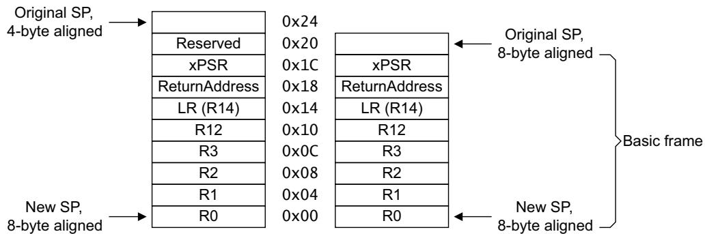  
Figure B1-3 Alignment options when stacking the basic frame

When a processor implements the FP extension, on an exception entry it can push a 26-word frame onto the stack, to include FP state information, see Context state stacking on exception entry with the FP extension on page B1-537. Therefore:

An 8-word context state frame pushed onto the stack on exception entry on a processor that does not include the FP extension is called a Basic frame.

A 26-word context state frame that can be pushed onto the stack on exception entry on a processor that includes the FP extension is called an Extended frame.

On an exception return when CCR.STKALIGN is set to 1, the processor uses the value of bit[9] of the PSR value popped from the stack to determine whether it must adjust the stack pointer alignment. This reverses any forced stack alignment performed on the exception entry.

The pseudocode in Exception entry behavior on page B1-531 and Exception return behavior on page B1-539 describes the effect of the CCR.STKALIGN bit value on exception entry and exception return.

On exception return, the processor adjusts the SP by adding the frame size to the SP and ORing the result with (4\*xPSR[9]), where xPSR[9] is the bit value from the stacked xPSR value. This restores the original SP alignment. If the exception exit sequence started with a stack pointer that is 4 byte aligned, then this adjustment has no effect.

If the exception exit causes a derived exception, the processor enters the derived exception with the stack alignment that was in use before it started the exception exit sequence. For more information see Derived exceptions on exception return on page B1-549.

When CCR.STKALIGN is set to 1, the amount of stack used on exception entry is a function of the alignment of the stack at the time the processor enters the exception. If the SP is 4-byte aligned at this time, the processor realigns the SP to 8-byte alignment, using an extra four bytes of stack. This means the average and worst case stack usage increases. In the worst case, the increase is 4 bytes per exception entry.

Using a reserved bit in the PSR to indicate whether the processor realigned the stack on exception entry makes the feature transparent to context switch code, but requires all software to respect the reserved status of unused bits in the PSR.

## Retrieving arguments from the stack

Any exception-handling code that must retrieve arguments from the stack, that were pushed to the stack before the exception was taken, must use the stacked value of xPSR [9] to determine whether the previous top-of-stack was at offset 0x20 or 0x24.

If the implementation includes the FP extension, such code must use the stacked value of xPSR [9] together with the value of EXC\_RETURN bit[4] to determine whether the previous top-of-stack was at offset 0x20, 0x24, 0x68, or 0x6C, see Context state stacking on exception entry with the FP extension.

## Saving context on process switch

When switching between different processes, software must save all context for the old process, including its associated EXC\_RETURN value, before switching to the new process, and restore that context before returning to the old process.

Note

The 8-byte stack alignment mechanism used when CCR.STKALIGN is set to 1 does not affect the EXC\_RETURN value.

## Context state stacking on exception entry with the FP extension

When an Armv7-M processor implements the FP extension, it has three possible modes for stacking FP context information on taking an exception:

Do not stack any FP context. The processor stacks only a Basic frame, as described in Operation of 8-byte stack alignment on page B1-535.

Stack an Extended frame, containing the Basic frame and the FP state information, as shown in Figure B1-4 on page B1-538. This preserves the floating-point state required by the AAPCS.

Reserve space on the stack for an Extended frame, but write-only the Basic frame information. This is similar to the operation shown in Figure B1-4 on page B1-538, except that no data is pushed into the stack locations reserved for S0-S15 and the FPSCR value. This is an FP lazy context save, see Lazy context save of FP state on page B1-538.

The FPCCR.ASPEN and FPCCR.LSPEN bits determine which action is taken, see Floating Point Context Control Register, FPCCR on page B3-615.

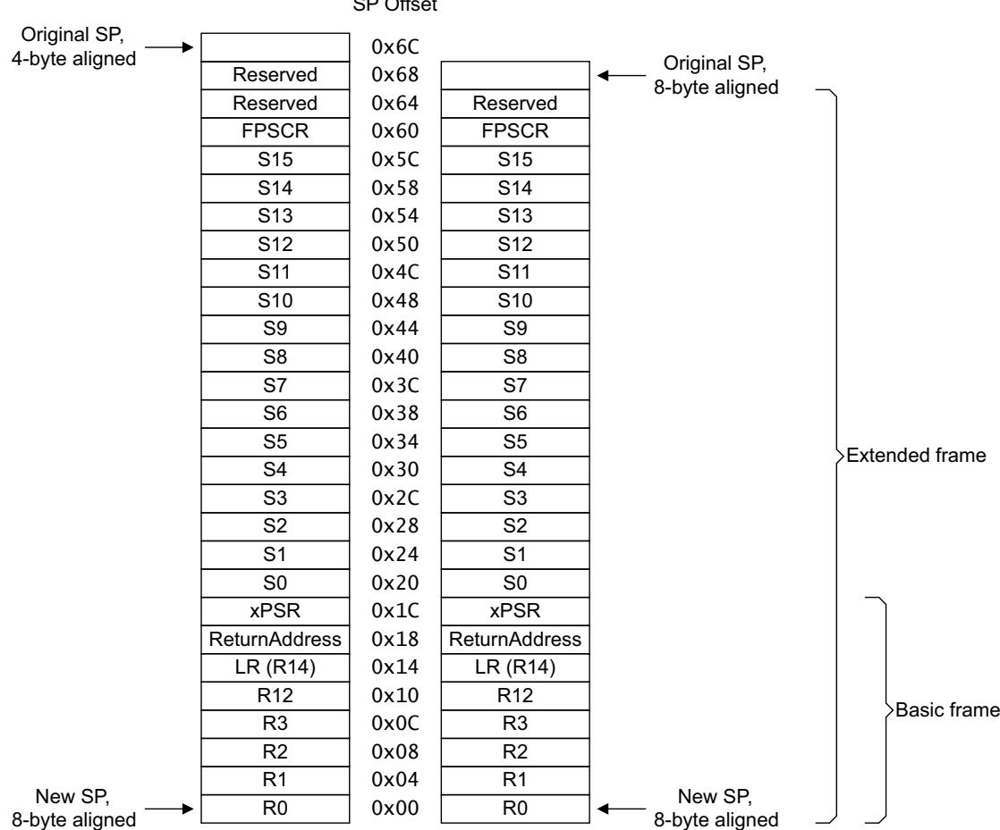  
Figure B1-4 Alignment options when stacking the Extended frame

For more information see Saving FP state on page B1-566 and Exceptions while saving FP state on page B1-566. Immediately after FP state preservation:

The values of the following are UNKNOWN:

The FPSCR, see Floating-point Status and Control Register, FPSCR on page A2-37.

The FPCAR, see Floating Point Context Address Register, FPCAR on page B3-617.

The FP extension registers S0-S15, see The FP extension registers on page A2-35.

The values of the FP extension registers S16-S31 are unchanged.

The CONTROL.FPCA bit is set to 0.

## Lazy context save of FP state

Software sets the FPCCR.LSPEN bit to 1 to enable lazy FP context save on exception entry, see Floating Point Context Control Register, FPCCR on page B3-615. When this is done, the processor reserves space on the stack for the FP state, but does not save that state information to the stack. The stacking it performs is as shown in Figure B1-4, except that no data is transferred to the stack locations reserved for S0-S15 and the FPSCR, The processor also:

Sets the FPCAR to point to the reserved area on the stack, see Floating Point Context Address Register, FPCAR on page B3-617. The FPCAR points to the reserved S0 stack location.

Sets the FPCCR.LSPACT bit to 1, to indicate that lazy state preservation is active, see Floating Point Context Control Register, FPCCR on page B3-615.

Lazy state preservation reduces the exception latency.

While lazy context save is active, the processor must not change the FP context. This means that, if software attempts to execute a floating-point instruction while lazy context save is active, the processor first:

Saves the required FP state, S0-S15 and the FPSCR, to the reserved area on the stack, as identified by the FPCAR.

Sets the FPCCR.LSPACT bit to 0, to indicate that lazy state preservation is no longer active.

It then processes the instruction.

## B1.5.8 Exception return behavior

An exception return occurs when the processor is in Handler mode and one of the following instructions loads a value of 0xFXXXXXXX into the PC:

POP/LDM that includes loading the PC.

LDR with PC as a destination.

BX with any register.

When used in this way, the processor intercepts the value written to the PC. This value is the EXC\_RETURN value. In this value:

Bits[31:28] 0xF. This value identifies the value in a PC load as an EXC\_RETURN value.

Bits[27:5] Reserved, SBOP. The effect of writing a value other than 1 to any bit in this field is UNPREDICTABLE.

## Bit[4], if the processor does not implement the FP extension

Reserved, SBOP. The effect of writing a value other than 1 to any bit in this field is UNPREDICTABLE.

Bit[4], if the processor implements the FP extension

Defines whether the stack frame for this exception has space allocated for FP state information. Bit[4] is 0 if stack space is allocated. On exception entry, the bit[4] value is saved in the EXC\_RETURN value as the inverse of the CONTROL.FPCA bit value when the exception was generated, see The special-purpose CONTROL register on page B1-519.

On exception return, the processor sets CONTROL.FPCA to the inverse of the EXC\_RETURN[4] value.

Bits[3:0] Define the required exception return behavior, as shown in:

Table B1-8, for an implementation without the FP extension.

Table B1-9 on page B1-540, for an implementation with the FP extension.

In both tables:

EXC\_RETURN values not listed are reserved, for that implementation.

The entry in the Return stack column is the stack that holds the information that the processor must restore as part of the exception return sequence. This is also the stack the processor will use after returning from the exception.

Table B1-8 EXC\_RETURN definition of exception return behavior, no FP extension

<table><tr><td>EXC_RETURN</td><td>Return to</td><td>Return stack</td></tr><tr><td>0xFFFFFFF1</td><td>Handler mode</td><td>Main</td></tr><tr><td>0xFFFFFFF9</td><td>Thread mode</td><td>Main</td></tr><tr><td>0xFFFFFFFD</td><td>Thread mode</td><td>Process</td></tr></table>

Table B1-9 EXC\_RETURN definition of exception return behavior, with FP extension

<table><tr><td>EXC_RETURN</td><td>Return to</td><td>Return stack</td><td>Frame type</td></tr><tr><td>0xFFFFFE1</td><td>Handler mode.</td><td>Main</td><td>Extended</td></tr><tr><td>0xFFFFFE9</td><td>Thread mode</td><td>Main</td><td>Extended</td></tr><tr><td>0xFFFFFED</td><td>Thread mode</td><td>Process</td><td>Extended</td></tr><tr><td>0xFFFFFF1</td><td>Handler mode.</td><td>Main</td><td>Basic</td></tr><tr><td>0xFFFFFF9</td><td>Thread mode</td><td>Main</td><td>Basic</td></tr><tr><td>0xFFFFFFD</td><td>Thread mode</td><td>Process</td><td>Basic</td></tr></table>

Using a reserved EXC\_RETURN value causes a chained UsageFault exception.

If an EXC\_RETURN value is loaded into the PC when in Thread mode, or from the vector table, or by any other instruction, the value is treated as an address, not as a special value. The 0xFXXXXXXX address range, that includes all possible EXC\_RETURN values, has Execute Never (XN) permissions, and loading this value causes a MemManage exception, or an INVSTATE UsageFault exception, or escalation of the exception to a HardFault.

Note

When an EXC\_RETURN value is treated as a branch address, and bit[0] of the value is 0, it is IMPLEMENTATION DEFINED whether a MemManage or an INVSTATE UsageFault exception occurs.

In a processor that supports sleep-on-exit functionality, if software has enabled this feature, when the processor returns from the only active exception, the exception return can leave the processor in a power-saving mode. For more information see Power management on page B1-559.

## Integrity checks on exception return

The Armv7-M architecture provides a number of integrity checks on an exception return. These provide a guard against errors in the system software. Incorrect exception return information might be inconsistent with the state of execution that the processor holds in hardware or, or inconsistent with other state stored by the exception mechanisms.

The hardware-related integrity checks ensure that the tracking of active exceptions in the NVIC and SCB hardware is consistent with the exception return.

The integrity checks test the following on an exception return:

The Exception number being returned from, as held in the IPSR at the start of the return, is listed in the SCB as being active.

Normally, if at least one exception other than the returning exception is active, the return must be to Handler mode. This checks for a mismatch of the number of exception returns. Software can use the CCR.NONBASETHRDENA to disable this check, see Configuration and Control Register, CCR on page B3-604.

On a return to Thread mode, the value restored to the IPSR Exception number field must be 0.

On a return to Handler mode, the value restored to the IPSR Exception number field must not be 0.

EXC\_RETURN[3:0] must not be a reserved value, see Table B1-8 on page B1-539.

Any failed check causes an INVPC UsageFault, with the EXC\_RETURN value in the LR.

An exception return where HardFault is active and NMI is inactive always makes HardFault inactive and clears FAULTMASK.

## Exception return operation

```txt
The ExceptionReturn() pseudocode function describes the exception return operation:

// ExceptionReturn()
// ====================
ExceptionReturn(bits(28) EXC_RETURN)
    assert CurrentMode == Mode_Handler;
    if HaveFPExt() then
    if !IsOnes(EXC_RETURN<27:5>) then UNPREDICTABLE;
    else
    if !IsOnes(EXC_RETURN<27:4>) then UNPREDICTABLE;

    integer ReturningExceptionNumber = UInt(IPSR<8:0>);
    integer NestedActivation;    // used for Handler => Thread check when value == 1

    NestedActivation = ExceptionActiveBitCount();    // Number of active exceptions

    if ExceptionActive[ReturningExceptionNumber] == '0' then
    DeActivate(ReturningExceptionNumber);
    UFSR.INVPC = '1';
    LR = '1111':EXC_RETURN;
    ExceptionTaken(UsageFault);    // returning from an inactive handler
    return;
    else
    case EXC_RETURN<3:0> of
    when '0001'    // return to Handler
    frameptr = SP_main;
    CurrentMode = Mode_Handler;
    CONTROL.SPSEL = '0';
    when '1001'    // returning to Thread using Main stack
    if NestedActivation != 1 && CCR.NONBASETHRDENA == '0' then
    DeActivate(ReturningExceptionNumber);
    UFSR.INVPC = '1';
    LR = '1111':EXC_RETURN;
    ExceptionTaken(UsageFault);    // return to Thread exception mismatch
    return;
    else
    frameptr = SP_main;
    CurrentMode = Mode_Thread;
    CONTROL.SPSEL = '0';
    when '1101'    // returning to Thread using Process stack
    if NestedActivation != 1 && CCR.NONBASETHRDENA == '0' then
    DeActivate(ReturningExceptionNumber);
    UFSR.INVPC = '1';
    LR = '1111':EXC_RETURN;
    ExceptionTaken(UsageFault);    // return to Thread exception mismatch
    return;
    else
    frameptr = SP_process;
    CurrentMode = Mode_Thread;
    CONTROL.SPSEL = '1';
    otherwise
    DeActivate(ReturningExceptionNumber);
    UFSR.INVPC = '1';
    LR = '1111':EXC_RETURN;
    ExceptionTaken(UsageFault);    // illegal EXC_RETURN
    return;

    DeActivate(ReturningExceptionNumber);
    PopStack(frameptr, EXC_RETURN);

    if CurrentMode==Mode_Handler && IPSR<8:0> == '000000000' then
    UFSR.INVPC = '1';
    PushStack(UsageFault);    // to negate PopStack()
    LR = '1111':EXC_RETURN;
    ExceptionTaken(UsageFault);    // return IPSR is inconsistent
```

```txt
return;
if CurrentMode==Mode_Thread && IPSR<8:0> != '000000000' then
    UFSR.INVPC = '1';
    PushStack(UsageFault);    // to negate PopStack()
    LR = '1111':EXC_RETURN;
    ExceptionTaken(UsageFault);    // return IPSR is inconsistent
    return;
ClearExclusiveLocal(ProcessorID());
SetEventRegister();    // see WFE instruction for more details
InstructionSynchronizationBarrier('1111');
if CurrentMode==Mode_Thread && NestedActivation == 0 && SCR.SLEEPONEXIT == '1' then
    SleepOnExit();    // IMPLEMENTATION DEFINED
```

ExceptionActiveBitCount() is a pseudocode function that returns the number of bits that are set to 1 in the ExceptionActive[\*] array:

```txt
integer ExceptionActiveBitCount()
```

SleepOnExit() is an IMPLEMENTATION DEFINED pseudocode function that, if the exception from which the processor is returning is the only active exception, and the sleep-on-exit functionality is supported and enabled, puts the processor into a power-saving state on return from the exception. For more information see Power management on page B1-559.

For global declarations see Register-related definitions for pseudocode on page B1-520.

For the definition of ExceptionTaken() see Exception entry behavior on page B1-531.

For the definition of ExceptionActive[\*] see Reset behavior on page B1-530.

For helper functions and procedures see Miscellaneous helper procedures and functions on page D6-822.

The definitions of the DeActivate() and PopStack() pseudocode functions are:

```txt
// DeActivate()
// ========
DeActivate(integer ReturningExceptionNumber)
    ExceptionActive[ReturningExceptionNumber] = '0';
    /* PRIMASK and BASEPRI unchanged on exception exit */
    if IPSR<8:0> != '000000010' then
    FAULTMASK<0> = '0';    // clear FAULTMASK on any return except NMI
    return;

// PopStack()
// ========
PopStack(bits(32) frameptr, bits(28) EXC_RETURN)    /* only stack locations, not the load order, are
architected */
    if HaveFPExt() && EXC_RETURN<4> == '0' then
    framesize = 0x68;
    forcealign = '1';
    else
    framesize = 0x20;
    forcealign = CCR.STKALIGN;

    R[0] = MemA[frameptr,4];
    R[1] = MemA[frameptr+0x4,4];
    R[2] = MemA[frameptr+0x8,4];
    R[3] = MemA[frameptr+0xC,4];
    R[12] = MemA[frameptr+0x10,4];
    LR = MemA[frameptr+0x14,4];
    BranchTo(MemA[frameptr+0x18,4]);    // UNPREDICTABLE if the new PC not halfword aligned
    psr = MemA[frameptr+0x1C,4];
```

if HaveFPExt() then

```txt
if EXC_RETURN<4> == '0' then
    if FPCCR.LSPACT == '1' then
    FPCCR.LSPACT = '0'; // state in FP is still valid
    else
    CheckVFPEnabled();
    for i = 0 to 15
    S[i] = MemA[frameptr+0x20+(4*i),4];
    FPSCR = MemA[frameptr+0x60,4];

CONTROL.FPCA = NOT(EXC_RETURN<4>);

spmask = Zeros(29):(psr<9> AND forcealign):'00';

case EXC_RETURN<3:0> of
    when '0001'    // returning to Handler
    SP_main = (SP_main + framesize) OR spmask;
    when '1001'    // returning to Thread using Main stack
    SP_main = (SP_main + framesize) OR spmask;
    when '1101'    // returning to Thread using Process stack
    SP_process = (SP_process + framesize) OR spmask;

APSR<31:27> = psr<31:27>;    // valid APSR bits loaded from memory
if HaveDSPExt() then
    APSR<19:16> = psr<19:16>;
IPSR<8:0> = psr<8:0>;    // valid IPSR bits loaded from memory
EPSR<26:24,15:10> = psr<26:24,15:10>;    // valid EPSR bits loaded from memory
return;
```

## B1.5.9 Exceptions in single-word load operations

To support instruction replay, single-word load instructions must not update the destination register when a fault occurs during execution. For example, this means the following instruction can be replayed:

LDR R0, [R2, R0];

## B1.5.10 Exceptions in Load Multiple and Store Multiple operations

To improve interrupt response and increase processing throughput, the processor can take an interrupt during the execution of a Load Multiple or Store Multiple instruction, and continue execution of the instruction after returning from the interrupt. During the interrupt processing, the EPSR.ICI bits hold the continuation state of the Load Multiple or Store Multiple instruction, see The EPSR on page B1-517. It is IMPLEMENTATION DEFINED when interrupts are recognized, so the use of the ICI bits is IMPLEMENTATION DEFINED. Instructions that can be interrupted and restarted in this way are described as exception-continuable instructions.

In the base Armv7-M architecture the exception-continuable instructions are LDM, LDMDB, STM, STMDB, POP, and PUSH. If a processor implements the FP extension the exception-continuable floating-point instructions are VLDM, VSTM, VPOP, and VPUSH.

Alternatively, the processor can abandon the execution of a Load Multiple or Store Multiple instruction on taking an exception, and restart the instruction processing, from the start of the instruction, on returning from the exception. This case does not require support for the ICI bits, but means software must not use Load Multiple or Store Multiple instructions with volatile memory.

To support instruction replay, the LDM, STM, PUSH, and POP instructions must restore the base register if the instruction is abandoned.

On an implementation that supports interruptible Load Multiple and Store Multiple instructions, only Load Multiple and Store Multiple instructions that are not in an IT block are compatible with the single-copy atomicity rules for Device and Strongly Ordered memory described in Memory access restrictions on page A3-83.

For the instructions that are part of the base Armv7-M architecture, the ICI bits store the number of the first register in the register list that must be loaded or stored on return to the instruction.

For the floating-point instructions, the ICI bits encode the number of the lowest-numbered doubleword Floating-point Extension register that was not completely loaded or stored before taking the exception. This means there might be multiple reads or writes of some registers.

Note

This means that vector Load Multiple and Store Multiple instructions are never compatible with the single-copy atomicity rules for Device and Strongly Ordered memory described in Memory access restrictions on page A3-83.

When the processor returns to executing the Load Multiple or Store Multiple instruction, it loads or stores all registers in the instruction register list with a number that is equal to or greater than the value held in the ICI field. See The EPSR on page B1-517 for the encoding of the ICI bits.

If the ICI bits are all zero, the EPSR does not hold a continuation state. This zero value indicates normal operation with neither IT nor interrupt continuation active. In this situation, an abandoned Load Multiple or Store Multiple instruction restarts from the beginning.

The result is UNPREDICTABLE if the register number held in the ICI bits is non-zero and is either:

Not a register in the register list of the Load Multiple or Store Multiple instruction.

The first register in the register list of the Load Multiple or Store Multiple instruction.

If the ICI bit field is non-zero, and the instruction executed on an exception return is not a Load Multiple or Store Multiple instruction, or in an IT block, the processor generates an INVSTATE UsageFault, see Fault behavior on page B1-551.

If a BusFault or MemManage fault occurs on any Load Multiple or Store Multiple instruction, the processor abandons the instruction, and restarts the instruction from the beginning on return from the exception. If the instruction is not in an IT block, the fault clears the ICI bits to zero.

Note

If software uses an exception-continuable instruction in an IT construct, the IT feature takes precedence over the ICI feature. In this situation, the processor treats the Load Multiple and Store Multiple instruction as restartable, meaning the instruction must not be used with Device or Strongly Ordered memory.

The following sections describe restrictions that apply to taking an exception during a Load Multiple or Store Multiple instruction.

## LDM and PC in load list

For the Arm architecture in general, the case of LDM with PC in the register list is defined as unordered, meaning the registers can be loaded in a different order to that implied by the register list. The usual use is to load the PC first, described as loading the PC early.

For Armv7-M, however, a LDM operation with the PC in the register list can be interrupted during execution, with the continuation state held in the ICI bits. On returning from the exception to executing the LDM instruction, the ICI bits indicate the next register to load, to continue correctly. This can result in an LDM with the PC in the register list accessing the same memory location twice.

If the processor loads the PC early, before taking an exception it must restore the PC, so that the return address from the exception is to the LDM instruction address. The processor then loads the new PC value again when it continues execution of the LDM instruction.

## Load Multiple and Store Multiple base register updates and the ICI bits

The base register can be changed as a result of a load or store multiple in the following situations: Base register write-back

For more information see the descriptions of updating the base register in:

LDM, LDMIA, LDMFD on page A7-242.

LDMDB, LDMEA on page A7-244.

STM, STMIA, STMEA on page A7-383.

STMDB, STMFD on page A7-385.

Note

POP is a special case of the LDM instruction, and PUSH is a special case of the STM instruction, see POP on page A7-319 and PUSH on page A7-322. Therefore, POP and PUSH can both perform base register write-back.

## Base register load

This occurs if the base register is in the register list of an LDM.

If an exception occurs during execution of the Load Multiple or Store Multiple instruction, the value left in the base register is as follows:

## Fault condition

The fault condition can be a BusFault or a MemManage fault. This case applies to all forms of LDM and STM, including PUSH and POP:

The base register is restored to the original value.

If the instruction is not in an IT block, the ICI bits are cleared to zero.

If the instruction is in an IT block, the ICI bits are not used to hold the continuation state, because the IT bits indicate the position in the IT block.

In all cases, the return from the fault handler restarts the instruction from the beginning.

## Base register write-back

The behavior depends on the context of the interrupt:

Interrupt of an LDM or STM in an IT block

The base register contains the initial value, whether an IA or DB LDM/STM instruction.

The ICI bits are not used to hold the continuation state, as the IT bits indicate the position in the IT block.

## Interrupt of an LDM or STM, not in an IT block, using SP as the base register

The SP that is presented to the exception entry sequence is lower than any element pushed by an STM, or not yet popped by an LDM.

For instructions decrementing before (DB), the SP is set to the final value. This is the lowest value in the list.

For instructions incrementing after (IA), the SP is set to the initial value. This is the lowest value in the list.

In all cases, the ICI bits hold the continuation state.

## Interrupt of LDM or STM not in an IT block, not using SP as the base register

The base register contains the final value, whether the LDM or STM instruction is DB or IA.

The ICI bits hold the continuation state.

## Base register load

In all cases, the processor restores the original base address when it abandons the instruction. Other aspects of the behavior depend on the context of the interrupt:

## Interrupt of an LDM in an IT block

If the instruction is in an IT block, the ICI bits cannot be used to hold the continuation state, because the IT bits indicate the position of the instruction in the IT block. It is IMPLEMENTATION DEFINED whether the instruction executes to completion or restarts.

## Interrupt of an LDM not in an IT block

If the processor takes the interrupt before it has loaded the base register, an implementation can use the ICI bits to hold the continuation state.

If the processor takes the interrupt after it has loaded the base register, the implementation must restore the base register to its original value. The ICI bits can be set to an IMPLEMENTATION DEFINED value that will load at least the base register and subsequent locations again on return.

Software must not use an LDM to access a volatile location if any of the following applies to that LDM:

It executes inside an IT block.

It loads the base register.

It loads the PC.

As a base register load example, if the instruction LDM R2, {R0-R4} is interrupted, and the instruction is not in an IT block:

If continuation is supported and the interrupt occurs after R0 or R1 has been loaded, the continuation bits indicate a restart on:

R1, if R0 has been loaded.

R2, if R1 has been loaded.

If continuation is supported and the interrupt occurs at any point after R2 has been loaded, the processor abandons execution, and restarts execution, with the ICI bits cleared to zero, after it has handled the exception. This means that, in this case, the processor handles the instruction as if it does not support continuation.

If continuation is not supported and the instruction is abandoned before loading R4, after the processor handles the interrupt it restarts execution of the instruction, with the ICI bits cleared to zero.

## B1.5.11 Exceptions on exception entry

During exception entry other exceptions can occur, either because of a fault on an operation involved in exception entry, or because of the arrival of an asynchronous exception, an interrupt, that is of higher priority than the current exception entry sequence.

For implementations that include the FP extension, see also Exceptions while saving FP state on page B1-566

## Late-arriving exceptions

The Armv7-M architecture does not specify the point during an exception entry at which the processor recognizes the arrival of an asynchronous exception. However, to support very low interrupt latencies, the architecture permits a high priority interrupt that arrives during an exception entry to become active during that exception entry sequence, without causing the entry sequence to repeat.

When the processor takes an asynchronous interrupt during the exception entry sequence, the exception that caused the exception entry sequence is known as the original exception. The exception caused by the interrupt is known as the late-arriving exception.

In this case, the exception entry sequence started by the original exception can be used by the late-arriving exception. The processor takes the original exception after returning from the late-arriving exception. This is referred to as late-arrival preemption.

For a late arrival preemption, the processor enters the handler for the late-arriving exception, which becomes active. The original exception remains in the pending state.

A late-arriving exception can be an interrupt, a fault, or a Supervisor Call.

It is IMPLEMENTATION DEFINED what conditions, if any, cause late arrival preemption. Late arrival preemption occurs only when the late-arriving exception is of higher priority than the original exception. If an implementation supports late-arriving exceptions, the LateArrival() pseudocode function shows their operation. This function changes the ExceptionType argument used in the ExceptionTaken() function.

// LateArrival() //

LateArrival()

// xEpriority: the lower the value, the higher the priority

```c
integer OEpriority; // original exception group priority
integer LAEpriority; // late-arriving exception group priority
integer OEnumumber; // ExceptionNumber for OE
integer LAEnumber; // ExceptionNumber for LAE
```

```txt
if (LAEpriority < OEpriority) then
ExceptionTaken(LAEnumber); // late-arriving exception taken
else
ExceptionTaken(OEnumber); // original exception taken
```

For the definition of ExceptionTaken() see Exception entry behavior on page B1-531.

## Derived exceptions on exception entry

Where an exception entry sequence itself causes a fault, the exception that caused the exception entry sequence is known as the original exception. The fault that is caused by the exception entry sequence is known as the derived exception. The code stream running at the time of the original exception is known as the preempted code, and the execution priority of that code is the preempted priority.

The following derived exceptions can occur during exception entry:

A MemManage fault on a write to the stack memory performed as part of the exception entry. This is described as a MSTKERR class of MemManage fault.

A BusFault on a write to the stack memory performed as part of the exception entry. This is described as a STKERR class of BusFault.

• A watchpoint, when Halting debug is not enabled. This causes a DebugMonitor exception on exception entry.

A BusFault on reading the vector for the original exception. This is always treated as a HardFault.

If the preempted priority is higher than or equal to the priority of the derived exception then:

• If the derived exception is a DebugMonitor exception, the processor ignores the derived exception.

Otherwise, the processor escalates the derived exception to HardFault.

Note

When the preempted priority is higher than or equal to the priority of the derived exception, the priority of the original exception has no effect on whether the processor ignores a DebugMonitor exception, or escalates the derived exception.

A derived exception is treated similarly to a late arriving exception and an implementation can use late arrival preemption to handle derived exceptions. Late arrival preemption can occur only if the derived exception, after escalation if appropriate, is of higher priority than the original exception, but it is IMPLEMENTATION DEFINED exactly what conditions, if any, lead to late arrival preemption.

```txt
Note
```

If the processor does not use the late-arrival preemption mechanism to handle a derived exception, the derived exception becomes pending, and the processor takes the exception in accordance with the prioritization rules for pending exceptions.

If the processor handles the derived exception using late-arrival preemption, it enters the handler for the derived exception, which becomes active. The original exception remains in the pending state

The DerivedLateArrival() pseudocode function shows this operation. This function changes the ExceptionType argument used in the ExceptionTaken() function.

```javascript
// DerivedLateArrival()
// ========
```

## DerivedLateArrival()

```txt
// xEpriority: the lower the value, the higher the priority
// PE: the pre-empted exception - before exception entry
// OE: the original exception - exception entry
// DE: the derived exception - fault on exception entry
```

```c
if DEpriority >= PEpriority && DEisDbgMonFault then
    ExceptionTaken(OEnumumber); // ignore the DebugMonitor exception
if DEpriority >= PEpriority && !DEisDbgMonFault then
    DEpriority = -1; // escalate DE to HardFault
    // (incl. BKPT with DebugMonitor disabled)
    SetPending(OEnumumber); // OE to Pending state
    ExceptionTaken(HardFault);
else
    if DEpriority < OEpriority then
    SetPending(OEnumumber); // OE to Pending state
    ExceptionTaken(DE-number); // start execution of the DE
    // tail-chaining IMPLEMENTATION DEFINED
    else
    SetPending(DE-number); // DE to Pending state
    ExceptionTaken(OEnumumber); // start execution of the OE
```

The ICSR and SHCSR maintain pending state information, see Interrupt Control and State Register, ICSR on page B3-599 and System Handler Control and State Register, SHCSR on page B3-607.

It is IMPLEMENTATION DEFINED whether late-arriving exceptions are supported and can affect derived exceptions. If an implementation supports late-arriving exceptions, then in the late-arrival pseudocode described in Late-arriving exceptions on page B1-546:

DE maps to OE.

The late-arriving exception maps to SE.

## B1.5.12 Exceptions on exception return, and tail-chaining exceptions

During exception return, other exceptions can affect behavior, either because of a fault on the operations performed during exception return, or because of an asynchronous exception that is of higher priority than the priority level that the exception return is returning to. The asynchronous exception might be already pending, or might arrive during the exception return.

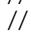

The Exception Return Link describes the target of the exception return. The target priority is the higher of:

The priority of the highest priority active exception, excluding the exception being returned from.

The boosted priority set by the special-purpose mask registers.

## Derived exceptions on exception return

Where an exception return sequence causes a fault exception, the exception caused by the exception return sequence is known as the derived exception.

The following derived exceptions can occur during exception return:

A MemManage fault on a read of the stack memory performed as part of the exception return. This is described as a MemManage fault of the MUNSTKERR class.

A BusFault on a read of the stack memory performed as part of the exception return. This is described as a BusFault of the UNSTKERR class.

A DebugMonitor exception caused by a watchpoint on the exception return.

Note

The ExceptionReturn() pseudocode function handles integrity checks that cause UsageFault exceptions, and therefore the list of derived exceptions does not include this case. An implementation can optimize the handling of these exceptions, using a method similar to tail-chaining.

If the target priority is higher than or equal to the priority of the derived exception, then:

If the derived exception is a DebugMonitor exception, the processor ignores the derived exception.

Otherwise, the processor escalates the derived exception to HardFault.

If a derived exception occurs on exception return, the processor uses tail-chaining to enter the handler for the derived exception.

## Tail-chaining

Tail-chaining is the optimization of an exception return and an exception entry sequence by removing the load and store of the key context state.

An implementation can use tail-chaining in the following cases:

To handle a derived exception.

As an optimization to improve interrupt response when there is a pending exception with a higher priority than the target priority. In this case, the processor takes the Pending exception immediately on exception return, and tail-chaining optimizes the exception return and entry sequence.

In the tail-chaining optimization, the processor combines the exception return and exception entry sequences to form the sequence described by the TailChain() pseudocode function, in which ReturningExceptionNumber is the number of the exception being returned from, and ExceptionNumber is the number of the exception being entered by tail-chaining. EXC\_RETURN is the EXC\_RETURN value that started the original exception return.

// TailChain()

// ===========

TailChain(integer ExceptionNumber, bits(28) EXC\_RETURN)

assert CurrentMode == Mode\_Handler;

if !IsOnes(EXC\_RETURN<27:4>) then UNPREDICTABLE;

integer ReturningExceptionNumber = UInt(IPSR<8:0>);

LR = '1111':EXC\_RETURN;

DeActivate(ReturningExceptionNumber);

ExceptionTaken(ExceptionNumber);

For a definition of ExceptionTaken() see Exception entry behavior on page B1-531.

For a definition of DeActivate() see Exception return behavior on page B1-539.

## Use of tail-chaining as an optimization for pending exceptions

On an exception return, using tail-chaining to optimize the handling of a pending exception with sufficient priority to be taken immediately after the exception return can change the exception behavior. In particular, many derived exceptions that might occur during the exception return followed by exception entry might not occur during tail-chaining. If this happens, the derived exceptions can occur on return from the tail-chained exception, if the conditions causing them still apply.

## Late arrival preemption and tail-chaining during exception returns

The Armv7-M architecture does not specify the point at which the processor recognizes any asynchronous exception that arrives during an exception. If the processor recognizes a new exception while it is tail-chaining another exception, and the new exception has higher priority than the exception being tail-chained, then the processor can, instead, take the new exception, using late-arrival preemption. It is IMPLEMENTATION DEFINED wha conditions, if any, lead to late arrival preemption.

Late-arrival preemption can occur during a tail-chaining optimization of a derived exception on an exception return. The processor marks the derived exception as pending when it takes a new exception because of late-arrival preemption of the derived exception by the new exception.

## B1.5.13 Exception status and control

The System Control Block in the System Control Space includes register support for managing the exception model, see About the System Control Block on page B3-595. These registers are grouped as follows:

General configuration, status and control:

The VTOR, see The vector table on page B1-525 and Vector Table Offset Register, VTOR on page B3-601.

The ICSR, see Interrupt Control and State Register, ICSR on page B3-599.

The AIRCR, see Application Interrupt and Reset Control Register, AIRCR on page B3-601.

The SCR, see Power management on page B1-559 and System Control Register, SCR on page B3-603.

The CCR, see Configuration and Control Register, CCR on page B3-604.

The SHPRs, see System Handler Priority Register 1, SHPR1 on page B3-606, System Handler Priority Register 2, SHPR2 on page B3-606, and System Handler Priority Register 3, SHPR3 on page B3-607

The SHCSR, see System Handler Control and State Register, SHCSR on page B3-607.

Fault handling status and control, see Fault behavior on page B1-551 and Fault status and address information on page B1-554.

The STIR, see Software Triggered Interrupt Register, STIR on page B3-619.

SysTick support, see The system timer, SysTick on page B3-620.

NVIC support, see Nested Vectored Interrupt Controller, NVIC on page B3-624.

Using the ICSR, see Interrupt Control and State Register, ICSR on page B3-599, software can:

Set the NMI, SysTick and PendSV exceptions to the pending state.

• Clear the pending state of the SysTick and PendSV exceptions.

Find status information for any pending or active exceptions.

Using the AIRCR, see Application Interrupt and Reset Control Register, AIRCR on page B3-601, software can:

Control exception priority grouping, see Priority grouping on page B1-527.

Read the endianness used for data accesses, see Control of endianness in Armv7-M on page A3-68.

Control reset behavior, see Reset management on page B1-559.

The AIRCR includes a vector key field. The processor ignores any write to the register that does not write the key value 0x05FA to this field.

Using the CCR, see Configuration and Control Register, CCR on page B3-604, software can enable or disable:

Divide by zero faults, alignment faults and some features of processor operation.

## BusFaults at priority -1 and higher.

Using the SHPRs, software can control the priority of the BusFault, MemManage, UsageFault, DebugMonitor, SVCall, SysTick and PendSV exceptions, see:

System Handler Priority Register 1, SHPR1 on page B3-606.

System Handler Priority Register 2, SHPR2 on page B3-606.

System Handler Priority Register 3, SHPR3 on page B3-607.

Using the SHCSR, see System Handler Control and State Register, SHCSR on page B3-607, software can:

• Access the pending and active status of faults and Supervisor Calls.

Access the active status of the SysTick and PendSV interrupts.

Enable or disable the UsageFault, BusFault and MemManage exception handlers. When a fault handler is disabled, the processor escalates the corresponding fault, see Priority escalation on page B1-529.

Note

There are no explicit active state bits for reset, NMI or HardFault, the fixed priority exceptions.

DebugMonitor is enabled in a debug control register, see Debug Exception and Monitor Control Register, DEMCR on page C1-706.

SysTick is enabled in a SysTick control register, see SysTick Control and Status Register, SYST\_CSR on page B3-621.

The active and pending state bits support the save and restore of information on a context switch. In particular, for an explicit software write to the SHCSR:

— Setting an active bit to 1 does not cause an exception entry.

— Clearing an active bit to 0 does not cause an exception return.

The effect of setting a pending bit to 1 for an exception with priority greater than or equal to the execution priority is UNPREDICTABLE.

Writing to the STIR, see Software Triggered Interrupt Register, STIR on page B3-619, software can use an exception number to set the corresponding pending register bit to 1. Only external interrupts can be made pending using this method. The processor ignores any attempt to write an exception number:

In the range 0-15.

That corresponds to an interrupt that it does not support.

Using the NVIC registers, see NVIC register support in the SCS on page B3-626, software can perform the following operations for external interrupts:

Enable or disable.

Set or clearing the pending state.

Read the active state.

Program the priority.

Note

An interrupt can become pending when it is disabled. Enabling an interrupt means a pending interrupt can become active.

## B1.5.14 Fault behavior

Under the Armv7-M exception priority scheme, a processor handles a precise fault in one of the following ways:

Execute the corresponding exception handler.

Take a HardFault exception.

If a fault occurs when executing at priority -1 or higher, as described in Unrecoverable exception cases on page B1-555.

In all fault handling cases, the processor sets the corresponding fault status register bit to 1, and the fault handler returns according to the rules defined in the ReturnAddress() pseudocode function.

For the definitions of ExceptionTaken() and ReturnAddress() see Exception entry behavior on page B1-531.

## List of Armv7-M faults

An Armv7-M implementation recognizes the following faults. As shown, each fault has an associated status bit and an associated vector catch bit, used by the debug implementation to catch the fault. A vector catch is generated when the processor sets the Active bit for the listed exception if both the associated Vector catch bit and Status bit are set. A debug event is generated on entry to the relevant handler when the vector catch bit, status bit, and DHCSR.C\_DEBUGEN are all set.

## HardFault on vector read error

Status bit HFSR.VECTTBL

Vector catch bit DEMCR.VC\_INTERR

Bus error returned when reading the vector table entry.

Note

Exception vector reads use the default address map, see Protected Memory System Architecture, PMSAv7 on page B3-632.

## HardFault on fault escalation

Status bit HFSR.FORCED

Vector catch bit DEMCR.VC\_HARDERR

Fault or Supervisor Call occurred, and the handler priority is lower than or equal to the execution priority. The exception escalates to a HardFault. The processor updates the fault address and status registers, as appropriate.

## HardFault on breakpoint (BKPT) escalation

Status bit HFSR.DEBUGEVT

Vector catch bit DEMCR.VC\_HARDERR

A BKPT instruction is executed while Halting debug is disabled and the DebugMonitor is disabled or the DebugMonitor priority is lower than or equal to the execution priority. The exception escalates to a HardFault.

## BusFault on exception entry stack memory operations

Status bit BFSR.STKERR

Vector catch bit DEMCR.VC\_INTERR

Failure on a hardware save of context. The fault returns a bus error, but the processor does not update the BusFault Address Register.

## MemManage fault on exception entry stack memory operations

Status bit MMFSR.MSTKERR

Vector catch bit DEMCR.VC\_INTERR

Failure on a hardware save of context, because of an MPU access violation. The processor does not update the MemManage Address Register.

## BusFault on exception return stack memory operations

Status bit BFSR.UNSTKERR Vector catch bit DEMCR.VC\_INTERR

Failure on a hardware restore of context. The fault returns a bus error, but the processor does not update the Bus Fault Address Register.

## MemManage fault on exception return stack memory operations

Status bit MMFSR.MUNSTKERR Vector catch bit DEMCR.VC\_INTERR

Failure on a hardware restore of context, because of an MPU access violation. The processor does not update the MemManage Address Register.

## MemManage fault on data access

Status bit MMFSR.DACCVIOL

Vector catch bit DEMCR.VC\_MMERR

MPU violation or fault caused by an explicit memory access. The processor writes the data address of the load or store to the MemManage Address Register.

## MemManage fault on instruction access

Status bit MMFSR.IACCVIOL

Vector catch bit DEMCR.VC\_MMERR

MPU violation or fault caused by an instruction fetch, or an instruction fetch from XN memory when there is no MPU. The fault occurs only if the processor attempts to execute the instruction. The processor does not update the MemManage Address Register.

## BusFault on instruction fetch, precise

Status bit BFSR.IBUSERR

Vector catch bit DEMCR.VC\_BUSERR

Bus error on an instruction fetch. The fault occurs only if the processor attempts to execute the instruction. The processor does not update the Bus Fault Address Register.

## BusFault on data access, precise

Status bit BFSR.PRECISERR

Vector catch bit DEMCR.VC\_BUSERR

Precise bus error caused by an explicit memory access. The processor writes the data address of the load or store to the Bus Fault Address Register.

## BusFault, bus error on data bus, imprecise

Status bit BFSR.IMPRECISERR

Vector catch bit DEMCR.VC\_BUSERR

Imprecise bus error caused by an explicit memory access. The processor does not update the Bus Fault Address Register.

## UsageFault, No coprocessor

Status bit UFSR.NOCP

Vector catch bit DEMCR.VC\_NOCPERR

Occurs on an attempt to access a coprocessor that does not exist, or to which access is denied, see Coprocessor Access Control Register, CPACR on page B3-614.

## UsageFault, Undefined Instruction

Status bit UFSR.UNDEFINSTR

Vector catch bit DEMCR.VC\_STATERR

Occurs if the processor attempts to execute an unknown instruction, including any unknown instruction associated with an enabled coprocessor.

## UsageFault, attempt to execute an instruction when EPSR.T==0

Status bit UFSR.INVSTATE

Vector catch bit DEMCR.VC\_STATERR

Occurs if the processor attempts to execute in an invalid EPSR state, for example after a BX instruction branches to an unsupported state. This fault includes any state change after entry to or return from an exception, as well as from an interworking instruction.

## UsageFault, exception return integrity check failures

Status bit UFSR.INVPC

Vector catch bit DEMCR.VC\_STATERR

Indicates any failure of the integrity checks for exception returns described in Integrity checks on exception return on page B1-540.

## UsageFault, illegal unaligned load or store

Status bit UFSR.UNALIGNED

Vector catch bit DEMCR.VC\_CHKERR

Occurs when a multiple word load or store instruction attempts to access a non-word aligned location. If the CCR.UNALIGN\_TRP bit is set to 1 it occurs, also, for any load or store that is not naturally aligned.

## UsageFault, divide by 0

Status bit UFSR.DIVBYZERO

Vector catch bit DEMCR.VC\_CHKERR

If the CCR.DIV\_0\_TRP bit is set to 1, this occurs when the processor attempts to execute SDIV or UDIV with a divisor of 0.

## MemManage Fault, delayed floating-point preservation

Status bit MMFSR.MLSPERR Vector catch bit DEMCR.VC\_INTERR Occurs on a failure to preserve the floating-point context.

BusFault, delayed floating-point preservation

Status bit BFSR.LSPERR Vector catch bit DEMCR.VC\_INTERR

Occurs on a failure to preserve the floating-point context.

For more information about:

The fault status bits, see Configurable Fault Status Register, CFSR on page B3-609 and HardFault Status Register, HFSR on page B3-612.

The vector catch bits, see Debug Exception and Monitor Control Register, DEMCR on page C1-706 and Vector catch on page C1-697.

The CCR trap bits, see Configuration and Control Register, CCR on page B3-604.

Faults related to debug see Chapter C1 Armv7-M Debug.

## Fault status and address information

The System Control Space includes the following fault status and fault address registers:

Configurable fault status registers for UsageFault, BusFault and MemManage faults, see Configurable Fault Status Register, CFSR on page B3-609.

A HardFault status register, see HardFault Status Register, HFSR on page B3-612.

A Debug fault status register, see Debug Fault Status Register, DFSR on page C1-699 for more information.

BusFault and MemManage fault address registers, see BusFault Address Register, BFAR on page B3-614 and MemManage Fault Address Register, MMFAR on page B3-613. It is IMPLEMENTATION DEFINED whethe these fault address registers are unique registers, or are a shared resource accessible from two locations in the System Control Space.

The HFSR provides three fault handling status flags, that indicate the reason for taking a HardFault exception. These bits are write-one-to-clear.

The 32-bit CFSR, see Configurable Fault Status Register, CFSR on page B3-609, concatenates fault status registers for UsageFault, BusFault, and MemManage fault. These are called configurable faults because they support dynamic priority setting by software. Fault status register bits are additive, meaning each new fault sets a bit to 1. These bits are write-one-to-clear.

The BusFault and MemManage registers each include a valid bit that is set to 1 when the associated fault address register is updated with the faulting address:

The MemManage Address register is updated only for data access violations.

The BusFault Address register is updated only for precise data errors.

Software can determine the address of the faulting instruction for UsageFault, MemManage and precise BusFaults from the stacked ReturnAddress() value, as defined in Exception entry behavior on page B1-531.

Note

Escalation of a BusFault or MemManage exception to HardFault can cause the associated fault address register to be overwritten by a derived exception, see Exceptions on exception entry on page B1-546 and Exceptions on exception return, and tail-chaining exceptions on page B1-548. Therefore, Arm strongly recommends that handlers managing these types of fault clear to zero the VALID bit corresponding to the fault address, before performing their exception return.

There are cases where the fault address register is not valid. Handlers must check address validity by ensuring the associated VALID bit is set to 1. An invalid address can occur because of the preemption of a fault.

The CCR, see Configuration and Control Register, CCR on page B3-604, includes control bits for features related to faults:

The BFHFNMIGN bit prevents data access bus faults when the processor is executing at priority -1 or -2. An example use of the bit is in autoconfiguration of a bridge or other device, where probing a disabled or non-existent element might cause a bus fault. Before using this bit, software developers must ensure that the code and data spaces of the handler that executes at priority -1 or -2 are valid for correct operation.

Trap enable bits:

The DIV\_0\_TRP bit enables the divide-by-0 trap.

The UNALIGN\_TRP bit enables the trap on unaligned word and halfword accesses.

## B1.5.15 Unrecoverable exception cases

The Armv7-M architecture generally assumes that, when the processor is running at priority -1 or higher, any fault or Supervisor Call that occurs is entirely unexpected and fatal.

The standard exception entry mechanism does not apply where a fault or Supervisor Call occurs at a priority of -1 or above. Armv7-M requires the processor to handle most of these cases using a lockup mechanism. Other cases become pending or are ignored. Lockup means the processor suspends normal instruction execution and enters Lockup state. When in Lockup state:

The processor repeatedly fetches the same instruction, from a fixed address, the Lockup address, determined by the nature of the fault, as Possible faults when executing at a priority of less than 0 on page B1-556 describes.

After each fetch, the processor executes the instruction, if it is valid. If the lockup is caused by a precise memory error on a load or store that has base write-back, the fault restores the base register.

If the IT bits are non-zero when the lockup occurs, the IT bits do not advance.

The processor sets the S\_LOCKUP bit in the Debug Halting Control and Status Register to 1.

The processor sets the Fault Status Register bits consistent with the fault causing the lockup to 1.

Arm strongly recommends that implementations provide an external signal that indicates that the processor is in Lockup state, so that an external mechanism can react.

A processor can exit Lockup state in the following ways:

If the lockup is in a HardFault handler and an NMI exception occurs, the NMI becomes active. The NMI return link is the address used for the Lockup state instruction fetch.

A system reset occurs. This causes exit from Lockup state, and resets the system as normal.

The processor receives a halt command from a halting-mode debug agent. The processor enters Debug state with the PC set to the same value as is used for return context, as Possible faults when executing at a priority of less than 0 describes.

If the lockup was caused by a memory error and that error is resolved, either by specific action by the system, or over time. For example, the memory error might be caused by a resource that requires time to configure, and therefore clears when that configuration is complete.

In most cases, when the processor enters Lockup state, it remains in that state until a reset, such as from a watchdog. However, the following mechanisms can be used to examine and correct the reason for the Lockup state, possibly avoiding the requirement for a reset:

A debugger stops the processor by issuing a Halt, causing Debug state entry. It then fixes one or more of the xPSR, instruction, FAULTMASK and PC, and exits Debug state.

If the processor locks up because of a fetch error caused by a BusFault on the read, an external requester can correct the problem or a transitory problem can self-correct.

If the processor locks up because of an undefined instruction, an external requester can modify the memory location from which the processor is fetching the instruction.

If NMI preempts Lockup state in a HardFault exception, the NMI handler can fix the problem before returning. For example, it might do one or more of change the return PC value, change the value in the FAULTMASK register, and fix the state bits in the saved xPSR.

In these cases, the processor exits Lockup state and continues executing from the lockup or modified PC address, as described in this section.

Note

Although the architecture permits these methods of recovering from lockup, Arm does not suggest that these methods are suitable for use by an application. Arm regards lockup as terminating execution, requiring a reset.

## Possible faults when executing at a priority of less than 0

This section describes the behavior of all faults or Supervisor Calls that can occur when the processor is executing at priority -1 or higher. This means faults that might occur during the execution of the HardFault, NMI, or Reset handler, or when FAULTMASK is set to 1. The faults that might occur are as follows:

Vector read error at reset, when reading initial PC or SP value

Behavior Lockup at priority -1.

Lockup address 0xFFFFFFFE.

Vector read error on NMI entry, processor cannot read NMI vector

Behavior Lockup at priority -2.

Lockup address 0xFFFFFFFE.

The lockup occurs at priority -2 regardless of the priority of the code executing when the processor took the NMI exception.

Vector read error on HardFault entry, processor cannot read HardFault vector

Behavior Lockup at priority -1.

Lockup address 0xFFFFFFFE.

The lockup occurs at priority -1 regardless of the priority of the code executing when the processor took the HardFault exception.

BusFault on instruction fetch

Behavior Lockup at current execution priority. For example, lockup at priority -1 if executing HardFault handler.

Lockup address Address accessed by the instruction fetch.

This fault can autocorrect if the bus fault is transitory.

## BusFault on imprecise data access

Behavior Processor sets state of the BusFault exception to pending.

This fault does not cause a lockup.

## BusFault on precise data access

Configurable, depending on CCR.BFHFNMIGN value. Either:

Lockup at the current execution priority, for example, lockup at priority -1 if executing HardFault handler.

Ignored.

Lockup address Address of the instruction making the access.

The behavior depends on the value of CCR.BFHFNMIGN, see Configuration and Control Register, CCR on page B3-604 for more information:

## BFHFNMIGN == 0

Lockup at current execution priority. For example, lockup at priority -1 if executing HardFault handler.

This fault can autocorrect if the bus fault is transitory.

## BFHFNMIGN ==1

The processor sets the BFSR bits, see Status registers for configurable-priority faults on page B3-609, but otherwise ignores the bus fault.

## BusFault on memory operation when stacking state on exception entry

Behavior Lockup. Whether this is at priority -1 or priority -2 is IMPLEMENTATION DEFINED.

## Lockup address 0xFFFFFFFE.

This case can occur only when the processor attempts to take an NMI exception that occurs when the execution priority is -1.

## BusFault on memory operation when unstacking state on exception return

Returning to software executing at priority -1.

Behavior Lockup at priority -1.

Lockup address 0xFFFFFFFE.

This case can occur only on returning from the NMI exception handler to an execution priority of -1.

## MemManage fault on instruction fetch

Behavior Configurable, depending on MPU\_CTRL.HFNMIENA value and the address accessed. Either:

Lockup at the current execution priority, for example, lockup at priority -1 if executing HardFault handler.

• Ignored.

If the address accessed is XN the lockup occurs regardless of the value of MPU\_CTRL.HFNMIENA.

Lockup address Address accessed by the instruction fetch.

The MPU\_CTRL.HFNMIENA bit and the attributes of the addressed memory determine when this fault can occur:

## HFNMIENA == 0

Lockup occurs only on an attempt to execute from an XN region of the default memory map.

## HFNMIENA == 1

Lockup occurs when a fetch causes an MPU access violation, an XN region violation, or missing region fault.

See MPU Control Register, MPU\_CTRL on page B3-637 for more information.

## MemManage fault on data access

Behavior Configurable, depending on MPU\_CTRL.HFNMIENA value. Either:

Lockup at the current execution priority, for example, lockup at priority -1 if executing HardFault handler.

Ignored.

Lockup address Address of the instruction making the access.

The MPU\_CTRL.HFNMIENA bit controls whether this fault can occur:

HFNMIENA == 0

Lockup cannot occur.

HFNMIENA == 1

Lockup can occur from an MPU access or privilege violation.

See MPU Control Register, MPU\_CTRL on page B3-637 for more information.

## MemManage fault on memory operation when stacking state on exception entry

Behavior Lockup. Whether this is at priority -1 or priority -2 is IMPLEMENTATION DEFINED.

Lockup address 0xFFFFFFFE.

This case can occur only when the processor attempts to take an NMI exception that occurs when the execution priority is -1. In addition, the MPU\_CTRL.HFNMIENA bit controls whether this fault can occur, see the description of MemManage fault on data access.

## MemManage fault on memory operation when unstacking state on exception return

Behavior Lockup at priority -1.

Lockup address 0xFFFFFFFE.

This case can occur only on returning from the NMI exception handler to an execution priority of -1. In addition, the MPU\_CTRL.HFNMIENA bit controls whether this fault can occur, see the description of MemManage fault on data access.

## Execution of SVC instruction

Behavior Lockup at current execution priority. For example, lockup at priority -1 if executing HardFault handler.

Lockup address Address of the SVC instruction.

The processor treats the SVC instruction as UNDEFINED.

## INVPC UsageFault on exception return

Behavior Lockup at priority -2.

Lockup address 0xFFFFFFFE.

This fault can occur only on returning from the NMI handler to an execution priority of -1.

Note

If an INVPC UsageFault occurs on returning to an execution priority of 0, or of lower priority, then the UsageFault tailchains to the HardFault handler, and does not cause lockup.

## UsageFault other than INVPC

Behavior Lockup at current execution priority. For example, lockup at priority -1 if executing HardFault handler.

Lockup address Address of the faulting instruction.

## Breakpoint triggered

Behavior Lockup at current execution priority. For example, lockup at priority -1 if executing HardFault handler.

Lockup address Address of the instruction subject to the breakpoint.

This fault can be caused by a BKPT instruction or by a breakpoint defined in the FPB, see Flash Patch and Breakpoint unit on page C1-755.

Note

Lockup addresses shown as 0xFFFFFFFE are sometimes described as lockups at address 0xFFFFFFFF. This is because any instruction fetch is halfword-aligned, and therefore addresses 0xFFFFFFFE and 0xFFFFFFFF are equivalent.

Lockup does not affect the value of the EPSR.T bit, that for correct operation must be set to 1 to indicate that the processor executes Thumb instructions. In particular, if lockup occurred because the T bit was set to 0 the T bit remains as 0. Regardless of the T bit value, the visible lockup address is always 0xFFFFFFFE.

If a fault or Supervisor Call during the execution of the HardFault or NMI handler causes the system to lockup at a priority of -1, it is IMPLEMENTATION DEFINED whether either or both:

The IPSR indicates HardFault.

The FAULTMASK bit is set to 1.

## B1.5.16 Reset management

The AIRCR provides the following mechanisms for a system reset:

The control bit SYSRESETREQ requests a reset by an external system resource. The system components that are reset by this request are IMPLEMENTATION DEFINED. SYSRESETREQ is required to cause a Local reset.

The control bit VECTRESET causes a Local reset. It is IMPLEMENTATION DEFINED whether other parts of the system are reset as a result of this control bit. This is a debug feature, see Reset and debug.

Note

A single write to the AIRCR that sets both SYSRESETREQ and VECTRESET to 1 can cause UNPREDICTABLE behavior.

See Application Interrupt and Reset Control Register, AIRCR on page B3-601 for more information.

For SYSRESETREQ, the architecture does not guarantee that the reset takes place immediately. A typical code sequence to synchronize reset following a write to the SYSRESETREQ control bit is:

DSB;

Loop B Loop;

The AIRCR also provides a mechanism to reset the active state of all exceptions. Writing 1 to the VECTCLRACTIVE bit clears the active state of all exceptions and clears the exception number in the IPSR to 0, see The IPSR on page B1-517. When the effect of the write to the VECTCLRACTIVE is complete, the IPSR and the active state of all exceptions Read-As-Zero.

Note

This applies to active state only, writing 1 to the VECTCLRACTIVE bit does not affect the pending state of any exception.

## Reset and debug

A power-on reset fully resets the debug logic. A Local reset only partly resets the debug logic. See Debug and reset on page C1-693 for more information. A debugger must halt the processor before using VECTRESET, otherwise the effect is UNPREDICTABLE.

## B1.5.17 Power management

Armv7-M supports the use of Wait for Interrupt (WFI) and Wait for Event (WFE) instructions as part of system power management.

Wait for Interrupt provides a mechanism for hardware support of entry to one or more sleep states. Hardware can suspend execution until a wakeup event occurs. The levels of power saving, and associated wakeup latency when execution is suspended, are IMPLEMENTATION DEFINED.

Wait for Event provides a mechanism for software to suspend program execution until a wakeup condition occurs, with minimal or no impact on wakeup latency. Wait for Event provides some freedom for hardware to instigate power saving measures. Both WFI and WFE are hint instructions, that might have no effect on program execution. Normally, they are used in software idle loops that resume program execution only after an interrupt or event of interest occurs.

Note

Code using WFE and WFI must handle any spurious wakeup event caused by a debug halt or other IMPLEMENTATION DEFINED reason.

Applications must be aware that the architecture permits WFE, WFI, and SEV instructions to be implemented as NOPs.

For more information, see:

Wait For Event and Send Event.

Wait For Interrupt on page B1-562.

While execution is suspended after a WFI or WFE, the processor is described as being in a sleep state.

Where a processor implements power management features, the SCR provides control and configuration of those features, see System Control Register, SCR on page B3-603. The following SCR bits control power-management functions:

SEVONPEND Configures interrupt transitions from inactive to pending state as wakeup events. This configuration means the system can use a masked interrupt as the wakeup event from WFE power-saving.

SLEEPONEXIT Enables sleep-on-exit operation, if implemented. This configuration means that, on an exception return, if no exception other than the returning exception is active, the processor suspends execution without returning from the exception. Subsequently, when another exception becomes active, the processor tail-chains that exception, see Tail-chaining on page B1-549.

Whether a processor supports sleep-on-exit functionality, and all aspects of sleep-on-exit behavior not specified in this manual, is IMPLEMENTATION DEFINED.

When a processor enters sleep mode because of the sleep-on-exit functionality, the wakeup events are identical to those for WFI.

A processor can exit the suspended state spuriously. Arm recommends that any software that uses the sleep-on-exit feature is written to handle spurious wakeup events and the exception return caused by such an event, for example, by having a WFI loop in the code that would otherwise be returned to.

## SLEEPDEEP

Selects between different levels of sleep. When this bit is set to 1, it indicates that the wakeup time from sleep state might be longer than it is when the bit set to 0. Typically, the system can use this value to determine whether it can suspend a PLL or other clock generator. The exact behavior is IMPLEMENTATION DEFINED, but might include execution of WFE or WFI while SLEEPDEEP is set, resulting in a system-specific IMPLEMENTATION DEFINED set of state modifiable from the current privilege level assuming their reset values.

## B1.5.18 Wait For Event and Send Event

Armv7-M can support software-based synchronization with respect to system events using the SEV and WFE hint instructions. Software can:

Use the WFE instruction to indicate that it is able to suspend execution of a process or thread until an event occurs, permitting hardware to enter a low power state.

Rely on a mechanism that is transparent to software and provides low latency wakeup.

The Wait For Event system relies on hardware and software working together to achieve energy saving. For example, stalling execution of a processor until a device or another processor has set a flag:

The hardware provides the mechanism to enter the Wait For Event low-power state.

Software enters a polling loop to determine when the flag is set:

The polling processor issues a Wait For Event instruction as part of a polling loop if the flag is clear. An event is generated (hardware interrupt or Send Event instruction from another processor) when the flag is set.

The mechanism depends on the interaction of:

WFE wakeup events, see WFE wakeup events.

The Event Register, see The Event Register.

The Send Event instruction, see The Send Event instruction.

The Wait For Event instruction, see The Wait For Event instruction.

## WFE wakeup events

The following events are WFE wakeup events:

The execution of an SEV instruction on any processor in the multiprocessor system.

Any exception entering the Pending state if SEVONPEND in the System Control Register is set.

• An asynchronous exception at a priority that preempts any currently active exceptions.

A debug event with debug enabled.

## The Event Register

The Event Register is a single bit register for each processor in a multiprocessor system. When set, an Event Register indicates that an event has occurred, since the register was last cleared, that might prevent the processor needing to suspend operation on issuing a WFE instruction. The following conditions apply to the Event Register:

A reset clears the Event Register.

Any WFE wakeup event, or the execution of an exception return instruction, sets the Event Register. For the definition of exception return instructions see Exception return behavior on page B1-539.

A WFE instruction clears the Event Register.

Software cannot read or write the value of the Event Register directly.

## The Send Event instruction

The Send Event instruction, see SEV on page A7-352, causes a wakeup event to be signaled to all processors in a multiprocessor system. The mechanism used to signal the event to the processors is IMPLEMENTATION DEFINED.

## The Wait For Event instruction

The action of the Wait For Event instruction, see WFE on page A7-504, depends on the state of the Event Register:

If the Event Register is set, the instruction clears the register and returns immediately.

If the Event Register is clear the processor can suspend execution and enter a low-power state. It can remain in that state until the processor detects a WFE wakeup event or a reset. When the processor detects a WFE wakeup event, or earlier if the implementation chooses, the WFE instruction completes.

WFE wakeup events can occur before a WFE instruction is issued. Software using the Wait For Event mechanism must be tolerant to spurious wakeup events, including multiple wakeups.

## Pseudocode details of the Wait For Event lock mechanism

The SetEventRegister() pseudocode procedure sets the processor Event Register.

The ClearEventRegister() pseudocode procedure clears the processor Event Register.

The EventRegistered() pseudocode function returns TRUE if the processor Event Register is set to 1 and FALSE if it is set to 0:

boolean EventRegistered()

The WaitForEvent() pseudocode procedure optionally suspends execution until a WFE wakeup event or reset occurs, or until some earlier time if the implementation chooses. It is IMPLEMENTATION DEFINED whether restarting execution after the period of suspension causes a ClearEventRegister() to occur.

The SendEvent() pseudocode procedure sets the Event Register of every processor in a multiprocessor system.

## B1.5.19 Wait For Interrupt

In Armv7-M, Wait For Interrupt is supported through the hint instruction, WFI. For more information, see WFI on page A7-505.

When a processor issues a WFI instruction it can suspend execution and enter a low-power state. It can remain in that state until the processor detects one of the following WFI wakeup events:

A reset.

An asynchronous exception at a priority that, if PRIMASK was set to 0, would preempt any currently active exceptions.

Note

The processor ignores the value of PRIMASK in determining whether an asynchronous exception is a WFI wakeup event.

If debug is enabled, a debug event.

An IMPLEMENTATION DEFINED WFI wakeup event.

When the hardware detects a WFI wakeup event, or earlier if the implementation chooses, the WFI instruction completes. The processor then either:

Takes a pending exception, if, taking account of the value of PRIMASK, there is a pending exception with sufficient priority to preempt execution.

Resumes execution from the instruction immediately following the WFI instruction.

The exception prioritization rules mean that, if the processor executes a WFI instruction at NMI priority, the only guaranteed ways of forcing that instruction to complete are a reset or Debug state entry.

Note

Arm recommends that software always uses the WFI instruction in a loop, and does not assume that the processor either enters low-power state, or remains in low-power state, after any particular execution of the WFI instruction. This is because:

The architecture defines WFI as a NOP-compatible hint, that the processor can ignore.

A processor can exit the low-power state spuriously, or because of debug, or for some IMPLEMENTATION-DEFINED reason.

Some implementations of Wait For Interrupt drain down any pending memory activity before suspending execution. This increases the power saving, by increasing the area over which clocks can be stopped. The Arm architecture does not require this operation, and software must not rely on Wait For Interrupt operating in this way.

## Using WFI to indicate an idle state on bus interfaces

A common implementation practice is to complete any entry into powerdown routines with a WFI instruction. Typically, the WFI instruction:

1. Forces the suspension of execution, and of all associated bus activity.

2. Ceases to execute instructions from the processor.

The control logic required to do this typically tracks the activity of the bus interfaces of the processor. This means it can signal to an external power controller that there is no ongoing bus activity.

The exact nature of this interface is IMPLEMENTATION DEFINED, but the use of Wait For Interrupt as the only architecturally-defined mechanism that completely suspends execution makes it very suitable as the preferred powerdown entry mechanism.

## Pseudocode details of Wait For Interrupt

The WaitForInterrupt() pseudocode procedure optionally suspends execution until a WFI wakeup event or reset occurs, or until some earlier time if the implementation chooses.

## B1.6 Floating-point support

The optional Floating-point Extension on page A2-34 introduces:

The FP extension, used for scalar floating-point operations.

The FP extension registers S0-S31, and their alternative view as doubleword registers D0-D15.

The Floating Point Status and Control Register (FPSCR).

For more information about the System register for the Floating-point Extension see FP extension System register.

Software can interrogate the registers described in Floating-point feature identification registers on page B4-662 to discover the floating-point support implemented in a system.

This section gives more information about the Floating-point Extension, in the subsections:

Enabling floating-point support.

FP extension System register.

## B1.6.1 Enabling floating-point support

If an Armv7-M implementation includes the FP extension then the boot software for any system that uses that extension must ensure that access to CP10 and CP11 is enabled in the Coprocessor Access Control Register, see Coprocessor Access Control Register, CPACR on page B3-614. If it does not do this, operation of FP features is UNDEFINED.

If the access control bits are programmed differently for CP10 and CP11, operation of floating-point features is UNPREDICTABLE.

For more information see Checks on FP instruction execution on page B1-565.

## B1.6.2 FP extension System register

In an Armv7-M implementation, the FP extension has a single System register in the CP10 and CP11 register space. Any Armv7-M implementation that includes this extension must implement this register. This section gives general information about this register and its position in the CP10 and CP11 register space, and indicates where the register is described in detail. It contains the following subsections:

Register map of the FP extension System register space.

Accessing the FP extension System register.

## Register map of the FP extension System register space

Table B1-10 shows the register map of the FP extension System register space.

Table B1-10 FP common register block

<table><tr><td>System register</td><td>Name</td><td>Description</td></tr><tr><td>0b0000</td><td>Reserved</td><td>All accesses are UNPREDICTABLE</td></tr><tr><td>0b0001</td><td>FPSCR</td><td>See Floating-point Status and Control Register, FPSCR on page A2-37</td></tr><tr><td>0b0010-0b1111</td><td>Reserved</td><td>All accesses are UNPREDICTABLE</td></tr></table>

For other FP registers see:

For other control registers, System control and ID registers on page B3-596.

For the feature registers, Floating-point feature identification registers on page B4-662.

## Accessing the FP extension System register

Software accesses the Floating-point Extension System register using the VMRS and VMSR instructions, see:

VMRS on page A7-485.

```txt
• VMSR on page A7-486.
For example:
VMRS <Rt>, FPSCR ; Read Floating-Point System Control Register
VMSR FPSCR, <Rt> ; Write Floating-Point System Control Register
```

The system must enable access to CP10 and CP11 in the CPACR before software can access the FP extension System register, see Enabling floating-point support on page B1-564.

## B1.6.3 Pseudocode details of FP operation

The following subsections give pseudocode descriptions of features of floating-point operation:

Checks on FP instruction execution.

Saving FP state on page B1-566.

Exceptions while saving FP state on page B1-566.

## Checks on FP instruction execution

Whenever the processor attempts to execute a floating-point instruction, it must check whether access to the FP functionality is enabled. If it is, it must check whether it has an outstanding lazy save of the FP state, and if so it must save the FP state to the reserved area on the stack. The ExecuteFPCheck() function performs these checks.

```typescript
// ExecuteFPCheck()
// ========
ExecuteFPCheck()
    // Check access to FP coprocessor is enabled
    CheckVFPEnabled();

    // If FP lazy context save is enabled then save state
    if FPCCR.LSPACT == '1' then
    PreserveFPState();

    // Update CONTROL.FPCA, and create new FP context
    // if this has been enabled by setting FPCCR.ASPEN to 1
    if FPCCR.ASPEN == '1' && CONTROL.FPCA == '0' then
    FPSCR<26:22> = FPDSCR<26:22>;
    CONTROL.FPCA = '1';
```

Saving FP state on page B1-566 describes the PreserveFPState() pseudocode procedure.

The CheckVFPEnabled() pseudocode procedure takes appropriate action if software uses a floating-point instruction when the Floating-point Extension is not enabled.

```txt
// CheckVFPEnabled()
// ====================
CheckVFPEnabled()
    // Check Coprocessor Access Control Register for permission to use CP10/11.
    if CPACR.cp10 != CPACR.cp11 then UNPREDICTABLE;
    case CPACR.cp10 of
    when '00'
    UFSR.NOCP = '1';
    ExceptionTaken(UsageFault);
    when '01'
    if !CurrentModeIsPrivileged() then
    UFSR.NOCP = '1';
    ExceptionTaken(UsageFault);
    when '10'
    UNPREDICTABLE;
    // when '11' // access permitted by CPACR
    return;
```

## Saving FP state

The PreserveFPState() pseudocode function saves the floating-point state to the stack when there is an outstanding lazy save of the FP state.

```cs
// PreserveFPState()
// ====================
PreserveFPState()
    // Preserve FP state using address, privilege and relative
    // priorities recorded during original stacking. Derived
    // exceptions are handled by TakePreserveFPException().
    // The checks usually performed for stacking using ValidateAddress()
    // are performed, with the value of ExecutionPriority()
    // overridden by -1 if FPCCR.HFRDY == '0'.
    acctype = if FPCCR.USER == '0' then AccType_NORMAL else AccType_UNPRIV;
    for i = 0 to 15
    memaddrdesc = ValidateAddress(FPCAR+(4*i), acctype, TRUE);
    _Mem[memaddrdesc, 4] = S[i];
    memaddrdesc = ValidateAddress(FPCAR+0x40, acctype, TRUE);
    _Mem[memaddrdesc, 4] = FPSCR;
    // Whether these stores are interruptible is
    // IMPLEMENTATION DEFINED. The processor can clear FPCCR.LSPACT
    // to zero and make the FP register contents UNKNOWN only if all
    // stores complete successfully, or if the stores are abandoned
    // in response to a bus or memory protection fault.
    FPCCR.LSPACT = '0';
    for i = 0 to 15
    S[i] = bits(32) UNKNOWN;
    FPSCR = bits(32) UNKNOWN;
    return;
```

Exceptions while saving FP state describes possible exceptions during this save of FP state.

## Exceptions while saving FP state

The TakePreserveFPException() pseudocode function describes the handling of possible exceptions during the PreserveFPState() operation. The possible exceptions are MemManage or BusFault exceptions during stacking of FP state information, or a DebugMonitor exception caused by a watchpoint.

The logic used to determine whether these exceptions escalate to HardFault differs from the normal escalation logic described in Priority escalation on page B1-529.

```txt
// TakePreserveFPException()
// ====================
TakePreserveFPException(integer Exception)
    assert Exception IN { DebugMonitor, MemManage, BusFault };
    // The Exception might be escalated to a lockup condition
    if FPCCR.MONRDY == '1' && FPCCR.HFRDY == '0' then UNPREDICTABLE;
    if FPCCR.BFRDY == '1' && FPCCR.HFRDY == '0' then UNPREDICTABLE;
    if FPCCR.MMRDY == '1' && FPCCR.HFRDY == '0' then UNPREDICTABLE;
    if Exception == DebugMonitor && FPCCR.MONRDY == '0' then
    return;
    // Record appropriate fault status information
```

```txt
if Exception == MemManage then
    MMFSR.MLSPERR = '1';
if Exception == BusFault then
    BFSR.LSPERR = '1';

// Escalate faults for handlers that are masked
if Exception == MemManage && FPCCR.MMRDY == '0' then
    HFSR.FORCED = '1';
    Exception = HardFault;
if Exception == BusFault && FPCCR.BFRDY == '0' then
    HFSR.FORCED = '1';
    Exception = HardFault;

// Promote HardFault exceptions to lockup if priority permits
if ExecutionPriority() < 0 && FPCCR.HFRDY == '0' then
    BranchWritePC(0xFFFFFFF<31:0>); // Lockup at current priority, lock-up address = 0xFFFFFFF

// Either pend or preempt based upon current priority
if ExceptionGroupPriority(Exception) < ExecutionPriority() &&
    ExceptionEnabled(Exception) then
    ExceptionEntry(Exception);
else
    SetPending(Exception);

return;
```

# Chapter B2 System Memory Model

This chapter provides pseudocode that describes the Armv7-M memory model. It contains the following sections:

About the system memory model on page B2-570.

Caches and branch predictors on page B2-571.

Pseudocode details of general memory system operations on page B2-582.

## B2.1 About the system memory model

The pseudocode described in this chapter is associated with instruction fetches from memory and load or store data accesses.

The pseudocode hierarchy for a load or store instruction is as follows:

The instruction operation uses the MemA[] or MemU[] helper function.

Memory attributes are determined from the default system address map or using an MPU as defined in The system address map on page B3-592 or Protected Memory System Architecture, PMSAv7 on page B3-632 respectively.

The access is governed by whether the access is a read or write, its address alignment, data endianness and memory attributes.

## B2.2 Caches and branch predictors

The concept of caches is described in Caches and memory hierarchy on page A3-97. This section describes the Armv7-M cache identification and control mechanisms, and the cache maintenance operations.

This section contains the following subsections:

Cache identification.

Cache enabling and disabling on page B2-572.

Cache behavior on page B2-572.

Branch predictors on page B2-574.

Terms used in describing cache maintenance operations on page B2-574.

The Armv7-M abstraction of the cache hierarchy on page B2-576.

Cache and branch predictor maintenance operations on page B2-577.

System level caches on page B2-581.

Performing cache maintenance operations on page B2-581.

## B2.2.1 Cache identification

The Armv7 cache identification consists of a set of registers that describe the implemented caches that are under the control of the processor:

A single Cache Type Register defines:

\_ The minimum line length of any of the instruction caches.

The minimum line length of any of the data or unified caches.

The cache indexing and tagging policy of the Level 1 instruction cache.

For more information, see Cache Type Register, CTR on page B4-667.

A single Cache Level ID Register defines:

The type of cache implemented at each cache level, up to the maximum of seven levels.

The Level of Coherence for the caches.

The Level of Unification for the caches.

For more information, see Cache Level ID Register, CLIDR on page B4-665.

A single Cache Size Selection Register selects the cache level and cache type of the current Cache Size Identification Register, see Cache Size Selection Register, CSSELR on page B4-667.

For each implemented cache, across all the levels of caching, a Cache Size Identification Register defines:

Whether the cache supports Write-Through, write-back, Read-Allocate and Write-Allocate.

The number of sets, associativity and line length of the cache.

For more information, see Cache Size ID Registers, CCSIDR on page B4-666.

## Identifying the cache resources in Armv7

In Armv7 the architecture defines support for multiple levels of cache, up to a maximum of seven levels. This complicates the process of identifying the cache resources available to an Armv7 processor. To obtain this information, software must:

1. Read the Cache Type Register to find the indexing and tagging policy used for the Level 1 instruction cache. This register also provides the size of the smallest cache lines used for the instruction caches, and for the data and unified caches. These values are used in cache maintenance operations.

2. Read the Cache Level ID Register to find what caches are implemented. The register includes seven Cache type fields, for cache levels 1 to 7. Scanning these fields, starting from Level 1, identifies the instruction, data or unified caches implemented at each level. This scan ends when it reaches a level at which no caches are defined. The Cache Level ID Register also provides the Level of Unification and the Level of Coherency for the cache implementation.

3. For each cache identified at stage 2:

Write to the Cache Size Selection Register to select the required cache. A cache is identified by its level, and whether it is:

An instruction cache.

A data or unified cache.

Read the Cache Size ID Register to find details of the cache.

## B2.2.2 Cache enabling and disabling

In Armv7-M the architecture defines the control of multiple levels of cache.

In Armv7-M, the Configuration and Control Register, CCR is used to enable and disable caches, see Configuration and Control Register, CCR on page B3-604.

The CCR.DC enables or disables all data and unified caches, across all levels of cache visible to the processor.

The CCR.IC enables or disables all instruction caches, across all levels of cache visible to the processor.

If an implementation requires finer-grained control of cache enabling, it can implement control bits in the Auxiliary Control Register for this purpose. For example, an implementation might define control bits to enable and disable the caches at a particular level. For more information about the Auxiliary Control Register see Auxiliary Control Register, ACTLR on page B3-618.

It is IMPLEMENTATION DEFINED whether the CCR.DC and CCR.IC bits affect the memory attributes generated by an enabled MPU.

Regardless of whether the CCR.DC and CCR.IC bits affect the memory attributes, when a cache is disabled, a memory location that is not held in the cache is never brought into the cache as a result of a memory access.

If the MPU is disabled, Behavior when the MPU is disabled on page B3-632 describes the effects of CCR.{DC, IC} on the memory attributes.

## B2.2.3 Cache behavior

The following subsections summarize the behavior of caches in an Armv7-M implementation:

General behavior of the caches.

Behavior of the caches at reset on page B2-573.

Behavior of Preload Data (PLD) and Preload Instruction (PLI) with caches on page B2-573.

## General behavior of the caches

When a memory location is marked with a Normal Cacheable memory attribute, determining whether a copy of the memory location is held in a cache still depends on many aspects of the implementation. The following nonexhaustive list of factors might be involved:

The size, line length, and associativity of the cache.

The cache allocation algorithm.

Activity by other elements of the system that can access the memory.

Speculative instruction fetching algorithms.

Speculative data fetching algorithms.

Interrupt behaviors.

Given this range of factors, and the large variety of cache systems that might be implemented, the architecture cannot guarantee whether:

• A memory location present in the cache remains in the cache.

• A memory location not present in the cache is brought into the cache.

Instead, the following principles apply to the behavior of caches:

If the cache is disabled, it is guaranteed that no new allocation of memory locations into the cache occurs.

If the cache is enabled, it is guaranteed that no memory location that does not have a Cacheable attribute is allocated into the cache.

If the cache is enabled, it is guaranteed that no memory location is allocated to the cache if the access permissions for that location are defined so that the location cannot be accessed by reads and cannot be accessed by writes.

Any memory location is not guaranteed to remain incoherent with the rest of memory.

The maximum size of the memory that can be overwritten is called the Cache write-back Granule. In some implementations the CTR identifies the Cache write-back Granule, see Cache Type Register, CTR on page B4-667.

The allocation of a memory location into a cache cannot cause the most recent value of that memory location to become invisible to an observer, if it had previously been visible to that observer.

For the purpose of these principles, a cache entry covers at least 16 bytes and no more than 2KB of contiguous address space, aligned to its size.

In Armv7-M, in the following situations it is UNPREDICTABLE whether the location is returned from cache or from memory:

The location is not marked as Cacheable but is contained in the cache. This situation can occur if a location is marked as Non-cacheable after it has been allocated into the cache.

The location is marked as Cacheable and might be contained in the cache, but the cache is disabled.

## Behavior of the caches at reset

## In Armv7-M:

All caches are disabled at reset.

An implementation can require the use of a specific cache initialization routine to invalidate its storage array before it is enabled. The exact form of any required initialization routine is IMPLEMENTATION DEFINED, and the routine must be documented clearly as part of the documentation of the device.

It is IMPLEMENTATION DEFINED whether an access can generate a cache hit when the cache is disabled. If an implementation permits cache hits when the cache is disabled the cache initialization routine must:

Provide a mechanism to ensure the correct initialization of the caches.

Be documented clearly as part of the documentation of the device.

In particular, if an implementation permits cache hits when the cache is disabled and the cache contents are not invalidated at reset, the initialization routine must avoid any possibility of running from an uninitialized cache. It is acceptable for an initialization routine to require a fixed instruction sequence to be placed in a restricted range of memory.

Arm recommends that whenever an invalidation routine is required, it is based on the Armv7-M cache maintenance operations.

When it is enabled, the state of a cache is UNPREDICTABLE if the appropriate initialization routine has not been performed.

Similar rules apply to branch predictor behavior, see Behavior of the branch predictors at reset on page B2-574.

## Behavior of Preload Data (PLD) and Preload Instruction (PLI) with caches

The PLD and PLI instructions provide Preload Data and Preload Instruction operations. These instructions are memory system hints, and the effect of each instruction is IMPLEMENTATION DEFINED, see Preloading caches on page A3-99.

Because they are hints to the memory system, the operation of a PLD or PLI instruction does not cause a synchronous abort to occur. However, a memory operation performed as a result of one of these memory system hints might trigger an asynchronous event, so influencing the execution of the processor. Examples of the asynchronous events that might be triggered are asynchronous aborts and interrupts.

A PLD instruction is guaranteed not to cause any effect to the caches, or memory other than the effects that, for permission or other reasons, can be caused by the equivalent load from the same location with the same context and at the same privilege level.

A PLD instruction is guaranteed not to access Strongly-ordered or Device memory.

A PLI instruction is guaranteed not to cause any effect to the caches, or memory, other than the effects that, for permission or other reasons, can be caused by the fetch resulting from changing the PC to the location specified by the PLI instruction with the same context and at the same privilege level.

A PLI instruction must not perform any access that might be performed by a speculative instruction fetch by the processor. Therefore a PLI instruction cannot access memory that has the Strongly-ordered or Device attribute.

## B2.2.4 Branch predictors

Branch predictor hardware typically uses a form of cache to hold branch information. The Armv7-M architecture requires this branch predictor hardware to be invisible to software.

## Requirements for branch predictor maintenance operations

In Armv7-M, there is no requirement to use the branch predictor maintenance operations to invalidate the branch predictor after a cache operation that is identified as also flushing the branch predictors.

For the cache and branch predictor maintenance operations, see Cache and branch predictor maintenance operations on page B2-577.

## Behavior of the branch predictors at reset

In Armv7-M, branch predictors are not architecturally visible.

## B2.2.5 Terms used in describing cache maintenance operations

Cache maintenance operations are defined to act on particular memory locations. Operations can be defined:

By the address of the memory location to be maintained, referred to as operating by MVA.

• By a mechanism that describes the location in the hardware of the cache, referred to as operating by set/way.

In addition, for instruction caches and branch predictors, there are operations that invalidate all entries.

The following subsections define the terms used in the descriptions of the cache operations.

## Terminology for operations by MVA

The term Modified Virtual Address (MVA) is used throughout this manual in place of virtual address (VA) and physical address (PA) for consistency with other Arm Architecture Reference Manuals. In all cases in this manual, MVA, VA and PA have the same value.

## Terminology for operations by set/way

Cache maintenance operations by set/way refer to the particular structures in a cache. Three parameters describe the location in a cache hierarchy that an operation works on. These parameters are:

The cache level of the hierarchy. The number of levels of cache is IMPLEMENTATION DEFINED, and can be determined from the Cache Level ID Register, see Cache Level ID Register, CLIDR on page B4-665. In the Arm architecture, the lower numbered levels are those closest to the processor, see Memory hierarchy on page A3-97.

Set Each level of a cache is split up into a number of sets. Each set is a set of locations in a cache level to which an address can be assigned. Usually, the set number is an IMPLEMENTATION DEFINED function of an address. In the Arm architecture, sets are numbered from 0.

Way The Associativity of a cache defines the number of locations in a set to which an address can be assigned. The way number specifies a location in a set. In the Arm architecture, ways are numbered from 0.

## Terminology for Clean, Invalidate, and Clean and Invalidate operations

Caches introduce coherency problems in two possible directions:

1. An update to a memory location by a processor that accesses a cache might not be visible to other observers that can access memory. This can occur because new updates are still in the cache and are not visible yet to the other observers that do not access that cache.

2. Updates to memory locations by other observers that can access memory might not be visible to a processor that accesses a cache. This can occur when the cache contains an old, or stale, copy of the memory location that has been updated.

The Clean, Invalidate and Clean and Invalidate operations address these two issues. The definitions of these operations are:

## Clean

A cache clean operation ensures that updates made by an observer that controls the cache are made visible to other observers that can access memory at the point to which the operation is performed. When the Clean has completed, the new memory values are guaranteed to be visible to the point to which the operation is performed, for example to the point of unification. The cleaning of a cache entry from a cache can overwrite memory that has been written by another observer only if the entry contains a location that has been written to by an observer in the Shareability domain of that memory location.

## Invalidate

A cache invalidate operation ensures that updates made visible by observers that access memory at the point to which the invalidate is defined are made visible to an observer that controls the cache. This might result in the loss of updates to the locations affected by the invalidate operation that have been written by observers that access the cache. If the address of an entry on which the invalidate operates does not have a Normal Cacheable attribute, or if the cache is disabled, then an invalidate operation also ensures that this address is not present in the cache.

Note

Entries for addresses with a Normal Cacheable attribute can be allocated to an enabled cache at any time, and so the cache invalidate operation cannot ensure that the address is not present in an enabled cache.

## Clean and Invalidate

A cache clean and invalidate operation behaves as the execution of a clean operation followed immediately by an invalidate operation. Both operations are performed to the same location.

The points to which a cache maintenance operation can be defined differ depending on whether the operation is by MVA or by set/way.

For set/way operations, and for All (entire cache) operations, the point is defined to be to the next level of caching.

For MVA operations two conceptual points are defined, which use the following terms:

## Point of coherency (PoC)

For a particular MVA, the PoC is the point at which all agents that can access memory are guaranteed to see the same copy of a memory location. In many cases, this is effectively the main system memory, although the architecture does not prohibit the implementation of caches beyond the PoC that have no effect on the coherence between memory system agents.

Point of unification (PoU)

The PoU for a processor is the point by which the instruction and data caches of that processor are guaranteed to see the same copy of a memory location. In many cases, the point of unification is the point in a uniprocessor memory system by which the instruction and data caches merged.

The following fields in the Cache Level ID Register, CLIDR on page B4-665 relate to these conceptual points:

## LoC, Level of coherence

This field defines the last level of cache that must be cleaned or invalidated when cleaning or invalidating to the point of coherency. The LoC value is a cache level, so, for example, if LoC contains the value 3:

A clean to the point of coherency operation requires the level 1, level 2, and level 3 caches to be cleaned.

The level 4 cache is the first level that does not have to be maintained.

If the LoC field value is 0x0, this means that no levels of cache need to be cleaned or invalidated when cleaning or invalidating to the point of coherency.

If the LoC field value is a nonzero value that corresponds to a level that is not implemented, this indicates that all implemented caches are before the point of coherency.

## LoUU, Level of unification, uniprocessor

This field defines the last level of cache that must be cleaned or invalidated when cleaning or invalidating to the point of unification for the processor. As with LoC, the LoUU value is a cache level. If the LoUU field value is 0x0, this means that no levels of cache need to cleaned or invalidated when cleaning or invalidating to the point of unification.

If the LoUU field value is a nonzero value that corresponds to a level that is not implemented, this indicates that all implemented caches are before the point of unification.

## B2.2.6 The Armv7-M abstraction of the cache hierarchy

The following subsections describe the Armv7-M abstraction of the cache hierarchy.

See also Cache and branch predictor maintenance operations on page B2-577 and Performing cache maintenance operations on page B2-581.

## Cache hierarchy abstraction for address-based operations

The address-based cache operations are described as operating by MVA. Each of these operations is always qualified as being one of:

Performed to the point of coherency.

Performed to the point of unification.

See Terms used in describing cache maintenance operations on page B2-574 for definitions of point of coherency and point of unification.

Cache and branch predictor maintenance operations on page B2-577 describes the address-based maintenance operations.

The Cache Type Register, CTR on page B4-667 holds minimum line length values for:

The instruction caches.

The data and unified caches.

These values support efficient invalidation of a range of addresses, because this value is the most efficient address stride to use to apply a sequence of address-based maintenance operations to a range of addresses.

For the Invalidate data or unified cache line by MVA operation, the Cache write-back Granule field of the CTR defines the maximum granule that a single invalidate instruction can invalidate. This meaning of the Cache write-back Granule is in addition to its defining the maximum size that can be written back.

## Cache hierarchy abstraction for set/way-based operations

Cache and branch predictor maintenance operations on page B2-577 lists the set/way-based maintenance operations.

The encodings of these operations include a required field that specifies the cache level for the operation:

A clean operation cleans from the level of cache specified through to at least the next level of cache, moving further from the processor.

An invalidate operation invalidates only at the level specified.

## B2.2.7 Cache and branch predictor maintenance operations

Cache and branch predictor maintenance operations are memory-mapped. Table B2-1 on page B2-579 lists these operations.

General requirements for the scope of maintenance operations on page B2-578 gives information that applies to all of these operations. Where appropriate, the operation summaries give cross-references to subsections that give additional information that is relevant to that operation.

## Data cache and unified cache operations

Any of these operations can be applied to any data cache, or to any unified cache. The supported operations, grouped by the argument required for the operation, are:

## Operations by MVA

The data and unified cache operations by MVA are:

DCIMVAC Invalidate, to point of coherency.

DCCMVAC Clean, to point of coherency.

DCCMVAU Clean, to point of unification.

DCCIMVAC Clean and invalidate, to point of coherency.

These operations invalidate, clean, or clean and invalidate a data or unified cache line based on the address it contains.

For a data or unified cache maintenance operation by MVA, the operation cannot generate a MemManage exception for a Permission fault.

## Operations by set/way

The data and unified cache operations by set/way are:

DCISW Invalidate.

DCCSW Clean.

DCCISW Clean and invalidate, to point of coherency.

These operations invalidate, clean, or clean and invalidate a data or unified cache line based on its location in the cache hierarchy. For more information see Requirements for operations by set/way on page B2-578.

## Instruction cache operations

The supported operations, grouped by the operation type, are:

## Operations by MVA

ICIMVAU Invalidate, to point of unification.

This instruction invalidates an instruction cache line based on the address it contains.

## Operations on all entries

ICIALLU Invalidate all, to point of unification.

This instruction invalidates the entire instruction cache or caches.

## Branch predictor operations

The supported operations, grouped by the operation type, are:

Operations on all entries BPIALL Invalidate all. This instruction invalidates all branch predictors.

## Requirements for operations by set/way

Cache maintenance operations that work by set/way use the level, set, and way values to determine the location acted on by the operation. The address in memory that corresponds to this cache location is determined by the cache.

Note

Because the allocation of a memory address to a cache location is entirely IMPLEMENTATION DEFINED, Arm expects that most portable software will use only the set/way operations as single steps in a routine to perform maintenance on the entire cache.

## General requirements for the scope of maintenance operations

The Armv7-M specification of the cache maintenance operations describes what each operation is guaranteed to do in a system. It does not limit other behaviors that might occur, provided they are consistent with the requirements described in Cache behavior on page B2-572 and Branch predictors on page B2-574.

This means that:

As a side-effect of a cache maintenance operation:

Any location in the cache might be cleaned.

Any unlocked location in the cache might be cleaned and invalidated.

As a side-effect of a branch predictor maintenance operation, any entry in the branch predictor might be invalidated.

Note

Arm recommends that, for best performance, such side-effects are kept to a minimum.

## Ordering of cache and branch predictor maintenance operations

The following rules describe the effect of the memory order model on the cache and branch predictor maintenance operations:

All cache and branch predictor maintenance operations that do not specify an address execute, relative to each other, in program order. All cache maintenance operations that specify an address:

Execute in program order relative to all cache and branch predictor operations that do not specify an address.

Execute in program order relative to all cache maintenance operations that specify the same address.

Can execute in any order relative to cache maintenance operations that specify a different address.

A DSB instruction causes the effect of all data or unified cache maintenance operations appearing in program order before the DSB to be visible to all explicit load and store operations appearing in program order after the DSB. Also, a DSB instruction ensures that the effects of any data or unified cache maintenance operations appearing in program order before the DSB are observable by any observer in the same required Shareability domain before any data or unified cache maintenance or explicit memory operations appearing in program order after the DSB are observed by the same observer.

A context synchronization event is required to guarantee the effects of any branch predictor maintenance operation. This means a context synchronization event causes the effect of all completed branch predictor maintenance operations appearing in program order before the context synchronization event to be visible to all instructions after the context synchronization event.

```txt
The sequence of cache cleaning operations for a line of self-modifying code is:
; Enter this code with <Rx> containing the new 32-bit instruction and <Ry>
; containing the address of the instruction.
; Use STRH in the first line instead of STR for a 16-bit instruction.
STR <Rx>, [<Ry>] ; Write instruction to memory
DSB ; Ensure write is visible
MOV <Rt>, 0xE000E000 ; Create pointer to base of System Control Space
STR <Ry>, [<Rt>, #0xF64] ; Clean data cache by MVA to point of unification
DSB ; Ensure visibility of the data cleaned from the cache
STR <Ry>, [<Rt>, #0xF58] ; Invalidate instruction cache by MVA to PoU
STR <Ry>, [<Rt>, #0xF78] ; Invalidate branch predictor
DSB ; Ensure completion of the invalidations
ISB ; Synchronize fetched instruction stream
```

```txt
— Note —
See Context synchronization event for the definition of this term.
```

There is no restriction on the ordering of data or unified cache maintenance operations by MVA relative to any explicit load or store. Where the ordering must be restricted, a DSB instruction must be inserted to enforce ordering.

There is no restriction on the ordering of a data or unified cache maintenance operation by set/way relative to any explicit load or store. Where the ordering must be restricted, a DSB instruction must be inserted to enforce ordering.

Software must execute a context synchronization event after the completion of an instruction cache maintenance operation, to guarantee that the effect of the maintenance operation is visible to any instruction fetch.

## Example B2-1 Cache cleaning operations for self-modifying code

## Operation descriptions

This section describes the cache and branch predictor maintenance operations. These:

Are 32-bit write-only operations.

Can be executed only by Privileged software.

Operations are performed by storing a word value to the System Control Space location corresponding to the required maintenance operation.

For more information about the terms used in this section see Terms used in describing cache maintenance operations on page B2-574.

Table B2-1 lists these operations.

Table B2-1 Cache and branch predictor maintenance operations

<table><tr><td>Address</td><td>Operation</td><td>Type</td><td>Description</td><td>Rt data</td></tr><tr><td>0xE000EF50</td><td>ICIALLU</td><td>WO</td><td>I-cache invalidate all to  $PoU^a$ </td><td>Ignored</td></tr><tr><td>0xE000EF54</td><td>-</td><td>-</td><td>Reserved</td><td>-</td></tr><tr><td>0xE000EF58</td><td>ICIMVAU</td><td>WO</td><td>I-cache invalidate by MVA to  $PoU^a$ </td><td>Address</td></tr><tr><td>0xE000EF5C</td><td>DCIMVAC</td><td>WO</td><td>D-cache invalidate by MVA to PoC</td><td>Address</td></tr><tr><td>0xE000EF60</td><td>DCISW</td><td>WO</td><td>D-cache invalidate by set-way</td><td>Set/way</td></tr><tr><td>0xE000EF64</td><td>DCCMVAU</td><td>WO</td><td>D-cache clean by MVA to PoU</td><td>Address</td></tr><tr><td>0xE000EF68</td><td>DCCMVAC</td><td>WO</td><td>D-cache clean by MVA to PoC</td><td>Address</td></tr><tr><td>0xE000EF6C</td><td>DCCSW</td><td>WO</td><td>D-cache clean by set-way</td><td>Set/way</td></tr><tr><td>0xE000EF70</td><td>DCCIMVAC</td><td>WO</td><td>D-cache clean and invalidate by MVA to PoC</td><td>Address</td></tr><tr><td>0xE000EF74</td><td>DCCISW</td><td>WO</td><td>D-cache clean and invalidate by set-way</td><td>Set/way</td></tr><tr><td>0xE000EF78</td><td>BPIALL</td><td>WO</td><td>Branch predictor invalidate all</td><td>Ignored</td></tr><tr><td>0xE000EF7C</td><td>-</td><td>-</td><td>Reserved</td><td>-</td></tr><tr><td>0xE000EF80</td><td>-</td><td>-</td><td>Reserved</td><td>-</td></tr></table>

a. Only applies to separate instruction caches, does not apply to unified caches.

The Rt data column specifies what data is required in the register Rt specified by the STR instruction that performs the operation. The Rt data can have three possibilities:

Ignored The value in the register specified by the STR instruction is ignored. Software does not have to write a value to the register before issuing the STR instruction.

Address In general descriptions of the maintenance operations, operations that require a memory address are described as operating by MVA. For more information, see Terms used in describing cache maintenance operations on page B2-574. These operations require the physical address in the memory map. When the data is stated to be an address, it does not have to be cache line aligned.

Set/way For a set/way operation, the data identifies the cache line that the operation is to be applied to by specifying:

The cache set the line belongs to.

The way number of the line in the set.

The cache level.

The format of the register data for a set/way operation is:

<table><tr><td colspan="2">31-32-A</td><td colspan="2">B-1</td><td colspan="2">L-1</td><td colspan="2">3 2 1 0</td></tr><tr><td>Way</td><td colspan="2">SBZ</td><td colspan="2">Set</td><td>SBZ</td><td>Level</td><td>0</td></tr></table>

Where:

A = Log2(ASSOCIATIVITY), rounded up to the next integer if necessary.

B = (L + S).

L = Log2(LINELEN).

S = Log2(NSETS), rounded up to the next integer if necessary. ASSOCIATIVITY, LINELEN (line length, in bytes), and NSETS (number of sets) have their usual meanings and are the values for the cache level being operated on. The values of A and S are rounded up to the next integer.

Level ((Cache level to operate on)–1). For example, this field is 0 for operations on L1 cache, or 1 for operations on L2 cache.

Set The number of the set to operate on.

Way The number of the way to operate on.

Note

If L == 4 then there is no SBZ field between the set and level fields in the register.

If A == 0 there is no way field in the register, and register bits[31:B] are SBZ.

If the level, set, or way field in the register is larger than the size implemented in the cache then the effect of the operation is UNPREDICTABLE.

## B2.2.8 System level caches

The system level architecture might define further aspects of the software view of caches and the memory model that are not defined by the Armv7-M processor architecture. These aspects of the system level architecture can affect the requirements for software management of caches and coherency. For example, a system design might introduce additional levels of caching that cannot be managed using the maintenance operations defined by the Armv7-M architecture. Such caches are referred to as system caches and are managed through the use of memory-mapped operations. The Armv7-M architecture does not forbid the presence of system caches that are outside the scope of the architecture, but Arm strongly recommends that such caches are always placed after the point of coherency fo all memory locations that might be held in the cache. Placing such system caches after the point of coherency means that coherency management does not require maintenance of these system caches.

## Arm also strongly recommends:

For the maintenance of any such system cache, any IMPLEMENTATION DEFINED system cache maintenance operations include at least the set of functions defined by Cache and branch predictor maintenance operations on page B2-577, with the number of levels of system cache operated on by these cache maintenance operations being IMPLEMENTATION DEFINED.

Wherever possible, all caches that require maintenance to ensure coherency are included in the caches affected by the architecturally-defined cache maintenance operations, so that the architecturally-defined software sequences for managing the memory model and coherency are sufficient for managing all caches in the system.

## B2.2.9 Performing cache maintenance operations

To ensure all cache lines in a block of address space are maintained through all levels of cache, Arm strongly recommends that software:

For data or unified cache maintenance, uses the CTR.DMINLINE value to determine the loop increment size for a loop of data cache maintenance by MVA operations.

For instruction cache maintenance, uses the CTR.IMINLINE value to determine the loop increment size fo a loop of instruction cache maintenance by MVA operations.

```txt
// Types of memory
```

## B2.3 Pseudocode details of general memory system operations

This section contains pseudocode describing general memory operations, in the subsections:

Memory data type definitions.

Basic memory accesses.

Interfaces to memory system specific pseudocode on page B2-583.

Aligned memory accesses on page B2-583.

Unaligned memory accesses on page B2-584.

Reverse endianness on page B2-585.

Pseudocode details of operations on exclusive monitors on page B2-586.

Access permission checking on page B2-587.

MPU access control decode on page B2-588.

Default memory access decode on page B2-588.

MemManage fault handling on page B2-589.

Additional pseudocode for memory protection is given in MPU pseudocode on page B3-633.

For a list of register names see Appendix D8 Register Index. For a list of helper functions and procedures see Miscellaneous helper procedures and functions on page D6-822.

## B2.3.1 Memory data type definitions

The memory system pseudocode functions use the following data type definitions:

```txt
enumeration MemType {MemType_Normal, MemType_Device, MemType_StronglyOrdered}; // Memory attributes descriptor
```

```txt
type MemoryAttributes is (
    MemType type,
    bits(2) innerattrs, // '00' = Non-cacheable; '01' = WBWA; '10' = WT; '11' = WBnWA
    bits(2) outerattrs, // '00' = Non-cacheable; '01' = WBWA; '10' = WT; '11' = WBnWA
    boolean shareable
)
```

// Descriptor used to access the underlying memory array

```txt
type AddressDescriptor is (
    MemoryAttributes memattrs,
    bits(32) physicaladdress
)
```

// Access permissions descriptor

```txt
type Permissions is (
bits(3) ap, // Access Permission bits
bit xn // Execute Never bit
)
```

## B2.3.2 Basic memory accesses

The \_Mem[] function performs single-copy atomic, aligned, little-endian memory accesses to the underlying physical memory array of bytes:

```c
bits(8*size) _Mem[AddressDescriptor memaddrdesc, integer size] // non-assignment form
assert size == 1 || size == 2 || size == 4;
_Mem[AddressDescriptor memaddrdesc, integer size] = bits(8*size) value // assignment form
assert size == 1 || size == 2 || size == 4;
```

The attributes in memaddrdesc.memattrs are used by the memory system to determine the memory type and ordering behaviors as described in Memory types on page A3-78 and Memory access order on page A3-89.

## B2.3.3 Interfaces to memory system specific pseudocode

Global declarations are as follows:

```txt
boolean iswrite;    // TRUE for memory stores, FALSE for load accesses
boolean ispriv;    // TRUE if the instruction executing with privileged access
boolean isinstrfetch;    // TRUE if the memory access is associated with an instruction fetch

FindPriv() determines whether an access is privileged.

// FindPriv()
// ======

boolean FindPriv()
    return CurrentModeIsPrivileged();

ValidateAddress() determines the memory attributes associated with an address and, if memory protection is enabled, checks whether the access is valid.

AddressDescriptor ValidateAddress(bits(32) address, AccType acctype, boolean iswrite)

MPU pseudocode on page B3-633 defines the ValidateAddress() function.
```

## B2.3.4 Aligned memory accesses

The MemA[] function performs a memory access at the current privilege level, and the MemA\_unpriv[] function performs an access that is always unprivileged. In both cases the architecture requires the access to be aligned, and generates an Alignment fault if it is not.

```txt
// MemA[]
// =====

bits(8*size) MemA[bits(32) address, integer size]
    return MemA_with_priv[address, size, AccType_NORMAL];

MemA[bits(32) address, integer size] = bits(8*size) value
    MemA_with_priv[address, size, AccType_NORMAL] = value;
    return;

// MemA_unpriv[]
// =====

bits(8*size) MemA_unpriv[bits(32) address, integer size]
    return MemA_with_priv[address, size, AccType_UNPRIV];

MemA_unpriv[bits(32) address, integer size] = bits(8*size) value
    MemA_with_priv[address, size, AccType_UNPRIV] = value;
    return;

// MemA_with_priv[]
// =====

// Non-assignment form

bits(8*size) MemA_with_priv[bits(32) address, integer size, AccType acctype]

// Sort out alignment
if address != Align(address, size) then
UFSR.UNALIGNED = '1';
ExceptionTaken(UsageFault);

// default address map or MPU
memaddrdesc = ValidateAddress(address, acctype, FALSE);
```

```c
// Memory array access, and sort out endianness
value = _Mem[memaddrdesc, size];
if AIRCR.ENDIANNNESS == '1' then
    value = BigEndianReverse(value, size);

return value;

Assignment form

mA_with_priv[bits(32) address, integer size, AccType acctype] = bits(8*size) value

// Sort out alignment
if address != Align(address, size) then
    UFSR.UNALIGNED = '1';
ExceptionTaken(UsageFault);

// default address map or MPU
memaddrdesc = ValidateAddress(address, acctype, TRUE);

// Effect on exclusives
if memaddrdesc.memattrs.shareable then
    ClearExclusiveByAddress(memaddrdesc.physicaladdress, ProcessorID(), size);

// Sort out endianness, then memory array access
if AIRCR.ENDIANNESS == '1' then
    value = BigEndianReverse(value, size);
_Mem[memaddrdesc, size] = value;

return;
```

## B2.3.5 Unaligned memory accesses

The MemU[] function performs a memory access at the current privilege level, and the MemU\_unpriv[] function performs an access that is always unprivileged.

In both cases:

```txt
// MemU[]
// =====

bits(8*size) MemU[bits(32) address, integer size]
    return MemU_with_priv[address, size, AccType_NORMAL];

MemU[bits(32) address, integer size] = bits(8*size) value
    MemU_with_priv[address, size, AccType_NORMAL] = value;
    return;

// MemU_unpriv[]
// =====

bits(8*size) MemU_unpriv[bits(32) address, integer size]
    return MemU_with_priv[address, size, AccType_UNPRIV];

MemU_unpriv[bits(32) address, integer size] = bits(8*size) value
    MemU_with_priv[address, size, AccType_UNPRIV] = value;
    return;

// MemU_with_priv[]
// =====

// Due to single-copy atomicity constraints, the aligned accesses are distinguished from
// the unaligned accesses:
// * aligned accesses are performed at their size
```

```c
// * unaligned accesses are expressed as a set of bytes.
// Non-assignment form
bits(8*size) MemU_with_priv[bits(32) address, integer size, AccType acctype]
bits(8*size) value;
// Do aligned access, take alignment fault, or do sequence of bytes
if address == Align(address, size) then
    value = MemA_with_priv[address, size, acctype];
elsif CCR.UNALIGN_TRP == '1' then
    UFSR.UNALIGNED = '1';
ExceptionTaken(UsageFault);
else // if unaligned access
    for i = 0 to size-1
    value<8*i+7:8*i> = MemA_with_priv[address+i, 1, acctype];
    if AIRCR.ENDIANNESS == '1' then
    value = BigEndianReverse(value, size);

return value;
// Assignment form
MemU_with_priv[bits(32) address, integer size, AccType acctype] = bits(8*size) value
// Do aligned access, take alignment fault, or do sequence of bytes
if address == Align(address, size) then
    MemA_with_priv[address, size, acctype] = value;
elsif CCR.UNALIGN_TRP == '1' then
    UFSR.UNALIGNED = '1';
ExceptionTaken(UsageFault);
else // if unaligned access
    if AIRCR.ENDIANNESS == '1' then
    value = BigEndianReverse(value, size);
    for i = 0 to size-1
    MemA_with_priv[address+i, 1, acctype] = value<8*i+7:8*i>;
return;
```

## B2.3.6 Reverse endianness

The following pseudocode describes the operation to reverse endianness:

```txt
// BigEndianReverse()
// ====================
bits(8*N) BigEndianReverse (bits(8*N) value, integer N)
    assert N == 1 || N == 2 || N == 4;
    bits(8*N) result;
    case N of
    when 1
    result<7:0> = value<7:0>;
    when 2
    result<15:8> = value<7:0>;
    result<7:0> = value<15:8>;
    when 4
    result<31:24> = value<7:0>;
    result<23:16> = value<15:8>;
    result<15:8> = value<23:16>;
    result<7:0> = value<31:24>;
    return result;
```

## B2.3.7 Pseudocode details of operations on exclusive monitors

The SetExclusiveMonitors() function sets the exclusive monitors for a load exclusive instruction. The ExclusiveMonitorsPass() function checks whether a store exclusive instruction still has possession of the exclusive monitors and therefore completes successfully.

```txt
// SetExclusiveMonitors()
// ========
```

SetExclusiveMonitors(bits(32) address, integer size)

memaddrdesc = ValidateAddress(address, AccType\_NORMAL, FALSE);

```javascript
if memaddrdesc.memattrs.shareable then
    MarkExclusiveGlobal(memaddrdesc.physicaladdress, ProcessorID(), size);
```

```txt
MarkExclusiveLocal(memaddrdesc.physicaladdress, ProcessorID(), size);
// ExclusiveMonitorsPass()
// ========
```

boolean ExclusiveMonitorsPass(bits(32) address, integer size)

```txt
// It is IMPLEMENTATION DEFINED whether the detection of memory aborts happens
// before or after the check on the local Exclusive Monitor. As a result a failure
// of the local monitor can occur on some implementations even if the memory
// access would give a memory abort.
```

```matlab
if address != Align(address, size) then
    UFSR.UNALIGNED = '1';
    ExceptionTaken(UsageFault);
else
    memaddrdesc = ValidateAddress(address, AccType_NORMAL, TRUE);
```

```java
passed = IsExclusiveLocal(memaddrdesc.physicaladdress, ProcessorID(), size);
if memaddrdesc.memattrs.shareable then
    passed = passed && IsExclusiveGlobal(memaddrdesc.physicaladdress, ProcessorID(), size);
if passed then
    ClearExclusiveLocal(ProcessorID());
return passed;
```

The MarkExclusiveGlobal() procedure takes as arguments an address, the processor identifier processorid and the size of the transfer. The procedure records that processor processorid has requested exclusive access covering at least size bytes from the address. The size of region marked as exclusive is IMPLEMENTATION DEFINED, up to a limit of 2KB, and no smaller than size, and aligned in the address space to the size of the region. It is UNPREDICTABLE whether this causes any previous request for exclusive access to any other address by the same processor to be cleared.

MarkExclusiveGlobal(bits(32) address, integer processorid, integer size)

The MarkExclusiveLocal() procedure takes as arguments an address, the processor identifier processorid and the size of the transfer. The procedure records in a local record that processor processorid has requested exclusive access to an address covering at least size bytes from the address. The size of the region marked as exclusive is IMPLEMENTATION DEFINED, and can at its largest cover the whole of memory, but is no smaller than size, and is aligned in the address space to the size of the region. It is IMPLEMENTATION DEFINED whether this procedure also performs a MarkExclusiveGlobal() using the same parameters.

MarkExclusiveLocal(bits(32) address, integer processorid, integer size)

The IsExclusiveGlobal() function takes as arguments an address, the processor identifier processorid and the size of the transfer. The function returns TRUE if the processor processorid has marked in a global record an address range as exclusive access requested that covers at least the size bytes from the address. It is IMPLEMENTATION DEFINED whether it returns TRUE or FALSE if a global record has marked a different address as exclusive access requested. If no address is marked in a global record as exclusive access, IsExclusiveGlobal() returns FALSE.

boolean IsExclusiveGlobal(bits(32) address, integer processorid, integer size)

The IsExclusiveLocal() function takes as arguments an address, the processor identifier processorid and the size of the transfer. The function returns TRUE if the processor processorid has marked an address range as exclusive access requested that covers at least the size bytes from the address. It is IMPLEMENTATION DEFINED whether this function returns TRUE or FALSE if the address marked as exclusive access requested does not cover all of the size bytes from the address. If no address is marked as exclusive access requested, then this function returns FALSE. It is IMPLEMENTATION DEFINED whether this result is ANDed with the result of IsExclusiveGlobal() with the same parameters.

boolean IsExclusiveLocal(bits(32) address, integer processorid, integer size)

The ClearExclusiveByAddress() procedure takes as arguments an address, the processor identifier processorid and the size of the transfer. The procedure clears the global records of all processors, other than processorid, for which an address region including any of the size bytes starting from the supplied address has had a request for an exclusive access. It is IMPLEMENTATION DEFINED whether the equivalent global record of the processor processorid is also cleared if any of the size bytes starting from the address has had a request for an exclusive access, or if any other address has had a request for an exclusive access.

ClearExclusiveByAddress(bits(32) address, integer processorid, integer size)

The ClearExclusiveLocal() procedure takes the argument processor identifier processorid. The procedure clears the local record of processor processorid for which an address has had a request for an exclusive access. It is IMPLEMENTATION DEFINED whether this operation also clears the global record of processor processorid that an address has had a request for an exclusive access.

ClearExclusiveLocal(integer processorid)

## B2.3.8 Access permission checking

The following pseudocode describes checking the access permission. Permissions are checked against access control information associated with a region when memory protection is supported and enabled, or against access control attributes associated with the default memory map.

```javascript
// CheckPermission()
// ========
```

CheckPermission(Permissions perms, bits(32) address, AccType acctype, boolean iswrite)

```matlab
ispriv = acctype != AccType_UNPRIV && FindPriv();

case perms.ap of
    when '000' fault = TRUE;
    when '001' fault = !ispriv;
    when '010' fault = !ispriv && iswrite;
    when '011' fault = FALSE;
    when '100' UNPREDICTABLE;
    when '101' fault = !ispriv || iswrite;
    when '110' fault = iswrite;
    when '111' fault = iswrite;
    otherwise UNPREDICTABLE;

if acctype == AccType_IFETCH then
    if fault || (perms.xn == '1') then
    MMFSR.IACCVIOL = '1';
    MMFSR.MMARVALID = '0';
    ExceptionTaken(MemManage);
elsif fault then
    MMFSR.DACCVIOL = '1';
    if MMFSR.MMARVALID != '1' then
    MMFAR = address;
    MMFSR.MMARVALID = '1';
    ExceptionTaken(MemManage);

return;
```

## B2.3.9 MPU access control decode

The following pseudocode describes the memory attribute decode that is used when memory protection is enabled. See MPU pseudocode on page B3-633 for information on when DefaultTEXDecode() is called.

```txt
// DefaultTEXDecode()
// ====================
MemoryAttributes DefaultTEXDecode(bits(5) texcb, bit S)
MemoryAttributes memattrs;

case texcb of
    when '00000'
    memattrs.type = MemType_StronglyOrdered;
    memattrs.innerattrs = '00'; // Non-cacheable
    memattrs.outerattrs = '00'; // Non-cacheable
    memattrs.shareable = TRUE;
    when '00001'
    memattrs.type = MemType_Device;
    memattrs.innerattrs = '00'; // Non-cacheable
    memattrs.outerattrs = '00'; // Non-cacheable
    memattrs.shareable = TRUE;
    when "0001x", '00100'
    memattrs.type = MemType_Normal;
    memattrs.innerattrs = texcb<1:0>;
    memattrs.outerattrs = texcb<1:0>;
    memattrs.shareable = (S == '1');
    when '00110'
    IMPLEMENTATION_DEFINED setting of memattrs;
    when '00111'
    memattrs.type = MemType_Normal;
    memattrs.innerattrs = '01'; // Write-back write-allocate cacheable
    memattrs.outerattrs = '01'; // Write-back write-allocate cacheable
    memattrs.shareable = (S == '1');
    when '01000'
    memattrs.type = MemType_Device;
    memattrs.innerattrs = '00'; // Non-cacheable
    memattrs.outerattrs = '00'; // Non-cacheable
    memattrs.shareable = FALSE;
    when "1xxxx"
    memattrs.type = MemType_Normal;
    memattrs.innerattrs = texcb<1:0>;
    memattrs.outerattrs = texcb<3:2>;
    memattrs.shareable = (S == '1');
    otherwise
    UNPREDICTABLE; // reserved cases

return memattrs;
```

## B2.3.10 Default memory access decode

The following pseudocode describes the default memory attribute decode, when memory protection is disabled, not supported, or cases where the protection control is overridden. See MPU pseudocode on page B3-633 for information on when DefaultMemoryAttributes() is called.

```txt
// DefaultMemoryAttributes()
// ====================
MemoryAttributes DefaultMemoryAttributes(bits(32) address)
MemoryAttributes memattrs;
case address<31:29> of
    when '000'
    memattrs.type = MemType_Normal;
```

```matlab
memattrs.innerattrs = '10';
memattrs.shareable = FALSE;
when '001'
memattrs.type = MemType_Normal;
memattrs.innerattrs = '01';
memattrs.shareable = FALSE;
when '010'
memattrs.type = MemType_Device;
memattrs.innerattrs = '00';
memattrs.shareable = FALSE;
when '011'
memattrs.type = MemType_Normal;
memattrs.innerattrs = '01';
memattrs.shareable = FALSE;
when '100'
memattrs.type = MemType_Normal;
memattrs.innerattrs = '10';
memattrs.shareable = FALSE;
when '101'
memattrs.type = MemType_Device;
memattrs.innerattrs = '00';
memattrs.shareable = TRUE;
when '110'
memattrs.type = MemType_Device;
memattrs.innerattrs = '00';
memattrs.shareable = FALSE;
when '111'
if address<28:20> == '000000000' then
    memattrs.type = MemType_StronglyOrdered;
    memattrs.innerattrs = '00';
    memattrs.shareable = TRUE;
else
    memattrs.type = MemType_Device;
    memattrs.innerattrs = '00';
    memattrs.shareable = FALSE;
```

## B2.3.11 MemManage fault handling

Memory access violations are reported as MemManage faults. If the fault is disabled, the fault will escalate to a HardFault exception. See Overview of the exceptions supported on page B1-523 and Fault behavior on page B1-551 for more information.

## Chapter B3 System Address Map

This chapter describes the Armv7-M system address map, including the memory-mapped registers. It contains the following sections:

The system address map on page B3-592.

System Control Space (SCS) on page B3-595.

The system timer, SysTick on page B3-620.

Nested Vectored Interrupt Controller, NVIC on page B3-624.

Protected Memory System Architecture, PMSAv7 on page B3-632.

## B3.1 The system address map

Armv7-M supports a predefined 32-bit address space, with subdivision for code, data, and peripherals, and regions for on-chip and off-chip resources, where on-chip refers to resources that are tightly coupled to the processor. The address space supports eight primary partitions of 0.5GB each:

Code.

SRAM.

Peripheral.

Two RAM regions.

Two Device regions.

System.

The architecture assigns physical addresses for use as event entry points (vectors), system control, and configuration. The event entry points are all defined relative to a table base address, that is configured to an IMPLEMENTATION DEFINED value on reset, and then maintained in an address space reserved for system configuration and control. To meet this and other system needs, the address space 0xE0000000 to 0xFFFFFFFF is RESERVED for system-level use.

Table B3-1 shows the Armv7-M default address map, and the attributes of the memory regions in that map. In this table, and in Table B3-2 on page B3-593.

XN indicates an Execute Never region. Any attempt to execute code from an XN region faults, generating a MemManage exception.

The Cache column indicates the cache policy for Normal memory regions, for inner and outer caches, to support system caches. A declared cache type can be demoted but not promoted, as follows:

WT Write-Through. Can be treated as non-cached.

WBWA Write-Back, write allocate, can be treated as Write-Through or non-cached.

In the Device column:

Shareable indicates that the region supports shared use by multiple agents in a coherent memory domain. These agents can be any mix of processors and DMA agents.

SO indicates Strongly-ordered memory. Strongly-ordered memory is always shareable.

It is IMPLEMENTATION DEFINED which portions of the address space are designated:

Read/write.

Read-only, for example Flash memory.

— No-access, typically unpopulated parts of the address map.

An unaligned or multi-word access that crosses a 0.5GB address boundary is UNPREDICTABLE.

For more information about memory attributes and the memory model see Chapter A2 Application Level Programmers’ Model.

Table B3-1 Armv7-M address map

<table><tr><td>Address</td><td>Name</td><td>Device type</td><td>XN?</td><td>Cache</td><td>Description</td></tr><tr><td>0x00000000-0x1FFFFFFF</td><td>Code</td><td>Normal</td><td>-</td><td>WT</td><td>Typically ROM or flash memory.</td></tr><tr><td>0x20000000-0x3FFFFFFF</td><td>SRAM</td><td>Normal</td><td>-</td><td>WBWA</td><td>SRAM region typically used for on-chip RAM.</td></tr><tr><td>0x40000000-0x5FFFFFFF</td><td>Peripheral</td><td>Device</td><td>XN</td><td>-</td><td>On-chip peripheral address space.</td></tr><tr><td>0x60000000-0x7FFFFFFF</td><td>RAM</td><td>Normal</td><td>-</td><td>WBWA</td><td>Memory with write-back, write allocate cache attribute for L2/L3 cache support.</td></tr><tr><td>0x80000000-0x9FFFFFFF</td><td>RAM</td><td>Normal</td><td>-</td><td>WT</td><td>Memory with Write-Through cache attribute.</td></tr><tr><td>0xA0000000-0xBFFFFFFF</td><td>Device</td><td>Device, shareable</td><td>XN</td><td>-</td><td>Shared device space.</td></tr><tr><td>0xC0000000-0xDFFFFFFF</td><td>Device</td><td>Device, Non-shareable</td><td>XN</td><td>-</td><td>Non-shared device space.</td></tr><tr><td>0xE0000000-0xFFFFFFF</td><td>System</td><td>See Description</td><td>XN</td><td>-</td><td>System segment for the PPB and vendor system peripherals, see Table B3-2.</td></tr></table>

The System region of the memory map, starting at 0xE0000000, subdivides as follows:

The 1MB region at offset +0x00000000 is reserved as a Private Peripheral Bus (PPB).

The region from offset +0x00100000 is the Vendor system region, Vendor\_SYS.

Table B3-2 shows the subdivision of this region.

In the Vendor\_SYS region, Arm recommends that:

Vendor resources start at 0xF0000000.

The region 0xE0100000-0xEFFFFFFF is reserved.

Table B3-2 Subdivision of the System region of the Armv7-M address map

<table><tr><td>Address</td><td>Name</td><td>Memory type</td><td>XN?</td><td>Description</td></tr><tr><td colspan="5">System memory region, 0xE0000000-0xFFFFFFF</td></tr><tr><td>0xE0000000-0xE00FFFFF</td><td>PPB</td><td>Strongly-ordered</td><td>XN</td><td>1MB region reserved as the PPB. This supports key resources, including the System Control Space, and debug features.</td></tr><tr><td>0xE0100000-0xFFFFFFF</td><td>Vendor_SYS</td><td>Device</td><td>XN</td><td>Vendor system region, see the Arm recommendations in this section.</td></tr></table>

Supporting a software model that recognizes unprivileged and privileged accesses requires a memory protection scheme to control the access rights. The Protected Memory System Architecture (PMSAv7) is an optional system-level feature that provides such a scheme, see Protected Memory System Architecture, PMSAv7 on page B3-632. An implementation of PMSAv7 provides a Memory Protection Unit (MPU).

Note

PMSAv7 is a required feature of an Armv7-R implementation. See Armv7-M specific support on page B3-633 for information about how the Armv7-M and Armv7-R implementations differ.

Some Arm documentation describes unprivileged accesses as User accesses, and privileged accesses as Supervisor accesses. These descriptions are based on features of the Armv7-A and Armv7-R architecture profiles.

The address map shown in Table B3-1 on page B3-592:

Is the only address map supported on a system that does not implement PMSAv7.

Is the default map for the memory system when the MPU is disabled.

Can be used as a background region for privileged accesses when the MPU is enabled, see the definition of PRIVDEFENA in MPU Control Register, MPU\_CTRL on page B3-637.

Note

An enabled MPU cannot change the XN property of the System memory region.

## B3.1.1 General rules for PPB register accesses

The general rules for the PPB, address range 0xE0000000 to 0xE0100000, are:

The region is defined as Strongly-ordered memory, see Strongly-ordered memory on page A3-83 and Memory access restrictions on page A3-83.

Register accesses are always little endian, regardless of the endian state of the processor.

In general and unless otherwise stated, registers support word accesses only, with byte and halfword access UNPREDICTABLE. The priority and fault status registers are concatenations of byte-aligned bit fields affecting different resources. Such a register might be accessible as a byte or halfword register with an appropriate address offset from the 32-bit register base address.

Note

A register supports byte and halfword access only if its register description in this manual explicitly states that it supports these accesses.

Where a bit is defined as being cleared to 0 on a read, the architecture guarantees the following atomic behavior when a read of the bit coincides with an event that sets the bit to 1:

If the bit reads as 1, the read operation clears the bit to 0.

If the bit reads as 0, the event sets the bit to 1. A subsequent read of the bit returns 1 and clears the bit to 0.

A reserved register or bit field must be treated as UNK/SBZP.

Unprivileged access to the PPB causes BusFault errors unless otherwise stated. Notable exceptions are:

Unprivileged accesses can be enabled to the Software Trigger Interrupt Register in the System Control Space by programming a control bit in the Configuration Control Register.

For debug related resources, see General rules applying to debug register access on page C1-686 for exception details.

Note

The architecture defines the Flash Patch and Breakpoint (FPB) unit as a debug resource, see Flash Patch and Breakpoint unit on page C1-755. However, FPB resources can be used as a means of updating software as part of a product maintenance policy. The address remapping behavior of the FPB is not specific to debug operation, but allocating FPB resources to software maintenance reduces Debug functionality.

## B3.2 System Control Space (SCS)

The System Control Space (SCS) is a memory-mapped 4KB address space that provides 32-bit registers for configuration, status reporting and control. The SCS registers divide into the following groups:

System control and identification.

• The CPUID processor identification space.

System configuration and status.

• Fault reporting.

• A system timer, SysTick.

A Nested Vectored Interrupt Controller (NVIC).

A Protected Memory System Architecture (PMSA).

System debug.

Table B3-3 defines the memory mapping of the SCS register groups.

Table B3-3 SCS address space regions

<table><tr><td colspan="3">System Control Space, address range 0xE000E000 to 0xE000EFFF</td></tr><tr><td>Group</td><td>Address range</td><td>Notes</td></tr><tr><td rowspan="7">System control and ID registers</td><td>0xE000E000-0xE000E00F</td><td>Includes the Interrupt Controller Type and Auxiliary Control registers</td></tr><tr><td>0xE000ED00-0xE000ED8F</td><td>System Control Block</td></tr><tr><td>0xE000EDF0-0xE000EEFF</td><td>Debug registers in the SCS</td></tr><tr><td>0xE000EF00-0xE000EF4F</td><td>Includes the SW Trigger Interrupt Register, see Software Triggered Interrupt Register, STIR on page B3-619</td></tr><tr><td>0xE000EF50-0xE000EF8F</td><td>Cache and branch predictor maintenance, see Cache and branch predictor maintenance operations on page B2-577</td></tr><tr><td>0xE000EF90-0xE000EFCF</td><td>IMPLEMENTATION DEFINED</td></tr><tr><td>0xE000EFD0-0xE000EFFF</td><td>Microcontroller-specific ID space</td></tr><tr><td>SysTick</td><td>0xE000E010-0xE000E0FF</td><td>System Timer, see The system timer, SysTick on page B3-620</td></tr><tr><td>NVIC</td><td>0xE000E100-0xE000ECFF</td><td>External interrupt controller, see Nested Vectored Interrupt Controller, NVIC on page B3-624</td></tr><tr><td>MPU</td><td>0xE000ED90-0xE000EDEF</td><td>Memory Protection Unit, see Protected Memory System Architecture, PMSAv7 on page B3-632</td></tr></table>

The following sections summarize the system control and ID registers:

About the System Control Block.

System control and ID registers on page B3-596.

Debug system registers on page C1-699.

The following sections summarize the other register groups:

The system timer, SysTick on page B3-620.

Nested Vectored Interrupt Controller, NVIC on page B3-624.

Register support for PMSAv7 in the SCS on page B3-635.

## B3.2.1 About the System Control Block

In an Armv7-M processor, a System Control Block (SCB) in the SCS provides key status information and control features for the processor. The SCB supports:

Software reset control, at various levels.

Base address management for the exception model, by controlling table pointers.

• System exception management, including:

Exception enables.

Showing the status of each exception status, inactive, pending, or active.

Setting the status of an exception to pending, or removing the pending status from an exception.

Setting the priority of the configurable system exceptions.

Providing miscellaneous control functions, and status information.

This excludes external interrupt handling. The NVIC handles all external interrupts.

Priority grouping control, see Priority grouping on page B1-527.

The exception number of the currently executing code, and of the highest priority pending exception.

Miscellaneous control and status features, including coprocessor access support.

Power management, through sleep support.

Fault status information, see Fault behavior on page B1-551.

Debug status information. This is supplemented by control and status in the debug specific register region, see Chapter C1 Armv7-M Debug.

Table B3-4 lists the SCB registers.

## B3.2.2 System control and ID registers

Registers in subregions of the System Control Space provide system control and identification, as shown in:

Table B3-4, for registers in the System Control Block (SCB).

Table B3-5 on page B3-597, for additional SCB registers when the processor implements the FP extension.

Table B3-6 on page B3-597, for registers not in the SCB.

All registers are 32-bits wide, unless described differently in the register description.

Table B3-4 Summary of SCB registers

<table><tr><td>Address</td><td>Name</td><td>Type</td><td>Reset</td><td>Description</td></tr><tr><td>0xE000ED00</td><td>CPUID</td><td>RO</td><td>IMPLEMENTATION DEFINED</td><td>CPUID Base Register on page B3-598.</td></tr><tr><td>0xE000ED04</td><td>ICSR</td><td>RW</td><td>0x00000000</td><td>Interrupt Control and State Register, ICSR on page B3-599.</td></tr><tr><td>0xE000ED08</td><td>VTOR</td><td>RW</td><td> $0x00000000^a$ </td><td>Vector Table Offset Register, VTOR on page B3-601.</td></tr><tr><td>0xE000ED0C</td><td>AIRCR</td><td>RW</td><td>_b</td><td>Application Interrupt and Reset Control Register, AIRCR on page B3-601.</td></tr><tr><td>0xE000ED10</td><td>SCR</td><td>RW</td><td>0x00000000</td><td>System Control Register, SCR on page B3-603.</td></tr><tr><td>0xE000ED14</td><td>CCR</td><td>RW</td><td>IMPLEMENTATION DEFINED</td><td>Configuration and Control Register, CCR on page B3-604.</td></tr><tr><td>0xE000ED18</td><td>SHPR1</td><td>RW</td><td>0x00000000</td><td>System Handler Priority Register 1, SHPR1 on page B3-606.</td></tr><tr><td>0xE000ED1C</td><td>SHPR2</td><td>RW</td><td>0x00000000</td><td>System Handler Priority Register 2, SHPR2 on page B3-606.</td></tr><tr><td>0xE000ED20</td><td>SHPR3</td><td>RW</td><td>0x00000000</td><td>System Handler Priority Register 3, SHPR3 on page B3-607.</td></tr><tr><td>0xE000ED24</td><td>SHCSR</td><td>RW</td><td>0x00000000</td><td>System Handler Control and State Register, SHCSR on page B3-607.</td></tr><tr><td>0xE000ED28</td><td>CFSR</td><td>RW</td><td>0x00000000</td><td>Configurable Fault Status Register, CFSR on page B3-609.The following describe the subregisters of the CFSR:MemManage Status Register, MMFSR on page B3-609.BusFault Status Register, BFSR on page B3-610.UsageFault Status Register, UFSR on page B3-611.</td></tr><tr><td>0xE000ED2C</td><td>HFSR</td><td>RW</td><td>0x00000000</td><td>HardFault Status Register, HFSR on page B3-612.</td></tr><tr><td>0xE000ED30</td><td>DFSR</td><td>RW</td><td> $0x00000000^c$ </td><td>Debug Fault Status Register, DFSR on page C1-699.</td></tr><tr><td>0xE000ED34</td><td>MMFAR</td><td>RW</td><td>UNKNOWN</td><td>MemManage Fault Address Register, MMFAR on page B3-613.</td></tr><tr><td>0xE000ED38</td><td>BFAR</td><td>RW</td><td>UNKNOWN</td><td>BusFault Address Register, BFAR on page B3-614.</td></tr><tr><td>0xE000ED3C</td><td>AFSR</td><td>RW</td><td>UNKNOWN</td><td>Auxiliary Fault Status Register, AFSR on page B3-614, IMPLEMENTATION DEFINED.</td></tr><tr><td>0xE000ED40 - 0xE000ED84</td><td>-</td><td>-</td><td>-</td><td>Reserved for CPUID registers, see Chapter B4 The CPUID Scheme.</td></tr><tr><td>0xE000ED88</td><td>CPACR</td><td>RW</td><td>UNKNOWN</td><td>Coprocessor Access Control Register, CPACR on page B3-614.</td></tr><tr><td>0xE000ED8C</td><td>-</td><td>-</td><td>-</td><td>Reserved.</td></tr></table>

a. See register description for more information.  
b. Bits[10:8] reset to 0b000, see register description for more information.  
c. Power-on reset only.

Table B3-5 Summary of additional SCB registers for the FP extension

<table><tr><td>Address</td><td>Name</td><td>Type</td><td>Reset</td><td>Description</td></tr><tr><td>0xE000EF34</td><td>FPCCR</td><td>RW</td><td>-a</td><td>Floating Point Context Control Register, FPCCR on page B3-615</td></tr><tr><td>0xE000EF38</td><td>FPCAR</td><td>RW</td><td>UNKNOWN</td><td>Floating Point Context Address Register, FPCAR on page B3-617</td></tr><tr><td>0xE000EF3C</td><td>FPDSCR</td><td>RW</td><td>0x00000000</td><td>Floating Point Default Status Control Register, FPDSCR on page B3-617</td></tr><tr><td>0xE000EF40</td><td>MVFR0</td><td>RO</td><td>0x10110021 or 0x10110221b</td><td>Media and FP Feature Register 0, MVFR0 on page B4-662</td></tr><tr><td>0xE000EF44</td><td>MVFR1</td><td>RO</td><td>0x11000011 or 0x12000011c</td><td>Media and FP Feature Register 1, MVFR1 on page B4-663</td></tr><tr><td>0xE000EF48</td><td>MVFR2</td><td>RO</td><td>0x00000040 or 0x00000000d</td><td>Media and FP Feature Register 2, MVFR2 on page B4-664</td></tr></table>

a. See Floating Point Context Control Register, FPCCR on page B3-615.  
b. Defined as 0x10110221 if double-precision is implemented, otherwise 0x10110021.  
c. Defined as 0x12000011 if double-precision is implemented, otherwise 0x11000011.  
d. Defined as 0x00000040 if FPv5 is implemented, otherwise 0x00000000.

Table B3-6 Summary of system control and ID registers not in the SCB

<table><tr><td>Address</td><td>Name</td><td>Type</td><td>Reset</td><td>Description</td></tr><tr><td>0xE000E000</td><td>-</td><td>RW</td><td>0x00000000</td><td>Main Control register, Reserved</td></tr><tr><td>0xE000E004</td><td>ICTR</td><td>RO</td><td>IMPLEMENTATION DEFINED</td><td>Interrupt Controller Type Register, ICTR on page B3-618</td></tr><tr><td>0xE000E008</td><td>ACTLR</td><td>RW</td><td>IMPLEMENTATION DEFINED</td><td>Auxiliary Control Register, ACTLR on page B3-618</td></tr><tr><td>0xE000E00C</td><td>-</td><td>-</td><td>-</td><td>Reserved</td></tr><tr><td>0xE000EDF0-0xE000EEFC</td><td>-</td><td>-</td><td>-</td><td>SeeDebug system registers on page C1-699</td></tr><tr><td>0xE000EF00</td><td>STIR</td><td>WO</td><td>-</td><td>Software Triggered Interrupt Register, STIR on page B3-619</td></tr><tr><td>0xE000EF04-0xE000EF30</td><td>-</td><td>-</td><td>-</td><td>Reserved</td></tr><tr><td>0xE000EF34-0xE000EF48</td><td>-</td><td>-</td><td>-</td><td>Reserved for SCB registers for the FP extension, see Table B3-5 on page B3-597</td></tr><tr><td>0xE000EF4C</td><td>-</td><td>-</td><td>-</td><td>Reserved</td></tr><tr><td>0xE000EF50-0xE000EF80</td><td>-</td><td>-</td><td>-</td><td>Cache and Branch Predictor maintenance, seeCache and branch predictor maintenance operations on page B2-577</td></tr><tr><td>0xE000EF84-0xE000EF8C</td><td>-</td><td>-</td><td>-</td><td>Reserved</td></tr><tr><td>0xE000EF90-0xE000EFCC</td><td>...</td><td>...</td><td>...</td><td>IMPLEMENTATION DEFINED</td></tr><tr><td>0xE000EFD0</td><td>PID4</td><td>RO</td><td rowspan="8">-</td><td rowspan="8">Peripheral Identification Registers, seeChapter B4 The CPUID Scheme</td></tr><tr><td>0xE000EFD4</td><td>PID5</td><td>RO</td></tr><tr><td>0xE000EFD8</td><td>PID6</td><td>RO</td></tr><tr><td>0xE000EFDC</td><td>PID7</td><td>RO</td></tr><tr><td>0xE000EFE0</td><td>PID0</td><td>RO</td></tr><tr><td>0xE000EFE4</td><td>PID1</td><td>RO</td></tr><tr><td>0xE000EFE8</td><td>PID2</td><td>RO</td></tr><tr><td>0xE000EFEC</td><td>PID3</td><td>RO</td></tr><tr><td>0xE000EFF0</td><td>CID0</td><td>RO</td><td rowspan="4">-</td><td rowspan="4">Component Identification Registers, seeChapter B4 The CPUID Scheme</td></tr><tr><td>0xE000EFF4</td><td>CID1</td><td>RO</td></tr><tr><td>0xE000EFF8</td><td>CID2</td><td>RO</td></tr><tr><td>0xE000EFFC</td><td>CID3</td><td>RO</td></tr></table>

The remaining subsections of this section describe the SCB registers, and the ICTR, ACTLR, and STIR.

## B3.2.3 CPUID Base Register

The CPUID Base Register characteristics are:

Purpose Provides identification information for the processor.

Usage constraints This register is word accessible only. Software can use the CPUID registers to find more information about the processor, see Chapter B4 The CPUID Scheme.

Configurations Always implemented.

Attributes See Table B3-4 on page B3-596.

The CPUID Base Register bit assignments are:

<table><tr><td>31</td><td>24</td><td>23</td><td>20</td><td>19</td><td>16</td><td>15</td><td></td><td>4</td><td>3</td><td>0</td></tr><tr><td colspan="2">IMPLEMENTER</td><td colspan="2">VARIANT</td><td>1</td><td>1</td><td>1</td><td colspan="2">PARTNO</td><td colspan="2">Revision</td></tr></table>

## IMPLEMENTER, bits[31:24]

Implementer code assigned by Arm. Reads as 0x41 for a processor implemented by Arm.

VARIANT, bits[23:20]

IMPLEMENTATION DEFINED variant number.

ARCHITECTURE, bits[19:16]

Reads as 0xF, see About the CPUID scheme on page B4-644.

PARTNO, bits[15:4] IMPLEMENTATION DEFINED part number.

REVISION, bits[3:0] IMPLEMENTATION DEFINED revision number.

## B3.2.4 Interrupt Control and State Register, ICSR

The ICSR characteristics are:

Purpose Provides software control of the NMI, PendSV, and SysTick exceptions, and provides interrupt status information.

Usage constraints There are no usage constraints.

Configurations Always implemented.

Attributes See Table B3-4 on page B3-596.

The ICSR bit assignments are:

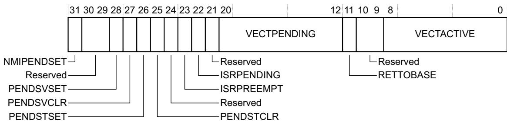

## NMIPENDSET, bit[31]

On writes, makes the NMI exception active. On reads, indicates the state of the exception:

0 On writes, has no effect. On reads, NMI is inactive.

1 On writes, make the NMI exception active. On reads, NMI is active.

Because NMI is higher priority than other exceptions, if the processor is not already executing the NMI handler, it enters the NMI exception handler as soon as it recognizes the write to this bit.

Bits[30:29] Reserved.

## PENDSVSET, bit[28]

On writes, sets the PendSV exception as pending. On reads, indicates the current state of the exception:

0 On writes, has no effect. On reads, PendSV is not pending.

1 On writes, make PendSV exception pending. On reads, PendSV is pending.

Normally, software writes 1 to this bit to request a context switch.

## PENDSVCLR, bit[27]

Removes the pending status of the PendSV exception:

0 No effect.

1 Remove pending status.

This bit is write only.

## PENDSTSET, bit[26]

On writes, sets the SysTick exception as pending. On reads, indicates the current state of the exception:

0 On writes, has no effect. On reads, SysTick is not pending.

1 On writes, make SysTick exception pending. On reads, SysTick is pending.

## PENDSTCLR, bit[25]

Removes the pending status of the SysTick exception:

0 No effect.

1 Remove pending status.

This bit is write only.

Bit[24] Reserved.

## ISRPREEMPT, bit[23]

Indicates whether a pending exception will be serviced on exit from debug halt state:

0 Will not service.

1 Will service a pending exception.

This bit is read-only.

## ISRPENDING, bit[22]

Indicates whether an external interrupt, generated by the NVIC, is pending:

0 No external interrupt pending.

1 External interrupt pending.

Note

The value of DHCSR.C\_MASKINTS is ignored.

This bit is read-only.

Bit[21] Reserved.

## VECTPENDING, bits[20:12]

The exception number of the highest priority pending and enabled interrupt. A value of 0 indicates that there is no pending exception.

Note

If DHCSR.C\_MASKINTS is set, then PendSV, SysTick, and configurable external interrupts are masked and will not be shown as pending in VECTPENDING.

These bits are read-only.

## RETTOBASE, bit[11]

In Handler mode, indicates whether there is an active exception other than the exception indicated by the current value of the IPSR:

0 There is an active exception other than the exception shown by IPSR.

1 There is no active exception other than any exception shown by IPSR.

In Thread mode the value of this bit is UNKNOWN.

For more information see The special-purpose Program Status Registers, xPSR on page B1-516.

This bit is read-only.

Bits[10:9] Reserved.

VECTACTIVE, bits[8:0]

The exception number of the current executing exception. A value of 0 indicates that the processor is in Thread mode. These bits are read-only.

The effect is unpredictable if a write to the ICSR:

Sets both PENDSVSET and PENDSVCLR to 1.

Sets both PENDSTSET and PENDSTCLR to 1.

The value of the VECTACTIVE field is the same as the IPSR[8:0], see The special-purpose Program Status Registers, xPSR on page B1-516.

## B3.2.5 Vector Table Offset Register, VTOR

The VTOR characteristics are:

Purpose Holds the vector table address.

Usage constraints One or two of the high-order bits of the TBLOFF field can be implemented as RAZ/WI, reducing the supported address range. For example, if two bits are implemented as RAZ/WI, then TBLOFF[29:7] defines bits[29:7] of the address.

Configurations Always implemented.

Attributes See Table B3-4 on page B3-596. An implementation can include configuration input signals that determine the reset value of the TBLOFF field, otherwise it resets to zero.

The VTOR bit assignments are:

<table><tr><td>31</td><td></td><td></td><td></td><td></td><td></td><td>7</td><td>6</td><td></td><td>0</td></tr><tr><td colspan="7">TBLOFF</td><td colspan="3">Reserved</td></tr></table>

TBLOFF, bits[31:7] Bits[31:7] of the vector table address. Older documentation describes this field as the vector table address offset. The description in this manual clarifies the use of this register.

Bits[6:0] Reserved.

Note

All bits of the Vector table address that are not defined by the VTOR are zero.

Software can write all 1s to the TBLOFF field and then read the register to find the maximum supported offset value.

## B3.2.6 Application Interrupt and Reset Control Register, AIRCR

The AIRCR characteristics are:

Purpose Sets or returns interrupt control data.

Usage constraints There are no usage constraints.

Configurations Always implemented.

Attributes See Table B3-4 on page B3-596, and the register description.

The AIRCR bit assignments are:

<table><tr><td>31</td><td></td><td></td><td>16</td><td>15</td><td>14</td><td>11</td><td>10</td><td>8</td><td>7</td><td>3</td><td>2</td><td>1</td><td>0</td></tr><tr><td colspan="3">VECTKEYVECTKEYSTAT</td><td></td><td></td><td>Reserved</td><td></td><td></td><td>Reserved</td><td></td><td></td><td></td><td></td><td></td></tr><tr><td colspan="14">ENDIANNESS PRIGROUP SYSRESETREQVECTCLRACTIVEVECTRESET</td></tr></table>

Bits[31:16] Write: VECTKEY Read: VECTKEYSTAT Vector Key. Register writes must write 0x05FA to this field, otherwise the write is ignored. On reads, returns 0xFA05.

## ENDIANNESS, bit[15]

Indicates the memory system endianness:

1 Big endian. This bit is static or configured by a hardware input on reset. This bit is read-only.

Bits[14:11] Reserved.

## PRIGROUP, bits[10:8]

Priority grouping, indicates the binary point position. For information about the use of this field see Priority grouping on page B1-527. This field resets to 0b000.

Bits[7:3] Reserved.

## SYSRESETREQ, bit[2]

System Reset Request: 0 Do not request a reset. 1 Request reset.

Writing 1 to this bit asserts a signal to the external system to request a Local reset. A Local or power-on reset clears this bit to 0.

VECTCLRACTIVE, bit[1] Writing 1 to this bit clears all active state information for fixed and configurable exceptions. This includes clearing the IPSR to zero, see The IPSR on page B1-517. The effect of writing a 1 to this bit if the processor is not halted in Debug state is UNPREDICTABLE. This bit is write only.

VECTRESET, bit[0] Writing 1 to this bit causes a local system reset, see Reset management on page B1-559 for more information. This bit self-clears. The effect of writing a 1 to this bit if the processor is not halted in Debug state is UNPREDICTABLE

When the processor is halted in Debug state, if a write to the register writes a 1 to both VECTRESET and SYSRESETREQ, the behavior is UNPREDICTABLE.

This bit is write only.

## B3.2.7 System Control Register, SCR

The SCR characteristics are:

Purpose Sets or returns system control data.

Usage constraints There are no usage constraints.

Configurations Always implemented.

Attributes See Table B3-4 on page B3-596.

The SCR bit assignments are:

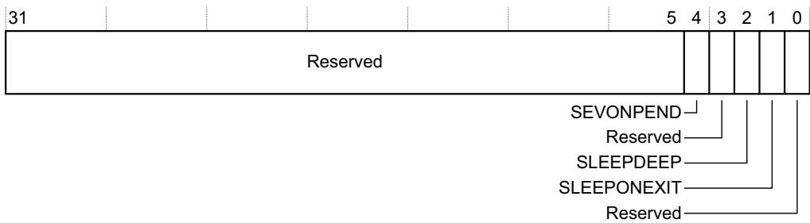

Bits[31:5] Reserved.

SEVONPEND, bit[4] Determines whether an interrupt transition from inactive state to pending state is a wakeup event:

0 Transitions from inactive to pending are not wakeup events.

1 Transitions from inactive to pending are wakeup events.

See WFE wakeup events on page B1-561 for more information.

Bit[3] Reserved.

SLEEPDEEP, bit[2] Provides a qualifying hint indicating that waking from sleep might take longer. An implementation can use this bit to select between two alternative sleep states:

0 Selected sleep state is not deep sleep.

1 Selected sleep state is deep sleep.

Details of the implemented sleep states, if any, and details of the use of this bit, are IMPLEMENTATION DEFINED.

If the processor does not implement a deep sleep state then this bit can be RAZ/WI.

SLEEPONEXIT, bit[1]

Determines whether, on an exit from an ISR that returns to the base level of execution priority, the processor enters a sleep state:

0 Do not enter sleep state.

1 Enter sleep state.

For more information see Power management on page B1-559.

Bit[0] Reserved.

A debugger can read S\_SLEEP (see Debug Halting Control and Status Register, DHCSR on page C1-700) to detect if sleeping.

## B3.2.8 Configuration and Control Register, CCR

The CCR characteristics are:

Purpose Sets or returns configuration and control data, and provides control over caching and branch prediction.

Usage constraints There are no usage constraints.

Configurations Always implemented.

Attributes See Table B3-4 on page B3-596, and the register field descriptions.

The CCR bit assignments are:

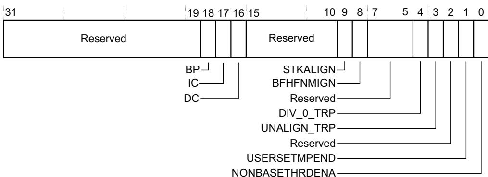

Bits[31:19] Reserved.

BP, bit[18] Branch prediction enable bit. The possible values of this bit are: 0 Program flow prediction disabled. 1 Program flow prediction enabled. Setting this bit to 1 enables branch prediction, also called program flow prediction. If program flow prediction cannot be disabled, this bit is RAO/WI. If the implementation does not support program flow prediction, this bit is RAZ/WI.

IC, bit[17] Instruction cache enable bit. This is a global enable bit for instruction caches. The possible values of this bit are:

0 Instruction caches disabled.

1 Instruction caches enabled.

If the system does not implement any instruction caches that can be accessed by the processor at any level of the memory hierarchy, this bit is RAZ/WI.

If the system implements any instruction caches that can be accessed by the processor then it must be possible to disable them by setting this bit to 0.

DC, bit[16] Cache enable bit. This is a global enable bit for data and unified caches. The possible values of this bit are:

0 Data and unified caches disabled.

1 Data and unified caches enabled.

If the system does not implement any data or unified caches that can be accessed by the processor at any level of the memory hierarchy, this bit is RAZ/WI.

If the system implements any data or unified caches that can be accessed by the processor then it must be possible to disable them by setting this bit to 0.

Bits[15:10] Reserved.

STKALIGN, bit[9] Determines whether the exception entry sequence guarantees 8-byte stack frame alignment, adjusting the SP if necessary before saving state:

0 Guaranteed SP alignment is 4-byte, no SP adjustment is performed.

1 8-byte alignment guaranteed, SP adjusted if necessary.

Whether this bit is RO or RW is IMPLEMENTATION DEFINED.

The reset value of this bit is IMPLEMENTATION DEFINED. Arm recommends that this bit resets to 1.

See Stack alignment on exception entry on page B1-535 for more information.

## BFHFNMIGN, bit[8]

Determines the effect of precise data access faults on handlers running at priority -1 or priority -2:

0 Precise data access fault causes a lockup, see Unrecoverable exception cases on page B1-555.

1 Handler ignores the fault.

Bits[7:5] Reserved.

DIV\_0\_TRP, bit[4] Controls the trap on divide by 0:

0 Trapping disabled.

1 Trapping enabled.

## UNALIGN\_TRP, bit[3]

Controls the trapping of unaligned word or halfword accesses:

0 Trapping disabled.

1 Trapping enabled.

Unaligned load-store multiples and word or halfword exclusive accesses always fault.

Bit[2] Reserved.

## USERSETMPEND, bit[1]

Controls whether unprivileged software can access the STIR:

0 Unprivileged software cannot access the STIR.

1 Unprivileged software can access the STIR.

See Software Triggered Interrupt Register, STIR on page B3-619 for more information.

## NONBASETHRDENA, bit[0]

Controls whether the processor can enter Thread mode with exceptions active:

0 Any attempt to return to Thread mode will result in an exception if the number of active exceptions is non-zero and does not rely on execution priority boosting including BASEPRI, FAULTMASK and PRIMASK.

1 The processor can enter Thread mode with exceptions active because of a controlled return value. See Exception return behavior on page B1-539 for more information.

## B3.2.9 About the System Handler Priority Registers

The System Handler Priority Registers control the priority of the handlers for the system faults that have configurable priority. Exception handler numbers match the corresponding exception number, see Exception number definition on page B1-525. So exception handler 6 is the handler for exception 6, the UsageFault exception. Exceptions 1, 2, and 3, Reset, NMI, and HardFault, have fixed priorities and therefore do not have associated System Handler Priority Register fields. Therefore, the first defined system handler priority field is PRI\_4, that controls the priority of the handler for exception 4, the MemManage exception.

Note

Following the Arm register naming convention, the first System Handler Priority Register would be SHPR0. In the model for these registers, this would hold the priorities for handlers 0-3. But exception 0 is not defined, and exceptions 1-3 have fixed priorities. Therefore, the implemented SHPRs start at SHPR1.

## B3.2.10 System Handler Priority Register 1, SHPR1

The SHPR1 Register characteristics are:

Purpose Sets or returns priority for system handlers 4-7.

Usage constraints This register is byte, aligned halfword, and word accessible.

Configurations Always implemented.

Attributes See Table B3-4 on page B3-596.

The SHPR1 bit assignments are:

<table><tr><td>31</td><td>24</td><td>23</td><td>16</td><td>15</td><td>8</td><td>7</td><td>0</td></tr><tr><td colspan="2">PRI_7</td><td colspan="2">PRI_6</td><td colspan="2">PRI_5</td><td colspan="2">PRI_4</td></tr></table>

PRI\_7, bits[31:24] Reserved for priority of system handler 7.

PRI\_6, bits[23:16] Priority of system handler 6, UsageFault.

PRI\_5, bits[15:8] Priority of system handler 5, BusFault.

PRI\_4, bits[7:0] Priority of system handler 4, MemManage.

## B3.2.11 System Handler Priority Register 2, SHPR2

The SHPR2 Register characteristics are:

Purpose Sets or returns priority for system handlers 8-11.

Usage constraints This register is byte, aligned halfword, and word accessible.

Configurations Always implemented.

Attributes See Table B3-4 on page B3-596.

The SHPR2 bit assignments are:

<table><tr><td>31</td><td>24</td><td>23</td><td>16</td><td>15</td><td>8</td><td>7</td><td>0</td></tr><tr><td colspan="2">PRI_11</td><td colspan="2">PRI_10</td><td colspan="2">PRI_9</td><td colspan="2">PRI_8</td></tr></table>

PRI\_11, bits[31:24] Priority of system handler 11, SVCall.

PRI\_10, bits[23:16] Reserved for priority of system handler 10.

PRI\_9, bits[15:8] Reserved for priority of system handler 9.

PRI\_8, bits[7:0] Reserved for priority of system handler 8.

## B3.2.12 System Handler Priority Register 3, SHPR3

The SHPR3 Register characteristics are:

Purpose Sets or returns priority for system handlers 12-15.

Usage constraints This register is byte, aligned halfword, and word accessible.

Configurations Always implemented.

Attributes See Table B3-4 on page B3-596.

The SHPR3 bit assignments are:

<table><tr><td>31</td><td>24</td><td>23</td><td>16</td><td>15</td><td>8</td><td>7</td><td>0</td></tr><tr><td colspan="2">PRI_15</td><td colspan="2">PRI_14</td><td colspan="2">PRI_13</td><td colspan="2">PRI_12</td></tr></table>

PRI\_15, bits[31:24] Priority of system handler 15, SysTick.

PRI\_14, bits[23:16] Priority of system handler 14, PendSV.

PRI\_13, bits[15:8] Reserved for priority of system handler 13.

PRI\_12, bits[7:0] Priority of system handler 12, DebugMonitor.

## B3.2.13 System Handler Control and State Register, SHCSR

The SHCSR characteristics are:

Purpose Controls and provides the active and pending status of system exceptions.

Usage constraints Exception processing automatically updates the SHCSR fields. However, software can write to the register to add or remove the pending or active state of an exception. When updating the SHCSR, Arm recommends using a read-modify-write sequence, to avoid unintended effects on the state of the exception handlers.

Removing the active state of an exception can change the current execution priority, and affect the exception return consistency checks. If software removes the active state, causing a change in current execution priority, this can defeat the architectural behavior that prevents an exception from preempting its own handler.

Configurations Always implemented.

Attributes See Table B3-4 on page B3-596.

The SHCSR bit assignments are:

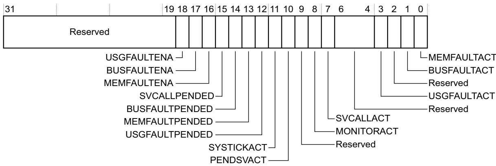

Bits[31:19] Reserved.

USGFAULTENA, bit[18] 0 Disable UsageFault. 1 Enable UsageFault. BUSFAULTENA, bit[17] 0 Disable BusFault. 1 Enable BusFault. MEMFAULTENA, bit[16] 0 Disable MemManage fault. 1 Enable MemManage fault. SVCALLPENDED, bit[15] 0 SVCall is not pending. 1 SVCall is pending. BUSFAULTPENDED, bit [14] 0 BusFault is not pending. 1 BusFault is pending. MEMFAULTPENDED, bit[13] 0 MemManage is not pending. 1 MemManage is pending. USGFAULTPENDED, bit[12] 0 UsageFault is not pending. 1 UsageFault is pending. SYSTICKACT, bit[11] 0 SysTick is not active. 1 SysTick is active. PENDSVACT, bit[10] 0 PendSV is not active. 1 PendSV is active. Bit[9] Reserved. MONITORACT, bit[8] 0 Monitor is not active. 1 Monitor is active. SVCALLACT, bit[7] 0 SVCall is not active. 1 SVCall is active. Bits[6:4] Reserved. USGFAULTACT, bit[3] 0 UsageFault is not active. 1 UsageFault is active. Bit[2] Reserved. BUSFAULTACT, bit[1] 0 BusFault is not active. 1 BusFault is active.

MEMFAULTACT, bit[0]

0 MemManage is not active.

1 MemManage is active.

Note

Pending state bits[15:12] are set to 1 when an exception occurs, and are cleared to 0 when the exception becomes active.

Active state bits[11:10, 8:7, 3, 1:0] are set to 1 if the associated exception is the current exception or an exception that is nested because of preemption.

## B3.2.14 Status registers for configurable-priority faults

The 32-bit CFSR comprises the status registers for the faults that have configurable priority. Software can access the combined CFSR, or use byte or halfword accesses to access the individual Configurable Fault Status Registers. For more information see:

Configurable Fault Status Register, CFSR.

MemManage Status Register, MMFSR.

BusFault Status Register, BFSR on page B3-610.

UsageFault Status Register, UFSR on page B3-611.

## B3.2.15 Configurable Fault Status Register, CFSR

The CFSR characteristics are:

Purpose Contains the three Configurable Fault Status Registers.

Usage constraints • Byte, aligned halfword, and word accessible.

Write a one to a register bit to clear the corresponding fault.

The register bits are additive, that is, if more than one fault occurs, all associated bits are set to 1.

Configurations Always implemented.

Attributes See Table B3-4 on page B3-596.

The CFSR bit assignments are:

<table><tr><td>31</td><td></td><td>16</td><td>15</td><td>8</td><td>7</td><td>0</td></tr><tr><td colspan="3">UsageFault</td><td colspan="2">BusFault</td><td colspan="2">MemManage</td></tr></table>

UsageFault, bits[31:16]

Provides information on UsageFault exceptions.

BusFault, bits[15:8] Provides information on BusFault exceptions.

MemManage, bits[7:0]

Provides information on MemManage exceptions.

MemManage Status Register, MMFSR

The MMFSR characteristics are:

Purpose Shows the status of MPU faults.

Usage constraints

Byte accessible.

Write a one to a register bit to clear the corresponding fault.

The register bits are additive, that is, if more than one fault occurs, all associated bits are set to 1.

The MMFSR is bits[7:0] of the CFSR.

Configurations Always implemented.

Attributes See the CFSR entry in Table B3-4 on page B3-596.

The MMFSR bit assignments are:

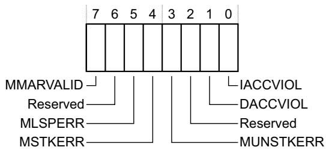

## MMARVALID, bit[7]

0 MMFAR does not have valid contents.

Bit[6] Reserved.

MLSPERR, bit[5] 0 No MemManage fault occurred during FP lazy state preservation.

1 A MemManage fault occurred during FP lazy state preservation.

MSTKERR, bit[4] 0 No derived MemManage fault has occurred. 1 A derived MemManage fault occurred on exception entry.

## MUNSTKERR, bit[3]

0 No derived MemManage fault has occurred.

1 A derived MemManage fault occurred on exception return.

Bit[2] Reserved.

DACCVIOL, bit[1] 0 No data access violation has occurred.

1 Data access violation. The MMFAR shows the data address that the load or store tried to access.

IACCVIOL, bit[0] 0 No MPU or Execute Never (XN) default memory map access violation has occurred.

1 MPU or Execute Never (XN) default memory map access violation on an instruction fetch has occurred. The fault is signaled only if the instruction is issued.

## BusFault Status Register, BFSR

The BFSR characteristics are:

Purpose Shows the status of bus errors resulting from instruction prefetches and data accesses.

Usage constraints • Byte accessible.

Write a one to a register bit to clear the corresponding fault.

The register bits are additive, that is, if more than one fault occurs, all associated bits are set to 1.

The BFSR is bits[15:8] of the CFSR.

It is IMPLEMENTATION DEFINED whether external bus faults can be reported precisely, and an implementation can report all bus faults associated with data accesses as IMPRECISERR.

Configurations Always implemented.

Attributes See the CFSR entry in Table B3-4 on page B3-596.

The BFSR bit assignments are:

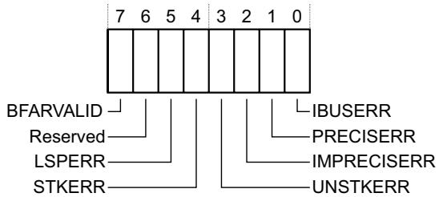

BFARVALID, bit[7] 0 BFAR does not have valid contents. 1 BFAR has valid contents.

Bit[6] Reserved.

LSPERR, bit[5] 0 No bus fault occurred during FP lazy state preservation. 1 A bus fault occurred during FP lazy state preservation.

STKERR, bit[4] 0 No derived bus fault has occurred.

UNSTKERR, bit[3] 0 No derived bus fault has occurred.

IMPRECISERR, bit[2] 0 No imprecise data access error has occurred. 1 Imprecise data access error has occurred.

PRECISERR, bit[1] 0 No precise data access error has occurred. 1 A precise data access error has occurred, and the processor has written the faulting address to the BFAR.

IBUSERR, bit[0] 0 No bus fault on an instruction prefetch has occurred. 1 A bus fault on an instruction prefetch has occurred. The fault is signaled only if the instruction is issued.

## UsageFault Status Register, UFSR

The UFSR characteristics are:

Purpose Contains the status for some instruction execution faults, and for data access faults.

Usage constraints • Byte and aligned halfword accessible.

Write a one to a register bit to clear the corresponding fault.

The fault bits are additive, that is, if more than one fault occurs, all associated bits are set to 1.

The UFSR is bits[31:16] of the CFSR.

Configurations Always implemented.

Attributes See the CFSR entry in Table B3-4 on page B3-596.

The UFSR bit assignments are:

<table><tr><td>15</td><td>10</td><td>9</td><td>8</td><td>7</td><td>4</td><td>3</td><td>2</td><td>1</td><td>0</td></tr><tr><td colspan="2">Reserved</td><td></td><td></td><td colspan="2">Reserved</td><td></td><td></td><td></td><td></td></tr><tr><td colspan="3">DIVBYZERO</td><td colspan="7">NOCP</td></tr><tr><td colspan="3">UNALIGNED</td><td colspan="7">INVPC</td></tr><tr><td colspan="3"></td><td colspan="7">INVSTATE</td></tr><tr><td colspan="3"></td><td colspan="7">UNDEFINSTR</td></tr></table>

Bits[15:10] Reserved.

DIVBYZERO, bit[9] 0 No divide by zero error has occurred.

1 Divide by zero error has occurred.

When SDIV or UDIV instruction is used with a divisor of 0, this fault occurs if DIV\_0\_TRP is enabled in the CCR, see Configuration and Control Register, CCR on page B3-604.

UNALIGNED, bit[8] 0 No unaligned access error has occurred.

1 Unaligned access error has occurred.

Multi-word accesses always fault if not word aligned. Software can configure unaligned word and halfword accesses to fault, by enabling UNALIGN\_TRP in the CCR, see Configuration and Control Register, CCR on page B3-604.

Bits[7:4] Reserved.

NOCP, bit[3] 0 No coprocessor access error has occurred.

INVPC, bit[2] 0 No integrity check error has occurred.

INVSTATE, bit[1] 0 EPSR.T bit and EPSR.IT bits are valid for instruction execution.

1 Instruction executed with invalid EPSR.T or EPSR.IT field.

UNDEFINSTR, bit[0]

0 No Undefined Instruction Usage fault has occurred.

1 The processor has attempted to execute an undefined instruction. This might be an undefined instruction associated with an enabled coprocessor, see Coprocessor instructions on page A5-158.

## B3.2.16 HardFault Status Register, HFSR

The HFSR characteristics are:

Purpose Shows the cause of any HardFault.

Usage constraints Write a one to a register bit to clear the corresponding fault.

Configurations Always implemented.

Attributes See Table B3-4 on page B3-596.

The HFSR bit assignments are:  
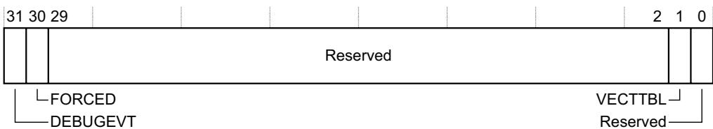

DEBUGEVT, bit[31] Indicates when a Debug event has occurred:

0 No Debug event has occurred.

1 Debug event has occurred. The Debug Fault Status Register has been updated. The processor sets this bit to 1 only when Halting debug is disabled and a Debug event occurs, see Debug event behavior on page C1-694 for more information.

FORCED, bit[30] Indicates that a fault with configurable priority has been escalated to a HardFault exception, because it could not be made active, because of priority or because it was disabled:

0 No priority escalation has occurred.

1 Processor has escalated a configurable-priority exception to HardFault. See Priority escalation on page B1-529 for more information.

Bits[29:2] Reserved.

VECTTBL, bit[1] Indicates when a fault has occurred because of a vector table read error on exception processing:

0 No vector table read fault has occurred.

1 Vector table read fault has occurred.

Bit[0] Reserved.

## B3.2.17 MemManage Fault Address Register, MMFAR

The MMFAR characteristics are:

Purpose Shows the address of the memory location that caused an MPU fault.

Usage constraints Valid only when MMFSR.MMARVALID is set, otherwise reads as UNKNOWN.

Configurations Always implemented.

Attributes See Table B3-4 on page B3-596.

The MMFAR bit assignments are:

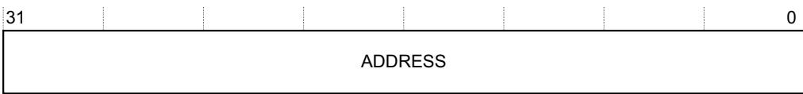

ADDRESS, bits[31:0] Data address for an MPU fault. This is the location addressed by an attempted load or store access that was faulted. The MemManage Status Register shows the cause of the fault, and whether MMFAR.ADDRESS is valid. When an unaligned access faults, the address is the actual address that faulted. Because an access might be split into multiple parts, each aligned, this address can be any offset in the range of the requested size.

In implementations without unique BFAR and MFAR registers, the value of this register is UNKNOWN if BFSR.BFARVALID is set.

## B3.2.18 BusFault Address Register, BFAR

The BFAR characteristics are:

Purpose Shows the address associated with a precise data access fault.

Usage constraints Valid only when BFSR.BFARVALID is set, otherwise reads as UNKNOWN.

Configurations Always implemented.

Attributes See Table B3-4 on page B3-596.

The BFAR bit assignments are:

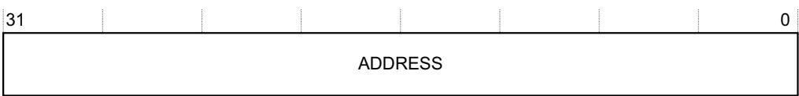

ADDRESS, bits[31:0] Data address for a precise bus fault. This is the location addressed by an attempted data access that was faulted. The BFSR shows the reason for the fault and whether BFAR.ADDRESS is valid, see BusFault Status Register, BFSR on page B3-610.

For unaligned access faults, the value returned is the address requested by the instruction. This might not be the address that faulted.

In implementations without unique BFAR and MFAR registers, the value of this register is UNKNOWN if MFSR.MMFARVALID is set.

## B3.2.19 Auxiliary Fault Status Register, AFSR

The AFSR characteristics are:

Purpose Provides implementation-specific fault status information and control.

Usage constraints The contents of this register are IMPLEMENTATION DEFINED.

Configurations All properties of this register are IMPLEMENTATION DEFINED, including whether it is implemented. If not implemented, the register location might be RAZ/WI, or UNK/SBZP.

Attributes See Table B3-4 on page B3-596.

## B3.2.20 Coprocessor Access Control Register, CPACR

The CPACR characteristics are:

Purpose Specifies the access privileges for coprocessors.

Usage constraints If a coprocessor is not implemented, a write of 0b01 or 0b11 to the corresponding CPACR field reads back as 0b00.

Configurations Always implemented.

Attributes See Table B3-4 on page B3-596.

The CPACR bit assignments are:

31 30 29 28 27 26 25 24 23 22 21 20 19 18 17 16 15 14 13 12 11 10 9 8 7 6 5 4 3 2 1 0

<table><tr><td>Reserved</td><td>CP11</td><td>CP10</td><td>Reserved</td><td>CP7</td><td>CP6</td><td>CP5</td><td>CP4</td><td>CP3</td><td>CP2</td><td>CP1</td><td>CP0</td></tr></table>

Bits[31:24, 19:16] Reserved, UNK/SBZP.

## CPn, bits[2n+1:2n] for n values 0-7, 10 and 11

Access privileges for coprocessor n, see the register diagram. The possible values of each field are:

0b00 Access denied. Any attempted access generates a NOCP UsageFault.

0b01 Privileged access only. An unprivileged access generates a NOCP UsageFault.

0b10 Reserved.

0b11 Full access.

Fields CP10 and CP11 together control access to the floating-point coprocessor, if

implemented. For more information see Enabling access to the floating-point coprocessor.

Coprocessors CP8 to CP15 are reserved for use by Arm. Of these, only CP10 and CP11 are implemented in the Armv7-M architecture profile, see Enabling access to the floating-point coprocessor.

To test whether a coprocessor is implemented, software can write 0b01 to a CPn field, and then read the CPACR. If the CPn field reads as zero the coprocessor is not implemented.

## Enabling access to the floating-point coprocessor

In a processor that implements the floating-point coprocessor, software must enable access to that coprocessor by writing the value for the required access level, as defined in Coprocessor Access Control Register, CPACR on page B3-614, to both CPACR.CP10 and CPACR.CP11. The effect of writing different values to CPACR.CP10 and CPACR.CP11 is UNPREDICTABLE.

Note

Any attempt to execute a floating-point instruction results in a NOCP UsageFault if:

CPACR.CP10 is zero.

CPACR.CP10 is 0b01, and the current execution mode is not privileged.

## B3.2.21 Floating Point Context Control Register, FPCCR

The FPCCR characteristics are:

Purpose Holds control data for the Floating Point Unit.

Usage constraints Accessible only by privileged software. If the FP extension is not implemented, the FPCCR register location is reserved.

Software must not change the value of the ASPEN bit or LSPEN bit while either:

The CPACR permits access to CP10 and CP11, that give access to the FP extension, see Coprocessor Access Control Register, CPACR on page B3-614.

The CONTROL.FPCA bit is set to 1, see The special-purpose CONTROL register on page B1-519.

Configurations Implemented only when the implementation includes the FP extension.

Attributes See Table B3-5 on page B3-597 and the register bit descriptions.

The FPCCR bit assignments are:

<table><tr><td>ASPEN, bit[31]</td><td>When this bit is set to 1, execution of a floating-point instruction sets the CONTROL.FPCA bit to 1, seeThe special-purpose CONTROL register on page B1-519:0 Executing an FP instruction has no effect on CONTROL.FPCA.1 Executing an FP instruction sets CONTROL.FPCA to 1.Setting this bit to 1 means the hardware automatically preserves FP context on exception entry and restores it on exception return. For more information seeContext state stacking on exception entry with the FP extension on page B1-537.The reset value is 1.</td></tr><tr><td>LSPEN, bit[30]</td><td>Enables lazy context save of FP state:0 Disable automatic lazy context save.1 Enable automatic lazy context save.For more information seeLazy context save of FP state on page B1-538.The reset value is 1.</td></tr><tr><td>Bits[29:9]</td><td>Reserved.</td></tr><tr><td>MONRDY, bit[8]</td><td>Indicates whether the software executing when the processor allocated the FP stack frame was able to set the DebugMonitor exception to pending:0 Not able to set the DebugMonitor exception to pending.1 Able to set the DebugMonitor exception to pending.The reset value is UNKNOWN.</td></tr><tr><td>Bit[7]</td><td>Reserved.</td></tr><tr><td>BFRDY, bit[6]</td><td>Indicates whether the software executing when the processor allocated the FP stack frame was able to set the BusFault exception to pending:0 Not able to set the BusFault exception to pending.1 Able to set the BusFault exception to pending.The reset value is UNKNOWN.</td></tr><tr><td>MMRDY, bit[5]</td><td>Indicates whether the software executing when the processor allocated the FP stack frame was able to set the MemManage exception to pending:0 Not able to set the MemManage exception to pending.1 Able to set the MemManage exception to pending.The reset value is UNKNOWN.</td></tr><tr><td>HFRDY, bit[4]</td><td>Indicates whether the software executing when the processor allocated the FP stack frame was able to set the HardFault exception to pending:0 Not able to set the HardFault exception to pending.1 Able to set the HardFault exception to pending.The reset value is UNKNOWN.</td></tr><tr><td>THREAD, bit[3]</td><td>Indicates the processor mode when it allocated the FP stack frame:0 Handler mode.</td></tr></table>

1 Thread mode.

This bit is for fault handler information only and does not interact with the exception model. The reset value is UNKNOWN.

Bit[2] Reserved.

USER, bit[1] Indicates the privilege level of the software executing when the processor allocated the FP stack frame.

0 Privileged.

1 Unprivileged.

The reset value is UNKNOWN.

LSPACT, bit[0] Indicates whether Lazy preservation of the FP state is active:

0 Lazy state preservation is not active.

1 Lazy state preservation is active.

For more information see Lazy context save of FP state on page B1-538.

The reset value is 0.

For MONRDY, BFRDY, MMRDY, and HFRDY, the phrase was able means that this exception was enabled and software was executing with sufficient priority to set the status of the exception to pending. The values of these bits do not indicate whether there was an attempt to set the corresponding exception to pending.

## B3.2.22 Floating Point Context Address Register, FPCAR

The FPCAR characteristics are:

Purpose Holds the location of the unpopulated floating-point register space allocated on an exception stack frame. The FPCAR points to the stack location reserved for S0.

Usage constraints Accessible only by privileged software. If the FP extension is not implemented, the FPCAR register location is reserved.

Configurations Implemented only when the implementation includes the FP extension.

Attributes See Table B3-5 on page B3-597 and the register bit descriptions.

The FPCAR bit assignments are.

<table><tr><td>31</td><td></td><td></td><td></td><td></td><td></td><td></td><td>3</td><td>2</td><td>0</td></tr><tr><td colspan="8">ADDRESS</td><td colspan="2"></td></tr></table>

Reserved

ADDRESS, bits[31:3] The location of the unpopulated floating-point register space allocated on an exception stack frame.

Bits[2:0] Reserved. RAZ/WI.

For more information about the use of the FPCAR see Lazy context save of FP state on page B1-538.

## B3.2.23 Floating Point Default Status Control Register, FPDSCR

The FPDSCR characteristics are:

Purpose Holds the default values for the floating-point status control data that the processor assigns to the FPSCR when it creates a new floating-point context.

Usage constraints Accessible only by privileged software. If the FP extension is not implemented, the FPDSCR register location is reserved.

Provides initial values for the FPSCR, see Floating-point Status and Control Register, FPSCR on page A2-37.

Configurations Implemented only when the implementation includes the FP extension.

Attributes See Table B3-5 on page B3-597.

The FPDSCR bit assignments are:

<table><tr><td colspan="6">Reserved</td><td colspan="5">Reserved</td></tr><tr><td colspan="3">AHP—DN—</td><td colspan="8">RMode—FZ</td></tr></table>

Bits[31:27] Reserved.

AHP, bit[26] Default value for FPSCR.AHP.

DN, bit[25] Default value for FPSCR.DN.

FZ, bit[24] Default value for FPSCR.FZ.

RMode, bits[23:22] Default value for FPSCR.RMode.

Bits[21:0] Reserved.

## B3.2.24 Interrupt Controller Type Register, ICTR

The ICTR characteristics are:

Purpose Provides information about the interrupt controller.

Usage constraints There are no usage constraints.

Configurations Always implemented.

Attributes See Table B3-6 on page B3-597.

The ICTR bit assignments are:

<table><tr><td>31</td><td></td><td></td><td></td><td></td><td></td><td>4</td><td>3</td><td>0</td></tr><tr><td colspan="7">Reserved</td><td colspan="2"></td></tr></table>

INTLINESNUM

Bits[31:4] Reserved.

INTLINESNUM, bits[3:0]

The total number of interrupt lines supported by an implementation, defined in groups of 32. That is, the total number of interrupt lines is up to (32\*(INTLINESNUM+1)). However, the absolute maximum number of interrupts is 496, corresponding to the INTLINESNUM value 0b1111.

INTLINESNUM indicates which registers in the NVIC register map are implemented, see Implemented NVIC registers on page B3-626.

## B3.2.25 Auxiliary Control Register, ACTLR

The ACTLR characteristics are:

Purpose Provides IMPLEMENTATION DEFINED configuration and control options.

Usage constraints The register might have IMPLEMENTATION DEFINED usage constraints.

Configurations Always implemented. The contents of this register are IMPLEMENTATION DEFINED.

Attributes See Table B3-6 on page B3-597.

## B3.2.26 Software Triggered Interrupt Register, STIR

The STIR characteristics are:

Purpose Provides a mechanism for software to generate an interrupt.

Usage constraints This register applies to implemented external interrupts only.

Configurations Always implemented.

Attributes See Table B3-6 on page B3-597.

The STIR bit assignments are:

<table><tr><td>Reserved</td><td>INTID</td></tr></table>

Bits[31:9] Reserved.

INTID, bits[8:0] Indicates the interrupt to be triggered. The value written is (ExceptionNumber - 16), see Exception number definition on page B1-525.

Writing to this register has the same effect as setting the NVIC ISPR bit corresponding to the interrupt to 1, see Interrupt Set-Pending Registers, NVIC\_ISPR0-NVIC\_ISPR15 on page B3-629.

## B3.3 The system timer, SysTick

An Armv7-M implementation must include a system timer, SysTick, that provides a simple, 24-bit clear-on-write, decrementing, wrap-on-zero counter with a flexible control mechanism. A system can use this counter in several different ways, including:

As an RTOS tick timer that fires at a programmable rate, for example 100Hz, and invokes a SysTick routine each time it fires.

As a high-speed alarm timer using the main processor clock.

As a variable rate alarm or signal timer. The available duration range depends on the reference clock used and the dynamic range of the counter.

• As a simple counter. Software can use this to measure time to completion and time used.

As an internal clock source control based on missing or meeting durations. Software can use the COUNTFLAG field in the control and status register to determine whether an action completed within a particular duration, as part of a dynamic clock management control loop.

## B3.3.1 SysTick operation

The timer consists of four registers:

A control and status register. This configures the SysTick clock, enables the counter, enables the SysTick interrupt, and indicates the counter status.

A counter reload value register. This provides the wrap value for the counter.

A counter current value register.

• A calibration value register. This indicates the preload value required for a 10ms (100Hz) system clock.

When enabled, the timer counts down from the value in SYST\_CVR, see SysTick Current Value Register, SYST\_CVR on page B3-622. When the counter reaches zero, it reloads the value in SYST\_RVR on the next clock edge, see SysTick Reload Value Register, SYST\_RVR on page B3-622. It then decrements on subsequent clocks. This reloading when the counter reaches zero is called wrapping.

When the counter transitions to zero, it sets the COUNTFLAG status bit to 1. Reading the COUNTFLAG status bit clears it to 0.

Writing to SYST\_CVR clears both the register and the COUNTFLAG status bit to zero. This causes the SysTick logic to reload SYST\_CVR from SYST\_RVR on the next timer clock. A write to SYST\_CVR does not trigger the SysTick exception logic.

Reading SYST\_CVR returns the value of the counter at the time the register is accessed.

Writing a value of zero to SYST\_RVR disables the counter on the next wrap. The SysTick counter logic maintains this counter value of zero after the wrap.

Note

Setting SYST\_RVR to zero has the effect of disabling the SysTick counter independently of the counter enable bit.

The SYST\_CVR value is UNKNOWN on reset. Before enabling the SysTick counter, software must write the required counter value to SYST\_RVR, and then write to SYST\_CVR. This clears SYST\_CVR to zero. When enabled, the counter reloads the value from SYST\_RVR, and counts down from that value, rather than from an arbitrary value.

Software can use the calibration value TENMS to scale the counter to other wanted clock rates within the dynamic range of the counter.

When the processor is halted in Debug state, the counter does not decrement.

The timer is clocked by a reference clock. Whether the reference clock is the processor clock or an external clock source is implementation defined. If an implementation uses an external clock, it must document the relationship between the processor clock and the external reference. This is required for system timing calibration, taking account of metastability, clock skew and jitter.

## B3.3.2 System timer register support in the SCS

Table B3-7 summarizes the register support provided within the SCS address map. All listed registers are 32-bits wide. See System Control Space (SCS) on page B3-595 for more information about the complete SCS address map.

Table B3-7 SysTick register summary

<table><tr><td>Address</td><td>Name</td><td>Type</td><td>Reset</td><td>Description</td></tr><tr><td>0xE000E010</td><td>SYST_CSR</td><td>RW</td><td> $0x0000000x^a$ </td><td>SysTick Control and Status Register, SYST_CSR</td></tr><tr><td>0xE000E014</td><td>SYST_RVR</td><td>RW</td><td>UNKNOWN</td><td>SysTick Reload Value Register, SYST_RVR on page B3-622</td></tr><tr><td>0xE000E018</td><td>SYST_CVR</td><td>RW</td><td>UNKNOWN</td><td>SysTick Current Value Register, SYST_CVR on page B3-622</td></tr><tr><td>0xE000E01C</td><td>SYST_CALIB</td><td>RO</td><td>IMP DEF</td><td>SysTick Calibration value Register, SYST_CALIB on page B3-623</td></tr><tr><td>0xE000E020-0xE000E0FC</td><td>-</td><td>-</td><td>-</td><td>Reserved</td></tr></table>

a. See register description for information about the reset value of SYST\_CSR bit[2]. All other bits reset to 0.

## B3.3.3 SysTick Control and Status Register, SYST\_CSR

The SYST\_CSR characteristics are:

Purpose Controls the system timer and provides status data.

Usage constraints There are no usage constraints.

Configurations Always implemented.

Attributes See Table B3-7, and the description of the CLKSOURCE bit.

The SYST\_CSR bit assignments are:

<table><tr><td>31</td><td></td><td>17</td><td>16</td><td>15</td><td></td><td></td><td>3</td><td>2</td><td>1</td><td>0</td></tr><tr><td colspan="3">Reserved</td><td></td><td colspan="3">Reserved</td><td></td><td></td><td></td><td></td></tr><tr><td rowspan="3" colspan="5">COUNTFLAG</td><td colspan="6">CLKSOURCE</td></tr><tr><td colspan="6">TICKINT</td></tr><tr><td colspan="6">ENABLE</td></tr></table>

Bits[31:17] Reserved.

COUNTFLAG, bit[16]

Indicates whether the counter has counted to 0 since the last read of this register:

0 Timer has not counted to 0.

1 Timer has counted to 0.

COUNTFLAG is set to 1 by a count transition from 1 to 0.

COUNTFLAG is cleared to 0 by a software read of this register, and by any write to the Current Value register. Debugger reads do not clear the COUNTFLAG.

Bits[15:3] Reserved.

CLKSOURCE, bit[2] Indicates the SysTick clock source:

0 SysTick uses the IMPLEMENTATION DEFINED external reference clock.

1 SysTick uses the processor clock.

If no external clock is provided, this bit reads as 1 and ignores writes.

TICKINT, bit[1] Indicates whether counting to 0 causes the status of the SysTick exception to change to pending:

0 Count to 0 does not affect the SysTick exception status.

1 Count to 0 changes the SysTick exception status to pending.

Changing the value of the counter to 0 by writing zero to the SysTick Current Value register to 0 never changes the status of the SysTick exception.

ENABLE, bit[0] Indicates the enabled status of the SysTick counter:

0 Counter is disabled.

1 Counter is operating.

## B3.3.4 SysTick Reload Value Register, SYST\_RVR

The SYST\_RVR characteristics are:

Purpose Holds the reload value of the SYST\_CVR.

Usage constraints There are no usage constraints.

Configurations Always implemented.

Attributes See Table B3-7 on page B3-621.

The SYST\_RVR bit assignments are:

<table><tr><td>Reserved</td><td>RELOAD</td></tr></table>

Bits[31:24] Reserved, RAZ/WI.

RELOAD, bits[23:0] The value to load into the SYST\_CVR when the counter reaches 0.

## B3.3.5 SysTick Current Value Register, SYST\_CVR

The SYST\_CVR characteristics are:

Purpose Reads or clears the current counter value.

Usage constraints • Any write to the register clears the register to zero.

The counter does not provide read-modify-write protection.

Unsupported bits are read as zero, see SysTick Reload Value Register, SYST\_RVR.

Configurations Always implemented.

Attributes See Table B3-7 on page B3-621.

The SYST\_CVR bit assignments are:

<table><tr><td>31</td><td></td><td></td><td></td><td></td><td></td><td></td><td>0</td></tr><tr><td colspan="8">CURRENT</td></tr></table>

CURRENT, bits[31:0] Current counter value.

This is the value of the counter at the time it is sampled.

## B3.3.6 SysTick Calibration value Register, SYST\_CALIB

The SYST\_CALIB Register characteristics are:

Purpose Reads the calibration value and parameters for SysTick.

Usage constraints There are no usage constraints.

Configurations Always implemented.

Attributes See Table B3-7 on page B3-621.

The SYST\_CALIB bit assignments are:

<table><tr><td>31</td><td>30</td><td>29</td><td>24</td><td>23</td><td></td><td></td><td></td><td></td><td>0</td></tr><tr><td></td><td></td><td colspan="2">Reserved</td><td colspan="6">TENMS</td></tr></table>

NOREF, bit[31] Indicates whether the IMPLEMENTATION DEFINED reference clock is implemented:

0 The reference clock is implemented.

1 The reference clock is not implemented.

When this bit is 1, the CLKSOURCE bit of the SYST\_CSR register is forced to 1 and cannot be cleared to 0.

SKEW, bit[30] Indicates whether the 10ms calibration value is exact:

0 10ms calibration value is exact.

1 10ms calibration value is inexact, because of the clock frequency.

Bits[29:24] Reserved

TENMS, bits[23:0] Optionally, holds a reload value to be used for 10ms (100Hz) timing, subject to system clock skew errors. If this field is zero, the calibration value is not known.

## B3.4 Nested Vectored Interrupt Controller, NVIC

Armv7-M provides an interrupt controller as an integral part of the Armv7-M exception model. The interrupt controller operation aligns with the Arm General Interrupt Controller (GIC) specification, defined for use with other Armv7 profiles and other architectures.

The Armv7-M NVIC architecture supports up to 496 interrupts. The number of external interrupt lines supported can be determined from the read-only Interrupt Controller Type Register (ICTR) accessed at address 0xE000E004 in the System Control Space. See Interrupt Controller Type Register, ICTR on page B3-618 for the register detail. The general registers associated with the NVIC are all accessible from a block of memory in the System Control Space as described in Table B3-8 on page B3-626.

## B3.4.1 NVIC operation

Armv7-M supports level-sensitive and pulse-sensitive interrupt behavior. This means that both level-sensitive and pulse-sensitive interrupts can be handled. Pulse interrupt sources must be held long enough to be sampled reliably by the processor clock to ensure they are latched and become pending. A subsequent pulse can add the pending state to an active interrupt, making the status of the interrupt active and pending. However, multiple pulses that occur during the active period only register as a single event for interrupt scheduling.

In summary:

Pulses held for a clock period act like edge-sensitive interrupts. These can become pending again while the interrupt is active.

Note

A pulse must be cleared before the assertion of AIRCR.VECTCLRACTIVE or the associated exception return, otherwise the interrupt signal behaves as a level-sensitive input and the pending bit is asserted again

Level-based interrupts become pending, and then make the interrupt active. The Interrupt Service Routine (ISR) then accesses the peripheral, causing it to deassert the interrupt. If the interrupt is still asserted on return from the ISR, it becomes pending again.

All NVIC interrupts have a programmable priority value and an associated exception number as part of the Armv7-M exception model and its prioritization policy.

The NVIC supports the following features:

NVIC interrupts can be enabled and disabled by writing to their corresponding Interrupt Set-Enable or Interrupt Clear-Enable register bit field. The registers use a write-1-to-enable and write-1-to-clear policy, both registers reading back the current enabled state of the corresponding (32) interrupts.

When an interrupt is disabled, interrupt assertion causes the interrupt to become pending, but the interrupt cannot become active. If an interrupt is active when it is disabled, it remains in the active state until this is cleared by a reset or an exception return. Clearing the enable bit prevents any new activation of the associated interrupt.

An implementation can hard-wire interrupt enable bits to zero if the associated interrupt line does not exist, or hard-wired them to one if the associated interrupt line cannot be disabled.

Software can set or remove the pending state of NVIC interrupts using a complementary pair of registers, the Set-Pending Register and Clear-Pending Register. The registers use a write-one-to-enable and

write-one-to-clear policy, and a read of either register returns the current pending state of the corresponding 32 interrupts. Writing 1 to a bit in the Clear-Pending Register has no effect on the execution status of an active interrupt.

It is IMPLEMENTATION DEFINED for each interrupt line supported, whether an interrupt supports either or both setting and clearing of the associated pending state under software control.

Active bit status is provided to enable software to determine whether an interrupt is inactive, active, pending, or active and pending.

NVIC interrupts are prioritized by updating an 8-bit field within a 32-bit register (each register supporting four interrupts). Priorities are maintained according to the Armv7-M prioritization scheme. See Exception priorities and preemption on page B1-526.

In addition to an external hardware event or software setting the appropriate bit in the Set-Pending registers, to 1, software can set an external interrupt to the pending state by writing its interrupt number to the STIR, see Software Triggered Interrupt Register, STIR on page B3-619.

Note

The interrupt number of an external interrupt is its (ExceptionNumber - 16).

## External interrupt input behavior

The following pseudocode describes the relationship between external interrupt inputs and the NVIC behavior:

```javascript
// Definitions
// ========
```

NVIC[] is an array of active high external interrupt input signals; // the type of signal (level or pulse) and its assertion level/sense is IMPLEMENTATION DEFINED // and might not be the same for all inputs

```txt
boolean Edge(integer INTNUM); // Returns true if on a clock edge NVIC[INTNUM] // has changed from '0' to '1'
boolean NVIC_Pending[INTNUM]; // an array of pending status bits for the external interrupts integer INTNUM; // the external interrupt number
```

// The WriteToRegField helper function returns TRUE on a write of ‘1’ event // to the field FieldNumber of the RegName register.

boolean WriteToRegField(register RegName, integer FieldNumber)

```c
boolean ExceptionIN(integer INTNUM); // returns TRUE if exception entry in progress
// to activate INTNUM
boolean ExceptionOUT(integer INTNUM); // returns TRUE if exception return in progress
// from active INTNUM
```

```txt
sampleInterruptHi = WriteToRegField(AIRCR, VECTCLRACTIVE) || ExceptionOUT(INTNUM);
sampleInterruptLo = WriteToRegField(ICPR, INTNUM);
```

```javascript
InterruptAssertion = Edge(INTNUM) || (NVIC[INTNUM] && sampleInterruptHi);
InterruptDeassertion = !NVIC[INTNUM] && sampleInterruptLo;
// NVIC behavior
// ======
```

```txt
clearPend = ExceptionIN(INTNUM) || InterruptDeassertion;
setPend = InterruptAssertion || WriteToRegField(ISPR, INTNUM);
```

```txt
if clearPend && setPend then
    IMPLEMENTATION DEFINED whether NVIC_Pending[INTNUM] is TRUE or FALSE;
else
    NVIC_Pending[INTNUM] = setPend || (NVIC_Pending[INTNUM] && !clearPend);
```

## B3.4.2 Implemented interrupts

It is IMPLEMENTATION DEFINED which NVIC interrupts are implemented. Where a particular NVIC interrupt line is not implemented, its associated registers are reserved.

This means that when an interrupt line is not implemented its corresponding Set, Enable/Clear, and Enable/Pending bits behave as RAZ/WI when accessed by software.

## B3.4.3 NVIC register support in the SCS

The following registers, used with the interrupt controller, are in the system control region of the SCS:

ICTR A read-only register that provides information on the number of external interrupts supported by the implementation, see Interrupt Controller Type Register, ICTR on page B3-618.

STIR A write-only register that software can use to change the status of an external interrupt to pending, see Software Triggered Interrupt Register, STIR on page B3-619.

The system control region also includes status and configuration registers that apply to the NVIC as part of the general exception model. For more information about the system control region see System Control Space (SCS) on page B3-595.

The remaining registers for the external interrupts are in the NVIC region of the SCS, as Table B3-8 shows. All of these registers are 32-bits wide.

Table B3-8 NVIC register summary

<table><tr><td>Address</td><td>Name</td><td>Type</td><td>Reset</td><td>Description</td></tr><tr><td>0xE000E100-0xE000E13C</td><td>NVIC_ISER0-NVIC_ISER15</td><td>RW</td><td>0x00000000</td><td>Interrupt Set-Enable Registers, NVIC_ISER0-NVIC_ISER15 on page B3-628</td></tr><tr><td>0xE000E180-0xE000E1BC</td><td>NVIC_ICER0-NVIC_ICER15</td><td>RW</td><td>0x00000000</td><td>Interrupt Clear-Enable Registers, NVIC_ICER0-NVIC_ICER15 on page B3-628</td></tr><tr><td>0xE000E200-0xE000E23C</td><td>NVIC_ISPR0-NVIC_ISPR15</td><td>RW</td><td>0x00000000</td><td>Interrupt Set-Pending Registers, NVIC_ISPR0-NVIC_ISPR15 on page B3-629</td></tr><tr><td>0xE000E280-0xE000E2BC</td><td>NVIC_ICPR0-NVIC_ICPR15</td><td>RW</td><td>0x00000000</td><td>Interrupt Clear-Pending Registers, NVIC_ICPR0-NVIC_ICPR15 on page B3-629</td></tr><tr><td>0xE000E300-0xE000E33C</td><td>NVIC_IABR0-NVIC_IABR15</td><td>RO</td><td>0x00000000</td><td>Interrupt Active Bit Registers, NVIC_IABR0-NVIC_IABR15 on page B3-630</td></tr><tr><td>0xE000E340-0xE000E3FC</td><td>-</td><td>-</td><td>-</td><td>Reserved</td></tr><tr><td>0xE000E400-0xE000E5EC</td><td>NVIC_IPR0-NVIC_IPR123</td><td>RW</td><td>0x00000000</td><td>Interrupt Priority Registers, NVIC_IPR0-NVIC_IPR123 on page B3-630</td></tr><tr><td>0xE000E5F0-0xE000ECFC</td><td>-</td><td>-</td><td>-</td><td>Reserved</td></tr></table>

## Implemented NVIC registers

The ICTR.INTLINESNUM indicates the maximum number of implemented external interrupts, see Interrupt Controller Type Register, ICTR on page B3-618. This maximum number has a granularity of 32 interrupts, and determines the number of implemented registers in each of the NVIC register types:

For the NVIC\_ISERs, NVIC\_ICERs, NVIC\_ISPRs, NVIC\_ICPRs, and NVIC\_IABRs, each register has a bit corresponding to each of 32 interrupts. Taking the NVIC\_ISERs as an example, Table B3-9 on page B3-627 shows how ICTR.INTLINESNUM determines the number of implemented registers, If the processor implements the maximum of 496 interrupts, register 15 is implemented with bits[31:16] reserved, and bits[15:0] corresponding to interrupts 480-495.

For the NVIC\_IPRs, each register has four 8-bit fields, each corresponding to one interrupt, and Table B3-10 on page B3-627 shows how ICTR.INTLINESNUM determines the number of implemented registers.

• Unimplemented NVIC registers are reserved.

Table B3-9 Implemented NVIC registers, except NVIC\_IPRs

<table><tr><td>ICTR.INTLINESNUM</td><td>Maximum number of interrupts</td><td>Last implemented NVIC_ISER</td><td>Corresponding interrupts</td></tr><tr><td>0b0000</td><td>32</td><td>NVIC_ISER0</td><td>0-31</td></tr><tr><td>0b0001</td><td>64</td><td>NVIC_ISER1</td><td>32-63</td></tr><tr><td>0b0010</td><td>96</td><td>NVIC_ISER2</td><td>64-95</td></tr><tr><td>0b0011</td><td>128</td><td>NVIC_ISER3</td><td>96-127</td></tr><tr><td>0b0100</td><td>160</td><td>NVIC_ISER4</td><td>128-159</td></tr><tr><td>0b0101</td><td>192</td><td>NVIC_ISER5</td><td>160-191</td></tr><tr><td>0b0110</td><td>224</td><td>NVIC_ISER6</td><td>192-223</td></tr><tr><td>0b0111</td><td>256</td><td>NVIC_ISER7</td><td>224-255</td></tr><tr><td>0b1000</td><td>288</td><td>NVIC_ISER8</td><td>256-287</td></tr><tr><td>0b1001</td><td>320</td><td>NVIC_ISER9</td><td>288-319</td></tr><tr><td>0b1010</td><td>352</td><td>NVIC_ISER10</td><td>320-351</td></tr><tr><td>0b1011</td><td>384</td><td>NVIC_ISER11</td><td>352-383</td></tr><tr><td>0b1100</td><td>416</td><td>NVIC_ISER12</td><td>384-415</td></tr><tr><td>0b1101</td><td>448</td><td>NVIC_ISER13</td><td>416-447</td></tr><tr><td>0b1110</td><td>480</td><td>NVIC_ISER14</td><td>448-479</td></tr><tr><td>0b1111</td><td>496</td><td>NVIC_ISER15</td><td>480-495</td></tr></table>

Table B3-10 Implemented NVIC\_IPRs

<table><tr><td>ICTR.INTLINESNUM</td><td>Maximum number of interrupts</td><td>Last implemented NVIC_IPR</td><td>Corresponding interrupts</td></tr><tr><td>0b0000</td><td>32</td><td>NVIC_IPR7</td><td>28-31</td></tr><tr><td>0b0001</td><td>64</td><td>NVIC_IPR15</td><td>60-63</td></tr><tr><td>0b0010</td><td>96</td><td>NVIC_IPR23</td><td>92-95</td></tr><tr><td>0b0011</td><td>128</td><td>NVIC_IPR31</td><td>124-127</td></tr><tr><td>0b0100</td><td>160</td><td>NVIC_IPR39</td><td>156-159</td></tr><tr><td>0b0101</td><td>192</td><td>NVIC_IPR47</td><td>188-191</td></tr><tr><td>0b0110</td><td>224</td><td>NVIC_IPR55</td><td>220-223</td></tr><tr><td>0b0111</td><td>256</td><td>NVIC_IPR63</td><td>252-255</td></tr><tr><td>0b1000</td><td>288</td><td>NVIC_IPR71</td><td>284-287</td></tr><tr><td>0b1001</td><td>320</td><td>NVIC_IPR79</td><td>316-319</td></tr><tr><td>0b1010</td><td>352</td><td>NVIC_IPR87</td><td>348-351</td></tr><tr><td>0b1011</td><td>384</td><td>NVIC_IPR95</td><td>380-383</td></tr><tr><td>0b1100</td><td>416</td><td>NVIC_IPR103</td><td>412-415</td></tr><tr><td>0b1101</td><td>448</td><td>NVIC_IPR111</td><td>444-447</td></tr><tr><td>0b1110</td><td>480</td><td>NVIC_IPR119</td><td>476-479</td></tr><tr><td>0b1111</td><td>496</td><td>NVIC_IPR123</td><td>492-495</td></tr></table>

## B3.4.4 Interrupt Set-Enable Registers, NVIC\_ISER0-NVIC\_ISER15

The NVIC\_ISERn characteristics are:

Purpose Enables, or reads the enable state of a group of interrupts.

Usage constraints NVIC\_ISERn[31:0] are the set-enable bits for interrupts (31+(32\*n)) - (32\*n). When n=15, bits[31:16] are reserved.

Configurations At least one register is always implemented, see Implemented NVIC registers on page B3-626.

Attributes See Table B3-8 on page B3-626.

The NVIC\_ISERn bit assignments are:

<table><tr><td>31</td><td></td><td></td><td></td><td></td><td></td><td></td><td>0</td></tr><tr><td colspan="8">SETENA</td></tr></table>

SETENA, bits[m] For register NVIC\_ISERn, enables or shows the current enabled state of interrupt (m+(32\*n)):

0 On reads, interrupt disabled. On writes, no effect.

1 On reads, interrupt enabled. On writes, enable interrupt.

m takes the values from 31 to 0, except for NVIC\_ISER15, where:

m takes the values from 15 to 0.

Register bits[31:16] are reserved, RAZ/WI.

Software can enable multiple interrupts in a single write to NVIC\_ISERn.

## B3.4.5 Interrupt Clear-Enable Registers, NVIC\_ICER0-NVIC\_ICER15

The NVIC\_ICERn characteristics are:

Purpose Disables, or reads the enable state of, a group of registers.

Usage constraints NVIC\_ICERn[31:0] are the clear-enable bits for interrupts (31+(32\*n)) - (32\*n). When n=15, bits[31:16] are reserved.

Configurations At least one register is always implemented, see Implemented NVIC registers on page B3-626.

Attributes See Table B3-8 on page B3-626.

The NVIC\_ICERn bit assignments are:

<table><tr><td>31</td><td></td><td></td><td></td><td></td><td></td><td></td><td>0</td></tr><tr><td colspan="8">CLRENA</td></tr></table>

CLRENA, bits[m] For register NVIC\_ICERn, disables or shows the current enabled state of interrupt (m+(32\*n)):

0 On reads, interrupt disabled. On writes, no effect.

1 On reads, interrupt enabled. On writes, disable interrupt.

m takes the values from 31-0, except for NVIC\_ICER15, where:

m takes the values from 15-0.

Register bits[31:16] are reserved, RAZ/WI.

Software can disable multiple interrupts in a single write to NVIC\_ICERn.

## B3.4.6 Interrupt Set-Pending Registers, NVIC\_ISPR0-NVIC\_ISPR15

The NVIC\_ISPRn characteristics are:

Purpose For a group of interrupts, changes interrupt status to pending, or shows the current pending status.

Usage constraints NVIC\_ISPRn[31:0] are the set-pending bits for interrupts (31+(32\*n)) - (32\*n). When n=15, bits[31:16] are reserved.

Configurations At least one register is always implemented, see Implemented NVIC registers on page B3-626.

Attributes See Table B3-8 on page B3-626.

The NVIC\_ISPRn bit assignments are:

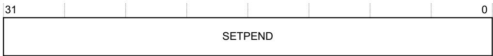

SETPEND, bits[m] For register NVIC\_ISPRn, changes the state of interrupt (m+(32\*n)) to pending, or shows whether the state of the interrupt is pending:

0 On reads, interrupt is not pending.

1 On reads, interrupt is pending.

On writes, change state of interrupt to pending.

m takes the values from 31 to 0, except for NVIC\_ISPR15, where:

m takes the values from 15-0.

Register bits[31:16] are reserved, RAZ/WI.

Software can set multiple interrupts to pending state in a single write to NVIC\_ISPRn.

## B3.4.7 Interrupt Clear-Pending Registers, NVIC\_ICPR0-NVIC\_ICPR15

The NVIC\_ICPRn characteristics are:

Purpose For a group of interrupts, clears the interrupt pending status, or shows the current pending status.

Usage constraints NVIC\_ICPRn[31:0] are the clear-pending bits for interrupts (31+(32\*n)) - (32\*n). When n=15, bits[31:16] are reserved.

Configurations At least one register is always implemented, see Implemented NVIC registers on page B3-626.

Attributes See Table B3-8 on page B3-626.

The NVIC\_ICPRn bit assignments are:

<table><tr><td>31</td><td></td><td></td><td></td><td></td><td></td><td></td><td>0</td></tr><tr><td colspan="8">CLRPEND</td></tr></table>

CLRPEND, bits[m] For register NVIC\_ICPRn, clears the pending state of interrupt (m+(32\*n)), or shows whether the state of the interrupt is pending:

0 On reads, interrupt is not pending.

1 On reads, interrupt is pending.

On writes, clears the pending state of the interrupt.

m takes the values from 31-0, except for NVIC\_ICPR15, where:

m takes the values from 15-0.

Register bits[31:16] are reserved, RAZ/WI.

Software can clear the pending state of multiple interrupts in a single write to NVIC\_ICPRn.

## B3.4.8 Interrupt Active Bit Registers, NVIC\_IABR0-NVIC\_IABR15

The NVIC\_IABRn characteristics are:

Purpose For a group of 32 interrupts, shows whether each interrupt is active.

Usage constraints NVIC\_IABRn[31:0] are the active bits for interrupts (31+(32\*n)) - (32\*n). When n=15, bits[31:16] are reserved.

Configurations At least one register is always implemented, see Implemented NVIC registers on page B3-626.

Attributes See Table B3-8 on page B3-626.

The NVIC\_IABRn bit assignments are:

<table><tr><td>31</td><td></td><td></td><td></td><td></td><td></td><td></td><td>0</td></tr><tr><td colspan="8">ACTIVE</td></tr></table>

ACTIVE, bits[m] For register NVIC\_IABRn, shows whether interrupt (m+(32\*n)) is active:

0 Interrupt not active.

1 Interrupt active.

m takes the values from 31-0, except for NVIC\_IABR15, where:

m takes the values from 15-0.

Register bits[31:16] are reserved, RAZ/WI.

## B3.4.9 Interrupt Priority Registers, NVIC\_IPR0-NVIC\_IPR123

The NVIC\_IPRn Register characteristics are:

Purpose Sets or reads interrupt priorities.

Usage constraints The registers are byte, aligned halfword, and word accessible.

Configurations The number of NVIC\_IPRs implemented is a multiple of eight, and at least eight registers are implemented, see Implemented NVIC registers on page B3-626.

Attributes See Table B3-8 on page B3-626.

The NVIC\_IPRn bit assignments are:

<table><tr><td>31</td><td>24</td><td>23</td><td>16</td><td>15</td><td>8</td><td>7</td><td>0</td></tr><tr><td colspan="2">PRI_N3</td><td colspan="2">PRI_N2</td><td colspan="2">PRI_N1</td><td colspan="2">PRI_N0</td></tr></table>

PRI\_N3, bits[31:24] For register NVIC\_IPRn, priority of interrupt number 4n+3. PRI\_N2, bits[23:16] For register NVIC\_IPRn, priority of interrupt number 4n+2. PRI\_N1, bits[15:8] For register NVIC\_IPRn, priority of interrupt number 4n+1. PRI\_N0, bits[7:0] For register NVIC\_IPRn, priority of interrupt number 4n.

## B3.5 Protected Memory System Architecture, PMSAv7

Supporting a model of unprivileged and privileged software execution requires a memory protection scheme that controls the access rights. Armv7-M supports the Protected Memory System Architecture (PMSAv7). The system address space of a PMSAv7 implementation is protected by a Memory Protection Unit (MPU). The MPU divides the memory into regions. The number of supported regions is IMPLEMENTATION DEFINED. PMSAv7 can support regions as small as 32 bytes, but the limited register resources in the 4GB address space mean the MPU provides an inherently coarse-grained protection scheme. The scheme is completely predictive, with all control information held in registers that are closely-coupled to the processor. Memory accesses are only required for software control of the MPU register interface, see Register support for PMSAv7 in the SCS on page B3-635.

MPU support in Armv7-M is optional.

## B3.5.1 Relation of the MPU to the system memory map

When implemented, an MPU’s relation to the system memory map described in The system address map on page B3-592 is as follows:

MPU support provides control of access rights on physical addresses. It does not perform address translation.

When the MPU is disabled or not present, the system adopts the default system memory map listed in Table B3-1 on page B3-592. When the MPU is enabled, the enabled regions define the system address map with the following provisos:

— Accesses to the Private Peripheral Bus (PPB) always use the default system address map.

Exception vector reads from the Vector Address Table always use the default system address map.

The MPU is restricted in how it can change the default memory map attributes associated with System space, that is, for addresses 0xE0000000 and higher.

System space is always marked as XN, Execute Never.

When the execution priority is less than 0, MPU\_CTRL.HFNMIENA determines whether memory accesses use the MPU or the default memory map attributes. The execution priority is less than 0 if the processor is executing the NMI or HardFault handler, or if FAULTMASK is set to 1.

The default system memory map can be configured to provide a background region for privileged accesses.

Accesses with an address match in more than one region use the highest matching region number for the access attributes.

Accesses that do not match all access conditions of a region address match (with the MPU enabled) or a background/default memory map match generate a fault.

## B3.5.2 Behavior when the MPU is disabled

Disabling the MPU, by setting the MPU\_CTRL.ENABLE bit to 0, means that privileged and unprivileged accesses use the default memory map.

When the MPU is disabled:

Instruction accesses use the default memory map and attributes shown in Table B3-1 on page B3-592. An access to a memory region with the execute-never attribute generates a MemManage fault, see Execute Never encoding on page B3-642. No other permission checks are performed. Additional control of the Cacheability is made by:

The CCR.IC bit if separate instruction and data caches are implemented.

The CCR.DC bit if unified caches are implemented.

Data accesses use the default memory map and attributes shown in Table B3-1 on page B3-592. No memory access permission checks are performed, and no aborts can be generated.

Program flow prediction functions as normal, controlled by the value of the CCR.BP bit.

• Speculative instruction and data fetch operations work as normal, based on the default memory map:

Speculative data read operations have no effect if the data cache is disabled.

Speculative instruction fetch operations have no effect if the instruction cache is disabled.

## B3.5.3 PMSAv7-compliant MPU operation

Armv7-M only supports a unified memory model with respect to MPU region support. All enabled regions provide support for instruction and data accesses.

The base address, size and attributes of a region are all configurable, with the general rule that all regions are naturally aligned. This can be stated as:

RegionBaseAddress[(N-1):0] = 0, where N is log2(SizeofRegion\_in\_bytes)

Memory regions can vary in size as a power of 2. The supported sizes are 2<sup>N</sup>, where 5 ≤ N ≤ 32. Where there is an overlap between two regions, the register with the highest region number takes priority.

## Sub-region support

For regions of 256 bytes or larger, the region can be divided up into eight sub-regions of size 2(N-3). Sub-regions within a region can be disabled on an individual basis (8 disable bits) with respect to the associated region attribute register. When a sub-region is disabled, an access match is required from another region, or background matching if enabled. If an access match does not occur a fault is generated. Region sizes below 256 bytes do not support sub-regions, setting MPU\_RASR.SRD to non-zero for a region less than 256 bytes is UNPREDICTABLE.

## Armv7-M specific support

Armv7-M supports the standard PMSAv7 of the Armv7-R architecture profile, with the following extensions:

An optimized two register update model, where software can select the region to update by writing to the MPU Region Base Address Register. This optimization applies to the first sixteen memory regions (0 ≤ RegionNumber ≤ 0xF) only.

The MPU Region Base Address Register and the MPU Region Attribute and Size Register pairs are aliased in three consecutive dual-word locations. Using the two register update model, software can modify up to four regions by writing the appropriate even number of words using a single STM multi-word store instruction.

## MPU pseudocode

The following pseudocode defines the operation of an Armv7-M MPU. The terms used align with the MPU register names and bit field names described in Register support for PMSAv7 in the SCS on page B3-635.

```txt
// ValidateAddress()
// ====================
AddressDescriptor ValidateAddress(bits(32) address, AccType acctype, boolean iswrite)
ispriv = acctype != AccType_UNPRIV && FindPriv();

AddressDescriptor result;
Permissions perms;

result.physicaladdress = address;
result.memattrs = DefaultMemoryAttributes(address);
perms = DefaultPermissions(address);

hit = FALSE; // assume no valid MPU region and not using default memory map
isPPBaccess = (address<31:20> == '111000000000');

if acctype == AccType_VECTABLE || isPPBaccess then
    hit = TRUE;    // use default map for PPB and vector table lookups

elsif MPU_CTRL.ENABLE == '0' then
    if MPU_CTRL.HFNMIENA == '1' then UNPREDICTABLE;
    else hit = TRUE; // always use default map if MPU disabled

elsif MPU_CTRL.HFNMIENA == '0' && ExecutionPriority() < 0 then
    hit = TRUE;    // optionally use default for HardFault, NMI and FAULTMASK

else // MPU is enabled so check each individual region
```

```txt
if (MPU_CTRL.PRIVDEFENA == '1') && ispriv then
    hit = TRUE; // optional default as background for Privileged accesses

for r = 0 to (UInt(MPU_TYPE.DREGION) - 1) // highest matching region wins
    bits(16) size_enable = MPU_RASR[r]<15:0>;
    bits(32) base_address = MPU_RBAR[r];
    bits(16) access_control = MPU_RASR[r]<31:16];

    if size_enable<0> == '1' then // MPU region enabled so perform checks
    lsbit = UInt(size_enable<5:1>) + 1;
    if lsbit < 5 then UNPREDICTABLE;
    if (!lsbit < 8) && (!IsZero(size_enable<15:8>)) then UNPREDICTABLE;

    if lsbit == 32 || address<31:lsbit> == base_address<31:lsbit> then
    subregion = UInt(address<lsbit-1:lsbit-3>);
    if size_enable<subregion+8> == '0' then
    texcb = access_control<5:3,1:0>;
    S = access_control<2>;
    perms.ap = access_control<10:8>;
    perms.xn = access_control<12>;
    result.memattrs = DefaultTEXDecode(texcb,S);
    hit = TRUE;

if address<31:29> == '111' then // enforce System space execute never
    perms.xn = '1';

if hit then // perform check of acquired access permissions
    CheckPermission(perms, address, acctype, iswrite);
else // generate fault if no MPU match or use of default not enabled
    if acctype == AccType_IFETCH then
    MMFSR.IACCVIOL = '1';
    MMFSR.MMARVALID = '0';
    else
    MMFSR.DACCVIOL = '1';
    MMAR = address;
    MMFSR.MMARVALID = '1';
ExceptionTaken(MemManage);

return result;

DefaultPermissions()
====================

missions DefaultPermissions(bits(32) address)

Permissions perms;

perms.ap = '011';

case address<31:29> of
    when '000'
    perms.xn = '0';
    when '001'
    perms.xn = '0';
    when '010'
    perms.xn = '1';
    when '011'
    perms.xn = '0';
    when '100'
    perms.xn = '0';
    when '101'
    perms.xn = '1';
    when '110'
    perms.xn = '1';
    when '111'
    perms.xn = '1';
```

return perms;

Access permission checking on page B2-587 defines the CheckPermission() function.

## MPU fault support

Instruction or data access violations cause a MemManage exception to be generated. See Fault behavior on page B1-551 for more details of MemManage exceptions.

## B3.5.4 Register support for PMSAv7 in the SCS

Table B3-11 summarizes the register support for a Memory Protection Unit (MPU) in the System Control Space. In general and unless otherwise stated, registers support word accesses only, with byte and halfword access UNPREDICTABLE. All MPU register addresses are mapped as little endian.

MPU registers require privileged memory accesses for reads and writes. Any unprivileged access generates a BusFault fault.

There are three general MPU registers:

The MPU Type Register specified in MPU Type Register, MPU\_TYPE on page B3-636. This register can be used to determine if an MPU exists, and the number of regions supported.

The MPU Control Register specified in MPU Control Register, MPU\_CTRL on page B3-637. The MPU Control Register includes a global enable bit that must be set to 1 to enable the MPU.

The MPU Region Number Register specified in MPU Region Number Register, MPU\_RNR on page B3-638.

The MPU Region Number Register selects the associated region registers:

The MPU Region Base Address Register specified in MPU Region Base Address Register, MPU\_RBAR on page B3-639.

The MPU Region Attribute and Size Register to control the region size, sub-region access, access permissions, memory type, and other properties of the memory region in MPU Region Attribute and Size Register, MPU\_RASR on page B3-640.

Each set of region registers includes its own region enable bit.

If an Armv7-M implementation does not support PMSAv7, only the MPU Type Register is required. The MPU Control Register is RAZ/WI, and all other registers in this region are reserved, UNK/SBZP.

All MPU registers are 32-bits wide.

Table B3-11 MPU register summary

<table><tr><td>Address</td><td>Name</td><td>Type</td><td>Reset</td><td>Description</td></tr><tr><td>0xE000ED90</td><td>MPU_TYPE</td><td>RO</td><td>IMPLEMENTATION DEFINED</td><td>MPU Type Register, MPU_TYPE on page B3-636</td></tr><tr><td>0xE000ED94</td><td>MPU_CTRL</td><td>RW</td><td>0x00000000</td><td>MPU Control Register, MPU_CTRL on page B3-637</td></tr><tr><td>0xE000ED98</td><td>MPU_RNR</td><td>RW</td><td>UNKNOWN</td><td>MPU Region Number Register, MPU_RNR on page B3-638</td></tr><tr><td>0xE000ED9C</td><td>MPU_RBAR</td><td>RW</td><td>UNKNOWN</td><td>MPU Region Base Address Register, MPU_RBAR on page B3-639</td></tr><tr><td>0xE000EDA0</td><td>MPU_RASR</td><td>RW</td><td>UNKNOWN</td><td>MPU Region Attribute and Size Register, MPU_RASR on page B3-640</td></tr><tr><td>0xE000EDA4</td><td>MPU_RBAR_A1</td><td>RW</td><td>-</td><td>Alias 1 of MPU_RBAR, see MPU alias register support on page B3-642</td></tr><tr><td>0xE000EDA8</td><td>MPU_RASR_A1</td><td>RW</td><td>-</td><td>Alias 1 of MPU_RASR, see MPU alias register support on page B3-642</td></tr></table>

SEPARATE

Table B3-11 MPU register summary (continued)

<table><tr><td>Address</td><td>Name</td><td>Type</td><td>Reset</td><td>Description</td></tr><tr><td>0xE000EDAC</td><td>MPU_RBAR_A2</td><td>RW</td><td>-</td><td>Alias 2 of MPU_RBAR, see MPU alias register support on page B3-642</td></tr><tr><td>0xE000EDB0</td><td>MPU_RASR_A2</td><td>RW</td><td>-</td><td>Alias 2 of MPU_RASR, see MPU alias register support on page B3-642</td></tr><tr><td>0xE000EDB4</td><td>MPU_RBAR_A3</td><td>RW</td><td>-</td><td>Alias 3 of MPU_RBAR, see MPU alias register support on page B3-642</td></tr><tr><td>0xE000EDB8</td><td>MPU_RASR_A3</td><td>RW</td><td>-</td><td>Alias 3 of MPU_RASR, see MPU alias register support on page B3-642</td></tr><tr><td>0xE000EDBC-0xE000EDEC</td><td>-</td><td>...</td><td>-</td><td>Reserved.</td></tr></table>

Note

The values of the MPU\_RASR registers from reset are UNKNOWN. All MPU\_RASR registers must be programmed as either enabled or disabled, before enabling the MPU using the MPU\_CTRL register.

## B3.5.5 MPU Type Register, MPU\_TYPE

The MPU\_TYPE register characteristics are:

Purpose The MPU Type Register indicates how many regions the MPU support. Software can use it to determine if the processor implements an MPU.

Usage constraints There are no usage constraints.

Configurations Always implemented.

Attributes See Table B3-11 on page B3-635.

The MPU\_TYPE register bit assignments are:

<table><tr><td>31</td><td>24</td><td>23</td><td>16</td><td>15</td><td>8</td><td>7</td><td>1</td><td>0</td></tr><tr><td colspan="2">Reserved</td><td colspan="2">IREGION</td><td colspan="2">DREGION</td><td colspan="2">Reserved</td><td></td></tr></table>

Bits[31:24] Reserved.

IREGION, bits[23:16]

Instruction region. RAZ. Armv7-M only supports a unified MPU.

DREGION, bits[15:8]

Number of regions supported by the MPU. If this field reads-as-zero the processor does not implement an MPU.

Bits[7:1] Reserved.

SEPARATE, bit[0] Indicates support for separate instruction and data address maps. RAZ. Armv7-M only supports a unified MPU.

## B3.5.6 MPU Control Register, MPU\_CTRL

The MPU\_CTRL Register characteristics are:

Purpose Enables the MPU, and when the MPU is enabled, controls whether the default memory map is enabled as a background region for privileged accesses, and whether the MPU is enabled for HardFaults, NMIs, and exception handlers when FAULTMASK is set to 1.

Usage constraints There are no usage constraints.

Configurations If the MPU is not implemented, this register is RAZ/WI.

Attributes See Table B3-11 on page B3-635.

The MPU\_CTRL bit assignments are:

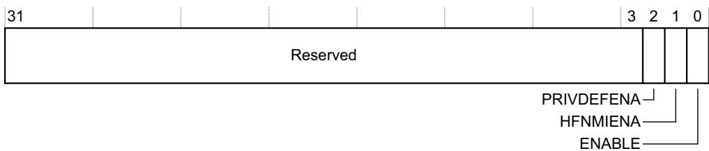

Bits[31:3] Reserved.

## PRIVDEFENA, bit[2]

When the ENABLE bit is set to 1, the meaning of this bit is:

0 Disables the default memory map. Any instruction or data access that does not access a defined region faults.

1 Enables the default memory map as a background region for privileged access. The background region acts as region number -1. All memory regions configured in the MPU take priority over the default memory map. The system address map on page B3-592 describes the default memory map.

When the ENABLE bit is set to 0, the processor ignores the PRIVDEFENA bit.

If no regions are enabled and the PRIVDEFENA and ENABLE bits are set to 1, only privileged code can execute from the system address map.

HFNMIENA, bit[1] When the ENABLE bit is set to 1, controls whether handlers executing with priority less than 0 access memory with the MPU enabled or with the MPU disabled. This applies to HardFaults, NMIs, and exception handlers when FAULTMASK is set to 1:

0 Disables the MPU for these handlers.

1 Use the MPU for memory accesses by these handlers.

If HFNMIENA is set to 1 when ENABLE is set to 0, behavior is UNPREDICTABLE.

ENABLE, bit[0] Enables the MPU:

0 The MPU is disabled.

1 The MPU is enabled.

Disabling the MPU, by setting the ENABLE bit to 0, means that privileged and unprivileged accesses use the default memory map.

## Effect of MPU\_CTRL settings on unprivileged instructions

The Thumb instruction set includes instructions that, when executed by privileged software, perform unprivileged memory accesses:

The following sections describe instructions that perform unprivileged register loads:

LDRBT on page A7-256.

LDRHT on page A7-269.

LDRSBT on page A7-274.

LDRSHT on page A7-280.

LDRT on page A7-281.

The following sections describe instructions that perform unprivileged register stores:

STRBT on page A7-392.

STRHT on page A7-400.

STRT on page A7-401.

Table B3-12 shows how the MPU\_CTRL.HFNMIENA and MPU\_CTRL.ENABLE bits affect the handling of these instructions when issued by an exception handler for HardFault, or NMI, or for another exception when FAULTMASK is set to 1, and when this is different for other privileged software.

Table B3-12 Effect of MPU\_CTRL settings on unprivileged instructions

<table><tr><td colspan="2">MPU_CTRL</td><td colspan="2">Effect on unprivileged load or store instructions from</td></tr><tr><td>HFNMIENA</td><td>ENABLE</td><td>Specified  $handlers^a$ </td><td>Other privileged software</td></tr><tr><td>0</td><td>0</td><td colspan="2">MPU disabled. Unprivileged access, using default memory map.</td></tr><tr><td>0</td><td>1</td><td>MPU disabled for these handlers. Unprivileged access, using default memory map.</td><td>Unprivileged access, using MPU.</td></tr><tr><td>1</td><td>0</td><td colspan="2">UNPREDICTABLE. Software must not use this configuration.</td></tr><tr><td>1</td><td>1</td><td colspan="2">MPU enabled. Unprivileged access, using MPU.</td></tr></table>

a. HardFault or NMI handler, or other exception handler when FAULTMASK is set to 1,

Table B3-12 shows whether the MPU configuration or the default memory map determines the attributes for the address accessed by the unprivileged load or store instruction. Handling of the instruction access then depends on those attributes. If the attributes do not permit an unprivileged access then the memory system generates a fault. If the access is from the NMI or HardFault handler, or when execution priority is -1 because FAULTMASK is set to 1, then this fault causes a lockup.

## B3.5.7 MPU Region Number Register, MPU\_RNR

The MPU\_RNR characteristics are:

Purpose Selects the region currently accessed by MPU\_RBAR and MPU\_RASR.

Usage constraints

Used with MPU\_RBAR and MPU\_RASR, see MPU Region Base Address Register, MPU\_RBAR on page B3-639, and MPU Region Attribute and Size Register, MPU\_RASR on page B3-640.

If an implementation supports N regions then the regions number from 0 to (N-1), and the effect of writing a value of N or greater to the REGION field is UNPREDICTABLE.

Configurations Implemented only if the processor implements an MPU.

Attributes See Table B3-11 on page B3-635.

The MPU\_RNR bit assignments are:

<table><tr><td>31</td><td>24</td><td>23</td><td>16</td><td>15</td><td>8</td><td>7</td><td>0</td></tr><tr><td colspan="6">Reserved</td><td colspan="2">REGION</td></tr></table>

REGION, bits[7:0] Indicates the memory region accessed by MPU\_RBAR and MPU\_RASR.

Normally, software must write the required region number to MPU\_RNR to select the required memory region, before accessing MPU\_RBAR or MPU\_RASR. However, the MPU\_RBAR.VALID bit gives an alternative way of writing to MPU\_RBAR to update a region base address without first writing the region number to MPU\_RNR, see MPU Region Base Address Register, MPU\_RBAR.

## B3.5.8 MPU Region Base Address Register, MPU\_RBAR

## The MPU\_RBAR characteristics are:

Holds the base address of the region identified by MPU\_RNR. On a write, can also be used to update the base address of a specified region, in the range 0-5, updating MPU\_RNR with the new region number.

Normally, used with MPU\_RBAR, see MPU Region Number Register, MPU\_RNR on page B3-638.

The minimum region alignment required by an MPU\_RBAR is IMPLEMENTATION DEFINED. See the register description for more information about permitted region sizes.

If an implementation supports N regions then the regions number from 0 to (N-1). If N is less than 16 the effect of writing a value of N or greater to the REGION field is UNPREDICTABLE.

Configurations Implemented only if the processor implements an MPU.

Attributes See Table B3-11 on page B3-635.

The MPU\_RBAR bit assignments are:

<table><tr><td>31</td><td></td><td></td><td></td><td></td><td></td><td>5</td><td>4</td><td>3</td><td>0</td></tr><tr><td colspan="6">ADDR</td><td colspan="2"></td><td colspan="2">REGION</td></tr></table>

ADDR, bits[31:5] Base address of the region.

## VALID, bit[4]

On writes, indicates whether the region to update is specified by MPU\_RNR.REGION, or by the REGION value specified in this write. When using the REGION value specified by this write, MPU\_RNR.REGION is updated to this value.

0 Apply the base address update to the region specified by MPU\_RNR.REGION. The REGION field value is ignored.

1 Update MPU\_RNR.REGION to the value obtained by zero extending the REGION value specified in this write, and apply the base address update to this region.

This bit reads as zero.

REGION, bits[3:0] On writes, can specify the number of the region to update, see VALID field description. On reads, returns bits[3:0] of MPU\_RNR.

Software can find the minimum size of region supported by an MPU region by writing all ones to

MPU\_RBAR[31:5] for that region, and then reading the register to find the value saved to bits[31:5]. The number of trailing zeros in this bit field indicates the minimum supported alignment and therefore the supported region size. An implementation must support all region size values from the minimum supported to 4GB, see the description of the MPU\_RASR.SIZE field in MPU Region Attribute and Size Register, MPU\_RASR on page B3-640.

Software must ensure that the value written to the ADDR field aligns with the size of the selected region.

## B3.5.9 MPU Region Attribute and Size Register, MPU\_RASR

The MPU\_RASR characteristics are:

Purpose Defines the size and access behavior of the region identified by MPU\_RNR, and enables that region.

Usage constraints Used with MPU\_RNR, see MPU Region Number Register, MPU\_RNR on page B3-638.

Writing a SIZE value less than the minimum size supported by the corresponding MPU\_RBAR has an UNPREDICTABLE effect.

Configurations Implemented only if the processor implements an MPU.

Attributes See Table B3-11 on page B3-635.

The MPU\_RASR bit assignments are:

<table><tr><td>31</td><td>30</td><td>29</td><td>28</td><td>27</td><td>26</td><td>24</td><td>23</td><td>22</td><td>21</td><td>19</td><td>18</td><td>17</td><td>16</td><td>15</td><td></td><td>8</td><td>7</td><td>6</td><td>5</td><td></td><td>1</td><td>0</td></tr><tr><td></td><td></td><td></td><td></td><td></td><td>AP</td><td></td><td></td><td colspan="2">TEX</td><td>S</td><td>C</td><td>B</td><td></td><td>SRD</td><td></td><td></td><td colspan="3">SIZE</td><td></td><td></td><td></td></tr><tr><td colspan="4">Reserved</td><td colspan="11">Reserved</td><td colspan="3">Reserved</td><td colspan="3">ENABLE</td><td></td><td></td></tr><tr><td colspan="4">XN</td><td colspan="19">Reserved</td></tr><tr><td colspan="23">ATTRS</td></tr></table>

ATTRS, bits[31:16] The MPU Region Attribute field, This field has the following subfields, defined in Region attribute control on page B3-641: XN MPU\_RASR[28]. AP[2:0] MPU\_RASR[26:24]. TEX[2:0] MPU\_RASR[21:19]. S MPU\_RASR[18]. C MPU\_RASR[17]. B MPU\_RASR[16].

SRD, bits[15:8] Subregion Disable. For regions of 256 bytes or larger, each bit of this field controls whether one of the eight equal subregions is enabled, see Memory region subregions:

0 Subregion enabled.

1 Subregion disabled.

Bits[7:6] Reserved.

SIZE, bits[5:1] Indicates the region size. The region size, in bytes, is 2<sup>(SIZE+1)</sup>. SIZE field values less than 4 are reserved, because the smallest supported region size is 32 bytes.

ENABLE, bit[0] Enables this region:

0 When the MPU is enabled, this region is disabled.

1 When the MPU is enabled, this region is enabled.

Enabling a region has no effect unless the MPU\_CTRL.ENABLE bit is set to 1, to enable the MPU.

## Memory region subregions

For any region of 256 bytes or larger, the MPU divides the region into eight equally-sized subregions. Setting a bit in the SRD field to 1 disables the corresponding subregion:

• The least significant bit of the field, MPU\_RASR[8], controls the subregion with the lowest address range.

The most significant bit of the field, MPU\_RASR[15], controls the subregion with the highest address range.

For region sizes of 32, 64, and 128 bytes, the effect of setting one or more bits of the SRD field to 1 is UNPREDICTABLE.

See Sub-region support on page B3-633 for more information.

## Region attribute control

The MPU\_RASR.ATTRS field defines the memory type, and where necessary the cacheable, shareable, and access and privilege properties of the memory region. The register diagram shows the subfields of this field, where:

The TEX[2:0], C, and B bits together indicate the memory type of the region, and:

For Normal memory, the cacheable properties of the region.

For Device memory, whether the region is shareable.

See Table B3-13 for the encoding of these bits.

For Normal memory regions, the S bit indicates whether the region is shareable, see Table B3-13. For Strongly-ordered and Device memory, the S bit is ignored.

The AP[2:0] bits indicate the access and privilege properties of the region, see Table B3-15 on page B3-642.

The XN bit is an Execute Never bit, that indicates whether the processor can execute instructions from the region, see Execute Never encoding on page B3-642.

Table B3-13 TEX, C, B, and S Encoding

<table><tr><td>TEX</td><td>C</td><td>B</td><td>Memory type</td><td>Description, or Normal region Cacheability</td><td>Shareable?</td></tr><tr><td>000</td><td>0</td><td>0</td><td>Strongly-ordered</td><td>Strongly ordered</td><td>Shareable</td></tr><tr><td>000</td><td>0</td><td>1</td><td>Device</td><td>Shared device</td><td>Shareable</td></tr><tr><td>000</td><td>1</td><td>0</td><td>Normal</td><td>Outer and inner Write-Through, no write allocate</td><td>S bita</td></tr><tr><td>000</td><td>1</td><td>1</td><td>Normal</td><td>Outer and inner write-back, no write allocate</td><td>S bita</td></tr><tr><td>001</td><td>0</td><td>0</td><td>Normal</td><td>Outer and inner Non-cacheable</td><td>S bita</td></tr><tr><td>001</td><td>0</td><td>1</td><td>Reserved</td><td>Reserved</td><td>Reserved</td></tr><tr><td>001</td><td>1</td><td>0</td><td>IMPLEMENTATION DEFINED</td><td>IMPLEMENTATION DEFINED</td><td>IMPLEMENTATION DEFINED</td></tr><tr><td>001</td><td>1</td><td>1</td><td>Normal</td><td>Outer and inner write-back; write and read allocate</td><td>S bita</td></tr><tr><td>010</td><td>0</td><td>0</td><td>Device</td><td>Non-shared device</td><td>Non-shareable</td></tr><tr><td>010</td><td>0</td><td>1</td><td>Reserved</td><td>Reserved</td><td>Reserved</td></tr><tr><td>010</td><td>1</td><td>X</td><td>Reserved</td><td>Reserved</td><td>Reserved</td></tr><tr><td>011</td><td>X</td><td>X</td><td>Reserved</td><td>Reserved</td><td>Reserved</td></tr><tr><td>1BB</td><td>A</td><td>A</td><td>Normal</td><td>Cached memory, with AA and BB indicating the inner and outer Cacheability rules that must be exported on the bus. See Table B3-14 on page B3-642 for the Cacheability policy encoding. BB = Outer policy, AA == Inner policy.</td><td>S bita</td></tr></table>

a. Shareable if the S bit is set to 1, Non-shareable if the S bit is set to 0

Table B3-14 Cache policy encoding

<table><tr><td>AA or BB subfield of {TEX,C,B} encoding</td><td>Cacheability policy</td></tr><tr><td>00</td><td>Non-cacheable</td></tr><tr><td>01</td><td>Write-Back, write and read allocate</td></tr><tr><td>10</td><td>Write-Through, no write allocate</td></tr><tr><td>11</td><td>Write-Back, no write allocate</td></tr></table>

The AP bits, AP[2:0], are used for access permissions. These are shown in Table B3-15.

Table B3-15 Access permissions field encoding

<table><tr><td>AP[2:0]</td><td>Privileged access</td><td>Unprivileged access</td><td>Notes</td></tr><tr><td>000</td><td>No access</td><td>No access</td><td>Any access generates a permission fault</td></tr><tr><td>001</td><td>Read/write</td><td>No access</td><td>Privileged access only</td></tr><tr><td>010</td><td>Read/write</td><td>Read-only</td><td>Any unprivileged write generates a permission fault</td></tr><tr><td>011</td><td>Read/write</td><td>Read/write</td><td>Full access</td></tr><tr><td>100</td><td>UNPREDICTABLE</td><td>UNPREDICTABLE</td><td>Reserved</td></tr><tr><td>101</td><td>Read-only</td><td>No access</td><td>Privileged read-only</td></tr><tr><td>110</td><td>Read-only</td><td>Read-only</td><td>Privileged and unprivileged read-only</td></tr><tr><td>111</td><td>Read-only</td><td>Read-only</td><td>Privileged and unprivileged read-only</td></tr></table>

## Execute Never encoding

The XN bit provides an Execute Never capability. For the processor to execute an instruction, the instruction must be in a memory region with:

Read access, indicated by the AP bits, for the appropriate privilege level.

The XN bit set to 0.

Otherwise, the processor generates a MemManage fault when it issues the instruction for execution. Therefore, Table B3-16 shows the encoding of the XN bit.

Table B3-16 Execute Never encoding

<table><tr><td>XN</td><td>Description</td></tr><tr><td>0</td><td>Execution of an instruction fetched from this region permitted</td></tr><tr><td>1</td><td>Execution of an instruction fetched from this region not permitted</td></tr></table>

## B3.5.10 MPU alias register support

The MPU\_RBAR and MPU\_RASR form a pair of words in the address range 0xE000ED9C-0xE000EDA3. An Armv7-M processor implements aliases of this address range at offsets of +8 bytes, +16 bytes, and +24 bytes from the MPU\_RBAR address of 0xE000ED9C, as Table B3-11 on page B3-635 shows. Using these register aliases with the MPU\_RBAR.REGION field, and the MPU\_RBAR.VALID field set to 1, software can use a stream of word writes to update efficiently up to four regions, provided all the regions accessed are in the range region 0 to region 15.

# Chapter B4 The CPUID Scheme

This chapter describes the Armv7-M implementation of the CPUID scheme. This scheme provides registers that identify the architecture version and many features of the processor implementation. This chapter also describes the registers that identify the implemented floating-point features, if any. It contains the following sections:

About the CPUID scheme on page B4-644.

Processor Feature ID Registers on page B4-646.

Debug Feature ID register on page B4-648.

Auxiliary Feature ID register on page B4-649.

Memory Model Feature Registers on page B4-650.

Instruction Set Attribute Registers on page B4-653.

Floating-point feature identification registers on page B4-662.

Cache Control Identification Registers on page B4-665.

## B4.1 About the CPUID scheme

The CPUID scheme provides a description of the features of an Arm processor implementation. It defines a common set of registers for all profiles of the Armv7 architecture, see the Arm Architecture Reference Manual, Armv7-A and Armv7-R edition.

Specifying an architecture variant of 0xF in the Main ID Register indicates use of the CPUID scheme. In the Armv7-M profile, the Main ID Register is called the CPUID base register, see CPUID Base Register on page B3-598.

The Armv7-A and Armv7-R profiles permit many implementation options. Therefore, in those profiles, many CPUID field values are IMPLEMENTATION DEFINED, and can take a range of values. In the Armv7-M profile, the Armv7-M base architecture, and any implemented architecture extensions, define the CPUID field values.

With the exception of CSSELR, the CPUID registers are read-only, and privileged access only. The processor ignores privileged writes, and any unprivileged data access causes a BusFault error.

CSSELR is only accessible by privileged software and supports reading and writing.

## B4.1.1 Convention for CPUID attribute descriptions

The CPUID options in the Armv7-M profile are a subset of those in the Armv7-A and Armv7-R profiles, and therefore some fields in the registers cannot have a value in the Armv7-M profile. In this manual, the descriptions of the Armv7 CPUID register fields use the following terms:

Armv7-M reserved The field is reserved in the Armv7-M profile but defined in the other profiles.

Reserved The field is reserved in all Armv7 profiles.

Reserved fields, and Armv7-M reserved fields, are Read-As-Zero (RAZ).

In any field description, any field values not listed are reserved.

If a possible value for a field is shown as Armv7-M reserved it means Armv7-M implementations cannot use that field value.

## B4.1.2 Summary of the CPUID registers

Table B4-1 shows the CPUID registers. These registers are in the System Control Space.

Table B4-1 Processor Feature ID register support in the SCS

<table><tr><td>Address</td><td>Type</td><td>Reset value</td><td>Description</td></tr><tr><td>0xE000ED00</td><td>RO</td><td>IMPLEMENTATION DEFINED</td><td>CPUID Base Register on page B3-598</td></tr><tr><td>0xE000ED40</td><td>RO</td><td>IMPLEMENTATION DEFINED</td><td>Processor Feature Register 0, ID_PFR0 on page B4-646</td></tr><tr><td>0xE000ED44</td><td>RO</td><td>IMPLEMENTATION DEFINED</td><td>Processor Feature Register 1, ID_PFR1 on page B4-646</td></tr><tr><td>0xE000ED48</td><td>RO</td><td>IMPLEMENTATION DEFINED</td><td>Debug Feature Register 0, ID_DFR0 on page B4-648</td></tr><tr><td>0xE000ED4C</td><td>RO</td><td>IMPLEMENTATION DEFINED</td><td>Auxiliary Feature Register 0, ID_AFR0 on page B4-649</td></tr><tr><td>0xE000ED50</td><td>RO</td><td>IMPLEMENTATION DEFINED</td><td>Memory Model Feature Register 0, ID_MMFR0 on page B4-650</td></tr><tr><td>0xE000ED54</td><td>RO</td><td>IMPLEMENTATION DEFINED</td><td>Memory Model Feature Register 1, ID_MMFR1 on page B4-651</td></tr><tr><td>0xE000ED58</td><td>RO</td><td>IMPLEMENTATION DEFINED</td><td>Memory Model Feature Register 2, ID_MMFR2 on page B4-651</td></tr><tr><td>0xE000ED5C</td><td>RO</td><td>IMPLEMENTATION DEFINED</td><td>Memory Model Feature Register 3, ID_MMFR3 on page B4-652</td></tr><tr><td>0xE000ED60</td><td>RO</td><td>IMPLEMENTATION DEFINED</td><td>Instruction Set Attribute Register 0, ID_ISAR0 on page B4-654</td></tr><tr><td>0xE000ED64</td><td>RO</td><td>IMPLEMENTATION DEFINED</td><td>Instruction Set Attribute Register 1, ID_ISAR1 on page B4-655</td></tr><tr><td>0xE000ED68</td><td>RO</td><td>IMPLEMENTATION DEFINED</td><td>Instruction Set Attribute Register 2, ID_ISAR2 on page B4-657</td></tr><tr><td>0xE000ED6C</td><td>RO</td><td>IMPLEMENTATION DEFINED</td><td>Instruction Set Attribute Register 3, ID_ISAR3 on page B4-658</td></tr><tr><td>0xE000ED70</td><td>RO</td><td>IMPLEMENTATION DEFINED</td><td>Instruction Set Attribute Register 4, ID_ISAR4 on page B4-659</td></tr><tr><td>0xE000ED74</td><td>RO</td><td>IMPLEMENTATION DEFINED</td><td>ID_ISAR5: Reserved, RAZ</td></tr><tr><td>0xE000ED78</td><td>RO</td><td>IMPLEMENTATION DEFINED</td><td>Cache Level ID Register, CLIDR on page B4-665</td></tr><tr><td>0xE000ED7C</td><td>RO</td><td>IMPLEMENTATION DEFINED</td><td>Cache Type Register, CTR on page B4-667</td></tr><tr><td>0xE000ED80</td><td>RO</td><td>IMPLEMENTATION DEFINED</td><td>Cache Size ID Registers, CCSIDR on page B4-666</td></tr><tr><td>0xE000ED84</td><td>RO</td><td>IMPLEMENTATION DEFINED</td><td>Cache Size Selection Register, CSSELR on page B4-667</td></tr></table>

See Convention for CPUID attribute descriptions on page B4-644 for general information about the field descriptions used in these registers.

## B4.2 Processor Feature ID Registers

The following sections describe the Processor Feature ID Registers. See Convention for CPUID attribute descriptions on page B4-644 for information about the field descriptions.

## B4.2.1 Processor Feature Register 0, ID\_PFR0

The ID\_PFR0 characteristics are:

Purpose Gives top-level information about the instruction sets supported by the processor. This register is part of the Identification registers functional group.

Usage constraints Only accessible from Privileged code. This register must be interpreted with ID\_PFR1.

Configurations Always implemented.

Attributes See Table B4-1 on page B4-644.

The ID\_PFR0 bit assignments are:

<table><tr><td>Reserved</td><td>State3</td><td>State2</td><td>State1</td><td>State0</td></tr></table>

Bits[31:16] Reserved.

State3, bits[15:12] Armv7-M reserved.

State2, bits[11:8] Armv7-M reserved.

State1, bits[7:4] Thumb instruction set support:

0-2 Armv7-M reserved.

3 Support for Thumb encoding including Thumb-2 technology, with all basic 16-bit and 32-bit instructions.

State0, bits[3:0] Arm instruction set support:

0 The processor does not support the Arm instruction set.

1 Armv7-M reserved.

## B4.2.2 Processor Feature Register 1, ID\_PFR1

The ID\_PFR1 characteristics are:

Purpose Gives top-level information about the instruction sets supported by the processor. This register is part of the Identification registers functional group.

Usage constraints Only accessible from Privileged code. This register must be interpreted with ID\_PFR0

Configurations Always implemented.

Attributes See Table B4-1 on page B4-644.

The ID\_PFR1 bit assignments are:

<table><tr><td>Reserved</td><td></td><td>Armv7-M reserved</td></tr></table>

Bits[31:12] Reserved.

M profile programmers’ model, bits[11:8]

0 Armv7-M reserved.

1 Reserved.

2 Two-stack programmers’ model supported.

Bits[7:0]

Armv7-M reserved.

## B4.3 Debug Feature ID register

The following section describes the Debug Feature ID register, that gives a top-level view of the debug implementation. The Debug implementation includes registers that give more information about the features of the implementation, see Chapter C1 Armv7-M Debug. See Convention for CPUID attribute descriptions on page B4-644 for information about the field descriptions.

## B4.3.1 Debug Feature Register 0, ID\_DFR0

The ID\_DFR0 characteristics are:

Purpose Gives top-level information about the debug system used in the processor. This register is part of the Identification registers functional group.

Usage constraints Only accessible from Privileged code.

Configurations Always implemented.

Attributes See Table B4-1 on page B4-644.

The ID\_DFR0 bit assignments are:

<table><tr><td>Reserved</td><td></td><td>Armv7-M reserved</td></tr></table>

Debug model, M profile

Bits[31:24] Reserved.

Debug model, M profile, bits[23:20]

Support for memory-mapped debug model for M profile processors:

0 Not supported.

1 Support for M profile Debug architecture, with memory-mapped access.

Bits[19:0] Armv7-M reserved.

## B4.4 Auxiliary Feature ID register

The following section gives the architectural description of the IMPLEMENTATION DEFINED Auxiliary Feature ID register. See Convention for CPUID attribute descriptions on page B4-644 for information about the field descriptions.

## B4.4.1 Auxiliary Feature Register 0, ID\_AFR0

The ID\_AFR0 characteristics are:

Purpose

Gives information about the IMPLEMENTATION DEFINED features of a processor implementation. ID\_AFR0 has four IMPLEMENTATION DEFINED fields. These fields are defined by the implementer of the design, as identified by the Implementer field of the CPUID base register, see CPUID Base Register on page B3-598.

Field definitions in the ID\_AFR0 might:

Differ between different implementers.

Be subject to change.

Migrate over time, for example if they are incorporated into the main architecture.

This register is part of the Identification registers functional group.

Usage constraints Only accessible from Privileged code.

Configurations Always implemented.

Attributes See Table B4-1 on page B4-644.

The ID\_AFR0 bit assignments are:

<table><tr><td>Reserved</td><td></td><td></td><td></td><td></td><td></td></tr><tr><td colspan="6">IMPLEMENTATION DEFINED</td></tr><tr><td colspan="6">IMPLEMENTATION DEFINED</td></tr><tr><td colspan="6">IMPLEMENTATION DEFINED</td></tr><tr><td colspan="6">IMPLEMENTATION DEFINED</td></tr></table>

Bits[31:16] Reserved.

Bits[15:12] IMPLEMENTATION DEFINED.

Bits[11:8] IMPLEMENTATION DEFINED.

Bits[7:4] IMPLEMENTATION DEFINED.

Bits[3:0] IMPLEMENTATION DEFINED.

## B4.5 Memory Model Feature Registers

The Memory Model Feature Registers (MMFRs) give general information about the memory model and memory management support. See Convention for CPUID attribute descriptions on page B4-644 for information about the field descriptions. The following sections describe the MMFRs:

Memory Model Feature Register 0, ID\_MMFR0.

Memory Model Feature Register 1, ID\_MMFR1 on page B4-651.

Memory Model Feature Register 2, ID\_MMFR2 on page B4-651.

Memory Model Feature Register 3, ID\_MMFR3 on page B4-652.

## B4.5.1 Memory Model Feature Register 0, ID\_MMFR0

The ID\_MMFR0 characteristics are:

Purpose Gives information about the implemented memory model and memory management support. This register is part of the Identification registers functional group.

Usage constraints Only accessible from Privileged code. This register must be interpreted with ID\_MMFR1, ID\_MMFR2, and ID\_MMFR3.

Configurations Always implemented.

Attributes See Table B4-1 on page B4-644.

The ID\_MMFR0 bit assignments are:

<table><tr><td>31</td><td>24</td><td>23</td><td>20</td><td>19</td><td>16</td><td>15</td><td>12</td><td>11</td><td>8</td><td>7</td><td>4</td><td>3</td><td>0</td></tr><tr><td colspan="2">Armv7-M reserved</td><td colspan="2">Auxiliary registers</td><td colspan="2">TCM support</td><td colspan="2">Shareability levels</td><td colspan="2">Outermost shareability</td><td colspan="2">PMSA support</td><td colspan="2">Armv7-M reserved</td></tr></table>

Bits[31:24] Armv7-M reserved.

Auxiliary registers, bits[23:20]

Indicates the support for Auxiliary registers:

0 Not supported.

1 Support for Auxiliary Control Register only.

2 Armv7-M reserved.

TCM support, bits[19:16]

Indicates the support for tightly coupled memory (TCM):

0 No tightly coupled memories implemented.

1 Tightly coupled memories implemented with IMPLEMENTATION DEFINED control.

2 Armv7-M reserved.

Shareability levels, bits[15:12]

Indicates the number of Shareability levels implemented:

0 One level of Shareability implemented.

1 Armv7-M reserved.

## Outermost Shareability, bits[11:8]

Indicates the outermost Shareability domain implemented:

0 Implemented as Non-cacheable.

1 Armv7-M reserved.

15 Shareability ignored.

## PMSA support, bits[7:4]

Indicates support for a PMSA.

0 Not supported.

1, 2 Armv7-M reserved.

3 PMSAv7, providing support for a base region and subregions.

Bits[3:0] Armv7-M reserved.

## B4.5.2 Memory Model Feature Register 1, ID\_MMFR1

The ID\_MMFR1 characteristics are:

Purpose Gives information about the implemented memory model and memory management support. This register is part of the Identification registers functional group.

Usage constraints Only accessible from Privileged code. This register must be interpreted with ID\_MMFR0, ID\_MMFR2, and ID\_MMFR3.

Configurations Always implemented.

Attributes See Table B4-1 on page B4-644.

The ID\_MMFR1 bit assignments are:

<table><tr><td>31</td><td></td><td></td><td></td><td></td><td></td><td>0</td></tr><tr><td colspan="7">Armv7-M reserved</td></tr></table>

Bits[31:0] Armv7-M reserved.

## B4.5.3 Memory Model Feature Register 2, ID\_MMFR2

The ID\_MMFR2 characteristics are:

Purpose Gives information about the implemented memory model and memory management support. This register is part of the Identification registers functional group.

Usage constraints Only accessible from Privileged code. This register must be interpreted with ID\_MMFR0, ID\_MMFR1, and ID\_MMFR3.

Configurations Always implemented.

Attributes See Table B4-1 on page B4-644.

The ID\_MMFR2 bit assignments are:

<table><tr><td>31</td><td>28</td><td>27</td><td>24</td><td>23</td><td></td><td></td><td></td><td></td><td>0</td></tr><tr><td colspan="2">Armv7-M reserved</td><td colspan="3">WFI stall</td><td colspan="5">Armv7-M reserved</td></tr></table>

Bits[31:28] Armv7-M reserved.

WFI stall, bits[27:24] Indicates the support for Wait For Interrupt (WFI) stalling: 0 Not supported. 1 Support for WFI stalling. Bits[23:0] Armv7-M reserved.

## B4.5.4 Memory Model Feature Register 3, ID\_MMFR3

The ID\_MMFR3 fields are:

Bits[31:28] Armv7-M reserved.

Bits[27:24] Reserved.

Bits[23:20] Armv7-M reserved.

Bits[19:16] Reserved.

Bits[15:0] Armv7-M reserved.

## B4.6 Instruction Set Attribute Registers

The Instruction Set Attribute Registers (ISARs), provide information about the instruction set supported by the processor. See Convention for CPUID attribute descriptions on page B4-644 for information about the field descriptions.

For the ISAR descriptions, the instruction set divides into:

The basic instructions for the Thumb instruction set. An Armv7-M implementation must include all of these instructions.

The non-basic instructions for the Thumb instruction set. The ISARs indicate which of these instructions are implemented.

About the Instruction Set Attribute Register descriptions gives information about how the ISARs represent the instruction set.

The following sections describe the ISARs:

Instruction Set Attribute Register 0, ID\_ISAR0 on page B4-654.

Instruction Set Attribute Register 1, ID\_ISAR1 on page B4-655.

Instruction Set Attribute Register 2, ID\_ISAR2 on page B4-657.

Instruction Set Attribute Register 3, ID\_ISAR3 on page B4-658.

Instruction Set Attribute Register 4, ID\_ISAR4 on page B4-659.

## B4.6.1 About the Instruction Set Attribute Register descriptions

This section gives information about the instructions that form the basic instruction set, and about the allocation of instructions to the different attribute fields in the Instruction Set Attribute registers.

## The basic instruction set

These instructions only depend on an instruction encoding attribute in the CPUID registers. This means that, if an instruction encoding is present, all basic instructions that have encodings in that instruction set must be implemented. Since an Armv7-M implementation must include the Thumb instruction set it must include all of the basic instructions in the Thumb instruction set.

## General rules

The rules about an instruction being basic do not guarantee that it is available in any particular instruction set. For example, MOV R0,#123456789 is a basic instruction by the rules given in this section, but is not available in any implementation of the Thumb instruction set.

Being conditional or unconditional never makes any difference to whether an instruction is a basic instruction.

## Q flag support

The APSR implements the Q flag when:

(ID\_ISAR2.MultS\_instrs >1) OR (ID\_ISAR3.Saturate\_instrs >0) OR (ID\_ISAR3.SIMD\_instrs >0)

## MOV instructions

These are in the basic instruction set if the source operand is an immediate or an unshifted register.

If their second operand is a shifted register, treat them as instead being an ASR, LSL, LSR, ROR or "RRX" instruction, as described in the following section.

## Non-MOV data-processing instructions

These are ADC, ADD, AND, ASR, BIC, CMN, CMP, EOR, LSL, LSR, MVN, NEG, ORN, ORR, ROR, RRX, RSB, RSC, SBC, SUB, TEQ, and TST.

These instructions are in the basic instruction set for Armv7-M if the second source operand, or only source operand for MVN, is an immediate or an unshifted register.

If this condition is false, they are non-basic instructions, controlled by either or both of the PSR\_instrs attribute and the WithShifts\_instrs attribute

## Multiply instructions

MUL instructions are always basic; all other multiply instructions and all multiply-accumulate instructions are non-basic.

## Branches

All B and BL instructions are basic instructions.

## Load single and Store single instructions

These are LDR, LDRB, LDRH, LDRSB, LDRSH, STR, STRB, STRH.

These instructions are in the basic instruction set if the addressing mode is of one of the following forms:

[Rn, #immediate] [Rn, #-immediate] [Rn, Rm] [Rn, -Rm]

A load/store single instruction with any other addressing mode is under the control of one or more of the attributes WithShifts\_instrs, Writeback\_instrs or Unpriv\_instrs.

## Load Multiple and Store Multiple instructions

These are LDM<mode>, STM<mode>, PUSH, POP, where <mode> is any of IA Rn, IA Rn!, DB Rn, or DB Rn!, or their corresponding FD or EA synonyms.

They are basic because they are fundamental to good code generation. In particular, PUSH has the implied addressing mode DB R13!, and POP has the implied addressing mode IA R13!. These instructions are essential for good procedure prologues and epilogues. The other addressing modes listed can make a considerable difference to the code density of structure copy, load and store, and also to their performance on low-end implementations.

## B4.6.2 Instruction Set Attribute Register 0, ID\_ISAR0

The ID\_ISAR0 characteristics are:

Purpose Gives information about the instruction sets implemented by the processor. This register is part of the Identification registers functional group.

Usage constraints Only accessible from Privileged code. This register must be interpreted with ID\_ISAR1, ID\_ISAR2, ID\_ISAR3, and ID\_ISAR4.

Configurations Always implemented.

Attributes See Table B4-1 on page B4-644.

The ID\_ISAR0 bit assignments are:

<table><tr><td>Reserved</td><td></td><td></td><td></td><td></td><td></td><td></td><td></td><td></td><td>Armv7-M reserved</td></tr><tr><td colspan="3">Divide_instrs</td><td></td><td></td><td></td><td></td><td colspan="3">Bitcount_instrs</td></tr><tr><td colspan="3">Debug_instrs</td><td></td><td></td><td></td><td></td><td colspan="3">Bitfield_instrs</td></tr><tr><td colspan="3">Coproc_instrs</td><td></td><td></td><td></td><td></td><td colspan="3">CmpBranch_instrs</td></tr></table>

Bits[31:28] Reserved.

## Divide\_instrs, bits[27:24]

Indicates the supported Divide instructions:

0 None supported, Armv7-M reserved.

1 Adds support for the SDIV and UDIV instructions.

## Debug\_instrs, bits[23:20]

Indicates the supported Debug instructions:

0 None supported, Armv7-M reserved.

1 Adds support for the BKPT instruction.

## Coproc\_instrs, bits[19:16]

Indicates the supported Coprocessor instructions:

0 None supported, except for separately attributed architectures, for example the Floating-point Extension.

1 Adds support for generic CDP, LDC, MCR, MRC, and STC instructions.

2 As for 1, and adds support for generic CDP2, LDC2, MCR2, MRC2, and STC2 instructions.

3 As for 2, and adds support for generic MCRR and MRRC instructions,

4 As for 3, and adds support for generic MCRR2 and MRRC2 instructions.

## CmpBranch\_instrs, bits[15:12]

Indicates the supported combined Compare and Branch instructions:

0 None supported, Armv7-M reserved.

1 Adds support for the CBNZ and CBZ instructions.

## Bitfield\_instrs, bits[11:8]

Indicates the supported BitField instructions:

0 None supported, Armv7-M reserved.

1 Adds support for the BFC, BFI, SBFX, and UBFX instructions.

## BitCount\_instrs, bits[7:4]

Indicates the supported Bit Counting instructions:

0 None supported, Armv7-M reserved.

1 Adds support for the CLZ instruction.

Bits[3:0] Armv7-M reserved.

## B4.6.3 Instruction Set Attribute Register 1, ID\_ISAR1

The ID\_ISAR1 characteristics are:

Purpose Gives information about the instruction sets implemented by the processor. This register is part of the Identification registers functional group.

Usage constraints Only accessible from Privileged code. This register must be interpreted with ID\_ISAR0, ID\_ISAR2, ID\_ISAR3, and ID\_ISAR4.

Configurations Always implemented.

Attributes See Table B4-1 on page B4-644.

The ID\_ISAR1 bit assignments are:

<table><tr><td>31</td><td>28</td><td>27</td><td>24</td><td>23</td><td>20</td><td>19</td><td>16</td><td>15</td><td>12</td><td>11</td><td></td><td>0</td></tr><tr><td colspan="2">Armv7-M reserved</td><td></td><td></td><td></td><td></td><td></td><td></td><td></td><td></td><td></td><td colspan="2">Armv7-M reserved</td></tr><tr><td colspan="7">Interwork_instrs↓Immediate_instrs</td><td colspan="6">Extend_instrsIfThen_instrs</td></tr></table>

Bits[31:28] Armv7-M reserved.

## Interwork\_instrs, bits[27:24]

Indicates the supported interworking instructions:

0 None supported, Armv7-M reserved.

1 Adds support for the BX instruction, and the T bit in the PSR.

2 As for 1, and adds support for the BLX instruction, and PC loads have BX-like behavior.

3 Armv7-M reserved.

## Immediate\_instrs, bits[23:20]

Indicates the support for data-processing instructions with long immediates:

0 None supported, Armv7-M reserved.

1 Adds support for the ADDW, MOVW, MOVT, and SUBW instructions.

## IfThen\_instrs, bits[19:16]

Indicates the supported IfThen instructions:

0 None supported, Armv7-M reserved.

1 Adds support for the IT instructions, and for the IT bits in the PSRs.

## Extend\_instrs, bits[15:12]

Indicates the supported Extend instructions:

0 None supported, Armv7-M reserved.

1 Adds support for the SXTB, SXTH, UXTB, and UXTH instructions.

2 As for 1, and adds support for the SXTAB, SXTAB16, SXTAH, SXTB16, UXTAB, UXTAB16, UXTAH, and UXTB16 instructions.

Note

The shift options on these instructions are supported only when the value of ID\_ISAR4.WithShifts is greater than 2.

The SXTAB16, SXTB16, UXTAB16, and UXTB16 instructions are supported only if both:

This field is greater than 1.

The ID\_ISAR3.SIMD\_instrs field is greater than 2.

Bits[11:0] Armv7-M reserved.

## B4.6.4 Instruction Set Attribute Register 2, ID\_ISAR2

The ID\_ISAR2 characteristics are:

Purpose Gives information about the instruction sets implemented by the processor. This register is part of the Identification registers functional group.

Usage constraints Only accessible from Privileged code. This register must be interpreted with ID\_ISAR0, ID\_ISAR1, ID\_ISAR3, and ID\_ISAR4.

Configurations Always implemented.

Attributes See Table B4-1 on page B4-644.

The ID\_ISAR2 bit assignments are:

<table><tr><td>31</td><td>28</td><td>27</td><td>24</td><td>23</td><td>20</td><td>19</td><td>16</td><td>15</td><td>12</td><td>11</td><td>8</td><td>7</td><td>4</td><td>3</td><td>0</td></tr><tr><td></td><td></td><td></td><td colspan="2">Armv7-M reserved</td><td></td><td></td><td></td><td></td><td></td><td></td><td></td><td></td><td></td><td></td><td></td></tr><tr><td colspan="16">Reversal_instrs</td></tr><tr><td colspan="16">MultU_instrs</td></tr><tr><td colspan="16">MultS_instrs</td></tr></table>

## Reversal\_instrs, bits[31:28]

Indicates the supported Reversal instructions:

0 None supported, Armv7-M reserved.

1 Adds support for the REV, REV16, and REVSH instructions, Armv7-M reserved.

2 As for 1, and adds support for the RBIT instruction.

Bits[27:24] Armv7-M reserved.

MultU\_instrs, bits[23:20]

Indicates the supported advanced unsigned Multiply instructions:

0 None supported, Armv7-M reserved.

1 Adds support for the UMULL and UMLAL instructions.

2 As for 1, and adds support for the UMAAL instruction.

## MultS\_instrs, bits[19:16]

Indicates the supported advanced signed Multiply instructions:

0 None supported, Armv7-M reserved.

1 Adds support for the SMULL and SMLAL instructions.

2 As for 1, and adds support for the SMLABB, SMLABT, SMLALBB, SMLALBT, SMLALTB, SMLALTT, SMLATB, SMLATT, SMLAWB, SMLAWT, SMULBB, SMULBT, SMULTB, SMULTT, SMULWB, and SMULWT instructions.

Also adds support for the Q bit in the PSRs. Armv7-M reserved.

3 As for 2, and adds support for the SMLAD, SMLADX, SMLALD, SMLALDX, SMLSD, SMLSDX, SMLSLD, SMLSLDX, SMMLA, SMMLAR, SMMLS, SMMLSR, SMMUL, SMMULR, SMUAD, SMUADX, SMUSD, and SMUSDX instructions.

## Mult\_instrs, bits[15:12]

Indicates the supported additional Multiply instructions:

0 None supported. This means only MUL is supported. Armv7-M reserved.

1 Adds support for the MLA instruction, Armv7-M reserved.

2 As for 1, and adds support for the MLS instruction.

## MultiAccessInt\_instrs, bits[11:8]

Indicates the support for multi-access interruptible instructions:

0 None supported. This means the LDM and STM instructions are not interruptible.

1 LDM and STM instructions are restartable.

2 LDM and STM instructions are continuable.

## MemHint\_instrs, bits[7:4]

Indicates the supported Memory hint instructions:

0 None supported, Armv7-M reserved.

1 or 2 Adds support for the PLD instruction.

These two values are identical in meaning. Both are Armv7-M reserved.

3 As for 1 or 2, and adds support for the PLI instruction.

LoadStore\_instrs, bits[3:0]

Indicates the supported additional load and store instructions:

0 None supported, Armv7-M reserved.

1 Adds support for the LDRD and STRD instructions.

## B4.6.5 Instruction Set Attribute Register 3, ID\_ISAR3

The ID\_ISAR3 characteristics are:

Purpose Gives information about the instruction sets implemented by the processor. This register is part of the Identification registers functional group.

Usage constraints Only accessible from Privileged code. This register must be interpreted with ID\_ISAR0, ID\_ISAR1, ID\_ISAR2, and ID\_ISAR4.

Configurations Always implemented.

Attributes See Table B4-1 on page B4-644.

The ID\_ISAR3 bit assignments are:

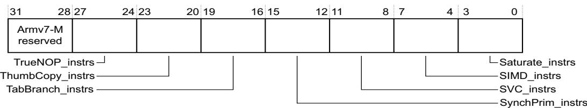

Bits[31:28] Armv7-M reserved.

TrueNOP\_instrs, bits[27:24]

Indicates the support for a true NOP instruction:

0 None supported, Armv7-M reserved.

1 Adds support for the true NOP instruction.

ThumbCopy\_instrs, bits[23:20]

Indicates the supported non flag-setting MOV instructions:

0 None supported, Armv7-M reserved.

1 Adds support for encoding T1 of the MOV (register) instruction copying from a low register to a low register.

## TabBranch\_instrs, bits[19:16]

Indicates the supported Table Branch instructions:

0 None supported, Armv7-M reserved.

1 Adds support for the TBB and TBH instructions.

## SynchPrim\_instrs, bits[15:12]

Must be interpreted with the ID\_ISAR4.SynchPrim\_instrs\_frac field to determine the supported synchronization primitives, see Support for synchronization primitives on page B4-661.

## SVC\_instrs, bits[11:8]

Indicates the supported SVC instructions:

0 None supported, Armv7-M reserved.

1 Adds support for the SVC instruction.

## SIMD\_instrs, bits[7:4]

Indicates the supported SIMD instructions:

0 None supported, Armv7-M reserved.

1 Adds support for the SSAT and USAT instructions, and for the Q bit in the PSRs.

2 Reserved.

3 As for 1, and adds support for the PKHBT, PKHTB, QADD16, QADD8, QASX, QSUB16, QSUB8, QSAX, SADD16, SADD8, SASX, SEL, SHADD16, SHADD8, SHASX, SHSUB16, SHSUB8, SHSAX, SSAT16, SSUB16, SSUB8, SSAX, SXTAB16, SXTB16, UADD16, UADD8, UASX, UHADD16, UHADD8, UHASX, UHSUB16, UHSUB8, UHSAX, UQADD16, UQADD8, UQASX, UQSUB16, UQSUB8, UQSAX, USAD8, USADA8, USAT16, USUB16, USUB8, USAX, UXTAB16, and UXTB16 instructions.

Also adds support for the GE[3:0] bits in the PSRs.

Note

This value adds the SXTAB16, SXTB16, UXTAB16, and UXTB16 instructions only if the ID\_ISAR1.Extend\_instrs attribute is 2 or greater.

## Saturate\_instrs, bits[3:0]

Indicates the supported Saturate instructions:

0 None supported.

1 Adds support for the QADD, QDADD, QDSUB, and QSUB instructions, and for the Q bit in the PSRs.

## B4.6.6 Instruction Set Attribute Register 4, ID\_ISAR4

The ID\_ISAR4 characteristics are:

Purpose Gives information about the instruction sets implemented by the processor. This register is part of the Identification registers functional group.

Usage constraints Only accessible from Privileged code. This register must be interpreted with ID\_ISAR0, ID\_ISAR1, ID\_ISAR2, and ID\_ISAR3.

Configurations Always implemented.

Attributes See Table B4-1 on page B4-644.

The ID\_ISAR4 bit assignments are:

<table><tr><td>31</td><td>28</td><td>27</td><td>24</td><td>23</td><td>20</td><td>19</td><td>16</td><td>15</td><td>12</td><td>11</td><td>8</td><td>7</td><td>4</td><td>3</td><td>0</td></tr><tr><td colspan="2">Armv7-M reserved</td><td></td><td></td><td></td><td></td><td></td><td></td><td colspan="2">Armv7-M reserved</td><td></td><td></td><td></td><td></td><td></td><td></td></tr><tr><td colspan="16">PSR_M_instrs</td></tr><tr><td colspan="16">SynchPrim_instrs_frac</td></tr><tr><td colspan="16">Barrier_instrs</td></tr></table>

Bits[31:28] Armv7-M reserved.

## PSR\_M\_instrs, bits[27:24]

Indicates the supported M profile instructions to modify the PSRs:

0 None supported, Armv7-M reserved.

1 Adds support for the M-profile forms of the CPS, MRS, and MSR instructions, to access the PSRs.

## SynchPrim\_instrs\_frac, bits[23:20]

Must be interpreted with the ID\_ISAR3.SynchPrim\_instrs field to determine the supported synchronization primitives, see Support for synchronization primitives on page B4-661.

## Barrier\_instrs, bits[19:16]

Indicates the supported Barrier instructions:

0 None supported, Armv7-M reserved.

1 Adds support for the DMB, DSB, and ISB barrier instructions.

Bits[15:12] Armv7-M reserved.

## Writeback\_instrs, bits[11:8]

Indicates the support for write-back addressing modes:

0 Basic support. Only the LDM, STM, PUSH, and POP instructions support write-back addressing modes. Armv7-M reserved.

1 Adds support for all of the write-back addressing modes defined in the Armv7-M architecture.

## WithShifts\_instrs, bits[7:4]

Indicates the support for instructions with shifts:

0 Nonzero shifts supported only in MOV and shift instructions.

1 Adds support for shifts of loads and stores over the range LSL 0-3.

2 Reserved.

3 As for 1, and adds support for other constant shift options, on loads, stores, and other instructions.

4 Armv7-M reserved.

Note

Additions to the basic support indicated by the value 0 apply only to encodings that support them.

MOV instructions with shift options are treated as ASR, LSL, LSR, ROR or RRX instructions, see Non-MOV data-processing instructions on page B4-653.

## Unpriv\_instrs, bits[3:0]

Indicates the supported unprivileged instructions. These are the instruction variants indicated by a T suffix:

0 None supported, Armv7-M reserved.

1 Adds support for the LDRBT, LDRT, STRBT, and STRT instructions.

2 As for 1, and adds support for the LDRHT, LDRSBT, LDRSHT, and STRHT instructions.

## Support for synchronization primitives

The ID\_ISAR3.SynchPrim\_instrs and ID\_ISAR4.SynchPrim\_instrs\_frac together indicate the supported synchronization primitives, as Table B4-2 shows.

Table B4-2 Supported synchronization primitives

<table><tr><td>SynchPrim_instrsa</td><td>SynchPrim_instrs_fracb</td><td>Supported synchronization primitives</td></tr><tr><td>0</td><td>0</td><td>None supported.</td></tr><tr><td>1</td><td>0</td><td>Adds support for the LDREX and STREX instructions.</td></tr><tr><td>1</td><td>3</td><td>As for [1, 0], and adds support for the CLREX, LDREXB, LDREXH, STREXB, and STREXH instructions.</td></tr><tr><td>2</td><td>0</td><td>Armv7-M reserved.</td></tr></table>

a. In ID\_ISAR3.

b. In ID\_ISAR4.

All combinations of ID\_ISAR3.SynchPrim\_instrs and ID\_ISAR4.SynchPrim\_instrs\_frac not shown in Table B4-2 are reserved.

## B4.7 Floating-point feature identification registers

When an implementation includes the optional Floating-point Extension, the feature identification registers for the extension are implemented as memory-mapped registers in the System Control Block (SCB), see Table B3-5 on page B3-597 in the section System control and ID registers on page B3-596.

Note

The Armv7-M implementation of the FP feature identification registers is in the memory-mapped SCB. This is in contrast to the Armv7-A and Armv7-R profiles, where these registers are implemented in the CP10 and CP11 extension System registers space.

The following sections describe the FP feature identification registers:

About the Media and FP Feature registers.

Media and FP Feature Register 0, MVFR0.

Media and FP Feature Register 1, MVFR1 on page B4-663.

Media and FP Feature Register 2, MVFR2 on page B4-664.

## B4.7.1 About the Media and FP Feature registers

The Media and FP Feature registers describe the features provided by the FP extension, when an implementation includes this extension. In the Armv7-A and Armv7-R profiles, these are IMPLEMENTATION DEFINED and RO in an implementation, but in the Armv7-M profile, they are architecturally defined. See the Arm Architecture Reference Manual, Armv7-A and Armv7-R edition for the defined range of values.

## B4.7.2 Media and FP Feature Register 0, MVFR0

The MVFR0 characteristics are:

Purpose Describes the features provided by the Floating-point Extension.

Usage constraints Must be interpreted with MVFR1.

Configurations Implemented only when an implementation includes the FP extension.

Attributes See Table B3-5 on page B3-597 and the register field descriptions.

The MVFR0 bit assignments are:

<table><tr><td>31</td><td>28</td><td>27</td><td>24</td><td>23</td><td>20</td><td>19</td><td>16</td><td>15</td><td>12</td><td>11</td><td>8</td><td>7</td><td>4</td><td>3</td><td>0</td></tr><tr><td colspan="2">FProunding modes</td><td colspan="2">Short vectors</td><td colspan="2">Square root</td><td colspan="2">Divide</td><td colspan="2">FPexception trapping</td><td colspan="2">Double-precision</td><td colspan="2">Single-precision</td><td colspan="2">A_SIMD registers</td></tr></table>

FP rounding modes, bits[31:28]

Indicates the rounding modes supported by the FP floating-point hardware. The value of this field is:

0b0001 All rounding modes supported.

Short vectors, bits[27:24]

Indicates the hardware support for FP short vectors. The value of this field is: 0b0000 Not supported in Armv7-M.

Square root, bits[23:20]

Indicates the hardware support for FP square root operations. The value of this field is: 0b0001 Supported.

Note

The VSQRT.F32 instruction also requires the single-precision FP attribute, bits[7:4]

Divide, bits[19:16] Indicates the hardware support for FP divide operations. The value of this field is:

0b0001 Supported.

Note

The VDIV.F32 instruction also requires the single-precision FP attribute, bits[7:4]

## FP exception trapping, bits[15:12]

Indicates whether the FP hardware implementation supports exception trapping. The value of this field is:

0b0000 Not supported in Armv7-M.

## Double-precision, bits[11:8]

Indicates the hardware support for FP double-precision operations:

0b0000 Not supported.

0b0010 Supported.

## Single-precision, bits[7:4]

Indicates the hardware support for FP single-precision operations. The value of this field is: 0b0010 Supported.

FP adds an instruction to load a single-precision floating-point constant, and conversions between single-precision and fixed-point values.

A value of 0b0010 indicates support for all FP single-precision instructions, except that, in addition:

VSQRT.F32 is only available if the Square root field is 0b0001.

VDIV.F32 is only available if the Divide field is 0b0001.

Conversion between double-precision and single-precision is only available if the double-precision field is nonzero.

## A\_SIMD registers, bits[3:0]

Indicates the size of the FP register bank. The value of this field is:

0b0001 Supported, 16 x 64-bit registers.

## B4.7.3 Media and FP Feature Register 1, MVFR1

The MVFR1 characteristics are:

Purpose Describes the features provided by the Floating-point Extension.

Usage constraints Must be interpreted with MVFR0.

Configurations Implemented only when an implementation includes the FP extension.

In the generic MVFR1 definition, MVFR1[23:8] holds fields that describe Advanced SIMD features. In the Armv7-M implementation these bits are reserved, RAZ.

Attributes See Table B3-5 on page B3-597 and the register field descriptions.

The MVFR1 bit assignments are:

<table><tr><td>31</td><td>28</td><td>27</td><td>24</td><td>23</td><td></td><td></td><td>8</td><td>7</td><td>4</td><td>3</td><td>0</td></tr><tr><td colspan="2">FP fused MAC</td><td colspan="2">FP HPFP</td><td colspan="4">Reserved</td><td colspan="2">D_NaN mode</td><td colspan="2">FtZ mode</td></tr></table>

FP fused MAC, bits[31:28]

Indicates whether the FP supports fused multiply accumulate operations. The value of this field is: 0b0001 Supported.

FP HPFP, bits[27:24]

Floating Point half-precision and double-precision. Indicates whether the FP extension implements half-precision and double-precision floating-point conversion instructions. Permitted values are:

0b0001 Supports conversion between half-precision and single-precision. 0b0010 As for 0b0001, and also supports conversion between half-precision and double-precision.

Bits[23:8] Reserved, RAZ.

D\_NaN mode, bits[7:4]

Indicates whether the FP hardware implementation supports only the Default NaN mode. The value of this field is: 0b0001 Hardware supports propagation of NaN values.

FtZ mode, bits[3:0] Indicates whether the FP hardware implementation supports only the Flush-to-zero mode of operation. The value of this field is: 0b0001 Hardware supports full denormalized number arithmetic.

## B4.7.4 Media and FP Feature Register 2, MVFR2

The MVFR2 characteristics are:

Purpose Describes the features provided by the Floating-point Extension.

Usage constraints Must be interpreted with MVFR1 and MVFR0.

Configurations Implemented only when an implementation includes the FP extension.

Attributes See Table B3-5 on page B3-597 and the register field descriptions.

The MVFR2 bit assignments are:

<table><tr><td>Reserved</td><td>VFP_Misc</td><td>Reserved</td></tr></table>

Bits[31:8] Reserved.

VFP\_Misc, bits[7:4] Indicates the hardware support for FP miscellaneous features: 0b0000 No support for miscellaneous features. 0b0100 Support for floating-point selection, floating-point conversion to integer with direct rounding modes, floating-point round to integral floating-point, and floating-point maximum number and minimum number.

Bits[3:0] Reserved.

## B4.8 Cache Control Identification Registers

The Cache Control Identification Registers are used to determine if a closely-coupled cache is implemented and determine the features of the cache.

These registers are implemented in the System Control Block (SCB), see Table B3-5 on page B3-597 in the section System control and ID registers on page B3-596.

## B4.8.1 Cache Level ID Register, CLIDR

The CLIDR characteristics are:

Purpose The CLIDR identifies:

The type of cache, or caches, implemented at each level, up to a maximum of seven levels.

The Level of Coherency and Level of Unification for the cache hierarchy.

Usage constraints Only accessible by Privileged software.

Configurations This register is not implemented in architecture versions before Armv7.

Attributes A 32-bit RO register with an IMPLEMENTATION DEFINED value.

The CLIDR bit assignments are:

<table><tr><td>31</td><td>30</td><td>29</td><td>27</td><td>26</td><td>24</td><td>23</td><td>21</td><td>20</td><td>18</td><td>17</td><td>15</td><td>14</td><td>12</td><td>11</td><td>9</td><td>8</td><td>6</td><td>5</td><td>3</td><td>2</td><td>0</td></tr><tr><td>(0)</td><td>(0)</td><td colspan="2">LoUU</td><td colspan="2">LoC</td><td colspan="2">LoUIS</td><td colspan="2">Ctype7</td><td colspan="2">Ctype6</td><td colspan="2">Ctype5</td><td colspan="2">Ctype4</td><td colspan="2">Ctype3</td><td colspan="2">Ctype2</td><td colspan="2">Ctype1</td></tr></table>

Bits[31:30] Reserved, UNK.

LoUU, bits[29:27] Level of Unification Uniprocessor for the cache hierarchy, see Terminology for Clean Invalidate, and Clean and Invalidate operations on page B2-575.

LoC, bits[26:24] Level of Coherency for the cache hierarchy.

LoUIS, bits[23:21] Level of Unification Inner Shareable for the cache hierarchy. This field is RAZ.

Ctype<n>, bits[3(n - 1) + 2:3(n - 1)], for n = 1 to 7

Cache Type fields. Indicate the type of cache implemented at each level, from Level 1 up to a maximum of seven levels of cache hierarchy. The Level 1 cache field, Ctype1, is bits[2:0], see register diagram.

Table B4-3 CtypeX bit assignment values

<table><tr><td>Ctypen value</td><td>Meaning, cache implemented at this level</td></tr><tr><td>000</td><td>No cache</td></tr><tr><td>001</td><td>Instruction cache only</td></tr><tr><td>010</td><td>Data cache only</td></tr><tr><td>011</td><td>Separate instruction and data caches</td></tr><tr><td>100</td><td>Unified cache</td></tr><tr><td>101, 11X</td><td>Reserved</td></tr></table>

If software reads the Cache Type fields from Ctype1 upwards, when it has seen a value of 0b000, no caches exist at further-out levels of the hierarchy. So, for example, if Ctype3 is the first Cache Type field with a value of 0b000, the values of Ctype4 to Ctype7 must be ignored.

The CLIDR describes only the caches that are under the control of the processor.

## B4.8.2 Cache Size ID Registers, CCSIDR

The CCSIDR characteristics are:

Purpose The CCSIDR provides information about the architecture of the caches.

Usage constraints Only accessible by Privileged software. If CSSELR indicates a cache that is not implemented, the result of reading CCSIDR is UNPREDICTABLE.

Configurations The implementation includes one CCSIDR for each cache that it can access. CSSELR selects which Cache Size ID register is accessible. These registers are not implemented in architecture versions before Armv7.

Attributes 32-bit RO registers with an IMPLEMENTATION DEFINED values. Table B4-1 on page B4-644 lists all the CPUID registers.

The CCSIDR bit assignments are:

<table><tr><td>31</td><td>30</td><td>29</td><td>28</td><td>27</td><td></td><td></td><td>13</td><td>12</td><td></td><td></td><td>3</td><td>2</td><td>0</td></tr><tr><td></td><td></td><td></td><td></td><td></td><td colspan="4">NumSets</td><td colspan="3">Associativity</td><td colspan="2">LineSize</td></tr><tr><td colspan="2">WT</td><td></td><td colspan="11">WA</td></tr><tr><td colspan="2">WB</td><td></td><td colspan="11">RA</td></tr></table>

WT, bit[31] Indicates whether the cache level supports Write-Through, see Table B4-4.

WB, bit[30] Indicates whether the cache level supports write-back, see Table B4-4.

RA, bit[29] Indicates whether the cache level supports read-allocation, see Table B4-4.

WA, bit[28] Indicates whether the cache level supports write-allocation, see Table B4-4.

Table B4-4 WT, WB, RA and WA bit values

<table><tr><td>WT, WB, RA or WA bit value</td><td>Meaning</td></tr><tr><td>0</td><td>Feature not supported</td></tr><tr><td>1</td><td>Feature supported</td></tr></table>

NumSets, bits[27:13]

(Number of sets in cache) – 1, therefore a value of 0 indicates 1 set in the cache. The number of sets does not have to be a power of 2.

Associativity, bits[12:3]

(Associativity of cache) – 1, therefore a value of 0 indicates an associativity of 1. The associativity does not have to be a power of 2.

LineSize, bits[2:0] (Log2(Number of words in cache line)) – 2. For example:

For a line length of 4 words: Log2(4) = 2, LineSize entry = 0. This is the minimum line length.

For a line length of 8 words: Log2(8) = 3, LineSize entry = 1.

## Accessing the currently selected CCSIDR

The CSSELR selects a CCSIDR. To access the currently-selected CCSIDR, software reads the register at 0xE000ED84.

Any access to the CCSIDR when the value in CSSELR corresponds to a cache that is not implemented returns an UNKNOWN value.

## B4.8.3 Cache Size Selection Register, CSSELR

The CCSELR characteristics are:

Purpose The CSSELR selects the current CCSIDR, by specifying:

The required cache level.

The cache type, either:

Instruction cache, if the memory system implements separate instruction and data caches.

Data cache. The data cache argument must be used for a unified cache.

Usage constraints Only accessible by Privileged software.

Configurations These registers are not implemented in architecture versions before Armv7.

32-bit RW registers with an UNKNOWN reset value. Table B4-1 on page B4-644 lists all the CPUID registers.

The CSSELR bit assignments are:

<table><tr><td colspan="7">Reserved, UNK/SBZP</td><td>Level</td><td></td></tr></table>

Bits[31:4] Reserved, UNK/SBZP.

Level, bits[3:1] Cache level of required cache. Permitted values are from 0b000, indicating Level 1 cache, to 0b110 indicating Level 7 cache.

InD, bit[0] Instruction not data bit. Permitted values are:

0 Data or unified cache.

1 Instruction cache.

## B4.8.4 Cache Type Register, CTR

The CTR characteristics are:

Purpose The CTR provides information about the architecture of the caches.

Usage constraints Only accessible by Privileged software.

Configurations Always implemented.

Attributes A 32-bit RO register with an IMPLEMENTATION DEFINED value. Table B4-1 on page B4-644 lists all the CPUID registers.

The CTR bit assignments are:

<table><tr><td>31</td><td>29</td><td>28</td><td>27</td><td>24</td><td>23</td><td>20</td><td>19</td><td>16</td><td>15</td><td>14</td><td>13</td><td colspan="7"></td><td>4</td><td>3</td><td>0</td></tr><tr><td>1</td><td>0</td><td>0</td><td>0</td><td colspan="2">CWG</td><td colspan="2">ERG</td><td colspan="2">DminLine</td><td>1</td><td>1</td><td>0</td><td>0</td><td>0</td><td>0</td><td>0</td><td>0</td><td>0</td><td>0</td><td>0</td><td>IminLine</td></tr></table>

Format

Format, bits[31:29] Indicates the implemented CTR format. The possible values of this are:

0b000 No caches are implemented and no cache type information is provided. All remaining fields in this register are RAZ including fields that are marked as RAO.

0b100 Armv7 format. This is the format described in this section.

All other values are reserved.

Bit[28] RAZ.

CWG, bits[27:24] Cache write-back Granule. The maximum size of memory that can be overwritten as a result of the eviction of a cache entry that has had a memory location in it modified, encoded as Log<sub>2</sub> of the number of words. A value of 0b0000 indicates that the CTR does not provide Cache write-back Granule information and either:

The architectural maximum of 512 words (2Kbytes) must be assumed.

The Cache write-back Granule can be determined from maximum cache line size encoded in the Cache Size ID Registers.

Values greater than 0b1001 are reserved.

ERG, bits[23:20] Exclusives Reservation Granule. The maximum size of the reservation granule that has been implemented for the Load-Exclusive and Store-Exclusive instructions, encoded as Log<sub>2</sub> of the number of words. For more information see Tagging and the size of the tagged memory block on page A3-75. A value of 0b0000 indicates that the CTR does not provide Exclusives Reservation Granule information and the architectural maximum of 512 words (2Kbytes) must be assumed.

Values greater than 0b1001 are reserved.

## DminLine, bits[19:16]

Log<sub>2</sub> of the number of words in the smallest cache line of all the data caches and unified caches that are controlled by the processor.

Bits[15:14] RAO.

Bits[13:4] RAZ.

IminLine, bits[3:0] Log<sub>2</sub> of the number of words in the smallest cache line of all the instruction caches that are controlled by the processor.

# Chapter B5 System Instruction Details

This chapter describes the Armv7-M system instructions. It contains the following sections:

About the Armv7-M system instructions on page B5-670.

Armv7-M system instruction descriptions on page B5-672.

## B5.1 About the Armv7-M system instructions

As stated in part A of this manual, Armv7-M only executes instructions in Thumb state. Alphabetical list of Armv7-M Thumb instructions on page A7-186 lists all the supported instructions. To support reading and writing the special-purpose registers under software control, Armv7-M provides three system instructions, CPS, MRS, and MSR.

Special register encodings used in Armv7-M system instructions describes the encodings used for the <spec\_reg> argument of the MSR and MRS instructions, and Armv7-M system instruction descriptions on page B5-672 describes each of the system instructions.

## B5.1.1 Special register encodings used in Armv7-M system instructions

The syntax for the MSR and MRS system instructions includes a <spec\_reg> argument, that compiles to a numeric value in the SYSm field of the instruction encodings. Table B5-1 lists the possible values of the <spec\_reg> argument, and shows their encodings in the SYSm field.

Table B5-1 Special register field encoding

<table><tr><td>Special register</td><td>Contents</td><td>SYSm valuea</td></tr><tr><td>APSR, on reads APSR_, on writes</td><td>The flags from previous instructions. See Table B5-2 on page B5-671 for information about the _qualifier.</td><td>0 = 0b00000:000</td></tr><tr><td>IAPSR, on reads IAPSR_, on writes</td><td>A composite of IPSR and APSR. See Table B5-2 on page B5-671 for information about the _qualifier.</td><td>1 = 0b00000:001</td></tr><tr><td>EAPSR, on reads EAPSR_, on writes</td><td>A composite of EPSR and APSR. See Table B5-2 on page B5-671 for information about the _qualifier.</td><td>2 = 0b00000:010</td></tr><tr><td>XPSR, on reads XPSR_, on writes</td><td>A composite of all three PSR registers. See Table B5-2 on page B5-671 for information about the _qualifier.</td><td>3 = 0b00000:011</td></tr><tr><td>IPSR</td><td>The Interrupt status register.</td><td>5 = 0b00000:101</td></tr><tr><td>EPSR</td><td>The execution status register. This is RAZ/WI.</td><td>6 = 0b00000:110</td></tr><tr><td>IEPSR</td><td>A composite of IPSR and EPSR.</td><td>7 = 0b00000:111</td></tr><tr><td>MSP</td><td>The Main stack pointer.</td><td>8 = 0b00001:000</td></tr><tr><td>PSP</td><td>The Process stack pointer.</td><td>9 = 0b00001:001</td></tr><tr><td>PRIMASK</td><td>Register to mask out configurable exceptions.</td><td>16 = 0b00010:000</td></tr><tr><td>BASEPRI</td><td>The base priority register.</td><td>17 = 0b00010:001</td></tr><tr><td>BASEPRI_MAX</td><td>On reads, acts as an alias of BASEPRI.On writes, can raise BASEPRI but is ignored if it would reduce it.</td><td>18 = 0b00010:010</td></tr><tr><td>FAULTMASK</td><td>Register to raise priority to the HardFault level.</td><td>19 = 0b00010:011</td></tr><tr><td>CONTROL</td><td>The special-purpose control register.</td><td>20 = 0b00010:100</td></tr></table>

a. Binary value shown split into the fields used in the instruction operation pseudocode, SYSm<7:3>:SYSm<2:0>.

On special register writes that update the APSR, software must qualify the special register specifier with a \_<bits> parameter that specifies the APSR bits to be updated. The mask field of the MSR instruction encodes this qualifier. Table B5-2 shows the possible \_<bits> values, and their encodings.

Table B5-2 <bits> encoding on MSR APSR writes

<table><tr><td>_&lt;bits&gt;</td><td>Effect</td><td>mask encoding</td><td>Notes</td></tr><tr><td>_nzcvq</td><td>Write the N, Z, C, V, Q bits, APSR[31:27]</td><td>10</td><td>Always supported</td></tr><tr><td>_g</td><td>Write the GE[3:0] bits, APSR[19:16]</td><td>01</td><td rowspan="2">Supported only if the processor includes the DSP extension</td></tr><tr><td>_nzcvqg</td><td>Write the N, Z, C, V, Q, and GE[3:0] bits</td><td>11</td></tr></table>

Arm deprecates using MSR APSR without a \_<bits> qualifier as an alias for MSR APSR-\_nzcvq.

The following sections give more information about the special registers and their functions:

The special-purpose Program Status Registers, xPSR on page B1-516, for APSR, IAPSR, EAPSR, XPSR, IPSR, EPSR, and IEPSR.

The SP registers on page B1-516, for MSP and PSP.

The special-purpose mask registers on page B1-519, for PRIMASK, BASEPRI, BASEPRI\_MAX, and FAULTMASK.

The special-purpose CONTROL register on page B1-519, for CONTROL.

## B5.2 Armv7-M system instruction descriptions

The following subsections define the Armv7-M system instructions:

CPS on page B5-673.

MRS on page B5-675.

MSR on page B5-677.

In other Armv7 profiles MSR (immediate) is a valid instruction In Armv7-M, the MSR (immediate) encoding is UNDEFINED.

In other Armv7 profiles, the VMRS and VMSR instructions have additional system-level uses. In the Armv7-M profile, all of their uses are available at the application-level, see VMRS on page A7-485 and VMSR on page A7-486.

## B5.2.1 CPS

Change Processor State changes one or more of the special-purpose register PRIMASK and FAULTMASK values.

<table><tr><td>Encoding T1</td><td>Armv6-M, Armv7-M</td><td>Enhanced functionality in Armv7-M.</td></tr><tr><td>CPS</td><td></td><td>Not permitted in IT block.</td></tr></table>

<table><tr><td>15</td><td>14</td><td>13</td><td>12</td><td>11</td><td>10</td><td>9</td><td>8</td><td>7</td><td>6</td><td>5</td><td>4</td><td>3</td><td>2</td><td>1</td><td>0</td></tr><tr><td>1</td><td>0</td><td>1</td><td>1</td><td>0</td><td>1</td><td>1</td><td>0</td><td>0</td><td>1</td><td>1</td><td>im</td><td>(0)</td><td>(0)</td><td>I</td><td>F</td></tr></table>

if (I == ‘0’ && F ==’0’) then UNPREDICTABLE;  
enable = (im == ‘0’); disable = (im == ‘1’);  
affectPRI = (I == ‘1’); affectFAULT = (F == ‘1’);  
if InITBlock() then UNPREDICTABLE;

## Assembler syntax

CPS<effect><q> <iflags>

where:

<effect> Specifies the effect required on PRIMASK and FAULTMASK. This is one of:

IE Interrupt Enable. This sets the specified bits to 0.

ID Interrupt Disable. This sets the specified bits to 1.

<q> See Standard assembler syntax fields on page A7-177. A CPS instruction must be unconditional.

<iflags> Is a sequence of one or more of the following, specifying which masks are affected:

i PRIMASK. When set to 1, raises the execution priority to 0. This is a 1-bit register, that can be updated only by privileged software.

f FAULTMASK. When set to 1, raises the execution priority to -1, the same priority as HardFault. This is a 1-bit register, that can be updated only by privileged software. The register clears to 0 on return from any exception other than NMI.

## Operation

```txt
EncodingSpecificOperations();
if CurrentModeIsPrivileged() then
    if enable then
    if affectPRI then PRIMASK<0> = '0';
    if affectFAULT then FAULTMASK<0> = '0';
    if disable then
    if affectPRI then PRIMASK<0> = '1';
    if affectFAULT && ExecutionPriority() > -1 then FAULTMASK<0> = '1';
```

## Exceptions

None.

## Notes

Privilege Any unprivileged code attempt to write the masks is ignored.

Masks and CPS

The CPSIE and CPSID instructions are equivalent to using an MSR instruction:

The CPSIE i instruction is equivalent to writing a 0 into PRIMASK.

The CPSID i instruction is equivalent to writing a 1 into PRIMASK.

The CPSIE f instruction is equivalent to writing a 0 into FAULTMASK.

The CPSID f instruction is equivalent to writing a 1 into FAULTMASK.

## Visibility of changes in execution priority resulting from executing a CPS instruction

If execution of a CPS instruction:

Increases the execution priority, the CPS execution serializes that change to the instruction stream.

Decreases the execution priority, the architecture guarantees only that the new priority is visible to instructions executed after either executing an ISB, or performing an exception entry or exception return.

## B5.2.2 MRS

Move to Register from Special Register moves the value from the selected special-purpose register into a general-purpose register.

Encoding T1 Armv6-M, Armv7-M

Enhanced functionality in Armv7-M.

MRS<c> <Rd>,<spec\_reg>

<table><tr><td>15</td><td>14</td><td>13</td><td>12</td><td>11</td><td>10</td><td>9</td><td>8</td><td>7</td><td>6</td><td>5</td><td>4</td><td>3</td><td>2</td><td>1</td><td>0</td><td>15</td><td>14</td><td>13</td><td>12</td><td>11</td><td>10</td><td>9</td><td>8</td><td>7</td><td>6</td><td>5</td><td>4</td><td>3</td><td>2</td><td>1</td><td>0</td></tr><tr><td>1</td><td>1</td><td>1</td><td>1</td><td>0</td><td>0</td><td>1</td><td>1</td><td>1</td><td>1</td><td>1</td><td>(0)</td><td>(1)</td><td>(1)</td><td>(1)</td><td>(1)</td><td>1</td><td>0</td><td>(0)</td><td>0</td><td></td><td>Rd</td><td></td><td></td><td></td><td></td><td></td><td></td><td></td><td></td><td></td><td></td></tr></table>

```txt
d = UInt(Rd);
if d IN {13,15} || !(UInt(SYSm) IN {0..3,5..9,16..20}) then UNPREDICTABLE;
```

## Assembler syntax

```txt
MRS<c><q> <Rd>, <spec_reg>
where:
<c><q> See Standard assembler syntax fields on page A7-177.
<Rd> Specifies the destination register, that receives the special register value.
<spec_reg> Encoded in SYSm, see Special register encodings used in Army7-M system instructions on page B5-670.
```

## Operation

```txt
if ConditionPassed() then
    EncodingSpecificOperations();
    R[d] = Zeros(32);
    case SYSm<7:3> of
    when '00000'    /* xPSR accesses */
    if SYSm<0> == '1' then
    R[d]<8:0> = IPSR<8:0>;
    if SYSm<1> == '1' then
    R[d]<26:24> = '000';    /* EPSR reads as zero */
    R[d]<15:10> = '000000';
    if SYSm<2> == '0' then
    R[d]<31:27> = APSR<31:27>;
    if HaveDSPExt() then
    R[d]<19:16> = APSR<19:16>;
    when '00001'    /* SP access */
    if CurrentModeIsPrivileged() then
    case SYSm<2:0> of
    when '000'
    R[d] = SP_main;
    when '001'
    R[d] = SP_process;
    when '00010'    /* Priority mask or CONTROL access */
    case SYSm<2:0> of
    when '000'
    R[d]<0> = if CurrentModeIsPrivileged() then PRIMASK<0> else '0';
    when '001'
    R[d]<7:0> = if CurrentModeIsPrivileged() then BASEPRI<7:0> else '00000000';
    when '010'
    R[d]<7:0> = if CurrentModeIsPrivileged() then BASEPRI<7:0> else '00000000';
    when '011'
    R[d]<0> = if CurrentModeIsPrivileged() then FAULTMASK<0> else '0';
    when '100'
    if HaveFPExt() then
    R[d]<2:0> = CONTROL<2:0>;
    else
```

$$
R [ d ] <   1: 0 > = \text { CONTROL } <   1: 0 >;
$$

## Exceptions

None.

## Notes

Privilege If unprivileged code attempts to read any stack pointer, the priority masks, or the IPSR, the read returns zero.

EPSR None of the EPSR bits are readable during normal execution. They all read as 0 when read using MRS. Halting debug can read the EPSR bits using the register transfer mechanism.

Bit positions The special-purpose Program Status Registers, xPSR on page B1-516 defines the PSR bit positions.

## B5.2.3 MSR

Move to Special Register from Arm Register moves the value of a general-purpose register to the selected special-purpose register.

Encoding T1 Armv6-M, Armv7-M

Enhanced functionality in Armv7-M.

MSR<c> <spec\_reg>,<Rn>

<table><tr><td>15</td><td>14</td><td>13</td><td>12</td><td>11</td><td>10</td><td>9</td><td>8</td><td>7</td><td>6</td><td>5</td><td>4</td><td>3</td><td>2</td><td>1</td><td>0</td><td>15</td><td>14</td><td>13</td><td>12</td><td>11</td><td>10</td><td>9</td><td>8</td><td>7</td><td>6</td><td>5</td><td>4</td><td>3</td><td>2</td><td>1</td><td>0</td></tr><tr><td>1</td><td>1</td><td>1</td><td>1</td><td>0</td><td>0</td><td>1</td><td>1</td><td>1</td><td>0</td><td>0</td><td>(0)</td><td></td><td colspan="4">Rn</td><td>1</td><td>0</td><td>(0)</td><td>0</td><td>mask</td><td>(0)</td><td>(0)</td><td></td><td></td><td></td><td></td><td></td><td></td><td></td><td></td></tr></table>

```javascript
n = UInt(Rn);
if mask == '00' || (mask != "10" && !(UInt(SYSm) IN {0..3})) then UNPREDICTABLE;
if n IN {13,15} || !(UInt(SYSm) IN {0..3,5..9,16..20}) then UNPREDICTABLE;
```

## Assembler syntax

MSR<c><q> <spec\_reg>, <Rn>

where:

<c><q> See Standard assembler syntax fields on page A7-177.

<Rn> Is the general-purpose register holding the value to transfer to the special register.

<spec\_reg> Encoded in SYSm, and for arguments that update the APSR, in mask, see Special register encodings used in Armv7-M system instructions on page B5-670.

## Operation

```txt
if ConditionPassed() then
    EncodingSpecificOperations();
    case SYSm<7:3> of
    when '00000'    /* xPSR accesses */
    if SYSm<2> == '0' then    /* Include APSR */
    if mask<0> == '1' then    /* GE[3:0] bits */
    if !HaveDSPExt() then
    UNPREDICTABLE;
    else
    APSR<19:16> = R[n]<19:16>;
    if mask<1> == '1' then    /* N, Z, C, V, Q bits */
    APSR<31:27> = R[n]<31:27>;
    when '00001'    /* SP access */
    if CurrentModeIsPrivileged() then
    case SYSm<2:0> of
    when '000'
    SP_main = R[n];
    when '001'
    SP_process = R[n];
    when '00010'    /* Priority mask or CONTROL access */
    case SYSm<2:0> of
    when '000'
    if CurrentModeIsPrivileged() then PRIMASK<0> = R[n]<0>;
    when '001'
    if CurrentModeIsPrivileged() then BASEPRI<7:0> = R[n]<7:0>;
    when '010'
    if CurrentModeIsPrivileged() &&
    (R[n]<7:0> != '00000000') &&
    (UInt(R[n]<7:0>) < UInt(BASEPRI<7:0>) || BASEPRI<7:0> == '00000000') then
    BASEPRI<7:0> = R[n]<7:0>;
    when '011'
    if CurrentModeIsPrivileged() &&
    (ExecutionPriority() > -1) then
    FAULTMASK<0> = R[n]<0>;
    when '100'
```

if CurrentModeIsPrivileged() then CONTROL.nPRIV = R[n]<0>; if CurrentMode == Mode\_Thread then CONTROL.SPSEL = R[n]<1>; if HaveFPExt() then CONTROL.FPCA = R[n]<2>;

## Exceptions

None.

## Notes

Privilege The processor ignores writes from unprivileged Thread mode to any stack pointer, the EPSR, the IPSR, the masks, or CONTROL. If privileged Thread mode software writes a 1 to the CONTROL.nPRIV bit, the processor switches to unprivileged Thread mode execution, and ignores any further writes to special-purpose registers.

After any Thread mode transition from privileged to unprivileged execution, software must issue an ISB instruction to ensure instruction fetch correctness.

IPSR The IPSR fields are read-only. The processor ignores any attempt by privileged software to write to them.

EPSR The EPSR fields are read-only. The processor ignores any attempt by privileged software to write to them.

Bit positions The special-purpose Program Status Registers, xPSR on page B1-516 defines how the fields of each of the PSRs map onto the composite xPSR.

## Visibility of changes in execution priority resulting from executing an MSR instruction

If execution of a MSR instruction:

Increases the execution priority, the MSR execution serializes that change to the instruction stream.

Decreases the execution priority, the architecture guarantees only that the new priority is visible to instructions executed after either executing an ISB, or performing an exception entry or exception return.

Part C Debug Architecture

## Chapter C1 Armv7-M Debug

This chapter describes the Armv7-M debug architecture. It contains the following sections:

Introduction to Armv7-M debug on page C1-682.

The Debug Access Port on page C1-686.

Armv7-M debug features on page C1-688.

Debug and reset on page C1-693.

Debug event behavior on page C1-694.

Debug system registers on page C1-699.

The Instrumentation Trace Macrocell on page C1-709.

The Data Watchpoint and Trace unit on page C1-719.

Embedded Trace Macrocell support on page C1-749.

Trace Port Interface Unit on page C1-750.

Flash Patch and Breakpoint unit on page C1-755.

## C1.1 Introduction to Armv7-M debug

This section describes the debug architecture for the Armv7-M architecture profile. This includes several debug features that are supported only in the M profile.

Debug support is a key element of the Arm architecture. Armv7-M supports a range of invasive and non-invasive debug mechanisms.

Invasive debug mechanisms are:

• The ability to halt the processor, for example at a breakpoint. This provides a run-stop debug model.

Debug code using the DebugMonitor exception. This provides less intrusive debug than halting the processor.

Non-invasive debug techniques are:

Application trace by writing to the Instrumentation Trace Macrocell (ITM), causing a very low level of intrusion.

Non-intrusive program trace and profiling.

Debug software normally accesses the debug features of the processor using the DAP, see The Debug Access Port on page C1-686. This provides access to debug resources when the processor is running, halted, or held in reset. When a processor is halted, it is in Debug state. When the processor is not halted, it is in Non-Debug state.

The Armv7-M debug architecture supports the following features:

High-level trace using the ITM.

Profiling a variety of system events, including associated timing information. This can include monitoring processor clock counts associated with interrupt and sleep functions.

PC sampling and event counts associated with load and store operations, instruction folding, and performance statistics based on cycles-per-instruction (CPI) counts.

Data tracing.

Instruction trace, using an Embedded Trace Macrocell (ETM).

In the Armv7-M system address map, debug resources are in the Private Peripheral Bus (PPB) region. Except for the resources in the System Control Space (SCS), each debug component occupies a fixed 4KB address region. The resources are:

Debug resources in the SCS:

The Debug Control Block (DCB).

Debug controls in the System Control Block (SCB).

• Debug components:

The Instrumentation Trace Macrocell (ITM), for profiling software. This uses non-blocking register accesses, with a fixed low-intrusion overhead, and can be added to a Real-Time Operating System (RTOS), application, or exception handler. If necessary, product code can retain the register access instructions, avoiding probe effects.

The Debug Watchpoint and Trace (DWT) unit. This provides watchpoint support, program counter sampling for performance monitoring, and embedded trace trigger control.

The Flash Patch and Breakpoint (FPB) unit. This unit can remap sections of ROM, typically Flash memory, to regions of RAM, and can set breakpoints on code in ROM. This unit can be used for debug, and to provide a code or data patch to an application that requires a field update to a product ROM.

The Embedded Trace Macrocell (ETM). This provides instruction tracing.

The Trace Port Interface Unit (TPIU). This provides the external interface for the ITM, DWT, and ETM.

The ROM table. A table of entries providing a mechanism to identify the debug infrastructure supported by the implementation.

Note

An implementation might not include all the listed debug features, see Debug support in Armv7-M on page C1-683.

Table C1-1 shows the addresses of the debug resources.  
Table C1-1 PPB debug related regions

<table><tr><td>Debug resource</td><td>Address range</td><td>See</td></tr><tr><td>Instrumentation Trace Macrocell (ITM)</td><td>0xE0000000-0xE0000FFF</td><td>The Instrumentation Trace Macrocell on page C1-709</td></tr><tr><td>Data Watchpoint and Trace (DWT) unit</td><td>0xE0001000-0xE0001FFF</td><td>The Data Watchpoint and Trace unit on page C1-719</td></tr><tr><td>Flash Patch and Breakpoint (FPB) unit</td><td>0xE0002000-0xE0002FFF</td><td>Flash Patch and Breakpoint unit on page C1-755</td></tr><tr><td>SCS</td><td>0xE000ED00-0xE000EFFF</td><td>System Control Space (SCS) on page B3-595</td></tr><tr><td>System Control Block (SCB)</td><td>0xE000ED00-0xE000ED8F</td><td>About the System Control Block on page B3-595</td></tr><tr><td>Debug Control Block (DCB)</td><td>0xE000EDF0-0xE000EEFF</td><td>Debug system registers on page C1-699</td></tr><tr><td>Trace Port Interface Unit (TPIU) $^a$ </td><td>0xE0040000-0xE0040FFF</td><td>Trace Port Interface Unit on page C1-750</td></tr><tr><td>Embedded Trace Macrocell (ETM)</td><td>0xE0041000-0xE0041FFF</td><td>Embedded Trace Macrocell support on page C1-749</td></tr><tr><td>IMPLEMENTATION DEFINED</td><td>0xE0042000-0xE00FEFFF</td><td>-</td></tr><tr><td>ROM table</td><td>0xE00FF000-0xE00FFFFFF</td><td>The Debug Access Port on page C1-686</td></tr></table>

a. Might be implemented as a shared resource, in which case this region of the memory map is reserved.

Appendix D4 Debug ITM and DWT Packet Protocol describes the protocol used for ITM and DWT output, and the ETM Architecture Specification describes the protocol used for ETM output.

A debug implementation that outputs ITM, DWT, or ETM data requires a trace sink, such as a TPIU, to which it exports the trace data from the device, providing one or more of data trace, instruction trace, and profiling. A TPIU can be either the Armv7-M TPIU implementation shown in Table C1-1, or an external system resource, usually a CoreSight TPIU. For more information about the CoreSight TPIU see the Arm<sup>®</sup> CoreSight<sup>™</sup> SoC-400 Technical Reference Manual.

Many debug components are optional, and the debug configuration of an implementation is IMPLEMENTATION DEFINED. Debug support in Armv7-M describes how software can determine which debug features are implemented.

## C1.1.1 Debug support in Armv7-M

On any implementation of the Armv7-M architecture:

Bit[0] of ROM table entries indicates whether the implementation includes the corresponding unit, see The Armv7-M ROM Table on page C1-686.

If a unit is implemented, debug registers might give additional information about the implemented features of that unit.

Table C1-2 on page C1-684 shows the bits that provide this information. For descriptions of the register referred to in the table see:

Debug Exception and Monitor Control Register, DEMCR on page C1-706.

Control register, DWT\_CTRL on page C1-737.

Flash Patch Remap register, FP\_REMAP on page C1-758.

Flash Patch Control Register, FP\_CTRL on page C1-756.

Table C1-2 Determining the debug support in an Armv7-M implementation

<table><tr><td>ROM table entry</td><td>Meaning, and supplementary information</td></tr><tr><td>ROMDWT[0]</td><td>If 0, there is no DWT support. Otherwise, if DEMCR.TRCENA is 1, then:If DWT_CTRL.NOTRCPKT is 1, there is no DWT trace or exception trace support.If DWT_CTRL.NOEXTTRIG is 1, there is no support for external comparator match signals,CMPMATCH[N].If DWT_CTRL.NOCYCCNT is 1, there is no cycle counter support.If DWT_CTRL.NOPRFCNT is 1, there is no profiling counter support.The DWT_CTRL.NUMCOMP field indicates the number of implemented DWT comparators.</td></tr><tr><td>ROMITM[0]</td><td>If 0, there is no ITM support.</td></tr><tr><td>ROMFPB[0]</td><td>If 0, there is no FPB support. Otherwise:If FP_REMAP.RMPSPT is 0 the FPB only supports breakpoint functionality.The FP_CTRL.NUM_CODE and FP_CTRL.NUM_LIT fields indicate the number of implemented FPB comparators.</td></tr><tr><td>ROMETM[0]</td><td>If 0, there is no ETM support.</td></tr></table>

If ROMDWT[0] and ROMITM[0] are both 0, indicating that the implementation includes neither a DWT unit nor an ITM unit, then DEMCR.TRCENA is UNK/SBZP.

## Recommended levels of debug

Arm recommends that Armv7-M debug is implemented at one of the following levels:

A minimum level that only supports the DebugMonitor exception.

A basic level that requires a DAP and adds some Halting debug support.

A comprehensive level that includes the above with fully-featured ITM, DWT, and FPB support.

The minimum level of debug in Armv7-M only supports processor access, without a DAP, and the DebugMonitor exception with:

The BKPT instruction.

Note

If software disables the DebugMonitor exception, this escalates to a HardFault exception.

Monitor stepping.

• Monitor entry from EDBGRQ.

Arm defines the following configuration, when added to the minimum level of debug, as a basic level of debug support:

Support of a DAP and Halting debug.

No ITM support.

Note

Writes to the ITM stimulus ports must not cause a BusFault exception when the ITM feature is disabled or not present. This ensures the feature is transparent to application code, see ITM operation on page C1-709.

FPB support for two breakpoints, with no remapping support.

DWT support for one watchpoint, with no trace support, no cycle counter, and no implementation of external match signals, CMPMATCH[N].

Debug monitor support of the minimum level debug features, including the listed FPB and DWT events.

A comprehensive level of debug support requires:

Support for the DebugMonitor exception and Halting debug.

• Implementation of the ITM unit, with support for at least 8 Stimulus Port registers.

Implementation of the DWT unit, with support for:

At least 1 watchpoint.

All DWT trace features.

— Cycle counting.

— Profiling counters.

If the implementation includes an ETM then the DWT unit must support CMPMATCH[N], otherwise whether it supports this signaling is IMPLEMENTATION DEFINED.

Implementation of the FPB unit with support for at least 2 breakpoints.

## C1.2 The Debug Access Port

The Debug Access Port (DAP), an implementation of the Arm Debug Interface v5 Architecture Specification (ADIv5), provides access to the debug features of an Armv7-M implementation.

See the Arm Debug Interface v5 Architecture Specification for more information about the DAP.

Note

Accesses through the DAP can change system control and configuration fields, in particular registers in the SCB, while software is executing. For example, the accesses can modify resources intended for dynamic updates. This can have undesirable side-effects if both the application and debugger update the same or related resources. The architecture cannot give any guarantees about the consequences of updating a running system through a DAP, and the effect of such updates on system behavior can be worse than UNPREDICTABLE. Arm strongly recommends that, in general, debuggers do not perform MPU or FPB address remapping while software is running, to avoid possible context problems.

## C1.2.1 General rules applying to debug register access

The Private Peripheral Bus (PPB), address range 0xE0000000 to 0xE0100000, supports the following general rules:

The region is defined as Strongly-ordered memory, see Strongly-ordered memory on page A3-83 and Memory access restrictions on page A3-83.

Registers are always accessed little-endian regardless of the endian state of the processor.

• Debug registers can only be accessed as a word access. Byte and halfword accesses are UNPREDICTABLE.

A reserved register or bit field has the value UNK/SBZP.

Unprivileged access to the PPB causes BusFault errors unless otherwise stated. Exceptions to this include:

Software can set a bit in the Configuration Control Register to 1 to enable unprivileged accesses to the Software Trigger Interrupt Register.

• The behavior of unprivileged accesses to the ITM. For more information see ITM operation on page C1-709.

## C1.2.2 The Armv7-M ROM Table

An Armv7-M system includes a ROM table, that indicates the implemented debug components, and the position of those components in the memory map. See the Arm Debug Interface v5 Architecture Specification for the format of a ROM table entry.

Table C1-3 shows the format of the ROM table.

For an Armv7-M ROM table all address offsets are negative. The entry 0x00000000 is the end of table marker.

Table C1-3 Armv7-M DAP accessible ROM table

<table><tr><td>Offset</td><td>Value</td><td>Name</td><td>Description</td></tr><tr><td>0x000</td><td>0xFFFF0F003</td><td>ROMSCS</td><td>Points to the SCS at 0xE000E000.</td></tr><tr><td>0x004</td><td>0xFFFF02002 or 0xFFFF02003</td><td>ROMDWT</td><td>Points to the Data Watchpoint and Trace unit at 0xE0001000. Bit[0] is set to 1 if a DWT is fitted.</td></tr><tr><td>0x008</td><td>0xFFFF03002 or 0xFFFF03003</td><td>ROMFPB</td><td>Points to the Flash Patch and Breakpoint unit at 0xE0002000. Bit[0] is set to 1 if an FPB is fitted.</td></tr><tr><td>0x00C</td><td>0xFFFF01002 or 0xFFFF01003</td><td> $ROMITM^a$ </td><td>Points to the instrumentation trace unit at 0xE0000000. Bit[0] is set to 1 if an ITM is fitted.</td></tr><tr><td>0x010</td><td>0xFFFF41002 or 0xFFFF41003</td><td> $ROMTPIU^b$ </td><td>Points to the Trace Port Interface Unit. Bit[0] is set to 1 if a TPIU is fitted and accessible to the processor on its PPB.</td></tr><tr><td>0x014</td><td>0xFFFF42002 or 0xFFFF42003</td><td> $ROMETM^b$ </td><td>Points to the Embedded Trace Macrocell unit. Bit[0] is set to 1 if an ETM is fitted and accessible to the processor on its PPB.</td></tr><tr><td>0x018</td><td>0x00000000</td><td>End</td><td>End-of-table marker. It is IMPLEMENTATION DEFINED whether the table is extended with pointers to other system debug resources. The table entries always terminate with a null entry.</td></tr><tr><td>0x020-0xEFC</td><td>-</td><td>Not Used</td><td>Reserved for additional ROM table entries.</td></tr><tr><td>0xF00-0xFC8</td><td>-</td><td>Reserved</td><td>Reserved, must not be used for ROM table entries.</td></tr><tr><td>0xFCC</td><td>0x00000001</td><td>MEMTYPE</td><td>Bit[0] is set to 1 to indicate that resources other than those listed in the ROM table are accessible in the same 32-bit address space, using the DAP. Bits[31:1] of the MEMTYPE entry are UNKNOWN.</td></tr><tr><td>0xFD0</td><td>IMP DEF</td><td>PID4</td><td rowspan="12">CIDx values are fully defined for the ROM table, and are CoreSight compliant. PIDx values should be CoreSight compliant or RAZ. SeeAppendix D1 Armv7-M CoreSight Infrastructure IDsfor more information.</td></tr><tr><td>0xFD4</td><td>0</td><td>PID5</td></tr><tr><td>0xFD8</td><td>0</td><td>PID6</td></tr><tr><td>0xFDC</td><td>0</td><td>PID7</td></tr><tr><td>0xFE0</td><td>IMP DEF</td><td>PID0</td></tr><tr><td>0xFE4</td><td>IMP DEF</td><td>PID1</td></tr><tr><td>0xFE8</td><td>IMP DEF</td><td>PID2</td></tr><tr><td>0xFEC</td><td>IMP DEF</td><td>PID3</td></tr><tr><td>0xFF0</td><td>0x0000000D</td><td>CID0</td></tr><tr><td>0xFF4</td><td>0x00000010</td><td>CID1</td></tr><tr><td>0xFF8</td><td>0x00000005</td><td>CID2</td></tr><tr><td>0xFFC</td><td>0x000000B1</td><td>CID3</td></tr></table>

a. Accesses cannot cause a non-existent memory exception.  
b. It is IMPLEMENTATION DEFINED whether a shared resource is managed by the local processor or a different resource.

A debugger can use a DAP interface to interrogate a system for memory access ports (MEM-APs). The base register in a memory access port provides the address of the ROM table, or the first of a series of ROM tables in a ROM table hierarchy. The memory access port can then be used to fetch the ROM table entries. See Arm Debug Interface v5 Architecture Specification for more information.

## C1.3 Armv7-M debug features

Armv7-M defines a debug model specifically designed for the profile. The Armv7-M debug model has control and configuration integrated into the memory map. The Debug Access Port defined in the Arm Debug Interface v5 Architecture Specification provides the interface to a host debugger. Debug resources within Armv7-M are as listed in Table C1-1 on page C1-683.

Armv7-M supports the following debug related features:

A Local reset, see Overview of the exceptions supported on page B1-523. This resets the processor and supports debug of reset events.

Processor halt. Control register support to halt the processor. This can occur asynchronously by assertion of an external signal, execution of a BKPT instruction, or from a debug event. A debugger can configure a debug event to occur, for example, on reset, or on exit from or entry to an ISR.

Step, with or without interrupt masking.

Run, with or without interrupt masking.

Register access. The DCB supports reading and writing core registers when software execution is halted.

Access to exception-related information through the SCS resources. Examples are the currently executing exception (if any), the active list, the pended list, and the highest priority pending exception.

Software breakpoints. The BKPT instruction is supported.

Hardware breakpoints, hardware watchpoints, and support for remapping of code memory locations.

Access to all memory through the DAP.

Support of profiling. Support for PC sampling is provided.

Support of instruction tracing and the ability to add other system debug features such as a bus monitor or cross-trigger facility. Using ETM instruction trace increases the required trace bandwidth, and an implementation that supports ETM instruction trace typically uses a TPIU with a parallel trace port output.

Application and data trace, typically supported through either a low pin-count Serial Wire Viewer (SWV) or a parallel trace port.

Armv7-M does not require CoreSight architecture compliance. The register definitions and address space allocations for the DWT, ITM, TPIU, and FPB units in this specification are compatible. Armv7-M enables these units to add support for CoreSight topology detection and operation as appropriate by extending them with CoreSight ID and management registers.

## C1.3.1 Debug authentication

This manual uses the CoreSight Architecture signals DBGEN and NIDEN to describe the IMPLEMENTATION DEFINED authentication interface. If the processor is in Debug state, the processor behaves as if DBGEN has been asserted.

It is acceptable for DBGEN to be considered permanently enabled, that is DBGEN = HIGH, with control deferred to other enable bits within the profile specific debug architecture.

There are two Halting debug authentication modes:

Table C1-4 Halting debug authentication

<table><tr><td>DBGEN</td><td colspan="2">DHCSR.S_HALTHalting debug authentication mode</td></tr><tr><td rowspan="2">LOW</td><td>0</td><td>Halting is prohibited</td></tr><tr><td>1</td><td>Halting is allowed</td></tr><tr><td>HIGH</td><td>X</td><td></td></tr></table>

When DHCSR.C\_DEBUGEN is cleared to 0 or the processor is in a state in which halting is prohibited, the processor must not enter Debug state.

There are two non-invasive debug authentication modes:

Table C1-5 Non-invasive debug authentication

<table><tr><td>NIDEN</td><td>DBGEN</td><td>Non-invasive debug authentication</td></tr><tr><td rowspan="2">LOW</td><td>LOW</td><td>Non-invasive debug prohibited</td></tr><tr><td>HIGH</td><td>Non-invasive debug allowed</td></tr><tr><td>HIGH</td><td>X</td><td></td></tr></table>

## DebugMonitor Authentication

When DEMCR.MON\_PEND is set to 1 the processor takes the DebugMonitor exception in accordance with the exception priority model. The processor will take the DebugMonitor exception regardless of the value of DEMCR.MON\_EN and the IMPLEMENTATION DEFINED authentication interface.

A direct write to the DEMCR can set DEMCR.MON\_PEND to 1 at any time to make the DebugMonitor exception pending or can clear DEMCR.MON\_PEND to 0 to remove a pending DebugMonitor exception.

When set to 1, DEMCR.MON\_PEND remains set to 1 until either the DebugMonitor exception is taken or a write clears the field to 0.

If the DebugMonitor group priority is greater than the current execution priority and DEMCR.MON\_EN is set to 1, an external debug request (governed by the EDBGRQ signal) that does not generate an entry to Debug state sets DEMCR.MON\_PEND to 1.

## DAP access permissions

When DBGEN is asserted or DHCSR.S\_HALT == 1, meaning all debug is enabled, the DAP can access all memory. Table C1-6 and Table C1-7 on page C1-690 show the access permissions when either external debug is disabled or only non-invasive debug is enabled.

Note

CoreSight Access Ports (APs) also have a DEVICEEN port that, when deasserted LOW, disables all access from the AP. Implementing the DEVICEEN port provides another level of access control.

Table C1-6 shows the DAP access permissions when DBGEN is deasserted and DHCSR.S\_HALT == 0.

Table C1-6 DAP access permissions when DBGEN is deasserted

<table><tr><td rowspan="2">Address range</td><td rowspan="2">Region</td><td colspan="2">Non-invasive debug enabled</td></tr><tr><td>False</td><td>True</td></tr><tr><td>0x00000000-0xDFFFFFFF</td><td>Rest of memory</td><td>No access</td><td>No access</td></tr><tr><td>0xE0000000-0xE00FFFFF</td><td>PPB</td><td>See Table C1-7 on page C1-690</td><td>See Table C1-7 on page C1-690</td></tr><tr><td>0xE1000000-0xFFFFFFF</td><td>Vendor_SYS</td><td>No access</td><td>RW</td></tr></table>

Table C1-7 shows the DAP PPB access permissions when DBGEN is deasserted and DHCSR.S\_HALT == 0.  
Table C1-7 DAP PPB access permissions when DBGEN is deasserted

<table><tr><td rowspan="2">Address range</td><td rowspan="2">Region or register</td><td colspan="2">Non-invasive debug enabled</td></tr><tr><td>False</td><td>True</td></tr><tr><td>0xE00xxFB0-0xE00xxFB7a</td><td>All CoreSight Software Lock registers</td><td>No access</td><td>RW</td></tr><tr><td>0xE00xxFD0-0xE00xxFFFb</td><td>All CoreSight ID registers</td><td>RO</td><td>RO</td></tr><tr><td>0xE0000000-0xE0000FCF</td><td>ITM</td><td>No access</td><td>RW</td></tr><tr><td>0xE0001000-0xE0001FCF</td><td>DWT</td><td>No access</td><td>RW</td></tr><tr><td>0xE0040000-0xE0040FFF</td><td>TPIU</td><td>IMPLEMENTATION DEFINED</td><td>IMPLEMENTATION DEFINED</td></tr><tr><td>0xE0041000-0xE0041FFF</td><td>ETM</td><td>IMPLEMENTATION DEFINED</td><td>IMPLEMENTATION DEFINED</td></tr><tr><td>0xE0042000-0xE00FEFFF</td><td>IMPLEMENTATION DEFINED</td><td>IMPLEMENTATION DEFINED</td><td>IMPLEMENTATION DEFINED</td></tr><tr><td>0xE00FF000-0xE00FFFFFF</td><td>ROM table</td><td>RO</td><td>RO</td></tr><tr><td>-</td><td>All other PPB regions and registers</td><td>No access</td><td>No access</td></tr></table>

a. For each debug component implementing the CoreSight Software Lock registers. These registers are optional.  
b. For each debug component implementing the CoreSight ID registers. These registers are optional.  
Blocked accesses return an error response to the DAP.

## Debug functions

The following sections describe the debug functions.

## SCS

When DGBEN is LOW and DHCSR.S\_HALT == 0:

No entries into Debug state occur.

DHCSR.{C-HALT, C\_STEP, C\_MASKINTS, C\_SNAPSTALL} have no effect and the processor behaves as if these bits are zero.

DEMCR.VC\_\* bits are ignored.

EDBGRQ does not generate an entry to Debug state and is ignored if no DebugMonitor exception is generated.

The BKPT instruction does not generate an entry to Debug state and, if no DebugMonitor exception is generated, will escalate to HardFault or Lockup.

FPB breakpoints do not generate an entry to Debug state and, if no DebugMonitor exception is generated, will escalate to HardFault, Lockup, or be ignored. See Debug event behavior on page C1-694.

DWT watchpoints do not generate an entry to Debug state and are ignored if no DebugMonitor exception is generated.

Note

The choice between HardFault or Lockup is defined by the current priority level. See Priority levels, execution priority, exception entry, and execution preemption on page B1-514.

When DBGEN is LOW, DHCSR.S\_HALT == 0, and NIDEN is LOW, the processor must also behave as if DEMCR.TRCENA == 0.

## DWT

The DWT contains support for both invasive and non-invasive debug features.

When DBGEN is LOW and DHCSR.S\_HALT == 0, the processor and system must guarantee that CMPMATCH events, if supported, do not affect processor execution.

Note

CMPMATCH might interface to the ETM and be used to assert EDBGRQ, but this is ignored by the processor.

When DBGEN is LOW, DHCSR.S\_HALT == 0, and NIDEN is LOW, the DWT must be disabled, reads of DWT\_PCSR return 0xFFFFFFFF, and the counters do not count.

## ITM

When DBGEN is LOW, DHCSR.S\_HALT == 0, and NIDEN is LOW, the ITM must be disabled

## ETM

When DBGEN is LOW, DHCSR.S\_HALT == 0, and NIDEN is LOW, the ETM must be disabled.

## C1.3.2 Multiprocessor support

Systems that support debug of more than one processor require each Armv7-M processor to support:

An external debug request.

A cross-halt event.

An external restart request.

These enable cross-triggering of debug events between processors. These events might be connected to an Embedded Cross Trigger (ECT) such as a CoreSight Cross-Trigger Interface (CTI).

Note

The multiple processors can be within a single device, or can be heterogeneous processors in a more complex system, for example, an integrated system providing debug support for:

Multiple Armv7-M processors.

• An Armv7-M processor and an Armv7-A processor.

• An Armv7-M processor and a DSP.

In other systems support for these features is OPTIONAL.

## External debug request

When the processor is in Non-Debug state, an external agent can signal an external debug request. An external debug request can cause a debug event, that causes either:

Entry to Debug state.

A DebugMonitor exception.

For more information see Debug event behavior on page C1-694. The DFSR.EXTERNAL status bit indicates the debug event, see Debug Fault Status Register, DFSR on page C1-699.

The processor ignores external debug requests when it is in Debug state.

Support for an external debug request is required in a system with multiple processors to enable cross-triggering of debug events between processors.

In other systems support for an external debug request is OPTIONAL.

Note

How the external debug request is signaled to the processor is IMPLEMENTATION DEFINED, but might include:

• By the external agent asserting an EDBGRQ input to the processor.

• As a trigger output from an ECT such as a CoreSight CTI.

## Cross-halt event

When the processor enters Debug state, it signals to an external agent that it is entering Debug state.

Support for the cross-halt event is required in a system with multiple processors to enable cross-triggering of debug events between processors.

In other systems support for the cross-halt event is OPTIONAL.

Note

How the cross-halt event is signaled to the external agent is IMPLEMENTATION DEFINED, but might include:

By the processor asserting a HALTED output to the processor, that reflects the DHCSR.S\_HALT bit, see Debug Halting Control and Status Register, DHCSR on page C1-700.

• As a trigger input to an ECT such as a CoreSight CTI.

## External restart request

When the processor is in Debug state, an external agent can signal an External Restart request that causes the processor to exit Debug state.

The processor ignores external restart requests when it is in Non-Debug state.

Support for an external restart request is required in a system with multiple processors to enable cross-triggering of debug events between processors.

In other systems support for an external restart request is OPTIONAL.

Note

How the external restart request is signaled to the processor is IMPLEMENTATION DEFINED, but might include:

• By the external agent asserting an DBGRESTART input to the processor.

• As a trigger output from an ECT such as a CoreSight CTI.

## C1.4 Debug and reset

Armv7-M defines two levels of reset as stated in Overview of the exceptions supported on page B1-523:

• A power-on reset.

A Local reset.

Reset management on page B1-559 describes how software can initiate a reset. Entering Debug state on leaving reset state describes how software can configure the processor to enter Debug state when it comes out of reset.

Some control fields are reset by power-on reset but unchanged by a Local reset. See the register descriptions for details.

A Local reset will take the processor out of Debug state.

Note

Armv7-M does not provide a means to:

Debug a power-on reset.

Differentiate a power-on reset from a Local reset.

The relationship with the debug logic reset and power control signals described in the Arm Debug Interface v5 Architecture Specification is IMPLEMENTATION DEFINED.

## C1.4.1 Entering Debug state on leaving reset state

To force the processor to enter Debug state as soon as it comes out of reset, a debugger sets DHCSR.C\_DEBUGEN to 1, to enable Halting debug, and sets DEMCR.VC\_CORERESET to 1 to enable vector catch on the Reset exception. When the processor comes out of reset it sets DHCSR.C\_HALT to 1, and enters Debug state. For more information see Debug Halting Control and Status Register, DHCSR on page C1-700 and Debug Exception and Monitor Control Register, DEMCR on page C1-706.

## C1.5 Debug event behavior

An event triggered for debug reasons is known as a debug event. A debug event causes one of the following to occur:

Entry to Debug state. If Halting debug is enabled, a debug event halts the processor in Debug state. Setting the DHCSR.C\_DEBUGEN bit to 1 enables Halting debug, see Debug Halting Control and Status Register, DHCSR on page C1-700.

A debug event causing entry to Debug state sets DHCSR.C\_HALT to 1.

A DebugMonitor exception. If Halting debug is disabled and the DebugMonitor exception is enabled, a debug event causes a DebugMonitor exception when the group priority of the DebugMonitor exception is greater than the current execution priority.

Halting debug is disabled when the DHCSR.C\_DEBUGEN bit is set to 0 or disabled by the Debug authentication interface, see Debug Halting Control and Status Register, DHCSR on page C1-700 and Debug authentication on page C1-688, and the DebugMonitor exception is enabled when the DEMCR.MON\_EN bit is set to 1, see Debug Exception and Monitor Control Register, DEMCR on page C1-706.

If the DebugMonitor group priority is less than or equal to the current execution priority:

The processor escalates a breakpoint debug event generated by executing a BKPT instruction to a HardFault.

Whether the processor escalates a breakpoint generated by the FPB to a HardFault, or ignores FPB breakpoints, is IMPLEMENTATION DEFINED. However the processor can ignore an FPB breakpoint only if the instruction subject to the breakpoint shows its architectural behavior.

The processor ignores the other debug events. This means it ignores watchpoints and external debug requests.

A debug event generating a DebugMonitor exception sets DEMCR.MON\_PEND to 1.

Note

Software can set the DEMCR.MON\_PEND to 1 at any time to make the DebugMonitor exception pending. When DEMCR.MON\_PEND is set to 1, the processor takes the DebugMonitor exception according to the exception prioritization rules, regardless of the value of the DEMCR.MON\_EN bit.

A HardFault exception. If both Halting debug and the monitor are disabled, a breakpoint debug event escalates to a HardFault and the processor ignores the other debug events.

If a breakpoint occurs in an NMI or HardFault exception handler when Halting debug is disabled, the system locks up with an unrecoverable error. For more information see Unrecoverable exception cases on page B1-555. The breakpoint can be due to a BKPT instruction or generated by the FPB, see Flash Patch and Breakpoint unit on page C1-755.

Note

Whether the FPB generates breakpoint debug events when both DHCSR.C\_DEBUGEN is set to 0 and DEMCR.MON\_EN is set to 0 is IMPLEMENTATION DEFINED.

A breakpoint debug event that causes a HardFault or lockup is considered as unrecoverable.

The HardFault and lockup instances are triggered by a BKPT instruction executed when the processor does not:

Set DHCSR.C\_HALT because halting is prohibited.

Set DEMCR.MON\_PEND because either DebugMonitor is disabled or the processor is not executing at a priority lower than DebugMonitor.

The DFSR contains a status bit for each debug event, see Debug Fault Status Register, DFSR on page C1-699. These bits are set to 1 when a debug event causes the processor to halt or generate an exception, and are then write-one-to-clear. It is IMPLEMENTATION DEFINED whether the bits are updated when an event is ignored or causes lockup.

Table C1-8 lists the debug events.  
Table C1-8 Debug events

<table><tr><td>Event cause</td><td>Exception support</td><td>DFSR bit</td><td>Notes</td></tr><tr><td>Internal halt request</td><td>Halt and DebugMonitor</td><td>HALTED</td><td>Step command, processor halt request, and similar</td></tr><tr><td>Breakpoint</td><td>Halt and DebugMonitor</td><td>BKPT</td><td>Breakpoint from BKPT instruction or match in FPB</td></tr><tr><td>Watchpoint</td><td>Halt and DebugMonitor</td><td>DWTTRAP</td><td>Watchpoint match in DWT, including PC match watchpoint</td></tr><tr><td>Vector catch</td><td>Halt only</td><td>VCATCH</td><td>One or more DEMCR.VC_* bits set to 1, and the processor took the corresponding exception</td></tr><tr><td>External</td><td>Halt and DebugMonitor</td><td>EXTERNAL</td><td>External Debug Request asserted</td></tr></table>

For a description of the vector catch feature, see Vector catch on page C1-697.

## C1.5.1 Debug stepping

Armv7-M supports debug stepping in both Halting debug and Monitor debug, see:

Halting debug stepping.

Debug monitor stepping on page C1-696.

## Halting debug stepping

A debugger can use Halting debug stepping to exit from Debug state, execute a single instruction, and the reenter Debug state. Halting debug stepping is active when all of the following apply:

DHCSR.C\_DEBUGEN is set to 1, Halting debug enabled, see Debug Halting Control and Status Register, DHCSR on page C1-700.

DHCSR.C\_STEP is set to 1, halting stepping enabled.

The processor is in Non-Debug state.

When the processor exits Debug state and Halting debug stepping becomes active, the processor performs a Halting debug step as follows:

1. Performs one of the following:

Executes the next instruction without generating any exception.

Takes any pending exception entry of sufficient priority.

Executes the next instruction, generating a synchronous exception, that is taken.

Note

Only one exception can be taken, that is, only a single PushStack() update can occur in a step sequence.

2. Sets the DFSR.HALTED bit to 1.

3. Returns to Debug state.

Note

A read of the DFSR.HALTED bit performed by an instruction executed by stepping returns an UNKNOWN value.

The debugger can optionally set the DHCSR.C\_MASKINTS bit to 1 to prevent PendSV, SysTick, and external configurable interrupts from being taken. When DHCSR.C\_MASKINTS is set to 1, if a permitted exception becomes active, the processor will step into and halt before executing the first instruction of the associated exception handler. DHCSR.{C\_HALT, C\_STEP, C\_MASKINTS} can be written in a single write to DHCSR, as shown in Table C1-9.

Table C1-9 Debug stepping control using the DHCSR

<table><tr><td colspan="3">DHCSR writea</td><td rowspan="2">Effect</td></tr><tr><td>C_HALT</td><td>C_STEP</td><td>C_MASKINTS</td></tr><tr><td>0</td><td>0</td><td>0</td><td>Exit Debug state and start instruction execution.Exceptionscancbecome activeb.</td></tr><tr><td>0</td><td>0</td><td>1</td><td>Exit Debug state and start instruction execution.PendSV, SysTick and external configurable interrupts are disabled,otherwise exceptions can become activeb.</td></tr><tr><td>0</td><td>1</td><td>0</td><td>Exit Debug state, step an instruction and halt.Exceptionscancbecome activeb.</td></tr><tr><td>0</td><td>1</td><td>1</td><td>Exit Debug state, step an instruction and halt.PendSV, SysTick and external configurable interrupts are disabled,otherwise exceptions can become activeb.</td></tr><tr><td>1</td><td>x</td><td>x</td><td>Remain in Debug state</td></tr></table>

a. Assumes DHCSR.C\_DEBUGEN and DHCSR.S\_HALT are both set to 1 when the write occurs, meaning the system is halted.  
b. That is, exceptions become active, based on their configuration, according to the exception priority rules.

The effect of a write to DHCSR is UNPREDICTABLE if any of:

The write changes DHCSR.C\_MASKINTS and either:

Before the write, DHCSR.C\_HALT is 0.

The write changes DHCSR.C\_HALT from 1 to 0.

Unless both:

\_ Before the write, DHCSR.C\_DEBUGEN is 0.

The write sets DHCSR.C\_MASKINTS to 0.

The write changes DHCSR.C\_DEBUGEN from 0 to 1 and sets DHCSR.C\_MASKINTS to 1.

Note

To set DHCSR.C\_MASKINTS to 1 and DHCSR.C\_HALT to 0, a debugger must first write to DHCSR to set DHCSR.C\_MASKINTS to 1, and then write to DHCSR again to set DHCSR.C\_HALT to 0.

When DHCSR.C\_DEBUGEN is 1 and DHCSR.S\_HALT is 0, meaning the system is running with Halting debug support enabled, the effect of modifying DHCSR.C\_STEP or DHCSR.C\_MASKINTS is UNPREDICTABLE.

When DHCSR.C\_DEBUGEN is 0, the processor ignores the values of DHCSR.C\_HALT, DHCSR.C\_STEP and DHCSR.C\_MASKINTS, and these values are UNKNOWN on DHCSR reads.

## Debug monitor stepping

A debugger can use debug monitor stepping to return from the DebugMonitor exception handler, execute a single instruction, and then reenter the DebugMonitor exception handler. Debug monitor stepping is active when all of the following apply:

DHCSR.C\_DEBUGEN is set to 0, Halting debug disabled, see Debug Halting Control and Status Register, DHCSR on page C1-700.

DEMCR.MON\_EN is set to 1, Monitor debug enabled, see Debug Exception and Monitor Control Register, DEMCR on page C1-706.

DEMCR.MON\_STEP is set to 1, monitor stepping enabled.

Execution priority is below the priority of the DebugMonitor exception.

When the processor returns from an exception and debug monitor stepping becomes active, the processor performs a debug monitor step as follows:

1. Performs one of the following:

Execute the next instruction without generating any exception.

Takes any pending exception entry of sufficient priority.

Executes the next instruction, generating a synchronous exception, that is taken.

Note

Only one exception can be taken, that is, only a single PushStack() can be stepped.

2. If the execution priority is still below the priority of the DebugMonitor exception, sets the DEMCR.MON\_PEND bit to 1.

3. Takes any pending exception of sufficient priority.

If, at step 3, any exceptions other than the DebugMonitor exception are pending, the normal rules for exception prioritization apply. This means that another exception with higher priority than the DebugMonitor exception might preempt execution.

Otherwise, step 3 of this process results in the DebugMonitor exception preempting execution, returning control to the DebugMonitor handler. Unless that handler clears DEMCR.MON\_STEP to 0, returning from the handler performs the next debug monitor step.

If, following steps 1 or 3, the taking of an exception means that the execution priority is no longer below that of the DebugMonitor exception, the values of DEMCR.MON\_STEP and DEMCR.MON\_PEND mean that debug monitor stepping process continues when execution priority falls back below the priority of the DebugMonitor exception.

## C1.5.2 Vector catch

Vector catch is the mechanism for generating a debug event and entering Debug state on entry to a particular exception handler. Vector catching is only supported by Halting debug. The conditions for a vector catch are:

DHCSR.C\_DEBUGEN is set to 1. See Debug Halting Control and Status Register, DHCSR on page C1-700.

The associated fault status register status bit is set to 1. See Exception priorities and preemption on page B1-526.

The associated vector catch enable bit, one of DEMCR[10:4,0], is set to 1. See Debug Exception and Monitor Control Register, DEMCR on page C1-706.

An exception is taken to the relevant exception handler.

When these conditions are met, the processor halts execution on the first instruction of the exception handler and enters Debug state.

Note

Exception entry sets fault status bits to 1. A debugger can use these bits to help determine the source of the error. For more information see Status registers for configurable-priority faults on page B3-609, HardFault Status Register, HFSR on page B3-612 and Debug Fault Status Register, DFSR on page C1-699.

The vector catch mechanism guarantees the processor enters Debug state without executing any instruction after the instruction that caused the exception. However, saved context might include information on a lockup situation, or on a higher priority pending exception, for example a pending NMI exception detected on reset.

Late arrival and derived exceptions can occur, postponing when the processor halts. For more information see Late-arriving exceptions on page B1-546 and Derived exceptions on exception entry on page B1-547.

## C1.5.3 Debug event prioritization

Debug events can be synchronous or asynchronous:

• The following are synchronous debug events:

— Breakpoint debug events, caused by execution of a BKPT instruction or by a match in the FPB.

Vector catch debug events.

— Step debug events, caused by DHCSR.C\_STEP.

The following are asynchronous debug events:

Watchpoint debug events, including PC match watchpoints.

DHCSR.C\_HALT halt request debug events.

EDBGRQ external halt request debug events.

A single instruction can generate a number of synchronous debug events. It can also generate a number of asynchronous exceptions. The following principles apply to the prioritization of those exceptions and debug events:

An instruction fetch that generates an MPU fault, or an XN fault resulting from the default memory map, or a bus error, cannot generate a breakpoint debug event.

Note

If fetching a single instruction generates debug events or aborts on more than one instruction fetch, the architecture does not define any prioritization between those debug events and aborts. See also Single-copy atomicity on page A3-79.

Step, breakpoint, and Vector catch debug events are taken instead of executing the instruction. Therefore, when a Step, breakpoint, or Vector catch debug event occurs the processor does not generate any other synchronous exception or debug event that might have occurred as a result of executing the instruction.

## Note

The Step debug event is taken on the instruction following the instruction being stepped. This means prioritization of the event applies relative to any other exception or debug event for the following instruction, not for the instruction being stepped.

If a single instruction has more than one of the following debug events associated with it, it is UNPREDICTABLE which is taken:

Step.

Breakpoint.

Vector catch.

An undefined instruction does not cause any memory access, and therefore cannot cause an MPU fault or external abort exception or a data match watchpoint debug event.

• A memory access that generates an MPU fault cannot generate a watchpoint debug event.

Other than as required for single stepping, the Arm architecture does not define when asynchronous debug events are taken. Therefore the prioritization of asynchronous debug events is IMPLEMENTATION DEFINED.

For asynchronous debug events:

If halting, the processor must enter Debug state in finite time.

If taken as a DebugMonitor exception, and the current priority is lower than the DebugMonitor group priority, a DebugMonitor exception must be taken in finite time.

## C1.5.4 Exiting Debug state

The processor exits Debug state:

When the debugger writes 0 to DHCSR.C\_HALT, see Debug Halting Control and Status Register, DHCSR on page C1-700.

On receipt of an external restart request, see External restart request on page C1-692.

If software clears DHCSR.C\_HALT to 0 when the processor is in Debug state, a subsequent read of the DHCSR that returns 1 for both C\_HALT and S\_HALT indicates that the processor has reentered Debug state because it has detected a new debug event.

## C1.6 Debug system registers

The debug provision in the System Control Block (SCB) comprises:

Two handler-related flag bits, ICSR.ISRPREEMPT and ICSR.ISRPENDING, see Interrupt Control and State Register, ICSR on page B3-599.

The DFSR, see Debug Fault Status Register, DFSR. Although the DFSR is a SCB register, it is described in this section, with the other debug registers.

The architecture defines additional debug registers in the Debug Control Block. Table C1-10 shows these registers in address order. All registers are 32-bits wide. See the register descriptions for details of the reset values of the RW registers.

Table C1-10 Debug register summary

<table><tr><td>Address</td><td>Name</td><td>Type</td><td>Function</td></tr><tr><td>0xE000EDF0</td><td>DHCSR</td><td>RW</td><td>Debug Halting Control and Status Register, DHCSR on page C1-700</td></tr><tr><td>0xE000EDF4</td><td>DCRSR</td><td>WO</td><td>Debug Core Register Selector Register, DCRSR on page C1-703</td></tr><tr><td>0xE000EDF8</td><td>DCRDR</td><td>RW</td><td>Debug Core Register Data Register, DCRDR on page C1-704</td></tr><tr><td>0xE000EDFC</td><td>DEMCR</td><td>RW</td><td>Debug Exception and Monitor Control Register, DEMCR on page C1-706</td></tr><tr><td>0xE000EE00 to 0xE000EEFF</td><td>-</td><td>-</td><td>Reserved for debug extensions</td></tr></table>

## C1.6.1 Debug Fault Status Register, DFSR

The DFSR characteristics are:

Purpose Shows which debug event occurred.

Usage constraints Writing 1 to a register bit clears the bit to 0. A read of the HALTED bit by an instruction executed by stepping returns an UNKNOWN value. For more information see Debug stepping on page C1-695.

Configurations Always implemented.

Attributes See Table B3-4 on page B3-596. A power-on reset clears the defined register bits to 0. A Local reset does not affect the value of the register.

The DFSR bit assignments are:

<table><tr><td colspan="2">Reserved</td><td>5</td><td>4</td><td>3</td><td>2</td><td>1</td><td>0</td></tr><tr><td colspan="2"></td><td></td><td></td><td></td><td></td><td></td><td></td></tr><tr><td colspan="2">EXTERNAL</td><td></td><td></td><td></td><td></td><td></td><td></td></tr><tr><td colspan="2">VCATCH</td><td></td><td></td><td></td><td></td><td></td><td></td></tr><tr><td colspan="2">DWTTRAP</td><td></td><td></td><td></td><td></td><td></td><td></td></tr><tr><td colspan="2">BKPT</td><td></td><td></td><td></td><td></td><td></td><td></td></tr><tr><td colspan="2">HALTED</td><td></td><td></td><td></td><td></td><td></td><td></td></tr></table>

Bits[31:5] Reserved, UNK/SBZP.

EXTERNAL, bit[4] Indicates a debug event generated because of the assertion of an external debug request: 0 No external debug request debug event. 1 External debug request debug event.

1 Vector catch triggered.

The corresponding FSR shows the primary cause of the exception.

DWTTRAP, bit[2] Indicates a debug event generated by the DWT:

0 No debug events generated by the DWT.

1 At least one debug event generated by the DWT.

## BKPT, bit[1]

Indicates a debug event generated by BKPT instruction execution or a breakpoint match in FPB:

0 No breakpoint debug event.

1 At least one breakpoint debug event.

HALTED, bit[0] Indicates a debug event generated by either:

A C\_HALT or C\_STEP request, triggered by a write to the DHCSR, see Debug Halting Control and Status Register, DHCSR.

A step request triggered by setting DEMCR.MON\_STEP to 1, see Debug monitor stepping on page C1-696.

0 No halt request debug event.

1 Halt request debug event.

## C1.6.2 Debug Halting Control and Status Register, DHCSR

The DHCSR characteristics are:

Controls Halting debug.

## Usage constraints

The effect of modifying the C\_STEP or C\_MASKINTS bit in Non-Debug state with Halting debug enabled is UNPREDICTABLE. Halting debug is enabled when C\_DEBUGEN is set to 1. The processor is in Non-Debug state when S\_HALT reads as 0.

When C\_DEBUGEN is set to 0, the processor ignores the values of all other bits in this register.

The DHCSR is typically accessed by a debugger, through the DAP. Software running on the processor can update all fields in this register, except C\_DEBUGEN.

Access to the DHCSR from software running on the processor is IMPLEMENTATION DEFINED.

For more information about the use of DHCSR see Debug stepping on page C1-695.

Configurations Always implemented.

Attributes See Table C1-10 on page C1-699, and the register field descriptions.

The DHCSR bit assignments are:  
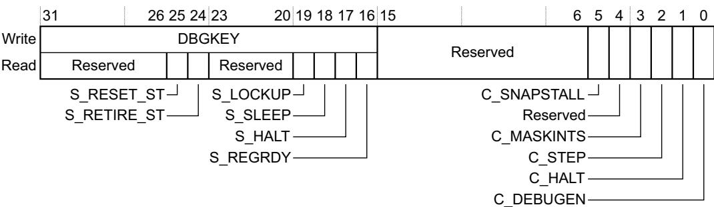

## DBGKEY, bits[31:16]

Debug key. A debugger must write 0xA05F to this field to enable write accesses to bits[15:0], otherwise the processor ignores the write access.

These bits are write-only.

Bits[31:26] Reserved, UNK/SBZP.

## S\_RESET\_ST, bit[25]

Indicates whether the processor has been reset since the last read of DHCSR:

0 No reset since last DHCSR read.

1 At least one reset since last DHCSR read.

This is a sticky bit, that clears to 0 on a read of DHCSR.

This bit is read-only.

## S\_RETIRE\_ST, bit[24]

Set to 1 every time the processor retires one or more instructions:

0 No instruction retired since last DHCSR read.

1 At least one instruction retired since last DHCSR read.

This is a sticky bit, that clears to 0 on a read of DHCSR.

The architecture does not define precisely when this bit is set to 1. It requires only that this happen periodically in Non-Debug state to indicate that software execution is progressing.

This bit is UNKNOWN after a powerup or Local reset, but then is set to 1 as soon as the processor executes and retires an instruction.

This bit is read-only.

## Bits[23:20] Reserved, UNK/SBZP.

## S\_LOCKUP, bit[19] Indicates whether the processor is locked up because of an unrecoverable exception:

0 Not locked up.

1 Locked up.

See Unrecoverable exception cases on page B1-555 for more information.

This bit can only be read as 1 by a remote debugger, using the DAP. The value of 1 indicates that the processor is running but locked up.

The bit clears to 0 when the processor enters Debug state.

This bit is read-only.

## S\_SLEEP, bit[18] Indicates whether the processor is sleeping:

0 Not sleeping.

1 Sleeping.

The debugger must set the C\_HALT bit to 1 to gain control, or wait for an interrupt or other wakeup event to wakeup the system.

This bit is read-only.

## S\_HALT, bit[17] Indicates whether the processor is in Debug state:

0 In Non-Debug state.

1 In Debug state.

This bit is read-only.

## S\_REGRDY, bit[16] A handshake flag for transfers through the DCRDR:

Writing to DCRSR clears the bit to 0.

Completion of the DCRDR transfer then sets the bit to 1.

For more information about DCRDR transfers see Debug Core Register Data Register, DCRDR on page C1-704.

0 There has been a write to the DCRDR, but the transfer is not complete.

1 The transfer to or from the DCRDR is complete.

This bit is valid only when the processor is in Debug state, otherwise the bit is UNKNOWN.

## This bit is read-only.

## Bits[15:6]

## C\_SNAPSTALL, bit[5]

Allow imprecise entry to Debug state. The actions on writing to this bit are:

0 No action.

1 Allow imprecise entry to Debug state, for example by forcing any stalled load or store instruction to complete.

Setting this bit to 1 allows a debugger to request imprecise entry to Debug state.

The effect of setting this bit to 1 is UNPREDICTABLE unless the DHCSR write also sets C\_DEBUGEN and C\_HALT to 1. This means that if the processor is not already in Debug stateit enters Debug state when the stalled instruction completes.

Writing 1 to this bit makes the state of the memory system UNPREDICTABLE. Therefore, if a debugger writes 1 to this bit it must reset the processor before leaving Debug state.

Note

A debugger can write to the DHCSR to clear this bit to 0. However, this does not remove the UNPREDICTABLE state of the memory system caused by setting C\_SNAPSTALL to 1.

The architecture does not guarantee that setting this bit to 1 will force entry to Debug state.

Arm strongly recommends that a value of 1 is never written to C\_SNAPSTALL when the processor is in Debug state.

A power-on reset sets this bit to 0.

## Bits[4]

Reserved, UNK/SBZP.

## C\_MASKINTS, bit[3]

When debug is enabled, the debugger can write to this bit to mask PendSV, SysTick and external configurable interrupts:

0 Do not mask.

1 Mask PendSV, SysTick and external configurable interrupts.

The effect of any attempt to change the value of this bit is UNPREDICTABLE unless both:

Before the write to DHCSR, the value of the C\_HALT bit is 1.

The write to the DHCSR that changes the C\_MASKINTS bit also writes 1 to the C\_HALT bit.

This means that a single write to DHCSR cannot set the C\_HALT to 0 and change the value of the C\_MASKINTS bit.

The bit does not affect NMI. When DHCSR.C\_DEBUGEN is set to 0, the value of this bit is UNKNOWN.

For more information about the use of this bit see Halting debug stepping on page C1-695. This bit is UNKNOWN after a power-on reset.

## C\_STEP, bit[2]

Processor step bit. The effects of writes to this bit are:

0 No effect.

1 Single step enabled.

For more information about the use of this bit see Table C1-9 on page C1-696.

When DHCSR.C\_DEBUGEN is set to 0, the value of this bit is UNKNOWN. This bit is UNKNOWN after a power-on reset.

## C\_HALT, bit[1]

Processor halt bit. The effects of writes to this bit are:

0 Causes the processor to leave Debug state, if in Debug state.

## 1 Halt the processor.

Table C1-9 on page C1-696 shows the effect of writes to this bit when the processor is in Debug state.

When DHCSR.C\_DEBUGEN is set to 0, the value of this bit is UNKNOWN. This bit is UNKNOWN after a power-on reset, and is 0 after a Local reset.

C\_DEBUGEN, bit[0] Halting debug enable bit:

0 Disabled.

1 Enabled.

If a debugger writes to DHCSR to change the value of this bit from 0 to 1, it must also write 0 to the C\_MASKINTS bit, otherwise behavior is UNPREDICTABLE.

This bit can only be written by the DAP, it ignores writes from software.

This bit is 0 after a power-on reset.

See Debug stepping on page C1-695 for more information about the use of this register, including information on how a debugger can force the processor to enter Debug state as soon as it comes out of reset.

## C1.6.3 Debug Core Register Selector Register, DCRSR

The DCRSR characteristics are:

Purpose With the DCRDR, see Debug Core Register Data Register, DCRDR on page C1-704, the DCRSR provides debug access to the Arm core registers, special-purpose registers, and Floating-point Extension registers. A write to DCRSR specifies the register to transfer, whether the transfer is a read or a write, and starts the transfer.

Usage constraints Only accessible in Debug state. For information about using this register see Use of DCRSR and DCRDR on page C1-705.

Configurations Always implemented.

Attributes See Table C1-10 on page C1-699.

The DCRSR bit assignments are:

<table><tr><td colspan="2">Reserved</td><td></td><td colspan="2">Reserved</td><td>REGSEL</td></tr></table>

Bits[31:17] Reserved

REGWnR, bit[16] Specifies the access type for the transfer: 0 Read. 1 Write.

Bits[15:7] Reserved

REGSEL, bits[6:0] Specifies the Arm core register, special-purpose register, or Floating-point Extension register, to transfer: 0b0000000-0b0001100 Arm core registers R0-R12. For example, 0b0000000 specifies R0, and 0b0000101 specifies R5. 0b0001101 The current SP. See also values 0b0010001 and 0b0010010. 0b0001110 LR. 0b0001111 DebugReturnAddress, see The DebugReturnAddress value on page C1-704. 0b0010000 xPSR. 0b0010001 Main stack pointer, MSP.

0b0010010 Process stack pointer, PSP.

0b0010100 Bits[31:24] CONTROL. Bits[23:16] FAULTMASK. Bits[15:8] BASEPRI. Bits[7:0] PRIMASK.

In each field, the valid bits are packed with leading zeros. For example, FAULTMASK is always a single bit, DCRDR[16], and DCRDR[23:17] is 0b0000000.

0b0100001 Floating-point Status and Control Register, FPSCR.

0b1000000-0b1011111 FP registers S0-S31. For example, 0b1000000 specifies S0, and 0b1000101 specifies S5.

All other values are Reserved.

If the processor does not implement the FP extension the REGSEL field is bits[4:0], and bits[6:5] are Reserved, SBZ.

Note

When the processor is in Debug state, the debugger must preserve the Exception number bits in the IPSR, otherwise behavior is UNPREDICTABLE.

For more information about the use of the DCRSR see Use of DCRSR and DCRDR on page C1-705.

For more information about the values that a debugger can transfer through the DCRSR see:

The Arm core registers on page B1-516, for information about R0-R12, SP, and LR.

The special-purpose Program Status Registers, xPSR on page B1-516.

The special-purpose mask registers on page B1-519, for information about FAULTMASK, BASEBRI, and PRIMASK.

The special-purpose CONTROL register on page B1-519, for information about CONTROL.

Floating-point Status and Control Register, FPSCR on page A2-37.

The FP extension registers on page A2-35, for information about S0-S31.

## The DebugReturnAddress value

DebugReturnAddress is the address of the first instruction to be executed on exit from Debug state. This address indicates the point in the execution stream where the debug event was invoked. For a hardware or a software breakpoint, this is the address of the instruction subject to the breakpoint. For all other debug events, including PC match watchpoints, DebugReturnAddress is the address of the first instruction that both:

• In a simple sequential execution of the program, executes after the instruction that caused the debug event.

Has not been executed.

Before entering Debug state, the processor has executed all instructions that are earlier in a simple sequential execution of the program than the instruction indicated by DebugReturnAddress.

Bit[0] of a DebugReturnAddress value is RAZ/SBZ. When writing a DebugReturnAddress, writing bit[0] of the address does not affect the EPSR.T bit, see The special-purpose Program Status Registers, xPSR on page B1-516.

## C1.6.4 Debug Core Register Data Register, DCRDR

The DCRDR characteristics are:

Purpose

With the DCRSR, see Debug Core Register Selector Register, DCRSR on page C1-703, the DCRDR provides debug access to the Arm core registers, special-purpose registers, and Floating-point Extension registers. The DCRDR is the data register for these accesses.

Used on its own, the DCRDR provides a message passing resource between an external debugger and a debug agent running on the processor.

Note

The architecture does not define any handshaking mechanism for this use of DCRDR.

Usage constraints See Use of DCRSR and DCRDR for constraints that apply to particular transfers using the DCRSR and DCRDR.

Configurations Always implemented.

Attributes See Table C1-10 on page C1-699. The reset value of DCRDR is UNKNOWN.

The DCRDR bit assignments are:

<table><tr><td>31</td><td></td><td></td><td></td><td></td><td></td><td></td><td>0</td></tr><tr><td colspan="8">DBGTMP</td></tr></table>

DBGTMP, bits[31:0] Data temporary cache, for reading and writing the Arm core registers, special-purpose registers, and Floating-point Extension registers.

The value of this register is UNKNOWN:

On reset.

If the processor is in Debug state, the debugger has written to DCRSR since entering Debug state and DHCSR.S\_REGRDY is set to 0.

## Use of DCRSR and DCRDR

In Debug state, writing to DCRSR clears the DHCSR.S\_REGRDY bit to 0, and the processor then sets the bit to 1 when the transfer between the DCRDR and the Arm core register, special-purpose register, or Floating-point Extension register completes. For more information about the DHCSR.S\_REGRDY bit see Debug Halting Control and Status Register, DHCSR on page C1-700.

This means that:

To transfer a data word to an Arm core register, special-purpose register, or Floating-point Extension register, a debugger:

1. Writes the required word to DCRDR.

2. Writes to the DCRSR, with the REGSEL value indicating the required register, and the REGWnR bit as 1 to indicate a write access.

This write clears the DHCSR S\_REGRDY bit to 0.

3. If required, polls DHCSR until DHCSR.S\_REGRDY reads-as-one. This shows that the processor has transferred the DCRDR value to the selected register.

To transfer a data word from an Arm core register, special-purpose register, or Floating-point Extension register, a debugger:

Writes to the DCRSR, with the REGSEL value indicating the required register, and the REGWnR bit as 0 to indicate a read access. This write clears the DHCSR.S\_REGRDY bit to 0.

2. Polls DHCSR until DHCSR.S\_REGRDY reads-as-one. This shows that the processor has transferred the value of the selected register to DCRDR.

3. Reads the required value from DCRDR.

When using this mechanism to write to the Arm core registers, special-purpose registers, or Floating-point Extension registers:

All bits of the xPSR registers are fully accessible. The effect of writing an illegal value is UNPREDICTABLE. Note

This differs from the behavior of MSR and MRS instruction accesses to the xPSR, where some bits RAZ, and some bits are ignored on writes.

The debugger can write to the EPSR.IT bits. If it does this, it must write a value consistent with the instruction to be executed on exiting Debug state, otherwise instruction execution will be UNPREDICTABLE. See ITSTATE on page A7-179 for more information. The IT bits must be zero on exit from Debug state if the instruction indicated by DebugReturnAddress is outside an IT block.

The debugger can write to the EPSR.ICI bits, and on exiting Debug state any interrupted LDM or STM instruction will use these new values. Clearing the ICI bits to zero will cause the interrupted LDM or STM instruction to restart instead of continue. For more information see Exceptions in Load Multiple and Store Multiple operations on page B1-543.

The debugger can write to the DebugReturnAddress, and on exiting Debug state the processor starts executing from this updated address. The debugger must ensure the EPSR.IT bits and EPSR.ICI bits are consistent with the new DebugReturnAddress, as described in this list.

The debugger can always set FAULTMASK to 1, and doing so might cause unexpected behavior on exit from Debug state.

Note

An MSR instruction cannot set FAULTMASK to 1 when the execution priority is -1 or higher, see MSR on page B5-677.

## C1.6.5 Debug Exception and Monitor Control Register, DEMCR

The DEMCR characteristics are:

Purpose Manages vector catch behavior and DebugMonitor handling when debugging.

Usage constraints Bits[23:16] provide DebugMonitor exception control.

Bits[15:0] provide Debug state, Halting debug, control.

Configurations Always implemented.

Attributes See Table C1-10 on page C1-699, and also:

A power-on reset resets all register bits to zero.

A Local reset resets only the bits related to the DebugMonitor to zero. These are bits[19:16]. Reset behavior on page B1-530 defines Local reset.

The DEMCR bit assignments are:

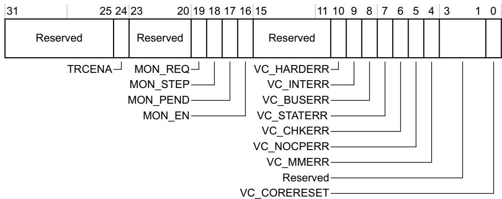

Bits[31:25] Reserved

TRCENA, bit[24] Global enable for all DWT and ITM features:

0 DWT and ITM units disabled.

1 DWT and ITM units enabled.

If the DWT and ITM units are not implemented, this bit is UNK/SBZP.

When TRCENA is set to 0:

DWT registers return UNKNOWN values on reads. Whether the processor ignores writes to the DWT unit is IMPLEMENTATION DEFINED.

ITM registers return UNKNOWN values on reads. Whether the processor ignores writes to the ITM unit is IMPLEMENTATION DEFINED.

Setting this bit to 0 might not stop all events. To ensure all events are stopped, software must set all DWT and ITM feature enable bits to 0, and then set this bit to 0.

The effect of this bit on the TPIU, ETM, and other system trace components is IMPLEMENTATION DEFINED.

Bits[23:20] Reserved.

MON\_REQ, bit[19] DebugMonitor semaphore bit. The processor does not use this bit. The monitor software defines the meaning and use of this bit.

MON\_STEP, bit[18] When MON\_EN is set to 0, this feature is disabled and the processor ignores MON\_STEP. When MON\_EN is set to 1, the meaning of MON\_STEP is: 0 Do not step the processor. 1 Step the processor. Setting this bit to 1 makes the step request pending. For more information see Debug monitor stepping on page C1-696. The effect of changing this bit at an execution priority that is lower than the priority of the DebugMonitor exception is UNPREDICTABLE.

MON\_PEND, bit[17] Sets or clears the pending state of the DebugMonitor exception:

0 Clear the status of the DebugMonitor exception to not pending. 1 Set the status of the DebugMonitor exception to pending. When the DebugMonitor exception is pending it becomes active subject to the exception priority rules. A debugger can use this bit to wakeup the monitor using the DAP. The effect of setting this bit to 1 is not affected by the value of the MON\_EN bit. A debugger can set MON\_PEND to 1, and force the processor to take a DebugMonitor exception, even when MON\_EN is set to 0.

MON\_EN, bit[16] Enable the DebugMonitor exception:

0 DebugMonitor exception disabled.

1 DebugMonitor exception enabled.

Bits[15:11] Reserved

## VC\_HARDERR, bit[10]

Enable Halting debug trap on a HardFault exception.

0 Halting debug trap disabled.

1 Halting debug trap enabled.

If DHCSR.C\_DEBUGEN is set to 0, the processor ignores the value of this bit.

VC\_INTERR, bit[9] Enable Halting debug trap on a fault occurring during exception entry or exception return. 0 Halting debug trap disabled. 1 Halting debug trap enabled. If DHCSR.C\_DEBUGEN is set to 0, the processor ignores the value of this bit.

VC\_BUSERR, bit[8] Enable Halting debug trap on a BusFault exception. 0 Halting debug trap disabled.

## 1 Halting debug trap enabled.

If DHCSR.C\_DEBUGEN is set to 0, the processor ignores the value of this bit.

## VC\_STATERR, bit[7]

Enable Halting debug trap on a UsageFault exception caused by a state information error, for example an Undefined Instruction exception.

0 Halting debug trap disabled.

1 Halting debug trap enabled.

If DHCSR.C\_DEBUGEN is set to 0, the processor ignores the value of this bit.

## VC\_CHKERR, bit[6]

Enable Halting debug trap on a UsageFault exception caused by a checking error, for example an alignment check error.

0 Halting debug trap disabled.

1 Halting debug trap enabled.

If DHCSR.C\_DEBUGEN is set to 0, the processor ignores the value of this bit.

## VC\_NOCPERR, bit[5]

Enable Halting debug trap on a UsageFault caused by an access to a coprocessor.

0 Halting debug trap disabled.

1 Halting debug trap enabled.

If DHCSR.C\_DEBUGEN is set to 0, the processor ignores the value of this bit.

VC\_MMERR, bit[4] Enable Halting debug trap on a MemManage exception.

0 Halting debug trap disabled.

1 Halting debug trap enabled.

If DHCSR.C\_DEBUGEN is set to 0, the processor ignores the value of this bit.

Bits[3:1] Reserved

## VC\_CORERESET, bit[0]

Enable Reset Vector Catch. This causes a Local reset to halt a running system.

0 Reset Vector Catch disabled.

1 Reset Vector Catch enabled.

If DHCSR.C\_DEBUGEN is set to 0, the processor ignores the value of this bit.

Fault behavior on page B1-551 lists all the faults and their assignment to vector catch enable bits.

## C1.7 The Instrumentation Trace Macrocell

The Instrumentation Trace Macrocell (ITM) provides a memory-mapped register interface that applications can use to write logging or event words to a trace sink, for example to the optional external Trace Port Interface Unit (TPIU). The ITM also provides control of timestamp packets, and generation of Local timestamp packets.

The ITM forms event words and timestamp information into packets, using the packet protocol described in Appendix D4 Debug ITM and DWT Packet Protocol, and multiplexes them with hardware event packets from the Data Watchpoint and Trace (DWT) unit. See How the ITM relates to other debug components on page C1-713 for more information.

## C1.7.1 ITM operation

The ITM consists of:

Up to 256 stimulus registers, see Stimulus Port registers, ITM\_STIM0-ITM\_STIM255 on page C1-714.

Up to eight enable registers, see Trace Enable Registers, ITM\_TER0-ITM\_TER7 on page C1-714.

An access control register, see Trace Privilege Register, ITM\_TPR on page C1-715.

A general control register, see Trace Control Register, ITM\_TCR on page C1-716.

The number of Stimulus Port registers is an IMPLEMENTATION DEFINED multiple of eight. Software can find the number of supported stimulus ports by writing all ones to the Trace Privilege Register, and then reading how many bits are set to 1.

If the ITM is disabled or not implemented, a write to a stimulus port must not cause a BusFault exception. This ensures the ITM is transparent to application software.

The Trace Privilege Register defines whether each group of eight Stimulus Port registers, and their corresponding Trace Enable Register bits, can be written by an unprivileged access. Unprivileged code can always read the Stimulus Port registers.

Stimulus Port registers are 32-bit registers that support the following word-aligned accesses:

Byte accesses, to access register bits[7:0].

Halfword accesses, to access register bits[15:0].

Word accesses, to access register bits[31:0].

Non-word-aligned accesses are UNPREDICTABLE.

ITM\_TCR.ITMENA is a global enable bit for the ITM. A power-on reset clears this bit to 0, disabling the ITM. The ITM\_TERs provide an enable bit for each stimulus port.

When software writes to an enabled stimulus port, the ITM combines the identity of the port, the size of the write access, and the data written, into a packet that it writes to a FIFO. The ITM transmits packets from the FIFO to a trace sink, such as a TPIU.

The ITM must implement at least a single-entry stimulus port output buffer, shared by all the Stimulus Port registers. The size of this output buffer is IMPLEMENTATION DEFINED. When the stimulus port output buffer is full, if software writes to any stimulus port, the ITM ignores the write, and generates an Overflow packet.

Reading the Stimulus Port register of any enabled stimulus port indicates the output buffer status. Reading a Stimulus Port register when the ITM is disabled, or when the individual stimulus port is disabled in the corresponding Stimulus Port Enable register, returns the value indicating that the output buffer is full.

Packets generated by the DWT unit use a separate output buffer. Therefore, the output buffer status obtained by reading a Stimulus Port register is not affected by trace generated by the DWT unit.

To ensure system correctness, a software polling scheme might use exclusive accesses to ensure there is space in the output buffer before performing a stimulus port write.

## ITM access permissions

The access permissions for the stimulus ports are:

Unprivileged and privileged software can read all ITM registers at all times.

For write accesses to all stimulus ports, the ITM:

Ignores the access if ITM\_TCR.ITMENA is set to 0, or the port is disabled by the corresponding Trace Enable Register.

Accepts the access if ITM\_TCR.ITMENA is set to 1, and the port is enabled by the corresponding Trace Enable Register.

• For unprivileged write accesses:

The ITM always ignores accesses to the Trace Control and Trace Privilege Registers.

For each stimulus port, the setting in the appropriate Trace Privilege Register determines whether the ITM accepts or ignores an access to the corresponding Stimulus Port or Trace Enable Register, see Trace Privilege Register, ITM\_TPR on page C1-715.

## Timestamp support

Timestamps provide information on the timing of event generation with respect to their visibility at a trace output port. An Armv7-M processor can implement either or both of the following types of timestamp:

## Local timestamps

These provide delta timestamp values, meaning each local timestamp indicates the elapsed time since generating the previous local timestamp. The ITM generates these from the timestamp clock in the ITM unit. Each time it generates a Local timestamp packet it resets this clock, to provide the delta functionality. For more information see Local timestamping.

## Global timestamps

These provide absolute timestamp values, based on a system global timestamp clock. They provide synchronization between different trace sources in the system. For more information see Global timestamping on page C1-711.

## Local timestamping

The following features of local timestamp generation by the ITM are IMPLEMENTATION DEFINED:

The timestamp counter size.

The available clocking modes, that is, whether the local timestamp counter can be driven using: Synchronous clocking

The local timestamp counter is driven by the processor clock.

Asynchronous clocking

The local timestamp counter is driven by an asynchronous clock signal from the TPIU.

When asynchronous clocking is implemented, whether the incoming clock signal can be divided before driving the local timestamping counter.

For more information about the timestamp clocking options, see Local timestamp clocking options on page C1-711.

The ITM\_TCR register controls timestamping, see Trace Control Register, ITM\_TCR on page C1-716:

ITM\_TCR.TSENA enables Local timestamp packet generation.

If the implementation supports both synchronous and asynchronous clocking of the local timestamp counter, ITM\_TCR.SWOENA selects the clocking mode.

If the implementation supports division of the incoming asynchronous clock signal, ITM\_TCR.TSPrescale sets the prescaler divide value.

Local timestamping is differential, meaning each timestamp gives the time since the previous local timestamp. When local timestamping is enabled and a DWT or ITM event transfers a packet to the appropriate output FIFO, and the timestamp counter is non-zero, the ITM:

Generates a Local timestamp packet.

Resets the timestamp counter to zero.

If the timestamp counter overflows, it continues counting from zero and the ITM generates an Overflow packet and transmits an associated Local timestamp packet at the earliest opportunity. If higher priority trace packets delay transmission of this Local timestamp packet, the timestamp packet has the appropriate non-zero local timestamp value.

The ITM can generate a Local timestamp packet relating to a single event packet, or to a stream of back-to-back packets if multiple events generate a packet stream without any idle time. Local timestamp packets include status information that indicates any delay in one or both of:

Transmission of the timestamp packet relative to the corresponding event packet.

Transmission of the corresponding event packet relative to the event itself.

If the ITM cannot generate a Local timestamp packet synchronously with the corresponding event, the timestamp count continues until the ITM can sample it and deliver a Local timestamp packet to the FIFO. Local timestamp packets support a maximum count field of 28 bits. The ITM compresses the count value by removing leading zeroes, and transmits the minimum-sized packet that can hold the required count value. For more information see Local timestamp packets on page D4-783.

## Local timestamp clocking options

The supported clocking options are IMPLEMENTATION DEFINED. This section assumes all options are implemented.

When software selects the synchronous clocking option, when local timestamping is enabled, the system clock drives the timestamp counter, and the counter increments on each clock cycle. With this clocking option, whether local timestamps are generated in Debug state is IMPLEMENTATION DEFINED, but Arm recommends that entering Debug state disables local timestamping, regardless of the value of the ITM\_TCR.TSENA bit.

When software selects the asynchronous clocking option, and enables local timestamping, a lineout clock signal from the TPIU interface drives the timestamp counter, through a configurable prescaler. With this clocking option:

When the TPIU asynchronous interface is idle, it holds the timestamp counter in reset. This means that the ITM does not generate a local timestamp on the first packet after an idle on the asynchronous interface.

Because the timestamp reference clock, before division by the prescaler, is the lineout clock from the TPIU asynchronous interface, its rate depends on the output encoding scheme, NRZ or Manchester, used by the interface. For more information see Trace Port Interface Unit on page C1-750.

Whether an implementation supports asynchronous clocking of local timestamps is IMPLEMENTATION DEFINED. Support requires appropriate functionality in the TPIU. The Armv7-M TPIU can provide this support, see Trace Port Interface Unit on page C1-750.

## Global timestamping

When an implementation includes global timestamping, the ITM includes:

An external ITM timestamp interface, providing:

A 48-bit or 64-bit global timestamp count value.

A clock change signal that the system asserts if there is a change in the ratio between the global timestamp clock frequency and the processor clock frequency. Implementation and use of the clock change signal is optional and deprecated.

The protocol defined in Appendix D4 Debug ITM and DWT Packet Protocol supports global timestamp sizes of 48 or 64 bits. If implemented with a global timestamp counter that is larger than 48 bits, the DWT timestamp packets must carry the least significant bits of the timestamp values.

A signal from the DWT unit that the unit can assert to request generation of a full 48-bit global timestamp. The DWT synchronization timer drives this signal, see The synchronization packet timer on page C1-733. This request remains pending until the ITM transmits the requested timestamp.

The ITM\_TCR.GTSFREQ field, to set the frequency of generating global timestamps, or disable global timestamping. For more information see Trace Control Register, ITM\_TCR on page C1-716.

Two formats of Global timestamp are defined:

The first packet, a Global timestamp 1 packet, holds the value of timestamp bits [25:0] and Wrap and Clock change indicators.

The second packet, a Global timestamp 2 packet, holds the value of the high-order bits:

Bits [47:26] if a 48-bit timestamp is supported.

Bits [63:26] if a 64-bit timestamp is supported.

The global timestamp generated by the ITM must be a full global timestamp:

When software first enables global timestamping, by changing ITM\_TCR.GTSFREQ from zero to a non-zero value.

When the system asserts the clock ratio change signal in the external ITM timestamp interface.

In response to a request from the DWT unit, see The synchronization packet timer on page C1-733.

If, when it has to generate a global timestamp, it detects that the value of high-order bits of the global timestamp have changed.

When the ITM generates a global timestamp, it does so after a non-delayed Instrumentation or Hardware Source packet. The Global Timestamp 1 packet is always associated with the most recently output non-delayed Instrumentation or Hardware Source packet. Following the prioritization scheme described in Arbitration between packets from different sources on page C1-713, other packets might be output before the Global Timestamp 1 packet.

When the ITM must generate a full global timestamp:

The ITM first generates the Global timestamp 1 packet with timestamp bits [25:0], with the applicable one of the ClockCh and Wrap bits in that packet set to 1 to indicate that the high-order bits of the timestamp will also be output. This is the packet that the ITM outputs after a non-delayed trace packet.

Because of packet prioritization, the ITM might have to output other trace packets before it can output the Global timestamp 2 packet containing the high-order bits of the timestamp. It might also have to generate another global timestamp. If so, it outputs the Global timestamp 1 packet with timestamp bits [25:0] and the Wrap bit set to 1.

The ITM later generates the Global timestamp 2 packet with the high-order bits for the most recently generated Global timestamp 1 packet.

Otherwise, it generates only a single Global timestamp packet, compressing the packet by omitting unchanged significant bits if possible.

For more information about the Global timestamp packets and their formats see Global timestamp packets on page D4-785.

## Synchronization support

Synchronization packets are independent of timestamp packets. An external debugger uses Synchronization packets to recover bit-to-byte alignment information in a serial data stream. The following implementations require the ITM to insert Synchronization packets in the data stream:

A parallel trace port that is dedicated to an Armv7-M processor.

A system that formats multiple trace streams into a single output.

If software enables Synchronization packets, the ITM generates them regularly, and they can be used as a system heartbeat.

If a system is using an asynchronous serial trace port, Arm recommends it disables Synchronization packets to reduce the data stream bandwidth.

The ITM\_TCR.SYNCENA bit enables generation of synchronization packets, see Trace Control Register, ITM\_TCR on page C1-716. The DWT\_CTRL.SYNCTAP field controls the frequency of generation, see Control register, DWT\_CTRL on page C1-737.

For more information about synchronization and trace formatting see the Arm<sup>®</sup> CoreSight<sup>™</sup> Architecture Specification.

## How the ITM relates to other debug components

The ITM combines the following packets into a single trace stream:

ITM data packets.

Overflow packets.

Local and Global timestamp packets.

Synchronization packets.

DWT data packets, see The Data Watchpoint and Trace unit on page C1-719.

Figure C1-1 shows how the ITM relates to other debug components.

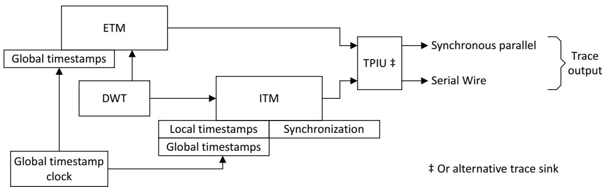  
Figure C1-1 Relationship between ITM and other debug components

## Arbitration between packets from different sources

When multiple sources are generating data at the same time, the ITM arbitrates using the following priorities:

Synchronization, when required

Priority level -1, highest.

Instrumentation Source Priority level 0.

Hardware Source Priority level 1.

Local timestamps

Priority level 2.

Global timestamps

Priority level 3, lowest. GTS1 packets have higher priority than GTS2 packets, see Global timestamp packets on page D4-785.

This guarantees the highest quality of service for ITM output. The ITM prioritizes this over hardware-generated DWT event packets. The ITM transmits timestamps only when the other source queues are empty.

## C1.7.2 ITM register summary

Table C1-11 shows the ITM registers in address order. All registers are 32-bits wide.

Table C1-11 Register summary

<table><tr><td>Address</td><td>Name</td><td>Type</td><td> $Reset^a$ </td><td>Description</td></tr><tr><td>0xE0000000 - 0xE00003FC</td><td>ITM_STIMx</td><td>RW</td><td> $UNKNOWN^b$ </td><td>Stimulus Port registers, ITM_STIM0-ITM_STIM255 on page C1-714</td></tr><tr><td>0xE0000E00 - 0xE0000E1C</td><td>ITM TERx</td><td>RW</td><td>0x00000000</td><td>Trace Enable Registers, ITM TER0-ITM TER7 on page C1-714</td></tr><tr><td>Address</td><td>Name</td><td>Type</td><td> $Reseta^a$ </td><td>Description</td></tr><tr><td>0xE0000E40</td><td>ITM_TPR</td><td>RW</td><td>0x00000000</td><td>Trace Privilege Register, ITM_TPR on page C1-715</td></tr><tr><td>0xE0000E80</td><td>ITM_TCR</td><td>RW</td><td> $_b$ </td><td>Trace Control Register, ITM_TCR on page C1-716</td></tr><tr><td>0xE0000FD0 - 0xE0000FFC</td><td>-</td><td>-</td><td>-</td><td>Optional CoreSight management and ID registers. SeeAppendix D1Army7-M CoreSight Infrastructure IDsfor more information.</td></tr></table>

a. Reset values apply to power-on reset only, not to Local reset.  
b. See register description for more information.

## C1.7.3 Stimulus Port registers, ITM\_STIM0-ITM\_STIM255

The ITM\_STIMx register characteristics are:

Purpose Provide the interface for generating instrumentation messages.

Usage constraints

Accessible by word-aligned byte, halfword, and word accesses.

The number of ITM\_STIM registers is an IMPLEMENTATION DEFINED multiple of eight, see Trace Privilege Register, ITM\_TPR on page C1-715.

When DEMCR.TRCENA is 0, the ITM\_STIM registers are UNKNOWN on reads and ignore writes.

Configurations Always implemented.

Attributes

See Table C1-11 on page C1-713, and the register field descriptions. The address of ITM\_STIMn is (0xE0000000 + 4n).

The ITM\_STIMx bit assignments are:

<table><tr><td></td><td>31</td><td></td><td></td><td></td><td></td><td></td><td></td><td></td><td>1</td><td>0</td></tr><tr><td>Writes</td><td colspan="10">STIMULUS</td></tr><tr><td>Reads</td><td colspan="9">Reserved</td><td></td></tr></table>

FIFOREADY

STIMULUS, bits[31:0]

Data write to the stimulus port FIFO, for forwarding as a software event packet. These bits are write-only.

Bits[31:1] Reserved. These bits are read-only.

FIFOREADY, bit[0] Indicates whether the stimulus port FIFO can accept data.

0 Stimulus port FIFO full.

1 Stimulus port FIFO can accept at least one word.

This bit is UNKNOWN after a power-on reset. This bit is read-only.

## C1.7.4 Trace Enable Registers, ITM\_TER0-ITM\_TER7

The ITM\_TERx characteristics are:

Purpose Provide an individual enable bit for each ITM\_STIM register.

Usage constraints

Each ITM\_TER provides enable bits for 32 ITM\_STIM registers.

Bits corresponding to unimplemented ITM\_STIM registers are RAZ/WI. See Trace Privilege Register, ITM\_TPR on page C1-715 for information about the number of implemented ITM\_STIM registers.

The processor ignores any unprivileged write to an ITM\_TERx bit if the corresponding ITM\_TPR.PRIVMASK bit is set to 1, see Trace Privilege Register, ITM\_TPR.

Configurations Always implemented.

Attributes See Table C1-11 on page C1-713.

The ITM\_TERx bit assignments are:

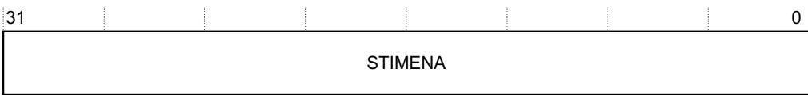  
STIMENA, bits[31:0]

For bit STIMENA[n], in register ITM\_TERx:

0 Stimulus port (32x + n) disabled.

1 Stimulus port (32x + n) enabled.

Table C1-12 Mapping between ITM\_TERs, stimulus ports, and ITM\_STIMs

<table><tr><td>ITM_TER</td><td>Stimulus ports</td><td>ITM_STIMs</td></tr><tr><td>ITM_TER0</td><td>0-31</td><td>ITM_STIM0-ITM_STIM31</td></tr><tr><td>ITM_TER1</td><td>32-63</td><td>ITM_STIM32-ITM_STIM63</td></tr><tr><td>ITM_TER2</td><td>64-95</td><td>ITM_STIM64-ITM_STIM95</td></tr><tr><td>ITM_TER3</td><td>96-127</td><td>ITM_STIM96-ITM_STIM127</td></tr><tr><td>ITM_TER4</td><td>128-159</td><td>ITM_STIM128-ITM_STIM159</td></tr><tr><td>ITM_TER5</td><td>160-191</td><td>ITM_STIM160-ITM_STIM191</td></tr><tr><td>ITM_TER6</td><td>192-223</td><td>ITM_STIM192-ITM_STIM223</td></tr><tr><td>ITM_TER7</td><td>224-255</td><td>ITM_STIM224-ITM_STIM255</td></tr></table>

## C1.7.5 Trace Privilege Register, ITM\_TPR

The ITM\_TPR characteristics are:

Purpose Controls which stimulus ports can be accessed by unprivileged code.

Each register bit controls access to eight stimulus ports.

The number of implemented stimulus ports is a multiple of eight. Implemented stimulus ports number consecutively from 0.

Bits corresponding to unimplemented stimulus ports are RAZ/WI.

Configurations

Always implemented.

Attributes

See Table C1-11 on page C1-713.

The ITM\_TPR bit assignments are:

<table><tr><td>31</td><td></td><td></td><td></td><td></td><td></td><td></td><td>0</td></tr><tr><td colspan="8">PRIVMASK</td></tr></table>

PRIVMASK, bits[31:0]

Bit mask to enable unprivileged access to ITM stimulus ports.

Bit[n] of PRIVMASK controls stimulus ports 8n to 8n+7:

0 Unprivileged access permitted.

1 Privileged access only.

See ITM operation on page C1-709 for a description of using ITM\_TPR to determine the number of implemented stimulus ports.

## C1.7.6 Trace Control Register, ITM\_TCR

The ITM\_TCR characteristics are:

Purpose Configures and controls transfers through the ITM interface.

Usage constraints For information about constraints that apply in a system that supports multiple trace streams see CoreSight requirements for the TraceBusID field on page C1-718.

Configurations Always implemented.

Attributes See Table C1-11 on page C1-713, and the register field descriptions.

Note

Early versions of this specification called the ITM\_TCR.TXENA bit the DWTENA bit. The new name more accurately indicates the effect of setting this bit to 1.

<table><tr><td colspan="2">Reserved</td><td></td><td>TraceBusID</td><td>Reserved</td><td></td><td></td><td></td><td></td><td></td><td></td><td></td><td></td><td></td></tr><tr><td colspan="4">BUSY</td><td colspan="10">GTSFREQ——TSPrescale——Reserved——SWOENA——TXENA——SYNCENA——TSENA——ITMENA——</td></tr></table>

Bits[31:24] Reserved.

BUSY, bit[23] Indicates whether the ITM is currently processing events:

0 ITM is not processing any events.

1 ITM events present and being drained.

These bits are read-only.

TraceBusID, bits[22:16]

Identifier for multi-source trace stream formatting. If multi-source trace is in use, the debugger must write a non-zero value to this field. For more information see CoreSight requirements for the TraceBusID field on page C1-718.

On a power-on reset, the value of this field is UNKNOWN.

Bits[15:12] Reserved.

## GTSFREQ, bits[11:10]

Global timestamp frequency. Defines how often the ITM generates a global timestamp, based on the global timestamp clock frequency, or disables generation of global timestamps. The possible values are:

00 Disable generation of global timestamps.

01 Generate timestamp request whenever the ITM detects a change in global timestamp counter bits[N:7]. This is approximately every 128 cycles.

10 Generate timestamp request whenever the ITM detects a change in global timestamp counter bits[N:13]. This is approximately every 8192 cycles.

11 Generate a timestamp after every packet, if the output FIFO is empty.

N is the size of the Global Timestamp counter, minus 1.

For more information see Global timestamping on page C1-711.

A power-on reset clears this field to zero.

If the implementation does not support global timestamping then these bits are reserved, RAZ/WI.

TSPrescale, bits[9:8] Local timestamp prescaler, used with the trace packet reference clock. The possible values are:

00 No prescaling.

01 Divide by 4.

10 Divide by 16.

11 Divide by 64.

If implemented, a power-on reset clears this field to zero.

If the processor does not implement the timestamp prescaler then these bits are reserved, RAZ/WI.

## Bits[7:5]

SWOENA, bit[4] Enables asynchronous clocking of the timestamp counter:

0 Timestamp counter uses the processor system clock.

1 Timestamp counter uses asynchronous clock from the TPIU interface. The timestamp counter is held in reset while the output line is idle.

Which clocking modes are implemented is IMPLEMENTATION DEFINED. If the implementation does not support both modes this bit is either RAZ or RAO, to indicate the implemented mode.

When this is a RW bit, on a power-on reset, the value of this bit is UNKNOWN

TXENA, bit[3] Enables forwarding of hardware event packet from the DWT unit to the ITM for output to the TPIU:

0 Disabled.

1 Enabled.

It is IMPLEMENTATION DEFINED whether the DWT discards packets that it cannot forward to the ITM.

Note

If a debugger changes this bit from 0 to 1, the DWT might forward a hardware event packet that it has previously generated.

A power-on reset clears this bit to 0.

## SYNCENA, bit[2]

Enables Synchronization packet transmission for a synchronous TPIU:

0 Disabled.

1 Enabled.

A power-on reset clears this bit to 0.

Note

If a debugger sets this bit to 1 it must also configure DWT\_CTRL.SYNCTAP for the correct synchronization speed, see Control register, DWT\_CTRL on page C1-737.

TSENA, bit[1] Enables Local timestamp generation:

0 Disabled.

1 Enabled.

A power-on reset clears this bit to 0.

ITMENA, bit[0] Enables the ITM:

0 Disabled.

1 Enabled.

This is the enable control for the ITM unit. A debugger must set this bit to 1 to permit writes to all Stimulus Port registers.

A power-on reset clears this bit to 0.

For more information about ITM operation and the ITM\_TCR fields see ITM operation on page C1-709.

## CoreSight requirements for the TraceBusID field

If a system supports multiple trace streams, the debugger must write a nonzero value to the ITM\_TCR.TraceBusID field. For information about permitted values for this field in a CoreSight-compliant implementation, see the Arm<sup>®</sup> CoreSight<sup>™</sup> Architecture Specification. The system uses this value to identify the ITM and DWT trace stream. To avoid trace stream corruption, before modifying the ITM\_TCR.TraceBusID a debugger must:

1. Clear the ITM\_TCR.ITMENA bit to 0, to disable the ITM.

2. Poll the ITM\_TCR.BUSY bit until it returns 0, indicating that the ITM is inactive.

An example of a system with multiple trace streams is an Armv7-M core with ETM. In this case, the debugger must program the ETM TraceBusID register with a different nonzero identifier for the ETM trace stream. See the applicable Arm Embedded Trace Macrocell Architecture Specification for more information.

## C1.8 The Data Watchpoint and Trace unit

The Data Watchpoint and Trace (DWT) unit provides the following:

• Comparators, that support:

Watchpoints, causes the processor to enter Debug state or take a DebugMonitor exception.

Data tracing.

— Signaling for use with an external resource, for example an ETM.

PC value tracing.

— Cycle count matching.

Additional PC sampling:

— PC sample trace output as a result of a cycle count event.

External PC sampling using a PC sample register.

Exception trace.

Performance profiling counters.

Which DWT features are supported is IMPLEMENTATION DEFINED. See Debug support in Armv7-M on page C1-683 for information on how to determine the level of DWT support in an implementation.

Many DWT operations generate DWT trace data, using the packet protocol described in Appendix D4 Debug ITM and DWT Packet Protocol. The DWT forwards these packets to the ITM for transmission, see How the ITM relates to other debug components on page C1-713. Software must set the ITM\_TCR.TXENA bit to 1 to enable transmission of these DWT packets, see Trace Control Register, ITM\_TCR on page C1-716.

Transmission of packets generated by the ITM or the DWT unit requires the processor to implement and enable the cycle counter, indicated by DWT\_CTRL.NOCYCCNT being RAZ, and DWT\_CTRL.CYCCNTENA being set to 1, see Control register, DWT\_CTRL on page C1-737.

The following sections describe the operation of the different features of the DWT unit:

The DWT comparators.

Exception trace support on page C1-731.

CYCCNT cycle counter and related timers on page C1-731.

Profiling counter support on page C1-734.

Exception trace support on page C1-731.

DWT register summary on page C1-736 summarizes the DWT unit registers, and the remaining subsections in this section describe each of the DWT registers.

## C1.8.1 The DWT comparators

The DWT unit can include between 0 and 15 comparators. The DWT\_CTRL.NUMCOMP field indicates the number of implemented comparators, see Control register, DWT\_CTRL on page C1-737.

When a DWT implementation includes one or more comparators, which comparator features are supported is IMPLEMENTATION DEFINED. Checking the implemented features of the DWT comparators on page C1-730 describes how software can find which features are supported. The remainder of this summary describes an implementation that includes all features.

A DWT comparator compares one of the following with the value held in its DWT\_COMP register:

A data address.

An instruction address.

A data value.

• The cycle count value, for comparator 0 only.

For address matching, the comparator can use a mask, so it matches a range of addresses.

On a successful match, the comparator generates one of the following:

• One or more DWT Data trace packets, containing one or more of:

The address of the instruction that caused a data access.

Bits[15:0] of the data access address.

The matched data value.

A watchpoint debug event, on either the PC value or the accessed data address.

A CMPMATCH[N] event, that signals the match outside the DWT unit.

A watchpoint debug event either generates a DebugMonitor exception, or causes the processor to halt execution and enter Debug state.

For each implemented comparator, a set of registers define the comparator operation. For comparator n:

DWT\_COMPn holds a value for comparison, see Comparator registers, DWT\_COMPn on page C1-745.

For address comparisons, DWT\_MASKn holds a mask for use when comparing with the value of DWT\_COMPn, see Comparator Mask registers, DWT\_MASKn on page C1-745. Using a mask means the comparator matches on a range of addresses, defined by the unmasked most significant bits of the address.

DWT\_FUNCTIONn defines the operation of the comparator, see Comparator Function registers, DWT\_FUNCTIONn on page C1-746. This definition includes:

Whether the comparison is an access address comparison, a data value comparison, or, for comparator 0 only, a cycle count comparison.

— For a data value comparison, the size of the data unit to compare, byte, halfword, or word.

Whether this comparator is linked with another comparator, to define a more complex comparison, for example a comparison of both the instruction address and the associated data value.

For implemented comparators up to and including comparator 3, whether a successful address comparison generates a DWT Data trace packet. See Data trace packets discriminator IDs 8-23 on page D4-793 for more information about these packets.

The comparator function. That is, the type of comparison to make and the action to take if the comparison succeeds. For more information see Summary of DWT comparator functions.

When multiple comparator matches occur on execution of an instruction, the DWT always generates any required watchpoint event or CMPMATCH[N] event. However it is UNPREDICTABLE whether it generates Data trace packets.

If a comparator match requires the DWT to generate a Data trace packet, but it cannot do so because the DWT output buffer is full, the ITM generates an Overflow packet, see Overflow packet on page D4-783.

## Summary of DWT comparator functions

The DWT\_FUNCTION register defines the required operation of the comparator. The following fields together define the required function:

DATAVMATCH, bit[8].

CYCMATCH, bit[7]. On all comparators except comparator 0, the CYCMATCH bit is UNK/SBZP.

FUNCTION, bits[3:0].

For some functions, other fields in the DWT\_FUNCTION register give more information about the required operation. shows how the DATAVMATCH and CYCMATCH fields define the required comparison type, and the use of the corresponding DWT\_MASK and DWT\_COMP registers, and references subsections that describe how the FUNCTION field defines the supported comparisons of that type.

Table C1-13 DWT\_FUNCTION register comparison type definition

<table><tr><td colspan="5">DWT_FUNCTION bits:</td></tr><tr><td>DATAVMATCH</td><td>CYCMATCH</td><td>Comparison type and DWT_COMP use</td><td>DWT_MASK use</td><td>Functions</td></tr><tr><td>0</td><td>0</td><td>Address</td><td>Mask value</td><td>See Address comparison functions</td></tr><tr><td>0</td><td> $1^a$ </td><td>Cycle count</td><td>SBZ</td><td>See Cycle count comparison functions on page C1-724</td></tr><tr><td> $1^b$ </td><td>0</td><td>Data value</td><td>SBZ</td><td>See Data value comparison functions on page C1-725</td></tr><tr><td> $1^b$ </td><td> $1^a$ </td><td>-</td><td>-</td><td>Operation is UNPREDICTABLE</td></tr></table>

a. On comparator 0 only, and only if the implementation supports cycle count comparison, otherwise, DWT\_FUNCTION.CYCMATCH is UNK/SBZP.  
b. Only if the comparator supports data value matching, otherwise, DWT\_FUNCTION.DATVMATCH is RAZ/WI.

## Address comparison functions

Software selects these functions by setting DWT\_FUNCTIONn.DATAVMATCH to 0 and, for comparator 0, DWT\_FUNCTION0.CYCMATCH to 0.

For these functions:

The DWT\_FUNCTIONn.FUNCTION field defines the required access types to be compared:

Data accesses, or instruction accesses.

— Read accesses, write accesses, or read and write accesses.

It also defines the action performed on a successful match.

For some functions, the DWT\_FUNCTIONn.EMITRANGE bit affects the action performed on a successful match.

The comparator compares the address of each memory access of the type specified by the FUNCTION field with the value held in the corresponding DWT\_COMP register. If the values match it performs the specified operation.

• Software can program a comparator to match on a range of addresses by:

Programming DWT\_COMP with the most significant address bits required for the match, with the least significant bits programmed as zeros.

Programming DWT\_MASK with a corresponding mask size, to be applied to the access address when making the comparison.

For example, to match on a 16-byte block of addresses software must:

Program DWT\_COMP bits[31:4] with the value of the most significant bits of the required addresses, and bits[3:0] as 0b0000.

Program DWT\_MASK with a value of four, to mask address bits[3:0] from the comparison.

The DWT\_FUNCTIONn DATAVADDR1, DATAVADDR0, and DATAVSIZE fields are all SBZ. Operation is UNPREDICTABLE if software programs any of these fields to a non-zero value.

It is IMPLEMENTATION DEFINED whether a vector table read performed as part of exception processing is considered as a memory read-access for the purpose of watchpoint matching.

Table C1-14 on page C1-722 shows the supported address comparison functions. In this table, in the Compared accesses column:

Daddr indicates that the comparator compares the address for data accesses.

Iaddr indicates that the comparator compares the address for instruction fetches.

RO indicates that the comparator compares the address only for read accesses.

WO indicates that the comparator compares the address only for write accesses.

RW indicates that the comparator compares the address for read and write accesses.

Table C1-14 DWT address comparison functions

<table><tr><td colspan="2">DWT_FUNCTIONn fields</td><td rowspan="2" colspan="2">Compared accesses</td><td rowspan="2">Action on successful match</td></tr><tr><td>FUNCTION</td><td>EMITRANGE</td></tr><tr><td>0000</td><td>x</td><td>-</td><td>-</td><td>Comparator disabled, or part of a LinkAddra comparison</td></tr><tr><td rowspan="2">0001</td><td>0</td><td>Daddr</td><td>RW</td><td>Generate Data trace PC value  $packet^b$ </td></tr><tr><td>1</td><td>Daddr</td><td>RW</td><td>Generate Data trace address  $packet^b$ </td></tr><tr><td rowspan="2">0010</td><td>0</td><td>Daddr</td><td>RW</td><td>Generate Data trace data value  $packet^b$ </td></tr><tr><td>1</td><td>Daddr</td><td>RW</td><td>Generate Data trace address and data value  $packets^b$ </td></tr><tr><td rowspan="2">0011</td><td>0</td><td>Daddr</td><td>RW</td><td>Generate Data trace PC value and data value  $packets^b$ </td></tr><tr><td>1</td><td>Daddr</td><td>RW</td><td>Generate Data trace address and data value  $packets^b$ </td></tr><tr><td>0100</td><td>x</td><td>Iaddr</td><td>-</td><td>Generate PC watchpoint debug  $event^c$ </td></tr><tr><td>0101</td><td>x</td><td>Daddr</td><td>RO</td><td>Generate watchpoint debug  $event^c$ </td></tr><tr><td>0110</td><td>x</td><td>Daddr</td><td>WO</td><td>Generate watchpoint debug  $event^c$ </td></tr><tr><td>0111</td><td>x</td><td>Daddr</td><td>RW</td><td>Generate watchpoint debug  $event^c$ </td></tr><tr><td>1000</td><td>x</td><td>Iaddr</td><td>-</td><td>Generate CMPMATCH[N]  $event^d$ </td></tr><tr><td>1001</td><td>x</td><td>Daddr</td><td>RO</td><td>Generate CMPMATCH[N]  $event^d$ </td></tr><tr><td>1010</td><td>x</td><td>Daddr</td><td>WO</td><td>Generate CMPMATCH[N]  $event^d$ </td></tr><tr><td>1011</td><td>x</td><td>Daddr</td><td>RW</td><td>Generate CMPMATCH[N]  $event^d$ </td></tr><tr><td rowspan="2">1100</td><td>0</td><td>Daddr</td><td>RO</td><td>Generate Data trace data value  $packet^b$ </td></tr><tr><td>1</td><td>Daddr</td><td>RO</td><td>Generate Data trace address  $packet^b$ </td></tr><tr><td rowspan="2">1101</td><td>0</td><td>Daddr</td><td>WO</td><td>Generate Data trace data value  $packet^b$ </td></tr><tr><td>1</td><td>Daddr</td><td>WO</td><td>Generate Data trace address  $packet^b$ </td></tr><tr><td rowspan="2">1110</td><td>0</td><td>Daddr</td><td>RO</td><td>Generate Data trace PC value and data value  $packets^b$ </td></tr><tr><td>1</td><td>Daddr</td><td>RO</td><td>Generate Data trace address and data value  $packets^b$ </td></tr><tr><td rowspan="2">1111</td><td>0</td><td>Daddr</td><td>WO</td><td>Generate Data trace PC value and data value  $packets^b$ </td></tr><tr><td>1</td><td>Daddr</td><td>WO</td><td>Generate Data trace address and data value  $packets^b$ </td></tr></table>

b. For more information, see Data trace packet generation on page C1-729.  
a. For more information see LinkAddr support on page C1-728. In this case, this comparator compares the data access address, and the linked data value comparator defines the action taken when both comparators match.  
c. For more information, see Watchpoint debug event generation on page C1-729.  
d. For more information, see CMPMATCH[N] event generation on page C1-730.

## Comparator behavior for instruction address matching

All comparators support instruction address matching. Comparator operation is UNPREDICTABLE unless:

If masking is not used, the DWT\_COMPn value is halfword-aligned.

If masking is used, the DWT\_COMPn value is the masked address for comparison.

If software sets a match on the address of a NOP or IT instruction, whether the event occurs or not is UNPREDICTABLE.

The following pseudocode shows the comparator behavior for instruction address matching:

```txt
// InstructionAddressMatch()
// ========
boolean InstructionAddressMatch(integer N, bits(32) Iaddr)
    assert N < UInt(DWT_CTRL.NUMCOMP);
    valid = ((DWT_FUNCTION[N].FUNCTION == '0100' || DWT_FUNCTION[N].FUNCTION == '1000') &&
    DWT_FUNCTION[N].DATAVMATCH == '0' &&
    (N != 0 || DWT_FUNCTION[N].CYCMATCH == '0'));
    if valid then
    mask = ZeroExtend(Ones(UInt(DWT_MASK[N].MASK)), 32);
    // UNPREDICTABLE if COMP does not meet alignment and masking conditions
    if !IsZero(DWT_COMP[N] AND mask) || !IsZero(DWT_COMP[N]<0>) then UNPREDICTABLE;
    match = ((Iaddr AND NOT(mask)) == DWT_COMP[N]);
    else
    match = FALSE;
```

return match;

## Comparator behavior for data address matching

A data address comparison can be linked to a data value comparison, see LinkAddr support on page C1-728. If so, a match occurs only if both the data address comparison and the data value comparison succeed, and this subsection defines only the behavior of the data address comparison.

For a data address comparison, the implementation must address test all memory accesses of the specified type, RO, WO, or RW, for which the range of watched addresses lies between the start address of the transaction and the nex word aligned address. It is IMPLEMENTATION DEFINED whether the comparison matches some or all unaligned memory accesses that access a watched location across a word boundary.

The following pseudocode shows the comparator behavior for data address matching:

```txt
// DataAddressMatch()
// ====================
boolean DataAddressMatch(integer N, bits(32) Daddr, integer size, boolean read,
    boolean is_linked)

    assert N < UInt(DWT_CTRL.NUMCOMP);
    assert size == 1 || size == 2 || size == 4;

    if is_linked then
    if DWT_FUNCTION[N].FUNCTION != '0000' then UNPREDICTABLE;
    valid = TRUE;
    elsif DWT_FUNCTION[N].FUNCTION == '0000' || DWT_FUNCTION[N].DATAVMATCH == '1' || (N == 0 && DWT_FUNCTION[N].CYCMATCH == '1') then
    valid = FALSE;
    else
    case DWT_FUNCTION[N].FUNCTION of
    when '0100', '1000' // See InstructionAddressMatch()
    valid = FALSE;
    when '0101', '1001', "11x0" // Reads
    valid = read;
    when '0110', '1010', "11x1" // Writes
    valid = !read;
```

```txt
otherwise // Reads and writes
valid = TRUE;

if valid then
    // UNPREDICTABLE if the base compare address is not properly aligned
    mask = ZeroExtend(Ones(UInt(DWT_MASK[N].MASK)), 32);
    if !IsZero(DWT_COMP[N] AND mask) then UNPREDICTABLE;

    // compute start and end addresses of compared region
    comp_start = UInt(DWT_COMP[N]);
    comp_end = comp_start + UInt(mask);

    // compute start and end addresses of access
    access_start = UInt(Daddr);
    access_end = UInt(Daddr) + size - 1;

    // Implementations can terminate matching at the word address boundary
    if IMPLEMENTATION_DEFINED "condition" then
    if access_end<31:2> != access_start<31:2> then
    access_end = UInt(access_start<31:2>: '11');

    match = ((access_start >= comp_start && access_start <= comp_end) ||
    (access_end >= comp_start && access_end <= comp_end) ||
    (access_start <= comp_start && access_end >= comp_end));
else
    match = FALSE;
```

```txt
return match;
```

## Cycle count comparison functions

Comparator 0 supports cycle count comparisons only if the DWT\_CTRL.NOCYCCNT bit is RAZ, see Control register, DWT\_CTRL on page C1-737. Other comparators never support cycle count comparisons.

When comparator 0 supports cycle count comparisons, software selects these functions by setting DWT\_FUNCTION0.DATAVMATCH to 0 and DWT\_FUNCTION0.CYCMATCH to 1.

For these functions:

• The DWT\_FUNCTION0.FUNCTION field defines action performed on a successful match.

For each instruction committed for execution, the comparator compares the current cycle count value with the value in the DWT\_COMP0 register. If the values match it performs the required function.

The DWT\_FUNCTION0 DATAVADDR1, DATAVADDR0, DATAVSIZE, and EMITRANGE fields are all SBZ. Operation is UNPREDICTABLE if software programs any of these fields to a non-zero value and a match occurs.

The DWT\_MASK register is SBZ. Operation is UNPREDICTABLE if software programs this register to a non-zero value and a match occurs.

Table C1-15 shows the cycle count comparison functions.

When DWT\_FUNCTION0.DATAVMATCH is set to 0 and DWT\_FUNCTION0.CYCMATCH is set to 1, software must programs the FUNCTION field to a value with an effect, as shown in Table C1-15, that is not UNPREDICTABLE.

Table C1-15 DWT cycle count comparison functions

<table><tr><td>DWT_FUNCTION0.FUNCTION</td><td>Action on successful match</td></tr><tr><td>0000</td><td>Comparator disabled</td></tr><tr><td>0001</td><td>Generate Data trace PC value  $packet^a$ </td></tr><tr><td>001x</td><td>UNPREDICTABLE</td></tr><tr><td>0100</td><td>Generate watchpoint debug  $event^b$ </td></tr><tr><td>0101</td><td>UNPREDICTABLE</td></tr><tr><td>011x</td><td>UNPREDICTABLE</td></tr><tr><td>1000</td><td>Generate CMPMATCH[N]  $event^c$ </td></tr><tr><td>1001</td><td>UNPREDICTABLE</td></tr><tr><td>101x</td><td>UNPREDICTABLE</td></tr><tr><td>11xx</td><td>UNPREDICTABLE</td></tr></table>

a. For more information, see Data trace packet generation on page C1-729.  
b. For more information, see Watchpoint debug event generation on page C1-729.

c. For more information, see CMPMATCH[N] event generation on page C1-730.

## Comparator behavior for cycle count matching

The following pseudocode shows the comparator behavior for cycle count matching:

The DWT\_CRTRL.NOCYCCNT bit field is RAO when the implementation does not support cycle counter comparison. In this case validCYCMATCH is always FALSE.

boolean CycCountMatch(integer N)

```javascript
assert N < UInt(DWT_CTRL.NUMCOMP) && DWT_CTRL.NOCYCCNT == '0';
```

valid = N == 0 && DWT\_FUNCTION[N].CYCMATCH == ‘1’ && DWT\_FUNCTION[0].FUNCTION != ‘0000’;

```matlab
if valid then
    if DWT_FUNCTION[N].DATAVMATCH == '1' then UNPREDICTABLE;
    if DWT_FUNCTION[N].FUNCTION IN {"001x", '0101', "011x", '1001', "101x", "11xx"} then
    UNPREDICTABLE;
    match = (CYCCNT == DWT_COMP[N]);
else
    match = FALSE;
```

## Data value comparison functions

Software selects these functions by setting DWT\_FUNCTIONn.DATAVMATCH to 1 and, for comparator 0, DWT\_FUNCTION0.CYCMATCH to 0. Not all comparators support data value comparisons. If a comparator does not support data value comparison, DWT\_FUNCTIONn.DATAVMATCH is RAZ/WI.

The registers that support data value comparisons, if any, must be sequentially-numbered comparators starting at comparator 1. Comparator 0 must not support data value comparisons unless all other comparators support data value comparisons.

For these functions:

The DWT\_FUNCTIONn.FUNCTION field defines whether the comparison is made for read accesses, write accesses, or read and write accesses. It also defines the action performed on a successful match.

The DWT\_FUNCTIONn.DATAVSIZE field specifies the size of the required data comparison, word, halfword, or byte:

Software must program DWT\_COMPn with the required data match value, in little-endian order.

For halfword comparisons software must program the required match value into both halfwords of DWT\_COMPn.

For byte comparisons software must program the required match value into each byte of DWT\_COMPn.

The comparator compares the value memory accesses of the type specified by the FUNCTION field with the value held in the corresponding DWT\_COMP register. If the values match it performs the specified operation.

Software can use the LinkAddr feature to restrict data value comparison to particular memory addresses, see LinkAddr support on page C1-728. Otherwise, the comparator tests the data value for all data accesses of the specified type.

LinkAddr support on page C1-728 also describes how DWT\_FUNCTIONn.LNK1ENA indicates the programming options for the DATAVADDR0 and DATAVADDR1 fields.

The DWT\_FUNCTIONn.EMITRANGE bit is SBZ. Operation is UNPREDICTABLE if software programs this bit to 1 and a match occurs.

The DWT\_MASKn register is SBZ. Operation is UNPREDICTABLE if software programs this register to a non-zero value and a match occurs.

Table C1-16 shows the supported data value comparison functions. In the Compared accesses column of this table: RO indicates that the comparator compares the address only for read accesses.

WO indicates that the comparator compares the address only for write accesses.

RW indicates that the comparator compares the address for read and write accesses.

Table C1-16 DWT data value comparison functions

<table><tr><td>DWT_FUNCTIONn.FUNCTION</td><td>Compared accesses</td><td>Action on successful match</td></tr><tr><td>0000</td><td>-</td><td>Disabled</td></tr><tr><td>00x1</td><td>-</td><td>UNPREDICTABLE</td></tr><tr><td>001x</td><td>-</td><td>UNPREDICTABLE</td></tr><tr><td>0100</td><td>-</td><td>UNPREDICTABLE</td></tr><tr><td>0101</td><td>RO</td><td>Generate watchpoint debug event $^a$ </td></tr><tr><td>0110</td><td>WO</td><td>Generate watchpoint debug event $^a$ </td></tr><tr><td>0111</td><td>RW</td><td>Generate watchpoint debug event $^a$ </td></tr><tr><td>1000</td><td>-</td><td>UNPREDICTABLE</td></tr><tr><td>1001</td><td>RO</td><td>Generate CMPMATCH[N] event $^b$ </td></tr><tr><td>1010</td><td>WO</td><td>Generate CMPMATCH[N] event $^b$ </td></tr><tr><td>1011</td><td>RW</td><td>Generate CMPMATCH[N] event $^b$ </td></tr><tr><td>11xx</td><td>-</td><td>UNPREDICTABLE</td></tr></table>

a. For more information, see Watchpoint debug event generation on page C1-729.  
b. For more information, see CMPMATCH[N] event generation on page C1-730.

## Comparator behavior for data value matching

Data value matching generates a match where the data value in the DWT\_COMPn register is the same as the data access value, or is a partial match if the size of the data access is larger than that specified in the DWT\_FUNCTIONn.DATAVSIZE field.

A data value comparison can be linked to an address comparison, see LinkAddr support on page C1-728. If it is, whether the data value matching is exact on the data address is IMPLEMENTATION DEFINED. If matching is exact, a match is generated only if the data value in DWT\_COMPn precisely matches the value in memory at the address specified in the linked address comparator DWT\_COMPm. In an implementation that permits inexact matches, the conditions that generate an inexact match are IMPLEMENTATION DEFINED. Example C1-1 shows the difference between exact and inexact matching.

## Example C1-1 Exact and inexact dependence on a linked address comparison

If DWT\_FUNCTIONn.DATAVSIZE specifies a halfword comparison, and linked address comparator DWT\_COMPm defines a halfword-aligned address with DWT\_MASKm specifying a 1-bit address mask, then:

An exact match matches only an access where the halfword at address DWT\_COMPm is accessed with the value DWT\_COMPn.

An inexact match can match a word access that:

Accesses either or both bytes of [DWT\_COMPm]:[(DWT\_COMPm)+1].

Transfers a value in which bits[15:0], bits[23:8], or bits[31:16] match DWT\_COMPn, even if this value is not the value at memory address DWT\_COMPm.

The following pseudocode shows the comparator behavior for inexact data matching:

```txt
// DataValueMatch
// ====================
boolean DataValueMatch(integer N, bits(32) Daddr, integer size, boolean read)

    assert N < UInt(DWT_CTRL.NUMCOMP);
    assert size == 1 || size == 2 || size == 4;

    if DWT_FUNCTION[N].FUNCTION == '0000' || DWT_FUNCTION[N].DATAVMATCH == '0' then
    valid = FALSE;
    elsif N == 0 && DWT_FUNCTION[N].CYCMATCH == '1' then
    UNPREDICTABLE;
    else
    case DWT_FUNCTION[N].FUNCTION of
    when '0101', '1001'    // Reads
    valid = read;
    when '0110', '1010'    // Writes
    valid = !read;
    when '0111', '1111'    // Reads and writes
    valid = TRUE;
    otherwise    // Reserved
    UNPREDICTABLE;

    if valid then
    bits(8*size) data = MemU[Daddr, size];
    // The value passed to the DWT must be in little-endian format.

    case DWT_FUNCTION[N].DATAVSIZE of
    when '00'
    case size of
    when 1
    data_match = (DWT_COMP[N]<7:0> == data<7:0>);
    when 2
    data_match = (DWT_COMP[N]<7:0> == data<7:0> ||
    DWT_COMP[N]<7:0> == data<15:8>);
    when 4
    data_match = (DWT_COMP[N]<7:0> == data<7:0> ||
    DWT_COMP[N]<7:0> == data<15:8> ||
    DWT_COMP[N]<7:0> == data<23:16> ||
    DWT_COMP[N]<7:0> == data<31:24>);
    when '01'
    case size of
```

```txt
when 1
    data_match = FALSE;
when 2
    data_match = (DWT_COMP[N]<15:0> == data<15:0>);
when 4
    data_match = (DWT_COMP[N]<15:0> == data<15:0> || DWT_COMP[N]<15:0> == data<23:8> || DWT_COMP[N]<15:0> == data<31:16>);
when '10'
    case size of
    when 1,2
    data_match = FALSE;
    when 4
    data_match = (DWT_COMP[N]<31:0> == data<31:0 MHz);
when '11'
    data_match = boolean UNKNOWN;

doaddrmatch1 = (DWT_FUNCTION[N].LNK1ENA == '1' && UInt(DWT_FUNCTION[N].DATAVADDR1) != N);
if doaddrmatch1 then
    if UInt(DWT_FUNCTION[N].DATAVADDR1) >= UInt(DWT_CTRL.NUMCOMP) then UNPREDICTABLE;
    addrmatch1 = DataAddressMatch(UInt(DWT_FUNCTION[N].DATAVADDR1), Daddr, size, read, TRUE);
else
    addrmatch1 = FALSE;

doaddrmatch2 = {(UInt(DWT_FUNCTION[N].DATAVADDR0) != N);
if doaddrmatch2 then
    if UInt(DWT_FUNCTION[N].DATAVADDR0) >= UInt(DWT_CTRL.NUMCOMP) then UNPREDICTABLE;
    addrmatch2 = DataAddressMatch(UInt(DWT_FUNCTION[N].DATAVADDR0), Daddr, size, read, TRUE);
else
    addrmatch2 = FALSE;

if doaddrmatch1 || doaddrmatch2 then
    match = (addrmatch1 || addrmatch2) && data_match;
else
    match = data_match;
else
    match = FALSE;

return match;
```

## LinkAddr support

If a comparator supports and is configured for data value comparisons, it has two options for when it tests for a match:

On all data accesses, or all read or write accesses if it is configured for RO or WO comparisons.

Only if the address of the access matches the address specified by another comparator, or in either of two other comparators. This is the LinkAddr option.

If comparator n is a comparator that supports and is configured for a data value comparison, software can set the DWT\_FUNCTIONn.DATAVADDR0 field to specify the number of a comparator that defines an address match to use with the data match. Only if both comparators match does the DWT unit perform the action specified by the DWT\_FUNCTIONn.FUNCTION field.

In addition, if the DWT\_FUNCTIONn.LNK1ENA bit is RAO, software can set the

DWT\_FUNCTIONn.DATAVADDR1 field to specify the number of another comparator that defines a second address match to use with the data match. In this case the DWT unit perform the action specified by the DWT\_FUNCTIONn.FUNCTION field if the data comparator matches and either of the address comparators matches.

For a comparator that supports data address comparison, DWT\_FUNCTIONn.LNK1ENA is a RO bit. For any other comparator, DWT\_FUNCTIONm.LNK1ENA is RAZ/WI.

If m is a comparator that defines a linked address comparison for use with a data value comparison, software must program the DWT\_FUNCTIONm.FUNCTION field to zero. It can also program DWT\_MASKm.MASK to a non-zero value, so that the linked address comparator matches on a range of address values.

When comparator n supports and is configured for a data value comparison, and the

DWT\_FUNCTIONn.LNK1ENA bit is RAZ, the programming options are:

To match on any access of the specified type, RO, WO, or RW

Program DWT\_FUNCTIONn.DATAVADDR0 to n.

## To match on an access of the specified type only if an address comparison also matches

Program DWT\_FUNCTIONn.DATAVADDR0 to m, the number of the comparator that specifies the required address match.

When comparator n supports and is configured for a data value comparison, and the

DWT\_FUNCTIONn.LNK1ENA bit is RAO, the programming options are:

## To match on any access of the specified type, RO, WO, or RW

Program both DWT\_FUNCTIONn.DATAVADDR0 and DWT\_FUNCTIONn.DATAVADDR1 to n.

## To match on an access of the specified type only if a single address comparison also matches

Program both DWT\_FUNCTIONn.DATAVADDR0 and DWT\_FUNCTIONn.DATAVADDR1 to m, the number of the comparator that specifies the required address match.

To match on an access of the specified type if either of two address comparisons also matches

Program DWT\_FUNCTIONn.DATAVADDR0 to m, the number of the comparator that specifies the first possible address match.

Program DWT\_FUNCTIONn.DATAVADDR1 to p, the number of the comparator that specifies the second possible address match.

See Comparator behavior for data address matching on page C1-723 for more information.

## Data trace packet generation

Some DWT comparator functions program the comparator to generate one or more Data trace packets on a successful comparison. Data trace packets discriminator IDs 8-23 on page D4-793 describes the format of these packets. When DWT\_CTRL.NOTRCPKT is RAO, the effect of a successful comparison by a comparator configured to generate a Data trace packet is UNPREDICTABLE.

When a comparator function generates a Data trace PC value packet, the PC value returned in the packet is the address of the instruction that made the access.

When a comparator function generates a Data trace address packet, the packet holds bits[15:0] of the matched data address.

## Watchpoint debug event generation

When a successful comparison match generates a watchpoint debug event this either:

Generates a DebugMonitor exception.

Halts execution, causing the processor to enter Debug state. The address of the next instruction to execute on exiting Debug state, the DebugReturnAddress, is IMPLEMENTATION DEFINED, but must be an instruction that, in a simple sequential execution of the program, the processor would execute after the instruction that triggered the watchpoint. For more information see Debug Core Register Selector Register, DCRSR on page C1-703

Note

If both Halting debug and the DebugMonitor exception are disabled, the processor ignores the watchpoint debug event.

A PC or data address watchpoint occurs on comparing the PC value or data address with the DWT\_COMPn value, and can use a DWT\_MASKn value to match on a range of addresses. A data value watchpoint matches only on a specific value of the specified size, and cannot use DWT\_MASKn.

A watchpoint debug event is asynchronous to the instruction that caused it. The exception model treats debug watchpoint events in the same way it treats interrupts.

## CMPMATCH[N] event generation

Generating a CMPMATCH[N] event means the DWT unit uses CMPMATCH[N] to signal the event. If the implementation includes an ETM then CMPMATCH[N] is an input to the ETM. Other than its connection to an ETM, use of CMPMATCH[N] is IMPLEMENTATION DEFINED, and an implementation might provide external CMPMATCH[N] pins. If DWT\_CTRL.NOEXTTRIG is RAO, the effect of a successful comparison by a comparator configured to generate a CMPMATCH[N] event is UNPREDICTABLE.

## Checking the implemented features of the DWT comparators

Most features of the DWT comparators are optional. This section summarizes how software can check what features the implemented comparators support.

## Implementation of comparators, and number of comparators

The DWT\_CTRL.NUMCOMP field indicates the number of implemented comparators. The value is zero if the DWT unit does not support comparators.

Note

All implemented comparators must support address comparisons.

## Support for cycle count comparison, comparator 0 only

The DWT\_CTRL.NOCYCCNT bit indicates whether comparator 0 supports cycle count comparisons. If this bit is RAZ, comparator 0 supports cycle count comparisons.

Note

Cycle count comparison is possible only when the cycle counter is enabled. Software sets DWT\_CTRL.CYCCNTENA to 1 to enable the cycle counter.

## Support for data value comparison

To check whether comparator n supports data value comparison, software must write 1 to the DWT\_FUNCTIONn.DATAVMATCH bit, and then read the DWT\_FUNCTIONn register and check whether the bit reads as 1. If it does, the comparator supports data value comparison.

The comparators that support data value comparison, if any, start at comparator 1 and number upwards sequentially. Comparator 0 might support data value comparison if all other comparators support data value comparison.

## Number of linked address comparators, for a comparator that supports data value comparison

If comparator n supports data value comparison, the DWT\_FUNCTIONn.LNK1ENA bit indicates whether the comparator supports one or two linked address comparators:

If LNK1ENA is 0, the comparator supports only one linked address comparator, specified by the DATAVADDR0 field. The DATAVADDR1 field is RAZ/WI.

If LNK1ENA is 1, the comparator supports two linked address comparators, specified by the DATAVADDR0 and DATAVADDR1 fields.

## Maximum size of the address comparison mask

To find the maximum size of the address comparison mask for comparator n, software must write 0b11111 to the DWT\_MASKn.MASK field, and then read the DWT\_MASKn register. The value returned in the MASK field is the maximum mask size.

## Generation of Data trace packets

The DWT\_CTRL.NOTRCPKT bit indicates whether the DWT supports generation of Data trace packets. If this bit is 0, the DWT can generate these packets. The comparators can generate Data trace packets only if the cycle counter is implemented and enabled, indicated by

DWT\_CTRL.NOCYCCNT being RAZ and DWT\_CTRL.CYCCNTENA being set to 1.

In addition, the ITM transmits DWT trace packets only if software sets the ITM\_TCR.TXENA bit to 1.

## Generation of CMPMATCH[N] events

The DWT\_CTRL.NOEXTTRIG bit indicates whether the DWT supports generation of CMPMATCH[N] events. If this bit is RAZ, the DWT can generate these events.

For descriptions of the registers referred to in this subsection see:

Control register, DWT\_CTRL on page C1-737.

Comparator Function registers, DWT\_FUNCTIONn on page C1-746.

Comparator Mask registers, DWT\_MASKn on page C1-745.

Trace Control Register, ITM\_TCR on page C1-716.

## C1.8.2 Exception trace support

Exception trace support is an optional debug feature. The DWT\_CTRL.NOTRCPKT bit is RAZ if the implementation includes exception trace support, see Control register, DWT\_CTRL on page C1-737.

If it is supported, software enables exception tracing by setting the DWT\_CTRL.EXCTRCENA bit to 1, see Control register, DWT\_CTRL on page C1-737. When exception tracing is enabled, the DWT generates an Exception trace packet when any of the following occurs:

The processor enters an exception handler, from Thread mode or by preemption of a thread or handler. See Exception entry behavior on page B1-531.

The processor exits an exception handler with an EXC\_RETURN vector. See Exception return behavior on page B1-539.

The processor returns from an exception, reentering a preempted thread or handler code sequence.

For more information about the exception trace packet see Exception trace packets, discriminator ID1 on page D4-791.

## C1.8.3 CYCCNT cycle counter and related timers

CYCCNT is an optional free-running 32-bit cycle counter. If the DWT unit implements CYCCNT then the DWT\_CTRL.NOCYCCNT bit is RAZ, see Control register, DWT\_CTRL on page C1-737.

When implemented and enabled, CYCCNT increments on each cycle of the processor clock. When the counter overflows it wraps to zero, transparently.

CYCCNT does not increment when the processor is halted in Debug state.

The DWT\_CTRL.CYCCNTENA bit enables the CYCCNT counter. Software can access the DWT\_CYCCNT register to read the current value of CYCCNT, or to set the CYCCNT value, see Cycle Count register, DWT\_CYCCNT on page C1-741.

The DWT unit obtains two other timers from CYCCNT, see:

The POSTCNT timer on page C1-732.

The synchronization packet timer on page C1-733.

Note

Software that uses the CYCCNT counter for profiling must be aware that:

• When CYCCNT overflows it wraps transparently to zero.

Disabling or enabling CYCCNT, or changing its value, affects the POSTCNT and synchronization packet timers.

## The POSTCNT timer

POSTCNT is a 4-bit countdown counter derived from CYCCNT, that acts as a timer for periodic generation of Periodic PC sample packets or Event counter packets, when these packets are enabled.

Note

Periodic PC sample packets are not the same as the Data trace PC value packets that are generated by the DWT comparators. For the differences in the packet formats, see:

Periodic PC sample packets, discriminator ID2 on page D4-792.

Data trace PC value packet format on page D4-794.

The DWT does not support generation of Periodic PC sample packets or Event counter packets if:

• It does not implement the CYCCNT timer.

DWT\_CTRL.NOTRCPKT is RAO, see Control register, DWT\_CTRL on page C1-737.

The DWT\_CTRL.CYCTAP bit selects the CYCCNT tap bit for POSTCNT, see Control register, DWT\_CTRL on page C1-737. Table C1-17 shows the effect of this bit:

Table C1-17 CYCCNT tap bit for POSTCNT timer

<table><tr><td>CYCTAP bit</td><td>CYCCNT tap at</td><td>POSTCNT clock rate</td></tr><tr><td>0</td><td>Bit[6]</td><td>(Processor clock)/64</td></tr><tr><td>1</td><td>Bit[10]</td><td>(Processor clock)/1024</td></tr></table>

When software enables use of the POSTCNT timer, the processor loads the initial POSTCNT value from the DWT\_CTRL.POSTINIT field.

Subsequently whenever the CYCCNT tap bit transitions, either from 0 to 1 or from 1 to 0:

If POSTCNT holds a nonzero value, POSTCNT decrements by 1.

If POSTCNT is zero, the DWT unit:

Reloads POSTCNT from DWT\_CTRL.POSTPRESET.

Generates the required Periodic PC sample packets or Event counter packet.

The DWT\_CTRL.PCSAMPLENA enables Periodic PC sample packets, or DWT\_CTRL.CYCEVTENA enables POSTCNT underflow Event counter packets. Table C1-18 summarizes how these bits control the operation of the POSTCNT counter.

Table C1-18 Effect of a CYCCNT tap bit transition when POSTCNT is zero

<table><tr><td colspan="2">DWT_CTRL bit</td><td rowspan="2">Action</td></tr><tr><td>PCSAMPLENA</td><td>CYCEVTENA</td></tr><tr><td>0</td><td>0</td><td>POSTCNT disabled.</td></tr><tr><td>0</td><td>1</td><td>On writing these bit values to DWT_CTRL when the bits were previously both 0, load POSTCNT from DWT_POSTINIT, and start POSTCNT counting. Subsequently, whenever POSTCNT underflows from zero:Reload POSTCNT from POSTPRESET.Generate Event counter packet with the Cyc bit set to 1, seeEvent counter packet,discriminator ID0on page D4-790.</td></tr><tr><td>1</td><td>0</td><td>On writing these bit values to DWT_CTRL when the bits were previously both 0, load POSTCNT from DWT_POSTINIT, and start POSTCNT counting. Subsequently, whenever POSTCNT underflows from zero:Reload POSTCNT from POSTPRESET.Generate Periodic PC sample packet, seePeriodic PC sample packets,discriminator ID2on page D4-792</td></tr><tr><td>1</td><td>1</td><td>Arm deprecates the use of this combination of DWT_CTRL bit values.In early Armv7-M implementations, setting both PCSAMPLENA and CYCEVTENA to 1 has the same effect as setting PCSAMPLENA to 1 and CYCEVTENA to 0. Arm does not guarantee future Armv7-M implementations will behave in this way.</td></tr></table>

Note

The enable bit for the POSTCNT counter underflow event is DWT\_CTRL.CYCEVTENA. There is no overflow event for the CYCCNT counter. When CYCCNT overflows it wraps to zero transparently.

Software cannot access the POSTCNT value directly, or change this value.

Software must write to DWT\_CTRL.POSTINIT to define the required initial value of the POSTCNT counter, and then perform a second write to DWT\_CTRL to set either the PCSAMPLENA bit or the CYCEVTENA bit to 1, to enable the POSTCNT counter. For more information see Control register, DWT\_CTRL on page C1-737.

Disabling CYCCNT stops POSTCNT. Enabling CYCCNT also loads POSTCNT from the DWT\_CTRL.POSTINIT field.

## The synchronization packet timer

A tap on the CYCCNT counter provides a timer signal for generation of periodic Synchronization packets by the ITM. The DWT\_CTRL.SYNCTAP field determines the position of this tap, and therefore the Synchronization packet rate. Table C1-19 shows the effect of this field.

Table C1-19 CYCCNT tap bit for synchronization packet timer

<table><tr><td>SYNCTAP field</td><td>CYCCNT tap at</td><td>Synchronization packet rate</td></tr><tr><td>0b00</td><td>-</td><td>Synchronization packet timer disabled</td></tr><tr><td>0b01</td><td>Bit[24]</td><td>(Processor clock)/16M</td></tr><tr><td>0b10</td><td>Bit[26]</td><td>(Processor clock)/64M</td></tr><tr><td>0b11</td><td>Bit[28]</td><td>(Processor clock)/256M</td></tr></table>

The ITM generates periodic Synchronization packets only if both:

DWT\_CTRL.SYNCTAP is non-zero, see Control register, DWT\_CTRL on page C1-737.

ITM\_TCR.SYNCENA is set to 1, see Trace Control Register, ITM\_TCR on page C1-716.

When DWT\_CTRL.SYNCTAP is non-zero, the synchronization packet timer generates a pulse every time the CYCCNT tap bit transitions, either from 1 to 0 or from 0 to 1. When this happens:

If ITM\_TCR.SYNCENA is set to 1, the ITM generates a Synchronization packet.

If the processor implements global timestamps, the DWT signals a request for a full timestamp, see Global timestamping on page C1-711.

For more information about Synchronization packets see Synchronization support on page C1-712 and Synchronization packet on page D4-782.

## C1.8.4 Profiling counter support

Profiling counter support is an optional debug feature. The DWT\_CTRL.NOPRFCNT bit is RAZ if these counters are implemented.

If the implementation includes profiling counter support, the DWT unit provides the following 8-bit event counters, for software profiling:

A general counter for instruction cycle count estimation. See CPI Count register, DWT\_CPICNT on page C1-741.

An exception overhead counter. See Exception Overhead Count register, DWT\_EXCCNT on page C1-742.

A sleep overhead counter. See Sleep Count register, DWT\_SLEEPCNT on page C1-742.

A load-store counter. See LSU Count register, DWT\_LSUCNT on page C1-743.

A folded instruction counter. See Folded-instruction Count register, DWT\_FOLDCNT on page C1-744.

If profiling counter support is implemented the following formula must hold:

$$
\text { ICNT } = \text { CNT } _ {\text { CYCLES }} + \text { CNT } _ {\text { FOLD }} - (\text { CNT } _ {\text { LSU }} + \text { CNT } _ {\text { EXC }} + \text { CNT } _ {\text { SLEEP }} + \text { CNT } _ {\text { CPI }})
$$

## Where:

ICNT is the total number of instructions architecturally executed.

CNT<sub>CYCLES</sub> is the number of cycles counted by DWT\_CYCCNT.

CNT<sub>FOLD</sub> is the number of instructions counted by DWT\_FOLDCNT.

CNT<sub>LSU</sub> is the number of cycles counted by DWT\_LSUCNT.

CNT<sub>EXC</sub> is the number of cycles counted by DWT\_EXCCNT.

CNT<sub>SLEEP</sub> is the number of cycles counted by DWT\_SLEEPCNT.

CNT<sub>CPI</sub> is the number of cycles counted by DWT\_CPICNT.

A counter overflows on every 256th cycle counted. When this happens, the counter wraps to 0, and if the appropriate counter overflow event is enabled in the DWT\_CTRL register, the DWT outputs an Event counter packet with the appropriate counter flag set to 1. Table C1-20 shows the DWT\_CTRL counter overflow event enable bit for each of the counters. Setting one of these bits to 1 also clears the corresponding counter to zero. For more information, see Control register, DWT\_CTRL on page C1-737.

Table C1-20 DWT\_CTRL profile counter overflow event enable bits

<table><tr><td>Counter</td><td>DWT_CTRL counter overflow event enable bit</td></tr><tr><td>DWT_CPICNT</td><td>CPIEVTENA, bit[17]</td></tr><tr><td>DWT_EXCCNT</td><td>EXCEVTENA, bit[18]</td></tr><tr><td>DWT_SLEEPPCNT</td><td>SLEEPEVTENA, bit[19]</td></tr><tr><td>DWT_LSUCNT</td><td>LSUEVTENA, bit[20]</td></tr><tr><td>DWT_FOLDCNT</td><td>FOLDEVTENA, bit[21]</td></tr></table>

For more information about the Event counter packet see Event counter packet, discriminator ID0 on page D4-790.

## Profiling counter accuracy

The counters provide approximately accurate performance count information, but to keep the implementation and validation cost low, the architecture accepts a reasonable degree of inaccuracy in the counts is acceptable. The architecture does not define a reasonable degree of inaccuracy, but Arm gives the following guidelines:

• Under normal operating conditions, the counters present an accurate value of the overall system cycle counts.

Although the counters can be used with Halting debug, they are intended for non-intrusive operation. Entry to or exit from Debug state can be a source of inaccuracy. Counters do not increment when the processor is halted. In Debug state, the overhead associated with STEP and RUN commands from and to the halt condition is IMPLEMENTATION DEFINED.

Arm strongly recommends that, when an instruction is used to enter or exit an exception or sleep state, the cycle count associated with the instruction is minimal, and the remaining cycles are associated with the exception overhead or with the energy-saving state. However, the exact division is IMPLEMENTATION DEFINED. Examples of the instructions this refers to are SVC and WFI.

In superscalar implementations FOLD counts can be very high, affecting profiling statistics. Profile data validity normally improves when aggregated over a longer time, with a large working set of data and instructions.

The fact that the architecture permits inaccuracy limits the possible uses of the performance counters. In particular, the architecture does not define the point in a pipeline where a particular instruction increments a performance counter, relative to the point where software can read the performance counter. Therefore, pipelining can add some imprecision. Profile counter size and the DWT event generation model are designed for non-intrusive operation, where the DWT generates information for remote tracing, processing and analysis, without the system overhead of software reads and processing by the processor itself.

An implementation must document any scenarios where significant inaccuracies are expected.

## C1.8.5 Program counter sampling support

The DWT\_PCSR is an optional component of an Armv7-M debug implementation, see Program Counter Sample Register, DWT\_PCSR on page C1-745. If an implementation does not include the DWT\_PCSR, the DWT\_PCSR location is RAZ/WI.

Note

DWT\_PCSR program counter sampling is independent of the PC sampling provided by:

Periodic PC sample packets, described in The POSTCNT timer on page C1-732.

Data trace PC value packets generated as a result of a DWT comparator match, see The DWT comparators on page C1-719.

A debugger can read DWT\_PCSR without changing the behavior of any code executing on the processor. This provides a mechanism for coarse-grained non-intrusive profiling of software execution. When DWT\_PCSR is implemented, a read of the register returns one of the following:

The address of an instruction recently executed by the processor.

• 0xFFFFFFFF if the processor is in Debug state, or in a state and mode that do not permit non-invasive debug.

Note

The architecture does not define recently executed, and does not define the delay between an instruction being executed by the processor and its address appearing in the DWT\_PCSR. For example, if code reads the DWT\_PCSR of the processor it is running on, the architecture does not guarantee any relationship between the value returned by the DWT\_PSCSR read and the program counter value corresponding to that piece of code. The DWT\_PCSR is intended for use only by an external agent to provide statistical information for code profiling. A read of the DWT\_PCSR by the processor can return an UNKNOWN value.

A debug agent must not rely on a return value of 0xFFFFFFFF to indicate that the processor is halted. It must interrogate the S\_HALT bit in the DHCSR for this purpose, see Debug Halting Control and Status Register, DHCSR on page C1-700.

When DWT\_PCSR returns a value other than 0xFFFFFFFF, the returned value always references an instruction that has been committed for execution. It is IMPLEMENTATION DEFINED whether an instruction that failed its condition codes is considered as a committed instruction, but Arm recommends that these instructions are considered as committed instructions. A read of DWT\_PSCR must not return the address of an instruction that has been fetched but not committed for execution.

When DWT\_PCSR is implemented, it must be able to sample references to branch targets. It is IMPLEMENTATION DEFINED whether it can sample references to other instructions. Arm recommends that it can sample a reference to any instruction.

The branch target for a conditional branch that fails its condition code is the instruction that immediately follows the conditional branch instruction.

When DEMCR.TRCENA is set to 0, any read of DWT\_PCSR returns an UNKNOWN value. For more information see Debug Exception and Monitor Control Register, DEMCR on page C1-706.

Note

The DWT\_CTRL.PCSAMPLENA bit does not affect PC sampling by DWT\_PCSR.

## C1.8.6 DWT register summary

Table C1-21 shows the DWT registers in address order. An entry of IMP DEF in the Reset column indicates that the reset value of the register is IMPLEMENTATION DEFINED. See the register description for more information. All registers are 32-bits wide.

Table C1-21 DWT register summary

<table><tr><td>Address</td><td>Name</td><td>Type</td><td>Reset</td><td>Description</td></tr><tr><td>0xE0001000</td><td>DWT_CTRL</td><td>RW</td><td>IMP DEF</td><td>Control register, DWT_CTRL on page C1-737.</td></tr><tr><td>0xE0001004</td><td>DWT_CYCCNT</td><td>RW</td><td>UNKNOWN</td><td>Cycle Count register, DWT_CYCCNT on page C1-741.</td></tr><tr><td>0xE0001008</td><td>DWT_CPICNT</td><td>RW</td><td>UNKNOWN</td><td>CPI Count register, DWT_CPICNT on page C1-741.</td></tr><tr><td>0xE000100C</td><td>DWT_EXCCNT</td><td>RW</td><td>UNKNOWN</td><td>Exception Overhead Count register, DWT_EXCCNT on page C1-742.</td></tr><tr><td>0xE0001010</td><td>DWT_SLEEPPCNT</td><td>RW</td><td>UNKNOWN</td><td>Sleep Count register, DWT_SLEEPPCNT on page C1-742.</td></tr><tr><td>0xE0001014</td><td>DWT_LSUCNT</td><td>RW</td><td>UNKNOWN</td><td>LSU Count register, DWT_LSUCNT on page C1-743.</td></tr><tr><td>0xE0001018</td><td>DWT_FOLDCNT</td><td>RW</td><td>UNKNOWN</td><td>Folded-instruction Count register, DWT_FOLDCNT on page C1-744.</td></tr><tr><td>0xE000101C</td><td>DWT_PCSR</td><td>RO</td><td>UNKNOWN</td><td>Program Counter Sample Register, DWT_PCSR on page C1-745.</td></tr><tr><td colspan="5">The block of registers addressed at 0xE0001020-0xE000102C repeat for each comparator, starting at comparator 0. n takes each value from 0 to (DWT_CTRL.NUMCOMP-1).</td></tr><tr><td>0xE0001020 +16n</td><td>DWT_COMPn</td><td>RW</td><td>UNKNOWN</td><td>Comparator registers, DWT_COMPn on page C1-745.</td></tr><tr><td>0xE0001024 +16n</td><td>DWT_MASKn</td><td>RW</td><td>UNKNOWN</td><td>Comparator Mask registers, DWT_MASKn on page C1-745.</td></tr><tr><td>0xE0001028 +16n</td><td>DWT_FUNCTIONn</td><td>RW</td><td>See Description</td><td>Comparator Function registers, DWT_FUNCTIONn on page C1-746.</td></tr><tr><td>0xE000102C +16n</td><td>-</td><td>-</td><td>-</td><td>Reserved</td></tr><tr><td>0xE0001F00-0xE0001FFC</td><td>-</td><td>RO</td><td>IMP DEF</td><td>Optional CoreSight management and ID registers. See Appendix D1Army7-M CoreSight Infrastructure IDs for more information.</td></tr></table>

## C1.8.7 Control register, DWT\_CTRL

The DWT\_CTRL register characteristics are:

Purpose Provides configuration and status information for the DWT unit, and used to control features of the unit.

Usage constraints There are no usage constraints.

Configurations Always implemented.

Attributes See Table C1-21 on page C1-736 and the register field descriptions.

The DWT\_CTRL register bit assignments are:  
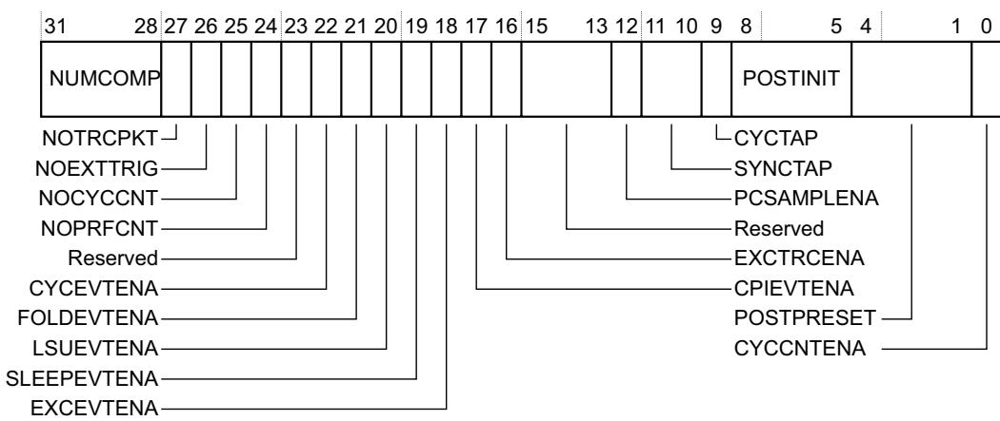

NUMCOMP, bits[31:28]

Number of comparators implemented.

A value of zero indicates no comparator support.

These bits are read-only. The reset value is IMPLEMENTATION DEFINED.

## NOTRCPKT, bit[27]

Shows whether the implementation supports trace sampling and exception tracing:

0 Trace sampling and exception tracing supported.

1 Trace sampling and exception tracing not supported.

If this bit is RAZ, the NOCYCCNT bit must also RAZ.

This bit is read-only. The reset value is IMPLEMENTATION DEFINED.

## NOEXTTRIG, bit[26]

Shows whether the implementation includes external match signals, CMPMATCH[N]:

0 CMPMATCH[N] supported.

1 CMPMATCH[N] not supported.

This bit is read-only. The reset value is IMPLEMENTATION DEFINED.

NOCYCCNT, bit[25] Shows whether the implementation supports a cycle counter:

0 Cycle counter supported.

1 Cycle counter not supported.

For more information see CYCCNT cycle counter and related timers on page C1-731.

This bit is read-only. The reset value is IMPLEMENTATION DEFINED.

NOPRFCNT, bit[24] Shows whether the implementation supports the profiling counters:

0 Supported.

1 Not supported.

For more information see Profiling counter support on page C1-734.

This bit is read-only. The reset value is IMPLEMENTATION DEFINED.

Bits[23] Reserved.

## CYCEVTENA, bit[22]

Enables POSTCNT underflow Event counter packets generation:

0 No POSTCNT underflow packets generated.

1 POSTCNT underflow packets generated, if PCSAMPLENA set to 0.

See The POSTCNT timer on page C1-732 for more information.

This bit is UNK/SBZP if the NOTRCPKT bit is RAO or the NOCYCCNT bit is RAO. The reset value is 0.

## FOLDEVTENA, bit[21]

Enables generation of the Folded-instruction counter overflow event:

0 Disabled.

1 Enabled.

This bit is UNK/SBZP if the NOPRFCNT bit is RAO. The reset value is 0.

## LSUEVTENA, bit[20]

Enables generation of the LSU counter overflow event.

0 Disabled.

1 Enabled.

This bit is UNK/SBZP if the NOPRFCNT bit is RAO. The reset value is 0.

## SLEEPEVTENA, bit[19]

Enables generation of the Sleep counter overflow event. 0 Disabled.

## 1 Enabled.

This bit is UNK/SBZP if the NOPRFCNT bit is RAO. The reset value is 0.

## EXCEVTENA, bit[18]

Enables generation of the Exception overhead counter overflow event:

0 Disabled.

1 Enabled.

This bit is UNK/SBZP if the NOPRFCNT bit is RAO. The reset value is 0.

## CPIEVTENA, bit[17]

Enables generation of the CPI counter overflow event:

0 Disabled.

1 Enabled.

This bit is UNK/SBZP if the NOPRFCNT bit is RAO. The reset value is 0.

## EXCTRCENA, bit[16]

Enables generation of exception trace:

0 Disabled.

1 Enabled.

This bit is UNK/SBZP if the NOTRCPKT bit is RAO. The reset value is 0.

## Bits[15:13] Reserved.

## PCSAMPLENA, bit[12]

Enables use of POSTCNT counter as a timer for Periodic PC sample packet generation:

0 No Periodic PC sample packets generated.

1 Periodic PC sample packets generated.

See The POSTCNT timer on page C1-732 for more information.

This bit is UNK/SBZP if the NOTRCPKT bit is RAO or the NOCYCCNT bit is RAO. The reset value is 0.

## SYNCTAP, bits[11:10]

Selects the position of the synchronization packet counter tap on the CYCCNT counter. This determines the Synchronization packet rate:

00 Disabled. No Synchronization packets.

01 Synchronization counter tap at CYCCNT[24].

10 Synchronization counter tap at CYCCNT[26].

11 Synchronization counter tap at CYCCNT[28].

For more information see The synchronization packet timer on page C1-733.

This field is UNK/SBZP if the NOCYCCNT bit is RAO. The reset value is UNKNOWN.

## CYCTAP, bit[9] Selects the position of the POSTCNT tap on the CYCCNT counter:

0 POSTCNT tap at CYCCNT[6].

1 POSTCNT tap at CYCCNT[10].

For more information see The POSTCNT timer on page C1-732.

This bit is UNK/SBZP if the NOCYCCNT bit is RAO. The reset value is UNKNOWN.

## POSTINIT, bits[8:5] Initial value for the POSTCNT counter. For more information see Enabling POSTCNT, and behavior of accesses to the DWT\_CTRL.POSTINIT field on page C1-740 and The POSTCNT timer on page C1-732.

This field is UNK/SBZP if the NOCYCCNT bit is RAO. The reset value is UNKNOWN.

Note

This field was previously called POSTCNT. The changed name gives a better indication of its function.

## POSTPRESET, bits[4:1]

Reload value for the POSTCNT counter. For more information see The POSTCNT timer on page C1-732.

This field is UNK/SBZP if the NOCYCCNT bit is RAO. The reset value is UNKNOWN.

CYCCNTENA, bit[0] Enables CYCCNT:

0 Disabled.

1 Enabled.

This bit is UNK/SBZP if the NOCYCCNT bit is RAO. The reset value is 0.

## Enabling POSTCNT, and behavior of accesses to the DWT\_CTRL.POSTINIT field

Before enabling the POSTCNT counter, software must write the required initial value of the counter to the DWT\_CTRL.POSTINIT field. Then it must perform a second write to DWT\_CTRL, to set either DWT\_CTRL.CYCEVTENA or DWT\_CTRL.PCSAMPLENA to 1, to enable the POSTCNT counter.

The processor ignores any write to DWT\_CTRL.POSTINIT field if the POSTCNT counter is enabled. That is, it ignores a write to this field unless, before the write, DWT\_CTRL.CYCEVTENA and DWT\_CTRL.PCSAMPLENA are both 0.

For any write to the DWT\_CTRL register that changes the values of DWT\_CTRL.CYCEVTENA and DWT\_CTRL.PCSAMPLENA bits, other than a change from both bits being zero to exactly one of the bits being one, it is UNPREDICTABLE whether POSTCNT is reloaded from DWT\_CTRL.POSTINIT or left unchanged.

This UNPREDICTABLE behavior does not matter when setting both DWT\_CTRL.CYCEVTENA and DWT\_CTRL.PCSAMPLENA to zero, to disable POSTCNT, because it does not affect the behavior on re-enabling POSTCNT.

## C1.8.8 Cycle Count register, DWT\_CYCCNT

The DWT\_CYCCNT register characteristics are:

Purpose Shows or sets the value of the processor cycle counter, CYCCNT.

Usage constraints The DWT unit suspends CYCCNT counting when the processor is in Debug state.

Configurations Implemented only when DWT\_CTRL.NOCYCCNT is RAZ, see Control register, DWT\_CTRL on page C1-737.

When DWT\_CTRL.NOCYCCNT is RAO no cycle counter is implemented and this register is UNK/SBZP.

Attributes See Table C1-21 on page C1-736.

The DWT\_CYCCNT register bit assignments are:

<table><tr><td>31</td><td></td><td></td><td></td><td></td><td></td><td></td><td>0</td></tr><tr><td colspan="8">CYCCNT</td></tr></table>

CYCCNT, bits[31:0] Incrementing cycle counter value. When enabled, CYCCNT increments on each processor clock cycle when DWT\_CTRL.CYCNTENA == 1 and DEMCR.TRCENA == 1. On overflow, CYCCNT wraps to zero.

For more information see CYCCNT cycle counter and related timers on page C1-731.

## C1.8.9 CPI Count register, DWT\_CPICNT

The DWT\_CPICNT register characteristics are:

Purpose Counts additional cycles required to execute multicycle instructions and instruction fetch stalls.

Usage constraints The counter initializes to 0 when software enables its counter overflow event by setting the DWT\_CTRL.CPIEVTENA bit to 1.

Configurations Implemented only when DWT\_CTRL.NOPRFCNT is RAZ, see Control register, DWT\_CTRL on page C1-737. If DWT\_CTRL.NOPRFCNT is RAO, indicating that the implementation does not include the profiling counters, this register is UNK/SBZP.

Attributes See Table C1-21 on page C1-736.

The DWT\_CPICNT register bit assignments are:

<table><tr><td>Reserved</td><td>CPICNT</td></tr></table>

Bits[31:8] Reserved, UNK/SBZP.

CPICNT, bits[7:0] Base instruction overhead counter. Counts one on each cycle when all of the following are true:

• DWT\_CTRL.CPIEVTENA ==1 and DEMCR.TRCENA == 1.

No instruction is executed.

No load-store operation is in progress, see LSU Count register, DWT\_LSUCNT on page C1-743.

No exception-entry or exception-exit operation is in progress, see Exception Overhead Count register, DWT\_EXCCNT on page C1-742.

Not in a power-saving mode, see Sleep Count register, DWT\_SLEEPCNT.

Non-invasive debug is enabled by the authentication interface, see Debug authentication on page C1-688.

The definition of “no instruction is executed” is IMPLEMENTATION DEFINED. Arm recommends that this counts each cycle on which no instruction is retired.

DWT\_CPICNT is initialized to zero when the counter is disabled and

DWT\_CTRL.CPIEVTENA transitions from 0 to 1. An Event Counter packet is emitted on counter overflow.

For more information see Profiling counter support on page C1-734.

## C1.8.10 Exception Overhead Count register, DWT\_EXCCNT

The DWT\_EXCCNT register characteristics are:

Purpose Counts the total cycles spent in exception processing.

Usage constraints The counter initializes to 0 when software enables its counter overflow event by setting the DWT\_CTRL.EXCEVTENA bit to 1.

Configurations Implemented only when DWT\_CTRL.NOPRFCNT is RAZ, see Control register, DWT\_CTRL on page C1-737.

If DWT\_CTRL.NOPRFCNT is RAO, indicating that the implementation does not include the profiling counters, this register is UNK/SBZP.

Attributes See Table C1-21 on page C1-736.

The DWT\_EXCCNT register bit assignments are:

<table><tr><td>Reserved</td><td>EXCCNT</td></tr></table>

Bits[31:8] Reserved, UNK/SBZP.

EXCCNT, bits[7:0] The exception overhead counter. Counts one on each cycle when all of the following are true:

• DWT\_CTRL.EXCEVTENA == 1 and DEMCR.TRCENA == 1.

No instruction is executed, see CPI Count register, DWT\_CPICNT on page C1-741.

An exception-entry or exception-exit related operation is in progress.

Non-invasive debug is enabled by the authentication interface, see Debug authentication on page C1-688.

Exception-entry or exception-exit related operations include the stacking of registers on exception entry, unstacking of registers on exception exit, and preemption.

DWT\_EXCCNT is initialized to zero when the counter is disabled and

DWT\_CTRL.EXCEVTENA transitions from 0 to 1. An Event Counter packet is emitted on counter overflow.

For more information see Profiling counter support on page C1-734.

## C1.8.11 Sleep Count register, DWT\_SLEEPCNT

The DWT\_SLEEPCNT register characteristics are:

Purpose Counts the total number of cycles that the processor is sleeping.

Usage constraints The counter initializes to 0 when software enables its counter overflow event by setting the DWT\_CTRL.SLEEPEVTENA bit to 1.

Configurations Implemented only when DWT\_CTRL.NOPRFCNT is RAZ, see Control register, DWT\_CTRL on page C1-737.

If DWT\_CTRL.NOPRFCNT is RAO, indicating that the implementation does not include the profiling counters, this register is UNK/SBZP.

Attributes See Table C1-21 on page C1-736.

The DWT\_SLEEPCNT register bit assignments are:

<table><tr><td>Reserved</td><td>SLEEPCNT</td></tr></table>

Bits[31:8] Reserved, UNK/SBZP.

SLEEPCNT, bits[7:0] Sleep counter. Counts one on each cycle when all of the following are true:

• DWT\_CTRL.SLEEPEVTENA == 1 and DEMCR.TRCENA == 1.

No instruction is executed, see CPI Count register, DWT\_CPICNT on page C1-741.

No load-store operation is in progress, see LSU Count register, DWT\_LSUCNT.

No exception-entry or exception-exit operation is in progress, see Exception Overhead Count register, DWT\_EXCCNT on page C1-742.

In a power-saving mode.

Non-invasive debug is enabled by the authentication interface, see Debug authentication on page C1-688.

Power-saving modes include WFI, WFE, and Sleep on exit, see Power management on page B1-559.

DWT\_SLEEPCNT is initialized to zero when the counter is disabled and DWT\_CTRL.SLEEPEVTENA transitions from 0 to 1. An Event Counter packet is emitted on overflow.

Arm recommends that this counter counts all cycles when the processor is sleeping, regardless of whether a WFI or WFE instruction, or the sleep-on-exit functionality, caused the entry to sleep mode. However, all sleep features are IMPLEMENTATION DEFINED and therefore when this counter counts is IMPLEMENTATION DEFINED.

For more information see Profiling counter support on page C1-734.

## C1.8.12 LSU Count register, DWT\_LSUCNT

The DWT\_LSUCNT register characteristics are:

Purpose Increments on the additional cycles required to execute all load or store instructions.

Usage constraints The counter initializes to 0 when software enables its counter overflow event by setting the DWT\_CTRL.LSUEVTENA bit to 1.

Configurations Implemented only when DWT\_CTRL.NOPRFCNT is RAZ, see Control register, DWT\_CTRL on page C1-737.

If DWT\_CTRL.NOPRFCNT is RAO, indicating that the implementation does not include the profiling counters, this register is UNK/SBZP.

Attributes See Table C1-21 on page C1-736.

The DWT\_LSUCNT register bit assignments are:

<table><tr><td>Reserved</td><td>LSUCNT</td></tr></table>

Bits[31:8] Reserved, UNK/SBZP.

LSUCNT, bits[7:0] Load-store overhead counter. Counts one on each cycle when all of the following are true:

• DWT\_CTRL.LSUEVTENA == 1 and DEMCR.TRCENA == 1.

No instruction is executed, see CPI Count register, DWT\_CPICNT on page C1-741.

No exception-entry or exception-exit operation is in progress, see Exception Overhead Count register, DWT\_EXCCNT on page C1-742.

• A load-store operation is in progress.

Non-invasive debug is enabled by the authentication interface, see Debug authentication on page C1-688.

DWT\_LSUCNT is initialized to zero when the counter is disabled and DWT\_CTRL.LSUEVTENA transitions from 0 to 1. An Event Counter packet is emitted on counter overflow.

For more information see Profiling counter support on page C1-734.

## C1.8.13 Folded-instruction Count register, DWT\_FOLDCNT

The DWT\_FOLDCNT register characteristics are:

Purpose Increments on each instruction that takes 0 cycles.

The counter initializes to 0 when software enables its counter overflow event by setting the DWT\_CTRL.FOLDEVTENA bit to 1.

If an implementation includes profiling counters but does not support instruction folding, this counter can be RAZ/WI.

Configurations Implemented only when DWT\_CTRL.NOPRFCNT is RAZ, see Control register, DWT\_CTRL on page C1-737.

If DWT\_CTRL.NOPRFCNT is RAO, indicating that the implementation does not include the profiling counters, this register is UNK/SBZP.

Attributes See Table C1-21 on page C1-736.

The DWT\_FOLDCNT register bit assignments are:

<table><tr><td>Reserved</td><td>FOLDCNT</td></tr></table>

Bits[31:8] Reserved, UNK/SBZP.

FOLDCNT, bits[7:0] Folded instruction counter. Counts on each cycle when at least two instructions are executed. The counter is incremented by the number of instructions executed, minus one.

Counts on each cycle when all of the following are true:

• DWT\_CTRL.FOLDEVTENA == 1 and DEMCR.TRCENA == 1.

At least two instructions are executed, see CPI Count register, DWT\_CPICNT on page C1-741.

Non-invasive debug is enabled by the authentication interface, see Debug authentication on page C1-688.

DWT\_FOLDCNT is initialized to zero when the counter is disabled and DWT\_CTRL.FOLDEVTENA transitions from 0 to 1. An Event Counter packet is emitted on counter overflow.

For more information see Profiling counter support on page C1-734.

## C1.8.14 Program Counter Sample Register, DWT\_PCSR

The DWT\_PCSR characteristics are:

Purpose Samples the current value of the program counter.

Usage constraints There are no usage constraints.

Note

Bit[0] of any sampled value is RAZ and does not reflect instruction set state as it does in a PC sample on the Armv7-A and Armv7-R architecture profiles.

Configurations An optional feature. Register is RAZ/WI if not implemented.

Attributes See Table C1-21 on page C1-736.

The DWT\_PCSR bit assignments are:

<table><tr><td>31</td><td></td><td></td><td></td><td></td><td></td><td></td><td>0</td></tr><tr><td colspan="8">EIASAMPLE</td></tr></table>

EIASAMPLE, bits[31:0]

Executed Instruction Address sample value.

For more information see Program counter sampling support on page C1-735.

## C1.8.15 Comparator registers, DWT\_COMPn

The DWT\_COMPn register characteristics are:

Purpose Provides a reference value for use by comparator n.

Usage constraints The operation of comparator n depends also on the registers DWT\_MASKn and DWT\_FUNCTIONn, see Comparator Mask registers, DWT\_MASKn and Comparator Function registers, DWT\_FUNCTIONn on page C1-746.

Configurations Implemented only when DWT\_CTRL.NUMCOMP is nonzero, see Control register, DWT\_CTRL on page C1-737. DWT\_CTRL.NUMCOMP defines the number of implemented DWT\_COMPn registers. Implemented DWT\_COMPn registers number from 0 to (NUMCOMP-1). Unimplemented registers are UNK/SBZP.

Attributes See Table C1-21 on page C1-736.

The DWT\_COMPn register bit assignments are:

<table><tr><td>31</td><td></td><td></td><td></td><td></td><td></td><td>0</td></tr><tr><td colspan="7">COMP</td></tr></table>

COMP, bits[31:0] Reference value for comparison.

For more information see The DWT comparators on page C1-719.

## C1.8.16 Comparator Mask registers, DWT\_MASKn

The DWT\_MASKn register characteristics are:

Purpose Provides the size of the ignore mask applied to the access address for address range matching by comparator n.

Usage constraints The operation of comparator n depends also on the registers DWT\_COMPn and DWT\_FUNCTIONn, see Comparator registers, DWT\_COMPn on page C1-745 and Comparator Function registers, DWT\_FUNCTIONn.

Configurations Implemented only when DWT\_CTRL.NUMCOMP is nonzero, see Control register, DWT\_CTRL on page C1-737. DWT\_CTRL.NUMCOMP defines the number of implemented DWT\_MASKn registers. Implemented DWT\_MASKn registers number from 0 to (NUMCOMP-1). Unimplemented registers are UNK/SBZP.

Attributes See Table C1-21 on page C1-736.

The DWT\_MASKn register bit assignments are:

<table><tr><td colspan="7">Reserved</td><td>MASK</td></tr></table>

Bits[31:5] Reserved.

MASK, bits[4:0] The size of the ignore mask, 0-31 bits, applied to address range matching. The maximum mask size is IMPLEMENTATION DEFINED. A debugger can write 0b11111 to this field and then read the register back to determine the maximum mask size supported.

See The DWT comparators on page C1-719 for more information.

## C1.8.17 Comparator Function registers, DWT\_FUNCTIONn

The DWT\_FUNCTIONn register characteristics are:

Purpose Controls the operation of comparator n.

Usage constraints The operation of comparator n depends also on the registers DWT\_COMPn and DWT\_MASKn, see Comparator registers, DWT\_COMPn on page C1-745 and Comparator Mask registers, DWT\_MASKn on page C1-745. Reading this register clears some fields to zero. See the register field descriptions for more information, and for the usage constraints of individual fields.

Configurations Implemented only when DWT\_CTRL.NUMCOMP is nonzero, see Control register, DWT\_CTRL on page C1-737. DWT\_CTRL.NUMCOMP defines the number of implemented DWT\_FUNCTIONn registers. Implemented DWT\_FUNCTIONn registers number from 0 to (NUMCOMP-1). Unimplemented registers are UNK/SBZP.

Attributes See Table C1-21 on page C1-736. See the register field descriptions for information about the values of the RO bits in the register.

The DWT\_FUNCTIONn register bit assignments are:

<table><tr><td>31</td><td>25</td><td>24</td><td>23</td><td>20</td><td>19</td><td>16</td><td>15</td><td>12</td><td>11</td><td>10</td><td>9</td><td>8</td><td>7</td><td>6</td><td>5</td><td>4</td><td>3</td><td>0</td></tr><tr><td colspan="2">Reserved</td><td></td><td colspan="2">Reserved</td><td></td><td></td><td></td><td></td><td></td><td></td><td></td><td></td><td></td><td></td><td></td><td></td><td colspan="2">FUNCTION</td></tr><tr><td rowspan="8" colspan="17">MATCHED ↓ DATAVADDR1 ↓</td><td colspan="2">Reserved EMITRANGE</td></tr><tr><td rowspan="7" colspan="2">Reserved CYCMATCH ‡</td></tr><tr></tr><tr></tr><tr></tr><tr></tr><tr></tr><tr><td></td><td></td><td></td><td></td></tr></table>

‡ DWT\_FUNCTION0 only, bit [7] is Reserved in all other DWT\_FUNCTIONn registers.

Bits[31:25] Reserved.

## MATCHED, bit[24] Comparator match:

0 No match.

1 Match.

A value of 1 indicates that the operation defined by the FUNCTION field occurred since the last read of the register.

Reading the register clears this bit to 0.

This bit is read-only.

Bits[23:20] Reserved.

## DATAVADDR1, bits[19:16]

When the DATAVMATCH and LNK1ENA bits are both 1, this field can hold the comparator number of a second comparator to use for linked address comparison. For more information see LinkAddr support on page C1-728.

The DWT unit ignores the value of this field unless the LNK1ENA bit is RAO and the DATAVMATCH bit is set to 1.

If LNK1ENA is RAZ, this field is RAZ/WI.

## DATAVADDR0, bits[15:12]

When the DATAVMATCH bit is set to 1 this field can hold the comparator number of a comparator to use for linked address comparison. For more information see LinkAddr support on page C1-728.

The DWT unit ignores the value of this field if the DATAVMATCH bit is set to 0.

## DATAVSIZE, bits[11:10]

For data value matching, specifies the size of the required data comparison:

00 Byte.

01 Halfword.

10 Word.

The value 0b11 is reserved. Using this value means behavior is UNPREDICTABLE.

## LNK1ENA, bit[9] Indicates whether the implementation supports use of a second linked comparator:

0 Second linked comparator not supported.

1 Second linked comparator supported.

When LNK1ENA is RAO, the DATAVADDR1 field specifies the comparator to use as the second linked comparator.

This bit is read-only.

## DATAVMATCH, bit[8]

Enables data value comparison, if supported:

0 Perform address comparison.

1 Perform data value comparison.

For comparator 0, when the CYCMATCH is set to 1, DATAVMATCH must be set to 0 for it to perform cycle count comparison.

See LNK1ENA, DATAVSIZE, DATAVADDR0 and DATAVADDR1 for related information.

If the implementation does not support data value comparison this bit is RAZ/WI.

## CYCMATCH, bit[7] DWT\_FUNCTION0 only.

If the implementation supports cycle counting, enable cycle count comparison for comparator 0:

0 No comparison is performed.

1 Compare DWT\_COMP0 with the cycle counter, DWT\_CYCCNT.

If DWT\_CTRL.NOCYCCNT is RAZ then this bit is UNK/SBZP.

Bits[7] DWT\_FUNCTIONn, for all values of n other than 0.

Bits[6] Reserved.

## EMITRANGE, bits[5]

If the implementation supports trace sampling, enables generation of Data trace address packets, that hold Daddr[15:0]:

0 Data trace address packets disabled.

1 Enable Data trace address packet generation.

For more information see Address comparison functions on page C1-721.

If DWT\_CTRL.NOTRCPKT is RAZ then this bit is UNK/SBZP.

## Bits[4]

Reserved.

## FUNCTION, bits[3:0]

Selects action taken on comparator match:

0000 = Disabled or LinkAddr(), see LinkAddr support on page C1-728.

For non-zero values:

If DATAVMATCH is set to 1, see Table C1-16 on page C1-726

If DATAVMATCH is set to 0 then:

If CYCMATCH is set to 0, see Table C1-14 on page C1-722

If CYCMATCH is set to 1, see Table C1-15 on page C1-724.

This field resets to zero.

For more information see The DWT comparators on page C1-719.

## C1.9 Embedded Trace Macrocell support

An Embedded Trace Macrocell (ETM) is an optional feature of an Armv7-M implementation. Where it is implemented, the device must implement a Trace Port Interface Unit that can format the combined output packet stream from:

The ETM.

The DWT and ITM.

An ETM implementation must comply with the ETM architecture v3.4 or later, see the appropriate Arm Trace Architecture Specification. The associated TPIU implementation must be CoreSight compliant, see the Arm<sup>®</sup> CoreSight Architecture Specification and comply with the TPIU architecture, for compatibility with Arm and other CoreSight-compatible debug solutions.

When an Armv7-M implementation includes an ETM:

The CMPMATCH[N] signals from the DWT unit are available as control inputs to the ETM unit. For more information see CMPMATCH[N] event generation on page C1-730.

An implementation can use the DEMCR.TRCENA bit as an enable signal for the ETM unit, see Debug Exception and Monitor Control Register, DEMCR on page C1-706.

Whether the TRCENA bit enables the ETM is IMPLEMENTATION DEFINED. This functionality might be inappropriate if the ETM unit is a shared resource in a complex system.

## C1.10 Trace Port Interface Unit

The ITM unit multiplexes hardware event packets from the DWT unit with its own Instrumentation packets, Synchronization packets, and timestamp packets, into a single packet stream. This packet stream might:

Terminate in the processor Embedded Trace Buffer (ETB), as described in the CoreSight Architecture Specification.

To provide external visibility, an implementation typically includes a Trace Port Interface Unit (TPIU). This can be either the Armv7-M TPIU described in this section, or the full CoreSight TPIU. The Armv7-M TPIU provides one or both:

An asynchronous Serial Wire Output (SWO).

A parallel trace port with a single or multi-pin data path, a clock pin, and optionally a control pin.

Note

The combination of the DWT and ITM packet stream and a SWO is called a Serial Wire Viewer (SWV).

The minimum TPIU support for Armv7-M provides an output path for the packet stream from the ITM. This is described as TPIU support for debug trace with the TPIU operating in pass-through mode. For more information about ETMs, and other CoreSight options, see the applicable Arm Embedded Trace Macrocell Architecture Specification and the Arm<sup>®</sup> CoreSight<sup>™</sup> Architecture Specification.

A TPIU parallel trace port supports a data path width from 1 to 32 bits.

A TPIU asynchronous serial port can be:

• A low-speed asynchronous port using NRZ encoding. This operates as a traditional UART.

A medium-speed asynchronous port using Manchester encoding.

If an implementation supports a parallel interface and an asynchronous serial interface, the TPIU\_SPPR register selects the active interface, see Selected Pin Protocol Register, TPIU\_SPPR on page C1-752.

Arm recommends that the TPIU provides both parallel and asynchronous serial ports, for maximum flexibility with external capture devices. Whether the trace port clock is synchronous to the processor clock is IMPLEMENTATION DEFINED. The TPIU includes a prescale counter for the asynchronous port, as part of the clock generation scheme for asynchronous operation.

## C1.10.1 TPIU register summary

This section defines the registers that the minimum Armv7-M TPIU configuration must include.

An implementation can use the DEMCR.TRCENA bit as an enable signal for the TPIU unit, see Debug Exception and Monitor Control Register, DEMCR on page C1-706.

Note

Arm recommends using DEMCR.TRCENA as the TPIU enable signal in the minimum TPIU implementation. However, the TPIU enable mechanism is IMPLEMENTATION DEFINED, and using DEMCR.TRCENA might be inappropriate where the TPIU unit is a shared resource in a complex system.

Table C1-22 shows the required TPIU registers, in address order. All registers are 32-bits wide. An entry of IMP DEF in the Reset column means the reset value is IMPLEMENTATION DEFINED.

Table C1-22 Required TPIU registers

<table><tr><td>Address</td><td>Name</td><td>Type</td><td>Reset</td><td>Description</td></tr><tr><td>0xE0040000</td><td>TPIU_SSPSR</td><td>RO</td><td>IMP DEF</td><td>Supported Parallel Port Sizes Register, TPIU_SSPSR on page C1-751</td></tr><tr><td>0xE0040004</td><td>TPIU_CSPSR</td><td>RW</td><td>IMP DEF</td><td>Current Parallel Port Size Register, TPIU_CSPSR on page C1-751</td></tr><tr><td>0xE0040010</td><td>TPIU_ACPR</td><td>RW</td><td>0x00000000</td><td>Asynchronous Clock Prescaler Register, TPIU_ACPR on page C1-752</td></tr><tr><td>0xE00400F0</td><td>TPIU_SPPR</td><td>RW</td><td>IMP DEF</td><td>Selected Pin Protocol Register, TPIU_SPPR on page C1-752</td></tr><tr><td>0xE0040F00-0xE0040FC4</td><td>-</td><td>RO</td><td>-</td><td>Optional CoreSight management and ID registers. SeeAppendix D1 Armv7-M CoreSight Infrastructure IDsfor more information</td></tr><tr><td>0xE0040FC8</td><td>TPIU_TYPE</td><td>RO</td><td>IMP DEF</td><td>TPIU Type register, TPIU_TYPE on page C1-753</td></tr><tr><td>0xE0040FCC-0xE0040FFC</td><td>-</td><td>RO</td><td>-</td><td>Optional CoreSight management and ID registers. SeeAppendix D1 Armv7-M CoreSight Infrastructure IDsfor more information</td></tr></table>

## C1.10.2 Supported Parallel Port Sizes Register, TPIU\_SSPSR

The TPIU\_SSPSR characteristics are:

Purpose Indicates the supported parallel trace port sizes.

Usage constraints No usage constraints.

Configurations Always implemented.

If TPIU\_TYPE.PTINVALID is RAO, this register is UNK. For more information see TPIU Type register, TPIU\_TYPE on page C1-753.

Attributes See Table C1-22 on page C1-750.

The TPIU\_SSPSR bit assignments are:

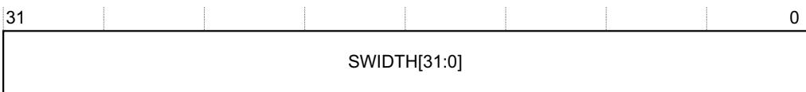

SWIDTH[31:0], bits[31:0]

SWIDTH[N] represents a trace port width of (N+1). The meaning of each bit is:

0 Width (N+1) not supported.

1 Width (N+1) supported.

## C1.10.3 Current Parallel Port Size Register, TPIU\_CSPSR

The TPIU\_CSPSR characteristics are:

Purpose Defines the width of the current parallel trace port.

Usage constraints Has the same format as the TPIU\_SSPSR, but:

Only one bit is set to 1, all others must be zero.

The effect of writing a value with more than one bit set to 1 is UNPREDICTABLE.

The effect of a write to an unsupported bit is UNPREDICTABLE.

Configurations Always implemented.

If TPIU\_TYPE.PTINVALID is RAO, this register is UNK/SBZP. For more information see TPIU Type register, TPIU\_TYPE on page C1-753.

Attributes See Table C1-22 on page C1-750. The register resets to the value for the smallest supported parallel trace port size.

The TPIU\_CSPSR bit assignments are:

<table><tr><td>31</td><td></td><td></td><td></td><td></td><td></td><td></td><td>0</td></tr><tr><td colspan="8">CWIDTH[31:0]</td></tr></table>

CWIDTH[31:0], bits[31:0]

CWIDTH[N] represents a trace port width of (N+1). The meaning of each bit is:

0 Width (N+1) is not the current trace port width.

1 Width (N+1) is the current trace port width.

## C1.10.4 Asynchronous Clock Prescaler Register, TPIU\_ACPR

The TPIU\_ACPR characteristics are:

Purpose

Defines a prescaler value for the baud rate of the Serial Wire Output (SWO).

Usage constraints

Writing to the register automatically updates the prescale counter, immediately affecting the baud rate of the serial data output. If a debugger changes the register value while the TPIU is transmitting data, the effect on the output stream is UNPREDICTABLE and the required recovery process is IMPLEMENTATION DEFINED.

Configurations Always implemented:

If the MANCVALID and NRZVALID bits of TPIU\_TYPE are both RAZ, this register is UNK/SBZP. For more information see TPIU Type register, TPIU\_TYPE on page C1-753.

Whether the prescale counter is preset and counts down, or reset and counts up, is IMPLEMENTATION DEFINED.

The supported scaler value range is IMPLEMENTATION DEFINED, to a maximum scalar value of 0xFFFF. Unused bits of the SWOSCALAR field are RAZ/WI.

Attributes See Table C1-22 on page C1-750.

The TPIU\_ACPR bit assignments are:

<table><tr><td>Reserved</td><td>SWOSCALER</td></tr></table>

Bits[31:16] Reserved.

SWOSCALER, bits[15:0]

SWO baud rate prescaler value.

SWO output clock = Asynchronous\_Reference\_Clock/(SWOSCALAR +1)

## C1.10.5 Selected Pin Protocol Register, TPIU\_SPPR

The TPIU\_SPPR characteristics are:

Purpose Selects the protocol used for trace output.

Usage constraints

If a debugger changes the register value while the TPIU is transmitting data, the effect on the output stream is UNPREDICTABLE and the required recovery process is IMPLEMENTATION DEFINED.

Bits [11:9] of the TPIU\_TYPE register define the trace output protocols supported by the implementation, see TPIU Type register, TPIU\_TYPE on page C1-753. The effect of selecting an unsupported mode is UNPREDICTABLE.

Configurations Always implemented.

Attributes See Table C1-22 on page C1-750.

The TPIU\_SPPR bit assignments are:

<table><tr><td colspan="9">Reserved</td></tr></table>

TXMODE

Bits[31:2] Reserved.

TXMODE, bits[1:0] Specified the protocol for trace output from the TPIU. Permitted values are:

00 Parallel trace port mode.

01 Asynchronous SWO, using Manchester encoding.

10 Asynchronous SWO, using NRZ encoding.

The value 0b11 is reserved. The effect of selecting a reserved value, or a mode that the implementation does not support, is UNPREDICTABLE.

## C1.10.6 TPIU Type register, TPIU\_TYPE

The TPIU\_TYPE register characteristics are:

Purpose Defines the SWO options supported by the TPIU.

Usage constraints There are no usage constraints.

Configurations Always implemented.

Attributes See Table C1-22 on page C1-750.

The TPIU\_TYPE register bit assignments are:

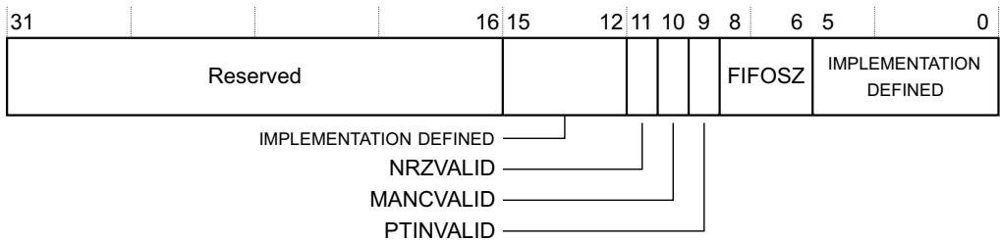

Bits[31:16] Reserved.

Bits[15:12] IMPLEMENTATION DEFINED.

NRZVALID, bit[11] Indicates support for SWO using UART/NRZ encoding: 0 Not supported. 1 Supported.

MANCVALID, bit[10] Indicates support for SWO using Manchester encoding: 0 Not supported. 1 Supported.

PTINVALID, bit[9] Indicates support for parallel trace port operation: 0 Supported. 1 Not supported.

FIFOSZ, bits[8:6] Indicates the minimum implemented size of the TPIU output FIFO for trace data. Minimum FIFO size is 2FIFOSIZE. For example, a value of 0b011 indicates a FIFO size of at least 2<sup>3</sup> = 8 bytes.

Bits[5:0] IMPLEMENTATION DEFINED.

## C1.11 Flash Patch and Breakpoint unit

The Flash Patch and Breakpoint (FPB) unit can support:

Remapping specific literal locations from the Code region of system memory to addresses in the SRAM region.

Remapping specific instruction addresses from the Code region of system memory to addresses in the SRAM region.

Breakpoint functionality on instruction fetches.

See The system address map on page B3-592 for more information about address regions.

The number of supported literal address and instruction address comparators is IMPLEMENTATION DEFINED. Software can read the number of comparators from the FP\_CTRL register, see Flash Patch Control Register, FP\_CTRL on page C1-756. The valid combinations of support are:

• No comparator support.

• One or more instruction address comparators with breakpoint support only.

One or more instruction address comparators with breakpoint and remapping support.

The full feature set, supporting instruction address and literal address comparators.

Note

The Armv7-M architecture does not restrict the FPB to debug use. The FPB can be used to provide product updates, as its behavior under normal code execution conditions is identical to the behavior described in this section.

## C1.11.1 FPB unit operation

The FPB includes the following register types:

A general control register FP\_CTRL, see Flash Patch Control Register, FP\_CTRL on page C1-756.

A remap address register FP\_REMAP, see Flash Patch Remap register, FP\_REMAP on page C1-758.

Flash Patch comparator registers, see Flash Patch Comparator register, FP\_COMPn on page C1-758.

The FPB uses separate comparators for instruction address comparison and for literal address comparison.

FP\_CTRL provides a global enable bit for the FPB, and ID fields that indicate the numbers of instruction address comparison and literal comparison registers implemented.

Software writes to the FP\_REMAP Register with the base address for the remap vectors, Remap\_Base. Comparator n remaps to address (Remap\_Base + 4n) when it is configured for remapping and a match occurs. Software can read FP\_REMAP[29] to determine if the implementation supports remapping, of instruction or data addresses.

Software can configure an instruction address comparator to remap the instruction, or to generate a breakpoint. The literal address comparators only support remapping of data read accesses. Each comparator has its own enable bit that enables operation of the comparator only when the global enable bit is also set to 1.

When configured for remapping, address matching performs instruction address comparisons at a word granularity in the Code memory region, by ignoring bits [1:0] of each address. A match causes the matching instruction or literal word to be fetched from the remapped location. The comparators only operate on read accesses and ignore data writes. Writes always access the location that is originally addressed by the instruction.

Note

The code memory region is the first 0.5GB of the memory map.

If an instruction at the remapped location reads the PC, then the value that is returned is calculated from the original instruction address, and not the remapped location address.

When configured for breakpoint debug event generation, subject to the restrictions described later in this section, instruction address matching either:

Operates at word granularity in the Code memory region, and generates breakpoints for the matching upper halfword, lower halfword, or both halfwords. This is the behavior if the FPB implements FPB version 1.

Operates at halfword granularity across the full address space, and generates breakpoints for the matching halfword. This is the behavior if the FPB implements version 2.

The choice between these behaviors is IMPLEMENTATION DEFINED.

Note

It is IMPLEMENTATION DEFINED whether the FPB generates breakpoint debug events when debug is disabled, that is when DHCSR.C\_DEBUGEN is 0 and DEMCR.MON\_EN is 0, see Debug Halting Control and Status Register, DHCSR on page C1-700 and Debug Exception and Monitor Control Register, DEMCR on page C1-706. When the breakpoint is not generated, the matched instruction exhibits its normal architectural behavior.

Literal address matching can compare word, halfword or byte data units. A match fetches the appropriate-sized data item from the remapped location.

The following restrictions apply:

• How remapping affects unaligned literal accesses is IMPLEMENTATION DEFINED.

When an MPU is enabled, it performs its checks on the original address, and applies the attributes for that address to the remapped location. The MPU does not check the remapped address.

The FPB can remap a Load exclusive accesses, but whether the remapped access is performed as an exclusive access is UNPREDICTABLE.

When an instruction address matching comparator is configured for breakpoint generation, it is UNPREDICTABLE whether a match on only the address of the second halfword of a 32-bit instruction generates a debug event.

## C1.11.2 FPB register summary

Table C1-23 shows the FPB registers, in address order. All registers are 32-bits wide.

Table C1-23 Flash Patch and Breakpoint register summary

<table><tr><td>Address</td><td>Name</td><td>Type</td><td>Reset</td><td>Description</td></tr><tr><td>0xE0002000</td><td>FP_CTRL</td><td>RW</td><td>a</td><td>Flash Patch Control Register, FP_CTRL.</td></tr><tr><td>0xE0002004</td><td>FP_REMAP</td><td>RW</td><td>UNKNOWN</td><td>Flash Patch Remap register, FP_REMAP on page C1-758.</td></tr><tr><td>0xE0002008-0xE0002008+4n</td><td>FP_COMP0-FP_COMPn</td><td>RW</td><td> $UNKNOWN^a$ </td><td>Flash Patch Comparator register, FP_COMPn on page C1-758.</td></tr><tr><td>0xE0002FD0-0xE0002FFC</td><td>-</td><td>RO</td><td>-</td><td>Optional CoreSight management and ID registers. See Appendix D1 Armv7-M CoreSight Infrastructure IDs for more information.</td></tr></table>

a. See register description for more information.

## C1.11.3 Flash Patch Control Register, FP\_CTRL

The FP\_CTRL Register characteristics are:

Purpose Provides FPB implementation information, and the global enable for the FPB unit.

Usage constraints There are no usage constraints.

Configurations Always implemented.

Attributes See Table C1-23.

The FP\_CTRL register bit assignments are:

<table><tr><td>31</td><td>28</td><td>27</td><td></td><td></td><td>15</td><td>14</td><td>12</td><td>11</td><td>8</td><td>7</td><td>4</td><td>3</td><td>2</td><td>1</td><td>0</td></tr><tr><td colspan="2">REV</td><td colspan="3">Reserved</td><td colspan="2"></td><td colspan="3">NUM_LIT</td><td colspan="2"></td><td colspan="2"></td><td></td><td></td></tr><tr><td colspan="16">NUM_CODE[6:4]↓ NUM_CODE[3:0]↓ReservedKEYENABLE</td></tr></table>

REV, bits[31:28] Flash Patch breakpoint architecture revision:

0000 Flash Patch breakpoint version 1.

0001 Flash Patch breakpoint version 2. Supports breakpoints on any location in the 4GB address range.

Bits[27:15] Reserved, UNK/SBZP.

NUM\_CODE[6:4], bits[14:12] The most significant bits, being bits[6:4], of NUM\_CODE, the number of instruction address comparators, see bits[7:4]. These bits are read-only.

NUM\_LIT, bits[11:8] The number of literal address comparators supported, starting from NUM\_CODE upwards. UNK/SBZP if Flash Patch is not implemented. Flash Patch is not implemented if FP\_REMAP[29] is 0. If this field is zero, the implementation does not support literal comparators. These bits are read-only.

NUM\_CODE[3:0], bits[7:4] The least significant bits, being bits[3:0], of NUM\_CODE, the number of instruction address comparators. If NUM\_CODE[6:0] is zero, the implementation does not support any instruction address comparators. These bits are read-only.

KEY, bit[1] On any write to FP\_CTRL, this bit must be 1. A write to the register with this bit set to zero is ignored. The Flash Patch Breakpoint unit ignores the write unless this bit is 1. This bit is RAZ.

ENABLE, bit[0] Enable bit for the FPB:

0 Flash Patch breakpoint disabled.

1 Flash Patch breakpoint enabled.

A power-on reset clears this bit to 0.

If implemented:

The instruction address comparators start at FP\_COMP0. This means the last instruction address comparator is FP\_COMPn, where n = (NUM\_CODE-1). The maximum number of instruction address comparators is 127.

The literal address comparators start at FP\_COMPm, where m=NUM\_CODE. This means the last literal address comparator is at FP\_COMPp, where p=(NUM\_CODE+NUM\_LIT-1). The maximum number of literal address comparators is 15.

The total number of implemented comparators is (NUM\_CODE+NUM\_LIT), giving a maximum of 142 comparators.

For more information see Flash Patch Comparator register, FP\_COMPn on page C1-758.

## C1.11.4 Flash Patch Remap register, FP\_REMAP

The FP\_REMAP register characteristics are:

Purpose Indicates whether the implementation supports Flash Patch remap, and if it does, holds the SRAM address for remap.

Usage constraints There are no usage constraints.

Configurations Always implemented.

Attributes See Table C1-23 on page C1-756.

The FP\_REMAP register bit assignments are:

<table><tr><td colspan="3">31 30 29 28</td><td colspan="2">5 4</td><td>0</td></tr><tr><td></td><td></td><td colspan="2">REMAP</td><td colspan="2">Reserved</td></tr><tr><td colspan="6">LRMPSPTReserved</td></tr></table>

Bits[31:30] Reserved.

RMPSPT, bit[29] Indicates whether the FPB unit supports Flash Patch remap:

0 Remapping not supported. The FPB only supports breakpoint functionality.

1 Hard-wired remap to SRAM region.

These bits are read-only.

REMAP, bits[28:5] If the FPB supports Flash Patch remap, this field:

Holds bits[28:5] of the base address in SRAM to which the FPB remaps the address.

Has an UNKNOWN value on reset.

If the FPB only supports breakpoint functionality this field is UNK/SBZP.

Bits[4:0] Reserved.

The remap base address must be aligned to the number of words required to support the implemented comparators, that is to (NUM\_CODE+NUM\_LIT) words, with a minimum alignment of 8 words. Because remap is into the SRAM memory region, 0x20000000-0x3FFFFFFF, bits[31:29] of the remap address are 0b001.

## C1.11.5 Flash Patch Comparator register, FP\_COMPn

The FP\_COMPn register characteristics are:

Holds an address for comparison with addresses in the Code memory region, see The system address map on page B3-592. The effect of a match depends on whether the comparator is an instruction address comparator or a literal address comparator:

Instruction address comparators

Either:

Defines an instruction address to remap to an address based on the address specified in the FP\_REMAP register.

Defines a breakpoint address.

Literal address comparators

Defines a literal address to remap to an address based on the address specified in the FP\_REMAP register.

The FP\_CTRL register determines which comparators are instruction address comparators and which are literal address comparators. The version of the FPB unit determines the bit assignment for the FP\_COMP register. The FP\_CTRL.REV field determines which version of the FPB unit is attached. See Flash Patch Control Register, FP\_CTRL on page C1-756.

The FP\_REMAP.RMPSPT field determines if the FPB unit supports Flash Patch. For more information about address remapping see Flash Patch Remap register, FP\_REMAP on page C1-758.

If the FPB unit is configured for remap then FP\_COMPn defines a 29-bit word-aligned address.

If the FPB unit is configured for breakpoints, version 1 defines a 29-bit word-aligned address and the breakpoint can be set on either or both halfwords at this address. For version 2 FPB units configured for breakpoints, FP\_COMPn defines a 32-bit halfword-aligned address.

Usage constraints To enable a comparator, both the FP\_CTRL.ENABLE bit and the required FP\_COMPn.ENABLE bit must be set to 1.

Configurations Always implemented. see Flash Patch Control Register, FP\_CTRL on page C1-756 for information about the number of implemented Flash Patch comparator registers.

Attributes See Table C1-23 on page C1-756.

The FP\_COMPn register bit assignments for FPB Version 1 are:

<table><tr><td>31</td><td>30</td><td>29</td><td>28</td><td></td><td></td><td></td><td></td><td></td><td></td><td></td><td>2</td><td>1</td><td>0</td></tr><tr><td></td><td></td><td></td><td></td><td colspan="7">COMP</td><td></td><td></td><td></td></tr><tr><td></td><td></td><td></td><td colspan="6">Reserved REPLACE</td><td colspan="5">Reserved ENABLE</td></tr></table>

## REPLACE, bits[31:30]

For an instruction address comparator:

Defines the behavior when the COMP address is matched:

00 Remap to remap address, see Flash Patch Remap register, FP\_REMAP on page C1-758.

When the comparators are enabled in the FP\_CTRL register, if the implementation does not support remapping, the effect of an instruction address match with an enabled comparator with REPLACE programmed to 0b00 is UNPREDICTABLE.

01 Breakpoint on instruction at '000':COMP:'00'.

10 Breakpoint on instruction at '000':COMP:'10'.

11 Breakpoint on both instructions at '000':COMP:'00' and '000':COMP:'10'.

The reset value of this field is UNKNOWN.

For a literal address comparator:

Field is UNK/SBZP.

## Bit[29] Reserved.

## COMP, bits[28:2]

Bits[28:2] of the address to compare with addresses from the Code memory region, see The system address map on page B3-592. Bits[31:29] of the address for comparison are zero. For a literal address or instruction address remap, bits[1:0] of the comparison are also zero. For an instruction address breakpoint, bits[1:0] of the comparison are encoded by the REPLACE field.

If a match occurs:

For an instruction address comparator, the REPLACE field defines the required action.

For a literal address comparator, the FPB remaps the access, see Flash Patch Remap register, FP\_REMAP on page C1-758.

<table><tr><td colspan="2">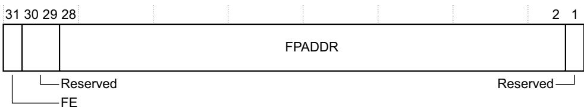</td></tr><tr><td rowspan="3">FE, bit[31]</td><td>Specifies if Flash Patch enabled:</td></tr><tr><td>0 Flash Patch disabled.</td></tr><tr><td>1 Flash Patch enabled.</td></tr><tr><td>Bits[30:29]</td><td>Reserved, UNK/SBZP.</td></tr><tr><td>FPADDR, bits[28:2]</td><td>Specifies bits[28:2] of the Flash Patch address. If FE == 0, this field is UNK/SBZP.</td></tr></table>

<table><tr><td></td><td>The reset value of this field is UNKNOWN.</td></tr><tr><td>Bit[1]</td><td>Reserved.</td></tr><tr><td>ENABLE, bit[0]</td><td>Enable bit for this comparator:0 Comparator disabled.1 Comparator enabled.A power-on reset clears this bit to 0.</td></tr></table>

The FP\_COMPn register bit assignments for FPB Version 2 where the Flash Patch is not implemented are:

<table><tr><td>31</td><td></td><td></td><td></td><td></td><td></td><td></td><td>1</td><td>0</td></tr><tr><td colspan="8">BPADDR</td><td>0</td></tr></table>

BE

BPADDR, bits[31:1] Breakpoint address. Specifies bits[31:1] of the breakpoint instruction address. If BE == 0, this field is Reserved, UNK/SBZP. The reset value of this field is UNKNOWN.

BE, bit[0] Enable bit for breakpoint:

0 Breakpoint disabled.

1 Breakpoint enabled.

The reset value of this bit is UNKNOWN.

The FP\_COMPn register bit assignments for FPB Version 2 where the Flash Patch is implemented are:

<table><tr><td>31</td><td></td><td></td><td></td><td></td><td></td><td></td><td>1</td><td>0</td></tr><tr><td colspan="8">DCBA</td><td></td></tr></table>

DCBA, bits[31:1] This field is defined depending on the value for breakpoint Enabled.

If BE == 1, the register bit assignments for DCBA are:

<table><tr><td>31</td><td></td><td></td><td></td><td></td><td></td><td>1</td></tr><tr><td colspan="7">BPADDR</td></tr></table>

BPADDR, bits[31:1] Breakpoint address. Specifies bits[31:1] of the breakpoint instruction address.

If BE == 0, the register bit assignments for DCBA are:

Bit[1] Reserved, UNK/SBZP.

The reset value of this field is UNKNOWN.

Breakpoint Enabled bit:

0 Breakpoint disabled.

1 Breakpoint enabled.

The reset value of this bit is UNKNOWN.

Part D Appendixes

# Appendix D1 Armv7-M CoreSight Infrastructure IDs

This appendix describes the Armv7-M implementation of the CoreSight management registers and Infrastructure IDs. It contains the following section:

CoreSight infrastructure IDs for an Armv7-M implementation on page D1-766.

## D1.1 CoreSight infrastructure IDs for an Armv7-M implementation

Armv7-M implementations support SCS, FPB, DWT, and ITM units along with a ROM table as shown in Table C1-3 on page C1-686. The Arm<sup>®</sup> CoreSight<sup>™</sup> Architecture Specification defines the CoreSight architecture programmers’ model. This defines a 4KB register block for each CoreSight component. Each 4KB register block subdivides into the following sections:

• A component ID, at offsets 0xFF0 to 0xFFF.

A peripheral ID, at offsets 0xFD0 to 0xFEF.

• CoreSight management registers, at offsets 0xF00 to 0xFCF.

Device-specific registers, at offsets 0x000 to 0xEFF.

For Armv7-M, the component ID registers are required for the ROM table, and a CoreSight compliant management lock access mechanism is required for the DWT, ITM, FPB, and TPIU units. Otherwise all ID and management registers are reserved, with the recommendation that they are CoreSight compliant or RAZ to encourage commonality of support across debug toolchains.

Note

A CoreSight compliant implementation of the lock access mechanism is RAZ. The lock mechanism only applies to software access from the processor to the affected unit. DAP access is always permitted, meaning the lock status register must RAZ from the DAP.

To determine the topology of the Armv7-M debug infrastructure, ROM table entries indicate whether a unit is present. Presence of a unit guarantees support of the Armv7-M programming requirements for DWT, ITM, FPB and TPIU. Additional functionality requires additional support, where CoreSight is the recommended framework.

The CPUID support in the SCS must be used to determine details of the architecture variant and features supported by the processor.

Table D1-1 shows the Component ID and Peripheral ID register formats.

Table D1-1 Component and Peripheral ID register formats

<table><tr><td>Address offset</td><td> $Value^a$ </td><td>Name</td><td>Description</td><td>Reference</td></tr><tr><td>0xFFC</td><td>0x000000B1</td><td>CID3</td><td>Component ID3</td><td>Preamble</td></tr><tr><td>0xFF8</td><td>0x00000005</td><td>CID2</td><td>Component ID2</td><td>Preamble</td></tr><tr><td>0xFF4</td><td>0x000000X0</td><td>CID1</td><td>Component ID1</td><td>Bits[7:4] Component ClassBits[3:0] Preamble</td></tr><tr><td>0xFF0</td><td>0x0000000D</td><td>CID0</td><td>Component ID0</td><td>Preamble</td></tr><tr><td>0xFEC</td><td>0x000000YY</td><td>PID3</td><td>Peripheral ID3</td><td>Bits[7:4] RevAnd, minor revision fieldBits[3:0] if non-zero indicate a customer-modified block</td></tr><tr><td>0xFE8</td><td>0x000000YX</td><td>PID2</td><td>Peripheral ID2</td><td>Bits[7:4] Revision bit[3] == 1: JEDEC assigned ID fieldsBits[2:0] JEP106 ID code [6:4]</td></tr><tr><td>0xFE4</td><td>0x000000XY</td><td>PID1</td><td>Peripheral ID1</td><td>Bits[7:4] JEP106 ID code [3:0]Bits[3:0] Part Number [11:8]</td></tr><tr><td>0xFE0</td><td>0x000000YY</td><td>PID0</td><td>Peripheral ID0</td><td>Part Number [7:0]</td></tr><tr><td>0xFDC</td><td>0x00000000</td><td>PID7</td><td>Peripheral ID7</td><td>Reserved</td></tr><tr><td>0xFD8</td><td>0x00000000</td><td>PID6</td><td>Peripheral ID6</td><td>Reserved</td></tr><tr><td>0xFD4</td><td>0x00000000</td><td>PID5</td><td>Peripheral ID5</td><td>Reserved</td></tr><tr><td>0xFD0</td><td>0x000000YX</td><td>PID4</td><td>Peripheral ID4</td><td>Bits[7:4] 4KB countBits[3:0] JEP106 continuation code</td></tr></table>

a. For entries in the Value column, bits identified as X are defined by the Arm<sup>®</sup> CoreSight<sup>™</sup> Architecture Specification, and bits identified as Y are IMPLEMENTATION DEFINED.

In Armv7-M, all CoreSight registers are accessed as words. Any 8-bit or 16-bit registers defined in the Arm<sup>®</sup> CoreSight<sup>™</sup> Architecture Specification are accessed as zero-extended words.

For more information about the registers and their bit fields, see the CoreSight programmers’ model in the Arm<sup>®</sup> CoreSight<sup>™</sup> Architecture Specification.

Note

The JEDEC defined fields refer to the JEDEC JEP106 code of the block designer. The combination of part number, designer and component class fields must be unique.

Table D1-2 lists the CoreSight lock access mechanism registers.

Table D1-2 CoreSight Software Lock registers

<table><tr><td>Address offset</td><td>Type</td><td>Register name</td><td>Notes</td></tr><tr><td>0xFB4</td><td>RO</td><td>Lock Status (LSR)</td><td>Location is RAZ if not implemented.</td></tr><tr><td>0xFB0</td><td>WO</td><td>Lock Access (LAR)</td><td>Reads UNKNOWN.</td></tr></table>

Arm recommends that all reserved register space is CoreSight compliant or RAZ.

See the Arm<sup>®</sup> CoreSight<sup>™</sup> Architecture Specification for the complete description of the CoreSight management registers.

# Appendix D2 Legacy Instruction Mnemonics

This appendix describes the legacy mnemonics in the Armv7-M Thumb instruction set and their Unified Assembler Language (UAL) equivalents. It contains the following sections:

Thumb instruction mnemonics on page D2-770.

Pre-UAL pseudo-instruction NOP on page D2-773.

Pre-UAL floating-point instruction mnemonics on page D2-774.

## D2.1 Thumb instruction mnemonics

The following table shows the pre-UAL assembly syntax used for Thumb instructions before the introduction of Thumb-2 technology and the equivalent UAL syntax for each instruction. It can be used to translate correctly-assembling pre-UAL Thumb assembler code into UAL assembler code.

This table is not intended to be used for the reverse translation from UAL assembler code to pre-UAL Thumb assembler code.

In this table, 3-operand forms of the equivalent UAL syntax are used, except in one case where a 2-operand form needs to be used to ensure that the same instruction encoding is selected by a UAL assembler as was selected by a pre-UAL Thumb assembler.

Table D2-1 Pre-UAL assembly syntax

<table><tr><td>Pre-UAL Thumb syntax</td><td>Equivalent UAL syntax</td><td>Notes</td></tr><tr><td>ADC,</td><td>ADCS,</td><td>-</td></tr><tr><td>ADD, #</td><td>ADDS, #</td><td>-</td></tr><tr><td>ADD, #</td><td>ADDS, #</td><td>-</td></tr><tr><td>ADD,</td><td>ADDS,</td><td>-</td></tr><tr><td>ADD, SP</td><td>ADD, SP,</td><td>-</td></tr><tr><td>ADD,</td><td>ADDS, ADD,</td><td>If and are both R0-R7. Otherwise. is not SP.</td></tr><tr><td>ADD, PC, #</td><td>ADD, PC, #</td><td>ADR form preferred where possible.</td></tr><tr><td>ADR,</td><td>ADR,</td><td>-</td></tr><tr><td>ADD, SP, #</td><td>ADD, SP, #</td><td>-</td></tr><tr><td>ADD SP, #</td><td>ADD SP, SP, #</td><td>-</td></tr><tr><td>AND,</td><td>ANDS,</td><td>-</td></tr><tr><td>ASR, #</td><td>ASRS, #</td><td>-</td></tr><tr><td>ASR,</td><td>ASRS,</td><td>-</td></tr><tr><td>B</td><td>B</td><td>-</td></tr><tr><td>B</td><td>B</td><td>-</td></tr><tr><td>BIC,</td><td>BICS,</td><td>-</td></tr><tr><td>BKPT</td><td>BKPT</td><td>-</td></tr><tr><td>BL</td><td>BL</td><td>-</td></tr><tr><td>BLX</td><td>BLX</td><td>can be a high register.</td></tr><tr><td>BX</td><td>BX</td><td>can be a high register.</td></tr><tr><td>CMN,</td><td>CMN,</td><td>-</td></tr><tr><td>CMP, #</td><td>CMP, #</td><td>-</td></tr><tr><td>CMP,</td><td>CMP,</td><td>and can be high registers.</td></tr><tr><td>CPS</td><td>CPS</td><td>-</td></tr><tr><td>CPY,</td><td>MOV,</td><td>-</td></tr><tr><td>EOR,</td><td>EORS,</td><td>-</td></tr><tr><td rowspan="2">LDMIA!,</td><td>LDMIA,</td><td rowspan="2">If listed in. Otherwise.</td></tr><tr><td>LDMIA!,</td></tr><tr><td>LDR,[#]</td><td>LDR,[#,]</td><td>can be SP.</td></tr><tr><td>LDR,[]</td><td>LDR,[]</td><td>-</td></tr><tr><td>LDR,[PC,#]</td><td>LDR,[PC,#]</td><td rowspan="2">form preferred where possible.</td></tr><tr><td>LDR,[label]</td><td>LDR,[label]</td></tr><tr><td>LDRB,[#]</td><td>LDRB,[#,]</td><td>-</td></tr><tr><td>LDRB,[]</td><td>LDRB,[,]</td><td>-</td></tr><tr><td>LDRH,[#]</td><td>LDRH,[,#]</td><td>-</td></tr><tr><td>LDRH,[]</td><td>LDRH,[,]</td><td>-</td></tr><tr><td>LDRSB,[,]</td><td>LDRSB,[,]</td><td>-</td></tr><tr><td>LDRSH,[,]</td><td>LDRSH,[,]</td><td>-</td></tr><tr><td rowspan="2">LSL,[#]</td><td>MOVS,</td><td rowspan="2">If==0. Otherwise.</td></tr><tr><td>LSLS,[,#</td></tr><tr><td>LSL,</td><td>LSLS,[,</td><td>-</td></tr><tr><td>LSR,[#]</td><td>LSRS,[,#</td><td>-</td></tr><tr><td>LSR,[,</td><td>LSRS,[,</td><td>-</td></tr><tr><td>MOV,#</td><td>MOVS,[,#</td><td>-</td></tr><tr><td>MOV,[,</td><td>ADDS,[,#0 MOV,[,</td><td>Ifandare both R0-R7. Otherwise.</td></tr><tr><td>MUL,[,</td><td>MULS,[,</td><td>-</td></tr><tr><td>MVN,[,</td><td>MVNS,[,</td><td>-</td></tr><tr><td>NEG,[,</td><td>RSBS,[,#0</td><td>-</td></tr><tr><td>ORR,[,</td><td>ORRS,[,</td><td>-</td></tr><tr><td>POP</td><td>POP</td><td>can include PC.</td></tr><tr><td>PUSH</td><td>PUSH</td><td>can include LR.</td></tr><tr><td>REV,[,</td><td>REV,[,</td><td>-</td></tr><tr><td>REV16,[,</td><td>REV16,[,</td><td>-</td></tr><tr><td>REVSH,[,</td><td>REVSH,[,</td><td>-</td></tr><tr><td>ROR,[,</td><td>RORS,[,</td><td>-</td></tr><tr><td>SBC,[,</td><td>SBCS,[,</td><td>-</td></tr><tr><td>STMIA!,STR, [,#]</td><td>STMIA!,STR, [,#]</td><td>-can be SP.</td></tr><tr><td>STR, [,#]</td><td>STR, [,#]</td><td>-</td></tr><tr><td>STRB, [,#]</td><td>STRB, [,#]</td><td>-</td></tr><tr><td>STRB, [,#]</td><td>STRB, [,#]</td><td>-</td></tr><tr><td>STRH, [,#]</td><td>STRH, [,#]</td><td>-</td></tr><tr><td>STRH, [,#]</td><td>STRH, [,#]</td><td>-</td></tr><tr><td>SUB, #</td><td>SUBS, #</td><td>-</td></tr><tr><td>SUB, #</td><td>SUBS, #</td><td>-</td></tr><tr><td>SUB, ,</td><td>SUBS, ,</td><td>-</td></tr><tr><td>SUB SP, #</td><td>SUB SP, SP, #</td><td>-</td></tr><tr><td>SWI</td><td>SVC</td><td>-</td></tr><tr><td>SXTB,</td><td>SXTB,</td><td>-</td></tr><tr><td>SXTH,</td><td>SXTH,</td><td>-</td></tr><tr><td>TST,</td><td>TST,</td><td>-</td></tr><tr><td>UXTB,</td><td>UXTB,</td><td>-</td></tr><tr><td>UXTH,</td><td>UXTH,</td><td>-</td></tr></table>

## D2.2 Pre-UAL pseudo-instruction NOP

In pre-UAL assembler code, NOP is a pseudo-instruction, equivalent to MOV R8,R8 in Thumb code.

Assembling the NOP mnemonic as UAL will not change the functionality of the code, but will change:

The instruction encoding selected.

The architecture variants on which the resulting binary will execute successfully, because the Thumb version of the NOP instruction was introduced in Armv6T2.

To avoid the change in Thumb code, replace NOP in the assembler source code with MOV R8,R8, before assembling as UAL.

Note

The pre-UAL pseudo-instruction is different for Arm code where it is equivalent to MOV R0,R0.

## D2.3 Pre-UAL floating-point instruction mnemonics

Table D2-2 lists the UAL equivalents of pre-UAL floating-point instruction mnemonics.

Table D2-2 UAL equivalents of pre-UAL floating-point instruction mnemonics

<table><tr><td>Pre-UAL assembler mnemonic</td><td>UAL equivalent</td><td>See</td></tr><tr><td>FABSD, FABSS</td><td>VABS</td><td>VABS on page A7-455</td></tr><tr><td>FADDD, FADDS</td><td>VADD</td><td>VADD on page A7-456</td></tr><tr><td>FCMP, FCMPE, FCMPEZ, FCMPZ</td><td>VCMP{E}</td><td>VCMP, VCMPE on page A7-457</td></tr><tr><td>FCONSTD, FCONSTS</td><td>VMOV</td><td>VMOV (immediate) on page A7-478</td></tr><tr><td>FCPYD, FCPYS</td><td>VMOV</td><td>VMOV (register) on page A7-479</td></tr><tr><td>FDIVD, FDIVS</td><td>VDIV</td><td>VDIV on page A7-468</td></tr><tr><td>FLDD</td><td>VLDR</td><td>VLDR on page A7-473</td></tr><tr><td>FLDMD, FLDMS</td><td>VLDM, VPOP</td><td>VLDM on page A7-471VPOP on page A7-491</td></tr><tr><td>FLDMX</td><td>FLDMX</td><td>FLDMX, FSTMX on page D2-775</td></tr><tr><td>FLDS</td><td>VLDR</td><td>VLDR on page A7-473</td></tr><tr><td>FMACD, FMACS</td><td>VMLA</td><td>VMLA, VMLS on page A7-476</td></tr><tr><td>FMDHR, FMDLR</td><td>VMOV</td><td>VMOV (Arm core register to scalar) on page A7-480</td></tr><tr><td>FMDRR</td><td>VMOV</td><td>VMOV (between two Arm core registers and a doubleword register) on page A7-484</td></tr><tr><td>FMRDH, FMRDL</td><td>VMOV</td><td>VMOV (scalar to Arm core register) on page A7-481</td></tr><tr><td>FMRRD</td><td>VMOV</td><td>VMOV (between two Arm core registers and a doubleword register) on page A7-484</td></tr><tr><td>FMRRS</td><td>VMOV</td><td>VMOV (between two Arm core registers and two single-precision registers) on page A7-483</td></tr><tr><td>FMRS</td><td>VMOV</td><td>VMOV (between Arm core register and single-precision register) on page A7-482</td></tr><tr><td>FMRX</td><td>VMRS</td><td>VMRS on page A7-485</td></tr><tr><td>FMSCD, FMSCS</td><td>VNMLS</td><td>VNMLA, VNMLS, VNMUL on page A7-489</td></tr><tr><td>FMSR</td><td>VMOV</td><td>VMOV (between Arm core register and single-precision register) on page A7-482</td></tr><tr><td>FMSRR</td><td>VMOV</td><td>VMOV (between two Arm core registers and two single-precision registers) on page A7-483</td></tr><tr><td>FMSTAT</td><td>VMRS</td><td>VMRS on page A7-485</td></tr><tr><td>FMULD, FMULS</td><td>VMUL</td><td>VMUL on page A7-487</td></tr><tr><td>FMXR</td><td>VMSR</td><td>VMSR on page A7-486</td></tr><tr><td>FNEGD, FNEGS</td><td>VNEG</td><td>VNEG on page A7-488</td></tr><tr><td>FNMACD, FNMACS</td><td>VMLS</td><td>VMLA, VMLS on page A7-476</td></tr><tr><td>FNMSCD, FNMSCS</td><td>VNMLA</td><td>VNMLA, VNMLS, VNMUL on page A7-489</td></tr><tr><td>FNMULD, FNMULS</td><td>VNMUL</td><td>VNMLA, VNMLS, VNMUL on page A7-489</td></tr><tr><td>FSHTOD, FSHTOS</td><td>VCVT</td><td>VCVT (between floating-point and fixed-point) on page A7-463</td></tr><tr><td>FSITOD, FSITOS</td><td>VCVT</td><td>VCVT, VCVTR (between floating-point and integer) on page A7-461</td></tr><tr><td>FSLTOD, FSLTOS</td><td>VCVT</td><td>VCVT (between floating-point and fixed-point) on page A7-463</td></tr><tr><td>FSQRTD, FSQRTS</td><td>VSQRT</td><td>VSQRT on page A7-498</td></tr><tr><td>FSTD</td><td>VSTR</td><td>VSTR on page A7-501</td></tr><tr><td>FSTMD, FSTMS</td><td>VSTM, VPUSH</td><td>VSTM on page A7-499VPUSH on page A7-492</td></tr><tr><td>FSTMX</td><td>FSTMX</td><td>FLDMX, FSTMX</td></tr><tr><td>FSTS</td><td>VSTR</td><td>VSTR on page A7-501</td></tr><tr><td>FSUBD, FSUBS</td><td>VSUB</td><td>VSUB on page A7-503</td></tr><tr><td>FTOSHD, FTOSHS</td><td>VCVT</td><td>VCVT (between floating-point and fixed-point) on page A7-463</td></tr><tr><td>FTOSI{Z}D, FTOSI{Z}S</td><td>VCVT{R}</td><td>VCVT, VCVTR (between floating-point and integer) on page A7-461</td></tr><tr><td>FTOSL, FTOUH</td><td>VCVT</td><td>VCVT (between floating-point and fixed-point) on page A7-463</td></tr><tr><td>FTOUI{Z}D, FTOUI{Z}S</td><td>VCVT{R}</td><td>VCVT, VCVTR (between floating-point and integer) on page A7-461</td></tr><tr><td>FTOULD, FTOULS, FUHTOD, FUHTOS</td><td>VCVT</td><td>VCVT (between floating-point and fixed-point) on page A7-463</td></tr><tr><td>FUITOD, FUITOS</td><td>VCVT</td><td>VCVT, VCVTR (between floating-point and integer) on page A7-461</td></tr><tr><td>FULTOD, FULTOS</td><td>VCVT</td><td>VCVT (between floating-point and fixed-point) on page A7-463</td></tr></table>

## D2.3.1 FLDMX, FSTMX

Encoding T1 of the VLDM, VPOP, VPUSH, and VSTM instructions contain an imm8 field that is set to twice the number of doubleword registers to be transferred. Arm deprecates use of these encodings with an odd value in imm8, and there is no UAL syntax for them.

The pre-UAL mnemonics FLDMX and FSTMX result in the same instructions as FLDMD respectively, except that imm8 is equal to twice the number of doubleword registers plus one:

FLDMD results in VLDM.64 or VPOP.64.

FSTMD results in VSTM.64 or VPUSH.64.

Arm deprecates use of FLDMX and FSTMX, except for disassembly purposes, and for reassembly of disassembled code.

# Appendix D3 Deprecated Features in Armv7-M

This appendix identifies deprecated features in the Armv7-M architecture. It contains the following section: Deprecated features of the Armv7-M architecture on page D3-778.

## D3.1 Deprecated features of the Armv7-M architecture

This appendix describes features that are present in the Armv7-M architecture for backwards compatibility. These features might not be supported in future versions of the Arm architecture. Arm strongly recommends that software does not use or rely on these features.

## D3.1.1 Deprecated architectural features

This subsection identifies deprecated features of the Armv7-M architecture. See also Deprecated feature of the Armv7-M Thumb instruction set.

## Four-byte stack alignment

Note

Whether an Armv7-M implementation supports 4-byte stack alignment is IMPLEMENTATION DEFINED.

Some Armv7-M implementations support 4-byte stack alignment, controlled by the CCR.STKALIGN bit. Arm deprecates any use of 4-byte stack alignment. For more information see Stack alignment on exception entry on page B1-535.

## Context switch optimization by not stacking LR

In some situations a context switch mechanism might not stack the LR, to achieve a small saving in context switch time. Arm deprecates any use of this optimization. For more information see Saving context on process switch on page B1-537.

## Setting both DWT\_CTRL.PCSAMPLENA and DWT\_CTRL.CYCEVTENA to 1

Software can configure use of the POSTCNT timer either for:

Generating PC sample packets, by setting DWT\_CTRL.PCSAMPLENA to 1.

• Generating Event counter packets, by setting DWT\_CTRL.CYCEVTENA to 1.

On early Armv7-M implementations, setting both DWT\_CTRL.PCSAMPLENA and DWT\_CTRL.CYCEVTENA to 1, simultaneously, has the same effect as setting DWT\_CTRL.PCSAMPLENA to 1 and DWT\_CTRL.CYCEVTENA to 0. Arm deprecates setting both of these bits to 1, and strongly recommends that software only either:

Sets both bits to 0, to disable use of the POSTCNT timer.

Sets one bit to 1, and the other to 0, to enable a particular use of the POSTCNT timer.

For more information see The POSTCNT timer on page C1-732.

## D3.1.2 Deprecated feature of the Armv7-M Thumb instruction set

The Armv7-M Thumb instruction set is a version of a single Armv7 Thumb instruction set. Some features of that instruction set are deprecated in Armv7. Deprecated features of the instructions supported by Armv7-M are:

Use of the PC as <Rd> or <Rm> in a 16-bit ADD (SP plus register) instruction.

Use of the SP as <Rm> in:

A 16-bit ADD (SP plus register) instruction.

A 16-bit CMP (register) instruction.

Use of MOV (register) instructions in which both <Rd> and <Rm> are the SP or PC.

Use of <Rn> as the lowest-numbered register in the register list of a 16-bit STM instruction with base register write-back.

• Use of APSR, without a \_<bits> qualifier, as an argument to the MSR instruction, as an alias for APSR-\_nzcvq.

# Appendix D4 Debug ITM and DWT Packet Protocol

This appendix describes the protocol for the packets used to send the data generated by the Debug ITM and DWT to an external debugger. It contains the following sections:

About the ITM and DWT packets on page D4-780.

Packet descriptions on page D4-782.

DWT use of Hardware source packets on page D4-790.

## D4.1 About the ITM and DWT packets

The following sections give an overview of the ITM and DWT packets and how the TPIU transmits them:

Uses of ITM and DWT packets.

ITM and DWT protocol packet categories.

Packet transmission by the TPIU.

This appendix describes packet transmission by a TPIU. However, the ITM can send packets to any suitable trace sink. Regardless of the actual trace sink used, the ITM formats the packets as described in this appendix.

## D4.1.1 Uses of ITM and DWT packets

The ITM sends a packet to the TPIU when:

Software writes to a stimulus register.

The hardware generates a Local or Global timestamp, or any other protocol packet.

The hardware generates a Synchronization packet.

It receives a packet from the DWT, for forwarding to the TPIU.

The DWT sends a packet to the ITM for forwarding to the TPIU when:

A data trace event triggers.

It samples the PC.

• One of the performance profile counters wraps.

This appendix describes the packet protocol used.

## D4.1.2 ITM and DWT protocol packet categories

The first byte of a packet is the packet header, and indicates the packet type. For some packet types, the packet can include one or more bytes of payload.

Table D4-1 ITM and DWT protocol packet categories

<table><tr><td>Header</td><td>Payload, bytes</td><td>Packet category</td><td>Description</td></tr><tr><td>0b00000000</td><td>At least 6</td><td>Synchronization</td><td>See Synchronization packet on page D4-782</td></tr><tr><td>0bxxxxxx00, not 0b00000000</td><td>0-4</td><td>Protocol</td><td>See Protocol packets on page D4-782</td></tr><tr><td>0bxxxxxxSS, SS not 0b00</td><td>1, 2, or 4</td><td>Source</td><td>See Source packets on page D4-787</td></tr></table>

Except for the Synchronization packet and, for some implementations the Global timestamp 2 packet, packets are 1-5 bytes long.

## D4.1.3 Packet transmission by the TPIU

The TPIU either:

Forms the packets into frames, as required by the Arm<sup>®</sup> CoreSight<sup>™</sup> Architecture Specification.

Transmits the packets over a serial port.

For each packet, the TPIU transmits:

The header byte first, followed by any payload bytes.

Each byte of the packet least significant bit (LSB) first.

Figures in this chapter show the LSB of each byte to the right, and the most significant bit (MSB) to the left. Figure D4-1 shows this convention, and how it relates to data transmission, for a packet with a header byte and two bytes of payload.

<table><tr><td rowspan="4"></td><td>7</td><td>6</td><td>5</td><td>4</td><td>3</td><td>2</td><td>1</td><td>0</td></tr><tr><td>MSB</td><td></td><td></td><td></td><td></td><td></td><td></td><td>LSB Header byte</td></tr><tr><td>MSB</td><td></td><td></td><td></td><td></td><td></td><td></td><td>LSB First payload byte</td></tr><tr><td>MSB</td><td></td><td></td><td></td><td></td><td></td><td></td><td>LSB Second payload byte</td></tr><tr><td colspan="3">Transmitted last</td><td colspan="6">Transmitted first</td></tr></table>

Figure D4-1 Convention for packet descriptions

The ITM merges the packets from the ITM and DWT with the Local and Global timestamp, Synchronization, and other protocol packets, and forwards them to the TPIU as a single data stream. For more information see How the ITM relates to other debug components on page C1-713. The TPIU then merges this data stream with the data from the ETM.

## D4.2 Packet descriptions

ITM and DWT protocol packet categories on page D4-780 summarized the packet categories. The following give more information about the protocol and source categories, and describe each packet type:

Synchronization packet.

Protocol packets.

Source packets on page D4-787.

## D4.2.1 Synchronization packet

A Synchronization packet provides a unique pattern in the bit stream. Trace capture hardware can identify this pattern and use it to identify the alignment of packet bytes in the bitstream. A Synchronization packet is at least forty-seven 0 bits followed by single 1 bit. Figure D4-2 shows the format of the smallest possible Synchronization packet.

<table><tr><td>7</td><td>6</td><td>5</td><td>4</td><td>3</td><td>2</td><td>1</td><td>0</td></tr><tr><td>0</td><td>0</td><td>0</td><td>0</td><td>0</td><td>0</td><td>0</td><td>0</td></tr><tr><td>0</td><td>0</td><td>0</td><td>0</td><td>0</td><td>0</td><td>0</td><td>0</td></tr><tr><td>0</td><td>0</td><td>0</td><td>0</td><td>0</td><td>0</td><td>0</td><td>0</td></tr><tr><td>0</td><td>0</td><td>0</td><td>0</td><td>0</td><td>0</td><td>0</td><td>0</td></tr><tr><td>0</td><td>0</td><td>0</td><td>0</td><td>0</td><td>0</td><td>0</td><td>0</td></tr><tr><td>1</td><td>0</td><td>0</td><td>0</td><td>0</td><td>0</td><td>0</td><td>0</td></tr></table>

Figure D4-2 Minimum Synchronization packet format

The Synchronization packet definition is the same in other Arm trace protocols, including the Embedded Trace Macrocell (ETM) and Program Flow Trace (PFT) protocols.

Note

If the ITM connects to a parallel trace port interface, it must generate periodic Synchronization packets. An ITM connected to an asynchronous serial trace port interface can generate Synchronization packets.

The definition of the Synchronization packet does not require the packet size to be a multiple of eight bits. For example, a Synchronization packet might comprise fifty 0 bits followed by a single 1 bit.

Whenever the ITM transmits a Synchronization packet, it clears the stimulus port Page register to zero. See Instrumentation packet on page D4-788 for more information.

## D4.2.2 Protocol packets

A protocol packet has a header byte of 0bxxxxxx00, but not 0b00000000, see ITM and DWT protocol packet categories on page D4-780. This is followed by 0-6 payload bytes. Table D4-2 shows the protocol packets.

Table D4-2 ITM and DWT protocol packet formats

<table><tr><td>Description</td><td>Header</td><td>Payloada</td><td>Remarks</td></tr><tr><td>Overflow</td><td>0b01110000</td><td>0</td><td>SeeOverflow packet on page D4-783</td></tr><tr><td>Local timestamp</td><td>0bCDDD0000, DDD not 0b000 or 0b111</td><td>0 to 4 bytes</td><td>D = Data, C = Continuation.SeeLocal timestamp packets on page D4-783.</td></tr><tr><td>Description</td><td>Header</td><td> $Payload^a$ </td><td>Remarks</td></tr><tr><td>Extension</td><td>0bCDDD1S00</td><td>0 to 4 bytes</td><td>S = Source, D = Data, C = Continuation.See Extension packet on page D4-786.</td></tr><tr><td>Global timestamp</td><td>0b10T10100</td><td>1 to 6 bytes</td><td>T = Global timestamp packet type.See Global timestamp packets on page D4-785.</td></tr><tr><td>Reserved</td><td>0b0xxx01000bx11100000b10x001000b11xx0100</td><td>-</td><td>-</td></tr></table>

a. See Continuation bits in protocol packets for more information.

## Continuation bits in protocol packets

In the ITM and DWT protocol, the maximum packet size is 7 bytes.

In protocol packets, bit[7] of each byte, including the header byte, but not including the last byte of a 5-byte Extension packet, is a continuation bit, C. The meaning of this bit is:

0 This is the last byte of the packet.

1 This is not the last byte of the packet.

## D4.2.3 Overflow packet

The ITM outputs an Overflow packet if:

Software writes to a Stimulus Port register when the stimulus port output buffer is full.

The DWT attempts to generate a Hardware source packet when the DWT output buffer is full.

The Local timestamp counter overflows.

The Overflow packet comprises a header with no payload. Figure D4-3 shows the packet format.

<table><tr><td>7</td><td>6</td><td>5</td><td>4</td><td>3</td><td>2</td><td>1</td><td>0</td></tr><tr><td>0</td><td>1</td><td>1</td><td>1</td><td>0</td><td>0</td><td>0</td><td>0</td></tr></table>

Figure D4-3 Overflow packet format

## D4.2.4 Local timestamp packets

A Local timestamp packet encodes timestamp information, for generic control and synchronization, based on a timestamp counter in the ITM. To reduce the trace bandwidth:

The local timestamping scheme uses delta timestamps, meaning each local timestamp value gives the interval since the generation of the previous Local timestamp packet.

The Local timestamp packet length, 1-5 bytes, depends on the required timestamp value.

Whenever the ITM outputs a Local timestamp packet, it clears its timestamp counter to zero.

## Note

The ITM can also support global timestamping, that provides correlation with other trace sources in the system. For more information see Global timestamping on page C1-711 and Global timestamp packets on page D4-785. Global timestamps use absolute timestamp values from a system timestamp clock.

If the ITM outputs the Local timestamp synchronously to the corresponding ITM or DWT data, and the required timestamp value is in the range 1-6, it uses a format that comprises only a Local timestamp header, see Local timestamp packet format 2, single-byte on page D4-785.

## Local timestamp packet format 1, two to five bytes

Local timestamp packet format 1 (LTS1) is a multi-byte packet, meaning the C bit of the packet header is 1. Figure D4-4 shows the packet format.

<table><tr><td>7</td><td>6</td><td>5</td><td>4</td><td>3</td><td>2</td><td>1</td><td>0</td></tr><tr><td>1</td><td>1</td><td colspan="2">TC[1:0]</td><td>0</td><td>0</td><td>0</td><td>0</td></tr><tr><td>C</td><td colspan="7">TS[6:0]</td></tr><tr><td>C</td><td colspan="7">TS[13:7]</td></tr><tr><td>C</td><td colspan="7">TS[20:14]</td></tr><tr><td>0</td><td colspan="7">TS[27:21]</td></tr></table>

## Figure D4-4 LTS1 packet format

In this format, bit[6] of the header is 1. The encoding of the rest of the packet is:

C Continuation bits, see Continuation bits in protocol packets on page D4-783.

TC[1:0] Indicates the relationship between the generation of the Local timestamp packet and the corresponding ITM or DWT data packet. The possible values are:

00 The local timestamp value is synchronous to the corresponding ITM or DWT data. The value in the TS field is the timestamp counter value when the ITM or DWT packet is generated.

01 The local timestamp value is delayed relative to the ITM or DWT data. The value in the TS field is the timestamp counter value when the Local timestamp packet is generated.

Note

The local timestamp value corresponding to the previous ITM or DWT packet is UNKNOWN, but must be between the previous and current local timestamp values.

10 Output of the ITM or DWT packet corresponding to this Local timestamp packet is delayed relative to the associated event. The value in the TS field is the timestamp counter value when the ITM or DWT packets is generated.

This encoding indicates that the ITM or DWT packet was delayed relative to other trace output packets.

11 Output of the ITM or DWT packet corresponding to this Local timestamp packet is delayed relative to the associated event, and this Local timestamp packet is delayed relative to the ITM or DWT data. This is a combination of the conditions indicated by values 0b01 and 0b10.

TS[N:0] The local timestamp value. This is the interval since the previous Local timestamp packet. The required timestamp value determines whether N is 6, 13, 20, or 27, see Local timestamp value compression for more information.

Note

If higher priority trace data uses all the trace output bandwidth, the ITM cannot output timestamp packets, see Arbitration between packets from different sources on page C1-713. In this case timestamp packets can be lost, resulting in trace data without any corresponding timestamp information. Timing information remains uncertain until the ITM next outputs a timestamp packet.

Because the ITM resets the timestamp counter to zero only when it outputs a Local timestamp packet, unless the timestamp counter overflows the timestamps always indicate the time since the previous packet. If the timestamp counter overflows the ITM outputs an Overflow packet, see Overflow packet on page D4-783.

## Local timestamp value compression

The Local timestamp packet uses only the number of payload bytes required to output the current Local timestamp value. For example, to output a value of 0b11001001, it uses two payload bytes, as Figure D4-5 on page D4-785 shows.

<table><tr><td>7</td><td>6</td><td>5</td><td>4</td><td>3</td><td>2</td><td>1</td><td>0</td></tr><tr><td>1</td><td>1</td><td colspan="2">TC[1:0]</td><td>0</td><td>0</td><td>0</td><td>0</td></tr><tr><td>1</td><td>1</td><td>0</td><td>0</td><td>1</td><td>0</td><td>0</td><td>1</td></tr><tr><td>0</td><td>0</td><td>0</td><td>0</td><td>0</td><td>0</td><td>0</td><td>1</td></tr></table>

Figure D4-5 Local timestamp packet for a Local timestamp value of 0b11001001

## Local timestamp packet format 2, single-byte

Local timestamp packet format 2 (LTS2) is a single-byte packet, comprising only a packet header. This means the C bit of the header is 0. Figure D4-6 shows the packet format.

<table><tr><td>7</td><td>6</td><td>5</td><td>4</td><td>3</td><td>2</td><td>1</td><td>0</td></tr><tr><td>0</td><td colspan="3">TS[2:0]</td><td>0</td><td>0</td><td>0</td><td>0</td></tr></table>

Figure D4-6 LTS2 packet format

The encoding of this format is:

TS[2:0] Local timestamp value, in the range 0b001 to 0b110.

Note

The protocol does not permit the following TS[2:0] values:

0b000, see Synchronization packet on page D4-782.

0b111, see Overflow packet on page D4-783.

The ITM outputs this packet only when both:

The required Local timestamp value is in the range 1-6.

The Local timestamp is synchronous to the corresponding ITM or DWT data. This is the same condition as the TC[1:0]==0b00 case in Local timestamp packet format 1.

## D4.2.5 Global timestamp packets

If an implementation supports global timestamping, the ITM generates Global timestamp packets based on a global timestamp clock. A Global timestamp is a 48-bit or 64-bit value. The size of the Global timestamp is determined by the implementation. To transfer the Global timestamp, two packet formats are used. These two packet formats are used for both 48-bit and 64-bit timestamps:

Global timestamp packet format 1 (GTS1) packets transmit bits[25:0] of the timestamp value, and the ITM compresses these by not transmitting high-order bytes that are unchanged from the previous timestamp value. This compression scheme is similar to the compression used for local timestamps, see Local timestamp value compression on page D4-784.

Global timestamp packet format 2 (GTS2) packets transmit bits according to the size of the timestamp:

For a 48-bit timestamp, bits[47:26] of the timestamp value are transmitted in a 5-byte packet. The ITM always transmits this packet in full.

For a 64-bit timestamp, bits[63:26] of the timestamp value are transmitted in a 7-byte packet. The ITM always transmits this packet in full.

For more information about global timestamping see Global timestamping on page C1-711.

When the ITM must transmit a complete global timestamp value, using both a GTS1 and a GTS2 packet, it transmits the GTS1 packet first, and queues the GTS2 packet for transmission when bandwidth is available. It might have to transmit one or more additional GTS1 packets before it can transmit the GTS2 packet. Whenever timestamp bits[47:26] or bits[63:26] have changed since the last transmitted GTS2 packet, the ITM transmits any required GTS1 packets with the Wrap bit set to 1. When the ITM finally transmits the GTS2 packet, the packet contains the high-order bits for the most recently transmitted GTS1 packet.

Figure D4-7 on page D4-786 shows the GTS1 packet format.

<table><tr><td>7</td><td>6</td><td>5</td><td>4</td><td>3</td><td>2</td><td>1</td><td>0</td></tr><tr><td>1</td><td>0</td><td>0</td><td>1</td><td>0</td><td>1</td><td>0</td><td>0</td></tr><tr><td>C</td><td colspan="7">TS[6:0]</td></tr><tr><td>C</td><td colspan="7">TS[13:7]</td></tr><tr><td>C</td><td colspan="7">TS[20:14]</td></tr><tr><td>0</td><td>Wrap</td><td>ClkCh</td><td colspan="5">TS[25:21]</td></tr></table>

Figure D4-7 GTS1 packet format  
In this format, bit[5] of the header is 0. The encoding of the rest of the packet is:  
C Continuation bits, see Continuation bits in protocol packets on page D4-783.

TS[N:0] The low-order bits of the global timestamp value, obtained from the global timestamp clock. The required low-order timestamp value determines whether N is 6, 13, 20, or 25, see Local timestamp value compression on page D4-784 for more information.

ClkCh This bit is set to 1 if the system has asserted the clock change input to the processor since the last time the ITM generated a Global timestamp packet. When this signal is asserted, the ITM must output a full 48-bit or 64-bit global timestamp value.

Otherwise, this bit is set to 0.

Wrap This bit is set to 1 if the value of global timestamp bits TS[47:26] or TS[63:26] have changed since the last GTS2 packet output by the ITM. Otherwise this bit is set to 0.

Bit[5] of the header is set to 1 to identify this packet as a GTS2 packet. Bits TS[47:26] or bits TS[63:26] are the high-order bits of the global timestamp value, obtained from the global timestamp clock.

Figure D4-8 shows the GTS2 packet format for a 48-bit timestamp. The ITM always transmits this as a 5-byte packet.

<table><tr><td>7</td><td>6</td><td>5</td><td>4</td><td>3</td><td>2</td><td>1</td><td>0</td></tr><tr><td>1</td><td>0</td><td>1</td><td>1</td><td>0</td><td>1</td><td>0</td><td>0</td></tr><tr><td>1</td><td colspan="7">TS[32:26]</td></tr><tr><td>1</td><td colspan="7">TS[39:33]</td></tr><tr><td>1</td><td colspan="7">TS[46:40]</td></tr><tr><td>0</td><td>0</td><td>0</td><td>0</td><td>0</td><td>0</td><td>0</td><td></td></tr></table>

Figure D4-8 GTS2 48-bit timestamp packet format

Figure D4-9 shows the GTS2 packet format for a 64-bit timestamp. The ITM always transmits this as a 7-byte packet

<table><tr><td>7</td><td>6</td><td>5</td><td>4</td><td>3</td><td>2</td><td>1</td><td>0</td></tr><tr><td>1</td><td>0</td><td>1</td><td>1</td><td>0</td><td>1</td><td>0</td><td>0</td></tr><tr><td>1</td><td colspan="7">TS[32:26]</td></tr><tr><td>1</td><td colspan="7">TS[39:33]</td></tr><tr><td>1</td><td colspan="7">TS[46:40]</td></tr><tr><td>1</td><td colspan="7">TS[53:47]</td></tr><tr><td>1</td><td colspan="7">TS[60:54]</td></tr><tr><td>0</td><td>0</td><td>0</td><td>0</td><td>0</td><td colspan="3">TS[63:61]</td></tr></table>

## Figure D4-9 GTS2 64-bit timestamp packet format

## D4.2.6 Extension packet

An Extension packet provides additional information about the identified source. The amount of information required determines the number of payload bytes, 0-4. Figure D4-10 on page D4-787 shows the packet format.

<table><tr><td>7</td><td>6</td><td>5</td><td>4</td><td>3</td><td>2</td><td>1</td><td>0</td></tr><tr><td>C</td><td colspan="3">EX[2:0]</td><td>1</td><td>SH</td><td>0</td><td>0</td></tr><tr><td>C</td><td colspan="7">EX[9:3]</td></tr><tr><td>C</td><td colspan="7">EX[16:10]</td></tr><tr><td>C</td><td colspan="7">EX[23:17]</td></tr><tr><td colspan="8">EX[31:24]</td></tr></table>

## Figure D4-10 Extension packet format

In the Extension packet header, bit[3] is 1, and bits[1:0] are 0b00. The encoding or the rest of the packet is:

C Continuation bits, see Continuation bits in protocol packets on page D4-783.

SH Information source bit.

EX[N:0] The extension information. The amount of information determines the number of payload bytes required, and that determines whether N is 2, 9, 16, 23, or 31.

The Armv7-M ITM and DWT packet protocol uses Extension packets only to provide additional information for the decoding of Instrumentation packets, as described in, see Extension packet for the stimulus port page number

## Extension packet for the stimulus port page number

The ITM uses a single-byte Extension packet to transmit the stimulus port page number for subsequent Instrumentation packets. Figure D4-11 shows the packet format.

<table><tr><td>7</td><td>6</td><td>5</td><td>4</td><td>3</td><td>2</td><td>1</td><td>0</td></tr><tr><td>0</td><td colspan="3">PAGE[2:0]</td><td>1</td><td>0</td><td>0</td><td>0</td></tr><tr><td></td><td></td><td></td><td></td><td></td><td>|SH</td><td></td><td></td></tr></table>

## Figure D4-11 Extension packet format for stimulus port page number

In this use, the encoding of this packet is:

SH Source. RAZ, indicating that this is an Extension packet for Instrumentation packets.

PAGE[2:0] Stimulus port page number, 0-7.

The ITM writes the PAGE value to a Page register for use with subsequent Stimulus port writes. See Instrumentation packet on page D4-788 for the use of this page number.

When the ITM issues a Synchronization packet it clears the value of the Page register to 0.

## D4.2.7 Source packets

An Instrumentation packet or Hardware source packet has a header byte of 0bxxxxxxSS, where SS is not 0b00, see ITM and DWT protocol packet categories on page D4-780. This is followed by 1, 2, or 4 payload bytes. Table D4-2 on page D4-782 shows the source packets.

Table D4-3 ITM and DWT Instrumentation and Hardware source packet formats

<table><tr><td>Description</td><td>Value</td><td>Payload</td><td>Category</td><td>Remarks</td></tr><tr><td>Instrumentation</td><td>0bAAAAA0SS, SS not 0b00</td><td>1, 2, or 4 bytes</td><td>Software source, application</td><td>SS = size of payloadAAAA = Source Address</td></tr><tr><td>Hardware source</td><td>0bAAAAA1SS, SS not 0b00</td><td>1, 2, or 4 bytes</td><td>Hardware source, diagnostics</td><td>SS = size of payloadAAAA = Packet type discriminator ID</td></tr></table>

The SS bits indicates the payload size, using the following encoding: 01 1-byte payload, 2-byte packet.

10 2-byte payload, 3-byte packet.

11 4-byte payload, 5-byte packet.

Note

The protocol does not permit an SS value of 0b00, see Synchronization packet on page D4-782.

## D4.2.8 Instrumentation packet

A software write to an ITM stimulus port generates an Instrumentation packet. Figure D4-12 shows the packet format.

<table><tr><td>7</td><td>6</td><td>5</td><td>4</td><td>3</td><td>2</td><td>1</td><td>0</td></tr><tr><td colspan="5">A[4:0]</td><td>0</td><td>S</td><td>S</td></tr><tr><td colspan="8">Payload[7:0]</td></tr><tr><td colspan="8">Payload[15:8]</td></tr><tr><td colspan="8">Payload[23:16]</td></tr><tr><td colspan="8">Payload[31:24]</td></tr></table>

Figure D4-12 Instrumentation packet format

The SS bits indicate the payload size, 1, 2, or 4 bytes, see Source packets on page D4-787. The encoding of the rest of the packet is:

A[4:0] The port number, 0-31, see Encoding of the stimulus port number for more information.

Payload[N:0] Instrumentation data. This is the value written to the ITM stimulus port. Table D4-4 shows how the value of the SS bits indicate the value of N

Table D4-4 SS value and payload size

<table><tr><td>SS value</td><td>Payload</td><td>Packet size</td></tr><tr><td>0b01</td><td>Payload[7:0]</td><td>2 bytes</td></tr><tr><td>0b10</td><td>Payload[15:0]</td><td>3 bytes</td></tr><tr><td>0b11</td><td>Payload[31:0]</td><td>5 bytes</td></tr></table>

The size of the write transaction determines the size of the Instrumentation packet generated by the ITM. For example, if software writes 0x03A1 as a halfword access, the ITM generates a 3-byte Instrumentation packet, as Figure D4-13 shows:

<table><tr><td>7</td><td>6</td><td>5</td><td>4</td><td>3</td><td>2</td><td>1</td><td>0</td></tr><tr><td colspan="5">A[4:0]</td><td>0</td><td>1</td><td>0</td></tr><tr><td>1</td><td>0</td><td>1</td><td>0</td><td>0</td><td>0</td><td>0</td><td>1</td></tr><tr><td>0</td><td>0</td><td>0</td><td>0</td><td>0</td><td>0</td><td>1</td><td>1</td></tr></table>

Figure D4-13 Instrumentation packet for a halfword write of 0x03A1

## Encoding of the stimulus port number

If an ITM implementation supports more than 32 stimulus ports, the ITM uses paging to indicate the stimulus por number, and an Extension packet to issue the page number, 0-7, for subsequent Instrumentation packets, see Extension packet for the stimulus port page number on page D4-787. The stimulus port number is:

Stimulus port number = (Page number × 32) + A[4:0]

Note

Whenever a debugger receives an Instrumentation packet, it uses the page number from the last Extension packet it received, or a page number of 0 if it has not received an Extension packet since it last received a Synchronization packet.

## D4.2.9 Hardware source packet

The DWT unit generates Hardware source packets, that it forwards to the ITM for prioritization and transmission. Figure D4-14 shows the packet format.

<table><tr><td>7</td><td>6</td><td>5</td><td>4</td><td>3</td><td>2</td><td>1</td><td>0</td></tr><tr><td colspan="5">A[4:0]</td><td>1</td><td>S</td><td>S</td></tr><tr><td colspan="8">Payload[7:0]</td></tr><tr><td colspan="8">Payload[15:8]</td></tr><tr><td colspan="8">Payload[23:16]</td></tr><tr><td colspan="8">Payload[31:24]</td></tr></table>

## Figure D4-14 Hardware source packet format

The SS bits indicate the payload size, 1, 2, or 4 bytes, see Source packets on page D4-787. The encoding of the rest of the packet is:

A[4:0] The packet type discriminator ID, see DWT use of Hardware source packets on page D4-790.

Payload[N:0] DWT data. Table D4-4 on page D4-788 shows how the value of the SS bits indicate the value of N. DWT use of Hardware source packets on page D4-790 gives more information about the encoding and use of these packets.

## D4.3 DWT use of Hardware source packets

The DWT generates packets using the Hardware source packet format, see Hardware source packet on page D4-789. It uses the A[4:0] field to hold a discriminator ID, and Armv7-M defines the following discriminator IDs:

0 Event counter wrapping, see Event counter packet, discriminator ID0.

1 Exception tracing.

2 PC sampling.

8-23 Data tracing.

Note

Armv7-M does not define any Extension packets for Hardware source packets.

## D4.3.1 Event counter packet, discriminator ID0

The DWT unit generates an Event counter packet when a counter value wraps round to zero, that is, when:

A count up, or incrementing, counter overflows.

A countdown, or decrementing, counter underflows.

The packet has a single payload byte, containing a set of bits that show which counters have wrapped. Typically a single counter wraps, however the DWT can generate this packet with multiple payload bits set to 1, indicating a combination of counters wrapping to zero.

If a counter value wraps round to zero and the previous Event counter packet has been delayed and has not yet been output, then it is IMPLEMENTATION DEFINED whether:

The DWT unit attempts to generate a second Event counter packet.

The DWT unit updates the delayed Event counter packet to include the new wrap event.

However, if the delayed Event counter packet already has the bit for the counter value set, the DWT unit must attempt to generate a second Event counter packet.

Note

If the DWT unit attempts to generate a Hardware source packet when the DWT output buffer is full, then an Overflow packet is output. See Overflow packet on page D4-783.

Figure D4-15 shows the Event counter packet format:

<table><tr><td>7</td><td>6</td><td>5</td><td>4</td><td>3</td><td>2</td><td>1</td><td>0</td></tr><tr><td>0</td><td>0</td><td>0</td><td>0</td><td>0</td><td>1</td><td>0</td><td>1</td></tr><tr><td>(0)</td><td>(0)</td><td>Cyc</td><td>Fold</td><td>LSU</td><td>Sleep</td><td>Exc</td><td>CPI</td></tr></table>

Figure D4-15 Event packet format

The Event counter packet header encoding is:

Bits[7:3] A[4:0] field. Discriminator ID, 0.

Bit[2] RAO. Indicates a Hardware source packet.

Bits[1:0] SS bits. Indicate the payload size. 0b01, one-byte payload, see Source packets on page D4-787.

Table D4-5 shows the payload bit assignments.  
Table D4-5 Event counter packet payload bit assignments

<table><tr><td>Bit</td><td>Name</td><td>Counter wrap bit</td></tr><tr><td>[7:6]</td><td>-</td><td>Reserved</td></tr><tr><td>[5]</td><td>Cyc</td><td>POSTCNT, seeThe POSTCNT timer on page C1-732</td></tr><tr><td>[4]</td><td>Fold</td><td>FOLDCNT, seeProfiling counter support on page C1-734</td></tr><tr><td>[3]</td><td>LSU</td><td>LSUCNT, seeProfiling counter support on page C1-734</td></tr><tr><td>[2]</td><td>Sleep</td><td>SLEEPCNT, seeProfiling counter support on page C1-734</td></tr><tr><td>[1]</td><td>Exc</td><td>EXCCNT, seeProfiling counter support on page C1-734</td></tr><tr><td>[0]</td><td>CPI</td><td>CPICNT, seeProfiling counter support on page C1-734</td></tr></table>

## D4.3.2 Exception trace packets, discriminator ID1

The DWT unit can generate an Exception trace packet whenever the processor enters, exits, or returns to an exception. The packet has two payload bytes, that indicate the exception number and the action, associated with that exception, that the processor has taken.

See Exception number definition on page B1-525 for information about the ExceptionNumber values returned.

Figure D4-16 shows the Exception trace packet format.

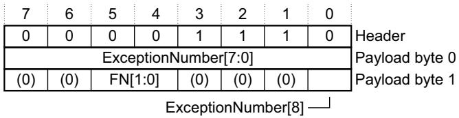  
Figure D4-16 Exception trace packet format

The Exception trace packet header encoding is:

Bits[7:3] A[4:0] field. Discriminator ID, 1.

Bit[2] RAO. Indicates a Hardware source packet.

Bits[1:0] SS bits. Indicate the payload size. 0b10, two-byte payload, see Source packets on page D4-787.

Table D4-6 shows the payload bit assignments.

Table D4-6 Exception trace packet payload bit assignments

<table><tr><td>Byte</td><td>Bit</td><td>Name</td><td>Description</td></tr><tr><td>0</td><td>[7:0]</td><td>ExceptionNumber[7:0]</td><td>Bits[7:0] of the exception number, see Exception number definition on page B1-525.</td></tr><tr><td rowspan="4">1</td><td>[7:6]</td><td>-</td><td>Reserved.</td></tr><tr><td>[5:4]</td><td>FN[1:0]</td><td>Function. The action taken by the processor. One of:0b01 Entered exception indicated by ExceptionNumber field.0b10 Exited exception indicated by ExceptionNumber field.0b11 Returned to exception indicated by ExceptionNumber field.The value 0b00 is reserved.</td></tr><tr><td>[3:1]</td><td>-</td><td>Reserved.</td></tr><tr><td>[0]</td><td>ExceptionNumber[8]</td><td>Bit[8] of the exception number.</td></tr></table>

## D4.3.3 Periodic PC sample packets, discriminator ID2

The DWT unit generates PC samples at fixed time intervals, with an accuracy of one clock cycle. The POSTCNT counter period determines the PC sampling interval, and software configures the DWT\_CTRL.CYCTAP field to determine how POSTCNT relates to the processor cycle counter, CYCCNT. The DWT\_CTRL.PCSAMPLENA bit enables PC sampling. For more information see Control register, DWT\_CTRL on page C1-737.

A full Periodic PC sample packet has four bytes of payload. However, if the processor is in a sleep mode the DWT unit generates a Periodic PC sleep packet with a single payload byte.

Figure D4-17 shows the full Periodic PC sample packet format.

<table><tr><td>7</td><td>6</td><td>5</td><td>4</td><td>3</td><td>2</td><td>1</td><td>0</td></tr><tr><td>0</td><td>0</td><td>0</td><td>1</td><td>0</td><td>1</td><td>1</td><td>1</td></tr><tr><td colspan="8">PC[7:0]</td></tr><tr><td colspan="8">Payload byte 0</td></tr><tr><td colspan="8">Payload byte 1</td></tr><tr><td colspan="8">Payload byte 2</td></tr><tr><td colspan="8">Payload byte 3</td></tr><tr><td colspan="8">PC[15:8]</td></tr><tr><td colspan="8">Payload byte 2</td></tr><tr><td colspan="8">Payload byte 3</td></tr></table>

Figure D4-17 Periodic PC sample packet format

Figure D4-18 shows the Periodic PC sleep packet format.

<table><tr><td>7</td><td>6</td><td>5</td><td>4</td><td>3</td><td>2</td><td>1</td><td>0</td></tr><tr><td>0</td><td>0</td><td>0</td><td>1</td><td>0</td><td>1</td><td>0</td><td>1</td></tr><tr><td>0</td><td>0</td><td>0</td><td>0</td><td>0</td><td>0</td><td>0</td><td>0</td></tr></table>

Figure D4-18 Periodic PC sleep packet format

The Periodic PC sample packet header encoding is:

Bits[7:3] A[4:0] field. Discriminator ID, 2.

Bit[2] RAO. Indicates a Hardware source packet.

Bits[1:0] SS bits. Indicate the payload size, see Source packets on page D4-787:

For a full Periodic PC sample packet, 0b11, indicating a four-byte payload.

For a Periodic PC sleep packet, 0b01, indicating a one-byte payload.

The payload encoding is:

Full Periodic PC sample packet

The four payload bytes hold the PC value, PC[31:0]. The ITM transmits the packet least significant byte first, see Figure D4-17.

Note

Because a PC value must be halfword-aligned, bit[0] of payload byte 0 is 0.

## Periodic PC sleep packet

The single payload byte is a zero byte.

## D4.3.4 Data trace packets discriminator IDs 8-23

The DWT unit generates a Data trace packet when a comparison with a DWT comparator matches, and the configuration of that comparator in the corresponding DWT\_FUNCTIONn register requires data capture on a match. For more information see:

Comparator Function registers, DWT\_FUNCTIONn on page C1-746.

The DWT comparators on page C1-719.

Note

The Data trace packet protocol only supports data capture for comparators 0 to 3, that is, for registers DWT\_FUNCTION0 - DWT\_FUNCTION3.

A single DWT comparator match can generate one of the following single packets or packet combinations:

A single packet, holding a PC value.

A single packet, holding bits[15:0] of a data address.

A single packet, holding a data value, whether it was read or written, and the transfer size.

Two packets, a PC value followed by data value.

Two packets, bits[15:0] of a data address followed by data value.

In Data trace packets, the discriminator ID field encodes:

The Data trace packet type.

The number of the DWT comparator that matched, and therefore required the data capture.

For Data trace data value packets, whether the associated access was a read or a write.

Figure D4-19 shows the Data trace packet header format.

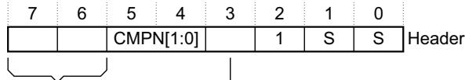  
Figure D4-19 Data trace packet header format

The Data trace packet header encoding is:

Bits[7:3] A[4:0] field, Discriminator ID, encoded as:

Bits[7:6] Data trace packet type:

01 PC value or address, see bit[3].

10 Data value, see Data trace data value packet format on page D4-794.

Values of 0b00 and 0b11 are reserved.

Bits[5:4] CMPN[1:0]. The number of the comparator that generated the data.

Bit[3] When bits[7:6] are 0b01:

0 Data trace PC value packet, see Data trace PC value packet format on page D4-794.

1 Data trace address packet, see Data trace address packet format on page D4-794.

<table><tr><td colspan="2">When bits[7:6] are 0b10:</td></tr><tr><td>0</td><td>Read access.</td></tr><tr><td>1</td><td>Write access.</td></tr></table>

Bit[2] RAO. Indicates a Hardware source packet.

Bits[1:0] SS bits. Indicate the payload size, see Source packets on page D4-787.

Table D4-7 shows how the encoding of the Data trace packet heading assigns discriminator IDs to the different packet types.

Table D4-7 Discriminator IDs for Data trace packets

<table><tr><td colspan="5">Header bit</td><td rowspan="2">Data trace packet type</td><td rowspan="2">Discriminator IDs</td><td rowspan="2">Payload</td></tr><tr><td>[7]</td><td>[6]</td><td>[5]</td><td>[4]</td><td>[3]</td></tr><tr><td>0</td><td>1</td><td colspan="2">CMPN[1:0]</td><td>0</td><td>PC value packet</td><td>8, 10, 12, 14</td><td>4 bytes</td></tr><tr><td>0</td><td>1</td><td colspan="2">CMPN[1:0]</td><td>1</td><td>Address packet</td><td>9, 11, 13, 15</td><td>2 bytes</td></tr><tr><td>1</td><td>0</td><td colspan="2">CMPN[1:0]</td><td>0</td><td>Data value packet, read access</td><td>16, 18, 20, 22</td><td>1, 2, or 4 bytes</td></tr><tr><td>1</td><td>0</td><td colspan="2">CMPN[1:0]</td><td>1</td><td>Data value packet, write access</td><td>17, 19, 21, 23</td><td></td></tr></table>

## Data trace PC value packet format

Figure D4-20 shows the format of a Data trace packet containing the PC value for the instruction that caused the successful address comparison.

<table><tr><td>7</td><td>6</td><td>5</td><td>4</td><td>3</td><td>2</td><td>1</td><td>0</td></tr><tr><td>0</td><td>1</td><td colspan="2">CMPN[1:0]</td><td>0</td><td>1</td><td>1</td><td>1</td></tr><tr><td colspan="8">Payload byte 0</td></tr><tr><td colspan="8">PC[7:0]</td></tr><tr><td colspan="8">Payload byte 1</td></tr><tr><td colspan="8">Payload byte 2</td></tr><tr><td colspan="8">Payload byte 3</td></tr><tr><td colspan="8">PC[15:8]</td></tr><tr><td colspan="8">Payload byte 2</td></tr><tr><td colspan="8">Payload byte 3</td></tr></table>

Figure D4-20 Data trace PC value packet format, IDs 8, 10, 12, or 14

## Data trace address packet format

Figure D4-21 shows the format of a Data trace packet containing bits[15:0] of an address. The DWT generates a Data trace address packet when an address comparison is successful and the corresponding

DWT\_FUNCTION.EMITRANGE bit is set to 1. For more information see The DWT comparators on page C1-719 and Comparator Function registers, DWT\_FUNCTIONn on page C1-746.

<table><tr><td>7</td><td>6</td><td>5</td><td>4</td><td>3</td><td>2</td><td>1</td><td>0</td></tr><tr><td>0</td><td>1</td><td colspan="2">CMPN[1:0]</td><td>1</td><td>1</td><td>1</td><td>0</td></tr><tr><td colspan="8">DADDR[7:0]</td></tr><tr><td colspan="8">DADDR[15:8]</td></tr></table>

Figure D4-21 Data trace address packet format, IDs 9, 11, 13, or 15

## Data trace data value packet format

Figure D4-22 on page D4-795 shows the format of a Data trace packet containing a data value.

<table><tr><td>7</td><td>6</td><td>5</td><td>4</td><td>3</td><td>2</td><td>1</td><td>0</td></tr><tr><td>1</td><td>0</td><td colspan="2">CMPN[1:0]</td><td>WnR</td><td>1</td><td>S</td><td>S</td></tr><tr><td colspan="8">VALUE[7:0]</td></tr><tr><td colspan="8">VALUE[15:8]</td></tr><tr><td colspan="8">VALUE[23:16]</td></tr><tr><td colspan="8">VALUE[31:24]</td></tr></table>

Figure D4-22 Data trace data value packet format, IDs 16-23

The transfer size determines the payload size:

Byte One-byte payload, VALUE[7:0], SS is 0b01.

Halfword Two-byte payload, VALUE[15:0], SS is 0b10.

Word Four-byte payload, VALUE[31:0], SS is 0b11.

# Appendix D5 Armv7-R Differences

This appendix compares the Armv7-M and Armv7-R architecture profiles, identifying their similarities and differences. It contains the following sections:

About the Armv7-M and Armv7-R architecture profiles on page D5-798.

Endian support on page D5-799.

Application level support on page D5-800.

System level support on page D5-801.

Debug support on page D5-802.

## D5.1 About the Armv7-M and Armv7-R architecture profiles

Thumb-2 technology is common across all the Armv7 profiles, there are other key similarities between the Armv7-M and Armv7-R profiles. By understanding the similarities and differences, developers can minimize the effort required to support software on both profiles, or to generate a system architecture that permits straightforward migration from one profile to the other.

A system tradeoff that must be made as part of the profile decision is absolute performance versus interrupt latency.

## D5.2 Endian support

Armv7-R supports instruction fetches in big and little endian formats, with the format determined by the IE bit in the System Control Register. Armv7-M only supports instruction fetches in little endian format. Where an Armv7-M implementation requires big endian instruction format, the bus fabric must provide byte swapping within a halfword. The byte swap is required for instruction fetches only and must not occur on data accesses.

By example, for instruction fetches over a 32-bit bus:

PrefetchInstr<31:24> -> PrefetchInstr<23:16>

PrefetchInstr<23:16> -> PrefetchInstr<31:24>

PrefetchInstr<15:8> -> PrefetchInstr<7:0>

PrefetchInstr<7:0> -> PrefetchInstr<15:8>

Armv7-M and Armv7-R both support a configurable endian model for data accesses, see Endian support on page A3-67. While Armv7-R supports dynamic endian control via a control bit in its xPSR and System Control register EE bit, Armv7-M is statically configured on reset.

## D5.3 Application level support

At the application level, Armv7-M can be considered as a subset of Armv7-R. All the Armv7-M application level instructions are supported in Armv7-R, along with the same flags and general purpose registers. However, the Load Multiple and Store Multiple instructions are always restartable in Armv7-R and do not support the Armv7-M continuation model that is based on the xPSR.ICI bits. However, privileged software execution exposes the system level differences between the two profiles.

Armv7-R has additional support for:

SIMD instructions and saturated arithmetic:

The baseline Armv7-M profile only supports the SSAT and USAT saturation instructions.

The Armv7-M DSP extension adds support for the full range of DSP instructions supported by Armv7-R.

Arm and Thumb instruction sets, and interworking between them. Armv7-M is Thumb only.

For synchronization, Armv7-M only supports the byte, halfword, and word versions of the load and store exclusive instructions. Armv7-R also supports the doubleword versions of these instructions, and the legacy swap instructions.

Note

For all architecture profiles, Arm deprecates use of the legacy swap instructions.

Both Armv7-R and Armv7-M support the hardware divide instructions, SDIV and UDIV.

Both Armv7-R and Armv7-M support an optional Floating-point Extension. However:

The Armv7-R extension includes double-precision operators that are not supported in Armv7-M.

The architectural requirements for the Armv7-M Floating-point Extension are much simpler than those for Armv7-R. In particular, Armv7-M has no concept of a floating-point subarchitecture, which an Armv7-R implementation requires.

The Armv7-R profile can support an Advanced SIMD extension, using NEON technology. Armv7-M does not support Advanced SIMD.

## D5.4 System level support

The programmers’ model and exception model are significantly different in the two profiles:

Armv7-R supports:

A set of operating modes with, for example, a specific mode for handling each class of exception. Core registers are banked between different modes.

Fixed entry points (addresses) for exception handling. When handling exceptions, stacking and unstacking is under software control.

Control and configuration is through the System Control Coprocessor (CP15) interface.

Debug control and configuration is through the CP14 coprocessor interface.

Armv7-M only banks the stack pointer. It uses a combination of special-purpose registers and memory mapped resources for system configuration and execution management, both for normal operation and for debug. A key feature of Armv7-M is low-latency exception handling, with automatic stacking and unstacking on exception entry and exit.

The Armv7-M Floating-point Extension provides configurable hardware stacking and unstacking of floating-point registers.

System level instruction support is different, reflecting the different programmers’ models. Both profiles support the CPS, MRS, and MSR instructions, but they execute differently. Armv7-R provides additional system level instructions, for example SRS and RFE. The behavior of Wait For Exception and Wait For Interrupt behavior differs because of the different the exception models.

Both profiles support the Arm Protected Memory System Architecture (PMSAv7). This is:

Required in Armv7-R.

Optional in Armv7-M.

PMSAv7 provides the same features in both profiles. Although the register access mechanisms are different, the register layouts are generally the same. When PMSAv7 is not supported or is disabled, both profiles have a default memory map. The two default memory maps provide similar breakdowns of memory into regions with different attributes, but the maps are not identical.

The different exception models mean that the two profiles have some differences in PMSA fault handling.

Armv7-R is designed for higher performance (higher clock rate) parts and includes support for closely coupled caches. Armv7-M has support for memory-mapped system caches and limited support for closely-coupled caches.

Interrupt control and prioritization is an integral part of the Armv7-M exception model. This is not part of the Armv7-R architecture, but the Arm General Interrupt Controller (GIC) offers a similar prioritization and interrupt handling model to Armv7-M. Use of a GIC with an Armv7-R processor removes many of the exception model differences.

Armv7-M defines a system timer. A similar timer can be used with Armv7-R, and an implementation can route its interrupt through a GIC for maximum compatibility.

## D5.5 Debug support

Both profiles support Halting and Monitor debug. The mechanisms for breakpoint and watchpoint handling are different. There are also different levels of counter support for profiling. Both support an optional trace feature, based on an Embedded Trace Macrocell (ETM). Armv7-M is generally less invasive in its debug support, and offers additional software and hardware event generation trace capabilities as part of the basic architecture.

## Appendix D6 Pseudocode Definition

This appendix provides a formal definition of the pseudocode used in this manual, and lists the helper procedures and functions used by pseudocode to perform useful architecture-specific jobs. It contains the following sections:

Instruction encoding diagrams and pseudocode on page D6-804.

Limitations of pseudocode on page D6-806.

Data types on page D6-807.

Expressions on page D6-811.

Operators and built-in functions on page D6-813.

Statements and program structure on page D6-818.

Miscellaneous helper procedures and functions on page D6-822.

## D6.1 Instruction encoding diagrams and pseudocode

Instruction descriptions in this book contain:

An Encoding section, containing one or more encoding diagrams, each followed by some encoding-specific pseudocode that translates the fields of the encoding into inputs for the common pseudocode of the instruction, and picks out any encoding-specific special cases.

An Operation section, containing common pseudocode that applies to all of the encodings being described. The Operation section pseudocode contains a call to the EncodingSpecificOperations() function, either at its start or after only a condition check performed by if ConditionPassed() then.

An encoding diagram specifies each bit of the instruction as one of the following:

An obligatory 0 or 1, represented in the diagram as 0 or 1. If this bit does not have this value, the encoding corresponds to a different instruction

A should be 0 or 1, represented in the diagram as (0) or (1). If this bit does not have this value, the instruction is UNPREDICTABLE.

A named single bit or a bit within a named multi-bit field.

An encoding diagram matches an instruction if all obligatory bits are identical in the encoding diagram and the instruction.

## The execution model for an instruction is:

1. Find all encoding diagrams that match the instruction. It is possible that no encoding diagrams match. In that case, abandon this execution model and consult the relevant instruction set chapter instead to find out how the instruction is to be treated. (The bit pattern of such an instruction is usually reserved and UNDEFINED, though there are some other possibilities. For example, unallocated hint instructions are documented as being reserved and to be executed as NOPs).

2. If the operation pseudocode for the matching encoding diagrams starts with a condition check, perform that condition check. If the condition check fails, abandon this execution model and treat the instruction as a NOP. (If there are multiple matching encoding diagrams, either all or none of their corresponding pieces of common pseudocode start with a condition check).

3. Perform the encoding-specific pseudocode for each of the matching encoding diagrams independently and in parallel. Each such piece of encoding-specific pseudocode starts with a bitstring variable for each named bit or multi-bit field within its corresponding encoding diagram, named the same as the bit or multi-bit field and initialized with the values of the corresponding bit(s) from the bit pattern of the instruction.

In a few cases, the encoding diagram contains more than one bit or field with the same name. When this occurs, the values of all of those bits or fields are expected to be identical, and the encoding-specific pseudocode contains a special case using the Consistent() function to specify what happens if this is not the case. This function returns TRUE if all instruction bits or fields with the same name as its argument have the same value, and FALSE otherwise.

If there are multiple matching encoding diagrams, all but one of the corresponding pieces of pseudocode must contain a special case that indicates that it does not apply. Discard the results of all such pieces of pseudocode and their corresponding encoding diagrams.

There is now one remaining piece of pseudocode and its corresponding encoding diagram left to consider. This pseudocode might also contain a special case (most commonly one indicating that it is UNPREDICTABLE). If so, abandon this execution model and treat the instruction according to the special case.

4. Check the should be bits of the encoding diagram against the corresponding bits of the bit pattern of the instruction. If any of them do not match, abandon this execution model and treat the instruction as UNPREDICTABLE.

5. Perform the rest of the operation pseudocode for the instruction description that contains the encoding diagram. That pseudocode starts with all variables set to the values they were left with by the encoding-specific pseudocode.

The ConditionPassed() call in the common pseudocode (if present) performs step 2, and the EncodingSpecificOperations() call performs steps 3 and 4.

## D6.1.1 Pseudocode

The pseudocode provides precise descriptions of what instructions do. Instruction fields are referred to by the names shown in the encoding diagram for the instruction.

The pseudocode is described in detail in the following sections.

## D6.2 Limitations of pseudocode

The pseudocode descriptions of instruction functionality have a number of limitations. These are mainly due to the fact that, for clarity and brevity, the pseudocode is a sequential and mostly deterministic language.

These limitations include:

Pseudocode does not describe the ordering requirements when an instruction generates multiple memory accesses. For a description of the ordering requirements on memory accesses see Memory access order on page A3-89.

Pseudocode does not describe the exact rules when an undefined instruction fails its condition check. In such cases, the UNDEFINED pseudocode statement lies inside the if ConditionPassed() then ... structure, either directly or within the EncodingSpecificOperations() function call, and so the pseudocode indicates that the instruction executes as a NOP. See Conditional execution of undefined instructions on page A7-179 for more information.

The pseudocode statements UNDEFINED, UNPREDICTABLE and SEE indicate behavior that differs from that indicated by the pseudocode being executed. If one of them is encountered:

Earlier behavior indicated by the pseudocode is only specified as occurring to the extent required to determine that the statement is executed.

No subsequent behavior indicated by the pseudocode occurs. This means that these statements terminate pseudocode execution.

For more information see Simple statements on page D6-818.

## D6.3 Data types

This section describes:

General data type rules.

Bitstrings.

Integers on page D6-808.

Reals on page D6-808.

Booleans on page D6-808.

Enumerations on page D6-808.

Lists on page D6-808.

Arrays on page D6-809.

## D6.3.1 General data type rules

Arm Architecture pseudocode is a strongly-typed language. Every constant and variable is of one of the following types:

Bitstring.

Integer.

Boolean.

Real.

Enumeration.

List.

Array.

The type of a constant is determined by its syntax. The type of a variable is normally determined by assignment to the variable, with the variable being implicitly declared to be of the same type as whatever is assigned to it. For example, the assignments x = 1, y = '1', and z = TRUE implicitly declare the variables x, y and z to have types integer, length-1 bitstring and Boolean respectively.

Variables can also have their types declared explicitly by preceding the variable name with the name of the type. This is most often done in function definitions for the arguments and the result of the function.

These data types are described in more detail in the following sections.

## D6.3.2 Bitstrings

A bitstring is a finite-length string of 0s and 1s. Each length of bitstring is a different type. The minimum permitted length of a bitstring is 1.

The type name for bitstrings of length N is bits(N). A synonym of bits(1) is bit.

Bitstring constants are written as a single quotation mark, followed by the string of 0s and 1s, followed by another single quotation mark. For example, the two constants of type bit are '0' and '1'. Spaces can be included in the bitstring for clarity.

A special form of bitstring constant with "x" bits is permitted in bitstring comparisons. See Equality and non-equality testing on page D6-813 for details.

Every bitstring value has a left-to-right order, with the bits being numbered in standard little-endian order. That is, the leftmost bit of a bitstring of length N is bit N-1 and its rightmost bit is bit 0. This order is used as the most-significant-to-least-significant bit order in conversions to and from integers. For bitstring constants and bitstrings derived from encoding diagrams, this order matches the way they are printed.

Bitstrings are the only concrete data type in pseudocode, in the sense that they correspond directly to the contents of registers, memory locations, instructions. All of the remaining data types are abstract.

## D6.3.3 Integers

Pseudocode integers are unbounded in size and can be either positive or negative. That is, they are mathematical integers rather than what computer languages and architectures commonly call integers. Computer integers are represented in pseudocode as bitstrings of the appropriate length, associated with suitable functions to interpret those bitstrings as integers.

The type name for integers is integer.

Integer constants are normally written in decimal, such as 0, 15, -1234. They can also be written in C-style hexadecimal, such as 0x55 or 0x80000000. Hexadecimal integer constants are treated as positive unless they have a preceding minus sign. For example, 0x80000000 is the integer +231. If -231 needs to be written in hexadecimal, it should be written as -0x80000000.

## D6.3.4 Reals

Pseudocode reals are unbounded in size and precision. That is, they are mathematical real numbers, not computer floating-point numbers. Computer floating-point numbers are represented in pseudocode as bitstrings of the appropriate length, associated with suitable functions to interpret those bitstrings as reals.

The type name for reals is real.

Real constants are written in decimal with a decimal point (so 0 is an integer constant, but 0.0 is a real constant).

## D6.3.5 Booleans

A Boolean is a logical true or false value.

The type name for Booleans is boolean. This is not the same type as bit, which is a length-1 bitstring.boolean constants are TRUE and FALSE.

## D6.3.6 Enumerations

An enumeration is a defined set of symbolic constants, such as:

enumeration SRType (SRType\_None, SRType\_LSL, SRType\_LSR, SRType\_ASR, SRType\_ROR, SRType\_RRX);

An enumeration always contains at least one symbolic constant, and symbolic constants are not permitted to be shared between enumerations.

Enumerations must be declared explicitly, though a variable of an enumeration type can be declared implicitly as usual by assigning one of the symbolic constants to it. By convention, each of the symbolic constants starts with the name of the enumeration followed by an underscore. The name of the enumeration is its type name, and the symbolic constants are its possible constants.

Note

Booleans are basically a pre-declared enumeration:

enumeration boolean {FALSE, TRUE};

that does not follow the normal naming convention and that has a special role in some pseudocode constructs, such as if statements.

## D6.3.7 Lists

A list is an ordered set of other data items, separated by commas and enclosed in parentheses, such as:

(bits(32) shifter\_result, bit shifter\_carry\_out)

A list always contains at least one data item.

Lists are often used as the return type for a function that returns multiple results. For example, this particular list is the return type of the function Shift\_C() that performs a standard Arm shift or rotation, when its first operand is of type bits(32).

Some specific pseudocode operators use lists surrounded by other forms of bracketing than parentheses. These are:

Bitstring extraction operators, that use lists of bit numbers or ranges of bit numbers surrounded by angle brackets <...>.

Array indexing, that uses lists of array indexes surrounded by square brackets [...].

Array-like function argument passing, that uses lists of function arguments surrounded by square brackets [...].

Each combination of data types in a list is a separate type, with type name given by just listing the data types (that is, (bits(32),bit) in the above example). The general principle that types can be declared by assignment extends to the types of the individual list items within a list. For example:

(shift\_t, shift\_n) = ('00', 0);

implicitly declares shift\_t, shift\_n and (shift\_t,shift\_n) to be of types bits(2), integer and (bits(2),integer) respectively.

A list type can also be explicitly named, with explicitly named elements in the list. For example:

type ShiftSpec is (bits(2) shift, integer amount);

After this definition and the declaration:

ShiftSpec abc;

the elements of the resulting list can then be referred to as abc.shift and abc.amount. This sort of qualified naming of list elements is only permitted for variables that have been explicitly declared, not for those that have been declared by assignment only.

Explicitly naming a type does not alter what type it is. For example, after the above definition of ShiftSpec, ShiftSpec and (bits(2),integer) are two different names for the same type, not the names of two different types. To avoid ambiguity in references to list elements, it is an error to declare a list variable multiple times using different names of its type or to qualify it with list element names not associated with the name by which it was declared.

An item in a list that is being assigned to may be written as - to indicate that the corresponding item of the assigned list value is discarded. For example:

(shifted, -) = LSL\_C(operand, amount);

List constants are written as a list of constants of the appropriate types, like ('00', 0) in the above example.

## D6.3.8 Arrays

Pseudocode arrays are indexed by either enumerations or integer ranges. An integer range is represented by the lower inclusive end of the range, then .., then the upper inclusive end of the range. For example:

```txt
enumeration PhysReg {
    PhysReg_R0,    PhysReg_R1,    PhysReg_R2,    PhysReg_R3,
    PhysReg_R4,    PhysReg_R5,    PhysReg_R6,    PhysReg_R7,
    PhysReg_R8,    PhysReg_R9,    PhysReg_R10,    PhysReg_R11,
    PhysReg_R12,    PhysReg_SP_Process,    PhysReg_SP_Main,
    PhysReg_LR,    PhysReg_PC};
```

array bits(32) \_R[PhysReg];

array bits(8) \_Memory[0..0xFFFFFFFF];

Arrays are always explicitly declared, and there is no notation for a constant array. Arrays always contain at least one element, because enumerations always contain at least one symbolic constant and integer ranges always contain at least one integer.

Arrays do not usually appear directly in pseudocode. The items that syntactically look like arrays in pseudocode are usually array-like functions such as R[i], MemU[address,size] or Element[i,type]. These functions package up and abstract additional operations normally performed on accesses to the underlying arrays, such as register banking, memory protection, endian-dependent byte ordering, exclusive-access housekeeping and vector element processing.

## D6.4 Expressions

This section describes:

General expression syntax.

Polymorphism and prototypes of operators and functions.

Precedence rules on page D6-812.

## D6.4.1 General expression syntax

An expression is one of the following:

A constant.

A variable, optionally preceded by a data type name to declare its type.

The word UNKNOWN preceded by a data type name to declare its type.

The result of applying a language-defined operator to other expressions.

The result of applying a function to other expressions.

Variable names normally consist of alphanumeric and underscore characters, starting with an alphabetic or underscore character.

Each register described in the text is to be regarded as declaring a correspondingly named bitstring variable, and that variable has the stated behavior of the register. For example, if a bit of a register is stated to read as 0 and ignore writes, then the corresponding bit of its variable reads as 0 and ignore writes.

An expression like bits(32) UNKNOWN indicates that the result of the expression is a value of the given type, but the architecture does not specify what value it is and software must not rely on such values. The value produced must not constitute a security hole and must not be promoted as providing any useful information to software. (This was called an UNPREDICTABLE value in previous Arm Architecture documentation. It is related to but not the same as UNPREDICTABLE, that says that the entire architectural state becomes similarly unspecified).

A subset of expressions are assignable. That is, they can be placed on the left-hand side of an assignment. This subset consists of:

Variables.

The results of applying some operators to other expressions. The description of each language-defined operator that can generate an assignable expression specifies the circumstances under which it does so. (For example, those circumstances might include one or more of the expressions the operator operates on themselves being assignable expressions).

The results of applying array-like functions to other expressions. The description of an array-like function specifies the circumstances under which it can generate an assignable expression.

Every expression has a data type. This is determined by:

For a constant, the syntax of the constant.

For a variable, there are three possible sources for the type:

Its optional preceding data type name.

A data type it was given earlier in the pseudocode by recursive application of this rule.

A data type it is being given by assignment (either by direct assignment to it, or by assignment to a list of which it is a member).

It is a pseudocode error if none of these data type sources exist for a variable, or if more than one of them exists and they do not agree about the type.

• For a language-defined operator, the definition of the operator.

For a function, the definition of the function.

## D6.4.2 Polymorphism and prototypes of operators and functions

Operators and functions in pseudocode can be polymorphic, producing different functionality when applied to different data types. Each of the resulting forms of an operator or function has a different prototype definition. For example, the operator + has forms that act on various combinations of integers, reals and bitstrings.

One particularly common form of polymorphism is between bitstrings of different lengths. This is represented by using bits(N), bits(M), and the like, in the prototype definition

## D6.4.3 Precedence rules

The precedence rules for expressions are:

1. Constants, variables and function invocations are evaluated with higher priority than any operators using their results.

2. Expressions on integers follow the normal exponentiation before multiply/divide before add/subtract operator precedence rules, with sequences of multiply/divides or add/subtracts evaluated left-to-right.

3. Other expressions must be parenthesized to indicate operator precedence if ambiguity is possible, but need not be if all permissible precedence orders under the type rules necessarily lead to the same result. For example, if i, j and k are integer variables, i > 0 && j > 0 && k > 0 is acceptable, but ${ \mathfrak { i } } ~ > ~ { \varnothing } ~ { \& } { \mathrm {  ~ { \ j } ~ } } > ~ { \varnothing } ~ | ~ | ~ { \textbf { k } }$ > 0 is not.

## D6.5 Operators and built-in functions

This section describes:

Operations on generic types.

Operations on booleans.

Bitstring manipulation.

Arithmetic on page D6-816.

## D6.5.1 Operations on generic types

The following operations are defined for all types.

## Equality and non-equality testing

Any two values x and y of the same type can be tested for equality by the expression x == y and for non-equality by the expression x != y. In both cases, the result is of type Boolean

A special form of comparison with a bitstring constant that includes "x” bits as well as '0' and '1' bits is permitted. The bits corresponding to the "x” bits are ignored in determining the result of the comparison. For example, if opcode is a 4-bit bitstring, opcode == ”1x0x” is equivalent to opcode<3> == '1' && opcode<1> == '0'. This special form is also permitted in the implied equality comparisons in when parts of case ... of ... structures.

Pseudocode distinguishes this special form of constant by enclosing it in "…" quotes instead of '…' quotes, as Table D6-1 shows:

Table D6-1 Conventions for bitstrings with and without do not care bits

<table><tr><td>String type</td><td>Quotes used</td><td>Example</td></tr><tr><td>Bitstring</td><td>&#x27;...&#x27;</td><td>&#x27;1101&#x27;</td></tr><tr><td>Bitstring with do not care bits</td><td>&quot;...&quot;</td><td>&quot;1x0x&quot;</td></tr></table>

## Conditional selection

If x and y are two values of the same type and t is a value of type Boolean, then if t then x else y is an expression of the same type as x and y that produces x if t is TRUE and y if t is FALSE.

## D6.5.2 Operations on booleans

If x is a Boolean, then !x is its logical inverse.

If x and y are booleans, then x && y is the result of ANDing them together. As in the C language, if x is FALSE, the result is determined to be FALSE without evaluating y.

If x and y are booleans, then x || y is the result of ORing them together. As in the C language, if x is TRUE, the result is determined to be TRUE without evaluating y.

If x and y are booleans, then x ^ y is the result of exclusive-ORing them together.

## D6.5.3 Bitstring manipulation

The following bitstring manipulation functions are defined:

## Bitstring length and top bit

If x is a bitstring, the bitstring length function Len(x) returns its length as an integer, and TopBit(x) is the leftmost bit of x (= x<Len(x)-1> using bitstring extraction.

## Bitstring concatenation and replication

If x and y are bitstrings of lengths N and M respectively, then x:y is the bitstring of length N+M constructed by concatenating x and y in left-to-right order.

If x is a bitstring and n is an integer with n > 0, Replicate(x,n) is the bitstring of length n\*Len(x) consisting of n copies of x concatenated together and:

Zeros(n) = Replicate(’0’,n)

Ones(n) = Replicate(’1’,n)

## Bitstring extraction

The bitstring extraction operator extracts a bitstring from either another bitstring or an integer. Its syntax is x<integer\_list>, where x is the integer or bitstring being extracted from, and <integer\_list> is a list of integers enclosed in angle brackets rather than the usual parentheses. The length of the resulting bitstring is equal to the number of integers in <integer\_list>.In x<integer\_list>, each of the integers in <integer\_list> must be:

>= 0

< Len(x) if x is a bitstring.

The definition of x<integer\_list> depends on whether integer\_list contains more than one integer. If it does, x<i,j,k,...,n> is defined to be the concatenation:

x<i> : x<j> : x<k> : ... : x<n>

If integer\_list consists of just one integer i, x<i> is defined to be:

If x is a bitstring, '0' if bit i of x is a zero and '1' if bit i of x is a one.

If x is an integer, let y be the unique integer in the range 0 to 2^(i+1)-1 that is congruent to x modulo 2^(i+1). Then x<i> is '0' if y < 2^i and '1' if y >= 2^i.

Loosely, this second definition treats an integer as equivalent to a sufficiently long 2's complement representation of it as a bitstring.

In <integer\_list>, the notation i:j with i >= j is shorthand for the integers in order from i down to j, both ends inclusive. For example, instr<31:28> is shorthand for instr<31,30,29,28>.

The expression x<integer\_list> is assignable provided x is an assignable bitstring and no integer appears more than when in <integer\_list>. In particular, x<i> is assignable if x is an assignable bitstring and 0 <= i < Len(x).

Encoding diagrams for registers frequently show named bits or multi-bit fields. For example, the encoding diagram for the APSR shows its bit<31> as N. In such cases, the syntax APSR.N is used as a more readable synonym for APSR<31>.

## Logical operations on bitstrings

If x is a bitstring, NOT(x) is the bitstring of the same length obtained by logically inverting every bit of x.

If x and y are bitstrings of the same length, x AND y, x OR y, and x EOR y are the bitstrings of that same length obtained by logically ANDing, ORing, and exclusive-ORing corresponding bits of x and y together.

## Bitstring count

If x is a bitstring, BitCount(x) produces an integer result equal to the number of bits of x that are ones.

## Testing a bitstring for being all zero or all ones

If x is a bitstring, IsZero(x) produces TRUE if all of the bits of x are zeros and FALSE if any of them are ones, and IsZeroBit(x) produces '1' if all of the bits of x are zeros and '0' if any of them are ones. IsOnes(x) and IsOnesBit(x) work in the corresponding way. So:

```txt
IsZero(x) = (BitCount(x) == 0)
IsOnes(x) = (BitCount(x) == Len(x))
IsZeroBit(x) = if IsZero(x) then '1' else '0'
IsOnesBit(x) = if IsOnes(x) then '1' else '0'
```

## Lowest and highest set bits of a bitstring

If x is a bitstring, and N = Len(x):

LowestSetBit(x) is the minimum bit number of any of its bits that are ones. If all of its bits are zeros, LowestSetBit(x) = N.

HighestSetBit(x) is the maximum bit number of any of its bits that are ones. If all of its bits are zeros, HighestSetBit(x) = -1.

CountLeadingZeroBits(x) = N - 1 - HighestSetBit(x) is the number of zero bits at the left end of x, in the range 0 to N.

CountLeadingSignBits(x) = CountLeadingZeroBits(x<N-1:1> EOR x<N-2:0>) is the number of copies of the sign bit of x at the left end of x, excluding the sign bit itself, and is in the range 0 to N-1.

## Zero-extension and sign-extension of bitstrings

If x is a bitstring and i is an integer, then ZeroExtend(x,i) is x extended to a length of i bits, by adding sufficient zero bits to its left. That is, if i == Len(x), then ZeroExtend(x,i) = x, and if i > Len(x), then:

```txt
ZeroExtend(x,i) = Zeros(i - Len(x)) : x
```

If x is a bitstring and i is an integer, then SignExtend(x,i) is x extended to a length of i bits, by adding sufficient copies of its leftmost bit to its left. That is, if i == Len(x), then SignExtend(x,i) = x, and if i > Len(x), then:

```txt
SignExtend(x,i) = Replicate(TopBit(x), i-Len(x)) : x
```

It is a pseudocode error to use either ZeroExtend(x,i) or SignExtend(x,i) in a context where it is possible that i < Len(x).

## Converting bitstrings to integers

If x is a bitstring, SInt(x) is the integer whose 2's complement representation is x:

```c
// SInt()
// =====

integer SInt(bits(N) x)
    result = 0;
    for i = 0 to N-1
    if x<i> == '1' then result = result + 2^i;
    if x<N-1> == '1' then result = result - 2^N;
    return result;

UInt(x) is the integer whose unsigned representation is x:
// UInt()
// =====

integer UInt(bits(N) x)
    result = 0;
    for i = 0 to N-1
    if x<i> == '1' then result = result + 2^i;
    return result;
```

Int(x, unsigned) returns either SInt(x) or UInt(x) depending on the value of its second argument:

```javascript
// Int()
// ===
```

integer Int(bits(N) x, boolean unsigned) result = if unsigned then UInt(x) else SInt(x); return result;

## D6.5.4 Arithmetic

Most pseudocode arithmetic is performed on integer or real values, with operands being obtained by conversions from bitstrings and results converted back to bitstrings afterwards. As these data types are the unbounded mathematical types, no issues arise about overflow or similar errors.

## Unary plus, minus and absolute value

If x is an integer or real, then +x is x unchanged, -x is x with its sign reversed, and ABS(x) is the absolute value of x. All three are of the same type as x.

## Addition and subtraction

If x and y are integers or reals, x+y and x-y are their sum and difference. Both are of type integer if x and y are both of type integer, and real otherwise.

Addition and subtraction are particularly common arithmetic operations in pseudocode, and so it is also convenient to have definitions of addition and subtraction acting directly on bitstring operands.

If x and y are bitstrings of the same length N = Len(x) = Len(y), then x+y and x-y are the least significant N bits of the results of converting them to integers and adding or subtracting them. Signed and unsigned conversions produce the same result:

<div class="mineru-algorithm" style="white-space: pre-wrap; font-family:monospace;">
$x+y = (SInt(x) + SInt(y))&lt;N-1:0&gt;$ $= (UInt(x) + UInt(y))&lt;N-1:0&gt;$
</div>

$$
\begin{array}{r l} x - y & = (S I n t (x) - S I n t (y)) <   N - 1: 0 > \\ & = (U I n t (x) - U I n t (y)) <   N - 1: 0 > \end{array}
$$

If x is a bitstring of length N and y is an integer, x+y and x-y are the bitstrings of length N defined by x+y = x + y<N-1:0> and x-y = x - y<N-1:0>. Similarly, if x is an integer and y is a bitstring of length M, x+y and x-y are the bitstrings of length M defined by x+y = x<M-1:0> + y and x-y = x<M-1:0> - y.

## Comparisons

If x and y are integers or reals, then x == y, x != y, x < y, x <= y, x > y, and x >= y are equal, not equal, less than, less than or equal, greater than, and greater than or equal comparisons between them, producing Boolean results. In the case of == and !=, this extends the generic definition applying to any two values of the same type to also act between integers and reals.

## Multiplication

If x and y are integers or reals, then x \* y is the product of x and y, of type integer if both x and y are of type integer and otherwise of type real.

## Division and modulo

If x and y are integers or reals, then x / y is the result of dividing x by y, and is always of type real.

If x and y are integers, then x DIV y and x MOD y are defined by:

x DIV y = RoundDown(x / y)

x MOD y = x - y \* (x DIV y)

It is a pseudocode error to use any x / y, x MOD y, or x DIV y in any context where y can be zero.

## Square root

If x is an integer or a real, Sqrt(x) is its square root, and is always of type real.

## Rounding and aligning

## If x is a real:

RoundDown(x) produces the largest integer n so that n <= x.

RoundUp(x) produces the smallest integer n so that n >= x.

RoundTowardsZero(x) produces RoundDown(x) if x > 0.0, 0 if x == 0.0, and RoundUp(x) if x < 0.0.

If x and y are integers, Align(x,y) = y \* (x DIV y) is an integer.

If x is a bitstring and y is an integer, Align(x,y) = (Align(UInt(x),y))<Len(x)-1:0> is a bitstring of the same length as x.

It is a pseudocode error to use either form of Align(x,y) in any context where y can be 0. In practice, Align(x,y) is only used with y a constant power of two, and the bitstring form used with y = 2^n has the effect of producing its argument with its n low-order bits forced to zero.

## Scaling

If n is an integer, 2^n is the result of raising 2 to the power n and is of type real.

If x and n are integers, then:

x << n = RoundDown(x \* 2^n).

x >> n = RoundDown(x \* 2^(-n)).

## Maximum and minimum

If x and y are integers or reals, then Max(x,y) and Min(x,y) are their maximum and minimum respectively. Both are of type integer if both x and y are of type integer and of type real otherwise.

## D6.6 Statements and program structure

This section describes the control statements used in the pseudocode.

## D6.6.1 Simple statements

The following simple statements must all be terminated with a semicolon, as shown.

## Assignments

An assignment statement takes the form:

<assignable\_expression> = <expression>;

## Procedure calls

A procedure call takes the form:

<procedure\_name>(<arguments>);

## Return statements

A procedure return takes the form:

return;

and a function return takes the form:

return <expression>;

where <expression> is of the type the function prototype line declared.

## UNDEFINED

The statement:

UNDEFINED;

indicates a special case that replaces the behavior defined by the current pseudocode (apart from behavior required to determine that the special case applies). The replacement behavior is that the Undefined Instruction exception is taken.

## UNPREDICTABLE

The statement:

UNPREDICTABLE;

indicates a special case that replaces the behavior defined by the current pseudocode (apart from behavior required to determine that the special case applies). The replacement behavior is not architecturally defined and must not be relied on by software. It must not constitute a security hole or halt or hang the system, and must not be promoted as providing any useful information to software.

SEE...

The statement:

SEE <reference>;

indicates a special case that replaces the behavior defined by the current pseudocode (apart from behavior required to determine that the special case applies). The replacement behavior is that nothing occurs as a result of the current pseudocode because some other piece of pseudocode defines the required behavior. The <reference> indicates where that other pseudocode can be found.

## IMPLEMENTATION\_DEFINED

The statement:

IMPLEMENTATION\_DEFINED <text>;

indicates a special case that specifies that the behavior is IMPLEMENTATION DEFINED. Following text can give more information.

## D6.6.2 Compound statements

Indentation is normally used to indicate structure in compound statements. The statements contained in structures such as if ... then ... else ... or procedure and function definitions are indented more deeply than the statement itself, and their end is indicated by returning to the original indentation level or less.

Indentation is normally done by four spaces for each level.

## if ... then ... else ...

A multi-line if ... then ... else ... structure takes the form:

```txt
if <boolean_expression> then
    <statement 1>
    <statement 2>
    ...
    <statement n>
elsif <boolean_expression> then
    <statement a>
    <statement b>
    ...
    <statement z>
else
    <statement A>
    <statement B>
    ...
    <statement Z>
```

The else and its following statements are optional.

```txt
if <boolean_expression> then
    <statement 1>
    <statement 2>
    ...
    <statement n>
elsif <boolean_expression> then
    <statement a>
    <statement b>
    ...
    <statement z>
else
    <statement A>
    <statement B>
    ...
    <statement Z>
```

The block of lines consisting of elsif and its indented statements is optional, and multiple such blocks can be used.

The block of lines consisting of else and its indented statements is optional.

Abbreviated one-line forms can be used when there are only simple statements in the then part and (if present) the else part, as follows:

if <boolean\_expression> then <statement 1>

if <boolean\_expression> then <statement 1> else <statement A>

if <boolean\_expression> then <statement 1> <statement 2> else <statement A>

## Note

In these forms, <statement 1>, <statement 2> and <statement A> must be terminated by semicolons. This and the fact that the else part is optional are differences from the if ... then ... else ... expression.

## repeat ... until ...

A repeat ... until ... structure takes the form:

repeat <statement 1> <statement 2> <statement n> until <boolean\_expression>;

## while ... do

A while ... do structure takes the form:

while <boolean\_expression> do <statement 1> <statement 2> <statement n>

## for ...

A for ... structure takes the form:

for <assignable\_expression> = <integer\_expr1> to <integer\_expr2> <statement 1> <statement 2> <statement n>

## case ... of ...

A case ... of ... structure takes the form:

```txt
case <expression> of
    when <constant values>
    <statement 1>
    <statement 2>
    ...
    <statement n>
    ... more "when" groups ...
    otherwise
    <statement A>
    <statement B>
    ...
    <statement Z>
```

where <constant values> consists of one or more constant values of the same type as <expression>, separated by commas. Abbreviated one line forms of when and otherwise parts can be used when they contain only simple statements.

If <expression> has a bitstring type, <constant values> can also include bitstring constants containing "x” bits. See Equality and non-equality testing on page D6-813 for details.

## Procedure and function definitions

A procedure definition takes the form:

```txt
<procedure name>(<argument prototypes>)
    <statement 1>
    <statement 2>
    ...
    <statement n>
```

where the <argument prototypes> consists of zero or more argument definitions, separated by commas. Each argument definition consists of a type name followed by the name of the argument.

Note

This first prototype line is not terminated by a semicolon. This helps to distinguish it from a procedure call.

A function definition is similar, but also declares the return type of the function:

```txt
<return type> <function name>(<argument prototypes>)
    <statement 1>
    <statement 2>
    ...
    <statement n>
```

An array-like function is similar, but with square brackets:

```txt
<return type> <function name>[<argument prototypes>]
    <statement 1>
    <statement 2>
    ...
    <statement n>
```

An array-like function also usually has an assignment prototype:

```txt
<function name>[<argument prototypes>]=<value prototypes>
    <statement 1>
    <statement 2>
    ...
    <statement n>
```

## D6.6.3 Comments

Two styles of pseudocode comment exist:

// starts a comment that is terminated by the end of the line.

/\* starts a comment that is terminated by \*/.

## D6.7 Miscellaneous helper procedures and functions

The functions described in this section are not part of the pseudocode specification. They are helper procedures and functions used by pseudocode to perform useful architecture-specific jobs. Each has a brief description and a pseudocode prototype. Some have had a pseudocode definition added.

## D6.7.1 ArchVersion()

This function returns the major version number of the architecture. integer ArchVersion()

## D6.7.2 BKPTInstrDebugEvent()

This procedure generates a debug event for a BKPT instruction.

## D6.7.3 BreakPoint()

This procedure causes a debug breakpoint to occur.

D6.7.4 CallSupervisor() In the M profile, this procedure causes an SVCall exception.

## D6.7.5 ConditionPassed()

This function performs the condition test for an instruction, based on: The two Thumb conditional branch encodings (encodings T1 and T3 of the B instruction). The current values of the xPSR.IT[7:0] bits for other Thumb instructions. Boolean ConditionPassed()

## D6.7.6 ConsumptionOfSpeculativeDataBarrier()

This function performs a CSDB instruction. ConsumptionOfSpeculativeDataBarrier()

## D6.7.7 Coproc\_Accepted()

This function determines whether a coprocessor accepts an instruction. Boolean Coproc\_Accepted(integer cp\_num, bits(32) instr)

## D6.7.8 Coproc\_DoneLoading()

## D6.7.9 Coproc\_DoneStoring()

This function determines for an STC instruction whether enough words have been stored. Boolean Coproc\_DoneStoring(integer cp\_num, bits(32) instr)

## D6.7.10 Coproc\_GetOneWord()

This function obtains the word for an MRC instruction from the coprocessor.

bits(32) Coproc\_GetOneWord(integer cp\_num, bits(32) instr)

## D6.7.11 Coproc\_GetTwoWords()

This function obtains the two words for an MRRC instruction from the coprocessor.

(bits(32), bits(32)) Coproc\_GetTwoWords(integer cp\_num, bits(32) instr)

## D6.7.12 Coproc\_GetWordToStore()

This function obtains the next word to store for an STC instruction from the coprocessor

bits(32) Coproc\_GetWordToStore(integer cp\_num, bits(32) instr)

## D6.7.13 Coproc\_InternalOperation()

This procedure instructs a coprocessor to perform the internal operation requested by a CDP instruction.

Coproc\_InternalOperation(integer cp\_num, bits(32) instr)

## D6.7.14 Coproc\_SendLoadedWord()

This procedure sends a loaded word for an LDC instruction to the coprocessor.

Coproc\_SendLoadedWord(bits(32) word, integer cp\_num, bits(32) instr)

## D6.7.15 Coproc\_SendOneWord()

This procedure sends the word for an MCR instruction to the coprocessor.

Coproc\_SendOneWord(bits(32) word, integer cp\_num, bits(32) instr)

## D6.7.16 Coproc\_SendTwoWords()

This procedure sends the two words for an MCRR instruction to the coprocessor.

Coproc\_SendTwoWords(bits(32) word1, bits(32) word2, integer cp\_num, bits(32) instr)

## D6.7.17 DataMemoryBarrier()

This procedure produces a Data Memory Barrier.

DataMemoryBarrier(bits(4) option)

## D6.7.18 DataSynchronizationBarrier()

This procedure performs a Data Synchronization Barrier.

DataSynchronizationBarrier(bits(4) option)

## D6.7.19 EncodingSpecificOperations()

This procedure invokes the encoding-specific pseudocode for an instruction encoding and checks the ’should be’ bits of the encoding, as described in Instruction encoding diagrams and pseudocode on page D6-804.

## D6.7.20 GenerateCoprocessorException()

This procedure raises a UsageFault exception for a rejected coprocessor instruction.

## D6.7.21 GenerateIntegerZeroDivide()

This procedure raises the appropriate exception for a division by zero in the integer division instructions SDIV and UDIV.

In the M profile, this is a UsageFault exception.

## D6.7.22 HaveDSPExt()

This procedure returns TRUE if the implementation includes the DSP extension.

boolean HaveDSPExt()

## D6.7.23 HaveFPExt()

## D6.7.24 Hint\_Debug()

This procedure supplies a hint to the debug system. Hint\_Debug(bits(4) option)

## D6.7.25 Hint\_PreloadData()

This procedure performs a preload data hint. Hint\_PreloadData(bits(32) address)

## D6.7.26 Hint\_PreloadInstr()

This procedure performs a preload instructions hint. Hint\_PreloadInstr(bits(32) address)

## D6.7.27 Hint\_SendEvent()

This procedure performs a send event hint.

## D6.7.28 Hint\_Yield()

This procedure performs a Yield hint.

## D6.7.29 InstructionSynchronizationBarrier()

This procedure produces an Instruction Synchronization Barrier. InstructionSynchronizationBarrier(bits(4) option)

## D6.7.30 IntegerZeroDivideTrappingEnabled()

This function returns TRUE if the trapping of divisions by zero in the integer division instructions SDIV and UDIV is enabled, and FALSE otherwise.

In the M profile, this is controlled by the DIV\_0\_TRP bit in the Configuration Control register. TRUE is returned if the bit is 1 and FALSE if it is 0.

## D6.7.31 ProcessorID()

Identifies the executing processor.

## D6.7.32 ResetSCSRegs()

Restores all registers in the System Control Space (SCS) that have architecturally-defined reset values to those values.

ResetSCSRegs()

## D6.7.33 SetPending()

This procedure sets the associated exception state to Pending. For a definition of the different exception states see Exceptions on page B1-513.

## D6.7.34 SerializeVFP()

This procedure ensures that any exceptional conditions in previous floating-point instructions have been detected.

## D6.7.35 SpeculativeSynchronizationBarrierToPA()

This function performs an PSSBB instruction.

SpeculativeSynchronizationBarrierToPA()

## D6.7.36 SpeculativeSynchronizationBarrierToVA()

This function performs an SSBB instruction.

SpeculativeSynchronizationBarrierToVA()

## D6.7.37 ThisInstr()

This function returns the currently-executing instruction. It is only used on 32-bit instruction encodings. bits(32) ThisInstr()

## D6.7.38 VFPExcBarrier()

This procedure ensures all floating-point exception processing has completed.

# Appendix D7 Pseudocode Index

This appendix provides an index to pseudocode operators and functions that occur elsewhere in this manual. It contains the following sections:

Pseudocode operators and keywords on page D7-828.

Pseudocode functions and procedures on page D7-831.

## D7.1 Pseudocode operators and keywords

Table D7-1 lists the pseudocode operators and keywords, and is an index to their descriptions:

Table D7-1 Pseudocode operators and keywords

<table><tr><td>Operator</td><td>Meaning</td><td>See</td></tr><tr><td rowspan="2">-</td><td>Unary minus on integers or reals</td><td>Unary plus, minus and absolute value on page D6-816</td></tr><tr><td>Subtraction of integers, reals and bitstrings</td><td>Addition and subtraction on page D6-816</td></tr><tr><td rowspan="2">+</td><td>Unary plus on integers or reals</td><td>Unary plus, minus and absolute value on page D6-816</td></tr><tr><td>Addition of integers, reals and bitstrings</td><td>Addition and subtraction on page D6-816</td></tr><tr><td rowspan="2">(...)</td><td>Around arguments of procedure</td><td>Procedure calls on page D6-818, Procedure and function definitions on page D6-820</td></tr><tr><td>Around arguments of function</td><td>General expression syntax on page D6-811, Procedure and function definitions on page D6-820</td></tr><tr><td rowspan="2">.</td><td>Extract named member from a list</td><td>Lists on page D6-808</td></tr><tr><td>Extract named bit or field from a register</td><td>Bitstring extraction on page D6-814</td></tr><tr><td>!</td><td>Boolean NOT</td><td>Operations on booleans on page D6-813</td></tr><tr><td rowspan="2">!=</td><td>Compare for non-equality (any type)</td><td>Equality and non-equality testing on page D6-813</td></tr><tr><td>Compare for non-equality (between integers and reals)</td><td>Comparisons on page D6-816</td></tr><tr><td>&amp;&amp;</td><td>Boolean AND</td><td>Operations on booleans on page D6-813</td></tr><tr><td>*</td><td>Multiplication of integers and reals</td><td>Multiplication on page D6-816</td></tr><tr><td>/</td><td>Division of integers and reals (real result)</td><td>Division and modulo on page D6-816</td></tr><tr><td>/ *...*/</td><td>Comment delimiters</td><td>Comments on page D6-821</td></tr><tr><td>//</td><td>Introduces comment terminated by end of line</td><td>Comments on page D6-821</td></tr><tr><td rowspan="2">:</td><td>Bitstring concatenation</td><td>Bitstring concatenation and replication on page D6-814</td></tr><tr><td>Integer range in bitstring extraction operator</td><td>Bitstring extraction on page D6-814</td></tr><tr><td rowspan="2">[...]</td><td>Around array index</td><td>Arrays on page D6-809</td></tr><tr><td>Around arguments of array-like function</td><td>General expression syntax on page D6-811, Procedure and function definitions on page D6-820</td></tr><tr><td>^</td><td>Boolean exclusive-OR</td><td>Operations on booleans on page D6-813</td></tr><tr><td>||</td><td>Boolean OR</td><td>Operations on booleans on page D6-813</td></tr><tr><td>&lt;</td><td>Less than comparison of integers and reals</td><td>Comparisons on page D6-816</td></tr><tr><td>&lt;...&gt;</td><td>Extraction of specified bits of bitstring or integer</td><td>Bitstring extraction on page D6-814</td></tr><tr><td>&lt;&lt;</td><td>Multiply integer by power of 2 (with rounding towards -infinity)</td><td>Scaling on page D6-817</td></tr><tr><td>&lt;=</td><td>Less than or equal comparison of integers and reals</td><td>Comparisons on page D6-816</td></tr><tr><td>=</td><td>Assignment</td><td>Assignments on page D6-818</td></tr><tr><td rowspan="2">==</td><td>Compare for equality, any type</td><td>Equality and non-equality testing on page D6-813</td></tr><tr><td>Compare for equality, between integers and reals</td><td>Comparisons on page D6-816</td></tr><tr><td>&gt;</td><td>Greater than comparison of integers and reals</td><td>Comparisons on page D6-816</td></tr><tr><td>&gt;=</td><td>Greater than or equal comparison of integers and reals</td><td>Comparisons on page D6-816</td></tr><tr><td>&gt;&gt;</td><td>Divide integer by power of 2 (with rounding towards -infinity)</td><td>Scaling on page D6-817</td></tr><tr><td>2^N</td><td>Power of two (real result)</td><td>Scaling on page D6-817</td></tr><tr><td>AND</td><td>Bitwise AND of bitstrings</td><td>Logical operations on bitstrings on page D6-814</td></tr><tr><td>array</td><td>Keyword introducing array type definition</td><td>Arrays on page D6-809</td></tr><tr><td>bit</td><td>Bitstring type of length 1</td><td>Bitstrings on page D6-807</td></tr><tr><td>bits(N)</td><td>Bitstring type of length N</td><td>Bitstrings on page D6-807</td></tr><tr><td>boolean</td><td>Boolean type</td><td>Booleans on page D6-808</td></tr><tr><td>case ... of ...</td><td>Control structure</td><td>case ... of ... on page D6-820</td></tr><tr><td>DIV</td><td>Quotient from integer division</td><td>Division and modulo on page D6-816</td></tr><tr><td>enumeration</td><td>Keyword introducing enumeration type definition</td><td>Enumerations on page D6-808</td></tr><tr><td>EOR</td><td>Bitwise EOR of bitstrings</td><td>Logical operations on bitstrings on page D6-814</td></tr><tr><td>FALSE</td><td>Boolean constant</td><td>Booleans on page D6-808</td></tr><tr><td>for ...</td><td>Control structure</td><td>for ... on page D6-820</td></tr><tr><td rowspan="2">if ... then ... else ...</td><td>Expression selecting between two values</td><td>Conditional selection on page D6-813</td></tr><tr><td>Control structure</td><td>if ... then ... else ... on page D6-819</td></tr><tr><td>IMPLEMENTATION_DEFINED</td><td>Describes IMPLEMENTATION DEFINED behavior</td><td>IMPLEMENTATION_DEFINED on page D6-819</td></tr><tr><td>integer</td><td>Unbounded integer type</td><td>Integers on page D6-808</td></tr><tr><td>MOD</td><td>Remainder from integer division</td><td>Division and modulo on page D6-816</td></tr><tr><td>OR</td><td>Bitwise OR of bitstrings</td><td>Logical operations on bitstrings on page D6-814</td></tr><tr><td>otherwise</td><td>Introduces default case in case ... of ... control structure</td><td>case ... of ... on page D6-820</td></tr><tr><td>realrepeat ... until ...</td><td>Real number typeControl structure</td><td>Reals on page D6-808repeat ... until ... on page D6-820</td></tr><tr><td>return</td><td>Procedure or function return</td><td>Return statements on page D6-818</td></tr><tr><td>SEE</td><td>Points to other pseudocode to use instead</td><td>SEE... on page D6-818</td></tr><tr><td>TRUE</td><td>Boolean constant</td><td>Booleans on page D6-808</td></tr><tr><td>UNDEFINED</td><td>Cause Undefined Instruction exception</td><td>UNDEFINED on page D6-818</td></tr><tr><td>UNKNOWN</td><td>Unspecified value</td><td>General expression syntax on page D6-811</td></tr><tr><td>UNPREDICTABLE</td><td>Unspecified behavior</td><td>UNPREDICTABLE on page D6-818</td></tr><tr><td>when</td><td>Introduces specific case in case ... of ... control structure</td><td>case ... of ... on page D6-820</td></tr><tr><td>while ... do ...</td><td>Control structure</td><td>while ... do on page D6-820</td></tr></table>

## D7.2 Pseudocode functions and procedures

Table D7-2 lists the pseudocode functions and procedures used in this manual, and is an index to their descriptions:

Table D7-2 Pseudocode functions and procedures

<table><tr><td>Function</td><td>Meaning</td><td>See</td></tr><tr><td>_Mem[]</td><td>Basic memory accesses</td><td>Basic memory accesses on page B2-582</td></tr><tr><td>Abs()</td><td>Absolute value of an integer or real</td><td>Unary plus, minus and absolute value on page D6-816</td></tr><tr><td>AddWithCarry()</td><td>Addition of bitstrings, with carry input and carry/overflow outputs</td><td>Pseudocode details of addition and subtraction on page A2-28</td></tr><tr><td>Align()</td><td>Align integer or bitstring to multiple of an integer</td><td>Rounding and aligning on page D6-817</td></tr><tr><td>ALUWritePC()</td><td>Write value to PC, with interworking for Arm only from Armv7</td><td>Pseudocode details of Arm core register operations on page A2-30</td></tr><tr><td>ArchVersion()</td><td>Major version number of the architecture</td><td>ArchVersion() on page D6-822</td></tr><tr><td>ASR_C()</td><td>Arithmetic shift right of a bitstring, with carry output</td><td>Shift and rotate operations on page A2-26</td></tr><tr><td>ASR()</td><td>Arithmetic shift right of a bitstring</td><td>Shift and rotate operations on page A2-26</td></tr><tr><td>BigEndian()</td><td>Returns TRUE if data accesses are big-endian</td><td>Pseudocode details of endianness on page A3-68</td></tr><tr><td>BigEndianReverse()</td><td>Endian-reverse the bytes of a bitstring</td><td>Reverse endianness on page B2-585</td></tr><tr><td>BitCount()</td><td>Count number of ones in a bitstring</td><td>Bitstring count on page D6-814</td></tr><tr><td>BKPTInstrDebugEvent()</td><td>Generate a debug event for a BKPT instruction</td><td>BKPTInstrDebugEvent() on page D6-822</td></tr><tr><td>BLXWritePC()</td><td>Write value to PC, with interworking</td><td>Pseudocode details of Arm core register operations on page A2-30</td></tr><tr><td>BranchTo()</td><td>Continue execution at specified address</td><td>Pseudocode details of Arm core register accesses on page B1-521</td></tr><tr><td>BranchWritePC()</td><td>Write value to PC, without interworking</td><td rowspan="2">Pseudocode details of Arm core register operations on page A2-30</td></tr><tr><td>BXWritePC()</td><td>Write value to PC, with interworking</td></tr><tr><td>CallSupervisor()</td><td>Generate exception for SVC instruction</td><td>CallSupervisor() on page D6-822</td></tr><tr><td>CheckPermission()</td><td>Memory system check of access permission</td><td>Access permission checking on page B2-587</td></tr><tr><td>CheckVFPEnabled()</td><td>Generate Undefined Instruction exception if the FP extension is not enabled</td><td>Checks on FP instruction execution on page B1-565</td></tr><tr><td>ClearEventRegister()</td><td>Clear the Event Register of the current processor</td><td>Pseudocode details of the Wait For Event lock mechanism on page B1-561</td></tr><tr><td>ClearExclusiveByAddress()</td><td>Clear local exclusive monitor records for an address range</td><td>Pseudocode details of operations on exclusive monitors on page B2-586</td></tr><tr><td>ClearExclusiveLocal()</td><td>Clear global exclusive monitor record for a processor</td><td></td></tr><tr><td>ConditionPassed()</td><td>Returns TRUE if the current instruction passes its condition check</td><td>Pseudocode details of conditional execution on page A7-178</td></tr><tr><td>Consistent()</td><td>Test identically-named instruction bits or fields are identical</td><td>Instruction encoding diagrams and pseudocode on page D6-804</td></tr><tr><td>ConsumptionofSpeculativeDataBarrier()</td><td>Perform a Consumption of Speculative Data Barrier</td><td>ConsumptionOfSpeculativeDataBarrier() on page D6-822</td></tr><tr><td>Coproc_Accepted()</td><td>Determine whether a coprocessor accepts an instruction.</td><td>Coproc_Accepted() on page D6-822</td></tr><tr><td>Coproc_DoneLoading()</td><td>Returns TRUE if enough words have been loaded, for an LDC or LDC2 instruction</td><td>Coproc_DoneLoading() on page D6-822</td></tr><tr><td>Coproc_DoneStoring()</td><td>Returns TRUE if enough words have been stored, for an STC or STC2 instruction</td><td>Coproc_DoneStoring() on page D6-822</td></tr><tr><td>Coproc_GetOneWord()</td><td>Get word from coprocessor, for an MRC or MRC2 instruction</td><td>Coproc_GetOneWord() on page D6-822</td></tr><tr><td>Coproc_GetTwoWords()</td><td>Get two words from coprocessor, for an MRRC or MRRC2 instruction</td><td>Coproc_GetTwoWords() on page D6-823</td></tr><tr><td>Coproc_GetWordToStore()</td><td>Get next word to store from coprocessor, for STC or STC2 instruction</td><td>Coproc_GetWordToStore() on page D6-823</td></tr><tr><td>Coproc_InternalOperation()</td><td>Instruct coprocessor to perform an internal operation, for a CDP or CDP2 instruction</td><td>Coproc_InternalOperation() on page D6-823</td></tr><tr><td>Coproc_SendLoadedWord()</td><td>Send next loaded word to coprocessor, for LDC or LDC2 instruction</td><td>Coproc_SendLoadedWord() on page D6-823</td></tr><tr><td>Coproc_SendOneWord()</td><td>Send word to coprocessor, for an MCR or MCR2 instruction</td><td>Coproc_SendOneWord() on page D6-823</td></tr><tr><td>Coproc_SendTwoWords()</td><td>Send two words to coprocessor, for an MCRR or MCRR2 instruction</td><td>Coproc_SendTwoWords() on page D6-823</td></tr><tr><td>CountLeadingSignBits()</td><td>Number of identical sign bits at left end of bitstring, excluding the leftmost bit itself</td><td>Lowest and highest set bits of a bitstring on page D6-815</td></tr><tr><td>CountLeadingZeroBits()</td><td>Number of zeros at left end of bitstring</td><td></td></tr><tr><td>CurrentCond()</td><td>Returns condition for current instruction</td><td>Pseudocode details of conditional execution on page A7-178</td></tr><tr><td>CurrentModeIsPrivileged()</td><td>Returns TRUE if current software execution is privileged</td><td>Pseudocode details of processor mode on page B1-512</td></tr><tr><td>D[]</td><td>Doubleword view of the FP extension registers</td><td>Pseudocode details of the FP extension registers on page A2-36</td></tr><tr><td>DataAddressMatch()</td><td>DWT comparator data address matching</td><td>Comparator behavior for data address matching on page C1-723</td></tr><tr><td>DataMemoryBarrier()</td><td>Perform a Data Memory Barrier operation</td><td>DataMemoryBarrier() on page D6-823</td></tr><tr><td>DataSynchronizationBarrier()</td><td>Perform a Data Synchronization Barrier operation</td><td>DataSynchronizationBarrier() on page D6-823</td></tr><tr><td>Deactivate()</td><td>Removal of Active state from an exception as part of the exception return</td><td>Exception return behavior on page B1-539</td></tr><tr><td>DecodeImmShift()</td><td>Decode shift type and amount for an immediate shift</td><td>Shift operations on page A7-183</td></tr><tr><td>DefaultMemoryAttributes()</td><td>Determine memory attributes for an address in the default memory map</td><td>Default memory access decode on page B2-588</td></tr><tr><td>DefaultPermissions()</td><td>Defines memory access permissions for the default memory map</td><td>MPU pseudocode on page B3-633</td></tr><tr><td>DefaultTEXDecode()</td><td>Determine memory attributes for a set of TEX[2:0], C, B bits</td><td>MPU access control decode on page B2-588</td></tr><tr><td>DerivedLateArrival()</td><td>Handles a derived late arriving exception</td><td>Derived exceptions on exception entry on page B1-547</td></tr><tr><td>EncodingSpecificOperations()</td><td>Invoke encoding-specific pseudocode and should be checks</td><td>Instruction encoding diagrams and pseudocode on page D6-804</td></tr><tr><td>EventRegistered()</td><td>Determine whether the Event Register of the current processor is set</td><td>Pseudocode details of the Wait For Event lock mechanism on page B1-561</td></tr><tr><td>ExceptionActiveBitCount()</td><td>Counts the number of bits that are set to 1 in the ExceptionActive[*] array</td><td>Exception return behavior on page B1-539</td></tr><tr><td>ExceptionEntry()</td><td>Exception entry behavior</td><td>Exception entry behavior on page B1-531</td></tr><tr><td>ExceptionIN()</td><td>Determine exception entry status</td><td>External interrupt input behavior on page B3-625</td></tr><tr><td>ExceptionOUT()</td><td>Determine exception return status</td><td></td></tr><tr><td>ExceptionReturn()</td><td>Exception return behavior</td><td>Exception return behavior on page B1-539</td></tr><tr><td>ExceptionTaken()</td><td>Part of ExceptionEntry() behavior</td><td>Exception entry behavior on page B1-531</td></tr><tr><td>ExclusiveMonitorsPass()</td><td>Check whether Store-Exclusive operation has control of exclusive monitors</td><td>Pseudocode details of operations on exclusive monitors on page B2-586</td></tr><tr><td>ExecuteFPCheck()</td><td>On FP instruction execution, checks whether FP functionality is enabled, and if so, saves FP state if necessary.</td><td>Checks on FP instruction execution on page B1-565</td></tr><tr><td>ExecutionPriority()</td><td>Defines the execution priority</td><td>Execution priority on page B1-528</td></tr><tr><td>FindPriv()</td><td>Determine access privilege</td><td>Interfaces to memory system specific pseudocode on page B2-583</td></tr><tr><td>FixedToFP()</td><td>Convert integer or fixed-point to floating-point</td><td>FP conversions on page A2-56</td></tr><tr><td>FPAbs()</td><td>Floating-point absolute value</td><td>FP negation and absolute value on page A2-47</td></tr><tr><td>FPAdd()</td><td>Floating-point addition</td><td>FP addition and subtraction on page A2-53</td></tr><tr><td>FPCompare()</td><td>Floating-point comparison, producing NZCV flag result</td><td>FP comparisons on page A2-53</td></tr><tr><td>FPDefaultNaN()</td><td>Generate floating-point default NaN</td><td>Generation of specific floating-point values on page A2-46</td></tr><tr><td>FPDiv()</td><td>Floating-point division</td><td>FP multiplication and division on page A2-54</td></tr><tr><td>FPHalfToSingle()</td><td>Convert half-precision floating-point to single-precision floating-point</td><td>FP conversions on page A2-56</td></tr><tr><td>FPInfinity()</td><td>Generate floating-point infinity</td><td rowspan="2">Generation of specific floating-point values on page A2-46</td></tr><tr><td>FPMaxNormal()</td><td>Generate maximum normalized floating-point value</td></tr><tr><td>FPMul()</td><td>Floating-point multiplication</td><td>FP multiplication and division on page A2-54</td></tr><tr><td>FPMulAdd()</td><td>Floating-point multiply accumulate</td><td>FP multiply accumulate on page A2-55</td></tr><tr><td>FPNeg()</td><td>Floating-point negation</td><td>FP negation and absolute value on page A2-47</td></tr><tr><td>FPProcessException()</td><td>Process a floating-point exception</td><td rowspan="4">FP exception and NaN handling on page A2-49</td></tr><tr><td>FPProcessNaN()</td><td>Generate correct result and exceptions for a NaN operand</td></tr><tr><td>FPProcessNaNs()</td><td>Perform NaN operand checks and processing for a 2-operand floating-point operation</td></tr><tr><td>FPProcessNaNs3()</td><td>Perform NaN operand checks and processing for a 3-operand floating-point operation</td></tr><tr><td>FPRound()</td><td>Floating-point rounding</td><td>FP rounding on page A2-50</td></tr><tr><td>FPSingleToHalf()</td><td>Convert single-precision floating-point to half-precision floating-point</td><td>FP conversions on page A2-56</td></tr><tr><td>FPSqrt()</td><td>Floating-point square root</td><td>FP square root on page A2-56</td></tr><tr><td>FPSub()</td><td>Floating-point subtraction</td><td>FP addition and subtraction on page A2-53</td></tr><tr><td>FPToFixed()</td><td>Convert floating-point to integer or fixed-point</td><td>FP conversions on page A2-56</td></tr><tr><td>FPUnpack()</td><td>Produce type, sign bit and real value of a floating-point number</td><td>FP value unpacking on page A2-47</td></tr><tr><td>FPZero()</td><td>Generate floating-point zero</td><td>Generation of specific floating-point values on page A2-46</td></tr><tr><td>GenerateCoprocessorException()</td><td>Generate the exception for an unclaimed coprocessor instruction</td><td>GenerateCoprocessorException() on page D6-823</td></tr><tr><td>GenerateIntegerZeroDivide()</td><td>Generate the exception for a trapped divide-by-zero on execution of an integer divide instruction</td><td>GenerateIntegerZeroDivide() on page D6-824</td></tr><tr><td>HighestSetBit()</td><td>Position of leftmost 1 in a bitstring</td><td>Lowest and highest set bits of a bitstring on page D6-815</td></tr><tr><td>HaveDSPExt()</td><td>Returns TRUE if the implementation includes the DSP extension</td><td>HaveDSPExt() on page D6-824</td></tr><tr><td>HaveFPExt()</td><td>Returns TRUE if the implementation includes the FP extension</td><td>HaveFPExt() on page D6-824</td></tr><tr><td>Hint_Debug()</td><td>Perform function of DBG hint instruction</td><td>Hint_Debug() on page D6-824</td></tr><tr><td>Hint_PreloadData()</td><td>Perform function of PLD memory hint instruction</td><td>Hint_PreloadData() on page D6-824</td></tr><tr><td>Hint_PreloadInstr()</td><td>Perform function of PLI memory hint instruction</td><td>Hint_PreloadInstr() on page D6-824</td></tr><tr><td>Hint_SendEvent()</td><td>Perform function of SEV hint instruction</td><td>Hint_SendEvent() on page D6-824</td></tr><tr><td>Hint_Yield()</td><td>Perform function of YIELD hint instruction</td><td>Hint_Yield() on page D6-824</td></tr><tr><td>InITBlock()</td><td>Return TRUE if current instruction is in an IT block.</td><td>Pseudocode details of ITSTATE operation on page A7-180</td></tr><tr><td>InstrAddressMatch()</td><td>DWT comparator instruction address matching</td><td>Comparator behavior for instruction address matching on page C1-723</td></tr><tr><td>InstructionSynchronizationBarrier()</td><td>Perform an Instruction Synchronization Barrier operation</td><td>InstructionSynchronizationBarrier() on page D6-824</td></tr><tr><td>Int()</td><td>Convert bitstring to integer in argument-specified fashion</td><td>Converting bitstrings to integers on page D6-815</td></tr><tr><td>IntegerZeroDivideTrappingEnabled()</td><td>Check whether divide-by-zero trapping is enabled for integer divide instructions</td><td>IntegerZeroDivideTrappingEnabled() on page D6-824</td></tr><tr><td>InterruptAssertion()</td><td>Determine status of an external interrupt</td><td>External interrupt input behavior on page B3-625</td></tr><tr><td>IsExclusiveGlobal()</td><td>Check a global exclusive access record</td><td rowspan="2">Pseudocode details of operations on exclusive monitors on page B2-586</td></tr><tr><td>IsExclusiveLocal()</td><td>Check a local exclusive access record</td></tr><tr><td>IsOnes()</td><td>Test for all-ones bitstring, Boolean result</td><td rowspan="4">Testing a bitstring for being all zero or all ones on page D6-814</td></tr><tr><td>IsOnesBit()</td><td>Test for all-ones bitstring, bit result</td></tr><tr><td>IsZero()</td><td>Test for all-zeros bitstring, Boolean result</td></tr><tr><td>IsZeroBit()</td><td>Test for all-zeros bitstring, bit result</td></tr><tr><td>ITAdvance()</td><td>Advance the ITSTATE bits to their values for the next instruction</td><td rowspan="2">Pseudocode details of ITSTATE operation on page A7-180</td></tr><tr><td>LastInITBlock()</td><td>Return TRUE if current instruction is the last instruction in an IT block.</td></tr><tr><td>LateArrival()</td><td>Late arrival exception handling</td><td>Late-arriving exceptions on page B1-546</td></tr><tr><td>Len()</td><td>Bitstring length</td><td>Bitstring length and top bit on page D6-813</td></tr><tr><td>LoadWritePC()</td><td>Write value to PC, with interworking</td><td>Pseudocode details of Arm core register operations on page A2-30</td></tr><tr><td>LookUpSP()</td><td>Select the current SP</td><td>Pseudocode details of Arm core register accesses on page B1-521</td></tr><tr><td>LowestSetBit()</td><td>Position of rightmost 1 in a bitstring</td><td>Lowest and highest set bits of a bitstring on page D6-815</td></tr><tr><td>LSL_C()</td><td>Logical shift left of a bitstring, with carry output</td><td rowspan="4">Shift and rotate operations on page A2-26</td></tr><tr><td>LSL()</td><td>Logical shift left of a bitstring</td></tr><tr><td>LSR_C()</td><td>Logical shift right of a bitstring, with carry output</td></tr><tr><td>LSR()</td><td>Logical shift right of a bitstring</td></tr><tr><td>MarkExclusiveLocal()</td><td>Set a local exclusive access record</td><td rowspan="2">Pseudocode details of operations on exclusive monitors on page B2-586</td></tr><tr><td>MarkExclusiveGlobal()</td><td>Set a global exclusive access record</td></tr><tr><td>Max()</td><td>Maximum of integers or reals</td><td>Maximum and minimum on page D6-817</td></tr><tr><td>MemA_unpriv[]</td><td>Memory access that must be aligned, unprivileged</td><td rowspan="3">Aligned memory accesses on page B2-583</td></tr><tr><td>MemA_with_priv[]</td><td>Memory access that must be aligned, at specified privilege level</td></tr><tr><td>MemA[]</td><td>Memory access that must be aligned, at current privilege level</td></tr><tr><td>MemU_unpriv[]</td><td>Memory access without alignment requirement, unprivileged</td><td rowspan="3">Unaligned memory accesses on page B2-584</td></tr><tr><td>MemU_with_priv[]</td><td>Memory access without alignment requirement, at specified privilege level</td></tr><tr><td>MemU[]</td><td>Memory access without alignment requirement, at current privilege level</td></tr><tr><td>Min()</td><td>Minimum of integers or reals</td><td>Maximum and minimum on page D6-817</td></tr><tr><td>NOT()</td><td>Bitwise inversion of a bitstring</td><td>Logical operations on bitstrings on page D6-814</td></tr><tr><td>Ones()</td><td>All-ones bitstring</td><td>Bitstring concatenation and replication on page D6-814</td></tr><tr><td>PopStack()</td><td>Stack restore sequence on an exception return</td><td>Exception return behavior on page B1-539</td></tr><tr><td>PreserveFPState()</td><td>Saves FP state to the stack</td><td>Saving FP state on page B1-566</td></tr><tr><td>ProcessorID()</td><td>Return integer identifying the processor</td><td>ProcessorID() on page D6-825</td></tr><tr><td>PushStack()</td><td>Stack save sequence on exception entry</td><td>Exception entry behavior on page B1-531</td></tr><tr><td>R[]</td><td>Access the main Arm core register bank</td><td>Pseudocode details of Arm core register operations on page A2-30Pseudocode details of Arm core register accesses on page B1-521</td></tr><tr><td>Replicate()</td><td>Bitstring replication</td><td>Bitstring concatenation and replication on page D6-814</td></tr><tr><td>ResetSCSRegs()</td><td>Resets the SCS registers with defined reset values to those values</td><td>ResetSCSRegs() on page D6-825</td></tr><tr><td>ReturnAddress()</td><td>Return address stacked on exception entry</td><td>Exception entry behavior on page B1-531</td></tr><tr><td>ROR_C()</td><td>Rotate right of a bitstring, with carry output</td><td rowspan="2">Shift and rotate operations on page A2-26</td></tr><tr><td>ROR()</td><td>Rotate right of a bitstring</td></tr><tr><td>RoundDown()</td><td>Round real to integer, rounding towards-infinity</td><td rowspan="3">Rounding and aligning on page D6-817</td></tr><tr><td>RoundTowardsZero()</td><td>Round real to integer, rounding towards zero</td></tr><tr><td>RoundUp()</td><td>Round real to integer, rounding towards+infinity</td></tr><tr><td>RRX_C()</td><td>Rotate right with extend of a bitstring, with carry output</td><td rowspan="2">Shift and rotate operations on page A2-26</td></tr><tr><td>RRX()</td><td>Rotate right with extend of a bitstring</td></tr><tr><td>S[]</td><td>Single word view of the FP extension registers</td><td>Pseudocode details of the FP extension registers on page A2-36</td></tr><tr><td>Sat()</td><td>Convert integer to bitstring with specified saturation</td><td rowspan="2">Pseudocode details of saturation on page A2-29</td></tr><tr><td>SatQ()</td><td>Convert integer to bitstring with specified saturation, with saturated flag output</td></tr><tr><td>SendEvent()</td><td>Create a WFE wakeup event that sets the Event Register(s) on execution of an SEV instruction.</td><td>Pseudocode details of the Wait For Event lock mechanism on page B1-561</td></tr><tr><td>SerializeVFP()</td><td>Ensure exceptional conditions in preceding floating-point instructions have been detected</td><td>SerializeVFP() on page D6-825</td></tr><tr><td>SetEventRegister()</td><td>Set the Event Register of the current processor</td><td>Pseudocode details of the Wait For Event lock mechanism on page B1-561</td></tr><tr><td>SetExclusiveMonitors()</td><td>Set exclusive monitors for a local exclusive operation</td><td>Pseudocode details of operations on exclusive monitors on page B2-586</td></tr><tr><td>Shift_C()</td><td>Perform a specified shift by a specified amount on a bitstring, with carry output</td><td rowspan="2">Shift operations on page A7-183</td></tr><tr><td>Shift()</td><td>Perform a specified shift by a specified amount on a bitstring</td></tr><tr><td>SignedSat()</td><td>Convert integer to bitstring with signed saturation</td><td rowspan="2">Pseudocode details of saturation on page A2-29</td></tr><tr><td>SignedSatQ()</td><td>Convert integer to bitstring with signed saturation, with saturated flag output</td></tr><tr><td>SignExtend()</td><td>Extend bitstring to left with copies of its leftmost bit</td><td>Zero-extension and sign-extension of bitstrings on page D6-815</td></tr><tr><td>SInt()</td><td>Convert bitstring to integer in signed (two's complement) fashion</td><td>Converting bitstrings to integers on page D6-815</td></tr><tr><td>SleepOnExit()</td><td>Optionally returns processor to a power-saving mode on return from the only active exception</td><td>Exception return operation on page B1-541</td></tr><tr><td>SpeculativeSynchronizationBarriertoPA()</td><td>Perform a PSSBB instruction</td><td>SpeculativeSynchronizationBarrierToPA() on page D6-825</td></tr><tr><td>SpeculativeSynchronizationBarriertoVA()</td><td>Perform a SSBB instruction</td><td>SpeculativeSynchronizationBarrierToVA() on page D6-825</td></tr><tr><td>Sqrt()</td><td>Calculate a square root</td><td>Square root on page D6-817</td></tr><tr><td>StandardFPSCRValue()</td><td>Returns the FPSCR value that selects Arm standard floating-point arithmetic</td><td>Selection of Arm standard floating-point arithmetic on page A2-53</td></tr><tr><td>TailChain()</td><td>Tail chaining exception behavior</td><td>Tail-chaining on page B1-549</td></tr><tr><td>TakePreserveFPException()</td><td>Handles any exception during a PreserveFPState() operation</td><td>Exceptions while saving FP state on page B1-566</td></tr><tr><td>TakeReset()</td><td>Reset behavior</td><td>Reset behavior on page B1-530</td></tr><tr><td>ThisInstr()</td><td>Returns the bitstring encoding of the current instruction</td><td>ThisInstr() on page D6-825</td></tr><tr><td>ThumbExpandImm()</td><td>Expansion of immediates for Thumb instructions</td><td rowspan="2">Operation of modified immediate constants on page A5-139</td></tr><tr><td>ThumbExpandImmWithC()</td><td>Expansion of immediates for Thumb instructions, with carry output</td></tr><tr><td>TopBit()</td><td>Leftmost bit of a bitstring</td><td>Bitstring length and top bit on page D6-813</td></tr><tr><td>UInt()</td><td>Convert bitstring to integer in unsigned fashion</td><td>Converting bitstrings to integers on page D6-815</td></tr><tr><td>UnsignedSat()</td><td>Convert integer to bitstring with unsigned saturation</td><td rowspan="2">Pseudocode details of saturation on page A2-29</td></tr><tr><td>UnsignedSatQ()</td><td>Convert integer to bitstring with unsigned saturation, with saturated flag output</td></tr><tr><td>UpdateFPCCR()</td><td>Updates the FPCCR when the processor pushes FP state to the stack.</td><td>Exception entry behavior on page B1-531</td></tr><tr><td>ValidateAddress()</td><td>Resolve the permissions and memory attributes for a PMSA memory access</td><td>MPU pseudocode on page B3-633</td></tr><tr><td>VFPExcBarrier()</td><td>Ensure all outstanding floating-point exception processing has occurred</td><td>VFPExcBarrier() on page D6-825</td></tr><tr><td>VFPEexpandImm()</td><td>Expansion of immediates for floating-point instructions</td><td>Operation of modified immediate constants in floating-point instructions on page A6-166</td></tr><tr><td>VFPSmallRegisterBank()</td><td>Always TRUE for Armv7-M. Indicates implementation of 16 doubleword registers</td><td>Pseudocode details of the FP extension registers on page A2-36</td></tr><tr><td>WaitForEvent()</td><td>Wait until WFE instruction completes</td><td>Pseudocode details of the Wait For Event lock mechanism on page B1-561</td></tr><tr><td>WaitForInterrupt()</td><td>Wait until WFI instruction completes</td><td>Pseudocode details of Wait For Interrupt on page B1-563</td></tr><tr><td>WriteToRegField()</td><td>Indicate a write of 1 to a specified field in a system control register</td><td>External interrupt input behavior on page B3-625</td></tr><tr><td>ZeroExtend()</td><td>Extend bitstring to left with zero bits</td><td>Zero-extension and sign-extension of bitstrings on page D6-815</td></tr><tr><td>Zeros()</td><td>All-zeros bitstring</td><td>Bitstring concatenation and replication on page D6-814</td></tr></table>

## Appendix D8 Register Index

This appendix provides an index to the descriptions of the Arm registers in this manual. It includes the Arm core registers and the memory mapped registers, and contains the following sections:

Arm core registers on page D8-842.

Floating-point Extension registers on page D8-843.

Memory mapped System registers on page D8-844.

Memory-mapped debug registers on page D8-847.

## D8.1 Arm core registers

Table D8-1 provides an index to the main descriptions of the Arm core registers defined in Armv7-M.

Table D8-1 Arm core register index

<table><tr><td>Register</td><td>See</td></tr><tr><td>R0, R1, R2, R3, R4, R5, R6, R7, R8, R9, R10, R11, R12</td><td>Registers on page B1-516</td></tr><tr><td>SP_main, SP_process</td><td>The SP registers on page B1-516</td></tr><tr><td>LR (R14)</td><td>Registers on page B1-516</td></tr><tr><td>PC (R15)</td><td>Registers on page B1-516</td></tr><tr><td>APSR</td><td>The special-purpose Program Status Registers, xPSR on page B1-516</td></tr><tr><td>IPSR</td><td>The special-purpose Program Status Registers, xPSR on page B1-516</td></tr><tr><td>EPSR</td><td>The special-purpose Program Status Registers, xPSR on page B1-516</td></tr><tr><td>PRIMASK</td><td>The special-purpose mask registers on page B1-519</td></tr><tr><td>FAULTMASK</td><td>The special-purpose mask registers on page B1-519</td></tr><tr><td>BASEPRI</td><td>The special-purpose mask registers on page B1-519</td></tr><tr><td>CONTROL</td><td>The special-purpose CONTROL register on page B1-519</td></tr></table>

## D8.2 Floating-point Extension registers

The following sections identify the Floating-point Extension registers:

Floating-point Extension System register.

Floating-point Extension registers.

The Floating-point Extension also adds registers in the processor memory-mapped System register space, see Memory mapped System registers on page D8-844.

## D8.2.1 Floating-point Extension System register

The Floating-point Extension adds a single System register, the FPSCR, in the CP10 and CP11 register space. See Floating-point Status and Control Register, FPSCR on page A2-37.

## D8.2.2 Floating-point Extension registers

The Floating-point Extension provides two alternative views of its set of data registers:

The single-precision view sees the registers as 32-bit registers S0-S31.

The doubleword view sees the registers as 64-bit registers D0-D15.

For more information see The FP extension registers on page A2-35.

## D8.3 Memory mapped System registers

Table D8-2 provides an index to the main descriptions of the memory mapped system control registers defined in Armv7-M. In the Notes column of the table:

CPUID indicates that the register is part of the CPUID scheme, see Chapter B4 The CPUID Scheme. Every Armv7-M processor implements these registers.

FP extension indicates that the register is part of the Floating-point Extension. An Armv7-M processor implements the register only if it includes the Floating-point Extension.

Table D8-2 Memory-mapped System register index

<table><tr><td>Register</td><td>See</td><td>Notes</td></tr><tr><td>ACTLR</td><td>Auxiliary Control Register, ACTLR on page B3-618</td><td>-</td></tr><tr><td>AFSR</td><td>Auxiliary Fault Status Register, AFSR on page B3-614</td><td>-</td></tr><tr><td>AIRCR</td><td>Application Interrupt and Reset Control Register, AIRCR on page B3-601</td><td>-</td></tr><tr><td>BFAR</td><td>BusFault Address Register, BFAR on page B3-614</td><td>-</td></tr><tr><td>BFSR</td><td>BusFault Status Register, BFSR on page B3-610</td><td>-</td></tr><tr><td>BPIALL</td><td>Cache and branch predictor maintenance operations on page B2-577</td><td>-</td></tr><tr><td>CCR</td><td>Configuration and Control Register, CCR on page B3-604</td><td>-</td></tr><tr><td>CFSR</td><td>Configurable Fault Status Register, CFSR on page B3-609</td><td>-</td></tr><tr><td>CPACR</td><td>Coprocessor Access Control Register, CPACR on page B3-614</td><td>-</td></tr><tr><td>CPUID</td><td>CPUID Base Register on page B3-598</td><td>-</td></tr><tr><td>DCCIMVAC</td><td>Cache and branch predictor maintenance operations on page B2-577</td><td>-</td></tr><tr><td>DCCISW</td><td>Cache and branch predictor maintenance operations on page B2-577</td><td>-</td></tr><tr><td>DCCMVAC</td><td>Cache and branch predictor maintenance operations on page B2-577</td><td>-</td></tr><tr><td>DCCMVAU</td><td>Cache and branch predictor maintenance operations on page B2-577</td><td>-</td></tr><tr><td>DCCSW</td><td>Cache and branch predictor maintenance operations on page B2-577</td><td>-</td></tr><tr><td>DCIMVAC</td><td>Cache and branch predictor maintenance operations on page B2-577</td><td>-</td></tr><tr><td>DCISW</td><td>Cache and branch predictor maintenance operations on page B2-577</td><td>-</td></tr><tr><td>FPCAR</td><td>Floating Point Context Address Register, FPCAR on page B3-617</td><td>FP extension</td></tr><tr><td>FPCCR</td><td>Floating Point Context Control Register, FPCCR on page B3-615</td><td>FP extension</td></tr><tr><td>FPDSCR</td><td>Floating Point Default Status Control Register, FPDSCR on page B3-617</td><td>FP extension</td></tr><tr><td>HFSR</td><td>HardFault Status Register, HFSR on page B3-612</td><td>-</td></tr><tr><td>ICIALLU</td><td>Cache and branch predictor maintenance operations on page B2-577</td><td>-</td></tr><tr><td>ICIMVAU</td><td>Cache and branch predictor maintenance operations on page B2-577</td><td></td></tr><tr><td>ICSR</td><td>Interrupt Control and State Register, ICSR on page B3-599</td><td>-</td></tr><tr><td>ICTR</td><td>Interrupt Controller Type Register, ICTR on page B3-618</td><td>-</td></tr><tr><td>ID_AFR0</td><td>Auxiliary Feature Register 0, ID_AFR0 on page B4-649</td><td>CPUID</td></tr><tr><td>ID_DFR0</td><td>Debug Feature Register 0, ID_DFR0 on page B4-648</td><td>CPUID</td></tr><tr><td>ID_ISAR0</td><td>Instruction Set Attribute Register 0, ID_ISAR0 on page B4-654</td><td>CPUID</td></tr><tr><td>ID_ISAR1</td><td>Instruction Set Attribute Register 1, ID_ISAR1 on page B4-655</td><td>CPUID</td></tr><tr><td>ID_ISAR2</td><td>Instruction Set Attribute Register 2, ID_ISAR2 on page B4-657</td><td>CPUID</td></tr><tr><td>ID_ISAR3</td><td>Instruction Set Attribute Register 3, ID_ISAR3 on page B4-658</td><td>CPUID</td></tr><tr><td>ID_ISAR4</td><td>Instruction Set Attribute Register 4, ID_ISAR4 on page B4-659</td><td>CPUID</td></tr><tr><td>ID_MMFR0</td><td>Memory Model Feature Register 0, ID_MMFR0 on page B4-650</td><td>CPUID</td></tr><tr><td>ID_MMFR1</td><td>Memory Model Feature Register 1, ID_MMFR1 on page B4-651</td><td>CPUID</td></tr><tr><td>ID_MMFR2</td><td>Memory Model Feature Register 2, ID_MMFR2 on page B4-651</td><td>CPUID</td></tr><tr><td>ID_MMFR3</td><td>Memory Model Feature Register 2, ID_MMFR2 on page B4-651</td><td>CPUID</td></tr><tr><td>ID_PFR0</td><td>Processor Feature Register 0, ID_PFR0 on page B4-646</td><td>CPUID</td></tr><tr><td>ID_PFR1</td><td>Processor Feature Register 1, ID_PFR1 on page B4-646</td><td>CPUID</td></tr><tr><td>MMFAR</td><td>MemManage Fault Address Register, MMFAR on page B3-613</td><td>-</td></tr><tr><td>MMFSR</td><td>MemManage Status Register, MMFSR on page B3-609</td><td>-</td></tr><tr><td>MPU_CTRL</td><td>MPU Control Register, MPU_CTRL on page B3-637</td><td>-</td></tr><tr><td>MPU_RASR</td><td>MPU Region Attribute and Size Register, MPU_RASR on page B3-640</td><td>-</td></tr><tr><td>MPU_RBAR</td><td>MPU Region Base Address Register, MPU_RBAR on page B3-639</td><td>-</td></tr><tr><td>MPU_RNR</td><td>MPU Region Number Register, MPU_RNR on page B3-638</td><td>-</td></tr><tr><td>MPU_TYPE</td><td>MPU Type Register, MPU_TYPE on page B3-636</td><td>-</td></tr><tr><td>MVFR0</td><td>Media and FP Feature Register 0, MVFR0 on page B4-662</td><td>FP extension</td></tr><tr><td>MVFR1</td><td>Media and FP Feature Register 1, MVFR1 on page B4-663</td><td>FP extension</td></tr><tr><td>NVIC_IABRn</td><td>Interrupt Active Bit Registers, NVIC_IABR0-NVIC_IABR15 on page B3-630</td><td>-</td></tr><tr><td>NVIC_ICERn</td><td>Interrupt Clear-Enable Registers, NVIC_ICER0-NVIC_ICER15 on page B3-628</td><td>-</td></tr><tr><td>NVIC_ICPRn</td><td>Interrupt Clear-Pending Registers, NVIC_ICPR0-NVIC_ICPR15 on page B3-629</td><td>-</td></tr><tr><td>NVIC_IPRn</td><td>Interrupt Priority Registers, NVIC_IPR0-NVIC_IPR123 on page B3-630</td><td>-</td></tr><tr><td>NVIC_ISERn</td><td>Interrupt Set-Enable Registers, NVIC_ISER0-NVIC_ISER15 on page B3-628</td><td>-</td></tr><tr><td>NVIC_ISPRn</td><td>Interrupt Set-Pending Registers, NVIC_ISPR0-NVIC_ISPR15 on page B3-629</td><td>-</td></tr><tr><td>SCR</td><td>System Control Register, SCR on page B3-603</td><td>-</td></tr><tr><td>SHCSR</td><td>System Handler Control and State Register, SHCSR on page B3-607</td><td>-</td></tr><tr><td>SHPR1</td><td>System Handler Priority Register 1, SHPR1 on page B3-606</td><td>-</td></tr><tr><td>SHPR2</td><td>System Handler Priority Register 2, SHPR2 on page B3-606</td><td>-</td></tr><tr><td>SHPR3</td><td>System Handler Priority Register 3, SHPR3 on page B3-607</td><td>-</td></tr><tr><td>STIR</td><td>Software Triggered Interrupt Register, STIR on page B3-619</td><td>-</td></tr><tr><td>SYST_CALIB</td><td>SysTick Calibration value Register, SYST_CALIB on page B3-623</td><td>-</td></tr><tr><td>SYST_CSR</td><td>SysTick Control and Status Register, SYST_CSR on page B3-621</td><td>-</td></tr><tr><td>SYST_CVR</td><td>SysTick Current Value Register, SYST_CVR on page B3-622</td><td>-</td></tr><tr><td>SYST_RVR</td><td>SysTick Reload Value Register, SYST_RVR on page B3-622</td><td>-</td></tr><tr><td>UFSR</td><td>UsageFault Status Register, UFSR on page B3-611</td><td>-</td></tr><tr><td>VTOR</td><td>Vector Table Offset Register, VTOR on page B3-601</td><td>-</td></tr></table>

## D8.4 Memory-mapped debug registers

Table D8-3 provides an index to the main descriptions of the memory mapped debug registers defined in the Armv7-M Debug Extension. The registers are listed in the order they are described in this manual. In addition to these registers, the memory-mapped debug registers can include general infrastructure and CoreSight registers. Fo information about these see:

The Armv7-M ROM Table on page C1-686.

Appendix D1 Armv7-M CoreSight Infrastructure IDs.

CoreSight<sup>®</sup> Architecture Specification.

Table D8-3 Memory-mapped debug register index

<table><tr><td> $Register^a$ </td><td>Description, see</td></tr><tr><td>DCRDR</td><td>Debug Core Register Data Register, DCRDR on page C1-704</td></tr><tr><td>DCRSR</td><td>Debug Core Register Selector Register, DCRSR on page C1-703</td></tr><tr><td>DEMCR</td><td>Debug Exception and Monitor Control Register, DEMCR on page C1-706</td></tr><tr><td>DFSR</td><td>Debug Fault Status Register, DFSR on page C1-699</td></tr><tr><td>DHCSR</td><td>Debug Halting Control and Status Register, DHCSR on page C1-700</td></tr><tr><td>DWT_COMPx</td><td>Comparator registers, DWT_COMPn on page C1-745</td></tr><tr><td>DWT_CPICNT</td><td>CPI Count register, DWT_CPICNT on page C1-741</td></tr><tr><td>DWT_CTRL</td><td>Control register, DWT_CTRL on page C1-737</td></tr><tr><td>DWT_CYCCNT</td><td>Cycle Count register, DWT_CYCCNT on page C1-741</td></tr><tr><td>DWT_EXCCNT</td><td>Exception Overhead Count register, DWT_EXCCNT on page C1-742</td></tr><tr><td>DWT_FOLDCNT</td><td>Folded-instruction Count register, DWT_FOLDCNT on page C1-744</td></tr><tr><td>DWT_FUNCTIONx</td><td>Comparator Function registers, DWT_FUNCTIONn on page C1-746</td></tr><tr><td>DWT_LSUCNT</td><td>LSU Count register, DWT_LSUCNT on page C1-743</td></tr><tr><td>DWT_MASKx</td><td>Comparator Mask registers, DWT_MASKn on page C1-745</td></tr><tr><td>DWT_PCSR</td><td>Program Counter Sample Register, DWT_PCSR on page C1-745</td></tr><tr><td>DWT_SLEEPPCNT</td><td>Sleep Count register, DWT_SLEEPPCNT on page C1-742</td></tr><tr><td>ETM registers</td><td>For ETM related registers, see Embedded Trace Macrocell Architecture Specification.</td></tr><tr><td>FP_COMPn</td><td>Flash Patch Comparator register, FP_COMPn on page C1-758</td></tr><tr><td>FP_CTRL</td><td>Flash Patch Control Register, FP_CTRL on page C1-756</td></tr><tr><td>FP_REMAP</td><td>Flash Patch Remap register, FP_REMAP on page C1-758</td></tr><tr><td>ITM_STIMn</td><td>Stimulus Port registers, ITM_STIM0-ITM_STIM255 on page C1-714</td></tr><tr><td>ITM_TCR</td><td>Trace Control Register, ITM_TCR on page C1-716</td></tr><tr><td>ITM_TERn</td><td>Trace Enable Registers, ITM_TER0-ITM_TER7 on page C1-714</td></tr><tr><td>ITM_TPR</td><td>Trace Privilege Register, ITM_TPR on page C1-715</td></tr><tr><td>TPIU_ACPR</td><td>Asynchronous Clock Prescaler Register, TPIU_ACPR on page C1-752</td></tr><tr><td>TPIU_CSPSR</td><td>Current Parallel Port Size Register, TPIU_CSPSR on page C1-751</td></tr><tr><td>TPIU_SPPR</td><td>Selected Pin Protocol Register; TPIU_SPPR on page C1-752</td></tr><tr><td>TPIU_SSPSR</td><td>Supported Parallel Port Sizes Register, TPIU_SSPSR on page C1-751</td></tr><tr><td>TPIU_TYPE</td><td>TPIU Type register; TPIU_TYPE on page C1-753</td></tr></table>

a. In addition to the registers listed, debug support includes bits in the ICSR, see Interrupt Control and State Register, ICSR on page B3-599.

## Glossary

<table><tr><td>AAPCS</td><td>Procedure Call Standard for the Arm Architecture.</td></tr><tr><td colspan="2">Addressing mode</td></tr><tr><td></td><td>A method for generating the memory address used by a load or store instruction.</td></tr><tr><td>Aligned</td><td>Refers to data items stored in such a way that their address is divisible by the highest power of 2 that divides their size. Aligned halfwords, words and doublewords therefore have addresses that are divisible by 2, 4 and 8 respectively.An aligned access is one where the address of the access is aligned to the size of an element of the access</td></tr><tr><td>APSR</td><td>See Application Program Status Register.</td></tr><tr><td colspan="2">Application Program Status Register (APSR)</td></tr><tr><td></td><td>The register containing those bits that deliver status information about the results of instructions, the N, Z, C, and V bits of the xPSR. In an implementation that includes the DSP extension, the APSR includes the GE bits that provide status information from DSP operations.See also Execution Program Status Register (EPSR), Interrupt Program Status Register (IPSR), Program Status Registers (xPSR).</td></tr><tr><td colspan="2">Arm core registers</td></tr><tr><td></td><td>The collective name for the 32-bit general-purpose registers R0-12, the SP (R13), the LR (R14), and the PC (R15).See also General-purpose register.</td></tr><tr><td>Atomicity</td><td>Is a term that describes either single-copy atomicity or multi-copy atomicity. The forms of atomicity used in the Arm architecture are defined inAtomicity in the Arm architecture on page A3-79.See also Multi-copy atomicity, Single-copy atomicity.</td></tr><tr><td>Banked register</td><td>Is a register that has multiple instances, with the instance that is in use depending on the processor mode, Security state, or other processor state.</td></tr></table>

Base register Is a register specified by a load/store instruction that is used as the base value for the address calculation performed by the instruction. Depending on the instruction and its addressing mode, an offset can be added to or subtracted from the base register value to form the address that is sent to memory.

## Base register writeback

Describes writing back a modified value to the base register used in an address calculation.

## Big-endian memory

Means that:

A byte or halfword at a word-aligned address is the most significant byte or halfword in the word at that address.

A byte at a halfword-aligned address is the most significant byte in the halfword at that address.

Blocking Describes an operation that does not permit following instructions to be executed before the operation is completed.

A non-blocking operation can permit following instructions to be executed before the operation is completed, and in the event of encountering an exception do not signal an exception to the processor. This enables implementations to retire following instructions while the non-blocking operation is executing, without the need to retain precise processor state.

## Branch prediction

Is where a processor chooses a future execution path to prefetch along (see prefetching). For example, after a branch instruction, the processor can choose to prefetch either the instruction following the branch or the instruction at the branch target.

Breakpoint Is a debug event triggered by the execution of a particular instruction, specified in terms of either or both of the address of the instruction and the state of the processor when the instruction is executed.

Byte Is an 8-bit data item.

## Callee-save registers

Are registers that a called procedure must preserve. To preserve a callee-save register, the called procedure would normally either not use the register at all, or store the register to the stack during procedure entry and re-load it from the stack during procedure exit.

## Caller-save registers

Are registers that a called procedure need not preserve. If the calling procedure requires their values to be preserved, it must store and reload them itself.

Completer An agent in a computing system that responds to and completes a memory transaction that was initiated by a Requester.

See also Requester.

## Conditional execution

Conditional execution means the execution of an instruction is conditional on the value of a condition flag. If the required condition is not met the instruction does nothing.

Configuration Settings made on reset, or immediately after reset, and normally expected to remain static throughout program execution.

Context switch Is the saving and restoring of computational state when switching between different threads or processes. In this manual, the term context switch is used to describe any situations where the context is switched by an operating system and might or might not include changes to the address space.

## Context synchronization event

One of:

Performing an ISB operation. An ISB operation is performed when an ISB instruction is executed and does not fail its condition code check.

Taking an exception.

Returning from an exception.

The architecture requires a context synchronization event to guarantee visibility of any change to a system control register.

Data Watchpoint and Trace (DWT) The Data Watchpoint and Trace unit is a component of Armv7-M debug that optionally provides a number of trace, sampling, and profiling functions. DCB See Debug Control Block (DCB).

Debug Control Block (DCB) A region in the System Control Space that is assigned to registers that support debug features. See also System Control Space (SCS).

Digital signal processing (DSP) Refers to a variety of algorithms that are used to process signals that have been sampled and converted to digital form. Saturated arithmetic is often used in such algorithms.

Direct Memory Access Is an operation that accesses main memory directly, without the processor performing any accesses to the data concerned.

Do-Not-Modify fields (DNM) Means the value must not be altered by software. DNM fields read as UNKNOWN values, and can only be written with the same value read from the same field on the same processor.

Doubleword Is a 64-bit data item. Doublewords are normally at least word-aligned in Arm systems.

Doubleword-aligned Means that the address is divisible by 8.

DSP See Digital signal processing (DSP).

DWT See Data Watchpoint and Trace (DWT).

Embedded Trace Macrocell (ETM) A component of the Arm CoreSight debug and trace solution. An ETM provides non-invasive trace of processor operation.

Endianness Is an aspect of the system memory mapping. See big-endian and little-endian.

EPSR See Execution Program Status Register (EPSR).

ETM See Embedded Trace Macrocell (ETM).

Exception Handles an event. For example, an exception could handle an external interrupt or an undefined instruction.

Execution Program Status Register (EPSR) A register that contains the Execution state bits and is part of the xPSR. See also Application Program Status Register (APSR), Interrupt Program Status Register (IPSR), Program Status Registers (xPSR).

Execution stream The stream of instructions that would have been executed by sequential execution of the program.

Explicit access A read from memory, or a write to memory, generated by a load or store instruction executed in the CPU.

Fault An exception due to some form of system error.

General-purpose register One of the 32-bit general-purpose integer registers, R0 to R12, In some documentation, the SP (R13), LR (R14), and PC (R15) are also described as general purpose registers. Halfword Is a 16-bit data item. Halfwords are normally halfword-aligned in Arm systems.

Halfword-aligned Means that the address is divisible by 2.

High registers Are Arm core registers R8 to R12, that cannot be accessed by some Thumb instructions.

## Immediate values

Are values that are encoded directly in the instruction and used as numeric data when the instruction is executed. Many Arm and Thumb instructions permit small numeric values to be encoded as immediate values in the instruction that operates on them. In the Arm architecture, immediate fields are unsigned unless otherwise stated in the instruction description.

IMP Is an abbreviation used in diagrams to indicate that the bit or bits concerned have IMPLEMENTATION DEFINED behavior.

## IMPLEMENTATION DEFINED

Means that the behavior is not architecturally defined, but should be defined and documented by individual implementations.

Index register Is a register specified in some load and store instructions. The value of this register is used as an offset to be added to or subtracted from the base register value to form the address that is sent to memory. Some addressing mode optionally permit the index register value to be shifted before the addition or subtraction.

## Instrumentation Trace Macrocell (ITM)

A component of the Arm CoreSight debug and trace solution. An ITM provides a memory-mapped register interface that applications can use to write logging or event words to a trace sink.

## Interrupt Program Status Register (IPSR)

The register that provides status information on whether an application thread or exception handler is currently executing on the processor. If an exception handler is executing, the register provides information on the exception type. The register is part of the xPSR.

See also Application Program Status Register (APSR), Execution Program Status Register (EPSR), Program Status Registers (xPSR).

Interworking Is a method of working that permits branches between Arm and Thumb code in architecture variants that support both Execution states.

IPSR See Interrupt Program Status Register (IPSR).

## If-Then block (IT block)

An IT block is a block of up to four instructions following an If-Then (IT) instruction. Each instruction in the block is conditional. The conditions for the instructions are either all the same, or some can be the inverse of others. See IT on page A7-236 for more information.

ITM See Instrumentation Trace Macrocell (ITM).

## Little-endian memory

Means that:

A byte or halfword at a word-aligned address is the least significant byte or halfword in the word at that address.

A byte at a halfword-aligned address is the least significant byte in the halfword at that address.

## Load/store architecture

Is an architecture where data-processing operations only operate on register contents, not directly on memory contents.

Long branch Is the use of a load instruction to branch to anywhere in the 4GB address space.

Memory barrier See Memory barriers on page A3-92.

## Memory coherency

Is the problem of ensuring that when a memory location is read, either by a data read or an instruction fetch, the value actually obtained is always the value that was most recently written to the location.

Memory hint A memory hint instruction allows you to provide advance information to memory systems about future memory accesses, without actually loading or storing any data to or from the register file. PLD and PLI are the only memory hint instructions defined in Armv7-M.

Memory-mapped I/O Uses special memory addresses that supply I/O functions when they are loaded from or stored to.

Memory Protection Unit (MPU) Is a hardware unit whose registers provide simple control of a limited number of protection regions in memory.

MPU See Memory Protection Unit (MPU).

NRZ Non-Return-to-Zero - physical layer signaling scheme used on asynchronous communication ports.

Multi-copy atomicity Is the form of atomicity described in Multi-copy atomicity on page A3-80. See also Atomicity, Single-copy atomicity.

Offset addressing Means that the memory address is formed by adding or subtracting an offset to or from the base register value. In the Arm architecture, offset fields are unsigned unless otherwise stated in the instruction description.

Physical address Identifies a main memory location.

Post-indexed addressing Means that the memory address is the base register value, but an offset is added to or subtracted from the base register value and the result is written back to the base register.

Prefetching Is the process of fetching instructions from memory before the instructions that precede them have finished executing. Prefetching an instruction does not mean that the instruction has to be executed.

Pre-indexed addressing Means that the memory address is formed in the same way as for offset addressing, but the memory address is also written back to the base register.

Privileged access Memory systems typically differentiate between privileged and unprivileged accesses, and support more restrictive permissions for unprivileged accesses. Some instructions can be used only by privileged software.

Program Status Registers (xPSR) xPSR is the term used to describe the combination of the APSR, EPSR and IPSR into a single 32-bit Program Status Register. For more information see The special-purpose Program Status Registers, xPSR on page B1-516. See also Application Program Status Register (APSR), Execution Program Status Register (EPSR), Interrupt Program Status Register (IPSR).

Protection region Is a memory region whose position, size, and other properties are defined by Memory Protection Unit registers. Protection Unit See Memory Protection Unit (MPU).

Pseudo-instruction UAL assembler syntax that assembles to an instruction encoding that is expected to disassemble to a differen assembler syntax, and is described in this manual under that other syntax. For example, MOV <Rd>,<Rm>, LSL #<n> is a pseudo-instruction that is expected to disassemble as LSL <Rd>,<Rm>,#<n>

PSR See Program Status Registers (xPSR).

RAO See Read-As-One (RAO).

RAZ See Read-As-Zero (RAZ).

RAO/SBOP Read-As-One, Should-Be-One-or-Preserved on writes. In any implementation, the bit must read as 1, or all 1s for a bit field, and writes to the field must be ignored Software can rely on the field reading as 1, or all 1s for a bitfield, but must use an SBOP policy to write to the field. RAZ/SBZP Read-As-Zero, Should-Be-Zero-or-Preserved on writes.

In any implementation, the bit must read as 0, or all 0s for a bit field, and writes to the field must be ignored. Software can rely on the field reading as zero, but must use an SBZP policy to write to the field.

RAZ/WI Read-As-Zero, Writes Ignored. In any implementation, the bit must read as 0, or all 0s for a bit field, and writes to the field must be ignored Software can rely on the bit reading as 0, or all 0s for a bit field, and on writes being ignored.

Read-As-One (RAO) In any implementation, the bit must read as 1, or all 1s for a bit field.

Read-As-Zero (RAZ) In any implementation, the bit must read as 0, or all 0s for a bit field.

Read, modify, write (RMW) In a read, modify, write instruction sequence, a value is read to a general-purpose register, the relevant fields updated in that register, and the register value written back.

Requester An agent in a computing system that is capable of initiating memory transactions. See also Completer.

Reserved Unless otherwise stated: Instructions that are reserved or that access reserved registers have UNPREDICTABLE behavior. Bit positions described as Reserved are UNK/SBZP.

Return Link A value relating to the return address.

RISC Reduced Instruction Set Computer.

RMW See Read, modify, write (RMW).

RO Read only register or register field. RO bits are ignored on write accesses.

Rounding error Is defined to be the value of the rounded result of an arithmetic operation minus the exact result of the operation.

Rounding modes Specify how the exact result of a floating-point operation is rounded to a value that is representable in the destination format.

Round to Nearest (RN) mode Means that the rounded result is the nearest representable number to the unrounded result.

Round towards Plus Infinity (RP) mode Means that the rounded result is the nearest representable number that is greater than or equal to the exact result.

## Round towards Minus Infinity (RM) mode

Round towards Zero (RZ) mode Means that results are rounded to the nearest representable number that is no greater in magnitude than the unrounded result.

Saturated arithmetic Is integer arithmetic in which a result that would be greater than the largest representable number is set to the largest representable number, and a result that would be less than the smallest representable number is set to the smallest representable number. Signed saturated arithmetic is often used in DSP algorithms. It contrasts with the normal signed integer arithmetic used in Arm processors, in which overflowing results wrap around from +2<sup>31</sup>–1 to –2<sup>31</sup> or vice versa.

SBO See Should-Be-One (SBO).

SBOP See Should-Be-One-or-Preserved (SBOP).

SBZ See Should-Be-Zero (SBZ).

<table><tr><td>SBZP</td><td>See Should-Be-Zero-or-Preserved (SBZP).</td></tr><tr><td>SCB</td><td>See System Control Block (SCB).</td></tr><tr><td>SCS</td><td>See System Control Space (SCS).</td></tr><tr><td>Security hole</td><td>Is a mechanism that bypasses system protection.</td></tr><tr><td colspan="2">Serial Wire Output (SWO)</td></tr><tr><td></td><td>An asynchronous TPIU port supporting one or both of the NRZ and Manchester encodings.</td></tr><tr><td colspan="2">Serial Wire Viewer (SWV)</td></tr><tr><td></td><td>The combination of an SWO and at least one of a DWT unit or an ITM, providing data tracing capability.</td></tr><tr><td colspan="2">Self-modifying code</td></tr><tr><td></td><td>Is code that writes one or more instructions to memory and then executes them. This type of code cannot be relied on without the use of barrier instructions to ensure synchronization.</td></tr><tr><td colspan="2">Should-Be-One (SBO)</td></tr><tr><td></td><td>Must be written as 1, or all 1s for a bit field, by software. Values other than 1 produce UNPREDICTABLE results.</td></tr><tr><td colspan="2">Should-Be-One-or-Preserved (SBOP)</td></tr><tr><td></td><td>Must be written as 1, or all 1s for a bit field, by software if the value is being written without having been previously read, or if the register has not been initialized. Where the register was previously read on the same processor since the processor was last reset, the value in the field should be preserved by writing the same value that was previously read.</td></tr><tr><td></td><td>Hardware must ignore writes to these fields.</td></tr><tr><td></td><td>If a value is written to the field that is neither 1 (or all 1s for a bit field), nor a value previously read for the same field on the same processor, the result is UNPREDICTABLE.</td></tr><tr><td colspan="2">Should-Be-Zero (SBZ)</td></tr><tr><td></td><td>Must be written as 0, or all 0s for a bit field, by software. Values other than 0 produce UNPREDICTABLE results.</td></tr><tr><td colspan="2">Should-Be-Zero-or-Preserved (SBZP)</td></tr><tr><td></td><td>Must be written as 0, or all 0s for a bit field, by software if the value is being written without having been previously read, or if the register has not been initialized. Where the register was previously read on the same processor since the processor was last reset, the value in the field should be preserved by writing the same value that was previously read.</td></tr><tr><td></td><td>Hardware must ignore writes to these fields.</td></tr><tr><td></td><td>If a value is written to the field that is neither 0 (or all 0s for a bit field), nor a value previously read for the same field on the same processor, the result is UNPREDICTABLE.</td></tr><tr><td colspan="2">Signed data types</td></tr><tr><td></td><td>Represent an integer in the range -2N-1to +2N-1-1, using two&#x27;s complement format.</td></tr><tr><td colspan="2">Signed immediate and offset fields</td></tr><tr><td></td><td>Are encoded in two&#x27;s complement notation unless otherwise stated.</td></tr><tr><td>SIMD</td><td>See Single-Instruction, Multiple-Data (SIMD).</td></tr><tr><td colspan="2">Simple sequential execution</td></tr><tr><td></td><td>The behavior of an implementation that fetches, decodes and completely executes each instruction before proceeding to the next instruction. Such an implementation performs no speculative accesses to memory, including to instruction memory. The implementation does not pipeline any phase of execution. In practice, this is the theoretical execution model that the architecture is based on, and Arm does not expect this model to correspond to a realistic implementation of the architecture.</td></tr><tr><td colspan="2">Single-copy atomicity</td></tr><tr><td></td><td>Is the form of atomicity described in Single-copy atomicity on page A3-79.</td></tr><tr><td></td><td>See also Atomicity, Multi-copy atomicity.</td></tr></table>

Single-Instruction, Multiple-Data (SIMD) Is a mechanism where a single instruction performs the same operation in parallel on multiple sets of data. In the Arm architecture, SIMD refers to the group of instructions that perform SIMD operations.

Status registers See Program Status Registers (xPSR).

SWO See Serial Wire Output (SWO).

SWV See Serial Wire Viewer (SWV).

System Control Block (SCB) An address region in the System Control Space, used for key feature control and configuration associated with the exception model. See also System Control Space (SCS).

System Control Space (SCS) A 4KB region of the memory map reserved for system control and configuration registers. See also Debug Control Block (DCB), System Control Space (SCS).

Thumb instruction Is one or two halfwords that specify an operation for a processor to perform. Thumb instructions must be halfword-aligned.

TPIU See Trace Port Interface Unit (TPIU).

Trace Port Interface Unit (TPIU) A component of the Arm CoreSight debug and trace solution. A TPIU provides an external interface for one or more trace sources in the processor implementation.

UAL See Unified Assembler Language.

Unaligned An unaligned access is an access where the address of the access is not aligned to the size of an element of the access.

Unaligned memory accesses Are memory accesses that are not, or might not be, appropriately halfword-aligned, word-aligned, or doubleword-aligned.

Unallocated Except where otherwise stated, an instruction encoding is unallocated if the architecture does not assign a specific function to the entire bit pattern of the instruction, but instead describes it as UNDEFINED, UNPREDICTABLE, or an unallocated hint instruction. A bit in a register is unallocated if the architecture does not assign a function to that bit.

UNDEFINED Indicates an instruction that generates an Undefined Instruction exception.

Unified Assembler Language The assembler language introduced with Thumb-2 technology and used in this document. See Unified Assembler Language on page A4-104 for details.

Unindexed addressing Means addressing in which the base register value is used directly as the address to send to memory, without adding or subtracting an offset. In most types of load/store instruction, unindexed addressing is performed by using offset addressing with an immediate offset of 0. The LDC, LDC2, STC, and STC2 instructions have an explicit unindexed addressing mode that permits the offset field in the instruction to be used to specify additional coprocessor options.

UNKNOWN An UNKNOWN value does not contain valid data, and can vary from moment to moment, instruction to instruction, and implementation to implementation. An UNKNOWN value must not be a security hole. UNKNOWN values must not be documented or promoted as having a defined value or effect.

UNK/SBOP UNKNOWN on reads, Should-Be-One-or-Preserved on writes. In any implementation, the bit must read as 1, or all 1s for a bit field, and writes to the field must be ignored.

Software must not rely on the field reading as 1, or all 1s for a bit field, and must use an SBOP policy to write to the field.

UNK/SBZP UNKNOWN on reads, Should-Be-Zero-or-Preserved on writes.

In any implementation, the bit must read as 0, or all 0s for a bit field, and writes to the field must be ignored.

Software must not rely on the field reading as 0, or all 0s for a bit field, and must use an SBZP policy to write to the field.

## UNK

Is an abbreviation indicating that software must treat a field as containing an UNKNOWN value.

In any implementation, the bit must read as 0, or all 0s for a bit field. Software must not rely on the field reading as zero.

## UNPREDICTABLE

Means the behavior cannot be relied on. UNPREDICTABLE behavior must not represent security holes. UNPREDICTABLE behavior must not halt or hang the processor, or any parts of the system. UNPREDICTABLE behavior must not be documented or promoted as having a defined effect.

An instruction that is UNPREDICTABLE can be implemented as UNDEFINED.

## Unsigned data types

Represent a non-negative integer in the range 0 to $+ 2 ^ { \mathrm { N } } { - } 1 ,$ , using normal binary format.

Watchpoint Is a debug event triggered by an access to memory, specified in terms of the address of the location in memory being accessed.

Word Is a 32-bit data item. Words are normally word-aligned in Arm systems.

WO Write only register or register field. WO bits are UNKNOWN on read accesses.

Word-aligned Means that the address is divisible by 4.

WYSIWYG What You See Is What You Get, an acronym for describing predictable behavior of the output generated. Display to printed form and software source to executable code are examples of common use.

xPSR See Program Status Registers (xPSR).
