# Arm<sup>®</sup> Cortex<sup>®</sup>-M7 Devices

Generic User Guide

# Arm Cortex-M7 Devices Generic User Guide

Copyright © 2015, 2018 Arm. All rights reserved.

Release Information

The following changes have been made to this book.

Change history

<table><tr><td>Date</td><td>Issue</td><td>Confidentiality</td><td>Change</td></tr><tr><td>19 March 2015</td><td>A</td><td>Non-Confidential</td><td>First release for r1p0</td></tr><tr><td>07 July 2015</td><td>B</td><td>Non-Confidential</td><td>First release for r1p1</td></tr><tr><td>15 November 2018</td><td>C</td><td>Non-Confidential</td><td>First release for r1p2</td></tr></table>

## Proprietary Notice

This document is protected by copyright and other related rights and the practice or implementation of the informatio contained in this document may be protected by one or more patents or pending patent applications. No part of this document may be reproduced in any form by any means without the express prior written permission of Arm. No license, express or implied, by estoppel or otherwise to any intellectual property rights is granted by this document unless specifically stated.

Your access to the information in this document is conditional upon your acceptance that you will not use or permit others to use the information for the purposes of determining whether implementations infringe any third party patents.

THIS DOCUMENT IS PROVIDED “AS IS”. ARM PROVIDES NO REPRESENTATIONS AND NO WARRANTIES, EXPRESS, IMPLIED OR STATUTORY, INCLUDING, WITHOUT LIMITATION, THE IMPLIED WARRANTIES OF MERCHANTABILITY, SATISFACTORY QUALITY, NON-INFRINGEMENT OR FITNESS FOR A PARTICULAR PURPOSE WITH RESPECT TO THE DOCUMENT. For the avoidance of doubt, Arm makes no representation with respect to, and has undertaken no analysis to identify or understand the scope and content of, third party patents, copyrights, trade secrets, or other rights.

This document may include technical inaccuracies or typographical errors.

TO THE EXTENT NOT PROHIBITED BY LAW, IN NO EVENT WILL ARM BE LIABLE FOR ANY DAMAGES,INCLUDING WITHOUT LIMITATION ANY DIRECT, INDIRECT, SPECIAL, INCIDENTAL, PUNITIVE, ORCONSEQUENTIAL DAMAGES, HOWEVER CAUSED AND REGARDLESS OF THE THEORY OF LIABILITY,ARISING OUT OF ANY USE OF THIS DOCUMENT, EVEN IF ARM HAS BEEN ADVISED OF THEPOSSIBILITY OF SUCH DAMAGES.

This document consists solely of commercial items. You shall be responsible for ensuring that any use, duplication or disclosure of this document complies fully with any relevant export laws and regulations to assure that this document or any portion thereof is not exported, directly or indirectly, in violation of such export laws. Use of the word “partner” in reference to Arm’s customers is not intended to create or refer to any partnership relationship with any other company. Arm may make changes to this document at any time and without notice

If any of the provisions contained in these terms conflict with any of the provisions of any signed written agreement covering this document with Arm, then the signed written agreement prevails over and supersedes the conflicting provisions of these terms. This document may be translated into other languages for convenience, and you agree that if there is any conflict between the English version of this document and any translation, the terms of the English version of the Agreement shall prevail.

Words and logos marked with <sup>®</sup> or <sup>™</sup> are registered trademarks or trademarks of Arm Limited or its affiliates in the EU and/or elsewhere. All rights reserved. Other brands and names mentioned in this document may be the trademarks of their respective owners. Please follow Arm’s trademark usage guidelines at, http://www.arm.com/about/trademark-usage-guidelines.php

Copyright © 2015, 2018 Arm Limited or its affiliates. All rights reserved.

Arm Limited. Company 02557590 registered in England.

110 Fulbourn Road, Cambridge, England CB1 9NJ.

## Confidentiality Status

This document is Non-Confidential. The right to use, copy and disclose this document may be subject to license restrictions in accordance with the terms of the agreement entered into by ARM and the party that ARM delivered this document to.

## Product Status

The information in this document is final, that is for a developed product.

## Web Address

http://www.arm.com

## Contents Arm Cortex-M7 Devices Generic User Guide

Preface
About this book ...... vii
Feedback ...... x

Chapter 1 Introduction
1.1 About the Cortex-M7 processor and core peripherals ...... 1-2

Chapter 2 The Cortex-M7 Processor
2.1 Programmers model ...... 2-2
2.2 Memory model ...... 2-12
2.3 Exception model ...... 2-19
2.4 Fault handling ...... 2-27
2.5 Power management ...... 2-31

Chapter 3 The Cortex-M7 Instruction Set
3.1 Instruction set summary ...... 3-2
3.2 CMSIS functions ...... 3-12
3.3 About the instruction descriptions ...... 3-14
3.4 Memory access instructions ...... 3-24
3.5 General data processing instructions ...... 3-42
3.6 Multiply and divide instructions ...... 3-82
3.7 Saturating instructions ...... 3-104
3.8 Packing and unpacking instructions ...... 3-116
3.9 Bit field instructions ...... 3-123
3.10 Branch and control instructions ...... 3-127
3.11 Floating-point instructions ...... 3-135
3.12 Miscellaneous instructions ...... 3-172

## Chapter 4

Cortex-M7 Peripherals
4.1 About the Cortex-M7 peripherals ..... 4-2
4.2 Nested Vectored Interrupt Controller ..... 4-3
4.3 System control block ..... 4-11
4.4 System timer, SysTick ..... 4-33
4.5 Processor features ..... 4-37
4.6 Optional Memory Protection Unit ..... 4-43
4.7 Floating Point Unit ..... 4-55
4.8 Cache maintenance operations ..... 4-61
4.9 Access control ..... 4-66
Cortex-M7 Options
A.1 Cortex-M7 processor options ..... A-2

## Revisions

## Glossary

## Preface

This preface introduces the Cortex<sup>®</sup>-M7 Devices Generic User Guide. It contains the following sections:

About this book on page vii.

Feedback on page x.

## About this book

This book is a generic user guide for devices that implement the Arm Cortex-M7 processor. Implementers of Cortex-M7 designs make a number of implementation choices, that can affect the functionality of the device. This means that, in this book:

Some information is described as implementation defined. This can be a function, mode, range, value or setting that an Arm partner can choose to configure at implementation.

Some features are described as optional. This can be a function, component, mode, value or setting that the Arm partner can choose to include at implementation.

See the Glossary for a description of the term implementation defined.

In this book, unless the context indicates otherwise:

Processor Refers to the Cortex-M7 processor, as supplied by Arm.

Device Refers to an implemented device, supplied by an Arm partner, that incorporates a Cortex-M7 processor. In particular, your device refers to the particular implementation of the Cortex-M7 that you are using. Some features of your device depend on the implementation choices made by the Arm partner that made the device.

## Product revision status

The rnpn identifier indicates the revision status of the product described in this book, where:

rn Identifies the major revision of the product, for example r1.

pn Identifies the minor revision or modification status of the product, for example p2.

## Intended audience

This book is written for application and system-level software developers, familiar with programming, who want to program a device that includes the Cortex-M7 processor.

## Using this book

This book is organized into the following chapters:

Chapter 1 Introduction

Read this for an introduction to the Cortex-M7 processor and its features.

Chapter 2 The Cortex-M7 Processor

Read this for information about how to program the processor, the processor memory model, exception and fault handling, and power management.

Chapter 3 The Cortex-M7 Instruction Set

Read this for information about the processor instruction set.

Chapter 4 Cortex-M7 Peripherals

Read this for information about Cortex-M7 core peripherals.

Appendix A Cortex-M7 Options

Read this for information about the processor implementation and configuration options.

## Appendix B Revisions

Read this for a list of the technical changes between released issues of this book.

Glossary Read this for definitions of terms used in this book.

## Typographical conventions

The following table describes the typographical conventions:

Typographical conventions

<table><tr><td>Style</td><td>Purpose</td></tr><tr><td>italic</td><td>Introduces special terminology, denotes cross-references, and citations.</td></tr><tr><td>bold</td><td>Highlights interface elements, such as menu names. Denotes signal names. Also used for terms in descriptive lists, where appropriate.</td></tr><tr><td>monospace</td><td>Denotes text that you can enter at the keyboard, such as commands, file and program names, and source code.</td></tr><tr><td>monospace</td><td>Denotes a permitted abbreviation for a command or option. You can enter the underlined text instead of the full command or option name.</td></tr><tr><td>monospace italic</td><td>Denotes arguments to monospace text where the argument is to be replaced by a specific value.</td></tr><tr><td>monospace bold</td><td>Denotes language keywords when used outside example code.</td></tr><tr><td></td><td>Encloses replaceable terms for assembler syntax where they appear in code or code fragments. For example: MRC p15, 0,,,,</td></tr><tr><td>SMALL CAPITALS</td><td>Used in body text for a few terms that have specific technical meanings, that are defined in the Arm® Glossary. For example, IMPLEMENTATION DEFINED, IMPLEMENTATION SPECIFIC, UNKNOWN, and UNPREDICTABLE.</td></tr></table>

## Additional reading

This section lists publications by Arm and by third parties.

See Infocenter, http://infocenter.arm.com, for access to Arm documentation.

See on Arm, www.arm.com/cmsis, for embedded software development resources including the Cortex<sup>®</sup> Microcontroller Software Interface Standard (CMSIS).

## Arm publications

This book contains information that is specific to this product. See the following documents for other relevant information:

• Cortex<sup>®</sup>-M7 Technical Reference Manual (Arm DDI 0489).

Arm<sup>®</sup>v7-M Architecture Reference Manual (Arm DDI 0403).

## Other publications

This guide only provides generic information for devices that implement the Arm Cortex-M7 processor. For information about your device see the documentation published by the device manufacturer.

## Feedback

Arm welcomes feedback on this product and its documentation.

## Feedback on content

If you have comments on content then send an e-mail to errata@arm.com. Give:

The title.

• The number, ARM DUI 0646C.

• The page numbers to which your comments apply.

• A concise explanation of your comments.

Arm also welcomes general suggestions for additions and improvements.

Arm tests the PDF only in Adobe Acrobat and Acrobat Reader, and cannot guarantee the quality of the represented document when used with any other PDF reader.

## Chapter 1 Introduction

This chapter introduces the Cortex-M7 processor and its features. It contains the following section:

About the Cortex-M7 processor and core peripherals on page 1-2.

## 1.1 About the Cortex-M7 processor and core peripherals

The Cortex-M7 processor is a high-performance 32-bit processor designed for the microcontroller market. It offers significant benefits to developers, including:

• Outstanding processing performance combined with fast interrupt handling.

Enhanced system debug with extensive breakpoint and trace capabilities.

• Efficient processor core, system and memories.

Ultra-low power consumption with integrated sleep mode and an optional deep sleep mode.

• Platform security robustness, with optional integrated Memory Protection Unit (MPU).

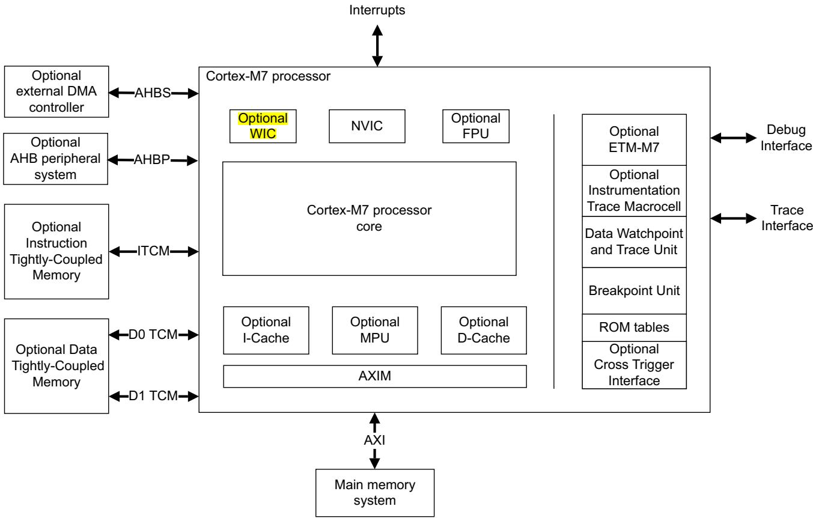  
Figure 1-1 Cortex-M7 processor implementation

The Cortex-M7 processor is built on a high-performance processor core, with a 6-stage pipeline Harvard architecture, making it ideal for demanding embedded applications. The in-order superscalar processor delivers exceptional power efficiency through an efficient instruction set and extensively optimized design. It provides high-end processing hardware that includes a range of single-cycle and SIMD multiplication and multiply-with-accumulate capabilities, saturating arithmetic and dedicated hardware division. It also provides optional single-precision, or both single-precision and double-precision, IEEE75-complaint floating-point computation.

To facilitate the design of cost-sensitive devices, the Cortex-M7 processor implements tightly-coupled system components that reduce processor area while significantly improving interrupt handling and system debug capabilities. The Cortex-M7 processor implements a version of the Thumb<sup>®</sup> instruction set based on Thumb-2 technology, ensuring high code density and reduced program memory requirements. The Cortex-M7 processor instruction set provides the exceptional performance that is expected of a modern 32-bit architecture, with better code density than most 8-bit and 16-bit microcontrollers.

The Cortex-M7 processor closely integrates a configurable Nested Vectored Interrupt Controller (NVIC), to deliver industry-leading interrupt performance. The NVIC includes a non-maskable interrupt (NMI), and can provide up to 256 interrupt priority levels for other interrupts. The tight integration of the processor core and NVIC provides fast execution of interrupt service routines (ISRs), dramatically reducing the interrupt latency. This is achieved through the hardware stacking of registers, and the ability to suspend load-multiple and store-multiple operations. Interrupt handlers do not require wrapping in assembler code, removing any code overhead from the ISRs. A tail-chain optimization also significantly reduces the overhead when switching from one ISR to another.

To optimize low-power designs, the NVIC integrates with the sleep modes that includes an optional deep sleep function. This enables the entire device to be rapidly powered down while still retaining program state.

Reliability can be increased with optional automatic built-in fault detection and handling. With this option, the Cortex-M7 processor has Memory Built-in Self Test (MBIST) capability, and supports ECC (Error Correcting Code) on cache and TCM memories that enables SEC-DED (Single Error Correct, Double Error Detect) for accesses to memory. The Cortex-M7 processor is dual-redundant, which means it can operate in lock-step. The MCU vendor determines the reliability features configuration, therefore reliability features can differ across different devices and families.

To increase instruction throughput, the Cortex-M7 processor can execute certain pairs of instructions simultaneously. This is called dual issue.

## 1.1.1 System level interface

The Cortex-M7 processor provides multiple interfaces using Arm<sup>®</sup> AMBA<sup>®</sup> technology to provide high speed, low latency memory accesses. It supports unaligned data accesses.

The Cortex-M7 processor has an optional Memory Protection Unit (MPU) that provides fine grain memory control, enabling applications to utilize multiple privilege levels, separating and protecting code, data and stack on a task-by-task basis. Such requirements are becoming critical in many embedded applications such as automotive.

## 1.1.2 Integrated configurable debug

The Cortex-M7 processor implements a complete hardware debug solution. This provides high system visibility of the processor and memory through either a traditional JTAG port or a 2-pin serial wire debug (SWD) port that is ideal for microcontrollers and other small package devices. The MCU vendor determines the debug feature configuration, therefore debug features can differ across different devices and families.

For system trace the processor integrates an Instrumentation Trace Macrocell (ITM) together with data watchpoints and a profiling unit. To enable simple and cost-effective profiling of the resulting system events, a Serial Wire Viewer (SWV) can export a stream of software-generated messages, data trace, and profiling information through a single pin.

The optional CoreSight<sup>™</sup> technology components, Embedded Trace Macrocell (ETM) and Cross Trigger Interface (CTI), deliver unrivalled instruction trace, and implementation-defined data trace and capture in an area far smaller than traditional trace units, enabling many low cost MCUs to implement full instruction trace for the first time.

The Breakpoint Unit can provide up to eight hardware breakpoint comparators that debuggers can use.

## 1.1.3 Cortex-M7 processor features and benefits summary

• Tight integration of system peripherals reduces area and development costs.

Thumb instruction set combines high code density with 32-bit performance.

Optional IEEE754-compliant single-precision, and implementation-defined double-precision, Floating-Point Unit (FPU).

• Power control optimization of system components.

Integrated sleep modes for low power consumption.

• Fast code execution permits slower processor clock or increases sleep mode time.

Hardware division and fast digital-signal-processing orientated multiply accumulate.

Saturating arithmetic for signal processing.

Deterministic, high-performance interrupt handling for time-critical applications.

• Optional MPU for safety-critical applications.

Optional memory system features such as caches, Tightly-Coupled Memory (TCM) with DMA port, and a high performance AXI external memory interface.

Extensive debug and trace capabilities:

Serial wire debug and Serial Wire Trace reduce the number of pins that are required for debugging, tracing, and code profiling.

## 1.1.4 Cortex-M7 processor core peripherals

The Cortex-M7 processor core peripherals are:

## Nested Vectored Interrupt Controller

The NVIC is an embedded interrupt controller that supports low latency interrupt processing.

## System Control Block

The System Control Block (SCB) is the programmers model interface to the processor. It provides system implementation information and system control, including configuration, control, and reporting of system exceptions.

## System timer

The system timer, SysTick, is a 24-bit count-down timer. Use it as a Real Time Operating System (RTOS) tick timer or as a simple counter.

## Integrated instruction and data caches (optional)

The instruction and data caches provide fast access to frequently accessed data and instructions, that support increased average performance when using system based memory.

## Memory Protection Unit (optional)

The Memory Protection Unit (MPU) improves system reliability by defining the memory attributes for different memory regions. Depending on your implementation, it provides up to 8 or 16 different regions, and an optional predefined background region.

## Floating-point unit (optional)

The FPU provides IEEE754-compliant operations on 32-bit single-precision and implementation-defined 64-bit double-precision floating-point values.

# Chapter 2 The Cortex-M7 Processor

This chapter describes how to program the Cortex-M7 processor. It contains the following sections:

Programmers model on page 2-2.

Memory model on page 2-12.

Exception model on page 2-19.

Fault handling on page 2-27.

Power management on page 2-31.

## 2.1 Programmers model

This section describes the Cortex-M7 processor programmers model. In addition to the individual core register descriptions, it contains information about the processor modes and privilege levels for software execution and stacks.

## 2.1.1 Processor mode and privilege levels for software execution

The processor modes are:

Thread mode Used to execute application software. The processor enters Thread mode when it comes out of reset.

Handler mode Used to handle exceptions. The processor returns to Thread mode when it has finished all exception processing.

The privilege levels for software execution are:

Unprivileged The software:

Has limited access to the MSR and MRS instructions, and cannot use the CPS instruction.

Cannot access the system timer, NVIC, or system control block.

Might have restricted access to memory or peripherals.

Unprivileged software executes at the unprivileged level.

Privileged The software can use all the instructions and has access to all resources. Privileged software executes at the privileged level.

In Thread mode, the CONTROL register controls whether software execution is privileged or unprivileged, see CONTROL register on page 2-9. In Handler mode, software execution is always privileged.

Only privileged software can write to the CONTROL register to change the privilege level for software execution in Thread mode. Unprivileged software can use the SVC instruction to make a supervisor call to transfer control to privileged software.

## 2.1.2 Stacks

The processor uses a full descending stack. This means that the stack pointer holds the address of the last stacked item in memory. When the processor pushes a new item onto the stack, it decrements the stack pointer and then writes the item to the new memory location. The processor implements two stacks, the main stack and the process stack, with a pointer for each held in independent registers, see Stack Pointer on page 2-4.

In Thread mode, the CONTROL register controls whether the processor uses the main stack or the process stack, see CONTROL register on page 2-9. In Handler mode, the processor always uses the main stack. The options for processor operations are:

Table 2-1 Summary of processor mode, execution privilege level, and stack use options

<table><tr><td>Processor mode</td><td>Used to execute</td><td>Privilege level for software execution</td><td>Stack used</td></tr><tr><td>Thread</td><td>Applications</td><td>Privileged or unprivilegeda</td><td>Main stack or process stacka</td></tr><tr><td>Handler</td><td>Exception handlers</td><td>Always privileged</td><td>Main stack</td></tr><tr><td colspan="4">a. SeeCONTROL registeron page 2-9.</td></tr></table>

## 2.1.3 Core registers

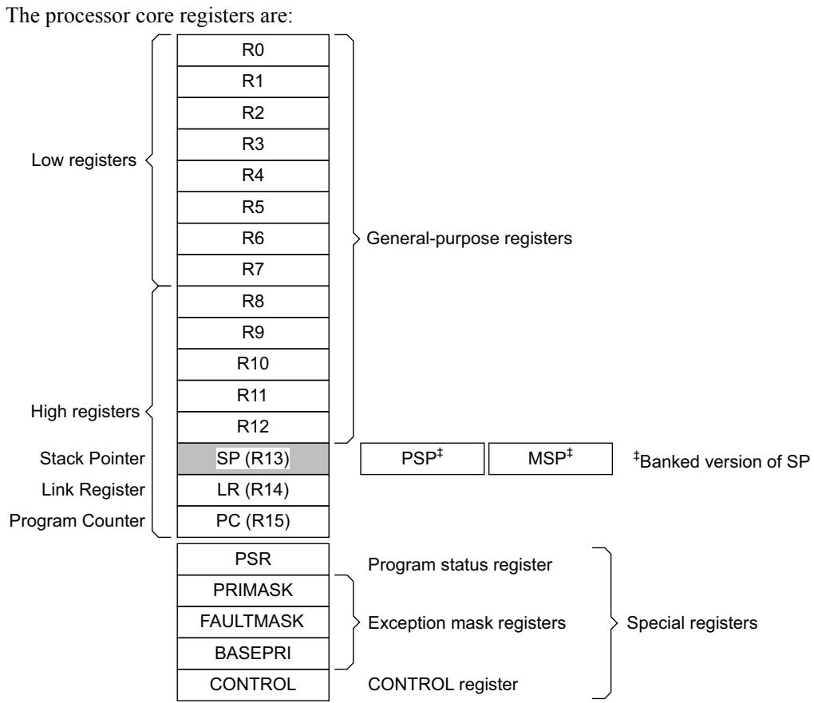

Table 2-2 Core register set summary

<table><tr><td>Name</td><td> $Type^a$ </td><td> $Required\ privilege^b$ </td><td>Reset value</td><td>Description</td></tr><tr><td>R0-R12</td><td>RW</td><td>Either</td><td>Unknown</td><td>General-purpose registers on page 2-4</td></tr><tr><td>MSP</td><td>RW</td><td>Either</td><td>See description</td><td>Stack Pointer on page 2-4</td></tr><tr><td>PSP</td><td>RW</td><td>Either</td><td>Unknown</td><td>Stack Pointer on page 2-4</td></tr><tr><td>LR</td><td>RW</td><td>Either</td><td>0xFFFFFFF</td><td>Link Register on page 2-4</td></tr><tr><td>PC</td><td>RW</td><td>Either</td><td>See description</td><td>Program Counter on page 2-4</td></tr><tr><td>PSR</td><td>RW</td><td>Either</td><td> $0x01000000^c$ </td><td>Program Status Register on page 2-4</td></tr><tr><td>ASPR</td><td>RW</td><td>Either</td><td>Unknown</td><td>Application Program Status Register on page 2-5</td></tr><tr><td>IPSR</td><td>RO</td><td>Privileged</td><td>0x00000000</td><td>Interrupt Program Status Register on page 2-6</td></tr><tr><td>EPSR</td><td>RO</td><td>Privileged</td><td> $0x01000000^c$ </td><td>Execution Program Status Register on page 2-6</td></tr><tr><td>PRIMASK</td><td>RW</td><td>Privileged</td><td>0x00000000</td><td>Priority Mask Register on page 2-8</td></tr><tr><td>FAULTMASK</td><td>RW</td><td>Privileged</td><td>0x00000000</td><td>Fault Mask Register on page 2-8</td></tr><tr><td>BASEPRI</td><td>RW</td><td>Privileged</td><td>0x00000000</td><td>Base Priority Mask Register on page 2-8</td></tr><tr><td>CONTROL</td><td>RW</td><td>Privileged</td><td>0x00000000</td><td>CONTROL register on page 2-9</td></tr></table>

a. Describes access type during program execution in thread mode and Handler mode. Debug access can differ.  
b. An entry of Either means privileged and unprivileged software can access the register.

c. The EPSR reads as zero when executing an MRS instruction.

## General-purpose registers

R0-R12 are 32-bit general-purpose registers for data operations.

## Stack Pointer

The Stack Pointer (SP) is register R13. In Thread mode, bit[1] of the CONTROL register indicates the stack pointer to use:

0 Main Stack Pointer (MSP). This is the reset value.

1 Process Stack Pointer (PSP).

On reset, the processor loads the MSP with the value from the implementation-defined address 0x00000000.

## Link Register

The Link Register (LR) is register R14. It stores the return information for subroutines, function calls, and exceptions. On reset, the processor sets the LR value to 0xFFFFFFFF.

## Program Counter

The Program Counter (PC) is register R15. It contains the current program address. On reset, the processor loads the PC with the value of the reset vector, which is at the initial value of the Vector Table Offset Register (VTOR) plus 0x00000004. Bit[0] of the value is loaded into the EPSR T-bit at reset and must be 1.

See Vector Table Offset Register on page 4-17 for more information.

## Program Status Register

The Program Status Register (PSR) combines:

• Application Program Status Register (APSR).

• Interrupt Program Status Register (IPSR).

• Execution Program Status Register (EPSR).

These registers are mutually exclusive bit fields in the 32-bit PSR. The bit assignments are:

<table><tr><td></td><td>31</td><td>30</td><td>29</td><td>28</td><td>27</td><td>26</td><td>25</td><td>24</td><td>23</td><td>20</td><td>19</td><td>16</td><td>15</td><td>10</td><td>9</td><td>8</td><td></td><td>0</td></tr><tr><td>APSR</td><td>N</td><td>Z</td><td>C</td><td>V</td><td>Q</td><td colspan="5">Reserved</td><td>GE[3:0]</td><td colspan="7">Reserved</td></tr><tr><td>IPSR</td><td colspan="14">Reserved</td><td colspan="4">ISR_NUMBER</td></tr><tr><td>EPSR</td><td colspan="5">Reserved</td><td>ICI/IT</td><td>T</td><td colspan="5">Reserved</td><td>ICI/IT</td><td colspan="5">Reserved</td></tr></table>

Access these registers individually or as a combination of any two or all three registers, using the register name as an argument to the MSR or MRS instructions. For example:

Read all the registers using PSR with the MRS instruction.

Write to the APSR N, Z, C, V, and Q bits using APSR\_nzcvq with the MSR instruction.

The PSR combinations and attributes are:

Table 2-3 PSR register combinations

<table><tr><td>Register</td><td>Type</td><td>Combination</td></tr><tr><td>PSR</td><td> $RW^{a, b}$ </td><td>APSR, EPSR, and IPSR</td></tr><tr><td>IEPSR</td><td> $RO^{b}$ </td><td>EPSR and IPSR</td></tr><tr><td>IAPSR</td><td> $RW^{a}$ </td><td>APSR and IPSR</td></tr><tr><td>EAPSR</td><td> $RW^{b}$ </td><td>APSR and EPSR</td></tr></table>

a. The processor ignores writes to the IPSR bits.  
b. Reads of the EPSR bits return zero, and the processor ignores writes to these bits

See the instruction descriptions MRS on page 3-178 and MSR on page 3-179 for more information about how to access the program status registers.

## Application Program Status Register

The APSR contains the current state of the condition flags from previous instruction executions. See the register summary in Table 2-2 on page 2-3 for its attributes. The bit assignments are:

Table 2-4 APSR bit assignments

<table><tr><td>Bits</td><td>Name</td><td>Function</td></tr><tr><td>[31]</td><td>N</td><td>Negative flag.</td></tr><tr><td>[30]</td><td>Z</td><td>Zero flag.</td></tr><tr><td>[29]</td><td>C</td><td>Carry or borrow flag.</td></tr><tr><td>[28]</td><td>V</td><td>Overflow flag.</td></tr><tr><td>[27]</td><td>Q</td><td>DSP overflow and saturation flag.</td></tr><tr><td>[26:20]</td><td>-</td><td>Reserved.</td></tr><tr><td>[19:16]</td><td>GE[3:0]</td><td>Greater than or Equal flags. See SEL on page 3-77 for more information.</td></tr><tr><td>[15:0]</td><td>-</td><td>Reserved.</td></tr></table>

## Interrupt Program Status Register

The IPSR contains the exception type number of the current Interrupt Service Routine (ISR). See the register summary in Table 2-2 on page 2-3 for its attributes. The bit assignments are:

Table 2-5 IPSR bit assignments

<table><tr><td>Bits</td><td>Name</td><td colspan="2">Function</td></tr><tr><td>[31:9]</td><td>-</td><td colspan="2">Reserved.</td></tr><tr><td rowspan="20">[8:0]</td><td rowspan="20">ISR_NUMBER</td><td colspan="2">This is the number of the current exception:</td></tr><tr><td>0</td><td>Thread mode.</td></tr><tr><td>1</td><td>Reserved.</td></tr><tr><td>2</td><td>NMI.</td></tr><tr><td>3</td><td>HardFault.</td></tr><tr><td>4</td><td>MemManage.</td></tr><tr><td>5</td><td>BusFault.</td></tr><tr><td>6</td><td>UsageFault.</td></tr><tr><td>7-10</td><td>Reserved.</td></tr><tr><td>11</td><td>SVCall.</td></tr><tr><td>12</td><td>Reserved for Debug.</td></tr><tr><td>13</td><td>Reserved.</td></tr><tr><td>14</td><td>PendSV.</td></tr><tr><td>15</td><td>SysTick.</td></tr><tr><td>16</td><td>IRQ0.</td></tr><tr><td>.</td><td>.</td></tr><tr><td>.</td><td>.</td></tr><tr><td>.</td><td>.</td></tr><tr><td>255</td><td>IRQ239a.</td></tr><tr><td colspan="2">See Exception types on page 2-19 for more information.</td></tr></table>

a. This is the maximum number of exceptions. The actual maximum number of exceptions available is implementation defined.

## Execution Program Status Register

The EPSR contains the Thumb state bit, and the execution state bits for either the:

• If-Then (IT) instruction.

Interruptible-Continuable Instruction (ICI) field for an interrupted load multiple or store multiple instruction.

See the register summary in Table 2-2 on page 2-3 for the EPSR attributes. The bit assignments are:

Table 2-6 EPSR bit assignments

<table><tr><td>Bits</td><td>Name</td><td>Function</td></tr><tr><td>[31:27]</td><td>-</td><td>Reserved</td></tr><tr><td>[26:25], [15:10]</td><td>ICI</td><td>Interruptible-continuable instruction bits, seeInterruptible-continuable instructions on page 2-7</td></tr><tr><td>[26:25], [15:10]</td><td>IT</td><td>Indicates the execution state bits of the IT instruction, seeITonpage 3-131</td></tr><tr><td>[24]</td><td>T</td><td>Thumb state bit, see Thumb state</td></tr><tr><td>[23:16]</td><td>-</td><td>Reserved</td></tr><tr><td>[9:0]</td><td>-</td><td>Reserved</td></tr></table>

Attempts to read the EPSR directly through application software using the MSR instruction always return zero. Attempts to write the EPSR using the MSR instruction in application software are ignored.

## Interruptible-continuable instructions

When an interrupt occurs during the execution of an LDM, STM, PUSH or POP instruction, and when an FPU is implemented an VLDM, VSTM, VPUSH, or VPOP instruction, the processor:

• Stops the load multiple or store multiple instruction operation temporarily.

• Stores the next register operand in the multiple operation to EPSR bits[15:12].

After servicing the interrupt, the processor:

Returns to the register pointed to by bits[15:12].

Resumes execution of the multiple load or store instruction.

When the EPSR holds ICI execution state, bits[26:25,11:10] are zero.

## If-Then block

The If-Then block contains up to four instructions following an IT instruction. Each instruction in the block is conditional. The conditions for the instructions are either all the same, or some can be the inverse of others. See IT on page 3-131 for more information.

## Thumb state

The Cortex-M7 processor only supports execution of instructions in Thumb state. The following can clear the T bit to 0:

Instructions BLX, BX, LDR pc, [], and POP{PC}.

• Restoration from the stacked xPSR value on an exception return.

• Bit[0] of the vector value on an exception entry or reset.

Attempting to execute instructions when the T bit is 0 results in a fault or lockup. See Lockup on page 2-29 for more information.

## Exception mask registers

The exception mask registers disable the handling of exceptions by the processor. Disable exceptions where they might affect timing critical tasks.

To access the exception mask registers use the MSR and MRS instructions, or the CPS instruction to change the value of PRIMASK or FAULTMASK. See MRS on page 3-178, MSR on page 3-179, and CPS on page 3-174 for more information.

## Priority Mask Register

The PRIMASK register prevents activation of all exceptions with configurable priority. See the register summary in Table 2-2 on page 2-3 for its attributes. The bit assignments are:

<table><tr><td>31</td><td></td><td></td><td></td><td></td><td></td><td></td><td></td><td>1</td><td>0</td></tr><tr><td colspan="9">Reserved</td><td></td></tr></table>

Table 2-7 PRIMASK register bit assignments

<table><tr><td>Bits</td><td>Name</td><td>Function</td><td></td></tr><tr><td>[31:1]</td><td>-</td><td>Reserved.</td><td></td></tr><tr><td rowspan="2">[0]</td><td rowspan="2">PRIMASK</td><td>0</td><td>No effect.</td></tr><tr><td>1</td><td>Prevents the activation of all exceptions with configurable priority.</td></tr></table>

## Fault Mask Register

The FAULTMASK register prevents activation of all exceptions except for non-maskable interrupt. See the register summary in Table 2-2 on page 2-3 for its attributes. The bit assignments are:

<table><tr><td>31</td><td></td><td></td><td></td><td></td><td></td><td></td><td></td><td>1</td><td>0</td></tr><tr><td colspan="9">Reserved</td><td></td></tr></table>

Table 2-8 FAULTMASK register bit assignments

<table><tr><td>Bits</td><td>Name</td><td>Function</td><td></td></tr><tr><td>[31:1]</td><td>-</td><td>Reserved.</td><td></td></tr><tr><td rowspan="2">[0]</td><td rowspan="2">FAULTMASK</td><td>0</td><td>No effect.</td></tr><tr><td>1</td><td>Prevents the activation of all exceptions except for NMI.</td></tr></table>

The processor clears the FAULTMASK bit to 0 on exit from any exception handler except the NMI handler.

## Base Priority Mask Register

The BASEPRI register defines the minimum group priority for exception processing. When BASEPRI is set to a nonzero value, it prevents the activation of all exceptions with the same or lower group priority level as the BASEPRI value. See the register summary in Table 2-2 on page 2-3 for its attributes. The bit assignments are:

<table><tr><td>Reserved</td><td>BASEPRI</td></tr></table>

Table 2-9 BASEPRI register bit assignments

<table><tr><td>Bits</td><td>Name</td><td>Function</td></tr><tr><td>[31:8]</td><td>-</td><td>Reserved.</td></tr><tr><td>[7:0]</td><td>BASEPRIa</td><td>Priority mask bits:0x00 No effect.Nonzero Defines the base priority for exception processing.The processor does not process any exception with a priority value greater than or equal to BASEPRI.</td></tr></table>

a. This field is similar to the priority fields in the interrupt priority registers. Only bits[7:M] of this field are implemented, and bits[M-x:0] read as zero and ignore writes. The values of M and x are implementation defined. See Interrupt Priority Registers on page 4-7 for more information. Remember that higher priority field values correspond to lower exception priorities.

## CONTROL register

The CONTROL register controls the stack used and the privilege level for software execution when the processor is in Thread mode, and if implemented, indicates whether the FPU state is active. See the register summary in Table 2-2 on page 2-3 for its attributes. The bit assignments are:

<table><tr><td colspan="4">Reserved</td></tr><tr><td></td><td></td><td></td><td></td></tr><tr><td></td><td>FPCA</td><td></td><td></td></tr><tr><td></td><td>SPSEL</td><td></td><td></td></tr><tr><td></td><td>nPRIV</td><td></td><td></td></tr></table>

Table 2-10 CONTROL register bit assignments

<table><tr><td>Bits</td><td>Name</td><td>Function</td></tr><tr><td>[31:3]</td><td>-</td><td>Reserved.</td></tr><tr><td>[2]</td><td>FPCA</td><td>When floating-point is implemented this bit indicates whether floating-point context is active:0 No floating-point context active.1 Floating-point context active.This bit is used to determine whether to preserve floating-point state when processing an exception.</td></tr><tr><td>[1]</td><td>SPSEL</td><td>Defines the currently active stack pointer:0 MSP is the current stack pointer.1 PSP is the current stack pointer.In Handler mode this bit reads as zero and ignores writes. The Cortex-M7 processor updates this bit automatically on exception return.</td></tr><tr><td>[0]</td><td>nPRIV</td><td>Defines the Thread mode privilege level:0 Privileged.1 Unprivileged.</td></tr></table>

Handler mode always uses the MSP, so the processor ignores explicit writes to the active stack pointer bit of the CONTROL register when in Handler mode. The exception entry and return mechanisms automatically update the CONTROL register based on the EXC\_RETURN value, see Table 2-15 on page 2-26.

In an OS environment, the vendor recommends that threads running in Thread mode use the process stack and the kernel and exception handlers use the main stack.

By default, Thread mode uses the MSP. To switch the stack pointer that is used in Thread mode to the PSP, either:

Use the MSR instruction to set the CONTROL.SPSEL bit, the current active stack pointer bit, to 1, see MSR on page 3-179.

Perform an exception return to Thread mode with the appropriate EXC\_RETURN value, see Table 2-15 on page 2-26.

Note

When changing the stack pointer, software must use an ISB instruction immediately after the MSR instruction. This ensures that instructions after the ISB instruction execute using the new stack pointer. See ISB on page 3-177.

## 2.1.4 Exceptions and interrupts

The Cortex-M7 processor supports interrupts and system exceptions. The processor and the NVIC prioritize and handle all exceptions. An exception changes the normal flow of software control. The processor uses Handler mode to handle all exceptions except for reset. See Exception entry on page 2-24 and Exception return on page 2-26 for more information.

The NVIC registers control interrupt handling. See Nested Vectored Interrupt Controller on page 4-3 for more information.

## 2.1.5 Data types

The processor:

Supports the following data types:

32-bit words.

16-bit halfwords.

— 8-bit bytes.

32-bit single-precision floating point numbers if the FPU is implemented.

— 64-bit double-precision floating point numbers if the FPU is implemented.

Manages all data memory accesses as either little-endian or big-endian depending on how your implementation is defined. Instruction memory and Private Peripheral Bus (PPB) accesses are always performed as little-endian. See Memory regions, types and attributes on page 2-12 for more information.

## 2.1.6 The Cortex Microcontroller Software Interface Standard

For a Cortex-M7 microcontroller system, the Cortex Microcontroller Software Interface Standard (CMSIS) defines:

• A common way to:

— Access peripheral registers.

— Define exception vectors.

The names of:

— The registers of the core peripherals.

— The core exception vectors.

A device-independent interface for RTOS kernels, including a debug channel.

The CMSIS includes address definitions and data structures for the core peripherals in the Cortex-M7 processor.

CMSIS simplifies software development by enabling the reuse of template code and the combination of CMSIS-compliant software components from various middleware vendors. Software vendors can expand the CMSIS to include their peripheral definitions and access functions for those peripherals.

This document includes the register names defined by the CMSIS, and short descriptions of the CMSIS functions that address the processor core and the core peripherals.

## Note

This document uses the register short names defined by the CMSIS. In a few cases these differ from the architectural short names that might be used in other documents.

The following sections give more information about the CMSIS:

Power management programming hints on page 2-33.

CMSIS functions on page 3-12.

Accessing the Cortex-M7 NVIC registers using CMSIS on page 4-4.

NVIC design hints and tips on page 4-9.

## 2.2 Memory model

This section describes the processor memory map and the behavior of memory accesses. The processor has a fixed default memory map that provides up to 4GB of addressable memory. The memory map is:

<table><tr><td>Vendor-specific memory</td><td>511MB</td><td>0xFFFFFFF</td></tr><tr><td>Private peripheral bus</td><td>1.0MB</td><td>0xE01000000xE00FFFFF</td></tr><tr><td>External device</td><td>1.0GB</td><td>0xE00000000xDFFFFFFF</td></tr><tr><td>External RAM</td><td>1.0GB</td><td>0xA00000000x9FFFFFFF</td></tr><tr><td>Peripheral</td><td>0.5GB</td><td>0x600000000x5FFFFFFF</td></tr><tr><td>SRAM</td><td>0.5GB</td><td>0x400000000x3FFFFFFF</td></tr><tr><td>Code</td><td>0.5GB</td><td>0x200000000x1FFFFFFF</td></tr><tr><td></td><td></td><td>0x00000000</td></tr></table>

The processor reserves regions of the Private peripheral bus (PPB) address range for core peripheral registers, see About the Cortex-M7 peripherals on page 4-2.

## 2.2.1 Memory regions, types and attributes

The memory map and programming the optional MPU splits the memory map into regions. Each region has a defined memory type, and some regions have additional memory attributes. The memory type and attributes determine the behavior of accesses to the region.

The memory types are:

Normal

The processor can re-order transactions for efficiency, or perform speculative reads.

Device and Strongly-Ordered

The processor preserves transaction order relative to other transactions to Device or Strongly-ordered memory.

The different ordering requirements for Device and Strongly-ordered memory mean that the external memory system can buffer a write to Device memory, but must not buffer a write to Strongly-ordered memory.

The additional memory attributes include:

## Shareable

For a shareable memory region that is implemented, the memory system provides data synchronization between bus masters in a system with multiple bus masters, for example, a processor with a DMA controller.

Strongly-ordered memory is always shareable.

If multiple bus masters can access a non-shareable memory region, software must ensure data coherency between the bus masters.

## Execute Never (XN)

Means the processor prevents instruction accesses. A fault exception is generated only on execution of an instruction executed from an XN region.

## 2.2.2 Memory system ordering of memory accesses

For most memory accesses caused by explicit memory access instructions, the memory system does not guarantee that the order in which the accesses complete, matches the program order of the instructions, providing it does not affect the behavior of the instruction sequence. Normally, if correct program execution depends on two memory accesses completing in program order, software must insert a memory barrier instruction between the memory access instructions, see Software ordering of memory accesses on page 2-15.

However, the memory system does guarantee some ordering of accesses to Device and Strongly-Ordered Memory. For two memory access instructions A1 and A2, in case of those are initiated by the same master interface, and if A1 occurs before A2 in program order, the ordering of the memory accesses caused by two instructions is:

<table><tr><td rowspan="2">A1\A2</td><td rowspan="2">Normal access</td><td colspan="2">Device access</td><td rowspan="2">Strongly-ordered access</td></tr><tr><td>Non-shareable</td><td>Shareable</td></tr><tr><td>Normal access</td><td>-</td><td>-</td><td>-</td><td>-</td></tr><tr><td>Device access, Non-shareable</td><td>-</td><td>&lt;</td><td>-</td><td>&lt;</td></tr><tr><td>Device access, Shareable</td><td>-</td><td>-</td><td>&lt;</td><td>&lt;</td></tr><tr><td>Strongly-ordered access</td><td>-</td><td>&lt;</td><td>&lt;</td><td>&lt;</td></tr></table>

Where:

Means that the memory system does not guarantee the ordering of the accesses.

< Means that accesses are observed in program order, that is, A1 is always observed before A2.

## 2.2.3 Behavior of memory accesses

The behavior of accesses to each region in the memory map is:

Table 2-11 Memory access behavior

<table><tr><td>Address range</td><td>Memory region</td><td> $Memory type^a$ </td><td> $XN^a$ </td><td>Description</td></tr><tr><td>0x00000000-0x1FFFFFFF</td><td>Code</td><td>Normal</td><td>-</td><td>Executable region for program code. You can also put data here.</td></tr><tr><td>0x20000000-0x3FFFFFFF</td><td>SRAM</td><td>Normal</td><td>-</td><td>Executable region for data. You can also put code here.</td></tr><tr><td>0x40000000-0x5FFFFFFF</td><td>Peripheral</td><td>Device</td><td>XN</td><td>Peripheral address space.</td></tr><tr><td>0x60000000-0x9FFFFFFF</td><td>External RAM</td><td>Normal</td><td>-</td><td>Executable region for data. You can also put code here.</td></tr><tr><td>0xA0000000-0xDFFFFFFF</td><td>External device</td><td>Device</td><td>XN</td><td>External Device memory.</td></tr><tr><td>0xE0000000-0xE00FFFFF</td><td>Private Peripheral Bus</td><td>Strongly Ordered</td><td>XN</td><td>This region includes the NVIC, System timer, and system control block.</td></tr><tr><td>0xE0100000-0xFFFFFFF</td><td>Vendor-specific device</td><td>Device</td><td>XN</td><td>Accesses to this region are to vendor-specific peripherals.</td></tr></table>

a. See Memory regions, types and attributes on page 2-12 for more information.  
The Code, SRAM, and external RAM regions can hold programs.

The optional MPU can override the default memory access behavior described in this section. For more information, see Optional Memory Protection Unit on page 4-43.

## Additional memory access constraints for caches and shared memory

When a system includes caches or shared memory, some memory regions have additional access constraints, and some regions are subdivided, as Table 2-12 shows:

Table 2-12 Memory region shareability and cache policies

<table><tr><td>Address range</td><td>Memory region</td><td>Memory type</td><td>Shareability</td><td>Cache policy</td></tr><tr><td>0x00000000-0x1FFFFFFF</td><td>Code</td><td> $Normal^a$ </td><td>Non-shareable $^a$ </td><td> $WT^b$ </td></tr><tr><td>0x20000000-0x3FFFFFFF</td><td>SRAM</td><td> $Normal^a$ </td><td>Non-shareable $^a$ </td><td> $WBWA^b$ </td></tr><tr><td>0x40000000-0x5FFFFFFF</td><td>Peripheral</td><td> $Device^a$ </td><td>Non-shareable $^a$ </td><td>-</td></tr><tr><td>0x60000000-0x7FFFFFFF</td><td>External RAM</td><td> $Normal^a$ </td><td>Non-shareable $^a$ </td><td> $WBWA^b$ </td></tr><tr><td>0x80000000-0x9FFFFFFF</td><td></td><td></td><td></td><td> $WT^b$ </td></tr><tr><td>0xA0000000-0xBFFFFFFF</td><td>External device</td><td> $Device^a$ </td><td>Shareable $^a$ </td><td>-</td></tr><tr><td>0xC0000000-0xDFFFFFFF</td><td></td><td></td><td>Non-shareable $^a$ </td><td></td></tr><tr><td>0xE0000000-0xE00FFFFF</td><td>Private Peripheral Bus</td><td>Strongly  $Ordered^a$ </td><td>Shareable $^a$ </td><td>-</td></tr><tr><td>0xE0100000-0xFFFFFFF</td><td>Vendor-specific device</td><td> $Device^a$ </td><td>Non-shareable $^a$ </td><td>-</td></tr></table>

a. See Memory regions, types and attributes on page 2-12 for more information.

b. WT = Write through, no Write Allocate. WBWA = Write Back, Write Allocate.

## Instruction prefetch and branch prediction

The Cortex-M7 processor:

Prefetches instructions ahead of execution.

Speculatively prefetches from branch target addresses.

## 2.2.4 Software ordering of memory accesses

The order of instructions in the program flow does not always guarantee the order of the corresponding memory transactions. This is because:

The processor can reorder some memory accesses to improve efficiency, providing this does not affect the behavior of the instruction sequence.

• The processor has multiple bus interfaces.

• Memory or devices in the memory map have different wait states.

• Some memory accesses are buffered or speculative.

Memory system ordering of memory accesses on page 2-13 describes the cases where the memory system guarantees the order of memory accesses. Otherwise, if the order of memory accesses is critical, software must include memory barrier instructions to force that ordering. The processor provides the following memory barrier instructions:

## DMB

The Data Memory Barrier (DMB) instruction ensures that outstanding memory transactions complete before subsequent memory transactions. See DMB on page 3-175.

## DSB

The Data Synchronization Barrier (DSB) instruction ensures that outstanding memory transactions complete before subsequent instructions execute. See DSB on page 3-176.

## ISB

The Instruction Synchronization Barrier (ISB) ensures that the effect of all completed memory transactions is recognizable by subsequent instructions. See ISB on page 3-177.

## MPU programming

Use a DSB, followed by an ISB instruction or exception return to ensure that the new MPU configuration is used by subsequent instructions.

A detailed explanation of all the cases in which a Barrier might be required is included in Arm<sup>®</sup> Cortex<sup>®</sup>-M Programming Guide to Memory Barrier Instructions Application Note 321.

## 2.2.5 Memory endianness

The processor views memory as a linear collection of bytes numbered in ascending order from zero. For example, bytes 0-3 hold the first stored word, and bytes 4-7 hold the second stored word. The memory endianness used is one of the following depending on your implementation:

Byte-invariant big-endian format on page 2-16.

Little-endian format on page 2-16.

## Byte-invariant big-endian format

In byte-invariant big-endian format, the processor stores the most significant byte of a word at the lowest-numbered byte, and the least significant byte at the highest-numbered byte. For example:

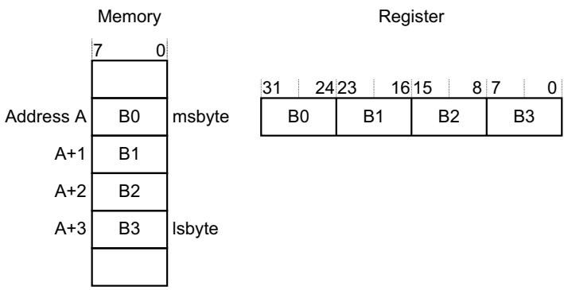

## Little-endian format

In little-endian format, the processor stores the least significant byte of a word at the lowest-numbered byte, and the most significant byte at the highest-numbered byte. For example:

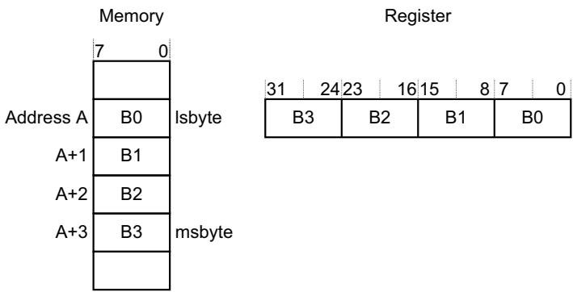

## 2.2.6 Synchronization primitives

The instruction set support for the Cortex-M7 processor includes pairs of synchronization primitives. These provide a non-blocking mechanism that a thread or process can use to obtain exclusive access to a memory location. Software can use them to perform a guaranteed read-modify-write memory update sequence, or for a semaphore mechanism.

A pair of synchronization primitives comprises:

## A Load-Exclusive instruction

Used to read the value of a memory location, requesting exclusive access to that location.

## A Store-Exclusive instruction

Used to attempt to write to the same memory location, returning a status bit to a register. If this bit is:

0 it indicates that the thread or process gained exclusive access to the memory, and the write succeeds,

1 it indicates that the thread or process did not gain exclusive access to the memory, and no write was performed.

The pairs of Load-Exclusive and Store-Exclusive instructions are:

• The word instructions LDREX and STREX.

The halfword instructions LDREXH and STREXH.

The byte instructions LDREXB and STREXB.

Software must use a Load-Exclusive instruction with the corresponding Store-Exclusive instruction.

To perform an exclusive read-modify-write of a memory location, software must:

1. Use a Load-Exclusive instruction to read the value of the location.

2. Modify the value, as required.

3. Use a Store-Exclusive instruction to attempt to write the new value back to the memory location.

4. Test the returned status bit. If this bit is:

0 The read-modify-write completed successfully.

1 No write was performed. This indicates that the value returned at step 1 might be out of date. The software must retry the entire read-modify-write sequence.

Software can use the synchronization primitives to implement a semaphore as follows:

1. Use a Load-Exclusive instruction to read from the semaphore address to check whether the semaphore is free.

2. If the semaphore is free, use a Store-Exclusive to write the claim value to the semaphore address.

3. If the returned status bit from step 2 indicates that the Store-Exclusive succeeded then the software has claimed the semaphore. However, if the Store-Exclusive failed, another process might have claimed the semaphore after the software performed step 1.

The Cortex-M7 processor includes an exclusive access monitor, that tags the fact that the processor has executed a Load-Exclusive instruction. If the processor is part of a multiprocessor system and the address is in a shared region of memory, the system also globally tags the memory locations addressed by exclusive accesses by each processor.

The processor removes its exclusive access tag if:

• It executes a CLREX instruction.

It executes a STREX instruction, regardless of whether the write succeeds.

An exception occurs. This means the processor can resolve semaphore conflicts between different threads.

In a multiprocessor implementation:

Executing a CLREX instruction removes only the local exclusive access tag for the processor.

Executing a STREX instruction, or an exception, removes the local exclusive access tags for the processor.

Executing a STREX instruction to a Shareable memory region can also remove the global exclusive access tags for the processor in the system.

For more information about the synchronization primitive instructions, see LDREX and STREX on page 3-39 and CLREX on page 3-41.

## 2.2.7 Programming hints for the synchronization primitives

ISO/IEC C cannot directly generate the exclusive access instructions. CMSIS provides intrinsic functions for generation of these instructions:

Table 2-13 CMSIS functions for exclusive access instructions

<table><tr><td>Instruction</td><td>CMSIS function</td></tr><tr><td>LDREX</td><td>uint32_t __LDREXW (uint32_t *addr)</td></tr><tr><td>LDREXH</td><td>uint16_t __LDREXH (uint16_t *addr)</td></tr><tr><td>LDREXB</td><td>uint8_t __LDREXB (uint8_t *addr)</td></tr><tr><td>STREX</td><td>uint32_t __STREXW (uint32_t value, uint32_t *addr)</td></tr><tr><td>STREXH</td><td>uint32_t __STREXH (uint16_t value, uint16_t *addr)</td></tr><tr><td>STREXB</td><td>uint32_t __STREXB (uint8_t value, uint8_t *addr)</td></tr><tr><td>CLREX</td><td>void __CLREX (void)</td></tr></table>

For example:

uint16\_t value

uint16\_t \*address = 0x20001002 ;

value = \_\_LDREXH (address)

// load 16-bit value from memory address 0x20001002

## 2.2.8 Dynamic read allocate mode

When a memory region is marked as Write-Back Write-Allocate, it normally allocates a cache line on either a read miss or a write miss. However, there are some situations where allocating on writes is undesirable, such as executing the C standard library memset() function to clear a large block of memory to a known value. Writing large blocks of data in this way can pollute the cache with unnecessary data. It can also waste power and performance if a linefill must be performed and the linefill data is then discarded because the entire line was subsequently written by the memset().

To prevent this, the Cortex-M7 processor Bus Interface Unit (BIU) includes logic to detect when a full cache line is written by the core before the linefill completes. If this situation is detected on three consecutive linefills, it switches into dynamic read allocate mode. When in dynamic read allocate mode, loads behave as normal and can still cause linefills, and writes still lookup in the cache but, if they miss, they write out to external memory rather than starting a linefill.

The BIU continues in dynamic read allocate mode until it detects either a cacheable write burst to external memory that is not a full cache line, or there is a load to the same line as is currently being written to external memory.

Dynamic read allocate mode can be disabled by setting the ACTLR.DISRAMODE to 1. See Auxiliary Control Register on page 4-11.

## 2.3 Exception model

This section describes the exception model. It describes:

Exception states.

Exception types.

Exception handlers on page 2-21.

Vector table on page 2-21.

Exception priorities on page 2-23.

Interrupt priority grouping on page 2-23.

Exception entry and return on page 2-23.

## 2.3.1 Exception states

Each exception is in one of the following states:

Inactive The exception is not active and not pending.

Pending The exception is waiting to be serviced by the processor.

An interrupt request from a peripheral or from software can change the state of the corresponding interrupt to pending.

Active An exception that is being serviced by the processor but has not completed.

Note

An exception handler can interrupt the execution of another exception handler. In this case both exceptions are in the active state.

Active and pending

The exception is being serviced by the processor and there is a pending exception from the same source.

## 2.3.2 Exception types

The exception types are:

## Reset

Reset is invoked on power up or a warm reset. The exception model treats reset as a special form of exception. It is permanently enabled and has a fixed priority of -3. When reset is asserted, the operation of the processor stops, potentially at any point in an instruction. When reset is deasserted, execution restarts from the address provided by the reset entry in the vector table. Execution restarts as privileged execution in Thread mode.

## NMI

A non-maskable interrupt is signaled by a peripheral or triggered by software. This is the highest priority exception other than reset. It is permanently enabled and has a fixed priority of -2. NMIs cannot be:

Masked or prevented from activation by any other exception.

• Preempted by any exception other than Reset.

## HardFault

A HardFault is an exception that occurs because of an error during exception processing, or because an exception cannot be managed by any other exception mechanism. HardFaults have a fixed priority of -1, meaning they have higher priority than any exception with configurable priority.

## MemManage

A MemManage fault is an exception that occurs because of a memory protection related fault. The fixed memory protection constraints, or the MPU if implemented, determines this fault, for both instruction and data memory transactions. This fault is always used to abort instruction accesses to Execute Never (XN) memory regions.

## BusFault

UsageFault A UsageFault is an exception that occurs because of a fault related to instruction execution. This includes:

An undefined instruction.

• An illegal unaligned access.

Invalid state on instruction execution.

• An error on exception return.

The following can cause a UsageFault when the core is configured to report them:

• An unaligned address on word and halfword memory access.

• Division by zero.

## SVCall

A supervisor call (SVC) is an exception triggered by the SVC instruction. In an OS environment, applications can use SVC instructions to access OS kernel functions and device drivers.

PendSV PendSV is an interrupt-driven request for system-level service. In an OS environment, use PendSV for context switching when no other exception is active.

SysTick A SysTick exception is an exception the system timer generates when it reaches zero. Software can also generate a SysTick exception. In an OS environment, the processor can use this exception as system tick.

Interrupt (IRQ) A interrupt, or IRQ, is an exception signaled by a peripheral, or generated by a software request. All interrupts are asynchronous to instruction execution. In the system, peripherals use interrupts to communicate with the processor.

Table 2-14 Properties of the different exception types

<table><tr><td>Exception numbera</td><td>IRQ numbera</td><td>Exception type</td><td>Priority</td><td>Vector address or offsetb</td><td>Activation</td></tr><tr><td>1</td><td>-</td><td>Reset</td><td>-3, the highest</td><td>0x00000004</td><td>Asynchronous</td></tr><tr><td>2</td><td>-14</td><td>NMI</td><td>-2</td><td>0x00000008</td><td>Asynchronous</td></tr><tr><td>3</td><td>-13</td><td>HardFault</td><td>-1</td><td>0x0000000C</td><td>-</td></tr><tr><td>4</td><td>-12</td><td>MemManage</td><td>Configurablec</td><td>0x00000010</td><td>Synchronous</td></tr><tr><td>5</td><td>-11</td><td>BusFault</td><td>Configurablec</td><td>0x00000014</td><td>Synchronous when precise, asynchronous when imprecise</td></tr><tr><td>6</td><td>-10</td><td>UsageFault</td><td>Configurablec</td><td>0x00000018</td><td>Synchronous</td></tr><tr><td>7-10</td><td>-</td><td>Reserved</td><td>-</td><td>-</td><td>-</td></tr><tr><td>11</td><td>-5</td><td>SVCall</td><td>Configurablec</td><td>0x0000002C</td><td>Synchronous</td></tr><tr><td>12-13</td><td>-</td><td>Reserved</td><td>-</td><td>-</td><td>-</td></tr><tr><td>14</td><td>-2</td><td>PendSV</td><td>Configurablec</td><td>0x00000038</td><td>Asynchronous</td></tr><tr><td>15</td><td>-1</td><td>SysTick</td><td>Configurablec</td><td>0x0000003C</td><td>Asynchronous</td></tr><tr><td>16 and aboved</td><td>0 and abovee</td><td>Interrupt (IRQ)</td><td>Configurablef</td><td>0x00000040 and aboveg</td><td>Asynchronous</td></tr></table>

a. To simplify the software layer, the CMSIS only uses IRQ numbers and therefore uses negative values for exceptions other than interrupts. The IPSR returns the Exception number, see Interrupt Program Status Register on page 2-6.

b. See Vector table for more information.

c. See System Handler Priority Registers on page 4-22.

d. The exception number range is implementation defined.

e. The IRQ number range is implementation defined

f. See Interrupt Priority Registers on page 4-7.

g. Increasing in steps of 4. The vector address or offset range is implementation defined.

For an asynchronous exception, other than reset, the processor can execute another instruction between when the exception is triggered and when the processor enters the exception handler.

Privileged software can disable the exceptions that Table 2-14 on page 2-20 shows as having configurable priority, see:

System Handler Control and State Register on page 4-24.

Interrupt Clear-enable Registers on page 4-5.

For more information about HardFaults, MemManage faults, BusFaults, and UsageFaults, see Fault handling on page 2-27.

## 2.3.3 Exception handlers

The processor handles exceptions using:

Interrupt Service Routines (ISRs)

Interrupts IRQ0 to IRQ239 is the maximum range of exceptions that can be handled by ISRs. The actual number of exceptions available is implementation defined.

Fault handlers HardFault, MemManage fault, UsageFault, and BusFault are fault exceptions handled by the fault handlers.

System handlers NMI, PendSV, SVCall SysTick, and the fault exceptions are all system exceptions that are handled by system handlers.

## 2.3.4 Vector table

The vector table contains the reset value of the stack pointer, and the start addresses, also called exception vectors, for all exception handlers. Figure 2-1 on page 2-22 shows the order of the exception vectors in the vector table. The least-significant bit of each vector must be 1, indicating that the exception handler is Thumb code, see Thumb state on page 2-7.

<table><tr><td>Exception number</td><td>IRQ number</td><td>Offset</td><td>Vector</td></tr><tr><td>255</td><td>239</td><td>0x03FC</td><td>IRQ239</td></tr><tr><td>.</td><td></td><td>.</td><td>.</td></tr><tr><td>.</td><td></td><td>.</td><td>.</td></tr><tr><td>.</td><td></td><td>.</td><td>.</td></tr><tr><td></td><td></td><td>0x004C</td><td></td></tr><tr><td>18</td><td>2</td><td>0x0048</td><td>IRQ2</td></tr><tr><td>17</td><td>1</td><td>0x0044</td><td>IRQ1</td></tr><tr><td>16</td><td>0</td><td>0x0040</td><td>IRQ0</td></tr><tr><td>15</td><td>-1</td><td>0x003C</td><td>Systick</td></tr><tr><td>14</td><td>-2</td><td>0x0038</td><td>PendSV</td></tr><tr><td>13</td><td></td><td></td><td>Reserved</td></tr><tr><td>12</td><td></td><td></td><td>Reserved for Debug</td></tr><tr><td>11</td><td>-5</td><td>0x002C</td><td>SVCall</td></tr><tr><td>10</td><td></td><td></td><td rowspan="4">Reserved</td></tr><tr><td>9</td><td></td><td></td></tr><tr><td>8</td><td></td><td></td></tr><tr><td>7</td><td></td><td></td></tr><tr><td>6</td><td>-10</td><td>0x0018</td><td>Usage fault</td></tr><tr><td>5</td><td>-11</td><td>0x0014</td><td>Bus fault</td></tr><tr><td>4</td><td>-12</td><td>0x0010</td><td>Memory management fault</td></tr><tr><td>3</td><td>-13</td><td>0x000C</td><td>Hard fault</td></tr><tr><td>2</td><td>-14</td><td>0x0008</td><td>NMI</td></tr><tr><td>1</td><td></td><td>0x0004</td><td>Reset</td></tr><tr><td></td><td></td><td>0x0000</td><td>Initial SP value</td></tr></table>

Figure 2-1 Vector table

## 2.3.5 Exception priorities

As Table 2-14 on page 2-20 shows, all exceptions have an associated priority, with:

• A lower priority value indicating a higher priority.

• Configurable priorities for all exceptions except Reset, HardFault, and NMI.

If software does not configure any priorities, then all exceptions with a configurable priority have a priority of 0. For information about configuring exception priorities see:

System Handler Priority Registers on page 4-22.

Interrupt Priority Registers on page 4-7.

The maximum range of configurable priority values is 0-255. The actual range of priority values available is implementation defined. This means that the Reset, HardFault, and NMI exceptions, with fixed negative priority values, always have higher priority than any other exception.

For example, assigning a higher priority value to IRQ[0] and a lower priority value to IRQ[1] means that IRQ[1] has higher priority than IRQ[0]. If both IRQ[1] and IRQ[0] are asserted, IRQ[1] is processed before IRQ[0].

If multiple pending exceptions have the same priority, the pending exception with the lowest exception number takes precedence. For example, if both IRQ[0] and IRQ[1] are pending and have the same priority, then IRQ[0] is processed before IRQ[1].

When the processor is executing an exception handler, if a higher priority exception occurs, it pre-empts the exception handler. If an exception occurs with the same priority as the exception being handled, the handler is not preempted, irrespective of the exception number. However, the status of the new interrupt changes to pending.

## 2.3.6 Interrupt priority grouping

To increase priority control in systems with interrupts, the NVIC supports priority grouping. This divides each interrupt priority register entry into two fields:

• An upper field that defines the group priority.

A lower field that defines a subpriority within the group.

Only the group priority determines preemption of interrupt exceptions. When the processor is executing an interrupt exception handler, another interrupt with the same group priority as the interrupt being handled does not preempt the handler,

If multiple pending interrupts have the same group priority, the subpriority field determines the order in which they are processed. If multiple pending interrupts have the same group priority and subpriority, the interrupt with the lowest IRQ number is processed first.

For information about splitting the interrupt priority fields into group priority and subpriority, see Application Interrupt and Reset Control Register on page 4-17.

## 2.3.7 Exception entry and return

Descriptions of exception handling use the following terms:

Preemption

When the processor is executing an exception handler, an exception can preempt the exception handler if its priority is higher than the priority of the exception being handled. See Interrupt priority grouping for more information about preemption by an interrupt.

When one exception preempts another, the exceptions are called nested exceptions. See Exception entry more information.

## Return

This occurs when the exception handler is completed, and:

• There is no pending exception with sufficient priority to be serviced.

The completed exception handler was not handling a late-arriving exception.

The processor pops the stack and restores the processor state to the state it had before the interrupt occurred. See Exception return on page 2-26 for more information.

## Tail-chaining

This mechanism speeds up exception servicing. On completion of an exception handler, if there is a pending exception that meets the requirements for exception entry, the stack pop is skipped and control transfers to the new exception handler.

## Late-arriving

This mechanism speeds up preemption. If a higher priority exception occurs during state saving for a previous exception, the processor switches to handle the higher priority exception and initiates the vector fetch for that exception. Late arrival does not affect state saving because the state saved is the same for both exceptions. Therefore the state saving continues uninterrupted. The processor can accept a late arriving exception until the first instruction of the exception handler of the original exception enters the execute stage of the processor. On return from the exception handler of the late-arriving exception, the normal tail-chaining rules apply.

## Exception entry

Exception entry occurs when there is a pending exception with sufficient priority and either:

• The processor is in Thread mode.

The new exception is of higher priority than the exception being handled, in which case the new exception preempts the original exception.

When one exception preempts another, the exceptions are nested.

Sufficient priority means that the exception has more priority than any limits set by the mask registers, see Exception mask registers on page 2-7. An exception with less priority than this is pending but is not handled by the processor.

When the processor takes an exception, unless the exception is a tail-chained or a late-arriving exception, the processor pushes information onto the current stack. This operation is referred to as stacking and the structure of eight data words is referred as the stack frame.

When using floating-point routines, the Cortex-M7 processor automatically stacks the architected floating-point state on exception entry. Figure 2-2 on page 2-25 shows the Cortex-M7 processor stack frame layout when floating-point state is preserved on the stack as the result of an interrupt or an exception.

Where stack space for floating-point state is not allocated, the stack frame is the same as that of Armv7-M implementations without an FPU. Figure 2-2 on page 2-25 shows this stack frame also.

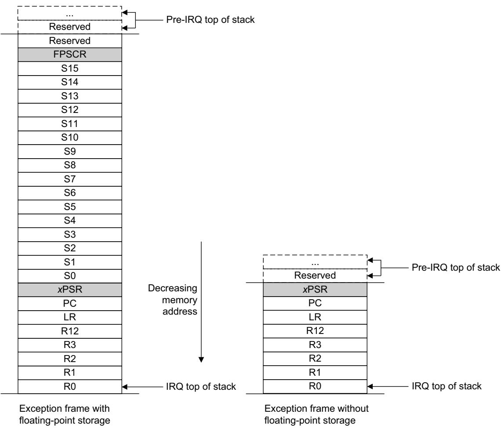  
Figure 2-2 Exception stack frame

Immediately after stacking, the stack pointer indicates the lowest address in the stack frame. The alignment of the stack frame is controlled using the STKALIGN bit of the Configuration Control Register (CCR).

In the Cortex-M7 processor CCR.STKALIGN is read-only and has a value of 1. This means that the exception stack frame starting address is always 8-byte aligned.

The stack frame includes the return address. This is the address of the next instruction in the interrupted program. This value is restored to the PC at exception return so that the interrupted program resumes.

In parallel to the stacking operation, the processor performs a vector fetch that reads the exception handler start address from the vector table. When stacking is complete, the processor starts executing the exception handler. At the same time, the processor writes an EXC\_RETURN value to the LR. This indicates which stack pointer corresponds to the stack frame and what operation mode the processor was in before the entry occurred.

If no higher priority exception occurs during exception entry, the processor starts executing the exception handler and automatically changes the status of the corresponding pending interrupt to active.

If another higher priority exception occurs during exception entry, the processor starts executing the exception handler for this exception and does not change the pending status of the earlier exception. This is the late arrival case.

## Exception return

Exception return occurs when the processor is in Handler mode and executes one of the following instructions to load the EXC\_RETURN value into the PC:

An LDM or POP instruction that loads the PC.

• An LDR instruction with PC as the destination.

• A BX instruction using any register.

EXC\_RETURN is the value loaded into the LR on exception entry. The exception mechanism relies on this value to detect when the processor has completed an exception handler. The lowest five bits of this value provide information on the return stack and processor mode. Table 2-15 shows the EXC\_RETURN values with a description of the exception return behavior.

All EXC\_RETURN values have bits[31:5] set to one. When this value is loaded into the PC it indicates to the processor that the exception is complete, and the processor initiates the appropriate exception return sequence.

Table 2-15 Exception return behavior

<table><tr><td>EXC_RETURN[31:0]</td><td>Description</td></tr><tr><td>0xFFFFFFF1</td><td>Return to Handler mode, exception return uses non-floating-point state from the MSP and execution uses MSP after return</td></tr><tr><td>0xFFFFFFF9</td><td>Return to Thread mode, exception return uses non-floating-point state from MSP and execution uses MSP after return</td></tr><tr><td>0xFFFFFFD</td><td>Return to Thread mode, exception return uses non-floating-point state from the PSP and execution uses PSP after return</td></tr><tr><td>0xFFFFFFE1</td><td>Return to Handler mode, exception return uses floating-point-state $^a$  from MSP and execution uses MSP after return</td></tr><tr><td>0xFFFFFFE9</td><td>Return to Thread mode, exception return uses floating-point state from MSP and execution uses MSP after return</td></tr><tr><td>0xFFFFFED</td><td>Return to Thread mode, exception return uses floating-point state from PSP and execution uses PSP after return</td></tr></table>

a. Floating-point state is only possible if the optional FPU is implemented.

## 2.4 Fault handling

Faults are a subset of the exceptions, see Exception model on page 2-19. Faults are generated by:

• A bus error on:

— An instruction fetch or vector table load.

— A data access.

An internally-detected error such as an undefined instruction.

Attempting to execute an instruction from a memory region marked as Execute Never (XN).

If your device contains an MPU, a privilege violation or an attempt to access an unmanaged region causing an MPU fault.

## 2.4.1 Fault types

Table 2-16 shows the types of fault, the handler used for the fault, the corresponding fault status register, and the register bit that indicates that the fault has occurred. See Configuration and Control Register on page 4-20 for more information about the fault status registers.

Table 2-16 Faults

<table><tr><td>Fault</td><td>Handler</td><td>Bit name</td><td>Fault status register</td></tr><tr><td>Bus error on a vector read</td><td>HardFault</td><td>VECTTBL</td><td>HardFault Status Register on page 4-31</td></tr><tr><td>Fault escalated to a hard fault</td><td></td><td>FORCED</td><td></td></tr><tr><td>MPU or default memory map mismatch:</td><td>MemManage</td><td>-</td><td>-</td></tr><tr><td>On instruction access</td><td></td><td>IACCVIOLa</td><td rowspan="5">MemManage Fault Status Register on page 4-26</td></tr><tr><td>On data accessb</td><td></td><td>DACCVIOL</td></tr><tr><td>During exception stackingb</td><td></td><td>MSTKERR</td></tr><tr><td>During exception unstackingb</td><td></td><td>MUNSKERR</td></tr><tr><td>During lazy floating-point state preservationc</td><td></td><td>MLSPERR</td></tr><tr><td>Bus error:</td><td>BusFault</td><td>-</td><td>-</td></tr><tr><td>During exception stacking</td><td></td><td>STKERR</td><td rowspan="6">BusFault Status Register on page 4-27</td></tr><tr><td>During exception unstacking</td><td></td><td>UNSTKERR</td></tr><tr><td>During instruction prefetch</td><td></td><td>IBUSERR</td></tr><tr><td>During lazy floating-point state preservationd</td><td></td><td>LSPERR</td></tr><tr><td>Precise data bus error</td><td></td><td>PRECISERR</td></tr><tr><td>Imprecise data bus error</td><td></td><td>IMPRECISERR</td></tr><tr><td>Attempt to access a coprocessor</td><td>UsageFault</td><td>NOCP</td><td>UsageFault Status Register on page 4-29</td></tr><tr><td>Undefined instruction</td><td></td><td>UNDEFINSTR</td><td></td></tr><tr><td>Attempt to enter an invalid instruction set statee</td><td></td><td>INVSTATE</td><td></td></tr><tr><td>Invalid EXC_RETURN value</td><td></td><td>INVPC</td><td></td></tr><tr><td>Illegal unaligned load or store</td><td></td><td>UNALIGNED</td><td></td></tr><tr><td>Divide By 0</td><td></td><td>DIVBYZERO</td><td></td></tr></table>

a. Occurs on an access to an XN region even if the processor does not include an MPU or the MPU is disabled.  
b. Occurs only if an MPU is implemented and enabled.  
c. Occurs only if an MPU and FPU are implemented and enabled.  
d. Occurs only if an FPU is implemented and enabled.  
e. Attempting to use an instruction set other than the Thumb instruction set or returns to a non load/store-multiple instruction with ICI continuation.

## 2.4.2 Fault escalation and hard faults

All fault exceptions except for HardFault have configurable exception priority, see System Handler Priority Registers on page 4-22. Software can disable execution of the handlers for these faults, see System Handler Control and State Register on page 4-24.

Usually, the exception priority, together with the values of the exception mask registers, determines whether the processor enters the fault handler, and whether a fault handler can preempt another fault handler. as described in Exception model on page 2-19.

In some situations, a fault with configurable priority is treated as a HardFault. This is called priority escalation, and the fault is described as escalated to HardFault. Escalation to HardFault occurs when:

A fault handler causes the same kind of fault as the one it is servicing. This escalation to HardFault occurs because a fault handler cannot preempt itself because it must have the same priority as the current priority level.

A fault handler causes a fault with the same or lower priority as the fault it is servicing. This is because the handler for the new fault cannot preempt the currently executing fault handler.

An exception handler causes a fault for which the priority is the same as or lower than the currently executing exception.

A fault occurs and the handler for that fault is not enabled.

If a BusFault occurs during a stack push when entering a BusFault handler, the BusFault does not escalate to a HardFault. This means that if a corrupted stack causes a fault, the fault handler executes even though the stack push for the handler failed. The fault handler operates but the stack contents are corrupted.

Note

Only Reset and NMI can preempt the fixed priority HardFault. A HardFault can preempt any exception other than Reset, NMI, or another HardFault.

## 2.4.3 Synchronous and Asynchronous bus faults

In the Cortex-M7 processor all bus faults triggered by:

Processor load operations are synchronous.

Processor store operations are asynchronous, including stores to Device and Strongly-Ordered regions.

Debugger load or store accesses are synchronous, and are visible to the debugger interface only.

When an asynchronous bus fault is triggered, the BusFault exception is pended. If the BusFault handler is not enabled, the HardFault exception is pended instead. The HardFault caused by the asynchronous BusFault never escalates into lockup.

If an IRQ is triggered after the write, the write buffer might not drain before the ISR is executed. Therefore a asynchronous BusFault can occur across context boundaries.

A synchronous BusFault can escalate into lockup if it occurs inside an NMI or HardFault handler.

Cache maintenance operations can also trigger a bus fault. See Faults handling considerations on page 4-65 for more information.

## 2.4.4 Fault status registers and fault address registers

The fault status registers indicate the cause of a fault. For synchronous BusFaults and MemManage faults, the fault address register indicates the address accessed by the operation that caused the fault, as shown in Table 2-17.

Table 2-17 Fault status and fault address registers

<table><tr><td>Handler</td><td>Status register name</td><td>Address register name</td><td>Register description</td></tr><tr><td>HardFault</td><td>HFSR</td><td>-</td><td>HardFault Status Register on page 4-31</td></tr><tr><td>MemManage</td><td>MMFSR</td><td>MMFAR</td><td>MemManage Fault Status Register on page 4-26MemManage Fault Address Register on page 4-31</td></tr><tr><td>BusFault</td><td>BFSR</td><td>BFAR</td><td>BusFault Status Register on page 4-27BusFault Address Register on page 4-32</td></tr><tr><td>UsageFault</td><td>UFSR</td><td>-</td><td>UsageFault Status Register on page 4-29</td></tr></table>

## 2.4.5 Lockup

The processor enters a lockup state if a fault occurs when executing the NMI or HardFault handlers. When the processor is in lockup state it does not execute any instructions. The processor remains in lockup state until either:

It is reset.

• An NMI occurs.

It is halted by a debugger.

Note

If lockup state occurs from the NMI handler a subsequent NMI does not cause the processor to leave lockup state.

## 2.5 Power management

The Cortex-M7 processor sleep modes reduce power consumption. The sleep modes your device implements is implementation defined. The modes implemented can be either one or both of the following:

• Sleep mode stops the processor clock.

Deep sleep mode stops the system clock and switches off the PLL and flash memory.

If your device implements two sleep modes providing different levels of power saving, the SLEEPDEEP bit in the System Control Register (SCR) selects which sleep mode is used, see System Control Register on page 4-20. For more information about the behavior of the sleep modes see the documentation supplied by your device vendor.

This section describes the mechanisms for entering sleep mode, and the conditions for waking up from sleep mode.

## 2.5.1 Entering sleep mode

This section describes the mechanisms software can use to put the processor into sleep mode.

The system can generate spurious wakeup events, for example a debug operation wakes up the processor. Therefore software must be able to put the processor back into sleep mode after such an event. A program might have an idle loop to put the processor back to sleep mode.

## Wait for interrupt

The wait for interrupt instruction, WFI, causes immediate entry to sleep mode unless the wakeup condition is true, see Wakeup from WFI or sleep-on-exit on page 2-32. When the processor executes a WFI instruction it stops executing instructions and enters sleep mode. See WFI on page 3-185 for more information.

## Wait for event

The wait for event instruction, WFE, causes entry to sleep mode depending on the value of a one-bit event register. When the processor executes a WFE instruction, it checks the value of the event register:

0 The processor stops executing instructions and enters sleep mode.

1 The processor clears the register to 0 and continues executing instructions without entering sleep mode.

See WFE on page 3-184 for more information.

If the event register is 1, it indicates that the processor must not enter sleep mode on execution of a WFE instruction. Typically, this is because an external event signal, if implemented, is asserted, or a processor in the system has executed an SEV instruction, see SEV on page 3-182. Software cannot access this register directly.

## Sleep-on-exit

If the SLEEPONEXIT bit of the SCR is set to 1, when the processor completes the execution of all exception handlers it returns to Thread mode and immediately enters sleep mode. Use this mechanism in applications that only require the processor to run when an exception occurs.

## 2.5.2 Wakeup from sleep mode

The conditions for the processor to wakeup depend on the mechanism that cause it to enter sleep mode.

## Wakeup from WFI or sleep-on-exit

Normally, the processor wakes up only when it detects an exception with sufficient priority to cause exception entry. Some embedded systems might have to execute system restore tasks after the processor wakes up, and before it executes an interrupt handler. To achieve this set the PRIMASK bit to 1 and the FAULTMASK bit to 0. If an interrupt arrives that is enabled and has a higher priority than the current exception priority, the processor wakes up but does not execute the interrupt handler until the processor sets PRIMASK to zero. For more information about PRIMASK and FAULTMASK see Exception mask registers on page 2-7.

## Wakeup from WFE

The processor wakes up if:

• It detects an exception with sufficient priority to cause exception entry.

It detects an external event signal if implemented, see The optional external event input.

• In a multiprocessor system, another processor in the system executes an SEV instruction.

In addition, if the SEVONPEND bit in the SCR is set to 1, any new pending interrupt triggers an event and wakes up the processor, even if the interrupt is disabled or has insufficient priority to cause exception entry. For more information about the SCR see System Control Register on page 4-20.

## 2.5.3 The optional Wakeup Interrupt Controller

Your device might include a Wakeup Interrupt Controller (WIC), an optional peripheral that can detect an interrupt and wake the processor from deep sleep mode. The WIC is enabled only when the DEEPSLEEP bit in the SCR is set to 1, see System Control Register on page 4-20.

The WIC is not programmable, and does not have any registers or user interface. It operates entirely from hardware signals.

When the WIC is enabled and the processor enters deep sleep mode, the power management unit in the system can power down most of the Cortex-M7 processor. This has the side effect of stopping the SysTick timer. When the WIC receives an interrupt, it takes several clock cycles to wakeup the processor and restore its state, before it can process the interrupt. This means interrupt latency is increased in deep sleep mode.

Note

If the processor detects a connection to a debugger it disables the WIC.

## 2.5.4 The optional external event input

Your device might include an external event input signal. Peripherals can drive this signal, either to wake the processor from WFE, or to set the internal WFE event register to one to indicate that the processor must not enter sleep mode on a later WFE instruction. See Wait for event on page 2-31 for more information.

## 2.5.5 Power management programming hints

ISO/IEC C cannot directly generate the WFI and WFE instructions. The CMSIS provides the following functions for these instructions:

void \_\_WFE(void) // Wait for Event

void \_\_WFI(void) // Wait for Interrupt

## Chapter 3 The Cortex-M7 Instruction Set

This chapter describes the Cortex-M7 instruction set. The following sections give general information:

Instruction set summary on page 3-2.

CMSIS functions on page 3-12.

About the instruction descriptions on page 3-14.

Each of the following sections describes a functional group of Cortex-M7 instructions. Together they describe all the instructions supported by the Cortex-M7 processor:

Memory access instructions on page 3-24.

General data processing instructions on page 3-42.

Multiply and divide instructions on page 3-82.

Saturating instructions on page 3-104.

Packing and unpacking instructions on page 3-116.

Bit field instructions on page 3-123.

Branch and control instructions on page 3-127.

Floating-point instructions on page 3-135.

Miscellaneous instructions on page 3-172.

## 3.1 Instruction set summary

The processor implements a version of the Thumb instruction set. Table 3-1 lists the supported instructions.

Note

In Table 3-1:

Angle brackets, <>, enclose alternative forms of the operand.

• Braces, {}, enclose optional operands.

• The Operands column is not exhaustive.

• Op2 is a flexible second operand that can be either a register or a constant.

• Most instructions can use an optional condition code suffix.

For more information on the instructions and operands, see the instruction descriptions.

Table 3-1 Cortex-M7 instructions

<table><tr><td>Mnemonic</td><td>Operands</td><td>Brief description</td><td>Flags</td><td>Page</td></tr><tr><td>ADC, ADCS</td><td>{Rd,} Rn, Op2</td><td>Add with Carry</td><td>N,Z,C,V</td><td>page 3-44</td></tr><tr><td>ADD, ADDS</td><td>{Rd,} Rn, Op2</td><td>Add</td><td>N,Z,C,V</td><td>page 3-44</td></tr><tr><td>ADD, ADDW</td><td>{Rd,} Rn, #imm12</td><td>Add</td><td>-</td><td>page 3-44</td></tr><tr><td>ADR</td><td>Rd, label</td><td>Address to Register</td><td>-</td><td>page 3-25</td></tr><tr><td>AND, ANDS</td><td>{Rd,} Rn, Op2</td><td>Logical AND</td><td>N,Z,C</td><td>page 3-47</td></tr><tr><td>ASR, ASRS</td><td>Rd, Rm, &lt;Rs|#n&gt;</td><td>Arithmetic Shift Right</td><td>N,Z,C</td><td>page 3-49</td></tr><tr><td>B</td><td>label</td><td>Branch</td><td>-</td><td>page 3-128</td></tr><tr><td>BFC</td><td>Rd, #lsb, #width</td><td>Bit Field Clear</td><td>-</td><td>page 3-124</td></tr><tr><td>BFI</td><td>Rd, Rn, #lsb, #width</td><td>Bit Field Insert</td><td>-</td><td>page 3-124</td></tr><tr><td>BIC, BICS</td><td>{Rd,} Rn, Op2</td><td>Bit Clear</td><td>N,Z,C</td><td>page 3-47</td></tr><tr><td>BKPT</td><td>#imm8</td><td>Breakpoint</td><td>-</td><td>page 3-173</td></tr><tr><td>BL</td><td>label</td><td>Branch with Link</td><td>-</td><td>page 3-128</td></tr><tr><td>BLX</td><td>Rm</td><td>Branch indirect with Link and Exchange</td><td>-</td><td>page 3-128</td></tr><tr><td>BX</td><td>Rm</td><td>Branch indirect and Exchange</td><td>-</td><td>page 3-128</td></tr><tr><td>CBNZ</td><td>Rn, label</td><td>Compare and Branch if Non Zero</td><td>-</td><td>page 3-130</td></tr><tr><td>CBZ</td><td>Rn, label</td><td>Compare and Branch if Zero</td><td>-</td><td>page 3-130</td></tr><tr><td>CLREX</td><td>-</td><td>Clear Exclusive</td><td>-</td><td>page 3-41</td></tr><tr><td>CLZ</td><td>Rd, Rm</td><td>Count Leading Zeros</td><td>-</td><td>page 3-51</td></tr><tr><td>CMN</td><td>Rn, Op2</td><td>Compare Negative</td><td>N,Z,C,V</td><td>page 3-52</td></tr><tr><td>CMP</td><td>Rn, Op2</td><td>Compare</td><td>N,Z,C,V</td><td>page 3-52</td></tr><tr><td>CPS</td><td>Rd, Rn</td><td>Change Processor State</td><td>-</td><td>page 3-174</td></tr><tr><td>CPY</td><td>Rd, Rn</td><td>Copy</td><td>-</td><td>page 3-174</td></tr><tr><td>DMB</td><td>{opt}</td><td>Data Memory Barrier</td><td>-</td><td>page 3-175</td></tr><tr><td>DSB</td><td>{opt}</td><td>Data Synchronization Barrier</td><td>-</td><td>page 3-176</td></tr><tr><td>EOR, EORS</td><td>{Rd,} Rn, Op2</td><td>Exclusive OR</td><td>N,Z,C</td><td>page 3-47</td></tr><tr><td>ISB</td><td>{opt}</td><td>Instruction Synchronization Barrier</td><td>-</td><td>page 3-177</td></tr><tr><td>IT</td><td>-</td><td>If-Then condition block</td><td>-</td><td>page 3-131</td></tr><tr><td>LDM</td><td>Rn{!}, reglist</td><td>Load Multiple registers</td><td>-</td><td>page 3-34</td></tr><tr><td>LDMDB, LDMEA</td><td>Rn{!}, reglist</td><td>Load Multiple, decrement before</td><td>-</td><td>page 3-34</td></tr><tr><td>LDMIA, LDMFD</td><td>Rn{!}, reglist</td><td>Load Multiple registers, increment after</td><td>-</td><td>page 3-34</td></tr><tr><td>LDR, LDRT</td><td>Rt, [Rn, #offset]</td><td>Load Register with word (immediate offset, unprivileged)</td><td>-</td><td>page 3-26, page 3-31</td></tr><tr><td>LDRH, LDRHT</td><td>Rt, [Rn, #offset]</td><td>Load Register with Halfword (immediate offset, unprivileged)</td><td>-</td><td>page 3-26, page 3-31</td></tr><tr><td>LDRSH, LDRSHT</td><td>Rt, [Rn, #offset]</td><td>Load Register with Signed Halfword (immediate offset, unprivileged)</td><td>-</td><td>page 3-26, page 3-31</td></tr><tr><td>LDRB, LDRBT</td><td>Rt, [Rn, #offset]</td><td>Load Register with byte (immediate offset, unprivileged)</td><td>-</td><td>page 3-26, page 3-31</td></tr><tr><td>LDRSB, LDRSBT</td><td>Rt, [Rn, #offset]</td><td>Load Register with Signed Byte (immediate offset, unprivileged)</td><td>-</td><td>page 3-26, page 3-31</td></tr><tr><td>LDR</td><td>Rt, [Rn, Rm {, LSL #shift}]</td><td>Load Register with word (register offset)</td><td>-</td><td>page 3-29</td></tr><tr><td>LDRH</td><td>Rt, [Rn, Rm {, LSL #shift}]</td><td>Load Register with Halfword (register offset)</td><td>-</td><td>page 3-29</td></tr><tr><td>LDRSH</td><td>Rt, [Rn, Rm {, LSL #shift}]</td><td>Load Register with Signed Halfword (register offset)</td><td>-</td><td>page 3-29</td></tr><tr><td>LDRB</td><td>Rt, [Rn, Rm {, LSL #shift}]</td><td>Load Register with Byte (register offset)</td><td>-</td><td>page 3-29</td></tr><tr><td>LDRSB</td><td>Rt, [Rn, Rm {, LSL #shift}]</td><td>Load Register with Signed Byte (register offset)</td><td>-</td><td>page 3-29</td></tr><tr><td>LDR</td><td>Rt, label</td><td>Load Register with word (literal)</td><td>-</td><td>page 3-32</td></tr><tr><td>LDRH</td><td>Rt, label</td><td>Load Register with Halfword (literal)</td><td>-</td><td>page 3-32</td></tr><tr><td>LDRB</td><td>Rt, label</td><td>Load Register with Byte (literal)</td><td>-</td><td>page 3-32</td></tr><tr><td>LDRD</td><td>Rt, Rt2, [Rn, #offset]</td><td>Load Register Dual with two bytes (immediate offset)</td><td>-</td><td>page 3-26</td></tr><tr><td>LDRD</td><td>Rt, Rt2, label</td><td>Load Register Dual with two bytes (PC-relative)</td><td>-</td><td>page 3-32</td></tr><tr><td>LDREX</td><td>Rt, [Rn, #offset]</td><td>Load Register Exclusive</td><td>-</td><td>page 3-39</td></tr><tr><td>LDREXB</td><td>Rt, [Rn]</td><td>Load Register Exclusive with Byte</td><td>-</td><td>page 3-39</td></tr><tr><td>LDREXH</td><td>Rt, [Rn]</td><td>Load Register Exclusive with Halfword</td><td>-</td><td>page 3-39</td></tr><tr><td>LDRSB</td><td>Rt, label</td><td>Load Register with Signed Byte (PC-relative)</td><td>-</td><td>page 3-32</td></tr><tr><td>LDRSH</td><td>Rt, label</td><td>Load Register with Signed Halfword (PC-relative)</td><td>-</td><td>page 3-32</td></tr><tr><td>LSL, LSLS</td><td>Rd, Rm,</td><td>Logical Shift Left</td><td>N,Z,C</td><td>page 3-49</td></tr><tr><td>LSR, LSRS</td><td>Rd, Rm,</td><td>Logical Shift Right</td><td>N,Z,C</td><td>page 3-49</td></tr><tr><td>MLA</td><td>Rd, Rn, Rm, Ra</td><td>Multiply with Accumulate, 32-bit result</td><td>N,Z</td><td>page 3-83</td></tr><tr><td>MLS</td><td>Rd, Rn, Rm, Ra</td><td>Multiply and Subtract, 32-bit result</td><td>-</td><td>page 3-83</td></tr><tr><td>MOV, MOVS</td><td>Rd, Op2</td><td>Move</td><td>N,Z,C</td><td>page 3-53</td></tr><tr><td>MOV, MOVS</td><td>Rd, Rm</td><td>Move (register)</td><td>N,Z</td><td>page 3-53</td></tr><tr><td>MOVT</td><td>Rd, #imm16</td><td>Move Top</td><td>-</td><td>page 3-55</td></tr><tr><td>MOVW</td><td>Rd, #imm16</td><td>Move 16-bit constant</td><td>N,Z,C</td><td>page 3-53</td></tr><tr><td>MRS</td><td>Rd, spec_reg</td><td>Move from Special Register to general register</td><td>-</td><td>page 3-178</td></tr><tr><td>MSR</td><td>spec_reg, Rn</td><td>Move from general register to Special Register</td><td>-</td><td>page 3-179</td></tr><tr><td>MUL, MULS</td><td>{Rd,} Rn, Rm</td><td>Multiply, 32-bit result</td><td>N,Z</td><td>page 3-83</td></tr><tr><td>MVN, MVNS</td><td>Rd, Op2</td><td>Move NOT</td><td>N,Z,C</td><td>page 3-53</td></tr><tr><td>NEG</td><td>{Rd,} Rm</td><td>Negate</td><td>-</td><td>page 3-180</td></tr><tr><td>NOP</td><td>-</td><td>No Operation</td><td>-</td><td>page 3-181</td></tr><tr><td>ORN, ORNS</td><td>{Rd,} Rn, Op2</td><td>Logical OR NOT</td><td>N,Z,C</td><td>page 3-47</td></tr><tr><td>ORR, ORRS</td><td>{Rd,} Rn, Op2</td><td>Logical OR</td><td>N,Z,C</td><td>page 3-47</td></tr><tr><td>PKHTB, PKHBT</td><td>{Rd,} Rn, Rm, {, Op2}</td><td>Pack Halfword</td><td>-</td><td>page 3-117</td></tr><tr><td>PLD</td><td>[Rn {, #offset}]</td><td>Preload Data</td><td>-</td><td>page 3-36</td></tr><tr><td>POP</td><td>reglist</td><td>Pop registers from stack</td><td>-</td><td>page 3-37</td></tr><tr><td>PUSH</td><td>reglist</td><td>Push registers onto stack</td><td>-</td><td>page 3-37</td></tr><tr><td>QADD</td><td>{Rd,} Rn, Rm</td><td>Saturating double and Add</td><td>Q</td><td>page 3-107</td></tr><tr><td>QADD16</td><td>{Rd,} Rn, Rm</td><td>Saturating Add 16</td><td>-</td><td>page 3-107</td></tr><tr><td>QADD8</td><td>{Rd,} Rn, Rm</td><td>Saturating Add 8</td><td>-</td><td>page 3-107</td></tr><tr><td>QASX</td><td>{Rd,} Rn, Rm</td><td>Saturating Add and Subtract with Exchange</td><td>-</td><td>page 3-109</td></tr><tr><td>QDADD</td><td>{Rd,} Rn, Rm</td><td>Saturating Double and Add</td><td>Q</td><td>page 3-111</td></tr><tr><td>QDSUB</td><td>{Rd,} Rn, Rm</td><td>Saturating Double and Subtract</td><td>Q</td><td>page 3-111</td></tr><tr><td>QSAX</td><td>{Rd,} Rn, Rm</td><td>Saturating Subtract and Add with Exchange</td><td>-</td><td>page 3-109</td></tr><tr><td>QSUB</td><td>{Rd,} Rn, Rm</td><td>Saturating Subtract</td><td>Q</td><td>page 3-107</td></tr><tr><td>QSUB16</td><td>{Rd,} Rn, Rm</td><td>Saturating Subtract 16</td><td>-</td><td>page 3-107</td></tr><tr><td>QSUB8</td><td>{Rd,} Rn, Rm</td><td>Saturating Subtract 8</td><td>-</td><td>page 3-107</td></tr><tr><td>RBIT</td><td>Rd, Rn</td><td>Reverse Bits</td><td>-</td><td>page 3-56</td></tr><tr><td>REV</td><td>Rd, Rn</td><td>Reverse byte order in a word</td><td>-</td><td>page 3-56</td></tr><tr><td>REV16</td><td>Rd, Rn</td><td>Reverse byte order in each halfword</td><td>-</td><td>page 3-56</td></tr><tr><td>REVSH</td><td>Rd, Rn</td><td>Reverse byte order in bottom halfword and sign extend</td><td>-</td><td>page 3-56</td></tr><tr><td>ROR, RORS</td><td>Rd, Rm,</td><td>Rotate Right</td><td>N,Z,C</td><td>page 3-49</td></tr><tr><td>RRX, RRXS</td><td>Rd, Rm</td><td>Rotate Right with Extend</td><td>N,Z,C</td><td>page 3-49</td></tr><tr><td>RSB, RSBS</td><td>{Rd,} Rn, Op2</td><td>Reverse Subtract</td><td>N,Z,C,V</td><td>page 3-44</td></tr><tr><td>SADD16</td><td>{Rd,} Rn, Rm</td><td>Signed Add 16</td><td>GE</td><td>page 3-57</td></tr><tr><td>SADD8</td><td>{Rd,} Rn, Rm</td><td>Signed Add 8</td><td>GE</td><td>page 3-57</td></tr><tr><td>SASX</td><td>{Rd,} Rn, Rm</td><td>Signed Add and Subtract with Exchange</td><td>GE</td><td>page 3-65</td></tr><tr><td>SBC, SBCS</td><td>{Rd,} Rn, Op2</td><td>Subtract with Carry</td><td>N,Z,C,V</td><td>page 3-44</td></tr><tr><td>SBFX</td><td>Rd, Rn, #lsb, #width</td><td>Signed Bit Field Extract</td><td>-</td><td>page 3-125</td></tr><tr><td>SDIV</td><td>{Rd,} Rn, Rm</td><td>Signed Divide</td><td>-</td><td>page 3-103</td></tr><tr><td>SEL</td><td>{Rd,} Rn, Rm</td><td>Select bytes</td><td>GE</td><td>page 3-77</td></tr><tr><td>SEV</td><td>-</td><td>Send Event</td><td>-</td><td>page 3-182</td></tr><tr><td>SHADD16</td><td>{Rd,} Rn, Rm</td><td>Signed Halving Add 16</td><td>-</td><td>page 3-59</td></tr><tr><td>SHADD8</td><td>{Rd,} Rn, Rm</td><td>Signed Halving Add 8</td><td>-</td><td>page 3-59</td></tr><tr><td>SHASX</td><td>{Rd,} Rn, Rm</td><td>Signed Halving Add and Subtract with Exchange</td><td>-</td><td>page 3-60</td></tr><tr><td>SHSAX</td><td>{Rd,} Rn, Rm</td><td>Signed Halving Subtract and Add with Exchange</td><td>-</td><td>page 3-60</td></tr><tr><td>SHSUB16</td><td>{Rd,} Rn, Rm</td><td>Signed Halving Subtract 16</td><td>-</td><td>page 3-62</td></tr><tr><td>SHSUB8</td><td>{Rd,} Rn, Rm</td><td>Signed Halving Subtract 8</td><td>-</td><td>page 3-62</td></tr><tr><td>SMLABB, SMLABT, SMLATB, SMLATT</td><td>Rd, Rn, Rm, Ra</td><td>Signed Multiply Accumulate halfwords</td><td>Q</td><td>page 3-87</td></tr><tr><td>SMLAD, SMLADX</td><td>Rd, Rn, Rm, Ra</td><td>Signed Multiply Accumulate Dual</td><td>Q</td><td>page 3-89</td></tr><tr><td>SMLAL</td><td>RdLo, RdHi, Rn, Rm</td><td>Signed Multiply with Accumulate Long (32 × 32 + 64), 64-bit result</td><td>-</td><td>page 3-102</td></tr><tr><td>SMLALBB, SMLALBT, SMLALTB, SMLALTT</td><td>RdLo, RdHi, Rn, Rm</td><td>Signed Multiply Accumulate Long, halfwords</td><td>-</td><td>page 3-91</td></tr><tr><td>SMLALD, SMLALDX</td><td>RdLo, RdHi, Rn, Rm</td><td>Signed Multiply Accumulate Long Dual</td><td>-</td><td>page 3-91</td></tr><tr><td>SMLAWB, SMLAWT</td><td>Rd, Rn, Rm, Ra</td><td>Signed Multiply Accumulate, word by halfword</td><td>Q</td><td>page 3-87</td></tr><tr><td>SMLSD, SMLSDX</td><td>Rd, Rn, Rm, Ra</td><td>Signed Multiply Subtract Dual</td><td>Q</td><td>page 3-93</td></tr><tr><td>SMLSLD, SMLSLDX</td><td>RdLo, RdHi, Rn, Rm</td><td>Signed Multiply Subtract Long Dual</td><td>-</td><td>page 3-93</td></tr><tr><td>SMMLA, SMMLAR</td><td>Rd, Rn, Rm, Ra</td><td>Signed Most significant word Multiply Accumulate</td><td>-</td><td>page 3-95</td></tr><tr><td>SMMLS, SMMLSR</td><td>Rd, Rn, Rm, Ra</td><td>Signed Most significant word Multiply Subtract</td><td>-</td><td>page 3-95</td></tr><tr><td>SMMUL, SMMULR</td><td>{Rd,} Rn, Rm</td><td>Signed Most significant word Multiply</td><td>-</td><td>page 3-97</td></tr><tr><td>SMUAD, SMUADX</td><td>{Rd,} Rn, Rm</td><td>Signed Dual Multiply Add</td><td>Q</td><td>page 3-98</td></tr><tr><td>SMULBB, SMULBT, SMULTB, SMULTT</td><td>{Rd,} Rn, Rm</td><td>Signed Multiply (halfwords)</td><td>-</td><td>page 3-100</td></tr><tr><td>SMULL</td><td>RdLo, RdHi, Rn, Rm</td><td>Signed Multiply Long (32 × 32), 64-bit result</td><td>-</td><td>page 3-102</td></tr><tr><td>SMULWB, SMULWT</td><td>{Rd,} Rn, Rm</td><td>Signed Multiply word by halfword</td><td>-</td><td>page 3-100</td></tr><tr><td>SMUSD, SMUSDX</td><td>{Rd,} Rn, Rm</td><td>Signed Dual Multiply Subtract</td><td>-</td><td>page 3-98</td></tr><tr><td>SSAT</td><td>Rd, #n, Rm {,shift #s}</td><td>Signed Saturate</td><td>Q</td><td>page 3-105</td></tr><tr><td>SSAT16</td><td>Rd, #n, Rm</td><td>Signed Saturate 16</td><td>Q</td><td>page 3-106</td></tr><tr><td>SSAX</td><td>{Rd,} Rn, Rm</td><td>Signed Subtract and Add with Exchange</td><td>GE</td><td>page 3-65</td></tr><tr><td>SSUB16</td><td>{Rd,} Rn, Rm</td><td>Signed Subtract 16</td><td>GE</td><td>page 3-63</td></tr><tr><td>SSUB8</td><td>{Rd,} Rn, Rm</td><td>Signed Subtract 8</td><td>GE</td><td>page 3-63</td></tr><tr><td>STM</td><td>Rn{!}, reglist</td><td>Store Multiple registers</td><td>-</td><td>page 3-34</td></tr><tr><td>STMDB, STMEA</td><td>Rn{!}, reglist</td><td>Store Multiple registers, decrement before</td><td>-</td><td>page 3-34</td></tr><tr><td>STMIA, STMFD</td><td>Rn{!}, reglist</td><td>Store Multiple registers, increment after</td><td>-</td><td>page 3-34</td></tr><tr><td>STR, STRT</td><td>Rt, [Rn, #offset]</td><td>Store Register word (immediate offset, unprivileged)</td><td>-</td><td>page 3-26, page 3-31</td></tr><tr><td>STRH, STRHT</td><td>Rt, [Rn, #offset]</td><td>Store Register Halfword (immediate offset, unprivileged)</td><td>-</td><td>page 3-26, page 3-31</td></tr><tr><td>STRB, STRBT</td><td>Rt, [Rn, #offset]</td><td>Store Register Byte (immediate offset, unprivileged)</td><td>-</td><td>page 3-26, page 3-31</td></tr><tr><td>STR</td><td>Rt, [Rn, Rm {, LSL #shift}]</td><td>Store Register word (register offset)</td><td>-</td><td>page 3-29</td></tr><tr><td>STRH</td><td>Rt, [Rn, Rm {, LSL #shift}]</td><td>Store Register Halfword (register offset)</td><td>-</td><td>page 3-29</td></tr><tr><td>STRB</td><td>Rt, [Rn, Rm {, LSL #shift}]</td><td>Store Register Byte (register offset)</td><td>-</td><td>page 3-29</td></tr><tr><td>STRD</td><td>Rt, Rt2, [Rn, #offset]</td><td>Store Register Dual two words</td><td>-</td><td>page 3-26</td></tr><tr><td>STREX</td><td>Rd, Rt, [Rn, #offset]</td><td>Store Register Exclusive</td><td>-</td><td>page 3-39</td></tr><tr><td>STREXB</td><td>Rd, Rt, [Rn]</td><td>Store Register Exclusive Byte</td><td>-</td><td>page 3-39</td></tr><tr><td>STREXH</td><td>Rd, Rt, [Rn]</td><td>Store Register Exclusive Halfword</td><td>-</td><td>page 3-39</td></tr><tr><td>SUB, SUBS</td><td>{Rd,} Rn, Op2</td><td>Subtract</td><td>N,Z,C,V</td><td>page 3-44</td></tr><tr><td>SUB, SUBW</td><td>{Rd,} Rn, #imm12</td><td>Subtract</td><td>-</td><td>page 3-44</td></tr><tr><td>SVC</td><td>#imm</td><td>Supervisor Call</td><td>-</td><td>page 3-183</td></tr><tr><td>SXTAB</td><td>{Rd,} Rn, Rm {,ROR #n}</td><td>Sign extend 8 bits to 32 and Add</td><td>-</td><td>page 3-121</td></tr><tr><td>SXTAB16</td><td>{Rd,} Rn, Rm {,ROR #n}</td><td>Sign extend two 8-bit values to 16 and Add</td><td>-</td><td>page 3-121</td></tr><tr><td>SXTAH</td><td>{Rd,} Rn, Rm {,ROR #n}</td><td>Sign extend 16 bits to 32 and Add</td><td>-</td><td>page 3-121</td></tr><tr><td>SXTB</td><td>Rd, Rm {,ROR #n}</td><td>Sign extend 8 bits to 32</td><td>-</td><td>page 3-126</td></tr><tr><td>SXTB16</td><td>{Rd,} Rm {,ROR #n}</td><td>Sign extend 8 bits to 16</td><td>-</td><td>page 3-119</td></tr><tr><td>SXTH</td><td>{Rd,} Rm {,ROR #n}</td><td>Sign extend a Halfword to 32</td><td>-</td><td>page 3-126</td></tr><tr><td>TBB</td><td>[Rn, Rm]</td><td>Table Branch Byte</td><td>-</td><td>page 3-133</td></tr><tr><td>TBH</td><td>[Rn, Rm, LSL #1]</td><td>Table Branch Halfword</td><td>-</td><td>page 3-133</td></tr><tr><td>TEQ</td><td>Rn, Op2</td><td>Test Equivalence</td><td>N,Z,C</td><td>page 3-67</td></tr><tr><td>TST</td><td>Rn, Op2</td><td>Test</td><td>N,Z,C</td><td>page 3-67</td></tr><tr><td>UADD16</td><td>{Rd,} Rn, Rm</td><td>Unsigned Add 16</td><td>GE</td><td>page 3-68</td></tr><tr><td>UADD8</td><td>{Rd,} Rn, Rm</td><td>Unsigned Add 8</td><td>GE</td><td>page 3-68</td></tr><tr><td>UASX</td><td>{Rd,} Rn, Rm</td><td>Unsigned Add and Subtract with Exchange</td><td>GE</td><td>page 3-70</td></tr><tr><td>UBFX</td><td>Rd, Rn, #lsb, #width</td><td>Unsigned Bit Field Extract</td><td>-</td><td>page 3-125</td></tr><tr><td>UDIV</td><td>{Rd,} Rn, Rm</td><td>Unsigned Divide</td><td>-</td><td>page 3-103</td></tr><tr><td>USAX</td><td>{Rd,} Rn, Rm</td><td>Unsigned Subtract and Add with Exchange</td><td>GE</td><td>page 3-70</td></tr><tr><td>UHADD16</td><td>{Rd,} Rn, Rm</td><td>Unsigned Halving Add 16</td><td>-</td><td>page 3-73</td></tr><tr><td>UHADD8</td><td>{Rd,} Rn, Rm</td><td>Unsigned Halving Add 8</td><td>-</td><td>page 3-73</td></tr><tr><td>UHASX</td><td>{Rd,} Rn, Rm</td><td>Unsigned Halving Add and Subtract with Exchange</td><td>-</td><td>page 3-74</td></tr><tr><td>UHSAX</td><td>{Rd,} Rn, Rm</td><td>Unsigned Halving Subtract and Add with Exchange</td><td>-</td><td>page 3-74</td></tr><tr><td>UHSUB16</td><td>{Rd,} Rn, Rm</td><td>Unsigned Halving Subtract 16</td><td>-</td><td>page 3-76</td></tr><tr><td>UHSUB8</td><td>{Rd,} Rn, Rm</td><td>Unsigned Halving Subtract 8</td><td>-</td><td>page 3-76</td></tr><tr><td>UMAAL</td><td>RdLo, RdHi, Rn, Rm</td><td>Unsigned Multiply Accumulate Accumulate Long (32 × 32 + 32 + 32), 64-bit result</td><td>-</td><td>page 3-85</td></tr><tr><td>UMLAL</td><td>RdLo, RdHi, Rn, Rm</td><td>Unsigned Multiply with Accumulate Long (32 × 32 + 64), 64-bit result</td><td>-</td><td>page 3-102</td></tr><tr><td>UMULL</td><td>RdLo, RdHi, Rn, Rm</td><td>Unsigned Multiply Long (32 × 32), 64-bit result</td><td>-</td><td>page 3-102</td></tr><tr><td>UQADD16</td><td>{Rd,} Rn, Rm</td><td>Unsigned Saturating Add 16</td><td>-</td><td>page 3-114</td></tr><tr><td>UQADD8</td><td>{Rd,} Rn, Rm</td><td>Unsigned Saturating Add 8</td><td>-</td><td>page 3-114</td></tr><tr><td>UQASX</td><td>{Rd,} Rn, Rm</td><td>Unsigned Saturating Add and Subtract with Exchange</td><td>-</td><td>page 3-112</td></tr><tr><td>UQSAX</td><td>{Rd,} Rn, Rm</td><td>Unsigned Saturating Subtract and Add with Exchange</td><td>-</td><td>page 3-112</td></tr><tr><td>UQSUB16</td><td>{Rd,} Rn, Rm</td><td>Unsigned Saturating Subtract 16</td><td>-</td><td>page 3-114</td></tr><tr><td>UQSUB8</td><td>{Rd,} Rn, Rm</td><td>Unsigned Saturating Subtract 8</td><td>-</td><td>page 3-114</td></tr><tr><td>USAD8</td><td>{Rd,} Rn, Rm</td><td>Unsigned Sum of Absolute Differences</td><td>-</td><td>page 3-78</td></tr><tr><td>USADA8</td><td>Rd, Rn, Rm, Ra</td><td>Unsigned Sum of Absolute Differences and Accumulate</td><td>-</td><td>page 3-79</td></tr><tr><td>USAT</td><td>Rd, #n, Rm {,shift #s}</td><td>Unsigned Saturate</td><td>Q</td><td>page 3-105</td></tr><tr><td>USAT16</td><td>Rd, #n, Rm</td><td>Unsigned Saturate 16</td><td>Q</td><td>page 3-106</td></tr><tr><td>USAX</td><td>{Rd,} Rn, Rm</td><td>Unsigned Subtract and Add with Exchange</td><td>GE</td><td>page 3-70</td></tr><tr><td>USUB16</td><td>{Rd,} Rn, Rm</td><td>Unsigned Subtract 16</td><td>GE</td><td>page 3-80</td></tr><tr><td>USUB8</td><td>{Rd,} Rn, Rm</td><td>Unsigned Subtract 8</td><td>GE</td><td>page 3-80</td></tr><tr><td>UXTAB</td><td>{Rd,} Rn, Rm {,ROR #n}</td><td>Rotate, unsigned extend 8 bits to 32 and Add</td><td>-</td><td>page 3-121</td></tr><tr><td>UXTAB16</td><td>{Rd,} Rn, Rm {,ROR #n}</td><td>Rotate, unsigned extend two 8-bit values to 16 and Add</td><td>-</td><td>page 3-121</td></tr><tr><td>UXTAH</td><td>{Rd,} Rn, Rm {,ROR #n}</td><td>Rotate, unsigned extend and Add Halfword</td><td>-</td><td>page 3-121</td></tr><tr><td>UXTB</td><td>Rd, Rm {,ROR #n}</td><td>Unsigned zero-extend a Byte</td><td>-</td><td>page 3-126</td></tr><tr><td>UXTB16</td><td>{Rd,} Rm {,ROR #n}</td><td>Unsigned zero-extend Byte 16</td><td>-</td><td>page 3-126</td></tr><tr><td>UXTH</td><td>Rd, Rm {,ROR #n}</td><td>Unsigned zero-extend a Halfword</td><td>-</td><td>page 3-126</td></tr><tr><td>VABS</td><td>.F&lt;32|64&gt;,,</td><td>Floating-point Absolute</td><td>-</td><td>page 3-137</td></tr><tr><td>VADD</td><td>.F&lt;32|64&gt;{{,},,,</td><td>Floating-point Add</td><td>-</td><td>page 3-138</td></tr><tr><td>VCMP</td><td>.F&lt;32|64&gt;,,,,</td><td>Compare two floating-point registers, or one floating-point register and zero</td><td>N,Z,C,V</td><td>page 3-139</td></tr><tr><td>VCMPE</td><td>.F&lt;32|64&gt;,,,,</td><td>Compare two floating-point registers, or one floating-point register and zero with Invalid Operation check</td><td>N,Z,C,V</td><td>page 3-139</td></tr><tr><td>VCVTA</td><td>.Tm.F&lt;32|64&gt;,,</td><td>Convert from floating-point to integer with directed rounding to nearest with Ties Away</td><td>-</td><td>page 3-169</td></tr><tr><td>VCVTN</td><td>.Tm.F&lt;32|64&gt;,,</td><td>Convert from floating-point to integer with directed rounding to nearest with Ties to even</td><td>-</td><td>page 3-169</td></tr><tr><td>VCVTP</td><td>.Tm.F&lt;32|64&gt;,,</td><td>Convert from floating-point to integer with directed rounding towards Plus infinity</td><td>-</td><td>page 3-169</td></tr><tr><td>VCVTM</td><td>.Tm.F&lt;32|64&gt;,,</td><td>Convert from floating-point to integer with directed rounding towards Minus infinity</td><td>-</td><td>page 3-169</td></tr><tr><td>VCVT</td><td>.F&lt;32|64&gt;.Tm.,</td><td>Convert from floating-point to integer</td><td>-</td><td>page 3-140</td></tr><tr><td>VCVTR</td><td>.Tm.F&lt;32|64&gt;,,</td><td>Convert between floating-point and integer with rounding.</td><td>-</td><td>page 3-140</td></tr><tr><td>VCVT</td><td>.Td.F&lt;32|64&gt;,,#fbits</td><td>Convert from floating-point to fixed point</td><td>-</td><td>page 3-141</td></tr><tr><td>VCVT</td><td>.F&lt;32|64&gt;.F16,Sm</td><td>Convert half-precision value to single-precision or double-precision</td><td>-</td><td>page 3-142</td></tr><tr><td>VCVT</td><td>.F16.F&lt;32|64&gt;Sd,</td><td>Convert single-precision or double precision register to half-precision</td><td>-</td><td>page 3-142</td></tr><tr><td>VDIV</td><td>.F&lt;32|64&gt;{,}</td><td>Floating-point Divide</td><td>-</td><td>page 3-143</td></tr><tr><td>VFMA</td><td>.F&lt;32|64&gt;{,}</td><td>Floating-point Fused Multiply Accumulate</td><td>-</td><td>page 3-144</td></tr><tr><td>VFMS</td><td>.F&lt;32|64&gt;{,}</td><td>Floating-point Fused Multiply Subtract</td><td>-</td><td>page 3-144</td></tr><tr><td>VFNMA</td><td>.F&lt;32|64&gt;{,}</td><td>Floating-point Fused Negate Multiply Accumulate</td><td>-</td><td>page 3-145</td></tr><tr><td>VFNMS</td><td>.F&lt;32|64&gt;{,}</td><td>Floating-point Fused Negate Multiply Subtract</td><td>-</td><td>page 3-145</td></tr><tr><td>VLDM</td><td>{mode}{.size} Rn{!}, list</td><td>Floating-point Load Multiple extension registers</td><td>-</td><td>page 3-146</td></tr><tr><td>VLDR</td><td>.F&lt;32|64&gt;,[,{, #offset}]</td><td>Floating-point Load an extension register from memory (immediate)</td><td>-</td><td>page 3-147</td></tr><tr><td>VLDR.F&lt;32|64&gt;,</td><td>,</td><td>Load an extension register from memory</td><td>-</td><td>page 3-147</td></tr><tr><td>VLDR.F&lt;32|64&gt;,[PC,#-0]</td><td>,[PC,#-0]</td><td>Load an extension register from memory</td><td>-</td><td>page 3-147</td></tr><tr><td>VMAXNM</td><td>.F&lt;32|64&gt;,,</td><td>Maximum of two floating-point numbers with IEEE754-2008 NaN handling</td><td>-</td><td>page 3-168</td></tr><tr><td>VMINNM</td><td>.F&lt;32|64&gt;,,</td><td>Minimum of two floating-point numbers with IEEE754-2008 NaN handling</td><td>-</td><td>page 3-168</td></tr><tr><td>VMLA</td><td>.F&lt;32|64&gt;,,</td><td>Floating-point Multiply Accumulate</td><td>-</td><td>page 3-148</td></tr><tr><td>VMLS</td><td>.F&lt;32|64&gt;,,</td><td>Floating-point Multiply Subtract</td><td>-</td><td>page 3-148</td></tr><tr><td>VMRS</td><td>Rt, FPSCR</td><td>Move to Arm core register from floating-point Special Register</td><td>N,Z,C,V</td><td>page 3-156</td></tr><tr><td>VMSR</td><td>FPSCR, Rt</td><td>Move to floating-point Special Register from Arm core register</td><td>-</td><td>page 3-157</td></tr><tr><td>VMOV</td><td></td><td>Copy Arm core register to single-precision</td><td>-</td><td>page 3-152</td></tr><tr><td>VMOV</td><td></td><td>Copy two Arm core registers to two single-precision</td><td>-</td><td>page 3-153</td></tr><tr><td>VMOV</td><td>{.size} Dd[x], Rt</td><td>Copy Arm core register to scalar</td><td>-</td><td>page 3-155</td></tr><tr><td>VMOV</td><td>{.dt} Rt, Dn[x]</td><td>Copy scalar to Arm core register</td><td>-</td><td>page 3-151</td></tr><tr><td>VMOV</td><td>.F&lt;32|64&gt;, #immmm</td><td>Floating-point Move immediate</td><td>-</td><td>page 3-149</td></tr><tr><td>VMOV</td><td>.F&lt;32|64&gt;,Copies the contents of one register to another</td><td>Copies the contents of one register to another</td><td>-</td><td>page 3-150</td></tr><tr><td>VMOV</td><td></td><td>Floating-point Move transfers two words between two Arm core registers and a doubleword register</td><td>-</td><td>page 3-154</td></tr><tr><td>VMUL</td><td>.F&lt;32|64&gt;{,}Floating-point Multiply-page 3-158</td><td>Floating-point Multiply</td><td>-</td><td>page 3-158</td></tr><tr><td>VNEG</td><td>.F&lt;32|64&gt;,Floating-point Negate-page 3-159</td><td>Floating-point Negate</td><td>-</td><td>page 3-159</td></tr><tr><td>VNMLA</td><td>.F&lt;32|64&gt;,Floating-point Multiply Accumulate and Negate</td><td>Floating-point Multiply Accumulate and Negate</td><td>-</td><td>page 3-160</td></tr><tr><td>VNMLS</td><td>.F&lt;32|64&gt;,Floating-point Multiply, Subtract and Negate-page 3-160</td><td>Floating-point Multiply, Subtract and Negate</td><td>-</td><td>page 3-160</td></tr><tr><td>VNMUL</td><td>.F&lt;32|64&gt;{,}Floating-point Multiply and Negate-page 3-160</td><td>Floating-point Multiply and Negate</td><td>-</td><td>page 3-160</td></tr><tr><td>VPOP</td><td>{.size} list</td><td>Load multiple consecutive floating-point registers from the stack</td><td>-</td><td>page 3-161</td></tr><tr><td>VPUSH</td><td>{.size} list</td><td>Store multiple consecutive floating-point registers to the stack</td><td>-</td><td>page 3-162</td></tr><tr><td>VRINTA</td><td>.F&lt;32|64&gt;,Float to integer in floating-point format conversion with directed rounding to Nearest with Ties Away-page 3-171</td><td>Float to integer in floating-point format conversion with directed rounding to Nearest with Ties Away</td><td>-</td><td>page 3-171</td></tr><tr><td>VRINTN</td><td>.F&lt;32|64&gt;,Float to integer in floating-point format conversion with directed rounding to Nearest with Ties to even</td><td>Float to integer in floating-point format conversion with directed rounding to Nearest with Ties to even</td><td>-</td><td>page 3-171</td></tr><tr><td>VRINTP</td><td>.F&lt;32|64&gt;,Float to integer in floating-point format conversion with directed rounding to Plus infinity-page 3-171</td><td>Float to integer in floating-point format conversion with directed rounding to Plus infinity</td><td>-</td><td>page 3-171</td></tr><tr><td>VRINTM</td><td>.F&lt;32|64&gt;,Float to integer in floating-point format conversion with directed rounding to Minus infinity-page 3-171</td><td>Float to integer in floating-point format conversion with directed rounding to Minus infinity</td><td>-</td><td>page 3-171</td></tr><tr><td>VRINTX</td><td>.F&lt;32|64&gt;,Float to integer in floating-point format conversion with rounding specified in FPSCR</td><td>Float to integer in floating-point format conversion with rounding specified in FPSCR</td><td>-</td><td>page 3-170</td></tr><tr><td>VRINTZ</td><td>.F&lt;32|64&gt;,,</td><td>Float to integer in floating-point format conversion with rounding towards Zero</td><td>-</td><td>page 3-171</td></tr><tr><td>VRINTR</td><td>.F&lt;32|64&gt;,,</td><td>Float to integer in floating-point format conversion with rounding towards value specified in FPSCR</td><td>-</td><td>page 3-170</td></tr><tr><td>VSEL</td><td>.F&lt;32|64&gt;,,,</td><td>Select register, alternative to a pair of conditional VMOV</td><td>-</td><td>page 3-167</td></tr><tr><td>VSQRT</td><td>.F&lt;32|64&gt;,,</td><td>Calculates floating-point Square Root</td><td>-</td><td>page 3-163</td></tr><tr><td>VSTM</td><td>{mode}{.size} Rn{!}, list</td><td>Floating-point Store Multiple</td><td>-</td><td>page 3-164</td></tr><tr><td>VSTR</td><td>.F&lt;32|64&gt;, [Rn{, #offset}]</td><td>Floating-point Store Register stores an extension register to memory</td><td>-</td><td>page 3-165</td></tr><tr><td>VSUB.F&lt;32|64&gt;</td><td>{,}，,</td><td>Floating-point Subtract</td><td>-</td><td>page 3-166</td></tr><tr><td>WFE</td><td>-</td><td>Wait For Event</td><td>-</td><td>page 3-184</td></tr><tr><td>WFI</td><td>-</td><td>Wait For Interrupt</td><td>-</td><td>page 3-185</td></tr></table>

## 3.1.1 Binary compatibility with other Cortex processors

The processor implements the Armv7-M instruction set and features provided by the Armv7-M architecture profile, and is binary compatible with the instruction sets and features implemented in other Cortex-M profile processors. You cannot move software from the Cortex-M7 processor to:

• The Cortex-M3 processor if it contains floating-point operations or DSP extensions.

The Cortex-M4 processor if it contains double-precision floating-point operations.

The Cortex-M0 or Cortex-M0+ processors because these are implementations of the Armv6-M Architecture.

Code designed for other Cortex-M processors is compatible with Cortex-M7 as long as it does not rely on bit-banding.

To ensure a smooth transition, Arm recommends that code designed to operate on other Cortex-M profile processor architectures obey the following rules and that you configure the Configuration and Control Register (CCR) appropriately:

• Use word transfers only to access registers in the NVIC and System Control Space (SCS).

Treat all unused SCS registers and register fields on the processor as Do-Not-Modify.

• Configure the following fields in the CCR:

STKALIGN bit to 1.

— UNALIGN\_TRP bit to 1.

Leave all other bits in the CCR register at their original value.

## 3.2 CMSIS functions

ISO/IEC C code cannot directly access some Cortex-M7 processor instructions. This section describes intrinsic functions that can generate these instructions, provided by the CMSIS and that might be provided by a C compiler. If a C compiler does not support an appropriate intrinsic function, you might have to use inline assembler to access some instructions.

The CMSIS provides the following intrinsic functions to generate instructions that ISO/IEC C code cannot directly access:

Table 3-2 CMSIS functions to generate some Cortex-M7 processor instructions

<table><tr><td>Instruction</td><td>CMSIS function</td></tr><tr><td>CPSIE I</td><td>void __enable_irq(void)</td></tr><tr><td>CPSID I</td><td>void __disable_irq(void)</td></tr><tr><td>CPSIE F</td><td>void __enable_fault_irq(void)</td></tr><tr><td>CPSID F</td><td>void __disable_fault_irq(void)</td></tr><tr><td>ISB</td><td>void __ISB(void)</td></tr><tr><td>DSB</td><td>void __DSB(void)</td></tr><tr><td>DMB</td><td>void __DMB(void)</td></tr><tr><td>REV</td><td>uint32_t __REV(uint32_t int value)</td></tr><tr><td>REV16</td><td>uint32_t __REV16(uint32_t int value)</td></tr><tr><td>REVSH</td><td>uint32_t __REVSH(uint32_t int value)</td></tr><tr><td>RBIT</td><td>uint32_t __RBIT(uint32_t int value)</td></tr><tr><td>SEV</td><td>void __SEV(void)</td></tr><tr><td>WFE</td><td>void __WFE(void)</td></tr><tr><td>WFI</td><td>void __WFI(void)</td></tr></table>

The CMSIS also provides a number of functions for accessing the special registers using MRS and MSR instructions:

Table 3-3 CMSIS functions to access the special registers

<table><tr><td>Special register</td><td>Access</td><td>CMSIS function</td></tr><tr><td rowspan="2">PRIMASK</td><td>Read</td><td>uint32_t __get_PRIMASK (void)</td></tr><tr><td>Write</td><td>void __set_PRIMASK (uint32_t value)</td></tr><tr><td rowspan="2">FAULTMASK</td><td>Read</td><td>uint32_t __get_FAULTMASK (void)</td></tr><tr><td>Write</td><td>void __set_FAULTMASK (uint32_t value)</td></tr><tr><td rowspan="2">BASEPRI</td><td>Read</td><td>uint32_t __get_BASEPRI (void)</td></tr><tr><td>Write</td><td>void __set_BASEPRI (uint32_t value)</td></tr><tr><td rowspan="2">CONTROL</td><td>Read</td><td>uint32_t __get_CONTROL (void)</td></tr><tr><td>Write</td><td>void __set_CONTROL (uint32_t value)</td></tr><tr><td rowspan="2">MSP</td><td>Read</td><td>uint32_t __get_MSP (void)</td></tr><tr><td>Write</td><td>void __set_MSP (uint32_t TopOfMainStack)</td></tr><tr><td rowspan="2">PSP</td><td>Read</td><td>uint32_t __get_PSP (void)</td></tr><tr><td>Write</td><td>void __set_PSP (uint32_t TopOfProcStack)</td></tr></table>

## 3.3 About the instruction descriptions

The following sections give more information about using the instructions:

Operands on page 3-15.

Restrictions when using PC or SP on page 3-15.

Flexible second operand on page 3-15.

Shift Operations on page 3-16.

Address alignment on page 3-19.

PC-relative expressions on page 3-19.

Conditional execution on page 3-20.

Instruction width selection on page 3-23.

## 3.3.1 Operands

An instruction operand can be an Arm register, a constant, or another instruction-specific parameter. Instructions act on the operands and often store the result in a destination register. When there is a destination register in the instruction, it is usually specified before the operands.

Operands in some instructions are flexible in that they can either be a register or a constant. See Flexible second operand.

## 3.3.2 Restrictions when using PC or SP

Many instructions have restrictions on whether you can use the Program Counter (PC) or Stack Pointer (SP) for the operands or destination register. See instruction descriptions for more information.

Note

Bit[0] of any address you write to the PC with a BX, BLX, LDM, LDR, or POP instruction must be 1 for correct execution, because this bit indicates the required instruction set, and the Cortex-M7 processor only supports Thumb instructions.

## 3.3.3 Flexible second operand

Many general data processing instructions have a flexible second operand. This is shown as Operand2 in the descriptions of the syntax of each instruction.

Operand2 can be a:

Constant.

Register with optional shift on page 3-16.

## Constant

You specify an Operand2 constant in the form:

#constant

where constant can be:

Any constant that can be produced by shifting an 8-bit value left by any number of bits within a 32-bit word.

• Any constant of the form 0x00XY00XY.

• Any constant of the form 0xXY00XY00.

• Any constant of the form 0xXYXYXYXY.

Note

In these constants, X and Y are hexadecimal digits.

In addition, in a small number of instructions, constant can take a wider range of values. These are described in the individual instruction descriptions.

When an Operand2 constant is used with the instructions MOVS, MVNS, ANDS, ORRS, ORNS, EORS, BICS, TEQ or TST, the carry flag is updated to bit[31] of the constant, if the constant is greater than 255 and can be produced by shifting an 8-bit value. These instructions do not affect the carry flag if Operand2 is any other constant.

## Instruction substitution

Your assembler might be able to produce an equivalent instruction in cases where you specify a constant that is not permitted. For example, an assembler might assemble the instruction CMP Rd, #0xFFFFFFFE as the equivalent instruction CMN Rd, #0x2.

## Register with optional shift

You specify an Operand2 register in the form:

Rm {, shift}

Where:

Rm Is the register holding the data for the second operand.

shift Is an optional shift to be applied to Rm. It can be one of:

ASR #n Arithmetic shift right n bits, 1 ≤ n ≤ 32.

LSL #n Logical shift left n bits, 1 ≤ n ≤ 31.

LSR #n Logical shift right n bits, 1 ≤ n ≤ 32.

ROR #n Rotate right n bits, 1 ≤ n ≤ 31.

RRX Rotate right one bit, with extend.

If omitted, no shift occurs, equivalent to LSL #0.

If you omit the shift, or specify LSL #0, the instruction uses the value in Rm.

If you specify a shift, the shift is applied to the value in Rm, and the resulting 32-bit value is used by the instruction. However, the contents in the register Rm remain unchanged. Specifying a register with shift also updates the carry flag when used with certain instructions. For information on the shift operations and how they affect the carry flag, see Shift Operations.

## 3.3.4 Shift Operations

Register shift operations move the bits in a register left or right by a specified number of bits, the shift length. Register shift can be performed:

Directly by the instructions ASR, LSR, LSL, ROR, and RRX, and the result is written to a destination register.

During the calculation of Operand2 by the instructions that specify the second operand as a register with shift, see Flexible second operand on page 3-15. The result is used by the instruction.

The permitted shift lengths depend on the shift type and the instruction, see the individual instruction description or Flexible second operand on page 3-15. If the shift length is 0, no shift occurs. Register shift operations update the carry flag except when the specified shift length is 0. The following sub-sections describe the various shift operations and how they affect the carry flag. In these descriptions, Rm is the register containing the value to be shifted, and n is the shift length.

## ASR

Arithmetic shift right by n bits moves the left-hand 32-n bits of the register Rm, to the right by n places, into the right-hand 32-n bits of the result. And it copies the original bit[31] of the registe into the left-hand n bits of the result. See Figure 3-1 on page 3-17.

You can use the ASR #n operation to divide the value in the register Rm by 2<sup>n</sup>, with the result being rounded towards negative-infinity.

When the instruction is ASRS or when ASR #n is used in Operand2 with the instructions MOVS, MVNS, ANDS, ORRS, ORNS, EORS, BICS, TEQ or TST, the carry flag is updated to the last bit shifted out, bit[n-1], of the register Rm.

Note

If n is 32 or more, then all the bits in the result are set to the value of bit[31] of Rm.

If n is 32 or more and the carry flag is updated, it is updated to the value of bit[31] of Rm.

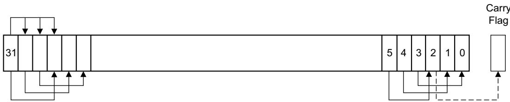  
Figure 3-1 ASR #3

## LSR

Logical shift right by n bits moves the left-hand 32-n bits of the register Rm, to the right by n places, into the right-hand 32-n bits of the result. And it sets the left-hand n bits of the result to 0. See Figure 3-2.

You can use the LSR #n operation to divide the value in the register Rm by 2<sup>n</sup>, if the value is regarded as an unsigned integer.

When the instruction is LSRS or when LSR #n is used in Operand2 with the instructions MOVS, MVNS, ANDS, ORRS, ORNS, EORS, BICS, TEQ or TST, the carry flag is updated to the last bit shifted out, bit[n-1], of the register Rm.

Note

If n is 32 or more, then all the bits in the result are cleared to 0.

If n is 33 or more and the carry flag is updated, it is updated to 0.

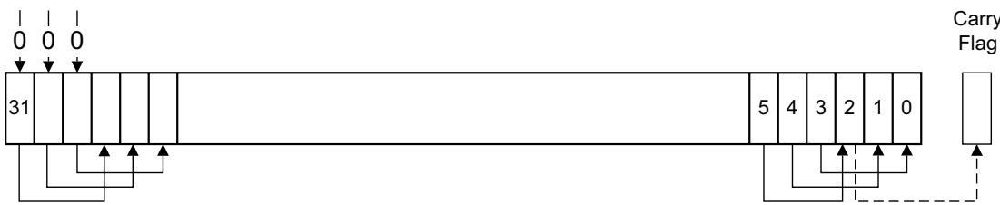  
Figure 3-2 LSR #3  
LSL

Logical shift left by n bits moves the right-hand 32-n bits of the register Rm, to the left by n places, into the left-hand 32-n bits of the result. And it sets the right-hand n bits of the result to 0. See Figure 3-3 on page 3-18.

You can use the LSL #n operation to multiply the value in the register Rm by 2<sup>n</sup>, if the value is regarded as an unsigned integer or a two’s complement signed integer. Overflow can occur without warning.

When the instruction is LSLS or when LSL #n, with non-zero n, is used in Operand2 with the instructions MOVS, MVNS, ANDS, ORRS, ORNS, EORS, BICS, TEQ or TST, the carry flag is updated to the last bit shifted out, bit[32-n], of the register Rm. These instructions do not affect the carry flag when used with LSL #0.

Note

• If n is 32 or more, then all the bits in the result are cleared to 0.

• If n is 33 or more and the carry flag is updated, it is updated to 0.

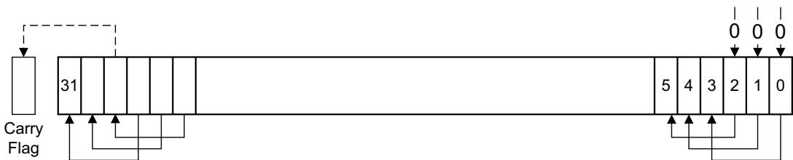  
Figure 3-3 LSL #3

## ROR

Rotate right by n bits moves the left-hand 32-n bits of the register Rm, to the right by n places, into the right-hand 32-n bits of the result. And it moves the right-hand n bits of the register into the left-hand n bits of the result. See Figure 3-4.

When the instruction is RORS or when ROR #n is used in Operand2 with the instructions MOVS, MVNS, ANDS, ORRS, ORNS, EORS, BICS, TEQ or TST, the carry flag is updated to the last bit rotation, bit[n-1], of the register Rm.

Note

If n is 32, then the value of the result is same as the value in Rm, and if the carry flag is updated, it is updated to bit[31] of Rm.

ROR with shift length, n, more than 32 is the same as ROR with shift length n-32.

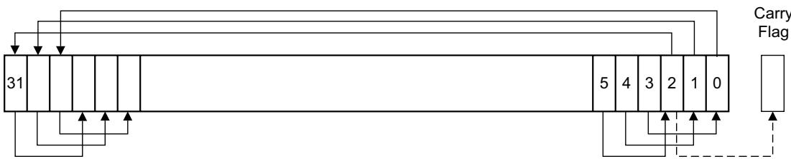  
Figure 3-4 ROR #3

## RRX

Rotate right with extend moves the bits of the register Rm to the right by one bit. And it copies the carry flag into bit[31] of the result. See Figure 3-5 on page 3-19.

When the instruction is RRXS or when RRX is used in Operand2 with the instructions MOVS, MVNS, ANDS, ORRS, ORNS, EORS, BICS, TEQ or TST, the carry flag is updated to bit[0] of the register Rm.

Carry Flag

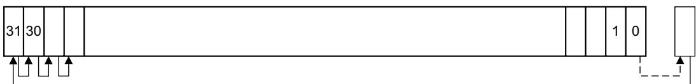  
Figure 3-5 RRX

## 3.3.5 Address alignment

An aligned access is an operation where a word-aligned address is used for a word, dual word, or multiple word access, or where a halfword-aligned address is used for a halfword access. Byte accesses are always aligned.

The Cortex-M7 processor supports unaligned access only for the following instructions:

LDR, LDRT.

LDRH, LDRHT.

LDRSH, LDRSHT.

STR, STRT.

STRH, STRHT.

All other load and store instructions generate a UsageFault exception if they perform an unaligned access, and therefore their accesses must be address aligned. For more information about UsageFaults see Fault handling on page 2-27.

Unaligned accesses are usually slower than aligned accesses. In addition, some memory regions might not support unaligned accesses. Therefore, Arm recommends that programmers ensure that accesses are aligned. To trap accidental generation of unaligned accesses, use the UNALIGN\_TRP bit in the Configuration and Control Register, see Configuration and Control Register on page 4-20.

## 3.3.6 PC-relative expressions

A PC-relative expression or label is a symbol that represents the address of an instruction or literal data. It is represented in the instruction as the PC value plus or minus a numeric offset. The assembler calculates the required offset from the label and the address of the current instruction. If the offset is too big, the assembler produces an error.

Note

For B, BL, CBNZ, and CBZ instructions, the value of the PC is the address of the current instruction plus 4 bytes.

For all other instructions that use labels, the value of the PC is the address of the current instruction plus 4 bytes, with bit[1] of the result cleared to 0 to make it word-aligned.

Your assembler might permit other syntaxes for PC-relative expressions, such as a label plus or minus a number, or an expression of the form [PC, #number].

## 3.3.7 Conditional execution

Most data processing instructions can optionally update the condition flags in the Application Program Status Register (APSR) according to the result of the operation, see Application Program Status Register on page 2-5. Some instructions update all flags, and some only update a subset. If a flag is not updated, the original value is preserved. See the instruction descriptions for the flags they affect.

You can execute an instruction conditionally, based on the condition flags set in another instruction, either:

Immediately after the instruction that updated the flags.

• After any number of intervening instructions that have not updated the flags.

Conditional execution is available by using conditional branches or by adding condition code suffixes to instructions. See Table 3-4 on page 3-21 for a list of the suffixes to add to instructions to make them conditional instructions. The condition code suffix enables the processor to test a condition based on the flags. If the condition test of a conditional instruction fails, the instruction:

Does not execute.

Does not write any value to its destination register.

• Does not affect any of the flags.

• Does not generate any exception.

Conditional instructions, except for conditional branches, must be inside an If-Then instruction block. See IT on page 3-131 for more information and restrictions when using the IT instruction. Depending on the vendor, the assembler might automatically insert an IT instruction if you have conditional instructions outside the IT block.

Use the CBZ and CBNZ instructions to compare the value of a register against zero and branch on the result.

This section describes:

The condition flags on page 3-21.

Condition code suffixes on page 3-21.

## The condition flags

The APSR contains the following condition flags:

N Set to 1 when the result of the operation was negative, cleared to 0 otherwise.

Z Set to 1 when the result of the operation was zero, cleared to 0 otherwise.

C Set to 1 when the operation resulted in a carry, cleared to 0 otherwise.

V Set to 1 when the operation caused overflow, cleared to 0 otherwise.

For more information about the APSR see Program Status Register on page 2-4.

The C condition flag is set in one of four ways:

For an addition, including the comparison instruction CMN, C is set to 1 if the addition produced a carry (that is, an unsigned overflow), and to 0 otherwise.

For a subtraction, including the comparison instruction CMP, C is set to 0 if the subtraction produced a borrow (that is, an unsigned underflow), and to 1 otherwise.

For non-addition or subtractions that incorporate a shift operation, C is set to the last bit shifted out of the value by the shifter.

For other non-addition or subtractions, C is normally left unchanged. See the individual instruction descriptions for any special cases.

Overflow occurs when the sign of the result, in bit[31], does not match the sign of the result had the operation been performed at infinite precision, for example:

• If adding two negative values results in a positive value.

• If adding two positive values results in a negative value.

• If subtracting a positive value from a negative value generates a positive value.

• If subtracting a negative value from a positive value generates a negative value.

The Compare operations are identical to subtracting, for CMP, or adding, for CMN, except that the result is discarded. See the instruction descriptions for more information.

Note

Most instructions update the status flags only if the S suffix is specified. See the instruction descriptions for more information.

## Condition code suffixes

The instructions that can be conditional have an optional condition code, shown in syntax descriptions as {cond}. Conditional execution requires a preceding IT instruction. An instruction with a condition code is only executed if the condition code flags in the APSR meet the specified condition. Table 3-4 shows the condition codes to use.

You can use conditional execution with the IT instruction to reduce the number of branch instructions in code.

Table 3-4 also shows the relationship between condition code suffixes and the N, Z, C, and V flags.

Table 3-4 Condition code suffixes

<table><tr><td>Suffix</td><td>Flags</td><td>Meaning</td></tr><tr><td>EQ</td><td>Z = 1</td><td>Equal.</td></tr><tr><td>NE</td><td>Z = 0</td><td>Not equal.</td></tr><tr><td>CS or HS</td><td>C = 1</td><td>Higher or same, unsigned.</td></tr><tr><td>CC or LO</td><td>C = 0</td><td>Lower, unsigned.</td></tr><tr><td>MI</td><td>N = 1</td><td>Negative.</td></tr><tr><td>PL</td><td>N = 0</td><td>Positive or zero.</td></tr><tr><td>VS</td><td>V = 1</td><td>Overflow.</td></tr><tr><td>VC</td><td>V = 0</td><td>No overflow.</td></tr><tr><td>HI</td><td>C = 1 and Z = 0</td><td>Higher, unsigned.</td></tr><tr><td>LS</td><td>C = 0 or Z = 1</td><td>Lower or same, unsigned.</td></tr><tr><td>GE</td><td>N = V</td><td>Greater than or equal, signed.</td></tr><tr><td>LT</td><td>N != V</td><td>Less than, signed.</td></tr><tr><td>GT</td><td>Z = 0 and N = V</td><td>Greater than, signed.</td></tr><tr><td>LE</td><td>Z = 1 and N != V</td><td>Less than or equal, signed.</td></tr><tr><td>AL</td><td>Can have any value</td><td>Always. This is the default when no suffix is specified.</td></tr></table>

Example 3-1 shows the use of a conditional instruction to find the absolute value of a number. R0 = abs(R1).

Example 3-1 Absolute value  
```prolog
MOVS R0, R1 ; R0 = R1, setting flags.
IT MI ; Skipping next instruction if value 0 or positive.
RSBMI R0, R0, #0 ; If negative, R0 = -R0.
```  
Example 3-2 shows the use of conditional instructions to update the value of R4 if the signed values R0 is greater than R1 and R2 is greater than R3.

Example 3-2 Compare and update value  
```txt
CMP R0, R1 ; Compare R0 and R1, setting flags.
ITT GT ; Skip next two instructions unless GT condition holds.
CMPGT R2, R3 ; If 'greater than', compare R2 and R3, setting flags.
MOVGT R4, R5 ; If still 'greater than', do R4 = R5.
```

## 3.3.8 Instruction width selection

There are many instructions that can generate either a 16-bit encoding or a 32-bit encoding depending on the operands and destination register specified. For some of these instructions, you can force a specific instruction size by using an instruction width suffix. The .W suffix forces a 32-bit instruction encoding. The .N suffix forces a 16-bit instruction encoding.

If you specify an instruction width suffix and the assembler cannot generate an instruction encoding of the requested width, it generates an error.

Note

In some cases it might be necessary to specify the .W suffix, for example if the operand is the label of an instruction or literal data, as in the case of branch instructions. This is because the assembler might not automatically generate the right size encoding.

To use an instruction width suffix, place it immediately after the instruction mnemonic and condition code, if any. Example 3-3 shows instructions with the instruction width suffix.

## Example 3-3 Instruction width selection

```txt
BCS.W label ; Creates a 32-bit instruction even for a short branch.
ADDS.W R0, R0, R1 ; Creates a 32-bit instruction even though the same
; operation can be done by a 16-bit instruction.
```

## 3.4 Memory access instructions

Table 3-5 shows the memory access instructions:

Table 3-5 Memory access instructions

<table><tr><td>Mnemonic</td><td>Brief description</td><td>See</td></tr><tr><td>ADR</td><td>Generate PC-relative address</td><td>ADR on page 3-25</td></tr><tr><td>CLREX</td><td>Clear Exclusive</td><td>CLREX on page 3-41</td></tr><tr><td>LDM{mode}</td><td>Load Multiple registers</td><td>LDM and STM on page 3-34</td></tr><tr><td>LDR{type}</td><td>Load Register using immediate offset</td><td>LDR and STR, immediate offset on page 3-26</td></tr><tr><td>LDR{type}</td><td>Load Register using register offset</td><td>LDR and STR, register offset on page 3-29</td></tr><tr><td>LDR{type}T</td><td>Load Register with unprivileged access</td><td>LDR and STR, unprivileged on page 3-31</td></tr><tr><td>LDR</td><td>Load Register using PC-relative address</td><td>LDR, PC-relative on page 3-32</td></tr><tr><td>LDRD</td><td>Load Register Dual</td><td>LDR and STR, immediate offset on page 3-26</td></tr><tr><td>LDREX{type}</td><td>Load Register Exclusive</td><td>LDREX and STREX on page 3-39</td></tr><tr><td>PLD</td><td>Preload Data.</td><td>PLD on page 3-36</td></tr><tr><td>POP</td><td>Pop registers from stack</td><td>PUSH and POP on page 3-37</td></tr><tr><td>PUSH</td><td>Push registers onto stack</td><td>PUSH and POP on page 3-37</td></tr><tr><td>STM{mode}</td><td>Store Multiple registers</td><td>LDM and STM on page 3-34</td></tr><tr><td>STR{type}</td><td>Store Register using immediate offset</td><td>LDR and STR, immediate offset on page 3-26</td></tr><tr><td>STR{type}</td><td>Store Register using register offset</td><td>LDR and STR, register offset on page 3-29</td></tr><tr><td>STR{type}T</td><td>Store Register with unprivileged access</td><td>LDR and STR, unprivileged on page 3-31</td></tr><tr><td>STREX{type}</td><td>Store Register Exclusive</td><td>LDREX and STREX on page 3-39</td></tr></table>

Generate PC-relative address.

## Syntax

ADR{cond} Rd, label

Where:

cond Is an optional condition code. See Conditional execution on page 3-20.

Rd Is the destination register.

label Is a PC-relative expression. See PC-relative expressions on page 3-19.

## Operation

ADR generates an address by adding an immediate value to the PC, and writes the result to the destination register.

ADR provides the means by which position-independent code can be generated, because the address is PC-relative.

If you use ADR to generate a target address for a BX or BLX instruction, you must ensure that bit[0] of the address you generate is set to1 for correct execution.

Values of label must be within the range of −4095 to +4095 from the address in the PC.

Note

You might have to use the .W suffix to get the maximum offset range or to generate addresses that are not word-aligned. See Instruction width selection on page 3-23.

## Restrictions

Rd must not be SP and must not be PC.

## Condition flags

This instruction does not change the flags.

## Examples

ADR R1, TextMessage ; Write address value of a location labelled as ; TextMessage to R1.

## 3.4.2 LDR and STR, immediate offset

Load and Store with immediate offset, pre-indexed immediate offset, or post-indexed immediate offset.

## Syntax

op{type}{cond} Rt, [Rn {, #offset}] ; immediate offset

op{type}{cond} Rt, [Rn, #offset]! ; pre-indexed

op{type}{cond} Rt, [Rn], #offset ; post-indexed

opD{cond} Rt, Rt2, [Rn {, #offset}] ; immediate offset, two words

opD{cond} Rt, Rt2, [Rn, #offset]! ; pre-indexed, two words

opD{cond} Rt, Rt2, [Rn], #offset ; post-indexed, two words

## Where:

op Is one of: LDR Load Register. STR Store Register.

type Is one of:

B Unsigned byte, zero extend to 32 bits on loads.

SB Signed byte, sign extend to 32 bits (LDR only).

H Unsigned halfword, zero extend to 32 bits on loads.

SH Signed halfword, sign extend to 32 bits (LDR only).

Omit, for word.

cond Is an optional condition code. See Conditional execution on page 3-20.

Rt Is the register to load or store.

Rn Is the register on which the memory address is based.

offset Is an offset from Rn. If offset is omitted, the address is the contents of Rn.

Rt2 Is the additional register to load or store for two-word operations.

## Operation

LDR instructions load one or two registers with a value from memory.

STR instructions store one or two register values to memory.

Load and store instructions with immediate offset can use the following addressing modes:

## Offset addressing

The offset value is added to or subtracted from the address obtained from the register Rn. The result is used as the address for the memory access. The register Rn is unaltered. The assembly language syntax for this mode is:

[Rn, #offset]

## Pre-indexed addressing

The offset value is added to or subtracted from the address obtained from the register Rn. The result is used as the address for the memory access and written back into the register Rn. The assembly language syntax for this mode is:

[Rn, #offset]!

## Post-indexed addressing

The address obtained from the register Rn is used as the address for the memory access. The offset value is added to or subtracted from the address, and written back into the register Rn. The assembly language syntax for this mode is:

[Rn], #offset

The value to load or store can be a byte, halfword, word, or two words. Bytes and halfwords can either be signed or unsigned. See Address alignment on page 3-19.

Table 3-6 shows the ranges of offset for immediate, pre-indexed and post-indexed forms.

Table 3-6 Offset ranges

<table><tr><td>Instruction type</td><td>Immediate offset</td><td>Pre-indexed</td><td>Post-indexed</td></tr><tr><td>Word, halfword, signed halfword, byte, or signed byte</td><td>-255 to 4095</td><td>-255 to 255</td><td>-255 to 255</td></tr><tr><td>Two words</td><td>multiple of 4 in the range -1020 to 1020</td><td>multiple of 4 in the range -1020 to 1020</td><td>multiple of 4 in the range -1020 to 1020</td></tr></table>

## Restrictions

For load instructions:

• Rt can be SP or PC for word loads only.

Rt must be different from Rt2 for two-word loads.

Rn must be different from Rt and Rt2 in the pre-indexed or post-indexed forms.

When Rt is PC in a word load instruction:

Bit[0] of the loaded value must be 1 for correct execution.

A branch occurs to the address created by changing bit[0] of the loaded value to 0.

If the instruction is conditional, it must be the last instruction in the IT block.

For store instructions:

• Rt can be SP for word stores only.

Rt must not be PC.

Rn must not be PC.

Rn must be different from Rt and Rt2 in the pre-indexed or post-indexed forms.

## Condition flags

These instructions do not change the flags.

## Examples

<table><tr><td>LDR</td><td>R8, [R10]</td><td>; Loads R8 from the address in R10.</td></tr><tr><td>LDRNE</td><td>R2, [R5, #960]!</td><td>; Loads (conditionally) R2 from a word; 960 bytes above the address in R5, and; increments R5 by 960.</td></tr><tr><td>STR</td><td>R2, [R9,#const-struc]</td><td>; const-struc is an expression evaluating to a constant in the range 0-4095.</td></tr><tr><td>STRH</td><td>R3, [R4], #4</td><td>; Store R3 as halfword data into address in; R4, then increment R4 by 4.</td></tr><tr><td>LDRD</td><td>R8, R9, [R3, #0x20]</td><td>; Load R8 from a word 32 bytes above the; address in R3, and load R9 from a word 36; bytes above the address in R3.</td></tr><tr><td>STRD</td><td>R0, R1, [R8], #-16</td><td>; Store R0 to address in R8, and store R1 to; a word 4 bytes above the address in R8,; and then decrement R8 by 16.</td></tr></table>

## 3.4.3 LDR and STR, register offset

Load and Store with register offset.

## Syntax

op{type}{cond} Rt, [Rn, Rm {, LSL #n}]

Where:

op Is one of:

LDR Load Register.

STR Store Register.

type Is one of:

B Unsigned byte, zero extend to 32 bits on loads.

SB Signed byte, sign extend to 32 bits (LDR only).

H Unsigned halfword, zero extend to 32 bits on loads.

SH Signed halfword, sign extend to 32 bits (LDR only).

omit, for word.

cond Is an optional condition code. See Conditional execution on page 3-20.

Rt Is the register to load or store.

Rn Is the register on which the memory address is based.

Rm Is a register containing a value to be used as the offset.

LSL #n Is an optional shift, with n in the range 0-3.

## Operation

LDR instructions load a register with a value from memory.

STR instructions store a register value into memory.

The memory address to load from or store to is at an offset from the register Rn. The offset is specified by the register Rm and can be shifted left by up to 3 bits using LSL.

The value to load or store can be a byte, halfword, or word. For load instructions, bytes and halfwords can either be signed or unsigned. See Address alignment on page 3-19.

## Restrictions

In these instructions:

Rn must not be PC.

Rm must not be SP and must not be PC.

Rt can be SP only for word loads and word stores.

Rt can be PC only for word loads.

When Rt is PC in a word load instruction:

Bit[0] of the loaded value must be 1 for correct execution, and a branch occurs to this halfword-aligned address.

If the instruction is conditional, it must be the last instruction in the IT block.

## Condition flags

These instructions do not change the flags.

## Examples

<table><tr><td>STR</td><td>R0, [R5, R1]</td><td>; Store value of R0 into an address equal to sum of R5 and R1.</td></tr><tr><td>LDRSB</td><td>R0, [R5, R1, LSL #1]</td><td>; Read byte value from an address equal to sum of R5 and two times R1, sign extended it to a word value and put it in R0.</td></tr><tr><td>STR</td><td>R0, [R1, R2, LSL #2]</td><td>; Stores R0 to an address equal to sum of R1 and four times R2.</td></tr></table>

## 3.4.4 LDR and STR, unprivileged

Load and Store with unprivileged access.

## Syntax

op{type}T{cond} Rt, [Rn {, #offset}]

Where:

op Is one of:

LDR Load Register.

STR Store Register.

type Is one of:

B Unsigned byte, zero extend to 32 bits on loads.

SB Signed byte, sign extend to 32 bits (LDR only).

H Unsigned halfword, zero extend to 32 bits on loads.

SH Signed halfword, sign extend to 32 bits (LDR only).

Omit, for word.

cond Is an optional condition code. See Conditional execution on page 3-20.

Rt Is the register to load or store.

Rn Is the register on which the memory address is based.

offset Is an immediate offset from Rn and can be 0 to 255. If offset is omitted, the address is the value in Rn.

## Operation

These load and store instructions perform the same function as the memory access instructions with immediate offset, see LDR and STR, immediate offset on page 3-26. The difference is that these instructions have only unprivileged access even when used in privileged software.

When used in unprivileged software, these instructions behave in exactly the same way as normal memory access instructions with immediate offset.

## Restrictions

In these instructions:

Rn must not be PC.

Rt must not be SP and must not be PC.

## Condition flags

These instructions do not change the flags.

## Examples

STRBTEQ R4, [R7] ; Conditionally store least significant byte in

; R4 to an address in R7, with unprivileged access.

LDRHT R2, [R2, #8] ; Load halfword value from an address equal to

; sum of R2 and 8 into R2, with unprivileged access.

## 3.4.5 LDR, PC-relative

Load register from memory.

## Syntax

LDR{type}{cond} Rt, label

LDRD{cond} Rt, Rt2, label ; Load two words

Where:

type Is one of:

B Unsigned byte, zero extend to 32 bits.

SB Signed byte, sign extend to 32 bits.

H Unsigned halfword, zero extend to 32 bits.

SH Signed halfword, sign extend to 32 bits.

Omit, for word.

cond Is an optional condition code. See Conditional execution on page 3-20.

Rt Is the register to load or store.

Rt2 Is the second register to load or store.

label Is a PC-relative expression. See PC-relative expressions on page 3-19.

## Operation

LDR loads a register with a value from a PC-relative memory address. The memory address is specified by a label or by an offset from the PC.

The value to load or store can be a byte, halfword, or word. For load instructions, bytes and halfwords can either be signed or unsigned. See Address alignment on page 3-19.

label must be within a limited range of the current instruction. Table 3-7 shows the possible offsets between label and the PC

Table 3-7 Offset ranges

<table><tr><td>Instruction type</td><td>Offset range</td></tr><tr><td>Word, halfword, signed halfword, byte, signed byte</td><td>-4095 to 4095</td></tr><tr><td>Two words</td><td>-1020 to 1020</td></tr></table>

Note

You might have to use the .W suffix to get the maximum offset range. See Instruction width selection on page 3-23.

## Restrictions

In these instructions:

Rt can be SP or PC only for word loads.

Rt2 must not be SP and must not be PC.

• Rt must be different from Rt2.

When Rt is PC in a word load instruction:

Bit[0] of the loaded value must be 1 for correct execution, and a branch occurs to this halfword-aligned address.

If the instruction is conditional, it must be the last instruction in the IT block.

## Condition flags

These instructions do not change the flags.

## Examples

<table><tr><td>LDR</td><td>R0, LookUpTable</td><td>; Load R0 with a word of data from an address labelled as LookUpTable.</td></tr><tr><td>LDRSB</td><td>R7, localdata</td><td>; Load a byte value from an address labelled as localdata, sign extend it to a word value, and put it in R7.</td></tr></table>

## 3.4.6 LDM and STM

Load and Store Multiple registers.

## Syntax

op{addr\_mode}{cond} Rn{!}, reglist

Where:

op Is one of:

LDM Load Multiple registers.

STM Store Multiple registers.

addr\_mode Is any one of the following:

IA Increment address After each access. This is the default.

DB Decrement address Before each access.

cond Is an optional condition code. See Conditional execution on page 3-20.

Rn Is the register on which the memory addresses are based.

! Is an optional writeback suffix. If ! is present the final address, that is loaded from or stored to, is written back into Rn.

reglist Is a list of one or more registers to be loaded or stored, enclosed in braces. It can contain register ranges. It must be comma separated if it contains more than one register or register range, see Examples on page 3-35.

LDMIA and LDMFD are synonyms for LDM. LDMFD refers to its use for popping data from Full Descending stacks.

LDMEA is a synonym for LDMDB, and refers to its use for popping data from Empty Ascending stacks.

STMIA and STMEA are synonyms for STM. STMEA refers to its use for pushing data onto Empty Ascending stacks.

STMFD is a synonym for STMDB, and refers to its use for pushing data onto Full Descending stacks.

## Operation

LDM instructions load the registers in reglist with word values from memory addresses based on Rn.

STM instructions store the word values in the registers in reglist to memory addresses based on Rn.

For LDM, LDMIA, LDMFD, STM, STMIA, and STMEA the memory addresses used for the accesses are at 4-byte intervals ranging from Rn to Rn + 4 \* (n-1), where n is the number of registers in reglist. The accesses happens in order of increasing register numbers, with the lowest numbered register using the lowest memory address and the highest number register using the highest memory address. If the writeback suffix is specified, the value of Rn + 4 \* (n-1) is written back to Rn.

For LDMDB, LDMEA, STMDB, and STMFD the memory addresses used for the accesses are at 4-byte intervals ranging from Rn to Rn - 4 \* (n-1), where n is the number of registers in reglist. The accesses happen in order of decreasing register numbers, with the highest numbered register using the highest memory address and the lowest number register using the lowest memory address. If the writeback suffix is specified, the value of Rn - 4 \* (n-1) is written back to Rn.

The PUSH and POP instructions can be expressed in this form. See PUSH and POP on page 3-37 for details.

## Restrictions

In these instructions:

Rn must not be PC.

• reglist must not contain SP.

• In any STM instruction, reglist must not contain PC.

• In any LDM instruction, reglist must not contain PC if it contains LR.

reglist must not contain Rn if you specify the writeback suffix.

When PC is in reglist in an LDM instruction:

Bit[0] of the value loaded to the PC must be 1 for correct execution, and a branch occurs to this halfword-aligned address.

If the instruction is conditional, it must be the last instruction in the IT block.

## Condition flags

These instructions do not change the flags.

## Examples

LDM R8,{R0,R2,R9} ; LDMIA is a synonym for LDM. STMDB R1!,{R3-R6,R11,R12}

## Incorrect examples

STM R5!,{R5,R4,R9} ; Value stored for R5 is unpredictable. LDM R2, {} ; There must be at least one register in the list.

## 3.4.7 PLD

Preload Data.

## Syntax

PLD{cond} [Rn {, #imm}] ; Immediate

PLD{cond} [Rn, Rm {, LSL #shift}] ; Register

PLD{cond} label ; Literal

where:

cond Is an optional condition code. See Conditional execution on page 3-20.

Rn Is the base register.

imm Is the + or - immediate offset used to form the address. This offset can be omitted, meaning an offset of 0.

Rm Is the optionally shifted offset register.

shift Specifies the shift to apply to the value read from <Rm>, in the range 0-3. If this option is omitted, a shift by 0 is assumed.

label The label of the literal item that is likely to be accessed in the near future.

## Operation

PLD signals the memory system that data memory accesses from a specified address are likely in the near future. If the address is cacheable then the memory system responds by pre-loading the cache line containing the specified address into the data cache. If the address is not cacheable, or the data cache is disabled, this instruction behaves as no operation.

## Restrictions

There are no restrictions.

## Condition flags

These instructions do not change the flags.

## 3.4.8 PUSH and POP

Push registers onto, and pop registers off a full-descending stack.

## Syntax

PUSH{cond} reglist

POP{cond} reglist

Where:

cond Is an optional condition code. See Conditional execution on page 3-20.

reglist Is a non-empty list of registers, enclosed in braces. It can contain register ranges. It must be comma separated if it contains more than one register or register range.

PUSH and POP are synonyms for STMDB and LDM (or LDMIA) with the memory addresses for the access based on SP, and with the final address for the access written back to the SP. PUSH and POP are the preferred mnemonics in these cases.

## Operation

PUSH stores registers on the stack, with the lowest numbered register using the lowest memory address and the highest numbered register using the highest memory address.

POP loads registers from the stack, with the lowest numbered register using the lowest memory address and the highest numbered register using the highest memory address.

PUSH uses the value in the SP register minus four as the highest memory address, POP uses the value in the SP register as the lowest memory address, implementing a full-descending stack. On completion, PUSH updates the SP register to point to the location of the lowest store value, POP updates the SP register to point to the location above the highest location loaded.

If a POP instruction includes PC in its reglist, a branch to this location is performed when the POP instruction has completed. Bit[0] of the value read for the PC is used to update the APSR T-bit. This bit must be 1 to ensure correct operation.

See LDM and STM on page 3-34 for more information.

## Restrictions

In these instructions:

• reglist must not contain SP.

• For the PUSH instruction, reglist must not contain PC.

For the POP instruction, reglist must not contain PC if it contains LR.

When PC is in reglist in a POP instruction:

Bit[0] of the value loaded to the PC must be 1 for correct execution, and a branch occurs to this halfword-aligned address.

If the instruction is conditional, it must be the last instruction in the IT block.

## Condition flags

These instructions do not change the flags.

## Examples

PUSH {R0,R4-R7} ; Push R0,R4,R5,R6,R7 onto the stack

PUSH {R2,LR} ; Push R2 and the link-register onto the stack

POP {R0,R6,PC} ; Pop r0,r6 and PC from the stack, then branch to the new PC.

## 3.4.9 LDREX and STREX

Load and Store Register Exclusive.

## Syntax

LDREX{cond} Rt, [Rn {, #offset}]

STREX{cond} Rd, Rt, [Rn {, #offset}]

LDREXB{cond} Rt, [Rn]

STREXB{cond} Rd, Rt, [Rn]

LDREXH{cond} Rt, [Rn]

STREXH{cond} Rd, Rt, [Rn]

## Where:

cond Is an optional condition code. See Conditional execution on page 3-20.

Rd Is the destination register for the returned status.

Rt Is the register to load or store.

Rn Is the register on which the memory address is based.

offset Is an optional offset applied to the value in Rn. If offset is omitted, the address is the value in Rn.

## Operation

LDREX, LDREXB, and LDREXH load a word, byte, and halfword respectively from a memory address.

STREX, STREXB, and STREXH attempt to store a word, byte, and halfword respectively to a memory address. The address used in any Store-Exclusive instruction must be the same as the address in the most recently executed Load-exclusive instruction. The value stored by the Store-Exclusive instruction must also have the same data size as the value loaded by the preceding Load-exclusive instruction. This means software must always use a Load-exclusive instruction and a matching Store-Exclusive instruction to perform a synchronization operation, see Synchronization primitives on page 2-16.

If a Store-Exclusive instruction performs the store, it writes 0 to its destination register. If it does not perform the store, it writes 1 to its destination register. If the Store-Exclusive instruction writes 0 to the destination register, it is guaranteed that no other process in the system has accessed the memory location between the Load-exclusive and Store-Exclusive instructions.

For reasons of performance, keep the number of instructions between corresponding Load-Exclusive and Store-Exclusive instruction to a minimum.

The result of executing a Store-Exclusive instruction to an address that is different from that used in the preceding Load-Exclusive instruction is unpredictable.

## Restrictions

In these instructions:

Do not use PC.

Do not use SP for Rd and Rt.

For STREX, Rd must be different from both Rt and Rn.

• The value of offset must be a multiple of four in the range 0-1020.

## Condition flags

These instructions do not change the flags.

## Examples

<table><tr><td>MOV</td><td>R1, #0x1</td><td>; Initialize the ‘lock taken’ value</td></tr><tr><td>try</td><td></td><td></td></tr><tr><td>LDREX</td><td>R0, [LockAddr]</td><td>; Load the lock value</td></tr><tr><td>CMP</td><td>R0, #0</td><td>; Is the lock free?</td></tr><tr><td>ITT</td><td>EQ</td><td>; IT instruction for STREXEQ and CMPEQ</td></tr><tr><td>STREXEQ</td><td>R0, R1, [LockAddr]</td><td>; Try and claim the lock</td></tr><tr><td>CMPEQ</td><td>R0, #0</td><td>; Did this succeed?</td></tr><tr><td>BNE</td><td>try</td><td>; No - try again</td></tr><tr><td>....</td><td></td><td>; Yes - we have the lock.</td></tr></table>

Clear Exclusive.

## Syntax

CLREX{cond}

Where:

cond Is an optional condition code. See Conditional execution on page 3-20.

## Operation

Use CLREX to make the next STREX, STREXB, or STREXH instruction write 1 to its destination register and fail to perform the store. CLREX enables compatibility with other Arm Cortex processors that have to force the failure of the store exclusive if the exception occurs between a load exclusive instruction and the matching store exclusive instruction in a synchronization operation. In Cortex-M processors, the local exclusive access monitor clears automatically on an exception boundary, so exception handlers using CLREX are optional.

See Synchronization primitives on page 2-16 for more information.

## Condition flags

This instruction does not change the flags.

## Examples

CLREX

## 3.5 General data processing instructions

## Table 3-8 shows the data processing instructions:

Table 3-8 Data processing instructions

<table><tr><td>Mnemonic</td><td>Brief description</td><td>See</td></tr><tr><td>ADC</td><td>Add with Carry</td><td>ADD, ADC, SUB, SBC, and RSB on page 3-44</td></tr><tr><td>ADD</td><td>Add</td><td>ADD, ADC, SUB, SBC, and RSB on page 3-44</td></tr><tr><td>ADDW</td><td>Add</td><td>ADD, ADC, SUB, SBC, and RSB on page 3-44</td></tr><tr><td>AND</td><td>Logical AND</td><td>AND, ORR, EOR, BIC, and ORN on page 3-47</td></tr><tr><td>ASR</td><td>Arithmetic Shift Right</td><td>ASR, LSL, LSR, ROR, and RRX on page 3-49</td></tr><tr><td>BIC</td><td>Bit Clear</td><td>AND, ORR, EOR, BIC, and ORN on page 3-47</td></tr><tr><td>CLZ</td><td>Count leading zeros</td><td>CLZ on page 3-51</td></tr><tr><td>CMN</td><td>Compare Negative</td><td>CMP and CMN on page 3-52</td></tr><tr><td>CMP</td><td>Compare</td><td>CMP and CMN on page 3-52</td></tr><tr><td>EOR</td><td>Exclusive OR</td><td>AND, ORR, EOR, BIC, and ORN on page 3-47</td></tr><tr><td>LSL</td><td>Logical Shift Left</td><td>ASR, LSL, LSR, ROR, and RRX on page 3-49</td></tr><tr><td>LSR</td><td>Logical Shift Right</td><td>ASR, LSL, LSR, ROR, and RRX on page 3-49</td></tr><tr><td>MOV</td><td>Move</td><td>MOV and MVN on page 3-53</td></tr><tr><td>MOVT</td><td>Move Top</td><td>MOVT on page 3-55</td></tr><tr><td>MOVW</td><td>Move 16-bit constant</td><td>MOV and MVN on page 3-53</td></tr><tr><td>MVN</td><td>Move NOT</td><td>MOV and MVN on page 3-53</td></tr><tr><td>ORN</td><td>Logical OR NOT</td><td>AND, ORR, EOR, BIC, and ORN on page 3-47</td></tr><tr><td>ORR</td><td>Logical OR</td><td>AND, ORR, EOR, BIC, and ORN on page 3-47</td></tr><tr><td>RBIT</td><td>Reverse Bits</td><td>REV, REV16, REVSH, and RBIT on page 3-56</td></tr><tr><td>REV</td><td>Reverse byte order in a word</td><td>REV, REV16, REVSH, and RBIT on page 3-56</td></tr><tr><td>REV16</td><td>Reverse byte order in each halfword</td><td>REV, REV16, REVSH, and RBIT on page 3-56</td></tr><tr><td>REVSH</td><td>Reverse byte order in bottom halfword and sign extend</td><td>REV, REV16, REVSH, and RBIT on page 3-56</td></tr><tr><td>ROR</td><td>Rotate Right</td><td>ASR, LSL, LSR, ROR, and RRX on page 3-49</td></tr><tr><td>RRX</td><td>Rotate Right with Extend</td><td>ASR, LSL, LSR, ROR, and RRX on page 3-49</td></tr><tr><td>RSB</td><td>Reverse Subtract</td><td>ADD, ADC, SUB, SBC, and RSB on page 3-44</td></tr><tr><td>SADD16</td><td>Signed Add 16</td><td>SADD16 and SADD8 on page 3-57</td></tr><tr><td>SADD8</td><td>Signed Add 8</td><td>SADD16 and SADD8 on page 3-57</td></tr><tr><td>SASX</td><td>Signed Add and Subtract with Exchange</td><td>SASX and SSAX on page 3-65</td></tr><tr><td>SSAX</td><td>Signed Subtract and Add with Exchange</td><td>SASX and SSAX on page 3-65</td></tr><tr><td>SBC</td><td>Subtract with Carry</td><td>ADD, ADC, SUB, SBC, and RSB on page 3-44</td></tr><tr><td>SHADD16</td><td>Signed Halving Add 16</td><td>SHADD16 and SHADD8 on page 3-59</td></tr><tr><td>SHADD8</td><td>Signed Halving Add 8</td><td>SHADD16 and SHADD8 on page 3-59</td></tr><tr><td>SHASX</td><td>Signed Halving Add and Subtract with Exchange</td><td>SHASX and SHSAX on page 3-60</td></tr><tr><td>SHSAX</td><td>Signed Halving Subtract and Add with Exchange</td><td>SHASX and SHSAX on page 3-60</td></tr><tr><td>SHSUB16</td><td>Signed Halving Subtract 16</td><td>SHSUB16 and SHSUB8 on page 3-62</td></tr><tr><td>SHSUB8</td><td>Signed Halving Subtract 8</td><td>SHSUB16 and SHSUB8 on page 3-62</td></tr><tr><td>SSUB16</td><td>Signed Subtract 16</td><td>SSUB16 and SSUB8 on page 3-63</td></tr><tr><td>SSUB8</td><td>Signed Subtract 8</td><td>SSUB16 and SSUB8 on page 3-63</td></tr><tr><td>SUB</td><td>Subtract</td><td>ADD, ADC, SUB, SBC, and RSB on page 3-44</td></tr><tr><td>SUBW</td><td>Subtract</td><td>ADD, ADC, SUB, SBC, and RSB on page 3-44</td></tr><tr><td>TEQ</td><td>Test Equivalence</td><td>TST and TEQ on page 3-67</td></tr><tr><td>TST</td><td>Test</td><td>TST and TEQ on page 3-67</td></tr><tr><td>UADD16</td><td>Unsigned Add 16</td><td>UADD16 and UADD8 on page 3-68</td></tr><tr><td>UADD8</td><td>Unsigned Add 8</td><td>UADD16 and UADD8 on page 3-68</td></tr><tr><td>UASX</td><td>Unsigned Add and Subtract with Exchange</td><td>UASX and USAX on page 3-70</td></tr><tr><td>USAX</td><td>Unsigned Subtract and Add with Exchange</td><td>UASX and USAX on page 3-70</td></tr><tr><td>UHADD16</td><td>Unsigned Halving Add 16</td><td>UHADD16 and UHADD8 on page 3-73</td></tr><tr><td>UHADD8</td><td>Unsigned Halving Add 8</td><td>UHADD16 and UHADD8 on page 3-73</td></tr><tr><td>UHASX</td><td>Unsigned Halving Add and Subtract with Exchange</td><td>UHASX and UHSAX on page 3-74</td></tr><tr><td>UHSAX</td><td>Unsigned Halving Subtract and Add with Exchange</td><td>UHASX and UHSAX on page 3-74</td></tr><tr><td>UHSUB16</td><td>Unsigned Halving Subtract 16</td><td>UHSUB16 and UHSUB8 on page 3-76</td></tr><tr><td>UHSUB8</td><td>Unsigned Halving Subtract 8</td><td>UHSUB16 and UHSUB8 on page 3-76</td></tr><tr><td>USAD8</td><td>Unsigned Sum of Absolute Differences</td><td>USAD8 on page 3-78</td></tr><tr><td>USADA8</td><td>Unsigned Sum of Absolute Differences and Accumulate</td><td>USADA8 on page 3-79</td></tr><tr><td>USUB16</td><td>Unsigned Subtract 16</td><td>USUB16 and USUB8 on page 3-80</td></tr><tr><td>USUB8</td><td>Unsigned Subtract 8</td><td>USUB16 and USUB8 on page 3-80</td></tr></table>

## 3.5.1 ADD, ADC, SUB, SBC, and RSB

Add, Add with carry, Subtract, Subtract with carry, and Reverse Subtract.

## Syntax

op{S}{cond} {Rd,} Rn, Operand2 ; ADD; ADC; SBC; RSB

op{S|W}{cond} {Rd,} Rn, #imm12 ; ADD; SUB

Where:

<table><tr><td rowspan="6">op</td><td colspan="2">Is one of:</td></tr><tr><td>ADD</td><td>Add.</td></tr><tr><td>ADC</td><td>Add with Carry.</td></tr><tr><td>SUB</td><td>Subtract.</td></tr><tr><td>SBC</td><td>Subtract with Carry.</td></tr><tr><td>RSB</td><td>Reverse Subtract.</td></tr></table>

S Is an optional suffix. If S is specified, the condition code flags are updated on the result of the operation, see Conditional execution on page 3-20.

cond Is an optional condition code. See Conditional execution on page 3-20.

Rd Is the destination register. If Rd is omitted, the destination register is Rn.

Rn Is the register holding the first operand.

Operand2 Is a flexible second operand. See Flexible second operand on page 3-15 for details of the options.

imm12 Is any value in the range 0-4095.

## Operation

The ADD instruction adds the value of Operand2 or imm12 to the value in Rn.

The ADC instruction adds the values in Rn and Operand2, together with the carry flag.

The SUB instruction subtracts the value of Operand2 or imm12 from the value in Rn.

The SBC instruction subtracts the value of Operand2 from the value in Rn. If the carry flag is clear, the result is reduced by one.

The RSB instruction subtracts the value in Rn from the value of Operand2. This is useful because of the wide range of options for Operand2.

Use ADC and SBC to synthesize multiword arithmetic, see Multiword arithmetic examples on page 3-45.

See also ADR on page 3-25.

ADDW is equivalent to the ADD syntax that uses the imm12 operand. SUBW is equivalent to the SUB syntax that uses the imm12 operand.

## Restrictions

In these instructions:

• Operand2 must not be SP and must not be PC.

Rd can be SP only in ADD and SUB, and only with the additional restrictions:

Rn must also be SP.

— Any shift in Operand2 must be limited to a maximum of 3 bits using LSL.

Rn can be SP only in ADD and SUB.

Rd can be PC only in the ADD{cond} PC, PC, Rm instruction where:

— You must not specify the S suffix.

Rm must not be PC and must not be SP.

If the instruction is conditional, it must be the last instruction in the IT block.

with the exception of the ADD{cond} PC, PC, Rm instruction, Rn can be PC only in ADD and SUB, and only with the additional restrictions:

— You must not specify the S suffix.

— The second operand must be a constant in the range 0-4095.

Note

When using the PC for an addition or a subtraction, bits[1:0] of the PC are rounded to 0b00 before performing the calculation, making the base address for the calculation word-aligned.

If you want to generate the address of an instruction, you have to adjust the constant based on the value of the PC. Arm recommends that you use the ADR instruction instead of ADD or SUB with Rn equal to the PC, because your assembler automatically calculates the correct constant for the ADR instruction.

When Rd is PC in the ADD{cond} PC, PC, Rm instruction:

Bit[0] of the value written to the PC is ignored.

• A branch occurs to the address created by forcing bit[0] of that value to 0.

## Condition flags

If S is specified, these instructions update the N, Z, C and V flags according to the result.

## Examples

ADD R2, R1, R3

SUBS R8, R6, #240

; Sets the flags on the result.

RSB R4, R4, #1280

; Subtracts contents of R4 from 1280.

ADCHI R11, R0, R3

; Only executed if C flag set and Z.

; flag clear.

## Multiword arithmetic examples

Example 3-4 on page 3-46 shows two instructions that add a 64-bit integer contained in R2 and R3 to another 64-bit integer contained in R0 and R1, and place the result in R4 and R5.

<table><tr><td>ADDS</td><td>R4, R0, R2</td><td>; Add the least significant words.</td></tr><tr><td>ADC</td><td>R5, R1, R3</td><td>; Add the most significant words with carry.</td></tr></table>

<table><tr><td colspan="3">Example 3-5 96-bit subtraction</td></tr><tr><td>SUBS</td><td>R6, R6, R9</td><td>; Subtract the least significant words.</td></tr><tr><td>SBCS</td><td>R9, R2, R1</td><td>; Subtract the middle words with carry.</td></tr><tr><td>SBC</td><td>R2, R8, R11</td><td>; Subtract the most significant words with carry.</td></tr></table>

Multiword values do not have to use consecutive registers. Example 3-5 shows instructions that subtract a 96-bit integer contained in R9, R1, and R11 from another contained in R6, R2, and R8. The example stores the result in R6, R9, and R2.

## 3.5.2 AND, ORR, EOR, BIC, and ORN

Logical AND, OR, Exclusive OR, Bit Clear, and OR NOT.

## Syntax

op{S}{cond} {Rd,} Rn, Operand2

Where:

op Is one of:

AND Logical AND.

ORR Logical OR, or bit set.

EOR Logical Exclusive OR.

BIC Logical AND NOT, or bit clear.

ORN Logical OR NOT.

S Is an optional suffix. If S is specified, the condition code flags are updated on the result of the operation, see Conditional execution on page 3-20.

cond Is an optional condition code. See Conditional execution on page 3-20.

Rd Is the destination register. If Rd is omitted, the destination register is Rn.

Rn Is the register holding the first operand.

Operand2 Is a flexible second operand. See Flexible second operand on page 3-15 for details of the options.

## Operation

The AND, EOR, and ORR instructions perform bitwise AND, Exclusive OR, and OR operations on the values in Rn and Operand2.

The BIC instruction performs an AND operation on the bits in Rn with the complements of the corresponding bits in the value of Operand2.

The ORN instruction performs an OR operation on the bits in Rn with the complements of the corresponding bits in the value of Operand2.

## Restrictions

Do not use SP and do not use PC.

## Condition flags

If S is specified, these instructions:

• Update the N and Z flags according to the result.

Can update the C flag during the calculation of Operand2, see Flexible second operand on page 3-15.

• Do not affect the V flag.

Examples

<table><tr><td>AND</td><td>R9, R2, #0xFF00</td></tr><tr><td>ORREQ</td><td>R2, R0, R5</td></tr><tr><td>ANDS</td><td>R9, R8, #0x19</td></tr><tr><td>EORS</td><td>R7, R11, #0x18181818</td></tr><tr><td>BIC</td><td>R0, R1, #0xab</td></tr><tr><td>ORN</td><td>R7, R11, R14, ROR #4</td></tr><tr><td>ORNS</td><td>R7, R11, R14, ASR #32</td></tr></table>

## 3.5.3 ASR, LSL, LSR, ROR, and RRX

Arithmetic Shift Right, Logical Shift Left, Logical Shift Right, Rotate Right, and Rotate Right with Extend.

## Syntax

op{S}{cond} Rd, Rm, Rs

op{S}{cond} Rd, Rm, #n

RRX{S}{cond} Rd, Rm

Where:

<table><tr><td rowspan="5">op</td><td colspan="2">Is one of:</td></tr><tr><td>ASR</td><td>Arithmetic Shift Right.</td></tr><tr><td>LSL</td><td>Logical Shift Left.</td></tr><tr><td>LSR</td><td>Logical Shift Right.</td></tr><tr><td>ROR</td><td>Rotate Right.</td></tr></table>

S Is an optional suffix. If S is specified, the condition code flags are updated on the result of the operation, see Conditional execution on page 3-20.

Rd Is the destination register.

Rm Is the register holding the value to be shifted.

Rs Is the register holding the shift length to apply to the value in Rm. Only the least significant byte is used and can be in the range 0-255.

n Is the shift length. The range of shift length depends on the instruction: ASR Shift length from 1 to 32 LSL Shift length from 0 to 31 LSR Shift length from 1 to 32 ROR Shift length from 1 to 31.

Note

MOVS Rd, Rm is the preferred syntax for LSLS Rd, Rm, #0.

## Operation

ASR, LSL, LSR, and ROR move the bits in the register Rm to the left or right by the number of places specified by constant n or register Rs.

RRX moves the bits in register Rm to the right by 1.

In all these instructions, the result is written to Rd, but the value in register Rm remains unchanged. For details on what result is generated by the different instructions, see Shift Operations on page 3-16.

## Restrictions

Do not use SP and do not use PC.

## Condition flags

If S is specified:

• These instructions update the N, Z and C flags according to the result.

The C flag is updated to the last bit shifted out, except when the shift length is 0, see Shift Operations on page 3-16.

## Examples

ASR R7, R8, #9 ; Arithmetic shift right by 9 bits.

LSLS R1, R2, #3 ; Logical shift left by 3 bits with flag update.

LSR R4, R5, #6 ; Logical shift right by 6 bits.

ROR R4, R5, R6 ; Rotate right by the value in the bottom byte of R6.

RRX R4, R5 ; Rotate right with extend.

Count Leading Zeros.

## Syntax

CLZ{cond} Rd, Rm

Where:

cond Is an optional condition code. See Conditional execution on page 3-20.

Rd Is the destination register.

Rm Is the operand register.

## Operation

The CLZ instruction counts the number of leading zeros in the value in Rm and returns the result in Rd. The result value is 32 if no bits are set and zero if bit[31] is set.

## Restrictions

Do not use SP and do not use PC.

## Condition flags

This instruction does not change the flags.

## Examples

CLZ R4,R9 CLZNE R2,R3

## 3.5.5 CMP and CMN

Compare and Compare Negative.

## Syntax

CMP{cond} Rn, Operand2

CMN{cond} Rn, Operand2

Where:

cond Is an optional condition code. See Conditional execution on page 3-20.

Rn Is the register holding the first operand.

Operand2 Is a flexible second operand. See Flexible second operand on page 3-15 for details of the options.

## Operation

These instructions compare the value in a register with Operand2. They update the condition flags on the result, but do not write the result to a register.

The CMP instruction subtracts the value of Operand2 from the value in Rn. This is the same as a SUBS instruction, except that the result is discarded.

The CMN instruction adds the value of Operand2 to the value in Rn. This is the same as an ADDS instruction, except that the result is discarded.

## Restrictions

In these instructions:

Do not use PC.

Operand2 must not be SP.

## Condition flags

These instructions update the N, Z, C and V flags according to the result.

## Examples

CMP R2, R9

CMN R0, #6400

CMPGT SP, R7, LSL #2

## 3.5.6 MOV and MVN

Move and Move NOT.

## Syntax

MOV{S}{cond} Rd, Operand2

MOV{S}{cond} Rd, Rm

MOV{W}{cond} Rd, #imm16

MVN{S}{cond} Rd, Operand2

Where:

S Is an optional suffix. If S is specified, the condition code flags are updated on the result of the operation, see Conditional execution on page 3-20.

cond Is an optional condition code. See Conditional execution on page 3-20.

Rd Is the destination register.

Operand2 Is a flexible second operand. See Flexible second operand on page 3-15 for details of the options.

Rm The source register.

imm16 Is any value in the range 0-65535.

## Operation

The MOV instruction copies the value of Operand2 into Rd.

When Operand2 in a MOV instruction is a register with a shift other than LSL #0, the preferred syntax is the corresponding shift instruction:

ASR{S}{cond} Rd, Rm, #n is the preferred syntax for MOV{S}{cond} Rd, Rm, ASR #n.

LSL{S}{cond} Rd, Rm, #n is the preferred syntax for MOV{S}{cond} Rd, Rm, LSL #n if n != 0.

LSR{S}{cond} Rd, Rm, #n is the preferred syntax for MOV{S}{cond} Rd, Rm, LSR #n.

ROR{S}{cond} Rd, Rm, #n is the preferred syntax for MOV{S}{cond} Rd, Rm, ROR #n.

RRX{S}{cond} Rd, Rm is the preferred syntax for MOV{S}{cond} Rd, Rm, RRX.

Also, the MOV instruction permits additional forms of Operand2 as synonyms for shift instructions:

MOV{S}{cond} Rd, Rm, ASR Rs is a synonym for ASR{S}{cond} Rd, Rm, Rs.

MOV{S}{cond} Rd, Rm, LSL Rs is a synonym for LSL{S}{cond} Rd, Rm, Rs.

MOV{S}{cond} Rd, Rm, LSR Rs is a synonym for LSR{S}{cond} Rd, Rm, Rs.

MOV{S}{cond} Rd, Rm, ROR Rs is a synonym for ROR{S}{cond} Rd, Rm, Rs.

See ASR, LSL, LSR, ROR, and RRX on page 3-49.

The MVN instruction takes the value of Operand2, performs a bitwise logical NOT operation on the value, and places the result into Rd.

Note

The MOVW instruction provides the same function as MOV, but is restricted to using the imm16 operand.

## Restrictions

You can use SP and PC only in the MOV instruction, with the following restrictions:

• The second operand must be a register without shift.

• You must not specify the S suffix.

When Rd is PC in a MOV instruction:

Bit[0] of the value written to the PC is ignored.

• A branch occurs to the address created by forcing bit[0] of that value to 0.

Though it is possible to use MOV as a branch instruction, Arm strongly recommends the use of a BX or BLX instruction to branch for software portability to the Arm instruction set.

## Condition flags

If S is specified, these instructions:

• Update the N and Z flags according to the result.

Can update the C flag during the calculation of Operand2, see Flexible second operand on page 3-15.

• Do not affect the V flag.

## Example

MOVS R11, #0x000B ; Write value of 0x000B to R11, flags get updated.

MOV R1, #0xFA05 ; Write value of 0xFA05 to R1, flags are not updated.

MOVS R10, R12 ; Write value in R12 to R10, flags get updated.

MOV R3, #23 ; Write value of 23 to R3.

MOV R8, SP ; Write value of stack pointer to R8.

MVNS R2, #0xF ; Write value of 0xFFFFFFF0 (bitwise inverse of 0xF).

; to the R2 and update flags.

## 3.5.7 MOVT

Move Top.

## Syntax

MOVT{cond} Rd, #imm16

Where:

cond Is an optional condition code. See Conditional execution on page 3-20.

Rd Is the destination register.

imm16 Is a 16-bit immediate constant and must be in the range 0-65535.

## Operation

MOVT writes a 16-bit immediate value, imm16, to the top halfword, Rd[31:16], of its destination register. The write does not affect Rd[15:0].

The MOV, MOVT instruction pair enables you to generate any 32-bit constant.

## Restrictions

Rd must not be SP and must not be PC.

## Condition flags

This instruction does not change the flags.

## Examples

MOVT R3, #0xF123 ; Write 0xF123 to upper halfword of R3, lower halfword ; and APSR are unchanged.

## 3.5.8 REV, REV16, REVSH, and RBIT

Reverse bytes and Reverse bits.

## Syntax

op{cond} Rd, Rn

Where:

op Is one of: REV Reverse byte order in a word. REV16 Reverse byte order in each halfword independently. REVSH Reverse byte order in the bottom halfword, and sign extend to 32 bits. RBIT Reverse the bit order in a 32-bit word.

cond Is an optional condition code. See Conditional execution on page 3-20.

Rd Is the destination register.

Rn Is the register holding the operand.

## Operation

Use these instructions to change endianness of data:

REV converts either:

32-bit big-endian data into little-endian data.

32-bit little-endian data into big-endian data.

REV16 converts either:

16-bit big-endian data into little-endian data.

16-bit little-endian data into big-endian data.

REVSH converts either:

16-bit signed big-endian data into 32-bit signed little-endian data.

16-bit signed little-endian data into 32-bit signed big-endian data.

## Restrictions

Do not use SP and do not use PC.

## Condition flags

These instructions do not change the flags.

## Examples

<table><tr><td>REV</td><td>R3, R7</td><td>; Reverse byte order of value in R7 and write it to R3.</td></tr><tr><td>REV16</td><td>R0, R0</td><td>; Reverse byte order of each 16-bit halfword in R0.</td></tr><tr><td>REVSH</td><td>R0, R5</td><td>; Reverse Signed Halfword.</td></tr><tr><td>REVHS</td><td>R3, R7</td><td>; Reverse with Higher or Same condition.</td></tr><tr><td>RBIT</td><td>R7, R8</td><td>; Reverse bit order of value in R8 and write the result to R7.</td></tr></table>

## 3.5.9 SADD16 and SADD8

Signed Add 16 and Signed Add 8.

## Syntax

op{cond} {Rd,} Rn, Rm

Where:

op Is one of: SADD16 Performs two 16-bit signed integer additions. SADD8 Performs four 8-bit signed integer additions.

cond Is an optional condition code. See Conditional execution on page 3-20.

Rd Is the destination register. If Rd is omitted, the destination register is Rn.

Rn Is the first operand register.

Rm Is the second operand register.

## Operation

Use these instructions to perform a halfword or byte add in parallel.

The SADD16 instruction:

1. Adds each halfword from the first operand to the corresponding halfword of the second operand.

2. Writes the result in the corresponding halfwords of the destination register.

## The SADD8 instruction:

1. Adds each byte of the first operand to the corresponding byte of the second operand.

2. Writes the result in the corresponding bytes of the destination register.

## Restrictions

Do not use SP and do not use PC.

## Condition flags

These instructions set the APSR.GE bits according to the results of the additions.

For SADD16:

```txt
if ConditionPassed() then
    EncodingSpecificOperations();
    sum1 = SInt(R[n]<15:0>) + SInt(R[m]<15:0>);
    sum2 = SInt(R[n]<31:16>) + SInt(R[m]<31:16>);
    R[d]<15:0> = sum1<15:0>;
    R[d]<31:16> = sum2<15:0>;
    APSR.GE<1:0> = if sum1 >= 0 then '11' else '00';
    APSR.GE<3:2> = if sum2 >= 0 then '11' else '00';
```

## For SADD8:

```matlab
if ConditionPassed() then
    EncodingSpecificOperations();
    sum1 = SInt(R[n]<7:0>) + SInt(R[m]<7:0>);
    sum2 = SInt(R[n]<15:8>) + SInt(R[m]<15:8>);
```

```matlab
sum3 = SInt(R[n]<23:16>) + SInt(R[m]<23:16>);
sum4 = SInt(R[n]<31:24>) + SInt(R[m]<31:24>);
R[d]<7:0> = sum1<7:0>;
R[d]<15:8> = sum2<7:0>;
R[d]<23:16> = sum3<7:0>;
R[d]<31:24> = sum4<7:0>;
APSR.GE<0> = if sum1 >= 0 then '1' else '0';
APSR.GE<1> = if sum2 >= 0 then '1' else '0';
APSR.GE<2> = if sum3 >= 0 then '1' else '0';
APSR.GE<3> = if sum4 >= 0 then '1' else '0';
```

## Examples

SADD16 R1, R0 ; Adds the halfwords in R0 to the corresponding halfwords of ; R1 and writes to corresponding halfword of R1. SADD8 R4, R0, R5 ; Adds bytes of R0 to the corresponding byte in R5 and writes ; to the corresponding byte in R4.

## 3.5.10 SHADD16 and SHADD8

Signed Halving Add 16 and Signed Halving Add 8.

## Syntax

op{cond} {Rd,} Rn, Rm

Where:

op Is one of: SHADD16 Signed Halving Add 16. SHADD8 Signed Halving Add 8.

cond Is an optional condition code. See Conditional execution on page 3-20.

Rd Is the destination register. If Rd is omitted, the destination register is Rn.

Rn Is the first operand register.

Rm Is the second operand register.

## Operation

Use these instructions to add 16-bit and 8-bit data and then to halve the result before writing the result to the destination register.

## The SHADD16 instruction:

1. Adds each halfword from the first operand to the corresponding halfword of the second operand.

2. Shuffles the result by one bit to the right, halving the data.

3. Writes the halfword results in the destination register.

## The SHADD8 instruction:

1. Adds each byte of the first operand to the corresponding byte of the second operand.

2. Shuffles the result by one bit to the right, halving the data.

3. Writes the byte results in the destination register.

## Restrictions

Do not use SP and do not use PC.

## Condition flags

These instructions do not change the flags.

## Examples

SHADD16 R1, R0 ; Adds halfwords in R0 to corresponding halfword of R1 and ; writes halved result to corresponding halfword in R1. SHADD8 R4, R0, R5 ; Adds bytes of R0 to corresponding byte in R5 and ; writes halved result to corresponding byte in R4.

## 3.5.11 SHASX and SHSAX

Signed Halving Add and Subtract with Exchange and Signed Halving Subtract and Add with Exchange.

## Syntax

op{cond} {Rd,} Rn, Rm

Where:

op Is one of: SHASX Add and Subtract with Exchange and Halving. SHSAX Subtract and Add with Exchange and Halving.

cond Is an optional condition code. See Conditional execution on page 3-20.

Rd Is the destination register. If Rd is omitted, the destination register is Rn.

Rn Is the first operand register.

Rm Is the second operand register.

## Operation

## The SHASX instruction:

1. Adds the top halfword of the first operand with the bottom halfword of the second operand.

2. Writes the halfword result of the addition to the top halfword of the destination register, shifted by one bit to the right causing a divide by two, or halving.

3. Subtracts the top halfword of the second operand from the bottom highword of the first operand.

4. Writes the halfword result of the division in the bottom halfword of the destination register, shifted by one bit to the right causing a divide by two, or halving.

## The SHSAX instruction:

1. Subtracts the bottom halfword of the second operand from the top highword of the first operand.

2. Writes the halfword result of the addition to the bottom halfword of the destination register, shifted by one bit to the right causing a divide by two, or halving.

3. Adds the bottom halfword of the first operand with the top halfword of the second operand.

4. Writes the halfword result of the division in the top halfword of the destination register, shifted by one bit to the right causing a divide by two, or halving.

## Restrictions

Do not use SP and do not use PC.

## Condition flags

These instructions do not affect the condition code flags.

## Examples

<table><tr><td>SHASX</td><td>R7, R4, R2</td><td>;Adds top halfword of R4 to bottom halfword of R2; and writes halved result to top halfword of R7.; Subtracts top halfword of R2 from bottom halfword of; R4 and writes halved result to bottom halfword of R7.</td></tr><tr><td>SHSAX</td><td>R0, R3, R5</td><td>;Subtracts bottom halfword of R5 from top halfword; of R3 and writes halved result to top halfword of R0.;Adds top halfword of R5 to bottom halfword of R3 and; writes halved result to bottom halfword of R0.</td></tr></table>

## 3.5.12 SHSUB16 and SHSUB8

Signed Halving Subtract 16 and Signed Halving Subtract 8.

## Syntax

op{cond} {Rd,} Rn, Rm

Where:

op Is one of: SHSUB16 Signed Halving Subtract 16. SHSUB8 Signed Halving Subtract 8.

cond Is an optional condition code. See Conditional execution on page 3-20.

Rd Is the destination register. If Rd is omitted, the destination register is Rn.

Rn Is the first operand register.

Rm Is the second operand register.

## Operation

Use these instructions to add 16-bit and 8-bit data and then to halve the result before writing the result to the destination register.

## The SHSUB16 instruction:

1. Subtracts each halfword of the second operand from the corresponding halfwords of the first operand.

2. Shuffles the result by one bit to the right, halving the data.

3. Writes the halved halfword results in the destination register.

## The SHSUBB8 instruction:

1. Subtracts each byte of the second operand from the corresponding byte of the first operand.

2. Shuffles the result by one bit to the right, halving the data.

3. Writes the corresponding signed byte results in the destination register.

## Restrictions

Do not use SP and do not use PC.

## Condition flags

These instructions do not change the flags.

## Examples

SHSUB16 R1, R0 ; Subtracts halfwords in R0 from corresponding halfword ; of R1 and writes to corresponding halfword of R1. SHSUB8 R4, R0, R5 ; Subtracts bytes of R0 from corresponding byte in R5, ; and writes to corresponding byte in R4.

## 3.5.13 SSUB16 and SSUB8

Signed Subtract 16 and Signed Subtract 8.

## Syntax

op{cond} {Rd,} Rn, Rm

Where:

op Is one of: SSUB16 Performs two 16-bit signed integer subtractions. SSUB8 Performs four 8-bit signed integer subtractions.

cond Is an optional condition code. See Conditional execution on page 3-20.

Rd Is the destination register. If Rd is omitted, the destination register is Rn.

Rn Is the first operand register.

Rm Is the second operand register.

## Operation

Use these instructions to change endianness of data.

The SSUB16 instruction:

1. Subtracts each halfword from the second operand from the corresponding halfword of the first operand.

2. Writes the difference result of two signed halfwords in the corresponding halfword of the destination register.

The SSUB8 instruction:

1. Subtracts each byte of the second operand from the corresponding byte of the first operand.

2. Writes the difference result of four signed bytes in the corresponding byte of the destination register.

## Restrictions

Do not use SP and do not use PC.

## Condition flags

These instructions set the APSR.GE bits according to the results of the subtractions.

For SSUB16:

if ConditionPassed() then

EncodingSpecificOperations();

diff1 = SInt(R[n]<15:0>) - SInt(R[m]<15:0>);

diff2 = SInt(R[n]<31:16>) - SInt(R[m]<31:16>);

R[d]<15:0> = diff1<15:0>;

R[d]<31:16> = diff2<15:0>;

APSR.GE<1:0> = if diff1 >= 0 then '11' else '00';

APSR.GE<3:2> = if diff2 >= 0 then '11' else '00';

For SSUB8:

if ConditionPassed() then

```matlab
EncodingSpecificOperations();
diff1 = SInt(R[n]<7:0>) - SInt(R[m]<7:0>);
diff2 = SInt(R[n]<15:8>) - SInt(R[m]<15:8>);
diff3 = SInt(R[n]<23:16>) - SInt(R[m]<23:16>);
diff4 = SInt(R[n]<31:24>) - SInt(R[m]<31:24>);
R[d]<7:0> = diff1<7:0>;
R[d]<15:8> = diff2<7:0>;
R[d]<23:16> = diff3<7:0>;
R[d]<31:24> = diff4<7:0>;
APSR.GE<0> = if diff1 >= 0 then '1' else '0';
APSR.GE<1> = if diff2 >= 0 then '1' else '0';
APSR.GE<2> = if diff3 >= 0 then '1' else '0';
APSR.GE<3> = if diff4 >= 0 then '1' else '0';
```

## Examples

SSUB16 R1, R0 ; Subtracts halfwords in R0 from corresponding halfword of R1 ; and writes to corresponding halfword of R1. SSUB8 R4, R0, R5 ; Subtracts bytes of R5 from corresponding byte in ; R0, and writes to corresponding byte of R4.

## 3.5.14 SASX and SSAX

Signed Add and Subtract with Exchange and Signed Subtract and Add with Exchange.

## Syntax

op{cond} {Rd,} Rn, Rm

Where:

op Is one of:

SASX Signed Add and Subtract with Exchange.

SSAX Signed Subtract and Add with Exchange.

cond Is an optional condition code. See Conditional execution on page 3-20.

Rd Is the destination register. If Rd is omitted, the destination register is Rn.

Rn Is the first operand register.

Rm Is the second operand register.

## Operation

## The SASX instruction:

1. Adds the signed top halfword of the first operand with the signed bottom halfword of the second operand.

2. Writes the signed result of the addition to the top halfword of the destination register.

3. Subtracts the signed bottom halfword of the second operand from the top signed halfword of the first operand.

4. Writes the signed result of the subtraction to the bottom halfword of the destination register.

## The SSAX instruction:

1. Subtracts the signed bottom halfword of the second operand from the top signed halfword of the first operand.

2. Writes the signed result of the addition to the bottom halfword of the destination register.

3. Adds the signed top halfword of the first operand with the signed bottom halfword of the second operand.

4. Writes the signed result of the subtraction to the top halfword of the destination register.

## Restrictions

Do not use SP and do not use PC.

## Condition flags

These instructions set the APSR.GE bits according to the results.

For SASX:

```javascript
ConditionPassed() then
EncodingSpecificOperations();
diff = SInt(R[n]<15:0>) - SInt(R[m]<31:16>);
sum = SInt(R[n]<31:16>) + SInt(R[m]<15:0>);
R[d]<15:0> = diff<15:0>;
R[d]<31:16> = sum<15:0>;
APSR.GE<1:0> = if diff >= 0 then '11' else '00';
```

```txt
APSR.GE<3:2> = if sum >= 0 then '11' else '00';
For SSAX:
if ConditionPassed() then
    EncodingSpecificOperations();
    sum = SInt(R[n]<15:0>) + SInt(R[m]<31:16>);
    diff = SInt(R[n]<31:16>) - SInt(R[m]<15:0>);
    R[d]<15:0> = sum<15:0>;
    R[d]<31:16> = diff<15:0>;
    APSR.GE<1:0> = if sum >= 0 then '11' else '00';
    APSR.GE<3:2> = if diff >= 0 then '11' else '00';
```

## Examples

SASX R0, R4, R5 ; Adds top halfword of R4 to bottom halfword of R5 and ; writes to top halfword of R0. ; Subtracts bottom halfword of R5 from top halfword of R4 ; and writes to bottom halfword of R0. SSAX R7, R3, R2 ; Subtracts top halfword of R2 from bottom halfword of R3 ; and writes to bottom halfword of R7. ; Adds top halfword of R3 with bottom halfword of R2 and ; writes to top halfword of R7.

## 3.5.15 TST and TEQ

Test bits and Test Equivalence.

## Syntax

TST{cond} Rn, Operand2

TEQ{cond} Rn, Operand2

Where:

cond Is an optional condition code. See Conditional execution on page 3-20.

Rn Is the first operand register.

Operand2 Is a flexible second operand. See Flexible second operand on page 3-15 for details of the options.

## Operation

These instructions test the value in a register against Operand2. They update the condition flags based on the result, but do not write the result to a register.

The TST instruction performs a bitwise AND operation on the value in Rn and the value of Operand2. This is the same as the ANDS instruction, except that it discards the result.

To test whether a bit of Rn is 0 or 1, use the TST instruction with an Operand2 constant that has that bit set to 1 and all other bits cleared to 0.

The TEQ instruction performs a bitwise Exclusive OR operation on the value in Rn and the value of Operand2. This is the same as the EORS instruction, except that it discards the result

Use the TEQ instruction to test if two values are equal without affecting the V or C flags.

TEQ is also useful for testing the sign of a value. After the comparison, the N flag is the logical Exclusive OR of the sign bits of the two operands.

## Restrictions

Do not use SP and do not use PC.

## Condition flags

These instructions:

• Update the N and Z flags according to the result.

Can update the C flag during the calculation of Operand2, see Flexible second operand on page 3-15.

• Do not affect the V flag.

## Examples

<table><tr><td rowspan="2">TST</td><td rowspan="2">R0, #0x3F8</td><td>; Perform bitwise AND of R0 value to 0x3F8,</td></tr><tr><td>; APSR is updated but result is discarded</td></tr><tr><td rowspan="2">TEQEQ</td><td rowspan="2">R10, R9</td><td>; Conditionally test if value in R10 is equal to</td></tr><tr><td>; value in R9, APSR is updated but result is discarded.</td></tr></table>

## 3.5.16 UADD16 and UADD8

Unsigned Add 16 and Unsigned Add 8.

## Syntax

op{cond} {Rd,} Rn, Rm

Where:

op Is one of: UADD16 Performs two 16-bit unsigned integer additions. UADD8 Performs four 8-bit unsigned integer additions.

cond Is an optional condition code. See Conditional execution on page 3-20.

Rd Is the destination register. If Rd is omitted, the destination register is Rn.

Rn Is the first operand register.

Rm Is the second operand register.

## Operation

Use these instructions to add 16- and 8-bit unsigned data.

The UADD16 instruction:

1. Adds each halfword from the first operand to the corresponding halfword of the second operand.

2. Writes the unsigned result in the corresponding halfwords of the destination register.

## The UADD8 instruction:

1. Adds each byte of the first operand to the corresponding byte of the second operand.

2. Writes the unsigned result in the corresponding byte of the destination register.

## Restrictions

Do not use SP and do not use PC.

## Condition flags

These instructions set the APSR.GE bits according to the results of the additions.

For UADD16:

```txt
if ConditionPassed() then
    EncodingSpecificOperations();
    sum1 = UInt(R[n]<15:0>) + UInt(R[m]<15:0>);
    sum2 = UInt(R[n]<31:16>) + UInt(R[m]<31:16>);
    R[d]<15:0> = sum1<15:0>;
    R[d]<31:16> = sum2<15:0>;
    APSR.GE<1:0> = if sum1 >= 0x10000 then '11' else '00';
    APSR.GE<3:2> = if sum2 >= 0x10000 then '11' else '00';
```

For UADD8:

```txt
if ConditionPassed() then
    EncodingSpecificOperations();
    sum1 = UInt(R[n]<7:0>) + UInt(R[m]<7:0>);
    sum2 = UInt(R[n]<15:8>) + UInt(R[m]<15:8>);
```

sum3 = UInt(R[n]<23:16>) + UInt(R[m]<23:16>); sum4 = UInt(R[n]<31:24>) + UInt(R[m]<31:24>); R[d]<7:0> = sum1<7:0>; R[d]<15:8> = sum2<7:0>; R[d]<23:16> = sum3<7:0>; R[d]<31:24> = sum4<7:0>; APSR.GE<0> = if sum1 >= 0x100 then '1' else '0'; APSR.GE<1> = if sum2 >= 0x100 then '1' else '0'; APSR.GE<2> = if sum3 >= 0x100 then '1' else '0'; APSR.GE<3> = if sum4 >= 0x100 then '1' else '0';

## Examples

UADD16 R1, R0 ; Adds halfwords in R0 to corresponding halfword of R1, ; writes to corresponding halfword of R1. UADD8 R4, R0, R5 ; Adds bytes of R0 to corresponding byte in R5 and writes ; to corresponding byte in R4.

## 3.5.17 UASX and USAX

Unsigned Add and Subtract with Exchange and Unsigned Subtract and Add with Exchange.

## Syntax

op{cond} {Rd,} Rn, Rm

Where:

op Is one of:

UASX Add and Subtract with Exchange.

USAX Subtract and Add with Exchange.

cond Is an optional condition code. See Conditional execution on page 3-20.

Rd Is the destination register. If Rd is omitted, the destination register is Rn.

Rn Is the first operand register.

Rm Is the second operand register.

## Operation

## The UASX instruction:

1. Subtracts the top halfword of the second operand from the bottom halfword of the first operand.

2. Writes the unsigned result from the subtraction to the bottom halfword of the destination register.

3. Adds the top halfword of the first operand with the bottom halfword of the second operand.

4. Writes the unsigned result of the addition to the top halfword of the destination register.

## The USAX instruction:

1. Adds the bottom halfword of the first operand with the top halfword of the second operand.

2. Writes the unsigned result of the addition to the bottom halfword of the destination register.

3. Subtracts the bottom halfword of the second operand from the top halfword of the first operand.

4. Writes the unsigned result from the subtraction to the top halfword of the destination register.

## Restrictions

Do not use SP and do not use PC.

## Condition flags

These instructions set the APSR.GE bits according to the results.

For UASX:

if ConditionPassed() then

EncodingSpecificOperations();

diff = UInt(R[n]<15:0>) - UInt(R[m]<31:16>);

sum = UInt(R[n]<31:16>) + UInt(R[m]<15:0>);

R[d]<15:0> = diff<15:0>;

R[d]<31:16> = sum<15:0>;

APSR.GE<1:0> = if diff >= 0 then '11' else '00';

APSR.GE<3:2> = if sum >= 0x10000 then '11' else '00';

For USAX:

```txt
if ConditionPassed() then
    EncodingSpecificOperations();
    sum = UInt(R[n]<15:0>) + UInt(R[m]<31:16>);
    diff = UInt(R[n]<31:16>) - UInt(R[m]<15:0>);
    R[d]<15:0> = sum<15:0>;
    R[d]<31:16> = diff<15:0>;
    APSR.GE<1:0> = if sum >= 0x10000 then '11' else '00';
    APSR.GE<3:2> = if diff >= 0 then '11' else '00';
```

## Examples

<table><tr><td>UASX</td><td>R0, R4, R5</td><td>;Adds top halfword of R4 to bottom halfword of R5 and writes to top halfword of R0.;Subtracts bottom halfword of R5 from top halfword of R0;and writes to bottom halfword of R0.</td></tr><tr><td>USAX</td><td>R7, R3, R2</td><td>;Subtracts top halfword of R2 from bottom halfword of R3;and writes to bottom halfword of R7.;Adds top halfword of R3 to bottom halfword of R2 and writes to top halfword of R7.</td></tr></table>

## 3.5.18 UHADD16 and UHADD8

Unsigned Halving Add 16 and Unsigned Halving Add 8.

## Syntax

op{cond} {Rd,} Rn, Rm

Where:

op Is one of: UHADD16 Unsigned Halving Add 16. UHADD8 Unsigned Halving Add 8.

cond Is an optional condition code. See Conditional execution on page 3-20.

Rd Is the destination register. If Rd is omitted, the destination register is Rn.

Rn Is the register holding the first operand.

Rm Is the register holding the second operand.

## Operation

Use these instructions to add 16- and 8-bit data and then to halve the result before writing the result to the destination register.

## The UHADD16 instruction:

1. Adds each halfword from the first operand to the corresponding halfword of the second operand.

2. Shuffles the halfword result by one bit to the right, halving the data.

3. Writes the unsigned results to the corresponding halfword in the destination register.

## The UHADD8 instruction:

1. Adds each byte of the first operand to the corresponding byte of the second operand.

2. Shuffles the byte result by one bit to the right, halving the data.

3. Writes the unsigned results in the corresponding byte in the destination register.

## Restrictions

Do not use SP and do not use PC.

## Condition flags

These instructions do not change the flags.

## Examples

UHADD16 R7, R3 ; Adds halfwords in R7 to corresponding halfword of R3 ; and writes halved result to corresponding halfword in R7. UHADD8 R4, R0, R5 ; Adds bytes of R0 to corresponding byte in R5 and writes ; halved result to corresponding byte in R4.

## 3.5.19 UHASX and UHSAX

Unsigned Halving Add and Subtract with Exchange and Unsigned Halving Subtract and Add with Exchange.

## Syntax

op{cond} {Rd,} Rn, Rm

Where:

op Is one of: UHASX Unsigned Halving Add and Subtract with Exchange. UHSAX Unsigned Halving Subtract and Add with Exchange.

cond Is an optional condition code. See Conditional execution on page 3-20.

Rd Is the destination register. If Rd is omitted, the destination register is Rn.

Rn Is the first operand register.

Rm Is the second operand register.

## Operation

## The UHASX instruction:

1. Adds the top halfword of the first operand with the bottom halfword of the second operand.

2. Shifts the result by one bit to the right causing a divide by two, or halving.

3. Writes the halfword result of the addition to the top halfword of the destination register.

4. Subtracts the top halfword of the second operand from the bottom halfword of the first operand.

5. Shifts the result by one bit to the right causing a divide by two, or halving.

6. Writes the halfword result of the subtraction in the bottom halfword of the destination register.

## The UHSAX instruction:

1. Subtracts the bottom halfword of the second operand from the top halfword of the first operand.

2. Shifts the result by one bit to the right causing a divide by two, or halving.

3. Writes the halfword result of the subtraction in the top halfword of the destination register.

4. Adds the bottom halfword of the first operand with the top halfword of the second operand.

5. Shifts the result by one bit to the right causing a divide by two, or halving.

6. Writes the halfword result of the addition to the bottom halfword of the destination register.

## Restrictions

Do not use SP and do not use PC.

## Condition flags

These instructions do not affect the condition code flags.

## Examples

<table><tr><td>UHASX</td><td>R7, R4, R2</td><td>;Adds top halfword of R4 with bottom halfword of R2; and writes halved result to top halfword of R7.; Subtracts top halfword of R2 from bottom halfword of; R7 and writes halved result to bottom halfword of R7.</td></tr><tr><td>UHSAX</td><td>R0, R3, R5</td><td>;Subtracts bottom halfword of R5 from top halfword of; R3 and writes halved result to top halfword of R0.;Adds top halfword of R5 to bottom halfword of R3 and; writes halved result to bottom halfword of R0.</td></tr></table>

## 3.5.20 UHSUB16 and UHSUB8

Unsigned Halving Subtract 16 and Unsigned Halving Subtract 8.

## Syntax

op{cond} {Rd,} Rn, Rm

Where:

op Is one of: UHSUB16 Performs two unsigned 16-bit integer subtractions, halves the results, and writes the results to the destination register. UHSUB8 Performs four unsigned 8-bit integer subtractions, halves the results, and writes the results to the destination register.

cond Is an optional condition code. See Conditional execution on page 3-20.

Rd Is the destination register. If Rd is omitted, the destination register is Rn.

Rn Is the first operand register.

Rm Is the second operand register.

## Operation

Use these instructions to add 16-bit and 8-bit data and then to halve the result before writing the result to the destination register.

## The UHSUB16 instruction:

1. Subtracts each halfword of the second operand from the corresponding halfword of the first operand.

2. Shuffles each halfword result to the right by one bit, halving the data.

3. Writes each unsigned halfword result to the corresponding halfwords in the destination register.

## The UHSUB8 instruction:

1. Subtracts each byte of second operand from the corresponding byte of the first operand.

2. Shuffles each byte result by one bit to the right, halving the data.

3. Writes the unsigned byte results to the corresponding byte of the destination register.

## Restrictions

Do not use SP and do not use PC.

## Condition flags

These instructions do not change the flags.

## Examples

<table><tr><td>UHSUB16 R1, R0</td><td>; Subtracts halfwords in R0 from corresponding halfword of; R1 and writes halved result to corresponding halfword in; R1.</td></tr><tr><td>UHSUB8 R4, R0, R5</td><td>; Subtracts bytes of R5 from corresponding byte in R0 and; writes halved result to corresponding byte in R4.</td></tr></table>

Select bytes. Selects each byte of its result from either its first operand or its second operand, according to the values of the GE flags.

## Syntax

SEL{cond} {Rd,} Rn, Rm

```txt
Where:
cond Is an optional condition code. See Conditional execution on page 3-20.
Rd Is the destination register. If Rd is omitted, the destination register is Rn.
Rn Is the first operand register.
Rm Is the second operand register.
```

## Operation

The SEL instruction:

1. Reads the value of each bit of APSR.GE.

2. Depending on the value of APSR.GE, assigns the destination register the value of either the first or second operand register.

## The behavior is:

```txt
if ConditionPassed() then
    EncodingSpecificOperations();
    R[d]<7:0> = if APSR.GE<0> == '1' then R[n]<7:0> else R[m]<7:0>;
    R[d]<15:8> = if APSR.GE<1> == '1' then R[n]<15:8> else R[m]<15:8>;
    R[d]<23:16> = if APSR.GE<2> == '1' then R[n]<23:16> else R[m]<23:16>;
    R[d]<31:24> = if APSR.GE<3> == '1' then R[n]<31:24> else R[m]<31:24>;
```

## Restrictions

None.

## Condition flags

These instructions do not change the flags.

## Examples

```txt
R0, R1, R2 ; Set GE bits based on result.
SEL R0, R0, R3 ; Select bytes from R0 or R3, based on GE.
```

Unsigned Sum of Absolute Differences.

## Syntax

USAD8{cond} {Rd,} Rn, Rm

Where:

cond Is an optional condition code. See Conditional execution on page 3-20.

Rd Is the destination register. If Rd is omitted, the destination register is Rn.

Rn Is the first operand register.

Rm Is the second operand register.

## Operation

The USAD8 instruction:

1. Subtracts each byte of the second operand register from the corresponding byte of the first operand register.

2. Adds the absolute values of the differences together.

3. Writes the result to the destination register.

## Restrictions

Do not use SP and do not use PC.

## Condition flags

These instructions do not change the flags.

## Examples

USAD8 R1, R4, R0 ; Subtracts each byte in R0 from corresponding byte of R4

; adds the differences and writes to R1.

USAD8 R0, R5 ; Subtracts bytes of R5 from corresponding byte in R0,

; adds the differences and writes to R0.

Unsigned Sum of Absolute Differences and Accumulate.

## Syntax

USADA8{cond} Rd, Rn, Rm, Ra

Where:

cond Is an optional condition code. See Conditional execution on page 3-20.

Rd Is the destination register.

Rn Is the first operand register.

Rm Is the second operand register.

Ra Is the register that contains the accumulation value.

## Operation

The USADA8 instruction:

1. Subtracts each byte of the second operand register from the corresponding byte of the first operand register.

2. Adds the unsigned absolute differences together.

3. Adds the accumulation value to the sum of the absolute differences.

4. Writes the result to the destination register.

## Restrictions

Do not use SP and do not use PC.

## Condition flags

These instructions do not change the flags.

## Examples

USADA8 R1, R0, R6 ; Subtracts bytes in R0 from corresponding halfword of R1 ; adds differences, adds value of R6, writes to R1. USADA8 R4, R0, R5, R2 ; Subtracts bytes of R5 from corresponding byte in R0 ; adds differences, adds value of R2 writes to R4.

## 3.5.24 USUB16 and USUB8

Unsigned Subtract 16 and Unsigned Subtract 8.

## Syntax

op{cond} {Rd,} Rn, Rm

Where:

op Is one of: USUB16 Unsigned Subtract 16. USUB8 Unsigned Subtract 8.

cond Is an optional condition code. See Conditional execution on page 3-20.

Rd Is the destination register. If Rd is omitted, the destination register is Rn.

Rn Is the first operand register.

Rm Is the second operand register.

## Operation

Use these instructions to subtract 16-bit and 8-bit data before writing the result to the destination register.

## The USUB16 instruction:

1. Subtracts each halfword from the second operand register from the corresponding halfword of the first operand register.

2. Writes the unsigned result in the corresponding halfwords of the destination register.

## The USUB8 instruction:

1. Subtracts each byte of the second operand register from the corresponding byte of the first operand register.

2. Writes the unsigned byte result in the corresponding byte of the destination register.

## Restrictions

Do not use SP and do not use PC.

## Condition flags

These instructions set the APSR.GE bits according to the results of the subtractions.

For USUB16:

```txt
if ConditionPassed() then
    EncodingSpecificOperations();
    diff1 = UInt(R[n]<15:0>) - UInt(R[m]<15:0>);
    diff2 = UInt(R[n]<31:16>) - UInt(R[m]<31:16>);
    R[d]<15:0> = diff1<15:0>;
    R[d]<31:16> = diff2<15:0>;
    APSR.GE<1:0> = if diff1 >= 0 then '11' else '00';
    APSR.GE<3:2> = if diff2 >= 0 then '11' else '00';
```

For USUB8:

```txt
if ConditionPassed() then
EncodingSpecificOperations();
```

```matlab
diff1 = UInt(R[n]<7:0>) - UInt(R[m]<7:0>);
diff2 = UInt(R[n]<15:8>) - UInt(R[m]<15:8>);
diff3 = UInt(R[n]<23:16>) - UInt(R[m]<23:16>);
diff4 = UInt(R[n]<31:24>) - UInt(R[m]<31:24>);
R[d]<7:0> = diff1<7:0>;
R[d]<15:8> = diff2<7:0>;
R[d]<23:16> = diff3<7:0>;
R[d]<31:24> = diff4<7:0>;
APSR.GE<0> = if diff1 >= 0 then '1' else '0';
APSR.GE<1> = if diff2 >= 0 then '1' else '0';
APSR.GE<2> = if diff3 >= 0 then '1' else '0';
APSR.GE<3> = if diff4 >= 0 then '1' else '0';
```

## Examples

USUB16 R1, R0 ; Subtracts halfwords in R0 from corresponding halfword of R1 ; and writes to corresponding halfword in R1. USUB8 R4, R0, R5 ; Subtracts bytes of R5 from corresponding byte in R0 and ; writes to the corresponding byte in R4.

## 3.6 Multiply and divide instructions

Table 3-9 shows the multiply and divide instructions:

Table 3-9 Multiply and divide instructions

<table><tr><td>Mnemonic</td><td>Brief description</td><td>See</td></tr><tr><td>MLA</td><td>Multiply with Accumulate, 32-bit result</td><td>MUL, MLA, and MLS on page 3-83</td></tr><tr><td>MLS</td><td>Multiply and Subtract, 32-bit result</td><td>MUL, MLA, and MLS on page 3-83</td></tr><tr><td>MUL</td><td>Multiply, 32-bit result</td><td>MUL, MLA, and MLS on page 3-83</td></tr><tr><td>SDIV</td><td>Signed Divide</td><td>SDIV and UDIV on page 3-103</td></tr><tr><td>SMLA[B,T]</td><td>Signed Multiply Accumulate (halfwords)</td><td>SMLAWB, SMLAWT, SMLABB, SMLABT, SMLATB, and SMLATT on page 3-87</td></tr><tr><td>SMLAD, SMLADX</td><td>Signed Multiply Accumulate Dual</td><td>SMLAD and SMLADX on page 3-89</td></tr><tr><td>SMLAL</td><td>Signed Multiply with Accumulate  $(32 \times 32 + 64)$ , 64-bit result</td><td>UMULL, UMLAL, SMULL, and SMLAL on page 3-102</td></tr><tr><td>SMLAL[B,T]</td><td>Signed Multiply Accumulate Long (halfwords)</td><td>SMLALD, SMLALDX, SMLALBB, SMLALBT, SMLALTB, and SMLALTT on page 3-91</td></tr><tr><td>SMLALD, SMLALDX</td><td>Signed Multiply Accumulate Long Dual</td><td>SMLALD, SMLALDX, SMLALBB, SMLALBT, SMLALTB, and SMLALTT on page 3-91</td></tr><tr><td>SMLAW[B|T]</td><td>Signed Multiply Accumulate (word by halfword)</td><td>SMLAWB, SMLAWT, SMLABB, SMLABT, SMLATB, and SMLATT on page 3-87</td></tr><tr><td>SMLSD</td><td>Signed Multiply Subtract Dual</td><td>SMLSD and SMLSLD on page 3-93</td></tr><tr><td>SMLSLD</td><td>Signed Multiply Subtract Long Dual</td><td>SMLSD and SMLSLD on page 3-93</td></tr><tr><td>SMMLA</td><td>Signed Most Significant Word Multiply Accumulate</td><td>SMMLA and SMMLS on page 3-95</td></tr><tr><td>SMMLS, SMMLSR</td><td>Signed Most Significant Word Multiply Subtract</td><td>SMMLA and SMMLS on page 3-95</td></tr><tr><td>SMUAD, SMUADX</td><td>Signed Dual Multiply Add</td><td>SMUAD and SMUSD on page 3-98</td></tr><tr><td>SMUL[B,T]</td><td>Signed Multiply (word by halfword)</td><td>SMUL and SMULW on page 3-100</td></tr><tr><td>SMMUL, SMMULR</td><td>Signed Most Significant Word Multiply</td><td>SMMUL on page 3-97</td></tr><tr><td>SMULL</td><td>Signed Multiply  $(32 \times 32)$ , 64-bit result</td><td>UMULL, UMLAL, SMULL, and SMLAL on page 3-102</td></tr><tr><td>SMULWB, SMULWT</td><td>Signed Multiply (word by halfword)</td><td>SMUL and SMULW on page 3-100</td></tr><tr><td>SMUSD, SMUSDX</td><td>Signed Dual Multiply Subtract</td><td>SMUAD and SMUSD on page 3-98</td></tr><tr><td>UDIV</td><td>Unsigned Divide</td><td>SDIV and UDIV on page 3-103</td></tr><tr><td>UMAAL</td><td>Unsigned Multiply Accumulate Accumulate Long  $(32 \times 32 + 32 + 32)$ , 64-bit result</td><td>UMULL, UMAAL, UMLAL on page 3-85</td></tr><tr><td>UMLAL</td><td>Unsigned Multiply with Accumulate  $(32 \times 32 + 64)$ , 64-bit result</td><td>UMULL, UMLAL, SMULL, and SMLAL on page 3-102</td></tr><tr><td>UMULL</td><td>Unsigned Multiply  $(32 \times 32)$ , 64-bit result</td><td>UMULL, UMLAL, SMULL, and SMLAL on page 3-102</td></tr></table>

## 3.6.1 MUL, MLA, and MLS

Multiply, Multiply with Accumulate, and Multiply with Subtract, using 32-bit operands, and producing a 32-bit result.

## Syntax

MUL{S}{cond} {Rd,} Rn, Rm ; Multiply

MLA{cond} Rd, Rn, Rm, Ra ; Multiply with accumulate

MLS{cond} Rd, Rn, Rm, Ra ; Multiply with subtract

Where:

cond Is an optional condition code. See Conditional execution on page 3-20.

S Is an optional suffix. If S is specified, the condition code flags are updated on the result of the operation, see Conditional execution on page 3-20.

Rd Is the destination register. If Rd is omitted, the destination register is Rn.

Rn, Rm Are registers holding the values to be multiplied.

Ra Is a register holding the value to be added or subtracted from.

## Operation

The MUL instruction multiplies the values from Rn and Rm, and places the least significant 32 bits of the result in Rd.

The MLA instruction multiplies the values from Rn and Rm, adds the value from Ra, and places the least significant 32 bits of the result in Rd.

The MLS instruction multiplies the values from Rn and Rm, subtracts the product from the value from Ra, and places the least significant 32 bits of the result in Rd.

The results of these instructions do not depend on whether the operands are signed or unsigned.

## Restrictions

In these instructions, do not use SP and do not use PC.

If you use the S suffix with the MUL instruction:

Rd, Rn, and Rm must all be in the range R0-R7.

Rd must be the same as Rm.

• You must not use the cond suffix.

## Condition flags

The MLA instruction and MULS instructions:

• Update the N and Z flags according to the result.

• Do not affect the C and V flags.

## Examples

<table><tr><td>MUL</td><td>R10, R2, R5</td><td>; Multiply, R10 = R2 × R5</td></tr><tr><td>MLA</td><td>R10, R2, R1, R5</td><td>; Multiply with accumulate, R10 = (R2 × R1) + R5</td></tr><tr><td>MULS</td><td>R0, R2, R2</td><td>; Multiply with flag update, R0 = R2 × R2</td></tr><tr><td>MULLT</td><td>R2, R3, R2</td><td>; Conditionally multiply, R2 = R3 × R2</td></tr><tr><td>MLS</td><td>R4, R5, R6, R7</td><td>; Multiply with subtract, R4 = R7 - (R5 × R6)</td></tr></table>

## 3.6.2 UMULL, UMAAL, UMLAL

Unsigned Long Multiply, with optional Accumulate, using 32-bit operands and producing a 64-bit result.

## Syntax

op{cond} RdLo, RdHi, Rn, Rm

Where:

op Is one of:

UMULL Unsigned Long Multiply.

UMAAL Unsigned Long Multiply with Accumulate Accumulate.

UMLAL Unsigned Long Multiply, with Accumulate.

cond Is an optional condition code. See Conditional execution on page 3-20.

RdHi, RdLo Are the destination registers. For UMAAL and UMLAL they also hold the accumulating value.

Rn Is the first operand register.

Rm Is the second operand register.

## Operation

These instructions interpret the values from Rn and Rm as unsigned 32-bit integers. The UMULL instruction:

Multiplies the two unsigned integers in the first and second operands.

Writes the least significant 32 bits of the result in RdLo.

Writes the most significant 32 bits of the result in RdHi.

## The UMAAL instruction:

Multiplies the two unsigned 32-bit integers in the first and second operands.

Adds the unsigned 32-bit integer in RdHi to the 64-bit result of the multiplication.

Adds the unsigned 32-bit integer in RdLo to the 64-bit result of the addition.

Writes the top 32-bits of the result to RdHi.

Writes the lower 32-bits of the result to RdLo.

## The UMLAL instruction:

Multiplies the two unsigned integers in the first and second operands.

Adds the 64-bit result to the 64-bit unsigned integer contained in RdHi and RdLo.

Writes the result back to RdHi and RdLo.

## Restrictions

In these instructions:

• Do not use SP and do not use PC.

RdHi and RdLo must be different registers.

## Condition flags

These instructions do not affect the condition code flags.

## Examples

UMULL R0, R4, R5, R6 ; Multiplies R5 and R6, writes the top 32 bits to R4 ; and the bottom 32 bits to R0.

UMAAL R3, R6, R2, R7 ; Multiplies R2 and R7, adds R6, adds R3, writes the ; top 32 bits to R6, and the bottom 32 bits to R3.

UMLAL R2, R1, R3, R5 ; Multiplies R5 and R3, adds R1:R2, writes to R1:R2.

## 3.6.3 SMLAWB, SMLAWT, SMLABB, SMLABT, SMLATB, and SMLATT

Signed Multiply Accumulate (halfwords).

## Syntax

op{cond} Rd, Rn, Rm, Ra

Where:

op Is one of:

SMLAWB Signed Multiply Accumulate (word by halfword) The bottom halfword, bits [15:0], of Rm is used.

SMLAWT Signed Multiply Accumulate (word by halfword) The top halfword, bits [31:16] of Rm is used.

SMLABB, SMLABT Signed Multiply Accumulate Long (halfwords) The bottom halfword, bits [15:0], of Rm is used.

SMLATB, SMLATT Signed Multiply Accumulate Long (halfwords) The top halfword, bits [31:16] of Rm is used.

cond Is an optional condition code. See Conditional execution on page 3-20.

Rd Is the destination register.

Rn, Rm Are registers holding the values to be multiplied.

Ra Is a register holding the value to be added or subtracted from.

## Operation

The SMLABB, SMLABT, SMLATB, SMLATT instructions:

Multiply the specified signed halfword, top or bottom, values from Rn and Rm.

Add the value in Ra to the resulting 32-bit product.

Write the result of the multiplication and addition in Rd.

The non-specified halfwords of the source registers are ignored.

The SMLAWB and SMLAWT instructions:

Multiply the 32-bit signed values in Rn with:

— The top signed halfword of Rm, T instruction suffix.

— The bottom signed halfword of Rm, B instruction suffix.

Add the 32-bit signed value in Ra to the top 32 bits of the 48-bit product.

Write the result of the multiplication and addition in Rd.

The bottom 16 bits of the 48-bit product are ignored.

If overflow occurs during the addition of the accumulate value, the SMLAWB, SMLAWT, instruction sets the Q flag in the APSR. No overflow can occur during the multiplication.

## Restrictions

In these instructions, do not use SP and do not use PC.

## Condition flags

If an overflow is detected, the Q flag is set.

## Examples

<table><tr><td>SMLABB</td><td>R5, R6, R4, R1</td><td>; Multiplies bottom halfwords of R6 and R4, adds; R1 and writes to R5.</td></tr><tr><td>SMLATB</td><td>R5, R6, R4, R1</td><td>; Multiplies top halfword of R6 with bottom halfword; of R4, adds R1 and writes to R5.</td></tr><tr><td>SMLATT</td><td>R5, R6, R4, R1</td><td>; Multiplies top halfwords of R6 and R4, adds; R1 and writes the sum to R5.</td></tr><tr><td>SMLABT</td><td>R5, R6, R4, R1</td><td>; Multiplies bottom halfword of R6 with top halfword; of R4, adds R1 and writes to R5.</td></tr><tr><td>SMLABT</td><td>R4, R3, R2</td><td>; Multiplies bottom halfword of R4 with top halfword of; R3, adds R2 and writes to R4.</td></tr><tr><td>SMLAWB</td><td>R10, R2, R5, R3</td><td>; Multiplies R2 with bottom halfword of R5, adds; R3 to the result and writes top 32-bits to R10.</td></tr><tr><td>SMLAWT</td><td>R10, R2, R1, R5</td><td>; Multiplies R2 with top halfword of R1, adds R5; and writes top 32-bits to R10.</td></tr></table>

## 3.6.4 SMLAD and SMLADX

Signed Multiply Accumulate Long Dual, Signed Multiply Accumulate Long Dual exchange.

## Syntax

op{X}{cond} Rd, Rn, Rm, Ra

Where:

op Is one of:

SMLAD Signed Multiply Accumulate Long Dual.

SMLADX Signed Multiply Accumulate Long Dual exchange. X specifies which halfword of the source register Rn is used as the multiply operand. If X is omitted, the multiplications are bottom × bottom and top × top. If X is present, the multiplications are bottom × top and top × bottom.

cond Is an optional condition code. See Conditional execution on page 3-20.

Rd Is the destination register.

Rn Is the first operand register holding the values to be multiplied.

Rm Is the second operand register.

Ra Is the accumulate value.

## Operation

The SMLAD and SMLADX instructions regard the two operands as four halfword 16-bit values.

## The SMLAD instruction:

1. Multiplies the top signed halfword value in Rn with the top signed halfword of Rm and the bottom signed halfword value in Rn with the bottom signed halfword of Rm.

2. Adds both multiplication results to the signed 32-bit value in Ra.

3. Writes the 32-bit signed result of the multiplication and addition to Rd.

## The SMLADX instruction:

1. Multiplies the top signed halfword value in Rn with the bottom signed halfword of Rm and the bottom signed halfword value in Rn with the top signed halfword of Rm.

2. Adds both multiplication results to the signed 32-bit value in Ra.

3. Writes the 32-bit signed result of the multiplication and addition to Rd.

## Restrictions

Do not use SP and do not use PC.

## Condition flags

Sets the Q flag if the accumulate operation overflows.

## Examples

SMLAD R10, R2, R1, R5 ; Multiplies two halfword values in R2 with

; corresponding halfwords in R1, adds R5 and writes to ; R10.

SMLALDX R0, R2, R4, R6

; Multiplies top halfword of R2 with bottom halfword

; of R4, multiplies bottom halfword of R2 with top

; halfword of R4, adds R6 and writes to R0.

## 3.6.5 SMLALD, SMLALDX, SMLALBB, SMLALBT, SMLALTB, and SMLALTT

Signed Multiply Accumulate Long Dual and Signed Multiply Accumulate Long (halfwords).

## Syntax

op{cond} RdLo, RdHi, Rn, Rm

Where:

op Is one of:

SMLALBB, SMLALBT

Signed Multiply Accumulate Long (halfwords, B and T). B and T specify which halfword of the source registers Rn and Rm are used as the first and second multiply operand: The bottom halfword, bits [15:0], of Rn is used. SMLALBB: the bottom halfword, bits [15:0], of Rm is used. SMLALBT: the top halfword, bits [31:16], of Rm is used.

SMLALTB, SMLALTT

Signed Multiply Accumulate Long (halfwords, B and T).

The top halfword, bits [31:16], of Rn is used.

SMLALTB: the bottom halfword, bits [15:0], of Rm is used.

SMLALTT: the top halfword, bits [31:16], of Rm is used.

SMLALD Signed Multiply Accumulate Long Dual.

The multiplications are bottom × bottom and top × top.

SMLALDX Signed Multiply Accumulate Long Dual reversed. The multiplications are bottom × top and top × bottom.

cond Is an optional condition code. See Conditional execution on page 3-20.

RdHi, RdLo Are the destination registers.

RdLo is the lower 32 bits and RdHi is the upper 32 bits of the 64-bit integer. The accumulating value for the lower and upper 32 bits are held in the RdLo and RdHi registers respectively.

Rn, Rm Are registers holding the first and second operands.

## Operation

Multiplies the two’s complement signed word values from Rn and Rm.

Adds the 64-bit value in RdLo and RdHi to the resulting 64-bit product.

Writes the 64-bit result of the multiplication and addition in RdLo and RdHi.

The SMLALBB, SMLALBT, SMLALTB and SMLALTT instructions:

Multiplies the specified signed halfword, Top or Bottom, values from Rn and Rm.

Adds the resulting sign-extended 32-bit product to the 64-bit value in RdLo and RdHi.

Writes the 64-bit result of the multiplication and addition in RdLo and RdHi.

The non-specified halfwords of the source registers are ignored.

The SMLALD and SMLALDX instructions interpret the values from Rn and Rm as four halfword two’s complement signed 16-bit integers. These instructions:

SMLALD multiplies the top signed halfword value of Rn with the top signed halfword of Rm and the bottom signed halfword values of Rn with the bottom signed halfword of Rm.

SMLALDX multiplies the top signed halfword value of Rn with the bottom signed halfword of Rm and the bottom signed halfword values of Rn with the top signed halfword of Rm.

Add the two multiplication results to the signed 64-bit value in RdLo and RdHi to create the resulting 64-bit product.

Write the 64-bit product in RdLo and RdHi.

## Restrictions

In these instructions:

• Do not use SP and do not use PC.

RdHi and RdLo must be different registers.

## Condition flags

These instructions do not affect the condition code flags.

## Examples

<table><tr><td>SMLAL</td><td>R4, R5, R3, R8</td><td>; Multiplies R3 and R8, adds R5:R4 and writes to ; R5:R4.</td></tr><tr><td>SMLALBT</td><td>R2, R1, R6, R7</td><td>; Multiplies bottom halfword of R6 with top ; halfword of R7, sign extends to 32-bit, adds ; R1:R2 and writes to R1:R2.</td></tr><tr><td>SMLALTB</td><td>R2, R1, R6, R7</td><td>; Multiplies top halfword of R6 with bottom ; halfword of R7,sign extends to 32-bit, adds R1:R2 ; and writes to R1:R2.</td></tr><tr><td>SMLALD</td><td>R6, R8, R5, R1</td><td>; Multiplies top halfwords in R5 and R1 and bottom ; halfwords of R5 and R1, adds R8:R6 and writes to ; R8:R6.</td></tr><tr><td>SMLALDX</td><td>R6, R8, R5, R1</td><td>; Multiplies top halfword in R5 with bottom ; halfword of R1, and bottom halfword of R5 with ; top halfword of R1, adds R8:R6 and writes to ; R8:R6.</td></tr></table>

## 3.6.6 SMLSD and SMLSLD

Signed Multiply Subtract Dual and Signed Multiply Subtract Long Dual.

## Syntax

op{X}{cond} Rd, Rn, Rm, Ra ; SMLSD

op{X}{cond} RdLo, RdHi, Rn, Rm ; SMLSLD

Where:

op Is one of:

SMLSD Signed Multiply Subtract Dual.

SMLSDX Signed Multiply Subtract Dual reversed.

SMLSLD Signed Multiply Subtract Long Dual.

SMLSLDX Signed Multiply Subtract Long Dual reversed.

If X is present, the multiplications are bottom × top and top × bottom. If the X is omitted, the multiplications are bottom × bottom and top × top.

cond Is an optional condition code. See Conditional execution on page 3-20.

Rd Is the destination register.

Rn, Rm Are registers holding the first and second operands.

Ra Is the register holding the accumulate value.

RdLo Supplies the lower 32 bits of the accumulate value, and is the destination register for the lower 32 bits of the result.

RdHi Supplies the upper 32 bits of the accumulate value, and is the destination register for the upper 32 bits of the result.

## Operation

The SMLSD instruction interprets the values from the first and second operands as four signed halfwords. This instruction:

• Optionally rotates the halfwords of the second operand.

Performs two signed 16 × 16-bit halfword multiplications.

Subtracts the result of the upper halfword multiplication from the result of the lower halfword multiplication.

Adds the signed accumulate value to the result of the subtraction.

Writes the result of the addition to the destination register.

The SMLSLD instruction interprets the values from Rn and Rm as four signed halfwords. This instruction:

• Optionally rotates the halfwords of the second operand.

Performs two signed 16 × 16-bit halfword multiplications.

Subtracts the result of the upper halfword multiplication from the result of the lower halfword multiplication.

Adds the 64-bit value in RdHi and RdLo to the result of the subtraction.

Writes the 64-bit result of the addition to the RdHi and RdLo.

## Restrictions

In these instructions:

• Do not use SP and do not use PC.

## Condition flags

The SMLSD{X} instruction sets the Q flag if the accumulate operation overflows. Overflow cannot occur during the multiplications or subtraction.

For the Thumb instruction set, these instructions do not affect the condition code flags.

## Examples

<table><tr><td>SMLSD</td><td>R0, R4, R5, R6</td><td>; Multiplies bottom halfword of R4 with bottom ; halfword of R5, multiplies top halfword of R4 ; with top halfword of R5, subtracts second from ; first, adds R6, writes to R0.</td></tr><tr><td>SMLSDX</td><td>R1, R3, R2, R0</td><td>; Multiplies bottom halfword of R3 with top ; halfword of R2, multiplies top halfword of R3 ; with bottom halfword of R2, subtracts second from ; first, adds R0, writes to R1.</td></tr><tr><td>SMLSLD</td><td>R3, R6, R2, R7</td><td>; Multiplies bottom halfword of R6 with bottom ; halfword of R2, multiplies top halfword of R6 ; with top halfword of R2, subtracts second from ; first, adds R6:R3, writes to R6:R3.</td></tr><tr><td>SMLSLDX</td><td>R3, R6, R2, R7</td><td>; Multiplies bottom halfword of R6 with top ; halfword of R2, multiplies top halfword of R6 ; with bottom halfword of R2, subtracts second from ; first, adds R6:R3, writes to R6:R3.</td></tr></table>

## 3.6.7 SMMLA and SMMLS

Signed Most Significant Word Multiply Accumulate and Signed Most Significant Word Multiply Subtract.

## Syntax

op{R}{cond} Rd, Rn, Rm, Ra

Where:

op Is one of:

SMMLA Signed Most Significant Word Multiply Accumulate.

SMMLS Signed Most Significant Word Multiply Subtract.

R If R is present, the result is rounded instead of being truncated. In this case the constant 0x80000000 is added to the product before the top halfword is extracted.

cond Is an optional condition code. See Conditional execution on page 3-20.

Rd Is the destination register.

Rn, Rm Are registers holding the first and second multiply operands.

Ra Is the register holding the accumulate value.

## Operation

The SMMLA instruction interprets the values from Rn and Rm as signed 32-bit words.

The SMMLA instruction:

Multiplies the values in Rn and Rm.

• Optionally rounds the result by adding 0x80000000.

Extracts the most significant 32 bits of the result.

Adds the value of Ra to the signed extracted value.

Writes the result of the addition in Rd.

The SMMLS instruction interprets the values from Rn and Rm as signed 32-bit words.

The SMMLS instruction:

Multiplies the values in Rn and Rm.

• Optionally rounds the result by adding 0x80000000.

Extracts the most significant 32 bits of the result.

Subtracts the extracted value of the result from the value in Ra.

Writes the result of the subtraction in Rd.

## Restrictions

In these instructions:

• Do not use SP and do not use PC.

## Condition flags

These instructions do not affect the condition code flags.

## Examples

<table><tr><td>SMMLA</td><td>R0, R4, R5, R6</td><td>; Multiplies R4 and R5, extracts top 32 bits, adds; R6, truncates and writes to R0.</td></tr><tr><td>SMMLAR</td><td>R6, R2, R1, R4</td><td>; Multiplies R2 and R1, extracts top 32 bits, adds; R4, rounds and writes to R6.</td></tr><tr><td>SMMLSR</td><td>R3, R6, R2, R7</td><td>; Multiplies R6 and R2, extracts top 32 bits,subtracts R7, rounds and writes to R3.</td></tr><tr><td>SMMLS</td><td>R4, R5, R3, R8</td><td>; Multiplies R5 and R3, extracts top 32 bits,subtracts R8, truncates and writes to R4.</td></tr></table>

## 3.6.8 SMMUL

Signed Most Significant Word Multiply.

## Syntax

op{R}{cond} Rd, Rn, Rm

Where:

op Is one of:

R If R is present, the result is rounded instead of being truncated. In this case the constant 0x80000000 is added to the product before the top halfword is extracted.

cond Is an optional condition code. See Conditional execution on page 3-20.

Rd Is the destination register.

Rn, Rm Are registers holding the first and second operands.

## Operation

The SMMUL instruction interprets the values from Rn and Rm as two’s complement 32-bit signed integers. The SMMUL instruction:

Multiplies the values from Rn and Rm.

• Optionally rounds the result, otherwise truncates the result.

Writes the most significant signed 32 bits of the result in Rd.

## Restrictions

In this instruction:

• Do not use SP and do not use PC.

## Condition flags

This instruction does not affect the condition code flags.

## Examples

<table><tr><td>SMULL</td><td>R0, R4, R5</td><td>; Multiplies R4 and R5, truncates top 32 bits; and writes to R0.</td></tr><tr><td>SMULLR</td><td>R6, R2</td><td>; Multiplies R6 and R2, rounds the top 32 bits; and writes to R6.</td></tr></table>

## 3.6.9 SMUAD and SMUSD

Signed Dual Multiply Add and Signed Dual Multiply Subtract.

## Syntax

op{X}{cond} Rd, Rn, Rm

Where:

op Is one of:

SMUAD Signed Dual Multiply Add.

SMUADX Signed Dual Multiply Add reversed.

SMUSD Signed Dual Multiply Subtract.

SMUSDX Signed Dual Multiply Subtract reversed.

If X is present, the multiplications are bottom × top and top × bottom. If the X is omitted, the multiplications are bottom × bottom and top × top.

cond Is an optional condition code. See Conditional execution on page 3-20.

Rd Is the destination register.

Rn, Rm Are registers holding the first and the second operands.

## Operation

The SMUAD instruction interprets the values from the first and second operands as two signed halfwords in each operand. This instruction:

Optionally rotates the halfwords of the second operand.

• Performs two signed 16 × 16-bit multiplications.

Adds the two multiplication results together.

Writes the result of the addition to the destination register.

The SMUSD instruction interprets the values from the first and second operands as two’s complement signed integers. This instruction:

• Optionally rotates the halfwords of the second operand.

Performs two signed 16 × 16-bit multiplications.

Subtracts the result of the top halfword multiplication from the result of the bottom halfword multiplication.

Writes the result of the subtraction to the destination register.

## Restrictions

In these instructions:

• Do not use SP and do not use PC.

## Condition flags

SMUAD, SMUADX set the Q flag if the addition overflows. The multiplications cannot overflow.

## Examples

<table><tr><td>SMUAD</td><td>R0, R4, R5</td><td>; Multiplies bottom halfword of R4 with the bottom ; halfword of R5, adds multiplication of top halfword ; of R4 with top halfword of R5, writes to R0.</td></tr><tr><td>SMUADX</td><td>R3, R7, R4</td><td>; Multiplies bottom halfword of R7 with top halfword ; of R4, adds multiplication of top halfword of R7 ; with bottom halfword of R4, writes to R3.</td></tr><tr><td>SMUSD</td><td>R3, R6, R2</td><td>; Multiplies bottom halfword of R4 with bottom halfword ; of R6, subtracts multiplication of top halfword of R6 ; with top halfword of R3, writes to R3.</td></tr><tr><td>SMUSDX</td><td>R4, R5, R3</td><td>; Multiplies bottom halfword of R5 with top halfword of ; R3, subtracts multiplication of top halfword of R5 ; with bottom halfword of R3, writes to R4.</td></tr></table>

## 3.6.10 SMUL and SMULW

Signed Multiply (halfwords) and Signed Multiply (word by halfword).

## Syntax

op{XY}{cond} Rd,Rn, Rm ; SMUL

op{Y}{cond} Rd. Rn, Rm ; SMULW

For SMUL{XY} only:

op Is one of SMULBB, SMULBT, SMULTB, SMULTT:

SMUL{XY} Signed Multiply (halfwords).

X and Y specify which halfword of the source registers Rn and Rm is used as the first and second multiply operand.

If X is B, then the bottom halfword, bits [15:0] of Rn is used.

If X is T, then the top halfword, bits [31:16] of Rn is used.If Y is B, then the bottom halfword, bits [15:0], of Rm is used.

If Y is T, then the top halfword, bits [31:16], of Rm is used.

SMULW{Y} Signed Multiply (word by halfword).

Y specifies which halfword of the source register Rm is used as the second multiply operand.

If Y is B, then the bottom halfword (bits [15:0]) of Rm is used.

If Y is T, then the top halfword (bits [31:16]) of Rm is used.

cond Is an optional condition code. See Conditional execution on page 3-20.

Rd Is the destination register.

Rn, Rm Are registers holding the first and second operands.

## Operation

The SMULBB, SMULTB, SMULBT and SMULTT instructions interprets the values from Rn and Rm as four signed 16-bit integers.

These instructions:

Multiply the specified signed halfword, Top or Bottom, values from Rn and Rm.

Write the 32-bit result of the multiplication in Rd.

The SMULWT and SMULWB instructions interprets the values from Rn as a 32-bit signed integer and Rm as two halfword 16-bit signed integers. These instructions:

Multiply the first operand and the top, T suffix, or the bottom, B suffix, halfword of the second operand.

Write the signed most significant 32 bits of the 48-bit result in the destination register.

## Restrictions

In these instructions:

• Do not use SP and do not use PC.

RdHi and RdLo must be different registers.

Examples

<table><tr><td>SMULBT</td><td>R0, R4, R5</td><td>; Multiplies the bottom halfword of R4 with the top halfword of R5, multiplies results and writes to R0.</td></tr><tr><td>SMULBB</td><td>R0, R4, R5</td><td>; Multiplies the bottom halfword of R4 with the bottom halfword of R5, multiplies results and writes to R0.</td></tr><tr><td>SMULTT</td><td>R0, R4, R5</td><td>; Multiplies the top halfword of R4 with the top halfword of R5, multiplies results and writes to R0.</td></tr><tr><td>SMULTB</td><td>R0, R4, R5</td><td>; Multiplies the top halfword of R4 with the bottom halfword of R5, multiplies results and and writes to R0.</td></tr><tr><td>SMULWT</td><td>R4, R5, R3</td><td>; Multiplies R5 with the top halfword of R3, extracts top 32 bits and writes to R4.</td></tr><tr><td>SMULWB</td><td>R4, R5, R3</td><td>; Multiplies R5 with the bottom halfword of R3, extracts top 32 bits and writes to R4.</td></tr></table>

## 3.6.11 UMULL, UMLAL, SMULL, and SMLAL

Signed and Unsigned Multiply Long, with optional Accumulate, using 32-bit operands and producing a 64-bit result.

## Syntax

op{cond} RdLo, RdHi, Rn, Rm

Where:

<table><tr><td rowspan="5">op</td><td colspan="2">Is one of:</td></tr><tr><td>UMULL</td><td>Unsigned Multiply Long.</td></tr><tr><td>UMLAL</td><td>Unsigned Multiply, with Accumulate Long.</td></tr><tr><td>SMULL</td><td>Signed Multiply Long.</td></tr><tr><td>SMLAL</td><td>Signed Multiply, with Accumulate Long.</td></tr></table>

cond Is an optional condition code. See Conditional execution on page 3-20.

RdHi, RdLo Are the destination registers. For UMLAL and SMLAL they also hold the accumulating value of the lower and upper words respectively.

Rn, Rm Are registers holding the operands.

## Operation

The UMULL instruction interprets the values from Rn and Rm as unsigned integers. It multiplies these integers and places the least significant 32 bits of the result in RdLo, and the most significant 32 bits of the result in RdHi.

The UMLAL instruction interprets the values from Rn and Rm as unsigned integers. It multiplies these integers, adds the 64-bit result to the 64-bit unsigned integer contained in RdHi and RdLo, and writes the result back to RdHi and RdLo.

The SMULL instruction interprets the values from Rn and Rm as two’s complement signed integers. It multiplies these integers and places the least significant 32 bits of the result in RdLo, and the most significant 32 bits of the result in RdHi.

The SMLAL instruction interprets the values from Rn and Rm as two’s complement signed integers. It multiplies these integers, adds the 64-bit result to the 64-bit signed integer contained in RdHi and RdLo, and writes the result back to RdHi and RdLo.

## Restrictions

In these instructions:

• Do not use SP and do not use PC.

RdHi and RdLo must be different registers.

## Condition flags

These instructions do not affect the condition code flags.

## Examples

<table><tr><td>UMULL</td><td>R0, R4, R5, R6</td><td>; Unsigned (R4,R0) = R5 × R6</td></tr><tr><td>SMLAL</td><td>R4, R5, R3, R8</td><td>; Signed (R5,R4) = (R5,R4) + R3 × R8</td></tr></table>

## 3.6.12 SDIV and UDIV

Signed Divide and Unsigned Divide.

## Syntax

SDIV{cond} {Rd,} Rn, Rm

UDIV{cond} {Rd,} Rn, Rm

Where:

cond Is an optional condition code. See Conditional execution on page 3-20.

Rd Is the destination register. If Rd is omitted, the destination register is Rn.

Rn Is the register holding the value to be divided.

Rm Is a register holding the divisor.

## Operation

The SDIV instruction performs a signed integer division of the value in Rn by the value in Rm. The UDIV instruction performs an unsigned integer division of the value in Rn by the value in Rm. For both instructions, if the value in Rn is not divisible by the value in Rm, the result is rounded towards zero.

## Restrictions

Do not use SP and do not use PC.

## Condition flags

These instructions do not change the flags.

## Examples

SDIV R0, R2, R4 ; Signed divide, R0 = R2/R4 UDIV R8, R8, R1 ; Unsigned divide, R8 = R8/R1

## 3.7 Saturating instructions

Table 3-10 shows the saturating instructions:  
Table 3-10 Saturating instructions

<table><tr><td>Mnemonic</td><td>Brief description</td><td>See</td></tr><tr><td>SSAT</td><td>Signed Saturate</td><td>SSAT and USAT on page 3-105</td></tr><tr><td>SSAT16</td><td>Signed Saturate Halfword</td><td>SSAT16 and USAT16 on page 3-106</td></tr><tr><td>USAT</td><td>Unsigned Saturate</td><td>SSAT and USAT on page 3-105</td></tr><tr><td>USAT16</td><td>Unsigned Saturate Halfword</td><td>SSAT16 and USAT16 on page 3-106</td></tr><tr><td>QADD</td><td>Saturating Add</td><td>QADD and QSUB on page 3-107</td></tr><tr><td>QSUB</td><td>Saturating Subtract</td><td>QADD and QSUB on page 3-107</td></tr><tr><td>QSUB16</td><td>Saturating Subtract 16</td><td>QADD and QSUB on page 3-107</td></tr><tr><td>QASX</td><td>Saturating Add and Subtract with Exchange</td><td>QASX and QSAX on page 3-109</td></tr><tr><td>QSAX</td><td>Saturating Subtract and Add with Exchange</td><td>QASX and QSAX on page 3-109</td></tr><tr><td>QDADD</td><td>Saturating Double and Add</td><td>QDADD and QDSUB on page 3-111</td></tr><tr><td>QDSUB</td><td>Saturating Double and Subtract</td><td>QDADD and QDSUB on page 3-111</td></tr><tr><td>UQADD16</td><td>Unsigned Saturating Add 16</td><td>UQADD and UQSUB on page 3-114</td></tr><tr><td>UQADD8</td><td>Unsigned Saturating Add 8</td><td>UQADD and UQSUB on page 3-114</td></tr><tr><td>UQASX</td><td>Unsigned Saturating Add and Subtract with Exchange</td><td>UQASX and UQSAX on page 3-112</td></tr><tr><td>UQSAX</td><td>Unsigned Saturating Subtract and Add with Exchange</td><td>UQASX and UQSAX on page 3-112</td></tr><tr><td>UQSUB16</td><td>Unsigned Saturating Subtract 16</td><td>UQADD and UQSUB on page 3-114</td></tr><tr><td>UQSUB8</td><td>Unsigned Saturating Subtract 8</td><td>UQADD and UQSUB on page 3-114</td></tr></table>

For signed n-bit saturation, this means that:  
If the value to be saturated is less than $- 2 ^ { n - I } ,$ the result returned is $- 2 ^ { n - I }$  
If the value to be saturated is greater than $2 ^ { n - I } { - } 1$ , the result returned is $2 ^ { n - I } { - } 1$  
• Otherwise, the result returned is the same as the value to be saturated.

For unsigned n-bit saturation, this means that:

If the value to be saturated is less than 0, the result returned is 0

If the value to be saturated is greater than 2<sup>n</sup>−1, the result returned is 2<sup>n</sup>−1

• Otherwise, the result returned is the same as the value to be saturated.

If the returned result is different from the value to be saturated, it is called saturation. If saturation occurs, the instruction sets the Q flag to 1 in the APSR. Otherwise, it leaves the Q flag unchanged. To clear the Q flag to 0, you must use the MSR instruction, see MSR on page 3-179.

To read the state of the Q flag, use the MRS instruction, see MRS on page 3-178.

## 3.7.1 SSAT and USAT

Signed Saturate and Unsigned Saturate to any bit position, with optional shift before saturating.

## Syntax

op{cond} Rd, #n, Rm {, shift #s}

Where:

op Is one of:

SSAT Saturates a signed value to a signed range.

USAT Saturates a signed value to an unsigned range.

cond Is an optional condition code. See Conditional execution on page 3-20.

Rd Is the destination register.

n Specifies the bit position to saturate to:

n ranges from 1 to 32 for SSAT.

n ranges from 0 to 31 for USAT.

Rm Is the register containing the value to saturate.

shift #s Is an optional shift applied to Rm before saturating. It must be one of the following:

ASR #s where s is in the range 1-31.

LSL #s where s is in the range 0-31.

## Operation

These instructions saturate to a signed or unsigned n-bit value.

The SSAT instruction applies the specified shift, then saturates to the signed range −2<sup>n–1</sup> ≤ x ≤ 2<sup>n–1</sup>−1.

The USAT instruction applies the specified shift, then saturates to the unsigned range 0 ≤ x ≤ 2<sup>n</sup>−1.

## Restrictions

Do not use SP and do not use PC.

## Condition flags

These instructions do not affect the condition code flags.

If saturation occurs, these instructions set the Q flag to 1.

## Examples

<table><tr><td>SSAT</td><td>R7, #16, R7, LSL #4</td><td>; Logical shift left value in R7 by 4, then ; saturate it as a signed 16-bit value and ; write it back to R7.</td></tr><tr><td>USATNE</td><td>R0, #7, R5</td><td>; Conditionally saturate value in R5 as an ; unsigned 7 bit value and write it to R0.</td></tr></table>

## 3.7.2 SSAT16 and USAT16

Signed Saturate and Unsigned Saturate to any bit position for two halfwords.

## Syntax

op{cond} Rd, #n, Rm

Where:

op Is one of:

SSAT16 Saturates a signed halfword value to a signed range.

USAT16 Saturates a signed halfword value to an unsigned range.

cond Is an optional condition code. See Conditional execution on page 3-20.

Rd Is the destination register.

n Specifies the bit position to saturate to:

n ranges from 1 to 16 for SSAT.

n ranges from 0 to 15 for USAT.

Rm Is the register containing the values to saturate.

## Operation

The SSAT16 instruction:

1. Saturates two signed 16-bit halfword values of the register with the value to saturate from selected by the bit position in n.

2. Writes the results as two signed 16-bit halfwords to the destination register.

The USAT16 instruction:

1. Saturates two unsigned 16-bit halfword values of the register with the value to saturate from selected by the bit position in n.

2. Writes the results as two unsigned halfwords in the destination register.

## Restrictions

Do not use SP and do not use PC.

## Condition flags

These instructions do not affect the condition code flags.

If saturation occurs, these instructions set the Q flag to 1.

## Examples

<table><tr><td>SSAT16</td><td>R7, #9, R2</td><td>; Saturates the top and bottom highwords of R2; as 9-bit values, writes to corresponding halfword; of R7.</td></tr><tr><td>USAT16NE</td><td>R0, #13, R5</td><td>; Conditionally saturates the top and bottom; halfwords of R5 as 13-bit values, writes to; corresponding halfword of R0.</td></tr></table>

## 3.7.3 QADD and QSUB

Saturating Add and Saturating Subtract, signed.

## Syntax

op{cond} {Rd,} Rn, Rm

Where:

op Is one of:

QADD Saturating 32-bit add.

QADD8 Saturating four 8-bit integer additions.

QADD16 Saturating two 16-bit integer additions.

QSUB Saturating 32-bit subtraction.

QSUB8 Saturating four 8-bit integer subtraction.

QSUB16 Saturating two 16-bit integer subtraction.

cond Is an optional condition code. See Conditional execution on page 3-20.

Rd Is the destination register. If Rd is omitted, the destination register is Rn.

Rn, Rm Are registers holding the first and second operands.

## Operation

These instructions add or subtract two, four or eight values from the first and second operands and then writes a signed saturated value in the destination register.

The QADD and QSUB instructions apply the specified add or subtract, and then saturate the result to the signed range $- 2 ^ { n - 1 } \leq x \leq 2 ^ { n - 1 } - 1$ , where x is given by the number of bits applied in the instruction, 32, 16 or 8.

If the returned result is different from the value to be saturated, it is called saturation. If saturation occurs, the QADD and QSUB instructions set the Q flag to 1 in the APSR. Otherwise, it leaves the Q flag unchanged. The 8-bit and 16-bit QADD and QSUB instructions always leave the Q flag unchanged.

To clear the Q flag to 0, you must use the MSR instruction, see MSR on page 3-179.

To read the state of the Q flag, use the MRS instruction, see MRS on page 3-178.

## Restrictions

Do not use SP and do not use PC.

## Condition flags

These instructions do not affect the condition code flags.

If saturation occurs, the QADD and QSUB instructions set the Q flag to 1.

## Examples

<table><tr><td>QADD16</td><td>R7, R4, R2</td><td>;Adds halfwords of R4 with corresponding halfword of;R2, saturates to 16 bits and writes to corresponding;halfword of R7.</td></tr><tr><td>QADD8</td><td>R3, R1, R6</td><td>;Adds bytes of R1 to the corresponding bytes of R6,;saturates to 8 bits and writes to corresponding byte of;R3.</td></tr><tr><td>QSUB16</td><td>R4, R2, R3</td><td>;Subtracts halfwords of R3 from corresponding halfword;of R2, saturates to 16 bits, writes to corresponding;halfword of R4.</td></tr><tr><td>QSUB8</td><td>R4, R2, R5</td><td>;Subtracts bytes of R5 from the corresponding byte in;R2, saturates to 8 bits, writes to corresponding byte of;R4.</td></tr></table>

## 3.7.4 QASX and QSAX

Saturating Add and Subtract with Exchange and Saturating Subtract and Add with Exchange, signed.

## Syntax

op{cond} {Rd,} Rn, Rm

Where:

op Is one of: QASX Add and Subtract with Exchange and Saturate. QSAX Subtract and Add with Exchange and Saturate.

cond Is an optional condition code. See Conditional execution on page 3-20.

Rd Is the destination register. If Rd is omitted, the destination register is Rn.

Rn, Rm Are registers holding the first and second operands.

## Operation

## The QASX instruction:

1. Adds the top halfword of the source operand with the bottom halfword of the second operand.

2. Subtracts the top halfword of the second operand from the bottom highword of the first operand.

3. Saturates the result of the subtraction and writes a 16-bit signed integer in the range –215 ≤ x ≤ 215 – 1, where x equals 16, to the bottom halfword of the destination register.

4. Saturates the results of the sum and writes a 16-bit signed integer in the range –215 ≤ x ≤ 215 – 1, where x equals 16, to the top halfword of the destination register.

## The QSAX instruction:

1. Subtracts the bottom halfword of the second operand from the top highword of the first operand.

2. Adds the bottom halfword of the source operand with the top halfword of the second operand.

3. Saturates the results of the sum and writes a 16-bit signed integer in the range –215 ≤ x ≤ 215 – 1, where x equals 16, to the bottom halfword of the destination r

4. Saturates the result of the subtraction and writes a 16-bit signed integer in the range –215 ≤ x ≤ 215 – 1, where x equals 16, to the top halfword of the destination register.

## Restrictions

Do not use SP and do not use PC.

## Condition flags

These instructions do not affect the condition code flags.

## Examples

<table><tr><td>QASX</td><td>R7, R4, R2</td><td>;Adds top halfword of R4 to bottom halfword of R2, ;saturates to 16 bits, writes to top halfword of R7;Subtracts top highword of R2 from bottom halfword of;R4, saturates to 16 bits and writes to bottom halfword;of R7</td></tr><tr><td>QSAX</td><td>R0, R3, R5</td><td>;Subtracts bottom halfword of R5 from top halfword of;R3, saturates to 16 bits, writes to top halfword of R0;Adds bottom halfword of R3 to top halfword of R5, ;saturates to 16 bits, writes to bottom halfword of R0.</td></tr></table>

## 3.7.5 QDADD and QDSUB

Saturating Double and Add and Saturating Double and Subtract, signed.

## Syntax

op{cond} {Rd}, Rm, Rn

Where:

<table><tr><td>op</td><td colspan="2">Is one of:</td></tr><tr><td></td><td>QDADD</td><td>Saturating Double and Add.</td></tr><tr><td></td><td>QDSUB</td><td>Saturating Double and Subtract.</td></tr></table>

cond Is an optional condition code. See Conditional execution on page 3-20.

Rd Is the destination register. If Rd is omitted, the destination register is Rn.

Rm, Rn Are registers holding the first and second operands.

## Operation

The QDADD instruction:

Doubles the second operand value.

Adds the result of the doubling to the signed saturated value in the first operand.

Writes the result to the destination register.

The QDSUB instruction:

• Doubles the second operand value.

Subtracts the doubled value from the signed saturated value in the first operand.

Writes the result to the destination register.

Both the doubling and the addition or subtraction have their results saturated to the 32-bit signed integer range –231 ≤ x ≤ 231– 1. If saturation occurs in either operation, it sets the Q flag in the APSR.

## Restrictions

Do not use SP and do not use PC.

## Condition flags

If saturation occurs, these instructions set the Q flag to 1.

## Examples

<table><tr><td>QDADD</td><td>R7, R4, R2</td><td>; Doubles and saturates R4 to 32 bits, adds R2, ; saturates to 32 bits, writes to R7</td></tr><tr><td>QDSUB</td><td>R0, R3, R5</td><td>; Subtracts R3 doubled and saturated to 32 bits ; from R5, saturates to 32 bits, writes to R0.</td></tr></table>

## 3.7.6 UQASX and UQSAX

Saturating Add and Subtract with Exchange and Saturating Subtract and Add with Exchange, unsigned.

## Syntax

op{cond} {Rd,} Rn, Rm

Where:

type Is one of: UQASX Add and Subtract with Exchange and Saturate. UQSAX Subtract and Add with Exchange and Saturate.

cond Is an optional condition code. See Conditional execution on page 3-20.

Rd Is the destination register. If Rd is omitted, the destination register is Rn.

Rn, Rm Are registers holding the first and second operands.

## Operation

## The UQASX instruction:

1. Adds the bottom halfword of the source operand with the top halfword of the second operand.

2. Subtracts the bottom halfword of the second operand from the top highword of the first operand.

3. Saturates the results of the sum and writes a 16-bit unsigned integer in the range 0 ≤ x ≤ 216 – 1, where x equals 16, to the top halfword of the destination register.

4. Saturates the result of the subtraction and writes a 16-bit unsigned integer in the range 0 ≤ x ≤ 216 – 1, where x equals 16, to the bottom halfword of the destination register.

## The UQSAX instruction:

1. Subtracts the bottom halfword of the second operand from the top highword of the first operand.

2. Adds the bottom halfword of the first operand with the top halfword of the second operand.

3. Saturates the result of the subtraction and writes a 16-bit unsigned integer in the range 0 ≤ x ≤ 216 – 1, where x equals 16, to the top halfword of the destination register.

4. Saturates the results of the addition and writes a 16-bit unsigned integer in the range 0 ≤ x ≤ 216 – 1, where x equals 16, to the bottom halfword of the destination register.

## Restrictions

Do not use SP and do not use PC.

## Condition flags

These instructions do not affect the condition code flags.

## Examples

<table><tr><td>UQASX</td><td>R7, R4, R2</td><td>;Adds top halfword of R4 with bottom halfword of R2, ;saturates to 16 bits, writes to top halfword of R7;Subtracts top halfword of R2 from bottom halfword of R4, saturates to 16 bits, writes to bottom halfword of R7</td></tr><tr><td>UQSAX</td><td>R0, R3, R5</td><td>;Subtracts bottom halfword of R5 from top halfword of R3, ;saturates to 16 bits, writes to top halfword of R0;Adds bottom halfword of R4 to top halfword of R5;saturates to 16 bits, writes to bottom halfword of R0.</td></tr></table>

## 3.7.7 UQADD and UQSUB

Saturating Add and Saturating Subtract Unsigned.

## Syntax

op{cond} {Rd,} Rn, Rm

Where:

op Is one of: UQADD8 Saturating four unsigned 8-bit integer additions. UQADD16 Saturating two unsigned 16-bit integer additions. UQSUB8 Saturating four unsigned 8-bit integer subtractions. UQSUB16 Saturating two unsigned 16-bit integer subtractions.

cond Is an optional condition code. See Conditional execution on page 3-20.

Rd Is the destination register. If Rd is omitted, the destination register is Rn.

Rn, Rm Are registers holding the first and second operands.

## Operation

These instructions add or subtract two or four values and then writes an unsigned saturated value in the destination register.

The UQADD16 instruction:

Adds the respective top and bottom halfwords of the first and second operands.

Saturates the result of the additions for each halfword in the destination register to the unsigned range $0 \leq x \leq 2 ^ { 1 6 } - 1$ , where x is 16.

The UQADD8 instruction:

• Adds each respective byte of the first and second operands.

Saturates the result of the addition for each byte in the destination register to the unsigned range $0 \leq x \leq 2 ^ { 8 } - 1$ , where x is 8.

The UQSUB16 instruction:

Subtracts both halfwords of the second operand from the respective halfwords of the first operand.

Saturates the result of the differences in the destination register to the unsigned range $0 \leq x \leq 2 ^ { 1 6 } - 1$ , where x is 16.

The UQSUB8 instructions:

Subtracts the respective bytes of the second operand from the respective bytes of the first operand.

Saturates the results of the differences for each byte in the destination register to the unsigned range $0 \leq x \leq 2 ^ { 8 } - 1$ , where x is 8.

## Restrictions

Do not use SP and do not use PC.

## Condition flags

These instructions do not affect the condition code flags.

## Examples

<table><tr><td>UQADD16</td><td>R7, R4, R2</td><td>;Adds halfwords in R4 to corresponding halfword in R2, ;saturates to 16 bits, writes to corresponding halfword ;of R7</td></tr><tr><td>UQADD8</td><td>R4, R2, R5</td><td>;Adds bytes of R2 to corresponding byte of R5, saturates ;to 8 bits, writes to corresponding bytes of R4</td></tr><tr><td>UQSUB16</td><td>R6, R3, R0</td><td>;Subtracts halfwords in R0 from corresponding halfword ;in R3, saturates to 16 bits, writes to corresponding ;halfword in R6</td></tr><tr><td>UQSUB8</td><td>R1, R5, R6</td><td>;Subtracts bytes in R6 from corresponding byte of R5, ;saturates to 8 bits, writes to corresponding byte of R1.</td></tr></table>

## 3.8 Packing and unpacking instructions

Table 3-11shows the instructions that operate on packing and unpacking data:

Table 3-11 Packing and unpacking instructions

<table><tr><td>Mnemonic</td><td>Brief description</td><td>See</td></tr><tr><td>PKH</td><td>Pack Halfword</td><td>PKHBT and PKHTB on page 3-117</td></tr><tr><td>SXTAB</td><td>Extend 8 bits to 32 and add</td><td>SXTA and UXTA on page 3-121</td></tr><tr><td>SXTAB16</td><td>Dual extend 8 bits to 16 and add</td><td>SXTA and UXTA on page 3-121</td></tr><tr><td>SXTAH</td><td>Extend 16 bits to 32 and add</td><td>SXTA and UXTA on page 3-121</td></tr><tr><td>SXTB</td><td>Sign extend a byte</td><td>SXT and UXT on page 3-126</td></tr><tr><td>SXTB16</td><td>Dual extend 8 bits to 16 and add</td><td>SXT and UXT on page 3-126</td></tr><tr><td>SXTH</td><td>Sign extend a halfword</td><td>SXT and UXT on page 3-126</td></tr><tr><td>UXTAB</td><td>Extend 8 bits to 32 and add</td><td>SXTA and UXTA on page 3-121</td></tr><tr><td>UXTAB16</td><td>Dual extend 8 bits to 16 and add</td><td>SXTA and UXTA on page 3-121</td></tr><tr><td>UXTAH</td><td>Extend 16 bits to 32 and add</td><td>SXTA and UXTA on page 3-121</td></tr><tr><td>UXTB</td><td>Zero extend a byte</td><td>SXT and UXT on page 3-126</td></tr><tr><td>UXTB16</td><td>Dual zero extend 8 bits to 16 and add</td><td>SXT and UXT on page 3-126</td></tr><tr><td>UXTH</td><td>Zero extend a halfword</td><td>SXT and UXT on page 3-126</td></tr></table>

## 3.8.1 PKHBT and PKHTB

Pack Halfword.

## Syntax

op{cond} {Rd}, Rn, Rm {, LSL #imm} ;PKHBT

op{cond} {Rd}, Rn, Rm {, ASR #imm} ;PKHTB

Where:

op Is one of: PKHBT Pack Halfword, bottom and top with shift. PKHTB Pack Halfword, top and bottom with shift.

cond Is an optional condition code. See Conditional execution on page 3-20.

Rd Is the destination register. If Rd is omitted, the destination register is Rn.

Rn Is the first operand register.

Rm Is the second operand register holding the value to be optionally shifted.

imm Is the shift length. The type of shift length depends on the instruction: For PKHBT

LSL A left shift with a shift length from 1 to 31, 0 means no shift. For PKHTB:

ASR An arithmetic shift right with a shift length from 1 to 32, a shift of 32-bits is encoded as 0b00000.

## Operation

## The PKHBT instruction:

Writes the value of the bottom halfword of the first operand to the bottom halfword of the destination register.

2. If shifted, the shifted value of the second operand is written to the top halfword of the destination register.

## The PKHTB instruction:

1. Writes the value of the top halfword of the first operand to the top halfword of the destination register.

2. If shifted, the shifted value of the second operand is written to the bottom halfword of the destination register.

## Restrictions

Rd must not be SP and must not be PC.

## Condition flags

This instruction does not change the flags.

## Examples

PKHBT R3, R4, R5 LSL #0 ; Writes bottom halfword of R4 to bottom halfword of ; R3, writes top halfword of R5, unshifted, to top ; halfword of R3

PKHTB R4, R0, R2 ASR #1 ; Writes R2 shifted right by 1 bit to bottom halfword ; of R4, and writes top halfword of R0 to top ; halfword of R4.

## 3.8.2 SXT and UXT

Sign extend and Zero extend.

## Syntax

op{cond} Rd, Rn {, ROR #n} ; SXTB; SXTH; UXTB; UXTH

op{cond} {Rd}, Rn {, ROR #n} ; SXTB16; UXTB16

Where:

op Is one of:

SXTB Sign extends an 8-bit value to a 32-bit value.

SXTH Sign extends a 16-bit value to a 32-bit value.

SXTB16 Sign extends two 8-bit values to two 16-bit values.

UXTB Zero extends an 8-bit value to a 32-bit value.

UXTH Zero extends a 16-bit value to a 32-bit value.

UXTB16 Zero extends two 8-bit values to two 16-bit values.

cond Is an optional condition code. See Conditional execution on page 3-20.

Rd Is the destination register. If Rd is omitted, the destination register is Rn.

Rn Is the register holding the value to extend.

ROR #n Is one of:

ROR #8 Value from Rm is rotated right 8 bits.

ROR #16 Value from Rm is rotated right 16 bits.

ROR #24 Value from Rm is rotated right 24 bits.

If ROR #n is omitted, no rotation is performed.

## Operation

These instructions do the following:

1. Rotate the value from Rm right by 0, 8, 16 or 24 bits.

2. Extract bits from the resulting value:

SXTB extracts bits[7:0] and sign extends to 32 bits.

UXTB extracts bits[7:0] and zero extends to 32 bits.

SXTH extracts bits[15:0] and sign extends to 32 bits.

UXTH extracts bits[15:0] and zero extends to 32 bits.

SXTB16 extracts bits[7:0] and sign extends to 16 bits, and extracts bits [23:16] and sign extends to 16 bits.

UXTB16 extracts bits[7:0] and zero extends to 16 bits, and extracts bits [23:16] and zero extends to 16 bits.

## Restrictions

Do not use SP and do not use PC.

## Condition flags

These instructions do not affect the flags.

## Examples

SXTH R4, R6, ROR #16 ; Rotates R6 right by 16 bits, obtains bottom halfword of

UXTB R3, R10 ; Extracts lowest byte of value in R10, zero extends, and ; writes to R3.

## 3.8.3 SXTA and UXTA

Signed and Unsigned Extend and Add.

## Syntax

op{cond} {Rd,} Rn, Rm {, ROR #n}

Where:

op Is one of:

SXTAB Sign extends an 8-bit value to a 32-bit value and add.

SXTAH Sign extends a 16-bit value to a 32-bit value and add.

SXTAB16 Sign extends two 8-bit values to two 16-bit values and add.

UXTAB Zero extends an 8-bit value to a 32-bit value and add.

UXTAH Zero extends a 16-bit value to a 32-bit value and add.

UXTAB16 Zero extends two 8-bit values to two 16-bit values and add.

cond Is an optional condition code. See Conditional execution on page 3-20.

Rd Is the destination register. If Rd is omitted, the destination register is Rn.

Rn Is the first operand register.

Rm Is the register holding the value to rotate and extend.

ROR #n Is one of:

ROR #8 Value from Rm is rotated right 8 bits.

ROR #16 Value from Rm is rotated right 16 bits.

ROR #24 Value from Rm is rotated right 24 bits.

If ROR #n is omitted, no rotation is performed.

## Operation

These instructions do the following:

1. Rotate the value from Rm right by 0, 8, 16 or 24 bits.

2. Extract bits from the resulting value:

SXTAB extracts bits[7:0] from Rm and sign extends to 32 bits.

UXTAB extracts bits[7:0] from Rm and zero extends to 32 bits.

SXTAH extracts bits[15:0] from Rm and sign extends to 32 bits.

UXTAH extracts bits[15:0] from Rm and zero extends to 32 bits.

SXTAB16 extracts bits[7:0] from Rm and sign extends to 16 bits, and extracts bits [23:16] from Rm and sign extends to 16 bits.

UXTAB16 extracts bits[7:0] from Rm and zero extends to 16 bits, and extracts bits [23:16] from Rm and zero extends to 16 bits.

3. Adds the signed or zero extended value to the word or corresponding halfword of Rn and writes the result in Rd.

## Restrictions

Do not use SP and do not use PC.

## Condition flags

These instructions do not affect the flags.

## Examples

SXTAH R4, R8, R6, ROR #16 ; Rotates R6 right by 16 bits, obtains bottom ; halfword, sign extends to 32 bits, adds R8,and ; writes to R4 UXTAB R3, R4, R10 ; Extracts bottom byte of R10 and zero extends to 32 ; bits, adds R4, and writes to R3.

## 3.9 Bit field instructions

Table 3-12 shows the instructions that operate on adjacent sets of bits in registers or bit fields:

Table 3-12 Bit field instructions

<table><tr><td>Mnemonic</td><td>Brief description</td><td>See</td></tr><tr><td>BFC</td><td>Bit Field Clear</td><td>BFC and BFI on page 3-124</td></tr><tr><td>BFI</td><td>Bit Field Insert</td><td>BFC and BFI on page 3-124</td></tr><tr><td>SBFX</td><td>Signed Bit Field Extract</td><td>SBFX and UBFX on page 3-125</td></tr><tr><td>SXTB</td><td>Sign extend a byte</td><td>SXT and UXT on page 3-126</td></tr><tr><td>SXTH</td><td>Sign extend a halfword</td><td>SXT and UXT on page 3-126</td></tr><tr><td>UBFX</td><td>Unsigned Bit Field Extract</td><td>SBFX and UBFX on page 3-125</td></tr><tr><td>UXTB</td><td>Zero extend a byte</td><td>SXT and UXT on page 3-126</td></tr><tr><td>UXTH</td><td>Zero extend a halfword</td><td>SXT and UXT on page 3-126</td></tr></table>

## 3.9.1 BFC and BFI

Bit Field Clear and Bit Field Insert.

## Syntax

BFC{cond} Rd, #lsb, #width

BFI{cond} Rd, Rn, #lsb, #width

Where:

cond Is an optional condition code. See Conditional execution on page 3-20.

Rd Is the destination register.

Rn Is the source register.

lsb Is the position of the least significant bit of the bit field. lsb must be in the range 0-31.

width Is the width of the bit field and must be in the range 1-32−lsb.

## Operation

BFC clears a bit field in a register. It clears width bits in Rd, starting at the low bit position lsb. Other bits in Rd are unchanged.

BFI copies a bit field into one register from another register. It replaces width bits in Rd starting at the low bit position lsb, with width bits from Rn starting at bit[0]. Other bits in Rd are unchanged.

## Restrictions

Do not use SP and do not use PC.

## Condition flags

These instructions do not affect the flags.

## Examples

BFC R4, #8, #12 ; Clear bit 8 to bit 19 (12 bits) of R4 to 0 BFI R9, R2, #8, #12 ; Replace bit 8 to bit 19 (12 bits) of R9 with ; bit 0 to bit 11 from R2.

## 3.9.2 SBFX and UBFX

Signed Bit Field Extract and Unsigned Bit Field Extract.

## Syntax

SBFX{cond} Rd, Rn, #lsb, #width

UBFX{cond} Rd, Rn, #lsb, #width

Where:

cond Is an optional condition code. See Conditional execution on page 3-20.

Rd Is the destination register.

Rn Is the source register.

lsb Is the position of the least significant bit of the bit field. lsb must be in the range 0-31.

width Is the width of the bit field and must be in the range 1-32−lsb.

## Operation

SBFX extracts a bit field from one register, sign extends it to 32 bits, and writes the result to the destination register.

UBFX extracts a bit field from one register, zero extends it to 32 bits, and writes the result to the destination register.

## Restrictions

Do not use SP and do not use PC.

## Condition flags

These instructions do not affect the flags.

## Examples

SBFX R0, R1, #20, #4 ; Extract bit 20 to bit 23 (4 bits) from R1 and sign ; extend to 32 bits and then write the result to R0. UBFX R8, R11, #9, #10 ; Extract bit 9 to bit 18 (10 bits) from R11 and zero ; extend to 32 bits and then write the result to R8.

## 3.9.3 SXT and UXT

Sign extend and Zero extend.

## Syntax

SXTextend{cond} Rd, Rn {, ROR #n}

UXTextend{cond} Rd, Rn {, ROR #n}

Where:

extend Is one of:

B Extends an 8-bit value to a 32-bit value.

H Extends a 16-bit value to a 32-bit value.

cond Is an optional condition code. See Conditional execution on page 3-20.

Rd Is the destination register.

Rn Is the register holding the value to extend.

ROR #n Is one of: ROR #8 Value from Rn is rotated right 8 bits. ROR #16 Value from Rn is rotated right 16 bits. ROR #24 Value from Rn is rotated right 24 bits. If ROR #n is omitted, no rotation is performed.

## Operation

These instructions do the following:

1. Rotate the value from Rn right by 0, 8, 16 or 24 bits.

2. Extract bits from the resulting value:

SXTB extracts bits[7:0] and sign extends to 32 bits.

UXTB extracts bits[7:0] and zero extends to 32 bits.

SXTH extracts bits[15:0] and sign extends to 32 bits.

UXTH extracts bits[15:0] and zero extends to 32 bits.

## Restrictions

Do not use SP and do not use PC.

## Condition flags

These instructions do not affect the flags.

## Examples

SXTH R4, R6, ROR #16 ; Rotate R6 right by 16 bits, then obtain the lower ; halfword of the result and then sign extend to ; 32 bits and write the result to R4. UXTB R3, R10 ; Extract lowest byte of the value in R10 and zero ; extend it, and write the result to R3.

## 3.10 Branch and control instructions

Table 3-13 shows the branch and control instructions:

Table 3-13 Branch and control instructions

<table><tr><td>Mnemonic</td><td>Brief description</td><td>See</td></tr><tr><td>B</td><td>Branch</td><td>B, BL, BX, and BLX on page 3-128</td></tr><tr><td>BL</td><td>Branch with Link</td><td>B, BL, BX, and BLX on page 3-128</td></tr><tr><td>BLX</td><td>Branch indirect with Link</td><td>B, BL, BX, and BLX on page 3-128</td></tr><tr><td>BX</td><td>Branch indirect</td><td>B, BL, BX, and BLX on page 3-128</td></tr><tr><td>CBNZ</td><td>Compare and Branch if Non Zero</td><td>CBZ and CBNZ on page 3-130</td></tr><tr><td>CBZ</td><td>Compare and Branch if Zero</td><td>CBZ and CBNZ on page 3-130</td></tr><tr><td>IT</td><td>If-Then</td><td>IT on page 3-131</td></tr><tr><td>TBB</td><td>Table Branch Byte</td><td>TBB and TBH on page 3-133</td></tr><tr><td>TBH</td><td>Table Branch Halfword</td><td>TBB and TBH on page 3-133</td></tr></table>

## 3.10.1 B, BL, BX, and BLX

Branch instructions.

## Syntax

B{cond} label

BL{cond} label

BX{cond} Rm

BLX{cond} Rm

Where:

B Is branch (immediate).

BL Is branch with link (immediate).

BX Is branch indirect (register).

BLX Is branch indirect with link (register).

cond Is an optional condition code. See Conditional execution on page 3-20.

label Is a PC-relative expression. See PC-relative expressions on page 3-19.

Rm Is a register that indicates an address to branch to. Bit[0] of the value in Rm must be 1, but the address to branch to is created by changing bit[0] to 0.

## Operation

All these instructions cause a branch to label, or to the address indicated in Rm. In addition:

The BL and BLX instructions write the address of the next instruction to LR (the link register, R14).

The BX and BLX instructions result in a UsageFault exception if bit[0] of Rm is 0.

Bcond label is the only conditional instruction that can be either inside or outside an IT block. All other branch instructions must be conditional inside an IT block, and must be unconditional outside the IT block, see IT on page 3-131.

Table 3-14 shows the ranges for the various branch instructions.

Table 3-14 Branch ranges

<table><tr><td>Instruction</td><td>Branch range</td></tr><tr><td>B label</td><td>-16 MB to +16 MB</td></tr><tr><td>Bcond label (outside IT block)</td><td>-1 MB to +1 MB</td></tr><tr><td>Bcond label (inside IT block)</td><td>-16 MB to +16 MB</td></tr><tr><td>BL{cond} label</td><td>-16 MB to +16 MB</td></tr><tr><td>BX{cond} Rm</td><td>Any value in register</td></tr><tr><td>BLX{cond} Rm</td><td>Any value in register</td></tr></table>

Note

You might have to use the .W suffix to get the maximum branch range. See Instruction width selection on page 3-23.

## Restrictions

The restrictions are:

• Do not use PC in the BLX instruction.

For BX and BLX, bit[0] of Rm must be 1 for correct execution but a branch occurs to the target address created by changing bit[0] to 0.

When any of these instructions is inside an IT block, it must be the last instruction of the IT block.

Bcond is the only conditional instruction that is not required to be inside an IT block. However, it has a longer branch range when it is inside an IT block.

## Condition flags

These instructions do not change the flags.

## Examples

<table><tr><td>B</td><td>loopA ; Branch to loopA</td></tr><tr><td>BLE</td><td>ng ; Conditionally branch to label ng</td></tr><tr><td>B.W</td><td>target ; Branch to target within 16MB range</td></tr><tr><td>BEQ</td><td>target ; Conditionally branch to target</td></tr><tr><td>BEQ.W</td><td>target ; Conditionally branch to target within 1MB</td></tr><tr><td>BL</td><td>funC ; Branch with link (Call) to function funC, return address; stored in LR</td></tr><tr><td>BX</td><td>LR ; Return from function call</td></tr><tr><td>BXNE</td><td>R0 ; Conditionally branch to address stored in R0</td></tr><tr><td>BLX</td><td>R0 ; Branch with link and exchange (Call) to a address stored; in R0.</td></tr></table>

## 3.10.2 CBZ and CBNZ

Compare and Branch on Zero, Compare and Branch on Non-Zero.

## Syntax

op{cond} Rn, label

Where:

cond Is an optional condition code. See Conditional execution on page 3-20.

Rn Is the register holding the operand.

label Is the branch destination.

## Operation

Use the CBZ or CBNZ instructions to avoid changing the condition code flags and to reduce the number of instructions.

CBZ Rn, label does not change condition flags but is otherwise equivalent to:

CMP Rn, #0 BEQ label

CBNZ Rn, label does not change condition flags but is otherwise equivalent to:

CMP Rn, #0 BNE label

## Restrictions

The restrictions are:

• Rn must be in the range of R0-R7.

The branch destination must be within 4 to 130 bytes after the instruction.

• These instructions must not be used inside an IT block.

## Condition flags

These instructions do not change the flags.

## Examples

CBZ R5, target ; Forward branch if R5 is zero CBNZ R0, target ; Forward branch if R0 is not zero

If-Then condition instruction.

## Syntax

IT{x{y{z}}} cond

## Where:

x specifies the condition switch for the second instruction in the IT block.

y Specifies the condition switch for the third instruction in the IT block.

z Specifies the condition switch for the fourth instruction in the IT block.

cond Specifies the condition for the first instruction in the IT block.

The condition switch for the second, third and fourth instruction in the IT block can be either:

T Then. Applies the condition cond to the instruction.

E Else. Applies the inverse condition of cond to the instruction.

Note

It is possible to use AL (the always condition) for cond in an IT instruction. If this is done, all of the instructions in the IT block must be unconditional, and each of x, y, and z must be T or omitted but not E.

## Operation

The IT instruction makes up to four following instructions conditional. The conditions can be all the same, or some of them can be the logical inverse of the others. The conditional instructions following the IT instruction form the IT block.

The instructions in the IT block, including any branches, must specify the condition in the {cond} part of their syntax.

Note

Your assembler might be able to generate the required IT instructions for conditional instructions automatically, so that you do not have to write them yourself. See your assembler documentation for details.

A BKPT instruction in an IT block is always executed, even if its condition fails.

Exceptions can be taken between an IT instruction and the corresponding IT block, or within an IT block. Such an exception results in entry to the appropriate exception handler, with suitable return information in LR and stacked PSR.

Instructions designed for use for exception returns can be used as normal to return from the exception, and execution of the IT block resumes correctly. This is the only way that a PC-modifying instruction is permitted to branch to an instruction in an IT block.

## Restrictions

The following instructions are not permitted in an IT block:

IT.

CBZ and CBNZ.

CPSID and CPSIE.

Other restrictions when using an IT block are:

A branch or any instruction that modifies the PC must either be outside an IT block or must be the last instruction inside the IT block. These are:

— ADD PC, PC, Rm.

MOV PC, Rm.

— B, BL, BX, BLX.

— Any LDM, LDR, or POP instruction that writes to the PC.

TBB and TBH.

Do not branch to any instruction inside an IT block, except when returning from an exception handler.

All conditional instructions except Bcond must be inside an IT block. Bcond can be either outside or inside an IT block but has a larger branch range if it is inside one.

Each instruction inside the IT block must specify a condition code suffix that is either the same or logical inverse as for the other instructions in the block.

Your assembler might place extra restrictions on the use of IT blocks, such as prohibiting the use of assembler directives within them.

## Condition flags

This instruction does not change the flags.

## Example

<table><tr><td>ITTE</td><td>NE</td><td>; Next 3 instructions are conditional</td></tr><tr><td>ANDNE</td><td>R0, R0, R1</td><td>; ANDNE does not update condition flags</td></tr><tr><td>ADDSNE</td><td>R2, R2, #1</td><td>; ADDSNE updates condition flags</td></tr><tr><td>MOVEQ</td><td>R2, R3</td><td>; Conditional move</td></tr><tr><td>CMP</td><td>R0, #9</td><td>; Convert R0 hex value (0 to 15) into ASCII(&#x27;0&#x27;-9&#x27;, &#x27;A&#x27;-F&#x27;)</td></tr><tr><td>ITE</td><td>GT</td><td>; Next 2 instructions are conditional</td></tr><tr><td>ADDGT</td><td>R1, R0, #55</td><td>; Convert 0xA -&gt; &#x27;A&#x27;</td></tr><tr><td>ADDLE</td><td>R1, R0, #48</td><td>; Convert 0x0 -&gt; &#x27;0&#x27;</td></tr><tr><td>IT</td><td>GT</td><td>; IT block with only one conditional instruction</td></tr><tr><td>ADDGT</td><td>R1, R1, #1</td><td>; Increment R1 conditionally</td></tr><tr><td>ITTEE</td><td>EQ</td><td>; Next 4 instructions are conditional</td></tr><tr><td>MOVEQ</td><td>R0, R1</td><td>; Conditional move</td></tr><tr><td>ADDEQ</td><td>R2, R2, #10</td><td>; Conditional add</td></tr><tr><td>ANDNE</td><td>R3, R3, #1</td><td>; Conditional AND</td></tr><tr><td>BNE.W</td><td>dloop</td><td>; Branch instruction can only be used in the last; instruction of an IT block</td></tr><tr><td>IT</td><td>NE</td><td>; Next instruction is conditional</td></tr><tr><td>ADD</td><td>R0, R0, R1</td><td>; Syntax error: no condition code used in IT block</td></tr></table>

## 3.10.4 TBB and TBH

Table Branch Byte and Table Branch Halfword.

## Syntax

TBB [Rn, Rm]

TBH [Rn, Rm, LSL #1]

Where:

Rn Is the register containing the address of the table of branch lengths. If Rn is PC, then the address of the table is the address of the byte immediately following the TBB or TBH instruction.

Rm Is the index register. This contains an index into the table. For halfword tables, LSL #1 doubles the value in Rm to form the right offset into the table.

## Operation

These instructions cause a PC-relative forward branch using a table of single byte offsets for TBB, or halfword offsets for TBH. Rn provides a pointer to the table, and Rm supplies an index into the table. For TBB the branch offset is the unsigned value of the byte returned from the table, and for TBH the branch offset is twice the unsigned value of the halfword returned from the table. The branch occurs to the address at that offset from the address of the byte immediately after the TBB or TBH instruction.

## Restrictions

The restrictions are:

Rn must not be SP.

Rm must not be SP and must not be PC.

When any of these instructions is used inside an IT block, it must be the last instruction of the IT block.

## Condition flags

These instructions do not change the flags.

## Examples

```csv
ADR.W R0, BranchTable_Byte
TBB [R0, R1] ; R1 is the index, R0 is the base address of the
; branch table
Case1
; an instruction sequence follows
Case2
; an instruction sequence follows
Case3
; an instruction sequence follows
BranchTable_Byte
DCB 0 ; Case1 offset calculation
DCB ((Case2-Case1)/2) ; Case2 offset calculation
DCB ((Case3-Case1)/2) ; Case3 offset calculation
```

```matlab
TBH [PC, R1, LSL #1] ; R1 is the index, PC is used as base of the branch table
BranchTable_H
DCW ((CaseA - BranchTable_H)/2) ; CaseA offset calculation
DCW ((CaseB - BranchTable_H)/2) ; CaseB offset calculation
DCW ((CaseC - BranchTable_H)/2) ; CaseC offset calculation
```

CaseA ; an instruction sequence follows CaseB ; an instruction sequence follows CaseC ; an instruction sequence follows

## 3.11 Floating-point instructions

This section provides the instruction set that the single-precision and double-precision FPU uses.

Table 3-15 shows the floating-point instructions.

Note

These instructions are only available if the FPU is included, and enabled, in the system. See Enabling the FPU on page 4-59 for information about enabling the floating-point unit.

Table 3-15 Floating-point instructions

<table><tr><td>Mnemonic</td><td>Brief description</td><td>See</td></tr><tr><td>VABS</td><td>Floating-point Absolute</td><td>VABS on page 3-137</td></tr><tr><td>VADD</td><td>Floating-point Add</td><td>VADD on page 3-138</td></tr><tr><td>VCMP</td><td>Compare two floating-point registers, or one floating-point register and zero</td><td>VCMP and VCMPE on page 3-139</td></tr><tr><td>VCMPE</td><td>Compare two floating-point registers, or one floating-point register and zero with Invalid Operation check</td><td>VCMP and VCMPE on page 3-139</td></tr><tr><td>VCVT</td><td>Convert between floating-point and integer</td><td>VCVT and VCVTR between floating-point and integer on page 3-140</td></tr><tr><td>VCVT</td><td>Convert between floating-point and fixed point</td><td>VCVT between floating-point and fixed-point on page 3-141</td></tr><tr><td>VCVTR</td><td>Convert between floating-point and integer with rounding</td><td>VCVT and VCVTR between floating-point and integer on page 3-140</td></tr><tr><td>VCVTB</td><td>Converts half-precision value to single-precision</td><td>VCVTB and VCVTT on page 3-142</td></tr><tr><td>VCVTT</td><td>Converts single-precision register to half-precision</td><td>VCVTB and VCVTT on page 3-142</td></tr><tr><td>VDIV</td><td>Floating-point Divide</td><td>VDIV on page 3-143</td></tr><tr><td>VFMA</td><td>Floating-point Fused Multiply Accumulate</td><td>VFMA and VFMS on page 3-144</td></tr><tr><td>VFNMA</td><td>Floating-point Fused Negate Multiply Accumulate</td><td>VFNMA and VFNMS on page 3-145</td></tr><tr><td>VFMS</td><td>Floating-point Fused Multiply Subtract</td><td>VFMA and VFMS on page 3-144</td></tr><tr><td>VFNMS</td><td>Floating-point Fused Negate Multiply Subtract</td><td>VFNMA and VFNMS on page 3-145</td></tr><tr><td>VLDM</td><td>Load Multiple extension registers</td><td>VLDM on page 3-146</td></tr><tr><td>VLDR</td><td>Loads an extension register from memory</td><td>VLDR on page 3-147</td></tr><tr><td>VMLA</td><td>Floating-point Multiply Accumulate</td><td>VMLA and VMLS on page 3-148</td></tr><tr><td>VMLS</td><td>Floating-point Multiply Subtract</td><td>VMLA and VMLS on page 3-148</td></tr><tr><td>VMOV</td><td>Floating-point Move Immediate</td><td>VMOV Immediate on page 3-149</td></tr><tr><td>VMOV</td><td>Floating-point Move Register</td><td>VMOV Register on page 3-150</td></tr><tr><td>VMOV</td><td>Copy Arm core register to single-precision</td><td>VMOV Arm Core register to single-precision on page 3-152</td></tr><tr><td>VMOV</td><td>Copy 2 Arm core registers to 2 single-precision</td><td> $VMOV$  two Arm Core registers to two single-precision registers on page 3-153</td></tr><tr><td>VMOV</td><td>Copies between Arm core register to scalar</td><td> $VMOV$  Arm Core register to scalar on page 3-155</td></tr><tr><td>VMOV</td><td>Copies between Scalar to Arm core register</td><td> $VMOV$  Scalar to Arm Core register on page 3-151</td></tr><tr><td>VMRS</td><td>Move to Arm core register from floating-point System Register</td><td> $VMRS$  on page 3-156</td></tr><tr><td>VMSR</td><td>Move to floating-point System Register from Arm Core register</td><td> $VMSR$  on page 3-157</td></tr><tr><td>VMUL</td><td>Multiply floating-point</td><td> $VMUL$  on page 3-158</td></tr><tr><td>VNEG</td><td>Floating-point negate</td><td> $VNEG$  on page 3-159</td></tr><tr><td>VNMLA</td><td>Floating-point multiply and add</td><td> $VNMLA, VNMLS$  and  $VNMUL$  on page 3-160</td></tr><tr><td>VNMLS</td><td>Floating-point multiply and subtract</td><td> $VNMLA, VNMLS$  and  $VNMUL$  on page 3-160</td></tr><tr><td>VNMUL</td><td>Floating-point multiply</td><td> $VNMLA, VNMLS$  and  $VNMUL$  on page 3-160</td></tr><tr><td>VPOP</td><td>Pop extension registers</td><td> $VPOP$  on page 3-161</td></tr><tr><td>VPUSH</td><td>Push extension registers</td><td> $VPUSH$  on page 3-162</td></tr><tr><td>VSQRT</td><td>Floating-point square root</td><td> $VSQRT$  on page 3-163</td></tr><tr><td>VSTM</td><td>Store Multiple extension registers</td><td> $VSTM$  on page 3-164</td></tr><tr><td>VSTR</td><td>Stores an extension register to memory</td><td> $VSTR$  on page 3-165</td></tr><tr><td>VSUB</td><td>Floating-point Subtract</td><td> $VSUB$  on page 3-166</td></tr><tr><td>VSEL</td><td>Select register, alternative to a pair of conditional  $VMOV$ </td><td> $VSEL$  on page 3-167</td></tr><tr><td>VMAXNM, VMINNM</td><td>Maximum, Minimum with IEEE754-2008 NaN handling</td><td> $VMAXNM$  and  $VMINNM$  on page 3-168</td></tr><tr><td>VCVTA, VCVTN, VCVTP, VCVTM</td><td>Float to integer conversion with directed rounding</td><td> $VCVTA, VCVTN, VCVTP$  and  $VCVTM$  on page 3-169</td></tr><tr><td>VRINTR, VRINTX</td><td>Float to integer (in floating-point format) conversion</td><td> $VRINTR$  and  $VRINTX$  on page 3-170</td></tr><tr><td>VRINTA, VRINTN, VRINTP, VRINTM</td><td>Float to integer (in floating-point format) conversion with directed rounding</td><td> $VRINTA, VRINTN, VRINTP, VRINTM,$  and  $VRINTZ$  on page 3-171</td></tr></table>

Floating-point Absolute.

## Syntax

VABS{cond}.F<32|64> <Sd|Dd>, <Sm|Dm>

Where:

cond Is an optional condition code. See Conditional execution on page 3-20.

<Sd|Dd>, <Sm|Dm>

Are the destination floating-point value and the operand floating-point value.

## Operation

This instruction:

1. Takes the absolute value of the operand floating-point register.

2. Places the results in the destination floating-point register.

## Restrictions

There are no restrictions.

## Condition flags

This instruction does not change the flags.

## Examples

VABS.F32 S4, S6

## 3.11.2 VADD

Floating-point Add.

## Syntax

VADD{cond}.F<32|64> {<Sd|Dd>,} <Sn|Dn>, <Sm|Dm>

Where:

cond Is an optional condition code. See Conditional execution on page 3-20.

<Sd|Dd> Is the destination floating-point value.

<Sn|Dn>, <Sm|Dm>

Are the operand floating-point values.

## Operation

This instruction:

1. Adds the values in the two floating-point operand registers.

2. Places the results in the destination floating-point register.

## Restrictions

There are no restrictions.

## Condition flags

This instruction does not change the flags.

## Examples

VADD.F32 S4, S6, S7

## 3.11.3 VCMP and VCMPE

Compares two floating-point registers, or one floating-point register and zero.

## Syntax

VCMP{E}{cond}.F<32|64> <Sd|Dd>, <Sm|#0.0>

VCMP{E}{cond}.F<32|64> <Sd|Dd>, #0.0

Where:

cond Is an optional condition code. See Conditional execution on page 3-20.

E If present, any NaN operand causes an Invalid Operation exception. Otherwise, only a signaling NaN causes the exception.

<Sd|Dd> Is the floating-point operand to compare.

<Sm|Dm> Is the floating-point operand that is compared with.

## Operation

This instruction:

1. Compares either:

• Two floating-point registers.

• Or one floating-point register and zero.

2. Writes the result to the FPSCR flags.

## Restrictions

This instruction can optionally raise an Invalid Operation exception if either operand is any type of NaN. It always raises an Invalid Operation exception if either operand is a signaling NaN.

## Condition flags

When this instruction writes the result to the FPSCR flags, the values are normally transferred to the Arm flags by a subsequent VMRS instruction, see VMRS on page 3-156.

## Examples

VCMP.F32 S4, #0.0VCMP.F32 S4, S2

## 3.11.4 VCVT and VCVTR between floating-point and integer

Converts a value in a register from floating-point to and from a 32-bit integer.

## Syntax

VCVT{R}{cond}.Tm.F<32|64> <Sd>, <Sm|Dm>

VCVT{cond}.F<32|64>.Tm <Sd|Dd>, <Sm>

Where:

R If R is specified, the operation uses the rounding mode specified by the FPSCR. If R is omitted. the operation uses the Round towards Zero rounding mode.

cond Is an optional condition code. See Conditional execution on page 3-20.

Tm Is the data type for the operand. It must be one of:

S32 signed 32-bit value.

• U32 unsigned 32-bit value.

<Sd|Dd>, <Sm|Dm>

Are the destination register and the operand register.

## Operation

These instructions:

1. Either:

Convert a value in a register from floating-point value to a 32-bit integer.

• Convert from a 32-bit integer to floating-point value.

2. Place the result in a second register.

The floating-point to integer operation normally uses the Round towards Zero rounding mode, but can optionally use the rounding mode specified by the FPSCR.

The integer to floating-point operation uses the rounding mode specified by the FPSCR.

## Restrictions

There are no restrictions.

## Condition flags

These instructions do not change the flags.

## 3.11.5 VCVT between floating-point and fixed-point

Converts a value in a register from floating-point to and from fixed-point.

## Syntax

VCVT{cond}.Td.F<32|64> <Sd|Dd>, <Sd|Dd>, #fbits

VCVT{cond}.F<32|64>.Td <Sd|Dd>, <Sd|Dd>, #fbits

## Where:

cond Is an optional condition code. See Conditional execution on page 3-20.

Td Is the data type for the fixed-point number. It must be one of:

S16 signed 16-bit value.

• U16 unsigned 16-bit value.

• S32 signed 32-bit value.

• U32 unsigned 32-bit value.

<Sd|Dd> Is the destination register and the operand register.

fbits Is the number of fraction bits in the fixed-point number:

If Td is S16 or U16, fbits must be in the range 0-16.

If Td is S32 or U32, fbits must be in the range 1-32.

## Operation

This instruction:

1. Either

• Converts a value in a register from floating-point to fixed-point.

Converts a value in a register from fixed-point to floating-point.

2. Places the result in a second register.

The floating-point values are single-precision or double-precision.

The fixed-point value can be 16-bit or 32-bit. Conversions from fixed-point values take their operand from the low-order bits of the source register and ignore any remaining bits.

Signed conversions to fixed-point values sign-extend the result value to the destination register width.

Unsigned conversions to fixed-point values zero-extend the result value to the destination register width.

The floating-point to fixed-point operation uses the Round towards Zero rounding mode. The fixed-point to floating-point operation uses the Round to Nearest rounding mode.

## Restrictions

There are no restrictions.

Condition flags

These instructions do not change the flags.

## 3.11.6 VCVTB and VCVTT

Converts between half-precision and single-precision or double-precision without intermediate rounding.

## Syntax

VCVT{y}{cond}.F<32|64>.F16 <Sd|Dd>, Sm

VCVT{y}{cond}.F16.F<32|64> Sd, <Sm|Dm>

## Where:

y Specifies which half of the operand register Sm or destination register Sd is used for the operand or destination:

If y is B, then the bottom half, bits [15:0], of Sm or Sd is used.

If y is T, then the top half, bits [31:16], of Sm or Sd is used.

cond Is an optional condition code. See Conditional execution on page 3-20.

<Sd|Dd> Is the destination register.

<Sm|Dm> Is the operand register.

## Operation

This instruction with the .F16.F<32|64> suffix:

1. Converts the half-precision value in the top or bottom half of a single-precision register to single-precision or double-precision value.

2. Writes the result to a single-precision or double-precision register.

This instruction with the .F<32|64>.F16 suffix:

1. Converts the value in a double-precision or single-precision register to half-precision value.

2. Writes the result into the top or bottom half of a single-precision register, preserving the other half of the target register.

## Restrictions

There are no restrictions.

## Condition flags

These instructions do not change the flags.

Divides floating-point values.

## Syntax

VDIV{cond}.F<32|64> {<Sd|Dd>,} <Sn|Dn>, <Sm|Dm>

Where:

cond Is an optional condition code. See Conditional execution on page 3-20.

<Sd|Dd> Is the destination register.

<Sn|Dn>, <Sm|Dm>

Are the operand registers.

## Operation

This instruction:

1. Divides one floating-point value by another floating-point value.

2. Writes the result to the floating-point destination register.

## Restrictions

There are no restrictions.

## Condition flags

These instructions do not change the flags.

## 3.11.8 VFMA and VFMS

Floating-point Fused Multiply Accumulate and Subtract.

## Syntax

VFMA{cond}.F<32|64> {<Sd|Dd>,} <Sn|Dn>, <Sm|Dm>

VFMS{cond}.F<32|64> {<Sd|Dd>,} <Sn|Dn>, <Sm|Dm>

Where:

cond Is an optional condition code. See Conditional execution on page 3-20.

<Sd|Dd> Is the destination register.

<Sn|Dn>, <Sm|Dm>

Are the operand registers.

## Operation

The VFMA instruction:

1. Multiplies the floating-point values in the operand registers.

2. Accumulates the results into the destination register.

The result of the multiply is not rounded before the accumulation.

The VFMS instruction:

1. Negates the first operand register.

2. Multiplies the floating-point values of the first and second operand registers.

3. Adds the products to the destination register.

4. Places the results in the destination register.

The result of the multiply is not rounded before the addition.

## Restrictions

There are no restrictions.

## Condition flags

These instructions do not change the flags.

## 3.11.9 VFNMA and VFNMS

Floating-point Fused Negate Multiply Accumulate and Subtract.

## Syntax

VFNMA{cond}.F<32|64> {<Sd|Dd>,} <Sn|Dn>, <Sm|Dm>

VFNMS{cond}.F<32|64> {<Sd|Dd>,} <Sn|Dn>, <Sm|Dm>

Where:

cond Is an optional condition code. See Conditional execution on page 3-20.

<Sd|Dd> Is the destination register.

<Sn|Dn>, <Sm|Dm>

Are the operand registers.

## Operation

The VFNMA instruction:

1. Negates the first floating-point operand register.

2. Multiplies the first floating-point operand with second floating-point operand.

3. Adds the negation of the floating -point destination register to the product.

4. Places the result into the destination register.

The result of the multiply is not rounded before the addition.

The VFNMS instruction:

1. Multiplies the first floating-point operand with second floating-point operand.

2. Adds the negation of the floating-point value in the destination register to the product.

3. Places the result in the destination register.

The result of the multiply is not rounded before the addition.

## Restrictions

There are no restrictions.

## Condition flags

These instructions do not change the flags.

Floating-point Load Multiple.

## Syntax

VLDM{mode}{cond}{.size} Rn{!}, list

Where:

mode Is the addressing mode:

IA Increment after. The consecutive addresses start at the address specified in Rn.

DB Decrement before. The consecutive addresses end before the address specified in Rn.

cond Is an optional condition code. See Conditional execution on page 3-20.

size Is an optional data size specifier.

Rn Is the base register. The SP can be used.

! Is the command to the instruction to write a modified value back to Rn. This is required if mode == DB, and is optional if mode == IA.

list Is the list of extension registers to be loaded, as a list of consecutively numbered doubleword or singleword registers, separated by commas and surrounded by brackets.

## Operation

This instruction loads multiple extension registers from consecutive memory locations using an address from an Arm core register as the base address.

## Restrictions

The restrictions are:

If size is present, it must be equal to the size in bits, 32 or 64, of the registers in list.

For the base address, the SP can be used. In the Arm instruction set, if ! is not specified the PC can be used.

list must contain at least one register. If it contains doubleword registers, it must not contain more than 16 registers.

If using the Decrement before addressing mode, the write back flag, !, must be appended to the base register specification.

## Condition flags

These instructions do not change the flags.

## Example

VLDMIA.F64 r1, {d3,d4,d5}

Loads a single extension register from memory.

## Syntax

VLDR{cond}{.F<32|64>} <Sd|Dd>, [Rn {, #imm}]

VLDR{cond}{.F<32|64>} <Sd|Dd>, label

VLDR{cond}{.F<32|64>} <Sd|Dd>, [PC, #imm]

Where:

cond Is an optional condition code. See Conditional execution on page 3-20.

32, 64 Are the optional data size specifiers.

Dd Is the destination register for a doubleword load.

Sd Is the destination register for a singleword load.

Rn Is the base register. The SP can be used.

imm Is the + or - immediate offset used to form the address. Permitted address values are multiples of 4 in the range 0-1020.

label Is the label of the literal data item to be loaded.

## Operation

This instruction loads a single extension register from memory, using a base address from an Arm core register, with an optional offset.

## Restrictions

There are no restrictions.

## Condition flags

These instructions do not change the flags.

## 3.11.12 VMLA and VMLS

Multiplies two floating-point values, and accumulates or subtracts the result.

## Syntax

VMLA{cond}.F<32|64> <Sd|Dd>, <Sn|Dn>, <Sm|Dm>

VMLS{cond}.F<32|64> <Sd|Dd>, <Sn|Dn>, <Sm|Dm>

Where:

cond Is an optional condition code. See Conditional execution on page 3-20.

<Sd|Dd> Is the destination floating-point value.

<Sn|Dn>, <Sm|Dm>

Are the operand floating-point values.

## Operation

The floating-point Multiply Accumulate instruction:

1. Multiplies two floating-point values.

2. Adds the results to the destination floating-point value.

The floating-point Multiply Subtract instruction:

1. Multiplies two floating-point values.

2. Subtracts the products from the destination floating-point value.

3. Places the results in the destination register.

## Restrictions

There are no restrictions.

## Condition flags

These instructions do not change the flags.

## 3.11.13 VMOV Immediate

Move floating-point Immediate.

## Syntax

VMOV{cond}.F<32|64> <Sd|Dd>, #imm

Where:

cond Is an optional condition code. See Conditional execution on page 3-20.

<Sd|Dd> Is the destination register.

imm Is a floating-point constant.

## Operation

This instruction copies a constant value to a floating-point register.

## Restrictions

There are no restrictions.

## Condition flags

These instructions do not change the flags.

## 3.11.14 VMOV Register

Copies the contents of one register to another.

## Syntax

VMOV{cond}.F<32|64> <Sd|Dd>, <Sm|Dm>

## Where:

cond Is an optional condition code. See Conditional execution on page 3-20.

Dd Is the destination register, for a doubleword operation.

Dm Is the source register, for a doubleword operation.

Sd Is the destination register, for a singleword operation.

Sm Is the source register, for a singleword operation.

## Operation

This instruction copies the contents of one floating-point register to another.

## Restrictions

There are no restrictions.

## Condition flags

These instructions do not change the flags.

## 3.11.15 VMOV Scalar to Arm Core register

Transfers one word of a doubleword floating-point register to an Arm core register.

## Syntax

VMOV{cond} Rt, Dn[x]

Where:

cond Is an optional condition code. See Conditional execution on page 3-20.

Rt Is the destination Arm core register.

Dn Is the 64-bit doubleword register.

x Specifies which half of the doubleword register to use:

If x is 0, use lower half of doubleword register.

• If x is 1, use upper half of doubleword register.

## Operation

This instruction transfers one word from the upper or lower half of a doubleword floating-point register to an Arm core register.

## Restrictions

Rt cannot be PC or SP.

## Condition flags

These instructions do not change the flags.

## 3.11.16 VMOV Arm Core register to single-precision

Transfers a single-precision register to and from an Arm core register.

## Syntax

VMOV{cond} Sn, Rt

VMOV{cond} Rt, Sn

Where:

cond Is an optional condition code. See Conditional execution on page 3-20.

<Sn> Is the single-precision floating-point register.

Rt Is the Arm core register.

## Operation

This instruction transfers:

• The contents of a single-precision register to an Arm core register.

• The contents of an Arm core register to a single-precision register.

## Restrictions

Rt cannot be PC or SP.

## Condition flags

These instructions do not change the flags.

## 3.11.17 VMOV two Arm Core registers to two single-precision registers

Transfers two consecutively numbered single-precision registers to and from two Arm core registers.

## Syntax

VMOV{cond} Sm, Sm1, Rt, Rt2

VMOV{cond} Rt, Rt2, Sm, Sm1

## Where:

cond Is an optional condition code. See Conditional execution on page 3-20.

Sm Is the first single-precision register.

Sm1 Is the second single-precision register. This is the next single-precision register after Sm.

Rt Is the Arm core register that Sm is transferred to or from.

Rt2 Is the Arm core register that Sm1 is transferred to or from.

## Operation

This instruction transfers:

The contents of two consecutively numbered single-precision registers to two Arm core registers.

The contents of two Arm core registers to a pair of single-precision registers.

## Restrictions

The restrictions are:

• The floating-point registers must be contiguous, one after the other.

• The Arm core registers do not have to be contiguous.

• Rt cannot be PC or SP.

## Condition flags

These instructions do not change the flags.

## 3.11.18 VMOV two Arm core registers and a double-precision register

Transfers two words from two Arm core registers to a doubleword register, or from a doubleword register to two Arm core registers.

## Syntax

VMOV{cond} Dm, Rt, Rt2

VMOV{cond} Rt, Rt2, Dm

## Where:

cond Is an optional condition code. See Conditional execution on page 3-20.

Dm Is the double-precision register.

Rt, Rt2 Are the two Arm core registers.

## Operation

This instruction:

• Transfers two words from two Arm core registers to a doubleword register.

Transfers a doubleword register to two Arm core registers.

## Restrictions

There are no restrictions.

## Condition flags

These instructions do not change the flags.

## 3.11.19 VMOV Arm Core register to scalar

Transfers one word to a floating-point register from an Arm core register.

## Syntax

VMOV{cond}{.32} Dd[x], Rt

Where:

cond Is an optional condition code. See Conditional execution on page 3-20.

32 Is an optional data size specifier.

Dd[x] Is the destination, where [x] defines which half of the doubleword is transferred, as follows:

If x is 0, the lower half is extracted.

If x is 1, the upper half is extracted.

Rt Is the source Arm core register.

## Operation

This instruction transfers one word to the upper or lower half of a doubleword floating-point register from an Arm core register.

## Restrictions

Rt cannot be PC or SP.

## Condition flags

These instructions do not change the flags.

## 3.11.20 VMRS

Move to Arm Core register from floating-point System Register.

## Syntax

VMRS{cond} Rt, FPSCR

VMRS{cond} APSR\_nzcv, FPSCR

Where:

cond Is an optional condition code. See Conditional execution on page 3-20.

Rt Is the destination Arm core register. This register can be R0-R14.

APSR\_nzcv Transfer floating-point flags to the APSR flags.

## Operation

This instruction performs one of the following actions:

• Copies the value of the FPSCR to a general-purpose register.

• Copies the value of the FPSCR flag bits to the APSR N, Z, C, and V flags.

## Restrictions

Rt cannot be PC or SP.

## Condition flags

These instructions optionally change the N, Z, C, and V flags.

## 3.11.21 VMSR

Move to floating-point System Register from Arm Core register.

## Syntax

VMSR{cond} FPSCR, Rt

Where:

cond Is an optional condition code. See Conditional execution on page 3-20.

Rt Is the general-purpose register to be transferred to the FPSCR.

## Operation

This instruction moves the value of a general-purpose register to the FPSCR. See Floating-point Status Control Register on page 4-58 for more information.

## Restrictions

Rt cannot be PC or SP.

## Condition flags

This instruction updates the FPSCR.

## 3.11.22 VMUL

Floating-point Multiply.

## Syntax

VMUL{cond}.F<32|64> {<Sd|Dd>,} <Sn|Dn>, <Sm|Dm>

Where:

cond Is an optional condition code. See Conditional execution on page 3-20.

<Sd|Dd> Is the destination floating-point value.

<Sn|Dn>, <Sm|Dm>

Are the operand floating-point values.

## Operation

This instruction:

1. Multiplies two floating-point values.

2. Places the results in the destination register.

## Restrictions

There are no restrictions.

## Condition flags

These instructions do not change the flags.

Floating-point Negate.

## Syntax

VNEG{cond}.F<32|64> <Sd|Dd>, <Sm|Dm>

Where:

cond Is an optional condition code. See Conditional execution on page 3-20.

<Sd|Dd> Is the destination floating-point value.

<Sm|Dm> Is the operand floating-point value.

## Operation

This instruction:

1. Negates a floating-point value.

2. Places the results in a second floating-point register.

The floating-point instruction inverts the sign bit.

## Restrictions

There are no restrictions.

## Condition flags

These instructions do not change the flags.

## 3.11.24 VNMLA, VNMLS and VNMUL

Floating-point multiply with negation followed by add or subtract.

## Syntax

VNMLA{cond}.F<32|64> <Sd|Dd>, <Sn|Dn>, <Sm|Dm>

VNMLS{cond}.F<32|64> <Sd|Dd>, <Sn|Dn>, <Sm|Dm>

VNMUL{cond}.F<32|64> {<Sd|Dd>,} <Sn|Dn>, <Sm|Dm>

Where:

cond Is an optional condition code. See Conditional execution on page 3-20.

<Sd|Dd> Is the destination floating-point register.

<Sn|Dn>, <Sm|Dm>

Are the operand floating-point registers.

## Operation

## The VNMLA instruction:

1. Multiplies two floating-point register values.

2. Adds the negation of the floating-point value in the destination register to the negation of the product.

3. Writes the result back to the destination register.

## The VNMLS instruction:

1. Multiplies two floating-point register values.

2. Adds the negation of the floating-point value in the destination register to the product.

3. Writes the result back to the destination register.

## The VNMUL instruction:

1. Multiplies together two floating-point register values.

2. Writes the negation of the result to the destination register.

## Restrictions

There are no restrictions.

## Condition flags

These instructions do not change the flags.

Floating-point extension register Pop.

## Syntax

VPOP{cond}{.size} list

## Where:

cond Is an optional condition code. See Conditional execution on page 3-20.

size Is an optional data size specifier. If present, it must be equal to the size in bits, 32 or 64, of the registers in list.

list Is a list of extension registers to be loaded, as a list of consecutively numbered doubleword or singleword registers, separated by commas and surrounded by brackets.

## Operation

This instruction loads multiple consecutive extension registers from the stack.

## Restrictions

The list must contain at least one register, and not more than sixteen registers.

## Condition flags

These instructions do not change the flags.

## 3.11.26 VPUSH

Floating-point extension register Push.

## Syntax

VPUSH{cond}{.size} list

Where:

cond Is an optional condition code. See Conditional execution on page 3-20.

size Is an optional data size specifier. If present, it must be equal to the size in bits, 32 or 64, of the registers in list.

list Is a list of the extension registers to be stored, as a list of consecutively numbered doubleword or singleword registers, separated by commas and surrounded by brackets.

## Operation

This instruction stores multiple consecutive extension registers to the stack.

## Restrictions

list must contain at least one register, and not more than sixteen.

## Condition flags

These instructions do not change the flags.

Floating-point Square Root.

## Syntax

VSQRT{cond}.F<32|64> <Sd|Dd>, <Sm|Dm>

Where:

cond Is an optional condition code. See Conditional execution on page 3-20.

<Sd|Dd> Is the destination floating-point value.

<Sm|Dm> Is the operand floating-point value.

## Operation

This instruction:

• Calculates the square root of the value in a floating-point register.

Writes the result to another floating-point register.

## Restrictions

There are no restrictions.

## Condition flags

These instructions do not change the flags.

Floating-point Store Multiple.

## Syntax

VSTM{mode}{cond}{.size} Rn{!}, list

Where:

mode Is the addressing mode:

IA Increment after. The consecutive addresses start at the address specified in Rn. This is the default and can be omitted.

DB Decrement before. The consecutive addresses end just before the address specified in Rn.

cond Is an optional condition code. See Conditional execution on page 3-20.

size Is an optional data size specifier. If present, it must be equal to the size in bits, 32 or 64, of the registers in list.

Rn Is the base register. The SP can be used.

! Is the function that causes the instruction to write a modified value back to Rn. Required if mode == DB.

list Is a list of the extension registers to be stored, as a list of consecutively numbered doubleword or singleword registers, separated by commas and surrounded by brackets.

## Operation

This instruction stores multiple extension registers to consecutive memory locations using a base address from an Arm core register.

## Restrictions

The restrictions are:

list must contain at least one register. If it contains doubleword registers it must not contain more than 16 registers.

Use of the PC as Rn is deprecated.

## Condition flags

These instructions do not change the flags.

Floating-point Store.

## Syntax

VSTR{cond}{.32} Sd, [Rn{, #imm}]

VSTR{cond}{.64} Dd, [Rn{, #imm}]

## Where:

cond Is an optional condition code. See Conditional execution on page 3-20.

32, 64 Are the optional data size specifiers.

Sd Is the source register for a singleword store.

Dd Is the source register for a doubleword store.

Rn Is the base register. The SP can be used.

imm Is the + or - immediate offset used to form the address. Values are multiples of 4 in the range 0-1020. imm can be omitted, meaning an offset of +0.

## Operation

This instruction stores a single extension register to memory, using an address from an Arm core register, with an optional offset, defined in imm:

## Restrictions

The use of PC for Rn is deprecated.

## Condition flags

These instructions do not change the flags.

Floating-point Subtract.

## Syntax

VSUB{cond}.F<32|64> {<Sd|Dd>,} <Sn|Dn>, <Sm|Dm>

Where:

cond Is an optional condition code. See Conditional execution on page 3-20.

<Sd|Dd> Is the destination floating-point value.

<Sn|Dn>, <Sm|Dm>

Are the operand floating-point values.

## Operation

This instruction:

1. Subtracts one floating-point value from another floating-point value.

2. Places the results in the destination floating-point register.

## Restrictions

There are no restrictions.

## Condition flags

These instructions do not change the flags.

Provides an alternative to a pair of conditional VMOV instructions according to the condition code in the GE flags.

## Syntax

VSEL{cond}.F<32|64> <Sd|Dd>, <Sn|Dn>, <Sm|Dm>

Where:

cond Is an optional condition code. See Conditional execution on page 3-20. VSEL has a subset of the condition codes. The condition codes for VSEL are limited to GE, GT, EQ and VS, with the effect that LT, LE, NE and VC is achievable by exchanging the source operands.

<Sd|Dd> Is the destination single-precision or double-precision floating-point value. <Sn|Dn>, <Sm|Dm>

Are the operand single-precision or double-precision floating-point values.

## Operation

Depending on the result of the condition code, this instruction moves either:

<Sn|Dn> source register to the destination register.

<Sm|Dm> source register to the destination register.

The behavior is:

EncodingSpecificOperations();

ExecuteFPCheck();

if dp\_operation then

D[d] = if ConditionHolds(cond) then D[n] else D[m];

else

S[d] = if ConditionHolds(cond) then S[n] else S[m];

## Restrictions

The VSEL instruction must not occur inside an IT block.

## Condition flags

These instructions do not change the flags.

## 3.11.32 VMAXNM and VMINNM

Return the minimum or the maximum of two floating-point numbers with NaN handling as specified by IEEE754-2008.

## Syntax

VMAXNM.F<32|64> <Sd|Dd>, <Sn|Dn>, <Sm|Dm>

VMINNM.F<32|64> <Sd|Dd>, <Sn|Dn>, <Sm|Dm>

## Where:

<Sd|Dd> Is the destination single-precision or double-precision floating-point value. <Sn|Dn>, <Sm|Dm>

Are the operand single-precision or double-precision floating-point values.

## Operation

The VMAXNM instruction compares two source registers, and moves the largest to the destination register.

The VMINNM instruction compares two source registers, and moves the lowest to the destination register.

## Restrictions

There are no restrictions.

## Condition flags

These instructions do not change the flags.

## 3.11.33 VCVTA, VCVTN, VCVTP and VCVTM

Floating-point to integer conversion with directed rounding.

## Syntax

VCVT<rmode>.S32.F<32|64> <Sd>, <Sm|Dm>

VCVT<rmode>.U32.F<32|64> <Sd>, <Sm|Dm>

## Where:

<Sd|Dd> Is the destination single-precision or double-precision floating-point value. <Sn|Dn>, <Sm|Dm>

Are the operand single-precision or double-precision floating-point values.

<rmode> Is one of:

A Round to nearest ties away.

M Round to nearest even.

N Round towards plus infinity.

P Round towards minus infinity.

## Operation

These instructions:

1. Read the source register.

2. Convert to integer with directed rounding.

3. Write to the destination register.

## Restrictions

There are no restrictions.

## Condition flags

These instructions do not change the flags.

## 3.11.34 VRINTR and VRINTX

Round a floating-point value to an integer in floating-point format.

## Syntax

VRINT{R,X}{cond}.F<32|64> <Sd|Dd>, <Sm|Dm>

Where:

cond Is an optional condition code. See Conditional execution on page 3-20.

<Sd|Dd> Is the destination floating-point value.

<Sm|Dm> Are the operand floating-point values.

## Operation

## These instructions:

1. Read the source register.

2. Round to the nearest integer value in floating-point format using the rounding mode specified by the FPSCR.

3. Write the result to the destination register.

4. For the VRINTZX instruction only. Generate a floating-point exception if the result is not exact.

## Restrictions

There are no restrictions.

## Condition flags

These instructions do not change the flags.

## 3.11.35 VRINTA, VRINTN, VRINTP, VRINTM, and VRINTZ

Round a floating-point value to an integer in floating-point format using directed rounding.

## Syntax

VRINT<rmode>.F<32|64> <Sd|Dd>, <Sm|Dm>

Where:

<Sd|Dd> Is the destination single-precision or double-precision floating-point value. <Sn|Dn>, <Sm|Dm>

Are the operand single-precision or double-precision floating-point values.

<rmode> Is one of:

A Round to nearest ties away.

N Round to Nearest Even.

P Round towards Plus Infinity.

M Round towards Minus Infinity.

Z Round towards Zero.

## Operation

These instructions:

1. Read the source register.

2. Round to the nearest integer value with a directed rounding mode specified by the instruction.

3. Write the result to the destination register.

## Restrictions

These instructions cannot be conditional. These instructions cannot generate an inexact exception even if the result is not exact.

## Condition flags

These instructions do not change the flags.

## 3.12 Miscellaneous instructions

Table 3-16 shows the remaining Cortex-M7 instructions:

Table 3-16 Miscellaneous instructions

<table><tr><td>Mnemonic</td><td>Brief description</td><td>See</td></tr><tr><td>BKPT</td><td>Breakpoint</td><td>BKPT on page 3-173</td></tr><tr><td>CPSID</td><td>Change Processor State, Disable Interrupts</td><td>CPS on page 3-174</td></tr><tr><td>CPSIE</td><td>Change Processor State, Enable Interrupts</td><td>CPS on page 3-174</td></tr><tr><td>DMB</td><td>Data Memory Barrier</td><td>DMB on page 3-175</td></tr><tr><td>DSB</td><td>Data Synchronization Barrier</td><td>DSB on page 3-176</td></tr><tr><td>ISB</td><td>Instruction Synchronization Barrier</td><td>ISB on page 3-177</td></tr><tr><td>MRS</td><td>Move from special register to register</td><td>MRS on page 3-178</td></tr><tr><td>MSR</td><td>Move from register to special register</td><td>MSR on page 3-179</td></tr><tr><td>NOP</td><td>No Operation</td><td>NOP on page 3-181</td></tr><tr><td>SEV</td><td>Send Event</td><td>SEV on page 3-182</td></tr><tr><td>SVC</td><td>Supervisor Call</td><td>SVC on page 3-183</td></tr><tr><td>WFE</td><td>Wait For Event</td><td>WFE on page 3-184</td></tr><tr><td>WFI</td><td>Wait For Interrupt</td><td>WFI on page 3-185</td></tr></table>

## 3.12.1 BKPT

Breakpoint.

## Syntax

BKPT #imm

Where:

imm Is an expression evaluating to an integer in the range 0-255 (8-bit value).

## Operation

The BKPT instruction causes the processor to enter Debug state. Debug tools can use this to investigate system state when the instruction at a particular address is reached.

imm is ignored by the processor. If required, a debugger can use it to store additional information about the breakpoint.

The BKPT instruction can be placed inside an IT block, but it executes unconditionally, unaffected by the condition specified by the IT instruction.

## Condition flags

This instruction does not change the flags.

## Examples

BKPT #0x3 ; Breakpoint with immediate value set to 0x3 (debugger can ; extract the immediate value by locating it using the PC)

Note

Arm does not recommend the use of the BKPT instruction with an immediate value set to 0xAB for any purpose other than Semi-hosting.

Change Processor State.

## Syntax

CPSeffect iflags

Where:

effect Is one of:

IE Clears the special purpose register.

ID Sets the special purpose register.

iflags Is a sequence of one or more flags:

i Set or clear PRIMASK.

f Set or clear FAULTMASK.

## Operation

CPS changes the PRIMASK and FAULTMASK special register values. See Exception mask registers on page 2-7 for more information about these registers.

## Restrictions

The restrictions are:

• Use CPS only from privileged software. It has no effect if used in unprivileged software.

CPS cannot be conditional and so must not be used inside an IT block.

## Condition flags

This instruction does not change the condition flags.

## Examples

CPSID i ; Disable interrupts and configurable fault handlers (set PRIMASK)

CPSID f ; Disable interrupts and all fault handlers (set FAULTMASK)

CPSIE i ; Enable interrupts and configurable fault handlers (clear PRIMASK)

CPSIE f ; Enable interrupts and fault handlers (clear FAULTMASK)

## 3.12.3 CPY

Copy is a pre-Unified Assembler Language (UAL) synonym for MOV (register).

## Syntax

CPY Rd, Rn

This is equivalent to:

MOV Rd, Rn

Data Memory Barrier.

## Syntax

DMB{cond} {opt}

Where:

cond Is an optional condition code. See Conditional execution on page 3-20.

opt Specifies an optional limitation on the DMB operation. Values are:

SY DMB operation ensures ordering of all accesses, encoded as opt == '1111'. Can be omitted.

All other encodings of opt are RESERVED. The corresponding instructions execute as system (SY) DMB operations, but software must not rely on this behavior.

## Operation

DMB acts as a data memory barrier. It ensures that all explicit memory accesses that appear, in program order, before the DMB instruction are completed before any explicit memory accesses that appear, in program order, after the DMB instruction. DMB does not affect the ordering or execution of instructions that do not access memory.

## Condition flags

This instruction does not change the flags.

## Examples

DMB ; Data Memory Barrier

Data Synchronization Barrier.

## Syntax

DSB{cond} {opt}

Where:

cond Is an optional condition code. See Conditional execution on page 3-20.

opt Specifies an optional limitation on the DSB operation. Values are:

SY DSB operation ensures completion of all accesses, encoded as opt == '1111'. Can be omitted.

All other encodings of opt are RESERVED. The corresponding instructions execute as system (SY) DSB operations, but software must not rely on this behavior.

## Operation

DSB acts as a special data synchronization memory barrier. Instructions that come after the DSB, in program order, do not execute until the DSB instruction completes. The DSB instruction completes when all explicit memory accesses before it complete.

## Condition flags

This instruction does not change the flags.

## Examples

DSB ; Data Synchronisation Barrier

Instruction Synchronization Barrier.

Syntax

ISB{cond} {opt}

Where:

cond Is an optional condition code. See Conditional execution on page 3-20.

opt Specifies an optional limitation on the ISB operation. Values are:

SY Fully system ISB operation, encoded as $o p t = = ^ { \prime } 1 1 1 1 ^ { \prime }$ . Can be omitted. All other encodings of opt are RESERVED. The corresponding instructions execute as full system ISB operations, but software must not rely on this behavior.

## Operation

ISB acts as an instruction synchronization barrier. It flushes the pipeline of the processor, so that all instructions following the ISB are fetched from cache or memory again, after the ISB instruction has been completed.

## Condition flags

This instruction does not change the flags.

## Examples

ISB ; Instruction Synchronisation Barrier

## 3.12.7 MRS

Move the contents of a special register to a general-purpose register.

## Syntax

MRS{cond} Rd, spec\_reg

Where:

cond Is an optional condition code. See Conditional execution on page 3-20.

Rd Is the destination register.

spec\_reg Can be any of: APSR, IPSR, EPSR, IEPSR, IAPSR, EAPSR, PSR, MSP, PSP, PRIMASK, BASEPRI, BASEPRI\_MAX, FAULTMASK, or CONTROL.

Note

All the EPSR and IPSR fields are zero when read by the MRS instruction.

## Operation

Use MRS in combination with MSR as part of a read-modify-write sequence for updating a PSR, for example to clear the Q flag.

In process swap code, the programmers model state of the process being swapped out must be saved, including relevant PSR contents. Similarly, the state of the process being swapped in must also be restored. These operations use MRS in the state-saving instruction sequence and MSR in the state-restoring instruction sequence.

Note

BASEPRI\_MAX is an alias of BASEPRI when used with the MRS instruction.

See MSR on page 3-179.

## Restrictions

Rd must not be SP and must not be PC.

## Condition flags

This instruction does not change the flags.

## Examples

MRS R0, PRIMASK ; Read PRIMASK value and write it to R0

Move the contents of a general-purpose register into the specified special register.

## Syntax

MSR{cond} spec\_reg, Rn

Where:

cond Is an optional condition code. See Conditional execution on page 3-20.

Rn Is the source register.

spec\_reg Can be any of: APSR\_nzcvq, APSR\_g, APSR\_nzcvqg, MSP, PSP, PRIMASK, BASEPRI, BASEPRI\_MAX, FAULTMASK, or CONTROL.

Note

You can use APSR to refer to APSR\_nzcvq.

## Operation

The register access operation in MSR depends on the privilege level. Unprivileged software can only access the APSR, see Table 2-4 on page 2-5. Privileged software can access all special registers.

In unprivileged software writes to unallocated or execution state bits in the PSR are ignored.

Note

When you write to BASEPRI\_MAX, the instruction writes to BASEPRI only if either:

• Rn is non-zero and the current BASEPRI value is 0.

Rn is non-zero and less than the current BASEPRI value.

See MRS on page 3-178.

## Restrictions

Rn must not be SP and must not be PC.

## Condition flags

This instruction updates the flags explicitly based on the value in Rn.

## Examples

MSR CONTROL, R1 ; Read R1 value and write it to the CONTROL register.

## 3.12.9 NEG

Negate is a pre-UAL synonym for RSB with an immediate value of 0.

## Syntax

NEG{cond} {Rd,} Rm

Where:

cond Is an optional condition code. See Conditional execution on page 3-20.

This is equivalent to:

RSBS{cond} {Rd,} Rm, #0

No Operation.

## Syntax

NOP{cond}

Where:

cond Is an optional condition code. See Conditional execution on page 3-20.

## Operation

NOP does nothing. NOP is not necessarily a time-consuming NOP. The processor might remove it from the pipeline before it reaches the execution stage.

Use NOP for padding, for example to place the following instruction on a 64-bit boundary.

## Condition flags

This instruction does not change the flags.

## Examples

NOP ; No operation

Send Event.

## Syntax

SEV{cond}

Where:

cond Is an optional condition code. See Conditional execution on page 3-20.

## Operation

SEV is a hint instruction that causes an event to be signaled to all processors within a multiprocessor system. It also sets the local event register to 1, see Power management on page 2-30.

## Condition flags

This instruction does not change the flags.

## Examples

SEV ; Send Event

Supervisor Call.

## Syntax

SVC{cond} #imm

Where:

cond Is an optional condition code. See Conditional execution on page 3-20.

imm Is an expression evaluating to an integer in the range 0-255 (8-bit value).

## Operation

The SVC instruction causes the SVC exception.

imm is ignored by the processor. If required, it can be retrieved by the exception handler to determine what service is being requested.

## Condition flags

This instruction does not change the flags.

## Examples

SVC #0x32 ; Supervisor Call (SVCall handler can extract the immediate value ; by locating it through the stacked PC)

Wait For Event.

## Syntax

WFE{cond}

Where:

cond Is an optional condition code. See Conditional execution on page 3-20.

## Operation

WFE is a hint instruction.

If the event register is 0, WFE suspends execution until one of the following events occurs:

• An exception, unless masked by the exception mask registers or the current priority level.

• An exception enters the Pending state, if SEVONPEND in the System Control Register is set.

• A Debug Entry request, if Debug is enabled.

An event signaled by a peripheral or another processor in a multiprocessor system using the SEV instruction.

If the event register is 1, WFE clears it to 0 and returns immediately.

For more information see Power management on page 2-30.

## Condition flags

This instruction does not change the flags.

## Examples

WFE ; Wait for event

Wait for Interrupt.

## Syntax

WFI{cond}

Where:

cond Is an optional condition code. See Conditional execution on page 3-20.

## Operation

WFI is a hint instruction that suspends execution until one of the following events occurs:

• A non-masked interrupt occurs and is taken.

• An interrupt masked by PRIMASK becomes pending.

• A Debug Entry request.

## Condition flags

This instruction does not change the flags.

## Examples

WFI ; Wait for interrupt

## Chapter 4 Cortex-M7 Peripherals

This section describes the Cortex-M7 core peripherals. It contains the following sections:

About the Cortex-M7 peripherals on page 4-2.

Nested Vectored Interrupt Controller on page 4-3.

System control block on page 4-11.

System timer, SysTick on page 4-33.

Processor features on page 4-37.

Optional Memory Protection Unit on page 4-43.

Floating Point Unit on page 4-55.

Cache maintenance operations on page 4-61.

Access control on page 4-66.

## 4.1 About the Cortex-M7 peripherals

The address map of the Private peripheral bus (PPB) is:

Table 4-1 Core peripheral register regions

<table><tr><td>Address</td><td>Core peripheral</td><td>Description</td></tr><tr><td>0xE000E008-0xE000E00F</td><td>System control block</td><td>Table 4-12 on page 4-11</td></tr><tr><td>0xE000E010-0xE000E01F</td><td>System timer</td><td>Table 4-33 on page 4-33</td></tr><tr><td>0xE000E100-0xE000E4EF</td><td>Nested Vectored Interrupt Controller</td><td>Table 4-2 on page 4-3</td></tr><tr><td>0xE000ED00-0xE000ED3F</td><td>System control block</td><td>Table 4-12 on page 4-11</td></tr><tr><td>0xE000ED78-0xE000ED84</td><td>Processor  $features^a$ </td><td>Table 4-39 on page 4-37</td></tr><tr><td>0xE000ED90-0xE000EDB8</td><td>Memory Protection  $Unit^{ab}$ </td><td>Table 4-48 on page 4-44</td></tr><tr><td>0xE000EF00-0xE000EF03</td><td>Nested Vectored Interrupt Controller</td><td>Table 4-2 on page 4-3</td></tr><tr><td>0xE000EF30-0xE000EF44</td><td>Floating Point  $Unit^a$ </td><td>Table 4-58 on page 4-55</td></tr><tr><td>0xE000EF50-0xE000EF78</td><td>Cache maintenance  $operations^a$ </td><td>Table 4-64 on page 4-61</td></tr><tr><td>0xE000EF90-0xE000EFA8</td><td>Access  $control^a$ </td><td>Table 4-68 on page 4-66</td></tr></table>

a. This core peripheral is an optional implementation.  
b. Software can read the MPU Type Register at 0xE000ED90 to test for the presence of a Memory Protection Unit (MPU).

In register descriptions:

• the register type is described as follows:

RW Read and write.

RO Read-only.

WO Write-only.

RAZ Read As Zero.

WI Write Ignored.

the required privilege gives the privilege level required to access the register, as follows: Privileged

Only privileged software can access the register.

Unprivileged

Both unprivileged and privileged software can access the register.

Note

Attempting to access a privileged register from unprivileged software results in a BusFault.

## 4.2 Nested Vectored Interrupt Controller

This section describes the NVIC and the registers it uses. The NVIC supports:

An implementation-defined number of interrupts in the range 1-240.

An implementation-defined programmable priority level of 0-255 for each interrupt. A higher level corresponds to a lower priority, so level 0 is the highest interrupt priority.

• Level and pulse detection of interrupt signals.

• Dynamic reprioritization of interrupts.

Grouping of priority values into group priority and subpriority fields.

Interrupt tail-chaining.

• An external non-maskable interrupt.

• Optional WIC, providing ultra-low power sleep mode support.

The processor automatically stacks its state on exception entry and unstacks this state on exception exit, with no instruction overhead. This provides low latency exception handling. The hardware implementation of the NVIC registers is:

Table 4-2 NVIC register summary

<table><tr><td> $Address^a$ </td><td> $Name^b$ </td><td>Type</td><td>Required privilege</td><td>Reset value</td><td>Description</td></tr><tr><td>0xE000E100-0xE000E11C</td><td>NVIC_ISER0-NVIC_ISER7</td><td>RW</td><td>Privileged</td><td>0x00000000</td><td>Interrupt Set-enable Registers on page 4-4</td></tr><tr><td>0XE000E180-0xE000E19C</td><td>NVIC_ICER0-NVIC_ICER7</td><td>RW</td><td>Privileged</td><td>0x00000000</td><td>Interrupt Clear-enable Registers on page 4-5</td></tr><tr><td>0XE000E200-0xE000E21C</td><td>NVIC_ISPR0-NVIC_ISPR7</td><td>RW</td><td>Privileged</td><td>0x00000000</td><td>Interrupt Set-pending Registers on page 4-5</td></tr><tr><td>0XE000E280-0xE000E29C</td><td>NVIC_ICPR0-NVIC_ICPR7</td><td>RW</td><td>Privileged</td><td>0x00000000</td><td>Interrupt Clear-pending Registers on page 4-6</td></tr><tr><td>0xE000E300-0xE000E31C</td><td>NVIC_IABR0-NVIC_IABR7</td><td>RW</td><td>Privileged</td><td>0x00000000</td><td>Interrupt Active Bit Registers on page 4-7</td></tr><tr><td>0xE000E400-0xE000E4EF</td><td>NVIC_IPR0-NVIC_IPR59</td><td>RW</td><td>Privileged</td><td>0x00000000</td><td>Interrupt Priority Registers on page 4-7</td></tr><tr><td>0xE000EF00</td><td>STIR</td><td>WO</td><td>Configurablec</td><td>0x00000000</td><td>Software Trigger Interrupt Register on page 4-8</td></tr></table>

a. The address ranges are implementation defined.  
b. The range of registers is implementation defined.  
c. See the register description for more information.

## 4.2.1 Accessing the Cortex-M7 NVIC registers using CMSIS

CMSIS functions enable software portability between different Cortex-M profile processors. To access the NVIC registers when using CMSIS, use the following functions:

Table 4-3 CMSIS access NVIC functions

<table><tr><td>CMSIS function</td><td>Description</td></tr><tr><td>void NVIC_EnableIRQ(IRQn_Type IRQn)a</td><td>Enables an interrupt or exception.</td></tr><tr><td>void NVIC_DisableIRQ(IRQn_Type IRQn)a</td><td>Disables an interrupt or exception.</td></tr><tr><td>void NVIC_SetPendingIRQ(IRQn_Type IRQn)a</td><td>Sets the pending status of interrupt or exception to 1.</td></tr><tr><td>void NVIC_ClearPendingIRQ(IRQn_Type IRQn)a</td><td>Clears the pending status of interrupt or exception to 0.</td></tr><tr><td>uint32_t NVIC_GetPendingIRQ(IRQn_Type IRQn)a</td><td>Reads the pending status of interrupt or exception. This function returns non-zero value if the pending status is set to 1.</td></tr><tr><td>void NVIC_SetPriority(IRQn_Type IRQn, uint32_t priority)a</td><td>Sets the priority of an interrupt or exception with configurable priority level to 1.</td></tr><tr><td>uint32_t NVIC_GetPriority(IRQn_Type IRQn)a</td><td>Reads the priority of an interrupt or exception with configurable priority level. This function return the current priority level.</td></tr></table>

a. The input parameter IRQn is the IRQ number, see Table 2-14 on page 2-20 for more information.

## 4.2.2 Interrupt Set-enable Registers

The NVIC\_ISER0-NVIC\_ISER7 registers enable interrupts, and show which interrupts are enabled. See the register summary in Table 4-2 on page 4-3 for the register attributes.

The bit assignments are:

<table><tr><td>31</td><td></td><td></td><td></td><td></td><td></td><td></td><td>0</td></tr><tr><td colspan="8">SETENA bits</td></tr></table>

Table 4-4 ISER bit assignments

<table><tr><td>Bits</td><td>Name</td><td colspan="2">Function</td></tr><tr><td>[31:0]</td><td>SETENA</td><td>Interrupt set-enable bits.Write:0</td><td>No effect.1 Enable interrupt.Read:0 Interrupt disabled.1 Interrupt enabled.</td></tr></table>

If a pending interrupt is enabled, the NVIC activates the interrupt based on its priority. If an interrupt is not enabled, asserting its interrupt signal changes the interrupt state to pending, bu the NVIC never activates the interrupt, regardless of its priority.

## 4.2.3 Interrupt Clear-enable Registers

The NVIC\_ICER0-NVIC\_ICER7 registers disable interrupts, and show which interrupts are enabled. See the register summary in Table 4-2 on page 4-3 for the register attributes.

The bit assignments are:

<table><tr><td>31</td><td></td><td></td><td></td><td></td><td></td><td></td><td>0</td></tr><tr><td colspan="8">CLRENA bits</td></tr></table>

Table 4-5 ICER bit assignments

<table><tr><td>Bits</td><td>Name</td><td colspan="2">Function</td></tr><tr><td rowspan="7">[31:0]</td><td rowspan="7">CLRENA</td><td colspan="2">Interrupt clear-enable bits.</td></tr><tr><td colspan="2">Write:</td></tr><tr><td>0</td><td>No effect.</td></tr><tr><td>1</td><td>Disable interrupt.</td></tr><tr><td colspan="2">Read:</td></tr><tr><td>0</td><td>Interrupt disabled.</td></tr><tr><td>1</td><td>Interrupt enabled.</td></tr></table>

## 4.2.4 Interrupt Set-pending Registers

The NVIC\_ISPR0-NVIC\_ISPR7 registers force interrupts into the pending state, and show which interrupts are pending. See the register summary in Table 4-2 on page 4-3 for the register attributes.

The bit assignments are:

<table><tr><td>31</td><td></td><td></td><td></td><td></td><td></td><td></td><td>0</td></tr><tr><td colspan="8">SETPEND bits</td></tr></table>

Table 4-6 ISPR bit assignments

<table><tr><td>Bits</td><td>Name</td><td colspan="2">Function</td></tr><tr><td>[31:0]</td><td>SETPEND</td><td colspan="2">Interrupt set-pending bits.Write:0 No effect.1 Changes interrupt state to pending.Read:0 Interrupt is not pending.1 Interrupt is pending.</td></tr></table>

Note

Writing 1 to the ISPR bit corresponding to:

• An interrupt that is pending has no effect.

A disabled interrupt sets the state of that interrupt to pending.

## 4.2.5 Interrupt Clear-pending Registers

The NVIC\_ICPR0-NCVIC\_ICPR7 registers remove the pending state from interrupts, and show which interrupts are pending. See the register summary in Table 4-2 on page 4-3 for the register attributes.

The bit assignments are:

<table><tr><td>31</td><td></td><td></td><td></td><td></td><td></td><td></td><td>0</td></tr><tr><td colspan="8">CLRPEND bits</td></tr></table>

Table 4-7 ICPR bit assignments

<table><tr><td>Bits</td><td>Name</td><td colspan="2">Function</td></tr><tr><td>[31:0]</td><td>CLRPEND</td><td colspan="2">Interrupt clear-pending bits.Write:0 No effect.1 Removes pending state an interrupt.Read:0 Interrupt is not pending.1 Interrupt is pending.</td></tr></table>

Note

Writing 1 to an ICPR bit does not affect the active state of the corresponding interrupt.

## 4.2.6 Interrupt Active Bit Registers

The NVIC\_IABR0-NVIC\_IABR7 registers indicate which interrupts are active. See the register summary in Table 4-2 on page 4-3 for the register attributes.

The bit assignments are:

<table><tr><td>31</td><td></td><td></td><td></td><td></td><td></td><td></td><td>0</td></tr><tr><td colspan="8">ACTIVE bits</td></tr></table>

Table 4-8 IABR bit assignments

<table><tr><td>Bits</td><td>Name</td><td colspan="2">Function</td></tr><tr><td rowspan="3">[31:0]</td><td rowspan="3">ACTIVE</td><td colspan="2">Interrupt active flags:</td></tr><tr><td>0</td><td>Interrupt not active.</td></tr><tr><td>1</td><td>Interrupt active.</td></tr></table>

A bit reads as one if the status of the corresponding interrupt is active or active and pending.

## 4.2.7 Interrupt Priority Registers

The NVIC\_IPR0-NVIC\_IPR59 registers provide a priority field for each interrupt. These registers are byte-accessible. See the register summary in Table 4-2 on page 4-3 for their attributes. Each register holds four priority fields as shown:

<table><tr><td></td><td>31</td><td>24</td><td>23</td><td>16</td><td>15</td><td>8</td><td>7</td><td>0</td></tr><tr><td>IPR59</td><td colspan="2">PRI_N239</td><td colspan="2">PRI_N238</td><td colspan="2">PRI_N237</td><td colspan="2">PRI_N236</td></tr><tr><td> $\vdots$ </td><td colspan="2"></td><td colspan="6"> $\vdots$ </td></tr><tr><td>IPRn</td><td colspan="2">PRI_N4n+3</td><td colspan="2">PRI_N4n+2</td><td colspan="2">PRI_N4n+1</td><td colspan="2">PRI_N4n</td></tr><tr><td> $\vdots$ </td><td colspan="2"></td><td colspan="6"> $\vdots$ </td></tr><tr><td>IPR0</td><td colspan="2">PRI_N3</td><td colspan="2">PRI_N2</td><td colspan="2">PRI_N1</td><td colspan="2">PRI_NO</td></tr></table>

Table 4-9 IPR bit assignments

<table><tr><td>Bits</td><td>Name</td><td>Function</td></tr><tr><td>[31:24]</td><td>Priority, byte offset 3</td><td rowspan="4">Each priority field holds a priority value, 0-255. The lower the value, the greater the priority of the corresponding interrupt. If enabled, the processor can implement only bits[7:n] of each field, bits[n-x:0] read as zero and ignore writes. The values of n and x are implementation defined.</td></tr><tr><td>[23:16]</td><td>Priority, byte offset 2</td></tr><tr><td>[15:8]</td><td>Priority, byte offset 1</td></tr><tr><td>[7:0]</td><td>Priority, byte offset 0</td></tr></table>

See Accessing the Cortex-M7 NVIC registers using CMSIS on page 4-4 for more information about the access to the interrupt priority array, that provides the software view of the interrupt priorities.

Find the IPR number and byte offset for interrupt m as follows:

• the corresponding IPR number, see Table 4-8 on page 4-7 n is given by n = m DIV 4

• the byte offset of the required Priority field in this register is m MOD 4, where:

— Byte offset 0 refers to register bits[7:0].

— Byte offset 1 refers to register bits[15:8].

— Byte offset 2 refers to register bits[23:16].

— Byte offset 3 refers to register bits[31:24].

## 4.2.8 Software Trigger Interrupt Register

Write to the STIR to generate an interrupt from software. See the register summary in Table 4-2 on page 4-3 for the STIR attributes.

When the USERSETMPEND bit in the SCR is set to 1, unprivileged software can access the STIR, see System Control Register on page 4-20.

Only privileged software can enable unprivileged access to the STIR.

The bit assignments are:

<table><tr><td>Reserved</td><td>INTID</td></tr></table>

Table 4-10 STIR bit assignments

<table><tr><td>Bits</td><td>Field</td><td>Function</td></tr><tr><td>[31:9]</td><td>-</td><td>Reserved.</td></tr><tr><td>[8:0]</td><td>INTID</td><td>Interrupt ID of the interrupt to trigger, in the range 0-239. For example, a value of 0x03 specifies interrupt IRQ3.</td></tr></table>

## 4.2.9 Level-sensitive and pulse interrupts

The processor supports both level-sensitive and pulse interrupts. Pulse interrupts are also described as edge-triggered interrupts.

A level-sensitive interrupt is held asserted until the peripheral deasserts the interrupt signal. Typically this happens because the ISR accesses the peripheral, causing it to clear the interrupt request. A pulse interrupt is an interrupt signal sampled synchronously on the rising edge of the processor clock. To ensure the NVIC detects the interrupt, the peripheral must assert the interrupt signal for at least one clock cycle, during which the NVIC detects the pulse and latches the interrupt.

When the processor enters the ISR, it automatically removes the pending state from the interrupt, see Hardware and software control of interrupts on page 4-9. For a level-sensitive interrupt, if the signal is not deasserted before the processor returns from the ISR, the interrupt becomes pending again, and the processor must execute its ISR again. This means that the peripheral can hold the interrupt signal asserted until it no longer requires servicing.

See the documentation supplied by your device vendor for details of which interrupts are level-based and which are pulsed.

## Hardware and software control of interrupts

The Cortex-M7 processor latches all interrupts. A peripheral interrupt becomes pending for one of the following reasons:

The NVIC detects that the interrupt signal is HIGH and the interrupt is not active.

The NVIC detects a rising edge on the interrupt signal.

Software writes to the corresponding interrupt set-pending register bit, see Interrupt Set-pending Registers on page 4-5, or to the STIR to make an interrupt pending, see Software Trigger Interrupt Register on page 4-8.

A pending interrupt remains pending until one of the following:

The processor enters the ISR for the interrupt. This changes the state of the interrupt from pending to active. Then:

For a level-sensitive interrupt, when the processor returns from the ISR, the NVIC samples the interrupt signal. If the signal is asserted, the state of the interrupt changes to pending, which might cause the processor to immediately re-enter the ISR. Otherwise, the state of the interrupt changes to inactive.

For a pulse interrupt, the NVIC continues to monitor the interrupt signal, and if this is pulsed the state of the interrupt changes to pending and active. In this case, when the processor returns from the ISR the state of the interrupt changes to pending, which might cause the processor to immediately re-enter the ISR.

If the interrupt signal is not pulsed while the processor is in the ISR, when the processor returns from the ISR the state of the interrupt changes to inactive.

• Software writes to the corresponding interrupt clear-pending register bit.

For a level-sensitive interrupt, if the interrupt signal is still asserted, the state of the interrupt does not change. Otherwise, the state of the interrupt changes to inactive.

For a pulse interrupt, the state of the interrupt changes to:

— Inactive, if the state was pending.

— Active, if the state was active and pending.

## 4.2.10 NVIC design hints and tips

Ensure software uses correctly aligned register accesses. The processor does not support unaligned accesses to NVIC registers. See the individual register descriptions for the supported access sizes.

An interrupt can enter pending state even if it is disabled. Disabling an interrupt only prevents the processor from taking that interrupt.

Before programming VTOR to relocate the vector table, ensure the vector table entries of the new vector table are set up for fault handlers, NMI, and all enabled exception-like interrupts. For more information see Vector Table Offset Register on page 4-17.

## NVIC programming hints

Software uses the CPSIE I and CPSID I instructions to enable and disable interrupts. The CMSIS provides the following intrinsic functions for these instructions:

void \_\_disable\_irq(void) // Disable Interruptsvoid \_\_enable\_irq(void) // Enable Interrupts

In addition, the CMSIS provides a number of functions for NVIC control, including:

Table 4-11 CMSIS functions for NVIC control

<table><tr><td>CMSIS interrupt control function</td><td>Description</td></tr><tr><td>void NVIC_SetPriorityGrouping(uint32_t priority_grouping)</td><td>Set the priority grouping</td></tr><tr><td>void NVIC_EnableIRQ(IRQn_t IRQn)</td><td>Enable IRQn</td></tr><tr><td>void NVIC_DisableIRQ(IRQn_t IRQn)</td><td>Disable IRQn</td></tr><tr><td>uint32_t NVIC_GetPendingIRQ (IRQn_t IRQn)</td><td>Return true (IRQ-Number) if IRQn is pending</td></tr><tr><td>void NVIC_SetPendingIRQ (IRQn_t IRQn)</td><td>Set IRQn pending</td></tr><tr><td>void NVIC_ClearPendingIRQ (IRQn_t IRQn)</td><td>Clear IRQn pending status</td></tr><tr><td>uint32_t NVIC_GetActive (IRQn_t IRQn)</td><td>Return the IRQ number of the active interrupt</td></tr><tr><td>void NVIC_SetPriority (IRQn_t IRQn, uint32_t priority)</td><td>Set priority for IRQn</td></tr><tr><td>uint32_t NVIC_GetPriority (IRQn_t IRQn)</td><td>Read priority of IRQn</td></tr></table>

The input parameter IRQn is the IRQ number, see Table 2-14 on page 2-20. For more information about these functions see the CMSIS documentation.

## 4.3 System control block

The System Control Block (SCB) provides system implementation information, and system control. This includes configuration, control, and reporting of the system exceptions. The system control block registers are:

Table 4-12 Summary of the system control block registers

<table><tr><td>Address</td><td>Name</td><td>Type</td><td>Required privilege</td><td>Reset value</td><td>Description</td></tr><tr><td>0xE000E008</td><td>ACTLR</td><td>RW</td><td>Privileged</td><td>0x00000000</td><td>Auxiliary Control Register</td></tr><tr><td>0xE000ED00</td><td>CPUID</td><td>RO</td><td>Privileged</td><td> $0x411FC272^a$ </td><td>CPUID Base Register on page 4-13</td></tr><tr><td>0xE000ED04</td><td>ICSR</td><td> $RW^b$ </td><td>Privileged</td><td>0x00000000</td><td>Interrupt Control and State Register on page 4-14</td></tr><tr><td>0xE000ED08</td><td>VTOR</td><td>RW</td><td>Privileged</td><td>Unknown</td><td>Vector Table Offset Register on page 4-17</td></tr><tr><td>0xE000ED0C</td><td>AIRCR</td><td> $RW^b$ </td><td>Privileged</td><td>0xFA050000</td><td>Application Interrupt and Reset Control Register on page 4-17</td></tr><tr><td>0xE000ED10</td><td>SCR</td><td>RW</td><td>Privileged</td><td>0x00000000</td><td>System Control Register on page 4-20</td></tr><tr><td>0xE000ED14</td><td>CCR</td><td>RW</td><td>Privileged</td><td> $0x00000200^a$ </td><td>Configuration and Control Register on page 4-20</td></tr><tr><td>0xE000ED18</td><td>SHPR1</td><td>RW</td><td>Privileged</td><td>0x00000000</td><td>System Handler Priority Register 1 on page 4-23</td></tr><tr><td>0xE000ED1C</td><td>SHPR2</td><td>RW</td><td>Privileged</td><td>0x00000000</td><td>System Handler Priority Register 2 on page 4-23</td></tr><tr><td>0xE000ED20</td><td>SHPR3</td><td>RW</td><td>Privileged</td><td>0x00000000</td><td>System Handler Priority Register 3 on page 4-23</td></tr><tr><td>0xE000ED24</td><td>SHCSR</td><td>RW</td><td>Privileged</td><td>0x00000000</td><td>System Handler Control and State Register on page 4-24</td></tr><tr><td>0xE000ED28</td><td>CFSR</td><td>RW</td><td>Privileged</td><td>0x00000000</td><td>Configurable Fault Status Register on page 4-25</td></tr><tr><td>0xE000ED28</td><td> $MMFSR^c$ </td><td>RW</td><td>Privileged</td><td>0x00</td><td>MemManage Fault Status Register on page 4-26</td></tr><tr><td>0xE000ED29</td><td> $BFSR^c$ </td><td>RW</td><td>Privileged</td><td>0x00</td><td>BusFault Status Register on page 4-27</td></tr><tr><td>0xE000ED2A</td><td> $UFSR^c$ </td><td>RW</td><td>Privileged</td><td>0x0000</td><td>UsageFault Status Register on page 4-29</td></tr><tr><td>0xE000ED2C</td><td>HFSR</td><td>RW</td><td>Privileged</td><td>0x00000000</td><td>HardFault Status Register on page 4-31</td></tr><tr><td>0xE000ED34</td><td>MMFAR</td><td>RW</td><td>Privileged</td><td>Unknown</td><td>MemManage Fault Address Register on page 4-31</td></tr><tr><td>0xE000ED38</td><td>BFAR</td><td>RW</td><td>Privileged</td><td>Unknown</td><td>BusFault Address Register on page 4-32</td></tr><tr><td>0xE000ED3C</td><td>AFSR</td><td>RAZ/WI</td><td>Privileged</td><td>-</td><td>Auxiliary Fault Status Register not implemented</td></tr></table>

a. This reset value is implementation defined.  
b. See the register description for more information.  
c. A subregister of the CFSR.

## 4.3.1 Auxiliary Control Register

The ACTLR provides disable bits for the following processor functions:

• FPU exception outputs.

Dual-issue functionality.

• Flushing of the trace output from the ITM and DWT.

• Dynamic read allocate mode.

By default this register is set to provide optimum performance from the Cortex-M7 processor, and does not normally require modification.

See the register summary in Table 4-12 on page 4-11 for the ACTLR attributes. The bit assignments are:

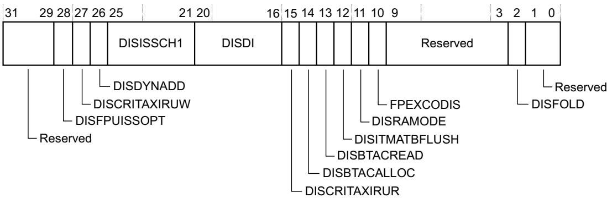

Table 4-13 ACTLR bit assignments

<table><tr><td>Bits</td><td>Name</td><td colspan="2">Function</td></tr><tr><td>[31:29]</td><td>-</td><td colspan="2">Reserved.</td></tr><tr><td>[28]</td><td>DISFPUISSOPT</td><td>0</td><td>Normal operation.</td></tr><tr><td rowspan="3">[27]</td><td rowspan="3">DISCRITAXIRUW</td><td colspan="2">Disable critical AXI read-under-write:</td></tr><tr><td>0</td><td>Normal operation. This is backwards compatible with r0.</td></tr><tr><td>1</td><td>AXI reads to DEV/SO memory. Exclusive reads to Shareable memory are not initiated on the AXIM AR channel until all outstanding stores on AXI are complete.</td></tr><tr><td rowspan="3">[26]</td><td rowspan="3">DISDYNADD</td><td colspan="2">Disables dynamic allocation of ADD and SUB instructions:</td></tr><tr><td>0</td><td>Normal operation. Some ADD and SUB instructions are resolved in EX1.</td></tr><tr><td>1</td><td>All ADD and SUB instructions are resolved in EX2.</td></tr><tr><td rowspan="7">[25:21]</td><td rowspan="7">DISISSCH1</td><td>0</td><td>Normal operation.</td></tr><tr><td>1</td><td>Instruction type might not be issued in channel 1.</td></tr><tr><td>[25]</td><td>VFP.</td></tr><tr><td>[24]</td><td>Integer MAC and MUL.</td></tr><tr><td>[23]</td><td>Loads to PC.</td></tr><tr><td>[22]</td><td>Indirect branches, but not loads to PC.</td></tr><tr><td>[21]</td><td>Direct branches.</td></tr><tr><td rowspan="7">[20:16]</td><td rowspan="7">DISDI</td><td>0</td><td>Normal operation.</td></tr><tr><td>1</td><td>Nothing can be dual-issued when this instruction type is in channel 0.</td></tr><tr><td>[20]</td><td>VFP.</td></tr><tr><td>[19]</td><td>Integer MAC and MUL.</td></tr><tr><td>[18]</td><td>Loads to PC.</td></tr><tr><td>[17]</td><td>Indirect branches, but not loads to PC.</td></tr><tr><td>[16]</td><td>Direct branches.</td></tr><tr><td rowspan="3">[15]</td><td rowspan="3">DISCRITAXIRUR</td><td colspan="2">Disables critical AXI Read-Under-Read.</td></tr><tr><td>0</td><td>Normal operation.</td></tr><tr><td>1</td><td>An AXI read to Strongly-Ordered or Device memory, or an LDREX to Shareable memory, is not put on AXI if there are any outstanding reads on AXI. Transactions on AXI cannot be interrupted. This bit might reduce the time that these transactions are in progress and might improve worst case interrupt latency. Performance is decreased when this bit is set.</td></tr><tr><td rowspan="2">[14]</td><td rowspan="2">DISBTACALLOC</td><td>0</td><td>Normal operation.</td></tr><tr><td>1</td><td>No new entries are allocated in Branch Target Address Cache (BTAC), but existing entries can be updated.</td></tr><tr><td rowspan="2">[13]</td><td rowspan="2">DISBTACREAD</td><td>0</td><td>Normal operation.</td></tr><tr><td>1</td><td>BTAC is not used and only static branch prediction can occur.</td></tr><tr><td rowspan="4">[12]</td><td rowspan="4">DISITMATBFLUSH</td><td colspan="2">Disables ITM and DWT ATB flush:</td></tr><tr><td>1</td><td>ITM and DWT ATB flush disabled. AFVALID is ignored and AFREADY is held HIGH.</td></tr><tr><td colspan="2">—Note —</td></tr><tr><td colspan="2">This bit is always 1 and therefore RO/WI.</td></tr><tr><td rowspan="4">[11]</td><td rowspan="4">DISRAMODE</td><td colspan="2">Disables dynamic read allocate mode for Write-Back Write-Allocate memory regions:</td></tr><tr><td>0</td><td>Normal operation.</td></tr><tr><td>1</td><td>Dynamic disabled.</td></tr><tr><td colspan="2">See Dynamic read allocate mode on page 2-18.</td></tr><tr><td rowspan="3">[10]</td><td rowspan="3">FPEXCODIS</td><td colspan="2">Disables FPU exception outputs:</td></tr><tr><td>0</td><td>Normal operation.</td></tr><tr><td>1</td><td>FPU exception outputs are disabled.</td></tr><tr><td>[9:3]</td><td>-</td><td colspan="2">Reserved.</td></tr><tr><td>[2]</td><td>DISFOLD</td><td>0</td><td>Normal operation.</td></tr><tr><td>[1:0]</td><td>-</td><td colspan="2">Reserved.</td></tr></table>

## 4.3.2 CPUID Base Register

The CPUID register contains the processor part number, version, and implementation information. See the register summary in Table 4-12 on page 4-11 for its attributes. The bit assignments are:

<table><tr><td>31</td><td>24</td><td>23</td><td>20</td><td>19</td><td>16</td><td>15</td><td></td><td>4</td><td>3</td><td>0</td></tr><tr><td colspan="2">Implementer</td><td colspan="2">Variant</td><td colspan="2">Constant</td><td colspan="3">PartNo</td><td colspan="2">Revision</td></tr></table>

Table 4-14 CPUID bit assignments

<table><tr><td>Bits</td><td>Name</td><td colspan="2">Function</td></tr><tr><td rowspan="2">[31:24]</td><td rowspan="2">Implementer</td><td colspan="2">Implementer code:</td></tr><tr><td>0x41</td><td>Arm</td></tr><tr><td rowspan="3">[23:20]</td><td rowspan="3">Variant</td><td colspan="2">Variant number, the r value in the rnpn product revision identifier:</td></tr><tr><td>0x0</td><td>Revision 0</td></tr><tr><td>0x1</td><td>Revision 1</td></tr><tr><td>[19:16]</td><td>Constant</td><td colspan="2">Reads as 0xF</td></tr><tr><td rowspan="2">[15:4]</td><td rowspan="2">PartNo</td><td colspan="2">Part number of the processor:</td></tr><tr><td>0xC27</td><td>Cortex-M7</td></tr><tr><td rowspan="3">[3:0]</td><td rowspan="3">Revision</td><td colspan="2">Revision number, the p value in the rnpn product revision identifier:</td></tr><tr><td>0x0</td><td>Patch 0</td></tr><tr><td>0x1</td><td>Patch 1</td></tr></table>

## 4.3.3 Interrupt Control and State Register

The ICSR:

• provides:

— A set-pending bit for the non-maskable interrupt exception.

— Set-pending and clear-pending bits for the PendSV and SysTick exceptions.

indicates:

— The exception number of the exception being processed.

— Whether there are preempted active exceptions.

— The exception number of the highest priority pending exception.

— Whether any interrupts are pending.

See the register summary in Table 4-12 on page 4-11, and the Type descriptions in Table 4-15 on page 4-15, for the ICSR attributes. The bit assignments are:

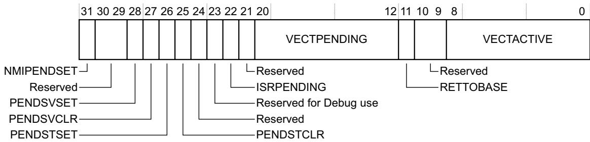

Table 4-15 ICSR bit assignments

<table><tr><td>Bits</td><td>Name</td><td>Type</td><td>Function</td></tr><tr><td>[31]</td><td>NMIPENDSET</td><td>RW</td><td>NMI set-pending bit.Write:0 No effect.1 Changes NMI exception state to pending.Read:0 NMI exception is not pending.1 NMI exception is pending.Because NMI is the highest-priority exception, normally the processor enters the NMI exception handler as soon as it registers a write of 1 to this bit, and entering the handler clears this bit to 0. A read of this bit by the NMI exception handler returns 1 only if the NMI signal is reasserted while the processor is executing that handler.</td></tr><tr><td>[30:29]</td><td>-</td><td>-</td><td>Reserved.</td></tr><tr><td>[28]</td><td>PENDSVSET</td><td>RW</td><td>PendSV set-pending bit.Write:0 No effect.1 Changes PendSV exception state to pending.Read:0 PendSV exception is not pending.1 PendSV exception is pending.Writing 1 to this bit is the only way to set the PendSV exception state to pending.</td></tr><tr><td>[27]</td><td>PENDSVCLR</td><td>WO</td><td>PendSV clear-pending bit.Write:0 No effect.1 Removes the pending state from the PendSV exception.</td></tr><tr><td>[26]</td><td>PENDSTSET</td><td>RW</td><td>SysTick exception set-pending bit.Write:0 No effect.1 Changes SysTick exception state to pending.Read:0 SysTick exception is not pending.1 SysTick exception is pending.</td></tr><tr><td>[25]</td><td>PENDSTCLR</td><td>WO</td><td>SysTick exception clear-pending bit.Write:0 No effect.1 Removes the pending state from the SysTick exception.This bit is WO. On a register read its value is Unknown.</td></tr><tr><td>[24]</td><td>-</td><td>-</td><td>Reserved.</td></tr><tr><td>[23]</td><td>Reserved for Debug use</td><td>RO</td><td>This bit is reserved for Debug use and reads-as-zero when the processor is not in Debug.</td></tr><tr><td>[22]</td><td>ISRPENDING</td><td>RO</td><td>Interrupt pending flag, excluding NMI and Faults:0 Interrupt not pending.1 Interrupt pending.</td></tr><tr><td>[21]</td><td>-</td><td>-</td><td>Reserved.</td></tr><tr><td>[20:12]</td><td>VECTPENDING</td><td>RO</td><td>Indicates the exception number of the highest priority pending enabled exception:0 No pending exceptions.Nonzero The exception number of the highest priority pending enabled exception.The value indicated by this field includes the effect of the BASEPRI and FAULTMASK registers, but not any effect of the PRIMASK register.</td></tr><tr><td>[11]</td><td>RETTOBASE</td><td>RO</td><td>Indicates whether there are preempted active exceptions:0 There are preempted active exceptions to execute.1 There are no active exceptions, or the currently-executing exception is the only active exception.</td></tr><tr><td>[10:9]</td><td>-</td><td>-</td><td>Reserved.</td></tr><tr><td>[8:0]</td><td>VECTACTIVEa</td><td>RO</td><td>Contains the active exception number:0 Thread mode.1 The exception numbera of the currently active exception.NoteSubtract 16 from this value to obtain the CMSIS IRQ number required to index into the Interrupt Clear-Enable, Set-Enable, Clear-Pending, Set-Pending, or Priority Registers, see Table 2-5 on page 2-6.</td></tr></table>

a. This is the same value as IPSR bits[8:0], see Interrupt Program Status Register on page 2-6.

When you write to the ICSR, the effect is UNPREDICTABLE if you:

Write 1 to the PENDSVSET bit and write 1 to the PENDSVCLR bit.

Write 1 to the PENDSTSET bit and write 1 to the PENDSTCLR bit.

## 4.3.4 Vector Table Offset Register

The VTOR indicates the offset of the vector table base address from memory address 0x00000000. See the register summary in Table 4-12 on page 4-11 for its attributes. The bit assignments are:

<table><tr><td>31</td><td></td><td></td><td></td><td></td><td>7</td><td>6</td><td>0</td></tr><tr><td colspan="5">TBLOFF</td><td colspan="3">Reserved</td></tr></table>

Table 4-16 VTOR bit assignments

<table><tr><td>Bits</td><td>Name</td><td>Function</td></tr><tr><td>[31:7]</td><td>TBLOFF</td><td>Vector table base offset field. It contains bits[29:7] of the offset of the table base from the bottom of the memory map. The lower bit in the TBLOFF field is implementation defined.</td></tr><tr><td>[6:0]</td><td>-</td><td>Reserved.</td></tr></table>

When setting TBLOFF, you must align the offset to the number of exception entries in the vector table. The minimum alignment is 32 words, enough for up to 16 interrupts. For more interrupts, adjust the alignment by rounding up to the next power of two. For example, if you require 21 interrupts, the alignment must be on a 64-word boundary because the required table size is 37 words, and the next power of two is 64.

Note

Table alignment requirements mean that bits[6:0] of the table offset are always zero.

## 4.3.5 Application Interrupt and Reset Control Register

The AIRCR provides priority grouping control for the exception model, endian status for data accesses, and reset control of the system. See the register summary in Table 4-12 on page 4-11 and Table 4-17 on page 4-18 for its attributes.

To write to this register, you must write 0x5FA to the VECTKEY field, otherwise the processor ignores the write.

The bit assignments are:

<table><tr><td>31</td><td></td><td>16</td><td>15</td><td>14</td><td>11</td><td>10</td><td>8</td><td>7</td><td>3</td><td>2</td><td>1</td><td>0</td></tr><tr><td colspan="3">On read: VECTKEYSTATOn write: VECTKEY</td><td></td><td>Reserved</td><td colspan="2"></td><td colspan="2">Reserved</td><td></td><td></td><td></td><td></td></tr><tr><td colspan="13">ENDIANNESS PRIGROUP SYSRESETREQReserved for Debug use VECTCLRACTIVEVECTRESET</td></tr></table>

Table 4-17 AIRCR bit assignments

<table><tr><td>Bits</td><td>Name</td><td>Type</td><td>Function</td></tr><tr><td>[31:16]</td><td>Read: VECTKEYSTATWrite: VECTKEY</td><td>RW</td><td>Register key: Reads as 0xFA05.On writes, write 0x5FA to VECTKEY, otherwise the write is ignored.</td></tr><tr><td>[15]</td><td>ENDIANNESS</td><td>RO</td><td>Data endianness bit setting is implementation defined:0 Little-endian.1 Big-endian.</td></tr><tr><td>[14:11]</td><td>-</td><td>-</td><td>Reserved.</td></tr><tr><td>[10:8]</td><td>PRIGROUP</td><td>RW</td><td>Interrupt priority grouping field. This field determines the split of group priority from subpriority, seeBinary point on page 4-19.</td></tr><tr><td>[7:3]</td><td>-</td><td>-</td><td>Reserved.</td></tr><tr><td>[2]</td><td>SYSRESETREQ</td><td>WO</td><td>System reset request bit setting is implementation defined:0 No system reset request.1 Asserts a signal torequest a system reset.This is intended to force a large system reset of all major components except for debug.This bit reads as 0.See your vendor documentation for more information about the use of this signal in your implementation.</td></tr><tr><td>[1]</td><td>VECTCLRACTIVE</td><td>WO</td><td>Reserved for Debug use. This bit reads as 0. When writing to the register you must write 0 to this bit, otherwise behavior is Unpredictable.</td></tr><tr><td>[0]</td><td>VECTRESET</td><td>WO</td><td>Reserved for Debug use. This bit reads as 0. When writing to the register you must write 0 to this bit, otherwise behavior is Unpredictable.</td></tr></table>

## Binary point

The PRIGROUP field indicates the position of the binary point that splits the PRI\_n fields in the Interrupt Priority Registers into separate group priority and subpriority fields. Table 4-18 shows how the PRIGROUP value controls this split. Implementations having PRI\_n fields of less than 8 bits treat the least-significant bits as zero.

Table 4-18 Priority grouping

<table><tr><td></td><td colspan="3">Interrupt priority level value, PRI_N[7:0]</td><td colspan="2">Number of</td></tr><tr><td>PRIGROUP</td><td>Binary pointa</td><td>Group priority bits</td><td>Subpriority bits</td><td>Group prioritiesb</td><td>Subprioritiesb</td></tr><tr><td> $0b000^c$ </td><td>bxxxxxxx.y</td><td>[7:1]</td><td>[0]</td><td>128</td><td>2</td></tr><tr><td> $0b001^c$ </td><td>bxxxxxx.yy</td><td>[7:2]</td><td>[1:0]</td><td>64</td><td>4</td></tr><tr><td> $0b010^c$ </td><td>bxxxxx.yyy</td><td>[7:3]</td><td>[2:0]</td><td>32</td><td>8</td></tr><tr><td> $0b011^c$ </td><td>bxxxx.yyyy</td><td>[7:4]</td><td>[3:0]</td><td>16</td><td>16</td></tr><tr><td>0b100</td><td>bxxx.yyyyy</td><td>[7:5]</td><td>[4:0]</td><td>8</td><td>32</td></tr><tr><td>0b101</td><td>bxx.yyyyyy</td><td>[7:6]</td><td>[5:0]</td><td>4</td><td>64</td></tr><tr><td>0b110</td><td>bx.yyyyyyy</td><td>[7]</td><td>[6:0]</td><td>2</td><td>128</td></tr><tr><td>0b111</td><td>b.yyyyyyyy</td><td>None</td><td>[7:0]</td><td>1</td><td>256</td></tr></table>

a. PRI\_n[7:0] field showing the binary point. x denotes a group priority field bit, and y denotes a subpriority field bit.  
b. Implementation defined.  
c. Optional.

Note

Determining preemption of an exception uses only the group priority field, see Interrupt priority grouping on page 2-23.

## 4.3.6 System Control Register

The SCR controls features of entry to and exit from low power state. See the register summary in Table 4-12 on page 4-11 for its attributes. The bit assignments are:

<table><tr><td colspan="2">Reserved</td><td>5</td><td>4</td><td>3</td><td>2</td><td>1</td><td>0</td></tr><tr><td colspan="2"></td><td></td><td></td><td></td><td></td><td></td><td></td></tr><tr><td colspan="2"></td><td colspan="2">SEVONPEND</td><td></td><td></td><td></td><td></td></tr><tr><td colspan="2"></td><td colspan="2">Reserved</td><td></td><td></td><td></td><td></td></tr><tr><td colspan="2"></td><td colspan="2">SLEEPDEEP</td><td></td><td></td><td></td><td></td></tr><tr><td colspan="2"></td><td colspan="2">SLEEPONEXIT</td><td></td><td></td><td></td><td></td></tr><tr><td colspan="2"></td><td colspan="2">Reserved</td><td></td><td></td><td></td><td></td></tr></table>

Table 4-19 SCR bit assignments

<table><tr><td>Bits</td><td>Name</td><td>Function</td></tr><tr><td>[31:5]</td><td>-</td><td>Reserved.</td></tr><tr><td>[4]</td><td>SEVONPEND</td><td>Send Event on Pending bit:0 Only enabled interrupts or events can wakeup the processor, disabled interrupts are excluded.1 Enabled events and all interrupts, including disabled interrupts, can wake up the processor.When an event or interrupt enters pending state, the event signal wakes up the processor from WFE. If the processor is not waiting for an event, the event is registered and affects the next WFE.The processor also wakes up on execution of an SEV instruction or an external event.</td></tr><tr><td>[3]</td><td>-</td><td>Reserved.</td></tr><tr><td>[2]</td><td>SLEEPDEEP</td><td>Controls whether the processor uses sleep or deep sleep as its low power mode:0 Sleep.1 Deep sleep.</td></tr><tr><td>[1]</td><td>SLEEPONEXIT</td><td>Indicates sleep-on-exit when returning from Handler mode to Thread mode:0 Do not sleep when returning to Thread mode.1 Enter sleep, or deep sleep, on return from an ISR.Setting this bit to 1 enables an interrupt driven application to avoid returning to an empty main application.</td></tr><tr><td>[0]</td><td>-</td><td>Reserved.</td></tr></table>

## 4.3.7 Configuration and Control Register

The CCR controls entry to Thread mode and enables:

The handlers for NMI, hard fault and faults escalated by FAULTMASK to ignore BusFaults.

• Trapping of divide by zero and unaligned accesses.

Access to the STIR by unprivileged software, see Software Trigger Interrupt Register on page 4-8.

• Optional instruction and data cache enable control.

See the register summary in Table 4-12 on page 4-11 for the CCR attributes.

The bit assignments are:  
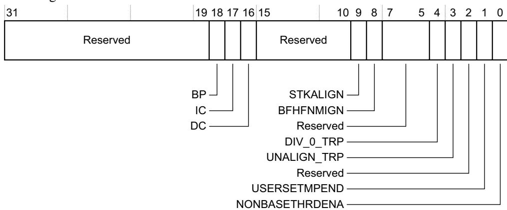

Table 4-20 CCR bit assignments

<table><tr><td>Bits</td><td>Name</td><td>Type</td><td>Function</td></tr><tr><td>[31:19]</td><td>-</td><td>-</td><td>Reserved.</td></tr><tr><td>[18]</td><td>BP</td><td>RO</td><td>Always reads-as-one. It indicates branch prediction is enabled.</td></tr><tr><td>[17]</td><td>IC</td><td>RW</td><td>Enables L1 instruction cache. This bit is optional:0 L1 instruction cache disabled.1 L1 instruction cache enabled.</td></tr><tr><td>[16]</td><td>DC</td><td>RW</td><td>Enables L1 data cache. This bit is optional:0 L1 data cache disabled.1 L1 data cache enabled.</td></tr><tr><td>[15:10]</td><td>-</td><td>-</td><td>Reserved.</td></tr><tr><td>[9]</td><td>STKALIGN</td><td>RO</td><td>Always reads-as-one. It indicates stack alignment on exception entry is 8-byte aligned.On exception entry, the processor uses bit[9] of the stacked PSR to indicate the stack alignment. On return from the exception it uses this stacked bit to restore the correct stack alignment.</td></tr><tr><td>[8]</td><td>BFHFNIGN</td><td>RW</td><td>Enables handlers with priority -1 or -2 to ignore data BusFaults caused by load and store instructions. This applies to the hard fault, NMI, and FAULTMASK escalated handlers:0 Data bus faults caused by load and store instructions cause a lock-up.1 Handlers running at priority -1 and -2 ignore data bus faults caused by load and store instructions.Set this bit to 1 only when the handler and its data are in absolutely safe memory. The normal use of this bit is to probe system devices and bridges to detect control path problems and fix them.</td></tr><tr><td>[7:5]</td><td>-</td><td>-</td><td>Reserved.</td></tr><tr><td>[4]</td><td>DIV_0_TRP</td><td>RW</td><td>Enables faulting or halting when the processor executes an SDIV or UDIV instruction with a divisor of 0:0 Do not trap divide by 0.1 Trap divide by 0.When this bit is set to 0, a divide by zero returns a quotient of 0.</td></tr><tr><td>[3]</td><td>UNALIGN_TRP</td><td>RW</td><td>Enables unaligned access traps:0 Do not trap unaligned halfword and word accesses.1 Trap unaligned halfword and word accesses.If this bit is set to 1, an unaligned access generates a UsageFault.Unaligned LDM, STM, LDRD, and STRD instructions always fault irrespective of whether UNALIGN_TRP is set to 1.</td></tr><tr><td>[2]</td><td>-</td><td>-</td><td>Reserved.</td></tr><tr><td>[1]</td><td>USERSETMPEND</td><td>RW</td><td>Enables unprivileged software access to the STIR, see Software Trigger Interrupt Register on page 4-8:0 Disable.1 Enable.</td></tr><tr><td>[0]</td><td>NONBASETHRDENA</td><td>RW</td><td>Indicates how the processor enters Thread mode:0 Processor can enter Thread mode only when no exception is active.1 Processor can enter Thread mode from any level under the control of an EXC_RETURN value, see Exception return on page 2-26.</td></tr></table>

## 4.3.8 System Handler Priority Registers

The SHPR1-SHPR3 registers set the priority level of the exception handlers. The maximum range of configurable priority values is 0-255. The actual range of priority values available is implementation defined.

SHPR1-SHPR3 are byte accessible. See the register summary in Table 4-12 on page 4-11 for their attributes.

The system fault handlers, priority fields and registers are identified in Table 4-21.

Table 4-21 System fault handler priority fields

<table><tr><td>Handler</td><td>Field</td><td>Register description</td></tr><tr><td>MemManage</td><td>PRI_4</td><td>System Handler Priority Register 1 on page 4-23</td></tr><tr><td>BusFault</td><td>PRI_5</td><td></td></tr><tr><td>UsageFault</td><td>PRI_6</td><td></td></tr><tr><td>SVCall</td><td>PRI_11</td><td>System Handler Priority Register 2 on page 4-23</td></tr><tr><td>PendSV</td><td>PRI_14</td><td>System Handler Priority Register 2 on page 4-23</td></tr><tr><td>SysTick</td><td>PRI_15</td><td></td></tr></table>

Each PRI\_n field can be up to 8 bits wide, but the processor implements only bits[7:M] of each field, where M is implementation defined. Bits[M-1:0] read as zero and ignore writes.

## System Handler Priority Register 1

The bit assignments are:

<table><tr><td>Reserved</td><td>PRI_6</td><td>PRI_5</td><td>PRI_4</td></tr></table>

Table 4-22 SHPR1 register bit assignments

<table><tr><td>Bits</td><td>Name</td><td>Function</td></tr><tr><td>[31:24]</td><td>PRI_7</td><td>Reserved</td></tr><tr><td>[23:16]</td><td>PRI_6</td><td>Priority of system handler 6, UsageFault</td></tr><tr><td>[15:8]</td><td>PRI_5</td><td>Priority of system handler 5, BusFault</td></tr><tr><td>[7:0]</td><td>PRI_4</td><td>Priority of system handler 4, MemManage</td></tr></table>

## System Handler Priority Register 2

The bit assignments are:

<table><tr><td>31</td><td>24</td><td>23</td><td></td><td></td><td></td><td></td><td>0</td></tr><tr><td colspan="3">PRI_11</td><td colspan="5">Reserved</td></tr></table>

Table 4-23 SHPR2 register bit assignments

<table><tr><td>Bits</td><td>Name</td><td>Function</td></tr><tr><td>[31:24]</td><td>PRI_11</td><td>Priority of system handler 11, SVCall</td></tr><tr><td>[23:0]</td><td>-</td><td>Reserved</td></tr></table>

## System Handler Priority Register 3

The bit assignments are:

<table><tr><td>31</td><td>24 23</td><td>16 15</td><td>0</td></tr><tr><td>PRI_15</td><td>PRI_14</td><td colspan="2">Reserved</td></tr></table>

Table 4-24 SHPR3 register bit assignments

<table><tr><td>Bits</td><td>Name</td><td>Function</td></tr><tr><td>[31:24]</td><td>PRI_15</td><td>Priority of system handler 15, SysTick exception</td></tr><tr><td>[23:16]</td><td>PRI_14</td><td>Priority of system handler 14, PendSV</td></tr><tr><td>[15:0]</td><td>-</td><td>Reserved</td></tr></table>

## 4.3.9 System Handler Control and State Register

The SHCSR enables the system handlers, and indicates:

The pending status of the BusFault, MemManage fault, and SVC exceptions.

• The active status of the system handlers.

See the register summary in Table 4-12 on page 4-11 for the SHCSR attributes. The bit assignments are:

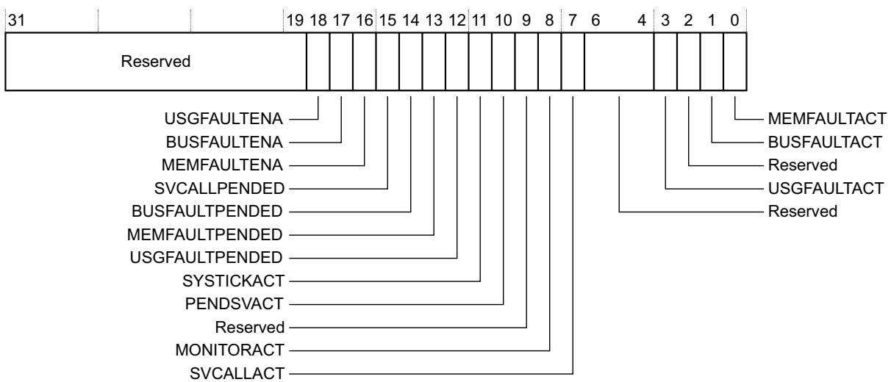

Table 4-25 SHCSR bit assignments

<table><tr><td>Bits</td><td>Name</td><td>Function</td></tr><tr><td>[31:19]</td><td>-</td><td>Reserved</td></tr><tr><td>[18]</td><td>USGFAULTENA</td><td>UsageFault enable bit, set to 1 to  $enable^a$ </td></tr><tr><td>[17]</td><td>BUSFAULTENA</td><td>BusFault enable bit, set to 1 to  $enable^a$ </td></tr><tr><td>[16]</td><td>MEMFAULTENA</td><td>MemManage enable bit, set to 1 to  $enable^a$ </td></tr><tr><td>[15]</td><td>SVCALLPENDED</td><td>SVCall pending bit, reads as 1 if exception is  $pending^b$ </td></tr><tr><td>[14]</td><td>BUSFAULTPENDED</td><td>BusFault exception pending bit, reads as 1 if exception is  $pending^b$ </td></tr><tr><td>[13]</td><td>MEMFAULTPENDED</td><td>MemManage exception pending bit, reads as 1 if exception is  $pending^b$ </td></tr><tr><td>[12]</td><td>USGFAULTPENDED</td><td>UsageFault exception pending bit, reads as 1 if exception is  $pending^b$ </td></tr><tr><td>[11]</td><td>SYSTICKACT</td><td>SysTick exception active bit, reads as 1 if exception is  $active^c$ </td></tr><tr><td>[10]</td><td>PENDSVACT</td><td>PendSV exception active bit, reads as 1 if exception is active</td></tr><tr><td>[9]</td><td>-</td><td>Reserved</td></tr><tr><td>[8]</td><td>MONITORACT</td><td>Debug monitor active bit, reads as 1 if Debug monitor is active</td></tr><tr><td>[7]</td><td>SVCALLACT</td><td>SVCall active bit, reads as 1 if SVC call is active</td></tr><tr><td>[6:4]</td><td>-</td><td>Reserved</td></tr><tr><td>[3]</td><td>USGFAULTACT</td><td>UsageFault exception active bit, reads as 1 if exception is active</td></tr><tr><td>[2]</td><td>-</td><td>Reserved</td></tr><tr><td>[1]</td><td>BUSFAULTACT</td><td>BusFault exception active bit, reads as 1 if exception is active</td></tr><tr><td>[0]</td><td>MEMFAULTACT</td><td>MemManage exception active bit, reads as 1 if exception is active</td></tr></table>

a. Enable bits, set to 1 to enable the exception, or set to 0 to disable the exception.  
b. Pending bits, read as 1 if the exception is pending, or as 0 if it is not pending. You can write to these bits to change the pending status of the exceptions.  
c. Active bits, read as 1 if the exception is active, or as 0 if it is not active. You can write to these bits to change the active status of the exceptions, but see the Caution in this section.

If you disable a system handler and the corresponding fault occurs, the processor treats the fault as a hard fault.

You can write to this register to change the pending or active status of system exceptions. An OS kernel can write to the active bits to perform a context switch that changes the current exception type.

Caution

Software that changes the value of an active bit in this register without correct adjustment to the stacked content can cause the processor to generate a fault exception. Ensure software that writes to this register retains and subsequently restores the current active status.

After you have enabled the system handlers, if you have to change the value of a bit in this register you must use a read-modify-write procedure to ensure that you change only the required bit.

## 4.3.10 Configurable Fault Status Register

The CFSR indicates the cause of a MemManage fault, BusFault, or UsageFault. See the register summary in Table 4-12 on page 4-11 for its attributes. The bit assignments are:

<table><tr><td>31</td><td></td><td>16</td><td>15</td><td>8</td><td>7</td><td>0</td></tr><tr><td colspan="3">Usage Fault Status Register</td><td colspan="2">Bus Fault Status Register</td><td colspan="2">Memory Management Fault Status Register</td></tr><tr><td colspan="3">UFSR</td><td colspan="2">BFSR</td><td colspan="2">MMFSR</td></tr></table>

The following subsections describe the subregisters that make up the CFSR:

MemManage Fault Status Register on page 4-26.

BusFault Status Register on page 4-27.

UsageFault Status Register on page 4-29.

The CFSR is byte accessible. You can access the CFSR or its subregisters as follows:

• Access the complete CFSR with a word access to 0xE000ED28.

• Access the MMFSR with a byte access to 0xE000ED28.

• Access the MMFSR and BFSR with a halfword access to 0xE000ED28.

• Access the BFSR with a byte access to 0xE000ED29.

• Access the UFSR with a halfword access to 0xE000ED2A.

## MemManage Fault Status Register

The flags in the MMFSR indicate the cause of memory access faults. The bit assignments are:

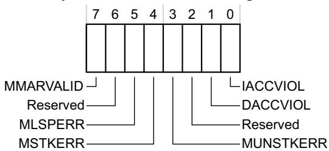

Table 4-26 MMFSR bit assignments

<table><tr><td>Bits</td><td>Name</td><td>Function</td></tr><tr><td>[7]</td><td>MMARVALID</td><td>MemManage Fault Address Register (MMFAR) valid flag:0 Value in MMAR is not a valid fault address.1 MMAR holds a valid fault address.If a MemManage fault occurs and is escalated to a HardFault because of priority, the HardFault handler must set this bit to 0. This prevents problems on return to a stacked active MemManage fault handler whose MMAR value has been overwritten.</td></tr><tr><td>[6]</td><td>-</td><td>Reserved.</td></tr><tr><td>[5]</td><td>MLSPERRa</td><td>0 No MemManage fault occurred during floating-point lazy state preservation.1 A MemManage fault occurred during floating-point lazy state preservation.</td></tr><tr><td>[4]</td><td>MSTKERR</td><td>MemManage fault on stacking for exception entry:0 No stacking fault.1 Stacking for an exception entry has caused one or more access violations.When this bit is 1, the SP is still adjusted but the values in the context area on the stack might be incorrect. The processor has not written a fault address to the MMAR.</td></tr><tr><td>[3]</td><td>MUNSTKERR</td><td>MemManage fault on unstacking for a return from exception:0 No unstacking fault.1 Unstack for an exception return has caused one or more access violations.This fault is chained to the handler. This means that when this bit is 1, the original return stack is still present. The processor has not adjusted the SP from the failing return, and has not performed a new save. The processor has not written a fault address to the MMAR.</td></tr><tr><td>[2]</td><td>-</td><td>Reserved.</td></tr><tr><td>[1]</td><td>DACCVIOL</td><td>Data access violation flag:0 No data access violation fault.1 The processor attempted a load or store at a location that does not permit the operation.When this bit is 1, the PC value stacked for the exception return points to the faulting instruction. The processor has loaded the MMAR with the address of the attempted access.</td></tr><tr><td>[0]</td><td>IACCVIOL</td><td>Instruction access violation flag:0 No instruction access violation fault.1 The processor attempted an instruction fetch from a location that does not permit execution.This fault occurs on any access to an XN region, even when the MPU is disabled or not present. When this bit is 1, the PC value stacked for the exception return points to the faulting instruction. The processor has not written a fault address to the MMAR.</td></tr></table>

a. This field is optional and might not be available in your implementation.

Note

The MMFSR bits are sticky. This means as one or more fault occurs, the associated bits are set to 1. A bit that is set to 1 is cleared to 0 only by writing 1 to that bit, or by a reset.

## BusFault Status Register

The flags in the BFSR indicate the cause of a bus access fault. The bit assignments are:

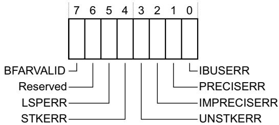

Table 4-27 BFSR bit assignments

<table><tr><td>Bits</td><td>Name</td><td>Function</td></tr><tr><td>[7]</td><td>BFARVALID</td><td>BusFault Address Register (BFAR) valid flag:0 Value in BFAR is not a valid fault address.1 BFAR holds a valid fault address.The processor sets this bit to 1 after a BusFault where the address is known. Other faults can set this bit to 0, such as a MemManage fault occurring later.If a BusFault occurs and is escalated to a hard fault because of priority, the hard fault handler must set this bit to 0. This prevents problems if returning to a stacked active BusFault handler whose BFAR value has been overwritten.</td></tr><tr><td>[6]</td><td>-</td><td>Reserved.</td></tr><tr><td>[5]</td><td>LSPERRa</td><td>0 No bus fault occurred during floating-point lazy state preservation.1 A bus fault occurred during floating-point lazy state preservation.</td></tr><tr><td>[4]</td><td>STKERR</td><td>BusFault on stacking for exception entry:0 No stacking fault.1 Stacking for an exception entry has caused one or more BusFaults.When the processor sets this bit to 1, the SP is still adjusted but the values in the context area on the stack might be incorrect. The processor does not write a fault address to the BFAR.</td></tr><tr><td>[3]</td><td>UNSTKERR</td><td>BusFault on unstacking for a return from exception:0 No unstacking fault.1 Unstack for an exception return has caused one or more BusFaults.This fault is chained to the handler. This means that when the processor sets this bit to 1, the original return stack is still present. The processor does not adjust the SP from the failing return, does not perform a new save, and does not write a fault address to the BFAR.</td></tr><tr><td>[2]</td><td>IMPRECISERR</td><td>Imprecise data bus error:0 No imprecise data bus error.1 A data bus error has occurred, but the return address in the stack frame is not related to the instruction that caused the error.When the processor sets this bit to 1, it does not write a fault address to the BFAR.This is an asynchronous fault. Therefore, if it is detected when the priority of the current process is higher than the BusFault priority, the BusFault becomes pending and becomes active only when the processor returns from all higher priority processes. If a precise fault occurs before the processor enters the handler for the imprecise BusFault, the handler detects both IMPRECISERR set to 1 and one of the precise fault status bits set to 1.</td></tr><tr><td>[1]</td><td>PRECISERR</td><td>Precise data bus error:0 No precise data bus error.1 A data bus error has occurred, and the PC value stacked for the exception return points to the instruction that caused the fault.When the processor sets this bit to 1, it writes the faulting address to the BFAR.</td></tr><tr><td>[0]</td><td>IBUSERR</td><td>Instruction bus error:0 No instruction bus error.1 Instruction bus error.The processor detects the instruction bus error on prefetching an instruction, but it sets the IBUSERR flag to 1 only if it attempts to issue the faulting instruction.When the processor sets this bit to 1, it does not write a fault address to the BFAR.</td></tr></table>

a. This field is optional and might not be available in your implementation.

Note

The BFSR bits are sticky. This means as one or more fault occurs, the associated bits are set to 1. A bit that is set to 1 is cleared to 0 only by writing 1 to that bit, or by a reset.

## UsageFault Status Register

The UFSR indicates the cause of a UsageFault. The bit assignments are:

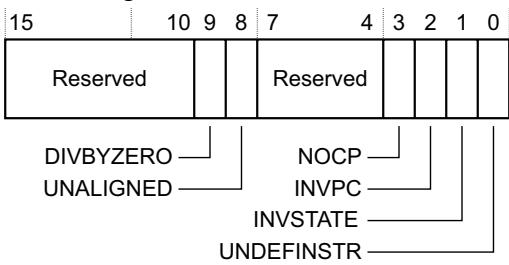

Table 4-28 UFSR bit assignments

<table><tr><td>Bits</td><td>Name</td><td>Function</td></tr><tr><td>[15:10]</td><td>-</td><td>Reserved.</td></tr><tr><td>[9]</td><td>DIVBYZERO</td><td>Divide by zero UsageFault:0 No divide by zero fault, or divide by zero trapping not enabled.1 The processor has executed an SDIV or UDIV instruction with a divisor of 0.When the processor sets this bit to 1, the PC value stacked for the exception return points to the instruction that performed the divide by zero.Enable trapping of divide by zero by setting the DIV_0_TRP bit in the CCR to 1, seeConfiguration and Control Register on page 4-20.</td></tr><tr><td>[8]</td><td>UNALIGNED</td><td>Unaligned access UsageFault:0 No unaligned access fault, or unaligned access trapping not enabled.1 The processor has made an unaligned memory access.Enable trapping of unaligned accesses by setting the UNALIGN_TRP bit in the CCR to 1, seeConfiguration and Control Register on page 4-20.Unaligned LDM, STM, LDRD, and STRD instructions always fault irrespective of the setting of UNALIGN_TRP.</td></tr><tr><td>[7:4]</td><td>-</td><td>Reserved.</td></tr><tr><td>[3]</td><td>NOCP</td><td>No coprocessor UsageFault:0 No UsageFault caused by attempting to access a coprocessor.1 The processor has attempted to access a coprocessor.The processor does not support coprocessor instructions.</td></tr><tr><td>[2]</td><td>INVPC</td><td>Invalid PC load UsageFault, caused by an invalid PC load by EXC_RETURN:0 No invalid PC load UsageFault.1 The processor has attempted an illegal load of EXC_RETURN to the PC, as a result of an invalid context, or an invalid EXC_RETURN value.When this bit is set to 1, the PC value stacked for the exception return points to the instruction that tried to perform the illegal load of the PC.</td></tr><tr><td>[1]</td><td>INVSTATE</td><td>Invalid state UsageFault:0 No invalid state UsageFault.1 The processor has attempted to execute an instruction that makes illegal use of the EPSR.When this bit is set to 1, the PC value stacked for the exception return points to the instruction that attempted the illegal use of the EPSR.This bit is not set to 1 if an undefined instruction uses the EPSR.</td></tr><tr><td>[0]</td><td>UNDEFINSTR</td><td>Undefined instruction UsageFault:0 No undefined instruction UsageFault.1 The processor has attempted to execute an undefined instruction.When this bit is set to 1, the PC value stacked for the exception return points to the undefined instruction.An undefined instruction is an instruction that the processor cannot decode.</td></tr></table>

The UFSR bits are sticky. This means as one or more fault occurs, the associated bits are set to 1. A bit that is set to 1 is cleared to 0 only by writing 1 to that bit, or by a reset.

## 4.3.11 HardFault Status Register

The HFSR gives information about events that activate the HardFault handler. See the register summary in Table 4-12 on page 4-11 for its attributes.

This register is read, write to clear. This means that bits in the register read normally, but writing 1 to any bit clears that bit to 0. The bit assignments are:

<table><tr><td>31</td><td>30</td><td>29</td><td></td><td></td><td></td><td></td><td></td><td></td><td></td><td colspan="101">Reserved</td><td></td><td></td><td></td><td></td><td></td><td></td><td></td><td></td><td></td><td></td><td></td><td></td><td></td><td></td><td></td><td></td><td></td><td></td><td></td><td></td><td></td><td></td><td></td><td></td><td></td><td></td><td></td><td></td><td></td><td></td><td></td><td></td><td></td><td></td><td></td><td></td><td></td><td></td><td></td><td></td><td></td><td></td><td></td><td></td><td></td><td></td><td></td><td></td><td></td><td></td><td></td><td></td><td></td><td></td><td></td><td></td><td></td><td></td><td></td><td></td><td></td><td></td><td></td><td></td><td></td><td></td><td></td><td></td><td></td><td></td><td></td><td></td><td></td><td></td><td></td><td></td><td></td><td></td><td></td><td></td><td></td><td></td><td></td><td></td><td></td><td></td><td></td><td></td><td></td><td></td><td></td></tr><tr><td></td><td></td><td></td><td></td><td></td><td></td><td></td><td></td><td></td><td></td><td></td><td></td><td></td><td></td><td></td><td></td><td></td><td></td><td></td><td></td><td></td><td></td><td></td><td></td><td></td><td></td><td></td><td></td><td></td><td></td><td></td><td></td><td></td><td></td><td></td><td></td><td></td><td></td><td></td><td></td><td></td><td></td><td></td><td></td><td></td><td></td><td></td><td></td><td></td><td></td><td></td><td></td><td></td><td></td><td></td><td></td><td></td><td></td><td></td><td></td><td></td><td></td><td></td><td></td><td></td><td></td><td></td><td></td><td></td><td></td><td></td><td></td><td></td><td></td><td></td><td></td><td></td><td></td><td></td><td></td><td></td><td></td><td></td><td></td><td></td><td></td><td></td><td></td><td></td><td></td><td></td><td></td><td></td><td></td><td></td><td></td><td></td><td></td><td></td><td></td><td></td><td></td><td></td><td></td><td></td><td></td><td></td><td></td><td></td><td></td><td></td><td></td><td></td><td></td><td></td><td></td><td></td><td></td><td></td><td></td><td></td><td></td><td></td><td></td><td></td><td></td><td></td><td></td><td></td><td></td><td></td><td></td><td></td><td></td><td></td><td></td><td></td><td></td><td></td><td></td><td></td><td></td><td></td><td></td><td></td><td></td><td></td><td></td><td></td><td></td><td></td><td></td><td></td><td></td><td></td><td></td><td></td><td></td><td></td><td></td><td></td><td></td><td></td><td></td><td></td><td></td><td></td><td></td><td></td><td></td><td></td><td></td><td></td><td></td><td></td><td></td><td></td><td></td><td></td><td></td><td></td><td></td><td></td><td></td><td></td><td></td><td></td><td></td><td></td><td></td><td></td><td></td><td></td><td></td><td></td><td></td><td></td><td></td><td></td><td></td><td></td><td></td></tr><tr><td rowspan="3"></td><td rowspan="3"></td><td rowspan="3"></td><td rowspan="3"></td><td rowspan="3"></td><td rowspan="3"></td><td rowspan="3"></td><td rowspan="3"></td><td rowspan="3"></td><td rowspan="3"></td><td rowspan="3"></td><td rowspan="3"></td><td rowspan="3"></td><td rowspan="3"></td><td rowspan="3"></td><td rowspan="3"></td><td rowspan="3"></td><td rowspan="3"></td><td rowspan="3"></td><td rowspan="3"></td><td rowspan="3"></td><td rowspan="3"></td><td rowspan="3"></td><td rowspan="3"></td><td rowspan="3"></td><td rowspan="3"></td><td rowspan="3"></td><td rowspan="3"></td><td rowspan="3"></td><td rowspan="3"></td><td rowspan="3"></td><td rowspan="3"></td><td rowspan="3"></td><td rowspan="3"></td><td rowspan="3"></td><td rowspan="3"></td><td rowspan="3"></td><td rowspan="3"></td><td rowspan="3"></td><td rowspan="3"></td><td rowspan="3"></td><td rowspan="3"></td><td rowspan="3"></td><td rowspan="3"></td><td rowspan="3"></td><td rowspan="3"></td><td rowspan="3"></td><td rowspan="3"></td><td rowspan="3"></td><td rowspan="3"></td><td rowspan="3"></td><td rowspan="3"></td><td rowspan="3"></td><td rowspan="3"></td><td rowspan="3"></td><td rowspan="3"></td><td rowspan="3"></td><td rowspan="3"></td><td rowspan="3"></td><td rowspan="3"></td><td rowspan="3"></td><td rowspan="3"></td><td rowspan="3"></td><td rowspan="3"></td><td rowspan="3"></td><td rowspan="3"></td><td rowspan="3"></td><td rowspan="3"></td><td rowspan="3"></td><td rowspan="3"></td><td rowspan="3"></td><td rowspan="3"></td><td rowspan="3"></td><td rowspan="3"></td><td rowspan="3"></td><td rowspan="3"></td><td rowspan="3"></td><td rowspan="3"></td><td rowspan="3"></td><td rowspan="3"></td><td rowspan="3"></td><td rowspan="3"></td><td rowspan="3"></td><td rowspan="3"></td><td rowspan="3"></td><td rowspan="3"></td><td rowspan="3"></td><td rowspan="3"></td><td rowspan="3"></td><td rowspan="3"></td><td rowspan="3"></td><td rowspan="3"></td><td rowspan="3"></td><td rowspan="3"></td><td rowspan="3"></td><td rowspan="3"></td><td rowspan="2"></td><td rowspan="2"></td><td rowspan="2"></td><td rowspan="2"></td><td></td><td></td><td></td><td></td><td></td><td></td><td></td><td></td><td></td><td></td><td></td><td></td><td></td><td></td><td></td><td></td><td></td><td></td><td></td><td></td><td></td><td></td><td></td><td></td><td></td><td></td><td></td><td></td><td></td><td></td><td></td><td></td><td></td><td></td><td></td><td></td><td></td><td></td><td></td><td></td><td></td><td></td><td></td><td></td><td></td><td></td><td></td><td></td><td></td><td></td><td></td><td></td><td></td><td></td><td></td><td></td><td></td><td></td><td></td><td></td><td></td><td></td><td></td><td></td><td></td><td></td><td></td><td></td><td></td><td></td><td></td><td></td><td></td><td></td><td></td><td></td><td></td><td></td><td></td><td></td><td></td><td></td><td></td><td></td><td></td><td></td><td></td><td></td><td></td><td></td><td></td><td></td><td></td><td></td><td></td><td></td><td></td><td></td><td></td><td></td><td></td><td></td></tr><tr><td>FORCED</td><td colspan="100">VECTTBL</td><td></td></tr><tr><td>DEBUGEVT</td><td colspan="98">Reserved</td><td></td><td></td><td></td><td></td><td></td><td></td><td></td></tr></table>

Table 4-29 HFSR bit assignments

<table><tr><td>Bits</td><td>Name</td><td>Function</td></tr><tr><td>[31]</td><td>DEBUGEVT</td><td>Reserved for Debug use. When writing to the register you must write 1 to this bit, otherwise behavior is UNPREDICTABLE.</td></tr><tr><td>[30]</td><td>FORCED</td><td>Indicates a forced hard fault, generated by escalation of a fault with configurable priority that cannot be handled, either because of priority or because it is disabled:0 No forced HardFault.1 Forced HardFault.When this bit is set to 1, the HardFault handler must read the other fault status registers to find the cause of the fault.</td></tr><tr><td>[29:2]</td><td>-</td><td>Reserved.</td></tr><tr><td>[1]</td><td>VECTTBL</td><td>Indicates a BusFault on a vector table read during exception processing:0 No BusFault on vector table read.1 BusFault on vector table read.This error is always handled by the hard fault handler.When this bit is set to 1, the PC value stacked for the exception return points to the instruction that was preempted by the exception.</td></tr><tr><td>[0]</td><td>-</td><td>Reserved.</td></tr></table>

Note

The HFSR bits are sticky. This means as one or more fault occurs, the associated bits are set to 1. A bit that is set to 1 is cleared to 0 only by writing 1 to that bit, or by a reset.

## 4.3.12 MemManage Fault Address Register

The MMFAR contains the address of the location that generated a MemManage fault. See the register summary in Table 4-12 on page 4-11 for its attributes. The bit assignments are:

Table 4-30 MMFAR bit assignments

<table><tr><td>Bits</td><td>Name</td><td>Function</td></tr><tr><td>[31:0]</td><td>ADDRESS</td><td>When the MMARVALID bit of the MMFSR is set to 1, this field holds the address of the location that generated the MemManage fault</td></tr></table>

When an unaligned access faults, the address is the actual address that faulted. Because a single read or write instruction can be split into multiple aligned accesses, the fault address can be any address in the range of the requested access size.

Flags in the MMFSR indicate the cause of the fault, and whether the value in the MMFAR is valid. See MemManage Fault Status Register on page 4-26.

## 4.3.13 BusFault Address Register

The BFAR contains the address of the location that generated a BusFault. See the register summary in Table 4-12 on page 4-11 for its attributes. The bit assignments are:

Table 4-31 BFAR bit assignments

<table><tr><td>Bits</td><td>Name</td><td>Function</td></tr><tr><td>[31:0]</td><td>ADDRESS</td><td>When the BFARVALID bit of the BFSR is set to 1, this field holds the address of the location that generated the BusFault</td></tr></table>

When an unaligned access faults the address in the BFAR is the one requested by the instruction, even if it is not the address of the fault.

Flags in the BFSR indicate the cause of the fault, and whether the value in the BFAR is valid. See BusFault Status Register on page 4-27.

## 4.3.14 System control block design hints and tips

Ensure software uses aligned accesses of the correct size to access the system control block registers:

• Except for the CFSR and SHPR1-SHPR3, it must use aligned word accesses.

For the CFSR and SHPR1-SHPR3 it can use byte or aligned halfword or word accesses.

The processor does not support unaligned accesses to system control block registers.

In a fault handler, to determine the true faulting address:

1. Read and save the MMFAR or BFAR value.

2. Read the MMARVALID bit in the MMFSR, or the BFARVALID bit in the BFSR. The MMFAR or BFAR address is valid only if this bit is 1.

Software must follow this sequence because another higher priority exception might change the MMFAR or BFAR value. For example, if a higher priority handler preempts the current fault handler, the other fault might change the MMFAR or BFAR value.

In addition, the CMSIS provides a number of functions for system control, including:

Table 4-32 CMSIS function for system control

<table><tr><td>CMSIS system control function</td><td>Description</td></tr><tr><td>void NVIC_SystemReset (void)</td><td>Reset the system</td></tr></table>

## 4.4 System timer, SysTick

The processor has a 24-bit system timer, SysTick, that counts down from the reload value to zero, reloads, that is wraps to, the value in the SYST\_RVR register on the next clock edge, then counts down on subsequent clocks.

Note

When the processor is halted for debugging the counter does not decrement.

The system timer registers are summarized in Table 4-33.

Table 4-33 System timer registers summary

<table><tr><td>Address</td><td>Name</td><td>Type</td><td>Required privilege</td><td>Reset valuea</td><td>Description</td></tr><tr><td>0xE000E010</td><td>SYST_CSR</td><td>RW</td><td>Privileged</td><td>0x00000004</td><td>SysTick Control and Status Register</td></tr><tr><td>0xE000E014</td><td>SYST_RVR</td><td>RW</td><td>Privileged</td><td>UNKNOWN</td><td>SysTick Reload Value Register on page 4-34</td></tr><tr><td>0xE000E018</td><td>SYST_CVR</td><td>RW</td><td>Privileged</td><td>UNKNOWN</td><td>SysTick Current Value Register on page 4-35</td></tr><tr><td>0xE000E01C</td><td>SYST_CALIBb</td><td>RO</td><td>Privileged</td><td>0xC0000000</td><td>SysTick Calibration Value Register on page 4-35</td></tr></table>

a. The reset value is implementation defined.  
b. The SysTick Calibration Value Register is optional and might not be present in your implementation.

## 4.4.1 SysTick Control and Status Register

The SysTick SYST\_CSR register enables the SysTick features. See the register summary in Table 4-33 for its attributes. The bit assignments are:

<table><tr><td>31</td><td></td><td>17</td><td>16</td><td>15</td><td></td><td></td><td>3</td><td>2</td><td>1</td><td>0</td></tr><tr><td colspan="4">Reserved</td><td></td><td colspan="3">Reserved</td><td>0</td><td>0</td><td>0</td></tr><tr><td rowspan="3" colspan="6">COUNTFLAG</td><td colspan="5">CLKSOURCE</td></tr><tr><td colspan="5">TICKINT</td></tr><tr><td colspan="5">ENABLE</td></tr></table>

Table 4-34 SysTick SYST\_CSR bit assignments

<table><tr><td>Bits</td><td>Name</td><td>Function</td></tr><tr><td>[31:17]</td><td>-</td><td>Reserved.</td></tr><tr><td>[16]</td><td>COUNTFLAG</td><td>Returns 1 if timer counted to 0 since last time this was read.</td></tr><tr><td>[15:3]</td><td>-</td><td>Reserved.</td></tr><tr><td>[2]</td><td>CLKSOURCE</td><td>Indicates the clock source:0 External clock.1 Processor clock.</td></tr><tr><td>[1]</td><td>TICKINT</td><td>Enables SysTick exception request:0 Counting down to zero does not assert the SysTick exception request.1 Counting down to zero asserts the SysTick exception request.Software can use COUNTFLAG to determine if SysTick has ever counted to zero.</td></tr><tr><td>[0]</td><td>ENABLE</td><td>Enables the counter:0 Counter disabled.1 Counter enabled.</td></tr></table>

When ENABLE is set to 1, the counter loads the RELOAD value from the SYST\_RVR register and then counts down. On reaching 0, it sets the COUNTFLAG to 1 and optionally asserts the SysTick depending on the value of TICKINT. It then loads the RELOAD value again, and begins counting.

## 4.4.2 SysTick Reload Value Register

The SYST\_RVR register specifies the start value to load into the SYST\_CVR register. See the register summary in Table 4-33 on page 4-33 for its attributes. The bit assignments are:

<table><tr><td>Reserved</td><td>RELOAD</td></tr></table>

Table 4-35 SYST\_RVR bit assignments

<table><tr><td>Bits</td><td>Name</td><td>Function</td></tr><tr><td>[31:24]</td><td>-</td><td>Reserved</td></tr><tr><td>[23:0]</td><td>RELOAD</td><td>Value to load into the SYST_CVR register when the counter is enabled and when it reaches 0, see Calculating the RELOAD value</td></tr></table>

## Calculating the RELOAD value

The RELOAD value can be any value in the range 0x00000001-0x00FFFFFF. A start value of 0 is possible, but has no effect because the SysTick exception request and COUNTFLAG are activated when counting from 1 to 0.

The RELOAD value is calculated according to its use. For example, to generate a multi-shot timer with a period of N processor clock cycles, use a RELOAD value of N-1. If the SysTick interrupt is required every 100 clock pulses, set RELOAD to 99.

## 4.4.3 SysTick Current Value Register

The SYST\_CVR register contains the current value of the SysTick counter. See the register summary in Table 4-33 on page 4-33 for its attributes. The bit assignments are:

<table><tr><td>Reserved</td><td>CURRENT</td></tr></table>

Table 4-36 SYST\_CVR bit assignments

<table><tr><td>Bits</td><td>Name</td><td>Function</td></tr><tr><td>[31:24]</td><td>-</td><td>Reserved.</td></tr><tr><td>[23:0]</td><td>CURRENT</td><td>Reads return the current value of the SysTick counter.A write of any value clears the field to 0, and also clears the SYST_CSR COUNTFLAG bit to 0.</td></tr></table>

## 4.4.4 SysTick Calibration Value Register

This register is optional and might not be available in your implementation.

The SYST\_CALIB register indicates the SysTick calibration properties. See the register summary in Table 4-33 on page 4-33 for its attributes. The bit assignments are:

<table><tr><td>31</td><td>30</td><td>29</td><td>24</td><td>23</td><td></td><td></td><td></td><td></td><td>0</td></tr><tr><td></td><td></td><td></td><td colspan="2">Reserved</td><td colspan="5">TENMS</td></tr><tr><td></td><td></td><td></td><td colspan="2">SKEW</td><td colspan="5"></td></tr><tr><td></td><td></td><td></td><td colspan="2">NOREF</td><td colspan="5"></td></tr></table>

Table 4-37 SYST\_CALIB bit assignments

<table><tr><td>Bits</td><td>Name</td><td>Functiona</td></tr><tr><td>[31]</td><td>NOREF</td><td>Indicates whether the device provides a reference clock to the processor:0 Reference clock provided.1 No reference clock provided.If your device does not provide a reference clock, the SYST_CSR.CLKSOURCE bit reads-as-one and ignores writes.</td></tr><tr><td>[30]</td><td>SKEW</td><td>Indicates whether the TENMS value is exact:0 TENMS value is exact.1 TENMS value is inexact, or not given.An inexact TENMS value can affect the suitability of SysTick as a software real time clock.</td></tr><tr><td>[29:24]</td><td>-</td><td>Reserved.</td></tr><tr><td>[23:0]</td><td>TENMS</td><td>Reload value for 10ms (100Hz) timing, subject to system clock skew errors. If the value reads as zero, the calibration value is not known.</td></tr></table>

a. The functions are implementation defined.

If calibration information is not known, calculate the calibration value required from the frequency of the processor clock or external clock.

## 4.4.5 SysTick design hints and tips

The SysTick counter runs on the processor clock. If your implementation stops the processor clock signal for low power mode, the SysTick counter stops.

Ensure software uses aligned word accesses to access the SysTick registers.

The SysTick counter reload and current values are optionally undefined at reset, the optional correct initialization sequence for the SysTick counter is:

1. Program reload value.

2. Clear current value.

3. Program Control and Status register.

In addition, the CMSIS provides a number of functions for SysTick control, including:

Table 4-38 CMSIS functions for SysTick control

<table><tr><td>CMSIS SysTick control function</td><td>Description</td></tr><tr><td>uint32_t SysTick_Config(uint32_t ticks)</td><td>Creates a periodic SysTick interrupt using the SysTick timer, with a interval defined by the ticks parameter</td></tr></table>

## 4.5 Processor features

Note

The processor features registers are optional and might not be available in your implementation.

The processor features registers provide software with cache configuration information. The identification space registers are summarized in Table 4-39:

Table 4-39 Identification space summary

<table><tr><td>Address</td><td>Name</td><td>Type</td><td>Required privilege</td><td>Reset valuea</td><td>Description</td></tr><tr><td>0xE000ED78</td><td>CLIDR</td><td>RO</td><td>Privileged</td><td>0x09000003</td><td>Cache Level ID Register</td></tr><tr><td>0xE000ED7C</td><td>CTR</td><td>RO</td><td>Privileged</td><td>0x8303C003</td><td>Cache Type Register on page 4-38</td></tr><tr><td>0xE000ED80</td><td>CCSIDR</td><td>RO</td><td>Privileged</td><td>Unknown</td><td>Cache Size ID Register on page 4-39r</td></tr><tr><td>0xE000ED84</td><td>CSSELR</td><td>RW</td><td>Privileged</td><td>Unknown</td><td>Cache Size Selection Register on page 4-40</td></tr></table>

a. The reset value is implementation defined.

All registers are only accessible by privileged loads and stores. Unprivileged accesses to these registers result in a BusFault.

## 4.5.1 Cache Level ID Register

The CLIDR identifies the type of cache, or caches, implemented at each level, and the level of coherency and unification. See the register summary in Table 4-39 for its attributes. The bit assignments are:

<table><tr><td>31 30 29</td><td>27 26</td><td>24 23</td><td>21 20</td><td>18 17</td><td>15 14</td><td>12 11 10</td><td>8</td><td>6 5</td><td>3 2 0</td><td></td></tr><tr><td></td><td>LoU</td><td>LoC</td><td>LoUIS</td><td>CL 7</td><td>CL 6</td><td>CL 5</td><td>CL 4</td><td>CL 3</td><td>CL 2</td><td>CL 1</td></tr></table>

Table 4-40 CLIDR bit assignments

<table><tr><td>Bits</td><td>Name</td><td colspan="2">Function</td></tr><tr><td>[31:30]</td><td>-</td><td colspan="2">SBZ.</td></tr><tr><td rowspan="3">[29:27]</td><td rowspan="3">LoU</td><td colspan="2">Level of Unification:</td></tr><tr><td>0b001</td><td>Level 2, if either cache is implemented.</td></tr><tr><td>0b000</td><td>Level 1, if neither instruction nor data cache is implemented.</td></tr><tr><td rowspan="3">[26:24]</td><td rowspan="3">LoC</td><td colspan="2">Level of Coherency:</td></tr><tr><td>0b001</td><td>Level 2, if either cache is implemented.</td></tr><tr><td>0b000</td><td>Level 1, if neither instruction nor data cache is implemented.</td></tr><tr><td>[23:21]</td><td>LoUIS</td><td colspan="2">RAZ.</td></tr><tr><td>[20:18]</td><td>CL 7</td><td>0b000</td><td>No cache at CL 7.</td></tr><tr><td>[17:15]</td><td>CL 6</td><td>0b000</td><td>No cache at CL 6.</td></tr><tr><td>[14:12]</td><td>CL 5</td><td>0b000</td><td>No cache at CL 5.</td></tr><tr><td>Bits</td><td>Name</td><td>Function</td><td></td></tr><tr><td>[11:9]</td><td>CL 4</td><td>0b000</td><td>No cache at CL 4.</td></tr><tr><td>[8:6]</td><td>CL 3</td><td>0b000</td><td>No cache at CL 3.</td></tr><tr><td>[5:3]</td><td>CL 2</td><td>0b000</td><td>No cache at CL 2.</td></tr><tr><td>[2]</td><td>CL 1</td><td>RAZ</td><td>Indicates no unified cache at CL1.</td></tr><tr><td rowspan="2">[1]</td><td rowspan="2">CL 1</td><td>1</td><td>Data cache is implemented.</td></tr><tr><td>0</td><td>No data cache is implemented.</td></tr><tr><td rowspan="2">[0]</td><td rowspan="2">CL 1</td><td>1</td><td>An instruction cache is implemented.</td></tr><tr><td>0</td><td>No instruction cache is implemented.</td></tr></table>

## 4.5.2 Cache Type Register

The CTR provides information about the cache architecture. See the register summary in Table 4-39 on page 4-37 for its attributes. The bit assignments are:

<table><tr><td>31</td><td>29</td><td>28</td><td>27</td><td>24</td><td>23</td><td>20</td><td>19</td><td>16</td><td>15</td><td>14</td><td>13</td><td colspan="6"></td><td>4</td><td>3</td><td>0</td></tr><tr><td>1</td><td>0</td><td>0</td><td>0</td><td colspan="2">CWG</td><td colspan="2">ERG</td><td colspan="2">DMinLine</td><td>1</td><td>1</td><td>0</td><td>0</td><td>0</td><td>0</td><td>0</td><td>0</td><td>0</td><td>0</td><td>IminLine</td></tr></table>

Format

Table 4-41 CTR bit assignments

<table><tr><td>Bits</td><td>Name</td><td>Description</td></tr><tr><td>[31:29]</td><td>Format</td><td>Register format:0b100 Armv7 register format.</td></tr><tr><td>[28]</td><td>-</td><td>Reserved, RAZ.</td></tr><tr><td>[27:24]</td><td>CWG</td><td>Cache Writeback Granule:0b0011 8 word granularity for the Cortex-M7 processor.</td></tr><tr><td>[23:20]</td><td>ERG</td><td>Exclusives Reservation Granule:0b0000 The local monitor within the processor does not hold any physical address. It treats any STREX instruction access as matching the address of the previous LDREX instruction. This means that the implemented exclusive reservation granule is the entire memory address range.</td></tr><tr><td>[19:16]</td><td>DMinLine</td><td>Smallest cache line of all the data and unified caches under the core control:0b0011 8 words for the Cortex-M7 processor.</td></tr><tr><td>[15:14]</td><td>-</td><td>All bits RAO.</td></tr><tr><td>[13:4]</td><td>-</td><td>Reserved, RAZ.</td></tr><tr><td>[3:0]</td><td>IminLine</td><td>Smallest cache line of all the instruction caches under the control of the processor:0b0011 8 words for the Cortex-M7 processor.</td></tr></table>

## 4.5.3 Cache Size ID Register

The CCSIDR identifies the configuration of the cache currently selected by the CSSELR. If no instruction or data cache is configured, the corresponding CCSIDR is RAZ. See the register summary in Table 4-39 on page 4-37 for its attributes. The bit assignments are:

<table><tr><td>31</td><td>30</td><td>29</td><td>28</td><td>27</td><td></td><td>13</td><td>12</td><td></td><td>3</td><td>2</td><td>0</td></tr><tr><td></td><td></td><td></td><td></td><td></td><td colspan="3">NumSets</td><td colspan="3">Associativity</td><td>LineSize</td></tr><tr><td></td><td></td><td></td><td></td><td>WA</td><td></td><td></td><td></td><td></td><td></td><td></td><td></td></tr><tr><td></td><td></td><td></td><td></td><td>RA</td><td></td><td></td><td></td><td></td><td></td><td></td><td></td></tr><tr><td></td><td></td><td></td><td></td><td>WB</td><td></td><td></td><td></td><td></td><td></td><td></td><td></td></tr><tr><td></td><td></td><td></td><td></td><td>WT</td><td></td><td></td><td></td><td></td><td></td><td></td><td></td></tr></table>

Table 4-42 CCSIDR bit assignments

<table><tr><td>Bits</td><td>Name</td><td>Functiona</td></tr><tr><td>[31]</td><td>WT</td><td>Indicates support available for Write-Through: 1 Write-Through support available.</td></tr><tr><td>[30]</td><td>WB</td><td>Indicates support available for Write-Back: 1 Write-Back support available.</td></tr><tr><td>[29]</td><td>RA</td><td>Indicates support available for read allocation: 1 Read allocation support available.</td></tr><tr><td>[28]</td><td>WA</td><td>Indicates support available for write allocation: 1 Write allocation support available.</td></tr><tr><td>[27:13]</td><td>NumSets</td><td>Indicates the number of sets as: (number of sets) - 1.</td></tr><tr><td>[12:3]</td><td>Associativity</td><td>Indicates the number of ways as: (number of ways) - 1.</td></tr><tr><td>[2:0]</td><td>LineSize</td><td>Indicates the number of words in each cache line.</td></tr></table>

a. See Table 4-43 on page 4-40 for valid bit field encodings.

The LineSize field is encoded as 2 less than log(2) of the number of words in the cache line. For example, a value of 0x0 indicates there are four words in a cache line, that is the minimum size for the cache. A value of 0x1 indicates there are eight words in a cache line.

Table 4-43 shows the individual bit field and complete register encodings for the CCSIDR. Use this to determine the cache size for the L1 data or instruction cache selected by the Cache Size Selection Register (CSSELR). See Cache Size Selection Register.

Table 4-43 CCSIDR encodings

<table><tr><td rowspan="2">CSSELR</td><td rowspan="2">Cache</td><td rowspan="2">Size</td><td rowspan="2">Complete register encoding</td><td colspan="7">Register bit field encoding</td></tr><tr><td>WT</td><td>WB</td><td>RA</td><td>WA</td><td>NumSets</td><td>Associativity</td><td>LineSize</td></tr><tr><td rowspan="5">0x0</td><td rowspan="5">Data cache</td><td>4KB</td><td>0xF003E019</td><td>1</td><td>1</td><td>1</td><td>1</td><td>0x001F</td><td>0x3</td><td>0x1</td></tr><tr><td>8KB</td><td>0xF007E019</td><td></td><td></td><td></td><td></td><td>0x003F</td><td></td><td></td></tr><tr><td>16KB</td><td>0xF00FE019</td><td></td><td></td><td></td><td></td><td>0x007F</td><td></td><td></td></tr><tr><td>32KB</td><td>0xF01FE019</td><td></td><td></td><td></td><td></td><td>0x00FF</td><td></td><td></td></tr><tr><td>64KB</td><td>0xF03FE019</td><td></td><td></td><td></td><td></td><td>0x01FF</td><td></td><td></td></tr><tr><td rowspan="5">0x1</td><td rowspan="5">Instruction cache</td><td>4KB</td><td>0xF007E009</td><td>1</td><td>1</td><td>1</td><td>1</td><td>0x003F</td><td>0x1</td><td>0x1</td></tr><tr><td>8KB</td><td>0xF00FE009</td><td></td><td></td><td></td><td></td><td>0x007F</td><td></td><td></td></tr><tr><td>16KB</td><td>0xF01FE009</td><td></td><td></td><td></td><td></td><td>0x00FF</td><td></td><td></td></tr><tr><td>32KB</td><td>0xF03FE009</td><td></td><td></td><td></td><td></td><td>0x01FF</td><td></td><td></td></tr><tr><td>64KB</td><td>0xF07FE009</td><td></td><td></td><td></td><td></td><td>0x03FF</td><td></td><td></td></tr></table>

## 4.5.4 Cache Size Selection Register

The CSSELR selects the cache whose configuration is currently visible in the CCSIDR. See the register summary in Table 4-39 on page 4-37 for its attributes The bit assignments are:

<table><tr><td>Reserved</td><td>Level</td><td></td></tr></table>

InD

Table 4-44 CSSELR bit assignments

<table><tr><td>Bit</td><td>Name</td><td>Description</td></tr><tr><td>[31:4]</td><td>-</td><td>Reserved.</td></tr><tr><td>[3:1]</td><td>Level</td><td>Identifies the cache level selected:0b000 Level 1 cache.This field is read only, writes are ignored.</td></tr><tr><td>[0]</td><td>InD</td><td>Enables selection of instruction or data cache:0 Data cache.1 Instruction cache.</td></tr></table>

## 4.5.5 Instruction Error bank Register 0-1

The IEBR0-1 characteristics are:

Purpose

Stores information about the error detected in the instruction cache during a cache lookup.

Usage Constraints Accessible in privileged mode only.

Configurations Available if the ECC configurable option is implemented.

Attributes See the register summary in Table 3-1 on page 3-2.

Figure 4-1 shows the IEBR0-1 bit assignments.

<table><tr><td>31</td><td>30</td><td>29</td><td></td><td></td><td>18</td><td>17</td><td>16</td><td>15</td><td></td><td></td><td>2</td><td>1</td><td>0</td></tr><tr><td></td><td></td><td></td><td>Reserved</td><td></td><td></td><td></td><td></td><td></td><td>RAM location</td><td></td><td></td><td></td><td></td></tr><tr><td colspan="4">User-defined</td><td colspan="4">Type of error</td><td></td><td></td><td></td><td colspan="3">Locked</td></tr><tr><td colspan="4"></td><td colspan="4">RAM bank</td><td></td><td></td><td></td><td colspan="3">Valid</td></tr></table>

Figure 4-1 IEBR0-1 bit assignments

Table 4-45 shows the IEBR0-1 bit assignments.  
Table 4-45 IEBR0-1 bit assignments

<table><tr><td>Bits</td><td>Name</td><td>Type</td><td>Description</td></tr><tr><td>[31:30]</td><td>-</td><td>RW</td><td>User-defined. Error detection logic sets this field to 0b00 on a new allocation and on powerup reset.</td></tr><tr><td>[29:18]</td><td>-</td><td>RW</td><td>Reserved.</td></tr><tr><td>[17]</td><td>Type of error</td><td>RW</td><td>Indicates the error type:0 Correctable error.1 Non-correctable  $error^a$ .</td></tr><tr><td>[16]</td><td>RAM bank</td><td>RW</td><td>Indicates which RAM bank to use:0 Tag RAM.1 Data RAM.</td></tr><tr><td>[15:2]</td><td>RAM location</td><td>RW</td><td>Indicates the location in instruction cache RAM:[14] Way.[13:4] Index.[3:2] Line doubleword offset.</td></tr><tr><td>[1]</td><td>Locked</td><td>RW</td><td>Indicates whether the location is locked or not locked:0 Location is not locked and available for hardware to allocate.1 Location is locked by software. Hardware is not allowed to allocate to this entry.Reset by powerup reset to 0.</td></tr><tr><td>[0]</td><td>Valid</td><td>RW</td><td>Indicates whether the entry is valid or not:0 Entry is invalid.1 Entry is valid.Reset by powerup reset to 0.</td></tr></table>

a. Non-correctable errors are recorded when errors are found in multiple bits of the data read from the RAM. These errors result in data loss or data corruption and therefore are non-recoverable.

## 4.5.6 Data Error bank Register 0-1

The DEBR0-1 characteristics are:

Purpose Stores information about the error detected in the data cache during a cache lookup.

Usage Constraints Accessible in privileged mode only.

Configurations Available if the ECC configurable option is implemented.

Attributes See the register summary in Table 3-1 on page 3-2.

Figure 4-2 shows the DEBR0-1 bit assignments.

<table><tr><td>31</td><td>30</td><td>29</td><td></td><td></td><td>18</td><td>17</td><td>16</td><td>15</td><td></td><td></td><td>2</td><td>1</td><td>0</td></tr><tr><td colspan="3"></td><td colspan="2">Reserved</td><td></td><td></td><td></td><td colspan="3">RAM location</td><td></td><td></td><td></td></tr><tr><td colspan="4">User-defined</td><td colspan="4">Type of error RAM bank</td><td colspan="3"></td><td colspan="3">Locked Valid</td></tr></table>

Figure 4-2 DEBR0-1

Table 4-46 shows the DEBR0-1 bit assignments.  
Table 4-46 DEBR0-1 bit assignments

<table><tr><td>Bits</td><td>Name</td><td>Type</td><td>Description</td></tr><tr><td>[31:30]</td><td>-</td><td>RW</td><td>User-defined. Error detection logic sets this field to 0b00 on a new allocation and on powerup reset.</td></tr><tr><td>[29:18]</td><td>-</td><td>RW</td><td>Reserved.</td></tr><tr><td>[17]</td><td>Type of error</td><td>RW</td><td>Indicates the error type:0 Correctable error.1 Non-correctable  $error^a$ .</td></tr><tr><td>[16]</td><td>RAM bank</td><td>RW</td><td>Indicates which RAM bank to use:0 Tag RAM.1 Data RAM.</td></tr><tr><td>[15:2]</td><td>RAM location</td><td>RW</td><td>Indicates the data cache RAM location:[15:14] Way.[13:5] Index.[4:2] Line word offset.</td></tr><tr><td>[1]</td><td>Locked</td><td>RW</td><td>Indicates whether the location is locked or not locked:0 Location is not locked and available for hardware to allocate.1 Location is locked by software. Hardware is not allowed to allocate to this entry.Reset by powerup reset to 0.</td></tr><tr><td>[0]</td><td>Valid</td><td>RW</td><td>Indicates whether the entry is valid or not:0 Entry is invalid.1 Entry is valid.Reset by powerup reset to 0.</td></tr></table>

a. Non-correctable errors are recorded when errors are found in multiple bits of the data read from the RAM. These errors result in data loss or data corruption and therefore are non-recoverable.

## 4.6 Optional Memory Protection Unit

This section describes the optional Memory Protection Unit (MPU).

The MPU divides the memory map into a number of regions, and defines the location, size, access permissions, and memory attributes of each region. It supports:

Independent attribute settings for each region.

• Overlapping regions.

• Export of memory attributes to the system.

The memory attributes affect the behavior of memory accesses to the region. The Cortex-M7 MPU defines:

Either 8 or 16 separate memory regions, 0-7 or 0-15 depending on your implementation.

• An optional background region.

When memory regions overlap, a memory access is affected by the attributes of the region with the highest number. For example, the attributes for region 7 take precedence over the attributes of any region that overlaps region 7.

The background region has the same memory access attributes as the default memory map, but is accessible from privileged software only.

The Cortex-M7 MPU memory map is unified. This means instruction accesses and data accesses have same region settings.

If a program accesses a memory location that is prohibited by the MPU, the processor generates a MemManage fault. This causes a fault exception, and might cause termination of the process in an OS environment. In an OS environment, the kernel can update the MPU region setting dynamically based on the process to be executed. Typically, an embedded OS uses the MPU for memory protection.

Configuration of MPU regions is based on memory types, see Memory regions, types and attributes on page 2-12.

Table 4-47 shows the possible MPU region attributes. These include Shareability and cache behavior attributes that are generally only relevant when the processor is configured with caches.

Table 4-47 Memory attributes summary

<table><tr><td>Memory type</td><td>Shareability</td><td>Other attributes</td><td>Description</td></tr><tr><td>Strongly Ordered</td><td>-</td><td>-</td><td>All accesses to Strongly-Ordered Memory occur in program order. All Strongly-Ordered regions are assumed to be shared.</td></tr><tr><td rowspan="2">Device</td><td>Shared</td><td>-</td><td>Memory-mapped peripherals that several processors share.</td></tr><tr><td>Non-shared</td><td>-</td><td>Memory-mapped peripherals that only a single processor uses.</td></tr><tr><td rowspan="2">Normal</td><td>Shared</td><td>Non-cacheable Write-Through Cacheable Write-Back Cacheable</td><td>Normal memory that is shared between several processors.</td></tr><tr><td>Non-shared</td><td>Non-cacheable Write-Through Cacheable Write-Back Cacheable</td><td>Normal memory that only a single processor uses.</td></tr></table>

Use the MPU registers to define the MPU regions and their attributes. The MPU registers are:  
Table 4-48 MPU registers summary

<table><tr><td>Address</td><td>Name</td><td>Type</td><td>Required privilege</td><td>Reset value</td><td>Description</td></tr><tr><td>0xE000ED90</td><td>MPU_TYPE</td><td>RO</td><td>Privileged</td><td>0x00000800</td><td>MPU Type Register</td></tr><tr><td>0xE000ED94</td><td>MPU_CTRL</td><td>RW</td><td>Privileged</td><td>0x00000000</td><td>MPU Control Register on page 4-45</td></tr><tr><td>0xE000ED98</td><td>MPU_RNR</td><td>RW</td><td>Privileged</td><td>Unknown</td><td>MPU Region Number Register on page 4-47</td></tr><tr><td>0xE000ED9C</td><td>MPU_RBAR</td><td>RW</td><td>Privileged</td><td>Unknown</td><td>MPU Region Base Address Register on page 4-47</td></tr><tr><td>0xE000EDA0</td><td>MPU_RASR</td><td>RW</td><td>Privileged</td><td>_a</td><td>MPU Region Attribute and Size Register on page 4-48</td></tr><tr><td>0xE000EDA4</td><td>MPU_RBAR_A1</td><td>RW</td><td>Privileged</td><td>Unknown</td><td>Alias of RBAR, see MPU Region Base Address Register on page 4-47</td></tr><tr><td>0xE000EDA8</td><td>MPU_RASR_A1</td><td>RW</td><td>Privileged</td><td>_a</td><td>Alias of RASR, see MPU Region Attribute and Size Register on page 4-48</td></tr><tr><td>0xE000EDAC</td><td>MPU_RBAR_A2</td><td>RW</td><td>Privileged</td><td>Unknown</td><td>Alias of RBAR, see MPU Region Base Address Register on page 4-47</td></tr><tr><td>0xE000EDB0</td><td>MPU_RASR_A2</td><td>RW</td><td>Privileged</td><td>_a</td><td>Alias of RASR, see MPU Region Attribute and Size Register on page 4-48</td></tr><tr><td>0xE000EDB4</td><td>MPU_RBAR_A3</td><td>RW</td><td>Privileged</td><td>Unknown</td><td>Alias of RBAR, see MPU Region Base Address Register on page 4-47</td></tr><tr><td>0xE000EDB8</td><td>MPU_RASR_A3</td><td>RW</td><td>Privileged</td><td>_a</td><td>Alias of RASR, see MPU Region Attribute and Size Register on page 4-48</td></tr></table>

a. Unknown apart from the ENABLE field, which is reset to 0.

## 4.6.1 MPU Type Register

The MPU\_TYPE register indicates whether the optional MPU is present, and if so, how many regions it supports. If the MPU is not present the MPU\_TYPE register is RAZ. See the register summary in Table 4-48 on page 4-44 for its attributes. The bit assignments are:

<table><tr><td>Reserved</td><td>IREGION</td><td>DREGION</td><td>Reserved</td><td></td></tr></table>

Table 4-49 TYPE bit assignments

<table><tr><td>Bits</td><td>Name</td><td>Function</td></tr><tr><td>[31:24]</td><td>-</td><td>Reserved.</td></tr><tr><td>[23:16]</td><td>IREGION</td><td>Indicates the number of supported MPU instruction regions.Always contains 0x00. The MPU memory map is unified and is described by the DREGION field.</td></tr><tr><td>[15:8]</td><td>DREGION</td><td>Indicates the number of supported MPU data regions depending on your implementation:0x08 8 MPU regions.0x10 16 MPU regions.</td></tr><tr><td>[7:1]</td><td>-</td><td>Reserved.</td></tr><tr><td>[0]</td><td>SEPARATE</td><td>Indicates support for unified or separate instruction and date memory maps:0 Unified.</td></tr></table>

## 4.6.2 MPU Control Register

The MPU\_CTRL register:

Enables the optional MPU.

Enables the optional predefined memory map background region.

Enables use of the MPU when in the hard fault, non-maskable interrupt, and FAULTMASK escalated handlers.

See the register summary in Table 4-48 on page 4-44 for the MPU\_CTRL attributes. The bit assignments are:

<table><tr><td colspan="4">Reserved</td></tr><tr><td></td><td></td><td></td><td></td></tr><tr><td colspan="4">PRIVDEFENA</td></tr><tr><td colspan="4">HFNMIENA</td></tr><tr><td colspan="4">ENABLE</td></tr></table>

Table 4-50 MPU\_CTRL bit assignments

<table><tr><td>Bits</td><td>Name</td><td>Function</td></tr><tr><td>[31:3]</td><td>-</td><td>Reserved.</td></tr><tr><td>[2]</td><td>PRIVDEFENA</td><td>Enables privileged software access to the default memory map:0 If the MPU is enabled, disables use of the default memory map. Any memory access to a location not covered by any enabled region causes a fault.1 If the MPU is enabled, enables use of the default memory map as a background region for privileged software accesses.When enabled, the background region acts as if it is region number -1. Any region that is defined and enabled has priority over this default map.If the MPU is disabled, the processor ignores this bit.</td></tr><tr><td>[1]</td><td>HFNMIENA</td><td>Enables the operation of MPU during hard fault, NMI, and FAULTMASK handlers.When the MPU is enabled:0 MPU is disabled during hard fault, NMI, and FAULTMASK handlers, regardless of the value of the ENABLE bit.1 The MPU is enabled during hard fault, NMI, and FAULTMASK handlers.When the MPU is disabled, if this bit is set to 1 the behavior is Unpredictable.</td></tr><tr><td>[0]</td><td>ENABLE</td><td>Enables the MPU:0 MPU disabled.1 MPU enabled.</td></tr></table>

When ENABLE and PRIVDEFENA are both set to 1:

For privileged accesses, the default memory map is as described in Memory model on page 2-12. Any access by privileged software that does not address an enabled memory region behaves as defined by the default memory map.

Any access by unprivileged software that does not address an enabled memory region causes a MemManage fault.

XN and Strongly-Ordered rules always apply to the System Control Space regardless of the value of the ENABLE bit.

When the ENABLE bit is set to 1, at least one region of the memory map must be enabled for the system to function unless the PRIVDEFENA bit is set to 1. If the PRIVDEFENA bit is set to 1 and no regions are enabled, then only privileged software can operate.

When the ENABLE bit is set to 0, the system uses the default memory map. This has the same memory attributes as if the MPU is not implemented, see Table 2-11 on page 2-14. The default memory map applies to accesses from both privileged and unprivileged software.

When the MPU is enabled, accesses to the System Control Space and vector table are always permitted. Other areas are accessible based on regions and whether PRIVDEFENA is set to 1.

Unless HFNMIENA is set to 1, the MPU is not enabled when the processor is executing the handler for an exception with priority –1 or –2. These priorities are only possible when handling a hard fault or NMI exception, or when FAULTMASK is enabled. Setting the HFNMIENA bi to 1 enables the MPU when operating with these two priorities.

## 4.6.3 MPU Region Number Register

The MPU\_RNR selects which memory region is referenced by the MPU\_RBAR and MPU\_RASR registers. See the register summary in Table 4-48 on page 4-44 for its attributes. The bit assignments are:

<table><tr><td>Reserved</td><td>REGION</td></tr></table>

Table 4-51 MPU\_RNR bit assignments

<table><tr><td>Bits</td><td>Name</td><td>Function</td></tr><tr><td>[31:8]</td><td>-</td><td>Reserved.</td></tr><tr><td>[7:0]</td><td>REGION</td><td>Indicates the MPU region referenced by the MPU_RBAR and MPU_RASR registers. Depending on your implementation, the MPU supports either 8 or 16 memory regions, so the permitted values of this field are either 0-7 or 0-15.</td></tr></table>

Normally, you write the required region number to this register before accessing the MPU\_RBAR or MPU\_RASR. However you can change the region number by writing to the MPU RBAR with the VALID bit set to 1, see MPU Region Base Address Register. This write updates the value of the REGION field.

## 4.6.4 MPU Region Base Address Register

The MPU\_RBAR defines the base address of the MPU region selected by the MPU\_RNR, and can update the value of the MPU\_RNR. See the register summary in Table 4-48 on page 4-44 for its attributes.

Write MPU\_RBAR with the VALID bit set to 1 to change the current region number and update the MPU\_RNR. See the register summary in Table 4-48 on page 4-44 for its attributes. The bit assignments are:

<table><tr><td>31</td><td></td><td></td><td></td><td></td><td>N</td><td>N-1</td><td>5</td><td>4</td><td>3</td><td>0</td></tr><tr><td colspan="6">ADDR</td><td colspan="2">Reserved</td><td></td><td colspan="2">REGION</td></tr></table>

If the region size is 32B, the ADDR field is [31:5] and there is no Reserved field

Table 4-52 MPU\_RBAR bit assignments

<table><tr><td>Bits</td><td>Name</td><td>Function</td></tr><tr><td>[31:N]</td><td>ADDR</td><td>Region base address field. The value of N depends on the region size. For more information seeThe ADDR field.</td></tr><tr><td>[(N-1):5]</td><td>-</td><td>Reserved.</td></tr><tr><td>[4]</td><td>VALID</td><td>MPU Region Number valid bit:Write:0 MPU_RNR not changed, and depending on your implementation, the processor does one of the following:Updates the base address for the region specified in the MPU_RNR.Ignores the value of the REGION field.1 The processor, depending on your implementation does one of the following:Updates the value of the MPU_RNR to the value of the REGION field.Updates the base address for the region specified in the REGION field.Always reads as zero.</td></tr><tr><td>[3:0]</td><td>REGION</td><td>MPU region field:For the behavior on writes, see the description of the VALID field.On reads, returns the current region number, as specified by the RNR.</td></tr></table>

## The ADDR field

The ADDR field is bits[31:N] of the MPU\_RBAR. The region size, as specified by the SIZE field in the MPU\_RASR, defines the value of N:

N = Log<sub>2</sub>(Region size in bytes).

If the region size is configured to 4GB, in the MPU\_RASR, there is no valid ADDR field. In this case, the region occupies the complete memory map, and the base address is 0x00000000.

The base address is aligned to the size of the region. For example, a 64KB region must be aligned on a multiple of 64KB, for example, at 0x00010000 or 0x00020000.

## 4.6.5 MPU Region Attribute and Size Register

The MPU\_RASR defines the region size and memory attributes of the MPU region specified by the MPU\_RNR, and enables that region and any subregions. See the register summary in Table 4-48 on page 4-44 for its attributes.

MPU\_RASR is accessible using word accesses:

The most significant halfword holds the region attributes.

The least significant halfword holds the region size and the region and subregion enable bits.

The bit assignments are:

<table><tr><td>31</td><td>29</td><td>28</td><td>27</td><td>26</td><td>24</td><td>23</td><td>22</td><td>21</td><td>19</td><td>18</td><td>17</td><td>16</td><td>15</td><td>8</td><td>7</td><td>6</td><td>5</td><td>1</td><td>0</td></tr><tr><td></td><td></td><td></td><td></td><td>AP</td><td></td><td colspan="3">TEX</td><td>S</td><td>C</td><td>B</td><td colspan="2">SRD</td><td></td><td colspan="3">SIZE</td><td colspan="2"></td></tr><tr><td></td><td></td><td></td><td></td><td>Reserved</td><td colspan="8">Reserved</td><td colspan="7">Reserved</td></tr><tr><td></td><td></td><td></td><td></td><td colspan="9">XN</td><td colspan="7">ENABLE</td></tr><tr><td></td><td></td><td></td><td></td><td colspan="16">Reserved</td></tr></table>

Table 4-53 MPU\_RASR bit assignments

<table><tr><td>Bits</td><td>Name</td><td>Function</td></tr><tr><td>[31:29]</td><td>-</td><td>Reserved.</td></tr><tr><td>[28]</td><td>XN</td><td>Instruction access disable bit:0 Instruction fetches enabled.1 Instruction fetches disabled.</td></tr><tr><td>[27]</td><td>-</td><td>Reserved.</td></tr><tr><td>[26:24]</td><td>AP</td><td>Access permission field, see Table 4-57 on page 4-51.</td></tr><tr><td>[23:22]</td><td>-</td><td>Reserved.</td></tr><tr><td>[21:19, 17, 16]</td><td>TEX, C, B</td><td>Memory access attributes, see Table 4-55 on page 4-50.</td></tr><tr><td>[18]</td><td>S</td><td>Shareable bit, see Table 4-55 on page 4-50.</td></tr><tr><td>[15:8]</td><td>SRD</td><td>Subregion disable bits. For each bit in this field:0 Corresponding sub-region is enabled.1 Corresponding sub-region is disabled.See Subregions on page 4-53 for more information.Region sizes of 128 bytes and less do not support subregions. When writing the attributes for such a region, write the SRD field as 0x00.</td></tr><tr><td>[7:6]</td><td>-</td><td>Reserved.</td></tr><tr><td>[5:1]</td><td>SIZE</td><td>Specifies the size of the MPU protection region. The minimum permitted value is 4 (0b00100), see SIZE field values for more information.</td></tr><tr><td>[0]</td><td>ENABLE</td><td>Region enable bit.</td></tr></table>

For information about access permission, see MPU access permission attributes on page 4-50.

## SIZE field values

The SIZE field defines the size of the MPU memory region specified by the RNR as follows:

(Region size in bytes) = 2(SIZE+1)

The smallest permitted region size is 32B, corresponding to a SIZE value of 4. Table 4-54 gives example SIZE values, with the corresponding region size and value of N in the MPU\_RBAR.

Table 4-54 Example SIZE field values

<table><tr><td>SIZE value</td><td>Region size</td><td>Value of  $N^a$ </td><td>Note</td></tr><tr><td>0b00100 (4)</td><td>32B</td><td>5</td><td>Minimum permitted size</td></tr><tr><td>0b01001 (9)</td><td>1KB</td><td>10</td><td>-</td></tr><tr><td>0b10011 (19)</td><td>1MB</td><td>20</td><td>-</td></tr><tr><td>0b11101 (29)</td><td>1GB</td><td>30</td><td>-</td></tr><tr><td>0b11111 (31)</td><td>4GB</td><td>32</td><td>Maximum possible size</td></tr></table>

a. In the MPU\_RBAR, see MPU Region Base Address Register on page 4-47.

## 4.6.6 MPU access permission attributes

Note

Ignore this section if the optional MPU is not present in your implementation.

This section describes the MPU access permission attributes. The access permission bits, TEX, C, B, S, AP, and XN, of the RASR, control access to the corresponding memory region. If an access is made to an area of memory without the required permissions, then the MPU generates a permission fault. Table 4-55 shows encodings for the TEX, C, B, and S access permission bits.

Table 4-55 TEX, C, B, and S encoding

<table><tr><td>TEX</td><td>C</td><td>B</td><td>S</td><td>Memory type</td><td>Shareability</td><td>Other attributes</td></tr><tr><td rowspan="6">0b000</td><td rowspan="2">0</td><td>0</td><td> $x^a$ </td><td>Strongly Ordered</td><td>Shareable</td><td>-</td></tr><tr><td>1</td><td> $x^a$ </td><td>Device</td><td>Shareable</td><td>-</td></tr><tr><td rowspan="4">1</td><td rowspan="2">0</td><td>0</td><td rowspan="2">Normal</td><td>Not shareable</td><td rowspan="2">Outer and inner write-through. No Write-Allocate.</td></tr><tr><td>1</td><td>Shareable</td></tr><tr><td rowspan="2">1</td><td>0</td><td rowspan="2">Normal</td><td>Not shareable</td><td rowspan="2">Outer and inner Write-Back. No Write-Allocate.</td></tr><tr><td>1</td><td>Shareable</td></tr><tr><td rowspan="6">0b001</td><td rowspan="3">0</td><td rowspan="2">0</td><td>0</td><td rowspan="2">Normal</td><td>Not shareable</td><td rowspan="2">Outer and inner noncacheable.</td></tr><tr><td>1</td><td>Shareable</td></tr><tr><td>1</td><td> $x^a$ </td><td colspan="2">Reserved encoding</td><td>-</td></tr><tr><td rowspan="3">1</td><td>0</td><td> $x^a$ </td><td colspan="2">Contact the Arm partner for attributes used.</td><td>-</td></tr><tr><td rowspan="2">1</td><td>0</td><td rowspan="2">Normal</td><td>Not shareable</td><td rowspan="2">Outer and inner Write-Back. Write and read allocate.</td></tr><tr><td>1</td><td>Shareable</td></tr><tr><td rowspan="3">0b010</td><td rowspan="2">0</td><td>0</td><td> $x^a$ </td><td>Device</td><td>Not shareable</td><td>Nonshared Device.</td></tr><tr><td>1</td><td> $x^a$ </td><td>Reserved encoding</td><td></td><td>-</td></tr><tr><td>1</td><td> $x^a$ </td><td> $x^a$ </td><td>Reserved encoding</td><td></td><td>-</td></tr><tr><td rowspan="2">0b1BB</td><td rowspan="2">A</td><td rowspan="2">A</td><td>0</td><td rowspan="2">Normal</td><td>Not shareable</td><td rowspan="2">Cached memory, BB = outer policy, AA = inner policy. See Table 4-56 for the encoding of the AA and BB bits.</td></tr><tr><td>1</td><td>Shareable</td></tr></table>

a. The MPU ignores the value of this bit.

Table 4-56 shows the cache policy for memory attribute encodings with a TEX value is in the range 4-7.

Table 4-56 Cache policy for memory attribute encoding

<table><tr><td>Encoding, AA or BB</td><td>Corresponding cache policy</td></tr><tr><td>00</td><td>Non-cacheable</td></tr><tr><td>01</td><td>Write back, write and Read-Allocate</td></tr><tr><td>10</td><td>Write through, no Write-Allocate</td></tr><tr><td>11</td><td>Write back, no Write-Allocate</td></tr></table>

Table 4-57 shows the AP encodings that define the access permissions for privileged and unprivileged software.

Table 4-57 AP encoding

<table><tr><td>AP[2:0]</td><td>Privileged permissions</td><td>Unprivileged permissions</td><td>Description</td></tr><tr><td>000</td><td>No access</td><td>No access</td><td>All accesses generate a permission fault</td></tr><tr><td>001</td><td>RW</td><td>No access</td><td>Access from privileged software only</td></tr><tr><td>010</td><td>RW</td><td>RO</td><td>Writes by unprivileged software generate a permission fault</td></tr><tr><td>011</td><td>RW</td><td>RW</td><td>Full access</td></tr><tr><td>100</td><td>Unpredictable</td><td>Unpredictable</td><td>Reserved</td></tr><tr><td>101</td><td>RO</td><td>No access</td><td>Reads by privileged software only</td></tr><tr><td>110</td><td>RO</td><td>RO</td><td>Read only, by privileged or unprivileged software</td></tr><tr><td>111</td><td>RO</td><td>RO</td><td>Read only, by privileged or unprivileged software</td></tr></table>

## 4.6.7 MPU mismatch

Note

Ignore this section if the optional MPU is not present in your implementation.

When an access violates the MPU permissions, the processor generates a MemManage fault, see Exceptions and interrupts on page 2-10. The MMFSR indicates the cause of the fault. See MemManage Fault Status Register on page 4-26 for more information.

## 4.6.8 Updating an MPU region

Ignore this section if the optional MPU is not present in your implementation.

To update the attributes for an MPU region, update the MPU\_RNR, MPU\_RBAR and MPU\_RASR registers. You can program each register separately, or use a multiple-word write to program all of these registers. You can use the MPU\_RBAR and MPU\_RASR aliases to program up to four regions simultaneously using an STM instruction.

## Updating an MPU region using separate words

Simple code to configure one region:

```asm
; R1 = region number
; R2 = size/enable
; R3 = attributes
; R4 = address
LDR R0, = MPU_RNR ; 0xE000ED98, MPU region number register
STR R1, [R0, #0x0] ; Region Number
STR R4, [R0, #0x4] ; Region Base Address
LSL R3, R3, #16 ; Move attributes to upper half of word
ORR R2, R2, R3 ; Combine attributes and size/enable
STR R2, [R0, #0x8] ; Update MPU_RASR
```

Disable a region before writing new region settings to the MPU if you have previously enabled the region being changed. For example:

```asm
; R1 = region number
; R2 = size/enable
; R3 = attributes
; R4 = address
LDR R0, = MPU_RNR ; 0xE000ED98, MPU region number register
STR R1, [R0, #0x0] ; Region Number
LDR R5, [R0, #0x8] ; Read MPU_RASR
BIC R5, R5, #1 ; Clear enable bit
STR R5, [R0, #0x8] ; Disable region
STR R4, [R0, #0x4] ; Region Base Address
LSL R3, R3, #16 ; Move attributes to the upper half of the word
ORR R2, R2, R3 ; Combine attributes and size/enable
STR R2, [R0, #0x8] ; Update MPU_RASR
```

Software must use memory barrier instructions:

Before MPU setup if there might be outstanding memory transfers, such as buffered writes, that might be affected by the change in MPU settings.

After MPU setup if it includes memory transfers that must use the new MPU settings.

Software does not require any memory barrier instructions during MPU setup, because it accesses the MPU through the PPB, which is a Strongly-Ordered Memory region.

For example, if you want all of the memory access behavior to take effect immediately after the programming sequence, use a DSB instruction and an ISB instruction. A DSB is required after changing MPU settings, such as at the end of context switch. An ISB is required if the code that programs the MPU region or regions is entered using a branch or call. If the programming sequence is entered by taking an exception and the programming sequence is exited by using a return from exception then you do not require an ISB instruction.

## Updating an MPU region using multi-word writes

You can program directly using multi-word writes, depending on how the information is divided. Consider the following reprogramming:

```asm
; R1 = region number
; R2 = address
; R3 = size, attributes in one
LDR R0, =MPU_RNR ; 0xE000ED98, MPU region number register
STR R1, [R0, #0x0] ; Region Number
STR R2, [R0, #0x4] ; Region Base Address
STR R3, [R0, #0x8] ; Region Attribute, Size and Enable
```

Use an STM instruction to optimize this:

```asm
; R1 = region number
; R2 = address
; R3 = size, attributes in one
LDR R0, =MPU_RNR ; 0xE000ED98, MPU region number register
STM R0, {R1-R3} ; Region Number, address, attribute, size and enable
```

You can do this in two words for pre-packed information. This means that the MPU\_RBAR contains the required region number and had the VALID bit set to 1, see MPU Region Base Address Register on page 4-47. Use this when the data is statically packed, for example in a boot loader:

```asm
; R1 = address and region number in one
; R2 = size and attributes in one
LDR R0, =MPU_RBAR ; 0xE000ED9C, MPU Region Base register.
STR R1, [R0, #0x0] ; Region base address and region number combined with VALID (bit 4) set to 1.
STR R2, [R0, #0x4] ; Region Attribute, Size and Enable.
```

## Subregions

Regions of 256 bytes or more are divided into eight equal-sized subregions. Set the corresponding bit in the SRD field of the MPU\_RASR to disable a subregion, see MPU Region Attribute and Size Register on page 4-48. The least significant bit of SRD controls the first subregion, and the most significant bit controls the last subregion. Disabling a subregion means another region overlapping the disabled range matches instead. If no other enabled region overlaps the disabled subregion, and the access is unprivileged or the background region is disabled, the MPU issues a fault.

Regions of 32, 64, and 128 bytes do not support subregions, With regions of these sizes, you must set the SRD field to 0x00, otherwise the MPU behavior is Unpredictable.

## Example of SRD use

Two regions with the same base address overlap. Region one is 128KB, and region two is 512KB. To ensure the attributes from region one apply to the first 128KB region, set the SRD field for region two to 0b00000011 to disable the first two subregions, as the figure shows.

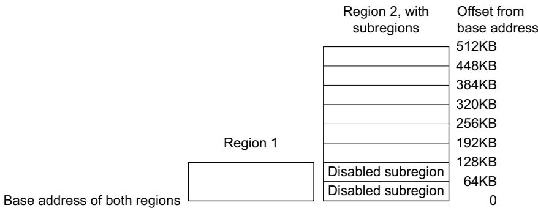

## 4.6.9 MPU design hints and tips

Note

Ignore this section if the optional MPU is not present in your implementation.

To avoid unexpected behavior, disable the interrupts before updating the attributes of a region that the interrupt handlers might access.

The processor does not support unaligned accesses to MPU registers.

Note

The MPU registers support aligned word accesses only. Byte and halfword accesses are UNPREDICTABLE.

When setting up the MPU, and if the MPU has previously been programmed, disable unused regions to prevent any previous region settings from affecting the new MPU setup.

## 4.7 Floating Point Unit

This section describes the optional Floating-Point Unit (FPU) in a Cortex-M7 device. The FPU implements the FPv5 floating-point extensions.

Depending on your implementation, the FPU fully supports either single-precision, or double-precision, or both for add, subtract, multiply, divide, multiply and accumulate, and square root operations. It also provides conversions between fixed-point and floating-point data formats, and floating-point constant instructions.

The FPU provides floating-point computation functionality that is compliant with the ANSI/IEEE Std 754-2008, IEEE Standard for Binary Floating-Point Arithmetic, referred to as the IEEE 754 standard.

For implementations with the FPU configured for single-precision only, the FPU contains 32 single-precision extension registers, that you can also access as 16 doubleword registers for load, store, and move operations.

Table 4-58 shows the floating-point system registers in the Cortex-M7 processor with FPU.

Table 4-58 Cortex-M7 floating-point system registers

<table><tr><td>Address</td><td>Name</td><td>Type</td><td>Required privilege</td><td>Reset</td><td>Description</td></tr><tr><td>0xE000ED88</td><td>CPACR</td><td>RW</td><td>Privileged</td><td>0x00000000</td><td>Coprocessor Access Control Register on page 4-56</td></tr><tr><td>0xE000EF34</td><td>FPCCR</td><td>RW</td><td>Privileged</td><td>0xC0000000</td><td>Floating-point Context Control Register on page 4-56</td></tr><tr><td>0xE000EF38</td><td>FPCAR</td><td>RW</td><td>Privileged</td><td>-</td><td>Floating-point Context Address Register on page 4-57</td></tr><tr><td>-</td><td> $FPSCR^a$ </td><td>RW</td><td>Unprivileged</td><td>-</td><td>Floating-point Status Control Register on page 4-58</td></tr><tr><td>0xE000EF3C</td><td>FPDSCR</td><td>RW</td><td>Privileged</td><td>0x00000000</td><td>Floating-point Default Status Control Register on page 4-59</td></tr></table>

a. The FPSCR register is not memory-mapped, it can be accessed using the VMSR and VMRS instructions, see VMRS on page 3-156 and VMSR on page 3-157. Software can only access the FPSCR when the FPU is enabled, see Enabling the FPU on page 4-59.

The following sections describe the floating-point system registers whose implementation is specific to this processor.

## 4.7.1 Coprocessor Access Control Register

The CPACR register specifies the access privileges for coprocessors. See the register summary in Table 4-58 on page 4-55 for its attributes. The bit assignments are:

<table><tr><td colspan="2">Reserved</td><td>CP11</td><td>CP10</td><td colspan="2">Reserved</td></tr></table>

Table 4-59 CPACR bit assignments

<table><tr><td>Bits</td><td>Name</td><td colspan="2">Function</td></tr><tr><td>[31:24]</td><td>-</td><td colspan="2">Reserved. Read as Zero, Write Ignore.</td></tr><tr><td rowspan="5"> $[2n+1:2n]$  for  $n$  values10 and 11</td><td rowspan="5">CP $n$ </td><td colspan="2">Access privileges for coprocessor  $n$ . The possible values of each field are:</td></tr><tr><td>0b00</td><td>Access denied. Any attempted access generates a NOCP UsageFault.</td></tr><tr><td>0b01</td><td>Privileged access only. An unprivileged access generates a NOCP fault.</td></tr><tr><td>0b10</td><td>Reserved. The result of any access is Unpredictable.</td></tr><tr><td>0b11</td><td>Full access.</td></tr><tr><td>[19:0]</td><td>-</td><td colspan="2">Reserved. Read as Zero, Write Ignore.</td></tr></table>

## 4.7.2 Floating-point Context Control Register

The FPCCR register sets or returns FPU control data. See the register summary in Table 4-58 on page 4-55 for its attributes. The bit assignments are:

<table><tr><td colspan="17">Reserved</td></tr><tr><td></td><td></td><td></td><td></td><td></td><td></td><td></td><td></td><td></td><td></td><td></td><td></td><td></td><td></td><td></td><td></td><td></td></tr><tr><td>LSPEN</td><td></td><td></td><td></td><td></td><td></td><td></td><td></td><td></td><td></td><td></td><td></td><td></td><td></td><td></td><td></td><td></td></tr><tr><td>ASPEN</td><td></td><td></td><td></td><td></td><td></td><td></td><td></td><td></td><td></td><td></td><td></td><td></td><td></td><td></td><td></td><td></td></tr></table>

Table 4-60 FPCCR bit assignments

<table><tr><td>Bits</td><td>Name</td><td colspan="2">Function</td></tr><tr><td rowspan="3">[31]</td><td rowspan="3">ASPEN</td><td colspan="2">Enables CONTROL.FPCA setting on execution of a floating-point instruction. This results in automatic hardware state preservation and restoration, for floating-point context, on exception entry and exit.</td></tr><tr><td>0</td><td>Disable CONTROL.FPCA setting on execution of a floating-point instruction.</td></tr><tr><td>1</td><td>Enable CONTROL.FPCA setting on execution of a floating-point instruction.</td></tr><tr><td rowspan="2">[30]</td><td rowspan="2">LSPEN</td><td>0</td><td>Disable automatic lazy state preservation for floating-point context.</td></tr><tr><td>1</td><td>Enable automatic lazy state preservation for floating-point context.</td></tr><tr><td>[29:9]</td><td>-</td><td colspan="2">Reserved.</td></tr><tr><td>Bits</td><td>Name</td><td>Function</td><td></td></tr><tr><td rowspan="2">[8]</td><td rowspan="2">MONRDY</td><td>0</td><td>DebugMonitor is disabled or priority did not permit setting MON_PEND when the floating-point stack frame was allocated.</td></tr><tr><td>1</td><td>DebugMonitor is enabled and priority permits setting MON_PEND when the floating-point stack frame was allocated.</td></tr><tr><td>[7]</td><td>-</td><td>Reserved.</td><td></td></tr><tr><td rowspan="2">[6]</td><td rowspan="2">BFRDY</td><td>0</td><td>BusFault is disabled or priority did not permit setting the BusFault handler to the pending state when the floating-point stack frame was allocated.</td></tr><tr><td>1</td><td>BusFault is enabled and priority permitted setting the BusFault handler to the pending state when the floating-point stack frame was allocated.</td></tr><tr><td rowspan="2">[5]</td><td rowspan="2">MMRDY</td><td>0</td><td>MemManage is disabled or priority did not permit setting the MemManage handler to the pending state when the floating-point stack frame was allocated.</td></tr><tr><td>1</td><td>MemManage is enabled and priority permitted setting the MemManage handler to the pending state when the floating-point stack frame was allocated.</td></tr><tr><td rowspan="2">[4]</td><td rowspan="2">HFRDY</td><td>0</td><td>Priority did not permit setting the HardFault handler to the pending state when the floating-point stack frame was allocated.</td></tr><tr><td>1</td><td>Priority permitted setting the HardFault handler to the pending state when the floating-point stack frame was allocated.</td></tr><tr><td rowspan="2">[3]</td><td rowspan="2">THREAD</td><td>0</td><td>Mode was not Thread Mode when the floating-point stack frame was allocated.</td></tr><tr><td>1</td><td>Mode was Thread Mode when the floating-point stack frame was allocated.</td></tr><tr><td>[2]</td><td>-</td><td>Reserved.</td><td></td></tr><tr><td rowspan="2">[1]</td><td rowspan="2">USER</td><td>0</td><td>Privilege level was not user when the floating-point stack frame was allocated.</td></tr><tr><td>1</td><td>Privilege level was user when the floating-point stack frame was allocated.</td></tr><tr><td rowspan="2">[0]</td><td rowspan="2">LSPACT</td><td>0</td><td>Lazy state preservation is not active.</td></tr><tr><td>1</td><td>Lazy state preservation is active. Floating-point stack frame has been allocated but saving state to it has been deferred.</td></tr></table>

## 4.7.3 Floating-point Context Address Register

The FPCAR register holds the location of the unpopulated floating-point register space allocated on an exception stack frame. See the register summary in Table 4-58 on page 4-55 for its attributes. The bit assignments are:

<table><tr><td>31</td><td></td><td></td><td></td><td></td><td></td><td>3</td><td>2</td><td>0</td></tr><tr><td colspan="7">ADDRESS</td><td colspan="2"></td></tr></table>

Reserved

Table 4-61 FPCAR bit assignments

<table><tr><td>Bits</td><td>Name</td><td>Function</td></tr><tr><td>[31:3]</td><td>ADDRESS</td><td>The location of the unpopulated floating-point register space allocated on an exception stack frame.</td></tr><tr><td>[2:0]</td><td>-</td><td>Reserved. Read as Zero, Writes Ignored.</td></tr></table>

## 4.7.4 Floating-point Status Control Register

The FPSCR register provides all necessary User level control of the floating-point system. The bit assignments are:

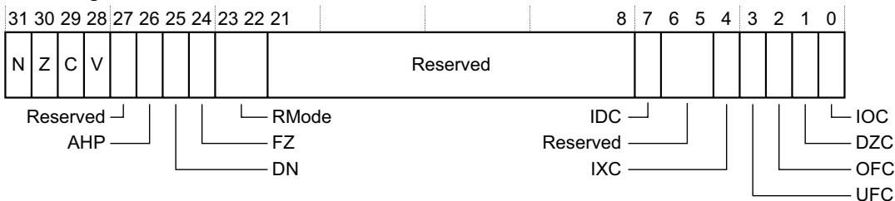

Table 4-62 FPSCR bit assignments

<table><tr><td>Bits</td><td>Name</td><td colspan="2">Function</td></tr><tr><td>[31]</td><td>N</td><td colspan="2">Condition code flags. Floating-point comparison operations update these flags:</td></tr><tr><td rowspan="2">[30]</td><td rowspan="2">Z</td><td>N</td><td>Negative condition code flag.</td></tr><tr><td>Z</td><td>Zero condition code flag.</td></tr><tr><td>[29]</td><td>C</td><td>C</td><td>Carry condition code flag.</td></tr><tr><td>[28]</td><td>V</td><td>V</td><td>Overflow condition code flag.</td></tr><tr><td>[27]</td><td>-</td><td colspan="2">Reserved.</td></tr><tr><td rowspan="3">[26]</td><td rowspan="3">AHP</td><td colspan="2">Alternative half-precision control bit:</td></tr><tr><td>0</td><td>IEEE half-precision format selected.</td></tr><tr><td>1</td><td>Alternative half-precision format selected.</td></tr><tr><td rowspan="3">[25]</td><td rowspan="3">DN</td><td colspan="2">Default NaN mode control bit:</td></tr><tr><td>0</td><td>NaN operands propagate through to the output of a floating-point operation.</td></tr><tr><td>1</td><td>Any operation involving one or more NaNs returns the Default NaN.</td></tr><tr><td rowspan="3">[24]</td><td rowspan="3">FZ</td><td colspan="2">Flush-to-zero mode control bit:</td></tr><tr><td>0</td><td>Flush-to-zero mode disabled. Behavior of the floating-point system is fully compliant with the IEEE 754 standard.</td></tr><tr><td>1</td><td>Flush-to-zero mode enabled.</td></tr><tr><td rowspan="6">[23:22]</td><td rowspan="6">RMode</td><td colspan="2">Rounding Mode control field. The encoding of this field is:</td></tr><tr><td>0b00</td><td>Round to Nearest (RN) mode.</td></tr><tr><td>0b01</td><td>Round towards Plus Infinity (RP) mode.</td></tr><tr><td>0b10</td><td>Round towards Minus Infinity (RM) mode.</td></tr><tr><td>0b11</td><td>Round towards Zero (RZ) mode.</td></tr><tr><td colspan="2">The specified rounding mode is used by almost all floating-point instructions.</td></tr><tr><td>[21:8]</td><td>-</td><td colspan="2">Reserved.</td></tr><tr><td>[7]</td><td>IDC</td><td colspan="2">Input Denormal cumulative exception bit, see bits [4:0].</td></tr><tr><td>[6:5]</td><td>-</td><td colspan="2">Reserved.</td></tr></table>

## Table 4-62 FPSCR bit assignments (continued)

<table><tr><td>Bits</td><td>Name</td><td colspan="2">Function</td></tr><tr><td>[4]</td><td>IXC</td><td colspan="2">Cumulative exception bits for floating-point exceptions, see also bit [7]. Each of these bits is set to 1 to indicate that the corresponding exception has occurred since 0 was last written to it.</td></tr><tr><td>[3]</td><td>UFC</td><td>IDC, bit[7]</td><td>Input Denormal cumulative exception bit.</td></tr><tr><td>[2]</td><td>OFC</td><td>IXC</td><td>Inexact cumulative exception bit.</td></tr><tr><td rowspan="2">[1]</td><td rowspan="2">DZC</td><td>UFC</td><td>Underflow cumulative exception bit.</td></tr><tr><td>OFC</td><td>Overflow cumulative exception bit.</td></tr><tr><td rowspan="2">[0]</td><td rowspan="2">IOC</td><td>DZC</td><td>Division by Zero cumulative exception bit.</td></tr><tr><td>IOC</td><td>Invalid Operation cumulative exception bit.</td></tr></table>

## 4.7.5 Floating-point Default Status Control Register

The FPDSCR register holds the default values for the floating-point status control data. See the register summary in Table 4-58 on page 4-55 for its attributes. The bit assignments are:

<table><tr><td colspan="6">Reserved</td><td colspan="2">Reserved</td></tr><tr><td>AHP—DN—</td><td colspan="7">RModeFZ</td></tr></table>

Table 4-63 FPDSCR bit assignments

<table><tr><td>Bits</td><td>Name</td><td>Function</td></tr><tr><td>[31:27]</td><td>-</td><td>Reserved</td></tr><tr><td>[26]</td><td>AHP</td><td>Default value for FPSCR.AHP</td></tr><tr><td>[25]</td><td>DN</td><td>Default value for FPSCR.DN</td></tr><tr><td>[24]</td><td>FZ</td><td>Default value for FPSCR.FZ</td></tr><tr><td>[23:22]</td><td>RMode</td><td>Default value for FPSCR.RMode</td></tr><tr><td>[21:0]</td><td>-</td><td>Reserved</td></tr></table>

## 4.7.6 Enabling the FPU

Note

Ignore this section if the optional FPU is not present in your implementation.

The FPU is disabled from reset. You must enable it before you can use any floating-point instructions. Example 4-1 on page 4-60 shows an example code sequence for enabling the FPU in privileged mode. The processor must be in privileged mode to read from and write to the CPACR.

CPACR EQU 0xE000ED88 LDR R0, =CPACR ; Read CPACR LDR r1, [R0] ; Set bits 20-23 to enable CP10 and CP11 coprocessors ORR R1, R1, #(0xF << 20) STR R1, [R0] ; Write back the modified value to the CPACR DSB ISB ; Reset pipeline now the FPU is enabled.

## 4.8 Cache maintenance operations

Note

Ignore this section if caches are not present in your implementation.

This section describes the optional cache maintenance registers in a Cortex-M7 device. These registers control the data and instruction cache.

The operations supported for the instruction cache and data cache are:

Enable or disable a cache.

Invalidate a cache.

Clean a cache.

The cache maintenance operations are only accessible by privileged loads and stores. Unprivileged accesses to these registers always generate a BusFault.

Table 4-64 Cache Maintenance Space register summary

<table><tr><td>Address</td><td>Name</td><td>Type</td><td>Required privilege</td><td>Reset value</td><td>Description</td></tr><tr><td>0xE000EF50</td><td>ICIALLU</td><td>WO</td><td>Privileged</td><td>Unknown</td><td>Instruction cache invalidate all to the Point of Unification (PoU) $^a$ </td></tr><tr><td>0xE000EF54</td><td>-</td><td>-</td><td>-</td><td>-</td><td>Reserved</td></tr><tr><td>0xE000EF58</td><td>ICIMVAU</td><td>WO</td><td>Privileged</td><td>Unknown</td><td>Instruction cache invalidate by address to the PoU $^a$ </td></tr><tr><td>0xE000EF5C</td><td>DCIMVAC</td><td>WO</td><td>Privileged</td><td>Unknown</td><td>Data cache invalidate by address to the Point of Coherency (PoC) $^b$ </td></tr><tr><td>0xE000EF60</td><td>DCISW</td><td>WO</td><td>Privileged</td><td>Unknown</td><td>Data cache invalidate by set/way</td></tr><tr><td>0xE000EF64</td><td>DCCMVAU</td><td>WO</td><td>Privileged</td><td>Unknown</td><td>Data cache clean by address to the PoU $^a$ </td></tr><tr><td>0xE000EF68</td><td>DCCMVAC</td><td>WO</td><td>Privileged</td><td>Unknown</td><td>Data cache clean by address to the PoC $^b$ </td></tr><tr><td>0xE000EF6C</td><td>DCCSW</td><td>WO</td><td>Privileged</td><td>Unknown</td><td>Data cache clean by set/way</td></tr><tr><td>0xE000EF70</td><td>DCCIMVAC</td><td>WO</td><td>Privileged</td><td>Unknown</td><td>Data cache clean and invalidate by address to the PoC $^b$ </td></tr><tr><td>0xE000EF74</td><td>DCCISW</td><td>WO</td><td>Privileged</td><td>Unknown</td><td>Data cache clean and invalidate by set/way</td></tr><tr><td>0xE000EF78</td><td>BPIALL</td><td>RAZ/WI</td><td>Privileged</td><td>-</td><td>The BPIALL register is not implemented</td></tr></table>

a. Cache maintenance operations by PoU can be used to synchronize data between the Cortex-M7 data and instruction Caches, for example when the software uses self-modifying code.  
b. Cache maintenance operations by PoC can be used to synchronize data between the Cortex-M7 data cache and an external agent such as a system DMA.

## 4.8.1 Full instruction cache operation

The ICIALLU is WO and write data is ignored and reads return 0. Writes to this register perform the requested cache maintenance operation. The BPIALL register is not implemented in the Cortex-M7 processor as branch predictor maintenance is not required. The register is RAZ/WI.

## 4.8.2 Instruction and data cache operations by address

The cache maintenance operations by address registers are ICIMVAU, DCIMVAC, DCCMVAU, DCCMVAC, and DCCIMVAC. These registers are WO, reads return 0. See the register summary in Table 4-64 on page 4-61 for their attributes. The bit assignments are:

Table 4-65 Cache operations registers bit assignments

<table><tr><td>Bit</td><td>Name</td><td>Type</td><td>Function</td></tr><tr><td>[31:5]</td><td>MVA</td><td>WO</td><td>MVA of requested operation</td></tr></table>

## 4.8.3 Data cache operations by set-way

The DCISW, DCCSW and DCCISW registers are WO. Reads return 0. See the register summary in Table 4-64 on page 4-61 for their attributes. The bit assignments are:

<table><tr><td colspan="2">31 30 29</td><td colspan="2">14 13</td><td>5 4</td><td colspan="2">1 0</td></tr><tr><td>Way</td><td colspan="2">Reserved</td><td colspan="2">Set</td><td>Reserved</td><td>0</td></tr></table>

Table 4-66 Cache operations by set-way bit assignments

<table><tr><td>Bit</td><td>Name</td><td>Type</td><td>Function</td></tr><tr><td>[31:30]</td><td>Way</td><td>WO</td><td>Way that operation applies to.For the data cache, values 0, 1, 2 and 3 are supported.</td></tr><tr><td>[29:14]</td><td>-</td><td>-</td><td>Reserved.</td></tr><tr><td>[13:5]</td><td>Set</td><td>WO</td><td>Set/index that operation applies to. The number of indices in a cache depends on the configured cache size. When this is less than the maximum, use the LSB of this field. The number of sets in the cache can be determined by reading the Cache Size ID Register on page 4-39.</td></tr><tr><td>[4:1]</td><td>-</td><td>-</td><td>Reserved.</td></tr><tr><td>[0]</td><td>-</td><td>-</td><td>Always reads as zero.</td></tr></table>

## 4.8.4 Accessing the Cortex-M7 NVIC cache maintenance operations using CMSIS

CMSIS functions enable software portability between different Cortex-M profile processors. To access cache maintenance operations when using CMSIS, use the following functions:

Table 4-67 CMSIS access cache maintenance operations

<table><tr><td>CMSIS function</td><td>Descriptions</td></tr><tr><td>void SCB_EnableICache (void)</td><td>Invalidate and then enable instruction cache</td></tr><tr><td>void SCB_DisableICache (void)</td><td>Disable instruction cache and invalidate its contents</td></tr><tr><td>void SCB_ValidateICache (void)</td><td>Invalidate instruction cache</td></tr><tr><td>void SCB_EnableDCache (void)</td><td>Invalidate and then enable data cache</td></tr><tr><td>void SCB_DisableDCache (void)</td><td>Disable data cache and then clean and invalidate its contents</td></tr><tr><td>void SCB_ValidateDCache (void)</td><td>Invalidate data cache</td></tr><tr><td>void SCB_CleanDCache (void)</td><td>Clean data cache</td></tr></table>

<table><tr><td>CCSIDR</td><td>EQU 0xE000ED80</td><td>; Cache size ID register address</td></tr><tr><td>CSSELR</td><td>EQU 0xE000ED84</td><td>; Cache size selection register address</td></tr><tr><td>DCISW</td><td>EQU 0xE000EF60</td><td>; Cache maintenance op address: data cache clean and invalidate by set/way</td></tr><tr><td></td><td></td><td>; CSSELR selects the cache visible in CCSIDR</td></tr><tr><td></td><td>MOV r0, #0x0</td><td>; 0 = select “level 1 data cache”</td></tr><tr><td></td><td>LDR r11, =CSSELR</td><td>;</td></tr><tr><td></td><td>STR r0, [r11]</td><td>;</td></tr><tr><td></td><td>DSB</td><td>; Ensure write to CSSELR before proceeding</td></tr></table>

Table 4-67 CMSIS access cache maintenance operations (continued)

<table><tr><td>CMSIS function</td><td>Descriptions</td></tr><tr><td>void SCB_CleanInvalidateDCache (void)</td><td>Clean and invalidate data cache</td></tr><tr><td>void SCB_ InvalidateDCache_by_Addr (uint32_t *addr, int32_t dsize)</td><td>Invalidate data cache by address</td></tr><tr><td>void SCB_CleanDCache_by_Addr (uint32_t *addr, int32_t dsize)</td><td>Clean data cache by address</td></tr><tr><td>void SCB_CleanInvalidateDCache_by_Addr (uint32_t *addr, int32_t dsize)</td><td>Clean and invalidate data cache by address</td></tr></table>

Arm might add more cache management functions to the CMSIS in the future, and recommends that you check the CMSIS documentation on a regular basis for the latest information.

## 4.8.5 Initializing and enabling the L1 cache

You can use cache maintenance operations for:

Cache startup type operations.

Manipulating the caches so that shared data is visible to other bus masters.

Enabling data changed by an external DMA agent to be made visible to the Cortex-M7 processor.

After you enable or disable the instruction cache, you must issue an ISB instruction to flush the pipeline. This ensures that all subsequent instruction fetches see the effect of enabling or disabling the instruction cache.

After reset, you must invalidate each cache before enabling it.

When disabling the data cache, you must clean the entire cache to ensure that any dirty data is flushed to external memory.

Before enabling the data cache, you must invalidate the entire data cache if external memory might have changed since the cache was disabled.

Before enabling the instruction cache, you must invalidate the entire instruction cache if external memory might have changed since the cache was disabled.

If your implementation has L1 data and instruction caches, they must be invalidated before they are enabled in software, otherwise UNPREDICTABLE behavior can occur.

## Invalidate the entire data cache

Software can use the following code example to invalidate the entire data cache, if it has been included in the processor. The operation is carried out by iterating over each line of the cache and using the DCISW register in the Private Peripheral Bus (PPB) memory region to invalidate the line. The number of cache ways and sets is determined by reading the CCSIDR register.

```txt
LDR r11, =CCSIDR ; From CCSIDR
LDR r2, [r11] ; Read data cache size information
AND r1, r2, #0x7 ; r1 = cache line size
ADD r7, r1, #0x4 ; r7 = number of words in a cache line

UBFX r4, r2, #3, #10 ; r4 = number of “ways”-1 of data cache

UBFX r2, r2, #13, #15 ; r2 = number of “set”-1 of data cache

CLZ r6, r4 ; calculate bit offset for “way” in DCISW

LDR r11, =DCISW ; invalidate cache by set/way

inv_loop1 ; For each “set”
MOV r1, r4 ; r1 = number of “ways”-1
LSLS r8, r2, r7 ; shift “set” value to bit 5 of r8

inv_loop2 ; For each “way”
LSLS r3, r1, r6 ; shift “way” value to bit 30 in r6
ORRS r3, r3, r8 ; merge “way” and “set” value for DCISW
STR r3, [r11] ; invalidate D-cache line
SUBS r1, r1, #0x1 ; decrement “way”
BGE inv_loop2 ; End for each “way”

SUBS r2, r2, #0x1 ; Decrement “set”
BGE inv_loop1 ; End for each “set”

DSB ; Data sync barrier after invalidate cache
ISB ; Instruction sync barrier after invalidate cache
```

## Invalidate instruction cache

You can use the following code example to invalidate the entire instruction cache, if it has been included in the processor. The operation is carried out by writing to the ICIALLU register in the PPB memory region.

## ICIALLU EQU 0xE000EF50

```asm
MOV r0, #0x0
LDR r11, =ICIALLU
STR r0, [r11]
```

## DSBISB

## Enabling data and instruction caches

You can use the following code example to enable the data and instruction cache after they have been initialized. The operation is carried out by modifying the CCR.IC and CCR.DC fields in the PPB memory region.

## CCR EQU 0xE000ED14

```asm
LDR r11, =CCR
LDR r0, [r11]
ORR r0, r0, #0x1:SHL:16 ; Set CCR.DC field
ORR r0, r0, #0x1:SHL:17 ; Set CCR.IC field
STR r0, [r11]
```

## DSB

## ISB

## 4.8.6 Faults handling considerations

Cache maintenance operations can result in a BusFault. Such fault events are asynchronous.

This type of BusFault:

Does not cause escalation to HardFault where a BusFault handler is enabled.

• Never causes lockup.

Because the fault event is asynchronous, software code for cache maintenance operations must use memory barrier instructions, such as DSB, on completion so that the fault event can be observed immediately.

## 4.8.7 Cache maintenance design hints and tips

You must always place a DSB and ISB instruction sequence after a cache maintenance operation to ensure that the effect is observed by any following instructions in the software.

When using a cache maintenance operation by address or set/way a DSB instruction must be executed after any previous load or store, and before the maintenance operation, to guarantee that the effect of the load or store is observed by the operation. For example, if a store writes to the address accessed by a DCCMVAC the DSB instruction guarantees that the dirty data is correctly cleaned from the data cache.

When one or more maintenance operations have been executed, use of a DSB instruction guarantees that they have completed and that any following load or store operations executes in order after the maintenance operations.

Cache maintenance operations always complete in-order with respect to each other. This means only one DSB instruction is required to guarantee the completion of a set of maintenance operations.

The following code sequence shows how to use cache maintenance operations to synchronize the data and instruction caches for self-modifying code. The sequence is entered with <Rx> containing the new 32-bit instruction. Use STRH in the first line instead of STR for a 16-bit instruction:

STR <Rx>, <inst\_address1>

DSB

; Ensure the data has been written to the cache.

STR <inst\_address1>, DCCMVAU ; Clean data cache by MVA to point of unification (PoU).

STR <inst\_address1>, ICIMVAU ; Invalidate instruction cache by MVA to PoU.

DSB

; Ensure completion of the invalidations.

ISB

; Synchronize fetched instruction stream.

## 4.9 Access control

Control of the optional L1 cache ECC and attribute override, the priority of AHB slave traffic, and whether an access is mapped to TCM interfaces or AXI master interface, is defined by the access control registers. The access control registers are:

Table 4-68 Access control register summary

<table><tr><td>Address</td><td>Name</td><td>Type</td><td>Required privilege</td><td>Reset value</td><td>Description</td></tr><tr><td>0xE000EF90</td><td>ITCMCR</td><td>RW</td><td>Privileged</td><td> $0x00000000^a$ </td><td rowspan="2">Instruction and Data Tightly-Coupled Memory Control Registers on page 4-67</td></tr><tr><td>0xE000EF94</td><td>DTCMCR</td><td>RW</td><td>Privileged</td><td> $0x00000000^a$ </td></tr><tr><td>0xE000EF98</td><td>AHBPCR</td><td>RW</td><td>Privileged</td><td> $0x00000000^a$ </td><td>AHBP Control Register on page 4-69</td></tr><tr><td>0xE000EF9C</td><td>CACR</td><td>RW</td><td>Privileged</td><td>_b</td><td>L1 Cache Control Register on page 4-70</td></tr><tr><td>0xE000EFA0</td><td>AHBSCR</td><td>RW</td><td>Privileged</td><td>0x00000800</td><td>AHB Slave Control Register on page 4-72</td></tr><tr><td>0xE000EFA8</td><td>ABFSR</td><td>RW</td><td>Privileged</td><td>0x00000000</td><td>Auxiliary Bus Fault Status register on page 4-73</td></tr></table>

a. Implementation defined.

b. The reset value is implementation and configuration dependent and the silicon vendor changes this. If cache ECC is configured the reset value is 0x00000000, if cache ECC is not configured the reset value is 0x00000002

## 4.9.1 Instruction and Data Tightly-Coupled Memory Control Registers

The ITCMCR and DTCMCR control whether access is mapped to the TCM interfaces or the AXI master interface. The bit assignments are:

<table><tr><td>Reserved</td><td>SZ</td><td></td><td></td><td></td></tr><tr><td></td><td>RETEN</td><td></td><td></td><td></td></tr><tr><td></td><td>RMW</td><td></td><td></td><td></td></tr><tr><td></td><td>EN</td><td></td><td></td><td></td></tr></table>

Table 4-69 ITCMCR and DTCMCR bit assignments

<table><tr><td>Bits</td><td>Name</td><td>Type</td><td colspan="2">Function</td></tr><tr><td>[31:7]</td><td>-</td><td>-</td><td colspan="2">Reserved, RAZ/WI.</td></tr><tr><td rowspan="16">[6:3]</td><td rowspan="16">SZ</td><td rowspan="16">RO</td><td colspan="2">TCM size. Indicates the size of the relevant TCM. The values that apply depend on your implementation:</td></tr><tr><td>0b0000</td><td>No TCM implemented.</td></tr><tr><td>0b0011</td><td>4KB.</td></tr><tr><td>0b0100</td><td>8KB.</td></tr><tr><td>0b0101</td><td>16KB.</td></tr><tr><td>0b0110</td><td>32KB.</td></tr><tr><td>0b0111</td><td>64KB.</td></tr><tr><td>0b1000</td><td>128KB.</td></tr><tr><td>0b1001</td><td>256KB.</td></tr><tr><td>0b1010</td><td>512KB.</td></tr><tr><td>0b1011</td><td>1MB.</td></tr><tr><td>0b1100</td><td>2MB.</td></tr><tr><td>0b1101</td><td>4MB.</td></tr><tr><td>0b1110</td><td>8MB.</td></tr><tr><td>0b1111</td><td>16MB.</td></tr><tr><td colspan="2">All other encodings are reserved.</td></tr><tr><td rowspan="3">[2]</td><td rowspan="3">RETENa</td><td rowspan="3">RW</td><td colspan="2">Retry phase enable. When enabled the processor guarantees to honor the retry output on the corresponding TCM interface:</td></tr><tr><td>0</td><td>Retry phase disabled.</td></tr><tr><td>1</td><td>Retry phase enabled.</td></tr><tr><td rowspan="3">[1]</td><td rowspan="3">RMWb</td><td rowspan="3">RW</td><td colspan="2">Read-Modify-Write (RMW) enable. Indicates that all sub-chunk writes to a given TCM use a RMW sequence:</td></tr><tr><td>0</td><td>RMW disabled.</td></tr><tr><td>1</td><td>RMW enabled.</td></tr><tr><td rowspan="3">[0]</td><td rowspan="3">EN</td><td rowspan="3">RW</td><td colspan="2">TCM enable. When a TCM is disabled all accesses are made to the AXI master.</td></tr><tr><td>0</td><td>TCM disabled.</td></tr><tr><td>1</td><td>TCM enabled.</td></tr></table>

a. The RETEN field in the ITCMCR and DTCMCR is used to support the optional error detection and correction in the TCM.  
b. The RMW field in the ITCMCR and DTCMCR is used to support the optional error detection and correction in the TCM.

## Enabling the TCM

The TCM interfaces can be enabled at reset in the system by an external signal on the processor. If they are disabled at reset then the following code example can be used to enable both the instruction and data TCM interfaces in software:

ITCMCR EQU 0xE000EF90 DTCMCR EQU 0xE000EF94

```asm
LDR r11, =ITCMCR
LDR r0, [r11]
ORR r0, r0, #0x1 ; Set ITCMCR.EN field
STR r0, [r11]
```

```asm
LDR r11, =DTCMCR
LDR r0, [r11]
ORR r0, r0, #0x1 ; Set DTCMCR.EN field
STR r0, [r11]
```

DSBISB

## Enabling the TCM retry and read-modify-write

If the TCM connected to the processor supports error detection and correction, the TCM interface must be configured to support the retry and read-modify-write features. These can be enabled at reset in the system by external signals on the processor. If they are disabled at reset then the following code example can be used to enable them in software:

ITCMCR EQU 0xE000EF90 DTCMCR EQU 0xE000EF94

LDR r11, =ITCMCR LDR r0, [r11] ORR r0, r0, #0x1:SHL:1 ; Set ITCMCR.RMW field ORR r0, r0, #0x1:SHL:2 ; Set ITCMCR.RETEN field STR r0, [r11]

LDR r11, =DTCMCR LDR r0, [r11] ORR r0, r0, #0x1:SHL:1 ; Set DTCMCR.RMW field ORR r0, r0, #0x1:SHL:2 ; Set DTCMCR.RETEN field STR r0, [r11]

DSBISB

## 4.9.2 AHBP Control Register

Note

This register is optional and might not be available in your implementation.

Depending on your implementation, the AHBPCR controls accesses to the device either on the AHBP interface or AXI master interface. The bit assignments are:

<table><tr><td>Reserved</td><td>SZ</td><td></td></tr></table>

EN

Table 4-70 AHBPCR bit assignments

<table><tr><td>Bits</td><td>Name</td><td>Type</td><td colspan="2">Function</td></tr><tr><td>[31:4]</td><td>-</td><td>-</td><td colspan="2">Reserved, RAZ/WI.</td></tr><tr><td rowspan="5">[3:1]</td><td rowspan="5">SZ</td><td rowspan="5">RO</td><td colspan="2">AHBP size. The values that apply depend on your implementation:</td></tr><tr><td>0b001</td><td>64MB.</td></tr><tr><td>0b010</td><td>128MB.</td></tr><tr><td>0b011</td><td>256MB.</td></tr><tr><td>0b100</td><td>512MB.</td></tr><tr><td rowspan="3">[0]</td><td rowspan="3">EN</td><td rowspan="3">RW</td><td colspan="2">AHBP enable:</td></tr><tr><td>0</td><td>AHBP disabled. When disabled all accesses are made to the AXI master.</td></tr><tr><td>1</td><td>AHBP enabled.</td></tr></table>

## Enabling the AHBP interface

Depending on your implementation, the AHBP interface can be enabled at reset in the system by an external signal on the processor. If it is disabled at reset then the following code example can be used to enable the AHPB interface from software:

AHBPCR EQU 0xE000EF98

LDR r11, =AHBPCR

LDR r0, [r11]

ORR r0, r0, #0x1

STR r0, [r11]

; Set AHBPCR.EN field

DSB

ISB

## 4.9.3 L1 Cache Control Register

Note

This register is optional and might not be available in your implementation.

The CACR controls the optional L1 ECC and the L1 cache coherency usage model. The bit assignments are:

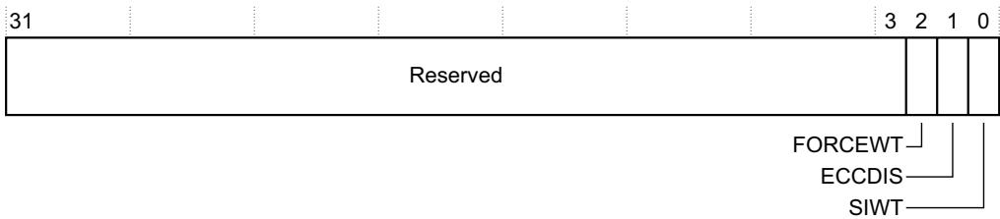

Table 4-71 CACR bit assignments

<table><tr><td>Bits</td><td>Name</td><td>Type</td><td>Function</td></tr><tr><td>[31:3]</td><td>-</td><td>-</td><td>Reserved, RAZ/WI.</td></tr><tr><td>[2]</td><td>FORCEWT</td><td>RW</td><td>Enables Force Write-Through in the data cache:0 Disables Force Write-Through.1 Enables Force Write-Through. All Cacheable memory regions are treated as Write-Through.This bit is RAZ/WI if the data cache is excluded. If the data cache is included the reset value of FORCEWT is 0.</td></tr><tr><td>[1]</td><td>ECCDIS</td><td>RW</td><td>Enables ECC in the instruction and data cache:0 Enables ECC in the instruction and data cache. This is RAO/WI if both data cache and instruction cache are excluded or if ECC is excluded.1 Disables ECC in the instruction and data cache. This is RAZ/WI if data cache is not configured.</td></tr><tr><td>[0]</td><td>SIWT</td><td>RW</td><td>Shared cacheable-is-WT for data cache. Enables cache coherency usage:0 Normal Cacheable Shareable locations are treated as being Non-cacheable.Programmed inner cacheability attributes are ignored. This is the default mode of operation for shared memory. The data cache is transparent to software for these locations and therefore no software maintenance is required to maintain coherency.1 Normal Cacheable Shareable locations are treated as Write-Through. Programmed inner cacheability attributes are ignored. All writes are globally visible. Other memory agent updates are not visible to Cortex-M7 processor software without suitable cache maintenance.Useful for heterogeneous MP-systems where, for example, the Cortex-M7 processor is integrated on the Accelerator Coherency Port (ACP) interface on an MP-capable processor.This bit is RAZ/WI when data cache is not configured.</td></tr></table>

## Disabling cache error checking and correction

If cache error checking and correction is included in the processor it is enabled by default from reset. The following code example can be used to disable the feature. The operation is carried out by modifying the CACR.ECCEN field in the PPB memory region.

CACR EQU 0xE000EF9C

LDR r11, =CACR

LDR r0, [r11]

BFS r0, #0x1, #0x1 ; Clear CACR.ECCEN STR r0, [r11]

DSBISB

Care must be taken when software changes CACR.ECCEN. If CACR.ECCEN changes when the caches contain data, ECC information in the caches might not be correct for the new setting, resulting in unexpected errors and data loss. Therefore software must only change CACR.ECCEN when both caches are turned off and both caches must be invalidated after the change.

## 4.9.4 AHB Slave Control Register

Note

This register is optional and might not be available in your implementation.

The AHBSCR is used by software to control the priority of AHB slave traffic. The bit assignments are:

<table><tr><td>Reserved</td><td>INITCOUNT</td><td colspan="2">TPRI</td><td>CTL</td></tr></table>

Table 4-72 AHBSCR bit assignments

<table><tr><td>Bits</td><td>Name</td><td>Type</td><td>Function</td></tr><tr><td>[31:16]</td><td>-</td><td>-</td><td>Reserved.</td></tr><tr><td>[15:11]</td><td>INITCOUNT</td><td>RW</td><td>Fairness counter initialization value. Use to demote access priority of the requestor selected by the AHBSCR.CTL field. The reset value is 0b01.NoteFor round-robin mode set INITCOUNT to 0b01 and AHBSCR.CTL to 0b00 or 0b01.INITCOUNT must not be set to 0b00 because the demoted requestor always takes priority when contention occurs, which can lead to livelock.INITCOUNT is not used when AHBSCR.CTL is 0b11.</td></tr><tr><td>[10:2]</td><td>TPRI</td><td>RW</td><td>Threshold execution priority for AHBS traffic demotion.0b0xxxxxxx Priority is TPRI[7:0]. This is the same as the NVIC register encodings.0b11111111 Priority of -1. This is the priority of the HardFault exception.0b1111110 Priority of -2. This is the priority of the NMI exception.</td></tr><tr><td>[1:0]</td><td>CTL</td><td>RW</td><td>AHBS prioritization control:0b00 AHBS access priority demoted. This is the reset value.0b01 Software access priority demoted.0b10 AHBS access priority demoted by initializing the fairness counter to the AHBSCR.INITCOUNT value when the software execution priority is higher than or equal to the threshold level programmed in AHBSCR.TPRI. When the software execution priority is below this value, the fairness counter is initialized with 1 (round-robin).NoteThe threshold level encoding matches the NVIC encoding and uses arithmetically larger numbers to represent lower priority.0b11AHBSPRI signal has control of access priority.</td></tr></table>

## 4.9.5 Auxiliary Bus Fault Status register

The ABFSR stores information on the source of asynchronous bus faults. The ASBFSR bit assignments are:

<table><tr><td colspan="2">Reserved</td><td colspan="2">Reserved</td><td></td><td></td><td></td><td></td><td></td><td></td></tr><tr><td rowspan="5" colspan="2">AXIMTYPE</td><td colspan="2">EPPB</td><td></td><td></td><td></td><td></td><td></td><td></td></tr><tr><td colspan="2">AXIM</td><td></td><td></td><td></td><td></td><td></td><td></td></tr><tr><td colspan="2">AHBP</td><td></td><td></td><td></td><td></td><td></td><td></td></tr><tr><td colspan="2">DTCM</td><td></td><td></td><td></td><td></td><td></td><td></td></tr><tr><td colspan="2">ITCM</td><td></td><td></td><td></td><td></td><td></td><td></td></tr></table>

Table 4-73 ABFSR bit assignments

<table><tr><td>Bits</td><td>Name</td><td>Function</td></tr><tr><td>[31:10]</td><td>-</td><td>Reserved.</td></tr><tr><td>[9:8]</td><td>AXIMTYPE</td><td>Indicates the type of fault on the AXIM interface:0b00 OKAY.0b01 EXOKAY.0b10 SLVERR.0b11 DECERR.Only valid when AXIM is 1.</td></tr><tr><td>[7:5]</td><td>-</td><td>Reserved.</td></tr><tr><td>[4]</td><td>EPPB</td><td>Asynchronous fault on EPPB interface.a</td></tr><tr><td>[3]</td><td>AXIM</td><td>Asynchronous fault on AXIM interface.a</td></tr><tr><td>[2]</td><td>AHBP</td><td>Asynchronous fault on AHBP interfacea.</td></tr><tr><td>[1]</td><td>DTCM</td><td>Asynchronous fault on DTCM interface.a</td></tr><tr><td>[0]</td><td>ITCM</td><td>Asynchronous fault on ITCM interface.a</td></tr></table>

a. This interface might not be present in your implementation.

In the bus-fault handler, software reads the BFSR, and if an asynchronous fault occurs, the ABFSR is read to determine which interfaces are affected. The ABFSR[4:0] fields remains valid until cleared by writing to the ABFSR with any value.

For more information about the BFSR, see BusFault Status Register on page 4-27.

# Appendix A Cortex-M7 Options

This appendix describes the configuration options for a Cortex-M7 processor implementation. It shows what features of a Cortex-M7 implementation are determined by the device manufacturer. It contains the following section:

Cortex-M7 processor options on page A-2.

## A.1 Cortex-M7 processor options

Table A-1 shows the Cortex-M7 processor implementation options.

Table A-1 Effects of the Cortex-M7 processor implementation options

<table><tr><td>Option</td><td>Description, and affected documentation</td></tr><tr><td>RTL version</td><td>The RTL version can affect the availability of some features. This affects:Variant and Revision field values in Table 4-14 on page 4-13.The CPUID register reset value in Table 4-12 on page 4-11.</td></tr><tr><td>Inclusion of MPU</td><td>The implementer decides whether to include the Memory Protection Unit (MPU). This affects references to the MPU, or MPU registers in:About the Cortex-M7 processor and core peripherals on page 1-2.Memory regions, types and attributes on page 2-12.Behavior of memory accesses on page 2-14, after Table 2-11 on page 2-14.Software ordering of memory accesses on page 2-15.Exception types on page 2-19, in the description of MemManage fault.Fault handling on page 2-27.The MPU mismatch entries in Table 2-16 on page 2-27, except for the IACCVIOL entry.Footnote a to Table 2-16 on page 2-27.Table 4-1 on page 4-2. When the processor does not include an MPU, the Memory Protection Unit row address range must change to 0xE000ED90-0xE000ED93, MPU Type Register, reads as zero, and the following footnote applies:— Software can read the MPU Type Register at 0xE000ED90 to test for the presence of a Memory Protection Unit (MPU).Table 4-25 on page 4-24, in the description of the IACCVIOL bit.The MPU can be implemented either as an 8-region MPU or a 16-region MPU. This affects the DREGION bits in the MPU_TYPE register.</td></tr><tr><td>Inclusion of FPU</td><td>The implementer decides whether to include the Floating-Point Unit (FPU). The FPU implemented can be a single-precision only FPU, or single-precision and double-precision FPU. This affects:Floating-point instructions on page 3-135.Interruptible-continuable instructions in Core registers on page 2-3.The FPCA bit in the CONTROL register.Table 2-15 on page 2-26.The MLSPERR bit in the MemManage Fault Status Register (MMFSR).The LSPERR bit in the BusFault Status Register (BFSR).</td></tr><tr><td>Number of interrupts</td><td>The implementer decides how many interrupts the Cortex-M7 processor implementation supports, in the range 1-240. This affects:The maximum value of ISR_NUMBER in Table 2-5 on page 2-6.Entries in the last row of Table 2-14 on page 2-20, particularly if only one interrupt is implemented.The maximum interrupt number, and associated information where appropriate, in:— Exception handlers on page 2-21.— Figure 2-1 on page 2-22.— Nested Vectored Interrupt Controller on page 4-3.The number of implemented Nested Vectored Interrupt Controller (NVIC) registers in:— Table 4-2 on page 4-3.— The appropriate register descriptions in sections Interrupt Set-enable Registers on page 4-4 to Interrupt Priority Registers on page 4-7.Vector Table Offset Register on page 4-17, including the figure and Table 4-16 on page 4-17. See the configuration information in the section for guidance on the required configuration.</td></tr><tr><td>Number of priority bits</td><td>The implementer decides how many priority bits are implemented in priority value fields, in the range 3-8. Register priority value fields are 8 bits wide, and un-implemented low-order bits read as zero and ignore writes. This affects:• The footnote to Table 2-9 on page 2-9.• The maximum priority level value in the introduction to Nested Vectored Interrupt Controller on page 4-3.• In Interrupt Priority Registers on page 4-7:— The maximum priority level value, in the introductory sentence.— The priority field description, in Table 4-9 on page 4-7.• In System Handler Priority Registers on page 4-22:— The field width, in the introductory sentence.— The priority fields description, after Table 4-21 on page 4-22.• The description of the effect of the binary point, in Binary point on page 4-19.</td></tr><tr><td>Inclusion of the WIC</td><td>The implementer decides whether to include the Wakeup Interrupt Controller (WIC). This affects:• References to the WIC in About the Cortex-M7 processor and core peripherals on page 1-2.• The description of deep sleep mode and the selection of the sleep mode in the introduction to the section Power management on page 2-30.• The optional Wakeup Interrupt Controller on page 2-31.</td></tr><tr><td>Sleep mode power-saving</td><td>The implementer decides what power-saving sleep modes to implement, see Power management on page 2-30.Sleep mode power saving might also affect SysTick behavior, see SysTick design hints and tips on page 4-36.</td></tr><tr><td>Register reset values</td><td>The implementer decides whether all registers in the register bank can be reset. This affects the reset values in Table 2-2 on page 2-3.</td></tr><tr><td>Endianness</td><td>The implementer decides whether the memory system is little-endian or big-endian, and depends on the external signal, CFGBIGEND, see Data types on page 2-10, Memory endianness on page 2-15 and ENDIANNESS bit in Table 4-17 on page 4-18.</td></tr><tr><td>Memory features</td><td>Some features of the memory system are implementation specific. This affects details of vendor-specific memory in Memory model on page 2-12, including:The figure in that section. The memory map configuration of the Code SRAM and peripheral memory region 0x00000000 to 0x5FFFFFFF to any implemented TCM and system space.Information in Table 2-11 on page 2-14.The additional memory attributes available.Information in Table 2-12 on page 2-14.The implementer decides whether to include caches. This affects references to caches or cache registers in:About the Cortex-M7 processor and core peripherals on page 1-2.Processor features on page 4-37.Cache maintenance operations on page 4-61.The implementer decides whether to include Tightly-Coupled Memories (TCMs). This affects references to Tightly-Coupled Memory (TCM) and registers in:About the Cortex-M7 processor and core peripherals on page 1-2.Access control on page 4-66.</td></tr><tr><td>SysTickSYST_CALIB register</td><td>The implementation of this register is implementation defined. This affects:SysTick Calibration Value Register on page 4-35.The entry for SYST_CALIB in Table 4-33 on page 4-33.</td></tr><tr><td>VTOR.TBLOFF[31:7] vector base address</td><td>The initial value in the Vector Table Offset Register (VTOR), which controls the vector base address, is implementation defined, and depends on the external signal, INITVTOR. This affects the configuration of the TBLOFF[31:7] bit field in Table 4-16 on page 4-17. This also affects the address from where the processor loads:The MSP value in Stack Pointer on page 2-4.The PC value in Program Counter on page 2-4.</td></tr></table>

This appendix describes the technical changes between released issues of this book.  
Table B-1 Issue A

<table><tr><td>Change</td><td>Location</td><td>Affects</td></tr><tr><td>First release</td><td>-</td><td>-</td></tr></table>

Table B-2 Differences between issue A and issue B

<table><tr><td>Change</td><td>Location</td><td>Affects</td></tr><tr><td>Block diagram updated</td><td>Cortex-M7 processor implementation on page 1-2</td><td>All revisions</td></tr><tr><td>Introductory description updated</td><td>About the Cortex-M7 processor and core peripherals on page 1-2</td><td>All revisions</td></tr><tr><td>Processor core registers diagram updated</td><td>Core registers on page 2-3</td><td>All revisions</td></tr><tr><td>Thumb state description updated</td><td>Thumb state on page 2-7</td><td>All revisions</td></tr><tr><td>Program Counter description updated</td><td>Program Counter on page 2-4</td><td>All revisions</td></tr><tr><td>Base Priority Mask Register description updated</td><td>Base Priority Mask Register on page 2-8</td><td>All revisions</td></tr><tr><td>Second Note updated</td><td>Exception entry on page 2-24</td><td>All revisions</td></tr><tr><td>ASR #3 diagram updated</td><td>ASR #3 on page 3-17</td><td>All revisions</td></tr><tr><td>Operation section updated</td><td>CLREX on page 3-41</td><td>All revisions</td></tr><tr><td>CPUID reset value updated</td><td>Table 4-12 on page 4-11</td><td>r1p1</td></tr><tr><td>Updated ACTLR.DISCRITAXIRUW bit description</td><td>Auxiliary Control Register on page 4-11</td><td>All revisions</td></tr><tr><td>CPUID.Variant and CPUID.Revision functions updated</td><td>Table 4-14 on page 4-13</td><td>r1p1</td></tr><tr><td>AIRCR.SYSRESETREQ function updated</td><td>Table 4-17 on page 4-18</td><td>All revisions</td></tr><tr><td>Cache maintenance operations introduction updated</td><td>Cache maintenance operations on page 4-61</td><td>All revisions</td></tr><tr><td>More CMSIS access cache maintenance operations added</td><td>Table 4-67 on page 4-62</td><td>r1p1</td></tr><tr><td>Invalidate the entire data cache updated</td><td>Initializing and enabling the L1 cache on page 4-63</td><td>All revisions</td></tr><tr><td>CACR.SIWT function updated</td><td>L1 Cache Control Register on page 4-70</td><td>All revisions</td></tr><tr><td>Code example updated</td><td>Disabling cache error checking and correction on page 4-70</td><td>All revisions</td></tr><tr><td>Two Glossary terms added</td><td>Glossary on page Glossary-1</td><td>All revisions</td></tr></table>

Table B-3 Differences between issue B and issue C

<table><tr><td>Change</td><td>Location</td><td>Affects</td></tr><tr><td>Memory system ordering of memory accesses updated</td><td>Memory system ordering of memory accesses on page 2-13</td><td>All revisions</td></tr><tr><td>CPUID reset value updated</td><td>Table 4-12 on page 4-11</td><td>r1p2</td></tr></table>

## Glossary

This glossary describes some of the terms used in technical documents from Arm.

<table><tr><td>Abort</td><td>A mechanism that indicates to a processor that the value associated with a memory access is invalid. An abort can be caused by the external or internal memory system as a result of attempting to access invalid instruction or data memory.</td></tr><tr><td>Aligned</td><td>A data item stored at an address that is divisible by the number of bytes that defines the data size is said to be aligned. Aligned words and halfwords have addresses that are divisible by four and two respectively. The terms word-aligned and halfword-aligned therefore stipulate addresses that are divisible by four and two respectively.</td></tr><tr><td>Banked register</td><td>A register that has multiple physical copies, where the state of the processor determines which copy is used. The Stack Pointer, SP (R13) is a banked register.</td></tr><tr><td>Base register</td><td>In instruction descriptions, a register specified by a load or store instruction that is used to hold the base value for the address calculation for the instruction. Depending on the instruction and its addressing mode, an offset can be added to or subtracted from the base register value to form the address that is sent to memory.See also Index register.</td></tr><tr><td>Big-endian (BE)</td><td>Byte ordering scheme in which bytes of decreasing significance in a data word are stored at increasing addresses in memory.See also Byte-invariant, Endianness, Little-endian (LE).</td></tr><tr><td>Big-endian memory</td><td>Memory in which:a byte or halfword at a word-aligned address is the most significant byte or halfword within the word at that address</td></tr></table>

a byte at a halfword-aligned address is the most significant byte within the halfword at that address.

See also Little-endian memory.

Breakpoint A breakpoint is a mechanism provided by debuggers to identify an instruction at which program execution is to be halted. Breakpoints are inserted by the programmer to enable inspection of register contents, memory locations, variable values at fixed points in the program execution to test that the program is operating correctly. Breakpoints are removed after the program is successfully tested.

Byte-invariant In a byte-invariant system, the address of each byte of memory remains unchanged when switching between little-endian and big-endian operation. When a data item larger than a byte is loaded from or stored to memory, the bytes making up that data item are arranged into the correct order depending on the endianness of the memory access. An Arm byte-invariant implementation also supports unaligned halfword and word memory accesses. It expects multi-word accesses to be word-aligned.

Cache A block of on-chip or off-chip fast access memory locations, situated between the processor and main memory, used for storing and retrieving copies of often used instructions, data, or instructions and data. This is done to greatly increase the average speed of memory accesses and so improve processor performance.

Clean A cache line that has not been modified while it is in the cache is said to be clean. To clean a cache is to write dirty cache entries to main memory.

Condition field A four-bit field in an instruction that specifies a condition under which the instruction can execute.

## Conditional execution

If the condition code flags indicate that the corresponding condition is true when the instruction starts executing, it executes normally. Otherwise, the instruction does nothing.

Context The environment that each process operates in for a multitasking operating system. In Arm processors, this is limited to mean the physical address range that it can access in memory and the associated memory access permissions.

Coprocessor A processor that supplements the main processor. The Cortex-M7 processor does not support any coprocessors.

Debugger A debugging system that includes a program, used to detect, locate, and correct software faults, together with custom hardware that supports software debugging.

## Direct Memory Access (DMA)

An operation that accesses main memory directly, without the processor performing any accesses to the data concerned.

Doubleword A 64-bit data item. The contents are taken as being an unsigned integer unless otherwise stated.

Doubleword-aligned A data item having a memory address that is divisible by eight.

Endianness Byte ordering. The scheme that determines the order that successive bytes of a data word are stored in memory. An aspect of the systems memory mapping.

Exception An event that interrupts program execution. When an exception occurs, the processor suspends the normal program flow and starts execution at the address indicated by the corresponding exception vector. The indicated address contains the first instruction of the handler for the exception.

An exception can be an interrupt request, a fault, or a software-generated system exception. Faults include attempting an invalid memory access, attempting to execute an instruction in an invalid processor state, and attempting to execute an undefined instruction.

## Exception service routine

See Interrupt handler.

Exception vector See Interrupt vector.

## Flat address mapping

A system of organizing memory in which each physical address in the memory space is the sam as the corresponding virtual address.

Halfword A 16-bit data item.

Illegal instruction An instruction that is architecturally Undefined.

## Implementation defined ation defined

The behavior is not architecturally defined, but is defined and documented by individual implementations.

## Implementation specific

The behavior is not architecturally defined, and does not have to be documented by individual implementations. Used when there are a number of implementation options available and the option chosen does not affect software compatibility.

Index register In some load and store instruction descriptions, the value of this register is used as an offset to be added to or subtracted from the base register value to form the address that is sent to memory. Some addressing modes optionally enable the index register value to be shifted prior to the addition or subtraction.

See also Base register.

## Instruction cycle count

The number of cycles that an instruction occupies the Execute stage of the pipeline.

Interrupt handler A program that control of the processor is passed to when an interrupt occurs.

Interrupt vector One of a number of fixed addresses in low memory, or in high memory if high vectors are configured, that contains the first instruction of the corresponding interrupt handler.

nvalidate Marking a cache line as being not valid. This must be done whenever the line does not contain a valid cache entry. For example, after a cache flush all lines are invalid.

Little-endian (LE) Byte ordering scheme in which bytes of increasing significance in a data word are stored at increasing addresses in memory.

See also Big-endian (BE), Byte-invariant, Endianness.

## Little-endian memory

Memory in which:

a byte or halfword at a word-aligned address is the least significant byte or halfword within the word at that address

a byte at a halfword-aligned address is the least significant byte within the halfword at that address.

See also Big-endian memory.

## Load/store architecture

A processor architecture where data-processing operations only operate on register contents, not directly on memory contents.

<table><tr><td colspan="2">Memory Protection Unit (MPU)</td></tr><tr><td></td><td>Hardware that controls access permissions to blocks of memory. An MPU does not perform any address translation.</td></tr><tr><td>Prefetching</td><td>In pipelined processors, the process of fetching instructions from memory to fill up the pipeline before the preceding instructions have finished executing. Prefetching an instruction does not mean that the instruction has to be executed.</td></tr><tr><td>Read</td><td>Reads are defined as memory operations that have the semantics of a load. Reads include the Thumb instructions LDM, LDR, LDRSH, LDRH, LDRSB, LDRB, and POP.</td></tr><tr><td>Region</td><td>A partition of memory space.</td></tr><tr><td>Reserved</td><td>A field in a control register or instruction format is reserved if the field is to be defined by the implementation, or produces Unpredictable results if the contents of the field are not zero. These fields are reserved for use in future extensions of the architecture or are implementation-specific. All reserved bits not used by the implementation must be written as 0 and read as 0.</td></tr><tr><td>Should Be One (SBO)</td><td>Write as 1, or all 1s for bit fields, by software. Writing as 0 produces Unpredictable results.</td></tr><tr><td>Should Be Zero (SBZ)</td><td>Write as 0, or all 0s for bit fields, by software. Writing as 1 produces Unpredictable results.</td></tr><tr><td colspan="2">Should Be Zero or Preserved (SBZP)</td></tr><tr><td></td><td>Write as 0, or all 0s for bit fields, by software, or preserved by writing the same value back that has been previously read from the same field on the same processor.</td></tr><tr><td>Thread-safe</td><td>In a multi-tasking environment, thread-safe functions use safeguard mechanisms when accessing shared resources, to ensure correct operation without the risk of shared access conflicts.</td></tr><tr><td>Thumb instruction</td><td>One or two halfwords that specify an operation for a processor to perform. Thumb instructions must be halfword-aligned.</td></tr><tr><td>Unaligned</td><td>A data item stored at an address that is not divisible by the number of bytes that defines the data size is said to be unaligned. For example, a word stored at an address that is not divisible by four.</td></tr><tr><td>Undefined</td><td>Indicates an instruction that generates an Undefined instruction exception.</td></tr><tr><td>Unpredictable (UNP)</td><td>You cannot rely on the behavior. Unpredictable behavior must not represent security holes. Unpredictable behavior must not halt or hang the processor, or any parts of the system.</td></tr><tr><td>Warm reset</td><td>Also known as a core reset. Initializes the majority of the processor excluding the debug controller and debug logic. This type of reset is useful if you are using the debugging features of a processor.</td></tr><tr><td>WA</td><td>See Write-allocate (WA).</td></tr><tr><td>WB</td><td>See Write-back (WB).</td></tr><tr><td>Word</td><td>A 32-bit data item.</td></tr><tr><td>Write</td><td>Writes are defined as operations that have the semantics of a store. Writes include the Thumb instructions STM, STR, STRH, STRB, and PUSH.</td></tr><tr><td>Write-allocate (WA)</td><td>In a write-allocate cache, a cache miss on storing data causes a cache line to be allocated into the cache.</td></tr></table>

## Write-back (WB)

## Write buffer

In a write-back cache, data is only written to main memory when it is forced out of the cache on line replacement following a cache miss. Otherwise, writes by the processor only update the cache. This is also known as copyback.

A block of high-speed memory, arranged as a FIFO buffer, between the data cache and main memory, whose purpose is to optimize stores to main memory.

Write-through (WT) In a write-through cache, data is written to main memory at the same time as the cache is updated.
