arm Education Media

# Embedded Systems Fundamentals with Arm Cortex-M based Microcontrollers

A Practical Approach

Alexander G. Dean

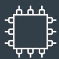

Embedded Systems Design

Nucleo-F091RC Edition

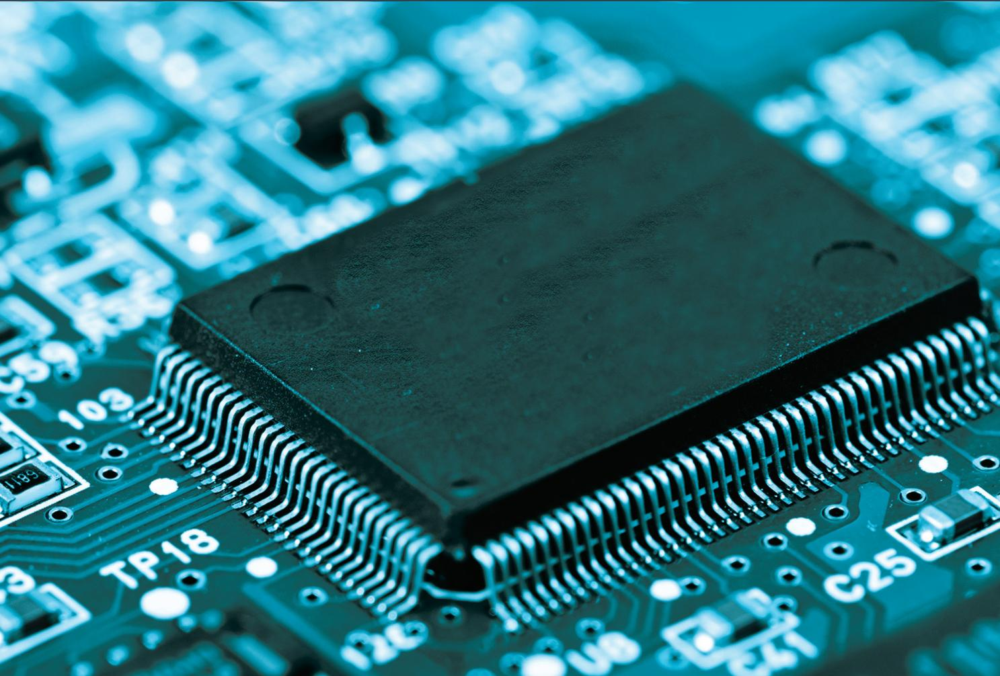

## Embedded Systems Fundamentals with Arm<sup>®</sup> Cortex<sup>®</sup>-M based Microcontrollers

# Embedded Systems Fundamentals with Arm<sup>®</sup> Cortex<sup>®</sup>-M based Microcontrollers

A Practical Approach

Alexander G. Dean

NUCLEO-F091RC EDITION

arm Education Media

Arm Education Media is an imprint of Arm Ltd., 110 Fulbourn Road, Cambridge, CBI 9NJ, UK

First published 2017

Second edition published 2021

Copyright © 2021 Arm Ltd. All rights reserved.

No part of this publication may be reproduced or transmitted in any form or by any means, electronic or mechanical, including photocopying, recording or any other information storage and retrieval system, without permission in writing from the publisher except under the following conditions

## Permissions

You may reprint or republish portions of the text for non- commercial, educational or research purposes but only if there is an attribution to Arm Education.

This book and the individual contributions contained in it are protected under copyright by the Publisher (other than as may be noted herein).

## Notices

Knowledge and best practice in this field are constantly changing. As new research and experience broaden our understanding, changes in research methods and professional practices may become necessary.

Readers must always rely on their own experience and knowledge in evaluating and using any information, methods, project work, or experiments described herein. In using such information or methods, they should be mindful of their safety and the safety of others, including parties for whom they have a professional responsibility

To the fullest extent permitted by law, the publisher and the authors, contributors, and editors shall not have any responsibility or liability for any losses, liabilities, claims, damages, costs or expenses resulting from or suffered in connection with the use of the information and materials set out in thi textbook.

Such information and materials are protected by intellectual property rights around the world and are copyright © Arm Limited (or its affiliates). Al rights are reserved. Any source code, models or other materials set out in this textbook should only be used for non- commercial, educational purposes (and/ or subject to the terms of any license that is specified or otherwise provided by Arm). In no event shall purchasing this textbook be construed as granting a license to use any other Arm technology or know- how.

The Arm corporate logo and words marked with ® or tm are registered trademarks or trademarks of Arm Limited (or its affiliates) in the US and or elsewhere. All rights reserved. Other brands and names mentioned in this document may be the trademarks of their respective owners. For mor information about Arm’s trademarks, please visit https://www.arm.com/company/policies/trademarks.

Historically, the terms 'master and slave' have been used widely in hardware and software engineering. Arm is working to address the use of offensiv terminology in our products, content, and everyday conversations. Arm values inclusive communities and recognizes that we and our industry have used terms that can be offensive. Arm strives to lead the industry and create change. As such, Arm is working with standards bodies and industry partners to ensure a consistent approach to the use of more progressive terminology. This book was published before these changes came into effect

ISBN:  978- 1- 911531- 26- 5 978-1-911531-28-9 (epub)

Version: print

British Library Cataloguing- in- Publication Data A Catalogue record for this book is available from the British Library

Library of Congress Cataloging- in- Publication Data A Catalog record for this book is available from the Library of Congress

For information on all Arm Education Media publications, visit our website at www.armedumedia.com

To report errors or send feedback please email edumedia@arm.com

Foreword
Preface
Acknowledgments
Author Biography
1 Introduction
Overview
Concepts
Why Control a System?
How Good Is the Hot Plate's Temperature Control?
Why Use Electronics and an Embedded Computer?
How to Embed a Computer?
Examples of Embedded Systems
Looking at the Hardware Inside
Typical Embedded System Software Operations
Embedded System Attributes
Interfacing with Inputs and Outputs
Concurrency
Responsiveness
Reliability and Fault Handling
Diagnostics
Constraints
Target Platform
Overview
Processor
Microcontroller
Development Board
Summary
Exercises
References
xii
xv
xxii
xxiii
3
3
4
4
5
6
7
8
8
12
12
13
13
14
15
16
16
17
17
19
20
21
23
24
24

2 General-Purpose Input/Output 27
Overview 28
Outside the MCU: Ones and Zeros, Voltages, and Currents 30
Input Signals 30
Output Signals 31
Interfacing with a Switch and an LED 31
Inside the MCU 32
Preliminaries: Control Registers and C Code 32
Using CMSIS to Access Hardware Registers with C Code 34
Coding Style for Accessing Bits 34
Reading, Modifying, and Writing Fields in Control Registers 36
Configuring the I/O Path 38
Clock Gating 38
Connecting a Pin to a Peripheral Module 39
GPIO Peripheral 43
GPIO Module Use 44
Putting the C Code Together 46
More Interfacing Examples 46
Driving a Three-Color RGB LED 47
Driving a Speaker 50
Driving the Hot Plate's Heating Element 51
Additional Pin Configuration Options 52
Pull-Ups and Pull-Downs for Inputs 52
Open Drain vs. Push-Pull Outputs 54
Output Drive Strength 54
Configuration Lock 55
Other Options 55
Summary 55
Exercises 55
References 56

3 Basics of Software Concurrency 59
Overview 60
Concepts 61
Starter Program 61
Program Structure 62
Analysis 64
Creating and Using Tasks 65
Program Structure 65
Analysis 68
Improving Responsiveness 69
Interrupts and Event Triggering 69
Program Structure 70
Analysis 72

Reducing Task Completion Times with Finite State Machines 74  
Program Structure 75  
Analysis 77  
Using Hardware to Save CPU Time 77  
Program Structure 78  
Analysis 81  
Advanced Scheduling Topics 82  
Waiting 82  
Task Prioritization 83  
Task Preemption 84  
Real-Time Systems 85  
Summary 86  
Exercises 86  

4 Arm Cortex-M0 Processor Core and Interrupts 91  
Overview 92  
CPU Core 92  
Concepts 92  
Architecture 94  
Registers 95  
Memory 96  
Instructions 100  
Thumb Instruction Encoding 106  
Operating Behaviors 107  
Exceptions and Interrupts 107  
CPU Exception Handling Behavior 108  
Handler Mode and Stack Pointers 108  
Entering a Handler 109  
Exiting a Handler 110  
Hardware for Interrupts and Exceptions 111  
Hardware Overview 111  
Exception Sources, Vectors, and Handlers 111  
Input and Peripheral Interrupt Configuration 114  
NVIC Operation and Configuration 119  
Processor Exception Masking 121  
Software for Interrupts 122  
Program Design 122  
Interrupt Configuration 125  
Writing ISRs in C 126  
Sharing Data Safely Given Preemption 127  
Summary 130  
Exercises 130  
References 131

5 C in Assembly Language 133
Overview 134
Motivation 134
Software Development Tools 135
Program Build Tools 135
Compiler 136
Assembler 136
Linker/Loader 139
Programmer 139
Debugger 140
C Language Fundamentals 140
Program and Functions 140
Start-Up Code 141
Types of Memory 141
A Program's Memory Requirements 142
Making Functions 143
Register Use Conventions 144
Function Arguments 144
Function Return Value 145
Prolog and Epilog 145
Prolog 145
Epilog 146
Exception Handlers 147
Controlling the Program's Flow 148
Conditionals 148
If/Else 148
Switch 150
Loops 152
Do While 152
While 153
For 155
Calling Subroutines 156
Accessing Data in Memory 157
Statically Allocated Memory 157
Automatically Allocated Memory 158
Dynamically Allocated Memory and Other Pointers 159
Array Elements 159
Summary 162
Exercises 162
References 164
6 Analog Interfacing 167
Overview 168
Introduction 168
Motivation 168
Concepts 168

Quantization 169
Sampling 171
Digital-to-Analog Conversion 172
Concepts 172
Converter Architectures 173
STM32F091RC DAC 173
Example Application: Analog Waveform Generator 174
Analog Comparator 176
Concepts 176
STM32F091RC Comparators 177
Input Configuration 178
Comparator Operation Configuration 179
Output Configuration 180
Interrupt Configuration 180
Example Application: Voltage Transition Monitor 181
Analog-to-Digital Conversion 184
Concepts 184
Converter Architectures 184
Inputs 185
Triggering 186
STM32F091RC ADC 186
Basic ADC Features 187
Advanced ADC Features 191
Example Applications 192
Hotplate Temperature Sensor 192
Infrared Proximity Sensor 195
Summary 202
Exercises 202
References 202
Timers 205
Overview 205
Concepts 206
Timer Circuit Hardware 206
Example Timer Uses 207
Periodic Timer Tick 207
Watchdog Timer 207
Time and Frequency Measurement 208
PWM Signal Generation 209
Timer Peripherals 210
SysTick Timer 210
Example: Periodic 1 Hz Interrupt 212
STM32F091RC Watchdog Timers 213
Hardware Configuration 214
How to Use a WDT 216
Example: Long Error Condition 216

STM32F091RC Timer and PWM Module 219
Time Base Unit 220
TIM Channels 224
Input Capture Mode 225
Output Modes 229
Summary 233
Exercises 233
References 234

8 Serial Communications 237
Overview 238
Concepts 238
Why? 238
How? 239
    Serialization 239
    Symbol Timing 240
    Message Framing 240
    Error Detection 241
    Acknowledgments 241
    Media Access Control 241
    Addressing 242
Development Tools 242
Software Structures for Communication 244
Supporting Asynchronous Communication 244
Queue Implementation 246
Queue Use 249
Serial Communication Protocols and Peripherals 249
Synchronous Serial Communication 249
Protocol Concepts 249
STM32F091RC SPI Peripherals 251
Example: SPI Loopback Test 255
Asynchronous Serial Communication 257
Protocol Concepts 257
STM32F091RC USART Peripherals 258
Example: Communicating with a PC 262
Inter-Integrated Circuit Bus (I²C) 269
Protocol Concepts 269
STM32F091RC I²C Peripherals 273
Example: Polled I²C Communications with an Inertial Sensor 274
Summary 281
Exercises 281
References 282

9 Direct Memory Access 285
Overview 285
Concepts 286

STM32F091RC DMA Controller and Routing Peripherals 287  
DMA Request Routing and Trigger Sources 288  
DMA Channels 290  
Basic DMA Configuration and Use 291  
Examples 292  
Bulk Data Transfer 292  
Analog Waveform Generation 295  
Summary 300  
Exercises 300  
References 301  
Glossary 302  
Index 312

# Foreword

Alex Dean and I worked together at United Technologies in the early 1990s helping companies such as Otis, Pratt & Whitney, Carrier, and Sikorsky improve their embedded computing practices. Since then we have both chosen embedded systems as a career path, and have both done dozens of design reviews on real industry projects. Sometimes we have been able to team up on an especially important product review, which is always a blast. Whenever we chat, he tells me about his latest cool project, usually involving gadgets for his sailboat. Alex has seen the real world of embedded system design as few other professors have, and has gotten his hands dirty building real stuff. This book reflects that experience.

We are in an era in which most technologists seek to specialize, but being a good embedded system designer requires breadth across both Computer Science and Computer Engineering. Beyond that, many of the tradeoffs for embedded systems are quite different from those for desktop and enterprise systems. This book does an admirable job of covering the embedded computing design space, balancing the opposing forces of hardware versus software, depth versus breadth, and performance versus constraints. Embedded computing is usually about being highly constrained on cost, speed, memory, power, and pretty much everything else. Yet it is also about building systems that can be life-critical, or potentially put a company out of business due to the cost of a product recall if the software has a defect. Most of those who have not worked in the area do not realize how pervasive this technology is, nor how difficult it is to do well.

To give an example of how much we depend on embedded computers without necessarily realizing it, consider a server farm used for Big Data. Everyone knows there are lots of multicore big CPUs there. But there are also embedded computers and mission-critical embedded software in at least the following places in that same machine room complex: network interfaces, disk control lers, storage box controllers, board-level power supplies, rack-level power management, powerdistribution switchgear, backup battery controllers, backup diesel-engine controllers, temperature monitors, air handlers, cooling compressors, cooling expansion valves, humidity controls, lighting controls, network switches, a badge-swiping system, a security video system, an alarm system, a fire-suppression system, vending machines to keep the operators happy, status monitors for many of those systems, and … well, you get the idea. Without embedded computing, the high-tech world as we know it simply would not exist. And that example is just the starting point. Embedded systems are everywhere, and I am continually astonished at the places I find not only microcontrollers, but whole teams of engineers designing and maintaining embedded systems. The difference between an embedded system that works somewhat and one that really works can easily be the difference between a product that succeeds or a product that makes the headlines (or worse) because it failed. If you doubt whether embedded system design can be a big deal if you get it wrong, consider the billions of dollars that have been spent on lawsuits because of badly written software or poor choices about what a system did.

The sweet spot for this text is for students who have seen many of the pieces before, but need a structured way to put all the pieces together. So that means they already know how to program, how a CPU works in general, and how programs execute. But probably they have seen all this in a desktop computing environment in their introduction to computing hardware and to software systems courses. This book takes those pieces and puts them together into a coherent whole. It also helps students un-learn some of the habits that are appropriate only for big-system computing. In embedded systems, memory is not “free”, nor can you simply throw more cores at a problem if you have a \$1 CPU that has to run on a coin battery cell for five years. Getting these systems right requires a blend of both science and engineering, with a healthy respect for the realities of the marketplace and the messiness of interfacing to the real world.

This book gives a big picture on diverse topics, including:

• Computer organization and assembly language. If you do not understand how interrupts work, you should not be building embedded systems. (There is more, but that is a good starting point.)

• Digital design and how software interacts with bare metal hardware. Modern embedded systems are all about working with peripheral circuits to maximize system capability at minimum total cost.

• Analog I/O. The real world is not digital. (You knew that, right?)

• How to program in C. Regardless of what you think about the language, most embedded code is in C or a suspiciously C-like subset of C++, and it is the rare project that is not built on top of an existing code base.

• Tool chains and support software. Developers have to understand how compilers, real-time operating systems, and other building blocks work to use them effectively. (Hint: Most embedded micros in real products do not run Linux. Or any other OS you are likely to know.)

• Time. The computer’s job is to keep up with the real world, not the other way around, and doing so creates all sorts of problems that must be understood.

• Respect and understanding for what is really going on in both the hardware and the software. The best embedded system designers understand how to exploit the strengths of both hardware and software.

The book uses the Arm Cortex-M0 processor, which has a nice selection of peripherals while still giving the feel of a resource-constrained embedded system. Beyond that, the examples have a strong dose of Alex’s experience working in industry, and deal with many of the practical issues that arise in real products.

This book takes an integrated approach to putting the pieces together, rather than simply presenting the various pieces in isolation. Each chapter has well-illustrated working examples based on a real MCU evaluation board. These activities start early, with Chapter 2 showing how to read switches and light LEDs using GPIO and C code. Concurrency and responsiveness also appear early, and weave through the various examples throughout the rest of the book, working up from busy polling to preemptive task scheduling. In addition, the examples work through a progression of getting things work in a simplistic way and then improving performance by using peripherals instead of a brute force software approach. An analog waveform generator provides a running example, going from software-only timing through using DMA data transfers to the DAC.

Finally, this book emphasizes having students understand what is really going on under the hood of the compiled C code. While most embedded systems are written in C instead of assembly language these days, students need to appreciate what the compiler is doing to make their code too big, too slow, or too vulnerable to race conditions. They also need to be able to debug optimized compiled code and write the occasional low-level optimized loop that links to a C program for that 1% of the code where speed is everything. Or even better, understand what is happening well enough to trick the compiler into generating an efficient code for them.

If, after reading this book, you are still thinking of using another book, do yourself a favor. Check the index of that other book. If the word “watchdog” does not appear, put the book down and back away from it slowly. It is not really an embedded computing book if it does not talk about watchdog timers, and you would be surprised how common that is. (Yes, Alex does cover watchdog timers in this book.) I look forward to the chance to use this book in my teaching.

For those of you who are students, pay attention to what is in this book. You have probably already looked at several of the ever-popular cut-and-paste-the-code books. They can be expedient, but you will not really learn what is going on from them, or from the books that just rehash the data sheet. Alex’s book is different. It will help you put all the pieces together, so that you understand what you are doing, which is the great thing about having the opportunity to study and learn at a university, isn’t it?

Professor Phil Koopman, Carnegie Mellon University Pittsburgh, PA, January 2017

# Preface

## Introduction

It is an exciting time to develop embedded systems! Modern microcontrollers (MCUs) offer remarkable performance at a very low cost. The Internet provides an abundance of source code and documentation. The combination of inexpensive hardware platforms (e.g., Arduino, Raspberry Pi, and Beaglebone) with the right software (to abstract away details and guide users) has helped lower the barriers to embedded system development, allowing experimentation without requiring encyclopedic knowledge.

Unfortunately, these supports become shackles when trying to scale up to a larger, more complex system with tighter constraints. Industrial designers of embedded systems draw from a large toolbox of technical methods in order to meet requirements such as speed, responsiveness, cost, weight, reliability, or energy use.

Many of the hardware tools are built into the MCU: a central processing unit (CPU) to execute software, an efficient interrupt system enabling quick responses to events, fast memory to hold the program and data, and specialized hardware peripheral circuits to reduce the need for a high-speed CPU. Hardware peripherals can often signal and control each other, eliminating the need to involve software on the CPU. MCUs offer a range of low-power modes so the designer can trade off performance and power consumption as needed.

Other tools are provided by the software, which is typically written in C or C++ and compiled to run in the processor’s native machine language. This avoids the run-time delays and memory overhead of interpretation or scripting. Multitasking software is scheduled on the CPU using interrupts and a scheduler, which may be cooperative (e.g., state machines) or preemptive (e.g., a real-time kernel).

To summarize, successful embedded system designs use peripherals and well-structured software on the CPU with light-weight context switching to provide responsive concurrency. This textbook aims to explain how to develop microcontroller-based embedded systems using these industry-standard methods and practice these with the most widely used processor architecture in embedded computing today: the Arm Architecture.

## Challenges of Embedded Systems Education

There are several interesting challenges to learning (or teaching!) embedded systems in a college or university. First, the field builds on concepts from several areas: computer engineering (CPE), electrical engineering (EE), and computer science (CS). Some students will be able to study joint degrees, or even double or triple major, but most will not. Second, these concepts and their solutions must target embedded system design spaces, which are quite different from the mainstream general-purpose or high-performance computing design spaces covered by most courses. Third, there are so many areas to cover that it is easy to concentrate on the familiar, which crowds out the unfamiliar. Presenting the areas with just enough detail (but not too much) can be difficult. Fourth, abstraction layers promise faster application development, but are hobbled when the developer doesn’t understand the hardware beneath the abstraction. Furthermore, abstraction layers can complicate debugging and limit performance by hiding critical details among the many trivialities.

## Challenge 1: Spanning Electrical and Computer Engineering and Computer Science

Successful embedded system designers need a variety of skills from CPE, EE, and CS, but not too much, and the right version given the context. These skills are typically split across ECE (electrical and computer engineering) and CS departments. To make things worse, CPE and CS courses are constantly pulled toward higher performance computers and higher levels of abstraction (to manage the increased application complexity enabled by the increased performance). This widens the gap with the embedded system design space.

The following areas in CPE and EE are the most critical for students in the field of embedded systems:

• Computer organization and assembly language programming are fundamental to an understanding of the CPU, memory, peripherals, and interrupt system.

• Digital design is necessary to understand not only how the CPU works, but more importantly to understand how peripheral circuits work. These digital circuits (e.g., GPIO, timers, DMA) provide cheap concurrency because they operate independently of the CPU. A good design will offload computationally expensive software tasks to allow a relatively slow MCU to provide precise timing and predictable performance at a low cost and with little power consumption.

• Basic analog circuit design and analysis skills are needed for adding external circuits such as LEDs, switches, and sensors. Knowing how to use an oscilloscope or logic analyzer to examine and understand the timing of events within a system is essential for effective debugging.

The following areas in CS are the most critical for students in the field:

• C language programming is necessary because it is the dominant language for programming embedded systems.

• Compilers and assembly language programming provide an understanding of how a CPU really does the work specified by the source code. Knowing how the program is compiled and structured helps with avoiding errors (e.g., preemption), debugging, designing efficient systems, and improving performance.

• Operating systems’ task scheduler concepts enable students to understand how to share a single CPU among the multiple concurrent activities of the embedded system. These topics includ multitasking, preemption, and prioritization. Students need to understand how to design multitasking systems using intertask communication and synchronization to avoid common bugs such as data race hazards.

## Challenge 2: Targeting the ES Design Space

For each area mentioned, the practical solutions depend on the design space. The design spaces for most embedded systems are quite different from those of general purpose and high-performance computing, because of different drivers and constraints. For example:

• Computer Organization: Embedded processors typically do not need the raw speed sought in general-purpose or high-performance computing systems. As a result, they do not require high clock speeds and the deep processor pipelines and multilayer memory systems to support them.

• Operating Systems: OS courses generally target a resource-rich Linux system that features a preemptive scheduler, ample compute and memory resources, a virtual memory system with hardware support, and user and supervisor modes. This type of system does not offer the precise timing control needed for many embedded systems and is often too complex, power-hungry, and expensive. Students must be able to apply the concepts of task scheduling, synchronization, and communication to a system built on interrupts, peripherals, and a simple scheduler (whether a preemptive real-time kernel or a cooperative scheduler).

• Programming: Embedded systems use compiled languages instead of scripted or interpreted lan guages for reasons of predictability, efficiency, and compactness. Because of this history there is a large installed base of C/C++ development infrastructure. However, many programming curricula target Java (or even a scripted language). This abstracts away low-level and implementa tion issues that can make or break an embedded system.

## Challenge 3: Providing Sufficient (but Not Excessive) Coverage

With all these areas to cover, it is easy to emphasize the familiar, crowding out the unfamiliar. Furthermore, the hands-on nature of embedded systems courses often slows down the progress as the student or instructor tries to get a code example working to demonstrate an important concept.

This book tries to present the areas with just enough detail (but not too much) and with practical solutions for the design space. This book does not try to present an exhaustive, complete education of all possible ways to do something. Instead, it presents the most practical options given the constraints.

## Challenge 4: Providing Just Enough Abstraction

Microcontroller vendors have developed various “abstraction layers” to simplify development. These present a standard, uniform interface to hardware peripherals and system services. As systems grow more complex, these abstraction layers become more valuable. However, this is an introductory textbook which targets simple systems for clarity.

For successful embedded system development, students must master three types of information:

• How the MCU’s hardware works. Explanations in the hardware manual tend to be brief for size reasons, though application notes may fill in the blanks.

• The hardware interface (control and status registers, interrupts) presented to software. The hardware manual documents this interface exhaustively.

• How to write software to use that hardware interface. This involves identifying peripheral registers and accessing specific bit fields within them.

To simplify this third item, Arm has defined the CMSIS-Core Device Peripheral Access Layer (PAL) as a clean, direct way of accessing the hardware interface [1]. Among other things, it specifies how to define data structures and address mappings for peripheral control registers and their fields, as well as macros for accessing fields within registers. STMicroelectronics has created a PAL device header file for each of its Cortex-M MCUs (e.g. stm32f091xc.h). The example code in Appendix A of the ST MCU reference manual uses this interface to access the peripherals [2].

To simplify development of complex embedded systems, STMicroelectronics has created an embedded software platform called STM32Cube [3]. This platform includes a wide range of software components, not just peripheral interfaces but also middleware providing an RTOS, networking, graphics, USB and so forth. STM32Cube is built on two additional abstraction layers:  the STM32Cube Hardware Abstraction Layer (HAL) and low-layer APIs (LL) [4]. These layers simplify the composability and modularity of the components.

Using LL or HAL is outside the scope of this textbook. That would require the students to handle another intermediate layer of abstraction (raising complexity) when the goal is to understand how the peripherals work and then use them. Using STM32Cube with LL and HAL would be a good follow-on activity after mastering this text’s material.

## Notes to the Instructor

## Why Use This Book?

In this textbook, I have sought to present the most important topics for embedded systems using a coherent, compelling, hands-on format.

First, the textbook uses a hands-on approach to get students excited and motivated. Each chapter has illustrated, working examples based on a real MCU evaluation board. These activities start early, with Chapter 2 showing how to read switches and light LEDs using GPIO and C code. All source code is available on GitHub [5].

Second, the textbook introduces concepts of concurrency and responsiveness early. Chapter 3 uses a running example of scanning LEDs according to switch positions to introduce concepts important for creating modular, responsive, and efficient systems. By stepping through and evaluating these improvements, the student is given a solid foundation on which to investigate real-time kernels (in a later course). Concurrency and responsiveness are introduced using the following sequence:

1. Starting with a simple program with software to poll switches, flash LEDs, and delay using busy-waiting

2. Restructuring the software into tasks

3. Scheduling the tasks cooperatively

4. Improving the responsiveness of cooperatively scheduled tasks by using state machines to break up long operations

5. Using interrupts and event-driven software to replace polling of switches

6. Replacing busy-waiting delay loops by using a timer periphera

7. Prioritizing tasks

8. Scheduling tasks preemptively

Third, the textbook covers how to improve performance by using peripheral hardware in place of software. An analog waveform generator is used as a running example. It is introduced as an application of the digital-to-analog converter, with timing fully dependent on software execution speed. It reappears in the timer chapter, with a timer-driven periodic ISR updating the DAC to improve timing stability. The final appearance is in the DMA chapter, in which the DMA controller under timer control automatically copies data from a memory buffer to the DAC.

Fourth, the textbook covers C code as implemented in assembly language by the compiler. The main goals are to help students understand why their code is slow or large, how to make it faster or smaller, to understand preemption risks for shared data, and to help debug programs by working at both the source and object code levels. This textbook does not expect students to program in assembly language, although they may do so in a later course, given this foundation.

## Course Material Linkage

This textbook is designed to be used for a one- or two-semester course introducing students to embedded systems. It complements the Efficient Embedded Systems Design and Programming Education Kit from the Arm University Program. If you are an instructor, you can receive a donation of this Education Kit by emailing university@arm.com. The Education Kit includes lecture materials and licenses to Arm’s Keil MDK-ARM professional software. Students need prerequisite knowledge in C programming, digital design, and basic circuit theory.

## Target Platform

This textbook targets the Arm Cortex-M0 processor, which executes the instructions of the program. The processor is a component within the microcontroller, which adds circuits to clock the processor, memory to hold the program and data, and peripheral devices that simplify programs and improve their performance. This processor is available in microcontrollers from a wide range of manufacturers.

The target platform is the Nucleo-F091RC development board from STMicroelectronics, with a list price of under \$10. It uses the STM32F091RC microcontroller from the STM32F0 mainstream family. This device features a Cortex-M0 processor capable of running at up to 48 MHz, and contains 256 kB of flash ROM, 32 kB of RAM, and a wide range of peripherals. The development board adds a USB debug interface (ST-LINK/v2-1), power supplies, and input and output devices. The board includes a temperature sensor. External devices, sensors and expansion boards can be connected to the Nucleo-F091RC to enhance its capacities. The X-NUCLEO-IKS01A1 motion MEMS and environmental sensor expansion board can be plugged into the board and provides a three-axis accelerometer and a three-axis gyroscope to sense the inclination (tilt) of the board. The expansion board can also connect to an Arduino Uno R3. External LEDs and switches can be also connected to the board.

The material in this textbook can be used with other Cortex-M0 platforms. A first step is to change #include <stm32f091xc.h> in the source code to specify the correct MCU. Four of the first five chapters are essentially independent of the MCU’s peripherals and apply to all Cortex-M0 processors. The remaining chapters and the Appendix are closely integrated with the peripherals out of necessity. ST’s other MCUs use many of the same peripherals as the STM32F0, making it easier to use those MCUs and their associated Nucleo evaluation boards.

## Software Development Environment

Software examples in this textbook are written in C and compiled to run without an operating system. Arm’s Keil MDK-ARM integrated development environment is used throughout the textbook. The free version of MDK-ARM supports all of the code examples in this textbook and associated course materials. Note for instructors: If the object code size limitation of the free version (currently 32 kB) is a constraint, please request a license donation from Arm for the full professional version of MDK-ARM.

## Organization

The textbook is organized as follows:

Chapter  1 introduces students to the concepts of MCU-based embedded systems, and how they differ from general-purpose computers. It then introduces the Arm Cortex-M0 CPU, the STM32F091RC MCU, and the Nucleo-F091RC MCU development board.

Chapter 2 presents the general purpose I/O peripheral to provide an early, hands-on experience with reading switches and lighting LEDs using C code. It also introduces the CMSIS hardware abstraction layer, which simplifies software access to peripherals.

Chapter 3 introduces multitasking on the CPU, with the goals of improving responsiveness and software modularity while reducing CPU overhead. The interplay of interrupts, peripherals, and schedulers (both cooperative and preemptive) is examined.

Chapter 4 presents the Arm Cortex-M0 processor core, including organization, registers, memory, and instruction set. It then discusses interrupts and exceptions, including CPU response and hardware configuration. Designing software for a system with interrupts is discussed, including program design (and partitioning work), interrupt configuration, writing handlers in C, and sharing data safely given preemption.

Chapter 5 first gives an overview of the software toolchain, which translates a program from C source code to executable object code. It then shows side by side the source code and the object code the toolchain has generated to implement it. Topics covered include functions, arguments, return values, activation records, exception handlers, control flow constructs for loops and selection, memory allocation and use, and accessing data in memory.

Chapter 6 presents analog interfacing, starting with theory and ending with practical implementations. Quantization and sampling are presented as a foundation for both digital-to-analog conversion and analog-to-digital conversion. The DAC, ADC, and analog comparator peripherals are presented and used.

Chapter 7 presents timer peripherals and their use for generating a periodic interrupt or a pulsewidth modulated signal, or for measuring elapsed time or a signal’s frequency. Watchdog timers, used to detect and reset an out-of-control program, are also discussed.

Chapter 8 discusses serial communication, starting with the fundamentals of data serialization, framing, error detection, media access control, and addressing. Software queues are introduced to show how to buffer data between communication ISRs and other parts of the program. Three protocols and their supporting peripherals are investigated next: SPI, asynchronous serial (UART), and I2C. UART communication is demonstrated using the Nucleo-F091RC’s debug MCU as a serial port bridge over USB to the PC. I2C communication is demonstrated using an inertial sensor with I2C interface.

Chapter 9 introduces the direct memory access peripheral and its ability to transfer data autonomously, offloading work from the CPU and offering dramatically improved performance. Examples include using DMA for bulk data copying, and for DAC-based analog waveform generation with precise timing.

## References

[1] Arm Ltd., “CMSIS-Core (Cortex-M) Device Header File <device.h>,” [Online]. Available: http://www.keil.com/ pack/doc/CMSIS/Core/html/device\_h\_pg.html#device\_access.

[2] STMicroelectronics NV, Reference Manual RM0091: STM32F0x1/STM32F0x2/STM32F0x8, 2017.

[3] STMicroelectronics NV, “STM32Cube Ecosystem,” [Online]. Available: https://www.st.com/content/st\_com/en/ stm32cube-ecosystem.html.

[4] STMicroelectronics NV, User Manual UM1785: Description of STM32F0 HAL and Low-Layer Drivers, 2020. [Online]. Available: https://www.st.com/resource/en/user\_manual/dm00122015-description-of-stm32f0-hal-and lowlayer-drivers-stmicroelectronics.pdf.

[5] A. G. Dean, “ESF Repository,” [Online]. Available: https://github.com/alexander-g-dean/ESF.git.

# Acknowledgments

I would like to thank the following people for their help:

• Khaled Benkrid, Melissa Good, Liz Warman, Shuojin Hang, and the reviewers at Arm for supporting this project.

• Bill Trosky, Phil Koopman, Alan Finn, Chris McClurg, and Rocky Albano for opening so many doors to me in the embedded systems world.

• The development teams who welcomed me in as an outsider to review the embedded software for their products. They helped me understand their design goals, technical and non-technical constraints, and day-to-day challenges.

• The students who helped me sharpen my message and identify the fundamental issues at stake. Their enthusiasm and creativity are always a powerful, positive force.

• My wife and daughters for support, encouragement, and the quiet time needed to complete this work.

# Author Biography

Dr. Alexander G. Dean has been a faculty member of the Department of Electrical and Computer Engineering at North Carolina State University (NCSU) since 2000. He received his BS (1991) from the University of Wisconsin, Madison, and his MS (1994) and PhD (2000) from Carnegie Mellon University.

Dr. Dean has developed four courses on embedded systems at NCSU, ranging from fundamen tals to architecture and design to optimization. He has created course packages targeting five different MCU families for the university programs of three companies, including the Education Kit on Efficient Embedded Systems Design and Programming for Arm Education.

Dr. Dean’s research involves using compiler, operating system, and real-time system techniques to extract more performance from commodity microcontrollers in embedded systems while reducing clock speed, energy, and memory requirements. His research also includes applying these methods for low-cost control of switch-mode power converters.

Dr. Dean has worked at United Technologies Research Center developing embedded systems and their communication network architectures. He holds three patents in the area. He has performed over 60 in-depth, on-site embedded software reviews for industry both domestically and internationally since 2001.


## Introduction

## Chapter Contents

Overview 3  
Concepts 4  
Why Control a System? 4  
How Good Is the Hot Plate's Temperature Control? 5  
Why Use Electronics and an Embedded Computer? 6  
How to Embed a Computer? 7  
Examples of Embedded Systems 8  
Looking at the Hardware Inside 8  
Typical Embedded System Software Operations 12  
Embedded System Attributes 12  
Interfacing with Inputs and Outputs 13  
Concurrency 13  
Responsiveness 14  
Reliability and Fault Handling 15  
Diagnostics 16  
Constraints 16  
Target Platform 17  
Overview 17  
Processor 19  
Microcontroller 20  
Development Board 21  
Summary 23  
Exercises 24  
References 24

## Overview

In this chapter we introduce the basic motivations and key concepts for embedding a computer into another system. We examine the design of the hardware and software for the embedded sys tems and also the constraints that designers face. Finally, we examine the target hardware platform we will use in this textbook.

## Concepts

## Why Control a System?

Improving how a system is controlled can provide better performance, extra features, reduced purchase or operating costs, and more dependability. An embedded computer system is a computer that has been embedded into a larger system in order to improve it in some way, typically by controlling it.

Figure 1.1 shows an electric hot plate that is used to cook food. The control knob on the front allows the user to turn on or off the hot plate and to set its temperature. Let’s examine the existing control system, determine its weaknesses, and consider how we can improve it.

Figure  1.2 shows the internal components of a hot plate:  a black control knob, a heating element (covered by a silver metal circle), a red indicator lamp, and a temperature control system. The indicator lamp is connected in such a way that it lights when the heating element is powered.

The temperature control system, shown in Figure 1.3, is very simple and is based on a single component: a temperature-sensitive (thermostatic) switch. One of the switch contacts is made from two different types of metal so that it bends as it grows hotter. When the switch gets hot enough, the contact bends so far that the switch disconnects the heating element from the power. The heating element and then the switch start to cool down. Eventually the switch will cool down enough to bend back and make contact. The control knob adjusts the distance between the switch contacts, setting the temperatures at which the switch will open or close. How well does this control system work? Let’s find out.

  
Figure 1.1 Electric hot plate for cooking food. Photo by author.

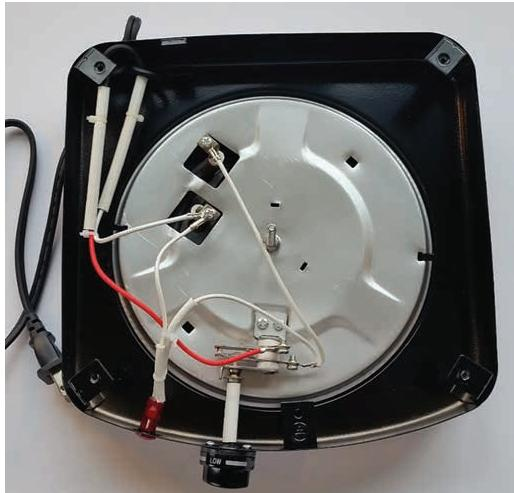  
Figure 1.2 Internal components of hot plate. Photo by author.

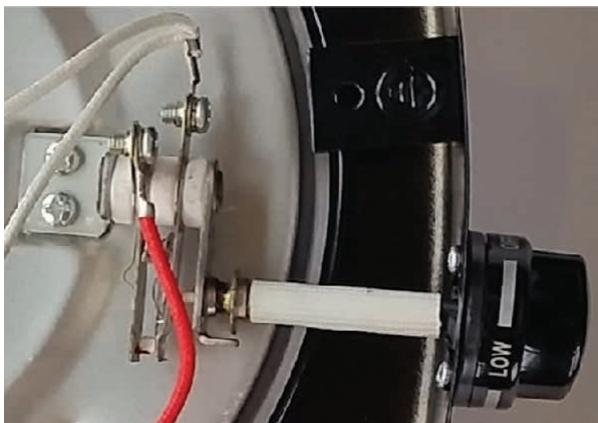  
Figure 1.3 A detailed view of the thermostatic switch used to control the heating element. Photo by author.

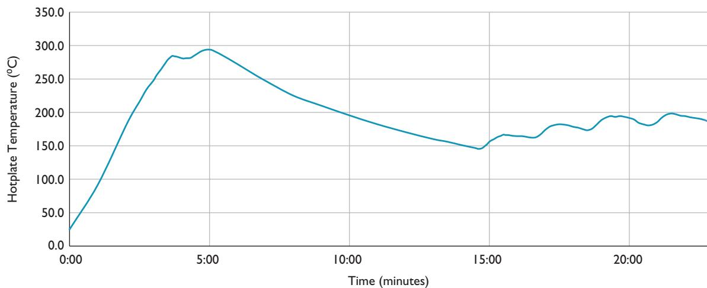  
Figure 1.4 Hot plate temperatures measured over time.

## How Good Is the Hot Plate’s Temperature Control?

The temperature of a hot plate cooking surface can be measured using a thermocouple, a type of electric thermometer. Figure 1.4 shows the temperature over time. At time $\mathrm { { t } = 0 : 0 0 }$ , the control knob is set to Low to turn on the heating element. The temperature rises to nearly $3 0 0 \mathrm { { } ^ { \circ } C }$ over the next 5 minutes. The heating element turns off briefly at $\mathrm { t } = 4 { : } 0 0$ and then for a longer time at $\mathrm { t } = 5 { : } 0 0$ . The hot plate then takes the next 10 minutes to cool down to about $1 5 0 \mathrm { { ‰} }$ at about $\mathrm { t } = 1 4 { : } 4 0$ . After this start-up period, the temperature starts rising in steps as the switch cycles on and off with a roughly 2-minute period, eventually reaching a range centered near $1 9 0 ^ { \circ } \mathrm { C }$ . Notice the temperature never actually stabilizes, but rises or falls within a range of about $2 0 \mathrm { { } ^ { \circ } C }$ based on whether the switch is open or closed.

Although the control system is simple and low cost, it does not control the temperature of the hot plate very well. Consider the following points:

• The actual temperature swings wildly in the first 15 minutes. Variations in temperature will make it harder to cook food consistently. The temperature finally starts to stabilize after 15 or 20 minutes, which is a long time to wait before starting to cook.

• The actual temperature of the hot plate cooking surface is not measured. Instead, the switch measures a combination of the temperatures of the metal shield and the internal air.

• There is a delay between when the metal shield and the internal air temperatures change and when the switch temperature changes, as the heat must be conducted to the switch contact.

• The control system is not calibrated. The control knob is marked with settings off, low, med, and high instead of actual numerical temperatures.

## Why Use Electronics and an Embedded Computer?

Using electronics can improve the temperature control of this hot plate in many ways:

• We can reduce the delay between a temperature change and the control system’s response by using a smaller sensor that changes temperature quickly.

• We can mount the smaller temperature sensor on the bottom of the hot plate itself to further reduce the delay. This would save time and power by eliminating the large temperature overshoot at 5 minutes.

• We can switch the heating element on and off more frequently, reducing the temperature ripples shown starting at 15 minutes in the graph.

• If we do this switching fast enough, we can control the fraction of time the heating element is on, giving us a wide range of heat outputs rather than the simple on/off of the current system.

• An electronic approach allows us to measure the temperature precisely instead of relying on the simple above/below information that the thermostatic switch provides.

• Coupling the precise temperature measurement with the proportional heating control, we can use a better control scheme. For example, we can turn on the heater a little bit if the temperature is only slightly below the desired set point, but turn it on more fully if the temperature is far below the set point. This will improve response and reduce the temperature overshoot.

• Adding multiple temperature sensors would allow us to monitor temperatures at multiple locations on the hot plate, not just one. This will further help control the temperature.

We could design a dedicated electronic control circuit to apply these methods, but it is almost always more practical to use an embedded computer because it provides greater flexibility with low cost and a quick development time. The exceptions are devices with extreme requirements (e.g. processing speed, power consumption, or unit cost).

Embedded computers use specialized integrated circuits (ICs) called microcontrollers that have features to simplify the monitoring and control of a system. A microcontroller unit (MCU) has a central processing unit (CPU) that runs a program made of instructions.

<table><tr><td>integrated circuit (IC)Electronic circuit with components built into a single piece of silicon, enabling extreme miniaturization, mass production, and cost reduction</td></tr><tr><td>microcontroller unit (MCU)Integrated circuit containing CPU, peripherals, support circuits, and often memory</td></tr><tr><td>central processing unit (CPU)Hardware circuit that executes a program’s instructions</td></tr><tr><td>instructionCommand for processor to execute. Consists of an operation and zero or more operands.</td></tr></table>

An MCU makes it easier to add sophisticated control methods at a low cost per product. We customize the computer to our application by writing software for the application and designing simple hardware to interface with the system. The recurring hardware costs are low because embedded computers typically use MCUs, which are inexpensive because they are produced in such high volumes. MCUs also reduce system costs because they include circuits to interface with the system, greatly simplifying the hardware development effort and circuit complexity. The main cost for embedded systems is generally the development of the control software, not the hardware itself.

Once there is an MCU in the system, it becomes much easier to add other useful features to improve and differentiate the product:

• Automatically turn off the hot plate for safety after a fixed time with no temperature knob changes.

• Provide calibrated temperature control with actual temperatures on the knob rather than low, med, or hot.

• Flash the lamp to indicate when the hot plate temperature is at or near the set point.

• Display the current temperature and the desired (set-point) temperature on a panel display.

## How to Embed a Computer?

Let’s examine how to improve the hot plate by adding an embedded computer. Figure 1.5 shows a block diagram of our improved, computer-controlled hot plate. We will use an MCU as the controller to read the desired and actual temperatures and decide on how to control the output. The MCU reads inputs to determine the state of the system being monitored and controlled. For the hot plate, the inputs include the temperature control knob position (desired temperature) and the hot plate temperature. That temperature is measured with a sensor that provides a signal whose voltage varies proportionally with temperature. The MCU may need to convert this signal into a form it can use.

We will use a simple on/off signal to control the heating element. Because the output signals from the microcontroller are low voltage and low current they are not capable of powering the heating element. We need to use a driver circuit to step up the signal from the microcontroller to an adequate level.

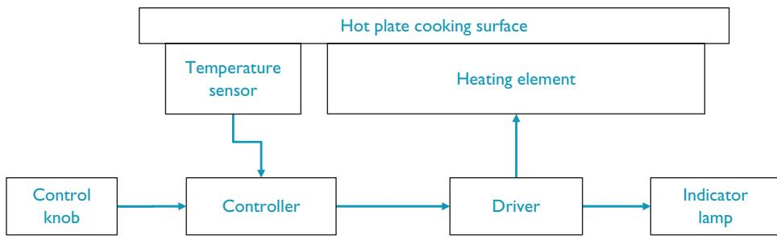  
Figure 1.5 Block diagram of a computer-controlled hot plate.

The heating element and the indicator lamp operate at a line voltage, such as 110 V or 220 V. However, the microcontroller operates at a much lower level: 3.3 V. We need to use a power supply to convert the input voltage down to 3.3 V. This power supply is not shown in the diagram.

The main job of the software in the controller will be to compute the error between the desired temperature (the set point), as indicated by the control knob, and the actual temperature, as measured by the temperature sensor. The controller will then adjust the amount of power delivered to the heating element in order to reduce that error.

## Examples of Embedded Systems

Let’s examine two more examples of embedded systems to get an idea of the variety of devices and their different design goals and constraints.

Figure 1.6 shows a quadcopter, which is a small, remote-controlled toy aircraft. The user flies the quadcopter using a wireless remote control that sends commands to change altitude; rotate; travel forward, back, or sideways; or even flip over 180° and fly upside down. The quadcopter has four motors that drive four rotors to provide lift. By adjusting the speed of the motors individually, the quadcopter can be made to move in different ways. However, it is too difficult for the user to control each motor’s speed directly. Instead, the quadcopter’s embedded computer translates the user’s remote control commands into motor speed commands. This translation depends on the current orientation and motion of the quadcopter, which can change very quickly. The quadcopter has a set of accelerometer sensors to detect acceleration in three directions (up/down, left/right, forward back) and a set of gyroscopic sensors to detect rotation in three directions (roll, pitch, yaw).

Figure 1.7 shows a refrigerator with a freezer, an ice maker, and a water chiller. Figure 1.8 shows its control panel and display and part of the chilled water and ice dispenser. The refrigerator needs to maintain temperatures within specified ranges in two compartments, allow the user to change those temperatures, light the compartments when its door is opened, make ice, and dispense chilled water, ice cubes, or crushed ice. Other features include sounding a chime if the door is left open for too long and indicating when the water filter needs to be replaced.

## Looking at the Hardware Inside

Let’s take a look inside the quadcopter. The printed circuit board (PCB), shown in Figure 1.9 and Figure 1.10 is about 4.5 cm long. The two large black squares in Figure 1.10 are the MCU (above) and the acceleration and rotation sensors (below). The corners of the PCB hold four light-emitting diodes (LEDs) and wires to the four motors. A  radio interface chip is hidden underneath the white glue and silver cylinder to the right of the MCU and sensors. Most of the small black rectangles with three legs are transistors that drive the four motors. The battery cable plugs into the large orange connector on the left.

  
Figure 1.6 A remote-controlled quadcopter toy. Photo by author.

  
Figure 1.7 A refrigerator with a freezer, an ice maker, and a dispenser for water and ice (not shown). Photo by author.

  
Figure 1.8 A user control panel above the chilled water and ice dispenser. Photo by author.

printed circuit board (PCB)

Board which holds electronic components and conductive traces for interconnection

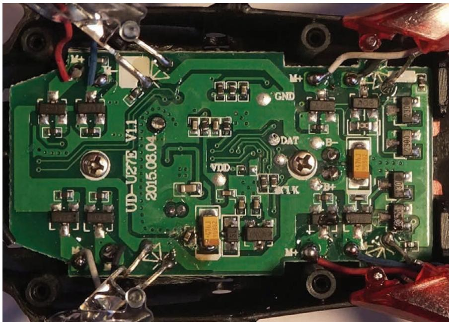  
Figure 1.9 The front of a quadcopter controller board. Photo by author.

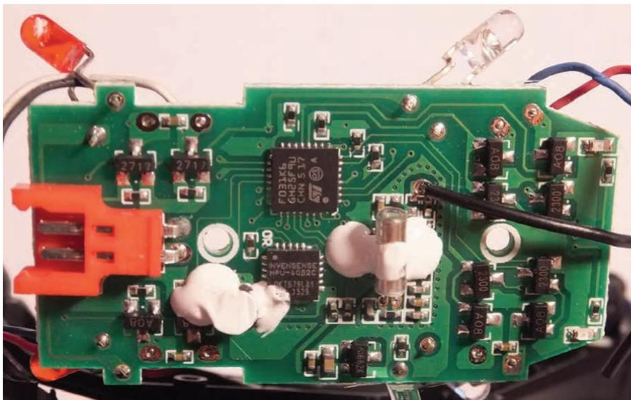  
Figure 1.10 The back of a quadcopter controller board. The large black squares are the MCU (top) and the accelerometer/gyroscopic sensor (bottom). The black wire is the radio antenna. Photo by author.

Now let’s examine the refrigerator’s PCB. Figure 1.11 and Figure 1.12 show the front and back of the main PCB, which is about 25 cm long. The MCU is located on the back of the PCB and is just one of many electronic components. These other components convert power, amplify and condition signals from input devices, and drive output devices. Here are the major input and output devices:

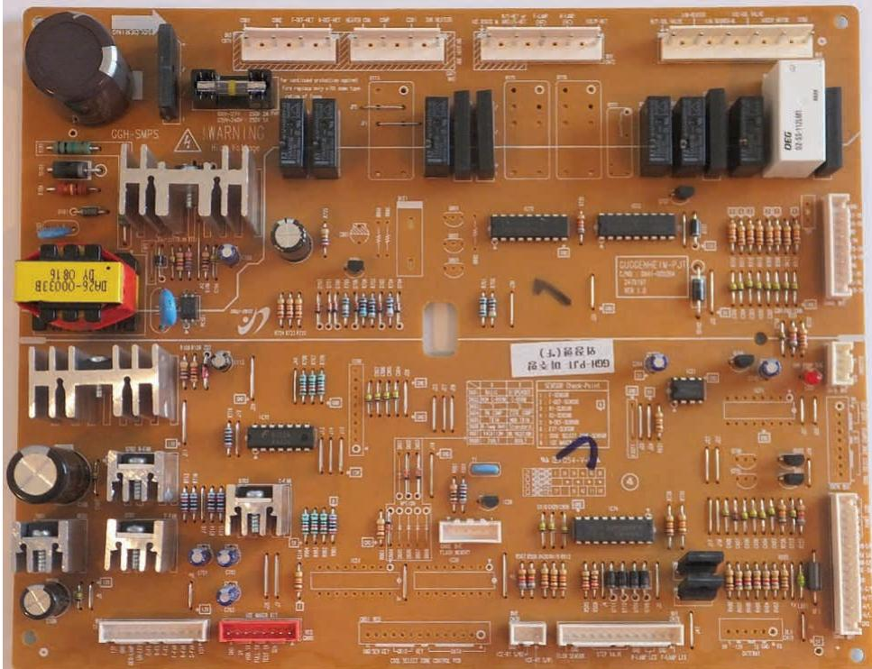  
Figure 1.11 The front of a refrigerator controller board. Photo by author.

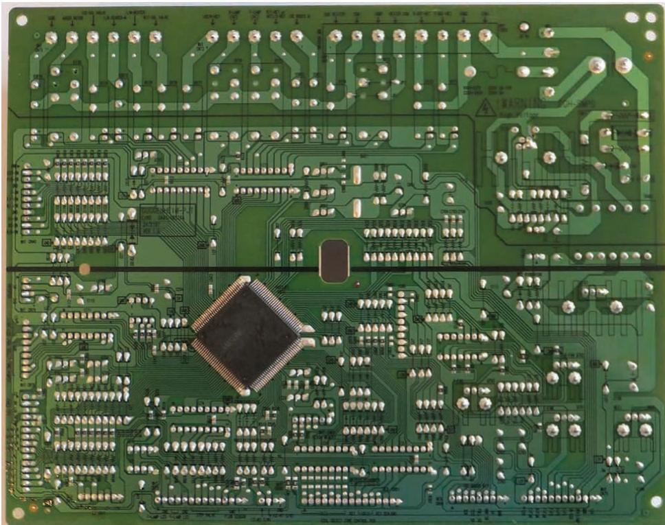  
Figure 1.12 The back of a refrigerator controller board. The microcontroller is the large black diamond. Photo by author.

## • Inputs

○ Switches: user control panel, compressor overload protection, freezer door, refrigerator door, ice bucket full, water/ice dispenser lever, cube motor position, ice maker test, ice route motor position.

○ Temperature sensors: external air, freezer, freezer defroster, refrigerator, refrigerator defroster.

## • Outputs

○ Lights: freezer, refrigerator, dispenser.

○ Indicators: user control panel.

○ Heaters: freezer defroster, refrigerator defroster, water pipe, door cap, dispenser, water tank.

○ Motors: compressor, ice route, auger, cube, ice grinder, freezer fan, condenser fan, refrigerator fan.

○ Water valves: water solenoid, icemaker solenoid, water stepper motor.

You probably didn’t expect a refrigerator to be so complex.

## Typical Embedded System Software Operations

To do their work, embedded systems typically perform one or more types of operations:

Closed-loop control involves controlling an output variable based on one or more input measurements. For example, the refrigerator controller maintains the temperature by turning on the compressor if the refrigerator compartment is too warm and turning it off if it is too cold. Similarly, the quadcopter controller keeps the craft flat and stable by adjusting the power to its rotor motors based on measurements of acceleration and rotation. There are more sophisticated control meth ods that consider the size of the error (the difference between the desired value and the actual measured value), how quickly it is changing, and how long it has persisted.

Sequencing involves controlling an output through a sequence of steps. For example, the icemaker follows several steps to make ice:

• Fill the ice tray with water.

• Chill the ice tray until the water is frozen.

• Heat the ice tray to allow the ice to separate from the tray.

• Eject the ice from the tray.

Signal conditioning and processing may be used to average together multiple sensor readings or filter out noise from motors or other devices. For example, the quadcopter’s four motors vibrate as they run, introducing noise into the acceleration and rotation readings. Taking multiple readings and averaging them can reduce the impact of this noise, improving accuracy.

Communications and networking allow the device to interact with subsystems or other systems. The quadcopter receives packets of control data sent by radio from the controller. The MCU needs to decode each packet of data to determine which commands and parameters have been sent.

## Embedded System Attributes

Now let’s examine some attributes of embedded systems and the impact they have on the software and hardware. These attributes lead to different design approaches and decisions than for personal computer application programs.

## Interfacing with Inputs and Outputs

Embedded computers typically need to sense the environment and then control devices in response. To do this, specialized circuits are needed to get the information to and from the CPU, which executes instructions. We have seen examples of input and output devices for the refrigerator and the quadcopter. MCUs consist of a CPU surrounded by specialized peripheral hardware circuits that perform much of this interfacing. Any remaining interface circuits are added externally on the PCB.

Many of the external devices use analog signals in which the voltage (or current) can take on a continuous range of values to convey information. For example, a temperature sensor might indicate its reading by setting its output signal’s voltage to 0.05 V/°C. A reading of 0.5 V would indicate a temperature of 10°C. This analog signal must be converted to a digital value for the program to process it; this is done using an analog-to-digital converter (ADC). To generate sounds accurately, the MCU must generate analog voltage signals to drive headphones or speakers. The digital values representing the sound signal can be converted to an analog voltage using a digital-to-analog converter.

<table><tr><td>peripheralHardware that helps CPU by interfacing or providing special functionality</td></tr><tr><td>analogCapable of taking on an infinite number of values</td></tr><tr><td>digitalCapable of taking on a limited number of values</td></tr><tr><td>analog-to-digital converter (ADC)Circuit which converts an analog value (e.g. voltage) to its corresponding digital value</td></tr><tr><td>digital-to-analog converter (DAC)Circuit which converts a digital value to its corresponding analog value (e.g. voltage)</td></tr></table>

Often signals must be processed before they are converted to the digital domain for the CPU. For example, weak signals need to be amplified, high-voltage signals need to be scaled down to safe levels, and noise must be filtered out. Similarly, the MCU may not be capable of driving power-hungry output devices (e.g. motors and solenoids), so amplification is needed. Consider again the refrigerator controller’s main PCB, as shown in Figures 1.11 and 1.12. The MCU is not powerful enough to drive the heaters, motors, and valves directly, and so it uses various devices (e.g. the black blocks and the white block along the top of the PCB) to do the job. This also protects the circuit by isolating low-voltage components like the MCU (which operates at 3.3 V) from the mains voltage (e.g. 120 V or 220 V).

## Concurrency

Embedded controllers must typically manage multiple activities concurrently, often with precise control of the timing:

• For example, the quadcopter MCU must accept user commands by radio while also monitoring rotation (about three axes) and acceleration (in three axes), controlling the speeds of four motors to maintain stable flight, flashing indicator lights, and monitoring battery voltage.

• The refrigerator must control the temperature in the refrigerator compartment, the temperature in the freezer compartment, manage the ice-making process, display information on the front panel, accept user commands, and perform diagnostics.

Adding more features to a system increases the software’s complexity. A graphical liquid crystal display (LCD) may require several software components to (1) manage the user interface’s windows, menus, and screens, (2) translate text, graphics, and images into pixel values, and (3) update the display’s memory with these pixel values. Other examples of such features are WiFi and Bluetooth communication and removable storage devices such as Secure Digital flash cards and USB drives. The maker of a complex peripheral IC may provide a software module (driver) to make interfacing easier. Embedded system developers frequently use third-party software components for such tasks to simplify the development process.

Microcontroller units provide concurrency by sharing the CPU among different parts of the software (including interrupt handlers, tasks, threads, and processes), and also by performing some processing in hardware peripherals that run independently of the CPU.

The scheduler determines what piece of software to run next on the processor and switches execution contexts as needed to make it happen correctly. There is a wide range of schedulers available. The most basic schedulers are simple to use and impose little overhead on the processor. They work best for simple systems and only provide limited help to the developer. More advanced schedulers provide better responsiveness (described next) and more features to help in program development. Real-time operating systems (e.g. RTX from Keil) typically use such schedulers. However, they require more of the processor’s time and memory, ruling out the use of some lowperformance MCUs. In addition, the presence of additional features introduces some performance variability. A full-fledged operating system (e.g. Linux) provides a wide range of features and services to help the embedded system developer. Such an operating system (OS) requires even more processor time and memory, so a much more powerful MCU is required.

## Responsiveness

One challenge for embedded system developers is providing enough responsiveness while sharing the CPU’s time across many activities. The field of real-time systems studies this aspect of design and performance.

If an embedded controller does not respond to commands and changes in the environment quickly enough, the system may damage itself, people, or other equipment. Often, embedded systems have requirements that specify deadlines for a response to a given input command. Consider the quadcopter: if there is a one-second delay between your changing the flight controls and the quadcopter acting on that command, the aircraft will be much harder to control.

There are two aspects to making a system responsive: raw processing speed and task scheduling.

First, the processor must be fast enough to complete the critical processing before its deadline. There are different ways to approach this. One is to make the code efficient so it can do the necessary work with very few instructions. Making the code efficient is called optimization and is a common task in embedded system development. Another approach is to use a fast processor so that those instructions are executed very quickly. And of course, both can be used.

There are trade-offs involved here: it takes developers more time to optimize code, increasing the development costs but not the recurring per-unit costs. Using a faster processor (usually) does not increase the development costs, but it does increase the recurring per-unit costs. A  faster processor is more expensive, and it may also require more careful circuit design methods. Once the processor speed exceeds 50 MHz, the flash memory will not be able to keep up, forcing CPU designers to modify the memory system to hide this delay.

Second, the processor needs to stay focused on the critical processing rather than being distracted by other processing, which will introduce delays. If possible, the critical processing should be performed by hardware peripherals to prevent any software interference. Otherwise, some kind of software scheduling approach is needed. Simple scheduling approaches provide moderate responsiveness, but to get the best responsiveness, a system needs to use interrupts and a preemp tive scheduler (e.g. a real-time kernel or a real-time OS). Stepping up to an OS (e.g. Linux) reduces the system’s responsiveness because now there are many activities that could delay the critical processing. Scheduling methods are discussed in Chapter 3.

Some embedded systems have such high processing demands that they use multicore processors, which are able to execute instructions from multiple programs (or parts of the same program) simultaneously. Other such systems may use multiple single-core processors to get higher performance.

Finally, some embedded systems use multiple processors to simplify design, rather than to get raw processing speed. Separating the processing reduces timing interference among the software components. Many commercial off-the-shelf modules (e.g. a WiFi interface) contain an integrated MCU to do the work.

## Reliability and Fault Handling

Embedded systems are expected to work correctly and reliably. Unlike personal computers, the user does not expect to have to reboot an embedded computer. If something fails, the system should minimize the impact of that failure rather than cause further problems.

Providing reliability and appropriate fault handling are very much dependent on the specific application. Which components are most likely to fail? There may be methods to detect actual or impending failures and shut down the system before there is more trouble. For example, sensors can be added (e.g. a thermal sensor to detect an overheating motor, a current sensor to detect short-circuited output), the circuit can be designed in a way to make failures easy to detect in software, or the software may be able to analyze historical data to determine failures. Embedded systems software typically contains large amounts of fault-handling code to deal with these exceptional cases.

The quadcopter does not need a long-term, highly reliable operation because it is a toy and the expected lifetime is short (perhaps 6 months). The mechanical components of the quadcopter will likely fail before software faults occur. However, note the white glue in Figure 1.10 which keeps larger, loose objects from vibrating and weakening their connections to the PCB.

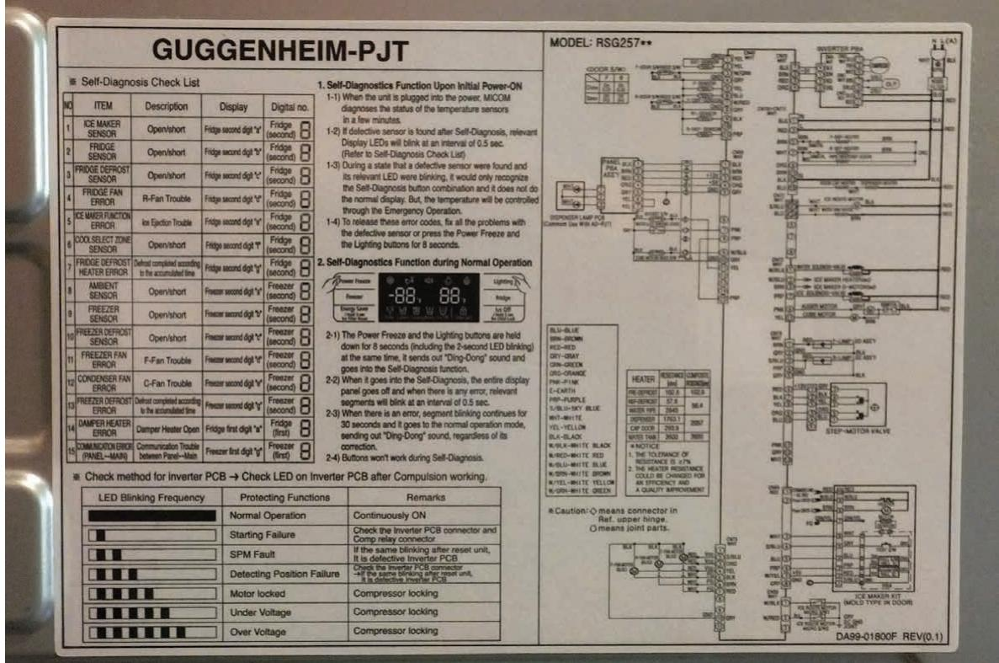  
Figure 1.13 The label on the back of a refrigerator provides diagnostic and connection information for service personnel. Photo by author.

## Diagnostics

For some systems, it is very important to be able to find and repair faulty components quickly and easily. One good example is the refrigerator: the manufacturer wants to minimize costs and time for its service personnel. The embedded computer system can help by providing diagnostic support to test the system and identify which components have failed.

The left half of the label shown in Figure  1.13 is dedicated to explaining the refrigerator’s self-diagnosis capabilities. This allows the manufacturer’s service personnel to spend less time identifying the problem, reducing service call costs. The PCB in Figure 1.11 is designed to simplify diagnosis and repair; most connections are labelled, and a legend labelled “SENSOR Check-Point” explains where to measure the eight different temperature sensors.

## Constraints

Constraints placed on the resulting embedded system design limit the designer’s options when trying to meet the system’s functional requirements. The embedded system must not be too expensive, large, heavy, power-hungry, and so forth.

Parts costs are important for many embedded systems. The quadcopter and its controller sell for about \$30, so the cost for parts (electronic, mechanical, etc.) needs to be under about \$8. There is great pressure to use the least expensive parts that are adequate for the job. In this case, the MCU used is an STM32F031K6, which contains a Cortex-M0 CPU running up to 48 MHz, with 4 kB of SRAM and 32 kB of flash ROM. Most embedded systems are programmed in the C or C++ languages, in large part because these languages can be compiled into code with precise control of the hardware, and yet use small amounts of memory. Similarly, most embedded systems do not use a complex OS such as Linux to share the computer’s resources among the parts of the program. The main reasons are that the Linux OS requires large amounts of memory and a fast processor for good performance. There are alternative methods that can use a much less expensive embedded computer and still meet the performance requirements.

Some embedded systems have constraints on power. Power constraints limit the system’s rate of energy use. For example, the amount of power that a photovoltaic (PV) cell can generate depend on the ambient light. If the circuit tries to use more power than the PV cell can provide, the cell’s voltage drops and the system stops working.

Energy constraints limit the total amount of energy that can be used. For example, a battery holds a limited amount of energy. That energy can be used quickly or slowly, but there is only a limited amount available. Flying the quadcopter faster will discharge its battery faster, reduc ing the maximum flight time possible. So one goal for its developers was to use energy-efficient motors, lights, radios, and MCUs.

Some applications are weight-sensitive. Heavier objects take more energy to lift, move, and stop. For the quadcopter, lightness is important because a heavier quadcopter uses energy faster. In order to lift a heavier quadcopter, more lift is needed, so the motors will need to spin faster, drawing more power, and discharging the battery sooner. The quadcopter uses very small components in order to reduce the weight.

The quadcopter also has size constraints. Notice how small the components on the PCB are and how closely packed together they are. Compare this with the much larger and more sparsely packed PCB for the refrigerator. The refrigerator’s MCU is about 35 mm × 35 mm and takes about 1,225 mm2 of the PCB area. This is far larger than the quadcopter’s MCU, which at 10 mm × 10 mm takes only 100 mm 2.

Embedded systems are often expected to operate reliably over a wide range of temperatures. Electronic components for consumer applications are expected to operate with ambient tempera tures of $0 \%$ to $7 0 ^ { \circ } \mathrm { C }$ . Components for the more demanding industrial and automotive applica tions are expected to handle ranges from – $- 4 0 ^ { \circ } \mathrm { C }$ to $8 5 ^ { \circ } \mathrm { C }$

## Target Platform

## Overview

Now let’s take a look at the hardware platform that we will be using. We will start with the CPU and work our way out. This textbook targets the Arm Cortex-M0 processor shown at the top of Figure 1.14. The processor executes the instructions of the program.

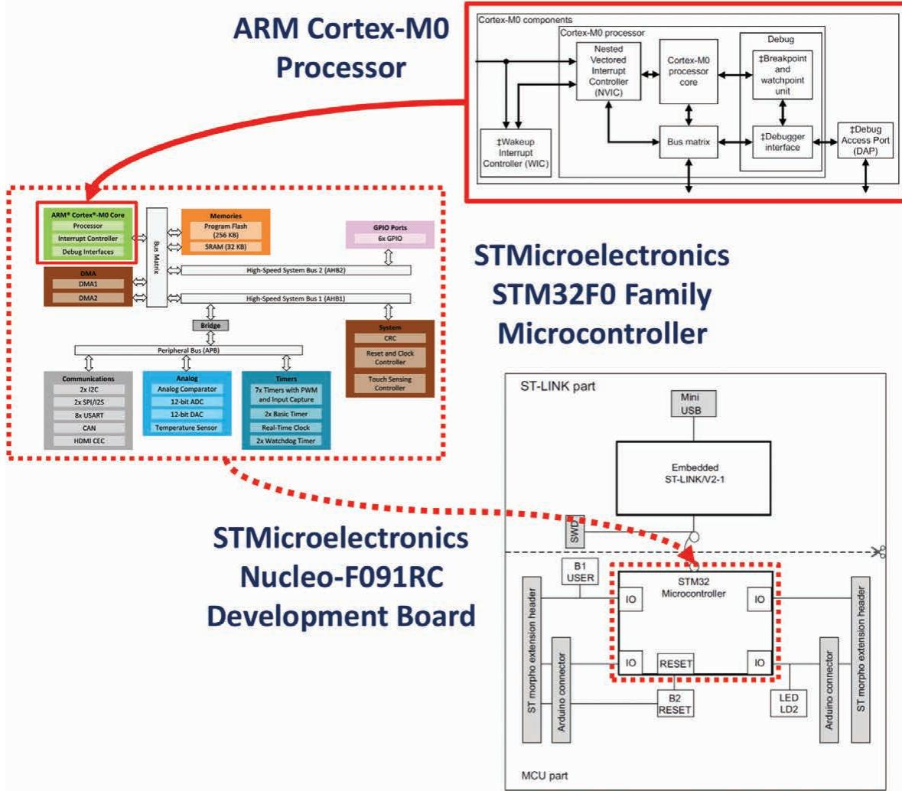  
Figure 1.14 An overview of the processor, microcontroller, and development board hardware architectures.

The processor is a component within the microcontroller, shown in the center of Figure 1.14. The MCU adds circuits to clock the processor, a memory to hold the program and data, and peripheral devices that simplify programs and improve their performance. The STM32F091RC MCU is used here.

The microcontroller is mounted on a Nucleo-F091RC development board, shown at the bottom of Figure 1.14 and Figure 1.15. This PCB adds a debug interface, power supplies, and various input and output devices.

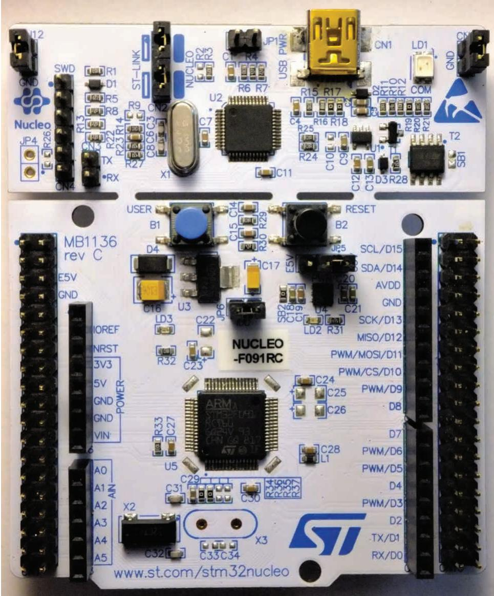  
Figure 1.15 Nucleo-F091RC development board from STMicroelectronics. Photo by author.

## Processor

The Cortex-M0 processor, shown in Figure 1.16, executes the instructions that make up the program. At the center of the Cortex-M0 processor is the processor core, which communicates with the memory to get the instructions it executes and hold the data it processes. The memory is located outside the processor in the microcontroller and is connected via the AHB-Lite interface. The bus matrix shares the memory bus among multiple possible readers and writers. An optional memory protection unit enables the system to restrict a task to using only a limited region of the memory, limiting the effects of bugs.

Interrupts come to the processor core through the Nested Vectored Interrupt Controller (NVIC), which prioritizes and filters them as needed.

The optional Wakeup Interrupt Controller cuts power consumption by letting the NVIC and the rest of the processor go to a low-power sleep mode and waking them up if an interrupt is requested. Several modules provide debug support, including downloading code to the MCU’s memory, setting break points to control program execution, and tracing the sequence of instructions actually executed.

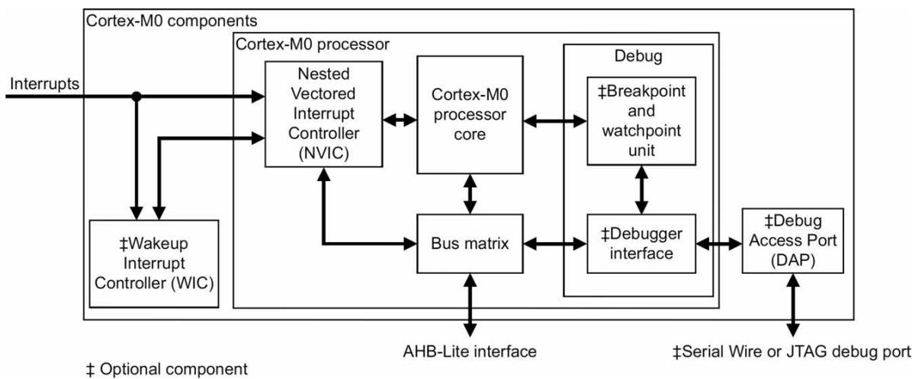  
Figure 1.16 Arm Cortex-M0 processor and its associated components. Courtesy of Arm Ltd.

## Microcontroller

The microcontroller augments the Arm Cortex-M0 processor by adding memory and supporting circuitry and peripheral devices (Figure 1.17). There are typically two types of memory provided. The flash memory retains its contents even without power, so it holds the program and fixed data. The SRAM does not retain its contents if there is no power and is used for temporary data storage.

The MCU used here (STM32F091RC) features a Cortex-M0 processor capable of running up to 48 MHz and contains 256 kB of flash ROM, 32 kB of RAM, and a wide range of peripherals [1], [2].

The support circuitry is required to make the processor operate. For example, the processor requires a clock signal, and the MCU adds multiple clock generators. These clocks have different levels of accuracy, speed, power consumption, and configurability.

Peripheral devices off-load work from the program (which executes on the processor) and perform it in hardware. For example, timer peripherals allow precise time measurement of events or input signals. They also enable generation of repetitive signals without software overhead. Communication interfaces translate digital data between the processor’s format and the formats which external devices use. Analog interfaces translate data between the processor’s digital format and the analog domain, in which signals vary across a continuous range of voltages, rather than the binary 1/0 of digital electronics. Finally, other peripherals are used to reset an out-ofcontrol program (watchdog), accelerate and automate memory transfers (DMA), and perform other tasks.

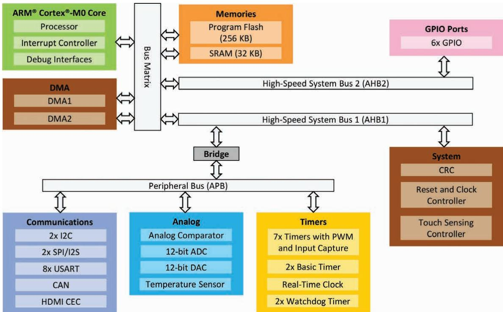  
Figure 1.17 STM32F0 family microcontroller (MCU).

## Development Board

As shown in Figures 1.15 and 1.18, the microcontroller is mounted on a Nucleo-F091RC development board [3]. This board adds a power supply, a debug interface, and various input and output devices. A 32 MHz clock source provides a stable, accurate timing reference.

The board is normally powered by the 5 V supplied by the USB connection. A voltage regulator drops this to 3.3 V in order to operate the board’s components. The power can be provided by an external source, allowing the board to operate without a connection to USB power.

A separate debug microcontroller (in the box labeled ST-LINK) translates commands and data between the development PC (via a USB connection) and the STM32F091RC MCU (the target microcontroller).

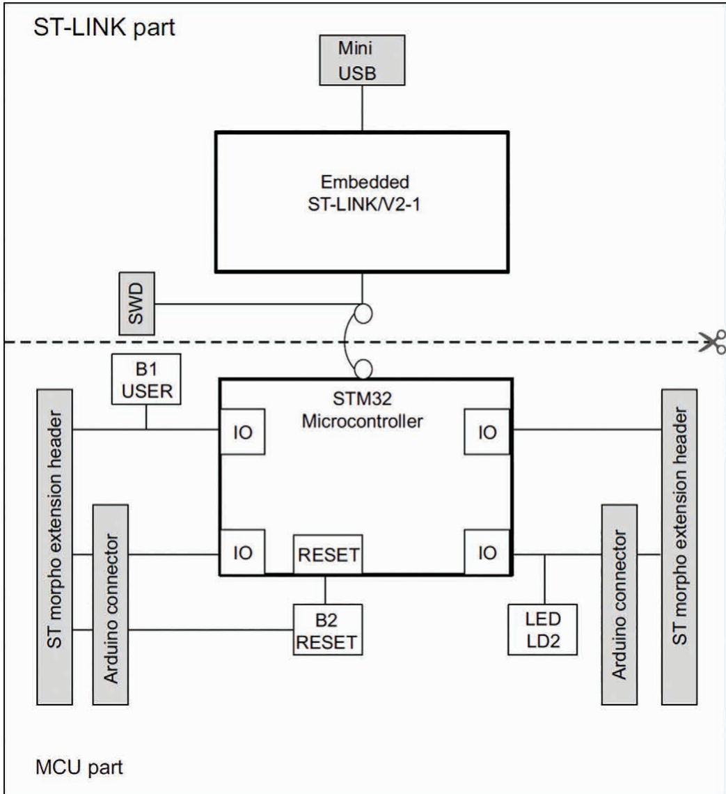  
Figure 1.18 Hardware block diagram of Nucleo-F091RC development board. [1]

The X-NUCLEO-IKS01A1 expansion board is used in Chapter 7 and Chapter 8 [4]. It contains motion MEMS and environmental sensors. The expansion board is plugged into the Nucleo-F091RC board as shown in Figure 1.19. We will use the 3-axis accelerometer and 3-axis gyroscope to measure the inclination of the board. It contains also sensors for temperature, humidity and air pressure.

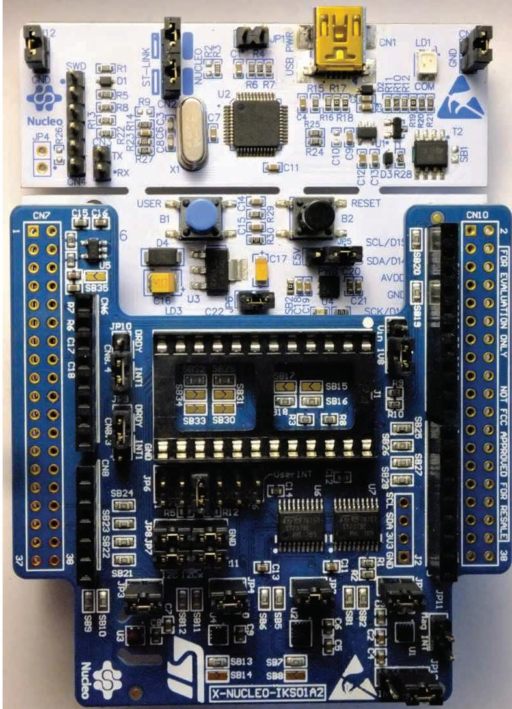  
Figure 1.19 X-NUCLEO-IKS01A1 expansion board plugged into the Nucleo-F091RC development board. Photo by author.

## Summary

Embedding a computer to control a system can provide benefits such as better performance and sophisticated features. We have seen three examples of applications: a hot plate for cooking food, a toy quadcopter aircraft, and a refrigerator. The embedded computer is typically made from a microcontroller that runs specialized control software which monitors the critical aspects of the system and its environment and then adjusts its outputs so the system behaves as needed. The computer uses special hardware to interface with the inputs and outputs. To meet application requirements, embedded systems must provide sufficient concurrency, responsiveness, reliability, fault handling and diagnostic help while meeting constraints on cost, size, weight, power, energy, and temperature. Finally, we have seen the target platform for this textbook:  the Arm Cortex-M0 processor core within the STM32F091RC MCU on the STMicroelectronics’ Nucleo-F091RC development board.

## Exercises

1. You have been asked to add an “automatic power-off” controller to a flashlight. The flashlight should turn off automatically after 3 minutes if it is not being used any more. The controller must be small, inexpensive, and use little power.

a. Can you think of a way to do this with electronics but without an embedded computer?

b. Can you think of a way to do this with a mechanical approach?

c. Now, really thinking outside the box, can you think of a way to do this with a pneumatic approach (using air)?

2. Consider embedding a computer in a flashlight. List three benefits or new useful features that are now possible. How much more would you be willing to pay for each feature?

3. A modern automobile has dozens of embedded computers. However, the auto industry is extremely cost-sensitive, so there must be a compelling reason to add computers. Give five examples of features enabled by embedded computers, and explain what major benefit(s) they provide.

4. Look around and find five devices that are likely to have embedded computer control systems. Answer these questions for each device:

a. What does the device do?

b. What are the device’s inputs?

c. What are the device’s outputs?

d. How does the embedded computer improve the device? Does it provide more features? Does it improve performance?

e. What are the biggest constraints on the device (size, cost, power, etc.)?

f. Would it be possible to build the device using a different kind of controller (e.g. mechanical)? How would that affect the device’s features, performance, cost, size, and weight?

## References

[1] STMicroelectronics NV, User Manual UM1724: STM32 Nucleo-64 Boards, 2019.

[2] STMicroelectronics NV, Reference Manual RM0091: STM32F0x1/STM32F0x2/STM32F0x8, 2017.

[3] STMicroelectronics NV, STM32F091xB STM32F091xC Data Sheet, DocID 026284, 2017.

[4] STMicroelectronics NV, User Manual UM2121: Getting Started with the X-NUCLEO-IKS01A2 Motion MEMS and Environmental Sensor Expansion Board for STM32 Nucleo, DocID 029834, rev. 2, 2017.

## 2

## General-​Purpose Input/​Output

## Chapter Contents

Overview 28   
Outside the MCU: Ones and Zeros, Voltages, and Currents 30   
Input Signals 30   
Output Signals 31   
Interfacing with a Switch and LED 31   
Inside the MCU 32   
Preliminaries: Control Registers and C Code 32   
Using CMSIS to Access Hardware Registers with C Code 34   
Coding Style for Accessing Bits 34   
Reading, Modifying, and Writing Fields in Control Registers 36   
Configuring the I/O Path 38   
Clock Gating 38   
Connecting a Pin to a Peripheral Module 39   
GPIO Peripheral 43   
GPIO Module Use 44   
Putting the C Code Together 46   
More Interfacing Examples 46   
Driving a Three-Color RGB LED 47   
Driving a Speaker 50   
Driving the Hot Plate's Heating Element 51   
Additional Pin Configuration Options 52   
Pull-Ups and Pull-Downs for Inputs 52   
Open Drain vs. Push-Pull Outputs 54   
Output Drive Strength 54   
Configuration Lock 55   
Other Options 55   
Summary 55   
Exercises 55   
References 56

## Overview

Embedded computers typically need to sense their environment and then control devices in response. Let’s start with the basics by learning how to make an embedded computer flash a light and read a switch by using a general purpose input/output (GPIO) port.

A microcontroller unit (MCU) contains a central processing unit (CPU) that executes instructions. The CPU is surrounded by specialized hardware circuits called peripherals that interface with external devices or perform other functions for the MCU. Some of these peripherals are integrated into the MCU, whereas others may be added externally on the printed circuit board.

general purpose input/output (GPIO) port Peripheral with digital input and output bits

In this chapter we introduce the GPIO port. We show how to create a C program to communicate with basic devices such as switches and light-emitting diodes (LEDs) as shown in Figure 2.1. An input GPIO port bit lets us read a single bit digital value on an MCU pin. If we connect the

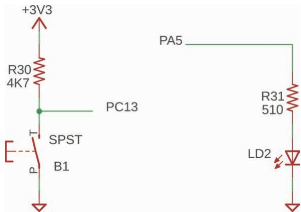  
Figure 2.1 A simple digital input and output circuit based on the Nucleo-F091RC board.

pin to a switch, then the program can tell if the switch is open or closed. An output GPIO port bit enables the program to set an MCU pin to one of two voltage levels (e.g. either 3.3 V or 0 V). A program can light or extinguish an LED that is connected to this output pin.

input GPIO port bit

Portion of GPIO port which enables program to read a single-bit input signal

output GPIO port bit

Portion of GPIO port which enables program to write a single-bit output signal

The Nucleo-F091RC board has a user input switch B1 and a user output LED LD2 as shown in Figure  2.1. Figure  2.2 shows where to access these signals on the board itself. Throughout this chapter we will follow an example of how to interface a C program with these and other components. Figure 2.3 shows the location of all the GPIO and other signals on the Nucleo board, with the switch and LED signals marked [1].

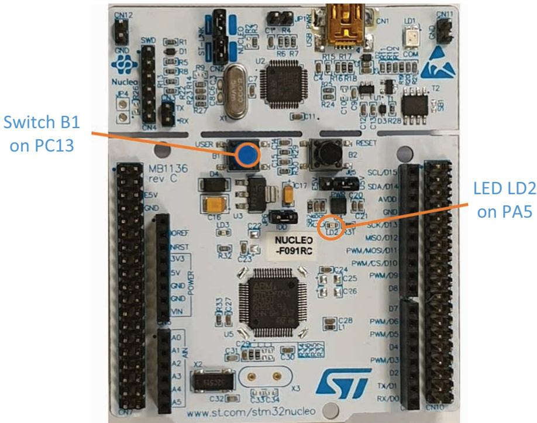  
Figure 2.2 Location of switch B1 and LED LD2 on the Nucleo board.

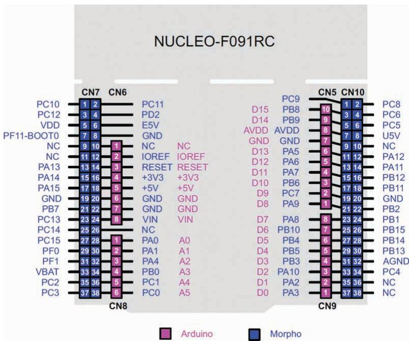  
Figure 2.3 Locations for accessing B1 and LD2 signals on Nucleo-F091RC connectors [1]. Signals from other examples in chapter are also shown.

Some of the implementation details in this chapter are specific to the STM32F0 series of MCUs. For further details, consult the reference manual [2] or data sheet [3].

## Outside the MCU: Ones and Zeros, Voltages, and Currents

We will start outside the MCU and work our way in. An MCU is a digital computer, so it operates on ones and zeros. How do we present a one or a zero to an input? What does a one or zero look like on an MCU output?

These values are represented by voltages within specific ranges relative to the MCU’s power supply voltage, $\mathrm { V } _ { D D } .$ The actual voltages do not matter much to an embedded system developer when they are inside the MCU, but they do matter when we want to interface with external devices.

## Input Signals

Digital inputs are interpreted based on their voltage levels. How do we supply a one or a zero to a digital input? The supply voltage $\mathrm { V } _ { D D }$ sets the thresholds for determining whether an input voltage will be considered a one or a zero. For example, the MCU’s data sheet might specify that an input voltage between 0 V and $0 . 3 \times V _ { D D }$ will be interpreted as a logic zero, whereas an input voltage between $0 . 7 \times V _ { D D }$ and $\mathrm { V } _ { D D }$ will be interpreted as a logic one. Figure 2.2 shows how input voltages are interpreted based on the supply voltage $\mathrm { V } _ { D D } .$ . For example, if $\mathrm { V } _ { D D }$ is 3.3 V, then input values between 0 and 0.99 V will be a logic zero and those between 2.31 and 3.3 V will be a logic one. An input voltage between $0 . 3 \times V _ { D D }$ and $0 . 7 \times V _ { D D }$ is undefined and may be read as a one or a zero. This is useless so we design external circuits to keep the voltage out of that range except when switching.

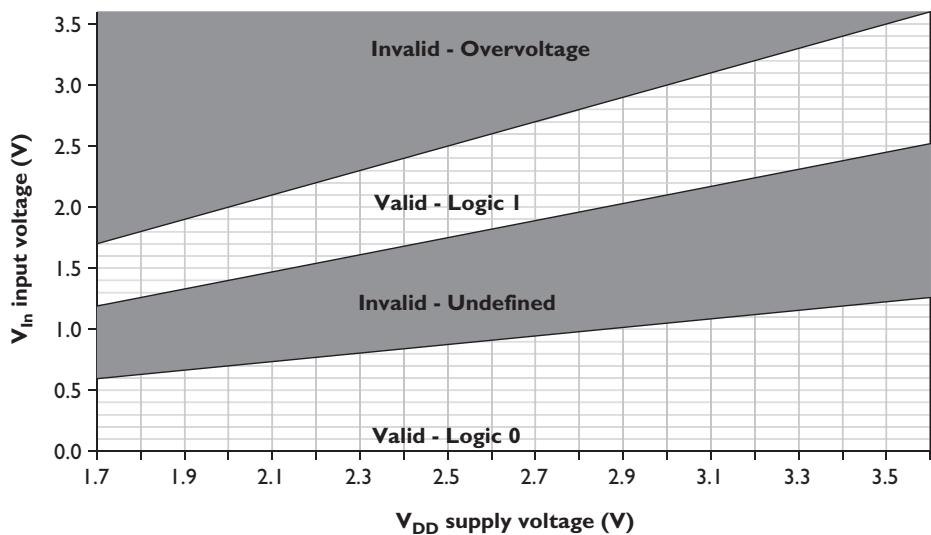  
Figure 2.4 Valid input voltage ranges as a function of supply voltage $\mathrm { V } _ { D D } .$ . See I/O port characteristics [3].

Digital inputs do not draw much current from the signal source; they have high input imped ance. Typically each GPIO pin will draw no more than $1 ~ \mu \mathrm { A }$ over the MCU’s entire operating temperature range. At room temperature $( 2 5 ^ { \circ } \mathrm { C } )$ , the input current will be much smaller (e.g. no more than 25 nA).

## Output Signals

Output voltages for digital ports are typically specified as being within a certain voltage range from a supply rail. For this MCU, a normal output generating a logic one will produce a voltage of $V _ { \mathrm { O H } }$ (out high), which is between $\mathrm { V } _ { D D }$ and $V _ { D D } - 0 . 4 \mathrm { V } .$ A logic zero will produce a voltage of $V _ { \mathrm { O } L }$ (out low) between 0 and 0.4 V.

This specification only holds true if a limited amount of current is drawn from the output. As that current increases, the output circuit’s voltage drop increases, pulling the output voltage away from the supply rails $( V _ { D D }$ and ground). If the output circuit draws enough current, it will overload and destroy the output transistor. So be careful not to exceed the specified ratings.

For this MCU, the output current $I _ { \mathrm { O H } }$ or $I _ { \mathrm { O } L }$ must not exceed 25 mA per pin. Some MCUs include output drivers with more powerful transistors, allowing greater output currents. “High drive” pads may be able to source or sink up more current and still meet the output voltage specifications.

transistor

Basic electronic component which operates as switch or amplifier

The drive current capability also depends on the supply voltage $ { V _ { D D ^ { \bullet } } } \mathrm { A s }  { V _ { D D } }$ falls, the transistors have a higher output resistance, increasing the voltage drop. So at lower operating voltages, the maximum output current available falls. Lowering $\mathrm { V } _ { D D }$ from 3.3 to 2.0 V might cut $I _ { \mathrm { O H } }$ and $I _ { \mathrm { O } L }$ from 5 to 1.5 mA.

## Interfacing with a Switch and an LED

Let’s consider the switch and LED example shown in Figure 2.1. A switch and a pull-up resistor are connected to signal PC13. When the switch is pressed, the signal is pulled low (logic zero) by the switch; otherwise it is pulled high (logic one) by the resistor. The resistor is large enough that very little current flows when the switch is pressed.

The LED has its anode (positive end, base of triangle) connected to an MCU output signal (PA5) through a resistor. The LED’s cathode (negative end, bar) is connected to ground. An LED’s brightness is roughly proportional to the current flowing through it. This current is nearly zero for low voltages, and then rises quickly as the voltage exceeds a threshold. The exact relationship between the voltage and current depends on the type of LED and its temperature. Applying 1.6 V may not light a red LED at all, but 2.0 V will make it bright (with 20 mA of current). Raising the voltage slightly to 2.3 V brightens it more and makes the current shoot up to 43 mA. Raising it further will cause the LED to overheat and fail.

anode

Positive terminal of a polarized component (LED, battery, etc)

cathode

Negative terminal of a polarized component (LED, battery, etc)

The GPIO port outputs are digital and do not offer such fine-grain voltage control. They can provide two levels: almost ground, and almost $\mathrm { V _ { D D } } \left( \mathrm { e . g . } \ 3 . 3 \ \mathrm { V } \right)$ . The first will correctly keep the LED off, but the second will probably burn out the LED. We need to include resistor R2 to limit the current through the LED and MCU driver output to a safe value.

We can calculate the value R of a current-limiting resistor based on the supply voltage $\mathrm { \Delta V _ { D D } } ,$ the LED forward voltage ${ \cal V } _ { F } ,$ and the desired LED current $I _ { L E D } \mathrm { : }$

$$
\mathrm{R} = \frac {\mathrm {V_ {DD}} - \mathrm {V_ {F}}}{\mathrm {I_ {LED}}}
$$

We start by picking a value of $I _ { L E D }$ which is safe for both the LED and the MCU output. In this case let’s set $I _ { L E D } = 4$ mA and assume $V _ { D D } = 3 . 0 \mathrm { V } . \mathrm { V } _ { F }$ is 1.8 V for the red LED and 2.7 V for the blue LED. We can now solve for the resistor values. For the red LED, a 300 Ω resistor is needed. For the blue LED, a 75 Ω resistor is needed.

## Inside the MCU

Now that we know how to connect these simple devices to the MCU pins, let’s look into how to let the program running on the CPU talk with those pins. First the program needs to configure the hardware within the MCU to set up the path between the CPU and the pins. Then the program can read from or write to those pins. Different MCU families use different approaches; here we cover the STM32F0 MCU family.

## Preliminaries: Control Registers and C Code

Peripherals are built with control registers to allow us to configure them, determine their status and transfer data. Table  2.1 shows some of the control registers for one peripheral module, the Reset and Clock Controller (RCC). These control registers appear as special locations in memory, as indicated by the column marked “Absolute address (hex)”. The term “hex” indicates the address is in hexadecimal format (base 16). We also can see the width of the register and the value after the MCU is reset (a value of X indicates that the corresponding bits are undefined) The reference manual offers further information [2].

The MCU’s reference manual provides the diagram in Figure 2.5 for RCC\_AHBENR, showing how each bit is used (if used), and whether we can read from or write to it. The manual also explains the use of each field in more detail.

control register

Register used to configure operation of hardware in CPU or peripheral

hexadecimal

Base-sixteen numbering system. Each digit can have one of sixteen values (0 through 9, A, B, C, D, E and F). Symbols A through F represent values of ten through fifteen.

Table 2.1 A portion of registers for the Reset and Clock Controller (RCC) peripheral. Registers are named with the peripheral name (RCC) followed by the register name (\_CR) [2].

<table><tr><td colspan="3">Absolute Address (hex)</td><td colspan="8">Register name</td><td colspan="2">Width(bits)</td><td colspan="3">Reset value</td><td colspan="2">Section/page</td></tr><tr><td colspan="3">4002_1000</td><td colspan="8">Clock control register (RCC_CR)</td><td colspan="2">32</td><td colspan="3">0000_XX83h</td><td colspan="2">6.4.1/108</td></tr><tr><td colspan="3">4002_1004</td><td colspan="8">Clock configuration register (RCC_CFGR)</td><td colspan="2">32</td><td colspan="3">0000_0000h</td><td colspan="2">6.4.2/110</td></tr><tr><td colspan="3">4002_1008</td><td colspan="8">Clock interrupt register (RCC_CIR)</td><td colspan="2">32</td><td colspan="3">0000_0000h</td><td colspan="2">6.4.3/113</td></tr><tr><td colspan="3">4002_100C</td><td colspan="8">APB peripheral reset register 2 (RCC_APB2RSTR)</td><td colspan="2">32</td><td colspan="3">0000_0000h</td><td colspan="2">6.4.4/116</td></tr><tr><td colspan="3">4002_1010</td><td colspan="8">APB peripheral reset register 1 (RCC_APB1RSTR)</td><td colspan="2">32</td><td colspan="3">0000_0000h</td><td colspan="2">6.4.5/117</td></tr><tr><td colspan="3">4002_1014</td><td colspan="8">AHB peripheral clock enable register (RCC_AHBENR)</td><td colspan="2">32</td><td colspan="3">0000_0014h</td><td colspan="2">6.4.6/120</td></tr><tr><td colspan="3">4002_1018</td><td colspan="8">APB peripheral clock enable register 2 (RCC_APB2ENR)</td><td colspan="2">32</td><td colspan="3">0000_0000h</td><td colspan="2">6.4.7/121</td></tr><tr><td colspan="3">4002_101C</td><td colspan="8">APB peripheral clock enable register 1 (RCC_APB1ENR)</td><td colspan="2">32</td><td colspan="3">0000_0000h</td><td colspan="2">6.4.8/123</td></tr><tr><td colspan="3">4002_1020</td><td colspan="8">RTC domain control register (RCC_BDCR)</td><td colspan="2">32</td><td colspan="3">0000_0018h</td><td colspan="2">6.4.9/126</td></tr><tr><td colspan="3">4002_1024</td><td colspan="8">Control status register (RCC_CSR)</td><td colspan="2">32</td><td colspan="3">XXX0_0000h</td><td colspan="2">6.4.10/128</td></tr><tr><td>Bit</td><td>31</td><td>30</td><td>29</td><td>28</td><td>27</td><td>26</td><td>25</td><td>24</td><td>23</td><td>22</td><td>21</td><td>20</td><td>19</td><td>18</td><td>17</td><td>16</td><td></td></tr><tr><td>Field</td><td>Res.</td><td>Res.</td><td>Res.</td><td>Res.</td><td>Res.</td><td>Res.</td><td>Res.</td><td>TSCEN</td><td>Res.</td><td>IOPF EN</td><td>IOPE EN</td><td>IOPD EN</td><td>IOPC EN</td><td>IOPB EN</td><td>IOPA EN</td><td>Res.</td><td></td></tr><tr><td>Reset</td><td></td><td></td><td></td><td></td><td></td><td></td><td></td><td>0</td><td></td><td>0</td><td>0</td><td>0</td><td>0</td><td>0</td><td>0</td><td></td><td></td></tr><tr><td>Access</td><td></td><td></td><td></td><td></td><td></td><td></td><td></td><td>rw</td><td></td><td>rw</td><td>rw</td><td>rw</td><td>rw</td><td>rw</td><td>rw</td><td></td><td></td></tr><tr><td>Bit</td><td>15</td><td>14</td><td>13</td><td>12</td><td>11</td><td>10</td><td>9</td><td>8</td><td>7</td><td>6</td><td>5</td><td>4</td><td>3</td><td>2</td><td>1</td><td>0</td><td></td></tr><tr><td>Field</td><td>Res.</td><td>Res.</td><td>Res.</td><td>Res.</td><td>Res.</td><td>Res.</td><td>Res.</td><td>Res.</td><td>Res.</td><td>CRC EN</td><td>Res.</td><td>FILTF EN</td><td>Res.</td><td>SRAM EN</td><td>DMA2 EN</td><td>DMA EN</td><td></td></tr><tr><td>Reset</td><td></td><td></td><td></td><td></td><td></td><td></td><td></td><td></td><td></td><td>0</td><td></td><td>1</td><td></td><td>1</td><td>0</td><td>0</td><td></td></tr><tr><td>Access</td><td></td><td></td><td></td><td></td><td></td><td></td><td></td><td></td><td></td><td>rw</td><td></td><td>rw</td><td></td><td>rw</td><td>rw</td><td>rw</td><td></td></tr></table>

Figure 2.5 Control register RCC\_AHBENR allows enabling clock signal to peripherals on AHB bus. From Section 6.4.6 of MCU reference manual [2].

## Using CMSIS to Access Hardware Registers with C Code

It would be tedious to have to look up and remember the addresses for the hardware control registers. Instead we use special C-language support. The Cortex Microcontroller Software Interface Standard (CMSIS) is a hardware abstraction layer for Cortex-M processors. The CMSIS-CORE component provides a C-language interface to the processor core and peripherals. This consists of macros and functions to perform various operations, and C data structures that map directly to registers.

Consider the RCC\_AHBENR control register. It is one of the RCC peripheral’s control registers. CMSIS-CORE lets us access the RCC control registers using a C-language data structure with a useful name (RCC). The data structure for the RCC peripheral contains 32-bit fields called CR, CFGR, CIR, and so forth. To access the RCC\_AHBENR register, we simply write RCC->AHBENR. Note that RCC is defined as a pointer to a data structure, which is why we use the -> to select the control register within.

There are similar data structures for all of the MCU’s peripherals and their control registers. The file stm32f091xc.h defines the device peripheral access layer (DPAL) for CMSIS-CORE for STM32F091xC-type MCUs. We need to be sure that all of our C source files contain the directive #include <stm32f091xc.h> before we try to use these features.

Beyond the device peripheral access layer (DPAL), ST provides additional software support modules designed to simplify application development. These include low-layer (LL) drivers and the STM32Cube Hardware Abstraction Layer (HAL). Please refer to this text’s preface for a discussion.

## Coding Style for Accessing Bits

A control register may hold one or more items of information (e.g. a count of how many pulses have been received). Each item is called a “field” and has a width of one or more bits. Consider the register RCC\_AHBENR shown in Figure 2.5. This is a 32-bit register. Bit 0 is a one-bit field labeled DMAEN, and bit 1 is one-bit field labeled DMAEN2. Bit 3 and bit 5 are reserved fields and should not be accessed. Bit 4 is a field labeled FLITFEN. Bit 6 is a field labeled CRCEN. Bits 7 to 16 and bits 23 to 31 are reserved and should not be accessed. Bits 17 to 22 are labeled IOPAEN, IOPBEN, IOPCEN, IOPDEN, IOPEEN, IOPFEN [2].

How can we access fields in these control registers using C code? We often need to access one or more specific bits in a control register to set them to specific values. For example, we might need to set the fields IOPAEN and IOPBEN to 1 in RCC\_AHBENR.

The fields are located at bits 17 and 18, respectively. We could write a 32-bit value with those bits set: the binary representation is 0000 0000 0000 0110 0000 0000 0000 0000. In decimal this is $2 ^ { 1 7 } + 2 ^ { 1 8 } = 1 3 1 0 7 2 + 2 6 2 1 4 4$ . However, it is slow and tedious counting zeros and we are likely to make errors. Furthermore, the meaning of the code (shown below) is not at all clear.

$$
n = 3 9 3 2 1 6;
$$

We can make the code somewhat easier to write and maintain by forming the value as a sum of shifted one bits. We’ll use the left shift operation a << b, which shifts operand a to the left by b bit positions. We will also use the bitwise or operator | rather than addition.

$$
n = (1 U L <   <   1 7) \mid (1 U L <   <   1 8);
$$

```c
#define MY_IOPAEN_POS (17)
#define MY_IOPBEN_POS (18)
n = (1UL << MY_IOPAEN_POS) | (1UL << MY_IOPBEN_POS);
```

Why is there “UL” after the 1? To write to a 32-bit register we need for the compiler to generate a 32-bit unsigned integer. To ensure the compiler does not use a signed or short integer and introduce possible errors, we use the suffix UL to specify that a numeric literal (e.g. 1) should be represented as an unsigned long integer, which is 32 bits long for an Arm Cortex-M processor.

We can make the code even easier to understand if we define and use meaningful names for the bit positions. When we use them, our code now becomes much easier to read:

Let’s further simplify things by making a macro to create a mask value by shifting a 1 to the proper position:

```c
#define MASK(x) (1UL << (x))
n = MASK(MY_IOPAEN_POS) | MASK(MY_IOPBEN_POS);
```

MCU vendors typically provide files which define convenient names for fields, using a <peripheral type>\_<register>\_<field> naming convention. For example, Listing 2.1 shows some of the definitions related to the RCC’s AHBENR register and the GPIO’s MODER register. The file defines three symbols for each bit field:

• The symbol ending in \_Pos indicates the position of the least-significant bit of the field within the register. For example, RCC\_AHBENR\_FLITFEN\_Pos is 4.

• The symbol ending in \_Msk is has ones in the field’s bit positions within the register, and zeroes elsewhere. For example, in binary RCC\_AHBENR\_FLITFEN\_Msk is 00000000 00000000 00000000 00010000.

• The final symbol (with no suffix) is set to be the same as the corresponding \_Msk field and is used to improve code readability (as we’ll see shortly).

```c
/******* Bit definition for RCC_AHBENR register *******
// ...
#define RCC_AHBENR_FLITFEN_Pos (4U)
#define RCC_AHBENR_FLITFEN_Msk (0x1U << RCC_AHBENR_FLITFEN_Pos)
#define RCC_AHBENR_FLITFEN RCC_AHBENR_FLITFEN_Msk
#define RCC_AHBENR_CRCEN_Pos (6U)
#define RCC_AHBENR_CRCEN_Msk (0x1U << RCC_AHBENR_CRCEN_Pos)
#define RCC_AHBENR_CRCEN RCC_AHBENR_CRCEN_Msk
#define RCC_AHBENR_GPIOAEN_Pos (17U)
#define RCC_AHBENR_GPIOAEN_Msk (0x1U << RCC_AHBENR_GPIOAEN_Pos)
#define RCC_AHBENR_GPIOAEN RCC_AHBENR_GPIOAEN_Msk
#define RCC_AHBENR_GPIOBEN_Pos (18U)
#define RCC_AHBENR_GPIOBEN_Msk (0x1U << RCC_AHBENR_GPIOBEN_Pos)
#define RCC_AHBENR_GPIOBEN RCC_AHBENR_GPIOBEN_Msk
// ...
```

```c
/******* Bit definition for GPIO_MODER register *******/
#define GPIO_MODER_MODER0_Pos (0U)
#define GPIO_MODER_MODER0_Msk (0x3U << GPIO_MODER_MODER0_Pos)
#define GPIO_MODER_MODER0 GPIO_MODER_MODER0_Msk
// ...
```

```c
#define GPIO_MODER_MODER1_Pos (2U)
#define GPIO_MODER_MODER1_Msk (0x3U << GPIO_MODER_MODER1_Pos)
#define GPIO_MODER_MODER1 GPIO_MODER_MODER1_Msk
// ...
```

Listing 2.1 Some examples of bit field definitions for CMSIS-CORE device peripheral abstraction layer in stm32f091xc.h. These follow the naming convention of <peripheral type>\_ <register>\_<field>.

Note that the name defined for the IOPAEN fields is GPIOAEN, since IOPAEN is at bit position 17, and RCC\_AHBENR\_GPIOAENR\_Pos is defined to be 17. In fact, all six of the IOP fields follow this convention. This is an exception; usually the names for bit field definitions match the reference manual. When in doubt, examine the header file (e.g. stm32f091xc.h) and find the name defined with the \_Pos value matching the start of the field in question.

Also, note that the RCC\_AHBENR \_Msk definitions are shifting a single “one” bit (0x1U), because each field is a single bit wide. However, the GPIO\_ MODER \_Msk definitions are shifted values of 3. This is because this field is two bits wide and requires shifting two “ones” (00000011 binary, or 0x03 in hex).

CMSIS-CORE provides the macros \_VAL2FLD and \_FLD2VAL for converting between values and bit fields. These are shown in Listing 2.2, excerpted from the file core\_cm0.h. These macros are especially useful for fields which are more than one bit wide (our MASK macro would need to be modified to handle more than one bit).

The \_VAL2FLD macro takes the value argument (which is aligned so the LSB is at bit position 0), shifts it left to the correct field position, and then performs a logical AND to keep only the field’s bits, zeroing out the others. The \_FLD2VAL macro takes a value argument (which is now aligned so the LSB is at the \_Pos bit position), performs a logical AND to keep only the field’s bits (zeroing out th others), and then shifts the result to the right so the LSB is at bit position 0.

The compiler’s preprocessor stage takes the field argument and uses the ## operator to concatenate the field name with a suffix of \_Msk or \_Pos to create a macro which uses the correct names.

```c
#define _VAL2FLD(field, value) \
(((uint32_t)(value) << field ## _Pos) & field ## _Msk)
#define _FLD2VAL(field, value) \
(((uint32_t)(value) & field ## _Msk) >> field ## _Pos)
```

Listing 2.2 Using CMSIS-CORE macro to shift values to or from their field locations. The \ character tells the compiler to append the next line to the current line.

## Reading, Modifying, and Writing Fields in Control Registers

Now we can see how to use these pieces to access the fields in the control registers. Note that these methods will work for fields which are a single bit or multiple bits wide.

• How do we find the current value of the GPIOAEN field? We use \_FLD2VAL to read the control register AHBENR and extract the desired field:

```c
// Find current value of GPIOAEN
n = _FLD2VAL(RCC_AHBENR_GPIOAEN, RCC->AHBENR);
```

• How do we set  all the bits in the fields GPIOAEN and GPIOEEN in that register, leaving everything else as zero? We use the = assignment operator:

```c
// Set GPIOAEN and GPIOEEN to all ones, clear others
RCC->AHBENR = RCC_AHBENR_GPIOAEN | RCC_AHBENR_GPIOEEN;
```

• How do we set  all the bits in the fields GPIOAEN and GPIOEEN in that register without modifying anything else? This means we need to perform a read/modify/write operation. We read the initial control register value, modify the value, and then write the result back to the register. The OR read/modify/write operator |= does this:

```c
// Set GPIOAEN and GPIOEEN to all ones, leave others unchanged
RCC->AHBENR |= RCC_AHBENR_GPIOAEN | RCC_AHBENR_GPIOEEN;
```

• How do we clear all the bits in the field GPIOAEN without modifying anything else? Again we need to perform a read/modify/write operation. However, the modification involves zeroing out the bit for GPIOAEN. We do this by first complementing the mask for GPIOAEN using the \~ operator. This flips all of its ones to zeros and zeros to ones. Using the AND read/modify/write operator &= will zero out the control register’s bits for IO port A’s field:

```c
// Clear GPIOAEN to all zeroes, leave others unchanged
RCC->AHBENR &= ~RCC_AHBENR_GPIOAEN;
```

set To change a bit to one

clear To change a bit to zero

• How do we change a field with multiple bits without changing any other fields? This means we need to perform a read/modify/write operation. We read the initial control register value, mod ify the value, and then write the result back to the register. The OR read/modify/write operator |= does this. There are no multi-bit fields in the RCC AHBENR register, so let’s consider the GPIOA peripheral’s MODER register instead. That register has a two-bit wide field for each of GPIOA’s 16 port bits, such as GPIOA\_MODER\_MODER6 for bit 6. If we want to change that field to n we can use this code:

```c
// Update a multibit field's value
// Clear all bits in field
GPIOA->MODER &= ~GPIOA_MODER_MODER6;
// Set bits in field according to shifted value
GPIOA->MODER |= _VAL2FLD(GPIOA_MODER_MODER6, n);
```

We will use this type of code frequently, so we will create a generalized, reusable macro to modify a field’s value. The resulting code will be shorter and more concise, making it easier to understand (as well as write). We define this macro in a file called field\_access.h, located in the common-driver directory of the code repository.

```c
#define MODIFY_FIELD(reg, field, value) \
((reg) = ((reg)& ~ (field ## _Msk)) | \
(((uint32_t)(value) << field ## _Pos)& field ## _Msk))
The resulting code is simple and clear:
MODIFY_FIELD(GPIOA->MODER, GPIO_MODER_MODER5, n);
```

## Configuring the I/O Path

Figure 2.6 shows an overview of the hardware circuits between an I/O pin and the CPU for a STM32F0 MCU. The GPIOA module selects which peripheral modules (e.g. GPIO, USART2, TIM2) will use port A’s pins. Pins can be assigned individually to different peripherals. The MCU configures the peripheral module and exchanges data with it. The block labeled RCC provides a clock signal to only the active modules, reducing power consumption.

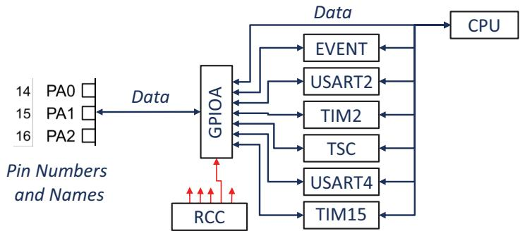  
Figure 2.6 An overview of hardware between pin PA1 and the CPU.

In order to use the GPIO peripheral, we need to do a little preparation. First, we need to ensure that a clock signal is provided to the port module or else it will not operate. Second, we need to ensure that the GPIO signals inside the integrated circuit are routed to the outside world through an I/O pin (or pad).

## Clock Gating

In STM32F0 MCUs, the RCC controls system clock gating using control registers AHBENR, APB1ENR and APB2ENR to control the peripherals. Chapter 6 in the MCU reference manual provides full information [2]. Figure  2.5 shows an excerpt from the manual. AHBENR allows individual control of the clock signals to GPIOA, GPIOB, GPIOC, GPIOD, GPIOE and GPIOF. Setting an I/O port’s bit, IOPA, IOPB, IOPC, IOPD, IOPE and IOPF respectively, in this register to one will supply the clock, allowing the port to operate. A zero will disable (gate) the clock signal to reduce power consumption by preventing circuit switching. We use the CMSIS-CORE support in the stm32f091xc.h header file:

RCC->AHBENR |= RCC\_AHBENR\_GPIOAEN;

clock gating

Method to disable circuit by blocking clock signal, reducing power consumption

## Connecting a Pin to a Peripheral Module

The GPIOA through GPIOF modules provide control for each port’s pins. Each I/O port x has four 32-bit configuration registers. To allow individual bit configuration of each pin, some bits are available in each configuration register. Table 2.2 shows the control registers for GPIOA.

Table 2.2 An example of GPIOA port control registers for a STM32F0 microcontroller.

<table><tr><td>Address</td><td>Register Description and Name</td><td>Width (bits)</td><td>Reset Value</td></tr><tr><td>4800_0000</td><td>GPIO port mode register (GPIOA_MODER)</td><td>32</td><td>2800_0000h</td></tr><tr><td>4800_0004</td><td>GPIO port output type register (GPIOA_OTYPER)</td><td>32</td><td>0000_0000h</td></tr><tr><td>4800_0008</td><td>GPIO port output speed register (GPIOA_OSPEEDR)</td><td>32</td><td>0000_0000h</td></tr><tr><td>4800_000C</td><td>GPIO port pull-up/pull-down register (GPIOA_PUPDR)</td><td>32</td><td>0C00_0000h</td></tr><tr><td>4800_0010</td><td>GPIO port input data register (GPIOA_IDR)</td><td>32</td><td>0000_XXXXh</td></tr><tr><td>4800_0014</td><td>GPIO port output data register (GPIOA_ODR)</td><td>32</td><td>0000_0000h</td></tr><tr><td>4800_0018</td><td>GPIO port bit set/reset register (GPIOA_BSRR)</td><td>32</td><td>0000_0000h</td></tr><tr><td>4800_001C</td><td>GPIO port configuration lock register (GPIOA_LCKR)</td><td>32</td><td>0000_0000h</td></tr><tr><td>4800_0020</td><td>GPIO port alternate function low register (GPIOA_AFRL)</td><td>32</td><td>0000_0000h</td></tr><tr><td>4800_0024</td><td>GPIO port alternate function high register (GPIOA_AFRH)</td><td>32</td><td>0000_0000h</td></tr><tr><td>4800_0028</td><td>GPIO port bit reset register (GPIOA_BRR)</td><td>32</td><td>XXXX_0000h</td></tr></table>

MCUs often include a multiplexer, which is an electronic selector switch. As shown in Figure 2.7, this allows a specific pin on the IC package to be connected to one of several possible peripheral modules. This provides greater flexibility to PCB designers and reduces MCU package size, circuit board size, and costs.

Electronic selector switch which routes one of N inputs signals to the output. MCU pin multiplexer is bidirectional (includes demultiplexer).

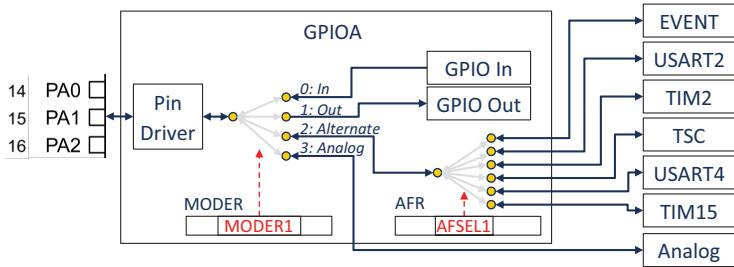  
Figure 2.7 A detailed view of a pin multiplexer.

<table><tr><td rowspan="2">Bit Field</td><td>31</td><td>30</td><td>29</td><td>28</td><td>27</td><td>26</td><td>25</td><td>24</td><td>23</td><td>22</td><td>21</td><td>20</td><td>19</td><td>18</td><td>17</td><td>16</td></tr><tr><td colspan="2">MODER15</td><td colspan="2">MODER14</td><td colspan="2">MODER13</td><td colspan="2">MODER12</td><td colspan="2">MODER11</td><td colspan="2">MODER10</td><td colspan="2">MODER9</td><td colspan="2">MODER8</td></tr><tr><td rowspan="2">Reset Access</td><td>0</td><td>0</td><td>x</td><td>0</td><td>x</td><td>0</td><td>0</td><td>0</td><td>0</td><td>0</td><td>0</td><td>0</td><td>0</td><td>0</td><td>0</td><td>0</td></tr><tr><td>rw</td><td>rw</td><td>rw</td><td>rw</td><td>rw</td><td>rw</td><td>rw</td><td>rw</td><td>rw</td><td>rw</td><td>rw</td><td>rw</td><td>rw</td><td>rw</td><td>rw</td><td>rw</td></tr><tr><td rowspan="2">Bit Field</td><td>15</td><td>14</td><td>13</td><td>12</td><td>11</td><td>10</td><td>9</td><td>8</td><td>7</td><td>6</td><td>5</td><td>4</td><td>3</td><td>2</td><td>1</td><td>0</td></tr><tr><td colspan="2">MODER7</td><td colspan="2">MODER6</td><td colspan="2">MODER5</td><td colspan="2">MODER4</td><td colspan="2">MODER3</td><td colspan="2">MODER2</td><td colspan="2">MODER1</td><td colspan="2">MODERO</td></tr><tr><td rowspan="2">Reset Access</td><td>0</td><td>0</td><td>0</td><td>0</td><td>0</td><td>0</td><td>0</td><td>0</td><td>0</td><td>0</td><td>0</td><td>0</td><td>0</td><td>0</td><td>0</td><td>0</td></tr><tr><td>rw</td><td>rw</td><td>rw</td><td>rw</td><td>rw</td><td>rw</td><td>rw</td><td>rw</td><td>rw</td><td>rw</td><td>rw</td><td>rw</td><td>rw</td><td>rw</td><td>rw</td><td>rw</td></tr></table>

Figure 2.8 GPIO Mode Register controls first multiplexer to define mode for each GPIO pin.

The STM32F0 GPIOx modules provide two such multiplexers for each pin. The multiplexer closest to the pin determines whether the pin is to be an input, output, analog or alternative function, determines that pin’s setting (according to Table 2.3) in the corresponding field of the GPIOx\_MODER register as shown in Figure 2.8.

Table 2.3 Bit patterns to select GPIO Mode.

<table><tr><td>MODER(i) [1:0]</td><td>I/O Configuration</td><td>Symbol Name in common-driver/gpio.h</td></tr><tr><td>00</td><td>Input</td><td>ESF_GPIO_MODER_INPUT</td></tr><tr><td>01</td><td>Output</td><td>ESF_GPIO_MODER_OUTPUT</td></tr><tr><td>10</td><td>Alternate Function</td><td>ESF_GPIO_MODER_ALT_FUNC</td></tr><tr><td>11</td><td>Analog</td><td>ESF_GPIO_MODER_ANALOG</td></tr></table>

We will use these MODER settings often, so in Listing 2.3 we define our own symbols with meaningful names which are easier to remember.1 These symbols are defined in the file gpio.h in the common-driver folder of the code repository.

```c
#define ESF_GPIO_MODER_INPUT (0)
#define ESF_GPIO_MODER_OUTPUT (1)
#define ESF_GPIO_MODER_ALT_FUNC (2)
#define ESF_GPIO_MODER_ANALOG (3)
```  
Listing 2.3 Descriptive names for MODER settings are defined in common-driver\gpio.h.

In order to access the GPIO MODER register with C code, we will use the CMSIS-CORE support from . The data structure of type  has its fields laid out to match the registers in a GPIO peripheral as shown in Listing 2.4. The stm32f091xc.h file also defines pointers called GPIOA, GPIOB, etc. to each GPIO module. We will use these pointers to access the data structures.

```c
typedef struct
{
    __IO uint32_t MODER;    /*!< GPIO port mode register,
    Address offset: 0x00    */
    __IO uint32_t OTYPER;    /*!< GPIO port output type register,
    Address offset: 0x04    */
    __IO uint32_t OSPEEDR;    /*!< GPIO port output speed register,
    Address offset: 0x08    */
    __IO uint32_t PUPDR;    /*!< GPIO port pull-up/pull-down register,
    Address offset: 0x0C    */
    __IO uint32_t IDR;    /*!< GPIO port input data register,
    Address offset: 0x10    */
    __IO uint32_t ODR;    /*!< GPIO port output data register,
    Address offset: 0x14    */
    __IO uint32_t BSRR;    /*!< GPIO port bit set/reset register,
    Address offset: 0x1A    */
    __IO uint32_t LCKR;    /*!< GPIO port configuration lock register,
    Address offset: 0x1C    */
    __IO uint32_t AFR[2];    /*!< GPIO alternate function low register,
    Address offset: 0x20-0x24    */
    __IO uint32_t BRR;    /*!< GPIO bit reset register,
    Address offset: 0x28    */
} GPIO_TypeDef;
```  
Listing 2.4 C-language data structure representing GPIO port registers.

The CMSIS-CORE support in stm32f091xc.h includes these macros for accessing the MODERn field for pin n in the MODER register. We can use GPIO\_MODER\_MODERn definitions in Listing 2.1 to shift the desired value leftward to the field’s position within the register.

Our switch and LED example system needs one input (the switch on PC13) and one output (LED LD2 on PA5). The MODER field of the GPIOA controls the connection of the pins to the GPIO module as inputs or outputs.

```c
// Enable peripheral clock of GPIOA (for LD2)
RCC->AHBENR |= RCC_AHBENR_GPIOAEN;
// Configure PA5 in output mode (01=1)
MODIFY_FIELD(GPIOA->MODER, GPIO_MODER_MODER5, ESF_GPIO_MODER_OUTPUT);
// Enable peripheral clock of GPIOC (for Switch B1)
RCC->AHBENR |= RCC_AHBENR_GPIOCEN;
// Configure PC13 in input mode (00=0)
MODIFY_FIELD(GPIOC->MODER, GPIO_MODER_MODER13, ESF_GPIO_MODER_INPUT);
```  
Listing 2.5 Using the MODIFY\_FIELD macro to configure port control register multiplexers.

In order to preserve the other fields within the control register, we will use the MODIFY\_ FIELD macro defined previously to perform the read/modify/write operations: first zeroing out the bits for the MODERn field, then using OR to insert the new values.

There are up to eight alternate functions available for each pin; one is selected by a second multiplexer controlled by GPIO alternate function registers GPIOx\_AFRL (for the pins 0 to 7 of the port x) and GPIOx\_AFRH (for the pins 8 to 16 of the port x) shown in Figure 2.9.

<table><tr><td rowspan="2">Bit Field</td><td>31</td><td>30</td><td>29</td><td>28</td><td>27</td><td>26</td><td>25</td><td>24</td><td>23</td><td>22</td><td>21</td><td>20</td><td>19</td><td>18</td><td>17</td><td>16</td></tr><tr><td colspan="4">AFSEL7</td><td colspan="4">AFSEL6</td><td colspan="4">AFSEL5</td><td colspan="4">AFSEL4</td></tr><tr><td rowspan="2">Reset Access</td><td>0</td><td>0</td><td>0</td><td>0</td><td>0</td><td>0</td><td>0</td><td>0</td><td>0</td><td>0</td><td>0</td><td>0</td><td>0</td><td>0</td><td>0</td><td>0</td></tr><tr><td>rw</td><td>rw</td><td>rw</td><td>rw</td><td>rw</td><td>rw</td><td>rw</td><td>rw</td><td>rw</td><td>rw</td><td>rw</td><td>rw</td><td>rw</td><td>rw</td><td>rw</td><td>rw</td></tr><tr><td rowspan="2">Bit Field</td><td>15</td><td>14</td><td>13</td><td>12</td><td>11</td><td>10</td><td>9</td><td>8</td><td>7</td><td>6</td><td>5</td><td>4</td><td>3</td><td>2</td><td>1</td><td>0</td></tr><tr><td colspan="4">AFSEL3</td><td colspan="4">AFSEL2</td><td colspan="4">AFSEL1</td><td colspan="4">AFSELO</td></tr><tr><td rowspan="2">Reset Access</td><td>0</td><td>0</td><td>0</td><td>0</td><td>0</td><td>0</td><td>0</td><td>0</td><td>0</td><td>0</td><td>0</td><td>0</td><td>0</td><td>0</td><td>0</td><td>0</td></tr><tr><td>rw</td><td>rw</td><td>rw</td><td>rw</td><td>rw</td><td>rw</td><td>rw</td><td>rw</td><td>rw</td><td>rw</td><td>rw</td><td>rw</td><td>rw</td><td>rw</td><td>rw</td><td>rw</td></tr></table>

Figure 2.9 GPIOx\_AFRL register controls the second multiplexer to define the alternate function (if used).

The GPIOA register AFRL is made of 8 AFSEL fields which allow configuring the alternate function of pins 0 to 7 of the GPIOA. The register AFRH allows configuring the alternate function of pins 8 to 16 of the GPIOA. To specify the alternate function register for bit 6 of GPIOA, we would write GPIOA->AFRL using the \_VAL2FLD macro and field GPIO\_AFRL\_AFSEL6 to shift the value to the correct position and mask it.

The AFSELn control bits specify multiplexer behavior as shown in Table 2.4. Before writing to any GPIO register, be sure that the clock signal is provided to the port (using the RCC\_AHBENR register described above). Otherwise, accessing it may have no effect, or it may trigger a fault and cause the processor to execute error handling code (e.g. for a hard fault).

Table 2.4 Alternate function selection field settings with examples for selected pins

<table><tr><td>AFSEL field value</td><td>Configuration</td><td>Pin PA1</td><td>Pin PA2</td><td>Pin PA5</td></tr><tr><td>000</td><td>Alternative 0</td><td>EVENTOUT</td><td>Timer TIM15_CH1</td><td>SPI1_SCK, I2S1_CK</td></tr><tr><td>001</td><td>Alternative 1</td><td>Serial Communication USART2_RTS</td><td>Serial Communication USART2_TX</td><td>Communication interface CEC</td></tr><tr><td>010</td><td>Alternative 2</td><td>Timer TIM2_CH2</td><td>Timer TIM2_CH3</td><td>Timer TIM2_CH1_ETR</td></tr><tr><td>011</td><td>Alternative 3</td><td>Touch sensing TSC_G1_IO2</td><td>Touch Sensing TSC_G1_IO3</td><td>Touch Sensing TSC_G2_IO2</td></tr><tr><td>100</td><td>Alternative 4</td><td>Serial Communication USART4_RX</td><td>No connection</td><td>No connection</td></tr><tr><td>101</td><td>Alternative 5</td><td>Timer TIM15_CH1N</td><td>No connection</td><td></td></tr><tr><td>110</td><td>Alternative 6</td><td>No connection</td><td>No connection</td><td>No connection</td></tr><tr><td>111</td><td>Alternative 7</td><td>No connection</td><td>Comparator Output COMP2_OUT</td><td>No connection</td></tr></table>

If the mode of the GPIO is set to the alternate function mode then the pin function is chosen by the AFSEL field of the pin. The values (000 to 111) will have different effects for different pins. For details refer to Chapter 8 of the MCU’s reference manual [2].

## GPIO Peripheral

The STM32F0 GPIO peripheral module has six ports (GPIOA through GPIOF). Although each port could have up to 16 pins, there are not enough pins on the MCU package to support all of them. The MCU’s data sheet pin-out section describes which port bits are implemented [3].

An input GPIO port bit lets us read a single bit digital value on an MCU pin. For example, if we connect the pin through a switch to ground, then the program can tell if the switch is open or closed. An output GPIO port bit enables the program to set an MCU pin to be a logic one or zero. For example, a program can light or extinguish an LED that is connected to an output pin.

The main logic hardware for a single GPIO port bit is simple and built around registers, as shown in Figure 2.10. Each GPIO port bit has its own version of this hardware. A register stores one bit of data, which is visible on the output signal (marked Q). A register will read its data input (marked D) and store that value every time its clock signal (marked with a triangle) is triggered. These signals are triggered when the CPU writes to or reads from the register’s address, as labeled in Figure 2.10. The GPIO port bit has two main registers:

• Input data is held in the data in register. The MCU’s I/O clock automatically updates this register (e.g. 48 million times per second). To read this register, the CPU reads from the Input Data Register address (GPIOx\_IDR), which enables the buffer (triangle to the right of the register) to transmit its contents to the CPU over the data bus.

• Output data is held in the data out register. The CPU writes data to this register by putting the data on the data bus and writing to the Output Data Register address (GPIOx\_ODR), which triggers the register’s clock signal.

Multiple GPIO bits are grouped together to create a port that can be accessed in parallel for efficiency. MCU designers often make ports as wide as the processor’s native data word size, so a 32-bit processor may have 32-bit wide ports. In the case of the STM32F0 MCU, each port has a maximum of 16 pins but the port registers are 32 bits wide.

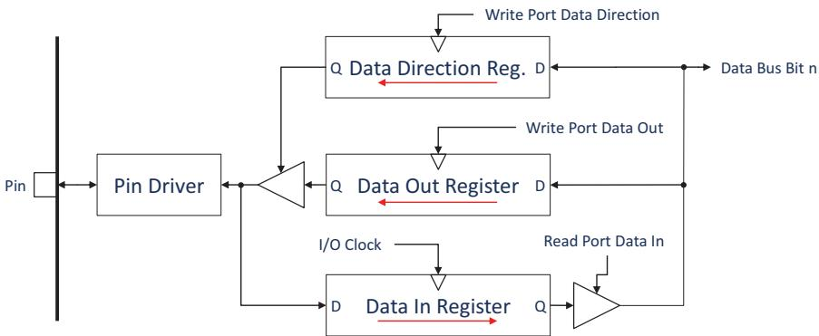  
Figure 2.10 The main logic components of a GPIO port.

## GPIO Module Use

In order to use the GPIO module, we need to read or write data:

• Input values are read from the GPIOx\_IDR register.

• Output values are written to the GPIOx\_ODR register.

```c
// Definitions for bit positions
#define LD2_POS (5)
#define B1_POS (13)
#define MASK(x) (1UL<<(x))

// Turn off LD2
GPIOA->ODR &= ~MASK(LD2_POS);
while (1) {
    // Repeatedly read switch and control LD2
    if (GPIOC->IDR & MASK(B1_POS)) {
    // 1: Switch is not pressed, so turn off LD2
    GPIOA->ODR &= ~MASK(LD2_POS);
    } else {
    // 0: Switch is pressed, so turn on LD2
    GPIOA->ODR |= MASK(LD2_POS);
    }
}
```

Listing 2.6 Code excerpt to light LED when switch is pressed. GPIOA output for LED is controlled with read/modify/write instructions.

Listing 2.6 shows the code for the switch and LED example. There are first some definitions of bit positions and the MASK macro, and then code to turn off the LED. Then we run a loop that lights the LED only when the switch is held down.

In order to simplify and accelerate the software for manipulating individual output bits in a port, the hardware provides a special register GPIOx\_BSRR (Bit Set and Reset Register) that can change specific output bits without affecting the others (that is, in an atomic way). Each bit i of the port has corresponding fields BSi and BRi. These are shown in Figure 2.11.

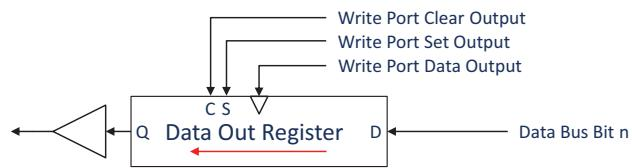  
Figure 2.11  Additional control signals to clear and set output bits in an atomic way (without requiring separate read/modify/write operations).

• Writing a 1 to GPIOx\_BSRR\_BSi will set the corresponding GPIO\_ODRi. For example, to set the least significant byte of port A to all ones, write 0x0000 00FF to GPIOA\_BSRR (GPIOA->BSRR). Writing the value 0 to the other bits has no effect.

• Writing a value 1 to GPIOx\_BSRR\_BRi will reset (clear) the corresponding GPIO\_ODRi. For example, to clear the least significant byte of port A to all zeros, write 0x00FF 0000 to GPIOA\_ BSRR (GPIOA->BSRR). Writing the value 0 to the other bits has no effect.

```c
// Turn off LD2
GPIOA->BSRR = GPIO_BSRR_BR_5;
while (1) {
    if (GPIOC->IDR & GPIO_IDR_13) {
    // 1: Switch is not pressed, so turn off LD2
    GPIOA->BSRR = GPIO_BSRR_BR_5;
    } else {
    // 0: Switch is pressed, so turn on LD2
    GPIOA->BSRR = GPIO_BSRR_BS_5;
    }
}
```

Listing 2.7 Updated code uses GPIO peripheral’s port bit set and reset features (BS and BR) to simplify software read/modify/write operations to just writes.

Listing 2.7 shows the modified code which now lights the LED using the bit set and reset register. This simplifies the code, eliminating the need for read/modify/write instructions for each port access.

## Putting the C Code Together

Now we can assemble the complete program, shown in Listing 2.8. We have defined additional symbols (LD2\_ON, LD2\_OFF, B1\_IN) to make it easier to see how the I/O signals are connected and to take advantage of the port’s bit set and reset features. The main function has one line of code which simply calls the example code. After downloading the code, press the reset button to start the program running.2

```c
#define LD2_OFF_MSK (GPIO_BSRR_BR_5)
#define LD2_ON_MSK (GPIO_BSRR_BS_5)
#define B1_IN_MSK (GPIO_IDR_13)

void Basic_Light_Switching_Example(void) {
    // Enable peripheral clock of GPIOA (for LD2)
    RCC->AHBENR = RCC_AHBENR_GPIOAEN;
    // Configure PA5 in output mode (01=1)
    MODIFY_FIELD(GPIOA->MODER, GPIO_MODER_MODER5, ESF_GPIO_MODER_OUTPUT);
    // Enable peripheral clock of GPIOC (for Switch B1)
    RCC->AHBENR = RCC_AHBENR_GPIOCEN;
    // Configure PC13 in input mode (00=0)
    MODIFY_FIELD(GPIOC->MODER, GPIO_MODER_MODER13, ESF_GPIO_MODER_INPUT);

    // Turn off LD2
    GPIOA->BSRR = LD2_OFF_MSK;
    while (1) {
    if (GPIOC->IDR & B1_IN_MSK) {
    // 1: Switch is not pressed, so turn off LD2
    GPIOA->BSRR = LD2_OFF_MSK;
    } else {
    // 0: Switch is pressed, so turn on LD2
    GPIOA->BSRR = LD2_ON_MSK;
    }
    }
}

int main(void) {
    Basic_Light_Switching_Example();
}
```

Listing 2.8 Completed code for LED and switch example.

## More Interfacing Examples

Let’s examine some more examples of interfacing: driving a three-color LED and a speaker.

Driving a Three-Color RGB LED

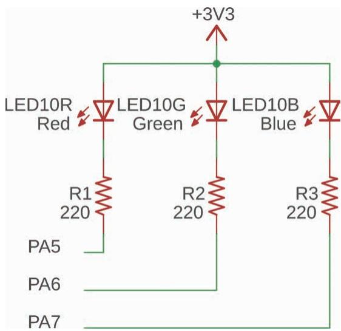  
Figure 2.12 RGB LED connected to GPIO port bits through current-limiting resistors.

Let’s see how to use three GPIO port bits from the Nucleo board to drive an external RGB LED. The schematic in Figure 2.12 shows that the three-color (red, green, blue or RGB) LED has its cathodes connected through resistors to the MCU through ports PA5 (red), PA6 (green), and PA7 (blue). The breadboard connections are shown in Figure 2.13.

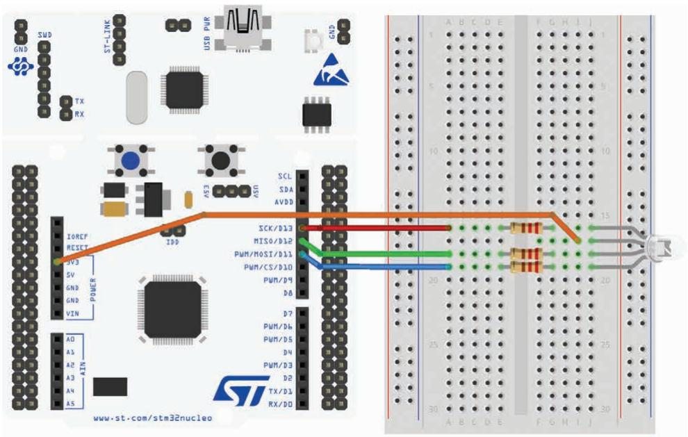  
Figure 2.13 Layout of RGB LED circuit on breadboard.

Note that this is different from our previous example in Figure 2.1, in which the LED anode is connected to the MCU through a resistor. Because of this difference, clearing the output bit to zero will light the LED, and setting the output bit to one will turn off the LED. This configuration is used because many MCU output drivers can handle more current this way.

Let’s examine a program to configure the port, lighting all possible combinations of the LEDs in a repeating sequence. The first part of the program defines useful values and initializes the peripherals, seen in Listing 2.9.

```c
#include <stm32f091xc.h>
#include "delay.h"
#include "field_access.h"
#include "gpio.h"

// Active-Low LED control definitions
// 0 out = LED on
// 1 out = LED off
#define LED_R_OFF_MSK (GPIO_BSRR_BS_5)
#define LED_R_ON_MSK (GPIO_BSRR_BR_5)
#define LED_G_OFF_MSK (GPIO_BSRR_BS_6)
#define LED_G_ON_MSK (GPIO_BSRR_BR_6)
#define LED_B_OFF_MSK (GPIO_BSRR_BS_7)
#define LED_B_ON_MSK (GPIO_BSRR_BR_7)

void RGB_Flasher_Init(void) {
    // Enable peripheral clock of GPIOA
    RCC->AHBENR |= RCC_AHBENR_GPIOAEN;
    // Configure the three pins as output
    MODIFY_FIELD(GPIOA->MODER, GPIO_MODER_MODER5, ESF_GPIO_MODER_OUTPUT);
    MODIFY_FIELD(GPIOA->MODER, GPIO_MODER_MODER6, ESF_GPIO_MODER_OUTPUT);
    MODIFY_FIELD(GPIOA->MODER, GPIO_MODER_MODER7, ESF_GPIO_MODER_OUTPUT);

    // Turn on LEDs
    GPIOA->BSRR =
    LED_R_ON_MSK | LED_G_ON_MSK | LED_B_ON_MSK;
}
```

Listing 2.9 Definitions and initialization code for flashing RGB LED.

The function RGB\_Flasher\_Sequential in Listing 2.10 lights the LEDs based on tests of each bit in the variable num.

```c
void RGB_Flasher_Sequential(void) {
    unsigned int num = 0;
    while (1) {
    num++;
    if (num & 1)
    GPIOA->BSRR = LED_R_ON_MSK;
    else
    GPIOA->BSRR = LED_R_OFF_MSK;
    if (num & 2)
    GPIOA->BSRR = LED_G_ON_MSK;
```

```c
else
    GPIOA->BSRR = LED_G_OFF_MSK;
if (num & 4)
    GPIOA->BSRR = LED_B_ON_MSK;
else
    GPIOA->BSRR = LED_B_OFF_MSK;
Delay(400);
}
```

Listing 2.10 Code to flash RGB LED based on value of num variable.

In order to make the different LED colors visible to the human eye, we slow down the loop by calling a function (Delay) shown in Listing 2.11.

```txt
void Delay(volatile unsigned int time_del) {
    volatile int n;
    while (time_del--) {
    n = 1000;
    while (n--)
    ;
    }
}
```

Listing 2.11 Delay function slows down processor to make different LED colors visible. Function is located in common-driver/delay.c.

The function RGB\_Flasher\_Sequential performs three tests to determine whether to light the three LEDs.  eliminates these individual bit tests and writes the data in parallel to the LED, simplifying the code and saving time. The three least-significant bits of num are masked off and shifted to align with the GPIO port bits corresponding to the LEDs and then are written.

```txt
void RGB_Flasher_Parallel(void) {
    unsigned int num = 0;

    while (1) {
    num++;
    GPIOA->ODR &= ~((0x07) << 5); // Clear all bits in field
    GPIOA->ODR |= (~num & 0x07) << 5; // Set given bits in field
    // Note num is complemented with ~ so a 1 bit in num creates
    // a 0 output, turning on the LED
    Delay(400);
    }
}
```

Listing 2.12  Parallel version of RGB flasher writes all three bits from num to output port at once, simplifying code.

## Driving a Speaker

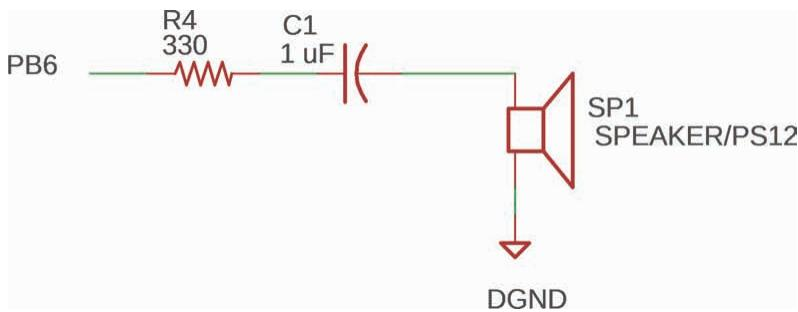  
Figure 2.14 Driving a speaker with a digital output.

We can generate a simple tone with a speaker using the circuit shown in Figure 2.14. We use the MCU to toggle to an output PB6 to create a square wave that is filtered by a resistor and capacitor to drive a speaker. The frequency of the signal determines the pitch of the sound.

```c
#include <stm32f091xc.h>
#include "delay.h"
#include "field_access.h"
#include "gpio.h"

#define SPKR_HIGH (GPIO_BSRR_BS_6)
#define SPKR_LOW (GPIO_BSRR_BR_6)

void Init_Speaker(void) {
    // Enable peripheral clock of GPIOB
    RCC->AHBENR |= RCC_AHBENR_GPIOBEN;
    // Configure Port B pin 6 as output (mode 1)
    MODIFY_FIELD(GPIOB->MODER, GPIO_MODER_MODER6, ESF_GPIO_MODER_OUTPUT);
    // Set to 1 initially
    GPIOB->BSRR |= SPKR_HIGH;
}

void Beep(void) {
    Init_Speaker();
    while (1) {
    // Delay is about 2 ms
    GPIOB->BSRR = SPKR_HIGH;
    Delay(2);
    GPIOB->BSRR = SPKR_LOW;
    Delay(2);
    }
}
```  
Listing 2.13 Code to initialize speaker output and drive it with a square wave.

In this example, we use software and a delay loop to generate the square wave. The code in Listing 2.13 toggles the output by reading-inverting-writing the output register, and then delays for half of the period before repeating the process. We use the same time delay function as in the previous example, but with a shorter argument for a shorter delay.

The output waveforms are shown in Figure 2.15. The upper trace shows the digital output of the GPIO pin, toggling about every 2 ms (your times may vary). The lower trace shows the filtered voltage after the capacitor.

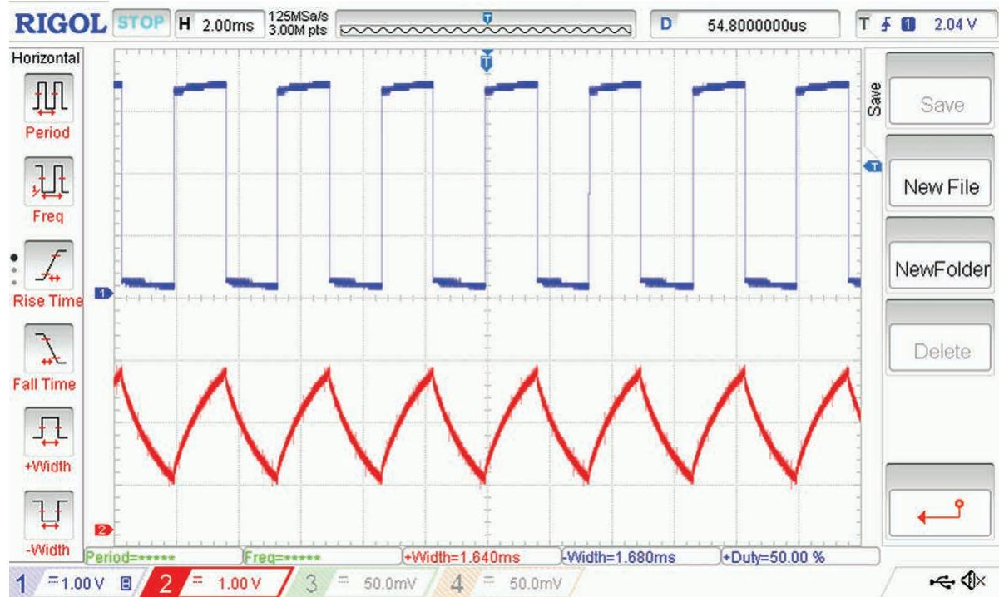  
Figure 2.15 Waveforms generated by a beep function and speaker circuit.

Note that this software-based approach does not share the processor with the other processing tasks, so it limits what else the system can do during tone generation. Microcontrollers have a variety of other methods (peripherals such as timers and interrupt service routines) that can generate a square wave in hardware with minimal software overhead. We will be learning more about this in Chapter 7.

## Driving the Hot Plate’s Heating Element

In the first chapter we looked at how to use an embedded computer as a hot plate controller. The circuit requires a driver to switch the heating element and indicator light on and off. These devices require much more power and higher voltages than the MCU can provide. The heating element operates at 120 V, drawing about 8 A of current. This is far more than the MCU’s digital output can provide. We need a driver circuit that uses a logic-level control signal (3.3 V, a few mA) to switch a mains-voltage level signal (120 V, 8 A).

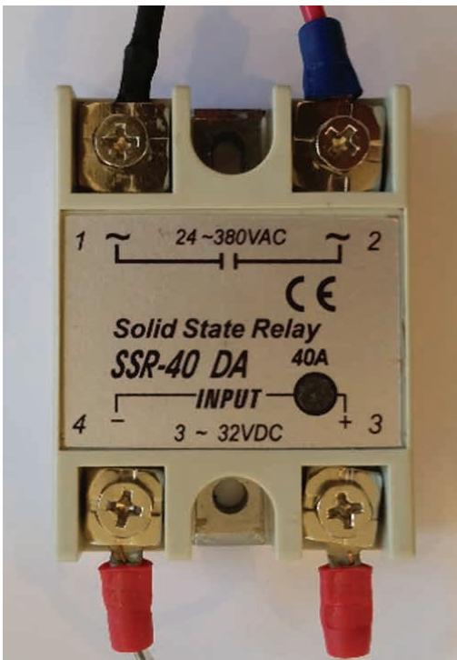  
Figure 2.16 A solid-state relay allows the MCU to switch devices powered by up to 380 V AC.

There are various circuits and devices that can be used. One convenient option is called a solid-state relay (SSR), shown in Figure  2.16. When a logic-level one is present on the input (terminals 3 and 4), the internal circuit will connect the output terminals (1 and 2) electrically. The input and output circuits in the SSR are completely electrically isolated to make the circuit safer, reducing the risk of circuit damage or user injury from voltage surges on the mains or circuit malfunctions.

## Additional Pin Configuration Options

The MCU may offer additional options for the circuits driving each output pin or sensing each input pin. We examine the most common options here.

## Pull-Ups and Pull-Downs for Inputs

Some types of input signals will not swing the full voltage range from valid logic zero to valid logic one. For example, the switch in Figure 2.1 can only pull the input signal to ground. If the switch is not pressed, the input signal will be disconnected (“floating”) and sensitive to electrical noise (e.g. static electricity). The resistor R30 was added to pull the signal up to $\mathrm { V } _ { D D }$ when the switch is open.

<table><tr><td>Bit</td><td>31</td><td>30</td><td>29</td><td>28</td><td>27</td><td>26</td><td>25</td><td>24</td><td>23</td><td>22</td><td>21</td><td>20</td><td>19</td><td>18</td><td>17</td><td>16</td></tr><tr><td>Field</td><td colspan="2">PUPDR15</td><td colspan="2">PUPDR14</td><td colspan="2">PUPDR13</td><td colspan="2">PUPDR12</td><td colspan="2">PUPDR11</td><td colspan="2">PUPDR10</td><td colspan="2">PUPDR9</td><td colspan="2">PUPDR8</td></tr><tr><td>Reset</td><td>0</td><td>0</td><td>x</td><td>0</td><td>0</td><td>x</td><td>0</td><td>0</td><td>0</td><td>0</td><td>0</td><td>0</td><td>0</td><td>0</td><td>0</td><td>0</td></tr><tr><td>Access</td><td>rw</td><td>rw</td><td>rw</td><td>rw</td><td>rw</td><td>rw</td><td>rw</td><td>rw</td><td>rw</td><td>rw</td><td>rw</td><td>rw</td><td>rw</td><td>rw</td><td>rw</td><td>rw</td></tr><tr><td>Bit</td><td>15</td><td>14</td><td>13</td><td>12</td><td>11</td><td>10</td><td>9</td><td>8</td><td>7</td><td>6</td><td>5</td><td>4</td><td>3</td><td>2</td><td>1</td><td>0</td></tr><tr><td>Field</td><td colspan="2">PUPDR7</td><td colspan="2">PUPDR6</td><td colspan="2">PUPDR5</td><td colspan="2">PUPDR4</td><td colspan="2">PUPDR3</td><td colspan="2">PUPDR2</td><td colspan="2">PUPDR1</td><td colspan="2">PUPDR0</td></tr><tr><td>Reset</td><td>0</td><td>0</td><td>0</td><td>0</td><td>0</td><td>0</td><td>0</td><td>0</td><td>0</td><td>0</td><td>0</td><td>0</td><td>0</td><td>0</td><td>0</td><td>0</td></tr><tr><td>Access</td><td>rw</td><td>rw</td><td>rw</td><td>rw</td><td>rw</td><td>rw</td><td>rw</td><td>rw</td><td>rw</td><td>rw</td><td>rw</td><td>rw</td><td>rw</td><td>rw</td><td>rw</td><td>rw</td></tr></table>

Figure 2.18  STM32F0 pin pull-up/pull-down register (GPIOx\_PUPDR) contents for ports B to F. Port A is similar but has different reset values [2].

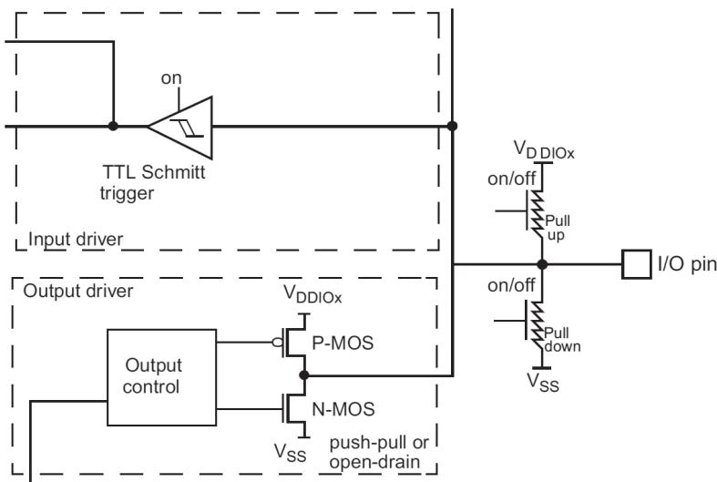  
Figure 2.17 Input and output drivers, and pull-up and pull-down circuits [2].

This pull functionality is so useful that most microcontrollers include built-in pull-up and pull down support; STM32F0 MCUs are no exception. To simplify the circuit design, weak transistors are typically used as controllable resistors, as shown on the right side of Figure 2.17. The typical value of the pull-up and pull-down resistance is between 20 and 50 kΩ.

We configure the pull functionality using the pull-up/pull-down control register (PUPDR) shown in Figure 2.18. Two bits are associated in the registers to each pin of the port. It controls which circuits are enabled: either the pull-up (01), pull-down (10) or neither (00). After reset all pull resistors are disabled for ports B through F, while port A enables some [2].

Using this feature, we could simplify the circuit of Figure 2.1 by eliminating the external pull-up resistor. This would reduce parts and assembly costs, as well as circuit size. The code would need to enable the pull-up resistor by setting the bits in PUPDR corresponding to the input pins to 01.

## Open Drain vs. Push-Pull Outputs

Normal digital outputs use two transistors to switch the signal quickly between voltages $\mathrm { V _ { D D } }$ (for 1) and ground (for 0) as seen in the output driver section of Figure 2.17. Sometimes we wish to combine multiple outputs to a single signal, for example to enable multiple devices to drive a signal such as an error condition, or a communication bus (we will see the I2C communication protocol uses this approach in Chapter 8). If we connect multiple push-pull outputs together, and they have different data to send, the driver transistors will be damaged. The output driving a 1 will turn on its P-MOS transistor, and the output driving a 0 will turn on its N-MOS transistor. The resulting low-resistance path from $\mathrm { V _ { D D } }$ to ground will let too much current to flow through the P-MOS transistor in one output and the N-MOS transistor in the other output, damaging and even destroying them.

To prevent this damage, we can use open-drain drivers: the P-MOS transistor is disabled regardless of whether a 1 or 0 is sent. To send a 1, the N-MOS transistor is turned off. A pull-up resistor (instead of the P-MOS transistor) pulls the signal up to 1. To send a 0, the N-MOS transistor is turned on, and a small but safe amount of current will flow through that transistor. The output changes from a 0 to a 1 more slowly than with a P-MOS transistor. “Open-drain” means that the drain terminal of the N-MOS transistor is not connected to a working P-MOS transistor.

<table><tr><td>Bit</td><td>31</td><td>30</td><td>29</td><td>28</td><td>27</td><td>26</td><td>25</td><td>24</td><td>23</td><td>22</td><td>21</td><td>20</td><td>19</td><td>18</td><td>17</td><td>16</td></tr><tr><td>Field</td><td>Res.</td><td>Res.</td><td>Res.</td><td>Res.</td><td>Res.</td><td>Res.</td><td>Res.</td><td>Res.</td><td>Res.</td><td>Res.</td><td>Res.</td><td>Res.</td><td>Res.</td><td>Res.</td><td>Res.</td><td>Res.</td></tr><tr><td>Reset</td><td></td><td></td><td></td><td></td><td></td><td></td><td></td><td></td><td></td><td></td><td></td><td></td><td></td><td></td><td></td><td></td></tr><tr><td>Access</td><td></td><td></td><td></td><td></td><td></td><td></td><td></td><td></td><td></td><td></td><td></td><td></td><td></td><td></td><td></td><td></td></tr></table>

<table><tr><td>Bit</td><td>15</td><td>14</td><td>13</td><td>12</td><td>11</td><td>10</td><td>9</td><td>8</td><td>7</td><td>6</td><td>5</td><td>4</td><td>3</td><td>2</td><td>1</td><td>0</td></tr><tr><td>Field</td><td>OT15</td><td>OT14</td><td>OT13</td><td>OT12</td><td>OT11</td><td>OT10</td><td>OT9</td><td>OT8</td><td>OT7</td><td>OT6</td><td>OT5</td><td>OT4</td><td>OT3</td><td>OT2</td><td>OT1</td><td>OT0</td></tr><tr><td>Reset</td><td>0</td><td>0</td><td>0</td><td>0</td><td>0</td><td>0</td><td>0</td><td>0</td><td>0</td><td>0</td><td>0</td><td>0</td><td>0</td><td>0</td><td>0</td><td>0</td></tr><tr><td>Access</td><td>rw</td><td>rw</td><td>rw</td><td>rw</td><td>rw</td><td>rw</td><td>rw</td><td>rw</td><td>rw</td><td>rw</td><td>rw</td><td>rw</td><td>rw</td><td>rw</td><td>rw</td><td>rw</td></tr></table>

Figure 2.19  Output type register GPIOx\_OTYPER determines if each output is push-pull(0, default after reset) or open-drain (1).

The GPIO port output type register (GPIOx\_OTYPER) in Figure 2.19 controls the type of the output between open-drain and push-pull. Note that GPIO port pull-up/pull-down register (GPIOx\_PUPDR) is used for both inputs and outputs. In the case of an open-drain output, we want to use the pull-up setting (01) in GPIOx\_PUPDR if there is no external pull-up on the signal.

## Output Drive Strength

Digital output signals generate electromagnetic (EM) noise as they change. For some applications fast changes are more important, while for others EM noise dominates. The GPIO peripheral offers three output transition speeds (low, medium and high speed) which are selected by the GPIOx\_OSPEEDR register, described in the GPIO port output speed register section of the MCU reference manual [2]. The resulting signal transition speeds are described in the Input/Output AC characteristics section of the MCU data sheet [3].

## Configuration Lock

It is possible to lock the configuration (e.g. direction, pull-up) of bits in ports A and B to prevent corruption by software bugs or glitches. After locking, only the bit’s data can be changed; the configuration is fixed until the MCU is reset. Details appear in the GPIO port configuration lock register section of the reference manual [2].

## Other Options

The GPIO peripheral can generate events such as interrupt and direct memory access requests based on input signals. These will be discussed in Chapters 4 and 9 and are controlled by the EXTI and SYSCFG registers.

## Summary

This chapter has introduced the concepts of general purpose I/O ports and how to use them in a STM32F0 MCU using C code with the CMSIS-CORE hardware abstraction layer or the STMicroelectronics HAL hardware abstraction layer. Interfacing with inputs and outputs was introduced with examples using LEDs, a switch, and a speaker.

## Exercises

1. What are the valid input voltage ranges for a STM32F0 MCU with $\mathrm { V } _ { D D } = 3$ V? With 2 V?

2. What is the actual value of $\mathrm { V } _ { D D }$ on your MCU board? Use a multimeter to measure this voltage.

3. Examine the schematic for your Nucleo-F091RC board: a. How many GPIO port bits are available for port A? b. Port B? c. Port C? d. Port D? e. Port E? f. Port F?

4. Calculate the resistor values needed to limit current through the blue and red LEDs of Figure 2.3 to 18 mA each. Assume that the supply voltage $\mathrm { V } _ { D D }$ is 3.0 V.

5. What values need to be written to which registers in order to set a port as a digital input, with the resistive pull-up enabled?

6. Consider a program that uses bits 0 through 5 on port A as GPIO inputs, and bits 10 through 15 as GPIO outputs:

a. What control register settings are needed?

b. Write a C code to implement these control register settings.

7. Consider a system with a STM32F091RC MCU, one switch, and four LEDs. As long as the switch is not pressed, all lights shall be turned off. When the switch is pressed, the LEDs shall start to turn on one at a time (starting with LED 0), with a delay of roughly ½ second per LED. After all the LEDs are turned on, they shall remain on until the switch is released. The selection of port bits for the switch and the LEDs is your choice. The following table shows the required sequence of LED activity, assuming the switch is pressed at time T1 and released at time T2.

<table><tr><td>Time (sec)</td><td>Switch</td><td>LED0</td><td>LED1</td><td>LED2</td><td>LED3</td></tr><tr><td> $< T_{1}$ </td><td>Not pressed</td><td>off</td><td>off</td><td>off</td><td>off</td></tr><tr><td> $T_{1}$ </td><td>Pressed</td><td>on</td><td>off</td><td>off</td><td>off</td></tr><tr><td> $T_{1} + 0.5$ </td><td>Pressed</td><td>on</td><td>on</td><td>off</td><td>off</td></tr><tr><td> $T_{1} + 1.0$ </td><td>Pressed</td><td>on</td><td>on</td><td>on</td><td>off</td></tr><tr><td> $T_{1} + 1.5$ </td><td>Pressed</td><td>on</td><td>on</td><td>on</td><td>on</td></tr><tr><td> $T_{2}$ </td><td>Not pressed</td><td>off</td><td>off</td><td>off</td><td>off</td></tr></table>

a. What control register settings are needed?  
b. Write a C program to implement this system.

## References

[1] STMicroelectronics NV, User Manual UM1724: STM32 Nucleo-64 Boards, 2019.

[2] STMicroelectronics NV, Reference Manual RM0091: STM32F0x1/STM32F0x2/STM32F0x8, 2017.

[3] STMicroelectronics NV, STM32F091xB STM32F091xC Data Sheet, DocID 026284, 2017.

## 3

## Basics of Software Concurrency

## Chapter Contents

Overview 60  
Concepts 61  
Starter Program 61  
Program Structure 62  
Analysis 64  
Creating and Using Tasks 65  
Program Structure 65  
Analysis 68  
Improving Responsiveness 69  
Interrupts and Event Triggering 69  
Program Structure 70  
Analysis 72  
Reducing Task Completion Times with Finite State Machines 74  
Program Structure 75  
Analysis 77  
Using Hardware to Save CPU Time 77  
Program Structure 78  
Analysis 81  
Advanced Scheduling Topics 82  
Waiting 82  
Task Prioritization 83  
Task Preemption 84  
Real-Time Systems 85  
Summary 86  
Exercises 86

## Overview

In this chapter, we explore the basic concepts of how to make a microcontroller unit (MCU) perform multiple software activities apparently simultaneously, providing overlapping (concurrent) execution. Embedded systems use peripheral hardware to perform some activities, while other activities are performed in software on the central processing unit (CPU). In order to get everything done on time, the processor’s time needs to be shared among these activities. We demonstrate these processor scheduling concepts by starting with a basic program and then enhancing it to improve its modularity, responsiveness, and CPU overhead. Figure 3.1 presents an overview of how these topics are related.

modularity

Measure of how program is structured to group related portions and separate independent portions

responsiveness

Measure of how quickly a system responds to an input event

CPU overload

Portion of time CPU spends executing code which dos not perform useful work for the application

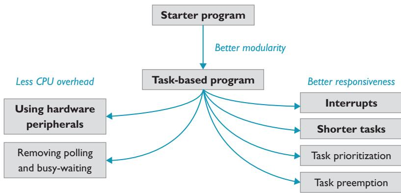  
Figure 3.1 An overview of concurrency concepts presented in this chapter. Topics in bold are examined in detail.

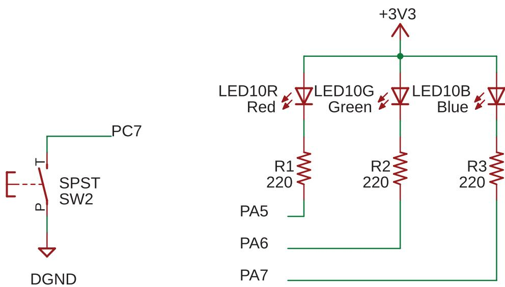  
Figure 3.2 Schematic of additional switch input and LED outputs for investigating concurrency.

In order to investigate the concepts of concurrency, we will consider a system with an MCU, two switches, and an RGB (red, green, blue) LED. An RGB LED can create a wide range of colors by changing the brightness of each LED. White is created by lighting all three LED colors simultaneously. Switch 1 (SW1) is B1 on the Nucleo board, while we add switch SW2 and the RGB LED (and its current-limiting resistors R1–R3) externally as shown in Figure 3.3.

• When switch 1 is not pressed, the system displays a repeating sequence of colors (red, then green, then blue).

• When switch 1 is pressed, the system makes the LED flash white (all LEDs on) and off (all LEDs off) until the switch is released.

• When switch 2 is pressed, faster timing is used for the flashing and RGB sequences.

The time delay between the user pressing the switch and seeing the LED flash white is the system’s response time for switch 1. A shorter response time is better. How we share the processor’s time among the tasks is one of the main factors determining the system’s responsiveness.

## Starter Program

Let’s start with a simple program for the LED flasher. We will put everything into one loop that reads the switches and lights the LEDs accordingly. This loop will use functions to control the LEDs (Control\_RGB\_LEDs) and delay program execution (Delay). It will use a macro to read the switches (SWITCH\_PRESSED). The code is available as ST/Code/ch3/Flasher1 in the code repository (https://github.com/alexander-g-dean/ESF.git).

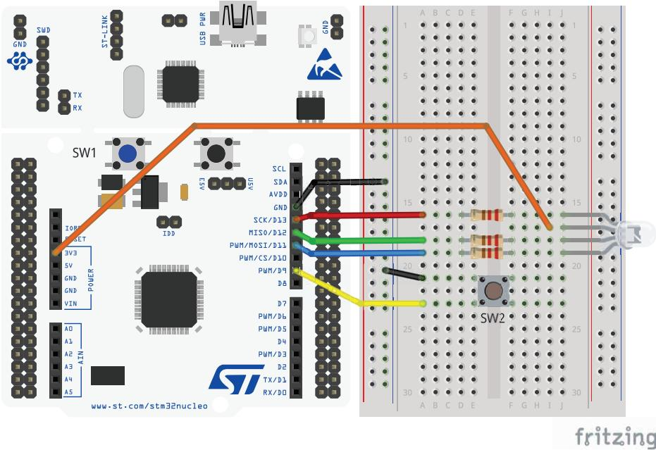  
Figure 3.3 Connecting breadboard with switch, LED and resistors to Nucleo board.

## Program Structure

The core of the program is shown in Listing 3.1. The program will first check to see if switch 1 is pressed. If so, the code will make the LED white, delay for some time, turn off the LED, and dela for some time again.

```c
#include <stm32f091xc.h>
#include "switch.h"
#include "rgb.h"
#include "delay.h"

#define W_DELAY_SLOW 150
#define W_DELAY_FAST 70
#define RGB_DELAY_SLOW 400
#define RGB_DELAY_FAST 100

void Flasher(void) {
    uint32_t w_delay = W_DELAY_SLOW;
    uint32_t RGB_delay = RGB_DELAY_SLOW;

    Init_GPIO_RGB();
    Init_GPIO_Switches();
    while (1) {
    if (SWITCH_PRESSED(SW1_POS)) { // flash white
    Control_RGB_LEDs(1, 1, 1);
    Delay(w_delay);
    Control_RGB_LEDs(0, 0, 0);
    Delay(w_delay);
    } else { // sequence R, G, B
```

```c
Control_RGB_LEDs(1, 0, 0);
Delay(RGB_delay);
Control_RGB_LEDs(0, 1, 0);
Delay(RGB_delay);
Control_RGB_LEDs(0, 0, 1);
Delay(RGB_delay);
}
if (SWITCH_PRESSED(SW2_POS)) {
    w_delay = W_DELAY_FAST;
    RGB_delay = RGB_DELAY_FAST;
} else {
    w_delay = W_DELAY_SLOW;
    RGB_delay = RGB_DELAY_SLOW;
}
}
```  
Listing 3.1 Initial LED flasher code (in Flasher1/main.c).

If switch 1 is not pressed, the program will first light the red LED (turning off the others) and then wait for a fixed time. It will then light the green LED (turning off the others) and then wait for a fixed time. Finally, it will turn on the blue LED (turning off the others) and wait for a fixed time.

After flashing the LEDs, the code updates the time delays based on whether switch 2 is pressed or not. The program will then repeat.

Support code is presented in Listing 3.2 and Listing 3.3. Initialization code and header files are not included here, but are quite similar to those shown in Chapter 2 and are available in the GitHub repository.

```c
#define SW_GPIO (GPIOC)    // Both switches are on GPIO C
#define SW1_POS (13)    // PC13 (User Button B1)
#define SW2_POS (7)    // PC7 (add external button)

#define MASK(x) (1UL << (x))

// Both switches are active-low, so invert data
#define SWITCH_PRESSED(x) (!((SW_GPIO)->IDR & MASK(x)))

void Init_GPIO_Switches(void);

void Init_GPIO_Switches_Interrupts(void);
```

Listing 3.2 Switch support code (in common-driver/switch.h) for starter program.

```c
#include <stm32f091xc.h>
#include "rgb.h"
#include "field_access.h"
#include "gpio.h"

void Init_GPIO_RGB(void) {
    // Enable peripheral clock of GPIOA
    RCC->AHBENR |= RCC_AHBENR_GPIOAEN;
```

```c
// Configure the three pins as output
MODIFY_FIELD(GPIOA->MODER, GPIO_MODER_MODER5, ESF_GPIO_MODER_OUTPUT);
MODIFY_FIELD(GPIOA->MODER, GPIO_MODER_MODER6, ESF_GPIO_MODER_OUTPUT);
MODIFY_FIELD(GPIOA->MODER, GPIO_MODER_MODER7, ESF_GPIO_MODER_OUTPUT);

// Turn on LEDs
GPIOA->BSRR = LED_R_ON_MSK | LED_G_ON_MSK | LED_B_ON_MSK;
}

void Control_RGB_LEDs(int r_on, int g_on, int b_on) {
    GPIOA->BSRR = (r_on) ? LED_R_ON_MSK : LED_R_OFF_MSK;
    GPIOA->BSRR = (g_on) ? LED_G_ON_MSK : LED_G_OFF_MSK;
    GPIOA->BSRR = (b_on) ? LED_B_ON_MSK : LED_B_OFF_MSK;
}
```

Listing 3.3 RGB LED support code (in common-driver/rgb.c) for starter program. Control\_ RGB\_LEDs target LEDs in active-low configuration (output pin connected to LED cathode).

## Analysis

How responsive is our system to switch 1 being pressed and released? Figure 3.4 shows that if we press the switch when the green LED is lit, the system does not start flashing until the green turns off, the blue turns on, and then turns off. The program only polls the switch between full red/ green/blue color cycles, or white flash cycles.

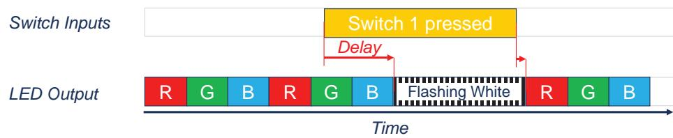  
Figure 3.4 The response of an LED initial flasher program to switch press and release.

So we must hold the switch until the cycle ends. In fact, if we press the switch briefly during the color cycle and release it before the end, the program will not detect it, missing the input event. Input events shorter than the red/green/blue color cycle may be lost. The longer the code takes to run, the slower the cycle, and the greater the chance of missing an input.

Similarly, the sooner the code finishes running, the more responsive the system is. Notice in Figure 3.4 how releasing the switch results in a very short delay until the LED begins color cycling. This short delay results from the short duration of the white flash, which enables the program to check the switch more frequently.

Another disadvantage of this code is that the processor wastes quite a bit of time in its delay function. This kind of waiting is called busy-waiting and should be avoided except for certain special cases. We will see how later.

Finally, the program mixes together different activities in a single function. As the program grows larger, it will be more difficult to maintain and enhance because of these interdependencies. Poorly structured code is often called spaghetti code because so many different parts are tangled together.

```txt
spaghetti code
Code which is poorly structured because it entangles unrelated features, complicating development and maintenance
```

To summarize, the system is sluggish and inefficient, may ignore brief inputs, and is structured badly.

## Creating and Using Tasks

Let’s restructure the code into three separate tasks, as done in project Flasher2. This will make it easier to develop and maintain the code. A task is a subroutine that performs a specific activity (or a closely related set of activities). Tasks simplify code development by grouping related features and processing together and separating unrelated parts. Each task has a root function, which may call other functions as subroutines as needed.

```txt
root function A task's main software function, which may call other functions as subroutines
```

## Program Structure

The first task has a root function called Task\_Read\_Switches, shown in Listing 3.4. It will determine which switches are pressed and share that information with the other tasks. We will use global variables to do this in this example, but later we will learn why global variables are danger ous and how to use other mechanisms to share information. We use the g\_ prefix in their names to indicate that these are global variables. This is helpful but not essential; it will help us and other code developers in the future by making this information obvious. Many aspects of coding style come from the desire to prevent misunderstandings and the resulting mistakes.

```c
uint8_t g_flash_LED = 0;
uint32_t g_w_delay = W_DELAY_SLOW;
uint32_t g_RGB_delay = RGB_DELAY_SLOW;

void Task_Read_Switches(void) {
    if (SWITCH_PRESSED(SW1_POS)) {
    g_flash_LED = 1; // flash white
    } else {
    g_flash_LED = 0; // RGB sequence
    }
    if (SWITCH_PRESSED(SW2_POS)) {
```

```c
g_w_delay = W_DELAY_FAST;
g_RGB_delay = RGB_DELAY_FAST;
} else {
    g_w_delay = W_DELAY_SLOW;
    g_RGB_delay = RGB_DELAY_SLOW;
}
```

## Listing 3.4 Task\_Read\_Switches (in Flasher2/main.c) is responsible for updating the global variables to share information based on switches.

The code reads switch 1 to determine whether the LED should flash white or sequence through the RGB colors, and then sets variable g\_flash\_LED to one (to request flashing) or zero (to request the color sequence). The code then reads switch 2 to determine the time delays for the LED flashing and RGB sequencing tasks, setting g\_w\_delay and g\_RGB\_delay accordingly.

The second task has a root function called Task\_Flash, shown in Listing 3.5. This function first checks to see if it has any work to do. If g\_flash\_LED is equal to one, this indicates the LED needs to flash white. The code will flash the LED white, delay for a time based on g\_w\_delay, turn off the LED, delay again, and then return. Otherwise, the code will return immediately.

```c
void Task_Flash(void) {
    if (g_flash_LED == 1) { // Only run task when in flash mode
    Control_RGB_LEDs(1, 1, 1);
    Delay(g_w_delay);
    Control_RGB_LEDs(0, 0, 0);
    Delay(g_w_delay);
    }
}
```

## Listing 3.5 Task\_Flash (in Flasher2/main.c) is responsible for flashing the LED white and off once.

The third task has a root function called Task\_RGB, shown in Listing 3.6. This task also first checks to see if it has any work to do. If g\_flash\_LED is equal to zero, this indicates that the LED needs to sequence through the RGB colors. The code will cycle the LED though the colors with appropriate delays (determined by g\_RGB\_delay), turn off the LEDs, and then return. Otherwise, the code will return immediately.

```c
void Task_RGB(void) {
    if (g_flash_LED == 0) { // only run task when NOT in flash mode
    Control_RGB_LEDs(1, 0, 0);
    Delay(g_RGB_delay);
    Control_RGB_LEDs(0, 1, 0);
    Delay(g_RGB_delay);
    Control_RGB_LEDs(0, 0, 1);
    Delay(g_RGB_delay);
    }
}
```

Listing 3.6 Task\_RGB (in Flasher2/main.c) is responsible for lighting the LEDs once in the sequence red, green, blue.

Figure  3.5 shows the overview of how the tasks (in ovals) communicate with each other through the global variables (rectangles), with the direction of the arrow indicating the flow of information from writer to reader. Note that Task\_Read\_Switches writes to all three global variables, whereas the other tasks read from just two of them.

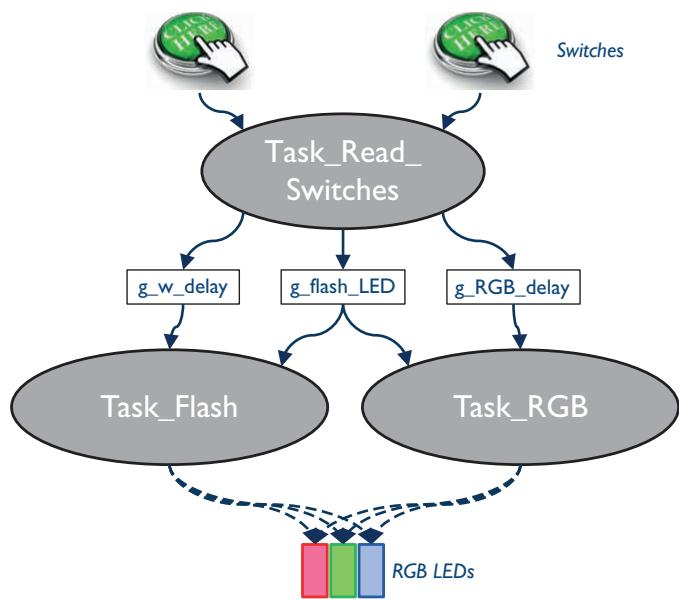  
Figure 3.5 Tasks communicate information through shared global variables.

Finally, we need the scheduler function (Flasher) in Listing 3.7 that simply calls the three tasks in order and then repeats. Notice how simple the scheduler is, calling each function repeatedly in order. This approach is called cooperative multitasking: multiple tasks can run on the CPU because they cooperate by yielding the processor to other tasks when they have finished their work. If one task takes a long time to run, then it will delay the other tasks by that much time.

```cpp
cooperative multitasking
Scheduling approach where tasks share CPU by voluntarily yielding it to other tasks

void Flasher(void) {
    Init_GPIO_RGB();
    Init_GPIO_Switches();
    while (1) {
    Task_Read_Switches();
    Task_Flash();
    Task_RGB();
    }
}

Listing 3.7 Flasher function (in Flasher2/main.c) acts as a scheduler that is responsible for running each task.
```

We could speed up the code slightly by moving the tests of the variable g\_flash\_LED into the scheduler, but this would defeat our goal of keeping as much task-related code in the task itself, coupling the scheduler more closely to the tasks. However, we will examine this idea later in this chapter.

## Analysis

The program is now structured much better because it isolates the three tasks from each other. However, the responsiveness is no better than the first program. In fact, it is slightly worse because of the overhead of the scheduler calling the task functions.

Figure  3.6 shows how the switch press is only recognized when Task\_Read\_Switches can run, which occurs after Task\_RGB completes. The switch release is detected more quickly because Task\_Flash completes sooner.

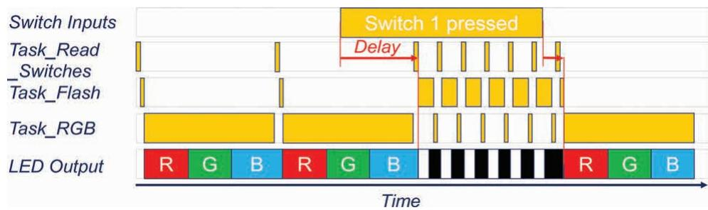  
Figure 3.6 Response of task-based LED flasher program to switch press and release.

In order to improve the responsiveness, let’s first examine the delay between our changing the switch (pressing or releasing it) and the LEDs flashing differently. As shown in Figure 3.7, this delay has two parts:

• First, there is a delay $T _ { l }$ between when the switch is pressed (or released) and when the variable $\mathbb { \mathfrak { A } } _ { - }$ \_flash\_LED is updated (by Task\_Read\_Switches).

• Second, there is a delay $T _ { 2 }$ between when the variable g\_flash\_LED is updated (by Task\_ Read\_Switches) and the LED starts flashing (in Task\_Flash).

$T _ { I }$ is large in Figure 3.7 because the switch is pressed while Task\_RGB is running. Task\_Read\_ Switches can run only after Task\_RGB completes (and it is a long task). A task that takes a long time to complete will increase $T _ { \iota }$ significantly, especially if an event (e.g. switch press) occurs early in the task. If there are other tasks that run after Task\_RGB but before Task\_Read\_ Switches, they will also increase $T _ { \iota }$

$T _ { 2 }$ is small in Figure  3.7 because Task\_Flash runs immediately after Task\_Read\_ Switches (and it is short). If instead we changed the loop so that the task order was Task\_ Read\_Switches, Task\_RGB, and then Task\_Flash, $T _ { 2 }$ would be increased by the time taken to run Task\_RGB. In this case it would be short, since Task\_RGB would return after determining that g\_flash\_LED was one. If there are other tasks that run after Task\_Read\_ Switches but before Task\_Flash, they will increase $T _ { 2 }$

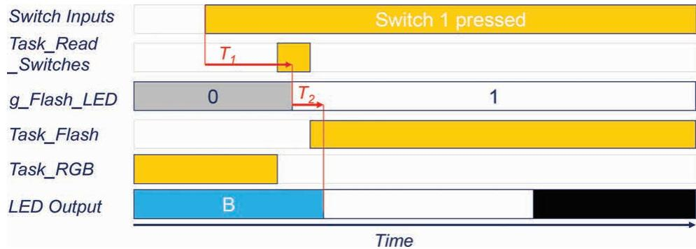  
Figure 3.7 Delay between pressing the switch and the LED flashing differently has two parts.

## Improving Responsiveness

So how can we reduce these times?

A very bad approach would be to have Task\_RGB call Task\_Read\_Switches (and maybe even Task\_Flash) after lighting each LED. This tangles the tasks together, complicating future code development.

There are much better ways to improve responsiveness that do not make a mess of the code. In this section, we will discuss the following approaches:

• Using interrupts to provide event-triggered processing

• Restructuring tasks to complete earlier

• Using hardware so tasks complete earlier

We will also introduce the following advanced topics but will not cover them in detail:

• Prioritizing tasks that the scheduler will run first

• Enabling tasks to preempt each other

• Moving waiting out of tasks into the scheduler

## Interrupts and Event Triggering

Our code explicitly checks to see if processing is needed, for example, to determine if the timer has expired yet. This is called polling. There is an alternative approach called event-triggering, in which the processor gets notifications from hardware that a specific event has occurred, and processing is needed.

Scheduling approach in which software repeatedly tests a condition to determine whether to run task code

event-triggering

Scheduling approach in which task software runs only when triggered by an event

Software that uses event-triggering runs much more efficiently than polling, since no time needs to be wasted checking to see if processing is needed. Even better, the event-triggered approach leads to a much more responsive system since events are detected much sooner. This may allow a much slower processor to be used, saving money, power, and energy.

Peripheral hardware on microcontrollers explicitly supports this event-triggered approach through the interrupt system. A peripheral can generate an interrupt request (IRQ) to the processor to indicate that an event has occurred. The processor will finish executing the current instruction in the program, save the program’s current information, and then start to execute a special part of the program called an interrupt service routine (ISR) (or handler) in order to service that interrupt request. After completing the ISR, the processor reloads the program’s saved information and then resumes its execution at the next instruction.

For many embedded systems, a combination of polling and ISRs is enough to meet requirements quickly and inexpensively. Event-driven processing in ISRs handles the urgent processing activities, while less-urgent work is performed on a polling basis in the background. Often an ISR will do the initial urgent processing and then save partial results for later, more time-consuming processing.

<table><tr><td>interrupt request (IRQ)Hardware signal indicating that an interrupt is requested</td></tr><tr><td>interrupt service routine (ISR)Software routine which runs in response to interrupt request. Also called a handler.</td></tr><tr><td>handlerSoftware routine which runs in response to interrupt or exception request</td></tr></table>

## Program Structure

In Flasher3, we’ll modify our system by using interrupts to detect when a switch changes. The switch has two states:  pressed (output  =  0) and not pressed (output  =  1). If the switch is not pressed but then is pressed, its output will change from 1 to 0, causing a falling-edge event. If a pressed switch is released, its output will change from 0 to 1, causing a rising-edge event. We will use both types of events to trigger an interrupt, which will cause an interrupt service routine (ISR) to run. As shown in Figure 3.8, we replace Task\_Read\_Switches with an ISR. The ISR updates the shared variables, which in turn are read by the tasks. Listing 3.9 shows that the scheduler function no longer needs to call Task\_Read\_Switches.

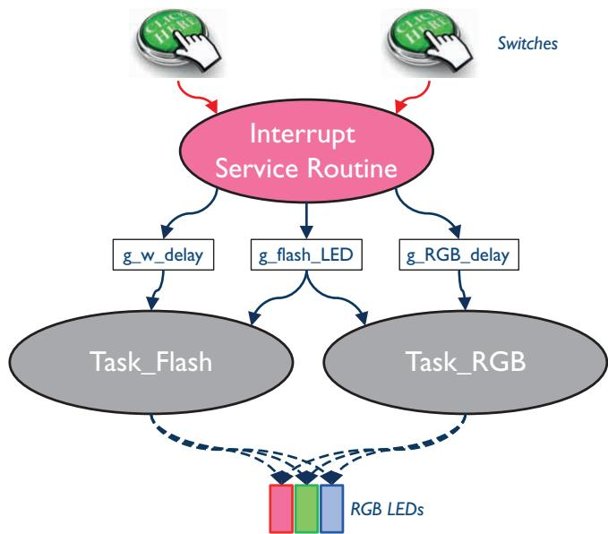  
Figure 3.8 Interrupt service routine communicates information to tasks through shared global variables.

The source code is shown in Listing 3.8. The variables which share data between the interrupt and the rest of the program now must be defined as volatile. This indicates to the compiler that they may change unexpectedly (e.g. an ISR may change them). When a switch changes between being pressed and released (or vice versa), the interrupt hardware forces the CPU to execute the handler function called EXTI4\_15\_IRQHandler. We defer until Chapter 4 the code needed to configure the port peripheral to request an interrupt and to enable interrupts.

```c
volatile uint8_t g_flash_LED = 0;
volatile uint32_t g_w_delay = W_DELAY_SLOW;
volatile uint32_t g_RGB_delay = RGB_DELAY_SLOW;

void EXTI4_15_IRQHandler(void) {
    if (EXTI->PR & MASK(SW1_POS)) {
    // Acknowledge interrupt by writing 1 to bit, clearing it (!)
    EXTI->PR = MASK(SW1_POS);
    // Process interrupt
    if (SWITCH_PRESSED(SW1_POS)) {
    g_flash_LED = 1;    // Flash white
    } else {
    g_flash_LED = 0;    // RGB sequence
    }
    }
    if (EXTI->PR & MASK(SW2_POS)) {
    // Acknowledge interrupt by writing 1 to bit, clearing it (!)
    EXTI->PR = MASK(SW2_POS);
    // Process interrupt
    if (SWITCH_PRESSED(SW2_POS)) { // Short delays
    g_w_delay = W_DELAY_FAST;
    g_RGB_delay = RGB_DELAY_FAST;
    }
}
```

```c
} else { // Long delays
    g_w_delay = W_DELAY_SLOW;
    g_RGB_delay = RGB_DELAY_SLOW;
}
// NVIC Acknowledge interrupt
NVIC_ClearPendingIRQ(EXTI4_15_IRQn);
```

Listing 3.8 Source code for shared variables and interrupt service routine (in Flasher3/main.c).

```cpp
void Flasher(void) {
    Init_GPIO_RGB();
    Init_GPIO_Switches_Interrupts();
    while (1) {
    Task_Flash();
    Task_RGB();
    }
}
```

Listing 3.9 New scheduler function for LED flasher does not read switches (in Flasher3/main.c).

## Analysis

Figure  3.9 shows the resulting behavior. First, the code to read switches (in EXTI4\_15\_ IRQHandler) now executes only when needed, freeing up time for other tasks to run. Second, the delay between pressing the switch and the LED changing its flashing pattern has been reduced. The first component of the delay (from switch press to updating the variable g\_flash\_LED) has been reduced significantly. Microcontrollers can respond to interrupts very quickly. For the Arm Cortex-M0 CPUs, there is a delay of sixteen clock cycles from interrupt request to the start of the handler execution. With a 48 MHz CPU clock rate, this is a fast 333.3 ns.

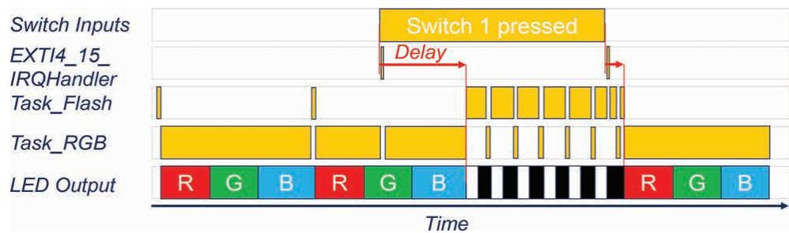  
Figure 3.9 Response with switches read by interrupt service routine. Switch-reading code in EXTI4\_ 15\_IRQHandler runs only when needed.

Using an interrupt has improved the responsiveness somewhat. But it has not addressed the second delay, which depends on the task switching. The scheduler that we are using cannot switch to a different task until after the currently running task has completed. It is called a non-preemptive scheduler. In this example, the RGB task takes a long time to run and hence limits the responsiveness.

non-preemptive scheduler

Scheduler which does not allow tasks to preempt each other

One way to address the second delay is to move more code from the task into the interrupt handler, so it runs without any task scheduling delay. When this approach is possible, the developer needs to be careful to keep the handler from growing too long, which will reduce the responsiveness of all other code (and interrupt handlers). It is also surprisingly easy to turn interrupt handlers into spaghetti code, which is hard to understand, maintain, and enhance.

Consider the example in Figure 3.9. We can speed up the response to switch presses by making the interrupt handler light all LEDs (making white). But as soon as the handler finishes, Task\_ RGB resumes execution. It completes its delay, then lights the blue LED, waits for another delay, and then finishes. Task\_Flash finally runs and flashes the LED correctly. How can the interrupt handler make Task\_RGB stop running? Since the handler changes g\_flash\_LED based on the switch position, an obvious way is to test that variable’s value more often.

The resulting code in Listing 3.10 is messy and inefficient. And it doesn’t work that well. If the switch is pressed while the Delay function is running, the task won’t finish until Delay completes. To get a better responsiveness, we would have to test g\_flash\_LED in the function Delay. But remember that both Task\_Flash and Task\_RGB call Delay, so we would need two versions of Delay, or a way of tracking which function called it (e.g. by passing a parameter).

```c
void Task_Flash(void) {
    if (g_flash_LED == 1) { // Only run task when in flash mode Control_RGB_LEDs(1, 1, 1);
    }
    if (g_flash_LED == 1) { // Only run task when in flash mode Delay(g_w_delay);
    }
    if (g_flash_LED == 1) { // Only run task when in flash mode Control_RGB_LEDs(0, 0, 0);
    }
    if (g_flash_LED == 1) { // Only run task when in flash mode Delay(g_w_delay);
    }
}

void Task_RGB(void) {
    if (g_flash_LED == 0) { // only run task when NOT in flash mode Control_RGB_LEDs(1, 0, 0);
    }
    if (g_flash_LED == 0) { // only run task when NOT in flash mode Delay(g_RGB_delay);
    }
    if (g_flash_LED == 0) { // only run task when NOT in flash mode Control_RGB_LEDs(0, 1, 0);
}
```

```txt
if (g_flash_LED == 0) { // only run task when NOT in flash mode
    Delay(g_RGB_delay);
}
if (g_flash_LED == 0) { // only run task when NOT in flash mode
    Control_RGB_LEDs(0, 0, 1);
}
if (g_flash_LED == 0) { // only run task when NOT in flash mode
    Delay(g_RGB_delay);
}
```

Listing 3.10 A very bad idea: adding more tests to stop a run task earlier.

We could rely on the delay function speed up the response. One possible version of a new delay function is shown in Listing 3.11. Note that we now need to change the task codes to call Delay with a parameter indicating the caller task. This is a wonderful example of spaghetti code and how not to do things!

```txt
void Delay(unsigned int time_del, int called_by_Task_Flash) {
    volatile int n;
    while (time_del--) {
    if (((called_by_Task_Flash == 1) && (g_Flash_LED == 1)) ||
    ((called_by_Task_Flash == 0) && (g_Flash_LED == 0))) {
    n = 1000;
    while (n--)
    ;
    }
    }
}
```

Listing 3.11 More of a very bad thing: adding tests and a caller parameter to the Delay function.

## Reducing Task Completion Times with Finite State Machines

We wish to modify a task so it returns before it has finished all of its work. This gives the scheduler more frequent opportunities to run other tasks, improving its responsiveness. We will use a structure called the finite state machine (FSM), rather than the spaghetti code of Listing 3.10 and Listing 3.11.

```txt
finite state machine (FSM)
A type of state machine with all states and transitions defined
```

To make the task work correctly, we will need to make some changes to the task’s source code. We may need to call the task several times to complete all of its work. We will also need to keep track of the task’s progress, so it completes all the work necessary in the correct order and without duplication.

We could combine this approach with using an interrupt to further improve responsiveness. To simplify the explanation, we do not do so here.

## Program Structure

Consider the code for Task\_RGB, shown previously in Listing 3.6. We will convert the body of the task into a state machine to make this all work. A state machine executes the code of one state each time it is called, and then returns. We break up the code into separate states after each long-running operation (delay functions, in this case). If we had conditionals or loops in the code, we could still create states, but would need to ensure each state starts and ends at the same leve of conditional nesting or looping.

We can create a state transition diagram (shown in Figure  3.10) to describe how the state machine operates. Circles represent states, and the lines between them represent possible transi tions. A transition is labeled with text to indicate the trigger event or the condition under which it occurs. An unlabeled transition will execute automatically after the state completes.

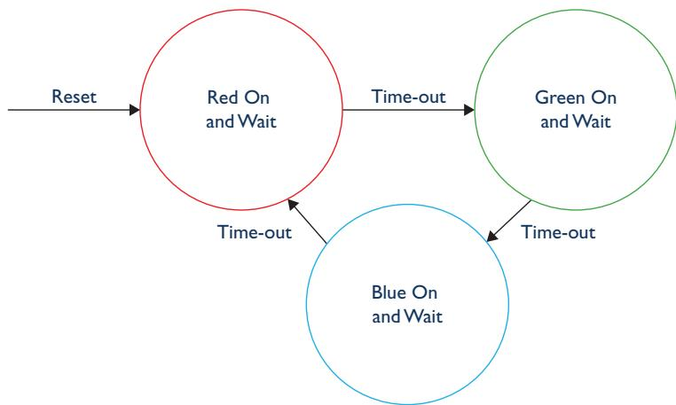  
Figure 3.10 State transition diagram for Task\_RGB.

The system is initialized to the red state, as indicated by the transition labeled “reset”. The system stays in the red state until a time-out occurs, when it exits the red state and enters the green state. After another time-out, the system exits the green state and enters the blue state. Yet another timeout later, the system exits the blue state and enters the red state. The cycle then repeats.

We can also represent this information with a state transition table, as shown in Table 3.1. In this example, there is only one type of input event (the time-out), but other FSMs may have more types. In that case, there would be a next state column for each event. Note that a state may have several next states, based on conditions within the FSM or which input event occurred.

Table 3.1 Task\_RGB Finite State Machine

<table><tr><td>State</td><td>Action</td><td>Next state (time-out event)</td></tr><tr><td>ST_RED</td><td>Light red LED</td><td>ST_GREEN</td></tr><tr><td>ST_GREEN</td><td>Light green LED</td><td>ST_BLUE</td></tr><tr><td>ST_BLUE</td><td>Light blue LED</td><td>ST_RED</td></tr></table>

The source code for Task\_RGB\_FSM (our state machine version of Task\_RGB) appears in Listing 3.12.

```c
void Task_RGB_FSM(void) {
    enum State { ST_RED, ST_GREEN, ST_BLUE };
    static enum State next_state;

    if (g_flash_LED == 0) { // Only run task when NOT in flash mode
    switch (next_state) {
    case ST_RED:
    Control_RGB_LEDs(1, 0, 0);
    Delay(g_RGB_delay);
    next_state = ST_GREEN;
    break;
    case ST_GREEN:
    Control_RGB_LEDs(0, 1, 0);
    Delay(g_RGB_delay);
    next_state = ST_BLUE;
    break;
    case ST_BLUE:
    Control_RGB_LEDs(0, 0, 1);
    Delay(g_RGB_delay);
    next_state = ST_RED;
    break;
    default:
    next_state = ST_RED;
    break;
    }
}
```  
Listing 3.12 Source code for the finite state machine version of Task\_RGB (in Flasher4/main.c)

We use a state variable called next\_state to track the next state to execute. Note that this variable must be declared as static so that it retains its value from one subroutine call to the next. In order to make the code easier to understand, we make next\_state an enumerated type. These use names (e.g. ST\_RED) to represent integer values (e.g. 0). The enum keyword defines a data type which can be used then for defining variables. The possible values for this type are limited to the list of names provided with the enum declaration.

A switch statement selects which code to execute based on the value of next\_state. Each case statement contains the code for one state and may update the state variable for future calls to Task\_RGB\_FSM.

The source code for Task\_Flash\_FSM is similarly modified and appears in Listing 3.13. Note that the two variables named next\_state declared in Task\_Flash\_FSM and Task\_ Flash\_RGB are separate variables. They are called local variables because they are only visible and accessible to code in the function where they are declared. Other functions cannot access Task\_​Flash\_​FSM′s version of next\_state. Finally, the scheduler function does not need to be modified beyond calling the FSM versions of the tasks. It continues to call them repeatedly

```c
void Task_Flash_FSM(void) {
    enum State { ST_WHITE, ST_BLACK };
    static enum State next_state = ST_WHITE;

    if (g_flash_LED == 1) { // Only run task when in flash mode
    switch (next_state) {
    case ST_WHITE:
    Control_RGB_LEDs(1, 1, 1);
    Delay(g_w_delay);
    next_state = ST_BLACK;
    break;
    case ST_BLACK:
    Control_RGB_LEDs(0, 0, 0);
    Delay(g_w_delay);
    next_state = ST_WHITE;
    break;
    default:
    next_state = ST_WHITE;
    break;
    }
    }
}
```  
Listing 3.13 Source code for the finite state machine version of Task\_Flash (in Flasher4/main.c).

## Analysis

Figure 3.11 shows the system’s behavior, and we see that the responsiveness is much better. The flashing starts after the current stage of the sequence (green here), rather than the last stage (blue). If this is still not responsive enough, we could split up the delay into two or more states to reduce the response time.

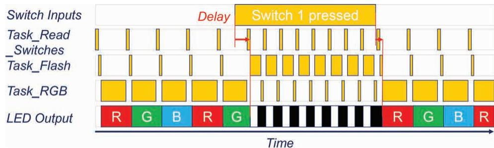  
Figure 3.11 Response of task-based LED flasher program with the tasks implemented as finite state machine.

## Using Hardware to Save CPU Time

As mentioned in the introduction, the microcontrollers used in embedded systems include specialized hardware circuits called peripherals. These devices offload and accelerate specific types of work from the processor or perform activities that the CPU core is not capable of performing. This peripheral hardware can execute essentially independently of the processor. Embedded system designers use the peripherals to reduce the computational load on the processor, reducing the need for a high-speed processor and saving costs.

One common peripheral is called a timer or a counter. At its heart, a timer is a counter circuit that counts how many pulses it receives. Using a pulse source with a known frequency allows us to measure time. The peripheral can generate an event after a specified time delay, measure pulse width, generate pulse outputs, and measure pulse counts. We will study timer/counter peripherals more closely in Chapter 7.

Note that the processor may be capable of doing these operations in software, but with much greater complexity and less accuracy. Furthermore, the processor may need to spend all of its time on this single activity to get adequate timing precision.

## Program Structure

We will use a timer to replace the call to the function called Delay, which performs busy-waiting to incur a time delay. We will introduce a new state in the FSM to wait for the delay to complete. The FSM does not advance past this state until the delay has completed. If there are multiple such delays, each will have a new state. Figure 3.12 shows the modified state machine with three wait states added (for red, green, and blue delays).

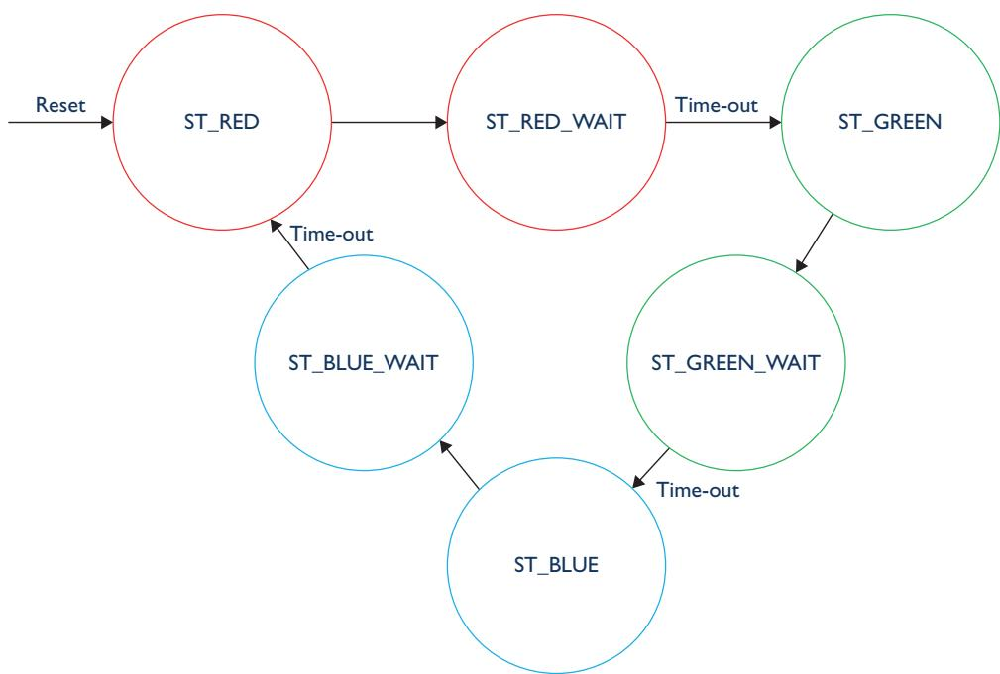  
Figure 3.12 State machine for RGB task with wait states added.

In this example, we are using a timer (TIM) in a down-counting mode. We load the timer with a count value and then start it running (using Start\_TIM). The timer receives periodic pulses from a clock source in the MCU. These frequency of these clock pulses is divided by a prescaler. In this case is configured to generate one prescaler output pulse for every 4800 input pulses. Given a 48 MHz input pulse frequency, the prescaler output pulse frequency is 1 kHz. The prescaled pulses are sent to a down-counting timer; each pulse decrements the timer’s count value by one. When the count value reaches zero, the timer will set a flag in one of its control registers to indicate that the timer has expired. We will use the software function TIM\_Expired to read this flag and stop the timer using Stop\_TIM. Details on these different functions are discussed in Chapter 7.

Figure 3.13 is a sequence diagram that shows the interactions between software and hardware in this approach. It is a vertical timeline that starts at the top. Each hardware or software component (called an actor) has its own column. Here, the software components are labeled Scheduler and Task\_Flash\_FSM\_Timer and the hardware components are labeled TIM and LED.

The arrows in Figure  3.13 show communication between specific actors. For example, Scheduler starts Task\_Flash\_FSM\_Timer running. That task then turns on the LEDs to make the LED white, and starts the timer (TIM) running.

We will apply this modification to both Task\_Flash\_FSM and Task\_RGB\_FSM, as they both use the delay function. The updated task source code for Task\_Flash\_FSM\_Timer appears in Listing 3.14. Let’s examine the code in the white state (ST\_WHITE):

• Turn on all LEDs to make white light

• Initialize the timer with a time delay (g\_w\_delay)

• Start the timer

• Set next\_state to ST\_WHITE\_WAIT

Now let’s examine the code in the white wait state (ST\_WHITE\_WAIT):

• Check whether the timer has expired yet

• If it has not expired, exit without changing next\_state

• If it has expired, stop the timer and advance next\_state to ST\_BLACK

Notice that the state machine won’t advance past ST\_WHITE\_WAIT until the timer expires. The function Task\_Flash\_FSM\_Timer may be called once or one million times, but it won’t advance past ST\_WHITE\_WAIT until enough time has passed. This allows different FSMs in the program to make progress at different speeds without slowing each other down excessively.

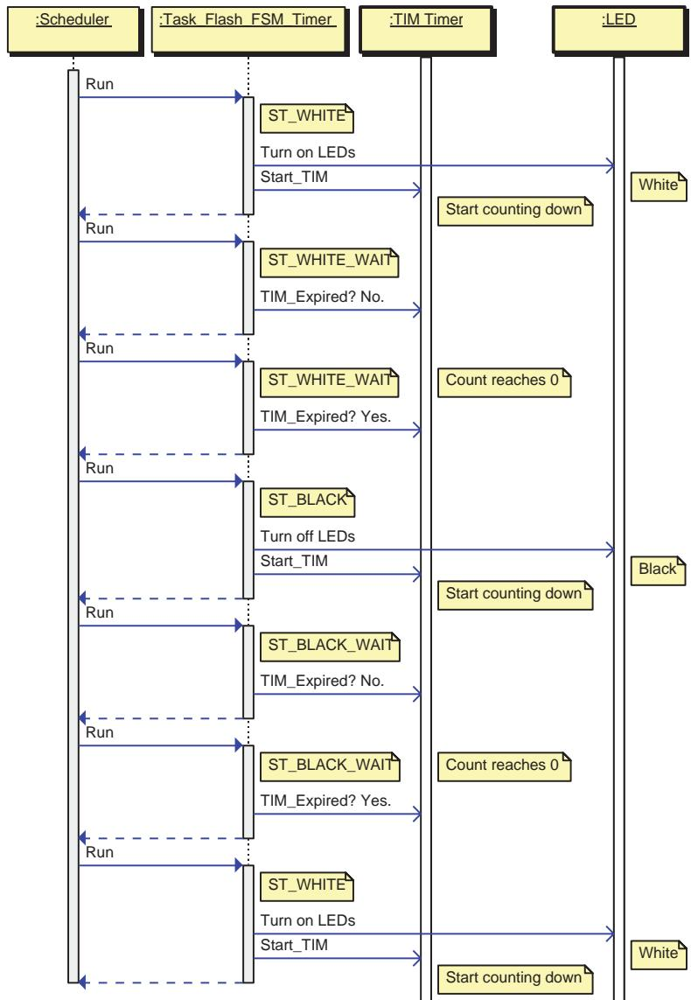  
Figure 3.13 Sequence diagram showing interactions between the software (scheduler and task) and the hardware (timer and LED).

```cpp
void Task_Flash_FSM_Timer(void) {
    enum State { ST_WHITE, ST_WHITE_WAIT, ST_BLACK, ST_BLACK_WAIT };
    static enum State next_state = ST_WHITE;

    if (g_flash_LED == 1) { // Only run task when in flash mode
    switch (next_state) {
    case ST_WHITE:
    Control_RGB_LEDs(1, 1, 1);
    Start_TIM(g_w_delay);
    next_state = ST_WHITE_WAIT;
    break;
```

```c
case ST_WHITE_WAIT:
    if (TIM_Expired()) {
    Stop_TIM();
    next_state = ST_BLACK;
    }
    break;
case ST_BLACK:
    Control_RGB_LEDs(0, 0, 0);
    Start_TIM(g_w_delay);
    next_state = ST_BLACK_WAIT;
    break;
case ST_BLACK_WAIT:
    if (TIM_Expired()) {
    Stop_TIM();
    next_state = ST_WHITE;
    }
    break;
default:
    next_state = ST_WHITE;
    break;
} else {
    next_state = ST_WHITE;
}
```

Listing 3.14 Source code for a Flash task using a finite state machine and a hardware timer (in Flasher5/main.c).

## Analysis

Figure 3.14 shows the resulting system behavior. The delays are very small because all calls to an FSM function complete very quickly. Because a hardware timer tracks the delay (rather than a software function executing on the CPU), even calls to FSMs in a WAIT state will return quickly.

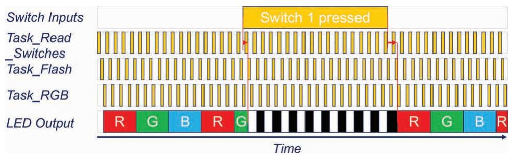  
Figure 3.14 Response with tasks implemented as finite state machines using timer peripheral for delays.

## Advanced SchedulingTopics

Our scheduling improvements have improved performance, but some issues remain:

• First, the CPU wastes quite a bit of time trying to run tasks that do not have any work to do. Currently it is up to the task to determine whether to run or not. Can we use the scheduler to make this decision? And can the scheduler make it easier for us to use the processor efficiently (e.g. periodic task execution)?

• Second, the tasks always run in the same order. Can we change the scheduler to run more timecritical tasks before others, improving responsiveness by prioritizing the work?

• Third, if an important event occurs just after a long-running task starts, we will need to wait for it to finish, or else restructure the task as an FSM. Is there a different way to reduce this task running time which does not require so much code modification?

Addressing these questions fully is beyond the scope of this introductory embedded systems textbook, but it is good to be aware of them. So we will cover them briefly in the remainder of this chapter.

You may wonder about the differences between a scheduler, a kernel, and an operating system. A task scheduler grows more complex when we add support to address the issues listed above. The result is a kernel, which supplements the scheduler with task-oriented features, such as synchronization, signaling, communication, and time delays. Many embedded systems use a kernel to share the processor’s time among multiple tasks. The fundamental role of the kernel is to execute the highest priority task that is ready (i.e. is not waiting for any event or resource). Such kernels are typically preemptive (described later) so that tasks are responsive without having to be broken into state machines. The kernel also provides support for efficient time delays, signaling between tasks, sharing data safely, managing tasks, and other useful features.

kernel

Scheduler with support for task features such as communication, delays, and synchronization

An operating system enhances the kernel with application-oriented features, such as a file system, a graphical user interface, and networking support. However, there is always a task scheduler at the heart.

operating system

Kernel with support for application-oriented features such as file systems, networking support, etc.

## Waiting

Who determines if a task has no work to do? The task or the scheduler? Earlier we left the question up to the task in order to simplify the scheduler. For some systems that is reasonable, but systems with tight timing requirements or many tasks will waste quite a bit of time.

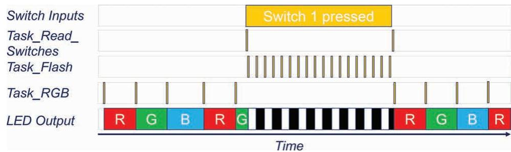  
Figure 3.15 Useful work performed by the program.

For example, the system shown in Figure 3.14 is wasting a tremendous amount of the CPU’s time by polling the task frequently to determine if it needs to run.

The program only does useful work when the switch changes or when an LED needs to change, as shown in Figure 3.15. We would like a scheduling approach that behaves this way by using an event-driven approach.

In the scheduling approaches we’ve seen so far, there are two possible states for a task: running and ready to run. There can only be one running task per processor core, but there can be many ready tasks.1 Let’s introduce a new task state: waiting (also called blocking). A task in that state is waiting for a particular event to happen: a time delay to expire, a message to be received, a resource to be made available, etc. The kernel does not waste any time trying to schedule tasks that are waiting. Instead, the kernel only schedules tasks that are ready or running. When an event occurs, the kernel checks to see if any tasks are waiting for it. If so, those tasks are moved to the ready state and will be able to run.

waiting

A state in which a task is waiting for an event to occur. Also called blocking.

blocking

A state in which a task is waiting for an event to occur. Also called waiting.

Compare this with our waiting in the FSM. When we restructured our code, we broke out the waiting portions. By using kernel support for waiting, we do not need to restructure the code, but instead call a kernel function that will manage the waiting. From the point of view of the task, it is just a call to a wait function that does not return until the desired event has occurred.

## Task Prioritization

Task prioritization can be used in deciding which processing activity to perform next. We may decide, for instance, that when tasks A and C are ready to execute, we always run C first since it needs a shorter response time. Task A will run after C finishes since it is of lower priority.

Consider the early version of the task scheduler, reproduced here in Listing 3.15. It always runs the tasks in the same order: Task\_Read\_Switches, Task\_Flash, and then Task\_ . The tasks have the same priority and always run in a fixed order. Consider how to minimize the response time when we press the switch. Since we want to start flashing the LEDs, we want Task\_Flash to run before Task\_RGB (have a higher priority). If we want to minimize the response time when we release the switch, we want the LEDs to follow the RGB sequence so Task\_Flash should run after Task\_RGB (have a lower priority).

```cpp
void Flasher(void) {
    Init_GPIO_RGB();
    Init_GPIO_Switches_Interrupts();
    while (1) {
    Task_Flash_FSM_Timer();
    Task_RGB_FSM_Timer();
    }
}
```  
Listing 3.15 Flasher function acts as a scheduler which does not prioritize any task over any other.

Task priorities may be assigned so they are fixed (task A always has the lowest priority) or dynami cally (based on some condition that may change at run time). Embedded system kernels typically provide only fixed priorities, though some allow a task’s priority to be changed as the system runs.

## Task Preemption

The cooperative multitasking approach we have been examining does not switch to running a different task until the currently running task yields the processor. This delays the system’s response. A preemptive multitasking approach uses task preemption so that an urgent task is not delayed by a currently running task of lower urgency. Consider that task A is already running, and task C becomes ready to run, perhaps due to an ISR executing and saving some deferred work for C. A preemptive scheduler can temporarily halt the processing of task A, run task C, and then resume the processing of task A.

## task preemption

Scheduling approach in which a task is paused to allow a different task to run. Eventually the first task resumes execution from where it was paused.

preemptive scheduler

Scheduler which supports task preemption

The LED flasher with two tasks and an interrupt handler is shown in Figure 3.16. Pressing or releasing the switch triggers an interrupt event. The interrupt support hardware forces the CPU to preempt the currently running Task\_RGB, execute the ISR code, and then resume Task\_RGB where it left off. However, we still have to wait for Task\_RGB to complete.

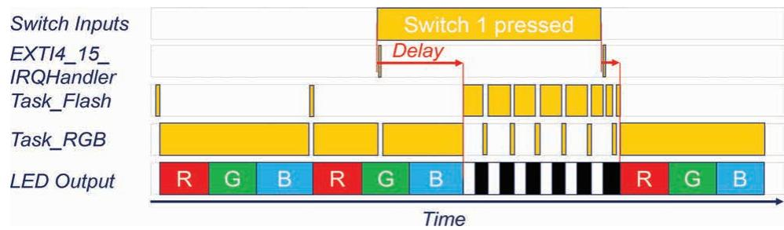  
Figure 3.16 An LED flasher with two tasks and an interrupt handler is still delayed by Task\_RGB after interrupt.

If we allow task preemption (shown in Figure 3.17), we can use kernel features so that Task\_ Flash (not Task\_RGB) runs after the ISR EXTI4\_15\_IRQHandler. Once Task\_Flash completes its work and waits, then Task\_RGB can run.

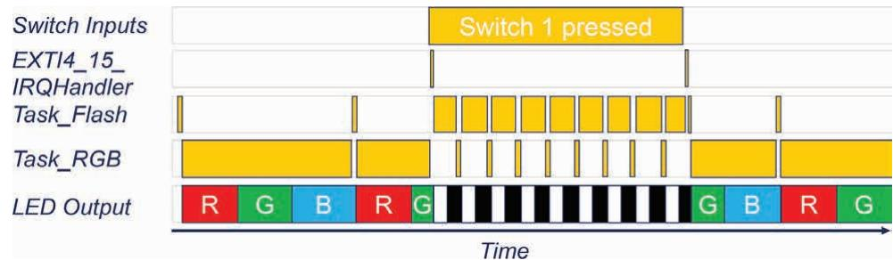  
Figure 3.17 An LED flasher with task preemption. Task\_Flash preempts Task\_RGB in the green cycle when the switch is pressed.

## Real-Time Systems

A real-time system is one in which tasks have deadlines. If the software and hardware are not suf ficiently responsive, then the task will not complete before its deadline, leading to a system failure. Real-time scheduling analysis gives us the mathematical methods to calculate the worst-case response time for each task in such a software system. We can compare these response times to our system’s deadlines in order to verify whether the system is schedulable (it will always meet its deadlines).

real-time system

System which must respond to events before given deadlines

If the system is not schedulable, then we have several options to make it schedulable. We could change the hardware (use a faster processor) if the customer budget allows it. We could improve the application software by speeding up the code or by reducing the amount of processing needed. We could also improve the scheduling approach by changing the balance of work performed in ISRs versus deferred activities, adding or changing task priorities, or adding preemption.

A real-time kernel (RTK) or a real-time operating system (RTOS) is designed to make it easier to create real-time systems. Preemptive scheduling is typically used to provide short response times. Prioritized task scheduling also reduces response times. The kernel is designed and built to execute with consistent and predictable timing, rather than with widely varying behavior. One example of an RTK is Keil’s RTX, which is included with the Keil MDK-Arm integrated development environment.

## Summary

This chapter has presented various approaches to sharing a CPU among multiple software activities. We began with a starter program with all its activities mixed together (spaghetti code). We then saw how to improve it in several important ways:

• Modularity is improved by dividing the activities into separate tasks.

• Responsiveness is improved by allowing preemption of tasks (by interrupts or other tasks), by shortening task run-times using FSMs, and by prioritizing tasks.

• CPU overhead is reduced by using hardware peripherals and by introducing a task wait state.

## Exercises

1. Consider the scheduling approach described in the section “Creating and Using Tasks”. See Figure 3.4. Assume there is no time taken to switch between tasks, and that the tasks have the following execution times:

<table><tr><td>Task or handler</td><td>Execution time when in flash mode</td><td>Execution time when in RGB mode</td></tr><tr><td>Task_Read_Switches</td><td>1 ms</td><td>1 ms</td></tr><tr><td>Task_Flash</td><td>100 ms</td><td>1 ms</td></tr><tr><td>Task_RGB</td><td>1 ms</td><td>1000 ms</td></tr></table>

a. Describe the sequence of events that leads to maximum delay between pressing the switch and seeing the LED flash. Calculate the value of that delay.

b. Describe the sequence of events that leads to maximum delay between pressing the switch and seeing the LED sequence through RGB colors. Calculate the value of that delay.

c. What is the minimum amount of time the switch must be pressed to change the LED flashing pattern?

d. Would changing the scheduler to call Task\_RGB before Task\_Flash changes the delays in (a) and (b)? If so, determine the new delays and explain why they changed.

2. Another developer wants to add two more tasks (Task\_X and Task\_Y) to the system of the previous question. Each task can take up to 80 ms to complete.

a. When will there be maximum delay between pressing the switch and seeing the LED flash? Calculate the value of that delay.

b. When will there be maximum delay between releasing the switch and seeing the LED sequence through RGB colors? Calculate the value of that delay.

c. What is the minimum amount of time the switch must be pressed to change the LED flashing pattern?

3. Consider the scheduling approach of the section “Interrupts and Event Triggering”. See Figure  3.9. Assume that EXTI4\_15\_IRQHandler starts executing as soon as the switch changes from pressed to released or from released to pressed. Also assume there is no time taken to switch between tasks or the handler, and that the tasks and handler have the following execution times:

<table><tr><td>Task or handler</td><td>Execution time when in flash mode</td><td>Execution time when in RGB mode</td></tr><tr><td>EXTI4_15_IRQHandler</td><td>0.01 ms</td><td>0.01 ms</td></tr><tr><td>Task_Flash</td><td>100 ms</td><td>1 ms</td></tr><tr><td>Task_RGB</td><td>1 ms</td><td>1000 ms</td></tr></table>

a. Describe the sequence of events that leads to maximum delay between pressing the switch and seeing the LED flash. Calculate the value of that delay.

b. Describe the sequence of events that leads to maximum delay between pressing the switch and seeing the LED sequence through RGB colors. Calculate the value of that delay.

c. What is the minimum amount of time the switch must be pressed to change the LED flashing pattern?

4. Consider the scheduling approach of the section “Reducing Task Completion Times with Finite State Machines”. See Figure 3.11. Assume there is no time taken to switch between tasks, and that the tasks have the following execution times:

<table><tr><td>Task</td><td>Execution time when in flash mode</td><td>Execution time when in RGB mode</td></tr><tr><td>Task_Read_Switches</td><td>1 ms</td><td>1 ms</td></tr><tr><td>Task_Flash</td><td>34 ms</td><td>1 ms</td></tr><tr><td>Task_RGB</td><td>1 ms</td><td>334 ms</td></tr></table>

a. Describe the sequence of events that leads to maximum delay between pressing the switch and seeing the LED flash. Calculate the value of that delay.

b. Describe the sequence of events that leads to maximum delay between pressing the switch and seeing the LED sequence through RGB colors. Calculate the value of that delay.

c. What is the minimum amount of time the switch must be pressed to change the LED flashing pattern?

5. Consider using the approaches from both the previous two problems. Use an interrupt to reduce switch detection latency (from section “Interrupts and Event Triggering”) and FSMs to reduce task execution time (from section “Reducing Task Completion Times with Finite State Machines”). Assume that EXTI4\_15\_IRQHandler starts executing as soon as the switch changes from pressed to released or from released to pressed. Also assume there is no time taken to switch between tasks or the handler and that the tasks and the handler have the following execution times:

<table><tr><td>Task or handler</td><td>Execution time when in flash mode</td><td>Execution time when in RGB mode</td></tr><tr><td>EXTI4_15_IRQHandler</td><td>0.01 ms</td><td>0.01 ms</td></tr><tr><td>Task_Flash</td><td>34 ms</td><td>1 ms</td></tr><tr><td>Task_RGB</td><td>1 ms</td><td>334 ms</td></tr></table>

a. Describe the sequence of events that leads to maximum delay between pressing the switch and seeing the LED flash. Calculate the value of that delay.

b. Describe the sequence of events that leads to maximum delay between pressing the switch and seeing the LED sequence through RGB colors. Calculate the value of that delay.

c. What is the minimum amount of time the switch must be pressed to change the LED flashing pattern?

6. Finally consider the approach of the section “Task Preemption”. Assume that the IRQ handler can tell the scheduler to change which task to run, and that tasks can preempt each other. See Figure 3.17. Assume that EXTI4\_15\_IRQHandler starts executing as soon as the switch changes from pressed to released or from released to pressed. Also assume there is no time taken to switch between tasks or the handler and that the tasks and the handler have the following execution times:

<table><tr><td>Task or handler</td><td>Execution time when in flash mode</td><td>Execution time when in RGB mode</td></tr><tr><td>EXTI4_15_IRQHandler</td><td>0.01 ms</td><td>0.01 ms</td></tr><tr><td>Task_Flash</td><td>100 ms</td><td>1 ms</td></tr><tr><td>Task_RGB</td><td>1 ms</td><td>1000 ms</td></tr></table>

a. Describe the sequence of events that leads to maximum delay between pressing the switch and seeing the LED flash. Calculate the value of that delay.

b. Describe the sequence of events that leads to maximum delay between pressing the switch and seeing the LED sequence through RGB colors. Calculate the value of that delay.

c. What is the minimum amount of time the switch must be pressed to change the LED flashing pattern?

## Arm Cortex-M0 Processor Core and Interrupts

## Chapter Contents

Overview 92  
CPU Core 92  
Concepts 92  
Architecture 94  
Registers 95  
Memory 96  
Instructions 100  
Thumb Instruction Encoding 106  
Operating Behaviors 107  
Exceptions and Interrupts 107  
CPU Exception Handling Behavior 108  
Handler Mode and Stack Pointers 108  
Entering a Handler 109  
Exiting a Handler 110  
Hardware for Interrupts and Exceptions 111  
Hardware Overview 111  
Exception Sources, Vectors, and Handlers 111  
Input and Peripheral Interrupt Configuration 114  
NVIC Operation and Configuration 119  
Processor Exception Masking 121  
Software for Interrupts 122  
Program Design 122  
Interrupt Configuration 125  
Writing ISRs in C 126  
Sharing Data Safely Given Preemption 127  
Summary 130  
Exercises 130  
References 131

## Overview

In this chapter we examine the processor core, which runs a program by executing its instructions. We learn about the organization of the core, how instructions are executed, how data can be stored and accessed in registers and memory, and what types of operations the processor can perform.

We then examine exceptions and interrupts, which allow a program to respond quickly to events while maintaining a simple software structure. We examine how the processor responds to exceptions and interrupts and then study the hardware support circuits. Finally, we discuss how to write software to configure and use interrupts.

## CPU Core

## Concepts

Figure 4.1 shows an overview of the components within a microcontroller. These include a processor core (for executing a program), memory (for storing data and instructions), and supporting peripheral components that add functionality or improve performance. In this chapter we study the CPU core, which can be found in the upper left corner of the figure.

  
Figure 4.1 Overview of components within an STM32F091RC microcontroller.

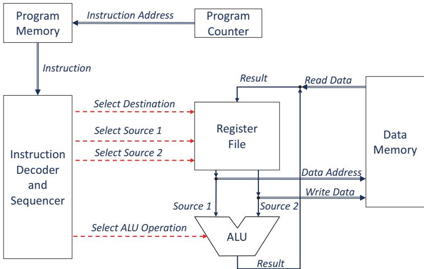  
Figure 4.2 Simplified structure of a CPU core.

The processor core executes the instructions that make up a program. Figure 4.2 shows the components of a simple CPU core from the instruction-processing point of view. Each instruction specifies an operation to perform and which operands to use for that operation.

instruction

Command for processor to execute. Consists of an operation and zero or more operands.

operation

Part of an instruction: specifies what work to do

operand

Part of an instruction: parameter used by operation

• The program’s instructions are stored in program memory (at the top of the diagram). A register called the program counter (PC) specifies the location (address) of the next instruction in that memory to execute.

• The register file holds temporary data values before and after the arithmetic/logic unit (ALU) processes them. It is easy to access but is small, holding only a few items.

• The heart of the CPU is the ALU. It performs the actual data processing operations such as addition, subtraction, logic operations (and, or, etc.), comparison, and so on. The ALU gets its operands from the register file (described next) or from within the instruction itself.

• The data memory provides longer-term data storage. It is much larger, holding thousands, millions or more data items. However, it is slower and more complex to access.

• Control logic decodes the instruction into various control and data signal sequences that are sent to other components of the CPU to control their operation.

```txt
register
Hardware circuit which can store a data value
```

```txt
register file Holds CPU's general purpose registers
```

## Figure 4.2 highlights three different types of information flowing in the CPU as it executes a program:

• Register and ALU data flow, identified with single lines.

• Memory addresses and data, identified with double lines.

• Control and selection signals, identified with dotted lines.

Instruction processing follows this sequence:

• The CPU reads an instruction from the program memory location specified by the program counter.

• The control logic decodes the instruction and uses the resulting information to control other subsystems in the CPU core. This information specifies:

○ Which registers in the register file to read for the instruction’s source operands

○ How to generate any other source operands

○ Whether the ALU will perform an operation (and which one), or whether memory will be accessed

○ Which register in the register file will be written with the result

○ How to update the PC

Programs normally follow a sequential instruction execution, by advancing to the instruction located immediately after the current one. However, a control-flow instruction (e.g. branch, sub routine call, return) or interrupt request will make the flow of control jump to a different location, enabling loops, condition tests, subroutine calls, and other behaviors.

Some CPU cores speed up programs by improving this execution sequence. For example, pipelining involves starting to work on the next instruction before the current instruction has completed.

## Architecture

The architecture defines several aspects of a processor:

• Programmer’s model: operating modes, registers, memory map

• Instruction set architecture (ISA): instructions, addressing modes, data type

• Exception model: interrupt handling

• Debug architecture: debug features.

The Cortex-M0 processors implement the ARMv6-M architecture profile [1], which is a specialized and smaller version of the more general ARMv6 architecture profile. For further information beyond what is presented here, please refer to the existing texts and manuals [2] [3] [4] [5].

In the Arm programming model, only the data located in registers can be processed. Data in memory cannot be processed directly. Instead it must be loaded into registers before processing and perhaps stored back to memory afterwards; hence it is called load/store architecture. This type of architecture simplifies the design of hardware, generally increasing speed and reducing power consumption.

The native data types for a CPU core are directly supported by the processor’s hardware and execute quickly. The ARMv6-M native data types are signed and unsigned 32-bit values. Operations with other data types can be emulated by multiple software instructions, potentially taking more time.

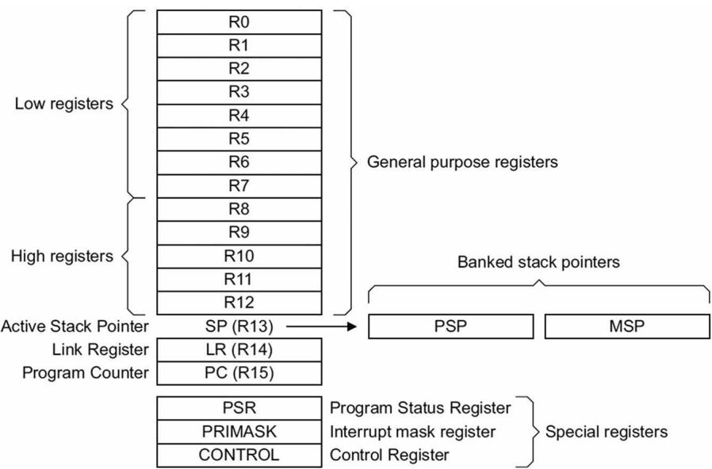  
Figure 4.3 Registers in Arm programmer’s model. Software tools such as the assembler typically accept both upper and lower case names for the core registers (r0-r15, sp, lr, pc).

## Registers

The Arm programmer’s model features multiple 32-bit registers, shown in Figure 4.3. Some of them are for general use, whereas others have specific purposes and unique characteristics. Software tools such as the assembler typically recognize both upper and lower case versions of these names (e.g both R0 and r0).

• Registers R0 through R12 are general purpose registers for data processing.

• Register R13 is called the stack pointer (SP), and is used to manage a data storage structure called the stack. SP refers to one of two possible stack pointers, the main stack pointer (MSP)

or the process stack pointer (PSP). Simple applications typically use the only MSP, although a kernel or operating system may use both.

• Register R14 is called the Link Register (LR), and it holds the return address when a Branch and Link instruction is used.

• Register R15 is called the program counter (PC), and it holds the address of the next instruction to execute in the program.

## There are three special registers:

• The program status register (PSR) is one register but has three different views, as shown in Figure 4.4. The application PSR (APSR) view shows the condition code flag bits (Negative, Zero, Carry, and Overflow), which are set by the instructions based on their result. The interrupt PSR (IPSR) view holds the exception number of the currently executing exception handler. The execution PSR (EPSR) view indicates whether the CPU is operating in Thumb mode.

• The PRIMASK register will cause the CPU to ignore some types of exceptions when it is set to one. We will discuss this further in the section on interrupts.

• The CONTROL register has one field (SPSEL) that determines which stack pointer is used if the processor is in Thread mode.

<table><tr><td></td><td>31</td><td>30</td><td>29</td><td>28</td><td>27</td><td>25</td><td>24</td><td>23</td><td></td><td></td><td></td><td></td><td>6</td><td>5</td><td></td><td>0</td></tr><tr><td>APSR</td><td>N</td><td>Z</td><td>C</td><td>V</td><td colspan="12">Reserved</td></tr><tr><td>IPSR</td><td colspan="13">Reserved</td><td colspan="3">Exception number</td></tr><tr><td>EPSR</td><td colspan="5">Reserved</td><td>T</td><td colspan="10">Reserved</td></tr></table>

Figure 4.4 Program status register.

## Memory

## Memory Map

The ARMv6-M architecture has a 32-bit address space, allowing up to 232 locations to be addressed. An address specifies a particular byte, so the memory is called byte-addressable. This address space is divided into various regions for different uses, as shown in Figure 4.5. There is space for code memory, on-chip SRAM for storing data, on-chip peripheral device control and status registers, off-chip RAM for storing data, off-chip peripheral device control and status registers, a private bus with fast access to peripherals, and space for system control and status registers.

byte-addressable Memory in which each address identifies a single byte

In the STM32F091RC, 256 kB of Flash ROM is located in the code memory at addresses 0x0800 0000 to 0x0803 FFFF; 32 kB of read/write memory (called SRAM, or static RAM) is located in the SRAM regions from 0x2000 0000 to 0x2000 7FFF as illustrated by Figure 4.6.


Figure 4.5 Memory map for Cortex-M processors.  
  
Figure 4.6 Flash ROM and SRAM memories in STM32F091RC MCU.

## Endianness

Endianness describes the order in which multi-byte values are stored in memory at a range of addresses. For example, a four-byte value (a word) could be stored at addresses A through A+3. For little-endian systems, the least-significant byte is stored at the lowest address, as in Figure 4.7. For big-endian systems, the most-significant byte is stored at the lowest address, as in Figure 4.8

For ARMv6-M systems, instructions are always little-endian. Data can be of either endianness, as determined by the CPU implementation. STM32 microcontrollers built with Cortex-M processors are little-endian for data (and instructions, of course).

endianness

Property which describes order of bytes in multi-byte structures stored in memory

little-endian

Describes byte ordering convention in which least-significant byte is stored first in memory

big-endian

Describes byte ordering convention in which most-significant byte is stored first in memory

<table><tr><td colspan="6">Register</td></tr><tr><td>31</td><td>24</td><td>23</td><td>16</td><td>15</td><td>8</td></tr><tr><td colspan="2">B3</td><td colspan="2">B2</td><td>B1</td><td>B0</td></tr></table>

## least-significant

Having the smallest place value. The least-significant byte of a two-byte value represents values of 0 to 255.

## most-significant

Having the greatest place value. The most-significant byte of a two-byte value represents values of 0 to 65,280 which are multiples of 256.

## Stack

A stack is a data structure that helps programs reuse memory safely. Rather than permanently allo cate a memory location for a temporary data value, a stack allows the program to allocate a location, use it, and then free it when done, allowing for later reuse of that location for other purposes.

Adding data to a stack is called pushing data onto the stack, whereas removing data is called popping data.

stack

Last-in, first-out data structure. Data items are removed (popped) in the opposite order they were inserted (pushed).

Instruction which writes a data item next free stack location in memory and updates the stack pointer

Instruction which reads a data item from the top of the stack (last used location) in memory and updates the stack pointer

Figure 4.7 With little-endian storage, the lowest memory address holds the least-significant byte.

<table><tr><td colspan="6">Register</td></tr><tr><td>31</td><td>24</td><td>23</td><td>16</td><td>15</td><td>8</td></tr><tr><td colspan="2">B3</td><td colspan="2">B2</td><td>B1</td><td>B0</td></tr></table>

Figure 4.8 With big-endian storage, the lowest memory address holds the most-significant byte.

Stacks use a “last-in, first-out” data organization. If item X and then item Y are pushed onto the stack, then the first pop will return Y, and the second pop will return X.

The SP (R13) points to the last item on the stack, not the first free location. Pushing data decreases the SP value by the number of bytes of data added. Popping data increases SP value by the number of bytes removed. This means that the stack grows toward smaller addresses.

Let’s walk through an example of stack use. We begin with the item D on the top of the stack at address A, as shown in Figure 4.9. We push a data item X (Figure 4.10), and then push another data item Y (Figure 4.11). The first time we pop an item off the stack, we get Y (Figure 4.12) and the next pop results give the value X (Figure 4.13). The push or pop operation adjusts the stack pointer SP to point to the top item of the stack.

<table><tr><td rowspan="5"></td><td>Memory Address</td><td>Contents</td></tr><tr><td>0x2000 0000</td><td>Free space</td></tr><tr><td>0x2000 0004</td><td>Free space</td></tr><tr><td>0x2000 0008</td><td>Free space</td></tr><tr><td>0x2000 000c</td><td>Free space</td></tr><tr><td>SP before pushing data onto stack→</td><td>0x2000 0010</td><td>D (existing data)</td></tr></table>

Figure 4.9 Initially stack has one data item (D). SP points to D, the top of stack.

<table><tr><td>Memory Address</td><td>Contents</td></tr><tr><td>0x2000 0000</td><td>Free space</td></tr><tr><td>0x2000 0004</td><td>Free space</td></tr><tr><td>0x2000 0008</td><td>Free space</td></tr><tr><td>0x2000 000c</td><td>X</td></tr><tr><td>0x2000 0010</td><td>D (existing data)</td></tr></table>

Figure 4.10 Stack after pushing item X. SP now points to X, the new top of stack.

<table><tr><td></td><td>Memory Address</td><td>Contents</td></tr><tr><td rowspan="5">SP after pushing data onto stack→</td><td>0x2000 0000</td><td>Free space</td></tr><tr><td>0x2000 0004</td><td>Free space</td></tr><tr><td>0x2000 0008</td><td>Y</td></tr><tr><td>0x2000 000c</td><td>X</td></tr><tr><td>0x2000 0010</td><td>D (existing data)</td></tr></table>

Figure 4.11 Stack after pushing item Y. SP now points to Y.

<table><tr><td rowspan="6"></td><td>Memory Address</td><td>Contents</td></tr><tr><td>0x2000 0000</td><td>Free space</td></tr><tr><td>0x2000 0004</td><td>Free space</td></tr><tr><td>0x2000 0008</td><td>Free space</td></tr><tr><td>0x2000 000c</td><td>X</td></tr><tr><td>0x2000 0010</td><td>D (Existing data)</td></tr><tr><td>SP after popping data from stack→</td><td>0x2000 0010</td><td>D (Existing data)</td></tr></table>

Figure 4.12 Stack after popping one item from stack. Popped value is Y. SP now points to X.

Figure 4.13 Stack after popping another item from stack. Popped value is X. SP points to D again.

For the Arm Cortex-M, all pushes and pops use 32-bit data items; no other size is possible. Since all possible stack pointer values are multiples of four, the hardware is designed so that the two least significant bits of the stack pointer are always zeros.

## Instructions

<table><tr><td>9800</td><td>LDR</td><td>R0,[SP,#0]</td></tr><tr><td>1900</td><td>ADDS</td><td>R0,R0,R4</td></tr><tr><td>9000</td><td>STR</td><td>R0,[SP,#0]</td></tr></table>

Listing 4.1 Instructions in machine language (first column) and assembly language (remaining columns).

An instruction must specify which operation to perform, and possibly data and parameters for the operation. The instruction may be written in machine language or assembly language.

The machine language form is a number that is stored in program memory and which the CPU can decode quickly and easily. For example, in Listing 4.1, we see three instructions in machine language: 9800, 1900, and 9000.

Assembly language is a text form that is more easily understood than machine language, which is tedious to read, write, and edit. An assembly language instruction uses mnemonics to specify the operation and any operands. The first operand usually specifies the destination of the operation, which will be overwritten with the result. The following operands usually specify the sources of the input values. For some instructions, the destination or source is implied by the instruction itself. A software tool called an assembler translates the assembly language code into machine language code for the CPU to execute.

Listing 4.1 also shows the assembly language forms of the same three instructions:

• LDR R0, [SP, #0] loads register R0 from memory starting at address SP+0.

• ADDS R0, R0, R4 adds the contents of R0 and R4, placing the results in R0.

• STR R0, [SP, #0] saves the contents of R0 to memory starting at address SP+0.

Operands may be located in a general-purpose register (R0 through R12), in the instruction word itself, in a condition code flag or in memory. Most instructions can access operands only in registers, the instruction word, or condition code flags. Some instructions (load, store, push, and pop) are able to access operands in memory.

Table 4.1 provides an overview of the different instructions available for the Cortex-M0. Some of the instructions have two versions, one that updates the condition code flags in the APSR (indicated with an S suffix after the instruction mnemonic) and one that does not (no S suffix). Full details of the instruction set are presented in the documentation [2] [4].

Table 4.1 Summary of Cortex-M0 Instructions

<table><tr><td>Category</td><td>Instruction Type</td><td>Instruction Mnemonic</td></tr><tr><td>Data Movement</td><td>Move</td><td>MOV, MOVS, MRS, MSR</td></tr><tr><td>Data Processing</td><td>Math</td><td>ADD, ADDS, ADCS, ADR, MULS, RSBS, SBCS, SUB, SUBS</td></tr><tr><td></td><td>Logic</td><td>ANDS, EORS, ORRS, BICS, MVNS, TST</td></tr><tr><td></td><td>Compare</td><td>CMP, CMN</td></tr><tr><td></td><td>Shift and Rotate</td><td>ASRS, LSLS, LSRS, RORS</td></tr><tr><td></td><td>Extend</td><td>SXTB, SXTH, UXTB, UXTH</td></tr><tr><td></td><td>Reverse</td><td>REV, REV16, REVSH</td></tr><tr><td>Memory Access</td><td>Load</td><td>LDR, LDRB, LDRH, LDRSH, LDRSB, LDM</td></tr><tr><td></td><td>Store</td><td>STR, STRB, STRH, STM</td></tr><tr><td></td><td>Stack</td><td>PUSH, POP</td></tr><tr><td>Control Flow</td><td>Branch</td><td>B, BL, BX, BLX, BEQ, BNE, BCS, BHS, BCC, BLO, BMI, BPL, BVS, BVC, BHI, BLS, BGE, BLT, BGT, BLE</td></tr><tr><td>Miscellaneous</td><td></td><td>BKPT, CPSID, CPSIE, WFE, WFI, SVC, YIELD, DMB, DSB, ISB, SEV, NOP</td></tr></table>

## Data Movement Instructions

The MOV and MOVS instructions move data to a general-purpose register and have several forms:

• MOV R3, R5 copies the data from register R5 into register R3.

• MOV R2, #151 copies the value 151 into register R2. The value to be moved is called an immediate value because it is located in the instruction itself, in an 8-bit field. Unsigned values from 0 to 255 can be loaded into registers in this way. Larger values must be loaded from memory using the LDR instruction, described later.

The special registers (such as CONTROL, PRIMASK, xPSR) are accessed using MSR and MRS instructions. MRS moves the data from a special register into a general-purpose register, whereas MSR does the opposite.

## Data-processing Instructions

Data-processing instructions include both math and logic operations. These are performed on one or more 32-bit data values, typically two registers or one register and an immediate constant.

Math operations include addition (with and without carry), subtraction (with and without borrow), subtraction with reversed operands, and multiplication:

• ADDS R0, R1, R2 adds the contents of R1 and R2, writing the result to R0 and updating the condition code flags in the APSR.

Logic operations include bitwise AND, bitwise AND with complement, exclusive OR complement, and test.

• ANDS R4, R3, R7 computes the bitwise and of registers R3 and R7, writing the result to R4 and updating the condition code flags in the APSR.

Compare instructions calculate the difference between two operands, set the condition code flags accordingly, but discard the calculated difference. A test instruction performs a logical AND on two operands and then sets the condition code flags. Condition code flags are explained in depth in the documentation.

• CMP R3, R5 computes R3−R5 and sets the flags according to the answer. For example, if R3 holds 61 and R5 holds 29, then the comparison results in a value of 61–29 = 32. This will clear all flags: N, Z, C, and V, as the result is not negative, not zero, no carry occurred, and no overflow occurred.

Shift and rotate instructions shift a word left or right by the specified number of bits. Both logical and arithmetic operations are supported.

• LSRS R1, #1 shifts register R1 to the right by one bit position. Because this is a logical shift, the MSB is loaded with zero. Bit 0 is shifted into the carry flag.

Extend instructions convert an 8- or 16-bit value to fill a 32-bit register. The upper bits can be filled in one of two ways, depending on whether the original value is signed or unsigned. An unsigned extend instruction (UXTB or UXTH) will fill the upper bits with zeros, preserving the value of unsigned data. A signed extend instruction (SXTB or SXTH) will fill the upper bits with the most significant bit of the original value, preserving the value of the signed data.

unsigned Numbering system which is able to represent positive values and zero

Reverse instructions can reverse the byte order in a 32-bit word or two 16-bit half-words, providing conversion between little-endian and big-endian data.

## Memory-Access Instructions

Recall that in the Arm programming model, data in memory must be loaded into registers before it can be processed, and then may need to be stored back into memory.

## Memory-addressing

Memory accesses use offset addressing, in which a base register Rn and an offset are added together to create the actual address for the memory access. The offset can be another register or an immediate constant value (which is stored in the instruction word). The base register is not modified by the address calculation.

The assembly code syntax for addressing memory is a bracketed expression. For example:

• [R0] indicates the memory location starting at the address in register R0. If R0 has a value of 4000, then this indicates the memory value starting at address 4000.

• [R0, #22] indicates the memory location starting at the address which is the sum of the value in R0 and 22. If R0 has a value of 4000, then this indicates the memory value starting at address 4022.

• [R0, R3] indicates the memory location starting at the address which is the sum of the values in registers R0 and R3. If R0 has a value of 4000 and R3 has a value of –80, then this indicates the memory value starting at address 3920.

## Load/Store Instructions

The LDR instruction loads a register with a 32-bit word from the four memory locations starting at the source address. The STR instruction stores the 32-bit contents of a register to the four memory locations starting at the destination address.

• LDR R0, [R4, #8] will load register R0 with the contents of the memory word (4 bytes) starting at location R4 + 8.

• STR R1, [R4, R5] will store register R1 to the memory word (4 bytes) starting at location R4 + R5.

Data smaller than 32 bits can be loaded or stored from memory as well. Byte (8 bits) and half-word (16 bits) loads and stores are supported. The STRB operation stores the least-significant byte of a register at the destination memory address, whereas STRH stores the least-significant half-word in the two bytes starting at the destination address.

Loads are more complex because an 8- or 16-bit value from memory does not completely fill a 32- bit register. This is similar to the signed and unsigned extension instructions described earlier. A load register unsigned instruction (LDRB or LDRH) will fill the upper bits with zeros, preserving the value of the unsigned data. A load register signed instruction (LDRSB or LDRSH) will fill the upper bits with the most significant bit of the value loaded from memory, preserving the value of signed data.

The ARMv6-M architecture does not support unaligned data accesses to memory. When accessing a word (which is four bytes) in memory, the starting address must be a multiple of four. When accessing a half-word (two bytes), the starting address must be a multiple of two.

The instruction set also offers load/store multiple instructions to reduce the amount of code and time needed by the program. The LDM operation will load the registers specified in an operand list from memory starting at the given address. STM will store multiple registers to memory starting at the given address.

## Stack Instructions

The Arm ISA supports a stack in memory to simplify subroutine calls and returns. The SP register points to the last data item on the stack. Pushing another item will write to a lower address in memory. This is called a “full-descending” stack.

The PUSH operation pushes (writes) selected registers onto the stack and updates the stack pointer. Source registers R0 through R7 and the link register (LR) can be specified in the instruction. With each register pushed to memory, the CPU decrements the stack pointer by four bytes. Regardless of the operand ordering in the instruction, the registers are always pushed in the same order: the largest register number is pushed first and goes to the largest address in memory.

• PUSH {R0, R5–R7} will push registers R0, R5, R6, and R7 onto the stack, and subtract 16 from SP.

The POP operation pops (reads) selected registers from the stack and updates the stack pointer. Destination registers R0 through R7 and the PC can be specified in the instruction. With each register popped from memory, the CPU increments the stack pointer by four bytes. Regardless of the operand ordering in the instruction, the registers are always popped in the same order: the smallest register number is popped first and comes from the smallest address in memory.

• POP {R2, R4} will load registers R2 and R4 from the stack and add 8 to SP.

Popping a value into the PC will change the program’s flow of control. This can be used to make the CPU return from a subroutine to the calling routine, which will be discussed later.

## Control Flow Instructions

Control flow instructions allow programs to repeat code in a loop or execute a selected section of the code based on a conditional test. This is done by changing the PC to a different value.

An unconditional branch always transfers program execution to the specified destination address.

• B Target\_label will cause the program to start executing code at (branch to) the program location called Target\_label.

A conditional branch will transfer program execution to the specified destination address if a given condition is true. The operation consists of a B followed by a condition code suffix (e.g. BEQ, BNE). This suffix specifies which particular combination of the condition code flags (N, Z, C, V) to evaluate. The conditional branch instruction executes if the condition code flags match the specified condition. Figure 4.14 shows the meanings of the different condition code suffixes.

The condition suffixes correspond to the flag settings after a compare instruction has been executed. Earlier we presented the instruction CMP R3, R5. If R3 holds 61 and R5 holds 29, then the comparison results in a value of 61–29 = 32. This will clear the flags N, Z, V, and C. Let’s see how different types of conditional branch would behave:

• Branch if equal: BEQ Target\_label will not branch to the target, since Z is not one. This is correct; 61 is not equal to 29.

• Branch if not equal: BNE Target\_label will branch to the target, since Z is zero. This is correct; 61 is not equal to 29.

• Branch if greater than: BGT Target\_label will branch to the target, since Z is zero and both N and V have the same value (zero in this case). This is correct; 61 is greater than 29.

• Branch if greater than or equal: BGE Target\_label will branch to the target, since both N and V have the same value (zero in this case). This is correct; 61 is greater than or equal to 29.

• Branch if less than: BLT Target\_label will not branch to the target, since N and V do not have different values. This is correct; 61 is not less than 29.

Note that the conditional branch can be performed after any instruction, not just a compare. It will evaluate the current values of the condition code flags. Remember that some instructions do not update the condition code flags.

Another useful control flow concept is the subroutine. Multiple functions may need to perform similar work. Rather than duplicate the instructions for that work in each function, the instructions may be placed into a subroutine that may be called by different functions as needed. Only one version of the instructions needs to be stored (reducing code size) and maintained (reducing development time). Software developers use subroutines to create building blocks, enabling them to think at a higher level when developing a system.

<table><tr><td>Suffix</td><td>Flags</td><td>Meaning</td></tr><tr><td>EQ</td><td>Z = 1</td><td>Equal, last flag setting result was zero.</td></tr><tr><td>NE</td><td>Z = 0</td><td>Not equal, last flag setting result was non-zero.</td></tr><tr><td>CS or HS</td><td>C = 1</td><td>Higher or same, unsigned.</td></tr><tr><td>CC or L0</td><td>C = 0</td><td>Lower, unsigned.</td></tr><tr><td>MI</td><td>N = 1</td><td>Negative.</td></tr><tr><td>PL</td><td>N = 0</td><td>Positive or zero.</td></tr><tr><td>VS</td><td>V = 1</td><td>Overflow.</td></tr><tr><td>VC</td><td>V = 0</td><td>No overflow.</td></tr><tr><td>HI</td><td>C = 1 and Z = 0</td><td>Higher, unsigned.</td></tr><tr><td>LS</td><td>C = 0 or Z = 1</td><td>Lower or same, unsigned.</td></tr><tr><td>GE</td><td>N = V</td><td>Greater than or equal, signed.</td></tr><tr><td>LT</td><td>N != V</td><td>Less than, signed.</td></tr><tr><td>GT</td><td>Z = 0 and N = V</td><td>Greater than, signed.</td></tr><tr><td>LE</td><td>Z = 1 or N != V</td><td>Less than or equal, signed.</td></tr><tr><td>AL</td><td>Can have any value</td><td>Always. This is the default when no suffix is specified.</td></tr></table>

Figure 4.14 Condition code suffixes indicate which flags to test [3].

When a function calls the subroutine, the subroutine executes, and then the calling function resumes execution at the instruction following the subroutine call. Subroutine calls are performed using a branch and link (BL) or a branch and link with exchange (BLX). These are similar to the unconditional branch (B) with one major difference. When a function calls a subroutine, it expects to resume execution after the subroutine completes. The return address indicates the location of the next instruction in that function to execute after the subroutine completes. The return address is stored in the LR when a BL or BLX instruction is executed.

return address

Address of next instruction to execute after completing a subroutine

• BL Subroutine1 will call Subroutine1 and save the return address in the link register.

• BLX R0 will call the code with the address specified by R0 and save the return address in the link register. R0 needs to have been loaded already with the address of the subroutine.

Returning from the subroutine requires copying the return address to the program counter. When LR holds the return address, this can be done with BX LR. If this subroutine (Sub\_1) may call another subroutine (Sub\_2), then Sub\_1 will save the LR onto the stack before calling Sub\_2. Sub\_1 returns by popping the saved LR value from the stack into the PC using the POP {PC} instruction.

## Miscellaneous Instructions

The CPSID and CPSIE instructions are used to control the PRIMASK register, which determines whether the CPU responds to interrupts and certain other exceptions. CPSIE enables the response, whereas CPSID disables the response.

NOP is an instruction that does nothing (no operation). It can be used to align instructions in memory or delay program execution.

There are additional instructions that support debugging, exceptions, sleep modes, complex memory systems, and signaling, but we do not discuss them here.

## Thumb Instruction Encoding

The full Arm instruction set uses 32 bits to represent each instruction, but this makes programs larger and raises costs, which are often crucial for embedded systems. The ARMv6-M profile only supports the Thumb instruction set, a subset of the full Arm instruction set in which most instructions are represented as 16-bit half-words. This reduces program memory requirements significantly and usually allows instructions to be fetched faster. The main limitation of the 16- bit instruction is that there are fewer bits available to represent the operation and operands. As a result, some 32-bit Arm instructions and advanced features are not available. For example, most 16-bit Thumb instructions can access only registers R0 through R7, but not R8 through R13. As a result, a program using 16-bit Thumb instructions may require more instructions (and likely execution cycles), but it will still be much smaller than a program with 32-bit Arm instructions.

## Operating Behaviors

A CPU may have several operating modes with different capabilities to provide better performance, more safety, or additional features.

## Thread and Handler Modes

The processor normally runs in Thread mode, but enters Handler mode when servicing exceptions and interrupts. The Thread mode simplifies the creation of multitasking systems. Thread and Handler modes differ in stack pointer use, which is described in the section “Handler Mode and Stack Pointers” below.

## Instruction Execution versus Debugging

Normally the CPU runs non-stop, executing a program instruction by instruction unless it is in sleep mode or halted. However, there is a debug state in which the CPU does not execute instructions, but is instead controlled by a debugger circuit. Because this debugger hardware has full access to registers and memory, the target program does not need to be modified, simplifying the development tools.

## Exceptions and Interrupts

Exceptions and interrupts are critical tools for making an embedded system responsive while supporting concurrent operation of hardware and software. In the Arm programmer’s model, interrupts are a type of exception.

Events such as hardware signals or anomalous program conditions can trigger exceptions. A peripheral or external device sends a hardware signal to the exception controller hardware to indicate that an event has occurred. The processor then services (handles) the exception with these steps:

• Pauses the program.

• Saves context information, such as registers and which instruction to execute next in the current program.

• Determines which handler (also called a service routine) to run. Each type of exception or interrupt can have a separate handler.

• Runs the code for the handler.

• Restores the context information that was saved previously. The processor then resumes executing the current program where it left off.

The CPU performs most of this work automatically in hardware, making the system more responsive. The only work performed in software is running the handler.

Exceptions provide efficient event-based processing, unlike polling that can waste many CPU cycles. Exceptions provide a quick response to events regardless of program complexity, location, or processor state. They enable many multitasking embedded systems to be responsive without needing to use a task scheduler or kernel.

Most interrupts and exceptions are asynchronous, meaning they can occur almost anywhere in the program. Note that parts of the program may disable interrupts temporarily, which will keep the ISR from running until after interrupts are enabled. Although there are methods to trigger an interrupt or an exception in software, we will not cover them here.

asynchronous

Activities which are not synchronized with each other, or a protocol which does not send clocking information

## CPU Exception Handling Behavior

## Handler Mode and Stack Pointers

The CPU can operate in one of two modes. It normally operates in Thread mode, but switches to Handler mode when performing exception processing. The mode determines which stack pointer (MSP or PSP) is used.

• When the CPU is in the Handler mode, SP refers to the MSP.

• When the CPU is in Thread mode, SP can refer to either MSP or PSP. The special CPU register called CONTROL has a flag field called SPSEL that selects which stack pointer to use. If SPSEL is zero, SP refers to the main stack pointer. This is the value after the CPU is reset. If SPSEL is one, SP refers to the process stack pointer.

In systems with a kernel or operating system, threads will use the PSP and the OS, and exception handlers will use the MSP. In systems without such support, only the MSP is used.

  
Figure 4.15 CPU operating mode changes when handling exceptions and interrupts.

## Entering a Handler

The CPU performs the following steps in hardware in order when an enabled exception is requested. The Cortex-M0 processor takes sixteen cycles (unless memory is slow enough to require wait states).

1. Complete executing the current instruction, except in special cases. Some instructions (LDM, STM, PUSH, POP, and MULS) are slow and would delay the exception handling significantly. Those instructions are abandoned to allow prompt exception handling, and then restarted after the exception handling completes.

2. Push part of the processor’s context onto the current stack (either MSP or PSP), shown in Figure 4.16. Eight 32-bit registers are pushed: the program status register (xPSR), the program counter (the return address), the LR (or R14), R12, R3, R2, R1, and R0. Recall that the stack grows toward smaller addresses. Figure  4.16 shows how critical processor registers that hold execution context for the interrupted code are stored on the stack after performing these steps.

3. Switch the processor to Handler mode and start using MSP.

4. Load the PC with the address of exception handler from the vector table, based on the type of exception. We will examine this shortly.

5. Load LR with EXC\_RETURN code to select which mode and stack to use after completing the exception processing. The codes are listed in Table 4.2.

<table><tr><td rowspan="2"></td><td>Memory Address</td><td>Contents</td></tr><tr><td>0x2000 0ffc</td><td>Free space</td></tr><tr><td rowspan="8">SP upon entering exception handler →</td><td>0x2000 1000</td><td>Saved R0</td></tr><tr><td>0x2000 1004</td><td>Saved R1</td></tr><tr><td>0x2000 1008</td><td>Saved R2</td></tr><tr><td>0x2000 100c</td><td>Saved R3</td></tr><tr><td>0x2000 1010</td><td>Saved R12</td></tr><tr><td>0x2000 1014</td><td>Saved LR</td></tr><tr><td>0x2000 1018</td><td>Saved PC</td></tr><tr><td>0x2000 101c</td><td>Saved xPSR</td></tr><tr><td>SP before entering exception handler →</td><td>0x2000 1020</td><td>Data</td></tr></table>

Figure 4.16 Stack changes upon preparing to enter an exception handler.

Table 4.2 Descriptions of Exception Return Codes.

<table><tr><td>EXC_RETURN Code</td><td>Return stack</td><td>Description</td></tr><tr><td>0xFFFF_FFF1</td><td>0 (MSP)</td><td>Return to Handler mode with MSP</td></tr><tr><td>0xFFFF_FFF9</td><td>0 (MSP)</td><td>Return to Thread mode with MSP</td></tr><tr><td>0xFFFF_FFFD</td><td>1 (PSP)</td><td>Return to Thread mode with PSP</td></tr></table>

6. Load the IPSR with the number of the exception being processed. For an IRQ, the exception number is 16 + the IRQ number.

The CPU can now start executing the code of exception handler.

## Exiting a Handler

The CPU performs these steps in order when exiting an exception handler. The first step is a soft ware instruction, while the remainder are hardware operations.

1. Execute an instruction that triggers exception return processing. There is no “return from interrupt” instruction for ARMv6-M processors. Instead, we use an instruction to update the PC with a special exception return code (EXC\_RETURN) that triggers the CPU’s exception processing hardware. One option is a branch indirect to the link register (BX LR). Another option is to pop the exception return code from the stack into the PC.

2. On the basis of the exception return code, the CPU selects either the main or process stack pointer, and also selects either Handler or Thread mode.

3. The CPU restores the context from that stack, as shown in Figure 4.17. This consists of the registers that were saved previously: the xPSR, the program counter (the return address), the LR (or R14), R12, R3, R2, R1, and R0.

4. The CPU has now restored the processor context and will resume execution of code at the address that has been restored to the PC.

<table><tr><td></td><td>Memory Address</td><td>Contents</td></tr><tr><td rowspan="9">SP before exiting exception handler →</td><td>0x2000 0ffc</td><td>Free space</td></tr><tr><td>0x2000 1000</td><td>Saved R0</td></tr><tr><td>0x2000 1004</td><td>Saved R1</td></tr><tr><td>0x2000 1008</td><td>Saved R2</td></tr><tr><td>0x2000 100c</td><td>Saved R3</td></tr><tr><td>0x2000 1010</td><td>Saved R12</td></tr><tr><td>0x2000 1014</td><td>Saved LR</td></tr><tr><td>0x2000 1018</td><td>Saved PC</td></tr><tr><td>0x2000 101c</td><td>Saved xPSR</td></tr><tr><td>SP after exiting exception handler →</td><td>0x2000 1020</td><td>Data</td></tr></table>

Figure 4.17 Stack changes upon preparing to exit an exception handler.

  
Figure 4.18 Overview of hardware for interrupt system in STM32F091RC MCU.

## Hardware for Interrupts and Exceptions

## Hardware Overview

Figure 4.18 shows an overview of the hardware involved in recognizing interrupts. At the left are external input signals and peripherals that can generate interrupt requests. These requests flow to the right through the hardware and trigger the CPU core to execute an exception handler routine.

The SYSCFG module selects up to sixteen external input signals and routes them to the EXTI (Extended Interrupts and Events Controller) module. To simplify the interrupt system, it is designed so that only sixteen inputs can request an interrupt: one for each bit (0, 1, 2, to 15). This applies across all six ports; for example, the hardware doesn’t allow both PA3 and PE3 to request interrupts.

The EXTI module monitors each of these signals for a valid trigger condition, such as rising edge, falling edge, or either edge. When a trigger occurs on an enabled signal, the EXTI mod ule asserts the corresponding output signal (EXTI0 through EXTI15). The EXTI module also monitors enabled signals from internal MCU peripherals and asserts corresponding output signals (EXTI16 through EXTI30).

The NVIC (Nested Vector Interrupt Controller) can monitor each of these interrupt request signals. If any enabled interrupts are requested, the NVIC selects the one with the highest priority and directs the CPU to start executing its handler. Some exception handlers service multiple types of interrupt requests or exceptions. The NVIC contains control registers to enable and prioritize interrupts.

Finally, on the right is the Cortex-M0 processor core, which can be directed to respond to an IRQ and execute its handler. Within the control register PRIMASK, the PM flag determines whether interrupts (and certain other exceptions) are recognized or ignored. Setting PM to one will cause the CPU to ignore these interrupts. PM is cleared to zero when the processor is reset.

## Exception Sources, Vectors, and Handlers

Each possible exception source (or group of sources) has a vector to specify its handler routine. The starting addresses for these handlers are stored in a vector table. Table 4.3 shows information (including the vector address) for Cortex-M system exceptions, and Table 4.4 shows similar information for microcontroller-specific interrupts. Each vector is four bytes long in order to hold the 32-bit address of the corresponding handler routine. Each vector starts on an address that is a multiple of four, starting with address 0x0000 0004.

vector

Address of an exception handler

## Cortex-M0 Exception Sources

The Cortex-M0 CPU core can generate several types of exceptions, some of which are listed in Table 4.3. These exceptions occur when the CPU starts up, when errors occur, and when system services are requested. Two critical exceptions are Reset, which occurs when the processor first starts running (after being powered up or reset) and HardFault, which occurs when software tries to perform an illegal operation.

Table 4.3 Selected Cortex-M0 Exception Sources and Descriptions

<table><tr><td>Vector Address</td><td>Vector #</td><td>Name</td><td>Description</td></tr><tr><td>0x0000_0004</td><td>1</td><td>Reset</td><td>CPU reset</td></tr><tr><td>0x0000_0008</td><td>2</td><td>NMI</td><td>Nonmaskable interrupt</td></tr><tr><td>0x0000_000C</td><td>3</td><td>HardFault</td><td>Hard fault error</td></tr><tr><td>0x0000_002C</td><td>11</td><td>SVCall</td><td>Call to supervisor with SVC instruction</td></tr><tr><td>0x0000_0038</td><td>14</td><td>PendSV</td><td>System-level service request</td></tr><tr><td>0x0000_003C</td><td>15</td><td>SysTick</td><td>System timer tick</td></tr></table>

Table 4.4 STM32F091RC Interrupt Sources and Descriptions

<table><tr><td>Vector address</td><td>Vector #</td><td>IRQ</td><td>Description</td></tr><tr><td>0x0000_0040</td><td>16</td><td>0</td><td>Window Watchdog</td></tr><tr><td>0x0000_0044</td><td>17</td><td>1</td><td>PVD and VDD supply comparator</td></tr><tr><td>0x0000_0048</td><td>18</td><td>2</td><td>Real Time Clock</td></tr><tr><td>0x0000_004C</td><td>19</td><td>3</td><td>Flash</td></tr><tr><td>0x0000_0050</td><td>20</td><td>4</td><td>RCC and CRS</td></tr><tr><td>0x0000_0054</td><td>21</td><td>5</td><td>EXTI line of pins Px0 and Px1</td></tr><tr><td>0x0000_0058</td><td>22</td><td>6</td><td>EXTI line of pins Px2 and Px3</td></tr><tr><td>0x0000_005C</td><td>23</td><td>7</td><td>EXTI line of pins Px4 to Px15</td></tr><tr><td>0x0000_0060</td><td>24</td><td>8</td><td>Touch Sensing</td></tr><tr><td>0x0000_0064, 68, 6C</td><td>25–27</td><td>9–11</td><td>Direct Memory Access</td></tr><tr><td>0x0000_0070</td><td>28</td><td>12</td><td>Analog to digital converter and comparators</td></tr><tr><td>0x0000_0074-98</td><td>29–38</td><td>13–22</td><td>Timers</td></tr><tr><td>0x0000_009C, A0</td><td>39–40</td><td>23–24</td><td> $I^{2}C$  communication</td></tr><tr><td>0x0000_00A4, A8</td><td>41–42</td><td>25–26</td><td>SPI communication</td></tr><tr><td>0x0000_00AC, B0, B4</td><td>43–45</td><td>27–29</td><td>USART communication</td></tr><tr><td>0x0000_00B8</td><td>46</td><td>30</td><td>CEC and CAN communication</td></tr><tr><td>0x0000_00BC</td><td>47</td><td>31</td><td>USB communication</td></tr></table>

## STM32F091RC Interrupt Sources

Many of the STM32F091RC MCU peripherals can request interrupts and are shown in Table 4.4. Vectors for interrupts start with IRQ0 at address 0x0000 0040. Further details can be found in the MCU reference manual [6].

## Vector Table Definition and Handler Names

CMSIS-CORE specifies standard names for system exception handlers. Different microcontrollers will have different peripherals, so the interrupt handler’s names and vectors are defined in the MCU-specific startup code. The STM32F091RC MCU uses the assembly language file startup\_ stm32f091xc.s, shown in Listing 4.2. The DCD symbol tells the assembler to define a constant data word with the value specified, which in this case is the address of the specified handler.

```asm
__Vectors
DCD __initial_sp ; Top of Stack
DCD Reset_Handler ; Reset Handler
DCD NMI_Handler ; NMI Handler
DCD HardFault_Handler ; Hard Fault Handler
DCD 0 ; Reserved
DCD 0 ; Reserved
DCD 0 ; Reserved
DCD 0 ; Reserved
DCD 0 ; Reserved
DCD 0 ; Reserved
DCD SVC_Handler ; SVCall Handler
DCD 0 ; Reserved
DCD 0 ; Reserved
DCD PendSV_Handler ; PendSV Handler
DCD SysTick_Handler ; SysTick Handler
; External Interrupts
DCD WWDG_IRQHandler ; Window Watchdog
DCD PVD_VDDIO2_IRQHandler ; PVD through EXTI Line detect
DCD RTC_IRQHandler ; RTC through EXTI Line
DCD FLASH_IRQHandler ; FLASH
DCD RCC_CRS_IRQHandler ; RCC and CRS
DCD EXTI0_1_IRQHandler ; EXTI Line 0 and 1
DCD EXTI2_3_IRQHandler ; EXTI Line 2 and 3
DCD EXTI4_15_IRQHandler ; EXTI Line 4 to 15
DCD TSC_IRQHandler ; TS
DCD DMA1_Ch1_IRQHandler ; DMA1 Ch. 1
DCD DMA1_Ch2_3_DMA2_Ch1_2_IRQHandler ; DMA1 Ch. 2,3 & DMA2 Ch. 1,2
DCD DMA1_Ch4_7_DMA2_Ch3_5_IRQHandler ; DMA1 Ch. 4-7 & DMA2 Ch. 3-5
DCD ADC1_COMP_IRQHandler ; ADC1, COMP1 and COMP2
DCD TIM1_BRK_UP_TRG_COM_IRQHandler ; TIM1 Events
DCD TIM1_CC_IRQHandler ; TIM1 Capture Compare
DCD TIM2_IRQHandler ; TIM2
DCD TIM3_IRQHandler ; TIM3
DCD TIM6_DAC_IRQHandler ; TIM6 and DAC
DCD TIM7_IRQHandler ; TIM7
```

```asm
DCD TIM14_IRQHandler ; TIM14
DCD TIM15_IRQHandler ; TIM15
DCD TIM16_IRQHandler ; TIM16
DCD TIM17_IRQHandler ; TIM17
DCD I2C1_IRQHandler ; I2C1
DCD I2C2_IRQHandler ; I2C2
DCD SPI1_IRQHandler ; SPI1
DCD SPI2_IRQHandler ; SPI2
DCD USART1_IRQHandler ; USART1
DCD USART2_IRQHandler ; USART2
DCD USART3_8_IRQHandler ; USART3, USART4, USART5, USART6, USART7, USART8
DCD CEC_CAN_IRQHandler ; CEC and CAN
```  
Listing 4.2 Vector table for STM32F091RC MCU in startup\_stm32f091xc.s.

## Input and Peripheral Interrupt Configuration

To use interrupts, we must configure the hardware shown in Figure 4.18. We will examine each component and start on the left. We first examine how to configure a peripheral to generate an interrupt request. Different types of peripherals have interrupt configuration options. Here we will examine the STM32F091RC GPIO module as it is used in our example system. Interrupt configuration for other peripherals is covered in later chapters.

## GPIO and SYSCFG

The GPIO modules can provide up to 96 port bit signals to the SYSCFG module. The SYSCFG module selects up to sixteen of these and routes them to the EXTI module, as shown in Figure 4.19. STM32 microcontrollers allows use of any I/O pin as an external interrupt line. The GPIO for that pin must be configured so that its input buffer is enabled, forwarding its signal to the SYSCFG module. The input buffer is enabled by setting the port bit as a digital input or output or alternate function, and is disabled for analog or oscillator function. Listing 4.3 shows the code to enable Port C and enable PC7 and PC13 as digital inputs with pull-up resistors.

  
Figure 4.19 Configure GPIO inputs and SYSCFG to generate interrupts.

```c
// Enable peripheral clock of GPIOC (for switches)
RCC->AHBENR |= RCC_AHBENR_GPIOCEN;
// Configure PC7 and PC13 in input mode
MODIFY_FIELD(GPIOC->MODER, GPIO_MODER_MODER7, ESF_GPIO_MODER_INPUT);
MODIFY_FIELD(GPIOC->MODER, GPIO_MODER_MODER13, ESF_GPIO_MODER_INPUT);
// Enable pullup on each input with 01.
MODIFY_FIELD(GPIOC->PUPDR, GPIO_PUPDR_PUPDR7, 1);
MODIFY_FIELD(GPIOC->PUPDR, GPIO_PUPDR_PUPDR13, 1);
```  
Listing 4.3 GPIO initialization code sets up PC7 and PC13 as digital inputs with pull-up resistors (step one of four).

The interrupt hardware is designed such that we can use up to 16 pins as external interrupt inputs. Six pins are connected to a multiplexer for each external interrupt signal, as shown in Figure 4.20 for EXTI0 through EXTI4. There is one signal for each bit position in all ports (0 through 15). The EXTI0 signal line can only be connected to one of six possible inputs: PA0,

  
Figure 4.20 Each EXTI signal line can be connected to the corresponding input bit of ports PA through PF, as controlled by fields in register SYSCFG\_EXTI\_CR1. EXTI0 through EXTI3 are shown here, with inputs of EXTI0 emphasized. EXTI4 through EXTI15 are selected by similar multiplexers, controlled by SYSCFG\_EXTI\_CR2 through SYSCFG\_EXTI\_CR4.

PB0, PC0, PD0, PE0 and PF0. This makes it impossible to program PA0 and PB0 to support interrupts at the same time. It is, however, possible to use PA0 and PB1 as interrupt lines simultaneously.

Table 4.5 SYSCFG external interrupt configuration registers.

<table><tr><td>Register Name</td><td>Interrupt Lines</td><td>CMSIS-CORE Register Name</td><td>Bits 15-12</td><td>Bits 11–8</td><td>Bits 7-4</td><td>Bits 3-0</td></tr><tr><td>SYSCFG_EXTICR1</td><td>0–3</td><td>SYSCFG-&gt;EXTICR[0]</td><td>EXTI3</td><td>EXTI2</td><td>EXTI1</td><td>EXTI0</td></tr><tr><td>SYSCFG_EXTICR2</td><td>4–7</td><td>SYSCFG-&gt;EXTICR[1]</td><td>EXTI7</td><td>EXTI6</td><td>EXTI5</td><td>EXTI4</td></tr><tr><td>SYSCFG_EXTICR3</td><td>8–11</td><td>SYSCFG-&gt;EXTICR[2]</td><td>EXTI11</td><td>EXTI10</td><td>EXTI9</td><td>EXTI8</td></tr><tr><td>SYSCFG_EXTICR4</td><td>12–15</td><td>SYSCFG-&gt;EXTICR[3]</td><td>EXTI15</td><td>EXTI14</td><td>EXTI13</td><td>EXTI12</td></tr></table>

Table 4.6 EXTI field configuration values to select input port for interrupt line.

<table><tr><td>EXTIx</td><td>Port Bit Selected</td></tr><tr><td>0</td><td>PAx</td></tr><tr><td>1</td><td>PBx</td></tr><tr><td>2</td><td>PCx</td></tr><tr><td>3</td><td>PDx</td></tr><tr><td>4</td><td>PEx</td></tr><tr><td>5</td><td>PFx</td></tr><tr><td>other</td><td>reserved</td></tr></table>

The multiplexer for interrupt line x is controlled by a field EXTIx in one of the four SYSCFG\_ EXTICR control registers. Note that the CMSIS abstraction layer in stm32f091xc.h refers to these four registers as an array, with numbering starting at zero (not one). Please refer to Table 4.5 for details and be careful with your code.

Table 4.6 shows the value needed to connect an interrupt line to the pin of the given port.

Listing 4.4 shows code to configure SYSCFG to support switch 1 (PC13) and switch 2 (PC7). First the clock for SYSCFG is enabled by setting the field SYSCFGEN in the RCC\_APB2ENR register.

```c
// Enable peripheral clock for SYSCFG
RCC->APB2ENR |= RCC_APB2ENR_SYSCFGCOMPEN;
// Select Port C for bits for SW1 and SW2
// SW1 is at Port C bit 13
MODIFY_FIELD(SYSCFG->EXTICR[3], SYSCFG_EXTICR4_EXTI13, 2);
// SW2 is at Port C bit 7
MODIFY_FIELD(SYSCFG->EXTICR[1], SYSCFG_EXTICR2_EXTI7, 2);
```

Listing 4.4 SYSCFG initialization code sets up PC13 and PC7 as external interrupt lines (step two of four).

Now we need to connect interrupt line 13 to PC13. First we need the name of the register to access. SYSCFG\_EXTICR4 controls interrupt line 13 with the EXTI13 field, as seen in Table 4.5. However, in our code we need to use the CMSIS-CORE name of SYSCFG->EXTICR[3] (not SYSCFG->EXTI[4]).

Next, we need to specify the bit field. The file stm32f091xc.h defines symbols for bit fields in registers. In this case we are looking for the bit definition for the EXTI13 field of the SYSCFG\_ EXTICR4 register, which is SYSCFG\_EXTICR4\_EXTI13.

Finally, we need to specify the value to shift and write to the bit field. Table 4.6 shows the value for PCx is 2. We will use the MODIFY\_FIELD macro to write a value 2, selecting PC. We follow a similar process to connect switch 2 (PC7) to EXTI7.

## EXTI

Next in Figure 4.21, the extended interrupts and events controller (EXTI) determines if an interrupt can be generated and under which conditions. Figure 4.22 shows the hardware logic used to identify valid interrupt conditions from input signals.

  
Figure 4.21 Configure EXTI to manage interrupt requests.

  
Figure 4.22 EXTI hardware for edge detection, software triggering, masking and pending status.

Figure 4.23 shows a map of the registers EXTI uses to to configure and monitor the interrupt lines. Each register has a one-bit field for each interrupt: bit x is associated with EXTIx. The sixteen available external interrupts use bits 0 through 15, while internal interrupts use bits 16 through 31 (see the reference manual’s section “External and internal interrupt/event line mapping”).

  
Figure 4.23 EXTI registers use one bit for each interrupt source.

We start at the input (left side) of the circuit shown in Figure 4.22. The first set of logic determines which conditions might trigger an interrupt. The edge detect circuit determines which types of input signal edges can trigger an interrupt.

• If a bit’s Rising Trigger Selection Register (EXTI\_RTSR) field is 1 then signal’s rising edge (0 to 1) can trigger an interrupt. If 0 it cannot.

• If a bit’s Falling Trigger Selection Register (EXTI\_FTSR) field is 1 then signal’s falling edge (1 to 0) can trigger an interrupt. If 0 it cannot.

• Setting both RTSR and FTSR for a bit will trigger interrupts on both edges.

External interrupts can be emulated by using software to write a 1 to the bit’s field in the Software Interrupt Event Register (EXTI\_SWIER).

The edge detection and software interrupt circuit outputs are combined with an OR gate before being sent to masking logic. If the bit’s Interrupt Mask Register (EXTI\_IMR) field is zero the interrupt line is disabled (masked), so no interrupts can be generated. A one enables (unmasks) th interrupt line.

```c
// Set mask bits for inputs in EXTI_IMR
EXTI->IMR |= MASK(SW1_POS) | MASK(SW2_POS);
// Trigger on both rising and falling edges in EXTI_RTSR and EXTI_FTSR
EXTI->RTSR |= MASK(SW1_POS) | MASK(SW2_POS);
EXTI->FTSR |= MASK(SW1_POS) | MASK(SW2_POS);
```  
Listing 4.5 EXTI configuration code lets PC13 (switch 1) and PC7 (switch 2) generate an interrupt on the rising and falling edges of an input signal (step three of four).

Listing 4.5 shows how to enable interrupts for for PC13 and PC7 by setting the mask bits in EXTI->IMR. Both rising- and falling-edge interrupts are to be detected, so the corresponding bits are set in EXTI->RTSR and EXTI->FTSR.

The last part of the logic keeps track of whether an interrupt has been requested but not yet serviced. When an enabled (unmasked) interrupt signal is generated, it will set the bit’s field in the Pending Register (EXTI\_PR) to 1. This will trigger the CPU to execute the exception handler. Software can also poll EXTI\_PR to determine if there are any pending interrupts. It is the handler’s responsibility to clear this bit’s EXTI\_PR field back to 0 to indicate the request has been ser viced. This is done by writing a one (not zero) to this bit to clear it to zero. With CMSIS-CORE the register is accessed as EXTI->PR.

The EXTI has other capabilities as well. It can generate events for MCU use and wake up based on both internal and external signals; see the Interrupts and Events section of the reference manual.

## NVIC Operation and Configuration

Next we examine how to configure the NVIC (Figure 4.22), which selects the highest-priorityenabled interrupt request and directs the CPU to execute its ISR. The NVIC supports up to 32 interrupt sources, called IRQ0 through IRQ31. Each source can be configured. Each interrupt source can be enabled, disabled, and prioritized. Pending interrupt processing status can be read and modified.

## EXTI Grouping for Handlers

Table  4.4 shows the interrupts which the MCU can generate. Note that the sixteen different EXTI interrupts are grouped so they are handled by one of three (not sixteen) handlers, as shown in Table 4.7.

  
Figure 4.24 Configure NVIC to manage interrupt requests.

Table 4.7 Grouping of external interrupts to exception handlers.

<table><tr><td>External Interrupts</td><td>IRQnum</td><td>CMSIS Name for IRQnum</td><td>Exception Handler Name</td></tr><tr><td>EXTI0 – EXTI1</td><td>5</td><td>EXTI0_1_IRQn</td><td>EXTI0_1_IRQHandler</td></tr><tr><td>EXTI2 – EXTI3</td><td>6</td><td>EXTI2_3_IRQn</td><td>EXTI2_3_IRQHandler</td></tr><tr><td>EXTI4 – EXTI15</td><td>7</td><td>EXTI4_15_IRQn</td><td>EXTI4_15_IRQHandler</td></tr></table>

## Enable

Each interrupt source can be enabled or disabled separately using the NVIC registers ISER and ICER. Each is 32 bits, with each bit corresponding to an interrupt source. To enable an interrupt source N, write a 1 to bit N in ISER. To disable an interrupt source N, write a 1 to bit N in ICER. Reading ISER or ICER will return the enabled or disabled state for all 32 interrupt sources.

The CMSIS-CORE API provides this interface:

```c
void NVIC_EnableIRQ(IRQnum) - Enable interrupts of type IRQnum
void NVIC_DisableIRQ(IRQnum) - Disable interrupt of type IRQnum
```

Values for IRQnum shown in Table 4.7 are defined by the CMSIS-compliant device driver, and are listed in the stm32f091xc.h file in the section called “Interrupt Number Definitions”. Examples are TIM2\_IRQn, USART1\_IRQn, and EXTI4\_15\_IRQn.

## Priority

Each exception source has a priority that determines the order in which simultaneous exception requests are handled. The requested exception with the lowest priority number will be handled first. Some exceptions have fixed priorities, such as reset, NMI, and hard fault. Other exceptions (including interrupts) have configurable priorities.

The NVIC contains multiple interrupt priority registers (IPR0 through IPR7). Each IPR has an 8-bit field for each of four interrupt sources. Each field specifies one of four possible priority levels (0, 64, 128, and 192) for that source. Multiple interrupt sources can have the same priority. The CMSIS-CORE API provides the interface here. Note that the prio parameter should be set to 0, 1, 2, or 3, as the code shifts the value 6 bits to the left before saving it to the priority field:

```txt
void NVIC_SetPriority(IRQnum, prio) - Set interrupt source IRQnum to priority uint32_t NVIC_GetPriority(IRQnum) - Get priority of interrupt source IRQnum
```

## Pending

An interrupt is pending if it has been requested but has not yet been serviced. The flag is set by hardware when the interrupt is requested. Software can also set the flag to request the interrupt. An interrupt handler that runs must clear its source’s pending IRQ flag or else the handler will run repeatedly.

```txt
pending
Requested but not yet serviced (e.g. interrupt)
```

The CMSIS-CORE API provides this interface:

```txt
uint32_t NVIC_GetPendingIRQ(IRQnum) - Return 1 if interrupt from IRQnum void NVIC_SetPendingIRQ(IRQnum) - Set interrupt pending flag for IRQnum void NVIC_ClearPendingIRQ(IRQnum) - Clear interrupt pending flag for IRQnum
```

```c
// Configure enable and mask bits for NVIC IRQ Channel for EXTI
// Interrupt lines 7 and 13 are both serviced by EXTI4_15_IRQ
NVIC_SetPriority(EXTI4_15_IRQn, 3);
NVIC_ClearPendingIRQ(EXTI4_15_IRQn);
NVIC_EnableIRQ(EXTI4_15_IRQn);
```  
Listing 4.6 NVIC initialization code configures NVIC to respond to EXTI4\_15\_IRQ (step four of four).

The code in Listing 4.6 completes the initialization by configuring the NVIC to set the priority level for the specified interrupt, clear any pending interrupts of that type, and finally enable the interrupt.

## Processor Exception Masking

Finally, the processor core can be configured to accept or ignore certain types of exceptions, as shown in Figure 4.25. The CPU core’s PRIMASK register controls whether interrupts and other exceptions of configurable priority are recognized or not. The PM flag is stored in bit zero of PRIMASK. A PM value of zero allows those exceptions to be recognized by the CPU, whereas a one prevents it. The PM bit is accessed using the CPSID and CPSIE instructions. Note that when the CPU is reset or powers up the hardware automatically clears PM to zero, so these excep tions are not ignored.

  
Figure 4.25 Configure processor core to process exceptions.

The CMSIS-CORE API provides these interfaces for accessing the PM flag:

```c
void __enable_irq() - Clear PM flag
void __disable_irq() - Set PM flag
uint32_t __get_PRIMASK() - Return value of PRIMASK
void __set_PRIMASK(uint32_t x) - Set PRIMASK to x
```

## Safely Masking Interrupts

A function may need to ensure no interrupts are handled during a certain sequence of operations (called a critical section). One approach is to call \_\_disable\_irq() before the sequence of operations and \_\_enable\_irq() after. However, if interrupts were already disabled (for some other reason) before executing the sequence of operations, then it is incorrect to enable them afterward.

The correct approach is shown in Listing 4.7. The code must save the masking state (using \_\_get\_PRIMASK()) before disabling interrupts (using \_\_disable\_irq()). After performing the critical section operations, the saved masking state is restored (using \_\_set\_ PRIMASK()).

```cpp
void my_function(void) {
    uint32_t masking_state;
    // Perform non-critical processing
    // ...
    // Get current interrupt masking state
    masking_state = __get_PRIMASK();
    // Disable interrupts
    __disable_irq();
    // Perform critical section operations
    // ...
    // Restore previous interrupt masking state
    __set_PRIMASK(masking_state);
    // Perform more non-critical processing
    // ...
}
```  
Listing 4.7 Correct method to prevent interrupts during critical section of code saves and restore interrupt masking state.

## Software for Interrupts

When creating software for a system that uses interrupts, we design the system first and then implement it by writing the code. We design the system by identifying which interrupts to use and then deciding how to divide (partition) the work between ISRs and main-line code. We can then write the code to configure hardware to generate and handle interrupts, and finally write the code for the ISRs themselves.

## Program Design

Selecting which interrupts to use is generally simple because they are peripheral-specific. Some peripherals have flexible interrupt generation capabilities that can simplify the software design significantly when used appropriately. We will examine these features in later chapters.

Determining how to structure the code in response to the interrupt depends on two major issues: How should we partition work between the ISR and the main-line code? How will the ISR communicate the remaining work to the main-line code? We discuss these next. These topics are covered further in other texts [7] [8] [9].

  
Figure 4.26 Three options for partitioning work between ISR and task code for the flashing LED example

## Partitioning

The ISR should perform only quick, urgent work related to the interrupt. Other work should be deferred to the main-line code when feasible. This keeps each ISR quick and doesn’t delay other ISRs unnecessarily. Keeping ISRs short also makes the code much easier to debug.

Consider the flashing LED example from the previous chapter. Pressing or releasing a switch will trigger an interrupt. Figure 4.26 shows the work involved in response. Software must identify which switch changed, determine the new value of the switch, update the variables g\_w\_delay, g\_RGB\_delay, and g\_flash\_LED, and light the LEDs.

How much of this work should be done in the ISR, and how much should be left in the mainline code? Let’s consider three options:

• Option 1: Short ISR. The ISR simply signals which switch changed and how (whether pressed or released). A task in the main-line program needs to update the delay and flash mode variables based on this switch information. This could be done by Task\_RGB and Task\_Flash, which would reduce the code’s modularity. The variables could be updated by a new task, which would add the overhead of creating and running another task.

• Option 2: Medium ISR. The ISR directly updates the delay and flash mode variables. This is a quick, low overhead approach.

• Option 3: Long ISR: The ISR directly updates the delay and flash mode variables, and imme diately updates the LED based on the new delay or flash mode. This approach is much more responsive than the first two, but we have a problem when the ISR completes and the previ ously executing task resumes. That task will light the LEDs with the wrong colors or the wrong delays. We need a way to disable or restart that task, and this is not simple.

## Communication

When work is split up between the ISR and the main-line code, we need a way to communicate the intermediate results between the pieces.

In Options 2 and 3 above, the ISR directly updates the delay and flash mode variables. These can be shared variables which the ISR writes and the task code reads. This is a straightforward and simple solution.

The first option is more complex. The ISR writes to shared variables that indicate which switch changed and how. The task code reads the switch variables and then updates the delay and flash mode variables. However, how do we keep the task code from reusing the switch variables the next time it runs? Should the ISR use a flag to tell the task to run once? Or should the task erase the switch variables when it is done with them?

There are more questions to consider. What should the system do if the ISR runs more than once before the main-line task code can run? Should the task code process the data from just the first ISR instance, or just the last? If the task code must process all the data, then it must be saved somehow. For example, a system with serial communication should not lose any incoming or outgoing data. The ISR and the task code will need to coordinate on how to store the data and reuse space effectively. We will see how to do this with queues in a later chapter. Kernels and RTOSs also provide queues for application programs to use.

## Example System Design

We choose the intermediate partitioning approach to create the design shown in Figure 4.26. The ISR updates the shared variables g\_w\_delay, g\_RGB\_delay, and g\_flash\_LED, which in turn are read by the tasks. We do not need to buffer or accumulate data for this example. If the

  
Figure 4.27 Communication and control paths among hardware and software components in example LED flashing system.

user presses a switch multiple times before a task can run, the ISR will update the shared variables multiple times. We only care about the last value of each variable, which the task uses to control the flashing.

The developer should consider the range of partitioning options to find a good balance between performance (responsiveness) and complexity. More partitioning improves responsiveness for the rest of the system, but increases the communication complexity and reduces responsiveness for the interrupt in question.

## Interrupt Configuration

Listing 4.8 shows a function with the four interrupt initialization sections we examined previ ously. As a reminder, the code first configures the peripheral to generate interrupts. This step is peripheral-specific. In our example with the STM32 port module, we need to specify which port input bits should generate interrupts and under what circumstances. The port module is described earlier in this chapter, in the section “Peripheral Interrupt Configuration”. The two switches are connected to port C bits SW1\_POS (bit 13) and SW2\_POS (bit 7). If we want any input change to generate an input, we will need to set the mode of the GPIOs to generate an interrupt on the falling and the rising edge. Second, the code configures the NVIC to recognize this interrupt and with a given priority. Both switches are connected to the EXTI4\_15 interrupt, so we will use the EXTI4\_15\_IRQn name from CMSIS-CORE. We first set the priority using a call to NVIC\_ SetPriority, then clear any pending interrupts using a call to NVIC\_ClearPendingIRQ, and then finally enable the interrupt using NVIC\_EnableIRQ.

```c
void Init_GPIO_Switches_Interrupts(void) {
    // Enable peripheral clock of GPIOC (for switches)
    RCC->AHBENR |= RCC_AHBENR_GPIOCEN;
    // Configure PC7 and PC13 in input mode
    MODIFY_FIELD(GPIOC->MODER, GPIO_MODER_MODER7, ESF_GPIO_MODER_INPUT);
    MODIFY_FIELD(GPIOC->MODER, GPIO_MODER_MODER13, ESF_GPIO_MODER_INPUT);
    // Enable pullup on each input with 01.
    MODIFY_FIELD(GPIOC->PUPDR, GPIO_PUPDR_PUPDR7, 1);
    MODIFY_FIELD(GPIOC->PUPDR, GPIO_PUPDR_PUPDR13, 1);

    // Enable peripheral clock for SYSCFG
    RCC->APB2ENR |= RCC_APB2ENR_SYSCFGCOMPEN;
    // Select Port C for bits for SW1 and SW2
    // SW1 is at Port C bit 13
    MODIFY_FIELD(SYSCFG->EXTICR[3], SYSCFG_EXTICR4_EXTI13, 2);
    // SW2 is at Port C bit 7
    MODIFY_FIELD(SYSCFG->EXTICR[1], SYSCFG_EXTICR2_EXTI7, 2);

    // Set mask bits for inputs in EXTI_IMR
    EXTI->IMR |= MASK(SW1_POS) | MASK(SW2_POS);
    // Trigger on both rising and falling edges in EXTI_RTSR and EXTI_FTSR
    EXTI->RTSR |= MASK(SW1_POS) | MASK(SW2_POS);
    EXTI->FTSR |= MASK(SW1_POS) | MASK(SW2_POS);

    // Configure enable and mask bits for NVIC IRQ Channel for EXTI
    // Interrupt lines 7 and 13 are both serviced by EXTI4_15_IRQ
    NVIC_SetPriority(EXTI4_15_IRQn, 3);
    NVIC_ClearPendingIRQ(EXTI4_15_IRQn);
    NVIC_EnableIRQ(EXTI4_15_IRQn);

    // Optional: Configure PRIMASK in case interrupts were disabled
    __enable_irq();
}
```

Listing 4.8 Complete code to initialize PC7 and PC13 to generate interrupts on rising and falling edges.

Third, the code may ensure that interrupts are not disabled. When the processor comes out of reset, the PM bit in the CPU’s PRIMASK register will be zero, so interrupts will be enabled and the PM bit will not need to be modified. However, if other code has run and set the PM bit, then it is necessary to call \_\_enable\_irq.

## Writing ISRs in C

Let’s move on to writing the actual ISR. The ISR function takes no arguments and has no return values (e.g. void EXTI4\_15\_IRQHandler (void)). An ISR must be named according to the CMSIS-CORE exception handler names shown in Listing 4.2 (e.g. EXTI4\_15\_IRQHandler, RTC\_IRQHandler). This ensures that the software toolchain places ISR addresses in the vector table correctly. The source code for the ISR for our example system is shown in Listing 4.9.

```txt
volatile uint8_t g_flash_LED = 0;
volatile uint32_t g_w_delay = W_DELAY_SLOW;
volatile uint32_t g_RGB_delay = RGB_DELAY_SLOW;

void EXTI4_15_IRQHandler(void) {
    if ((EXTI->PR & SW1_POS) != 0) {
    EXTI->PR = SW1_POS; // clear pending request
    if (SWITCH_PRESSED(SW1_POS)) {
    g_flash_LED = 1; // Flash white
    } else {
    g_flash_LED = 0; // RGB sequence
    }
    }
    if ((EXTI->PR & SW2_POS) != 0) {
    EXTI->PR = SW2_POS; // clear pending request
    if (SWITCH_PRESSED(SW2_POS)) {
    // Short delays
    g_w_delay = W_DELAY_FAST;
    g_RGB_delay = RGB_DELAY_FAST;
    } else {
    // Long delays
    g_w_delay = W_DELAY_SLOW;
    g_RGB_delay = RGB_DELAY_SLOW;
    }
    }
    // Clear all other pending requests for this handler
    EXTI->PR = 0x0000fff0;
}

Listing 4.9 EXTI4_15_IRQHandler Source code for shared variables and interrupt service routine (handler).
```

Both switches are connected to EXTI4\_15, so we name the ISR EXTI4\_15\_IRQHandler to make the corresponding vector table entry point to our ISR.

Our ISR needs to determine which switch changed, and what the switch’s new value is. This ISR could be running because of a request any of twelve interrupt sources (from EXTI4 through EXTI15). The ISR reads EXTI\_PR and tests the bit for SW1\_POS. If it is not zero, then SW1 requested the interrupt. The ISR writes a one to that bit to tell the hardware the interrupt is being serviced, clearing the bit. The new value of the switch is determined by reading the port input data bit with the macro SWITCH\_PRESSED. This is repeated for SW2\_POS.

After determining which switch changed and how, the code can update the shared variables g\_flash\_LED, g\_w\_delay, and g\_RGB\_delay.

Finally, we clear all other possible pending interrupt requests for this handler by writing ones to their bits in EXTI\_PR (positions 4 through 15). This value is binary 1111 1111 1111 0000 or hexadecimal 0xFFF0.

## Sharing Data Safely Given Preemption

Sharing data in a system with preemption introduces possible problems. Note that both interrupts and preemptive task scheduling (e.g. with a kernel) can cause preemption. Interrupts can preempt tasks. In a system with preemptive scheduling, tasks can preempt other tasks.

## Volatile Data Objects

The first problem comes from the fact that shared data objects are stored in memory. When creating a function that uses the shared data, the compiler generates instructions to copy the data into a register to process it. This occurs each time the variable appears in the source code. However, if the shared data is used multiple times in the function, the compiler may optimize the code by reusing the value that was loaded the first time, rather than generating more instructions to reload it for successive uses.

```c
void Task_RGB(void) {
    if (g_flash_LED == 0) { // Only run task when NOT in flash mode Control_RGB_LEDs(1, 0, 0);
    Delay(g_RGB_delay); // Code reads g_RGB_delay from memory into
    /* If switch 2 changes now, the ISR will run
    and update g_RGB_delay in memory */
    Control_RGB_LEDs(0, 1, 0);
    Delay(g_RGB_delay); // Error: using old value of g_RGB_delay in
    Control_RGB_LEDs(0, 0, 1);
    Delay(g_RGB_delay); // Error: using old value of g_RGB_delay in
    }
}
```

Listing 4.10 Task\_RGB might reuse first value of g\_RGB\_delay

Consider the code in Listing 4.10. The shared variable g\_RGB\_delay is used three times. The compiler generates code to load g\_RGB\_delay from memory into a register for the first call to the subroutine called Delay. For optimization reasons, the compiler may reuse the value that was read the first time in the second and third calls to Delay. Consider the case shown in the code listing, in which switch 2 changes after the first use of g\_RGB\_delay. The ISR will run and change the value of g\_RGB\_delay in memory. However, the code is still using the old value of g\_RGB\_delay, causing a program error.

In other cases the source code may specify writing the result back to memory. To speed up the program, the compiler may not save the updated values back to memory until necessary (e.g. the end of the function). Imagine that such a function is executing. It has already loaded the value and updated the value, but the code is optimized so that it does not save the updated value back to memory until the end of the function. An interrupt is requested, causing an ISR to run that changes the shared variable in memory. When the function resumes executing, it will be using the old value of the shared variable, not the new value. When the function completes, it will overwrite the new value with the updated old value, causing an error.

We call this shared data volatile because it can change outside a program’s normal flow of control. If an ISR may change a variable used by main-line code, then that data is volatile. Similarly, a hardware register (e.g. a counter) that may change on its own is also volatile.

```txt
// Initially don't flash LED, just do RGB sequence
volatile uint8_t g_flash_LED = 0;
// Delay for white flash
volatile uint32_t g_w_delay = W_DELAY_SLOW;
// Delay for RGB sequence
volatile uint32_t g_RGB_delay = RGB_DELAY_SLOW;
```

Listing 4.11 Variables shared between ISR and mainline code must be defined as volatile.

We tell the compiler that a variable may change outside of its control by using the volatile keyword before the data type in the variable’s definition. This forces the compiler to reload the variable from memory each time it is used in the source code. In Listing 4.11 the shared variables g\_Flash\_LED, g\_w\_delay, and g\_RGB\_delay are defined as volatile. This indicates to the compiler that they may change unexpectedly (e.g. an ISR may change them).

## Atomic Object Access

The second problem comes from the fact that some data objects take multiple operations to modify. This means they do not have atomic (i.e. indivisible) access. If a function is interrupted or preempted in the middle of these operations, it is possible for the data to be corrupted.

```txt
atomic
Indivisible, cannot be interrupted or preempted
```

All variables located in memory are vulnerable to these data races. For example, consider the program in Listing 4.12 which lets both an ISR and the main code (in my\_bad\_function) increment the variable g\_counter. The function my\_bad\_function will load the counter variable’s value (e.g. 0) from memory into a register and increment that register’s value (e.g. to 1). If the interrupt is requested before the updated value is stored back to memory, then my\_ ISR will load the old value (0) from memory into a register, increment it (1) and store it back to memory. The function my\_bad\_function will resume and write its updated value (1). The counter variable has been incremented twice, but has only gone from 0 to 1, so the data has been corrupted. This is called a data race situation, as it depends on the specific timing relationship between the program execution and the interrupt request. The sequence of instructions that must not be interrupted is called a critical section.

```txt
data race Situation in which the ill-timed preemption of a code critical section can result in an incorrect program result
```

```c
critical section
Section of code which may execute incorrectly if not executed atomically

volatile uint32_t g_counter;

void my_ISR(void) {
    g_counter++;
}

void my_bad_function(void) {
    gcounter++;
}

void my_good_function(void) {
    uint32_t masking_state;
    // Disable interrupts before critical section
    // Get current interrupt masking state
    masking_state = __get_PRIMASK();
    // Disable interrupts
    __disable_irq();
    // Critical section starts
    g_counter++;
    // Critical section ends
    // Restore interrupt masking state after critical section
    __set_PRIMASK(masking_state);
}
```  
Listing 4.12 Disabling interrupts to make a critical section atomic.

We solve this problem by disabling preemption during the critical section. For example, we disable interrupts during the critical section in my\_good\_function as shown in Listing 4.12. As described in the section “Safely Masking Interrupts” above, we need to save the interrupt masking state, mask interrupts, and then restore the previous interrupt masking state. Preemptive kernels offer this and related methods to prevent preemption during critical sections of code.

Note that variables longer than one word will take more than one load and one store to update,1 so they are vulnerable to an additional type of corruption: a partial update. Consider our example LED flasher system. Let’s consider changing the size of g\_RGB\_delay from one word (uint32\_t, which is 32 bits) to two words (uint64\_t, which is 64 bits) to allow longer time delays. The code will now need to perform two load operations to read g\_RGB\_delay from memory: LDR R0, [g\_RGB\_delay] for the low word and LDR R1, [g\_RGB\_delay+4] for the high word. Similarly, two store operations are needed to write the two words back.

If switch 2 changes while the first load instruction is executing, the data for the task will be corrupted. The CPU will complete that first load (low word) and then execute the ISR. The ISR will update the two words of g\_RGB\_delay in memory. The task code will then resume by loading R1 with the second (high) word from memory. The registers now hold corrupted data: R0 holds the old low word, and R1 holds the new high word.

## Summary

In this chapter, we explored the basic organization and programmer’s model of a Cortex-M0 CPU core. We learned about general-purpose registers and special control registers in the core. We saw how memory is addressed and how a stack works. We examined the available instructions, including data movement, data processing, memory access, control flow, and miscellaneous instructions. We learned about different processor operating modes and how Thumb instructions differ from standard Arm instructions.

We then examined exceptions and interrupts. We saw the steps the CPU follows to handle exceptions: looking up a handler’s address in the vector table, entering the exception handler and then exiting it. We then covered the path that interrupts follow: from generation by a peripheral (e.g. GPIO and SYSCFG), through EXTI and the NVIC, and finally through the CPU masking hardware. Finally we discussed how to design software for interrupts: how to partition work between the ISR and main-line code, how to write software which configures the hardware to generate and recognize interrupts, and how to write the ISR. We also discussed how to handle volatile data and provide atomic object access.

## Exercises

1. How does the word 0xDEC0 DED1 appear in memory in a little-endian memory system as well as in a big-endian memory system? Specify the relative address for each byte.

2. Does the stack in Arm processors grow toward larger or smaller addresses?

3. Assuming that SP is 0x0000 2220 initially, what is its value after executing the instruction PUSH {R0,R2}?

4. Assuming that SP is 0x0000 2010 initially, what is its value after executing the instruction POP {R0-R7,PC}?

5. Write the Thumb code to add number five to the contents of register R6.

6. Write the Thumb code to subtract 1,000 from the contents of register R6, using R3 as a temporary register.

7. Write the Thumb code to multiply the two 32-bit values in memory at addresses 0x1234 5678 and 0x7894 5612, storing the result in address 0x2000 0010.

8. Write the Thumb code to load register R0 with the ASCII code for the letter “E” if the number in R12 is even, or “O” if it is odd.

9. Which modules generate the IRQ0, IRQ10, and IRQ30 interrupt requests, and what are their CMSIS typedef enumeration labels? Examine the interrupt vector assignments (IVA) table in the MCU reference manual [6] and the stm32f091xc.h file (or appropriate device.h file for a different MCU device).

10. We would like to configure a STM32F091RC MCU so that if interrupts IRQ0, IRQ10, and IRQ30 are requested simultaneously, the CPU responds by servicing IRQ10 first, then IRQ0, and finally IRQ30. Write the C code using CMSIS functions to configure the MCU.

11. We wish to enable IRQ13 but disable IRQ24. What values need to be loaded into which register bits, and what is the sequence of CMSIS calls to accomplish the same?

12. We wish to determine if IRQ7 has been requested. Which register and which bit will indicate this? What is the CMSIS call that will reveal the information?

13. Which register can an exception handler use to determine if it is servicing exception number 0x21? What value will the register have? What is the CMSIS interface code to read the IPSR?

14. Using EXTI\_PR register we could clear the pending flags for all bits. Under what circumstances might this lead to incorrect system operation?

## References

[1] Arm Ltd., ARMv6-M Architecture Reference Manual, DDI 0419D, 2017.

[2] Arm Ltd., Cortex-M0 Devices Generic User Guide, DUI0497A, r0p0 ed., 2009.

[3] Arm Ltd., Cortex-M0 Technical Reference Manual, DDI0432C, r0p0 ed., 2009.

[4] J. Yiu, The Definitive Guide to the ARM Cortex-M0 and Cortex-M0+ Processors, 2nd ed., Oxford: Newnes, 2015.

[5] STMicroelectronics NV, Programming Manual PM0215: STM32F0xxx Cortex-M0, 2012.

[6] STMicroelectronics NV, Reference Manual RM0091: STM32F0x1/STM32F0x2/STM32F0x8, 2017.

[7] P. Koopman, Better Embedded System Software, Pittsburgh: Drumnadrochit Education LLC, 2010.

[8] J. Ganssle, The Art of Designing Embedded Systems, Second ed., Elsevier Inc., 2008.

[9] J. K. Peckol, Embedded Systems: A Contemporary Design Tool, John Wiley & Sons, Inc., 2008.

## C in Assembly Language

## Chapter Contents

Overview 134   
Motivation 134   
Software Development Tools 135   
Program Build Tools 135   
Compiler 136   
Assembler 136   
Linker/Loader 139   
Programmer 139   
Debugger 140   
C Language Fundamentals 140   
Program and Functions 140   
Start-Up Code 141   
Types of Memory 141   
A Program's Memory Requirements 142   
Making Functions 143   
Register Use Conventions 144   
Function Arguments 144   
Function Return Value 145   
Prolog and Epilog 145   
Prolog 145   
Epilog 146   
Exception Handlers 147   
Controlling the Program's Flow 148   
Conditionals 148   
If/Else 148   
Switch 150   
Loops 152   
Do While 152   
While 153   
For 155   
Calling Subroutines 156

Accessing Data in Memory 157  
Statically Allocated Memory 157  
Automatically Allocated Memory 158  
Dynamically Allocated Memory and Other Pointers 159  
Array Elements 159  
Summary 162  
Exercises 162  
References 164

## Overview

In Chapter 4 we examined the Arm Cortex-M0 processor core, including the instructions that it can execute, the registers for general-purpose data processing, and methods to access memory. In this chapter we will see the object code that the compiler creates to implement the C-language source code. Understanding this object code will help us debug our programs and write source code that is more efficient in its use of time or memory.

## Motivation

We have seen the instructions that the Arm Cortex-M0 processor core can execute. Each instruction performs simple operations, such as adding two integers, comparing values, or pushing registers onto the stack in memory. Creating a program using these instructions requires the developer to make many small decisions: where to place a data variable in memory, which register to use to process that variable, which kind of conditional branch to use after a comparison, how to share data between functions, and so forth. This complexity slows software development and introduces many opportunities for errors.

High-level programming languages were developed to free the software developer from these issues. C and C++ are the dominant programming languages for embedded systems. We use a language translation tool called a compiler to convert an application program from one high-level language to assembly language, and another tool called an assembler to convert the assembly language to object code. The CPU executes the program by reading each object code instruction and then executing it very quickly (e.g. within one or two CPU clock cycles).

In some programming languages (e.g. Java, Perl, Python), an application program is not converted to the CPU’s native executable format. Instead, at runtime the application program is processed by another program (such as an interpreter or virtual machine) to carry out the work specified. Java code can be compiled to an intermediate form called bytecode before the program is run. At runtime the virtual machine program interprets and executes the bytecode. The interpreter or virtual machine program increases the amount of time and memory needed to run an application program. Compiled languages dominate embedded systems development because they do not incur these runtime and memory overheads, and also because they offer more predictable behavior.

A toolchain is a set of tools used to build the program (to convert it from source code to executable object code), download it to the MCU’s memory, and control its execution for debugging.

The toolchain must be configured to support the specific type of processor we are using and how much memory is in the system.

Using a high-level programming language introduces trade-offs. We expect the toolchain to generate an object code that is correct, and also reasonably fast and small. It may be possible to manually create faster or smaller object code by writing the assembly code ourselves, but we will do this only when necessary.

## Software DevelopmentTools

Three major types of tools used for embedded software development are the program build toolchain, the programmer, and the debugger. The program build toolchain translates a program into a format that the MCU can understand, stored in an executable file. The programmer programs that information into the MCU’s program memory. This memory is nonvolatile (typically Flash ROM), so it will remain even after power is removed. The debugger enables the developer to control program execution and examine the program state (e.g. current instruction, values of processor registers, and data memory) as it runs on the processor.

These tools are often grouped together in a single integrated development environment (IDE) to simplify development. In this textbook we cover the Keil μVision (microVision) IDE.

## Program Build Tools

Figure  5.1 gives an overview of the build tools and the files they process to create the final executable file. Build tool manuals are available online [1]. Programs are built of modules that are translated through a series of formats and then combined into an executable file. The file my\_module.c contains the module’s code in the C language format. This is compiled to create an assembly language module in the file my\_module.s, which is then assembled to create an object module in the file my\_module.o. This module is linked with other modules (also in object format) to create the executable file.

  
Figure 5.1 Program build tools process different files to create a file holding the executable program.

## Compiler

A compiler converts a module from a high-level language such as C into assembly language. Keil μVision uses the armcc compiler [2]. The compiler compiles one source file (e.g. .c) at a time, following these steps:

• Pre-process the .c file by including the text of any included files (e.g. with #include) and performing macro substitution (e.g. #define).

• Verify that the syntax of the program is correct.

• Create intermediate code from the source code.

• Perform high-level optimization of the intermediate code.

• Generate assembly code from the intermediate code and allocate variable uses to registers.

• Perform low-level optimization of the assembly code.

• Generate an output file (.s) containing the assembly code for the module.

Note that the compilation process is not one-to-one. The compiler’s primary goal is to create object code that correctly implements the requirements specified by the source code. This means that there are many possible correct object code versions of a single C language program. They may differ in the number and type of instructions used, which registers are used, how much data memory is used, how code is laid out, and other aspects as well.

A compiler can generate an assembly language listing file to help understand the code it has generated. The next section has an example in Listing 5.2. The professional version of the Keil MDK-ARM IDE can generate such a listing, but the light version cannot.

A source file may refer to variables and functions defined in other files using external references. Since at this point in the build process the addresses of these variables and functions haven’t been defined yet, the output assembly code file uses the symbols (text names) as placeholders.

Commonly used functions are often gathered together in a library to simplify their reuse. The C language defines many standard libraries, including common mathematical functions (math), input and output (stdio), string processing (string), time and date (time).

## Assembler

An assembler converts a human-readable assembly language module into an object module that describes the size and contents of the memory sections required for the module. Each memory section may hold instructions, data, or both. The assembler processes one .s file at a time. This file may have been written directly by a developer or created by a compiler. Keil μVision uses the armasm assembler [3].

The assembler steps through the input file one line at a time, though it may make multiple passes through the file. It uses a location counter for each memory section to track where to place (or allocate) the current memory item, and then updates the counter accordingly.

```asm
Stack_Size EQU 0x00000400
AREA STACK, NOINIT, READWRITE, ALIGN=3
Stack_Mem SPACE Stack_Size
__initial_sp
; Vector Table Mapped to Address 0 at Reset
AREA RESET, DATA, READONLY
EXPORT __Vectors
EXPORT __Vectors_End
EXPORT __Vectors_Size
__Vectors DCD __initial_sp ; Top of Stack
DCD Reset_Handler ; Reset Handler
DCD NMI_Handler ; NMI Handler
DCD HardFault_Handler ; Hard Fault Handler
; More vectors here
AREA |.text|, CODE, READONLY
; Reset handler routine
Reset_Handler PROC
EXPORT Reset_Handler [WEAK]
IMPORT __main
IMPORT SystemInit
LDR R0, =SystemInit
BLX R0
LDR R0, =__main
BX R0
ENDP
```  
Listing 5.1 Example of assembly language file (filename suffix is .s).

Listing 5.1 shows part of an assembly language file. An assembly language file is made of several types of elements.

An instruction consists of a mnemonic and possibly operands, as described in the previous chapter. For example, upon seeing instruction BLX R0, the assembler will generate the encoded Thumb instruction according to the Arm architecture specification [4] and advance the location counter. The BLX R0 instruction will be encoded as the 16-bit value 0x4780:

• Bits 15 through 7 (the most-significant bits) are set to 0100 0111 1 to specify the BLX instruction.

• Bits 6 through 3 are cleared to 0000 to specify register R0.

• Bits 2 through 0 are unused and cleared to 000.

A directive directs the assembler to do something.

• AREA tells the assembler to place the next items declared in a given memory area and change to that area’s location counter.

• SPACE tells the assembler to allocate space for data but not fill it with any specific data, and then advance the current location counter.

• Define constant data (DCD) tells the assembler to define a 32-bit constant data item, placing that data in the next available memory location.

• EQU tells the assembler to define a temporary symbolic name and assign it a specific value, but not allocate any memory for it.

• Other common assembler directives are IMPORT, EXPORT, THUMB, PROC, ENDP, and DCB.

There are other elements in an assembly language file; some of the most common are these:

• A comment contains text that will be ignored by the assembler. Comments begin with a ; (semicolon).

• A symbol is a text name that represents a value. For example, Stack\_Size is a symbol.

• A label defines a symbol to refer to the current location in memory. For example, Stack\_Mem, \_\_initial\_sp, \_\_Vectors and Reset\_Handler are all labels.

```txt
symbol
Text name representing a value (e.g. address, data value) in a program
```

```txt
label Symbol in assembly language which represents an address
```

The object code created by the assembler is not complete if it has any external references. The assembler will include a list of external references and the instructions that use them. The linker/ loader will resolve these references later.

```asm
;;57 do {
000078 bf00 NOP
|L1.122|
;;58 x += 2;
00007a 1c89 ADDS r1,r1,#2
;;59 } while (x < 20);
00007c 2914 CMP r1,#0x14
00007e d3fc BCC |L1.122|
```  
Listing 5.2 Assembly language listing file created by C compiler (filename suffix is .txt).

There are tools to disassemble object code into a listing file that shows additional information, such as encoded instructions. The compiler may also create an assembly language listing file to show the code it has generated for its source file. Listing 5.2 shows an example. The file is in a similar format to the assembly language file, but includes additional information:

• A numerical address (typically hexadecimal) is listed for each memory location. The address may be relative (an offset from the beginning of the module) or absolute (a fixed location in memory). In Listing 5.2 the addresses are relative since linking (described in the next section) hasn’t been performed yet.

• The content of a memory location, shown as a hexadecimal value. For example, relative address 0x00007E holds a value of 0xD3FC, which is the encoding of the instruction BCC |L1.122|. Contents that depend on external references will have placeholders because they are currently undefined.

Note that tools may use different names to refer to the same register. For example, r1 and R1 both refer to register one.

## Linker/Loader

A linker/loader creates an executable file from multiple object files. These object files may come from modules in the source program or from libraries. The data and code objects are arranged in appropriate sections of memory. The linker can then determine the numerical addresses for variables and functions. These addresses are then used to complete the machine instructions that refer to the symbolic names. The resulting memory image is described in an executable file with the Arm ELF format and a filename suffix of .axf. Keil μVision uses the armlink linker [5].

## Programmer

When the CPU is powered up or reset, it does not have an operating system to load a program into memory. The memory must already contain the program. The program memory is nonvolatile (typically Flash ROM), so it will retain its contents even after power is removed.

The programmer is a tool that places the program into the MCU’s memory according to the description in the executable file. The programmer has both hardware and software. The hardware is connected to the MCU’s serial wire debug (SWD) interface, enabling the MCU’s memory to be programmed. The software may be a stand-alone program or it may be built into the IDE.

  
Figure 5.2 Debugger allows user to observe and control program execution, variables, and processor registers.

## Debugger

The debugger enables the developer to control program execution and examine the program state (e.g. current instruction, values of processor registers, and data memory) as it runs on the processor. Figure 5.2 shows an example of the debugger’s interface. The source code is shown in the central window (delay.c), while the corresponding object code is in the Disassembly window above. The Registers window to the left shows the values of the processor’s core registers. The Call Stack + Locals window on the lower right shows both the current subroutine call nesting and the values of those functions’ local variables.

## C Language Fundamentals

## Program and Functions

A program is made of one or more functions, with each made of a series of statements. A function may take arguments (also called parameters) and may return a result value. A function may call other functions sequentially or in a nested (hierarchical) way. The function call graph is a diagram that shows possible function calls. In Figure 5.3 the main function calls functions J and K as subroutines, and J calls B as a subroutine.

  
Figure 5.3 Source code and function call graph shows calling relationships between functions.

Every C program must have a function called main. Running the program consists of running the main function. The main function for embedded systems software never completes, unlike a program you might run on your personal computer or smart phone.

Functions use a call stack to hold temporary information. Calling a function creates a new activation record (stack frame) on top of the stack. Returning from a function destroys that activation record, freeing up the space for future function calls. For example, when main is executing, the call stack holds the activation record for main. When J is executing, the call stack holds the activation records for J and main. After J completes and control returns to main, the activation record for J is removed from the call stack.

call stack

Stack of activation records/stack frames of functions which have started executing but have not yet completed

activation record

Temporary storage in memory for function’s preserved registers, arguments, local variables, return address, etc. Exists only from function’s start to end.

## Start-Up Code

When the CPU first starts running (e.g. after power-up or reset) it will execute the code for the reset exception handler. This is called Reset\_Handler and is located in startup\_stm32f091xc.s. The MCU is not ready for the user’s main function yet and needs to be prepared.

First, some basic hardware settings may need to be configured. At startup the STM32F091RC MCU needs to configure a high-speed oscillator and select it after it has stabilized, initialize the vector table location and reset the PLL configurations. The reset exception handler performs these actions by calling the function SystemInit (defined in system\_stm32f0xx.c).

Second, the runtime environment for the C program needs to be set up. For example, the stack pointer and variables need to be initialized. This is done in part by a runtime support function called \_\_scatterload, which also sets certain variables to their correct initial values. We will discuss this further later in this chapter.

After performing these steps, the CPU can start executing the code in the main function.

## Types of Memory

We saw in Chapter 4 that a microcontroller may use several types of memory. We can classify memory based on certain key characteristics:

• Can we write data to the memory? If so, how easy is it to do?

• Is the memory volatile or persistent? Volatile memory loses its contents when power is removed, whereas persistent memory does not.

• Does the memory need to be refreshed periodically?

Read-only memory (ROM) can only be read. It is nonvolatile (persistent) and retains its contents after power is removed. There are several types of ROM. The most basic ROM contains data that is specified when the IC is fabricated. Electrically erasable programmable ROM (EEPROM) can be erased and reprogrammed one location at a time. The erasing and programing operations take some time and may involve multiple steps. Flash EEPROM (typically called Flash or Flash ROM) allows an entire page of data to be erased or programmed at a time, saving time.

RAM is volatile and loses its contents when power is removed. There are two common types of RAM. Static RAM (SRAM) is built with digital latches, so it is fast and remembers data until power is removed. Dynamic RAM (DRAM) is built with a transistor acting like a capacitor, so it is slower and needs to be refreshed periodically. However, a DRAM cell is much smaller than an SRAM cell, so it is much less expensive.

MCUs typically have integrated Flash ROM and SRAM. Some may also have EEPROM to allow persistent storage of data that may need to change (e.g. configuration data). Some MCUs have (or can be configured to provide) address and data buses on their pins to allow external memory expansion. This allows external SRAM, DRAM, Flash ROM, and other devices to be added to the system. These MCUs typically also include DRAM memory refresh controllers.

## A Program’s Memory Requirements

What memory does a program need? Let’s look at the several key characteristics of the information that will be stored in the memory.

• Does the information need to persist after power is removed? This information will need to be placed in ROM, EEPROM, or Flash ROM.

• Will the program only read the information? If so, this read-only (RO) information can be placed in ROM, Flash ROM, or EEPROM. If the program changes the information, this read write (R/W) information will probably need to be placed in RAM.

• How long does the information need to exist? What is its lifetime? Information that must exist for the entire duration of the program must be given a permanent location in memory. This is called static data. Temporary information can be stored in read/write memory that is reused by different parts of the program. The program can use two reusable memory sections. The call stack is used to automatically allocate space on function entry and deallocate (free) it on function exit. The heap is used for explicit dynamic memory allocation and deallocation; the programmer must manage these operations.

Now we can look at the memory requirements of a C program. Figure 5.4 shows that data and instructions are allocated space in different memory areas.

Program instructions must be persistent and are generally read-only, so they are typically placed in Flash ROM. However, some MCUs also provide a small section of read/write memory to hold code that reprograms the Flash ROM when updating code.

Constant data values (c), data tables, text strings (“Hello!”), and similar read-only items can be placed in Flash ROM.

Data variables can be read and written, so they must be placed in RAM. If a data variable is used only by a small part of the program, the compiler may optimize it by not allocating a memory location for it. Instead the compiler will just use a CPU register temporarily for the variable until the value is needed no more.

  
Figure 5.4 RAM and ROM are used to hold a program’s data. Code is located in Flash ROM in the program, text or library regions.

Data variables are handled differently based on whether they are initialized and whether they are statically allocated. Later in this chapter we will see how variables in memory are accessed.

• Initialization is done in one of two ways. Static data (d) has a fixed memory address, so it is initialized at program start-up by copying the initial values from ROM. Automatically allocated data (e, f) is initialized by specific program instructions upon allocation, since the memory location may be used for different data before this use.

• Uninitialized variables are handled in two ways. Uninitialized static variables (a, b) have fixed memory addresses and they are initialized to zero. Uninitialized automatically or dynamically allocated variables (e, f) have undefined values, as their memory may have been used previously by other data.

## Making Functions

A function’s object code contains three sections. The prolog prepares the processor and memory, the body of the function performs the work specified by the source code’s function body, and the epilog cleans up, prepares the return value (if any), and returns control to the calling function.

<table><tr><td>prologInitial code in function which preserves registers and prepares activation record</td></tr><tr><td>epilogFinal code in function which restores preserved registers, prepares return value, frees activation record and returns control to caller function</td></tr></table>

## Register Use Conventions

The Arm architecture procedure calling standard (AAPCS) defines various behaviors, including how general-purpose registers are shared between a function and a subroutine. The calling function expects some registers to be overwritten by the subroutine, whereas others (called preserved registers) are expected to retain their values. If the subroutine needs to use a preserved register, it needs to save the value before overwriting it. Before completing, the subroutine needs to restore the preserved register to its original value.

Figure 5.5 shows that a subroutine must preserve the value of registers R5 through R11. Registers R0 through R3 can be modified without the need to be restored. Registers R0 through R3 may also be used for arguments, and R0 and R1 may be used for a return value.

<table><tr><td>Register Description</td><td>Symbol</td><td>On function exit, must be restored to original value?</td><td>Special use for subroutines?</td></tr><tr><td>Program Counter</td><td>PC (R15)</td><td>No</td><td>No</td></tr><tr><td>Link Register</td><td>LR (R14)</td><td>No</td><td>Holds return address after BL, BLX instructions</td></tr><tr><td>Stack Pointer</td><td>SP (R13)</td><td>Yes</td><td>Yes, points to top of stack</td></tr><tr><td rowspan="5">High general-purpose registers</td><td>R12</td><td>No</td><td>No</td></tr><tr><td>R11</td><td>Yes</td><td>No</td></tr><tr><td>R10</td><td>Yes</td><td>No</td></tr><tr><td>R9</td><td>Yes</td><td>No</td></tr><tr><td>R8</td><td>Yes</td><td>No</td></tr><tr><td rowspan="8">Low general-purpose registers</td><td>R7</td><td>Yes</td><td>No</td></tr><tr><td>R6</td><td>Yes</td><td>No</td></tr><tr><td>R5</td><td>Yes</td><td>No</td></tr><tr><td>R4</td><td>Yes</td><td>No</td></tr><tr><td>R3</td><td>No</td><td>Argument 4</td></tr><tr><td>R2</td><td>No</td><td>Argument 3</td></tr><tr><td>R1</td><td>No</td><td>Argument 2, result 2</td></tr><tr><td>R0</td><td>No</td><td>Argument 1, result 1</td></tr></table>

Figure 5.5 Register use conventions.

## Function Arguments

The arguments (or parameters) for a subroutine are passed according to the AAPCS. Arguments may be passed by register or by memory. Using registers is much faster, so the compiler tries to pass arguments in registers when possible. However, there are only four 32-bit registers available for argument use.

Each argument is extended to be a multiple of four bytes long. Arguments are then assigned to registers starting with R0; 64-bit arguments are allocated to even-numbered registers. Remaining arguments are passed on the stack.

For example, consider a function with three arguments: char x, int y, and double z. Argument x is eight bits long because it is of type char, so is extended to 32 bits and uses R0. Argument y is 32 bits long, so it uses R1 and does not need extension. Argument z is 64 bits long because it is a double precision float, so it uses R2 and R3. Now consider changing the order of the arguments to be char x, double z, and int y. Argument x is passed in R0, argument z is passed in R2 and R3, and argument y is passed on the stack.

## Function Return Value

A function returns a value using R0, R1, or the stack. Return value types up to 32 bits use R0; shorter types are extended to 32 bits as mentioned earlier. Return value types up to 64 bits use R0 and R1, with shorter types extended. Longer types are returned on the stack.

## Prolog and Epilog

In this section we will examine the prolog and epilog for the C function shown in Listing 5.3.

```c
int fun4(char a, int b, char c) {
    int x[8];
    x[0] = a * b;
    x[c] = b;
    return a + b + c;
}
```

Listing 5.3 Example source code.

## Prolog

The prolog has several responsibilities, including saving preserved registers, setting up the activation record on the call stack, and initializing automatic variables when needed.

Registers R4 through R11 must be preserved across function calls, as specified in Figure 5.5. If the body of the function might use any of these registers, then the prolog will save these registers on the stack with a PUSH instruction. If the body of the function might make a subroutine call, then the return address in LR must also be saved. This is the address of the next instruction to execute in the calling function after the subroutine completes. In Listing 5.4, the PUSH instruction will save R4 and the link register on the stack.

```c
fun4 PROC
;;101 int fun4(char a, int b, char c) {
0000ba b510 PUSH {r4, lr}
0000bc b088 SUB sp, sp, #0x20
;;102 int x[8];
```

Listing 5.4 Prolog code for function fun4 saves register R4 and link register, then allocates 32 bytes of space on call stack for integer array x.

The prolog may allocate space on the stack for automatic variables. In Listing 5.4, the SUB instruction will grow the stack by subtracting 0x20 (32 decimal) from the stack pointer. This allocates the space needed for the automatic variable x, an array of eight integers. As each integer takes 4 bytes, 32 bytes are needed in total. Note that the compiler tries to promote variables from stack memory into registers, so some automatic variables will use only registers and no stack space.

<table><tr><td></td><td>Memory Address</td><td>Contents</td><td>Description</td></tr><tr><td rowspan="8">3. SP after SUB sp,sp,#0x20 →</td><td>A - 0x28</td><td>x[0]</td><td rowspan="8">Array x</td></tr><tr><td>A - 0x24</td><td>x[1]</td></tr><tr><td>A - 0x20</td><td>x[2]</td></tr><tr><td>A - 0x1C</td><td>x[3]</td></tr><tr><td>A - 0x18</td><td>x[4]</td></tr><tr><td>A - 0x14</td><td>x[5]</td></tr><tr><td>A - 0x10</td><td>x[6]</td></tr><tr><td>A - 0x0C</td><td>x[7]</td></tr><tr><td rowspan="2">2. SP after PUSH {r4,lr}→</td><td>A - 0x08</td><td>r4</td><td>Preserved register</td></tr><tr><td>A - 0x04</td><td>LR</td><td>Return address</td></tr><tr><td>1. SP on entry to function, before PUSH {r4,lr} →</td><td>A</td><td></td><td>Caller&#x27;s stack frame</td></tr></table>

Figure 5.6 Activation record creation.  
Figure 5.6 shows how the PUSH and SUB instructions create the activation record on the stack.

## Epilog

The epilog needs to place the return value (if present) in the correct location, restore preserved registers to their original values, and return control to the calling function.

When a subroutine is called, the return address is placed in the link register (LR) by the branch and link ( ) or branch and link and exchange ( ) instruction. Control can be returned to the calling function by executing the BX LR instruction, resulting in a branch to the address stored in LR. However, if this subroutine has called another subroutine, then the first return address (in LR) will be overwritten by the second call. To prevent this, a subroutine that may call another subroutine will save the return address on the stack with a PUSH {LR} instruction. In this case, the return instruction will be POP {PC}, which pops the return address from the stack into the program counter. Note that if other registers were pushed onto the stack in the prolog, the POP instruction may have a list of multiple registers.

<table><tr><td>;;105</td><td colspan="3">return a+b+c;</td></tr><tr><td>0000ca</td><td>1840</td><td>ADDS</td><td>r0,r0,r1</td></tr><tr><td>0000cc</td><td>1880</td><td>ADDS</td><td>r0,r0,r2</td></tr><tr><td>;;106</td><td>}</td><td></td><td></td></tr><tr><td>0000ce</td><td>b008</td><td>ADD</td><td>sp,sp,#0x20</td></tr><tr><td>0000d0</td><td>bd10</td><td>POP</td><td>{r4,pc}</td></tr><tr><td></td><td></td><td>ENDP</td><td></td></tr></table>

Listing 5.5 Epilog code for function fun4 computes return value, deallocates 32 bytes from stack, then restores original values of registers R4 and link register.

Listing 5.5 shows that the source code return statement is implemented with two ADDS instructions that place the result (a+b+c) in R0. The next ADD instruction adds 0x20 (32 decimal) to the stack pointer to deallocate the space for the array x. The last instruction (POP) has two effects. First, it restores R4 to its original saved value, as required by the register use conventions. Second, it loads the PC with the saved value of the link register, which is the address of the instruction in the calling function that follows the subroutine call. After the POP instruction executes, the CPU will continue executing the calling function.

Figure  5.7 shows how the ADD and POP instructions delete the activation record from the stack.

<table><tr><td></td><td>Memory Address</td><td>Contents</td><td>Description</td></tr><tr><td rowspan="8">1. SP before ADD sp,sp,#0x20 →</td><td>A – 0x28</td><td>x[0]</td><td rowspan="8">Array x</td></tr><tr><td>A – 0x24</td><td>x[1]</td></tr><tr><td>A – 0x20</td><td>x[2]</td></tr><tr><td>A – 0x1C</td><td>x[3]</td></tr><tr><td>A – 0x18</td><td>x[4]</td></tr><tr><td>A – 0x14</td><td>x[5]</td></tr><tr><td>A – 0x10</td><td>x[6]</td></tr><tr><td>A – 0x0C</td><td>x[7]</td></tr><tr><td rowspan="2">2. SP after ADD sp,sp,#0x20→</td><td>A – 0x08</td><td>r4</td><td>Preserved register</td></tr><tr><td>A – 0x04</td><td>LR</td><td>Return address</td></tr><tr><td>3. SP after POP {r4,pc} →</td><td>A</td><td></td><td>Caller&#x27;s stack frame</td></tr></table>

Figure 5.7 Activation record deletion.

## Exception Handlers

The compiler generates code for exception handlers (including interrupt service routines) in a similar way to regular functions. The compiler identifies an exception handler with the \_\_irq qualifier in its declaration. There are three main differences between exception handlers and regular functions.

First, a handler must have no arguments or return values. The compiler will signal an error if a function declared with \_\_irq takes arguments or returns a value. Recall that the CMSIS support for an MCU declares standard names for the MCU’s exception handlers; these declarations include the \_\_irq qualifier.

Second, because the handler can execute anywhere in the program, all registers must be treated as preserved registers. When responding to an exception, the CPU automatically saves certain general-purpose registers on the stack: R0, R1, R2, R3, and R12. The handler does not need to save the value of these registers. If the handler uses any other general-purpose registers (R4 through R11), it will need to save their values upon entry and restore them before exiting. The C compiler generates prolog and epilog code for a handler that does this.

Third, the handler must return using an instruction that triggers exception return processing.

There is no “return from interrupt” instruction for ARMv6-M processors. Instead, we use an instruction to update the PC with a special exception return code (EXC\_RETURN) to trigger the CPU’s exception processing hardware and specify which stack pointer and processor mode to use. Recall that this code was loaded into the link register when first responding to an exception. If the exception return code is still in the link register, we use a branch indirect to the link register (BX LR). Otherwise the code was pushed onto the stack because the handler may have called a subroutine, so we need to pop the code from the stack into the PC.

```txt
TIM6_DAC_IRQHandler PROC
;;15
;;16 void TIM6_DAC_IRQHandler(void) {
000000 b430 PUSH {r4,r5}
; (handler body code here)
000086 bc30 POP {r4,r5}
000088 4770 BX lr
;;61
ENDP
```  
Listing 5.6 Prolog and epilog of exception handler.

Listing 5.6 shows the prolog and epilog of a timer peripheral’s ISR in assembly code. Note that registers R4 and R5 are preserved with a PUSH instruction. The body of the handler uses registers R0 through R5. The values of R4 and R5 are restored with the POP. The return from exception operation is performed by executing the BX lr instruction; this restores the values of R0 through R3 (as well as R12, LR, PC, and xPSR).

## Controlling the Program’s Flow

In this section we examine the assembly code that implements the C control flow structures for conditionals and loops and subroutine calls.

## Conditionals

The C language offers if/else and switch code structures to select one of the multiple code blocks to execute.

```txt
If/Else
    if (x){
    y++;
    } else {
    y--;
    }
Listing 5.7 C source code with if/else statement.
```

If/else statements are simple, requiring a test, code for the true (if) case and code for the false (else) case. In Listing 5.7 the if statement tests the value of variable x. If x is nonzero, then the y++ statement is executed. If x is zero, then the y-- statement is executed. Listing 5.8 shows the assembly code generated by the compiler.

```csv
;;39 if (x){
000056 2900 CMP r1,#0
000058 d001 BEQ |L1.94|
;;40 y++;
00005a 1c52 ADDS r2,r2,#1
00005c e000 B |L1.96|
|L1.94|
;;41 } else {
;;42 y--;
00005e 1e52 SUBS r2,r2,#1
|L1.96|
;;43 }
```  
Listing 5.8 Assembly code listing for if/else statement.

  
Figure 5.8 Control flow of if/else statement code.

Figure 5.8 shows the control flow of the assembly code. Register R1 holds the variable x.

• The CMP r1, #0 instruction (at address 0x000056) compares R1 with the immediate value zero and sets the processor’s condition code flags according to the result. If the two values (R1 and zero) are equal, then the Z flag will be set to one. Otherwise it will be cleared to zero.

• The BEQ |L1.94| instruction (at address 0x000058) will branch to label |L1.94| if the values are equal (since the Z flag is set). Otherwise the BEQ instruction will allow program execution to continue to the next instruction (at address 0x00005A).

• The code for the true case starts at address 0x00005A. The ADDS r2, r2, #1 instruction adds one to R2, which is used for the variable y. The B |L1.96| instruction (at address 0x00005C) forces the program to branch to label |L1.96| to skip over the false case code.

• The code for the false case starts at address 0x00005E, which is also the value of label |L1.94|. The instruction SUBS r2, r2, #1 subtracts one from register R2, which is used for the variable y.

• The label |L1.96| marks the merge point of the if and else cases, and is the address of the first instruction after the if/else statement.

## Switch

```txt
switch (x) {
    case 1:
    y += 3;
    break;
    case 31:
    y -= 5;
    break;
default:
    y--;
    break;
}
```  
Listing 5.9 C source code with switch statement.

Switch statements can be implemented in different ways. The approach shown in Listing 5.10 performs a test for each case, similar to the if/else structure. Other approaches are to use a jump table or a computed jump, which eliminate the need for multiple tests. Figure 5.9 shows the con trol flow of the assembly code.

```csv
;;45 switch (x) {
000060 2901 CMP r1,#1
000062 d002 BEQ |L1.106|
000064 291f CMP r1,#0x1f
000066 d104 BNE |L1.114|
000068 e001 B |L1.110|
|L1.106|
;;46 case 1:
;;47 y += 3;
00006a 1cd2 ADDS r2,r2,#3
;;48 break;
00006c e003 B |L1.118|
|L1.110|
;;49 case 31:
;;50 y -= 5;
00006e 1f52 SUBS r2,r2,#5
;;51 break;
000070 e001 B |L1.118|
|L1.114|
```

<table><tr><td>;;52</td><td>default:</td><td></td><td></td></tr><tr><td>;;53</td><td>y--;</td><td></td><td></td></tr><tr><td>000072</td><td>1e52</td><td>SUBS</td><td>r2,r2,#1</td></tr><tr><td>;;54</td><td>break;</td><td></td><td></td></tr><tr><td>000074</td><td>bf00</td><td>NOP</td><td></td></tr><tr><td></td><td></td><td>|L1.118|</td><td></td></tr><tr><td>000076</td><td>bf00</td><td>NOP</td><td></td></tr><tr><td>;;55</td><td>}</td><td></td><td></td></tr></table>

Listing 5.10 Assembly code listing of switch statement.

  
Figure 5.9 Control flow of switch statement code.

There are three different cases based on the value of x: a case for 1, a case for 31, and a default case. The code starts by comparing x to each of the values.

• The instruction CMP r1, #1 (at address 0x000060) compares x to 1.

• If they are equal, then the BEQ |L1.106| instruction (at address 0x000062) causes the program to branch to the corresponding case code at label |L1.106| (at address 0x00006A).

• If R1 is not equal to 1, then the code will continue with the next test instruction: CMP r1, #0x1f (at address 0x00006E), and #0x1f is the immediate value of 31 represented in hexadecimal.

• If they are not equal, then the BNE |L1.114| instruction (at address 0x000066) causes the program to branch to the default case code at label |L1.114| (at address 0x000072).

• If R1 is equal to 31, then the code will continue with the next instruction, which is B |L1.110| (at address 0x000068). This will cause the program to jump to label |L1.110| (at address 0x00006E) and execute the code starting there.

• The code for each of the cases is similar. First, register R2 (holding the variable y) is modified. Then the program unconditionally branches to the merge point of |L1.118| (at address 0x000076) because of the break statement. The last case does not need such a branch case because the execution will naturally proceed to the merge point. A NOP instruction is added as a placeholder for debugging at address 0x000074.

## Loops

Code structures for loops include a loop body and a loop test. The test may be performed before the body is executed (top-test) or after (bottom-test).

## Do While

```javascript
do {
    x += 2;
} while (x < 20);
```

Listing 5.11 C source code with do/while loop.

The do/while loop is simple, executing the loop body first (adding 2 to x) and then testing whether to repeat the body (if x < 20). The assembly code is shown in Listing 5.12, whereas Figure 5.10 shows the control flow.

```asm
;;57 do {
000078 bf00 NOP
|L1.122|
;;58 x += 2;
00007a 1c89 ADDS r1,r1,#2
;;59 } while (x < 20);
00007c 2914 CMP r1,#0x14
00007e d3fc BCC |L1.122|
```  
Listing 5.12 Assembly code of do/while loop.

  
Figure 5.10 Control flow of do/while loop.

• A NOP instruction (address 0x000078) serves as a placeholder for debugging.

• The body of the loop adds 2 to x using the instruction ADDS r1, r1, #2 (address 0x00007A).

• The loop test starts by comparing x to 20 (hexadecimal 0x14) using CMP r1, #0x14 (address 0x00007C). This instruction checks for the result of subtracting R1 from 20, but doesn’t update R1. Instead, it only updates the condition code flags.

• The loop test then can branch back to the loop body or else continue with the next instruction. If x is less than 20, then the comparison mentioned does not result in a borrow (indicated by the carry flag), so the C flag will be zero. Branch if carry cleared (BCC) performs a branch if the carry bit is cleared (zero). If x is not less than 20, then the C flag will be one, so the BCC will not execute, and the program will proceed to the next instruction after the loop.

## While

```txt
while (x<10) {
    x = x + 1;
}
```  
Listing 5.13 C source code with while loop.

The while loop’s assembly code appears in Listing 5.14, and Figure 5.11 shows the control flow. The while loop performs the test first, and then executes the loop body. However, the code is laid out in a different order. The start of the loop has a branch over the loop body to the test at the end. So the loop test is executed first, before the body has a chance to execute.

<table><tr><td>;;61</td><td>while (x&lt;10) {</td><td></td><td></td></tr><tr><td>000080</td><td>e000</td><td>B</td><td>|L1.132|</td></tr><tr><td></td><td></td><td>|L1.130|</td><td></td></tr><tr><td>;;62</td><td>x = x + 1;</td><td></td><td></td></tr><tr><td>000082</td><td>1c49</td><td>ADDS</td><td>r1,r1,#1</td></tr><tr><td></td><td></td><td>|L1.132|</td><td></td></tr><tr><td>000084</td><td>290a</td><td>CMP</td><td>r1,#0xa</td></tr><tr><td>000086</td><td>d3fc</td><td>BCC</td><td>|L1.130|</td></tr><tr><td>;;63</td><td>}</td><td></td><td></td></tr></table>

Listing 5.14 Assembly code listing of while loop.

  
Figure 5.11 Control flow of while loop.

• B |L1.132| (at address 0x000080) branches to label |L1.132|, which is the start of the loop test.

• The loop test starts at |L1.132|. Instruction CMP r1, #0xa (address 0x000084) compares R1 to 10 (0xa in hexadecimal) and sets the condition code flags according to the result.

• If R1 is less than 10, then the Carry flag will be cleared, so BCC |L1.130| (address 0x000086) will cause the program to branch to that label.

• The loop body starts at label |L1.130| with the instruction ADDS r1,r1,#1 (address 0x000082) that adds 1 to register R1 (holding variable x).

## For

```txt
for (i = 0; i < 10; i++) {
    x += i;
}
```

Listing 5.15 C source code with for loop.

The for loop is the most complex loop. It contains initialization code (i = 0) that executes before the loop starts, a loop test (i < 10), the loop body (x + = i), and loop index update code (i++). The assembly code appears in Listing 5.16, while Figure 5.12 shows the control flow.

```csv
;;65 for (i = 0; i < 10; i++) {
000088 2300 MOVS r3,#0
00008a e001 B |L1.144 |
| L1.140 |
;;66 x += i;
00008c 18c9 ADDS r1,r1,r3
00008e 1c5b ADDS r3,r3,#1 ;65
| L1.144 |
000090 2b0a CMP r3,#0xa ;65
000092 d3fb BCC |L1.140 |
;;67 }
```

Listing 5.16 Assembly code listing of for loop.

  
Figure 5.12 Control flow of for loop.

• The loop initialization code (i = 0) is performed by MOVS r3,#0 (address 0x000088). Register R3 holds variable i, which serves as a loop counter. The code then branches to the loop test with the instruction B|L1.144| (address 0x00008A).

• The loop test code is marked with label |L1.144| and starts with instruction CMP r3,#0xa (address 0x000090). This compares the loop counter i (R3) with 10 (hexadecimal 0xA). The branch instruction BCC |L1.140| will branch to the loop body if R3 is less than 10.

• The loop body code is marked with label |L1.140|. It uses the instruction ADDS r1, r1, r3 (address 0x00008C) to add i to x.

• The loop index update code follows the loop body. It uses the instruction ADDS r3, r3, #1 (address 0x00008E) to add one to the variable i.

Note that the code is laid out in the sequence of initialization code, loop body, loop index update, and test. However, it is executed in a different order, with the test performed before the loop body.

## Calling Subroutines

```c
extern int fun5(char a, int b, int c, char d);
int main(void)
{
    int n;
    n = fun5(1, 2, 3, 4);
}
```  
Listing 5.17 C source code calling function fun5 as subroutine.

Calling a subroutine requires preparing the arguments (if any) and then calling the subroutine. After the return, the result value (if any) can be used. Let’s consider the C source code shown in Listing 5.17, which shows main calling fun5 as a subroutine. The function fun5 has four arguments: one char (a), two ints (b, c), and another char (d). The assembly code is presented in Listing 5.18.

```csv
;;16 n = fun5(1,2,3,4);
00001a 2304 MOVS r3,#4
00001c 2203 MOVS r2,#3
00001e 2102 MOVS r1,#2
000020 2001 MOVS r0,#1
000022 f7fffffe BL fun5
000026 9000 STR r0,[sp,#0]
```  
Listing 5.18 Assembly code calling function fun5 as subroutine.

First the arguments are loaded into the appropriate registers: R0 for argument a, R1 for b, R2 for c, and R3 for d. The arguments are loaded in reverse order, but any order would work.

Second, the subroutine is called either with BL or BLX instruction. The BL instruction contains the address of the subroutine. The BLX instruction needs the subroutine’s address to be loaded into register R0. Both of these instructions will place the address of the following instruction in the LR to allow the subroutine to return control to the calling function. Listing 5.18 shows that the subroutine is called with the instruction BL fun5 (at address 0x000022).

Third, after fun5 completes its returns control to main, its result will be in R0. The instruction STR r0, [sp,#0] (at address 0x000026) stores that result to the memory for the main’s automatic variable n.

## Accessing Data in Memory

Let’s see how to access data in memory. A data variable must be in a register in order for the program to operate on it. The access method depends on the variable’s location (e.g. static memory vs. on the stack) and other factors (e.g. using pointers, whether in an array).

## Statically Allocated Memory

A variable in a statically allocated memory can be anywhere in the CPU’s 32-bit memory space, so we need 32 bits to specify its address. There is not enough space to hold both a 32-bit address and an operation specifier in a Thumb instruction, since most are 16 bits long (with a few being 32 bits long).

To solve this problem, we take advantage of the program-counter-relative addressing mode. The variable’s address is stored in memory near the instructions that need it. The program uses an LDR instruction to load a register with the variable’s address. The program then uses that register to specify the memory location.

```txt
AREA || .text ||, CODE, READONLY, ALIGN=2
;;20 siA = 2;
00000e 2102 MOVS r1,#2
000010 4a49 LDR r2,[L1.312]
000012 6011 STR r1,[r2,#0] ; siA
;;21 aiB = siC + siA;
000014 4949 LDR r1,[L1.316]
000016 6809 LDR r1,[r1,#0] ; siC
000018 6812 LDR r2,[r2,#0] ; siA
00001a 1889 ADDS r1,r1,r2
00001c 9103 STR r1,[sp,#0xc]
```  
Listing 5.19 Code to access variables in statically allocated memory.

For example, the code in Listing 5.19 first assigns a value of 2 to static integer siA, and then reads the values of siC and siA. The variables siA and siC are allocated space in the data memory section with the DCD assembler directives.

## Automatically Allocated Memory

Automatically allocated variables are stored on the stack. Each such variable is located in memory at a specific offset from the stack pointer. This sp-relative addressing mode is specified in assembly code as [sp, #offset]. The offset ranges from 0 to 1020 and must be a multiple of four.

```csv
;;;14 void static_auto_local( void ) {
000000 b50f PUSH {r0-r3,lr}
;;;15 int aiB;
;;;16 static int siC=3;
;;;17 int * apD;
;;;18 int aiE=4, aiF=5, aiG=6;
000002 2104 MOVS r1,#4
000004 9102 STR r1,[sp,#8]
000006 2105 MOVS r1,#5
000008 9101 STR r1,[sp,#4]
00000a 2106 MOVS r1,#6
00000c 9100 STR r1,[sp,#0]
```  
Listing 5.20 Code to access variables in automatically allocated memory.

The three store instructions in Listing 5.20 initialize the variables aiE, aiF, and aiG in memory at specific offsets from the stack pointer. The activation record on the stack is shown in Figure 5.13.

<table><tr><td>Address</td><td>Contents</td><td>Description</td></tr><tr><td>SP</td><td>aiG</td><td rowspan="4">Automatic variables</td></tr><tr><td>SP + 0x04</td><td>aiF</td></tr><tr><td>SP + 0x08</td><td>aiE</td></tr><tr><td>SP + 0x0c</td><td>aiB</td></tr><tr><td>SP + 0x10</td><td>r0</td><td rowspan="4">Preserved registers</td></tr><tr><td>SP + 0x14</td><td>r1</td></tr><tr><td>SP + 0x18</td><td>r2</td></tr><tr><td>SP + 0x1c</td><td>r3</td></tr><tr><td>SP + 0x20</td><td>LR</td><td>Return address</td></tr><tr><td>SP + 0x24</td><td></td><td>Caller&#x27;s stack frame</td></tr></table>

Figure 5.13 Contents of activation record.

## Dynamically Allocated Memory and Other Pointers

A pointer variable holds the address of a data item, such as another data variable. Pointers are used to access memory that is dynamically allocated (using malloc, calloc, or realloc).

<table><tr><td>;;;22</td><td colspan="3">apD = &amp; aiB;</td></tr><tr><td>00001e</td><td>a803</td><td>ADD</td><td>r0,sp,#0xc</td></tr><tr><td>;;;23</td><td colspan="3">(*apD)++;</td></tr><tr><td>000020</td><td>6801</td><td>LDR</td><td>r1,[r0,#0]</td></tr><tr><td>000022</td><td>1c49</td><td>ADDS</td><td>r1,r1,#1</td></tr><tr><td>000024</td><td>6001</td><td>STR</td><td>r1,[r0,#0]</td></tr></table>

Listing 5.21 Code to access a variable using a pointer.

The statement  loads the address of the variable  into the variable . Listing 5.21 shows how this is implemented in assembly code. The variable aiB is located at the location SP+0x0c, as shown in Figure 5.13. The instruction at address 0x00001E calculates this address by adding SP and 0x0C and then places the result in R0, which holds apD and serves as a pointer to aiB.

The statement (\*apD)++ will increment the variable pointed to by apD. This is performed in three steps:

• The LDR instruction (address 0x000020) loads R1 with the memory value to which apD points (which is aiB),

• The ADDS instruction (address 0x000022) adds one to R1

• The STR instruction (address 0x000024) stores R1 back to memory via pointer apD.

## Array Elements

In order to access an array element, its address must be determined, which is the sum of the array’s starting address and an offset. For a one-dimensional array, the offset is the product of the element size (in bytes) and index of the particular element. For a two-dimensional array, the offset must also include the size of rows before the desired element’s row.

Let’s look at the one-dimensional array declared as unsigned char buff2[3]. This array of characters has three elements. Each element is a character, so each takes one byte. The entire array takes three bytes and is laid out in memory as shown in Figure 5.14.

<table><tr><td>Address</td><td>Contents</td></tr><tr><td>buff2</td><td>buff2[0]</td></tr><tr><td>buff2 + 1</td><td>buff2[1]</td></tr><tr><td>buff2 + 2</td><td>buff2[2]</td></tr></table>

Figure 5.14 Memory layout of array declared as .

```asm
;;72 unsigned int arrays(unsigned char n, unsigned char j) {
00009c b508 PUSH {r3, lr}
00009e 4602 MOV r2, r0
;;73 volatile unsigned int i;
;;74
;;75 i = buff2[0] + buff2[n];
0000a0 4827 LDR r0, |L1.320|
0000a2 7800 LDRB r0, [r0, #0] ; buff2
0000a4 4b26 LDR r3, |L1.320|
0000a6 5c9b LDRB r3, [r3, r2]
0000a8 18c0 ADDS r0, r0, r3
0000aa 9000 STR r0, [sp, #0]
; Static data
|L1.320|
DCD buff2
```  
Listing 5.22 Code to access and add two elements in a one-dimensional array.

The code to add two elements in the array (buff2[0] and buff2[n]) is shown in Listing 5.22 and explained in Figure 5.15.

<table><tr><td>Instruction</td><td>Description</td></tr><tr><td>00009c PUSH {r3,lr}</td><td>This instruction saves R3 and the return address on the stack.</td></tr><tr><td>00009e MOV r2,r0</td><td>The parameter n is passed into the function through register 0. This instruction copies that value into register R2, freeing up r0 for other use.</td></tr><tr><td>0000a0 LDR r0,|L1.320|</td><td>The starting address of the array buff2 is loaded into register R0.</td></tr><tr><td>0000a2 LDRB r0,[r0,#0]</td><td>The code needs to calculate the offset of each element from the array&#x27;s starting address (buff2). Because the first element is a constant (zero), the offset will be a constant which the compiler can calculate. This simplifies the assembly code. Element 0 is located at an offset of 1 byte/element * 0 elements = 0 bytes. So the address of buff2[0] is buff2 + 0, or simply buff 2. This instruction reads a byte from memory at location R0 and places the result in R0.</td></tr><tr><td>0000a4 LDR r3,|L1.320|</td><td>The starting address of the array buff2 is loaded into register R3 with this instruction.</td></tr><tr><td>0000a6 LDRB r3,[r3,r2]</td><td>The offset of buff2[n] is 1 byte/element * n elements = n bytes. The address of buff2[n] is therefore buff2 + n. This instruction reads a byte from memory at location R3+R2 and places the result in register R3.</td></tr><tr><td>0000a8 ADDS r0,r0,r3</td><td>This instruction adds R0 (element buff2[0]) and R3 (element buff2[n]) and places the result in R0.</td></tr><tr><td>0000aa STR r0,[sp,#0]</td><td>This instruction stores the sum on the stack at offset 0.</td></tr></table>

Figure 5.15 Explanation of code implementing i = buff2[0] + buff2[n].

Now let’s look at the two-dimensional array declared as short int buff3[5][7]. This array of short integers has five rows and seven columns, with seven elements per column. Each element is a short integer, so each takes two bytes. The entire array takes $2 \times 5 \times 7 = 7 0$ bytes and is laid out in memory as shown in Figure 5.16.

The code to add the element buff3[n][j] to variable i is shown in Listing 5.23. The element’s address is calculated based on several parts: the array’s starting address, the row offset (based on the row size and the row number), and the column offset (based on the column number and the element size). Each instruction in the code is explained in Figure 5.17.

<table><tr><td>Address</td><td>Contents</td><td>Comment</td></tr><tr><td>buff3</td><td rowspan="2">buff3[0][0]</td><td rowspan="9">Row 0</td></tr><tr><td>buff3 + 1</td></tr><tr><td>buff3 + 2</td><td rowspan="2">buff3[0][1]</td></tr><tr><td>buff3 + 3</td></tr><tr><td colspan="2">(etc.)</td></tr><tr><td>buff3 + 10</td><td rowspan="2">buff3[0][5]</td></tr><tr><td>buff3 + 11</td></tr><tr><td>buff3 + 12</td><td rowspan="2">buff3[0][6]</td></tr><tr><td>buff3 + 13</td></tr><tr><td>buff3 + 14</td><td rowspan="2">buff3[1][0]</td><td rowspan="6">Row 1</td></tr><tr><td>buff3 + 15</td></tr><tr><td>buff3 + 16</td><td rowspan="2">buff3[1][1]</td></tr><tr><td>buff3 + 17</td></tr><tr><td>buff3 + 18</td><td rowspan="2">buff3[1][2]</td></tr><tr><td>buff3 + 19</td></tr><tr><td colspan="2">(etc.)</td><td></td></tr><tr><td>buff3 + 68</td><td rowspan="2">buff3[4][6]</td><td>Row 4</td></tr><tr><td>buff3 + 69</td><td></td></tr></table>

Figure 5.16 Memory layout of array declared as .

<table><tr><td>;;76</td><td>i += buff3[n][j];</td><td></td></tr><tr><td>0000ac 200e</td><td>MOVS</td><td>r0,#0xe</td></tr><tr><td>0000ae 4350</td><td>MULS</td><td>r0,r2,r0</td></tr><tr><td>0000b0 4b24</td><td>LDR</td><td>r3,[L1.324]</td></tr><tr><td>0000b2 18c0</td><td>ADDS</td><td>r0,r0,r3</td></tr><tr><td>0000b4 004b</td><td>LSLS</td><td>r3,r1,#1</td></tr><tr><td>0000b6 5ac0</td><td>LDRH</td><td>r0,[r0,r3]</td></tr><tr><td>0000b8 9b00</td><td>LDR</td><td>r3,[sp,#0]</td></tr><tr><td>0000ba 18c0</td><td>ADDS</td><td>r0,r0,r3</td></tr><tr><td>0000bc 9000</td><td>STR</td><td>r0,[sp,#0]</td></tr><tr><td colspan="3">; Static data</td></tr><tr><td></td><td>[L1.324]</td><td></td></tr><tr><td></td><td>DCD</td><td>buff3</td></tr></table>

Listing 5.23 Code to access element in two-dimensional array.

<table><tr><td>Instruction</td><td>Description</td></tr><tr><td>0000ac MOVS r0,#0xe</td><td>The row size is two bytes/element * 7 elements per row = 14 bytes. This instruction loads the hexadecimal value 0xe (which is decimal 14) into r0.</td></tr><tr><td>0000ae MULS r0,r2,r0</td><td>The row offset is the row size multiplied by the row number (n, which is still in r2). This instruction calculates the row offset.</td></tr><tr><td>0000b0 LDR r3,|L1.324|</td><td>The starting address of the array buff3 is loaded into register r3 with this instruction.</td></tr><tr><td>0000b2 ADDS r0,r0,r3</td><td>The starting address (r3) and the row offset (r0) are added with this instruction and placed back in r0.</td></tr><tr><td>0000b4 LSLS r3,r1,#1</td><td>The column offset is element&#x27;s column number multiplied by the number of bytes per element (two). The column number j is passed as an argument through r1. It is multiplied by two by shifting it left by one bit position with this instruction and stored in r3.</td></tr><tr><td>0000b6 LDRH r0,[r0,r3]</td><td>The array element&#x27;s address is the sum of the base address and the row offset (in r0) and the column offset (in r3), and is formed with [r0,r3]. The halfword at that address is loaded into register r0.</td></tr><tr><td>0000b8 LDR r3,[sp,#0]</td><td>Register r3 is loaded with the value of variable i, which is located on the stack at offset 0.</td></tr><tr><td>0000ba ADDS r0,r0,r3</td><td>The array element and i are added together and placed in r0.</td></tr><tr><td>0000bc STR r0,[sp,#0]</td><td>The sum calculated above is stored to the memory location for variable i.</td></tr></table>

Figure 5.17 Explanation of code implementing i += buff3[n][j].

## Summary

In this chapter, we have examined the assembly code that the compiler generates to implement the C language source program. We examined the program build tools, which translate program modules between languages and then link them together. We then saw how functions are built from a prolog, an epilog, and a body with control flow and data access operations. We also evaluated how exception handlers differ from regular functions.

## Exercises

Consider the following assembly code that the compiler has generated for a C function. Explain what each assembly instruction does and describe what data is in any registers used.

<table><tr><td></td><td colspan="4">Assembly Code Listing</td><td>Explanation</td></tr><tr><td rowspan="2">1.</td><td>;;5</td><td colspan="3">void fn(int8_t * a, int32_t * b, float * c) {</td><td rowspan="6"></td></tr><tr><td>000000</td><td>b5f0</td><td>PUSH</td><td>{r4-r7,lr}</td></tr><tr><td>2.</td><td>000002</td><td>b085</td><td>SUB</td><td>sp,sp,#0x14</td></tr><tr><td>3.</td><td>000004</td><td>4604</td><td>MOV</td><td>r4,r0</td></tr><tr><td>4.</td><td>000006</td><td>460d</td><td>MOV</td><td>r5,r1</td></tr><tr><td>5.</td><td>000008</td><td>4616</td><td>MOV</td><td>r6,r2</td></tr><tr><td rowspan="6">6.</td><td>;;6</td><td colspan="3">volatile int8_t a1, a2;</td><td></td></tr><tr><td>;;7</td><td colspan="3">volatile int32_t b1, b2;</td><td></td></tr><tr><td>;;8</td><td colspan="3">volatile float c1, c2;</td><td></td></tr><tr><td>;;9</td><td></td><td></td><td></td><td></td></tr><tr><td>;;10</td><td colspan="3">a1 = 15;</td><td rowspan="2"></td></tr><tr><td>00000a</td><td>270f</td><td>MOVS</td><td>r7,#0xf</td></tr><tr><td rowspan="2">7.</td><td>;;11</td><td colspan="3">a2 = -14;</td><td rowspan="4"></td></tr><tr><td>00000c</td><td>200d</td><td>MOVS</td><td>r0,#0xd</td></tr><tr><td>8.</td><td>00000e</td><td>43c0</td><td>MVNS</td><td>r0,r0</td></tr><tr><td>9.</td><td>000010</td><td>9004</td><td>STR</td><td>r0,[sp,#0x10]</td></tr><tr><td rowspan="2">10.</td><td>;;12</td><td colspan="3">*a = a1*a2;</td><td rowspan="5"></td></tr><tr><td>000012</td><td>9804</td><td>LDR</td><td>r0,[sp,#0x10]</td></tr><tr><td>11.</td><td>000014</td><td>4378</td><td>MULS</td><td>r0,r7,r0</td></tr><tr><td>12.</td><td>000016</td><td>b240</td><td>SXTB</td><td>r0,r0</td></tr><tr><td>13.</td><td>000018</td><td>7020</td><td>STRB</td><td>r0,[r4,#0]</td></tr><tr><td rowspan="3">14.</td><td>;;13</td><td></td><td></td><td></td><td></td></tr><tr><td>;;14</td><td colspan="3">b1 = 15;</td><td rowspan="3"></td></tr><tr><td>00001a</td><td>200f</td><td>MOVS</td><td>r0,#0xf</td></tr><tr><td>15.</td><td>00001c</td><td>9003</td><td>STR</td><td>r0,[sp,#0xc]</td></tr><tr><td rowspan="2">16.</td><td>;;15</td><td colspan="3">b2 = -14;</td><td rowspan="4"></td></tr><tr><td>00001e</td><td>200d</td><td>MOVS</td><td>r0,#0xd</td></tr><tr><td>17.</td><td>000020</td><td>43c0</td><td>MVNS</td><td>r0,r0</td></tr><tr><td>18.</td><td>000022</td><td>9002</td><td>STR</td><td>r0,[sp,#8]</td></tr><tr><td rowspan="2">19.</td><td>;;16</td><td colspan="3">*b = b1*b2;</td><td rowspan="5"></td></tr><tr><td>000024</td><td>9902</td><td>LDR</td><td>r1,[sp,#8]</td></tr><tr><td>20.</td><td>000026</td><td>9803</td><td>LDR</td><td>r0,[sp,#0xc]</td></tr><tr><td>21.</td><td>000028</td><td>4348</td><td>MULS</td><td>r0,r1,r0</td></tr><tr><td>22.</td><td>00002a</td><td>6028</td><td>STR</td><td>r0,[r5,#0]</td></tr><tr><td rowspan="3">23.</td><td>;;17</td><td></td><td></td><td></td><td></td></tr><tr><td>;;18</td><td colspan="3">c1 = 15;</td><td rowspan="3"></td></tr><tr><td>00002c</td><td>4809</td><td>LDR</td><td>r0,[L1.84]</td></tr><tr><td>24.</td><td>00002e</td><td>9001</td><td>STR</td><td>r0,[sp,#4]</td></tr></table>

<table><tr><td></td><td colspan="4">Assembly Code Listing</td><td>Explanation</td></tr><tr><td rowspan="2">25.</td><td>;;19</td><td colspan="3">c2 = -14;</td><td></td></tr><tr><td>000030</td><td>4809</td><td>LDR</td><td>r0, |L1.88|</td><td></td></tr><tr><td>26.</td><td>000032</td><td>9000</td><td>STR</td><td>r0, [sp,#0]</td><td></td></tr><tr><td rowspan="2">27.</td><td>;;20</td><td colspan="3">*c = c1*c2;</td><td></td></tr><tr><td>000034</td><td>9900</td><td>LDR</td><td>r1, [sp,#0]</td><td></td></tr><tr><td>28.</td><td>000036</td><td>9801</td><td>LDR</td><td>r0, [sp,#4]</td><td></td></tr><tr><td>29.</td><td>000038</td><td>f7fffffe</td><td>BL</td><td>__aeabi_fmul</td><td></td></tr><tr><td>30.</td><td>00003c</td><td>6030</td><td>STR</td><td>r0, [r6,#0]</td><td></td></tr><tr><td rowspan="3">31.</td><td>;;21</td><td></td><td></td><td></td><td></td></tr><tr><td>;;22</td><td>}</td><td></td><td></td><td></td></tr><tr><td>00003e</td><td>b005</td><td>ADD</td><td>sp, sp, #0x14</td><td></td></tr><tr><td>32.</td><td>000040</td><td>bdf0</td><td>POP</td><td>{r4-r7, pc}</td><td></td></tr></table>

## References

[1] ARM Ltd., “ARM Compiler 5 Documentation,” [Online]. Available: https://developer.arm.com/products/soft ware-development-tools/compilers/arm-compiler/docs/version-5, 2020.

[2] ARM Ltd., ARM Compiler v5.06 for μVision Version 5: armcc User Guide, 2016.

[3] ARM Ltd., ARM Compiler v5.06 for μVision Version 5: armasm User Guide, 2016.

[4] Arm Ltd., ARMv6-M Architecture Reference Manual, DDI 0419D, 2017.

[5] ARM Ltd., ARM Compiler v5.06 for μVision Version 5: armlink User Guide, 2016

## Analog Interfacing

## Chapter Contents

Overview 168  
Introduction 168  
Motivation 168  
Concepts 168  
Quantization 169  
Sampling 171  
Digital-to-Analog Conversion 172  
Concepts 172  
Converter Architectures 173  
STM32F091RC DAC 173  
Example Application: Analog Waveform Generator 174  
Analog Comparator 176  
Concepts 176  
STM32F091RC Comparators 177  
Input Configuration 178  
Comparator Operation Configuration 179  
Output Configuration 180  
Interrupt Configuration 180  
Example Application: Voltage Transition Monitor 181  
Analog-to-Digital Conversion 184  
Concepts 184  
Converter Architectures 184  
Inputs 185  
Triggering 186  
STM32F091RC ADC 186  
Basic ADC Features 187  
Advanced ADC Features 191  
Example Applications 192  
Hotplate Temperature Sensor 192  
Infrared Proximity Sensor 195  
Summary 202  
Exercises 202  
References 202

## Overview

This chapter presents the concepts and methods that enable the interfacing of a digital microcontroller with analog circuitry. It covers quantization and sampling concepts, and then presents digital-to-analog conversion and the reverse. We examine examples such as waveform generation, temperature measurement, and proximity sensing using infrared energy.

## Introduction

## Motivation

Embedded computers often need to monitor the characteristics of the surrounding environment, such as sound, temperature, pressure, acceleration, strain, and light intensity. These characteristics are analog because they can take on an infinite number of possible values (even within a limited range). For example, a temperature sensor might indicate its reading by setting its output signal’s voltage to 0.05 V/°C. A reading of 0.5 V would indicate a temperature of $1 0 ^ { \circ } C ,$ , whereas a reading of 0.50005 V would indicate 10.001°C. This analog signal must be converted to a digital (numerical) value for the program to process it; this is done with an analog-to-digital converter (ADC). Whether the ADC will be able to differentiate between these two temperatures depends on its resolution and other factors.

In order to generate sounds accurately (with little distortion), the MCU must generate analog voltage signals to drive headphones or speakers. The digital values representing the sound signal can be converted to an analog voltage using a digital-to-analog converter (DAC).

## Concepts

Interfacing with analog devices involves quantization and sampling. To understand these concepts, let us consider how to generate a sound using an MCU and a speaker. We would like to drive the speaker with the signal shown in Figure 6.1. This signal varies continuously in both voltage and time, but an MCU cannot generate such a signal accurately for two reasons. First, there are quantization issues: the MCU is digital so it can generate only a limited (discrete) number of voltages on an output. Second, there are sampling issues: the MCU can update an output only at a limited rate, with some minimum time between updates. Our MCU’s approximation of the desired output is limited by both quantization and sampling characteristics. These limits affect both digital signal processing [1] and digital control systems [2].

quantization

Process of selecting a discrete digital value to represent an analog value

  
Figure 6.1 Sine wave signal has analog (continuous) voltage that varies continuously over time.

  
Figure 6.2 More quantization levels improves accuracy of generated sine wave.

## Quantization

In Chapter 2 we learned about the digital general-purpose outputs of the MCU. If we use such an output in order to generate the sine wave, we will get the signal labelled “two-level quantization” shown in Figure 6.2. This is a rather inaccurate reconstruction of our desired sine wave.

The problem is that our output can generate only two possible voltage levels. If our MCU could generate more than two different voltage levels, then our output sine wave would be more accurate. The number of discrete values available for use defines the resolution of the quantization. In Figure 6.2, the signal labelled “eight-level quantization” shows the sine wave when generated with eight quantization levels.

An analog value can take on an infinite number of possible values along a continuous range. Quantization is the process of selecting one of multiple possible quantized (discrete) values to represent the analog value. Each quantized output value represents a range of possible analog input values. Figure 6.3 shows an example of quantization, identifying which output value represents each range of input values. For example, any voltage between 0.5 V and 0.75 V will be quantized to 2. The same code will be returned for 0.51 V and 0.74 V, making them indistinguishable to the MCU.

<table><tr><td rowspan="2">Input Voltage</td><td colspan="3">Quantized Value</td></tr><tr><td>Decimal</td><td>Binary</td><td></td></tr><tr><td>&gt;1V</td><td>3</td><td>11</td><td>Out of range</td></tr><tr><td> $V_{+ref} = 1$  V</td><td>3</td><td>11</td><td></td></tr><tr><td>0.75 V</td><td>2</td><td>10</td><td></td></tr><tr><td>0.5 V</td><td>1</td><td>01</td><td></td></tr><tr><td>0.25 V</td><td>0</td><td>00</td><td></td></tr><tr><td> $V_{-ref} = 0$  V</td><td rowspan="2">0</td><td rowspan="2">00</td><td rowspan="2">Out of range</td></tr><tr><td>&lt; 0V</td></tr></table>

Figure 6.3 Example of two-bit quantization of analog input voltage between 0 V and 1 V.

Two voltage references $( \boldsymbol { V } _ { \mathrm { + r e f } }$ and $\mathbf { V } _ { \mathrm { - r e f } } )$ are needed to define the boundaries of the conversion range. Often the positive supply rail (e.g. 3.3V) is used as the positive reference and ground is used as the negative reference.

Digital electronics work with binary values so the number of discrete output values is typically a power of 2. The resolution describes the number of bits (B) used to hold the output value. For example, a code with eight-bit resolution has $2 ^ { 8 } = 2 5 6$ possible output values. The example in Figure 6.3 shows a two-bit quantization.

Note that an output value n does not represent an exact voltage, but instead a range of voltages between $\mathbf { V } _ { \mathrm { n \_ l o w e r } }$ and $V _ { \mathrm { n \_ u p p e r } } .$ . For this example, 01 represents a voltage between 0.25 V and 0.50 V:

$$
V _ {\mathrm {n\_lower}} = \frac {n}{2 ^ {B}} \left(V _ {+ \text {ref}} - V _ {- \text {ref}}\right) = \frac {1}{4} (1 \mathrm{V} - 0 \mathrm{V}) = 0. 2 5
$$

$$
V _ {\mathrm {n\_upper}} = \frac {n + 1}{2 ^ {B}} \left(V _ {+ \text {ref}} - V _ {- \text {ref}}\right) = \frac {2}{4} (1 \mathrm{V} - 0 \mathrm{V}) = 0. 5 0
$$

Note that the center of the voltage range for 01 is 0.375 V. The quantization approach might instead use an offset to center the voltage range on ${ \boldsymbol { n } } / { 2 ^ { B } }$ . With this change, 01 would represent a voltage between 0.125 V and 0.375 V, with the center of the range at 0.25 V:

$$
V _ {\mathrm {n\_lower}} = \frac {n - 1 / 2}{2 ^ {B}} \left(V _ {+ \text { ref }} - V _ {- \text { ref }}\right) = \frac {1 / 2}{4} (1 \mathrm{V} - 0 \mathrm{V}) = 0. 1 2 5
$$

$$
V _ {\mathrm{n} - \text {upper}} = \frac {n + 1 / 2}{2 ^ {\mathrm{B}}} \left(V _ {+ \text {ref}} - V _ {- \text {ref}}\right) = \frac {1 + 1 / 2}{4} (1 \mathrm{V} - 0 \mathrm{V}) = 0. 3 7 5
$$

As the resolution B increases, the difference between $\mathbf { V } _ { \mathrm { n \_ l o w e r } }$ and $V _ { \mathrm { n \_ u p p e r } }$ decreases, so the quantization becomes more accurate. The maximum quantization error is typically half of this voltage range.

A transfer function defines the quantization mathematically and is typically provided in the documentation of the ADC or DAC. The following is an example of a simple transfer function with separate reference voltages:

$$
n = \text { round } \left(\frac {V _ {\text { in }} - V _ {- \text { ref }}}{V _ {+ \text { ref }} - V _ {- \text { ref }}} 2 ^ {B}\right)
$$

## Sampling

We have just seen that better resolution for quantization improves our MCU’s output signal accuracy. The other factor we need to consider is time: how often do we need to update an output or sample an input to get an adequate signal?

A sampled signal is a discrete-time representation (a series of individual samples) of a continu ous-time signal. The sampling rate determines how often an input is measured, or how often an output is updated. Note that each sample may be an analog value (one of an infinite number of possible values) until it is quantized.

Any information between the samples is lost. Figure 6.4 shows that sampling the sine wave at a low frequency (slow sampling) results in a poor approximation. Raising the sampling rate (fast sampling) improves the approximation.

If the continuous-time signal changes more often than it is sampled, we will lose that high-frequency information. To understand this, let us consider the signal’s frequency spectrum. Figure 6.5 shows the spectrum of a signal, with the horizontal axis representing frequency and the vertical axis showing power. The spectrum is symmetric across the 0 Hz frequency.

Sampling a signal in effect makes copies of the signal’s spectrum centered at multiples of the sampling frequency $f _ { s } ,$ as shown in Figure 6.6 and Figure 6.7. The Nyquist criterion states that if the signal has any energy at a frequency of $f _ { s } / 2$ or higher, those signal components will appear in the sampled signal at different (lower) frequencies, distorting the sampled signal with aliasing.

  
Figure 6.4 Faster sample rate improves accuracy of generated sine wave.

  
Figure 6.5 Signal spectrum shows distribution of power across frequencies.

  
Figure 6.6 Sampling too slowly causes aliasing.

  
Figure 6.7 Raising sampling frequency $f _ { s }$ above signal’s highest frequency component $f _ { h }$ eliminates aliasing.

Two complementary methods are used to prevent aliasing. First, the sampling frequency $f _ { s }$ is chosen to be more than twice the frequency of the highest signal frequency of interest $f _ { h }$ as shown in Figure 6.7. Second, a low-pass anti-aliasing filter is used to remove or greatly weaken the signal components above $f _ { h } .$ . In order to simplify the design of the anti-aliasing filter, the sampling frequency $f _ { s }$ is often more than double $f _ { h }$ .

aliasing

Distortion of signal resulting from sampling at too low a frequency

## Digital-to-Analog Conversion

## Concepts

A digital-to-analog converter (DAC) generates an analog output signal based on the digital input value. The output signal may be a voltage or a current depending on the type of DAC. Here we will only consider voltage output DACs.

The minimum and maximum output voltages are defined by the DAC’s lower and upper refer ence voltages. The lower reference voltage is often simply grounded at 0 V.

A transfer function defines the relationship between the digital input value n and the output voltage $\mathbf { V _ { o u t } } .$ For a DAC with a lower reference voltage of 0 V, an upper reference voltage of $\mathbf { V } _ { + \mathrm { r e f } } ,$ and B bits of resolution, the general transfer function is:

$$
V _ {\mathrm{out}} = n \frac {V _ {+ \mathrm{ref}}}{2 ^ {B}}
$$

## Converter Architectures

Two common DAC architectures are the resistor ladder and the R-2R ladder. An N-bit resistor ladder uses $2 ^ { N }$ resistors of equal value connected in series between the upper and lower reference voltages. These resistors form a voltage divider with equally spaced voltages at the taps. An R-2R resistor ladder uses N resistors of one value (R) and N resistors of twice that value (2R).

Regardless of the type of DAC, an amplifier is typically used to buffer the output signal, enabling it to drive larger loads. This buffer amplifier is often located on-chip with the DAC to simplify application hardware design.

It is also possible to use a timer peripheral in pulse-width modulation (PWM) mode and a lowpass filter to create an analog output. We will discuss this in Chapter 7.

## STM32F091RC DAC

The STM32F091RC has two DACs (shown in Figure 6.8), which can be configured with 8 or 12 bit resolution. There is one upper reference voltage $( \mathrm { V } _ { \mathrm { D D A } } )$ and one lower reference voltage $( \mathrm { V } _ { \mathrm { S S A } } )$ available. An amplifier buffer is available for the voltage output signal.

The control register DAC\_CR is shown in Figure 6.9 and controls various aspects of the DAC.

  
Figure 6.8 STM32F091RC DAC [3].

<table><tr><td>Bit</td><td>31</td><td>30</td><td>29</td><td>28</td><td>27</td><td>26</td><td>25</td><td>24</td><td>23</td><td>22</td><td>21</td><td>20</td><td>19</td><td>18</td><td>17</td><td>16</td></tr><tr><td>Field</td><td>Res.</td><td>Res.</td><td>DMAUDRIE2</td><td>DMAEN2</td><td colspan="4">MAMP2</td><td colspan="2">WAVE2</td><td colspan="3">TSEL2</td><td>TEN2</td><td>BOFF2</td><td>EN2</td></tr><tr><td>Reset</td><td></td><td></td><td>0</td><td>0</td><td>0</td><td>0</td><td>0</td><td>0</td><td>0</td><td>0</td><td>0</td><td>0</td><td>0</td><td>0</td><td>0</td><td>0</td></tr><tr><td>Access</td><td></td><td></td><td>rw</td><td>rw</td><td>rw</td><td>rw</td><td>rw</td><td>rw</td><td>rw</td><td>rw</td><td>rw</td><td>rw</td><td>rw</td><td>rw</td><td>rw</td><td>rw</td></tr></table>

<table><tr><td>Bit</td><td>15</td><td>14</td><td>13</td><td>12</td><td>11</td><td>10</td><td>9</td><td>8</td><td>7</td><td>6</td><td>5</td><td>4</td><td>3</td><td>2</td><td>1</td><td>0</td></tr><tr><td>Field</td><td>Res.</td><td>Res.</td><td>DMAUDRIE1</td><td>DMAEN1</td><td colspan="4">MAMP1</td><td colspan="2">WAVE1</td><td colspan="3">TSEL1</td><td>TEN1</td><td>BOFF1</td><td>EN1</td></tr><tr><td>Reset</td><td>0</td><td>0</td><td>0</td><td>0</td><td>0</td><td>0</td><td>0</td><td>0</td><td>0</td><td>0</td><td>0</td><td>0</td><td>0</td><td>0</td><td>0</td><td>0</td></tr><tr><td>Access</td><td>rw</td><td>rw</td><td>rw</td><td>rw</td><td>rw</td><td>rw</td><td>rw</td><td>rw</td><td>rw</td><td>rw</td><td>rw</td><td>rw</td><td>rw</td><td>rw</td><td>rw</td><td>rw</td></tr></table>

Figure 6.9 DAC control register (DAC\_CR).

• The DACx is enabled by writing a 1 to ENx in DAC\_CR.

• The output buffer for the DACx is enabled by writing a 0 to BOFFx in DAC\_CR.

• The DMAENx and DMAUDRIEx allows us to use the DAC using the Direct Memory Access (DMA) but we do not discuss them further here.

Output data for the DAC is either 12 bits or 8 bits long and is stored in the DAC\_DORx (data output) register. This register is read-only and cannot be written into directly. Any data transfer needs to be done by loading one of the DAC\_DHR (data hold) registers first. In 12-bit mode the data can be right- or left-aligned. The data is loaded in the DAC\_DHR12Lx, DAC\_DHR12Rx or DAC DHR8Rx registers depending on the mode chosen: 12-bit left-align data (bits 15 to 4 of the register), 12-bit right-align data (bits 11 to 0 of the register) or 8-bit right-align data (bits 7 to 0 of the register) respectively. It is also possible to use both DACs at the same time in dual mode. In this case the data is written in the DAC\_DHR12LD, DAC\_DHR12RD or DAC\_DHR8RD registers.

The transfer function is similar to the general DAC transfer function:

$$
V _ {\mathrm{out}} = \mathrm{n} \frac {V _ {\mathrm{DDA}}}{4 0 9 6}
$$

The data from the DAC\_DHR register is transferred automatically to the DAC\_DORx register. If a trigger is enabled by setting the TENx field of DAC\_CR and selected with the TSELx field of DAC\_CR (it can be a hardware or software trigger), the transfer happens only after the trigger occurs.

## Example Application: Analog Waveform Generator

Let’s use the DAC to create a simple analog waveform generator. The output for DAC1 is connected to pin PA4, as shown in Figure 6.10.

```txt
NUCLEO-F091RC
GND
GND
CN12
CN3
TX
RX
GND
GND
CN11
CN7 CN6
PC10 1 2
PC12 3 4
VDD 5 6
PF11-BOOT0 7 8
NC 9 10
ADC Temp. Sensor: Thermistor on PA0 NC 11 12
ADC Prox. Sensor: IR Phototransistor on PA0 PA13 13 14
PA14 15 16
PA15 17 18
GND 19 20
PB7 21 22
Comparator: Potentiometer R4 on PA1 PC13 23 24
Analog Wave Gen.: DAC1 Out on PA4 VBAT 3 32
ADC Prox. Sensor: IR LED on PB0 PC2 35 36
CN8 CN7 CN6 PC11 PD2 E5V GND NC NC IOREF IOREF RESET RESET +3V3 +3V3 GND GND VIN VIN D15 D14 AVDD GND D13 D12 D11 D10 D9 D8 D7 D6 D5 D4 D3 D2 D1
PC9 10 PB8 PB9 PB7 AVDD GND GND D15 PB8 PB9 PB9 GND GND D13 PA5 PA6 PA7 PA6 PA6 PA7 D10 PB6 PC7 PA9 PA8 PA8 PB10 PB4 PB5 PB5 PB3 PB4 PA10 PA2 PA3 PA3 PN9
LED LD2 on PA5 Red LED Green LED Blue LED
PC8 PC6 PC5 U5V NC PA12 PA11 PB12 PS11 GND PB2 PB1 PB1 PB15 PB14 PB13 AGND PC4 NC NC
```  
Figure 6.10 Locations of signals used for example code in this chapter.

Listing 6.1 shows the function Init\_DAC which initializes the DAC and related peripherals.

```c
void Init_DAC(void) {
    // Enable clocks for DAC and PA4
    RCC->APB1ENR |= RCC_APB1ENR_DACEN;
    RCC->AHBENR |= RCC_AHBENR_GPIOAEN;

    // Init PA4 as analog by setting both MODER bits
    MODIFY_FIELD(GPIOA->MODER, GPIO_MODER_MODER4, ESF_GPIO_MODER_ANALOG);

    // Init DAC1, connecting it to PA4
    DAC1->CR = DAC_CR_EN1;
}

Listing 6.1 Function to initialize DAC.
```

The second function Triangle\_Output (in Listing 6.2) sweeps the DAC output voltage up and down repeatedly. Note that STM32F091RC DACs have a mode to automatically generate a triangle wave that could be used to generate the same wave.

```txt
if (i <= 0)
    change = 1;
else if (i >= MAX_DAC_CODE - 1)
    change = -1;
}
```  
Listing 6.2 Function to generate triangle wave output.

When the function Triangle\_Output is called, the system creates the waveform shown in Figure 6.11.

  
Figure 6.11 Triangle analog voltage waveform created by DAC and function Triangle\_Output.

## Analog Comparator

## Concepts

Figure 6.12 shows an analog comparator, which is a circuit that compares two analog voltages and indicates which is greater. This can be used to determine if a voltage is above or below a given level. The comparator has two inputs that are labelled plus and minus. We apply a voltage to each input: $\mathrm { V _ { i n P } }$ to plus, $\mathrm { V _ { i n M } }$ to minus. If $\mathrm { V _ { i n P } } > \mathrm { V _ { i n M } } ,$ then the comparator output will be a logic one. Otherwise the output will be a logic zero. The program can read the comparator output directly with software. Most comparators can generate an interrupt request when their output changes.

  
Figure 6.12 Analog comparator output is 1 if input voltage $\mathrm { V } _ { \mathrm { i n P } } > \mathrm { V } _ { \mathrm { i n M } } ,$ 0 otherwise.

Connecting one of the inputs to a known reference voltage enables us to determine if the other input is above or below that voltage. Using the comparator this way quantizes an input voltage into one of two possible values, zero or one, providing one bit of data. Some MCUs supplement their comparators with multiple fixed reference voltages, or even a DAC for greater flexibility.

## STM32F091RC Comparators

The comparator peripherals of the STM32F091RC MCU are shown in Figure 6.13. In this section we examine the key features of the peripherals; other features such as window mode are described in the reference manual [4].

In order to enable the comparators, the clock gating must be enabled by writing a one to the SYSCFGCOMPEN bit in the RCC\_APB2ENR register, and then writing one to the comparator enable bit (COMPxEN) in COMP\_CSR, shown in Figure 6.14.

  
Figure 6.13 Overview of comparator peripherals in STM32F091RC MCU [3]. The two comparators (COMP1 and COMP2) are supplemented with input multiplexers and output processing logic. A DAC can be connected to the input to generate a reference voltage.

<table><tr><td rowspan="2">Bit Field</td><td>31</td><td>30</td><td>29</td><td>28</td><td>27</td><td>26</td><td>25</td><td>24</td><td>23</td><td>22</td><td>21</td><td>20</td><td>19</td><td>18</td><td>17</td><td>16</td></tr><tr><td>COMP2 LOCK</td><td>COMP2 OUT</td><td colspan="2">COMP2HYST</td><td>COMP2 POL</td><td colspan="3">COMP2OUTSEL</td><td>WNDW EN</td><td colspan="3">COMP2INSEL</td><td colspan="2">COMP2MODE</td><td>Res.</td><td>COMP2 EN</td></tr><tr><td rowspan="2">Reset Access</td><td>0</td><td>0</td><td>0</td><td>0</td><td>0</td><td>0</td><td>0</td><td>0</td><td>0</td><td>0</td><td>0</td><td>0</td><td>0</td><td>0</td><td></td><td>0</td></tr><tr><td>rw*</td><td>r</td><td>rw*</td><td>rw*</td><td>rw*</td><td>rw*</td><td>rw*</td><td>rw*</td><td>rw*</td><td>rw*</td><td>rw*</td><td>rw*</td><td>rw*</td><td>rw*</td><td></td><td>rw*</td></tr></table>

<table><tr><td rowspan="2">Bit Field</td><td>15</td><td>14</td><td>13</td><td>12</td><td>11</td><td>10</td><td>9</td><td>8</td><td>7</td><td>6</td><td>5</td><td>4</td><td>3</td><td>2</td><td>1</td><td>0</td></tr><tr><td>COMP1LOCK</td><td>COMP1OUT</td><td colspan="2">COMP1HYST</td><td>COMP1POL</td><td colspan="3">COMP1OUTSEL</td><td>Res.</td><td colspan="3">COMP1INSEL</td><td colspan="2">COMP1MODE</td><td>COMP2SW1</td><td>COMP1EN</td></tr><tr><td rowspan="2">Reset Access</td><td>0</td><td>0</td><td>0</td><td>0</td><td>0</td><td>0</td><td>0</td><td>0</td><td></td><td>0</td><td>0</td><td>0</td><td>0</td><td>0</td><td>0</td><td>0</td></tr><tr><td>rw*</td><td>r</td><td>rw*</td><td>rw*</td><td>rw*</td><td>rw*</td><td>rw*</td><td>rw*</td><td></td><td>rw*</td><td>rw*</td><td>rw*</td><td>rw*</td><td>rw*</td><td>rw*</td><td>rw*</td></tr></table>

Figure 6.14 COMP\_CSR controls general comparator settings and status.

## Input Configuration

Each comparator has two inputs (INP and INM), as shown in Figure 6.13.

The plus input INP can be connected to one input bit:  PA1 for COMP1, and usually PA3 for COMP2. To do this, we need to configure the GPIOAy pin for the analog mode by setting GPIOA\_MODER\_MODERy to 3, as shown in Figure 6.15. Further information is in Chapter 2.

The minus input INM sets the value against which the plus input is compared, so it offers more options. The COMPxINSEL field of COMP\_CSR (shown in Figure 6.14) determines which input is selected according to Table 6.1.

  
Figure 6.15 Configuring GPIO to connect comparator input and output to pins for PA1 and PA6. Note that for many applications, comparator output on a port pin is not needed.

• There are four fixed voltage references available. The MCU contains an embedded bandgap voltage reference called $\mathrm { V } _ { \mathrm { R E F I N T } }$ with an output of approximately $1 . 2 3 \mathrm { ~ V ~ } [ 3 , 5 ]$ . This voltage is divided down to provide three additional reference levels $\mathrm { ( V _ { R E F I N T } / 4 , V _ { R E F I N T } / 2 }$ , and $\mathrm { V } _ { \mathrm { R E F I N T } } { } ^ { * 3 / 4 ) }$

• Three inputs are connected to Port A pins, allowing external circuits to provide analog reference voltages. Two of these pins (PA4 and PA5) can be configured as DAC outputs, allow ing the system to generate custom reference voltages with 12-bit resolution without external circuitry.

Table 6.1 Comparator Input Multiplexer Settings

<table><tr><td>INSEL</td><td>Input selected for COMP1/COMP2</td><td>MCU signal for COMP1/COMP2</td></tr><tr><td>000</td><td>1/4 of VREFINT</td><td>-</td></tr><tr><td>001</td><td>1/2 of VREFINT</td><td>-</td></tr><tr><td>010</td><td>3/4 of VREFINT</td><td>-</td></tr><tr><td>011</td><td>VREFINT</td><td>-</td></tr><tr><td>100</td><td>COMP1_INM4/COMP2_INM4 (DAC_OUT1)</td><td>PA4</td></tr><tr><td>101</td><td>COMP1_INM5/COMP2_INM5 (DAC_OUT2)</td><td>PA5</td></tr><tr><td>110</td><td>COMP1_INM6/COMP2_INM6</td><td>PA0/PA2</td></tr><tr><td>111</td><td>Reserved</td><td>-</td></tr></table>

## Comparator Operation Configuration

The operation of the comparator can be configured in various ways with the COMP\_CSR register (in Figure 6.14).

COMPxHYST selects one of four possible hysteresis settings (from none to 31 mV). Hysteresis makes circuits less vulnerable to noisy analog input signals. Consider driving COMP1\_INM with 1.23 V and COMP1\_INP with a clean signal which ramps up from 1.20 to 1.30 V. The output will be 0 until COMP1\_INP crosses 1.23 V, when the output will switch to 1. Now consider adding a fast sine wave with 0.01 V of noise to that clean ramp. Now COMP1\_INP may cross 1.23 V several times, causing the output signal to switch for each crossing.

Configuring the comparator to use 0.02 V of hysteresis changes the threshold voltages:

• COMP1\_INP must rise above 1.23 V for the output to switch from 0 to 1

• COMP1\_INP must fall below 1.23 V – 0.02 V = 1.21 V for the output to switch from 1 to 0

The 0.01 V of noise is less than the 0.02 V of hysteresis, so the output will switch once.

COMPxMODE selects one of four possible switching speeds for the comparator. Faster switching increases power consumption, so this field allows the developer to balance speed and power use.

There are further features available which are described in the reference manual [4]. The two comparators can be linked together (in window mode) to indicate if $\mathrm { V _ { i n P } }$ is between the two references. The control registers can be locked, preventing corruption by other software (at least until the processor is reset).

Table 6.2 Possible Comparator Digital Output Signal Locations

<table><tr><td>MCU signal</td><td>Signal</td><td>Alternate function</td></tr><tr><td>PA0</td><td>COMP1_OUT</td><td>AF7</td></tr><tr><td>PA1</td><td>COMP2_OUT</td><td>AF7</td></tr><tr><td>PA6</td><td>COMP1_OUT</td><td>AF7</td></tr><tr><td>PA7</td><td>COMP2_OUT</td><td>AF7</td></tr><tr><td>PA11</td><td>COMP1_OUT</td><td>AF7</td></tr><tr><td>PA12</td><td>COMP2_OUT</td><td>AF7</td></tr></table>

## Output Configuration

The comparator output is normally 1 if COMPx\_INP > COMPx\_INM. However, the output’s polarity can be inverted (0 under these conditions) by writing a 1 to the COMPxPOL field of the COMP\_CSR register shown in Figure 6.14.

Polling software can determine the comparator’s output by reading the COMPxOUT field of the COMP\_CR register shown in Figure 6.14.

Each comparator’s output signal can drive a digital output pin (listed in Table 6.2). To configure the output connection (as shown in Figure 6.15), we need to configure the GPIOAy pin for its alternate function mode by setting the MODERy field of GPIOA\_MODER’s to 2. Then we select the specific alternate function by writing its alternate function code (7) to the AFSELy field of GPIOA\_AFR. This is shown in Listing 6.4. Again, further information is in Chapter 2.

## Interrupt Configuration

Each comparator is connected to the extended interrupts and events controller (EXTI), shown in Figure 6.16. The COMP1 output is connected to the EXTI line 21 and the COMP2 output is connected to the EXTI line 22. To enable the interrupt on one of these lines, set the corresponding bit (21 or 22) of the Interrupt Mask Register (EXTI\_IMR). The interrupt can be triggered on the rising edge by setting the corresponding bit of the Rising Trigger Selection Register (EXTI\_ RTSR) and the interrupt can be triggered on the falling edge by setting the corresponding bit of the Falling Trigger Selection Register (EXTI\_FTSR).

  
Figure 6.16 To use comparator interrupts, configure EXTI and NVIC. NVIC groups comparator interrupts with ADC interrupt to use a single handler ADC\_COMP\_IRQ.

Hardware sets the bit in the Pending Register (EXTI\_PR) to a one while an interrupt is pending. The pending bit needs to be reset by writing a 1 in the EXTI\_PR during the ISR. Until the pending bit is reset, the ISR will be triggered repeatedly.

The NVIC is designed so that the interrupts of COMP1, COMP2, and the Analog-to-Digital Converter (discussed shortly) are handled by a single handler:  ADC1\_COMP\_IRQHandler. As a result, the handler needs to determine the source of the interrupt, service it, and then clear its pending bit.

## Example Application: Voltage Transition Monitor

Let’s see how to use the comparator to monitor an analog input voltage. We can create an adjustable voltage divider by connecting a potentiometer between 3.3 V and 0 V, shown in Figure 6.17 and Figure  6.18. We feed the signal from the potentiometer’s middle (wiper) contact to PA1 which will connect to comparator input COMP1\_INP. COMP1\_INM sets the threshold voltage and will be connected to ½ VREFINT.

We will use the comparator in two ways. First, the hardware signal from the comparator will be used to light the green LED when the COMP1\_INP is above the threshold. Second, the comparator will generate an interrupt whenever COMP1\_INP crosses the threshold. Crossing the thresh old in a rising direction will light the red LED and extinguish the blue LED, while falling does the opposite. After reset, the LED will either be off or green based on COMP1\_INP. No interrupts have occurred yet, so the red and blue LEDs are off. After the first threshold crossing, the interrupt handler runs and either the red or blue LED is lit.

  
Figure 6.17 Voltage transition monitor circuit uses potentiometer R4 to generate voltage for comparator 1 positive input, uses RGB LEDs for output.

The main function is shown in Listing 6.3. Note that we use special versions of the RGB functions which let us control the red and blue LEDs with GPIO, letting the comparator drive the green LED.

  
Figure 6.18 Parts placement for voltage transition monitor.

```c
int main(void) {
    // Initialize red and blue LEDs for GPIO control, initially off
    Init_GPIO_Discrete_RGB(1, 0, 1, 0);
    // Initialize comparator, which will drive green LED
    Init_Comparator();
    while (1)
    ;
}
```  
Listing 6.3 main function for comparator demonstration.

We initialize the comparator 1 as shown in Listing 6.4. After enabling peripheral clocks, the code connects the comparator to its input and output signals. We connect PA1 to COMP1\_INP by setting GPIOA\_MODER’s MODER1 field to ESF\_GPIO\_MODER\_ANALOG (3), which sets PA1’s circuitry to analog mode.

We connect COMP1\_OUT to PA6 to drive the green LED by setting PA6 to use an alternate function (by writing ESF\_GPIO\_MODER\_ALT\_FUNC (2) to the MODER6 field of GPIOA\_ MODER) and select the COMP1\_OUT alternate function (by writing 7 to the AFSEL6 field of GPIOA\_AFR).

This hardware signal will operate correctly even with most software failures or bugs, making it useful for development (when much of the system is likely to be buggy) and also safety-critical systems (for example, to implement over-voltage protection).

```c
void Init_Comparator(void) {
    // Enable peripheral clock for COMP (and SYSCFG)
    RCC->APB2ENR |= RCC_APB2ENR_SYSCFGCOMPEN;
    // Enable peripheral clock of GPIOA
    RCC->AHBENR |= RCC_AHBENR_GPIOAEN;
```

```c
// Configure PA1 as analog input to comparator
// Set bit 1 MODER field to b11 for analog
// (ESF_GPIO_MODER_ANALOG = 3)
MODIFY_FIELD(GPIOA->MODER, GPIO_MODER_MODER1, ESF_GPIO_MODER_ANALOG);

// Configure PA6 as digital output from comparator
// Set bit 6 MODER field to b10 for alternate function
// (ESF_GPIO_MODER_ALT_FUNC = 2)
MODIFY_FIELD(GPIOA->MODER, GPIO_MODER_MODER6, ESF_GPIO_MODER_ALT_FUNC);

// Select CMP1_OUT as alternate function for PA6.
// PA6 is in lower byte of port, so use AFRL, access as AFR[0]
MODIFY_FIELD(GPIOA->AFR[0], GPIO_AFRL_AFRL6, 7);

// Comparator initialization
MODIFY_FIELD(COMP->CSR, COMP_CSR_COMP1EN, 1);
MODIFY_FIELD(COMP->CSR, COMP_CSR_COMP1INSEL, 1);

// Interrupt initialization
// Comparator 1: EXTI line 21
EXTI->FTSR |= EXTI_FTSR_TR21; // Enable falling trigger
EXTI->RTSR |= EXTI_RTSR_TR21; // Enable rising trigger
EXTI->IMR |= EXTI_IMR_MR21; // Set mask bit to enable int.

// Enable IRQ in NVIC, shared by ADC and COMPs
NVIC_SetPriority(ADC1_COMP_IRQn, 128);
NVIC_ClearPendingIRQ(ADC1_COMP_IRQn);
NVIC_EnableIRQ(ADC1_COMP_IRQn);
```

Listing 6.4 Code to configure comparator to detect input voltage crossing 1/2 VREFINT level.

```c
void ADC1_COMP_IRQHandler(void) {
    if (EXTI->PR & EXTI_PR_PR21) { // COMP_EXTI_LINE_COMP1
    EXTI->PR = EXTI_PR_PR21; // Clear pending request flag
    if ((COMP->CSR & COMP_CSR_COMP1OUT) == 0)
    // Level of PA1 is lower than 1/2 Vref, so light red LED
    Control_Discrete_RGB_LEDs(1, -1, 0);
    else
    // Level of PA1 is higher than 1/2 Vref, so light blue LED
    Control_Discrete_RGB_LEDs(0, -1, 1);
    }
}
```  
Listing 6.5 Interrupt handler to light red LED below ½ VREFINT, blue LED above it.

The interrupt handler shown in Listing 6.5 confirms that COMP1 triggered the interrupt. It then clears the pending flag to prepare for the next transition. The handler then checks the COMP1OUT field to determine if the input voltage is lower or higher than the reference voltage, and lights the LEDs accordingly using Control\_Discrete\_RGB\_LEDs. This function (located in rgb.c in the code repository) accepts an integer argument for each LED. A zero turns off the LED, a positive value turns on the LED and a negative value leaves the LED unchanged. Note the argument for the green LED is always negative, so the code does not try to control the LED directly.

## Analog-to-Digital Conversion

## Concepts

Like an analog comparator, an Analog-to-Digital Converter (ADC) quantizes an analog input voltage to create a binary output code. The main difference is that it provides more than two quantization levels and therefore more bits of resolution, allowing higher-quality measurements of analog values.

## Converter Architectures

There are various approaches to building an ADC. We will discuss the flash and successive approximation architectures. There are others as well (e.g. sigma-delta, dual-slope integrating) but we will not discuss them here.

The comparator we saw earlier is essentially a 1-bit ADC. A B-bit ADC can be built out of 2B analog comparators operating in parallel, each with a different reference voltage. The resulting B-bit code is created with digital logic that encodes the output bits of the 2B comparators. This is called a flash architecture because it is extremely fast. The conversion time consists of the comparator delay and the digital encoder delay. However, this approach requires many comparators: increasing the resolution by one bit doubles the number of comparators needed. This increases power use and circuit area and therefore cost.

We can use a single comparator to make a series of comparisons, changing its reference voltage for each comparison. The successive approximation architecture uses this approach and performs a binary search to quantize the input. Figure 6.19 shows the hardware for this converter, includ ing a successive approximation register (SAR), a DAC, an analog comparator and control logic.

Figure 6.20 shows how the converter of Figure 6.19 works. The converter first clears all bits in the SAR to zero. It then sets the most significant bit in the SAR to one. The comparator determines if the input voltage is greater than the DAC output voltage. If so, the first bit is left as one, or else it is cleared to zero. This process advances to the next bit and repeats until all bits have been determined.

A successive approximation ADC is not as fast as a flash ADC, as it requires one comparison for each bit of the result. However, the circuitry is much smaller and does not grow quickly as resolution is increased. Adding one bit of resolution slows down the conversion slightly, as it requires one more comparison. However, the circuit area increase is marginal. Because of these positive characteristics, most MCUs with built-in ADCs use a successive approximation ADC.

  
Figure 6.19 Architecture of successive approximation ADC.

  
Figure 6.20 Performing analog-to-digital conversion with successive approximation.

## Inputs

ADCs often include an input multiplexer to allow a single ADC to select one of the multiple input channels to measure. We store a channel select code in a control register to specify the input channel.

An ADC requires two voltage references to define the conversion range. These voltage refer ences are used in the transfer function. Often the positive supply rail (e.g. 3.3V) is used as the positive reference, and ground is used as the negative reference.

Many types of ADC (including those using successive approximation) will produce incorrect results if the input changes much during the conversion process. A sample and hold circuit can be used to sample the input signal and then hold it fixed during the conversion time, eliminating this source of error. Conceptually, this circuit consists of a capacitor and a switch. Figure 6.21 shows the operation of the circuit. When the switch is closed, the circuit will sample the input by charging the capacitor to the input voltage. Opening the switch disconnects the capacitor from the input, so the circuit will hold the saved value of the input voltage for the ADC to perform its conversion. The capacitor does not charge instantaneously when in sample mode but is limited by the resistance of the input voltage source and switch and the capacitance. As a result, the switch must be closed for a minimum sample time.

  
Figure 6.21 Sample and hold circuit tracks input voltage or holds last value depending on mode.

A single-ended signal represents information with the voltage difference between the signal and ground. Differential signals represent information with the voltage difference between two signals, neither of which is ground. This reduces the effects of noise. Some ADCs support differential signal inputs. These ADCs contain hardware that allows direct measurement of the voltage difference, making conversion a single-step process. An ADC without differential input signal support needs to convert each of the two signals separately, and then use software to find the difference.

## Triggering

The trigger is a signal that tells the ADC to sample an input and then hold and convert it. An ADC will typically include two types of triggers: software and hardware. A software trigger requires the software (or DMA, discussed in Chapter 9) to write a value to a specific ADC control register to start the conversion. A hardware trigger requires a hardware signal to be asserted by a circuit, whether outside the MCU or within it. For example, a hardware timer could generate a signal every millisecond to trigger the ADC operation.

The ADC performs sampling and conversion and then indicates that the conversion has completed. This is done by setting a flag in an ADC status register, and possibly also signalling an interrupt request. At this point the result of the conversion is available in digital form in an ADC result register.

## STM32F091RC ADC

The STM32F091RC MCU contains an ADC with many features; an overview appears in Figure 6.22. In this section we will examine the basic features. Full details can be found in the ADC chapter of the MCU reference manual [3] and in the MCU data sheet [5]. Note that Appendix A of the MCU reference manual provides many sample code listings for configuring and using the ADC [3].

As with other peripherals, the ADC’s peripheral clock must be enabled (by setting ADCEN in RCC\_APB2ENR) before configuring the ADC.

  
Figure 6.22 Overview of STM32F091RC ADC.

The basic ADC operation involves selecting an input channel with the multiplexer, awaiting a trigger event to start the conversion, awaiting the conversion completion, and then processing the result.

## Basic ADC Features

## ADC Control

The ADC Control Register (ADC\_CR) has five fields which control basic ADC behavior.

• Writing 1 to the ADEN field will enable the ADC. It takes time for the ADC to stabilize, so the code should test the ADRDY flag in AD\_ISR repeatedly until it becomes 1 (set by hardware) when the ADC finally is ready for use. Listing 6.6 shows an example.

• Writing 1 to the ADDIS field disables and powers down the ADC.

• Writing 1 to the ADSTART field allows the ADC to perform conversions in response to triggers.

• Writing 1 to the ADSTP field stops the ADC from performing conversions.

• Writing 1 to the ADCAL field starts calibration of the ADC, which is useful for high-precision applications. Please see the reference manual for further details.

## Voltage References

The ADC uses two voltages references to define its input range. The analog supply voltage $\mathrm { \Delta V _ { D D A } }$ (nominally 3.3 V) is used as the upper reference voltage. The analog ground $\mathrm { V } _ { \mathrm { S S A } } \left( 0 \mathrm { V } \right)$ is used as the lower reference voltage.

## Conversion Clock

The conversion clock signal ADC\_CLK determines how quickly the ADC samples and then converts input data. The ADC\_CLK signal frequency $\mathrm { f _ { A D C } }$ must be between 0.6 and 14 MHz. These frequency restrictions are defined in the datasheet [4]. The corresponding ADC\_CLK period $\mathrm { T _ { A D C } }$ range is therefore from 0.0714 µs to 1.667 µs.

There are three possible inputs to the conversion clock: a dedicated 14 MHz clock, the bus clock divided by two or the bus clock divided by four. The input is selected with the CKMODE field of the ADC\_CFGR2 register. Table  6.3 shows the different options available for the ADC clock.

Table 6.3 Codes for ADC Clock Selection

<table><tr><td>CKMODE</td><td>Clock Selection</td></tr><tr><td>00</td><td>Dedicated clock</td></tr><tr><td>01</td><td>Bus clock divided by 2</td></tr><tr><td>10</td><td>Bus clock divided by 4</td></tr><tr><td>11</td><td>Reserved</td></tr></table>

## Analog Input Channels

The input multiplexer can select one of 19 input channels. There are several special multiplexer inputs, listed below. Using these channels requires enabling them through the ADC Common Configuration Register (ADC\_CCR), which is described in the reference manual [3].

• Channel 16 is connected to an on-chip temperature sensor.

• Channel 17 is connected to an internal reference voltage $\mathrm { V } _ { \mathrm { R E F I N T } }$ (nominally 1.23 V).

• Channel 18 is connected to a voltage divider which delivers ½ of the voltage on the external $\mathrm { V } _ { \mathrm { B A T } }$ pin.

Each input channel x has a field CHSELx in the ADC\_CHSELR register (Figure 6.23); setting it to 1 indicates the channel is to be converted. If multiple CHSELx bits are set, then the ADC will convert each of them as it scans through the channel list to perform a sequence of conversions. This is explained further below in the section Advanced ADC Features.

To be used as ADC inputs, the GPIOs need to be configured in analog mode by setting the appropriate MODERx bits to 11. Pin-out information for analog inputs is summarized in Table 6.4. Remember that the data sheet provides information on connections between ADC channels and MCU pins, and the Nucleo-F091RC manual explains how MCU pins are connected to the board’s header connectors.

## Conversion Trigger

A trigger event starts the conversion process. The trigger can be a hardware signal or software write, determined by the EXTEN bits in ADC\_CFGR1 (shown in Figure 6.24). A trigger event may cause one or multiple conversions, as explained further below in the section Advanced ADC Features.

• Software triggering is selected when EXTEN is 00. To trigger a conversion, write a 1 to ADSTART. This is typically done by software but could also be performed by the direct memory access peripheral (discussed further in Chapter 9).

• Hardware triggering is selected when EXTEN is not 00. Software must write a 1 to ADSTART to enable the trigger. The value of EXTEN then determines which signal edges trigger a conversion: rising edge (01), falling edge (10) or both edges (11). The EXTSEL field of the register ADC\_CFGR1 selects the hardware trigger signal, all of which come from timers as shown in Table 6.5.

<table><tr><td>Bit</td><td>31</td><td>30</td><td>29</td><td>28</td><td>27</td><td>26</td><td>25</td><td>24</td><td>23</td><td>22</td><td>21</td><td>20</td><td>19</td><td>18</td><td>17</td><td>16</td></tr><tr><td>Field</td><td>Res.</td><td>Res.</td><td>Res.</td><td>Res.</td><td>Res.</td><td>Res.</td><td>Res.</td><td>Res.</td><td>Res.</td><td>Res.</td><td>Res.</td><td>Res.</td><td>Res.</td><td>CHSEL 18</td><td>CHSEL 17</td><td>CHSEL 16</td></tr><tr><td>Reset</td><td></td><td></td><td></td><td></td><td></td><td></td><td></td><td></td><td></td><td></td><td></td><td></td><td></td><td>0</td><td>0</td><td>0</td></tr><tr><td>Access</td><td></td><td></td><td></td><td></td><td></td><td></td><td></td><td></td><td></td><td></td><td></td><td></td><td></td><td>rw</td><td>rw</td><td>rw</td></tr></table>

<table><tr><td>Bit</td><td>15</td><td>14</td><td>13</td><td>12</td><td>11</td><td>10</td><td>9</td><td>8</td><td>7</td><td>6</td><td>5</td><td>4</td><td>3</td><td>2</td><td>1</td><td>0</td></tr><tr><td>Field</td><td>CHSEL15</td><td>CHSEL14</td><td>CHSEL13</td><td>CHSEL12</td><td>CHSEL11</td><td>CHSEL10</td><td>CHSEL9</td><td>CHSEL8</td><td>CHSEL7</td><td>CHSEL6</td><td>CHSEL5</td><td>CHSEL4</td><td>CHSEL3</td><td>CHSEL2</td><td>CHSEL1</td><td>CHSEL0</td></tr><tr><td>Reset</td><td>0</td><td>0</td><td>0</td><td>0</td><td>0</td><td>0</td><td>0</td><td>0</td><td>0</td><td>0</td><td>0</td><td>0</td><td>0</td><td>0</td><td>0</td><td>0</td></tr><tr><td>Access</td><td>rw</td><td>rw</td><td>rw</td><td>rw</td><td>rw</td><td>rw</td><td>rw</td><td>rw</td><td>rw</td><td>rw</td><td>rw</td><td>rw</td><td>rw</td><td>rw</td><td>rw</td><td>rw</td></tr></table>

Figure 6.23 Set a channel’s field to 1 in the ADC\_CHSELR register to indicate it should be converted.

Table 6.4 ADC Inputs and Pin Assignment

<table><tr><td>ADC channel</td><td>MCU signal</td><td>Nucleo-64 Header and Pin</td></tr><tr><td>0</td><td>PA0</td><td>CN8 pin 1, CN7 pin 28</td></tr><tr><td>1</td><td>PA1</td><td>CN8 pin 2, CN7 pin 30</td></tr><tr><td>2</td><td>PA2</td><td>CN10 pin 35</td></tr><tr><td>3</td><td>PA3</td><td>CN10 pin 37</td></tr><tr><td>4</td><td>PA4</td><td>CN8 pin 3, CN7 pin 32</td></tr><tr><td>5</td><td>PA5</td><td>CN10 pin 11</td></tr><tr><td>6</td><td>PA6</td><td>CN10 pin 13</td></tr><tr><td>7</td><td>PA7</td><td>CN10 pin 15</td></tr><tr><td>8</td><td>PB0</td><td>CN8 pin 4, CN7 pin 34</td></tr><tr><td>9</td><td>PB1</td><td>CN10 pin 24</td></tr><tr><td>10</td><td>PC0</td><td>CN8 pin 6, CN7 pin 38</td></tr><tr><td>11</td><td>PC1</td><td>CN8 pin 5, CN7 pin 36</td></tr><tr><td>12</td><td>PC2</td><td>CN7 pin 35</td></tr><tr><td>13</td><td>PC3</td><td>CN7 pin 37</td></tr><tr><td>14</td><td>PC4</td><td>CN10 pin 34</td></tr><tr><td>15</td><td>PC5</td><td>CN10 pin 6</td></tr></table>

<table><tr><td>Bit</td><td>31</td><td>30</td><td>29</td><td>28</td><td>27</td><td>26</td><td>25</td><td>24</td><td>23</td><td>22</td><td>21</td><td>20</td><td>19</td><td>18</td><td>17</td><td>16</td></tr><tr><td>Field</td><td>Res.</td><td colspan="5">AWDCH</td><td>Res.</td><td>Res.</td><td>AWD EN</td><td>AWD SGL</td><td>Res.</td><td>Res.</td><td>Res.</td><td>Res.</td><td>Res.</td><td>DISC EN</td></tr><tr><td>Reset</td><td></td><td>0</td><td>0</td><td>0</td><td>0</td><td>0</td><td></td><td></td><td>0</td><td>0</td><td></td><td></td><td></td><td></td><td></td><td>0</td></tr><tr><td>Access</td><td></td><td>rw</td><td>rw</td><td>rw</td><td>rw</td><td>rw</td><td></td><td></td><td>rw</td><td>rw</td><td></td><td></td><td></td><td></td><td></td><td>rw</td></tr></table>

<table><tr><td>Bit</td><td>15</td><td>14</td><td>13</td><td>12</td><td>11</td><td>10</td><td>9</td><td>8</td><td>7</td><td>6</td><td>5</td><td>4</td><td>3</td><td>2</td><td>1</td><td>0</td></tr><tr><td>Field</td><td>AUT OFF</td><td>WAIT</td><td>CONT</td><td>OVR MOD</td><td colspan="2">EXTEN</td><td>Res.</td><td colspan="3">EXTSEL</td><td>ALIGN</td><td colspan="2">RES</td><td>SCAN DIR</td><td>DMA CFG</td><td>DMA EN</td></tr><tr><td>Reset</td><td>0</td><td>0</td><td>0</td><td>0</td><td>0</td><td>0</td><td></td><td>0</td><td>0</td><td>0</td><td>0</td><td>0</td><td>0</td><td>0</td><td>0</td><td>0</td></tr><tr><td>Access</td><td>rw</td><td>rw</td><td>rw</td><td>rw</td><td>rw</td><td>rw</td><td></td><td>rw</td><td>rw</td><td>rw</td><td>rw</td><td>rw</td><td>rw</td><td>rw</td><td>rw</td><td>rw</td></tr></table>

Figure 6.24 ADC\_CFGR1 controls key characteristics of the ADC.

## SAR Converter

The ADC in the STM32F091RC MCU first samples and holds the selected input channel and then uses successive approximation to quantize its voltage. The time required to perform an ADC conversion is the sum of the sampling time $\mathrm { T _ { S M P L } }$ and the SAR operation time ${ \mathrm { T } } _ { \mathrm { S A R } } .$

The SMP field controls the sampling time in ADC clock cycles, from 1.5 (SMP=000) to 239.5 (SMP=111) ADC clock cycles. Assuming $\mathrm { f _ { A D C } = 1 4 \ M H z , \ T _ { S M P L } }$ can be set from 0.107 µs to 17.107 µs.

The RES field of ADC\_CFGR1 determines conversion resolution. Table 6.6 shows how the RES field determines resolution and TSAR conversion time.

Table 6.5 Codes for Selecting Hardware Trigger Signal for the ADC

<table><tr><td>EXTSEL</td><td>Trigger selected for ADC</td></tr><tr><td>000</td><td>TIM1_TRGO</td></tr><tr><td>001</td><td>TIM1_CC4</td></tr><tr><td>010</td><td>TIM2_TRGO</td></tr><tr><td>011</td><td>TIM3_TRGO</td></tr><tr><td>100</td><td>TIM15_TRGO</td></tr><tr><td>101</td><td>Reserved</td></tr><tr><td>110</td><td>Reserved</td></tr><tr><td>111</td><td>Reserved</td></tr></table>

Note that ADSTART must be set to 1 to allow conversions to begin, whether immediately (with software triggering) or with the first valid trigger signal edge (with hardware triggering). Conversion can be stopped by writing 1 to ADSTP in ADC\_CR.

Table 6.6 ADC resolution and SAR conversion time, assuming $\mathrm { f _ { A D C } } = 1 4 \mathrm { M H z }$ and $\mathrm { T _ { S M P L } } = 1 . 5 \mathrm { T _ { A D C } } .$

<table><tr><td>RES</td><td>Resolution</td><td>TSAR Conversion Clocks Needed</td><td>TConv = TSMPL + TSAR</td></tr><tr><td>00</td><td>12 bits</td><td> $12.5 \text{T}_{\text{ADC}}$ </td><td>1.000 μs</td></tr><tr><td>01</td><td>10 bits</td><td> $11.5 \text{T}_{\text{ADC}}$ </td><td>0.928 μs</td></tr><tr><td>10</td><td>8 bits</td><td> $9.5 \text{T}_{\text{ADC}}$ </td><td>0.785 μs</td></tr><tr><td>11</td><td>6 bits</td><td> $7.5 \text{T}_{\text{ADC}}$ </td><td>0.643 μs</td></tr></table>

The ADC\_DR data register holds the result of the most recent conversion. Figure 6.25 shows how the data is laid out in ADC\_DR based upon the RES and ALIGN fields of ADC\_CFGR1. Note that the data can be left- or right-aligned.

Low-power conversions can be achieved by reducing the maximum ADC clock speed, by selecting the Wait mode or the Auto-off mode of the ADC. You can change the clock mode by writing the CKMODE bits in ADC\_CFGR2. You can select the Wait mode by setting the WAIT field of ADC\_CFGR1. In this case, a new conversion can start only if the previous conversion has been handled.

<table><tr><td>ALIGN</td><td>RES</td><td>15</td><td>14</td><td>13</td><td>12</td><td>11</td><td>10</td><td>9</td><td>8</td><td>7</td><td>6</td><td>5</td><td>4</td><td>3</td><td>2</td><td>1</td><td>0</td></tr><tr><td rowspan="4">0</td><td>0x0</td><td>0</td><td>0</td><td>0</td><td>0</td><td colspan="12">DR[11:0]</td></tr><tr><td>0x1</td><td>0</td><td>0</td><td>0</td><td>0</td><td>0</td><td>0</td><td colspan="10">DR[9:0]</td></tr><tr><td>0x2</td><td>0</td><td>0</td><td>0</td><td>0</td><td>0</td><td>0</td><td>0</td><td>0</td><td colspan="8">DR[7:0]</td></tr><tr><td>0x3</td><td>0</td><td>0</td><td>0</td><td>0</td><td>0</td><td>0</td><td>0</td><td>0</td><td>0</td><td>0</td><td colspan="6">DR[5:0]</td></tr><tr><td rowspan="4">1</td><td>0x0</td><td colspan="12">DR[11:0]</td><td>0</td><td>0</td><td>0</td><td>0</td></tr><tr><td>0x1</td><td colspan="10">DR[9:0]</td><td>0</td><td>0</td><td>0</td><td>0</td><td>0</td><td>0</td></tr><tr><td>0x2</td><td colspan="8">DR[7:0]</td><td>0</td><td>0</td><td>0</td><td>0</td><td>0</td><td>0</td><td>0</td><td>0</td></tr><tr><td>0x3</td><td>0</td><td>0</td><td>0</td><td>0</td><td>0</td><td>0</td><td>0</td><td>0</td><td colspan="6">DR[5:0]</td><td>0</td><td>0</td></tr></table>

Figure 6.25 Format of data in ADC\_DR data result register is controlled on selected resolution and alignment specific in ADC\_CFGR1.

The Auto-off mode powers off the ADC between conversions. It is enabled by setting the AUTOFF field in the ADC\_CFGR1 register.

## Status and Detecting Conversion Completion

A completed conversion is indicated by the control hardware setting the End Of Conversion (EOC) bit in the Interrupt and Status Register (ADC\_ISR) to one. This will generate an interrupt if the field EOCIE in the ADC Interrupt Enable Register (ADC\_IER) is one. Otherwise EOC must be polled by software, or DMA must be used. Note that the ADC\_IER has fields to allow up to six types of events to generate an ADC interrupt.

The ADC IRQ handler is called ADC1\_COMP\_IRQHandler and is shared with the two analog comparators. If the ADC and a comparator are used to generate interrupts, then the han dler must determine which peripheral to service.

## Advanced ADC Features

## Sequences of Conversions

To improve ADC throughput and system responsiveness, it can perform a sequence of ADC conversions on different input channels without the need for software to select the next channel.

ADC\_CHSELR is configured (by setting appropriate CHSELx bits) to select the channels to convert in the sequence. The ADC samples and converts channels with their CHSELx bit set. The SCANDIR field in ADC\_CFGR1 determines the order in which channels are converted. With a value of 0, the channels will be converted in order of increasing channel number, while a 1 results in a decreasing channel number order.

Interrupts can be generated after each channel conversion completes (if EOCIE is set), and also after the entire sequence completes. The End Of Sequence (EOS) bit indicates the end of a conversion sequence when 1, and will generate an interrupt if EOSIE in ADC\_IER is set to 1.

## Discontinuous Triggering within a Sequence of Conversions

A single trigger event can cause just one or all of the conversions in a sequence. Consider a situ ation with ten CHSELx bits set in ADC\_CHSELR. A conversion sequence will consist of ten conversions. Do we want a trigger event for each conversion, so ten trigger events are needed to convert all channels? Or do we want a single trigger event to cause all ten conversions back-toback? The first approach uses the ADC more efficiently, while the second precisely synchronizes each conversion with its trigger. For some applications, one of the approaches may be a much better match.

These approaches reduce software overhead at the expense of loosening the timing connection between the trigger event and a given channel’s conversion. If better timing precision is needed, the discontinuous conversion mode uses a trigger event for each channel in the sequence.

Both approaches are supported by the ADC. The first mode is called Discontinuous Conversion Mode and is selected by setting the DISCEN bit in ADC\_CFGR1. The second mode (nondiscontinuous?) is the default and is selected by clearing DISCEN. For both modes, CHSEL and SCANDIR determine which channels are converted and in which order.

## Single vs. Continuous Conversion of Sequences

After a conversion sequence has been completed, the ADC can await the next trigger, or it can begin the next conversion sequence automatically. The first is called Single Mode, and the latter is Continuous Conversion Mode and is enabled by setting the field CONT in ADC\_CFGR1 to one. Conversion can be stopped by writing 1 to ADSTP in ADC\_CR.

Note that it is not possible to enable both continuous and discontinuous modes.

## Analog Window Watchdog

The ADC has dedicated hardware that can process the results from the SAR and greatly reduce the software processing needed in many cases.

The analog window watchdog hardware can detect conversion results that are outside of a defined range and then generate an interrupt. The analog window watchdog is enabled by setting AWDEN in ADC\_CFGR1 and enabling its interrupt by setting AWDIE in ADC\_IER. The ADC threshold register ADC\_TR sets higher (HT) and lower thresholds (LT). Only conversions with a result higher than HT or lower than LT can generate interrupts.

Either a single channel or all channels can be compared against the two thresholds. To enable the comparison for all the channels AWDSGL in ADC\_CFGR1 need to be zeroed. If AWDSGL is one then the comparison is only done for the channel selected in the AWDCH field.

## Example Applications

Next we will examine two applications of the ADC. Both use polling to determine when the conversion is complete, but in the next chapter we will use the ADC’s interrupt to reduce processor overhead and simplify multitasking.

## Hotplate Temperature Sensor

We can measure the temperature of the hotplate using a device called a thermistor, which is a sensor whose resistance varies with temperature. One type of thermistor (called negative temperature coefficient, or NTC) has a resistance that falls with increasing temperature. Figure 6.26 shows an example of an NTC thermistor whose resistance at $2 5 \mathrm { { ^ \circ C } }$ is 33 kΩ. The manufacturer provides this information in the device’s data sheet.

We can create a voltage divider with an NTC thermistor and a fixed resistor, as shown in Figure 6.27. The output voltage $V _ { \mathrm { T e m p } }$ will depend on the temperature as shown in Figure 6.28.

How can we convert this voltage reading to a temperature? Rather than use a look-up table, let’s use a spreadsheet program to create an equation through a process called curve-fitting. Given the ADC conversion result n, a 12-bit conversion and $V _ { \mathrm { R e f } } = 3 . 3 ~ \mathrm { V } ,$ this equation will calculate the approximate temperature in degrees Celsius:

$$
\begin{array}{r l} \text { Temperature } & = - 3 6. 9 + 0. 2 4 9 * n - 3. 6 7 * 1 0 ^ {- 4} * n ^ {2} + 2. 9 5 * 1 0 ^ {- 7} * n ^ {3} \\ & - 1. 2 1 * 1 0 ^ {- 1 0} * n ^ {4} + 2. 4 5 * 1 0 ^ {- 1 4} * n ^ {5} - 1. 9 1 * 1 0 ^ {- 1 8} n ^ {6} \end{array}
$$

  
Figure 6.26 Resistance of NTC resistor falls with rising temperature. Note that the vertical axis is logarithmic.

  
Figure 6.27 Circuit to create voltage divider with NTC thermistor and fixed resistor

  
Figure 6.28 Output voltage of 3.3 V divider created with 33 kΩ NTC resistor (upper leg) and a 5 kΩ fixed resistor (lower leg).

We will connect $V _ { \mathrm { T e m p } }$ to pin PA0, which will send the signal through PA0 to ADC channel 0. The code to initialize the ADC appears in Listing 6.6.

```txt
void Init_ADC(void) {
    // Enable peripheral clock of ADC
    RCC->APB2ENR |= RCC_APB2ENR_ADCEN;
    // Enable peripheral clock of GPIOA
    RCC->AHBENR |= RCC_AHBENR_GPIOAEN;
    // Configure PA0 as analog input to ADC
    // (ESF_GPIO_MODER_ANALOG = 3)
    MODIFY_FIELD(GPIOA->MODER, GPIO_MODER_MODER0, ESF_GPIO_MODER_ANALOG);

    // Oscillator: Enable and Select HSI14 (from STM32F0 Reference Manual, A.7.4)
    RCC->CR2 |= RCC_CR2_HSI14ON; /* (2) Start HSI14 RC oscillator */
    while ((RCC->CR2 & RCC_CR2_HSI14RDY) == 0) { /* (3) Wait HSI14 is ready */
    /* For robust implementation, add here time-out management */
    }
    /* Select HSI14 with CKMODE=00 */
    MODIFY_FIELD(ADC1->CFGR2, ADC_CFGR2_CKMODE, 0);
    // Init ADC1
    MODIFY_FIELD(ADC1->SMPR, ADC_SMPR_SMP, 0); // SMP = 000 for minimum sample time

    /* CFGR1: The default configuration (CFGR1 = 0) matches what we want:
    some features are disabled (analog watchdog, discontinuous conversion mode, auto-off mode, wait conversion mode, continuous conversion mode, hardware trigger) and other features are selected: software trigger, right-aligned data, 12-bit resolution. */
    ADC1->CFGR1 = 0;

    ADC1->CHSELR = ADC_CHSELR_CHSEL0; // Select ADC input channel 0

    // Enable ADC (from STM32F0 Reference Manual, A.7.2)
    if ((ADC1->ISR & ADC_ISR_ADRDY) != 0) { /* (1) Ensure that ADRDY = 0 */
    ADC1->ISR |= ADC_ISR_ADRDY; /* (2) Clear ADRDY */
    }
    ADC1->CR |= ADC_CR_ADEN; /* (3) Enable the ADC */
    while ((ADC1->ISR & ADC_ISR_ADRDY) == 0) { /* (4) Wait until ADC ready */
    /* For robust implementation, add here time-out management */
    }
}

Listing 6.6 Code to initialize ADC for 12-bit conversion of channel 0.
```

The code to read the ADC and calculate the temperature appears in Listing 6.7. The code starts a conversion (on channel 0, which was specified in Init\_ADC) and uses polling to determine when the conversion is complete. It then reads the ADC result and calculates the temperature using the polynomial approximation of the equation above.

```txt
float k0 = -36.9, k1 = 0.249, k2 = -3.67E-4, k3 = 2.95E-7, k4 = -1.21E-10, k5 = 2.45E-14, k6=-1.91E-18;  
float Measure_Temperature(void) {  
    float temp;  
    int n;
```

```c
// Start the conversion
ADC1->CR |= ADC_CR_ADSTART;
// Busy wait until the conversion is done
while (!(ADC1->ISR & ADC_ISR_EOC));
// Read the ADC value
n = ADC1->DR;
// Convert the voltage to Celsius
temp = k0 + n * (k1 + n * (k2 + n * (k3 + n * (k4 + n * (k5 + n * k6)))));
return temp;
}
```  
Listing 6.7 Code to read ADC and convert result to Celsius temperature value.

## Infrared Proximity Sensor

We can use the ADC to create a sensor that uses reflected infrared (IR) light to detect if an object is nearby. The sensor uses an IR emitter (LED) and an IR detector (phototransistor) pointing in the same direction, as shown in Figure 6.29. If there is no object in front of the sensor, then no IR energy will be reflected back to the detector. If an object is present, then there will be a reflection and the detector will see it. The strength of the reflection depends on the object’s distance, size, reflectivity, and orientation.

infrared (IR)

The proximity sensor works with a combination of hardware and software. Simply keeping the emitter on and measuring the detector’s signal will not work well because the system will be very vulnerable to changes in ambient light levels. We will use a more sophisticated approach that compares the IR levels with the emitter off and on in order to subtract out the effects of ambient light.

Sensing occurs in two steps: First, the software measures the IR light level (using IR-sensitive phototransistor Q1 and the ADC) when the IR-emitting LED is turned off. Second, the software measures the IR light level when the IR LED is turned on. An object that reflects the IR back will increase this IR brightness level. The difference between the two readings indicates the reflected signal’s strength.

  
No object present, no IR reflected back to receiver

  
Object present, reflects IR back to receiver

Figure 6.29 Proximity sensor method of operation.

## Circuit Description

The circuit is shown in Figure 6.30 and Figure 6.31. The IR energy is emitted by IR LED D1, which the MCU controls with a GPIO pin output called IR\_LED\_DRIVE. The IR energy is detected by an IR-sensitive phototransistor Q1. Q1 forms a voltage divider with R2. A higher level of IR energy lowers the phototransistor’s resistance and therefore lowers the voltage on signal IR\_SENSE.

The traces in Figure 6.32 show the operation of the circuit. The IR LED is on when the upper trace is low and off when it is high. There is no reflecting object present, but the IR LED emits a small amount of energy laterally. This IR energy strikes the phototransistor, resulting in a minor signal.

Figure 6.33 shows the circuit’s behaviour with an object about 5 cm away, while Figure 6.34 shows the results from an object about 1 cm away. Note that the phototransistor takes time to respond to the change in IR energy, as shown by the curves in the lower traces. Our software must wait after switching IR\_LED\_DRIVE before it measures IR\_SENSE. The longer it waits, the more sensitive the system will be.

  
Figure 6.30 Schematic diagram of infrared proximity sensor circuit.

  
Figure 6.31 Parts placement of infrared proximity sensor circuit with RGB LED output.

  
Figure 6.32 No reflecting object nearby. Upper trace is LED (transmitter) drive signal, lower trace is receiver (phototransistor) signal.

  
Figure 6.33 Transmitter and receiver signals with reflecting object 5 cm away.

  
Figure 6.34 Transmitter and receiver signals with reflecting object 1 cm away.

  
Figure 6.35 Transmitter and receiver signals detecting four fingers passing over proximity sensor in sequence.

Figure 6.35 shows the result of sweeping four separated fingers over the proximity sensors. The oscilloscope has been adjusted to show a longer time period.

## Control Software

The control software uses several functions, data structures and symbol definitions and to do its work.

```c
#define IR_LED_OFF_MSK (GPIO_BSRR_BS_0)
#define IR_LED_ON_MSK (GPIO_BSRR_BR_0)

void Init_IR_LED(void) {
    // Enable peripheral clock of GPIOB
    RCC->AHBENR |= RCC_AHBENR_GPIOBEN;
    // Init PB0 as digital output
    MODIFY_FIELD(GPIOB->MODER, GPIO_MODER_MODER0, ESF_GPIO_MODER_OUTPUT);
    // Turn off IR LED
    GPIOB->BSRR = IR_LED_OFF_MSK;
}
```

Listing 6.8 Code to initialize the IR LED.

We will reuse the previous Init\_ADC function (in Listing 6.6) to configure the GPIO pin PA0 and ADC input. The Init\_IR\_LED function (in Listing 6.8) configures the GPIO pin PB0 to drive the IR LED.

```c
void Control_IR_LED(unsigned int led_on) {
    GPIOB->BSRR =
    led_on ? IR_LED_ON_MSK : IR_LED_OFF_MSK;
}

unsigned int Measure_IR(void) {
    unsigned int n;

    // Start the conversion
    ADC1->CR |= ADC_CR_ADSTART;
    // Busy wait until the conversion is done
    while (!(ADC1->ISR & ADC_ISR_EOC))
    ;
    // Read the ADC value
    n = ADC1->DR;
    // We want return number to rise with increasing
    // IR but voltage falls with increasing IR.
    // So subtract result from max possible value
    // (0xfff for 12-bit conversion)
    return 0xfff - n;
}
```

Listing 6.9 Code to control IR LED and measure IR level from phototransistor through ADC.

The Control\_IR\_LED function (in Listing 6.9) turns on or off the IR LED based on the function argument. The Measure\_IR function starts an ADC conversion, blocks (waits) until the conversion is complete, reads the result, and then inverts the result so that larger values indicate brighter levels.

```txt
void ShortDelay(volatile unsigned int time_del) {
    volatile int n;
    while (time_del--);
}
```

Listing 6.10 Simple busy-waiting time delay function.

The ShortDelay function (in Listing 6.10) waits for an amount of time proportional to the input parameter. Note that the actual time delay is not specified, and will vary based on processor speed, compiler settings, and other factors.

```c
#define RED (0)
#define GREEN (1)
#define BLUE (2)
#define NUM_RANGE_STEPS (7)

const int Threshold[NUM_RANGE_STEPS] = { 500, 200, 80, 30, 15, 10, 0 };

const int Colors[NUM_RANGE_STEPS][3] = {
{1, 1, 1}, // white
{1, 0, 1}, // magenta
{1, 0, 0}, // red
{1, 1, 0}, // yellow
{0, 0, 1}, // blue
{0, 1, 0}, // green
{0, 0, 0} // off
};

void Display_IR_Reflectance(int b) {
unsigned int i;

for (i = 0; i < NUM_RANGE_STEPS - 1; i++) {
    if (b > Threshold[i])
    break; // break out of for loop
}
Control_RGB_LEDs(Colors[i][RED],
    Colors[i][GREEN],
    Colors[i][BLUE]);
}

Listing 6.11 Code to light RGB LED based on IR reflectance.
```

The Display\_IR\_Reflectance function (in Listing 6.11) lights the RGB LED according to the input argument (IR brightness difference), and uses a table to define thresholds and colors.

```c
#define T_DELAY_ON (400)
#define T_DELAY_OFF (400)
#define NUM_SAMPLES_TO_AVG (20)

int main(void) {
    /* Making local variables static makes them visible to debugger */
    static int on_brightness=0, off_brightness=0;
    static int avg_diff, diff;
    unsigned int n;

    Init_ADC();
    Init_GPIO_RGB();
    Init_IR_LED();
    Control_RGB_LEDs(0, 0, 0);

    while (1) {
    diff = 0;
    for (n = 0; n < NUM_SAMPLES_TO_AVG; n++) {
    // Measure IR level with IRLED off
    Control_IR_LED(0);
    ShortDelay(T_DELAY_OFF);
    off_brightness = Measure_IR();
    // Measure IR level with IRLED on
    Control_IR_LED(1);
    ShortDelay(T_DELAY_ON);
    on_brightness = Measure_IR();
    // Compute difference
    diff += on_brightness - off_brightness;
    }
    // Compute average difference
    avg_diff = diff / NUM_SAMPLES_TO_AVG;
    //Light RGB LED according to reflectance
    Display_IR_Reflectance(avg_diff);
    }
}
```

Listing 6.12 Main function that controls IR LED, measures IR phototransistor voltage, and calculates and displays reflectance.

The  function (in Listing 6.12) initializes the system and then measures IR reflectance. To do this, it repeatedly measures the difference in brightness caused by lighting the IR LED and then calls a function to indicate the reflectance with color-coding on the RGB LED. In order to reduce noise, it averages multiple measurements (NUM\_SAMPLES\_TO\_AVG) before each update of the LED color.

## Summary

In this chapter we have seen how a digital microcontroller can measure and generate analog signals. We began by examining quantization and sampling. We then examined various peripherals. A digital-to-analog converter allows the MCU to generate an analog signal. A comparator allows the MCU to determine which of the two analog voltages is greater. Using a known reference voltage as one of the inputs allows us to determine whether the other input is above or below that voltage. An analog-to-digital converter measures an analog voltage and provides a proportional digital representation.

## Exercises

For all of these questions, assume the STM32F091RC peripherals are used unless specified otherwise.

1. Consider a 12-bit ADC with a reference voltage of 3.3 V operating in single-ended mode. Given an input voltage of 0.92 V, what will the output code be?

2. Consider an 8-bit ADC with a positive reference voltage of 2.7 V operating in single-ended mode. What input voltage range will lead to an output code of 0x34?

3. Consider a 12-bit ADC with an unknown positive reference voltage operating in single-ended mode. What is the positive reference voltage if sampling the 1.23 V internal voltage reference results in a code of 0x513?

4. Consider a 12-bit ADC with a reference voltage of 3.3 V operating in single-ended mode. If it samples the internal temperature sensor and reads a voltage of 0.621 V, what is the temperature? Assume $V _ { 3 0 } { = } 1 . 4 3 \ : \mathrm { V }$ and Avg\_Slope = 4.3 mV/°C. Refer to Section 6.3.19 (Temperature sensor characteristics) in the device data sheet as needed [5].

5. Consider a 12-bit DAC with a reference voltage of 3.3 V. What input code will result in an output of 1.43 V?

6. Consider an 8-bit DAC with a reference voltage of 2.7 V. Given that the input code is 0x104, what is the output voltage?

7. What is the output voltage resolution of an 8-bit DAC with a reference voltage of 3.0 V?

8. How would you configure the comparator in the STM32F091RC to trigger whenever the input voltage rises above 2.0 V? Assume the reference voltage is 3.3 V.

## References

[1] L. Tan and J. Jian, Digital Signal Processing: Fundamentals and Applications, 2nd ed., Elsevier Inc., 2013.

[2] C. L. Philips, T. Nagle and A. Chakrabortty, Digital Control System Analysis and Design, 4th ed., Pearson, 2014.

[3] STMicroelectronics NV, Reference Manual RM0091: STM32F0x1/STM32F0x2/STM32F0x8, 2017.

[4] STMicroelectronics NV, User Manual UM1724: STM32 Nucleo-64 Boards, 2019.

[5] STMicroelectronics NV, STM32F091xB STM32F091xC Data Sheet, DocID 026284, 2017.

## Timers

## Chapter Contents

Overview 205  
Concepts 206  
Timer Circuit Hardware 206  
Example Timer Uses 207  
Periodic Timer Tick 207  
Watchdog Timer 207  
Time and Frequency Measurement 208  
PWM Signal Generation 209  
Timer Peripherals 210  
SysTick Timer 210  
Example: Periodic 1 Hz Interrupt 212  
STM32F091RC Watchdog Timers 213  
Hardware Configuration 214  
How to Use a WDT 216  
Example: Long Error Condition 216  
STM32F091RC Timer and PWM Module 219  
Time Base Unit 220  
TPM Channels 224  
Input Capture Mode 225  
Output Modes 229  
Summary 233  
Exercises 233  
References 234

## Overview

In this chapter, we show how timer peripherals work to measure elapsed time, count events, generate events at specified times, help the processor recover from an out-of-control program, and perform other more advanced features. Using timers, it is also possible to output a periodic digital signal with controllable frequency and duty cycle. We will cover the concepts behind these features and how to use them.

## Concepts

The core of a timer or timer/counter peripheral is a digital counter whose value changes by one each time the counter is clocked. The faster the clocking rate, the faster the device counts. If th timer’s input clock frequency is 10 MHz, then its period is the inverse of 10 MHz: 1/(10 MHz) or 0.1 μs. Hence one count (increment or decrement) of the register represents 0.1 μs. We can measure how much time has passed since the counter was reset by reading the counter value and multiplying it by 0.1 μs. For example, if the counter value is 15821, and the count direction is up (incrementing), then we know that 1582.1 μs have passed since the counter was reset.

## Timer Circuit Hardware

  
Figure 7.1 Timer peripheral hardware is built around a counter.

Figure 7.1 shows the block diagram of a basic timer peripheral’s hardware. A transition on the input signal may represent either an event or a fixed time interval. Regardless, the transition causes the counter to change (e.g. increment by one). The timer peripheral can therefore count events or measure time. Other hardware is often added to make it even more flexible. Timer peripherals are typically able to measure elapsed time, count events, generate events at fixed times, generate waveforms, or measure pulse widths and frequencies. This circuitry controls factors such as:

• Which signal source it counts. If it counts a signal with a known frequency, then we can use it to measure elapsed time

• When it starts and stops running

• Whether it counts rising or falling edges

• Which direction it counts

• What happens when it overflows

• If and how it is reloaded

• Whether its value is captured by another register

• Whether it generates a signal or an interrupt

## Example Timer Uses

## Periodic Timer Tick

One of the most basic uses of a timer peripheral is to generate a periodic interrupt event. The time between interrupts is steady because it is controlled by hardware and not affected by software delays. We may want to monitor elapsed time, for example, to generate a timestamp for logged events. The timer’s counter register measures the current time with a high resolution. If needed, we can extend the timer’s range by using its overflow interrupt to trigger an interrupt service rou tine that increments an overflow counter.

Many software tasks in embedded systems require time delays. A task could use a busy-waiting time delay loop to wait, but this does not share the processor with other tasks. A periodic timer interrupt can be used instead to track the time delay and start the task after it has elapsed.

## Watchdog Timer

It is difficult to make a program for an embedded system completely perfect. One reason is that developers sometimes translate their ideas into code (and peripheral configurations) incorrectly, introducing bugs. This may be from misunderstanding what a C code statement really means, how a peripheral really operates, or how different parts of a system might interact (e.g. preemption). Another reason is that the developer has translated an imperfect idea to code. It is difficult for humans to imagine all possible sequences of combinations of inputs to an embedded system, so we often leave some of these out of our specification of how the system should behave, and don’t consider them when designing the system to meet that specification.

We can reduce the number of both types of bug with various methods (e.g. testing, rigorous design process, design reviews), but eliminating all bugs will be expensive and probably infeasible. So bugs are present essentially in all embedded system software. We still want the system to operate correctly most of the time. One way to do this is to restart the program automatically if an error is detected.

A watchdog timer (WDT) is a peripheral that tries to detect if the program goes out of control, in which case the WDT resets the processor to restart the program. The WDT uses a counter to keep track of the elapsed time and expects to be signaled (serviced) by the program periodically, such as once per second. If the WDT is not serviced within the expected time, then it will reset the processor. If the WDT is serviced, then it will reset its counter to begin a new time measurement.

watchdog timer (WDT)

Hardware peripheral used to reset out-of-control program

The program is responsible for servicing the WDT at correct times. There are many types of bugs in the program that can keep it from timely WDT servicing, making this a useful error detection method. Nearly all MCUs provide a WDT, and good embedded systems use them. However, bugs that do not affect the timing of the WDT servicing will not be detected.

## Time and Frequency Measurement

We can measure a signal’s frequency or period with a timer peripheral. For example, an anemometer generates a pulse signal with a wind-dependent frequency. The anemometer in Figure 7.2 has a rotating section with three arms and cups and one or more magnets mounted near the axle. A magnetic sensor (such as a reed switch) is mounted on the fixed mast. The magnetic sensor generates a pulse each time a magnet passes by, so the frequency of the signal $f _ { \mathrm { a n e m } }$ will be proportional to the wind speed, neglecting the errors caused by inertia and friction. We can then calculate the wind speed ${ \pmb v } _ { \mathrm { { w i n d } } }$ based on the $f _ { \mathrm { a n e m } }$ and the distance r of the anemometer cups from the axis:

$$
\nu_ {\mathrm{wind}} \approx 2 ^ {*} \pi^ {*} r ^ {*} f _ {\mathrm{anem}}
$$

  
Figure 7.2 Cup anemometer used to measure wind speed. Photo by author.

How do we find the signal’s frequency or period (the inverse of the period)?

We can measure the signal’s frequency by counting how many pulses have occurred during a fixed time period. We configure the peripheral in event counter mode. To make a measurement, we clear the timer, start it running, wait for the fixed measurement time, and then read the coun ter value. Dividing the count value by the measurement time gives the signal frequency, which we then scale to provide wind speed.

We can measure the signal’s period by measuring the time between successive rising edges. We configure the peripheral in timer mode, so it counts at a fixed rate. We then start the timer running. When the input signal has a rising edge on the input signal, we capture the value of the timer’s counter with an interrupt service routine. We then wait for the next rising edge and capture the new value of the timer’s counter. The period of the signal is equal to the difference in the count values divided by the count frequency. We invert the period and then scale it to determine wind speed.

Timer peripherals typically have additional support circuitry to simplify these measurement procedures to improve accuracy and reduce software processing and complexity, as we will see shortly.

## PWM Signal Generation

Pulse-width modulation (PWM) is a method to send more than one bit of information on a single digital signal line. Rather than encode the information serially as a series of bits (as we will see in the next chapter), the information is encoded as the fraction of time that the signal is a logic one (called the duty cycle). Because the signal is sent in a digital format, it is much less vulnerable to electrical noise.

Pulse-width modulation (PWM)

Method for encoding information onto a single digital signal based on duty cycle

Duty cycle

Fraction of time that a digital signal is asserted

Some devices can be driven by a PWM signal or a buffered version that can provide more power, voltage, and current. For example, a buffered PWM signal may drive a motor at a reduced speed or partially dim a light. The high-frequency components of the signal are averaged by the inertia of the motor or the persistence of human vision. A PWM signal can be averaged with a low-pass filter to create an analog voltage if we do not have a DAC.

Remember the hot-plate example from the first chapter? We can use PWM to control the heating element. Rather than being only fully on or fully off, the heating element can take on intermediate heating values, proportional to the duty cycle. This will enable more precise control with less error and overshoot.

Figure 7.3 shows an example of a PWM signal with a duty cycle of about 70%. There are several terms that describe PWM signal characteristics:

• The on-time $\mathbf { T } _ { \mathrm { O n } }$ is the amount of time the signal is active.

• The off-time $\mathrm { T _ { o f f } }$ is the amount of time the signal is inactive.

• The signal frequency f indicates how many pulses are sent per second.

• The period T is the inverse of the frequency:  T=1/f. It is also the sum of the on and off times: $T = T _ { \mathrm { O n } } + T _ { \mathrm { O f f } }$

• The duty cycle D is the on-time divided by the period: $D = T _ { \mathrm { O n } } / T$

• The polarity of the signal may be active-high or active-low. For active-high signals, the signal is on (true) when it is a logic one. For active-low signals, the signal is on (true) when it is a logic zero.

  
Figure 7.3 Example of pulse-width modulated signal.

## Timer Peripherals

## SysTick Timer

The Cortex-M0 core contains a simple timer peripheral called the SysTick timer, shown in Figure 7.4. It is designed to provide a periodic tick for system operation, such as in a scheduler or operating system kernel. Regardless of MCU device manufacturer, all Cortex-M processors (e.g. M0, M0+, M3, M4, M7, etc.) have one. This helps make the system software more portable across different devices.

  
Figure 7.4 Overview of SysTick timer circuitry.

The counter in the SysTick timer is 24 bits long and decrements when clocked. Its current value can be read from the CURRENT register field, shown in Figure 7.5. When first enabled, the counter loads itself from the 24-bit RELOAD field in Figure 7.6. It then counts down with each input clock pulse. After the counter reaches zero it reloads itself with the RELOAD value and can generate a SysTick exception (if enabled). Writing anything to the SYST\_CVR clears that register to zero.

Timer peripheral available in Cortex-M CPU cores, typically used to generate periodic time tick

<table><tr><td rowspan="2">Bit Field</td><td>31</td><td>30</td><td>29</td><td>28</td><td>27</td><td>26</td><td>25</td><td>24</td><td>23</td><td>22</td><td>21</td><td>20</td><td>19</td><td>18</td><td>17</td><td>16</td></tr><tr><td>Res.</td><td>Res.</td><td>Res.</td><td>Res.</td><td>Res.</td><td>Res.</td><td>Res.</td><td>Res.</td><td colspan="8">CURRENT[23:16]</td></tr><tr><td rowspan="2">Reset Access</td><td></td><td></td><td></td><td></td><td></td><td></td><td></td><td></td><td>x</td><td>x</td><td>x</td><td>x</td><td>x</td><td>x</td><td>x</td><td>x</td></tr><tr><td></td><td></td><td></td><td></td><td></td><td></td><td></td><td></td><td>rc_w</td><td>rc_w</td><td>rc_w</td><td>rc_w</td><td>rc_w</td><td>rc_w</td><td>rc_w</td><td>rc_w</td></tr><tr><td rowspan="2">Bit Field</td><td>15</td><td>14</td><td>13</td><td>12</td><td>11</td><td>10</td><td>9</td><td>8</td><td>7</td><td>6</td><td>5</td><td>4</td><td>3</td><td>2</td><td>1</td><td>0</td></tr><tr><td colspan="16">CURRENT[15:0]</td></tr><tr><td rowspan="2">Reset Access</td><td>x</td><td>x</td><td>x</td><td>x</td><td>x</td><td>x</td><td>x</td><td>x</td><td>x</td><td>x</td><td>x</td><td>x</td><td>x</td><td>x</td><td>x</td><td>x</td></tr><tr><td>rc_w</td><td>rc_w</td><td>rc_w</td><td>rc_w</td><td>rc_w</td><td>rc_w</td><td>rc_w</td><td>rc_w</td><td>rc_w</td><td>rc_w</td><td>rc_w</td><td>rc_w</td><td>rc_w</td><td>rc_w</td><td>rc_w</td><td>rc_w</td></tr></table>

Figure 7.5 SysTick Timer current value register (SYST\_CVR or SysTick->VAL) contains CURRENT field.

The counter divides the input frequency by a factor of RELOAD+1. In order to divide an input frequency $f _ { \mathrm { i n } }$ by a factor of N, we store N-1 in the RELOAD field.

<table><tr><td>Bit</td><td>31</td><td>30</td><td>29</td><td>28</td><td>27</td><td>26</td><td>25</td><td>24</td><td>23</td><td>22</td><td>21</td><td>20</td><td>19</td><td>18</td><td>17</td><td>16</td></tr><tr><td>Field</td><td>Res.</td><td>Res.</td><td>Res.</td><td>Res.</td><td>Res.</td><td>Res.</td><td>Res.</td><td>Res.</td><td colspan="8">RELOAD[23:16]</td></tr><tr><td>Reset</td><td></td><td></td><td></td><td></td><td></td><td></td><td></td><td></td><td>x</td><td>x</td><td>x</td><td>x</td><td>x</td><td>x</td><td>x</td><td>x</td></tr><tr><td>Access</td><td></td><td></td><td></td><td></td><td></td><td></td><td></td><td></td><td>rw</td><td>rw</td><td>rw</td><td>rw</td><td>rw</td><td>rw</td><td>rw</td><td>rw</td></tr></table>

<table><tr><td>Bit</td><td>15</td><td>14</td><td>13</td><td>12</td><td>11</td><td>10</td><td>9</td><td>8</td><td>7</td><td>6</td><td>5</td><td>4</td><td>3</td><td>2</td><td>1</td><td>0</td></tr><tr><td>Field</td><td colspan="16">RELOAD[15:0]</td></tr><tr><td>Reset</td><td>x</td><td>x</td><td>x</td><td>x</td><td>x</td><td>x</td><td>x</td><td>x</td><td>x</td><td>x</td><td>x</td><td>x</td><td>x</td><td>x</td><td>x</td><td>x</td></tr><tr><td>Access</td><td>rw</td><td>rw</td><td>rw</td><td>rw</td><td>rw</td><td>rw</td><td>rw</td><td>rw</td><td>rw</td><td>rw</td><td>rw</td><td>rw</td><td>rw</td><td>rw</td><td>rw</td><td>rw</td></tr></table>

Figure 7.6 SysTick Timer reload value register (SYST\_RVR or SysTick->LOAD) contains RELOAD field.

<table><tr><td>Bit</td><td>31</td><td>30</td><td>29</td><td>28</td><td>27</td><td>26</td><td>25</td><td>24</td><td>23</td><td>22</td><td>21</td><td>20</td><td>19</td><td>18</td><td>17</td><td>16</td></tr><tr><td>Field</td><td>Res.</td><td>Res.</td><td>Res.</td><td>Res.</td><td>Res.</td><td>Res.</td><td>Res.</td><td>Res.</td><td>Res.</td><td>Res.</td><td>Res.</td><td>Res.</td><td>Res.</td><td>Res.</td><td>Res.</td><td>COUNTFLAG</td></tr><tr><td>Reset</td><td></td><td></td><td></td><td></td><td></td><td></td><td></td><td></td><td></td><td></td><td></td><td></td><td></td><td></td><td></td><td>0</td></tr><tr><td>Access</td><td></td><td></td><td></td><td></td><td></td><td></td><td></td><td></td><td></td><td></td><td></td><td></td><td></td><td></td><td></td><td>r</td></tr></table>

<table><tr><td>Bit</td><td>15</td><td>14</td><td>13</td><td>12</td><td>11</td><td>10</td><td>9</td><td>8</td><td>7</td><td>6</td><td>5</td><td>4</td><td>3</td><td>2</td><td>1</td><td>0</td></tr><tr><td>Field</td><td>Res.</td><td>Res.</td><td>Res.</td><td>Res.</td><td>Res.</td><td>Res.</td><td>Res.</td><td>Res.</td><td>Res.</td><td>Res.</td><td>Res.</td><td>Res.</td><td>Res.</td><td>CLK SOURCE</td><td>TICK INT</td><td>ENABLE</td></tr><tr><td>Reset</td><td></td><td></td><td></td><td></td><td></td><td></td><td></td><td></td><td></td><td></td><td></td><td></td><td></td><td>x</td><td>0</td><td>0</td></tr><tr><td>Access</td><td></td><td></td><td></td><td></td><td></td><td></td><td></td><td></td><td></td><td></td><td></td><td></td><td></td><td>rw</td><td>rw</td><td>rw</td></tr></table>

Figure 7.7 SysTick Timer control and status register (SYST\_CSR or SysTick->CTRL) contains various fields.

The CTRL register shown in Figure 7.7 controls and indicates the status for the SysTick timer.

• The CLKSOURCE field selects the clock source, which can be either the processor clock (one) or an external reference clock (zero). On the STM32F091RC MCU, the processor clock runs at up to 48 MHz, and the external reference clock is the processor clock divided by 8.

• The TICKINT field controls whether counting down to zero will enable a SysTick exception request (one) or not (zero).

• The ENABLE field enables the counter when set to one.

• The COUNTFLAG field returns a one if the timer has counted down to zero since the last time this register was read. Reading SYST\_CSR clears COUNTFLAG to zero, as does writing any value to SYST\_CVR.

The SYST\_CALIB register provides support for calibrating the timer and is not discussed further here. Further information on the SysTick timer can be found in the Arm documentation and elsewhere [1] [2].

CMSIS definitions for the SysTick timer peripheral are located in the core\_cm0.h include file. That file also defines a function SysTick\_Config that can be used to configure the timer. The exception handler is called SysTick\_Handler, and the exception number is SysTick\_IRQn.

  
Figure 7.8 Locations of signals for timer chapter code examples.

## Example: Periodic 1 Hz Interrupt

Let’s configure the SysTick timer to generate an interrupt every second and change the color on the RGB LEDs. Figure  7.8 shows the signal locations for this and other example programs in this chapter. We need to divide the 48 MHz processor clock down by a factor of 48 MHz/1 Hz = 48,000,000. The value of 47,999,999 is too large to fit into the 24-bit LOAD field, so we will need to use the alternate clock source (CLKSOURCE=0), which runs at 48 MHz/8 = 6 MHz. The new division factor is 6 MHz/1 Hz = 6,000,000, and the LOAD value of 5,999,999 does fit into 24 bits.

```c
#define F_SYS_CLK (48000000L)
void Init_SysTick(void) {
    // SysTick is defined in core_cm0.h
    // Set reload field to get 1 sec interrupts
    MODIFY_FIELD(SysTick->LOAD, SysTick_LOAD_RELOAD, (F_SYS_CLK/8)-1);
    // Set interrupt priority
    NVIC_SetPriority(SysTick_IRQn, 3);
    // Force load of reload value
    MODIFY_FIELD(SysTick->VAL, SysTick_VAL_CURRENT, 0);
    // Enable interrupt, enable SysTick timer
    SysTick->CTRL = SysTick_CTRL_TICKINT_Msk | SysTick_CTRL_ENABLE_Msk;
}
```  
Listing 7.1 Function to initialize SysTick Timer to generate 1 Hz interrupts.

The Init\_SysTick function in Listing 7.1 configures the timer. It first writes the RELOAD value, enables the SysTick IRQ in the NVIC, initializes the current count value, and finally con figures CTRL to use the alternate clock source, enable interrupts, and enable the timer.

The exception handler for the SysTick Timer in Listing 7.2 runs each time the timer reaches zero, which is 1 Hz in this example. The handler lights the R, G and B LEDs based on the values of bits 0, 1, and 2 in variable n.

```c
void SysTick_Handler(void) {
    static int n = 0;
    Control_RGB_LEDs(n & 1, n & 2, n & 4);
    n++;
}
```  
Listing 7.2 Handler for SysTick exception runs every second, changing LED color.

Listing 7.3 shows the main function, which initializes the clocks and peripherals and then enters an infinite loop, letting SysTick\_Handler do its work as needed.

```cpp
int main(void) {
    Set_Clocks_To_48MHz();
    Init_GPIO_RGB();
    Init_SysTick();
    SystemCoreClockUpdate();
    while (1)
    ;
}
```  
Listing 7.3 main function for SysTick example.

## STM32F091RC Watchdog Timers

The STM32F091RC MCU features two watchdog timers called the Independent Watchdog (IWDG) and the System Window Watchdog (WWDG). These watchdogs will reset the MCU if it is not serviced when required. The IWDG is driven by its own dedicated clock and can stay active even if the main clock fails. This watchdog is not discussed further as this chapter focuse on the WWDG. The MCU documentation holds more information about both the WWDG and IWDG [3].

Figure 7.9 shows the basic operation of the WWDG. When the MCU comes out of reset, the program starts running and can configure the WWDG operation. The WWDG counts down as the application program runs. Eventually the program services the WWDG, resetting its counter to its initial value. The WWDG resumes counting from that initial value, expecting to be serviced again by the program before reaching its time-out value. The diagram shows a case in which the program starts running out of control (e.g. due to a bug or electrical noise) and the WWDG is not serviced. Eventually, the WWDG times out, resetting the MCU and causing the program to restart.

  
Figure 7.9 The WWDG watchdog timer detects program that is out of control, resets system to restart program.

With the window mode, the WWDG must be serviced within a specific portion of the time period, as shown in Figure  7.10 in green. This provides more robust protection against faults, because if the watchdog is serviced too early or too late (outside of the green window area) it will reset the CPU.

  
Figure 7.10 Windowed watchdog resets system if serviced outside of valid time window.

## Hardware Configuration

The peripheral clock for the WWDG must be enabled by setting the bit WWDGEN in RCC\_APB1ENR.

Figure 7.11 shows the WWDG’s control register (WWDG\_CR).

<table><tr><td>Bit</td><td>15</td><td>14</td><td>13</td><td>12</td><td>11</td><td>10</td><td>9</td><td>8</td><td>7</td><td>6</td><td>5</td><td>4</td><td>3</td><td>2</td><td>1</td><td>0</td></tr><tr><td>Field</td><td>Res.</td><td>Res.</td><td>Res.</td><td>Res.</td><td>Res.</td><td>Res.</td><td>Res.</td><td>Res.</td><td>WDGA</td><td colspan="7">T</td></tr><tr><td>Reset</td><td></td><td></td><td></td><td></td><td></td><td></td><td></td><td></td><td>0</td><td>1</td><td>1</td><td>1</td><td>1</td><td>1</td><td>1</td><td>1</td></tr><tr><td>Access</td><td></td><td></td><td></td><td></td><td></td><td></td><td></td><td></td><td>r*</td><td>rw</td><td>rw</td><td>rw</td><td>rw</td><td>rw</td><td>rw</td><td>rw</td></tr></table>

Figure 7.11 System window watchdog control register (WWDG\_CR).

<table><tr><td>Bit</td><td>15</td><td>14</td><td>13</td><td>12</td><td>11</td><td>10</td><td>9</td><td>8</td><td>7</td><td>6</td><td>5</td><td>4</td><td>3</td><td>2</td><td>1</td><td>0</td></tr><tr><td>Field</td><td>Res.</td><td>Res.</td><td>Res.</td><td>Res.</td><td>Res.</td><td>Res.</td><td>EWI</td><td colspan="2">WDGTB</td><td colspan="7">W</td></tr><tr><td>Reset</td><td></td><td></td><td></td><td></td><td></td><td></td><td>0</td><td>0</td><td>0</td><td>1</td><td>1</td><td>1</td><td>1</td><td>1</td><td>1</td><td>1</td></tr><tr><td>Access</td><td></td><td></td><td></td><td></td><td></td><td></td><td>r*</td><td>rw</td><td>rw</td><td>rw</td><td>rw</td><td>rw</td><td>rw</td><td>rw</td><td>rw</td><td>rw</td></tr></table>

Figure 7.12 System window watchdog configuration register (WWDG\_CFR)

• The watchdog is activated by setting the WDGA field of WWDG\_CR by software. This field can only be reset by hardware after a reset occurred.

• The window for the watchdog is selected in the Configuration Register (WWDG\_CFR) by writing the 7-bit field W. By default its value is 0x7F which means that the watchdog can be serviced at any time.

• The WDGTB field of WWDG\_CFR selects the prescaler. Various prescaler values are available: the bus clock divided by 4096 (00), 2\*4096 (01), 4\*4096 (10) or 8\*4096 (11).

• The T field contains the 7-bit counter of the watchdog. A reset is generated when this counter is decremented from 0x40 to 0x3F (in other words when the bit 6 of the counter is switched from 1 to 0).

The amount of time until the WWDG times out depends on the APB clock period, the WDG prescaler, and the value of the T field. The timeout value is calculated as:

$$
t _ {\mathrm{WWDG}} = t _ {\mathrm{PCLK}} * 4 0 9 6 * 2 ^ {\mathrm{WDGTB} [ 1: 0 ]} * \left(T [ 5: 0 ] + 1\right)
$$

With a 48 MHz bus clock, WDGTB = 3 and T[5:0] = 63, the WWDG will time out after 43.69 ms.

To service the WWDG, the software needs to reload the 7-bit counter by writing to the T field of WDG\_CR. If the counter is reloaded when its value is higher than the window value in the W field of WDG\_CFR then a reset is generated.

The processor can read the Control and Status Register of the RCC module (RCC\_CSR) to determine the cause of the reset. The WWDGRSTF bit is set to one if a reset has been caused by the system window watchdog timer. Other causes which can be distinguished include independent watchdog reset, low-power reset and external reset pin. These flags are cleared by software by writing to the RMVF field in RCC\_CSR.

<table><tr><td>Bit</td><td>31</td><td>30</td><td>29</td><td>28</td><td>27</td><td>26</td><td>25</td><td>24</td><td>23</td><td>22</td><td>21</td><td>20</td><td>19</td><td>18</td><td>17</td><td>16</td></tr><tr><td>Field</td><td>LPWR RSTF</td><td>WWDG RSTF</td><td>IWDG RSTF</td><td>SFT RSTF</td><td>POR RSTF</td><td>PIN RSTF</td><td>OB RSTF</td><td>RMVF</td><td>V18PW R RSTF</td><td>Res.</td><td>Res.</td><td>Res.</td><td>Res.</td><td>Res.</td><td>Res.</td><td>Res.</td></tr><tr><td>Reset</td><td>x</td><td>x</td><td>x</td><td>x</td><td>x</td><td>x</td><td>x</td><td>x</td><td>x</td><td></td><td></td><td></td><td></td><td></td><td></td><td></td></tr><tr><td>Access</td><td>r</td><td>r</td><td>r</td><td>r</td><td>r</td><td>r</td><td>r</td><td>rw</td><td>r</td><td></td><td></td><td></td><td></td><td></td><td></td><td></td></tr></table>

Figure 7.13 Control and Status register of the RCC module (RCC\_CSR) indicates cause of reset. Only the bits 31 to 16 are shown here.

## How to Use a WDT

Now we know how to configure and service the WWDG. How should we use it? Here are some common best practices; these and others are discussed in greater depth elsewhere [4] [5]

## How Long Should the WDT Period Be?

The WDT period sets the maximum detection delay, so choose one that is appropriate for the system. An MCU controlling a cordless power tool (e.g. a drill) needs a short WDT period because the tool can quickly injure the user, or damage the environment, the drill itself, and the battery.

If we shorten its period, the WDT must be serviced more frequently. This requires a better understanding of the program’s timing behavior, which may be more complex than expected.

## Where Should the WDT Be Serviced, and How Often?

Do not service the watchdog in an interrupt service routine, because ISRs are likely to run even if the rest of the software has crashed. Instead service the watchdog in mainline non-ISR code, preferably low-priority code that is vulnerable to system crashes.

Do not scatter WDT service commands throughout the code. First, this lack of design leads to sloppy use of the WDT, making it much less effective. Second, having multiple WDT service locations will complicate finding the cause of WDT resets.

Embedded systems have code for two phases: the start-up code configures and prepares the system, whereas the operational code handles everything else. The WDT may need to be serviced multiple times during system startup if there are operations that take a long time to complete. Once the system is in its operational mode, the WDT should be serviced in few places, preferably only one.

## How Do We Debug a System with a WDT?

A WDT complicates debugging, as it will reset the system shortly after the program hits a breakpoint. To prevent this problem, the STM32F091RC WWDG will not run while the MCU is in debug or stop mode if the DBG\_WWDG\_STOP field in the Debug MCU APB1 Freeze Register (DBGMCU\_APB1\_FZ) is set. Other WDTs typically have an equivalent feature.

## Example: Long Error Condition

We can use the WWDG to reset the program when user switch B1 is pressed down for too long.

After starting up, the code will initialize the LEDs and switches. It will then flash the RGB LED five times to indicate if this is a start-up after a regular reset (green) or after a WDT reset (red). The code will next initialize the WWDG. Finally the code will enter its main loop, in which it reads switch B1. If the switch is not pressed, the LED will be lit blue and the WWDG will be serviced. If the switch is pressed, the LED will be turned off and the WWDG will not be serviced. The main loop then repeats. If the switch is held down for too long, the WWDG will not be serviced before it times out, resetting the system. The code will restart, flashing the LED red to indicate the WDT reset cause.

The two functions to initialize and service the WWDG are shown in Listing 7.4 and are quite simple.

```c
void Init_WWDG(void) {
    // Enable peripheral clock for WWDG
    RCC->APB1ENR |= RCC_APB1ENR_WWDGEN;
    // Select the bus clock divided by 4096 * 8
    MODIFY_FIELD(WWDG->CFR, WWDG_CFR_WDGTB, 3);
    // Set window to be fully open - refresh anytime
    MODIFY_FIELD(WWDG->CFR, WWDG_CFR_W, 0x7f);
    // Load counter with initial counter value
    MODIFY_FIELD(WWDG->CR, WWDG_CR_T, 0x7f);
    // Activate the WWDG
    WWDG->CR |= WWDG_CR_WDGA;
}

void Service_WWDG(void) {
    MODIFY_FIELD(WWDG->CR, WWDG_CR_T, 0x7f);
}
```

Listing 7.4 Functions to initialize and service the WWDG.

The code to determine the cause of the reset and flash the LEDs accordingly is shown in Listing 7.5. The code reads the control and status register of the RCC module and lights the correct LEDs. After a delay, all the LEDs are turned off. After another delay the loop repeats or exits. At the end of the function the RCC\_CSR register reset flags are reset.

```c
#define NUM_STARTUP_FLASHES (5)
#define STARTUP_FLASH_DURATION (50)

void Flash_Reset_Cause() {
    unsigned int n;
    for (n = 0; n < NUM_STARTUP_FLASHES; n++) {
    if (RCC->CSR & RCC_CSR_WWDGRSTF) {
    // Red: WWDG caused reset
    Control_RGB_LEDs(1, 0, 0);
    } else {
    // Green: WWDG did not cause reset
    Control_RGB_LEDs(0, 1, 0);
    }
    Delay(STARTUP_FLASH_DURATION);
    Control_RGB_LEDs(0, 0, 0);
    Delay(10 * STARTUP_FLASH_DURATION);
    }
    // Clear all reset cause flags
    RCC->CSR |= RCC_CSR_RMVF;
}
```

Listing 7.5 Function to flash LEDs with color determined by the reset cause.

```txt
int main(void) {
    Set_Clocks_To_48MHz();
    Init_GPIO_RGB();
    Init_GPIO_Switches();
    // Show why system is starting up by flashing LEDs
    Flash_Reset_Cause();
    // Start up watchdog
    Init_WWDG();
    // Main loop: do or don't refresh watchdog
    while (1) {
    if (SWITCH_PRESSED(SW1_POS)) {
    // Don't service watchdog
    // Turn off LEDs - warning!
    Control_RGB_LEDs(0, 0, 0);
    } else {
    // Service watchdog
    Service_WWDG();
    // Light blue LED - OK!
    Control_RGB_LEDs(0, 0, 1);
    }
    }
}
```  
Listing 7.6 main function for using WWDG to reset system when switch B1 is pressed for too long.

The main function is shown in Listing 7.6. If switch B1 is pressed for too long, the watchdog will expire and reset the system. Given that the $\mathrm { t } _ { \mathrm { W W D G } } = 4 3 . 6 9$ ms, the switch must be pressed and released very quickly. After some practice, you should be able to gently tap the switch and not trigger the watchdog.

One can monitor the switch and LED signals; please refer to Figure 7.8 for connection locations. Figure 7.14 shows an example of a long switch press which resets the system, while Figure 7.15 shows a short press which does not.

  
Figure 7.14 Switch is pressed for too long (49.8 ms), causing WWDG to reset the system. Note red LED is lit starting at about 47 ms to indicate reset due to watchdog.

  
Figure 7.15 Switch is pressed for about 19 ms, so WWDG does not reset system.

## STM32F091RC Timer and PWM Module

The timer module (TIM) consists of a time-base unit (with a 16-bit or 32-bit counter) and mul tiple channels that use the core counter’s value to measure the timing of input signals or generate output signals. Figure 7.16 shows a block diagram of the TIM circuitry. To use a TIM peripheral, enable its peripheral clock in the RCC. For example, enable TIM3’s peripheral clock by setting the field TIM3EN in RCC->APB1ENR to 1.

  
Figure 7.16 Timer peripheral with time-base unit and multiple channels for input and output processing.

The STM32F091RC MCU has 10 TIMs: one 16-bit advanced-controller timer (TIM1) with four channels, one 32-bit timer (TIM2) with four channels and seven 16-bit timers with up to four channels (TIM3, TIM6, TIM7, TIM14, TIM15, TIM16 and TIM17). Full information is avail able in the documentation [3] [6].

This chapter refers specifically to TIM3. Other timers available on STM32F091RC may have more or fewer features and some of the registers may differ slightly. You can refer to the reference manual for more information [3].

## Time Base Unit

The time-base unit for TIM3 counts pulses from a clock input using a 16-bit up/down counter called TIMx\_CNT. One of several clock input sources can counted: an internal clock (CK\_INT), an external input pin, an external trigger input, or internal triggers. This chapter only discusses the internal clock, which is derived from PCLK (48 MHz in these examples). It is selected by clearing the SMS field of TIMx\_SMCR to zero.

The prescaler is a hardware circuit that can reduce the number of input events which are passed to TIMx\_CNT for counting. The prescaler divides down the input frequency by a factor of 1 to 65536:  one plus the value in the 16-bit PSC field of the TIMx\_PSC register. For example, to prescale the input clock by a factor of 8, load TIMx\_PSC with 7.

<table><tr><td>Bit</td><td>15</td><td>14</td><td>13</td><td>12</td><td>11</td><td>10</td><td>9</td><td>8</td><td>7</td><td>6</td><td>5</td><td>4</td><td>3</td><td>2</td><td>1</td><td>0</td></tr><tr><td>Field</td><td>Res.</td><td>Res.</td><td>Res.</td><td>Res.</td><td>Res.</td><td>Res.</td><td colspan="2">CKD</td><td>ARPE</td><td colspan="2">CMS</td><td>DIR</td><td>OPM</td><td>URS</td><td>UDIS</td><td>CEN</td></tr><tr><td>Reset</td><td></td><td></td><td></td><td></td><td></td><td></td><td>0</td><td>0</td><td>0</td><td>0</td><td>0</td><td>0</td><td>0</td><td>0</td><td>0</td><td>0</td></tr><tr><td>Access</td><td></td><td></td><td></td><td></td><td></td><td></td><td>rw</td><td>rw</td><td>rw</td><td>rw</td><td>rw</td><td>rw</td><td>rw</td><td>rw</td><td>rw</td><td>rw</td></tr></table>

Figure 7.17 TIMx\_CR1 control register 1.

The TIM control register 1 (TIMx\_CR1) controls the basic operation of the TIM’s core and is shown in Figure 7.17. We’ll start with up-counting mode, which is the most basic. Each clock signal from the prescaler causes CNT to increment, starting at zero. When TIMx\_CNT counts past the limit value set in TIMx\_ARR, a hardware comparator circuit detects this overflow condition and will perform one or more actions:

• Clear the counter to zero.

• Set update flag UIF (in TIMx\_SR) to one (unless updates are disabled, i.e. UDIS is one).

• Generate a TIMx interrupt (unless the timer interrupt is disabled, i.e. UIE field in TIMx\_DIER is zero).

• Disable the counter if one-pulse mode is selected (OPM is one). This results in just one count sequence occurring. If OPM is zero, the counter remains enabled and repeats the cycle.

Down-counting mode is similar to up-counting mode, but the counter starts at the value in TIMx\_ARR and decrements. Counting down past zero causes an underflow, causing the counter to reload with TIMx\_ARR and possibly setting UIF or generating a TIMx interrupt.

In up/down-counting modes, the counter counts up from zero and then down from TIMx\_ARR. This is also called “center-aligned mode” because it is quite useful for pulse-width modulation (discussed later).

The counting mode is selected with the CMS and DIR fields of TIMx\_CR1. To select either up-or down-counting mode, CMS must be cleared to 00, and DIR must be 0 for up-counting or 1 for down-counting. Setting CMS to 01, 10 or 11 selects one of three up/down counting modes.

After configuring the timer, be sure to set the CEN field to one to enable it. There are other fields in TIMx\_CR1: the URS field indicates which source can create an event and the UDIS indicates if the events are enabled.

The TIMx will overflow or underflow at a frequency of $\mathrm { f _ { c l o c k } / ( ( T I M x \mathrm { \_ P S C + 1 } ) ^ { \ast } ( T I M x }$ ARR+1)) when in up-counting or down-counting mode, and $\mathrm { f _ { c l o c k } / ( ( T I M x \mathrm { \_ P S C + 1 } ) ^ { * } 2 ^ { * } T I M x }$ ARR)) when in up/down-counting mode.

To use timer update interrupts, make sure updates are enabled (UDIS in TIMx\_CR1 is zero), interrupts are enabled (UIE in TIMx\_DIER is one), and the NVIC has been configured. The TIM3\_IRQHandler services the interrupt timer 3. The TIMx\_SR register, shown in Figure 7.18, indicates the status of the TIM time-base and its channels. The ISR must examine the flags in this register to identify the cause of the interrupt, service it and clear that flag. Note that these flags are cleared by writing zero to them, as indicated by the “rw0” notation in the figure.

<table><tr><td>Bit</td><td>15</td><td>14</td><td>13</td><td>12</td><td>11</td><td>10</td><td>9</td><td>8</td><td>7</td><td>6</td><td>5</td><td>4</td><td>3</td><td>2</td><td>1</td><td>0</td></tr><tr><td>Field</td><td>Res.</td><td>Res.</td><td>Res.</td><td>CC4OF</td><td>CC3OF</td><td>CC2OF</td><td>CC1OF</td><td>Res.</td><td>Res.</td><td>TIF</td><td>Res.</td><td>CC4IF</td><td>CC3IF</td><td>CC2IF</td><td>CC1IF</td><td>UIF</td></tr><tr><td>Reset</td><td></td><td></td><td></td><td>0</td><td>0</td><td>0</td><td>0</td><td></td><td></td><td>0</td><td></td><td>0</td><td>0</td><td>0</td><td>0</td><td>0</td></tr><tr><td>Access</td><td></td><td></td><td></td><td>rc_w0</td><td>rc_w0</td><td>rc_w0</td><td>rc_w0</td><td></td><td></td><td>rc_w0</td><td></td><td>rc_w0</td><td>rc_w0</td><td>rc_w0</td><td>rc_w0</td><td>rc_w0</td></tr></table>

Figure 7.18 TIMx\_SR register indicates if counter has overflowed and if any channel events hav occurred.

## Example: Analog Waveform Generation

We can use the timer to generate a regular interrupt in order to generate a waveform with precise timing. Listing 7.7 shows the DAC-based triangle waveform generator function from the previous chapter.

```c
#define MAX_DAC_CODE 4095
void Triangle_Output(void) {
    int i = 0;
    int change = 1;

    while (1) {
    DAC->DHR12R1 = i;
    i += change;
    if (i <= 0)
    change = 1;
    else if (i >= MAX_DAC_CODE - 1)
    change = -1;
    }
}
```

## Listing 7.7 Simple triangle waveform generator function from previous chapter has timing and processor sharing limitations.

There are two major limitations to this approach. First, the program’s structure makes it difficult to share the processor’s time with other processing activities. The function Triangle\_ Output uses an infinite loop and never completes. Second, the program’s timing behavior is very fragile. On some loop iterations the conditional code in an if statement will be executed (e.g., if (i == DAC\_RESOLUTION – 1), change = –1), taking an additional amount of time. The DAC playback of a sample following such an iteration will be delayed, distorting the signal. Adding any other processing will slow down the waveform generator, delaying its sample generation and distorting the output signal. Changing compiler settings will probably change the timing of the sample playback. These changes will force the developer to adjust the time delay in the loop.

We can eliminate this timing variability and also simplify processor time sharing by using a periodic interrupt to update the DAC at regular intervals. The ISR operates asynchronously from the main program, improving the timing stability. Our waveform generation code is short and simple enough to embed within the ISR, as shown in Listing 7.8.

```c
void TIM3_IRQHandler(void) {
    static int change = STEP_SIZE;
    static uint16_t out_data = 0;

    // Debug signal : Entering ISR
    GPIOA->BSRR = DEBUG_ON_MSK;
    // Clear interrupt request flag
    TIM3->SR = ~TIM_SR_UIF;
    // Do ISR work
    out_data += change;
    DAC->DHR12R1 = out_data;
    if (out_data < STEP_SIZE)
    change = STEP_SIZE;
    else if (out_data >= DAC_RESOLUTION - 1 - STEP_SIZE)
    change = -STEP_SIZE;
    // Debug signal: exiting ISR
    GPIOA->BSRR = DEBUG_OFF_MSK;
}
```  
Listing 7.8 Interrupt service routine generates waveform using DAC.

We have modified the code to change the output data by STEP\_SIZE rather than just one, making the code more configurable. In this example STEP\_SIZE is 16 and DAC\_RESOLUTION is 4096.

We have also added two lines of code to set GPIO A bit 7 upon entering the ISR and to clear it upon exiting. We can use an oscilloscope to monitor this signal (please refer to Figure  7.8 for locations) to determine when the processor is executing the ISR. Remember that there is additional minor time overhead for the CPU to respond to the interrupt before the ISR begins executing.

Listing 7.9 shows the code that initializes the TIM3 to generate an interrupt at a frequency of F\_TIM\_OVERFLOW (100 kHz here), given an input clock rate of F\_TIM\_CLOCK (48 MHz). We use the prescaler to divide the input frequency by a factor of TIM\_PRESCALER (32).

```c
void Init_TIM(void) {
    RCC->APB1ENR |= RCC_APB1ENR_TIM3EN;
    TIM3->ARR = F_TIM_CLOCK / (F_TIM_OVERFLOW * TIM_PRESCALER) - 1;
    TIM3->SMCR = 0;
    TIM3->CR1 = 0; // count up
```

```c
TIM3->CR2 = 0;
TIM3->EGR = 0;
TIM3->PSC = TIM_PRESCALER - 1;
TIM3->DIER = TIM_DIER_UIE; // enable update interrupt
NVIC_SetPriority(TIM3_IRQn, 128);
NVIC_ClearPendingIRQ(TIM3_IRQn);
NVIC_EnableIRQ(TIM3_IRQn);
TIM3->CR1 |= TIM_CR1_CEN; // enable timer
}
```  
Listing 7.9 Function to initialize TIM3 to generate periodic interrupt.

Figure 7.19 shows the output of the DAC (upper trace) and the debug signal (lower trace), which is one when the ISR is executing. The period of the DAC signal is about 5.1 ms, so the frequency is about 196 Hz. These show the system is working correctly.

  
Figure 7.19 Output of ISR-based triangle waveform generator program. Upper trace is DAC output, lower trace is ISR activity (GPIO A bit 7).

Let’s take a closer look at the timing of the signals. Figure 7.20 shows the DAC is updated within the ISR, as expected. The ISR takes about 1.6 μs to execute, with about 0.4 µs of overhead to enter and exit the ISR, so about 2 µs/10 µs = 20% of the CPU’s time is used for the waveform generation. This leaves 80% of the CPU time for other processing, unlike the code of Listing 7.7.

  
Figure 7.20 DAC output is updated every 10 μs, when ISR is active (lower trace is high). ISR is active for about 1.6 μs.

The ISR does not always take the same amount of time to execute because of the conditional code which tests if out\_data has reached an upper or lower bound. We can see the variability of the execution time in Figure 7.21, in which the oscilloscope’s infinite persistence feature is used to display all debug bit (channel 2) traces, erasing none. The ISR normally takes 1.59 μs to execute, but occasionally it takes a bit more or a bit less. Examining the ISR code again shows the DAC output is updated before this conditional code, so the DAC output waveform always will be changed on time.

  
Figure 7.21 Detailed view of ISR execution time signal. ISR usually takes 1.59 μs, but occasionally takes slightly more (1.7 μs) or less time (1.44 μs). This timing variation occurs after the DAC output is updated, so timing accuracy is maintained.

## TIM Channels

Each timer has multiple channels which can be used independently to monitor inputs or control outputs. Each channel y has a data register for the capture/compare mode (TIMx\_CCRy). Channel 1 and channel 2 share a control register (TIMx\_CCMR1), shown in Figure 7.22 and channel 3 and channel 4 share the control register TIMx\_CCMR2.

Each channel can be configured to operate in input capture or output compare mode, as controlled by the mode select in CCyS in TIMx\_CCMR1 or TIMx\_CCMR2. The fields of these registers are dependent on the mode chosen for the channel and have a different function in input or output mode. The register fields of TIMx\_CCMR1 when the channel is configured in output mode are shown in the upper row of Figure 7.22, while those for input mode are shown in the lower row.

<table><tr><td>Bit</td><td>15</td><td>14</td><td>13</td><td>12</td><td>11</td><td>10</td><td>9</td><td>8</td><td>7</td><td>6</td><td>5</td><td>4</td><td>3</td><td>2</td><td>1</td><td>0</td></tr><tr><td>Output</td><td>OC2CE</td><td colspan="3">OC2M</td><td>OC2PE</td><td>OC2FE</td><td colspan="2">CC2S</td><td>OC1CE</td><td colspan="3">OC1M</td><td>OC1PE</td><td>OC1FE</td><td colspan="2">CC1S</td></tr><tr><td>Input</td><td colspan="4">IC2F</td><td colspan="2">IC2PSC</td><td colspan="2">CC2S</td><td colspan="4">IC1F</td><td colspan="2">IC1PSC</td><td colspan="2">CC1S</td></tr><tr><td>Reset</td><td>0</td><td>0</td><td>0</td><td>0</td><td>0</td><td>0</td><td>0</td><td>0</td><td>0</td><td>0</td><td>0</td><td>0</td><td>0</td><td>0</td><td>0</td><td>0</td></tr><tr><td>Access</td><td>rw</td><td>rw</td><td>rw</td><td>rw</td><td>rw</td><td>rw</td><td>rw</td><td>rw</td><td>rw</td><td>rw</td><td>rw</td><td>rw</td><td>rw</td><td>rw</td><td>rw</td><td>rw</td></tr></table>

Figure 7.22 TIMx\_CCMR1 channel 1 and 2 control register.

The TIMxSR register holds status flags for all channels. Each channel has two flags: the CCyOF flag for overcapture, and CCyIF for interrupt. There is also the UIF flag to indicate a pending update interrupt and the TIF flag to indicate a trigger interrupt is pending. Grouping the flags in one register simplifies the code needed to identify which channel flags are set.

## Input Capture Mode

Using input capture mode makes time measurement of input signals much less vulnerable to delays in processing interrupts because the channel hardware automatically captures the timer value without the need for any software intervention.

When the channel is in input capture mode, the input signal is monitored for a specific transition (rising edge, falling edge, or either). When that transition occurs, the value of the TIMx\_CNT register is captured in the TIMx\_CCRy register, and the channel flag CCyIF in TIMx\_SR is set to one. If another consecutive capture happens before CCyIF is cleared, CCyOF is set as well to indicate an overcapture error condition. An interrupt may be generated depending on the CCyIE bit of TIMx\_DIER. The ISR must copy the captured value out of the channel’s TIMx\_CCRy register and use it. The ISR must also clear the channel flag by writing zero to it. If the DMA field CCyDE is set in TIMx\_DIER, then a DMA transfer will be requested.

We configure timer’s channel as follows:

• Select input capture mode in CCyS in TIMx\_CCMR1 or TIMx\_CCMR2 by setting the bits to 01, 10 or 11 depending on the trigger event source.

• Optionally enable trigger filtering to remove noise. After an input trigger changes, it must be stable for this amount of time to be recognized. In the TIMx\_CCMR1 or TIMx\_CCMR2 reg ister set the ICyF field to the sampling value.

• Select which edges trigger a capture using CCyNP:CCyP field in TIMx\_CCER: 0:0 for rising edges, 0:1 for falling edges, 1:1 for both rising and falling edges.

• Select the input prescaler. The capture can be done after each valid transition or after 2, 4, or 8 valid transitions by setting the ICyPS bits of TIMx\_CCMR1 or TIMx\_CCMR2.

• Enable the capture register by setting CCyE bit in the TIMx\_CCER register to one.

• If used, enable interrupts by setting CCyIE to one in the TIMx\_DIER register.

• If used, enable a DMA request by setting CCyDE to one in the TIMx\_DIER register.

## Example: Anemometer Using Period Measurement

Let’s see how to use the input capture mode to measure the period of the input signal from an anemometer. The circuit is shown in Figure 7.23. The anemometer switch B3 bounces when it closes, generating extra pulses which the hardware and software will count, in turn corrupting the measurement. Capacitor C1 is connected across the switch contacts to filter out switch bounce. Please refer to Figure 7.8 for signal locations.


  
Figure 7.23. Circuit for anemometer with RGB LED output.

This initialization code for the TIM3 is shown in Listing 7.10.

```c
#define F_TIM_CLOCK (48UL*1000UL*1000UL) // 48 MHz
#define TIM_PRESCALER (4800)

void Init_TIM_IC(void) {
    RCC->APB1ENR |= RCC_APB1ENR_TIM3EN;
    RCC->AHBENR |= RCC_AHBENR_GPIOBEN;

    // Use alternate function for PB4
    MODIFY_FIELD(GPIOB->MODER, GPIO_MODER_MODER4, ESF_GPIO_MODER_ALT_FUNC);
    // Connect PB4 to TIM3_CH1
    MODIFY_FIELD(GPIOB->AFR[0], GPIO_AFRL_AFSEL4, 1);

    // Configure Time-Base
    TIM3->ARR = 0xffff;
    TIM3->SMCR = 0;
    TIM3->CR1 = 0; // count up
    TIM3->CR2 = 0;
    TIM3->EGR = 0;
    TIM3->PSC = TIM_PRESCALER - 1;

    // Select input TI1, enable CC1, rising edge detection
    TIM3->CCMR1 |= TIM_CCMR1_CC1S_0;
    TIM3->CCER |= TIM_CCER_CC1E;
    // Enable interrupts for capture and overflow/update
    TIM3->DIER |= TIM_DIER_CC1IE | TIM_DIER_UIE;
    TIM3->SR = 0;
```

```c
NVIC_SetPriority(TIM3_IRQn, 128);
NVIC_ClearPendingIRQ(TIM3_IRQn);
NVIC_EnableIRQ(TIM3_IRQn);

// Enable TIM3
TIM3->CR1 |= TIM_CR1_CEN;
}
```

Listing 7.10 Function to initialize TIM3 with channel 1 in input capture mode.

First, we need to set up the TIM3 core to count. We will set the prescaler to divide by 4096, so the counting frequency is 48 MHz/4800 = 10 kHz. Setting TIMx\_ARR to 0xFFFF will set the overflow frequency to 10 kHz/65536 = 0.153 Hz, or about once per 6.55 seconds.

Second, we will use channel 1 in input capture mode, so rising input edges will trigger the capture and also generate an interrupt request. The ISR will read the captured value from TIM3\_CCR1 and compute the difference from the previous captured value. The difference is saved in a global variable g\_anem\_period for later conversion to wind speed by other (noninterrupt) code. The ISR will also set a flag indicating that there is new data available. Finally, if the time delay between two edges is too long, then the period will be set to zero to indicate invalid data.

The timer may overflow once or more during an anemometer rotation, so we can’t simply find the difference between the current and previous timer values. For correct operation, we will extend the time range beyond 16 bits in software. We configure the TIM to generate an interrupt on timer overflow. The ISR will increment an overflow counter for each overflow that occurs. Because TIMx\_ARR is set to 0xFFFF, each overflow count represents 0x10000 (65536) timer counts. As a result, we can create a 32-bit timestamp using the overflow count as the upper 16 bits and the counter value as the lower 16 bits. Finding the time difference involves taking the differ ence between two successive 32-bit timestamps.

Shown in Listing 7.11, the ISR sets and clears PA9 as a debug output signal to help visualize execution. The handler code must then determine why the ISR is running, as there are multiple possible trigger events: timer overflow (update) and input rising edge capture. The code handles the cases (including their combinations) and then clears the flags in TIM3->SR by writing ones to them. Note that this code will fail in a capture overwrite situation, when the ISR does not read the captured counter value before the next value is captured. For further details, please see the reference manual’s sample code in Appendix A.9.4 (input capture data management code example).

```c
void TIM3_IRQHandler(void) {
    static volatile uint32_t overflows = 0;
    static volatile uint32_t timer_val, prev_timer_val = 0;
    static uint32_t overflows_since_last_edge = 0;
    int32_t new_edge_capture = 0, new_overflow = 0;
    uint32_t extra_overflows = 0;

    // Debug signal : Entering ISR
    GPIOA->BSRR = GPIO_BSRR_BS_9;

    if (TIM3->SR & TIM_SR_CC1IF) { // Rising edge
    TIM3->SR = ~TIM_SR_CC1IF;
    timer_val = TIM3->CCR1;
    new_edge_capture = 1;
    }
```

```c
if (TIM3->SR & TIM_SR_UIF) { // Update/Timer overflow
    TIM3->SR = ~TIM_SR_UIF;
    overflows++;
    new_overflow = 1;
    overflows_since_last_edge++;
    if (!new_edge_capture) && (overflows_since_last_edge > MIN_SPEED_TIMEOUT)) {
    g_new_data = 1;
    g_anem_period = 0;
    }
}
if (new_edge_capture) {
    if (new_overflow && (TIM3->CCR1 > 0x8000)) {
    // overflowed after capture, so remove for this measurement
    extra_overflows = 1;
    }
    // calculate period
    timer_val |= (overflows - extra_overflows) << 16;
    g_anem_period = timer_val - prev_timer_val;
    prev_timer_val = timer_val;
    g_new_data = 1;
    overflows_since_last_edge = 0;
}
TIM3->SR = ~0; // clear all interrupt flags
// Debug signal: exiting ISR
GPIOA->BSRR = GPIO_BSRR_BR_9;
```

Listing 7.11 ISR to capture rising input edge and compute period since previous rising edge.

We will calculate the wind speed in the main thread rather than the ISR because the calculation involves executing comparatively slow code to perform floating-point math. The ISR passes the period information through the global variable g\_anem\_period, and also sets the g\_new\_data flag to indicate new data is available. Shown in Listing 7.14, the main function checks to see if g\_new\_data is true. If so, it will call the function in Listing 7.12 to calculate the wind speed. In this case, we want the wind speed in knots (1 kt = 1.852 km/h = 0.514 m/s). Another function (Listing 7.13) is used to light the LEDs to indicate the wind speed.

```txt
#define M_PI (3.14159)
#define ANEM_R_MM (70)
#define ANEM_CLK_FREQ (F_TIM_CLOCK/TIM_PRESCALER)
#define KTS_PER_MM_S (0.00194384)

float Calculate_Windspeed_kt(uint32_t period) {
    float v;
    if (period > 0)
    v = KTS_PER_MM_S * 2 * M_PI * ANEM_R_MM * ANEM_CLK_FREQ / g_anem_period;
    else 
    v = 0;
    return v;
}

Listing 7.12 Code to calculate wind speed.
```

```c
void RGB_Windspeed(float v) {
    int r, g, b;
    r = g = b = 0;
    if (v < 0.1) // off
    r = 0;
    else if (v < 1) // red
    r = 1;
    else if (v < 3) // yellow
    r = g = 1;
    else if (v < 5) // green
    g = 1;
    else // white
    r = g = b = 1;
    Control_RGB_LEDs(r, g, b);
}
```

Listing 7.13 Code to display wind speed on RGB LED

```c
int main(void) {
    uint32_t period;

    Set_Clocks_To_48MHz();
    Init_PA9_Debug();
    Init_TIM_IC();
    Init_GPIO_RGB();
    Control_RGB_LEDs(0, 0, 0);

    while (1) {
    if (g_new_data) {
    period = g_anem_period;
    g_new_data = 0;
    v_w = Calculate_Windspeed_kt(period);
    RGB_Windspeed(v_w);
    }
    }
}
```

Listing 7.14 main function initializes peripherals and then displays wind speed on RGB LEDs.

## Output Modes

Each TIM channel has logic circuits that can detect when the TIM’s counter CNT reaches a certain value. In response, the channel can change its output signal, trigger an interrupt, or trigger a DMA transfer (discussed in Chapter 9). The signal can change value when TIMx\_CNT matches TIMx\_CCRy. Various output signals are possible, including a single pulse, or a continuous stream of pulses with a specified duty cycle. The channel’s flag CCyIF in TIMx\_SR will be set to one when TIMx\_CNT matches TIMx\_CCRy. If CCyIE in TIMx\_DIER is set, then TIMx will gener ate an interrupt.

## Output Compare Mode

The most basic output mode is output compare mode. In this case, the channel will respond each time that TIMx\_CNT reaches TIMx\_CCRy (at the beginning of the cycle). The output can be configured to be set to one or cleared to zero on each match. This can be used to create a pulse with a fixed duration. After the first match, the output stays in its new state until the software explicitl changes it. The output can also be configured to toggle on each match, in which case the output signal is a square wave with a time offset (phase delay) determined by TIMx\_CCRy.

## PWM Signal Generation

Each channel of the TIM can generate a PWM signal with a frequency determined by TIMx\_ARR and a duty cycle determined by TIMx\_CCRy. The output signal’s polarity can be selected to be active high or active low. Finally, the channel’s pulses can be aligned by starting edges or centers.

Figure  7.24 shows an example of edge-aligned PWM mode, with TIMx\_ARR  =  7 and TIMx\_CCRy = 2. The TIMx counter TIMx\_CNT counts up from zero to TIMx\_ARR, so its count period is $( \mathrm { T I M x \_ A R R } + 1 ) / \mathrm { f _ { c o u n t } } .$

  
Figure 7.24 TIM operation with edge-aligned PWM.

Each channel’s output is initialized (e.g. to one) each time counter TIMx\_CNT overflows (e.g. from 7 to zero). TIMx\_CNT counts and eventually matches TIMx\_CCRy, at which point the channel’s output signal TIMx\_CHy is changed (e.g. to zero). TIMx\_CNT continues counting up and eventually matches TIMx\_ARR and overflows. At this point the cycle repeats. The resulting signal’s pulse width is proportional to TIMx\_CCRy, and the duty cycle is TIMx\_CCRy divided by TIMx\_ARR. Note that the channel’s output’s starting edge is aligned with the overflow of TIMx\_CNT. If additional channels are enabled, they will all have starting edges at the same time.

Figure 7.25 shows an example of center-aligned PWM mode. The TIM counter TIMx\_CNT alternates between counting down and up, so its count period is $2 ^ { * } \mathrm { T I M x \_ A R R } / \mathrm { f _ { c o u n t } } .$

TIMx\_CNT is initialized to TIMx\_ARR, which also initialized the channel output (e.g. to zero). TIMx\_CNT then counts down and eventually matches TIMx\_CCRy, at which time the channel output is toggled (e.g. zero to one). TIMx\_CNT keeps counting and eventually reaches zero, at which point it changes count direction and starts counting up. TIMx\_CNT even tually matches TIMx\_CCRy, at which time the channel output is toggled (e.g. one to zero).

  
Figure 7.25 TIM operation with center-aligned PWM.

TIMx\_CNT continues until it reaches TIMx\_ARR, at which point it changes count direction and starts counting down. At this point the cycle repeats. The resulting signal’s pulse width is proportional to TIMx\_CCRy, and the duty cycle is $( 2 \mathrm {  T I M x \mathrm { _ { - } C C R y } } ) / ( 2 \mathrm {  T I M x \mathrm { _ { - } A R R } } ) = \mathrm { T I M x } _ { \mathrm { _ { - } } }$ CCRy / TIMx\_ARR.

Note that each channel’s output’s signal is centered on the transition of TIMx\_CNT from one to zero. This center alignment is useful for switching circuits that require a time delay (dead time) between deactivating some components and enabling others (e.g. a synchronous buck power converter).

## Example: LED Dimming

Let’s drive an LED with a PWM output so it gradually brightens and dims the LED by increasing or decreasing the duty cycle of the LED drive signal. The external RGB LED is connected to the Nucleo-F091RC as in Chapter 2, with the blue LED connected to pin PA7. Please refer to Figure 7.8 for signal locations. We examine the MCU datasheet to find the alternate functions assignments for PA7 [6]. Pin PA7 can be connected to TIM3 channel 2 (TIM3\_CH2) by setting its alternate function to AF1. So we will need to use TIM3 channel 2 to drive the LED.

Listing 7.15 shows the code to initialize the TIM to drive the blue LED with a PWM signal. We will use edge-aligned up-counting mode for simplicity. Because the LED will be lit when the output is low, we will configure the channel to generate an active low output so that setting TIMx\_CCRy to zero will turn off the LED. To turn the LED fully on we set TIMx\_CCRy to TIMx\_ARR.

The frequency of the generated PWM signal should be at least 50 Hz to prevent visible flickering. Let’s pick 500 Hz as the PWM frequency. The TIM input clock frequency of 48 MHz will need to be divided down to 500 Hz, so we need a division factor of 96000. We will use the prescaler to get this value down to no more than 65536, which is the maximum division factor for our 16-bit TIMx\_ARR register. We will need a prescaler factor of at least 96000/ 65536 = 1.46, so any factor of 2 or more is sufficient. Using the prescaler factor of 2 means the TIMx\_ARR value should be 96000/2 – 1 = 48000 – 1 = 47999. We will be able to set the LED to one of 48000 brightness levels.

Note that the larger the prescaler factor, the fewer different PWM values will be available. Using the prescaler factor of 128 means the TIMx\_ARR value should be 96000/128 – 1 = 750 – 1 = 749. We would then be able to set the LED to one of only 750 brightness levels. For some applications this reduced resolution might be a problem.

For this example we do not enable interrupts. However, if we did, they would occur at 500 Hz, which could serve as a useful timing reference for other parts of the program.

```c
#define F_TIM_CLOCK (48UL*1000UL*1000UL) // 48 MHz
#define PWM_FREQUENCY (500)
#define PWM_MAX_DUTY_VALUE ((F_TIM_CLOCK / (PWM_FREQUENCY * PWM_PRESCALER)) - 1)
#define PWM_PRESCALER (2)

void Init_Blue_LED_PWM(void) {
    // Configure PA7 (blue LED) with alternate function 1: TIM3_CH2
    RCC->AHBENR |= RCC_AHBENR_GPIOAEN;
    MODIFY_FIELD(GPIOA->MODER, GPIO_MODER_MODER7, ESF_GPIO_MODER_ALT_FUNC);
    MODIFY_FIELD(GPIOA->AFR[0], GPIO_AFRL_AFRL7, 1);

    // Configure TIM3 counter and prescaler
    RCC->APB1ENR |= RCC_APB1ENR_TIM3EN;
    TIM3->PSC = PWM_PRESCALER - 1;
    TIM3->ARR = PWM_MAX_DUTY_VALUE;
    TIM3->CR1 = 0; // count up

    // Configure TIM3 channel 2
    TIM3->CCR2 = 1; // Short on-time by default
    TIM3->CCER |= TIM_CCER_CC2P; // active low polarity
    MODIFY_FIELD(TIM3->CCMR1, TIM_CCMR1_OC2M, 6); // Select PWM mode
    TIM3->CCMR1 |= TIM_CCMR1_OC2PE; // Enable preload register
    TIM3->EGR |= TIM_EGR_UG; // Generate update
    TIM3->CCER |= TIM_CCER_CC2E; // Enable channel output on OC2
    TIM3->BDTR |= TIM_BDTR_MOE; // Enable main output
    TIM3->CR1 |= TIM_CR1_CEN; // Enable timer
}
```  
Listing 7.15 Function to initialize TIM3 Channel 2 to drive blue LED.

Listing 7.16 shows the main function that first initializes the timer and then adjusts the LED brightness. An infinite loop first sets the LED brightness by writing the pulse width to CCR2 Then it adjusts the pulse\_width variable to ramp up and down between 0 and PWM\_MAX\_DUTY\_ VALUE. Finally, we use a software delay loop that counts up to DIM\_DELAY. This delay makes the brighten/dim cycle slow enough to see. It would be simple to modify this program to use the timer’s ISR to adjust the signal’s duty cycle, freeing up most of the processor’s time for other processing.

```c
#define DIM_DELAY (100)
int main(void) {
    int pulse_width = 0, change = 1;
    volatile int32_t delay;

    Set_Clocks_To_48MHz();
    Init_Blue_LED_PWM();

    // Flash forever
    while (1) {
    TIM3->CCR2 = pulse_width;
    pulse_width += change;
```

```txt
if (pulse_width <= 0)
    change = 1;
else if (pulse_width >= PWM_MAX_DUTY_VALUE)
    change -= 1;
// Delay before changing pulse width again
for (delay = 0; delay < DIM_DELAY; delay++)
    ;
}
Listing 7.16 Code to gradually brighten and dim the blue LED.
```

## Summary

This chapter has introduced three types of timer peripherals, the Cortex-M SysTick timer, the STM32F091RC WWDG watchdog timer, and the STM32F091RC TIM. The SysTick timer has a 24-bit counter and can be used to serve as a time reference or generate periodic interrupts or a time delay. The WWDG watchdog timer enables a system to automatically detect and recover from faults or bugs that keep the watchdog from being serviced. The TIM has a 16-bit or 32-bit counter and channels. The TIM core has similar capabilities to the SysTick timer, but is enhanced by multiple channels that can be used in input capture or output generation mode. Input capture mode performs precise timing measurements on digital input signals. Output generation mode generates digital output signals (e.g. with pulse-width modulation) with precise timing.

## Exercises

1. Specify how the SysTick control registers must be configured so that the timer generates interrupts with a frequency of 315 Hz, assuming a clock of 48 MHz. What is the actual frequency generated?

2. If the SysTick timer generates interrupts at 19199 Hz and the bus clock frequency is 48 MHz, what values are in the RELOAD and CLKSOURCE fields?

3. If the SysTick Load register contains 0x00394391 and the CLKSOURCE is one, what is the interrupt period?

4. What is the lowest interrupt frequency that the SysTick timer on a STM32F091RC MCU can generate? Assume the CPU clock is 48 MHz.

5. What is the shortest time-out period available with the WWDG? Show the register settings needed.

6. What is the longest time-out period available with the WWDG? Show the register settings needed.

7. Specify how the control registers must be configured so that TIM2 generates interrupts at an approximate frequency of 2017.0101 Hz. What is the actual frequency of interrupts?

8. Specify how the control registers must be configured so that TIM3 channel 3 generates pulses that are high for 150 μs and low for 27 μs, assuming an input clock of 24 MHz. No interrupts are to be generated, but the pulses are to be generated on MCU Port B bit 0. What are the actual high and low times?

9. Specify how the control registers must be configured so that one of the channels in TIM3 measures the delay until the pulse applied to Port A bit 6 changes from one to zero. TIM also must generate an interrupt at that time. Each count in TIMx\_CCRy must represent one-third of a microsecond.

10. What is the lowest interrupt frequency that a 16-bit Timer/PWM module on a STM32F091RC MCU can generate? Assume the bus clock is 48 MHz.

## References

[1] Arm Ltd., ARMv6-M Architecture Reference Manual, DDI 0419D, 2017.

[2] J. Yiu, The Definitive Guide to the ARM Cortex-M0 and Cortex-M0+ Processors, 2nd ed., Oxford: Newnes, 2015.

[3] STMicroelectronics NV, Reference Manual RM0091: STM32F0x1/STM32F0x2/STM32F0x8, 2017.

[4] P. Koopman, Better Embedded System Software, Pittsburgh: Drumnadrochit Education LLC, 2010

[5] J. Ganssle, The Art of Designing Embedded Systems, Second ed., Elsevier Inc., 2008.

[6] STMicroelectronics NV, STM32F091xB STM32F091xC Data Sheet, DocID 026284, 2017.

## Serial Communications

## Chapter Contents

Overview 238  
Concepts 238  
Why? 238  
How? 239  
    Serialization 239  
    Symbol Timing 240  
    Message Framing 240  
    Error Detection 241  
    Acknowledgments 241  
    Media Access Control 241  
    Addressing 242  
Development Tools 242  
Software Structures for Communication 244  
    Supporting Asynchronous Communication 244  
    Queue Implementation 246  
    Queue Use 249  
Serial Communication Protocols and Peripherals 249  
Synchronous Serial Communication 249  
    Protocol Concepts 249  
    STM32F091RC SPI Peripherals 251  
    Example: SPI Loopback Test 255  
Asynchronous Serial Communication 257  
    Protocol Concepts 257  
    STM32F091RC USART Peripherals 258  
    Example: Communicating with a PC 262  
Inter-Integrated Circuit Bus (I²C) 269  
    Protocol Concepts 269  
    STM32F091RC I2C Peripherals 273  
    Example: Polled I²C Communications with an Inertial Sensor 274  
Summary 281  
Exercises 281  
References 282

## Overview

Serial communication simplifies the creation of complex embedded systems from separate hardware components. In this chapter we examine the basic ideas of wired serial communication and three common types of protocols: synchronous serial, asynchronous serial, and Inter-Integrated Circuit Bus (I2C). For each protocol we examine the peripherals and supporting code. We discuss methods to structure the software to handle the lack of timing synchronization between program and communication activity. We also examine tools that simplify the development of systems using such protocols.

serial

Organization in which parts of an item are sequentially available or active, but not simultaneously

## Concepts

## Why?

Embedded systems are made of multiple hardware components that must communicate with each other. Why communicate serially?

Some of these components are integrated into the MCU. Because they are on a single chip, these components can communicate directly over the system’s data bus using their native data type (e.g. bytes, 16-bit half-words, or 32-bit words). These internal buses are called parallel because they have a separate wire or signal for each bit of the data type. As a result they can send a data item in a single transaction, resulting in fast transfers.

parallel

Organization in which all parts of item are simultaneously available or active

Off-chip components are needed for many embedded systems. Using parallel communication to reach these off-chip parts may be fast but has disadvantages that grow as the communication distance or speed increase. First, the packages for the MCU and off-chip components must have a pin (or pad) for each bus signal. For example, a 32-bit bus requires 32 pins for data, multiple pins for addressing, and control lines to signal read or write operations. These large pin counts increase the package size and cost. Second, the printed circuit board (PCB) becomes more complex. A parallel bus has many signals that must be routed in a limited area. High-speed buses require more careful design to ensure signal timing integrity. Third, if the bus must be situated off the PCB, then the connectors and cables must be large enough to provide one connection or wire per signal.

One way to address these challenges is to transmit the data serially rather than in parallel; we send a symbol representing one or several bits (rather than all the bits) at a time. For example, sending a 32-bit word eight bits at a time would take four transmissions. Sending an 8-bit byte one bit at a time would take eight transmissions.

symbol

Organization in which all parts of time are simultaneously available or active

Serialization reduces the number of pins needed on a chip package, the number of contacts in a connector, and the number of wires in cables. This enables smaller chip packages and connectors, which are less expensive and often significantly lighter. The circuit board design is simplified because there are fewer signals to route. Because of these benefits, most MCUs support serial com munication, and there are many compatible components available.

## How?

There are many different decisions to make when deciding how to communicate serially between computing systems. The Open System Interconnection (OSI) model from the International Organization for Standardization (ISO) defines seven layers of a communication system [1]. The three lowest layers are relevant for this chapter:1

• The physical layer (layer 1)  specifies how symbols are represented on the communication medium (e.g. wire) as voltages or currents.

• The data link layer (layer 2) has two parts. The media access control determines when a node can transmit, defining how time on the bus is shared. The logical link control determines how the receiver identifies the start and end of a message from a stream of symbols on the physical layer. It also defines how errors are detected.

• The network layer (layer 3) defines how to address nodes, split up long data to fit into multiple messages, and handle errors, and other characteristics.

With this context, we can now examine the fundamental concepts of serial communication.

## Serialization

Serialization is the conversion of data from a parallel to a serial format, whereas deserialization is the reverse. Each MCU and serial peripheral has internal shift registers to perform this. The serialized information is a stream of symbols that represent the data and control information. The communication protocols examined here can store one bit of data per symbol, but other examples improve speed by encoding multiple data or control bits in a single symbol. The rate at which the symbols are transmitted is called the baud rate.

A transmitting device uses a parallel-in-serial-out shift register that is first loaded with data from a multibit parallel input bus. To serialize the parallel data, a clock circuit applies a series of pulses to shift the data one bit position at a time and stream out the serial output.

A receiving device uses a serial-in-parallel-out shift register. To deserialize the serial data, a clock circuit applies a series of pulses to load the shift register one bit at a time from the serial input. After all bits of the shift register are loaded, the data can be read from the parallel output bus.

serialization

The process of converting information from parallel to serial form

deserialization

Conversion of information from serial to parallel form

baud rate

Rate at which communication symbols are transmitted. Also called symbol rate.

## Symbol Timing

In order for the deserialization to work reliably, the receiver’s clock pulses need to be applied at the right times. The serial data line must be sampled once per symbol (at the baud rate). This sampling should be at the middle of the symbol time in order to avoid signal transitions, where the signal may be corrupted due to noise or slow circuits.

With a synchronous approach the transmitter’s clock signal is connected directly to the receiver’s clock input. This approach is reliable but requires three signal connections: clock, data, and ground.

With an asynchronous approach, the transmitter provides no clock signal. Instead, the receiver has a clock running at the same frequency as the transmitter that determines when to sample the signal line to capture each symbol.

synchronous

Activities which are synchronized with each other, or a protocol which sends clocking information

asynchronous

Activities that are not synchronized with each other, or a protocol that does not send clocking information

## Message Framing

How does the asynchronous receiver synchronize its clock with the transmitter’s clock if there is no connection? This is done by adding a framing symbol to indicate the start of the message. The receiver clock starts running when it detects the framing symbol (such as a start bit) and then samples the input in the middle of each following symbol time. A framing symbol may also be used to indicate the end of a message (e.g. a stop bit or a stop symbol).

framing symbol Symbol used to indicate start or end of message

## Error Detection

Communication links are vulnerable to noise if they are long or poorly shielded. Some communication protocols add information to each message to detect transmission errors. Common error detection methods are parity bits, checksums, and cyclic redundancy checks [2]. With some protocols, there is a dedicated receive error notification bit in each message, allowing a receiver to notify the transmitter (and all other receivers) that the message was received incorrectly.

## Acknowledgments

Some protocols include an acknowledgment field within each message, allowing a receiver to signal successful message reception. Other protocols may use a separate acknowledgment message, or nothing at all.

acknowledgment

Device response indicating successful reception of message

## Media Access Control

If there are multiple possible transmitters on a single communication bus, then the transmitters need to follow a set of rules to share the time on the bus. Without these rules, two transmitters might try to send at the same time, creating a collision which garbles both messages. These rules are called a media access control (MAC) method and determine when a device can transmit, and in turn help determine how much of the bus bandwidth can be used for actual data. One common approach uses a coordinating node which transmits as needed, and other nodes which follow a strict “speak when you are spoken to” rule.

This approach is commonly called Master/Slave, and is used in many popular communication protocols, including two covered in this chapter. SPI and I2C were created in the 1980’s and use the terms master and slave in names of devices, signals and control and status registers. Thus there is a very large installed base of devices, software, documentation and tools which use these original names. If it had been created more recently, one hopes that it would have used terms which are more culturally sensitive, such as controller and peripheral. In fact, there are calls to rename the SPI device and signal names in this way. For example, MISO (Master In, Slave Out) becomes CIPO (Controller In, Peripheral Out), MOSI becomes COPI, and SS becomes CS (chip select).

This textbook must strike a balance between two competing concerns. References to slaves will make many people feel uncomfortable and should be avoided when possible. On the other hand, simpler is better when learning. Alternatives and translations complicate an already difficult matter. Given these factors, this textbook uses the industry-standard terms but asks the reader to consider their unintended consequences in order to avoid making mistakes of this type in the future.

media access control (MAC)

Rules controlling when a node can transmit a message on shared media

## Addressing

If there are multiple possible receivers on a single communication bus, then the transmitter may need to specify which receiver is the target of the communication. This information can be sent on separate select signals, or it may be included in the message itself.

## Development Tools

There are several tools that will make it easier to develop embedded systems that use serial communication protocols. The most basic tool is an oscilloscope, which shows a signal’s voltage over time. The developer needs to interpret the signals to determine the communication activity. The encoded data and precise timing relationships of serial communication can make it difficult to debug embedded systems. For example, what do the signals in Figure 8.1 mean?

  
Figure 8.1 Oscilloscope shows voltage levels of signals over time.

Manual interpretation is often slow, tedious, and error-prone, so a much better tool is a logic analyzer with a protocol decoder. This tool interprets the signals automatically and displays them in an easily understood readable format.

Figure 8.2 shows the previous waveforms and their meaning when decoded according to the I2C communication protocol. First there is a write to device 1D of the value 0x 01. Second there is a read from device 1D of 6 data bytes (0x 00, 0x 90, 0x FF, 0x F8, 0x 41, and 0x 70). Note that this program shows hexadecimal values with a prefix of h, whereas the C language uses a prefix of 0x. The values are the same regardless of the prefix.

  
Figure 8.2 Logic analyzer interprets bus signals and displays message information.

A logic analyzer may also save the received data for further analysis or processing. The developer typically needs to configure the protocol decoder to match the protocol in use, for example, setting the data rate or identifying a clock signal. Some oscilloscopes may also include logic analyzers and protocol decoders.

There are PC-based oscilloscopes and logic analyzers available, which are often less expensive than stand-alone devices. The Analog Discovery 2 from Digilent, Inc. is shown in Figure 8.3 and can serve as a logic analyzer, oscilloscope, waveform generator, and many other types of test equipment [3]. It offers a 16-input logic analyzer with support for various serial communication protocols. The PC-based software provides the graphical interface seen in Figure 8.1 and Figure 8.2.

  
Figure 8.3 Analog Discovery 2 device serves as 2-channel oscilloscope, 16-channel logic analyzer and other tools. User interface program runs on a PC with USB connection. Image courtesy Digilent, Inc.

Another useful tool is a PC-based bus interface, which allows a developer’s PC to send and receive messages on the bus. One example is the Bus Pirate, which connects to the PC with a virtual serial port over USB [4]. The developer uses a terminal emulator program on the PC to con trol the Bus Pirate through a serial console interface. The Bus Pirate has many features: support for various serial communication protocols, scripting, and the ability to program flash memory and MCUs. It also offers switchable power supplies, ADC input, and PWM output.

## Software Structures for Communication

Communications make it harder to share the CPU for two reasons. First, we don’t know which program instruction will be executing when data is received. The program and the data reception are asynchronous. This means there is no timing relationship between the program’s progress and data reception. Second, it takes a significant amount of time to send one data item. In this time, the program can execute many instructions, so it is not clear at which program instruction the transmitter will be ready to send another data item.2 So we consider transmission to be asynchronous as well.

## Supporting Asynchronous Communication

We would like to create a timing relationship between the program and communication events. One approach is to use polling. For example, the program could spin in a loop until data has been received. Although simple, polling makes the CPU harder to share, as discussed in Chapter 3.

Another approach is to use interrupts, providing event-triggered processing. Every time the peripheral receives a data item, the peripheral will signal an interrupt and the CPU will run an ISR to get it. Every time the peripheral is ready to send an item, it will signal an interrupt and the CPU will run an ISR to start transmitting the next data item. The ISR may also execute a callback function (e.g. when all requested data items have been received).

We will split the work between the ISRs and the program’s tasks to provide good responsiveness and to simplify scaling up the program later as we add other features. Recall that the longer an ISR takes to run, the longer all other ISRs can be delayed. To reduce these delays, the ISR will perform the most time-critical operations with the data and leave other processing for lower-priority code (e.g. task code). To do this we must somehow store data between the ISRs and the rest of the program.

This stored data will flow from the producer, which generates the data, to the consumer, which uses the data. For transmission, the producer is the task that creates the data to send, whereas the consumer is the transmit ISR that loads the peripheral’s transmit data buffer. For reception, the producer is the receive ISR that reads the peripheral’s received data buffer, whereas the consumer is the task that uses that data.

We will use a data buffer to hold the producer’s output data until it is read by the consumer. In most cases we want the data to be delivered to the consumer in the order it was produced, using a first-in, first-out (FIFO) ordering. A queue is another name for a buffer with FIFO ordering. To enqueue an item is to add it to the queue. To dequeue an item is to remove it from the queue.

As communication systems typically provide both transmission and reception, we will need a queue for each direction. Figure 8.4 shows typical hardware and software components used for queued, interrupt-driven communication. At the left, the serial communication peripheral interfaces with the communication bus signals. It generates an interrupt after receiving a data item or when it is ready to transmit another.

  
Figure 8.4 Software structure for interrupt-driven queued communication.

Figure  8.5 shows the case where the peripheral is ready to transmit. The transmit ISR will dequeue the next data item from the transmit data queue and place it in the peripheral for transmission. A task enqueues data the transmit data.

  
Figure 8.5 Sequence of activities for data transmission.

Figure 8.6 shows the case where the peripheral has received data. The receiver ISR will read the data from the peripheral and enqueue it into the received data queue. A task will later dequeue the received data and use it.

  
Figure 8.6 Sequence of activities for data reception.

## Queue Implementation

We will create a queue data structure to hold data before the receiving code can process it. There are various ways to implement a queue, but the approach we use here is efficient and simple.

The data is stored in an array, as shown in Figure 8.7. Rather than move all of the data each time an item is added or removed, we will use indexes to keep track of the head and tail. The head indicates the oldest data element, which will be read in the next dequeue operation. The tail indicates the free space to use when enqueueing the next element.

  
Figure 8.7 Queue data structure contains array to hold data, indexes for head and tail, and used size information.

The data structure type definition for the queue is shown in Listing 8.1. When defining a queue variable of this type, be sure to define it as volatile because it will be shared between ISRs and regular code. This will prevent the compiler from performing risky optimizations on this type of data structure. Instead, the compiler will generate code that forces the CPU to load the data val ues from memory each time the source code references the data

```c
#define Q_MAX_SIZE (256)
typedef struct {
    uint8_t Data[Q_MAX_SIZE];
    // Index of oldest data element
    unsigned int Head;
    // Index of next free space
    unsigned int Tail;
    // Number of elements in use
    unsigned int Size;
} Q_T;
```  
Listing 8.1 Data structure definition for queue.

How many elements should the queue be able to hold? In this example, up to 256 elements can be held, as defined by Q\_MAX\_SIZE. The correct value depends on how often an item may be enqueued, how long a delay can occur before the first item is dequeued, and how often subsequent items can be dequeued. We use a size field variable to track the number of elements currently in use. Note that we could instead calculate this value from the difference between the head and tail indices.

The enqueue and dequeue operations are shown in Listing 8.2. Adding an element to the queue will update the tail, whereas removing an element will update the head. The update operations are simply increments that are wrapped around to zero when the end of the array is reached. This type of implementation is called a ring buffer. Making the number of array elements a power of two will simplify the wrapping operation to simply masking off bits (e.g. with a bitwise and operation). Otherwise the modulus (remainder) operation will need to be performed, which is likely to be computationally expensive.

```lisp
int Q_Enqueue(Q_T *q, uint8_t d) {
    uint32_t masking_state;
    // If queue is full, don't overwrite data, but do return an error code
    if (!Q_Full(q)) {
    q->Data[q->Tail] = d;
    // Protect operations from preemption
    // Save current masking state
    masking_state = __get_PRIMASK();
    // Disable interrupts
    __disable_irq();
    // Update variables
    q->Tail = (q->Tail+1) % Q_MAX_SIZE;
    q->Size++;
    // Restore interrupt masking state
    __set_PRIMASK(masking_state);
    return 1; // Success
    } else
    return 0; // Failure
    }

    uint8_t Q_Dequeue(Q_T *q) {
    uint32_t masking_state;
    uint8_t t = 0;
    // Check to see if queue is empty before dequeuing
    if (!Q_Empty(q)) {
    t = q->Data[q->Head];
    q->Data[q->Head] = '_'; // Empty unused entries for debugging
    // Protect operations from preemption
    // Save current masking state
    masking_state = __get_PRIMASK();
    // Disable interrupts
    __disable_irq();
    // Update variables
    q->Head = (q->Head+1) % Q_MAX_SIZE;
    q->Size--;
    // Restore interrupts
    __set_PRIMASK(masking_state);
    }
    return t;
}

Listing 8.2 Functions for enqueueing and dequeueing data.
```

This queue is expected to share data between multiple threads with preemption due to interrupts. This introduces the risk of data corruption due to non-atomic access to the queue fields. As discussed in Chapter 3, for an Arm Cortex-M (or any other load/store architecture) processor to modify a variable stored in memory, that variable must be loaded from memory into a register first. The register can then be modified and stored back to memory. This sequence of code is a critical section that is vulnerable to corruption based on timing. Consider the case where a function has called Q\_Dequeue. The Size field has a value of N, and is loaded from memory into a register to be decremented to N-1. Before the new value is stored to memory, another character arrives, causing the CPU to preempt Q\_Dequeue and execute the ISR. The ISR calls Q\_Enqueue, which loads N (the old value of Size) from memory into a register, increments it to N+1, and stores it to memory. Q\_Enqueue completes, the ISR completes, and Q\_Dequeue resumes executing, storing the value N−1 to memory. Size is now wrong: it should be N, but is N−1.

Another type of critical section results when multiple variables must be updated without interruption to be correct. For example, if we didn’t have a Size field, each time we wanted to determine the size of the queue, we would need to access both Head and Tail to calculate (Tail – Head)% Q\_MAX\_SIZE. All accesses to Head or Tail would create critical sections.

We protect the critical section of the code by disabling interrupts during its execution. To do this, our code first saves the current interrupt masking state using \_\_get\_PRIMASK, and then disables interrupts using \_\_disable\_irq. After executing the critical section, the code restores the previous interrupt masking state using \_\_set\_PRIMASK. These functions are defined in CMSIS-CORE.

Further examination would show that none of the other fields in the  structure is vulnerable to Q\_Enqueue preempting Q\_Dequeue, or Q\_Dequeue preempting Q\_Enqueue. However, if we allow Q\_Enqueue to preempt Q\_Enqueue, the operations on Tail and Data become critical sections and must be protected. Similarly, allowing Q\_Dequeue to preempt Q\_Dequeue makes the operations on Head and Data critical sections that must be protected.

Finally, the code for initialization and status checks is shown in Listing 8.3.

```c
void Q_Init(Q_T *q) {
    unsigned int i;
    for (i = 0; i < Q_MAX_SIZE; i++)
    // To simplify our lives when debugging
    q->Data[i] = 0;
    q->Head = 0;
    q->Tail = 0;
    q->Size = 0;
}

int Q_Empty(Q_T *q) {
    return q->Size == 0;
}

int Q_Full(Q_T *q) {
    return q->Size == Q_MAX_SIZE;
}

int Q_Size(Q_T *q) {
    return q->Size;
}

Listing 8.3 Functions for queue initialization and status checks.
```

## Queue Use

In order to use the queue, we need to decide whether we want our code to block and wait for data to be available (for dequeueing) or space to be available (for enqueueing). If our code should not block, then we will simply test the condition to determine whether to perform the queue operation. If the condition is true, then the code continues with the queue operation. If the condition is not true, then the code needs to defer this work for later. The actual approach will depend on the specifics of the application.

If our code should block, then we use a loop to wait for the appropriate condition to become true before performing the queue operation. Note that this blocking operation does not share the processor. When using a finite state machine to allow other code to run, this test code should be a separate state. If the condition is not true yet, the state should end and be repeated on the next call. If the condition is true, the code can continue with the queue operation and then advance to the next state. When using a task scheduler, if the condition is not true, the code should yield the processor briefly to other tasks.

Operations that might block should not be performed in interrupt handlers because they can introduce sporadic timing delays that are difficult to repeat and therefore debug. Instead, the handler should be prepared to discard the data (or handle it in some other way) and signal an error to the rest of the application.

## Serial Communication Protocols and Peripherals

We can now examine three types of serial communication protocols and the corresponding peripherals. We start with a basic approach (synchronous serial), then advance to asynchronous serial and finish with I2C, which offers addressing and other higher-level features. Figure 8.8 shows the connections on the Nucleo-64 board for the SPI, USART and I2C examples in this chapter.

## Synchronous Serial Communication

## Protocol Concepts

Serial peripheral interface (SPI) is a type of synchronous serial communication with a master and one or more slaves (Figure 8.9). Typically the MCU is the master and peripheral devices are slaves. Some common slave SPI devices are ADCs, accelerometers, LCD controllers, and magnetometers. An MCU might instead be configured to operate as a slave, for example, to create a smart MCU-based peripheral subsystem in a larger system with a different MCU serving as the master.

SPI communication between a master and slaves uses three signals (clock and two data signals), a select signal for each slave and ground.

• The clock signal (SPSCK or SCK) indicates when data is to be sampled.

• The MOSI data signal is the master output and slave input.

• The MISO data signal is the master input and slave output.

• The master asserts the select line of the slave targeted for communication. This signal is typically active-low.

  
Figure 8.8 Connections on Nucleo-64 board used for SPI, USART and I2C communication examples in this chapter. Note that other port pins also have communication capabilities which are not shown here.

  
Figure 8.9 Overview of SPI system with master and two slave devices.

If bidirectional communication between the master and slaves is not needed, only one data line is needed (MOSI or MISO), depending on data transfer direction.

## Communication

Figure 8.10 shows an example of communication between a master and a slave. The master selects a particular slave by asserting its slave-select line. The master asserts the clock signal to indicate when its data output signal (MOSI) is valid and should be sampled by the slave. At the same time, the master can receive data from the slave on the MISO signal (not shown in the figure). Each clock pulse exchanges one bit between the shift registers of the master and the slave. For byte SPI transmissions, one byte is exchanged with every eight clock pulses. After the last new bit is shifted in, the receiver sets a status flag indicating completed reception. It may also generate an interrupt request. Finally, the slave select line can be released, though in some cases it is not, as described in further sections.

  
Figure 8.10 Master sending data 0x47 (01000111) to slave. Data is valid on the rising edge of the clock signal.

## Clock Phase and Polarity

There are four different versions of SPI, based on the relationship between the clock and the data. Different peripherals may use different versions of SPI, so it is important to select the correct version. The clock polarity determines whether the clock signal is active-high or active-low.

The clock phase determines when the slave starts transmitting valid data on the MISO signal. In one case, the slave and master both transmit valid data when slave select is asserted. The first clock edge from inactive to active indicates the middle of the bit time, causing the master to sample MISO and the slave to sample MOSI. The next clock edge (from active to inactive) advances the shift registers. The slave select signal can remain active between transfers.

In the other case, data is not transmitted on MOSI or MISO until the inactive-to-active clock edge. It is sampled on the active-to-inactive clock edge. In addition, the slave select signal needs to go inactive between transfers.

## STM32F091RC SPI Peripherals

The STM32F091RC microcontroller has two identical SPI peripherals, called SPI1 and SPI2. Each has the structure shown in Figure 8.11, with the SPI shift register at the core. When the peripheral operates in the master mode, the shift register is clocked by the clock generator module, while in slave mode the master provides the clock signal. The SPIx\_DR register is used for both transmission (by writing) and reception (by reading). There are two FIFO (first-in, first-out) buffers called TXFIFO and RXFIFO. These can hold up to four bytes of data each, easing the timing requirements on the software handling the SPI activities.

  
Figure 8.11 The STM32F091RC SPI peripheral structure is built around the SPI shift register.

<table><tr><td>Bit</td><td>15</td><td>14</td><td>13</td><td>12</td><td>11</td><td>10</td><td>9</td><td>8</td><td>7</td><td>6</td><td>5</td><td>4</td><td>3</td><td>2</td><td>1</td><td>0</td></tr><tr><td>Field</td><td>BIDI MODE</td><td>BIDI OE</td><td>CRC EN</td><td>CRC NEXT</td><td>CRCL</td><td>RX ONLY</td><td>SSM</td><td>SSI</td><td>LSB FIRST</td><td>SPE</td><td colspan="3">BR</td><td>MSTR</td><td>CPOL</td><td>CPHA</td></tr><tr><td>Reset</td><td>0</td><td>0</td><td>0</td><td>0</td><td>0</td><td>0</td><td>0</td><td>0</td><td>0</td><td>0</td><td>0</td><td>0</td><td>0</td><td>0</td><td>0</td><td>0</td></tr><tr><td>Access</td><td>rw</td><td>rw</td><td>rw</td><td>rw</td><td>rw</td><td>rw</td><td>rw</td><td>rw</td><td>rw</td><td>rw</td><td>rw</td><td>rw</td><td>rw</td><td>rw</td><td>rw</td><td>rw</td></tr></table>

Figure 8.12 SPIx\_CR1 control register configures the peripheral.

The SPIx\_CR1 control register, shown in Figure 8.12, configures various aspects of the peripheral. Some of the most important fields are these:

• MSTR selects whether the SPI module acts as a master (one) or slave (zero).

• LSBFIRST controls which data bit is transmitted first: the LSB (one) or the MSB (zero).

• CPOL and CPHA define clock polarity and phase. A CPOL value of zero selects an active-high clock, whereas one selects an active-low clock. A CPHA value of zero indicates valid data is transmitted starting with the slave select signal, so data can be sampled on the first clock edge (inactive to active). A value of one causes data to be sampled on the second clock edge (active to inactive).

• BR controls the baud rate if the SPI peripheral is in master mode. The master sets the rate at which data bits are shifted across the MOSI and MISO signals (Figure 8.12). The master’s baud rate is derived by dividing the bus clock by a factor of 21–28 (i.e. 2, 4, 8, 16, …, 256). The division factor is 2BR+1. The resulting baud rate is:

$$
B a u d R a t e = \frac {f _ {\mathrm{BusClock}}}{2 ^ {\mathrm{BR} + 1}}
$$

• When one, SPE enables the SPI peripheral to operate. This also disables certain peripheral configuration changes, so SPE must be set to one only after the SPI peripheral is configured.

• Other fields control features such as bidirectional communication and CRC configuration. They are described in Chapter 28 of the reference manual.

The SPIx\_CR2 register controls further peripheral configuration, shown in Figure 8.13.

<table><tr><td>Bit</td><td>15</td><td>14</td><td>13</td><td>12</td><td>11</td><td>10</td><td>9</td><td>8</td><td>7</td><td>6</td><td>5</td><td>4</td><td>3</td><td>2</td><td>1</td><td>0</td></tr><tr><td>Field</td><td>Res.</td><td>LDMA_TX</td><td>LDMA_RX</td><td>FRXTH</td><td colspan="4">DS</td><td>TXEIE</td><td>RXNEIE</td><td>ERRIE</td><td>FRF</td><td>NSSP</td><td>SSOE</td><td>TXDMA_EN</td><td>RXDMA_EN</td></tr><tr><td>Reset</td><td></td><td>0</td><td>0</td><td>0</td><td>0</td><td>1</td><td>1</td><td>1</td><td>0</td><td>0</td><td>0</td><td>0</td><td>0</td><td>0</td><td>0</td><td>0</td></tr><tr><td>Access</td><td></td><td>rw</td><td>rw</td><td>rw</td><td>rw</td><td>rw</td><td>rw</td><td>rw</td><td>rw</td><td>rw</td><td>rw</td><td>rw</td><td>rw</td><td>rw</td><td>rw</td><td>rw</td></tr></table>

Figure 8.13 SPIx\_CR2 register controls further configurations of the peripheral.

• The DS field sets the length of the data to transmit and receive. After reset, the default data length is 8 bits. Data lengths from four to sixteen bits are available.

• Three fields (TXEIE, RXNEIE and ERRIE) can enable interrupts based on transmit, receive or error activity. These are discussed further below.

• Several fields are used for DMA, which is discussed in Chapter 9. These include TXDMAEN, RXDMAEN, LDMATX and LDMARX.

• Other fields control the slave select signal and are discussed in detail in the manual.

## Status and Interrupts

The SPI peripheral indicates events using status flags and interrupts. The SPIx\_SR register, shown in Figure 8.14, holds status flags.

<table><tr><td>Bit</td><td>15</td><td>14</td><td>13</td><td>12</td><td>11</td><td>10</td><td>9</td><td>8</td><td>7</td><td>6</td><td>5</td><td>4</td><td>3</td><td>2</td><td>1</td><td>0</td></tr><tr><td>Field</td><td>Res.</td><td>Res.</td><td>Res.</td><td colspan="2">FTLVL</td><td colspan="2">FRLVL</td><td>FRE</td><td>BSY</td><td>OVR</td><td>MODF</td><td>CRCERR</td><td>UDR</td><td>CHSIDE</td><td>TXE</td><td>RXNE</td></tr><tr><td>Reset</td><td></td><td></td><td></td><td>0</td><td>0</td><td>0</td><td>0</td><td>0</td><td>0</td><td>0</td><td>0</td><td>0</td><td>0</td><td>0</td><td>1</td><td>0</td></tr><tr><td>Access</td><td></td><td></td><td></td><td>r</td><td>r</td><td>r</td><td>r</td><td>r</td><td>r</td><td>r</td><td>r</td><td>rc_w0</td><td>r</td><td>r</td><td>r</td><td>r</td></tr></table>

Figure 8.14 SPIx\_SR status register indicates which SPI events have occurred.

• The TXE bit will be set when the SPIx transmission buffer is empty.

• The FTLVL and FRLVL bits indicates the level (capacity used) for the transmission FIFO and reception FIFO respectively. 00 indicates the FIFO is empty, 01 indicates the FIFO is ¼ full, 10 indicates FIFO is ½ full and 11 indicates that the FIFO is more than ½ full.

• The RXNE bit will be set when the SPIx receive FIFO is not empty; that is, it contains at least one data item. Note that data longer than 8 bits requires two bytes in the FIFO, so be sure to configure the FRXTH (FIFO RX Threshold) field in SPIx\_CR2 to zero for data longer than eight bits and one otherwise.

• The BSY bit indicates SPI peripheral is busy with communication or the transmission buffer is not empty.

• The MODF bit indicates a mode fault, in which multiple masters attempt to drive the SPI clock and MOSI signals.

• Other flags indicate errors such as a CRC error (if used) or frame format error.

The SPI module can generate an interrupt request under certain conditions. Two important conditions are:

• If the transmission buffer empty interrupt enable (TXEIE of SPIx\_CR2 register) is one, then an interrupt will generated when TXE of SPIx\_SR register is set.

• If RXNEIE of SPIx\_CR2 register is one, then an interrupt will be generated when RXNE of SPIx\_SR register is set.

## Transmission/Reception Activity

```c
uint8_t SPI_Send_Receive_Byte(uint8_t d_out) {
    uint8_t d_in;
    // Wait until transmitter buffer is empty
    while ((SPI1->SR & SPI_SR_TXE) == 0)
    ;
    // Transmit d_out
    // Must tell compiler to use a byte write (not half-word)
    // by casting SPI1->DR into a pointer to a byte (uint8_t).
    // See STM32F0 Snippets (SPI_01_FullDuplexCommunications).
    *((uint8_t *)&(SPI1->DR)) = d_out;
    // Wait until receiver is not empty
    while ((SPI1->SR & SPI_SR_RXNE) == 0)
    ;
    // Get d_in
    d_in = (uint8_t) SPI1->DR;
    return d_in;
};
```

Listing 8.4 Code to transmit and receive one byte with SPI using polling.

Listing 8.4 shows the basic software to transmit and receive SPI data using polling. Before the MCU can transmit, it must first wait until the transmitter buffer is empty, which is indicated by the TXE flag. The MCU can then write the byte to the SPI data register. This write triggers the simultaneous transmission and reception of bytes to MOSI and from MISO and also clears the TXE flag.

When the entire byte has been received, the receiver buffer is marked as not being empty, indicated by the RXNE flag. The MCU can then read the received data from the SPI data register, which also clears the RXNE flag.

Note that the write to the SPI data register is not simply SPI1->DR = d\_out. Instead, the code \*((uint8\_t \*)&(SPI1->DR)) = dout is used, telling the compiler to treat SPI1->DR as an eight-bit unsigned integer, rather than the default of 32 bits as defined in stm32f091xc.h. This is called “casting” the data type (in this case from uint32\_t to uint8\_t).

This is needed because the SPI hardware supports packing mode: when the data frame size is 8 bits or less, using a 16-bit access to SPIx\_DR tells the hardware that two data frames have been packed into the 16 bits. The compiler will translate SPI1->DR = d\_out to use a 16-bit store halfword instruction (STRH). If you examine MOSI with the logic analyzer, you’ll see that an extra empty byte is transmitted after the correct byte. Using the casting code tells the compiler to use a store byte instruction (STRB) instead of store halfword (STRH) or store word (STR).

In many cases interrupts can improve system responsiveness.3 Recall that data is loaded into the transmit buffer by writing to SPIx\_DR, which in turn starts simultaneous data transmission and reception. When the byte exchange is complete, the receive buffer is full, setting the RXNE flag and triggering an interrupt. The SPI ISR reads the received data from SPIx\_DR and can load a new byte to transmit.

If even faster transmission is needed, the communication can be accelerated by using the transmit buffer empty flag (TXE) to trigger an interrupt. TXE is set when the transmit buffer is empty and ready to accept new data. This happens as soon as the transmit buffer is copied into the SPI shift register. The ISR needs to check the flags to determine which flag is set. If TXE is set, the ISR can load the new data into the transmit buffer immediately. The shift register is starting to receive the new data on the MISO signal, so that data is not available yet. However, if RXNE is set, then the data received from the previous transmission can be read from SPIx\_DR.

## Other Features

There are several other features available that we do not cover here. For example, the peripheral can transmit a CRC value as the last byte and automatically check the CRC value on the last received byte. This is useful for reliable communication.

## Example: SPI Loopback Test

We can examine the basic SPI communication with a loopback test. We will connect the output data signal MOSI to the input data signal MISO. The program will then transfer a data byte. If the received data matches the transmitted data, the program will light the green LED. Otherwise the red LED will be lit.

The initialization code in Listing 8.5 configures the SPI1 peripheral and connects its signals to MCU pins. Figure 8.8 shows connection details: SCK is on PB3 (marked PWM/D3), MISO is on PB4 (marked D4), MOSI is on PB5 (marked PWM/D5) and NSS is on PA15. The baud rate is set to 48 MHz / (22) = 48 MHz / 16 = 3 MHz, or 333 ns per bit. Interrupts are not used. Be sure to connect MOSI (PB5) and MISO (PB4) for this test.

```c
void Init_SPI1(void) {
    // Clock gating for SPI1 and GPIO A and B
    RCC->APB2ENR |= RCC_APB2ENR_SPI1EN;
    RCC->AHBENR |= RCC_AHBENR_GPIOAEN | RCC_AHBENR_GPIOBEN;
    // GPIO A pin 15 in alternate function 0 (SPI1) for NSS
    // Set mode field to 2 for alternate function
    MODIFY_FIELD(GPIOA->MODER, GPIO_MODER_MODER15, ESF_GPIO_MODER_ALT_FUNC);
    // Select SPI1 (AF = 0) for alternate function
    MODIFY_FIELD(GPIOA->AFR[1], GPIO_AFRH_AFSEL15, 0);
    // GPIO B pin 3, 4, 5 in alternate function 0 (SPI1) for SCK, MISO, MOSI
    // Set each mode field to 2 for alternate function
    MODIFY_FIELD(GPIOB->MODER, GPIO_MODER_MODER3, 2);
    MODIFY_FIELD(GPIOB->MODER, GPIO_MODER_MODER4, 2);
    MODIFY_FIELD(GPIOB->MODER, GPIO_MODER_MODER5, 2);
    // Select SPI1 (AF = 0) for alternate function
    MODIFY_FIELD(GPIOB->AFR[0], GPIO_AFRL_AFSEL3, 0);
    MODIFY_FIELD(GPIOB->AFR[0], GPIO_AFRL_AFSEL4, 0);
    MODIFY_FIELD(GPIOB->AFR[0], GPIO_AFRL_AFSEL5, 0);

    // Clock is divided by 16 (2^(BR+1))
    MODIFY_FIELD(SPI1->CR1, SPI_CR1_BR, 3);
    MODIFY_FIELD(SPI1->CR1, SPI_CR1_MSTR, 1); // Master mode
    // Select first edge sample, active high clock
    MODIFY_FIELD(SPI1->CR1, SPI_CR1_CPHA, 0);
    MODIFY_FIELD(SPI1->CR1, SPI_CR1_CPOL, 1);
    // Data is LSB first
    MODIFY_FIELD(SPI1->CR1, SPI_CR1_LSBFIRST, 1);
    // Data is 8 bits long
    MODIFY_FIELD(SPI1->CR2, SPI_CR2_DS, 7);
    // RXNE when at least 1 byte in RX FIFO
    MODIFY_FIELD(SPI1->CR2, SPI_CR2_FRXTH, 1);
    // Have NSS pin asserted automatically
    MODIFY_FIELD(SPI1->CR2, SPI_CR2_NSSP, 1);
    // Enable SPI
    MODIFY_FIELD(SPI1->CR1, SPI_CR1_SPE, 1);
}
```  
Listing 8.5 Code to initialize SPI1 peripheral.

The function Test\_SPI\_Loopback is shown in Listing 8.6. It first calls SPI\_Send\_Receive\_Byte (Listing 8.4) to exchange a byte of data with the slave using polled SPI communications. The LED is lit green if the sent and received data bytes match, otherwise it is lit red.

```c
void Test_SPI_Loopback(void) {
    uint8_t out = 'A';
    uint8_t in;

    while (1) {
    in = SPI_Send_Receive_Byte(out);
    if (in != out) // Red: error, data does not match
    Control_RGB_LEDs(1, 0, 0);
    else // Green: data matches
    Control_RGB_LEDs(0, 1, 0);
    out++;
    if (out > 'z')
    out = 'A';
    }
}
```

The main function in Listing 8.7 initializes SPI1 and the GPIO ports for the LEDs, after which it calls the loopback test code.

```c
int main(void) {
    Set_Clocks_To_48MHz();
    Init_GPIO_RGB();
    Init_SPI1();
    Test_SPI_Loopback();
}
```

Listing 8.7 Code to initialize MCU and run SPI loopback test.

## Asynchronous Serial Communication

## Protocol Concepts

Asynchronous serial communication works without a shared clock signal. Instead, both the transmitter and receiver have clock generators that must be configured to run at the same speed. The generic name for a peripheral that supports this is universal asynchronous receiver/transmitter (UART). Such a peripheral often includes support for both asynchronous (no shared clock) and synchronous (with a shared clock) communication, so it may be called a universal synchronous asynchronous receiver/transmitter (USART).

universal asynchronous receiver/transmitter (UART) Peripheral for asynchronous serial communications

<table><tr><td>Start(0)</td><td>D0</td><td>D1</td><td>D2</td><td>D3</td><td>D4</td><td>D5</td><td>D6</td><td>D7</td><td>Parity(Opt.)</td><td>Stop(1)</td></tr></table>

Figure 8.15 Contents of asynchronous serial communication message. The parity bit is optional, and there may be more than one stop bit.

Asynchronous communication typically allows transmission and reception to occur independently. This is different from SPI, where both the master and slave transmit and receive simultaneously. A USART contains separate hardware for the transmitter and receiver.

A general USART message is shown in Figure 8.15 and contains these fields:

• The message begins with a start bit (always a logic zero) which indicates the beginning of the message. Because there is no clock signal transmitted with the data, the start bit lets the receiver’s clock synchronize to the incoming message and start message reception correctly.

• The data field of the message is typically 8 bits, but other sizes may also be supported. Data may be sent LSB first or MSB first.

• Parity helps detect errors in data transmission and can be enabled on UARTs. The parity of a message is determined by the total number N of one bits in the data character and the parity bit. If N is even, then the message has even parity. If N is odd, then the message has odd parity. The UARTs of the transmitter and receiver are configured to expect each received message to have the correct parity (e.g. odd). When parity is enabled, the transmitter computes the parity of the data and then adjusts the parity bit to one or zero to match the specified communication parity (e.g. odd). The receiver calculates the parity of the received data and parity bit, and verifies it matches the expected parity (e.g. odd). If it does not (e.g. there were an even number of ones received in the message), then the UART signals a parity error for the software to handle.

• One or more stop bits with a value of logic one are added to help the receiver detect timing errors. If a zero is received for any stop bit, then the receiver will indicate an error so the soft ware reacts appropriately.

The USART hardware is more complex than the SPI hardware, with the addition of the hardware for the receiver clock generator, framing, and parity. Figure 8.16 shows a sequence of three bytes (“1\_2”) transmitted by a UART.

  
Figure 8.16 Example of serial data (“1\_ 2”) captured by logic analyzer.

## STM32F091RC USART Peripherals

The STM32F091RC microcontroller has eight USART peripherals, with USART1 offering additional features. Clock gating must be enabled for the USART peripheral using the RCC register RCC\_APB1ENR (for USART 2, 3, 4 and 5) or RCC\_APB2ENR (for USART 1, 6, 7 and 8).

The USART contains a baud rate generator, a transmitter, and a receiver. The baud rate generator divides down an input clock signal to a lower frequency for USART communication. The transmitter uses a shift register to convert the input data (from USARTx\_TDR), framing bits and optional parity information into a serial stream of bits. The receiver uses a similar shift register to convert the serial bit stream into a set of parallel bits. An edge detection circuit is used to identify the start bit and start shifting data in at the correct time. Error detection circuitry identifies framing, parity, and other errors.

The following fields in USART1\_CR1 (shown in Figure 8.17) are frequently used:

• The M0 and M1 fields determine whether data is seven bits long (M1 = 1 and M0 = 0) or eight bits long (M1 = 0 and M0 = 0) or nine bits long (M1 = 0 and M0 = 1).

• When the PCE field is one, it enables parity generation and checking.

• When parity is enabled (PCE = 1), the PS field selects even parity (0) or odd parity (1). An interrupt can be generated in case of error by setting PEIE.

• When set to one, TE, RE and UE enable the transmitter, receiver, and USART device respectively.

• When set to one, RXNEIE, TCIE, and TXEIE control whether certain events trigger interrupts, and are discussed in subsequent pages.

<table><tr><td>Bit</td><td>31</td><td>30</td><td>29</td><td>28</td><td>27</td><td>26</td><td>25</td><td>24</td><td>23</td><td>22</td><td>21</td><td>20</td><td>19</td><td>18</td><td>17</td><td>16</td></tr><tr><td>Field</td><td>Res.</td><td>Res.</td><td>Res.</td><td>M1</td><td>EOBIE</td><td>RTOIE</td><td colspan="5">DEAT</td><td colspan="5">DEDT</td></tr><tr><td>Reset</td><td></td><td></td><td></td><td>0</td><td>0</td><td>0</td><td>0</td><td>0</td><td>0</td><td>0</td><td>0</td><td>0</td><td>0</td><td>0</td><td>0</td><td>0</td></tr><tr><td>Access</td><td></td><td></td><td></td><td>rw</td><td>rw</td><td>rw</td><td>rw</td><td>rw</td><td>rw</td><td>rw</td><td>rw</td><td>rw</td><td>rw</td><td>rw</td><td>rw</td><td>rw</td></tr></table>

<table><tr><td>Bit</td><td>15</td><td>14</td><td>13</td><td>12</td><td>11</td><td>10</td><td>9</td><td>8</td><td>7</td><td>6</td><td>5</td><td>4</td><td>3</td><td>2</td><td>1</td><td>0</td></tr><tr><td>Field</td><td>OVER8</td><td>CMIE</td><td>MME</td><td>MO</td><td>WAKE</td><td>PCE</td><td>PS</td><td>PEIE</td><td>TXEIE</td><td>TCIE</td><td>RXNEIE</td><td>IDLEIE</td><td>TE</td><td>RE</td><td>UESM</td><td>UE</td></tr><tr><td>Reset</td><td>0</td><td>0</td><td>0</td><td>0</td><td>0</td><td>0</td><td>0</td><td>0</td><td>0</td><td>0</td><td>0</td><td>0</td><td>0</td><td>0</td><td>0</td><td>0</td></tr><tr><td>Access</td><td>rw</td><td>rw</td><td>rw</td><td>rw</td><td>rw</td><td>rw</td><td>rw</td><td>rw</td><td>rw</td><td>rw</td><td>rw</td><td>rw</td><td>rw</td><td>rw</td><td>rw</td><td>rw</td></tr></table>

Figure 8.17 Contents of USART1\_CR1 control register.

The following fields in USART1\_CR2 (Figure 8.18) are frequently used:

• The STOP field selects the length of the number of stop bit (0.5, 1, 1.5 or 2 stop bits).

• The MSBFIRST field determines if the data are sent with the MSB first (1) or with the LSB first (0).

• When set to one, RXINV inverts received data and TXINV inverts transmitted data.

<table><tr><td>Bit</td><td>31</td><td>30</td><td>29</td><td>28</td><td>27</td><td>26</td><td>25</td><td>24</td><td>23</td><td>22</td><td>21</td><td>20</td><td>19</td><td>18</td><td>17</td><td>16</td></tr><tr><td>Field</td><td colspan="8">ADD</td><td>RTOEN</td><td colspan="2">ABRMOD</td><td>ABREN</td><td>MSBFI RST</td><td>DATAI NV</td><td>TXINV</td><td>RXINV</td></tr><tr><td>Reset</td><td>0</td><td>0</td><td>0</td><td>0</td><td>0</td><td>0</td><td>0</td><td>0</td><td>0</td><td>0</td><td>0</td><td>0</td><td>0</td><td>0</td><td>0</td><td>0</td></tr><tr><td>Access</td><td>rw</td><td>rw</td><td>rw</td><td>rw</td><td>rw</td><td>rw</td><td>rw</td><td>rw</td><td>rw</td><td>rw</td><td>rw</td><td>rw</td><td>rw</td><td>rw</td><td>rw</td><td>rw</td></tr></table>

<table><tr><td>Bit</td><td>15</td><td>14</td><td>13</td><td>12</td><td>11</td><td>10</td><td>9</td><td>8</td><td>7</td><td>6</td><td>5</td><td>4</td><td>3</td><td>2</td><td>1</td><td>0</td></tr><tr><td>Field</td><td>SWAP</td><td>LINEN</td><td colspan="2">STOP</td><td>CLKEN</td><td>CPOL</td><td>CPHA</td><td>LBCL</td><td>Res.</td><td>LBDIE</td><td>LBDL</td><td>ADD M7</td><td>Res.</td><td>Res.</td><td>Res.</td><td>Res.</td></tr><tr><td>Reset</td><td>0</td><td>0</td><td>0</td><td>0</td><td>0</td><td>0</td><td>0</td><td>0</td><td></td><td>0</td><td>0</td><td>0</td><td></td><td></td><td></td><td></td></tr><tr><td>Access</td><td>rw</td><td>rw</td><td>rw</td><td>rw</td><td>rw</td><td>rw</td><td>rw</td><td>rw</td><td></td><td>rw</td><td>rw</td><td>rw</td><td></td><td></td><td></td><td></td></tr></table>

Figure 8.18 Contents of USART1\_CR2 control register.

The EIE field in USART1\_CR3 (Figure 8.19) controls whether errors will trigger interrupts.

<table><tr><td>Bit</td><td>31</td><td>30</td><td>29</td><td>28</td><td>27</td><td>26</td><td>25</td><td>24</td><td>23</td><td>22</td><td>21</td><td>20</td><td>19</td><td>18</td><td>17</td><td>16</td></tr><tr><td>Field</td><td>Res.</td><td>Res.</td><td>Res.</td><td>Res.</td><td>Res.</td><td>Res.</td><td>Res.</td><td>Res.</td><td>Res.</td><td>WUFIE</td><td colspan="2">WUS</td><td colspan="3">SCARCNT</td><td></td></tr><tr><td>Reset</td><td></td><td></td><td></td><td></td><td></td><td></td><td></td><td></td><td></td><td>0</td><td>0</td><td>0</td><td>0</td><td>0</td><td>0</td><td></td></tr><tr><td>Access</td><td></td><td></td><td></td><td></td><td></td><td></td><td></td><td></td><td></td><td>rw</td><td>rw</td><td>rw</td><td>rw</td><td>rw</td><td>rw</td><td></td></tr></table>

<table><tr><td>Bit</td><td>15</td><td>14</td><td>13</td><td>12</td><td>11</td><td>10</td><td>9</td><td>8</td><td>7</td><td>6</td><td>5</td><td>4</td><td>3</td><td>2</td><td>1</td><td>0</td></tr><tr><td>Field</td><td>DEP</td><td>DEM</td><td>DDRE</td><td>OVRDIS</td><td>ONEBIT</td><td>CTSIE</td><td>CTSE</td><td>RTSE</td><td>DMAT</td><td>DMAR</td><td>SCEN</td><td>NACK</td><td>HDSEL</td><td>IRLP</td><td>IREN</td><td>EIE</td></tr><tr><td>Reset</td><td>0</td><td>0</td><td>0</td><td>0</td><td>0</td><td>0</td><td>0</td><td>0</td><td>0</td><td>0</td><td>0</td><td>0</td><td>0</td><td>0</td><td>0</td><td>0</td></tr><tr><td>Access</td><td>rw</td><td>rw</td><td>rw</td><td>rw</td><td>rw</td><td>rw</td><td>rw</td><td>rw</td><td>rw</td><td>rw</td><td> $rw^*$ </td><td> $rw^*$ </td><td>rw</td><td>rw</td><td>rw</td><td>rw</td></tr></table>

Figure 8.19 Contents of USART1\_CR3 control register.

The USARTx\_TDR register is used to access the transmit buffer and the USARTx\_RDR register is used to access the receive buffer. A write to USARTx\_TDR writes to the transmit buffer whereas a read from USARTx\_RDR reads from the receive buffer.

## Baud Rate Generator

Each USART has a clock that determines the baud rate for the transmitter and the receiver. The 16 bits of the USARTx\_BRR register are used to divide the bus clock down to the desired baud rate.

To reduce vulnerability to noise, the receiver samples the RX signal multiple times per bit. The bit’s value is determined to be the most common bit value in those samples. This is called oversampling. After MCU reset, the oversampling factor is 16 because the OVER8 field of USARTx\_CR1 is zero. Setting OVER8 to one would reduce the oversampling factor to 8.

With 16x oversampling, the bus clock (e.g. 48 MHz) is divided by the 16-bit value from USARTx\_BRR to determine the baud rate:

$$
\text { Baud   Rate } = \frac {f _ {\text { BusClock }}}{\text { USARTx\_BRR }}
$$

To get a specific baud rate with 16x oversampling, the USARTx\_BRR value is:

$$
\mathrm {USARTx\_BRR} = \frac {f _ {\text { BusClock }}}{\text { BaudRate }}
$$

When the oversampling factor is 8, a slightly different approach is used; please refer to the reference manual for details.

## Status and Interrupts

The USART peripheral indicates when events have occurred using status flags and interrupts. The Interrupt and Status Register (USARTx\_ISR) shown in Figure 8.20 holds the following flags for transmission:

• The TXE flag indicates when the transmit data buffer has room to accept another character (via USART\_TDR).

• The TC flag indicates when transmission is complete.

<table><tr><td>Bit</td><td>31</td><td>30</td><td>29</td><td>28</td><td>27</td><td>26</td><td>25</td><td>24</td><td>23</td><td>22</td><td>21</td><td>20</td><td>19</td><td>18</td><td>17</td><td>16</td></tr><tr><td>Field</td><td>Res.</td><td>Res.</td><td>Res.</td><td>Res.</td><td>Res.</td><td>Res.</td><td>Res.</td><td>Res.</td><td>Res.</td><td>REACK</td><td>TEACK</td><td>WUF</td><td>RWU</td><td>SBKF</td><td>CMF</td><td>BUSY</td></tr><tr><td>Reset</td><td></td><td></td><td></td><td></td><td></td><td></td><td></td><td></td><td></td><td>0</td><td>0</td><td>0</td><td>0</td><td>0</td><td>0</td><td>0</td></tr><tr><td>Access</td><td></td><td></td><td></td><td></td><td></td><td></td><td></td><td></td><td></td><td>r</td><td>r</td><td>r</td><td>r</td><td>r</td><td>r</td><td>r</td></tr></table>

<table><tr><td rowspan="2">Bit Field</td><td>15</td><td>14</td><td>13</td><td>12</td><td>11</td><td>10</td><td>9</td><td>8</td><td>7</td><td>6</td><td>5</td><td>4</td><td>3</td><td>2</td><td>1</td><td>0</td></tr><tr><td>ABRF</td><td>ABRE</td><td>Res.</td><td>EOBF</td><td>RTOF</td><td>CTS</td><td>CTSIF</td><td>LBDF</td><td>TXE</td><td>TC</td><td>RXNE</td><td>IDLE</td><td>ORE</td><td>NF</td><td>FE</td><td>PE</td></tr><tr><td rowspan="2">Reset Access</td><td>0</td><td>0</td><td></td><td>0</td><td>0</td><td>0</td><td>0</td><td>0</td><td>1</td><td>1</td><td>0</td><td>0</td><td>0</td><td>0</td><td>0</td><td>0</td></tr><tr><td>r</td><td>r</td><td></td><td>r</td><td>r</td><td>r</td><td>r</td><td>r</td><td>r</td><td>r</td><td>r</td><td>r</td><td>r</td><td>r</td><td>r</td><td>r</td></tr></table>

Figure 8.20 Contents of USARTx\_ISR interrupt and status register.

USARTx\_ISR holds the following flags for reception:

• The RXNE flag indicates there is data to read from the receive buffer (via USARTx\_RDR).

• The IDLE flag indicates the receive data line is idle.

USARTx\_ISR holds the following flags for errors:

• The PE flag indicates a parity error was detected during reception.

• The FE flag indicates a framing error was detected during reception.

• The ORE flag indicates that the receive buffer’s data was not read before new data was received (overrun error).

• The NF flag indicates noise was detected by the receiver. This can occur when oversampling is enabled, in which the receiver samples each bit multiple times.

These flags are reset by writing 1 to the corresponding bit in the Interrupt flag Clear Register USARTx\_ICR (Figure 8.21).

<table><tr><td>Bit</td><td>31</td><td>30</td><td>29</td><td>28</td><td>27</td><td>26</td><td>25</td><td>24</td><td>23</td><td>22</td><td>21</td><td>20</td><td>19</td><td>18</td><td>17</td><td>16</td></tr><tr><td>Field</td><td>Res.</td><td>Res.</td><td>Res.</td><td>Res.</td><td>Res.</td><td>Res.</td><td>Res.</td><td>Res.</td><td>Res.</td><td>Res.</td><td>Res.</td><td>WUCF</td><td>Res.</td><td>Res.</td><td>CMCF</td><td>Res.</td></tr><tr><td>Reset</td><td></td><td></td><td></td><td></td><td></td><td></td><td></td><td></td><td></td><td></td><td></td><td>0</td><td></td><td></td><td>0</td><td></td></tr><tr><td>Access</td><td></td><td></td><td></td><td></td><td></td><td></td><td></td><td></td><td></td><td></td><td></td><td>rc_w1</td><td></td><td></td><td>rc_w1</td><td></td></tr></table>

<table><tr><td>Bit</td><td>15</td><td>14</td><td>13</td><td>12</td><td>11</td><td>10</td><td>9</td><td>8</td><td>7</td><td>6</td><td>5</td><td>4</td><td>3</td><td>2</td><td>1</td><td>0</td></tr><tr><td>Field</td><td>Res.</td><td>Res.</td><td>Res.</td><td>EOBCF</td><td>RTOCF</td><td>Res.</td><td>CTSCF</td><td>LBDCF</td><td>Res.</td><td>TCCF</td><td>Res.</td><td>IDLECF</td><td>ORECF</td><td>NCF</td><td>FECF</td><td>PECF</td></tr><tr><td>Reset</td><td></td><td></td><td></td><td>0</td><td>0</td><td></td><td>0</td><td>0</td><td></td><td>0</td><td></td><td>0</td><td>0</td><td>0</td><td>0</td><td>0</td></tr><tr><td>Access</td><td></td><td></td><td></td><td>rc_w1</td><td>rc_w1</td><td></td><td>rc_w1</td><td>rc_w1</td><td></td><td>rc_w1</td><td></td><td>rc_w1</td><td>rc_w1</td><td>rc_w1</td><td>rc_w1</td><td>rc_w1</td></tr></table>

Figure 8.21 Contents of USART1\_ICR interrupt flag clear register.

A USART can generate an interrupt in response to these three types of events if the appropriate interrupt enable bits are set.

• Transmit events: Setting TXEIE in USARTx\_CR1 to one enables interrupts when the transmit data register is empty (TXE is one). TCIE enables interrupts when transmission is complete (TC is one).

• Receive events: Setting RXNEIE to one enables interrupts when the receive data register is full (RXNE is one). Other receive events are possible as well, but are not discussed further here.

• Error events: If EIE field in USARTx\_CR3 is set, an interrupt is generated if one of the following flags is set: NF, ORE or FE. An interrupt is generated in case of parity error (PE is set) if the PEIE field in USARTx\_CR1 is set.

## Other Features

There are many other features available that we do not cover here, such as single-wire mode, loop mode, transmit data inversion, communication protocol support, wake-up on idle line, address mark or match address. Further information is available in the reference manual [5].

## Example: Communicating with a PC

Let’s see how to use asynchronous serial communication between the STM32F091RC MCU and a terminal program on a PC. We’ll use the debug MCU as a bridge. It provides a virtual serial port service to the PC over its USB connection, and asynchronous serial communications to the target MCU. The ST-Link MCU’s USART is configured to run at 9600 baud, with 8-bit data, no parity and one stop bit.

The Nucleo-F091RC development board connects the target MCU’s USART2 through PA2 and PA3 with a USART in the ST-Link debug MCU, as shown in Figure  8.22. Note that by default these signals do not go to the PA2 and PA3 pins on connectors CN9 and CN10.4 To monitor the TX and RX signals, connect your logic analyzer or oscilloscope to connector CN3 on the ST-Link portion of the Nucleo board as shown in Figure 8.8.

  
Figure 8.22 The ST-Link MCU provides a virtual serial port between PC and target MCU’s USART2. To monitor the TX and RX signals with a logic analyzer, connect to TX and RX on CN3 instead of the PA2 and PA3 on CN9 or CN10.

```c
#define F_USART_CLOCK (48UL*1000UL*1000UL) // 48 MHz
void Init_USART2(void) {
    RCC->APB1ENR |= RCC_APB1ENR_USART2EN;
    RCC->AHBENR |= RCC_AHBENR_GPIOAEN;

    // GPIO A pin 2 and 3 in alternate function 1 (USART2)
    // Set mode field to 2 for alternate function
    MODIFY_FIELD(GPIOA->MODER, GPIO_MODER_MODER2, ESF_GPIO_MODER_ALT_FUNC);
    MODIFY_FIELD(GPIOA->MODER, GPIO_MODER_MODER3, ESF_GPIO_MODER_ALT_FUNC);
    // Select USART2 (AF = 1) as alternate function
    MODIFY_FIELD(GPIOA->AFR[0], GPIO_AFRL_AFSEL2, 1);
    MODIFY_FIELD(GPIOA->AFR[0], GPIO_AFRL_AFSEL3, 1);

    // 9600 baud rate
    USART2->BRR = F_USART_CLOCK/9600;
    // No parity
    MODIFY_FIELD(USART2->CR1, USART_CR1_PCE, 0);
    // 8 data bits
    MODIFY_FIELD(USART2->CR1, USART_CR1_M, 0);
    // 1 Stop bit
    MODIFY_FIELD(USART2->CR2, USART_CR2_STOP, 0);

    // Enable transmitter and receiver and USART
    MODIFY_FIELD(USART2->CR1, USART_CR1_TE, 1);
    MODIFY_FIELD(USART2->CR1, USART_CR1_RE, 1);
    MODIFY_FIELD(USART2->CR1, USART_CR1_UE, 1);
}
```

Listing 8.8 Code to initialize USART2.

The initialization code in Listing 8.8 will configure USART2 to communicate with the ST-Link debug MCU. It does the following:

• Enables clock gating for USART2 and Port A.

• Connects PA3 and PA2 to USART2\_RX and USART2\_TX respectively.

• Sets the serial baud rate to 9600.

• Configures for eight data bits, no parity and one stop bit.

• Enables the transmitter, receiver and peripheral.

The USART is configured to be used as an UART device (without clock output pin). To simplify the configuration the program uses the UART initialization functions. Program access to the USART can be based on polling or interrupts. Polled communication is simple but does not share the CPU’s time as interrupts do.

## Polled Communication

To demonstrate polled communication, we will use the program in Listing 8.9. The program first initializes the USART with the function from Listing 8.8, sends out one exclamation point (!) as a greeting and then enters a loop. Within the loop, the program waits to receive a character. The function UART\_Receive will return the character after it has been received by the USART. The character is incremented by one and sent back with the function UART\_Transmit. We can try this program out on a PC with a terminal emulator program that communicates with the virtual serial port.

The function UART\_Transmit in Listing 8.9 needs to ensure the transmit buffer is empty before trying to write a character to that buffer. This is indicated by a TXE flag value of one. At this point the code can write the data to transmit to USARTx\_TDR. The code will not advance past the polling loop until the transmit buffer is empty.

The function  in Listing 8.9 needs to ensure there is data in the receive buffer before trying to read it out. This is indicated by an RXNE value of one. At this point the code can read the received data from USARTx\_RDR. The code will not advance past the polling loop until the receive buffer is not empty (i.e. a character is received).

```c
void UART_Transmit(uint8_t data) {
    while ((USART2->ISR & USART_ISR_TXE) == 0)
    ;
    USART2->TDR = data;
}

uint8_t UART_Receive(void) {
    while ((USART2->ISR & USART_ISR_RXNE) == 0)
    ;
    return USART2->RDR;
}

int main(void) {
    uint8_t receive_data, transmit_data;

    Set_Clocks_To_48MHz();
    Init_USART2();
    UART_Transmit('!');
```

```c
while (1) {
    receive_data = UART_Receive();
    transmit_data = receive_data + 1;
    UART_Transmit(transmit_data);
}
```  
Listing 8.9 Code for polled serial communication to echo back the character with the code after the one received.

Figure 8.23 shows the logic analyzer demonstrating the program operating.  
  
Figure 8.23 USART receives character “a,” program advances from “a” to next character code “b” by adding one and transmits it out.

## Interrupt-Driven Communication

  
Figure 8.24 Overview of interrupt-driven USART communication.

Now we will use interrupt-driven communication to create a program that will respond to each character received with a message “You pressed x.” The program structure is shown in Figure 8.24. The receive data queue RxQ will store received data from the USART until the main thread is able to process it. The transmit data queue TxQ will store data to be transmitted until the USART is able to send it.

Figure 8.25 shows the software architecture in more detail. The two queues are accessed by the USART2\_IRQHandler and two new functions: USART\_Q\_Transmit\_NonBlocking and USART\_Q\_Receive\_Blocking. We will use the USART interrupt so that the transmission is non-blocking and a new character can be received even if the transmission is not finished.

  
Figure 8.25 Detailed view of software used to access queues, showing function calls which access queues.

```c
int main(void) {
    char buffer[80];
    uint8_t c;

    Set_Clocks_To_48MHz();
    Init_USART2(9600);
    Q_Init(&TxQ);
    Q_Init(&RxQ);
    strcpy(buffer, "Hello, world!\n\r");
    USART_Q_Transmit_NonBlocking(&TxQ, buffer, strlen(buffer));
    while (1) {
    USART_Q_Receive_Blocking(&RxQ, buffer, 1); // Request one character
    c = (uint8_t) buffer[0]; // Copy that character from buffer
    sprintf(buffer, "You pressed %c\n\r", c); // Prepare response
    USART_Q_Transmit_NonBlocking(&TxQ, buffer, strlen(buffer));
    }
}
```  
Listing 8.10 Code in main thread for echoing serial input with interrupts.

The main code is shown in Listing 8.10. The code creates a message in the array called buffer. The library functions strcpy and strlen copy the string and determine its length. The main function then sends the message out the serial port by enqueueing it into TxQ with the function USART\_Q\_Transmit\_NonBlocking, which is shown in Listing 8.11. This function is non-blocking because it returns after enqueueing the data to transmit, instead of blocking until the last byte of the message is sent.5 The function also sets the TXEIE field to one to ensure that an interrupt is generated when the transmit buffer is empty. As described below, the ISR disables this interrupt when there is no more data to transmit.

```c
void USART_Q_Transmit_NonBlocking(Q_T * Q, char * buf, int num_chars){
    while (num_chars > 0) {
    while (Q_Full(Q))    ; // Temporary error: wait until queue is not full
    Q_Enqueue(Q, *buf);
    buf++;
    num_chars--;
    }
    // Ensure we'll get a transmit buffer empty interrupt
    MODIFY_FIELD(USART2->CR1, USART_CR1_TXEIE, 1);
}
```

## Listing 8.11 USART\_Q\_Transmit\_NonBlocking lets application load up transmit queue with num\_chars of data for USART to send and then ensures transmission will occur. Non blocking function returns after loading the last character into the queue, not later when the last character has been transmitted.

The main function then enters an infinite loop which calls USART\_Q\_Receive\_Blocking (see Listing 8.12) to request one byte of data. This function copies all the bytes requested from RxQ into a buffer buf. If there are not enough characters in RxQ, this function blocks (waits) until enough have arrived, and then returns them. The received character is used to form a message to transmit and is loaded into TxQ for transmission using USART\_Q\_Transmit\_NonBlocking.

```solidity
void USART_Q_Receive_Blocking(Q_T * Q, char * buf, int num_chars) {
    // This function gets num_chars, blocking if they aren't all ready yet
    while (num_chars > 0) {
    while (Q_Empty(&RxQ)) // Block until some data is received
    ;
    *buf = Q_Dequeue(&RxQ);
    num_chars--; // Got another character
    buf++; // Advance buffer pointer to space for next character
    }
}
```  
Listing 8.12 USART\_Q\_Receive\_Blocking lets application request multiple characters from receive queue, blocking (not returning) until all requested characters have been received.

Note that this example code explicitly blocks on the receive queue until a character is received. A practical approach would use a state machine or scheduler to share the processor rather than block, or return an error code indicating that there aren’t enough characters available yet.

Listing 8.13 shows the ISR for USART2. The ISR first checks if a character has been received (RXNE is one). If so, it reads the character from the USART receive data register and enqueues it in RxQ if space is available (discarding it otherwise). The ISR then checks to see if the transmit buffer is empty (TXE is one). If so, it checks to see if there is more data in TxQ to send. If there is, it dequeues one data byte from TxQ and loads it in the USART transmit data register. If there is no more data to send, it disables the transmit buffer empty interrupt. The transmit buffer is stil empty (TXE=1), but since TXEIE is cleared to zero it does not generate an interrupt.

```c
void USART2_IRQHandler(void) {
    uint8_t ch;
    if (USART2->ISR & USART_ISR_RXNE) { // Receive buffer not empty
    // Reading from RDR will clear RXNE
    ch = USART2->RDR;
    if (!Q_Full(&RxQ)) {
    Q_Enqueue(&RxQ, ch);
    }
    }
    if (USART2->ISR & USART_ISR_TXE) { // Transmit buffer empty
    // Writing to TDR will clear TXE
    if (!Q_Empty(&TxQ)) { // More data to send
    USART2->TDR = Q_Dequeue(&TxQ);
    } else { // Disable transmitter interrupt
    MODIFY_FIELD(USART2->CR1, USART_CR1_TXEIE, 0);
    }
    }
}
```

Listing 8.13 Interrupt handler for USART2 transfers data between RDR and RxQ or TDR and TxQ.

```c
#define F_USART_CLOCK (48UL*1000UL*1000UL) // 48 MHz
Q_T RxQ, TxQ;

void Init_USART2(int baud_rate) {
    RCC->APB1ENR |= RCC_APB1ENR_USART2EN;
    RCC->AHBENR |= RCC_AHBENR_GPIOAEN;

    // GPIO A pin 2 and 3 in alternate function 1 (USART2)
    // Set mode field to 2 for alternate function
    MODIFY_FIELD(GPIOA->MODER, GPIO_MODER_MODER2, ESF_GPIO_MODER_ALT_FUNC);
    MODIFY_FIELD(GPIOA->MODER, GPIO_MODER_MODER3, ESF_GPIO_MODER_ALT_FUNC);
    // Select USART2 (AF = 1) as alternate function
    MODIFY_FIELD(GPIOA->AFR[0], GPIO_AFRL_AFSEL2, 1);
    MODIFY_FIELD(GPIOA->AFR[0], GPIO_AFRL_AFSEL3, 1);

    USART2->BRR = F_USART_CLOCK/baud_rate;
    MODIFY_FIELD(USART2->CR1, USART_CR1_PCE, 0); // No parity
    MODIFY_FIELD(USART2->CR1, USART_CR1_M, 0); // 8 data bits
    MODIFY_FIELD(USART2->CR2, USART_CR2_STOP, 0); // 1 Stop bit

    // Enable interrupt generation
    MODIFY_FIELD(USART2->CR1, USART_CR1_TXEIE, 1);
    MODIFY_FIELD(USART2->CR1, USART_CR1_RXNEIE, 1);

    // Enable transmitter and receiver and USART
    MODIFY_FIELD(USART2->CR1, USART_CR1_TE, 1);
    MODIFY_FIELD(USART2->CR1, USART_CR1_RE, 1);
    MODIFY_FIELD(USART2->CR1, USART_CR1_UE, 1);

    // Enable USART2 interrupts in NVIC
    NVIC_SetPriority(USART2_IRQn, 2);
    NVIC_ClearPendingIRQ(USART2_IRQn);
    NVIC_EnableIRQ(USART2_IRQn);
}
```

Listing 8.14 Updated version of Init\_USART2() enables interrupts and takes baud rate as a parameter.

The updated USART initialization code is shown in Listing 8.14. We configure the MCU so the USART generates an interrupt after a character has been received or when the transmit buffer is empty (ready to accept a new character).

  
Figure 8.26 Logic analyzer displays received character “a” and resulting transmitted message “You pressed a”.

Figure 8.26 shows an example of the completed system’s communication activity. There is a slight delay (roughly 150 µs) between the reception of the character and the transmission of the response.

## Inter-Integrated Circuit Bus (I<sup>2</sup>C)

## Protocol Concepts

I2C is a synchronous protocol that uses a serial data (SDA) signal and a serial clock (SCL) signal. I2C is a master/slave protocol. The master initiates all communications, and slave devices transmit only when the master allows them to. A major feature of the protocol is device addressing: each message includes device addressing information, and each device on the bus has a unique address. Only the addressed device will respond to a message. This allows a system to be built that shares the SDA/SCL bus as shown in Figure 8.27 without using additional control signals (such as slave selects for SPI).

  
Figure 8.27 Overview of I2C system with master and three slave devices

The circuits driving the SDA and SCL signals are shown in Figure 8.28 and are designed so that multiple devices can drive the signal simultaneously without damage. Each device’s drive circuit consists of a transistor connected between the I2C bus signal (SDA or SCL) and ground. A separate pull-up resistor is connected between the signal and $\mathrm { V _ { D D } } .$ . For the master to send a 0 on SDA, the transistor Q2 is turned on, pulling SDA to ground. To send a one, the transistor Q2 is turned off, allowing the resistor R1 to pull SDA up to $\mathrm { V } _ { \mathrm { D D } } .$ If two devices attempt to transmit different data simultaneously, the SDA signal will be a zero.

  
Figure 8.28 I2C signal drive circuits use “open drain” configuration to allow multiple devices to drive signals safely.

I2C supports a range of communication speeds: 100 kbit/s (standard), 400 kbit/s (full speed), 1 Mbit/s (fast), 3.2 Mbit/s (high speed). The maximum communication speed for a given system implementation is limited by how quickly the pull-up resistor can pull SCL or SDA up to $\mathrm { V } _ { \mathrm { C C } } .$ This depends on the capacitance of the SCL or SDA signal, which is affected by the number of devices and the bus length. The maximum speed for a given device will be listed in its data sheet or reference manual.

## Message Format

There are several types of $\mathrm { I } ^ { 2 } \mathrm { C }$ message, with the basic format shown in Figure 8.29. Each message contains several fields:

• The start condition indicates the start of a message.

• The slave device address identifies the target of the communication.

• The read/write bit indicates whether the following data is to be read from the slave or written to it.

• The acknowledgment bit has two uses: to indicate if the addressed slave is present, and whether more data will be read. These are explained later in this section.

• One or more data bytes. For some I2C slave devices, the first data byte will be interpreted as a register address.

• A stop condition indicates the end of a message.

• An optional repeated start condition is used in some types of messages.

<table><tr><td></td><td colspan="7">Slave Device Address</td><td></td><td></td><td colspan="8">Data Byte</td><td></td><td></td></tr><tr><td>Start</td><td>AD7</td><td>AD6</td><td>AD5</td><td>AD4</td><td>AD3</td><td>AD2</td><td>AD1</td><td>R/W</td><td>ACK</td><td>D7</td><td>D6</td><td>D5</td><td>D4</td><td>D3</td><td>D2</td><td>D1</td><td>D0</td><td>ACK</td><td>Stop</td></tr></table>

Figure 8.29 Basic fields of a simple I2C message with 7-bit addressing and one data byte.

Communication operations are structured as sequences of conditions (e.g. start, stop) and data transfers (one byte and one acknowledgment bit). We will see this in the code example mentioned.

## Device Addressing

The master uses the device address to select a particular slave device on the bus. There are two addressing modes, one with 7-bit addresses and another with 10-bit addresses. For simplicity we will just discuss the 7-bit mode.

The first byte in the message has two parts, as shown in Figure 8.29. The device address is held in the upper seven bits, and the R/W bit is the LSB. This bit indicates whether the master will read from the slave (one) or write to it (zero). In practice, this byte is formed by shifting the slave address left by one bit and then adding the R/W bit.

<table><tr><td>Master</td><td>Start</td><td>Slave Dev. Add.</td><td>W(0)</td><td></td><td>Data</td><td></td><td>Data</td><td></td><td>Stop</td></tr><tr><td>Slave</td><td></td><td></td><td></td><td>ACK(0)</td><td></td><td>ACK(0)</td><td></td><td>ACK(0)</td><td></td></tr></table>

Figure 8.30 Message format for master writing two bytes to slave device. Text indicates transmitting device. Blank indicates listening device.

Figure 8.30 shows the operations involved for a master to write two data bytes to a slave device.

• The master first sends the start condition, the slave device address, and a write command (zero). If the addressed slave is present, it will assert the ACK bit. If the ACK bit is not asserted, then the master will terminate the message with a stop condition.

• The master sends the first byte of data.

• The slave sends an ACK to indicate it has been received.

• The master sends the second byte of data.

• The slave sends an ACK to indicate it has been received.

• The master sends the stop condition, indicating to all slaves that the message has completed.

<table><tr><td>Master</td><td>Start</td><td>Slave Dev. Add.</td><td>R(1)</td><td></td><td></td><td>ACK(0)</td><td></td><td>NACK(1)</td><td>Stop</td></tr><tr><td>Slave</td><td></td><td></td><td></td><td>ACK(0)</td><td>Data</td><td></td><td>Data</td><td></td><td></td></tr></table>

Figure 8.31 Message format for master reading two bytes from slave device.  
Figure 8.31 shows how the master can read two bytes from the slave.

• The master first sends the start condition, the slave device address, and a read command (one). If the addressed slave is present, it will assert the ACK bit. If the ACK bit is not asserted, then the master will terminate the message with a stop condition.

• The master clocks the first byte of data out of the slave.

• The master sends an ACK to indicate it will read more data.

• The master clocks the second byte of data out of the slave.

• The master sends a NACK (one) to indicate that it does not want to read any more data in this message.

• The master sends the stop condition, indicating to all slaves that the message has completed.

## Register Addressing

I2C also supports register addressing, in which each device is structured as a series of addressable registers that can be read or written. This standardizes information organization and simplifies system development. The first data byte is interpreted by the slave device as a register address. Figures 8.32 and 8.33 show examples of writing to and reading from a register in a device.

<table><tr><td>Master</td><td>Start</td><td>Slave Dev. Add.</td><td>W(0)</td><td></td><td>Slave Reg. Add.</td><td></td><td>Data</td><td></td><td>Stop</td></tr><tr><td>Slave</td><td></td><td></td><td></td><td>ACK(0)</td><td></td><td>ACK(0)</td><td></td><td>ACK(0)</td><td></td></tr></table>

Figure 8.32 Message format for master writing one byte to a specific register in the slave device.

<table><tr><td>Master</td><td>Start</td><td>Slave Dev. Add.</td><td>W(0)</td><td></td><td>Slave Reg. Add.</td><td></td><td>Start</td><td>Slave Dev. Add.</td><td>R(0)</td><td></td><td></td><td>NACK(1)</td><td>Stop</td></tr><tr><td>Slave</td><td></td><td></td><td></td><td>ACK(0)</td><td></td><td>ACK(0)</td><td></td><td></td><td></td><td>ACK(0)</td><td>Data</td><td></td><td></td></tr></table>

Figure 8.33 Message format for master reading one byte from a specific register in the slave device.

I2C devices with register addressing may offer an auto-increment mode for the register address. With this mode, a write message with multiple data bytes will write the first data byte to the specified register address, the second byte to the next address, and so forth. Reads are similar. This mode reduces timing overhead and software complexity.

## STM32F091RC I<sup>2</sup>C Peripherals

The STM32F091RC microcontroller has two I2C peripherals, called I2C1 and I2C2. Each I2Cx peripheral contains a baud rate generator, a shift-register-based transmitter/receiver, bus interface circuitry, and extensive control logic. I2C1 offers more features than I2C2 (see Section 26.3 of the reference manual), but we will not use those features here.

The hardware handles each message as a sequence of bytes. The software must also be structured accordingly, as we will see shortly.

## General Control

Clock gating must be enabled for the appropriate I2Cx peripheral using the RCC register RCC\_APB1EN.

The I2C control register one (I2Cx\_CR1, shown in Figure 8.34) controls various aspects of the peripheral’s operation. The relevant fields for master mode are these:

• PE enables the peripheral to operate.

• ERRIE, TCIE, STOPIE, NACKIE, ADDRIE, RXIE, and TXIE enable interrupts for the peripheral.

• TXDMAEN and RXDMAEN (bits 14 and 15 of I2Cx\_CR1) enable DMA transfers.

• The I2C control register two (I2Cx\_CR2) has the following relevant field in master mode:

• SADD contains the slave address and ADD10 indicates if the address is on 7 bits (zero) or on 10 bits (one).

• RD\_WRN selects if the peripheral will transmit (zero) or receive (one).

• NACK controls whether to transmit an ACK (zero) or a NACK (one) after a byte is received.

• NBYTES indicates the number of bytes to transfer.

<table><tr><td>Bit</td><td>7</td><td>6</td><td>5</td><td>4</td><td>3</td><td>2</td><td>1</td><td>0</td></tr><tr><td>Field</td><td>ERRIE</td><td>TCIE</td><td>STOPIE</td><td>NACKIE</td><td>ADDRIE</td><td>RXIE</td><td>TXIE</td><td>PE</td></tr><tr><td>Reset</td><td>0</td><td>0</td><td>0</td><td>0</td><td>0</td><td>0</td><td>0</td><td>0</td></tr><tr><td>Access</td><td>rw</td><td>rw</td><td>rw</td><td>rw</td><td>rw</td><td>rw</td><td>rw</td><td>rw</td></tr></table>

Figure 8.34 Contents of I2Cx\_CR1 control register (only bits 7 to 0 are shown on the figure).

## Status and Interrupts

The I2C Interrupt and Status Register (I2Cx\_ISR, shown in Figure 8.35) indicates the status of the peripheral. The relevant fields for master mode are these:

• TC indicates that a byte and acknowledgment bit transfer has completed.

• BUSY indicates the bus is busy.

• RXNE indicates that the receive buffer is not empty and TXE indicates that the transmit buffer is empty.

• NACKF indicates that an acknowledgment bit was received (one) after transmitting a byte. A zero indicates no acknowledgment was received.

<table><tr><td>Bit</td><td>15</td><td>14</td><td>13</td><td>12</td><td>11</td><td>10</td><td>9</td><td>8</td><td>7</td><td>6</td><td>5</td><td>4</td><td>3</td><td>2</td><td>1</td><td>0</td></tr><tr><td>Field</td><td>BUSY</td><td>Res.</td><td>ALERT</td><td>TIME OUT</td><td>PECERR</td><td>OVR</td><td>ARLO</td><td>BERR</td><td>TCR</td><td>TC</td><td>STOPF</td><td>NACKF</td><td>ADDR</td><td>RXNE</td><td>TXIS</td><td>TXE</td></tr><tr><td>Reset</td><td>0</td><td></td><td>0</td><td>0</td><td>0</td><td>0</td><td>0</td><td>0</td><td>0</td><td>0</td><td>0</td><td>0</td><td>0</td><td>0</td><td>0</td><td>1</td></tr><tr><td>Access</td><td>r</td><td></td><td>r</td><td>r</td><td>r</td><td>r</td><td>r</td><td>r</td><td>r</td><td>r</td><td>r</td><td>r</td><td>r</td><td>r</td><td>r*</td><td>r*</td></tr></table>

Figure 8.35 Contents of I2Cx\_ISR interrupt and status register (only the bits 15 to 0 are shown on the figure).

The I2C Transmit Data Register (I2Cx\_TDR) holds data to transmit and the Receive Data Register (I2Cx\_RDR) holds the received data.

## Baud Rate Generator

The communication speed (I2C baud rate) can be chosen between three modes: standard mode (up to 100 KHz), fast mode (up to 400 KHz) or fast mode plus (up to 1 MHz). The I2C1 peripheral can use the bus clock, the system clock or the HSI oscillator as its input clock.

The Timing Register (I2Cx\_TIMINGR) needs to be configured, however the computation of its value is not trivial. STMicroelectronics provides a tool (presented in [7]) to help compute its value. The HAL API may simplify this process by automatically programming the I2Cx\_TIMINGR reg ister to the correct value depending on the parameters chosen for some development boards.

## Other Features

The I2C peripheral has many other features not covered here: the ability to operate as a slave (with an address match comparison), DMA, general call messages, and system management bus (SMB) support. There is a low-power mode that can operate while the rest of the MCU is in sleep mode.

## Example: Polled I<sup>2</sup>C Communications with an Inertial Sensor

Let’s use I2C to configure and monitor an inertial sensor. If the sensor is within 2° of horizontal, the green LED is lit. If not, the other LEDs are lit indicating too much roll (red) or pitch (blue). We use polling code with busy-waiting to simplify the implementation and explanation. An interrupt-driven approach would be more efficient but more complex, and therefore a good assignment for students.

The X-NUCLEO-IKSO1A1 is an expansion board that can be plugged into the Nucleo-F091RC board. It includes a three-axis accelerometer and a three-axis gyroscope (LSM6DSL [8]) that detects acceleration and gravity, a humidity and temperature sensor (HTS221), a three-axis magnetometer (LIS3MDL) that detects magnetic fields and a pressure sensor (LPS25HB). We will use the LSM6DSL 3-axis accelerometer to determine the inclination of the board in space. The sensor is connected to the MCU’s I2C1 I2C bus, on pins PB9 (SDA) and PB8 (SCL), as described in the documentation (Section 3.6 Connectors in [9] and Section 6.11 Arduino connectors in [10]). The SCL and SDA signals are pulled up to 3.3 V with pull-up resistors. The sensor also has one output on PB5 that can trigger MCU interrupt requests, to indicate that a certain condition has occurred (shown in Figure 8.36).

  
Figure 8.36 Connections between Nucleo-F091RC and X-NUCLEO-IKS01A1

Let’s see how to access the accelerometer through I2C using the peripheral I2C1. There is also a driver interface for LSM6DSL provided by STMicroelectronics available, but we do not use it because it hides the details of the communication [6].6

## Initialize I2C1 Periphera

The I2C\_Init function shown in Listing 8.13 initializes the GPIO port B pins and the I2C1 peripheral. The peripheral clocks for I2C1 and GPIOB are enabled, and then PB8 and PB9 are configured for the I2C1 alternate function. Default values for the control registers CR1 and CR2 are loaded, as well as a value for TIMINGR derived from the example code A.14.1 in the refer ence manual [5]. Finally, the peripheral is enabled.

```c
void I2C_Init(void) {
    // Clock gating for I2C1 and GPIO B
    RCC->APB1ENR |= RCC_APB1ENR_I2C1EN;
    RCC->AHBENR |= RCC_AHBENR_GPIOBEN;

    // GPIO B pin 8 and 9 in alternate function
    MODIFY_FIELD(GPIOB->MODER, GPIO_MODER_MODER8, ESF_GPIO_MODER_ALT_FUNC);
    MODIFY_FIELD(GPIOB->MODER, GPIO_MODER_MODER9, ESF_GPIO_MODER_ALT_FUNC);
    // Select I2C1 (AF = 1) as alternate function
    MODIFY_FIELD(GPIOB->AFR[1], GPIO_AFRH_AFSEL8, 1);
    MODIFY_FIELD(GPIOB->AFR[1], GPIO_AFRH_AFSEL9, 1);

    // I2C1 Configuration
    I2C1->CR1 = 0; // Default configuration, peripheral disabled
    I2C1->CR2 = 0; // Default configuration, 7 bit addressing
    I2C1->TIMINGR = 0x00B01A4B; // about 71 kbaud

    MODIFY_FIELD(I2C1->CR1, I2C_CR1_PE, 1); // Enable peripheral
}
```

Listing 8.15 Code to initialize I2C1 peripheral and pins PB8 and PB9.

## Write Data

  
Figure 8.37 Example of signals and sequence of operations to write a byte.

Next, we’ll examine how the master writes data to the I2C slave. Figure 8.37 shows an example of bus activity to write a single byte of data to a slave register. The code in Listing 8.16 writes one or more bytes of data to a specific device register.

```c
void I2C_WriteReg(uint8_t dev_adx, uint8_t reg_adx, uint8_t *bufp,
    uint16_t data_len) {
    uint32_t tmp;
    // -- Send START, Device Address, Write Command --
    tmp = 0;
    MODIFY_FIELD(tmp, I2C_CR2_SADD, dev_adx << 1);
    MODIFY_FIELD(tmp, I2C_CR2_RD_WRN, 0); // Write
    MODIFY_FIELD(tmp, I2C_CR2_NBYTES, data_len + 1); // data bytes + reg. adx.
    // Set START to start transfer
    MODIFY_FIELD(tmp, I2C_CR2_START, 1);
    I2C1->CR2 = tmp;
    // Wait until START is cleared by hardware
    while (I2C1->CR2 & I2C_CR2_START)
    ;
    // -- Send Register Address --
    I2C1->TXDR = reg_adx;
    // Wait until transmitter empty
    while (!(I2C1->ISR & I2C_ISR_TXE))
    ;
    // -- Send Data --
    while (data_len--) {
    I2C1->TXDR = *bufp;
    bufp++;
    while (!(I2C1->ISR & I2C_ISR_TXE))
    ;
    }
    // -- Send Stop --
    MODIFY_FIELD(I2C1->CR2, I2C_CR2_STOP, 1);
}
```

Listing 8.16 Function to write data to I2C device register.

The code first the I2C1 peripheral to send a START condition followed by the device address with the write flag set. The code then sends the register address and awaits its completion. It then loops to send each data byte, blocking after each byte until the transmitter is empty. Finally, the code sends the STOP condition to end the I2C transaction.

  
Figure 8.38 Example of signals and sequence of operations to read multiple bytes.

## Read Data

Reading is a little more complex than writing; it consists of writing the device and register addresses and then reading the register data from the slave. Listing 8.17 shows the code to read multiple data bytes from a specific device register. Figure 8.38 shows an example of bus activity from the logic analyzer to read data from six consecutive slave registers.

```c
void I2C_ReadReg(uint8_t dev_adx, uint8_t reg_adx, uint8_t *bufp, uint16_t data_len) {
    uint32_t tmp;
    // -- Send START, Device Address, Write Command --
    tmp = 0;
    MODIFY_FIELD(tmp, I2C_CR2_SADD, dev_adx << 1);
    MODIFY_FIELD(tmp, I2C_CR2_RD_WRN, 0); // First write addresses
    MODIFY_FIELD(tmp, I2C_CR2_NBYTES, 1); // 1 byte: register address
    MODIFY_FIELD(tmp, I2C_CR2_START, 1); // Start transfer
    I2C1->CR2 = tmp;
    while (I2C1->CR2 & I2C_CR2_START) // Wait until START ends
    ;
    // -- Write Register Address --
    I2C1->TXDR = reg_adx;
    while (!(I2C1->ISR & I2C_ISR_TXE)) // Wait until sent
    ;
    // -- Send Repeated START, Device Address, Read Command--
    tmp = I2C1->CR2;
    MODIFY_FIELD(tmp, I2C_CR2_SADD, dev_adx << 1);
    MODIFY_FIELD(tmp, I2C_CR2_RD_WRN, 1); // Then read data
    MODIFY_FIELD(tmp, I2C_CR2_NBYTES, data_len); // Data byte count
    MODIFY_FIELD(tmp, I2C_CR2_START, 1); // Start transfer
    I2C1->CR2 = tmp;
```

```c
// -- Read Data --
while (data_len--) {
    while (!(I2C1->ISR & I2C_ISR_RXNE)) // Await data rx;
    *bufp++ = I2C1->RXDR; // Read RXDR, advance pointer
}
// -- Write Stop --
MODIFY_FIELD(I2C1->CR2, I2C_CR2_STOP, 1);
}
```  
Listing 8.17 Source code to read data from I2C device register.

The code begins by sending the START condition followed by the device address with the write command. The code then sends another START (called a repeated start) followed by the device address with a read command. The code then reads each requested byte of data from the slave. Finally, the code sends the STOP condition to end the transaction.

## Initialize LSM6DSL

After the I2C1 peripheral has been initialized, we need to initialize the LSM6DSL inertial module. We do this by using I2C to access the module’s registers, some of which are shown in Table 8.1.

Table 8.1 Selected LSM6DSL registers, from sensor datasheet [8].

<table><tr><td>Name</td><td>Type</td><td>Register Address</td><td>Comment</td></tr><tr><td>WHO_AM_I</td><td>Read-only</td><td>0x0F</td><td>Who am I ID, returns 0x6A when read</td></tr><tr><td>CTRL1_XL</td><td>Read</td><td>0x10</td><td>Accelerometer sensor control register 1</td></tr><tr><td>CTRL3_C</td><td>Read/Write</td><td>0x12</td><td>Control register 3</td></tr><tr><td>OUTX_L_XL</td><td>Read/Write</td><td>0x28</td><td>X accelerometer output, least-significant byte</td></tr><tr><td>OUTX_H_XL</td><td>Read/Write</td><td>0x29</td><td>X accelerometer output, most-significant byte</td></tr><tr><td>OUTY_L_XL</td><td>Read/Write</td><td>0x2A</td><td>Y accelerometer output, least-significant byte</td></tr><tr><td>OUTY_H_XL</td><td>Read/Write</td><td>0x2B</td><td>Y accelerometer output, most-significant byte</td></tr><tr><td>OUTZ_L_XL</td><td>Read/Write</td><td>0x2C</td><td>Z accelerometer output, least-significant byte</td></tr><tr><td>OUTZ_H_XL</td><td>Read/Write</td><td>0x2D</td><td>Z accelerometer output, most-significant byte</td></tr></table>

First, we check to see if the module is present on the I2C bus. According to the module’s datasheet, reading its WHO\_AM\_I register should return a code of 0x6A. If that code is not returned, communication with the module has failed so the program halts.

The module’s datasheet describes the default settings after the device is powered up. Most of the default settings meet our needs, but we will change some using the initialization code in Listing 8.18. The datasheet explains how to determine which values to write to which module registers.

We select a data rate of 104 Hz and a full-scale sensitivity from $- 2 \mathrm { \ g } _ { \mathrm { n } } \mathrm { \ t o \ } + 2 \mathrm { \ g } _ { \mathrm { n } } ,$ . Note that $\mathrm { g } _ { \mathrm { n } }$ is the acceleration (32 $\mathrm { f } / \mathrm { s } ^ { 2 }$ or 9.8 m/s2) due to standard gravity. With this sensitivity, the LSB of each acceleration measurement represents 0.000061 $\mathrm { g } _ { \mathrm { n } } .$ . We also select register address auto-increment and block data update (to prevent data corruption when reading).

```c
#define LSM6DSL_DEVADX (0x6b)
#define LSM6DSL_REG_ADX_WHO_AM_I (0x0f)
#define LSM6DSL_WHO_AM_I_CODE (0x6a)
#define LSM6DSL_REG_ADX_CTRL1_XL (0x10)
#define LSM6DSL_REG_ADX_CTRL3_C (0x12)
#define LSM6DSL_REG_ADX_OUTX_L_XL (0x28)

void Init_Inertial_Sensor(void) {
    uint8_t data;

    I2C_ReadReg(LSM6DSL_DEVADX, LSM6DSL_REG_ADX_WHO_AM_I, &data, 1);
    if (data != LSM6DSL_WHO_AM_I_CODE)
    while (1); // Halt: sensor not found

    // CTRL3
    // IF_INC = 1: Enable auto-increment register address
    // BDU = 1: Enable block data update
    data = 0x44;
    I2C_WriteReg(LSM6DSL_DEVADX, LSM6DSL_REG_ADX_CTRL3_C, &data, 1);

    // CTRL1_XL
    // FS_XL = 00: 2G full scale
    // ODR_XL = 0100: 104Hz data rate
    data = 0x40;
    I2C_WriteReg(LSM6DSL_DEVADX, LSM6DSL_REG_ADX_CTRL1_XL, &data, 1);
}
```  
Listing 8.18 Initialization of LSM6DSL to use the accelerometer with I2C communication.

## Get and Use Acceleration Data

The function read\_full\_xyz in Listing 8.19 gets the acceleration data from the inertial module. As shown in Table 8.1, there are six consecutive one-byte registers with the acceleration data for the X, Y and Z axes in LSB and MSB order. We could get the acceleration data by performing six separate I2C single byte read operations, but that would be slow. We selected the module’s autoincrement register address feature during initialization, so instead we can perform one six-byte read operation (starting with the first register, LSM6DSL\_REG\_ADX\_OUTX\_L\_XL), saving time.

The X, Y and Z accelerations are then calculated by scaling the raw values by the accelerometer’s sensitivity per bit. The accelerations are 0.001 g per bit, so a reading of 1000 represents one standard gravity g . The g\_z variable should be about 1000, assuming the board is horizontal, face up and not accelerating vertically. For greater accuracy, we would compensate for offset and other errors.

```c
#define SENSITIVITY_AT_2G (0.061f) // mg per LSB
#define M_PI (3.14159f)
float g_roll, g_pitch;
int32_t g_x, g_y, g_z;
void read_full_xyz(void) {
    int16_t raw_accel[3];
    I2C_ReadReg(LSM6DSL_DEV_ADX, LSM6DSL_REG_ADX_OUTX_L_XL, (uint8_t *) raw_accel, 6);
```

```c
/* Convert the data. */
g_x = (int32_t)((float)raw_accel[0] * SENSITIVITY_AT_2G);
g_y = (int32_t)((float)raw_accel[1] * SENSITIVITY_AT_2G);
g_z = (int32_t)((float)raw_accel[2] * SENSITIVITY_AT_2G);
}
void convert_xyz_to_roll_pitch(void) {
    g_roll = atan2f(g_y, g_z)*180/M_PI;
    g_pitch = atan2f(-g_x, sqrtf(g_y*g_y + g_z*g_z))*180/M_PI;
}
```

Listing 8.19 Function read\_full\_xyz reads 6 bytes of data from sensor. Function convert\_xyz\_ to\_roll\_pitch calculates roll and pitch based on accelerations.

The function convert\_xyz\_to\_roll\_pitch (also in Listing 8.19) uses trigonometry to calculate the global variables g\_roll and g\_pitch. Single-precision floating-point math functions (atan2f and sqrtf) are used rather the slower but more accurate double-precision versions (atan2 and sqrt).

```c
#define ROLL_MAX_DEG (2.0)
#define PITCH_MAX_DEG (2.0)

int main(void) {
    int red, green, blue;

    Set_Clocks_To_48MHz();
    Init_GPIO_RGB();
    Control_RGB_LEDs(0, 0, 0);
    I2C_Init();
    Init_Inertial_Sensor();
    while (1) {
    read_full_xyz();
    convert_xyz_to_roll_pitch();
    red = (g_roll > ROLL_MAX_DEG) || (g_roll < -ROLL_MAX_DEG)? 1 : 0;
    blue = (g_pitch > PITCH_MAX_DEG) || (g_pitch < -PITCH_MAX_DEG)? 1 : 0;
    green = (red | blue)? 0 : 1;
    Control_RGB_LEDs(red, green, blue);
    }
}
```

Listing 8.20 main function sets up peripherals and sensor, then lights LEDs based on sensor’s roll and pitch.

The main function shown in Listing 8.20 initializes the peripherals and the inertial module. It then repeatedly reads the X, Y, Z accelerations, calculates roll and pitch, and then lights the LEDs based upon the board’s inclination.

## Summary

In this chapter, we have seen the motivation for communicating information serially and the core issues that must be tackled to do so. We examined helpful development tools and software structures. We have studied three different types of communication protocols (synchronous serial, asynchronous serial, and I2C) and how to implement them using the peripherals of the MCU.

## Exercises

1. Examine Chapter 4 (Pinouts and pin descriptions) of the STM32F091RC data sheet to determine the answers to the following questions. Assume that an MCU in an LQFP64 package is used. a. Which port bits can be used for SPI1? b. Which port bits can be used for SPI2?

2. Show the register settings needed to configure SPI1 to operate as a master at 12 MHz, 8 data bits (MSB first), SPI mode zero (Clock Phase CPHA = 0, Clock Polarity CPOL = 0). Assume the bus clock is 24 MHz. Enable interrupts for transmission, reception, and errors. Use the NSS pin as a slave select output.

3. Draw a timing diagram showing the bytes 0x31 0xF1 being transmitted by SPI at 1,000,000 baud, with SPI mode zero. Indicate the time of each signal transition.

4. Examine Chapter 4 (Pinouts and pin descriptions) of the STM32F091RC data sheet to determine the answers to the following questions. Assume that an MCU in an LQFP64 package is used. a. Which port bits can be used for USART1? b. Which port bits can be used for USART2? c. Which port bits can be used for USART3?

5. Show the register settings needed to configure USART1 to transmit and receive at 71,433 baud, eight data bits (LSB first), one stop bit and odd parity. Assume the bus clock is 24 MHz. Enable interrupts to indicate that the transmit data register is empty, the receive data register is full, or any error has occurred. The USART should not trigger any DMA activity.

6. Assume a USART has both TXEIE and TCIE set to one and a program writes a byte to the USARTx\_TDR register for transmission. Which interrupts will occur, and when?

7. Draw a timing diagram showing the bytes 0x31 0xF1 being transmitted by a USART at 115,200 baud, with LSB first, odd parity, and one stop bit. Indicate the time of each signal transition.

8. Examine Chapter 4 (Pinouts and pin descriptions) of the STM32F091RC data sheet to determine the answers to the following questions. Assume that an MCU in an LQFP64 package is used. a. Which port bits can be used for I2C1? b. Which port bits can be used for I2C2?

9. Draw a timing diagram of the following I2C message: a value of 0x31 being written to device 0x36 register 0x55. Assume 200 kbaud communications speed. Indicate the time of each signal transition.

## References

[1] International Telecommunication Union, “Data Networks and Open System Communications: Open Systems Interconnection – Model and Notation,” 1994.

[2] P. J. Koopman and T. C. Maxino, “The Effectiveness of Checksums for Embedded Control Networks,” IEEE Transactions on Dependable and Secure Computing , vol. 6, no. 1, pp. 59 -72, 2009.

[3] Digilent, Inc., “Analog Discovery 2 [Reference.DigilentInc],” [Online]. Available: https://reference.digilentinc. com/reference/instrumentation/analog-discovery-2/start. [Accessed June 11, 2020].

[4] Dangerous Prototypes, Where Labs, LLC., “Bus Pirate --DP,” [Online]. Available: http://dangerousprototypes. com/docs/Bus\_Pirate. [Accessed June 11, 2020].

[5] STMicroelectronics NV, Reference Manual RM0091: STM32F0x1/STM32F0x2/STM32F0x8, 2017.

[6] STMicroelectronics NV, User Manual UM1785: Description of STM32F0 HAL and Low-Layer Drivers, 2020. [Online]. Available: https://www.st.com/resource/en/user\_manual/dm00122015-description-of-stm32f0-haland-lowlayer-drivers-stmicroelectronics.pdf.

[7] STMicroelectronics NV, Application note AN4235: I2C Timing Configuration Tool for STM32F3xxxx and STM32F0xxxx Microcontrollers, DocID 024161, rev. 2, 2013.

[8] STMicroelectronics NV, LSM6DSL Datasheet: iNEMO Inertial Module: Always-On 3D Accelerometer and 3D Gyroscope, DocID 028475, 2017.

[9] STMicroelectronics NV, User Manual UM2121: Getting Started with the X-NUCLEO-IKS01A2 Motion MEMS and Environmental Sensor Expansion Board for STM32 Nucleo, DocID 029834, rev. 2, 2017.

[10] STMicroelectronics NV, User Manual UM1724: STM32 Nucleo-64 Boards, 2019.


## Direct Memory Access

## Chapter Contents

Overview 285  
Concepts 286  
STM32F091RC DMA Controller and Routing Peripherals 287  
DMA Request Routing and Trigger Sources 288  
DMA Channels 290  
Basic DMA Configuration and Use 291  
Examples 292  
Bulk Data Transfer 292  
Analog Waveform Generation 295  
Summary 300  
Exercises 300  
References 301

## Overview

This chapter presents the direct memory access (DMA) controller, a peripheral that is able to take control of the MCU’s address and data bus in order to transfer data directly with read and write hardware operations, rather than relying on explicit load and store instructions in a program. Peripheral events (e.g. timer overflows) that can trigger interrupt requests can also be used to trigger DMA transfers. The DMA controller can eliminate simple ISRs, reducing the amount of software that the MCU must execute, which improves performance and responsiveness. In this chapter we see how to use DMA to copy memory data quickly, and also how to generate an analog waveform from data stored in memory using the DAC and a timer.

## Concepts

A basic DMA transfer occurs as follows:

• A trigger event starts the transfer. This may be an explicit software write to a start field in a control register of the DMA controller, or an event such as a timer overflow or an ADC conver sion completion.

• The DMA controller takes control of the MCU’s address and data buses and control lines in order to read a data item from the source location (which is specified in a source address register). This source may be memory or a memory-mapped peripheral.

• The DMA controller then uses the address and data buses and control lines in order to write the data to the destination location (which is specified in a destination address register). The DMA controller releases the buses and control lines for the CPU to use.

• The DMA controller increments the source and destination address registers so the next item is addressed for the next transfer.

• The DMA controller updates a count register that tracks the number of items transferred. If there are more items to transfer, this process repeats.

• The DMA controller will indicate the final transfer has completed by setting a status flag and triggering an interrupt (if enabled).

## There are two important variations of this basic transfer process:

• The address registers contain the base address of the source and destination. These address registers are usually incremented (by the data size) after each transfer. However, in some cases we wish to have the DMA controller to copy the same value into every destination, or read successive values from the same source. To enable this, each address register can be configured to advance or remain unchanged.

• Some DMA controllers offer two transfer modes. In the round-robin (cycle-stealing or timesharing) mode, the DMA controller shares the bus with other masters (e.g. the CPU core), taking control to transfer one item, and then yielding the bus. In the continuous (burst) mode, the DMA controller takes over the bus to transfer all data items non-stop until the transfer is complete. The first mode provides latency fairness among DMA masters at the price of limiting peak bandwidth (throughput).

One obvious use for DMA is to transfer or fill a block of memory quickly. For example, this could be useful for erasing a buffer, initializing a data structure, or copying an image into a frame buffer. However, there are more sophisticated uses possible when combined with other peripherals. For example, DMA can be used to transfer a data value from a waveform buffer to the DAC in order to generate an analog waveform. Each transfer is controlled by a timer overflow, allowing precise timing with minimal CPU overhead. We will implement this example later in this chapter.

Using DMA transfers can also help reduce the energy or power used by the system. Because DMA transfers reduce the processing required of the CPU, it may be possible to place the CPU in a low-power sleep mode. Required peripherals will remain active, whereas the rest of the MCU will be disabled or powered down, reducing both the power and energy consumption of the system. Another option is to keep the CPU active but running at a lower clock frequency, which reduces power consumption.

## STM32F091RC DMA Controller and Routing Peripherals

As shown in Figure  9.1, the STM32F091RC MCU has two DMA controllers (DMA1 and DMA2) which are connected to a bus matrix. This bus matrix allows simultaneous operation of multiple masters (Cortex-M0 core and DMA controllers) when they are accessing different slaves (e.g. memories, AHB devices). When multiple masters try to access the same slave, a roundrobin hardware arbiter lets a master transfer only one data item at a time before advancing to the next master. This fairness ensures the CPU will get to execute code often, although peak DMA throughput may be limited. A DMA application note explains concepts, provides design guidance and analyses performance [1], while the controller implementation details are described in the reference manual [2].

  
Figure 9.1 DMA controllers (left side) can use bus matrix to transfer data between devices. Only master (CPU core and DMA controllers) can control the bus.

The two DMA controllers have multiple channels. DMA1 has seven channels, numbered 1 through 7. DMA2 has five channels, numbered 1 through 5. Figure 9.2 shows the structure of the channel y of a DMA controller channel.

The address registers are called CMARy (memory address register) and CPARy (peripheral address register). Despite these names, all four types of transfer are possible: memory to peripheral, peripheral to memory, between memory, or between peripherals. The control bit DIR determines the transfer direction. For example, if DIR is 0, CPARy specifies the source and CMARy the destination.

  
Figure 9.2 Events from other peripherals can trigger a DMA controller channel.

The channel y number of data register (CNDTRy) holds the number of data items remaining to be read from the source and transferred. A data item is defined to be the same size as the source data.

DMA transfers with peripherals can be started by a hardware trigger event, but memory-tomemory transfers must be started by a software write operation. When the hardware trigger is used, the channel’s trigger routing multiplexer selects one of many possible trigger event requests from the other peripherals (based on the control field CyS) and provides it to the DMA controller for that channel.

When the trigger occurs, the controller first reads the data specified by the source address register (CPARy or CMARy, depending on DIR). The source and destination can have the same or different data sizes, with options of one, two or four bytes. That data may need to be buffered and reformatted if source and destination are of different sizes, or if either is unaligned. The controller then writes the data to the location indicated by the destination address register for channel y (CPARy or CMARy).

The controller then decrements the CNDTRy data transfer counter. If it is not zero, the controller will repeat this sequence. If it is zero, then all transfers have been completed, so a status flag (TCIFy) is set and an interrupt can be generated. There are additional features available such as half-transfer complete, circular transfer and error detection. They are described below and in the reference manual.

## DMA Request Routing and Trigger Sources

The channel routing multiplexer selects the hardware source to trigger the DMA channel. The DMA Channel Selection Register DMAx\_CSELR (Figure  9.3) controls each channel’s input multiplexer.

<table><tr><td rowspan="2">Bit Field</td><td>31</td><td>30</td><td>29</td><td>28</td><td>27</td><td>26</td><td>25</td><td>24</td><td>23</td><td>22</td><td>21</td><td>20</td><td>19</td><td>18</td><td>17</td><td>16</td></tr><tr><td>Res.</td><td>Res.</td><td>Res.</td><td>Res.</td><td colspan="4">C7S</td><td colspan="4">C6S</td><td colspan="4">C5S</td></tr><tr><td rowspan="2">Reset Access</td><td></td><td></td><td></td><td></td><td>0</td><td>0</td><td>0</td><td>0</td><td>0</td><td>0</td><td>0</td><td>0</td><td>0</td><td>0</td><td>0</td><td>0</td></tr><tr><td></td><td></td><td></td><td></td><td>rw</td><td>rw</td><td>rw</td><td>rw</td><td>rw</td><td>rw</td><td>rw</td><td>rw</td><td>rw</td><td>rw</td><td>rw</td><td>rw</td></tr><tr><td rowspan="2">Bit Field</td><td>15</td><td>14</td><td>13</td><td>12</td><td>11</td><td>10</td><td>9</td><td>8</td><td>7</td><td>6</td><td>5</td><td>4</td><td>3</td><td>2</td><td>1</td><td>0</td></tr><tr><td colspan="4">C4S</td><td colspan="4">C3S</td><td colspan="4">C2S</td><td colspan="4">C1S</td></tr><tr><td rowspan="2">Reset Access</td><td>0</td><td>0</td><td>0</td><td>0</td><td>0</td><td>0</td><td>0</td><td>0</td><td>0</td><td>0</td><td>0</td><td>0</td><td>0</td><td>0</td><td>0</td><td>0</td></tr><tr><td>rw</td><td>rw</td><td>rw</td><td>rw</td><td>rw</td><td>rw</td><td>rw</td><td>rw</td><td>rw</td><td>rw</td><td>rw</td><td>rw</td><td>rw</td><td>rw</td><td>rw</td><td>rw</td></tr></table>

Figure 9.3 DMAx\_CSELR control register selects trigger source for DMA channel.

Each 4-bit CyS field selects the trigger source of the channel y. Table 9.1 shows the default trigger source selection for channel 1 and 2 of DMA1, when the fields are all cleared to 0000 (as after reset). Note that some channels have multiple peripherals listed. These are logically ORed together:  if any of the listed peripheral requests DMA service, the DMA will be triggered. So when configuring the peripheral, be sure to enable DMA request generation for only one periph eral per channel.

Table 9.1 Default trigger sources for DMA1 (when CyS = 0000). Note that DMA2 has no default trigger sources and requires selecting a source with DMA2\_CyS.

<table><tr><td>Channel 1</td><td>Channel 2</td><td>Channel 3</td><td>Channel 4</td><td>Channel 5</td><td>Channel 6</td><td>Channel 7</td></tr><tr><td>TIM2_CH3</td><td>TIM2_UP</td><td>TIM3_CH4</td><td>TIM1_CH4</td><td>TIM1_UP</td><td>-</td><td>-</td></tr><tr><td>-</td><td>TIM3_CH3</td><td>TIM3_UP</td><td>TIM1_TRIG</td><td>TIM2_CH1</td><td>-</td><td>-</td></tr><tr><td></td><td></td><td></td><td>TIM1_COM</td><td></td><td></td><td></td></tr><tr><td>-</td><td>-</td><td>-</td><td></td><td>TIM15_CH1</td><td>-</td><td>-</td></tr><tr><td></td><td></td><td></td><td></td><td>TIM15_UP</td><td>-</td><td>-</td></tr><tr><td>ADC</td><td>-</td><td>TIM6_UP</td><td>TIM7_UP</td><td>TIM15_TRIG</td><td>-</td><td>-</td></tr><tr><td></td><td></td><td>DAE_Channel1</td><td>DAC_Channel2</td><td>TIM15_COM</td><td></td><td></td></tr><tr><td>-</td><td>USART1_TX</td><td>USART1_RX</td><td>USART2_TX</td><td>USART2_RX</td><td>USART3_RX</td><td>USART3_TX</td></tr><tr><td></td><td>-</td><td>-</td><td>-</td><td>-</td><td>USART4_RX</td><td>USART4_TX</td></tr><tr><td>-</td><td>SPI1_RX</td><td>SPI1_TX</td><td>SPI2_RX</td><td>SPI2_TX</td><td>-</td><td>-</td></tr><tr><td></td><td></td><td></td><td>-</td><td>-</td><td></td><td></td></tr><tr><td>-</td><td>12C1_TX</td><td>12C1_RX</td><td>I2C2_TX</td><td>I2C2_RX</td><td>-</td><td>-</td></tr><tr><td></td><td></td><td></td><td>-</td><td>-</td><td></td><td></td></tr><tr><td>-</td><td>TIM1_CH1</td><td>TIM1_CH2</td><td>-</td><td>TIM1_CH3</td><td>-</td><td>-</td></tr><tr><td></td><td></td><td></td><td></td><td>-</td><td></td><td></td></tr><tr><td>-</td><td>-</td><td>TIM2_CH2</td><td>TIM2_CH4</td><td>-</td><td>-</td><td>-</td></tr><tr><td>TIM17_CH1</td><td>-</td><td>TIM16_CH1</td><td>TIM3_CH1</td><td>-</td><td>-</td><td>-</td></tr><tr><td>TIM17_UP</td><td></td><td>TIM16_UP</td><td>TIM3_TRIG</td><td></td><td></td><td></td></tr></table>

Changing CyS from 0000 to a different value will allow selection of different trigger sources for a given channel. For further details, please see the section DMA1/DMA2 controllers on STM32F09x devices in the reference manual.

## DMA Channels

Each DMA channel y has several control registers, as shown in Figure 9.2. Each channel has a DMAx\_CCRy register, shown in Figure 9.4, which configures the operation of the channel.

<table><tr><td>Bit</td><td>15</td><td>14</td><td>13</td><td>12</td><td>11</td><td>10</td><td>9</td><td>8</td><td>7</td><td>6</td><td>5</td><td>4</td><td>3</td><td>2</td><td>1</td><td>0</td></tr><tr><td>Field</td><td>Res.</td><td>MEM2 MEM</td><td colspan="2">PL</td><td colspan="2">MSIZE</td><td colspan="2">PSIZE</td><td>MINC</td><td>PINC</td><td>CIRC</td><td>DIR</td><td>TEIE</td><td>HTIE</td><td>TCIE</td><td>EN</td></tr><tr><td>Reset</td><td></td><td>0</td><td>0</td><td>0</td><td>0</td><td>0</td><td>0</td><td>0</td><td>0</td><td>0</td><td>0</td><td>0</td><td>0</td><td>0</td><td>0</td><td>0</td></tr><tr><td>Access</td><td></td><td>rw</td><td>rw</td><td>rw</td><td>rw</td><td>rw</td><td>rw</td><td>rw</td><td>rw</td><td>rw</td><td>rw</td><td>rw</td><td>rw</td><td>rw</td><td>rw</td><td>rw</td></tr></table>

Figure 9.4 DMAx\_CCRy register defines DMA operation.

Let us examine the fields that define the basic aspects of the transfer.

• MSIZE and PSIZE specify the data sizes of the memory and the peripheral: 8 bits (00), 16 bits (01), or 32 bits (10). The memory and peripheral sizes do not need to match. If the source data is narrower than the destination data, the source data is zero-padded to fill the destination. If the source data is wider than the destination data, only the least-significant byte or halfword is written, with the remaining bytes discarded. More details appear in the MCU reference manual [2].

• MINC and PINC, when set to one, cause the memory address register or peripheral address register to increment by the corresponding data size (one, two or four bytes) after each transfer. A value of zero will result in no incrementing of that address register.

• The DIR field selects the direction of the transfer. If DIR is zero, data is transferred from the location pointed to by CPARx to that pointed to by CMARx (peripheral to the memory). If DIR is one, data is transferred in the opposite direction (CMARx to CPARx).

• If MEM2MEM is set, a memory to memory transfer is selected; no peripheral trigger is needed. Memory to memory mode may not be used at the same time as circular mode.

• CIRC enables (1) or disables (0) the circular mode. In circular mode, DMAx\_CNTDRy is automatically reloaded when it reaches zero and the DMA transfers can continue. The internal registers in the MCU are also reloaded with the base address from the DMAx\_CNDTRy or DMAx\_ CMARy registers. This allows us to use a circular buffer to handle continuous data flows.

• PL sets the priority level of the DMA channel. If several channels are triggered at the same time, the channel with the highest PL value is executed first. If two channels have the same PL value, the channel with the lowest number is executed first (i.e. if channel 1 and channel 2 have the same priority level, channel 1 is executed first).

• Writing a one to EN enables the channel. If MEM2MEM is 1 (selecting memory to memory mode), then enabling the channel starts the DMA transfer without awaiting a peripheral trigger.

There are three types of interrupt possible based on the interrupt enable fields:

• Error: If TEIE is set, an interrupt is raised when an error has occurred during a transfer.

• Half Transfer: If HTIE is set, an interrupt is raised after half the data has been transferred.

• Transfer Complete: If TCIE is set, an interrupt is raised when the transfer is completed.

Each DMA controller has one DMAx\_ISR register, shown in Figure 9.5, which holds status flags for all the channels.

<table><tr><td>Bit</td><td>31</td><td>30</td><td>29</td><td>28</td><td>27</td><td>26</td><td>25</td><td>24</td><td>23</td><td>22</td><td>21</td><td>20</td><td>19</td><td>18</td><td>17</td><td>16</td></tr><tr><td>Field</td><td>Res.</td><td>Res.</td><td>Res.</td><td>Res.</td><td>TEIF7</td><td>HTIF7</td><td>TCIF7</td><td>GIF6</td><td>TEIF6</td><td>HTIF6</td><td>TCIF6</td><td>GIF6</td><td>TEIF5</td><td>HTIF5</td><td>TCIF5</td><td>GIF5</td></tr><tr><td>Reset</td><td></td><td></td><td></td><td></td><td>0</td><td>0</td><td>0</td><td>0</td><td>0</td><td>0</td><td>0</td><td>0</td><td>0</td><td>0</td><td>0</td><td>0</td></tr><tr><td>Access</td><td></td><td></td><td></td><td></td><td>r</td><td>r</td><td>r</td><td>r</td><td>r</td><td>r</td><td>r</td><td>r</td><td>r</td><td>r</td><td>r</td><td>r</td></tr></table>

<table><tr><td>Bit</td><td>15</td><td>14</td><td>13</td><td>12</td><td>11</td><td>10</td><td>9</td><td>8</td><td>7</td><td>6</td><td>5</td><td>4</td><td>3</td><td>2</td><td>1</td><td>0</td></tr><tr><td>Field</td><td>TEIF4</td><td>HTIF4</td><td>TCIF4</td><td>GIF4</td><td>TEIF3</td><td>HTIF3</td><td>TCIF3</td><td>GIF3</td><td>TEIF2</td><td>HTIF2</td><td>TCIF2</td><td>GIF2</td><td>TEIF1</td><td>HTIF1</td><td>TCIF1</td><td>GIF1</td></tr><tr><td>Reset</td><td>0</td><td>0</td><td>0</td><td>0</td><td>0</td><td>0</td><td>0</td><td>0</td><td>0</td><td>0</td><td>0</td><td>0</td><td>0</td><td>0</td><td>0</td><td>0</td></tr><tr><td>Access</td><td>r</td><td>r</td><td>r</td><td>r</td><td>r</td><td>r</td><td>r</td><td>r</td><td>r</td><td>r</td><td>r</td><td>r</td><td>r</td><td>r</td><td>r</td><td>r</td></tr></table>

Figure 9.5 DMAx\_ISR register holds status flags for all the channels.

• If an error has occurred during the transfer for the channel y, TEIFy is set.

• When half the data has been transferred for the channel y, HTIFy is set.

• When the transfer is completed for the channel y, TCIFy is set.

• GIFy is set if any event has occurred for the channel y (transfer error, half-transfer or transfer completed).

To clear the event flag, a one should be written in the Interrupt Flag Clear Register (DMAx\_ IFCR) in the event corresponding field.

## Basic DMA Configuration and Use

The following steps are used to configure and use the DMA controller:

• Enable clock gating to the DMA module by setting DMAEN (DMA1EN) or DMA2EN in RCC\_AHBENR register.

• Load DMAx\_CPARy and DMAx\_CMARy register with the peripheral and memory address.

• Load DMAx\_CNDTRy with the number of data to transfer.

• Configure the channel priority level in DMAx\_CCRy PL field.

• Configure the direction, the circular buffer, the memory to memory mode and the peripheral and memory data size in DMAx\_CCRy.

• If the hardware trigger is used, configure the channel trigger routing in DMAx\_CSELR.

• The interrupt can be enabled in the DMAx\_CCRy to generate an interrupt at the end of the transfer or if an error has occured or the transfer has been completed by setting TEIE, HTIE or TCIE.

• Enable the DMA channel by setting the EN field in the DMAx\_CCRy register. If the memory to memory mode has been chosen, setting EN to one starts the transfer. Otherwise, the transfer will start when the chosen hardware event triggers the DMA request.

Now the system must await the end of the transfer. For polling, wait until the TCIFy flag in DMAx\_ISR changes to one. For interrupts, one of the DMA handlers will run after the transfer completes depending on the DMA and channel chosen.

## Examples

Let’s examine two different ways to use the DMA controller:  copying data and generating an analog waveform. Figure 9.6 shows the signal locations of these examples on the Nucleo-64 board.

  
Figure 9.6 Signal locations for example code (Bulk Data Transfer and Analog Waveform Generator).

## Bulk Data Transfer

How quickly can the processor copy a block of data in memory? Let us start with a simple software solution. Listing 9.1 shows the C source code to copy ARR\_SIZE words from source array s to destination array d in memory.

```c
void Test_SW_Copy(void) {
    uint32_t i;

    GPIOB->BSRR = GPIO_BSRR_BS_1;
    for (i = 0; i < ARR_SIZE; i++) {
    d[i] = s[i];
    }
    GPIOB->BSRR = GPIO_BSRR_BR_1;
}
```  
Listing 9.1 C code to copy data from source array s to destination array d.

Listing 9.2 shows additional code which supports Listing 9.1 by initializing the arrays and confirming correct copying.

```c
#define ARR_SIZE (256)
uint32_t s[ARR_SIZE], d[ARR_SIZE];

void Init_Arrays(void) {
    uint32_t i;
    for (i = 0; i < ARR_SIZE; i++) {
    s[i] = i;
    d[i] = 0;
    }
}

void Compare_Arrays(void) {
    uint32_t i;
    for (i = 0; i < ARR_SIZE; i++) {
    if (d[i] != s[i]) {
    while (1); // stop here on error
    }
    }
}
```

Listing 9.2 Support code to define, initialize and compare arrays.

<table><tr><td>0x08000798</td><td>2000</td><td>MOVS</td><td>r0,#0x00</td></tr><tr><td>0x0800079A</td><td>0081</td><td>LSLS</td><td>r1,r0,#2</td></tr><tr><td>0x0800079C</td><td>585A</td><td>LDR</td><td>r2,[r3,r1]</td></tr><tr><td>0x0800079E</td><td>1C40</td><td>ADDS</td><td>r0,r0,#1</td></tr><tr><td>0x080007A0</td><td>506A</td><td>STR</td><td>r2,[r5,r1]</td></tr><tr><td>0x080007A2</td><td>28FF</td><td>CMP</td><td>r0,#0xFF</td></tr><tr><td>0x080007A4</td><td>D9F9</td><td>BLS</td><td>0x0800079A</td></tr></table>

Listing 9.3 Portion of assembly code generated by compiler for code to copy data.

Listing 9.3 shows part of the assembly code which the compiler generated for Listing 9.1. Register R0 counts the number of words to copy. Register R1 holds the byte offset of current word, which is 4 \* the current word number. The LDR instruction loads the data word from source memory starting at byte address R3+R1. ADDS adds one to the current word number. STR stores that data word to destination memory starting at byte address R5+R1. CMP and BLS repeat the loop until all 256 words have been copied. The loop consists of six instructions (LSLS, LDR, ADDS, STR, CMP and BLS). Let us assume each instruction will take one clock cycle to execute, so the loop should take six clock cycles per iteration. The time needed for 256 iterations of six clock cycles each at 48 MHz is 32 μs.

We run the code on the MCU and measure the timing, finding that it takes 80 μs to copy 256 words. This translates to a transfer rate of 3.2 million words/second, or 15 clock cycles per loop iteration.

Why does the loop take fifteen cycles instead of six? The CPU’s technical reference manual details the number of cycles needed to execute each type of instruction. Most instructions take only one cycle, but some take more. LD and ST each take two cycles (and would take more if they had more registers to load or store). BLS take three cycles each time the branch is taken back to |L1.6|, but only one cycle when it is not taken. Note that the loop can be accelerated through compiler optimization, which is outside the scope of this text.

Let’s use the DMA controller to get rid of this loop and its instruction overhead. We will use channel 1 of the DMA1 controller to perform bulk transfers of words using memory to memory transfer and polling for completion detection.

The function Test\_DMA\_Copy in Listing 9.4 sets a debug bit, enables the clock for the DMA module, and then configures DMA\_CCR1 to increment both the source and destination pointers and to transfer 32 bits at a time. The function then configures the DMA controller for the specific transfer. In memory to memory mode, the code stores the source and destination pointers in the peripheral and memory address registers. The code stores the data count in the count register. Next the code starts the transfer and polls the TCIF flag until it is set by the DMA controller, indicating the transfer has completed, and then clears the transfer complete flag and debug bit.

```c
void Test_DMA_Copy(void) {
    GPIOB->BSRR = GPIO_BSRR_BS_2;
    RCC->AHBENR |= RCC_AHBENR_DMA1EN;

    DMA1_Channel1->CCR = DMA_CCR_MEM2MEM | DMA_CCR_MINC |
    DMA_CCR_PINC | DMA_CCR_DIR;
    MODIFY_FIELD(DMA1_Channel1->CCR, DMA_CCR_MSIZE, 2);
    MODIFY_FIELD(DMA1_Channel1->CCR, DMA_CCR_PSIZE, 2);
    MODIFY_FIELD(DMA1_Channel1->CCR, DMA_CCR_PL, 3);

    DMA1_Channel1->CNDTR = ARR_SIZE;
    DMA1_Channel1->CMAR = (uint32_t) s;
    DMA1_Channel1->CPAR = (uint32_t) d;

    DMA1_Channel1->CCR |= DMA_CCR_EN; // Enable DMA transfer while (!(DMA1->ISR & DMA_ISR_TCIF1))
    ;
    DMA1->IFCR = DMA_IFCR_CTCIF1; // Clear transfer complete flag
    GPIOB->BSRR = GPIO_BSRR_BR_2;
}
```  
Listing 9.4 Code to use DMA controller to copy 32-bit words quickly.

The code in Listing 9.5 copies data between the arrays repeatedly, first using software and then DMA. You can monitor the time for each transfer on debug bits PB1 (software copy) and PB2 (DMA copy).

Running this code and measuring the timing of the debug bit using an oscilloscope reveals that it takes about 26.8 μs for the DMA controller to transfer 256 words. This means the transfer rate is 9.5 million words per second (38 megabytes/second). The core, DMA controller and AHB bus are all running at 48 MHz; why isn’t the transfer rate faster?

The application note explains the delays involved and the resulting timing performance [1]. Multiple steps are needed to perform a DMA transfer: arbitration, address computation, SRAM read, SRAM write, and an acknowledgement handshake.

Arbitration further reduces throughput in this code: both the CPU core and the DMA try to access memory, so the arbiter gives permission alternately to the CPU core and the DMA control ler. Although the CPU is just executing a busy-wait loop awaiting the transfer completion flag to be set, it still needs to fetch instructions and access the DMA register IFCR to do this.

```txt
int main(void) {
    Set_Clocks_To_48MHz();
    Init_GPIO();
    while (1) {
    Init_Arrays();
    Test_SW_Copy();
    Compare_Arrays(); // Stop if error
    Init_Arrays();
    Test_DMA_Copy();
    Compare_Arrays(); // Stop if error
    }
}
```  
Listing 9.5 main function used to compare copy speeds.

Compare this with the software solution, which manages only 5.3 million words per second due to the overhead of executing instructions (to calculate byte offset, load and store values, increment the counter, and conditionally branch to repeat the loop).

## Analog Waveform Generation

The second example targets the running example of the analog waveform generator introduced in Chapter 6 that uses the digital-to-analog converter (DAC). In Chapter 7 we saw how to use the timer to generate a regular interrupt. The timer ISR updates the DAC in order to generate the waveform. Using an ISR provides precise timing while separating the waveform generator code from the rest of the program.

In this chapter we will remove the timer ISR and use channel 3 of the DMA2 controller to transfer a data item from a memory buffer to the DAC every 10 µs. Note that the DMA controller can copy data but cannot generate it. We therefore will precompute the waveform samples and store them in an array from which the DMA controller will read.

Using DMA will reduce CPU loading by eliminating the timer ISR. Using the DMA to transfer data will also improve the timing stability even further, as the transfers will not be delayed by other ISRs (which might happen with the timer ISR approach).

## Design

Figure  9.7 shows the sequence of events in waveform generation. The timer peripheral in the first column (TIM) generates a periodic event to trigger the transfer, rather than an ISR that was used in Chapter 7. The DAC will generate a DMA request. The DMA controller is configured to transfer one sample (16 bits) per request. Circular mode is enabled, so the DMA automatically reloads the memory address and the number of data to transmit, making the next trigger repeat the DMA transfer process. The DMA controller will generate an interrupt after performing the last transfer to the DAC. This is not necessary for circular mode, but allows us to add a debug signal to confirm system operation.

  
Figure 9.7 Sequence of events that generate analog waveform using timer, DMA, and DAC. The diagram shows DMA IRQ occurring after 4 transfers for readability, but in code IRQ occurs after 512 transfers.

The top-level code (in Listing 9.6) initializes the LEDs, the DAC, the sample array (TriangleTable), the DMA system, and the timer TIM. It then starts the DMA system. At this point all waveform generation work is performed by the DMA system and its ISR, so the function can return, do other work, or even enter an infinite loop (as shown here).

```c
int main(void) {
    Set_Clocks_To_48MHz();
    Init_GPIO_RGB();
    Control_RGB_LEDs(0, 0, 0);
    Init_TriangleTable();
    Init_DMA_For_Playback();
    Init_TIM();
    Init_DAC();
    Start_DMA((uint32_t *) TriangleTable, NUM_STEPS);
    while (1); // PA5 low indicates ISR activity
}
```  
Listing 9.6 Top-level code for generating analog waveform.

Listing 9.7 shows the data sample array called TriangleTable, and its initialization function Init\_TriangleTable. This function takes advantage of the symmetry of the triangle wave to load up the array from both the front and back in each loop iteration.

```c
#define MAX_DAC_CODE (4095)
#define NUM_STEPS (512)

uint16_t TriangleTable[NUM_STEPS];
void Init_TriangleTable(void) {
    unsigned n, sample = 0;

    for (n = 0; n < NUM_STEPS / 2; n++) {
    sample =
    (n * (MAX_DAC_CODE + 1) /
    (NUM_STEPS / 2));
    // Fill in from front
    TriangleTable[n] = sample;
    // Fill in from back
    TriangleTable[NUM_STEPS - 1 - n] = sample;
    }
}
```

Listing 9.7 Code to initialize data buffer TriangleTable with waveform samples

```c
#define F_TIM_CLOCK (48UL*1000UL*1000UL) // 48 MHz
#define F_TIM_OVERFLOW (100UL*1000UL) // 100 kHz
#define TIM_PRESCALER (16)
#define TIM_PERIOD (F_TIM_CLOCK/(TIM_PRESCALER*F_TIM_OVERFLOW))
void Init_TIM(void) {
    RCC->APB1ENR |= RCC_APB1ENR_TIM6EN;
    // Set up prescaler and counter to get 100 kHz
    TIM6->ARR = TIM_PERIOD-1;
    TIM6->PSC = TIM_PRESCALER-1;
    // Enable DMA request on update
    TIM6->DIER = TIM_DIER_UDE;
    // Enable counting
    TIM6->CR1 |= TIM_CR1_CEN;
}
```

Listing 9.8 Code to initialize timer TIM6 to generate DMA request every 10 µs (100 kHz).

Listing 9.8 shows the code to initialize TIM6 to request a DMA transfer every 10 µs based on a 48 MHz clock input to the timer and a prescaler setting of 16.

```c
void Init_DMA_For_Playback(void) {
    // Enable DMA2 clock
    RCC->AHBENR |= RCC_AHBENR_DMA2EN;
    // Memory to peripheral mode, 16-bit data
    DMA2_Channel3->CCR = DMA_CCR_MINC | DMA_CCR_DIR | DMA_CCR_CIRC;
    MODIFY_FIELD(DMA2_Channel3->CCR, DMA_CCR_MSIZE, 1);
    MODIFY_FIELD(DMA2_Channel3->CCR, DMA_CCR_PSIZE, 1);
    MODIFY_FIELD(DMA2_Channel3->CCR, DMA_CCR_PL, 3);
```

```c
NVIC_SetPriority(DMA1_Ch4_7_DMA2_Ch3_5_IRQn, 3);
NVIC_ClearPendingIRQ(DMA1_Ch4_7_DMA2_Ch3_5_IRQn);
NVIC_EnableIRQ(DMA1_Ch4_7_DMA2_Ch3_5_IRQn);

// DMA2 Channel 3 requests come from TIM6_UP update (CxS = 0001)
MODIFY_FIELD(DMA2->CSELR, DMA_CSELR_C3S, 1);
```

Listing 9.9 Code to initialize DMA system for playing back waveform.

Listing 9.9 shows the code to initialize the DMA controller for waveform playback. The function enables the clock gating for the DMA2 module. It configures the channel to transfer 16-bit words from memory to peripheral, increment the memory address but not the peripheral address, and perform one transfer when a peripheral request is received. The circular mode is chosen such that at the end of the transfer, the data count and the memory address are automatically reloaded by the hardware. The NVIC is configured to accept DMA interrupt requests, and finally the peripheral request trigger for DMA2 channel 3 is connected to the Timer 6 update signal.

```c
void Start_DMA(uint32_t * source, uint32_t length) {
    DMA2_Channel3->CCR |= DMA_CCR_TCIE;
    DMA2_Channel3->CNDTR = length;
    DMA2_Channel3->CMAR = (uint32_t) source;
    // Peripheral: address of DAC->DHR12R1 data register
    DMA2_Channel3->CPAR = (uint32_t) &(DAC->DHR12R1);
    DMA2_Channel3->CCR |= DMA_CCR_EN;
}
```

Listing 9.10 Code to start or restart DMA playback of specific data buffer to DAC.

Listing 9.10 shows the code to start the waveform playback using DMA. The function is passed a pointer to the beginning of the source data (TriangleTable in this example) and the number of samples to transfer. The data count register is loaded with the number of data to transfer. The memory address register is loaded with the address of the data buffer, and the destination address is loaded with the address of the DAC1 12-bit right-aligned data register. Finally the function enables the DMA channel.

```cpp
void DMA1_Ch4_7_DMA2_Ch3_5_IRQHandler(void) {
    // Red LED on
    Control_RGB_LEDs(1, 0, 0);
    if (DMA2->ISR & DMA_FLAG_TC3) {
    // DMA2 Channel 3 transfer complete, so do something
    // if needed here. Restart, etc.
    }
    DMA2->IFCR |= DMA_FLAG_TC3 | DMA_FLAG_HT3 | DMA_FLAG_TE3;
    // Red LED off
    Control_RGB_LEDs(0, 0, 0);
}

Listing 9.11 Interrupt service routine for DMA2 channel 3 briefly lights the red LED.
```

Listing 9.11 shows the interrupt service routine that executes after the DMA controller completes its transfer of all data. Changing the red LED is optional. It is done so we can see when the ISR runs by using an oscilloscope or logic analyzer. The ISR checks the flag of the DMA to know if the interrupt has been triggered due to a completed transfer. Next, the code clears the DMA peripheral’s flags to tell the peripheral the interrupt is being serviced. The last step is optional, turning off the red LED to indicate the ISR has completed.

## Analysis

Let’s verify the code and peripherals generate the waveform correctly. Figure 9.8 shows the analog waveform output (upper trace) and the DMA ISR activity (lower trace). The waveform repeats every 512 samples (NUM\_STEPS) at 10 µs per sample, or every 5.12 ms. The DMA ISR runs at the end of every 512 transfers.

  
Figure 9.8 Analog output signal (upper trace) and DMA ISR activity (lower) show correct waveform generation. ISR is not strictly necessary for this example.

The DMA controller takes over the bus to transfer each sample, preventing the CPU from using the bus. According to the DMA application note, each transfer takes about five cycles every 10 μs, so the maximum fraction of time that DMA uses the bus matrix and can interfere with the CPU is 5 cycles/(48 MHz × 10 μs) = 1.04%.

If it is used, the ISR will also take up some time. In Figure 9.9 we zoom in and see the ISR is active for about 1.77 μs. There is a minor overhead to enter and exit the ISR, adding roughly 20  cycles, or about 0.4 μs at 48 MHz. This is about $( 1 . 7 7 ~ { \mu \mathrm { s } } \ + \ 0 . 4 ~ { \mu \mathrm { s } } ) \times 1 9 4 ~ { \mathrm { H } } z = 0 . 0 0 0 4 2$ or 0.042% of processor time.

Adding these two values together shows that this waveform generator should slow the CPU by less than 1.1%, leaving over 98.9% available for other processing.

  
Figure 9.9 DMA ISR is active for about 1.77 μs.

Compare this with the approach from Chapter 7 based on the timer ISR. The total CPU load including interrupt overhead is $( 1 . 6 \mu \mathrm { s } + 0 . 4 \mu \mathrm { s } ) \times 1 0 0 \ k \mathrm { H z } = 0 . 2 0 = 2 0 \%$ . Using the DMA system has reduced overhead by a factor of nearly twenty.

## Summary

The DMA system can transfer information among peripherals and memory quickly. In many cases this can eliminate the need to use software on the CPU, improving system responsiveness, predictability, and throughput while freeing up time for the CPU either to use on other activities or to save power by sleeping.

## Exercises

1. Determine and present the register configuration needed so that the next 1024 bytes of data received on USART1 are saved by the DMA1 controller in memory starting at address DestAddress. When the transfer is complete, the DMA controller must generate an interrupt.

2. Consider the memory transfer example. Rewrite the code to copy the contents of array s to array d without using pointers and measure its timing. How long does it take per array element, and how does this compare with the transfer using DMA? Enable maximum optimization for speed in the compiler, rebuild the code, and repeat the measurement. Are the results different, and if so, how do they compare with the transfer using DMA?

3. Determine and present the DMA1 control register configuration needed so that the next 15000 ADC results are sent out through SPI1 using DMA1 channel 2. Assume the ADC has been configured to perform 8-bit conversions and generate an interrupt upon completion.

4. We wish to increase the sampling rate for the analog waveform generator in this chapter. What is the maximum sampling rate possible that leaves 50% of the CPU’s time for other processing?

## References

[1] STMicroelectronics NV, Application Note AN2548: Using the STM32F0/F1/F3/G0/Lx Series DMA Controller, rev. 6, 2019.

[2] STMicroelectronics NV, Reference Manual RM0091: STM32F0x1/STM32F0x2/STM32F0x8, 2017.

## Glossary

Acknowledgment  Device response indicating successful reception of message

Activation record  Temporary storage in memory for function’s preserved registers, arguments, local variables, return address, etc. Exists only from function’s start to end.

Aliasing  Distortion of signal resulting from sampling at too low of a frequency

Ammeter  Test device which can measure current value through circuit. Multimeters typically have ammeter modes available.

Analog  Able to represent an infinite number of possible values

Analog-to-digital converter (ADC)  Circuit which converts an analog value (e.g. voltage) to its corresponding digital value

And  Multi-input binary logic operation with output of one only if all inputs are one, else output is zero

Anode  Positive terminal of a polarized component (LED, battery, etc.)

Arithmetic/logic unit (ALU)  Hardware circuit in CPU which performs a machine instruction’s arithmetic and logic operations

Assembler  Software tool which translates assembly language code into machine code

Assembly language  Human-readable representation of machine code

Asynchronous  Activities which are not synchronized with each other, or a protocol that does not send clocking information

Atomic  Indivisible, cannot be interrupted or preempted

Baud rate  Rate at which communication symbols are transmitted. Also called symbol rate.

Big-endian  Describes byte ordering convention in which the most significant byte is stored first in memory

Binary  Base-two numbering system. Each digit can have one of two values (zero and one).

Bitwise and  Operation in which output bit is logic and of corresponding input bits. C operators are & and &=.

Bitwise one’s complement  Operation in which output bit is inverse (one’s complement) of corresponding input bit. C operators are \~ and \~=.

Bitwise or  Operation in which output bit is logic or of corresponding input bits. C operators are | and |=.

Blocking  State in which a task is waiting for an event to occur. Also called waiting.

Burst-mode  Mode in which DMA controller performs all transfers in a burst without sharing bus with CPU

Busy-waiting  Wasteful method of making a program wait for an event or delay. Program executes test code repeatedly in a tight loop, not sharing time with other parts of program.

Byte  Value which is eight bits long

Byte-addressable  Memory in which each address identifies a single byte

Call graph  Diagram showing subroutine calling relationships between functions in a program

Call stack  Stack of activation records/stack frames of functions which have started executing but have not yet completed

Cathode  Negative terminal of a polarized component (LED, battery, etc.)

Central processing unit (CPU)  Hardware circuit that executes a program’s instructions

Clear  To change a bit to zero

Clock gating  Method to disable circuit by blocking clock signal, reducing power consumption

CMSIS-CORE  Portion of CMSIS that provides C-language interface to processor core and peripherals

Comparator  Circuit that compares two values to determine equality or identify larger value

Compiler  Software tool that translates high-level source code to assembly language code

Condition code flag  Indicates whether result of instruction is negative (N) or zero (Z), or whether instruction resulted in carry (C) or overflow (V)

Control register  Register used to configure operation of hardware in CPU or peripheral

Cooperative multitasking  Scheduling approach where tasks share CPU by voluntarily yielding it to other tasks

Cortex Microcontroller Software Interface Standard (CMSIS)  Definition of hardware/software interfaces and debugging interfaces that simplify the development of systems with Cortex-M processors

Counter  Digital circuit which counts number of input pulses

CPU overhead  Portion of time CPU spends executing code that does not perform useful work for the application

Critical section  Section of code that may execute incorrectly if not executed atomically

Cycle-stealing  Mode in which DMA controller shares bus with CPU, taking turns to transfer data

Data race  Situation where ill-timed preemption of a code critical section can result in incorrect program result

Decimal  Base-ten numbering system. Each digit can have one of ten values (0 through 9).

Demultiplexer  Electronic selector switch that routes input signal to one of N outputs

Deserialization  Conversion of information from serial to parallel form

Digital  Capable of taking on a limited number of values

Digital-to-analog converter (DAC)  Circuit that converts a digital value to its corresponding analog value (e.g. voltage)

Direct memory access (DMA)  Type of memory access performed by peripheral hardware without program instructions

Directive  In assembly language, an order to control how assembler operates. Does not represent an instruction.

DMA controller  Peripheral that performs DMA (Direct Memory Access)

DMAMUX  Multiplexer that selects DMA event source

Do not populate (DNP)  Indicates that a PCB component is optional and is not installed

Duty cycle  Fraction of time that a PWM signal is asserted

Endianness  Property that describes the order of bytes in multi-byte structures stored in memory

Energy (W)  Capability of a system to do work on another system. Measured in Joules (J). Symbol is W (work).

Epilog  Final code in function which restores preserved registers, prepares return values, frees activation record and returns control to caller function

Event-triggering  Approach in which software runs when an event occurs

Exception  Event that causes a program to deviate from normal flow of control. Examples include illegal instruction, illegal memory access, and interrupt.

Field  A group of one or more bits defining a data item. A register may hold multiple fields.

Finite state machine (FSM)  A type of state machine with all states and transitions defined

Framing symbol  Symbol used to indicate start or end of message

General-purpose input/output port (GPIO port)  Peripheral with digital input and output bits

General-purpose register  Register located in CPU used for data processing by instructions in program

Halfword  Value that is 16 bits (two bytes) long

Handler  Software routine that runs in response to interrupt or exception request

Hexadecimal  Base-sixteen numbering system. Each digit can have one of sixteen values (0 through 9, A, B, C, D, E and F). Symbols A through F represent values of ten through fifteen.

Immediate value  Data value that is stored as part of a machine instruction

Infrared (IR)  Electromagnetic energy immediately past the visible portion of the spectrum; also called invisible light

Input GPIO port bit  Portion of GPIO port that enables program to read a single-bit input signal

Instruction  Command for processor to execute. Consists of an operation and zero or more operands.

Instruction set architecture (ISA)  Description of instructions, registers, and memory accessing modes that a CPU supports

Integrated circuit (IC)  Electronic circuit with components built into a single piece of silicon, enabling extreme miniaturization, mass production, and cost reduction

Integrated development environment (IDE)  PC-based program supporting development activities such as code editing, building, downloading, debugging

Inter-Integrated circuit bus (I2C)  A type of synchronous serial communication bus with addressing and acknowledgments

Interrupt  Event used to trigger specific program activity

Interrupt request (IRQ)  Hardware signal indicating that an interrupt is requested

Interrupt service routine (ISR)  Software routine that runs in response to interrupt request. Also called a handler.

Invert  To change a bit to the opposite value. Also called toggle.

Kernel  Scheduler with support for task features such as communication, delays, and synchronization

Label  Symbol in assembly language which represents an address

Least-significant  Having the smallest place value. The least-significant byte of a two-byte value represents values of 0–255.

Light-emitting diode (LED)  Electronic component which emits light. Used for indicators, backlighting, and general illumination.

Link register (LR)  ARM CPU register that holds return address for subroutine calls or return code for exception handlers

Linker/Loader  Software tool that combines separate object code modules and links crossreferences to create single executable program file

Little-endian  Describes byte ordering convention in which least-significant byte is stored first in memory

Local variable  Variable that is visible and accessible only within its declaring function

Machine language  Code in which each instruction is represented as a numerical value. Processed directly by CPU.

Media access control (MAC)  Rules controlling when a node can transmit a message on shared media

Microcontroller unit (MCU)  Integrated circuit containing CPU, peripherals, support circuits, and often memory

Mnemonic  In assembly language, text abbreviation used to describe operation performed by instruction

Modularity  Measure of how program is structured to group related portions and separate independent portions

Most-significant  Having the greatest place value. The most-significant byte of a two-byte value represents values of 0 to 65,280 which are multiples of 256.

Multimeter  Multi-function test equipment which can measure electrical values such as voltage, current, and resistance

Multiplexer  Electronic selector switch that routes one of N inputs signals to the output. MCU pin multiplexer is bidirectional (includes demultiplexer).

Multitasking  Approach in which program consists of multiple tasks with independent control flow interleaved over time

Native data type  Primary data type used by ALU and registers; 32-bit integer for ARM Cortex-M CPUs

Non-preemptive scheduler  Scheduler that does not allow tasks to preempt each other

Operand  Part of an instruction: parameter used by operation

Operating system  Kernel with support for application-oriented features such as file systems, networking support, etc.

Operation  Part of an instruction: specifies what work to do

Or  Multi-input binary operation with output of one if any inputs are one, otherwise output is zero

Output GPIO port bit  Portion of GPIO port that enables program to write a single-bit output signal

Parallel  Organization in which multiple items are simultaneously available or active

Pending  Requested but not yet serviced (e.g. interrupt)

Peripheral  Hardware that helps CPU by interfacing or providing special functionality

Polling  Software approach in which program explicitly checks a condition

Pop  Instruction which reads a data item from the top of the stack (last used location) in memory and updates the stack pointer

Power (P)  Rate at which a device uses energy. Measured in Watts (W). Symbol is P.

Preemption  Pausing the execution of a task to allow another task to run

Preemptive scheduler  Scheduler which supports task preemption

Printed circuit board (PCB)  Board which holds electronic components and conductive traces for interconnection

Prioritization  Favoring one item over another. For example, running task A before B to reduce A’s latency at the expense of B.

Program counter (PC)  CPU register used to specify address of instruction to execute next

Program status register (PSR)  Register holding condition code flags

Programmer’s model  Specifies a CPU’s characteristics, including instructions, data types, registers, addressing modes, and operating mode

Prolog  Initial code in function which preserves registers and prepares activation record

Pulse-width modulation (PWM)  Method for encoding information onto a single digital signal based on duty cycle

Push  Instruction that writes a data item to the next free stack location in memory and updates the stack pointer

Quantization  Process of selecting a discrete digital value to represent an analog value

Real-time kernel  Kernel designed for real-time systems

Real-time operating system (RTOS)  Operating system designed for real-time systems

Real-time system  System that must respond to events before specified deadlines

Register  Hardware circuit which can store a data value

Register file  Holds CPU’s general purpose registers

Responsiveness  Measure of how quickly a system responds to an input event

Return address  Address of next instruction to execute after completing a subroutine

Root function  A task’s main software function, which may call other functions as subroutines.

Sampling  Process of converting a continuous-time signal to a series of discrete-time samples

Scheduler  Mechanism to control which task runs on a processor at a given time

Sequence diagram  Diagram showing sequence of operations and communications between two or more actors (e.g. threads, peripherals)

Serial  Organization in which items are available or active sequentially, not simultaneously

Serial peripheral interconnect (SPI)  A type of synchronous serial communication bus

Serialization  Conversion of information from parallel to serial form

Set  To change a bit to one

Signed  Numbering system that is able to represent positive and negative values and zero

Spaghetti code  Code which is poorly structured because it entangles unrelated features, complicating development and maintenance.

Stack  Last-in, first-out data structure. Data items are removed (popped) in the opposite order they were inserted (pushed).

Stack pointer (SP)  Pointer to data item on top of stack (last in, first out)

State machine  State-based model of system with rules for transitions between states

Status register  Register that indicates the status of hardware in CPU or peripheral

Subroutine  Program function that can be called by another function

Supply voltage  Level of voltage applied to electronic circuit to enable operation. Also called VDD or VCC.

Symbol (communication)  A  waveform or state transmitted on a communication channel to represent one or more bits of information.

Symbol (program)  Text name representing a value (e.g. address, data value) in a program

Synchronous  Activities which are synchronized with each other, or a protocol which sends clocking information

SysTick timer  Timer peripheral available in Cortex-M CPU cores, typically used to generate periodic time tick

Task  Function and its subroutines that perform an activity. Each task has its own flow of control.

Task preemption  Scheduling approach where a task is paused to allow a different task to run. Eventually the first task resumes execution where it was paused.

Timer/counter  Peripheral that measures time or counts events

Timer/PWM module (TPM)  Timer peripheral in Kinetis KL25Z MCU which can also generate PWM signals

Top-of-stack  Next item that can be popped from stack

Transfer function  Mathematical equation describing relationship between input and output values

Transistor  Basic electronic component which operates as switch or amplifier

Universal asynchronous receiver/transmitter (UART)  Peripheral for asynchronous communications

Unsigned  Numbering system that is able to represent positive values and zero

Vector  Address of an exception handler

Vector table  Table of vectors used to process different exceptions

Volatile data  Data that can change outside of program’s normal flow of control

Volatile memory  Memory that loses its contents if power is lost

Voltmeter  Test device which can measure voltage value across circuit. Multimeters typically have voltmeter modes available.

Waiting  A state in which a task is waiting for an event to occur. Also called blocking.

Watchdog timer (WDT)  Hardware peripheral used to reset out-of-control program

Word  Value that is 32 bits (four bytes) long

Accessing data in memory array elements, 159–62, 159f, 161f automatically allocated memory, 158 dynamically allocated memory and other pointers, 159 statically allocated memory, 157–58 Acknowledgments, 241 Activation record, 141 Addressing, 242, 271–72 Aliasing, 171 Analog, 13, 168 Analog comparator concepts, 176, 177f voltage transition monitor, example application, 181–83 Analog interfacing, 21 concepts, 168, 169f quantization, 168, 169–71, 169f, 170f sampling, 168, 171–72 Analog signals, 13 Analog waveform generator. See waveform generator Analog-to-digital conversion (ADC), 13, 168 concepts, 184 converter architectures, 184–85, 185f example applications hotplate temperature sensor, 192–95, 193f infrared proximity sensor, 195–201, 195–98f inputs, 185, 185f triggering, 186 And operation, 37, 102 Anemometer, 208, 208f, 225–29 Anode, 31 Application program status register (APSR), 96 Architecture, 94–95 instructions, 100–106 memory, 96–100 operating behaviors, 107 registers, 95–96 Thumb instructions, 106–107 Arithmetic/logic unit (ALU), 93 ARM Cortex-M0+ processor, 17–19, 18f, 19f. See also CPU; processor ARMv6 architecture profile, 95. See also architecture ARMv6-M architecture profile, 95. See also architecture Array elements, 159–62, 159–61f one-dimensional arrays, 161 two-dimensional arrays, 162 Assembler, 100, 134, 136–38 Assembly language, 100, 137–38 Asynchronous, 108, 240

Asynchronous exceptions and interrupts, 108 Asynchronous serial communications communicating with a PC (example), 260 interrupt-driven communications, 265–69 polled communications, 264–65 protocol concepts, 249 Atomic object access, 128–30 Automatically allocated memory, 158

Baud rate, 239, 253, 256, 260, 274 Big-endian systems, 97, 98f. See also Little-endian systems Binary, 34 Bitwise and, 102, 247 Bitwise one’s complement, 102 Bitwise or, 34 Blocking. See waiting Burst-mode, 286 Busy-waiting, 64, 78 Byte, 96–98 least-significant, 97 most-significant, 97, 98 Byte-addressable, 96 C control flow structures calling subroutines, 156–57 conditionals, 148–52 if/else statements, 148–49, 149f switch statements, 150–52, 151f loops do while code, 152–53, 153 for code, 155–56, 155f while code, 153–54, 154f C language fundamentals memory types, 141–42 program and functions, 140–41 program’s memory requirements, 142–43 start-up code, 141 Call graph, 140 Call stack, 141 Cathode, 31 Central processing unit (CPU), 6, 7, 13, 14, 28. See also CPU core; CPU overhead exceptions and interrupts. See exceptions and interrupt and GPIO peripheral, 43–45, 44 Clear, 37, 45 Clock gating, 38–39 Clock signal, 20, 38 CMSIS-CORE, 34, 36, 36f, 4

Communication interfaces, 20–21 Comparator, 176, 177–81, 177–78f, 180f, 179t, 180t Compiler, 128 Concurrency, 13–14 advanced scheduling, 82 real-time systems, 85–86 task preemption, 84–85, 85f task prioritization, 83–84 waiting, 82–83 concepts of, 61 creating and using tasks, 65–66, 67f starter program, 61–65 improving responsiveness, 69 interrupts and event triggering, 69–74 reducing task completion times with finite state machines, 74–77 using hardware to save CPU time, 77–81 overview, 60 Condition code flags, 96, 101 Control flow instructions, 104–105. See also C control flow structures conditional branch, 104–106 subroutine, 105–106 Control register, 32, 96, 173 and C Code, 34 and CMSIS, 34 coding style for accessing bits, 34–36 reading, modifying, and writing fields in, 36–38 Cooperative multitasking, 67 Cortex Microcontroller Software Interface Standard (CMSIS), 34 Counters, 78, 206, 208. See also Timers CPSID and CPSIE instructions, 106 CPU. See Central processing unit (CPU) CPU core architecture, 94–95 instructions, 100–101 memory, 96–100 operating behaviors, 107 registers, 95–96 Thumb instructions, 106–107 concepts, 92–94 simplified structure of, 93f CPU overhead, 60 Critical section, 121–22 Curve-fitting, 192 Cycle-stealing mode, 286 Data movement instructions, 101–102 Data processing instructions, 102–105 Data race, 129 Debug microcontroller, 2 Debugger, 135, 139f Decimal, 34 Deserialization, 239 Development board, 21–22, 22f Diagnostics, 16, 16f Digital, 13, 30–31 Digital-to-analog converter (DAC), 13, 168

concepts, 172–73 control register, 173, 174f converter architectures, 173 waveform generator, example application, 174–76, 176f Direct memory access (DMA), 174 concepts, 286 Direct memory access multiplier (DMAMUX) Directive, 137 Duty cycle, 209 Dynamic random access memory (DRAM), 142 Dynamically allocated memory, 159 Electric hot plate, 4f internal components, 4f temperature control system, 5–6, 5f block diagram of a computer-controlled hot plate, 8f and electronics, 6 and embedded computer, 6–7 Electrically erasable programmable ROM (EEPROM), 142 Electronics, in temperature control system, 6 Embedded system/computer, 23 Embedded system/computer (generally), 6–7 attributes concurrency, 13–14 constraints, 16–17 diagnostics, 16, 16f interfacing with inputs and outputs, 13 reliability and fault handling, 15 responsiveness, 14–15 embedding method, 7–8 energy constraints, 17 microcontrollers, 6 parts costs, 17 power constraints, 17 size constraints, 17 software operations closed-loop control, 12 communications and networking, 12 sequencing, 12 signal conditioning and processing, 12 temperature constraints, 17 weight constraints, 17 Endianness, memory, 97 Epilog code for functions, 143, 145–46, 148 Error detection, 241 Event-triggered approach, 70 Exception handlers, 147–48 Exceptions and interrupts, 107–108 exception handling behavior entering a handler, 109 exiting a handler, 110, 110f Handler mode and stack pointers, 107 hardware Cortex-M0+ exception sources, 112, 112t exception making, 111 exception sources, vectors, and handlers, 111, 112t NVIC operation and configuration, 119 overview, 110f, 111 peripheral interrupt configuration, 114

vector table definition and handler names, 113–14 software for interrupts interrupt configuration, 125–26 program design, 112 sharing data safely given preemption, 127–30 writing ISRS in C, 126–27 Execution program status register (EPSR), 96 External references, C code, 136 Fault handling, 15 Field, 34 Finite state machine (FSM), 74 analysis, 75–77 program structure, 75–77 Flash memory, 20 Flash ROM, 142, 143f Framing symbol, 240 Functions activation record creation, 146, 146f activation record deletion, 147, 147f body, 143, 145 epilog, 143, 146–47, 148 exception handlers, 147–48 prolog, 143, 145–46, 148 register use conventions, 144 function arguments, 144 function return value, 145 General purpose input/output (GPIO) additional pin configuration options high current drive outputs, 54 basic digital input and output circuit, 28f inside the MCU, 32–55 outside the MCU, 30–32 overview, 28 peripheral, 43 assemble the complete program, 46 data in register, 43 data out register, 44 logic components, 44f module use 44–45, 45f pin configuration options, 52–55 General-purpose register, 101, 144, 147 Half-word, 103, 106 Handlers, 70, 111–14 exception handler reset, 141 exception handlers, 147–48 exception handling behavior entering a handler, 109 existing a handler, 110, 110f Handler mode and stack pointers, 107 interrupt handler, 183 operating behaviors, Thread and Handler modes, 107 Hexadecimal, 32, 138, 243 High-level programming languages, 134 Hold circuit, 185 Hotplate temperature sensor, ADC, 192

If/else statements, 148, 149f Immediate value, 101 Infrared proximity sensor, ADC, 195, 196f circuit description, 196–99, 197 control software, 199–201 Input GPIO port bit, 28, 43 Input/output path configuration, 38, 38 clock gating, 38–39 connecting pin to peripheral module, 39–43 Instruction set architecture, 94 Instructions, 6, 93, 100–106, 101t, 137 control flow instructions, 104 data movement instructions, 101–102 data processing instructions, 102–103 execution versus debugging, 107 memory access instructions, 103–104 miscellaneous instructions, 106 Thumb instructions, 106–107 Integrated development environment (IDE), 135 Interfacing analog interfacing, 21 concepts, 168, 169f quantization, 168, 169–71, 169f, 170f sampling, 168, 171–72 examples driving a 3-color LED on Freedom board, 47–49 driving a speaker, 50–51, 51f driving the hot plate’s heating element, 51 with inputs and outputs, 13 with switches and LED lights, 28f, 31–32 Inter-integrated circuit bus (I2C) message format, 270–71 device addressing, 271–72 register addressing, 272 protocol concepts, 269–70 Interrupt handler, 183 Interrupt program status register (IPSR), 96 Interrupt request (IRQ), 70 Interrupt service routine (ISR), 70, 122, 227 C code, 131 Interrupt system, 70. See also Exceptions and interrupts Interrupt-driven communications, 265–69 Interrupts and event triggering. See also Exceptions and interrupts analysis, 72–74 program structure, 70–72, 71 Keil μVision (microVision) IDE software development. See software development tools Kernel, 82 Label, 138 Least-significant byte, 103 Light-emitting diodes (LEDs), 8–9, 28, 28f, 29f, 31–32, 44–45, 123 dimming, 231–33 Link register, 96, 104, 106, 145, 146, 147 Linker/loader, 139 Linux OS, 17

Liquid crystal display (LCD), 14 Little-endian systems, 97, 98f. See also Big-endian systems Load/store architecture, 95 Local variable, 76 Machine language, 100 Media access control (MAC), 239, 241–42 Memory data access. See accessing data in memory endianness, 97 memory map, 96–97 stack, 98–100 Memory access instructions load/store instructions, 103–104 memory addressing, 103 stack instructions, 104 Microcontroller unit (MCU), 6–7, 14, 28 accessing bits, coding style for, 34–36 additional pin configuration options, 52 high current drive outputs, 54 pull-up resistors for inputs, 52–53 assembling the complete program, 46 GPIO peripheral, 43–45 input signals, 30–31 interfacing examples driving a-color LED on Freedom board, 47–49 driving a speaker, 50–51, 50f driving the hot plate’s heating element, 51–52 interfacing with a switch and LED lights, 28f, 31–32 I/O path configuration, 38–43 output signals, 31 using CMSIS to access hardware registers with C Code, 3 Microcontrollers, 6, 20, 21f components within, 92f flash memory, 20 peripheral devices, 20 SRAM, 20 Mnemonic, 100, 101t Modularity, 60 Most-significant byte, 97, 98 Multiplexer, 39–40, 40f, 179t, 185–88 Multitasking, 67, 84 MUX control bits, 42–43 Native data types, 95 N-bit resistor ladder, 173 Negative temperature coefficient (NTC), 192, 193f Nested Vectored Interrupt Controller (NVIC), 20 operation and configuration enable, 120 pending, 120 priority, 120 Non-preemptive scheduler, 73 NOP instructions, 106 Object code disassembling tools, 138–40 Operand, 93 Operating behaviors instruction execution versus debugging, 107

Thread and Handler modes, 107 Operating system (OS), 14, 17, 82 Operation, 93 Optimization, of code, 15 Or operation, 42 Output GPIO port bit, 28 Parallel, 238, 239 Parameters, 140 Pending, 120 Periodic 1 Hz interrupt, 212 Periodic timer tick, 207 Peripherals, 14, 15, 20, 21, 28 Photovoltaic (PV) cell, 17 Pointers, 159 Polled communications, 264–65 Polling, 69–70 Popping data, 98, 104 Power constraints, 17 Preemptive scheduler, 84–85, 127 PRIMASK register, 96, 106 Printed circuit board (PCB), 8–12, 28, 39 of refrigerator, 9, 11f, 12 of remote-controlled quadcopter toy, 8–9, 10f Prioritization, 83–84 Processor, 15, 18–19, 20f. See also CPU clock signal, 20, 42 Program counter (PC), 93 communicating with, 262–69 interrupt-driven communications, 265–69 polled communications, 264–65 Program status register (PSR), 96 Program-counter-relative addressing mode, 157 Programmer, 139 Programmer’s model, 94 Prolog code for functions, 143, 143, 145–46, 148 Proximity sensor, ADC, 189f, 190f, 193f, 195f, 195–20 Pull-up resistors for inputs, 52–53 Pulse-width modulation (PWM) mode, 173, 209 Pushing data, 98, 104 Quantization, 168, 169–71 transfer function, 171 Random access memory (RAM), 142, 143f Read-only memory (ROM), 142 Real-time kernel (RTK), 86 Real-time operating systems (RTOS), 14, 86 Real-time scheduling analysis, 85 Real-time systems, 85–86 Refrigerator embedded computer, 8, 9f embedded system attributes, 12–17 hardware, 9, 11f, 12 software operation, 12 Register file, 93, 94 Registers, 93, 94–97, 95f Reliability, of embedded system, 15 Remote-controlled quadcopter toy

embedded computer, 8, 9f embedded system attributes, 12–17 hardware, 8–9, 10f software operation, 12 Reset exception handler, 141 Resistors, 31–32 Responsiveness, 60, 68–70 of embedded system, 14–15 raw processing speed, 14–15 task scheduling, 15 interrupts and event triggering, 69–73 reducing task completion times with finite state machines, 74–78 using hardware to save CPU time, 77–81 Return address, 106 Root function, 65 R-2R resistor ladder, 173 Sample circuit, 185 Sampling, 168, 171–72 aliasing, 171 signal’s spectrum, 171–72, 171–72f Schedulable system, 85 Scheduling/scheduler, 14, 15 advanced, 82 real-time systems, 85–86 task preemption, 84–85, 85f task prioritization, 83–84 waiting, 82–83 non-preemptive scheduler, 73 preemptive scheduler, 84–85, 127 Secure Digital flash cards, 14 Sequence diagram, 79, 80f Serial communications concepts, 238–49 development tools, 242–44 methods, 239 acknowledgments, 241 addressing, 242 error detection, 241 media access control, 241 message framing, 240 serialization, 239–40 symbol timing, 240 protocols and peripherals, 249 asynchronous serial communications, 257–69 inter-integrated circuit bus (I2C), 269–81 synchronous serial communications, 249–57 reasons, 238–39 software structures, 244 queue implementation, 246–49 queue use, 249 supporting asynchronous communication, 244–45, 245f Serial peripheral interface (SPI), 239, 249 loopback test, 255–57 Serial wire debug (SWD), 140 Serialization, 239–40 Set, 36–37 Signal

frequency of, 208 period of, 208 Signed extend instruction, 102 SIM\_SCGC5 control register, 32, 33f, 36–37 Software development tools, 135 debugger, 140, 139f program build tools, 135, 135f assembler, 136–38 compiler, 136 linker/loader, 139 programmer, 139–40 Software for interrupts interrupt configuration, 125–26, 124 program design communication, 123–24 example system design, 124–25 partitioning, 123 sharing data safely given preemption, 127–30 writing ISRs in C, 126–27 Software–hardware interactions, 79–81, 80f Solid-state relay (SSR), 52, 52f Spaghetti code, 65, 74 SP-relative addressing mode, 158 Stack, 98–100, 99–100f activation record on, 158f Stack pointers, 95, 98–99, 108 Starter program, concurrency analysis, 64–65 program structure, 61–63 State machine, 74–77 Static random access memory (SRAM), 20, 97, 142 Statically allocated memory, 157–58 Status register, 96, 211f, 215, 216, 218f, 253f, 259f, 261f 263f, 273f Subroutines, 105–106, 140, 156–57 Successive approximation register (SAR), 184 Supply voltage (VDD), 30, 30f, 31 Switch statements, 150–52, 151f Switches, 28f, 29f, 31–32, 4 Symbol (program), 138 Symbol timing, 240 Synchronous serial communications protocol concepts, 249 clock phase and polarity, 251 communication, 249 SPI loopback test (example), 255–57 System control, reason for, 4 System Integration Module (SIM), 33f SysTick timer, 210 periodic 1 Hz interrupt (example), 212 Target platform development board, 21–22, 22f microcontroller, 20–21, 21f overview, 17–19 processor, 19–20, 20f Task deadlines, 85 Task preemption, 84–85, 85f Task prioritization, 83–84

Index

Task root function, 65–66 Tasks, concurrency, 55 analysis, 68–69, 68–69f program structure, 65–68, 71f Thermocouple, 5 Thread and Handler modes, 107 Thumb instructions, 106–107 Time and frequency measurement, 208 Timer/PWM module (TPM). See Kinetis KL25Z timer/PWM module (TPM) Timers, 78, 206. See also Counters concepts, 206 peripherals, 20, 21, 210 SysTick timer, 210–12, 210–12f timer circuit hardware, 206, 206f timer uses (examples) periodic timer tick, 207 PWM signal generation, 209 time and frequency measurement, 208–209 watchdog timer, 185 Toolchain, 134–35 Top-of-stack, 99f, 100

Transfer function, 171, 173 Transistor, 31 Triggering, 186

Universal asynchronous receiver transmitter (UART), 257–62 Unsigned extend instruction, 102 USB drives, 14

Vector, 111–13 Vector table, 111, 113–14 Volatile data objects, 127–28 Volatile memory, 141–42

Waiting, 82–83 Wakeup Interrupt Controller, 20 Watchdog timer (WDT), 207. See also Kinetis KL25Z COP watchdog timer Waveform generator, 175–76 analysis, 299–300, 300f design, 295–99 Word, 97, 103–104 Worst-case response time, 85

## The Arm Education Media Story

Did you know that Arm processor design is at the heart of technology that touches 70% of the world's population - from sensors to smartphones to super computers.

Given the vast reach of Arm's computer chip and software designs, our aim at Arm Education Media is to play a leading role in addressing the electronics and computing skills gap; i.e., the disconnect between what engineering students are taught and the skills they need in today's job market.

Launched in October 2016, Arm Education Media is the culmination of several years of collaboration with thousands of educationa institutions, industrial partners, students, recruiters and managers worldwide. We complement other initiatives and programs at Arm, including the Arm University Program which provides university academics worldwide with free teaching materials and technologies

Via our subscription-based digital content hub, we offer interactive online courses and textbooks that enable academics and students to keep up with the latest Arm technologies

We strive to serve academia and the developer community at large with low-cost, engaging educational materials, tools and platforms.

# We are Arm Education Media: Unleashing Potential

Discover more at www.arm.com/education

## Arm Education Media Online Courses

Our online courses have been developed to help students learn about state of the art technologies from the Arm partner ecosystem. Each online course contains 10-14 modules, and each module comprises lecture slides with notes, interactive quizzes, hands-on labs and lab solutions

The courses will give your students an understanding of Arm architecture and the principles of software and hardware system design on Arm-based platforms, skills essential for today's computer engineering workplace.

For more information, visit www.arm.com/education

## Available Now:


Embedded Systems Essentials with Arm: Getting Started (on the edX platform)


Efficient Embedded Systems Design and Programming


Rapid Embedded Systems Design and Programming


Internet of Things


Graphics and Mobile Gaming

Real-Time Operating Systems Design and Programming

Introduction to System-on-Chip Design

Advanced System-on-Chip Design


Embedded Linux


Mechatronics and Robotics

## Arm Education Media Books

The Arm Education books program aims to take learners from foundational knowledge and skills covered by its textbooks to expert-level mastery of Arm-based technologies through its reference books. Textbooks are suitable for classroom adoption in Electrical Engineering, Computer Engineering and related areas. Reference books are suitable for graduate students, researchers, aspiring and practising engineers

For more information, visit www.arm.com/education

## Available now, in print and ePub formats:

Embedded Systems Fundamentals with Arm Cortex-M based Microcontrollers: A Practical Approach by Dr Alexander G. Dean FRDM-KL25ZEDITION ISBN 978-1-911531-03-6

Digital Signal Processing using Arm Cortex-M based Microcontrollers: Theory and Practice by Cem Ünsalan, M. Erkin Yücel, H. Deniz Gürhan ISBN978-191153116-6

Operating Systems Foundations with Linux on the Raspberry Pi by Wim Vanderbauwhede, and Jeremy Singer ISBN 978-1-911531-21-0

System-on-Chip with Arm Cortex-M Processors by Joseph Yiu, Distinguished Arm Engineer ISBN 978-1-911531-19-7

Arm Helium Technology M-Profile Vector Extension (MVE) for Arm Cortex-M Processors by Jon Marsh ISBN:978-1-911531-23-4


