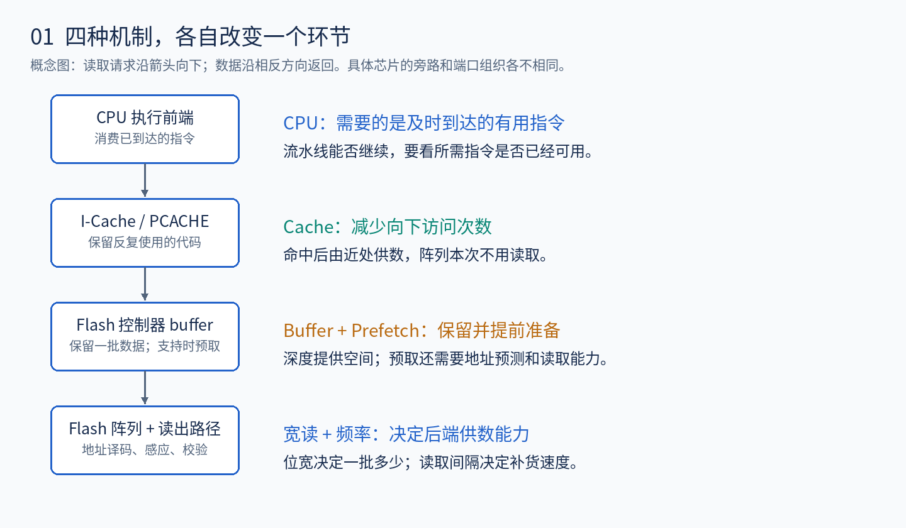
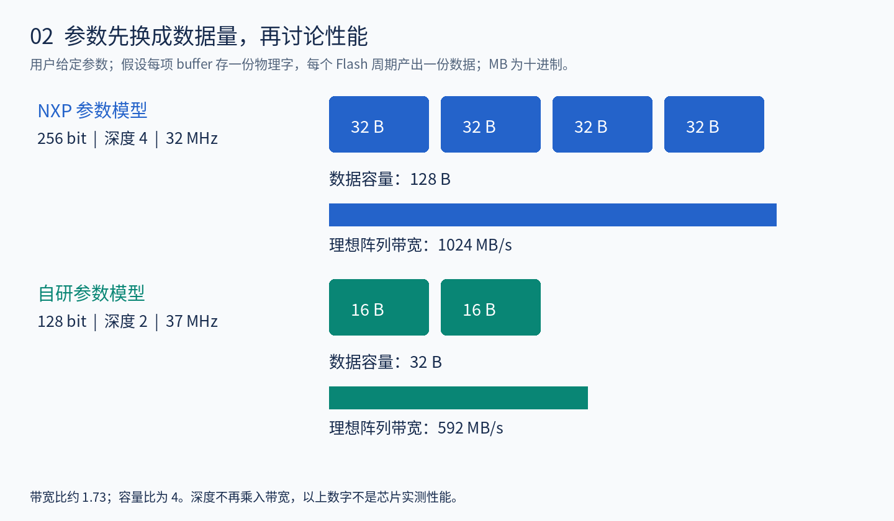
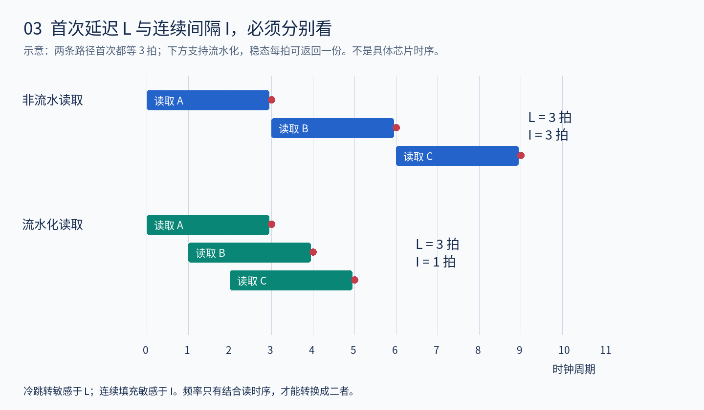
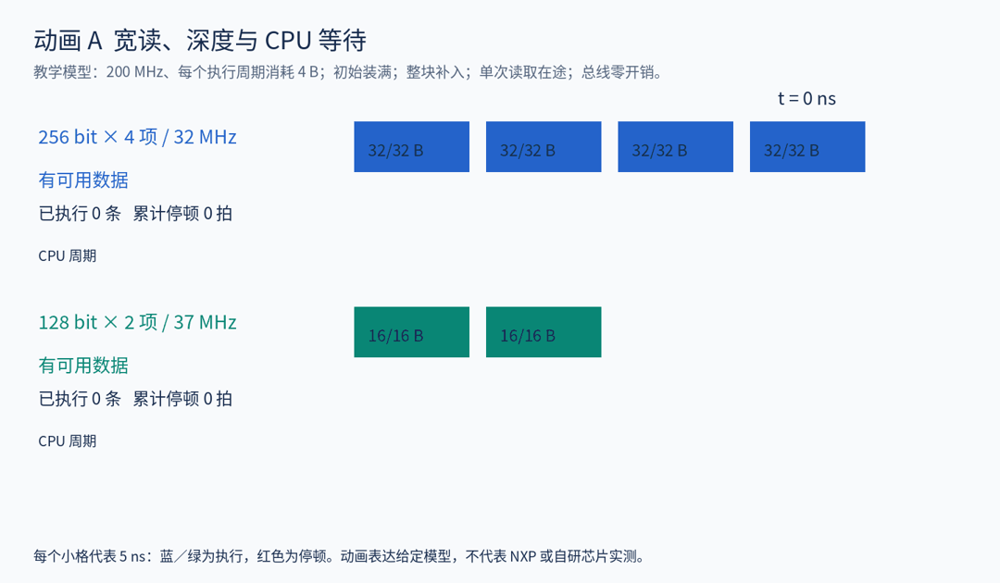
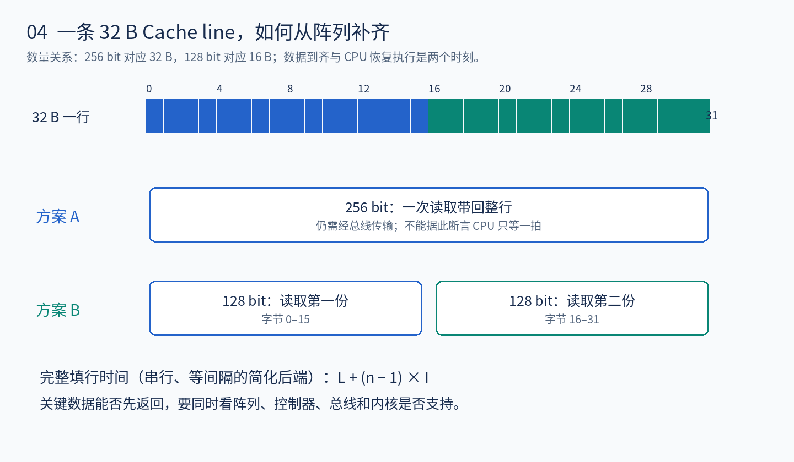
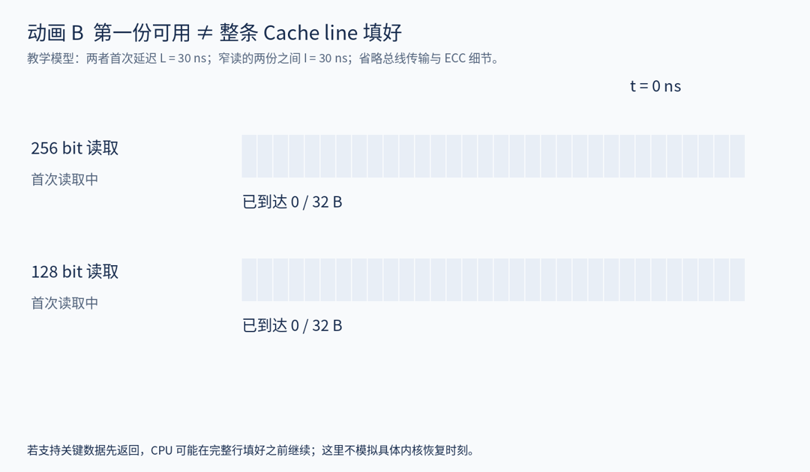
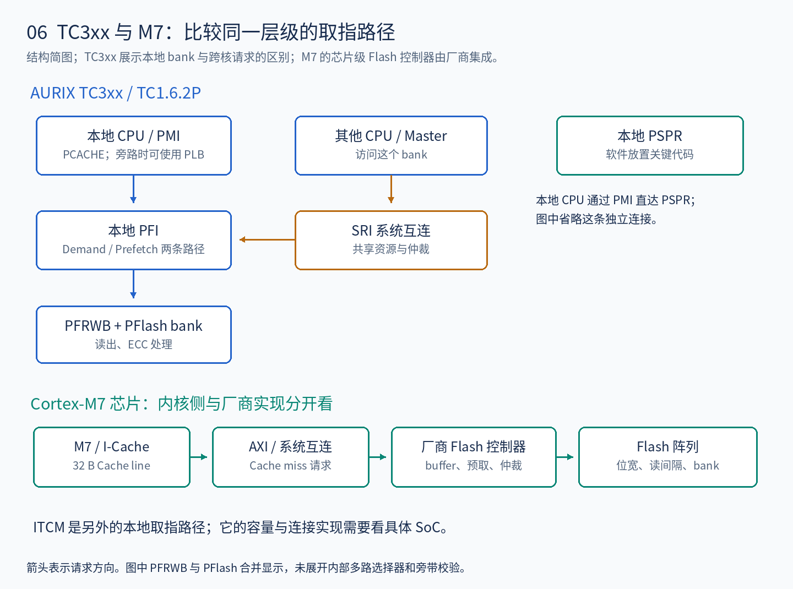
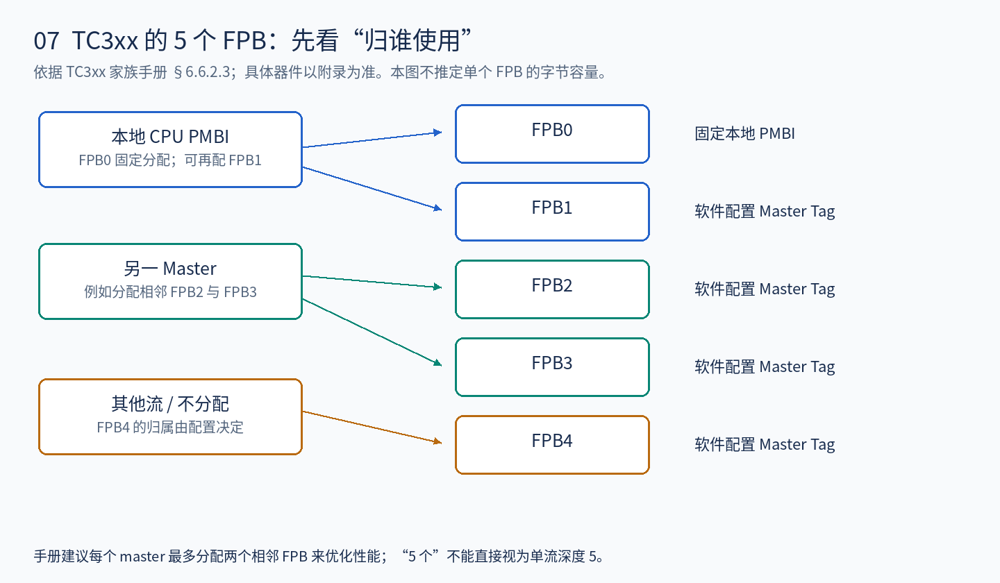
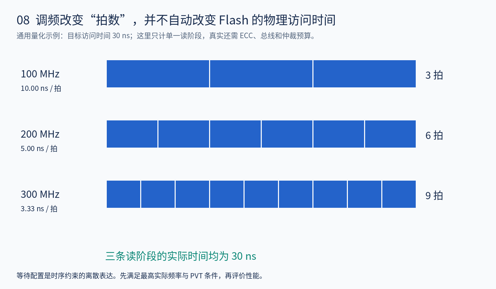
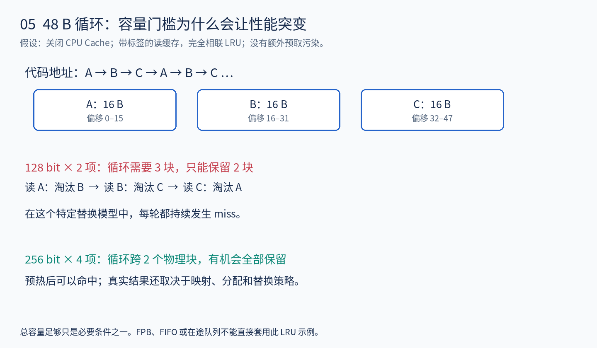

# Flash 位宽、Buffer、预取与取指性能：AURIX TC3xx 与 Cortex-M7 对比

从 WHY、WHAT、HOW、FEATURE 理解设计取舍，并落到自研车规 MCU 的系统验证。

整理日期：2026-09-11。讨论对象是嵌入式 Flash **读取与执行路径**；不把读位宽等同于编程单位或擦除单位。

## 阅读与动画

这份材料包含 8 张机制图、2 个 GIF，以及配套的 `Flash_交互动画.html`。HTML 可以离线打开，播放、暂停并调整供数模型；完整压缩包保留 Markdown 与图片的相对路径。部分 Markdown 阅读器不播放 GIF 时，可以打开 HTML 查看。

建议按这个顺序读：参数换算 → 动画 A → M7 填行 → TC3xx 的 PLB/PFI → 实验矩阵。第一次不必记寄存器，先回答：**指令现在在哪里？如果没有，多久回来？回来多少？下一批能否及时到达？**

> **证据边界**：NXP 的“256 bit、深度 4、32 MHz”和自研的“128 bit、深度 2、37 MHz”来自本次讨论，尚未提供具体型号和时序图。数值推导均附条件。TC3xx 机制依据家族手册及 Infineon 官方说明；具体器件须结合 Appendix 和 errata。Cortex-M7 是处理器内核，Flash 宏单元和控制器由芯片厂商集成，不能把一种 M7 芯片的 Flash 参数当成 M7 架构规定。

## 1. WHY：高速 CPU 为什么能在较慢的 Flash 上执行程序

### 1.1 CPU 与 Flash 的时间尺度不同

CPU 执行前端可能每几纳秒就需要更多指令。Flash 阵列读取需要地址译码、位线建立与感应判决；完整读路径还要考虑 ECC、接口和仲裁。设计者必须处理两个问题：首次请求什么时候能回来，以及连续执行时后端能否持续供数。

如果每条指令都等一次完整阵列访问，流水线很容易缺少可执行的指令。常见设计把问题拆成四部分：

| 机制 | 想解决什么 | 发挥作用的前提 |
| --- | --- | --- |
| 加宽读取 | 用一次阵列访问带回更多相邻数据 | 后续会使用这一批数据 |
| Buffer | 留住已经取回的数据，连接生产与消费 | 组织和端口允许所需的供数行为 |
| Prefetch | 在 CPU 真正需要前发起读取 | 地址预测有用，并有时间与资源完成读取 |
| Cache | 反复使用的代码不必反复向下取 | 工作集能够命中，且一致性管理正确 |

**宽读降低每份有效数据分摊的读取成本；预取把等待提前；Cache 降低后端读取需求。** 三者配合，决定 CPU 看到的体验。

### 1.2 为什么 32 位 CPU 会配 128/256 bit Flash

CPU 的 32 位主要描述体系结构中的寄存器和运算等能力，不限定阵列必须一次读 32 bit。假设全是 32 位指令，128 bit 带回 4 条，256 bit 带回 8 条。后续指令仍在 buffer 中时，可直接取用。

阵列读出的宽数据也可以通过较窄的总线分拍传送。因此，下面四个量必须分开：

| 层级 | 例子 | 决定什么 |
| --- | --- | --- |
| 指令编码长度 | 16/32 bit | 一条指令占多少代码空间 |
| CPU/总线传输宽度 | 32/64 bit 等 | 一次接口传输有多少有效位 |
| Flash 有效读取宽度 | 本例 128/256 bit | 一次后端读取提供多少数据 |
| Cache line | M7 为 32 B | 一次缓存分配/填充管理的数据范围 |

这里的“有效读取宽度”不一定等于晶体管阵列整行的全部宽度。还可能存在列选择、ECC 位、冗余位和内部拼接；仅凭对外的数据口不能还原全部物理组织。

### 1.3 为什么不无限加宽、加深、提频

更宽的感应及数据通路、更大的 buffer、更复杂的标签比较与选择逻辑，都有面积、动态功耗、布线与时序成本。提高频率则需要满足读出与校验的时序预算；汽车使用条件还要考虑工艺、电压、温度以及寿命相关保证条件。

软件局部性同样限制收益。若一次读出 32 B，CPU 只使用开头 4 B 就跳走，剩余数据暂时没有带来收益。更激进的预取还可能挤占真正请求的带宽。

所以设计目标是：**在目标应用、成本和运行条件下，让有用数据及时到达。** 仅比较最大 MHz 或 buffer 总字节数，无法替代这个判断。

## 2. WHAT：把参数换成可比较的系统量

### 2.1 本次两组参数的换算

暂用三个假设：位宽指有效数据；一项 buffer 存一个物理字；每个 Flash 周期可以产出一个物理字。最后一个假设尤其需要读时序证明。

| 项目 | NXP 参数模型 | 自研参数模型 |
| --- | ---: | ---: |
| 一次有效读取 | 256 bit = 32 B | 128 bit = 16 B |
| Buffer 项数 | 4 | 2 |
| 假设下的数据容量 | 128 B | 32 B |
| 所给频率 | 32 MHz | 37 MHz |
| 时钟周期 | 31.25 ns | 27.03 ns |
| 每周期一份时的理想阵列带宽 | 1024 MB/s | 592 MB/s |
| 补足对齐的 32 B 数据所需份数 | 1 | 2 |

MB/s 使用十进制单位。ECC/标签不计入有效数据容量。

计算为：

$$
B_{array}=\frac{W_{bit}}{8}\times f_{flash}
$$

$$
\frac{1024}{592}\approx1.73,\qquad\frac{128}{32}=4
$$

1.73 是该简化条件下的阵列带宽比，4 是该容量假设下的数据储存比。两者都不能直接当成程序加速比。**深度不再乘进带宽公式。** 多个可独立工作的 bank 可能提升聚合供数能力，但那是另外的并行资源，需要单独证明。

### 2.2 “深度”必须带上单位与组织方式

| 所谓 buffer 可能指什么 | 需要进一步确认什么 |
| --- | --- |
| 带地址标签的读缓存 | 全相联还是组相联？如何替换？跳回来能否命中？ |
| 顺序 FIFO | 能否随机命中？读走后是否立即丢弃？ |
| 双缓冲数据寄存器 | 是否一项供数、一项填充？端口能否重叠？ |
| 在途请求队列 | 能排几个请求？后端实际允许几个未完成请求？ |
| 多个预取流的 buffer | 按 CPU、master 或地址流分配？每个流内部多深？ |
| 流水线级间寄存器 | “两级”是否仅表示两个处理阶段？ |

设计评审时应要求对方写成类似“每 bank：4 个可分配流；每流 2 项；每项 32 B”的完整表达，再讨论容量与性能。本文**没有确认** TC3xx 单个 FPB 的内部字节容量，也不把 FPB 数量等价成连续数据的队列深度。

### 2.3 首次延迟 L 与产出间隔 I

首次返回延迟 L：请求被接受后，第一份数据多久可用。连续产出间隔 I：稳态下相邻两份数据隔多久出现。

一个接口可能第一份等 3 拍，随后每拍返回一份，此时 L = 3 拍、I = 1 拍。更一般的带宽公式是：

$$
B_{array}=\frac{W_{byte}}{I}
$$

在均匀串行供数、无其他瓶颈的模型中，n 份数据全部到达约为：

$$
T_{n}=L+(n-1)I
$$

所以 1/32 MHz 和 1/37 MHz 首先只是周期长度。它们能否代表 L 或 I，要看频率定义、访问拍数、流水化和 bank 行为。随机冷跳转通常对 L 敏感，连续填充通常对 I 敏感。

## 3. HOW：用一次连续取指看懂宽度与 buffer

### 3.1 CPU 消耗与 Flash 补充，谁更快

设一个纯教学负载：CPU 200 MHz，每个执行周期使用一条 32 位指令；代码一直向前，没有 Cache 复用；总线不构成瓶颈。目标取指供给为：

$$
B_{demand}=200\times10^6\times4=800\ \text{MB/s}
$$

| 对比 | 32 B / 31.25 ns | 16 B / 27.03 ns |
| --- | ---: | ---: |
| CPU 用完一批的时间 | 40 ns | 20 ns |
| 生产一批的时间 | 31.25 ns | 27.03 ns |
| 稳态生产能否覆盖目标需求 | 可以，其他条件也需满足 | 不可以 |

**较宽的读取可以让这一批指令用得更久，给下一次慢读取留出时间。** 这就是“Flash 时钟稍低，仍可能更能支持高速 CPU”的原因。

动画 A 进一步明确了队列模型：初始 buffer 已装满；一项消耗完才释放；后端一次只有一个未完成读取；空位出现即可补充；整块就绪后入队；CPU 每 5 ns 尝试消耗 4 B。它演示这些规则下的停顿，不是对实际器件的预测。现实系统的填充触发、旁路、并发和关键字返回可能改变时序。

### 3.2 深度什么时候特别有用

从单项变成两项，如果端口与控制允许，一项供 CPU 使用、另一项补数，可能把原本串行的工作重叠起来。此时深度提升带来的收益可能很大。

继续加深，主要是在已有供需结构上增加储备、容忍延迟波动，或保留更多地址。它不让一个不能并行的阵列自动变成多个阵列。

在“库存可以按字节平滑使用”的流体近似中，供数暂停 J 秒、CPU 消耗 R B/s，需要约 RJ 字节的可用储备。若持续需求 R 大于持续有效供给 S，初始储备 Q 能支撑的量级约为 Q/(R−S)。这两个关系用于估算，不精确描述整行分配、单口冲突和启动空泡。

**深度的意义必须连着“能隐藏哪一段等待”说。** 如果增加深度没有消除停顿，应检查是否已碰到平均带宽、无法预测的目标地址或共享资源仲裁。

### 3.3 需求带宽不等于主频乘指令宽度

前面的 800 MB/s 用来建立直觉。真实程序存在 16/32 位混合指令、多发射、执行停顿、循环命中和错误路径预取。尤其 Cache 命中时，CPU 的指令消费不转化成阵列读取。

对芯片评估更有用的是按目标接口统计：

$$
R_{flash}=\frac{\text{实际向阵列请求的有效载荷字节数}}{\text{观测时间}}
$$

其中要包含落到阵列的指令填充、常量读取及额外预取，避免同一次服务被重复统计。为了估算可用上界，还要看阵列、总线、仲裁份额和控制器哪一处限制更紧。CPU 工作频率相同，也可能因为 miss 模式不同而对 Flash 提出完全不同的要求。

## 4. HOW：M7 的 32 B Cache line 如何与 Flash 配合

### 4.1 一次填行与物理位宽相遇

Cortex-M7 的 I-Cache 和 D-Cache 采用 32 B 行；NXP 的 M7 应用说明给出了该行大小和经 AXI 进入 linefill buffer 的过程。它证明的是 M7 Cache 机制，**不用于证明本次未具名 NXP 器件的 Flash 参数**。[NXP AN12042，§2.1–2.2](https://www.nxp.com/docs/en/application-note/AN12042.pdf)

如果目标行不在任何下层 buffer 中，单一 256 bit 数据源可一次提供 32 B；单一 128 bit 数据源需要两份。若窄读后端有并行 bank 或流水化，两个份数也不一定对应两次完整串行延迟。

这个尺寸匹配给出了合理的架构解释：更宽的 Flash 读取可以降低一条 Cache line 对后端事务的需求。但不能据此宣称某家厂商的实际设计动机，也不能推出“取指只需要一个 CPU 周期”。

### 4.2 第一份到达、关键数据到达、整行填好是三个事件

例如，CPU 急需的指令位于某条行的后半部分。只先返回前半部分未必能让它继续。关键字优先需要从请求排序、后端取数到总线返回共同支持；若芯片某一层把它重新串行化，内核能力也无法独自消除等待。

动画 B 刻意给两种读取相同的 L = 30 ns；窄读取 I = 30 ns。因此宽读在 30 ns 提供整行，窄读在 30 ns 提供一半、60 ns 提供整行。动画不模拟具体 CPU 恢复时刻，目的只是把“首份延迟”和“完整填行”分开。

### 4.3 I-Cache 命中后，Flash 差异为什么可能消失

小函数预热后一直驻留 I-Cache，后续取指主要在内核侧解决。测试此时更容易看见流水线、数据依赖与分支成本，较难看见阵列带宽。反过来，复位后的冷路径、大量分散函数、超出 Cache 容量的代码或频繁冲突，才会把 Flash 差异暴露出来。

M7 还可具有 ITCM 取指路径，绕过 Cache。其实际容量、等待及实现由具体芯片决定。将关键代码放入 ITCM 是软件布局选择，需要启动复制及运行地址正确配合；不能仅凭“是 TCM”就对整个 ISR 的响应时间作零等待保证。[NXP AN12042，§2.1、2.3.2](https://www.nxp.com/docs/en/application-note/AN12042.pdf)

## 5. HOW：AURIX TC3xx 在同一问题上多做了哪些事

### 5.1 先把对比层级对齐

TC3xx 是一个完整 MCU 家族，包含 CPU、互连、PFlash bank 与 PFI。M7 是一个内核。因此应比较“TC3xx 的完整取指系统”与“某颗 M7 芯片的完整取指系统”。内核侧可以对应，厂商侧实现则必须单列。

TC3xx 官方说明将 PFlash bank、本地 PFI、PFRWB 和 CPU 之间的连接分开描述：PFI 提供本地点对点连接并包含预取缓冲，PFRWB 负责读数据的 ECC 处理。不同 bank 可提供独立读访问，支持的跨 bank 读写并行要看具体配置。[Infineon NVM Subsystem](https://documentation.infineon.com/aurixtc3xx/docs/qbu1702561828906)

其系统意义是：不仅要问一个 bank 多宽、多快，还要问请求从哪里来、走哪条路、与谁争用。给另一个 CPU 增加可用预取资源，可能比单纯增加本地 CPU 缓存更直接地改善某类跨核负载。

### 5.2 PCACHE、PLB、PFI FPB 分别在哪一层

TC1.6.2P 的 PMI 提供 PCACHE、PSPR 和 PLB。手册描述 PCACHE 为两路组相联、32 B 行；填充使用关键双字优先，并可在填行期间向 CPU 提供已到达的指令。PCACHE 自身的一次 refill 只补当前行，不在该机制中额外预取下一行。[TC3xx Part 1，§5.3.6.3.1，文档页 5-79～5-81](https://www.infineon.com/assets/row/public/documents/10/44/infineon-aurix-tc3xx-part1-usermanual-en.pdf)

| 存储结构 | 所在层次 | 解决的问题 |
| --- | --- | --- |
| PCACHE | CPU 的 PMI | 保留多条代码行，利用重复访问 |
| PLB | CPU 的 PMI | 非缓存或旁路取指时，保留一条指令数据 |
| PFI FPB | 本地 Flash 接口 | 为指定 master 提前准备数据 |
| PFI DRLB | Flash 读取路径 | 为适用的数据事务保留读出的数据 |
| PSPR | CPU 本地程序 SRAM | 由软件放置关键代码，提供确定性更强的取指路径 |

**TC3xx 上，“PCACHE bypass”后仍有 256 bit PLB 可作为单行缓存。** 因此，同一行内的后续取指可能命中 PLB。PFI 的 FPB 又是更下层的另一组资源。关闭 PCACHE 后重复执行几条指令测得很快，不能直接解释为“阵列每几纳秒能读一次”。上述机制见同一 PMI 章节。

这也是验证方法的关键：要测到哪层，就必须知道请求是否真的到达该层。仅凭 CPU Cache 开关不足以证明实际访问阵列。

### 5.3 FPB 的“5 个”为什么不能直接和“深度 4”比较

家族手册 §6.6.2.3 给出：每个 PFI 实例有 5 个 FPB；FPB0 固定分给本地 CPU PMBI；FPB1–4 用 `CPUx_FLASHCON0.TAG1–TAG4` 指定 master。手册建议为一个 master 分配最多两个相邻 FPB 以优化性能。[TC3xx Part 1，§6.6.2.3，文档页 6-163](https://www.infineon.com/assets/row/public/documents/10/44/infineon-aurix-tc3xx-part1-usermanual-en.pdf)

这里首先描述的是**资源归属**。把某项分给 CPU1，不代表 CPU0 的可用预取深度也同步增加。图中的分配只是示例，不能把 5 项全部视作任意单流共享的 FIFO。

对你们芯片的启发是：如果取指、常量、DMA 或其他 master 共享两个项，需要判断干扰是来自容量不足，还是来自“各流互相替换”。在后者中，分流或分配策略可能比无条件扩容更有效。

### 5.4 Demand 与 Prefetch：一条应对当前需要，一条准备未来数据

TC3xx PFI 有 Demand 和 Prefetch 路径。手册说明，适用的本地 BTR4 demand 事务可提前发送未经纠正的关键双字；若发现 ECC 错误，则用纠正后数据重传。这里的“提前”由硬件检测和重传协议共同保障，不能理解成软件可以直接信任尚未校验的数据。[TC3xx Part 1，§6.6.1–6.6.2.1，文档页 6-162～6-163](https://www.infineon.com/assets/row/public/documents/10/44/infineon-aurix-tc3xx-part1-usermanual-en.pdf)

这是性能与完整性协同设计的例子：常见的无错误路径争取尽早让关键数据到达，发生错误时通过规定的处理链保证正确性。因此验证既要看无错误路径，也要看注入可纠正错误后的数据、停顿与报告。仅测“有 ECC”和“没 ECC”两个布尔状态，无法覆盖真实路径。

### 5.5 本地 bank、远端 bank 与 SOTA

Infineon 对 SOTA 的说明指出，本地 PFlash 的优化路径会让不同物理 bank 的执行性能产生差别；为获得交换前后的性能一致性，需要考虑 fast path 和预取配置。[Infineon TC3xx Tools and Software，SOTA Performance considerations](https://documentation.infineon.com/aurixtc3xx/docs/sih1702364171562)

由此可以推导一个直接的系统问题：**逻辑地址可以不变，映射到的物理 bank 却发生改变。** 此时软件看到的是同一个函数地址，硬件访问的拓扑却可能不同。若应用对时序一致性敏感，验收不能只做“更新后能启动”，还应覆盖映射交换前后、相关 CPU 与竞争负载下的时间分布。

### 5.6 等待周期是读时间预算的编码

TC3xx 手册 §6.5.2.1.2 用读时钟对阵列和 ECC 阶段计数，给出了 `DMU_HF_PWAIT` 的配置示例。示例条件为 tPF = 30 ns、tPFECC = 10 ns、fSRI = 200 MHz，对应 6 个读周期和 2 个 ECC 周期，字段编码分别为 `RFLASH=5`、`RECC=1`。**这是手册示例，不是全系列通用的额定时序或推荐配置。**[TC3xx Part 1，文档页 6-22～6-23](https://www.infineon.com/assets/row/public/documents/10/44/infineon-aurix-tc3xx-part1-usermanual-en.pdf)

通用思路是用 `ceil(所需时间 / 计数时钟周期)` 得到足够的周期数，再按字段编码规则写寄存器。实际还要核对目标器件读路径的时钟来源、模式、FM-PLL 最大频率以及数据手册保证条件，不能只对 CPU 主频计算。

若物理要求依旧是 30 ns，把计数时钟从 100 MHz 提高到 200 MHz，只是从约 3 拍变成 6 拍。**周期变短与一次实际读取变快，没有必然等价关系。**

## 6. FEATURE：TC3xx 与 M7 系统的能力、收益和边界

| 对比维度 | AURIX TC3xx / TC1.6.2P | Cortex-M7 及其具体 SoC | 对自研 MCU 的意义 |
| --- | --- | --- | --- |
| 处理器与芯片层级 | 完整 MCU 家族内集成 TriCore | M7 是内核，后端由厂商实现 | 分别审核内核接口和 Flash 子系统 |
| 近端指令缓存 | PMI 中的 PCACHE，32 B 行 | I-Cache，32 B 行 | 冷态与热态分开评价 |
| 旁路后的缓冲 | PMI 中还有 32 B PLB | 是否仍有有效缓冲要看各层实现 | 禁用 Cache 后仍需确认事务路径 |
| 软件放置关键代码 | PSPR | 实现了 ITCM 时可使用 ITCM | 控制关键代码、常量及调用链的落点 |
| Flash 预取 | PFI FPB，可按 master 分配 | 控制器预取是 SoC 能力 | 深度、流数、每项宽度分别定义 |
| 多核 / 多 master | 本地快速路径与 SRI 请求需要区分 | 取决于总线及多核集成 | 关注每个 master 的有效服务能力 |
| 完整填行与先用数据 | PCACHE 支持关键双字优先与流式供数 | 必须结合内核版本和后端返回机制核对 | 测首次关键数据和完整 burst 两个时间 |
| Flash 有效位宽 | 不用 Cache 行/ECC 粒度反推出整个阵列物理结构 | M7 没有规定必须是 128 或 256 bit | 以宏单元接口与时序图确认 |
| 读时钟与等待 | 有明确的模式、时钟及等待配置 | 寄存器与编码随 SoC 改变 | 时钟树、字段编码和 PVT 一起审查 |
| ECC 与时序 | PFI Demand 早返及错误重传等机制 | 能力与错误响应由实现决定 | 功能正确、数据完整、错误路径时序都要验证 |
| 取指路径更新 | PCACHE、PLB、Flash buffer 是不同层 | I-Cache 与控制器 buffer 也是不同层 | 更新代码后逐层保证一致性 |

此表归纳前述已引用资料与工程分析。Cache 容量、PSPR/ITCM 容量、bank 数量、具体 wait state、单 FPB 内部容量，没有在未确认器件的情况下填写统一数字。

## 7. 把设计逻辑放进你的实际工作场景

### 7.1 长顺序代码：检验供给能力

场景：Cache 冷态执行较长代码段，或执行无法驻留的顺序代码。若 CPU 对 Flash 的请求持续增加，窄读后端更容易暴露持续供数不足。加深 buffer 可改善某些局部空泡，但不改变后端单一串行通道的持续生产极限。

验证时不要用几条 NOP 包成一个很小的循环来代表长顺序流，因为它可能一直命中 I-Cache、PLB 或读缓存。应把测试体展开到足够长，并用反汇编确认实际指令流。

### 7.2 48 B 小循环：检验容量与替换

在完全相联、LRU、无其他污染的示例中，48 B 循环覆盖三个 16 B 块，两项读缓存持续替换；如果用 32 B 块，只跨两块，有机会完整保留。这会产生明显的性能门槛。

这不是对你们实际 buffer 的判定。若它是 FIFO、单次填充队列，或者有不同映射与预取策略，结果会变化。扫描循环大小和起始偏移，可以把假设变成可验证的解释。

### 7.3 函数变长或优化等级提高，性能反而下降

内联和循环展开可以减少分支，但会增大代码工作集，也可能改变对齐。某个优化在 TCM 上更快，在 Flash 上更慢，可能说明它节约的执行周期少于新增的取指停顿。

因此同时保留三类证据：反汇编与代码尺寸、函数地址及跨行情况、时间测量。不要仅凭 C 代码行数判断成本。`volatile` 只能约束相关访问，不能固定整个测试函数的机器码或缓存行为。

### 7.4 中断与 Trap：不要把取指延迟当成全部响应延迟

M7 进入异常涉及向量读取、上下文入栈和 handler 取指等动作；TC3xx 中断/Trap 涉及自己的入口定位和上下文机制。这里应分开评价“到达 handler 的第一条可执行指令”和“第一条业务动作产生外部效果”。

把 handler 放到 ITCM/PSPR，有助于控制 handler 的取指路径；如果向量、常量、调用的函数、栈或 CSA 仍在不同存储路径，整体响应仍可能受其他资源影响。这是实验边界分析，不把两个架构的完整中断机制简单等同。

### 7.5 DMA 与 CPU：平均分配和最坏等待是两件事

CPU 与 DMA 同读一个 Flash bank，既可能争用阵列，也可能争用控制器 buffer、返回端口或系统互连。若 DMA 的 burst 较长，即使 CPU 长期平均带宽足够，也可能出现一次较长排队，影响关键路径。

需要分别测同 bank 与不同 bank；同时确认不同 bank 是否还共享上层瓶颈。独立 bank 是产生并行能力的条件之一，不能直接把总带宽按 bank 数相乘。

### 7.6 编程之后或故障注入时，为什么“读不到变化”

一次读操作可能由上层缓存或下层 buffer 服务。修改了阵列内容，不等于所有已缓存副本都立即改变。TC3xx 的 PMI 没有自动维护外部内容变化的 PCACHE 一致性；手册另有 Flash buffer 在编程/擦除后的失效规则。两层规则不能互相替代。[TC3xx Part 1，§5.3.6.3.1、§6.5.2.5，文档页 5-81、6-44](https://www.infineon.com/assets/row/public/documents/10/44/infineon-aurix-tc3xx-part1-usermanual-en.pdf)

对 ECC 注入同理：若目标访问一直在 Cache 命中，就没有经过希望验证的阵列读路径。应按具体芯片流程处理 Cache、PLB、Flash buffer 和预取状态，再确认读取确实触达故障层。故障注入前后还需区分实际 demand 请求与内部预取的错误报告规则，不能用一条笼统的“读错误就报警”覆盖所有阶段。

## 8. 验证方案：每个实验只解决一个主要疑问

### 8.1 先建立可解释的测量环境

1. 固定并记录 CPU、总线、Flash 相关时钟、wait state、运行模式及编译选项。
2. 将计时与必要的控制代码放在不干扰目标资源的位置，明确测试体的实际地址。
3. 记录 CPU Cache、PLB/读缓存、预取的状态；使用该芯片规定的维护、屏障与失效完成流程。
4. 对照反汇编，确认代码未被删除、折叠、意外内联或缩成一个很小的循环。
5. 分别统计冷态与热态；竞争负载作为独立变量加入。
6. 优先保留周期数、时钟换算后的时间、实际 burst/访问计数；有条件时使用总线 trace。

M7 可用已实现并启用的 DWT 周期计数；TC3xx 可用适合该核/系统的计数资源。计数器测的是观察窗口，窗口里的中断、计时开销和竞争也可能计入，不能直接命名为“纯 Flash 时间”。

### 8.2 实验矩阵

| 编号 | 实验设计 | 主要变量 | 预期区分的机制 |
| --- | --- | --- | --- |
| T01 | 足够长的顺序代码，CPU Cache 关闭 | 预取开/关；代码长度 | 连续供数与预取收益 |
| T02 | 小循环扫描 16、32、48、64、96、128 B 附近的实际机器码长度 | 循环大小 | 容量门槛；不是宣称这些值都是边界 |
| T03 | 同一逻辑代码改变起始偏移 | 0/2/4/8/16 B 等有效指令对齐偏移 | 跨物理字、跨 Cache line 的影响 |
| T04 | 多个分散基本块构成不可顺序复用的跳转链 | 地址分布、随机程度 | 首次返回延迟、预测效果 |
| T05 | 同一代码冷态与充分预热后比较 | Cache 状态 | Cache 能隐藏多少后端差异 |
| T06 | 代码分别放 Flash 与本地程序 SRAM | 存储落点 | 执行单元瓶颈还是取指瓶颈 |
| T07 | CPU 取指同时 DMA 读 Flash | DMA 流量、burst、bank | 仲裁与共享 buffer 干扰 |
| T08 | TC3xx 本地 CPU、其他 CPU 访问同一 bank | Master、FPB 分配 | 快速路径与分配策略 |
| T09 | 在支持的配置中比较 bank 映射交换前后 | 映射、fast path、预取 | 更新后的性能一致性 |
| T10 | 读取无错数据与规范注入的可纠正错误 | 错误类型、命中层 | 纠错/重传带来的额外时序 |
| T11 | Handler 冷态、热态及竞争下进入 | 存储落点、负载 | 关键路径时间和抖动 |
| T12 | 在允许范围扫电压、温度、相关时钟与等待配置 | PVT、模式 | 保证条件下的功能及性能裕量 |

每个实验输出最小值、中位数、尾部情况与观测最大值，解释样本条件。**有限实验中看到的最大值，不等于已经证明的 WCET。** 若要论证最坏时间，还需要资源仲裁界限、可达状态与相应分析。

### 8.3 如何根据实验结果决定下一步

| 观察 | 优先调查 |
| --- | --- |
| Cache 预热后差距几乎消失 | Flash 差距主要在 miss 路径，是否影响目标应用的冷路径 |
| 顺序流慢，增加深度收益很小 | 阵列持续带宽、总线宽度/频率、填充间隔 |
| 深度从 1 到 2 收益明显 | 原本是否供数与填充无法重叠 |
| 在特定代码长度突然变慢 | 可驻留块数、组冲突、替换与预取污染 |
| 仅改变函数地址就影响很大 | 行边界、代码布局、分支目标落点 |
| 单核快，多 master 明显变慢 | 仲裁份额、burst 阻塞、buffer 分配 |
| 提高 CPU 主频，任务时间改善很少 | 实际是否受取指、数据或外设等待限制 |
| 纠错时结果正确但时序变长 | ECC 处理、重传及相关错误服务路径 |

## 9. 设计评审要拿到哪些证据

### 9.1 自研/NXP 待确认项

| 问题 | 希望拿到的证据 |
| --- | --- |
| 128/256 bit 是什么接口的宽度？是否为净数据？ | 宏单元框图、读口定义、ECC 粒度 |
| 深度 2/4 对应哪一层？ | Buffer 结构及项宽，是否有地址标签 |
| 37/32 MHz 是哪个时钟，或哪种等效访问率？ | 时钟树及 read timing |
| L 和 I 分别是多少？ | 连续请求、冷随机请求的波形 |
| 32 B burst 如何拼装？ | 两份窄数据的发起、返回与拼接时序 |
| 支持多少在途读取？ | 控制器和宏单元各自的未完成请求上限 |
| CPU 急需的数据能否先返回？ | 关键 beat 的地址顺序与返回协议 |
| 预取何时启动、取消或停止？ | 状态机、边界和仲裁规则 |
| 指令、常量、DMA 是否共享项？ | Master 分配和替换优先级 |
| 不同 bank 是否真正独立？ | 阵列、ECC、端口、互连的共享关系 |
| 读错误、缓存失效后怎样恢复？ | 错误响应与失效完成规则 |
| 最坏条件的读时序如何保证？ | 对应器件版本的电气指标与约束 |

### 9.2 TC3xx / M7 的查阅入口

| 控制点 | 要查的用途 | 边界 |
| --- | --- | --- |
| TC3xx `CPUx_PCON0.PCBYP` | PCACHE 旁路 | 不等于没有 PLB/PFI buffer |
| TC3xx `CPUx_PCON1.PCINV`、`PBINV` | PCACHE / PLB 失效 | 按手册要求确认完成及同步 |
| TC3xx `CPUx_FLASHCON0.TAG1–TAG4` | FPB1–4 的 master 分配 | FPB0 固定本地 PMBI；不是单流深度字段 |
| TC3xx `DMU_HF_PWAIT` | Flash/ECC 等待配置 | 正常、低压等模式以及字段编码需区分 |
| TC3xx `DMU_HF_PCONTROL` 相关控制 | Demand/预取与状态变化 | 写编码、既有数据是否保留及失效规则分别核对 |
| M7 `SCB->CCR` 与 CMSIS Cache API | 内核 I/D-Cache 管理 | 不能替代厂商 Flash buffer 控制 |
| M7 MPU 属性 | 存储区域访问及缓存属性 | 核对内核版本与 SoC 属性传递 |
| M7 芯片厂商 Flash 寄存器 | 等待、预取、buffer、错误响应 | M7 没有统一的一套此类外设寄存器 |

此表是阅读/调试导航，不是可直接执行的寄存器脚本。特别是保护访问、同步和模式切换，应使用目标芯片手册规定的操作序列。

## 10. 把 WHY、WHAT、HOW、FEATURE 合成一次设计决策

假设目标应用在 Cache miss 集中的阶段，需要约 800 MB/s 的持续新指令供给。按 37 MHz、每拍 16 B 的理想模型，592 MB/s 的供给不足。此时可以沿以下方向评估，而不是只增加一个参数：

| 选择 | WHY | HOW | FEATURE / 代价与边界 |
| --- | --- | --- | --- |
| 加宽物理读取 | 持续产出不够 | 每次返回更多数据 | 连续场景受益，成本和有效利用率需评估 |
| 提升产出频率/流水化 | 相邻份间隔过长 | 缩短 I，或让多个读取阶段重叠 | 必须由宏单元和控制器支持 |
| 增加 buffer | 平均足够但局部断供 | 增加储备或并发容纳能力 | 改善的范围取决于实际组织 |
| 改变预取策略 | 有用数据来得太晚 | 更早发起、优先满足 demand | 错误预取消耗资源 |
| 改善 Cache 命中 | 后端需求过大 | 布局、局部性、容量及映射优化 | 冷路径仍存在 |
| 关键路径放本地 SRAM | 需要更可控的取指时间 | 链接、启动复制、完整调用链布局 | 有容量与软件维护成本 |
| Master/bank 分配 | 多流互相阻塞 | 避免争用或保留服务能力 | 检查上层共享瓶颈和公平性 |

反过来，如果目标负载通常命中 Cache，关键路径已经在本地程序 SRAM，且冷路径时间满足要求，采用 128 bit、较少 buffer 也可能是合理取舍。这个结论应由目标应用与边界验证支持，不能从参数大小反推厂商优劣。

**你作为系统工程师最有价值的判断，是把“位宽不够”“预取太晚”“缓存留不住”“跨核争用”“纠错重传”这些不同原因，从同一个表面现象——CPU 等待——中区分出来。**

## 参考资料与适用范围

1. [Infineon AURIX TC3xx User Manual 入口](https://documentation.infineon.com/aurixtc3xx/docs/qmd1702366622648)：家族手册是功能超集，具体器件还需 Appendix。
2. [TC3xx Part 1，V2.0.0，2021-02](https://www.infineon.com/assets/row/public/documents/10/44/infineon-aurix-tc3xx-part1-usermanual-en.pdf)：本次核对 PMI、NVM 读等待、PFI；文中页码为印刷章节页码。官方大文件不易打开时，可由上一项入口下载；本次正文读取使用了同版 Infineon 原文的[公开镜像](https://kz.ic-components.com/files/54/TC399XX256F300SBDKXUMA1.pdf)。
3. [Infineon CPU Subsystem](https://documentation.infineon.com/aurixtc3xx/docs/dex1702559585636)：CPU、PMI、PSPR/PCACHE 等结构概览。
4. [Infineon NVM Subsystem](https://documentation.infineon.com/aurixtc3xx/docs/qbu1702561828906)：PFI、PFRWB、独立 bank 与完整性机制。
5. [Infineon SOTA 与性能一致性说明](https://documentation.infineon.com/aurixtc3xx/docs/sih1702364171562)：本地 bank 快速路径及预取资源对交换前后性能的影响。
6. [NXP AN12042 — Using the i.MXRT L1 Cache](https://www.nxp.com/docs/en/application-note/AN12042.pdf)：仅用于 M7 的 Cache/TCM 说明；不等于本次 NXP Flash 型号的规格来源。

图与动画均按本文定义的机制自行绘制。数值模拟、供需关系、测试方案和设计取舍是工程分析；没有在本次任务中运行实物芯片测试，也没有把模拟结果标为实测。
